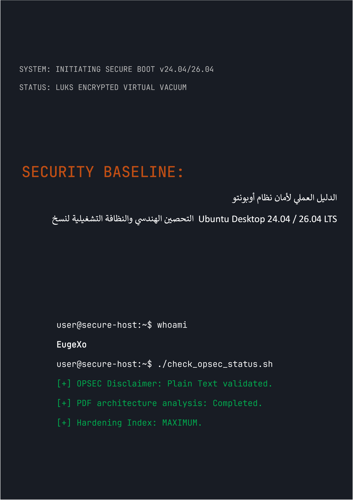

<div align="center">

# Security Baseline: الدليل العملي لأمان نظام أوبونتو

## التحصين الهندسي والنظافة التشغيلية لنسخ Ubuntu Desktop 24.04 / 26.04 LTS

### Written and published by EugeXo

</div>

---

<p align="center">
  
</p>

---

## هيكل الكتاب وملخصات موجزة

- [Security Baseline: الدليل العملي لأمان نظام أوبونتو](#security-baseline-الدليل-العملي-لأمان-نظام-أوبونتو)
  - [التحصين الهندسي والنظافة التشغيلية لنسخ Ubuntu Desktop 24.04 / 26.04 LTS](#التحصين-الهندسي-والنظافة-التشغيلية-لنسخ-ubuntu-desktop-2404--2604-lts)
    - [Written and published by EugeXo](#written-and-published-by-eugexo)
  - [هيكل الكتاب وملخصات موجزة](#هيكل-الكتاب-وملخصات-موجزة)
  - [شكر وتقدير](#شكر-وتقدير)
  - [تأمين صيغة النشر (إخلاء مسؤولية OPSEC)](#تأمين-صيغة-النشر-إخلاء-مسؤولية-opsec)
  - [كلمة المؤلف: لماذا ولمن كُتب هذا الكتاب؟](#كلمة-المؤلف-لماذا-ولمن-كُتب-هذا-الكتاب)
    - [حول منهجية العرض:](#حول-منهجية-العرض)
  - [المستوى الأساسي للحماية: 12 قاعدة للنظافة التشغيلية](#المستوى-الأساسي-للحماية-12-قاعدة-للنظافة-التشغيلية)
  - [مفاهيم مجهولية الهوية والخصوصية والأمان](#مفاهيم-مجهولية-الهوية-والخصوصية-والأمان)
  - [تثبيت نظام التشغيل Ubuntu 24.04/26.04 LTS](#تثبيت-نظام-التشغيل-ubuntu-24042604-lts)
    - [مقدمة:](#مقدمة)
    - [بروتوكول تجهيز العتاد الصلب (Hardware):](#بروتوكول-تجهيز-العتاد-الصلب-hardware)
    - [اختيار التوزيعة:](#اختيار-التوزيعة)
    - [خطوات اجتياز برنامج التثبيت خطوة بخطوة:](#خطوات-اجتياز-برنامج-التثبيت-خطوة-بخطوة)
  - [الإقلاع الأول للنظام](#الإقلاع-الأول-للنظام)
  - [إعدادات النظام الأساسية](#إعدادات-النظام-الأساسية)
  - [بدء العمل مع سطر الأوامر (Terminal)](#بدء-العمل-مع-سطر-الأوامر-terminal)
    - [الإعدادات الأولية:](#الإعدادات-الأولية)
      - [Gnome Terminal في Ubuntu 24.04:](#gnome-terminal-في-ubuntu-2404)
      - [Ptyxis في Ubuntu 26.04:](#ptyxis-في-ubuntu-2604)
    - [تعطيل التوصيل التلقائي للوسائط والإعدادات الاختيارية:](#تعطيل-التوصيل-التلقائي-للوسائط-والإعدادات-الاختيارية)
    - [حفظ سجل الأوامر في الطرفية (History):](#حفظ-سجل-الأوامر-في-الطرفية-history)
    - [ضبط مهلة الأمان لجلسة sudo:](#ضبط-مهلة-الأمان-لجلسة-sudo)
    - [إنشاء ملف للتحقق من فحوصات الأمان (Checks Passed):](#إنشاء-ملف-للتحقق-من-فحوصات-الأمان-checks-passed)
  - [إعداد الشبكة و VPN](#إعداد-الشبكة-و-vpn)
    - [للاتصال السلكي Ethernet (Wired connection):](#للاتصال-السلكي-ethernet-wired-connection)
    - [للاتصال اللاسلكي Wi-Fi (Wireless connection):](#للاتصال-اللاسلكي-wi-fi-wireless-connection)
      - [الإعداد لجهاز كمبيوتر أو لابتوب حقيقي (التعشية الكاملة لـ MAC):](#الإعداد-لجهاز-كمبيوتر-أو-لابتوب-حقيقي-التعشية-الكاملة-لـ-mac)
      - [الإعداد للآلة الافتراضية (التمويه الصارم كعتاد حقيقي - Strict Spoofing):](#الإعداد-للآلة-الافتراضية-التمويه-الصارم-كعتاد-حقيقي---strict-spoofing)
    - [تحصين NetworkManager: قمع تسريبات mDNS و LLMNR واسم المضيف وحماية DNS:](#تحصين-networkmanager-قمع-تسريبات-mdns-و-llmnr-واسم-المضيف-وحماية-dns)
    - [وضع Wi-Fi في حالة تعطيل كامل عند الإقلاع:](#وضع-wi-fi-في-حالة-تعطيل-كامل-عند-الإقلاع)
    - [إزالة مكونات Bluetooth المُعرّضة للاختراق:](#إزالة-مكونات-bluetooth-المُعرّضة-للاختراق)
    - [إعداد اتصال VPN:](#إعداد-اتصال-vpn)
  - [تأمين وتحصين محمّل الإقلاع GRUB](#تأمين-وتحصين-محمّل-الإقلاع-grub)
    - [تعيين كلمة مرور لحماية GRUB:](#تعيين-كلمة-مرور-لحماية-grub)
    - [التحصين البرمجي لـ IOMMU: حماية ذاكرة RAM من هجمات DMA على مستوى النواة:](#التحصين-البرمجي-لـ-iommu-حماية-ذاكرة-ram-من-هجمات-dma-على-مستوى-النواة)
  - [خيارات إعداد جدار الحماية UFW مع Kill Switch وبدونه](#خيارات-إعداد-جدار-الحماية-ufw-مع-kill-switch-وبدونه)
    - [إعداد جدار الحماية مع Kill Switch:](#إعداد-جدار-الحماية-مع-kill-switch)
    - [إضافة هامة حول إدارة أولوية القواعد:](#إضافة-هامة-حول-إدارة-أولوية-القواعد)
    - [الخيار البديل للإعداد (بدون استخدام VPN / للأنظمة الضيفة):](#الخيار-البديل-للإعداد-بدون-استخدام-vpn--للأنظمة-الضيفة)
  - [ضبط نواة النظام وتحديد صلاحيات الوصول وإزالة الخدمات غير الضرورية](#ضبط-نواة-النظام-وتحديد-صلاحيات-الوصول-وإزالة-الخدمات-غير-الضرورية)
    - [حماية مكدس الشبكة ونظام الذاكرة الفرعي للنواة:](#حماية-مكدس-الشبكة-ونظام-الذاكرة-الفرعي-للنواة)
    - [التحصين منخفض المستوى لـ sysctl: الحماية من بصمة TCP Timestamp Fingerprinting:](#التحصين-منخفض-المستوى-لـ-sysctl-الحماية-من-بصمة-tcp-timestamp-fingerprinting)
    - [حظر بروتوكولات الشبكة النادرة وأنظمة الملفات القديمة:](#حظر-بروتوكولات-الشبكة-النادرة-وأنظمة-الملفات-القديمة)
    - [تقييد صلاحيات الوصول في نظام الملفات:](#تقييد-صلاحيات-الوصول-في-نظام-الملفات)
    - [التوصيل الآمن للذاكرة المشتركة (Shared Memory):](#التوصيل-الآمن-للذاكرة-المشتركة-shared-memory)
      - [الوضع المتوازن (مُوصى به للاستخدام اليومي على سطح المكتب):](#الوضع-المتوازن-مُوصى-به-للاستخدام-اليومي-على-سطح-المكتب)
      - [وضع البارانويا (العزل الأقصى):](#وضع-البارانويا-العزل-الأقصى)
    - [إنشاء قرص RAM معزول للسجلات المتطايرة (Volatile Logs):](#إنشاء-قرص-ram-معزول-للسجلات-المتطايرة-volatile-logs)
    - [قطع تدفق الفيديو وتسجيل الصوت:](#قطع-تدفق-الفيديو-وتسجيل-الصوت)
    - [إزالة خدمات الطباعة واكتشاف موارد الشبكة المحلية:](#إزالة-خدمات-الطباعة-واكتشاف-موارد-الشبكة-المحلية)
    - [تمويه الموقع الجغرافي والمنطقة الزمنية:](#تمويه-الموقع-الجغرافي-والمنطقة-الزمنية)
  - [إعداد المستودعات وتحديث النظام](#إعداد-المستودعات-وتحديث-النظام)
    - [تحديث النظام:](#تحديث-النظام)
    - [نشر البيئة الرسومية لبطاقات NVIDIA في وضع العزل:](#نشر-البيئة-الرسومية-لبطاقات-nvidia-في-وضع-العزل)
  - [بيئات الطرفية (Terminal) في Ubuntu:](#بيئات-الطرفية-terminal-في-ubuntu)
    - [استبدال Gnome Terminal و Ptyxis بطرفية Ghostty](#استبدال-gnome-terminal-و-ptyxis-بطرفية-ghostty)
      - [التثبيت لمستخدمي Ubuntu 24.04 LTS Noble Numbat:](#التثبيت-لمستخدمي-ubuntu-2404-lts-noble-numbat)
      - [التثبيت لمستخدمي Ubuntu 26.04 LTS Resolute Racoon:](#التثبيت-لمستخدمي-ubuntu-2604-lts-resolute-racoon)
      - [نموذج إعدادات Ghostty لنسخ Ubuntu 24.04/26.04:](#نموذج-إعدادات-ghostty-لنسخ-ubuntu-24042604)
    - [خيار إضافي! Ubuntu 26.04 — استعادة Gnome Terminal وإزالة Ptyxis:](#خيار-إضافي-ubuntu-2604--استعادة-gnome-terminal-وإزالة-ptyxis)
  - [إزالة وحظر Snap والقياس عن بُعد (Telemetry)](#إزالة-وحظر-snap-والقياس-عن-بُعد-telemetry)
    - [إزالة Snap:](#إزالة-snap)
    - [استئصال القياس عن بُعد (Telemetry) الخاص بـ Canonical:](#استئصال-القياس-عن-بُعد-telemetry-الخاص-بـ-canonical)
    - [تعطيل متعقب البرامج الثابتة في الخلفية fwupd:](#تعطيل-متعقب-البرامج-الثابتة-في-الخلفية-fwupd)
  - [تثبيت أدوات الأمان libpam-tmpdir و debsums وأداة مراقبة الحمل Btop](#تثبيت-أدوات-الأمان-libpam-tmpdir-و-debsums-وأداة-مراقبة-الحمل-btop)
    - [أداة الأمان libpam-tmpdir:](#أداة-الأمان-libpam-tmpdir)
    - [أداة debsums:](#أداة-debsums)
    - [أداة مراقبة موارد النظام المريحة Btop:](#أداة-مراقبة-موارد-النظام-المريحة-btop)
    - [مراقبة منافذ الشبكة والاتصالات:](#مراقبة-منافذ-الشبكة-والاتصالات)
  - [إنشاء نقاط استعادة مرجعية: نشر وضبط أداة Timeshift](#إنشاء-نقاط-استعادة-مرجعية-نشر-وضبط-أداة-timeshift)
    - [مقدمة:](#مقدمة-1)
    - [خصائص عمل Timeshift في البيئة المشفرة (LUKS + GRUB):](#خصائص-عمل-timeshift-في-البيئة-المشفرة-luks--grub)
    - [التثبيت الآمن لـ Timeshift:](#التثبيت-الآمن-لـ-timeshift)
    - [الإعداد الأولي وإنشاء اللقطة رقم 1 (المرجع المعقم):](#الإعداد-الأولي-وإنشاء-اللقطة-رقم-1-المرجع-المعقم)
    - [مسار التحكم المستقبلي: إنشاء اللقطة رقم 2 (ما قبل التشغيل):](#مسار-التحكم-المستقبلي-إنشاء-اللقطة-رقم-2-ما-قبل-التشغيل)
    - [بروتوكول الاسترجاع الطارئ (في حال اختراق النظام أو تعطله):](#بروتوكول-الاسترجاع-الطارئ-في-حال-اختراق-النظام-أو-تعطله)
  - [تثبيت نسخة .deb النظيفة من Firefox وإزالة حزمة Snap الوهمية](#تثبيت-نسخة-deb-النظيفة-من-firefox-وإزالة-حزمة-snap-الوهمية)
  - [تثبيت وضبط إعدادات الخصوصية في Mozilla Firefox](#تثبيت-وضبط-إعدادات-الخصوصية-في-mozilla-firefox)
    - [تهيئة النظام للإعداد:](#تهيئة-النظام-للإعداد)
    - [الإعداد الرسومي الأولي للخصوصية (إلزامي للجميع):](#الإعداد-الرسومي-الأولي-للخصوصية-إلزامي-للجميع)
    - [ضبط مزودي DNS الخاصين (DNS over HTTPS):](#ضبط-مزودي-dns-الخاصين-dns-over-https)
    - [أتمتة التحصين: إنشاء ملف الإعدادات user.js:](#أتمتة-التحصين-إنشاء-ملف-الإعدادات-userjs)
    - [نشر إضافات الحماية القصوى:](#نشر-إضافات-الحماية-القصوى)
  - [تثبيت وضبط جدار الحماية الشبكي التفاعلي Portmaster](#تثبيت-وضبط-جدار-الحماية-الشبكي-التفاعلي-portmaster)
    - [مقدمة:](#مقدمة-2)
    - [التجهيز والتهيئة الأولية للنواة والترقية إلى الإصدار الجديد:](#التجهيز-والتهيئة-الأولية-للنواة-والترقية-إلى-الإصدار-الجديد)
  - [التدمير المضمون للبيانات وتعقيم الأثر الرقمي](#التدمير-المضمون-للبيانات-وتعقيم-الأثر-الرقمي)
    - [مقدمة:](#مقدمة-3)
    - [تشريح الأثر الرقمي: لماذا لا يكفي حذف البيانات دون تنظيف البيانات الوصفية (Metadata)؟](#تشريح-الأثر-الرقمي-لماذا-لا-يكفي-حذف-البيانات-دون-تنظيف-البيانات-الوصفية-metadata)
    - [تثبيت وتنظيف البيانات الوصفية باستخدام أداة MAT2:](#تثبيت-وتنظيف-البيانات-الوصفية-باستخدام-أداة-mat2)
    - [الحذف الآمن والنهائي للملفات والمجلدات:](#الحذف-الآمن-والنهائي-للملفات-والمجلدات)
    - [معاملات عمل أداة shred:](#معاملات-عمل-أداة-shred)
    - [المسح الشامل للمساحة الحرة على القرص:](#المسح-الشامل-للمساحة-الحرة-على-القرص)
  - [الإخفاء (Steganography) والتعتيم (Obfuscation) وطمس الآثار في Ubuntu](#الإخفاء-steganography-والتعتيم-obfuscation-وطمس-الآثار-في-ubuntu)
    - [مقدمة:](#مقدمة-4)
    - [الإخفاء في نظام Linux: دسّ الملفات داخل محتوى الوسائط:](#الإخفاء-في-نظام-linux-دسّ-الملفات-داخل-محتوى-الوسائط)
    - [أداة سطر الأوامر steghide:](#أداة-سطر-الأوامر-steghide)
    - [التمويه عبر الأداة المتقدمة StegoForge:](#التمويه-عبر-الأداة-المتقدمة-stegoforge)
    - [دمج الأرشيفات (حيلة سريعة بدون برامج خارجية):](#دمج-الأرشيفات-حيلة-سريعة-بدون-برامج-خارجية)
    - [تعتيم النصوص: تجاوز أنظمة الفحص الآلي (DPI):](#تعتيم-النصوص-تجاوز-أنظمة-الفحص-الآلي-dpi)
    - [تحليل التهديدات الخفية: تمويه امتدادات الملفات (هجمات BiDi):](#تحليل-التهديدات-الخفية-تمويه-امتدادات-الملفات-هجمات-bidi)
  - [تثبيت وضبط حزمة التشفير VeraCrypt](#تثبيت-وضبط-حزمة-التشفير-veracrypt)
    - [مقدمة حول VeraCrypt وتثبيته:](#مقدمة-حول-veracrypt-وتثبيته)
      - [التثبيت عبر مستودع PPA المجتمعي:](#التثبيت-عبر-مستودع-ppa-المجتمعي)
      - [تثبيت الحزمة الرسمية (الطريقة الأصلية - Native):](#تثبيت-الحزمة-الرسمية-الطريقة-الأصلية---native)
    - [الضبط العميق للأمان: حماية المفاتيح في RAM (وضع البارانويا):](#الضبط-العميق-للأمان-حماية-المفاتيح-في-ram-وضع-البارانويا)
    - [أداة أمن معلومات جوهرية: إنشاء وحدات التخزين المخفية (Hidden Volume):](#أداة-أمن-معلومات-جوهرية-إنشاء-وحدات-التخزين-المخفية-hidden-volume)
    - [التحصين الأقصى: ضبط PIM وملفات المفاتيح المادية:](#التحصين-الأقصى-ضبط-pim-وملفات-المفاتيح-المادية)
    - [نموذج التهديدات في العالم الحقيقي: لماذا يجب أن تكون البارانويا ممنهجة:](#نموذج-التهديدات-في-العالم-الحقيقي-لماذا-يجب-أن-تكون-البارانويا-ممنهجة)
  - [استخدام مفاتيح الأمان المادية Yubico](#استخدام-مفاتيح-الأمان-المادية-yubico)
    - [مقدمة:](#مقدمة-5)
    - [التثبيت:](#التثبيت)
    - [تطبيق تسجيل الخروج المادي / Kill Switch عبر قواعد udev للنواة:](#تطبيق-تسجيل-الخروج-المادي--kill-switch-عبر-قواعد-udev-للنواة)
  - [تثبيت وضبط USBGuard](#تثبيت-وضبط-usbguard)
    - [مقدمة:](#مقدمة-6)
    - [التثبيت والإعداد:](#التثبيت-والإعداد)
  - [تطبيق زر الذعر الطارئ (Emergency Panic Button) للإغلاق الفوري](#تطبيق-زر-الذعر-الطارئ-emergency-panic-button-للإغلاق-الفوري)
    - [Kill Switch مادي طارئ عبر أي جهاز USB:](#kill-switch-مادي-طارئ-عبر-أي-جهاز-usb)
  - [تثبيت مدير كلمات المرور المحلي KeePassXC](#تثبيت-مدير-كلمات-المرور-المحلي-keepassxc)
    - [مقدمة:](#مقدمة-7)
    - [سيناريوهات حماية الخزنة:](#سيناريوهات-حماية-الخزنة)
    - [تثبيت الحزمة البرمجية:](#تثبيت-الحزمة-البرمجية)
    - [إنشاء قاعدة البيانات وحمايتها عتادياً:](#إنشاء-قاعدة-البيانات-وحمايتها-عتادياً)
    - [التحصين العميق للإعدادات الداخلية للأمان:](#التحصين-العميق-للإعدادات-الداخلية-للأمان)
    - [الإدخال الآمن للبيانات عبر الحافظة المحمية:](#الإدخال-الآمن-للبيانات-عبر-الحافظة-المحمية)
  - [تثبيت وتشغيل محلل الشبكات Wireshark](#تثبيت-وتشغيل-محلل-الشبكات-wireshark)
    - [مقدمة:](#مقدمة-8)
    - [تثبيت وتشغيل Wireshark:](#تثبيت-وتشغيل-wireshark)
    - [مفهوم أمني بالغ الأهمية لنظام التقاط الحزم:](#مفهوم-أمني-بالغ-الأهمية-لنظام-التقاط-الحزم)
    - [الجمع الخفي لتفريغات حركة المرور (وضع سطر الأوامر):](#الجمع-الخفي-لتفريغات-حركة-المرور-وضع-سطر-الأوامر)
    - [دليل عملي لاستخدام Wireshark:](#دليل-عملي-لاستخدام-wireshark)
  - [تثبيت وإدارة نظام الحماية AppArmor](#تثبيت-وإدارة-نظام-الحماية-apparmor)
    - [مقدمة:](#مقدمة-9)
    - [النموذج الأمني الجديد: أتمتة النواة:](#النموذج-الأمني-الجديد-أتمتة-النواة)
    - [التحصين العملي لنظام AppArmor:](#التحصين-العملي-لنظام-apparmor)
  - [تثبيت وضبط البيئات المعزولة (Sandboxes) Firejail و Bubblewrap](#تثبيت-وضبط-البيئات-المعزولة-sandboxes-firejail-و-bubblewrap)
    - [مقدمة:](#مقدمة-10)
    - [تثبيت Firejail وتجهيز البيئة المعزولة:](#تثبيت-firejail-وتجهيز-البيئة-المعزولة)
    - [معاملات التصفية الأساسية في Firejail (مرجع):](#معاملات-التصفية-الأساسية-في-firejail-مرجع)
    - [اختياري! أتمتة المحيط الأمني لـ Firejail (أداة Firecfg):](#اختياري-أتمتة-المحيط-الأمني-لـ-firejail-أداة-firecfg)
    - [تثبيت Bubblewrap:](#تثبيت-bubblewrap)
    - [ورقة غش لأعلام Bubblewrap (مرجع):](#ورقة-غش-لأعلام-bubblewrap-مرجع)
    - [تجهيز اختصارات مخصصة للبيئات المعزولة:](#تجهيز-اختصارات-مخصصة-للبيئات-المعزولة)
    - [إنشاء ملف تعريف مستقل لـ Firefox hardened في Firejail:](#إنشاء-ملف-تعريف-مستقل-لـ-firefox-hardened-في-firejail)
    - [إنشاء ملف تعريف لـ Firefox hardened في Bubblewrap:](#إنشاء-ملف-تعريف-لـ-firefox-hardened-في-bubblewrap)
    - [غرفة محكمة الإغلاق لمستندات PDF: التشغيل الآمن للملفات في Firejail:](#غرفة-محكمة-الإغلاق-لمستندات-pdf-التشغيل-الآمن-للملفات-في-firejail)
    - [إغلاق عارض المستندات لقراءة PDF داخل Bubblewrap:](#إغلاق-عارض-المستندات-لقراءة-pdf-داخل-bubblewrap)
    - [عارض الصور Image Viewer لاستعراض الرسوميات في Firejail:](#عارض-الصور-image-viewer-لاستعراض-الرسوميات-في-firejail)
    - [تغليف عارض الصور Image Viewer داخل Bubblewrap:](#تغليف-عارض-الصور-image-viewer-داخل-bubblewrap)
    - [سيناريو عزل KeePassXC لـ Firejail:](#سيناريو-عزل-keepassxc-لـ-firejail)
    - [عزل KeePassXC عبر Bubblewrap:](#عزل-keepassxc-عبر-bubblewrap)
    - [تثبيت وعزل الحزمة المكتبية LibreOffice:](#تثبيت-وعزل-الحزمة-المكتبية-libreoffice)
    - [ضبط عمل LibreOffice عبر Firejail:](#ضبط-عمل-libreoffice-عبر-firejail)
    - [تغليف LibreOffice داخل Bubblewrap:](#تغليف-libreoffice-داخل-bubblewrap)
    - [تثبيت وعزل برنامج تحرير الصور GIMP:](#تثبيت-وعزل-برنامج-تحرير-الصور-gimp)
    - [ضبط عمل GIMP عبر Firejail:](#ضبط-عمل-gimp-عبر-firejail)
    - [ضبط عمل GIMP عبر Bubblewrap:](#ضبط-عمل-gimp-عبر-bubblewrap)
    - [تثبيت وعزل محرر الأكواد VS Codium (بيئة التطوير لكتابة البرامج):](#تثبيت-وعزل-محرر-الأكواد-vs-codium-بيئة-التطوير-لكتابة-البرامج)
    - [عزل VS Codium في Firejail:](#عزل-vs-codium-في-firejail)
    - [عزل VS Codium في Bubblewrap:](#عزل-vs-codium-في-bubblewrap)
    - [تثبيت وعزل الذكاء الاصطناعي المحلي LM Studio Bionic:](#تثبيت-وعزل-الذكاء-الاصطناعي-المحلي-lm-studio-bionic)
    - [تشغيل LM Studio عبر Firejail:](#تشغيل-lm-studio-عبر-firejail)
    - [تغليف LM Studio داخل Bubblewrap:](#تغليف-lm-studio-داخل-bubblewrap)
    - [ضبط الاتصالات الآمنة: العزل الإلزامي لتطبيقات المراسلة ومحيط التشفير (محيط OPSEC للمؤلف):](#ضبط-الاتصالات-الآمنة-العزل-الإلزامي-لتطبيقات-المراسلة-ومحيط-التشفير-محيط-opsec-للمؤلف)
    - [تثبيت وعزل Telegram Desktop:](#تثبيت-وعزل-telegram-desktop)
    - [حماية محيط Telegram عبر Firejail:](#حماية-محيط-telegram-عبر-firejail)
    - [عزل Telegram عبر Bubblewrap:](#عزل-telegram-عبر-bubblewrap)
    - [تثبيت وعزل Signal عبر Bubblewrap:](#تثبيت-وعزل-signal-عبر-bubblewrap)
    - [الأساس التشفيري للمضيف: توليد وحماية مفاتيح GnuPG وفق OPSEC:](#الأساس-التشفيري-للمضيف-توليد-وحماية-مفاتيح-gnupg-وفق-opsec)
    - [تثبيت وعزل عميل Jabber المسمى Psi+:](#تثبيت-وعزل-عميل-jabber-المسمى-psi)
    - [عزل PSI+ في Firejail:](#عزل-psi-في-firejail)
    - [عزل عميل Psi+ Jabber في البيئة المعزولة Bubblewrap:](#عزل-عميل-psi-jabber-في-البيئة-المعزولة-bubblewrap)
    - [تثبيت وعزل عميل البريد الإلكتروني Thunderbird (محيط المراسلات المشفرة):](#تثبيت-وعزل-عميل-البريد-الإلكتروني-thunderbird-محيط-المراسلات-المشفرة)
    - [عزل Thunderbird باستخدام Firejail:](#عزل-thunderbird-باستخدام-firejail)
    - [عزل Thunderbird عبر Bubblewrap:](#عزل-thunderbird-عبر-bubblewrap)
    - [وضع «البارانويا» المتقدم: Firejail مع حفظ الجلسة عبر Overlay:](#وضع-البارانويا-المتقدم-firejail-مع-حفظ-الجلسة-عبر-overlay)
  - [تثبيت Rkhunter والبحث عن الجذور الخفية (Rootkits)](#تثبيت-rkhunter-والبحث-عن-الجذور-الخفية-rootkits)
    - [تثبيت Chkrootkit كإضافة مكملة لـ Rkhunter:](#تثبيت-chkrootkit-كإضافة-مكملة-لـ-rkhunter)
  - [تثبيت وضبط ماسح الفيروسات ClamAV](#تثبيت-وضبط-ماسح-الفيروسات-clamav)
    - [مقدمة:](#مقدمة-11)
    - [تثبيت ClamAV:](#تثبيت-clamav)
    - [تحديث قواعد التوقيعات وتجاوز الحظر الشبكي:](#تحديث-قواعد-التوقيعات-وتجاوز-الحظر-الشبكي)
    - [تنظيم الفحص الشامل للنظام:](#تنظيم-الفحص-الشامل-للنظام)
    - [الفحص متعدد الخيوط (Hardening):](#الفحص-متعدد-الخيوط-hardening)
  - [تثبيت وضبط بيئة المحاكاة الافتراضية VirtualBox](#تثبيت-وضبط-بيئة-المحاكاة-الافتراضية-virtualbox)
    - [الحماية من التحليل الجنائي الرقمي: عزل سجلات VirtualBox في ذاكرة RAM (`tmpfs`):](#الحماية-من-التحليل-الجنائي-الرقمي-عزل-سجلات-virtualbox-في-ذاكرة-ram-tmpfs)
  - [ضغط وتحسين الأقراص الافتراضية VDI](#ضغط-وتحسين-الأقراص-الافتراضية-vdi)
    - [مقدمة:](#مقدمة-12)
    - [تنظيف الآلة الافتراضية العاملة بنظام Windows:](#تنظيف-الآلة-الافتراضية-العاملة-بنظام-windows)
    - [تنظيف الآلة الافتراضية العاملة بنظام Linux (Ubuntu/Kali Linux):](#تنظيف-الآلة-الافتراضية-العاملة-بنظام-linux-ubuntukali-linux)
    - [الضغط النهائي للقرص الافتراضي على الجهاز المضيف:](#الضغط-النهائي-للقرص-الافتراضي-على-الجهاز-المضيف)
  - [تثبيت وضبط نظام الحاويات Docker](#تثبيت-وضبط-نظام-الحاويات-docker)
    - [مقدمة:](#مقدمة-13)
    - [أين تكمن الخطورة الخفية في Docker الافتراضي؟](#أين-تكمن-الخطورة-الخفية-في-docker-الافتراضي)
    - [نشر Docker في وضع Rootless:](#نشر-docker-في-وضع-rootless)
    - [ترويض الشبكة وربطها بجدار الحماية UFW:](#ترويض-الشبكة-وربطها-بجدار-الحماية-ufw)
    - [مثال عملي للتشغيل الآمن للحاويات:](#مثال-عملي-للتشغيل-الآمن-للحاويات)
    - [إثبات تجريبي للأمان (التحقق من انعدام صلاحيات Root):](#إثبات-تجريبي-للأمان-التحقق-من-انعدام-صلاحيات-root)
  - [تثبيت وضبط نظام مراقبة سلامة الملفات AIDE](#تثبيت-وضبط-نظام-مراقبة-سلامة-الملفات-aide)
    - [مقدمة:](#مقدمة-14)
    - [تثبيت وضبط AIDE:](#تثبيت-وضبط-aide)
    - [إجراء اختبار الاختراق (التحقق من الحماية):](#إجراء-اختبار-الاختراق-التحقق-من-الحماية)
  - [التدقيق الأمني المؤتمت للنظام باستخدام Lynis](#التدقيق-الأمني-المؤتمت-للنظام-باستخدام-lynis)
  - [تثبيت وضبط ماسح الثغرات وتسريبات كلمات المرور Trivy](#تثبيت-وضبط-ماسح-الثغرات-وتسريبات-كلمات-المرور-trivy)
  - [ضبط أنظمة التشغيل الضيفة Ubuntu/Xubuntu/Lubuntu في VirtualBox](#ضبط-أنظمة-التشغيل-الضيفة-ubuntuxubuntulubuntu-في-virtualbox)
    - [تثبيت إضافات الضيف (Guest Additions):](#تثبيت-إضافات-الضيف-guest-additions)
    - [تثبيت Mozilla Firefox:](#تثبيت-mozilla-firefox)
    - [ضبط المجلدات المشتركة (Shared Folders) في VirtualBox:](#ضبط-المجلدات-المشتركة-shared-folders-في-virtualbox)
    - [تثبيت Ledger Live في VirtualBox مع Ubuntu/Xubuntu/Lubuntu](#تثبيت-ledger-live-في-virtualbox-مع-ubuntuxubuntulubuntu)
    - [تشغيل Ledger Live على نظام المضيف الأساسي Ubuntu](#تشغيل-ledger-live-على-نظام-المضيف-الأساسي-ubuntu)
  - [عن المؤلف والمعلومات القانونية](#عن-المؤلف-والمعلومات-القانونية)
    - [بيانات التواصل وموارد المجتمع:](#بيانات-التواصل-وموارد-المجتمع)

<br>
<br>
<br>
<br>
<br>
<br>
<br>

## شكر وتقدير

بكل بساطة ودون إطالة، أود أن أعرب عن امتناني العميق للأشخاص الذين دفعوني نحو تأليف هذا الكتاب وقدموا لي الدعم طوال هذه الرحلة.

أشكر الشباب البسطاء في قسم الأمن السيبراني التابع للشرطة في بلدنا الصغير والمتقدم تقنياً، إستونيا، الذين حفّزوني على كتابة هذا الدليل.

كما أتوجه بشكر خاص إلى خبراء أمن المعلومات في قسم جهاز الخدمة السرية الأمريكي (US Secret Service) في ميامي، الذين قدموا مساهمة عملية قيّمة في التحقق من صحة بعض الفصول. وكما اتضح، فإن الأساليب والمناهج الموضحة هنا تعمل بكفاءة عالية في الظروف الميدانية الحقيقية.

وبالطبع، أسمى آيات الشكر لعائلتي على صبرهم الاستثنائي ودعمهم المعنوي. وأخص بالذكر والدتي التي تعاملت مع عملي بتفهم كامل وتولت عبئاً هائلاً من المهام اليومية الروتينية، مما أتاح لي الوقت الكافي للبحث والتجريب.

**وأود بشكل منفصل أن أشكر صديقي من المملكة المتحدة على دعمه. كنا على تواصل وثيق عندما كنت في ميامي، ولكن للأسف انقطع الاتصال بيننا لاحقاً. آمل بصدق أن نلتقي مجدداً. يا صديقي، إذا كنت أنت أو ابنك المختص في أمن المعلومات تقرآن هذه السطور، يُرجى التواصل معي — بيانات الاتصال الخاصة بي مذكورة في نهاية الكتاب. أعتقد أنك فهمت *who is who!* ;)**

كما أعرب عن امتناني الذي لا يوصف لمساعدي الافتراضي — **Gemini من شركة Google**. طوال فترة العمل على هذا الكتاب، ظل رفيقاً رقمياً لا غنى عنه، مقدماً مساعدة لا تقدر بثمن في هيكلة وترجمة هذه المادة التقنية الدسمة.

وأشكر المساعد المرح والمتطور **ChatGPT من شركة OpenAI** على المساعدة في مناقشة الحلول التقنية، ومراجعة الإعدادات، فضلاً عن التحرير الدقيق لبعض فقرات النص والبحث عن صياغات أكثر دقة.

وبطبيعة الحال، يوجه الشكر في المقام الأول إلى مهندسي ومطوري Google و OpenAI على عملهم المتقن من الطراز الأول!

يمكنني الاسترسال في الكتابة طويلاً، لكن كل من ساهم في هذا العمل يدرك ذلك جيداً. يسعدني للغاية أن يرى هذا الكتاب النور أخيراً. يا رفاق، أكنّ لكم جميعاً كل الحب والتقدير والاحترام!

<br>

## تأمين صيغة النشر (إخلاء مسؤولية OPSEC)

لاعتبارات تتعلق بأمن المعلومات والمنطق السليم، يتم توفير كافة مواد هذا الدليل في الأصل بصيغة نص بسيط (Plain Text مع تنسيق Markdown). لقد تم رفض فكرة إصدار الكتاب بصيغة PDF عن وعي وقصد. فملفات PDF ذات بنية معمارية ضخمة وتتعرض للاختراق بشكل دوري. إن أمان الجهاز المضيف المراد حمايته يجب أن يبدأ من القراءة الآمنة لتعليمات إعداده.

يمثل الملف النصي بيانات نقية خالية من الشيفرات القابلة للتنفيذ، في حين تدعم صيغة PDF افتراضياً نصوص JavaScript البرمجية المدمجة، والعناصر الديناميكية، والنماذج التفاعلية، والخطوط المعقدة التي تتطلب تحليلاً عميقاً على مستوى النظام (System Parsing). وتُعد الثغرات الحرجة من فئة RCE (التنفيذ عن بُعد للشيفرة البرمجية) عبر محللات PDF في نظام Linux (مثل عارض النظام الافتراضي Evince أو مكتبات Poppler) حقيقة تاريخية مثبتة. أما صيغة Plain Text فلا تحتوي على آليات مدمجة لتنفيذ الشيفرات، وتقلل بشكل جوهري من سطح الهجوم (Attack Surface) أثناء قراءة المادة، مما يضمن قراءة آمنة في أي بيئة تشغيل.

لهذا السبب، تم فصل جميع المواد الرسومية والصور التوضيحية خارج النص الأساسي في مجلد مستقل. كما تم تنظيم الرسوميات في مجلدات ومجلدات فرعية، مما يمنع تصييرها (Rendering) تلقائياً في الذاكرة أثناء قراءة الكتاب.

> [!NOTE]
الصيغة المصدرية الأساسية للكتاب هي Markdown. ويتم توليد جميع الصيغ المشتقة (HTML و EPUB وغيرها) من المصدر النصي الموثق.

يمكن للقارئ استخدام المشروع بإحدى ثلاث طرق:

* قراءة ملفات Markdown المصدرية مباشرة.
* استخدام الحزم الجاهزة بصيغة HTML/EPUB (سيتم توفيرها لاحقاً).
* بناء الكتاب بنفسه من الملفات المصدرية، وتعديل التصميم أو الهيكل أو الخطوط أو الأنماط أو مجموعة الفصول المضمنة عند الحاجة.

يضمن هذا النهج شفافية النص، وسهولة تدقيق التغييرات، والاستقلالية التامة عن أي أداة قراءة محددة.

<br>

## كلمة المؤلف: لماذا ولمن كُتب هذا الكتاب؟

تزداد البيئة الرقمية الحديثة تعقيداً يوماً بعد يوم: يتصاعد عدد التهديدات السيبرانية، ويتضخم حجم البيانات التي يتم جمعها، ويجد المستخدم نفسه مضطراً بشكل متزايد إلى حماية خصوصيته وأمانه بنفسه.

أُنشئ هذا الكتاب ليكون دليلاً عملياً لبناء محطة عمل Linux خاضعة للسيطرة، حيث لا يُنظر إلى الأمان على أنه مجرد مجموعة من البرامج المنفصلة، بل كمنظومة متكاملة من الحلول المترابطة. هدفي هو توضيح كيف يمكننا، باستخدام الأدوات المتاحة في Linux، بناء بيئة عمل ذات نموذج تهديدات واضح: مع عزل التطبيقات، والتحكم في النشاط الشبكي، وحماية البيانات، والإدارة الواعية للمحيط الرقمي.

**هدف الكتاب — بناء محطة عمل يمتلك فيها كل إجراء محيطاً أمنياً خاضعاً للرقابة.**

أُعدّت هذه المادة لأغراض تعليمية، وهي موجهة للمستخدمين المؤهلين تقنياً، وعشاق نظام Linux، والمختصين المهتمين بأمن المعلومات العملي. لا يُعد هذا الدليل دورة تمهيدية في Linux، بل يفترض فهماً أساسياً للطرفية (Terminal)، ونظام الملفات، ومبادئ عمل نظام التشغيل. ومع ذلك، سيتمكن القارئ اليقظ والمتحمس من إتقان الأدوات اللازمة تدريجياً.

يجب استخدام جميع التقنيات الموصوفة حصرياً لأغراض مشروعة: لحماية بياناتك الخاصة، وتعزيز الأمان، ودراسة مبادئ أمن المعلومات.

إن الحماية الواعية للمعلومات والاستخدام المسؤول للتقنيات يجعلان البيئة الرقمية أكثر أماناً للجميع.

### حول منهجية العرض:

لا يهدف هذا الكتاب إلى تقديم موسوعة شاملة لكل أداة مستخدمة، بل إلى إبراز دورها ضمن نموذج حماية موحد. لذلك، يتم تناول البنية الداخلية وإمكانيات المكونات بالقدر اللازم فقط لفهم مبادئ عملها وتطبيقها بشكل آمن.

أما الوظائف المتقدمة، والصيغ الكاملة للأوامر (Syntax)، وسيناريوهات الاستخدام المتخصصة، فتظل خارج نطاق هذا الدليل ويمكن دراستها بشكل مستقل عبر الوثائق الرسمية.

<br>

## المستوى الأساسي للحماية: 12 قاعدة للنظافة التشغيلية

*Hello World يا رفيق!*

قبل أن ننتقل إلى الضبط التقني الصارم لنظامنا، دعنا نرسّخ الأساس. فيما يلي 12 قاعدة حديدية للنظافة التشغيلية (Operational Hygiene) يجب علينا حفظها عن ظهر قلب والالتزام بها دون أي تهاون. وبدون استيعابها، ستصبح أي أدوات حماية — مهما بلغ تطورها — عديمة الجدوى تماماً مع مرور الوقت:

1. **نستبعد الأجهزة الطرفية اللاسلكية قدر الإمكان داخل المحيط المؤمّن:** ويشمل ذلك تقنيات Bluetooth و Wireless (بما في ذلك سماعات الرأس، ولوحات المفاتيح، والفأرات اللاسلكية). فأي واجهة لاسلكية توسّع من سطح الهجوم وتفرض الثقة في مكدس البروتوكولات، والبرامج الثابتة (Firmware)، ومستوى تأمين الأجهزة.
2. **نضمن التشفير الكامل للقرص (Full Disk Encryption)** لوحدة التخزين الخاصة بالنظام أثناء مرحلة تثبيت نظام التشغيل. ونجعل طول كلمة المرور التشفيرية لا يقل عن 24 محرفاً عشوائياً (بما في ذلك الرموز الخاصة)!
3. **نجري تغييراً دورياً مجدولاً لكلمة مرور تسجيل الدخول إلى نظام التشغيل.** نجعل كلمة مرور المستخدم فريدة وطويلة بما فيه الكفاية (يُوصى بألا تقل عن 16 محرفاً). وعند استخدام مفاتيح الأمان المادية (Hardware Tokens)، فإنها لا تُغني عن كلمة المرور، بل تُضاف كعامل حماية إضافي.
4. **نُفعّل الحماية بكلمة مرور لمحمّل الإقلاع GRUB**، لمنع أي وصول غير مصرح به إلى معاملات النواة (Kernel Parameters) أو تعديل الإعدادات عند توفر الوصول المادي للجهاز.
5. **ندمج مفتاح أمان مادي** (YubiKey أو ما يماثله من البدائل الموثوقة) كعامل مصادقة ثنائية إلزامي (2FA) لتسجيل الدخول إلى النظام وتأكيد أوامر المستخدم الجذري (Superuser).
6. **نُنظّف النظام من أي برمجيات زائدة.** وينطبق هذا بشكل خاص على البرمجيات الاحتكارية مغلقة المصدر (Proprietary Software). تذكر القاعدة الأساسية: كلما قلّت الخدمات الخلفية والعمليات والبرامج في النظام، ضاق سطح الهجوم المحتمل وانخفض عدد الثغرات الحرجة.
7. **نُبقي نظام التشغيل محدّثاً باستمرار.** لنجعل من التحقق الدوري وتثبيت تحديثات الأمان قاعدة حديدية، مع تنفيذ المراقبة عبر أدوات سطر الأوامر.
8. **نراقب باستمرار حالة الشبكة وواجهاتها.** نولي اهتماماً دقيقاً للوجهات البعيدة التي تتم إليها الاتصالات في الخلفية وإلى أين تتجه حركة مرورنا الشبكية.
9. **نجري تدقيقاً داخلياً دورياً للجهاز المضيف (Host).** نفحص النظام بانتظام (يُفضّل 2–3 مرات أسبوعياً) للبحث عن الجذور الخفية (Rootkits) والفيروسات والتحقق من سلامة ملفات النظام.
10. **لا نشغّل أبداً أي ملفات تنفيذية مشبوهة في النظام الأساسي.** لاختبارها بأمان، نستخدم دائماً البيئة المعزولة `Firejail` أو الآلات الافتراضية (Virtual Machines).
11. **نُؤمّن حماية صارمة ضد هجمات الوصول المباشر للذاكرة الخطيرة (DMA) ونُقفل BIOS/UEFI بكلمة مرور:** في إعدادات BIOS/UEFI، نحول منافذ Thunderbolt/USB4 قسراً إلى وضع المصادقة القصوى (*Kernel DMA Protection*) لتقليل مخاطر الهجمات عبر وصول DMA للأجهزة الخارجية. ونضع كلمة مرور على BIOS/UEFI. بالإضافة إلى ذلك، نعطل وضع السكون (*Sleep Mode*) تماماً، لأن مفاتيح تشفير القرص تبقى في هذه الحالة مكشوفة في ذاكرة الوصول العشوائي (RAM).
12. **عند مغادرة مكان العمل ولو للحظة، نقفل الجلسة قسراً، وعند المغادرة لفترة طويلة — نغلق الجهاز بالكامل.**

> [!NOTE]
غالباً ما يظل العنصر الأضعف في أي منظومة أمنية هو تصرف المستخدم نفسه، وليس البرمجيات.

توجد في الأوساط المهنية عبارة ساخرة شهيرة: «الثغرة الأمنية الرئيسية تقبع بين الكرسي ولوحة المفاتيح».

لهذا السبب تحديداً، يجب أن يقترن التحصين التقني (Hardening) بالانضباط التشغيلي: فحص الملفات قبل فتحها، وإزالة البيانات الوصفية (Metadata) قبل النشر، ومراقبة النشاط الشبكي، والفهم المستمر لنموذج التهديدات الخاص بك.

## مفاهيم مجهولية الهوية والخصوصية والأمان

في الحديث اليومي، غالباً ما تختلط هذه المفاهيم ببعضها البعض، رغم أنها تصف مهاماً مختلفة تماماً.

**مجهولية الهوية (Anonymity)** تجيب عن سؤال: "هل يمكن ربط أفعالي بهويتي الحقيقية؟"
إذا كان النظام مثالياً، يرى الخصم الفعل نفسه، لكنه يعجز تماماً عن ربطه بشخص محدد في العالم الحقيقي.

**الخصوصية (Privacy)** تجيب عن سؤال: "هل أتحكم في نوع المعلومات التي تُجمع عني ولمن تصبح متاحة؟"
يعلم الخصم بوجود الشخص، لكن هذا الشخص هو من يتحكم في الجزء الذي يمكن تمريره من المعلومات إلى الخارج.

**الأمان (Security)** يجيب عن سؤال: "هل أستطيع حماية نظامي وبياناتي وجهازي من الوصول غير المصرح به؟"
يكون الشخص في حالة تأهب قصوى داخل محيطه الرقمي. قد يقف الخصم على البوابة مباشرة، لكنه لا يمتلك الإمكانيات الكافية لاختراق النظام وسرقة البيانات.

إن امتلاك حاسوب محمول مشفر بكلمة مرور قوية يرفع من مستوى الأمان. ولكن إذا قام المستخدم بنشر جميع بياناته الشخصية طواعية على الإنترنت، فإن ذلك لا يعزز الخصوصية. كما أن استخدام أدوات إخفاء الهوية قد يصعّب تحديد هوية المستخدم، لكنه لا يحمي النظام من البرمجيات الخبيثة. فالنظام المحمي جيداً قد لا يكون مجهول الهوية، والنظام مجهول الهوية قد يكون غير آمن.

إن هدف هذا الدليل ليس خلق وهم الحماية المطلقة أو الاختفاء التام على الشبكة. الهدف هو استعراض خيارات بناء نظام يدرك فيه المستخدم حجم المخاطر التي يقلصها، والقيود التي تظل قائمة.

## تثبيت نظام التشغيل Ubuntu 24.04/26.04 LTS

### مقدمة:

في هذا الفصل سنتناول تثبيت نظام التشغيل Ubuntu مع مراعاة متطلبات الأمان. كما يتضمن إمكانية نشر النظام على وحدات تخزين خارجية من نوع USB و Thunderbolt.

قبل البدء بالتثبيت، يجب أخذ عدة عوامل مهمة بعين الاعتبار. أحد أكثر المخاطر شيوعاً هو الاختيار الخاطئ للقرص لتثبيت محمّل الإقلاع (Bootloader).

في نظام Linux، يتولى محمّل الإقلاع GRUB (GRand Unified Bootloader) عادةً مسؤولية إقلاع النظام. وأثناء التثبيت، قد يتم وضعه على وحدة تخزين غير تلك التي خطط لها المستخدم، مثل وضعه على قسم EFI لقرص آخر. ونتيجة لذلك، قد يتوقف نظام التشغيل الحالي عن الإقلاع بشكل صحيح إلى حين استعادة محمّل الإقلاع.

لاستبعاد هذا السيناريو تماماً، فإن الطريقة الأكثر موثوقية هي فصل جميع أقراص HDD و SSD الداخلية التي لا تتعلق بالنظام قيد التثبيت فصلاً مادياً أثناء عملية تثبيت Linux.

بالنسبة لأجهزة الكمبيوتر المكتبية، يتطلب هذا عادةً الوصول إلى المكونات الداخلية ومفك براغي عادي فقط. أما في أجهزة اللابتوب، فتعتمد العملية على التصميم الهندسي للجهاز وقد تكون أكثر تعقيداً.

لا يُوصى باستخدام أجهزة Apple (خاصة أجهزة MacBook الحديثة المزودة بشريحة T2 ومعالجات Apple Silicon) لهذا السيناريو، نظراً لخصائص المنصة العتادية، وسلسلة الإقلاع، والتوافقية مع نظام Linux.

> [!NOTE]
تم اختبار هذا الدليل والتحقق منه بالكامل على نسختي **Ubuntu 24.04 LTS Noble Numbat (24.04.4)** و **Ubuntu 26.04 LTS Resolute Racoon (26.04.0)**.

أُجريت الاختبارات في بيئات **VirtualBox 7.2.x** و **VMware Workstation Pro 26H1**، وكذلك على أنظمة مادية حقيقية مزودة ببطاقات رسوميات مدمجة من Intel وبطاقات رسوميات منفصلة من NVIDIA.

### بروتوكول تجهيز العتاد الصلب (Hardware):

* **في الكمبيوتر المكتبي الثابت:** نزيل الغطاء الجانبي للصندوق، ونفصل التيار الكهربائي عن الجهاز بالكامل، ثم نفصل جميع وحدات التخزين باستثناء القرص الذي سيتم تثبيت نظام Linux عليه. في حال استخدام وحدات تخزين M.2 NVMe، سنحتاج إلى مفك براغي لإزالتها.

* **في جهاز اللابتوب:** نغلق الجهاز بالكامل، ونفصل مصدر الطاقة، وإذا أمكن، نفصل البطارية الداخلية. بعد إزالة الغطاء السفلي، نفصل أو نزيل جميع وحدات التخزين باستثناء القرص المستهدف.

إذا كان التثبيت سيتم على وحدة تخزين خارجية من نوع USB أو Thunderbolt، نُبقي عليها وحدها متصلة بالجهاز، حيث ستُستخدم كوسيط تخزين مستهدف لتثبيت النظام.

> [!WARNING]
قبل تثبيت نظام التشغيل، يجب الدخول إلى BIOS/UEFI والتحقق من إعدادات النظام الفرعي للرسوميات. في أجهزة اللابتوب المزودة برسوميات هجينة، يُوصى بتفعيل وضع Hybrid Mode/Optimus، حيث يتم تنفيذ العمل الأساسي للواجهة عبر المعالج الرسومي المدمج في وحدة المعالجة المركزية. يتيح ذلك استخدام تعريفات النواة مفتوحة المصدر في Linux (مثل i915 أو xe أو amdgpu حسب العتاد) وتجنب التبعيات الزائدة للمكونات مغلقة المصدر.

حيثما أمكن، نقوم بتعيين كلمة مرور لـ BIOS/UEFI ونُفعّل الحماية العتادية لوحدات التخزين (إذا كان طراز SSD/HDD يدعمها). يقلل هذا من خطر التعديل غير المصرح به لإعدادات الإقلاع ويُعقّد تنفيذ الهجمات التي تتطلب وصولاً مادياً للجهاز.

نتحقق من حالة Secure Boot. إذا كانت المنصة وسيناريو التثبيت المستخدم يدعمان عمله بشكل صحيح، أوصي بإبقاء هذه الميزة مفعّلة.

**نُبقي متصلاً في الكمبيوتر أو اللابتوب القرص الذي سيتم التثبيت عليه فقط.**

نجري تثبيت نظام Linux **بدون اتصال بالإنترنت** — نفصل كابل الشبكة LAN ولا نربط الجهاز بأي شبكات لاسلكية Wi-Fi. يتم تثبيت جميع الحزم والتحديثات اللازمة لاحقاً بعد الانتهاء من الضبط الأساسي للنظام.

لماذا يتم التثبيت بدون الاتصال بالإنترنت؟

يسمح التثبيت دون اتصال (Offline) بتقليص العوامل الخارجية إلى الحد الأدنى لحظة النشر الأولي للنظام:

* غياب أي اتصالات شبكية خارجية نشطة أثناء التثبيت؛
* استبعاد التحميل التلقائي للمكونات والتحديثات الخارجية قبل إتمام الضبط الأساسي؛
* تقليل عدد خدمات الشبكة والعمليات الخلفية التي قد تعمل أثناء مرحلة التثبيت؛
* سهولة التحكم في الحالة الأولية لنظام التشغيل ومعرفة المكونات التي تم تثبيتها منذ البداية؛
* تقليص نقاط التأثير الخارجية المحتملة إلى الحد الأدنى قبل إتمام التعزيز الأساسي لأمان النظام.

بعد الإعداد الأولي وتطبيق آليات الحماية، تتم إعادة الاتصال بالشبكة في بيئة خاضعة للرقابة الكاملة.

### اختيار التوزيعة:

سنطبق كافة الخطوات على مثال التوزيعات الحديثة **Ubuntu 24.04 LTS Noble Numbat** و **Ubuntu 26.04 LTS Resolute Racoon**. فهي سهلة الاستيعاب نسبياً، ولا تستهلك موارد ضخمة، وتعمل باستقرار حتى على أجهزة مزودة بـ 2 جيجابايت فقط من ذاكرة الوصول العشوائي (خاصة إذا اخترنا التوزيعات المشتقة خفيفة الوزن مثل Xubuntu أو Lubuntu). علاوة على ذلك، تحظى بدعم قوي من مجتمع Linux العالمي، والأهم من ذلك، أنها توفر مستوى أمان أساسي جيد مباشرة «خارج الصندوق» (Out of the box).

من الأفضل إجراء التثبيت باللغة الإنجليزية. ففي حال ظهور أخطاء غير متوقعة، سيكون من الأسهل بكثير البحث واستقاء المعلومات التقنية من المصادر المتخصصة الناطقة بالإنجليزية. ولكن مجدداً، هذا ليس أمراً إلزامياً بصرامة، ويبقى الخيار النهائي للغة النظام لك. أنا في دليلي هذا أستخدم الواجهة الإنجليزية — English (US، النسخة الأمريكية).

### خطوات اجتياز برنامج التثبيت خطوة بخطوة:

**1.** بعد اختيار اللغة، ننتقل إلى قائمة إعداد لوحة المفاتيح **«Select your keyboard»** ونختار **English (US)** أو أي تخطيط آخر يناسبك.

**2.** في نافذة الاتصال بالإنترنت، نختار بصرامة الخيار **«Do not connect to the internet»**.

**3.** بعد ذلك نختار الإعدادات **«Interactive Installation»** و **«Default selection»** — سيضمن هذا تثبيت الحد الأدنى من البرمجيات في النظام. وإذا احتجنا لاحقاً إلى أي حزم إضافية مثل التطبيقات المكتبية وغيرها، سنقوم بتحميلها بأنفسنا من المستودع الرسمي. وبشكل عام، عبر تقليص عدد التطبيقات الأولية، نقلل من عدد نواقل الهجوم (Attack Vectors) المحتملة من قبل المهاجمين.

**4.** في الخطوة التالية، وبالطبع، لا نقوم بتثبيت البرمجيات الاحتكارية (Proprietary Software).

**6.** **Ubuntu 24.04:** في قائمة **«Disk Setup»** نضغط على زر **«Advanced features...»** وهناك نختار البند **«Use LVM and encryption»**، ثم نؤكد الاختيار بالضغط على **«OK»** ونضغط **«Next»**.

**Ubuntu 26.04:** نترك الخيار الافتراضي **«Erase disk and install Ubuntu»** ونضغط **«Next»**.

**7.** **Ubuntu 24.04:** تطلب القائمة التالية إدخال كلمة المرور الرئيسية لتشفير القرص. نبتكر (ونحفظ جيداً) كلمة مرور معقدة لا يقل طولها عن 24 محرفاً (ويُفضل أكثر)، مستخدمين كافة إمكانيات لوحة المفاتيح المتاحة: الأحرف اللاتينية الكبيرة والصغيرة (A-Z, a-z)، والأرقام (0-9)، والرموز الخاصة، ومفتاح المسافة. نضغط **«Next»**.

**Ubuntu 26.04:** نختار **«Encryption with passphrase»** ونضغط **«Next»** وفي القائمة التالية ندخل كلمة المرور الرئيسية لتشفير القرص. نبتكر (ونحفظ جيداً) كلمة مرور معقدة لا يقل طولها عن 24 محرفاً (ويُفضل أكثر)، مستخدمين كافة إمكانيات لوحة المفاتيح المتاحة: الأحرف اللاتينية الكبيرة والصغيرة (A-Z, a-z)، والأرقام (0-9)، والرموز الخاصة، ومفتاح المسافة. نضغط **«Next»**.

**8.** بعد ذلك تظهر قائمة **«Create your account.»** في خانة **«Your name»** نكتب الاسم الذي اخترناه مسبقاً (نختار اسماً محايداً لا يكشف هويتنا الحقيقية، مثل `user`). في سطر **«Computer name»** نكتب اسماً عشوائياً للمضيف (مثل `host-node`)، ونختار اسم المستخدم في حقل **«Pick a username»** حسب رغبتنا. في خانة Choose password نبتكر كلمة مرور معقدة لا يقل طولها عن 16 محرفاً، مستخدمين الأحرف اللاتينية الكبيرة والصغيرة (A-Z, a-z)، والأرقام (0-9)، والرموز الخاصة، ومفتاح المسافة. نُبقي على خيار **«Require password to login»** ونضغط Next.
**9.** في القائمة التالية تظهر خريطة لاختيار المنطقة الزمنية. نختار أي قيمة (لاحقاً سيتم تغيير المنطقة الزمنية إلى UTC). ونضغط **«Next»**.

**10.** في النافذة النهائية، نتحقق من الإعدادات للتأكد من أننا لم ننسَ إزالة أو إضافة أي شيء، ثم نضغط على زر **«Install»**.

بعد ذلك يبدأ التثبيت والضبط التلقائي لنظام التشغيل. تتم العملية بسرعة كبيرة ولا تتطلب أي تدخل منا. وعند انتهاء التثبيت، سيطلب البرنامج إزالة وسيط التثبيت USB وإعادة تشغيل الجهاز. بهذا ينتهي التثبيت، ويمكننا إعادة توصيل جميع وحدات التخزين التي فُصلت مسبقاً إلى أماكنها.

> [!IMPORTANT]
يتوفر في نسخ Ubuntu 24.04/26.04 نهجان مختلفان جوهرياً لحماية البيانات على القرص: التشفير الكلاسيكي باستخدام عبارة مرور للمستخدم (Passphrase)، والتشفير المدعوم عتادياً مع فك القفل التلقائي عبر شريحة TPM. ورغم أن كلا النهجين يعتمدان على LUKS كأساس لتشفير القرص، إلا أن الاختلاف الجوهري يكمن في آلية الحصول على مفتاح فك التشفير.

في هذا الدليل، نستخدم عن وعي المخطط الكلاسيكي LVM + LUKS + عبارة مرور طويلة للمستخدم. يتوافق هذا مع نموذج التهديدات المعتمد، والذي يفرض على مالك الجهاز المصادقة الصريحة قبل فك قفل وحدة التخزين المشفرة.

هذا لا يعني أن TPM/FDE خيار «غير آمن». فهو مصمم لنموذج استخدام مختلف ويمتلك مزاياه الخاصة، بما في ذلك التحقق التلقائي من سلامة المنصة والحماية من هجمات معينة على سلسلة الإقلاع. ومع ذلك، في إطار هذا الدليل، لا يُستخدم فك القفل التلقائي للقرص من حيث المبدأ: وتُعطى الأولوية لمصادقة المستخدم عبر عبارة مرور LUKS طويلة.

وبالتالي، فإن اختيار LUKS الكلاسيكي في هذا الكتاب هو قرار واعٍ ضمن نموذج التهديدات المعلن، وليس ادعاءً بأن TPM/FDE غير آمن بشكل عام.

إن نهجي القائم على إنشاء كلمة مرور كلاسيكية معقدة يدوياً عبر LVM هو الأسلوب الوحيد الصحيح تقنياً من منظور أمن المعلومات لحماية البيانات ضد الوصول المادي لجهاز مغلق. فعند استخدام فك القفل التلقائي عبر TPM، تفقد عبارة مرور المستخدم دورها كعامل حماية رئيسي. في هذه الحالة، يعتمد الأمان على سلامة عمل المنصة الموثوقة، وحالة محمّل الإقلاع، والتنفيذ العتادي للنظام. إن الإدخال اليدوي لكلمة مرور LUKS طويلة يقضي تماماً على ناقل الاختراق الخطير هذا.

**ملحق الفصل:** *_assets\images\1_os_install*

## الإقلاع الأول للنظام

ندخل إلى النظام باستخدام كلمة مرور القرص المشفر وكلمة مرور حسابنا. ستُستخدم كلمة المرور هذه لاحقاً لتأكيد الإجراءات الإدارية عبر `sudo`. ستستقبلنا القائمة الترحيبية، نضغط **«Next»**.

في Ubuntu 26.04 ستكون القائمة التالية هي **«Location Services»**؛ افتراضياً يكون المفتاح في وضع الإيقاف، لذا ننقر على زر **«Next»**. في Ubuntu 24.04.4 هذه القائمة غير موجودة.

في Ubuntu 24.04، في القائمة التالية سيعرض النظام ربط اشتراك *Ubuntu Pro* — نضغط على زر **«Skip»** في الزاوية العلوية اليمنى. في Ubuntu 26.04.0 هذه القائمة غير موجودة.

في قائمة **Help improve Ubuntu** التي ستظهر، نختار/نُبقي إلزامياً على البند **«No, don't send system data»** (في 26.04 يوجد أيضاً خيار معطّل باسم Share error reports with the Ubuntu team، نتركه معطلاً) ونضغط **«Next»** حتى ظهور النافذة الختامية، ثم ننهي الإعداد بالنقر على زر **«Finish»**. في هذه المرحلة نكون قد عطّلنا إرسال البيانات التشخيصية وبيانات القياس عن بُعد (Telemetry) إلى Canonical.

> [!NOTE]
على الرغم من أننا ضغطنا على **«Skip»**، فإن شركة Canonical لا تزال تُبقي خدمات التحقق من الاشتراك نشطة في خلفية نظام التشغيل. لا بأس بذلك، سنقوم لاحقاً بحذف هذه المكونات يدوياً عبر الطرفية.

**ملحق الفصل:** *_assets\images\2_first_boot*

<br>

## إعدادات النظام الأساسية

على سطح المكتب، يوجد شريط المهام افتراضياً على اليسار — ويُسمى **«Dock»**. نضغط على الشعار الدائري للنظام في زاوية الشريط (**«Show Apps»**) ونختار البند **«Settings»** (يمكن أيضاً الدخول إلى الإعدادات عبر الشريط العلوي: ننقر على قائمة الحالة في الزاوية العلوية اليمنى ونضغط على أيقونة الترس لفتح **«Settings»**).

هنا، في قائمة إعدادات النظام، نحول مفتاحي **«Bluetooth»** و **«Wi-Fi»** إلى وضع الإيقاف. سيؤدي هذا إلى وضع الكمبيوتر في وضع الطيران «Airplane Mode» وتعطيل الواجهات اللاسلكية مؤقتاً إلى أن نقوم بضبط حظرها النهائي.

بعد ذلك، نُخصّص شريط **«Dock»** عبر قائمة **«Ubuntu Desktop»** بما يناسبنا. يمكننا مثلاً نقله إلى الأسفل باختيار **«Bottom»** في خانة **«Position on screen»**، وتعديل حجم الأيقونات **«Icon size»**. وإذا قمنا بتعطيل وضع ***«Panel Mode»***، سيصبح **«Dock»** أنيقاً وأكثر إحكاماً، مشابهاً لشريط المهام في macOS. بالإضافة إلى ذلك، ننظف الشريط من اختصارات التطبيقات الافتراضية غير الضرورية.

ننتقل إلى قسم **«Privacy & Security»**، ثم إلى القسم الفرعي **«Diagnostics»**/**«Telemetry»**. في سطر **«Problem Reporting»** للخيار **«Send error reports to Canonical»** نضبط القيمة بصرامة على **«Never»**.

نذهب إلى البند المجاور **«File History & Trash»**. هنا من الأهمية بمكان إيقاف ميزة **«File History»** تماماً. ونحول خياري **«Automatically Delete Trash Content»** و **«Automatically Delete Temporary Files»** إلى الوضع النشط مع تحديد المدة بـ **«1 day»**.

> [!IMPORTANT]
إن التفريغ التلقائي لسلة المهملات والذاكرة المؤقتة (Cache) هو مجرد نظافة سطحية أولية. يجب دائماً حذف الملفات السرية وكلمات المرور والسجلات يدوياً عبر الطرفية باستخدام أداة المستوى المنخفض `shred` (التي سنتحدث عنها بالتصيل لاحقاً)، مما يصعّب استعادتها من سطح وحدة التخزين بواسطة برامج التحليل الجنائي الرقمي (يجب مراعاة خصائص حذف البيانات حسب نوع وحدة التخزين المحدد. بالنسبة لأقراص HDD الميكانيكية يمكن استخدام `shred`، أما بالنسبة لأقراص SSD/NVMe الحديثة فإن النهج الأكثر موثوقية هو التشفير الكامل للقرص والتدمير الصحيح لمفاتيح التشفير).

في القسم الفرعي المجاور **«Location»** نتحقق من أن المفتاح في وضع **«Off»** — فلا داعي لأن يعرف نظام التشغيل موقعنا الجغرافي الفعلي.

في بند **«Screen Lock»** نضبط وظيفة الشاشة **«Blank Screen Delay»**؛ افتراضياً تكون مضبوطة على 5 دقائق، ولكن من أجل الأمان يُفضل ضبطها على 1–2 دقيقة. وهناك أيضاً نحول مفتاح **«Automatic Screen Lock»** إلى الوضع النشط. وفي نفس القسم ننتقل إلى البند **«Automatic Screen Lock Delay»** ونضبط القيمة على **«Screen Turns off»** أو 30 ثانية، وبحد أقصى دقيقة واحدة (عندها قبل إطفاء الشاشة ستخفت إضاءتها لمدة 30 ثانية أو دقيقة واحدة بالضبط). وهناك أيضاً نُفعّل خياري **«Lock Screen Notifications»** و **«Lock Screen on Suspend»**.

بعد ذلك، في بند **«Connectivity»** نعطّل **«Connectivity Checking»**، مما يقلل من عدد الفحوصات الشبكية التلقائية التي يجريها النظام في الخلفية.

بند **«Thunderbolt»**: إذا كنا لا نستخدم أي أجهزة على هذه الواجهة — نعطله.

في Ubuntu 26.04 ظهر في **«Privacy & Security»** بند **«Cameras»**؛ ندخل إليه ونحول المفتاح إلى وضع الإيقاف.

في قسم **«System»** ندخل إلى القسم الفرعي **«Date & Time»** لضبط وقت النظام. إذا كان النظام يُجهّز للعمل في ظروف مجهولية عالية عبر أنفاق VPN مشفرة أو شبكة Tor، نعطّل **«Automatic Date & Time»**. إذا كان النظام يُستخدم في سيناريوهات الخصوصية العالية، يمكن تعطيل المزامنة التلقائية للوقت وضبط المنطقة الزمنية يدوياً. لاحقاً في هذا الكتاب سيتم استخدام UTC كمعيار موحد للوقت.

في خانة **«Keyboard»** نضيف تخطيطات لوحة المفاتيح اللازمة. أما باقي تبويبات قائمة النظام فهي في الغالب ميزات بصرية وتخصيصات للمستخدم لن نتوقف عندها بالتفصيل.

في خانة **«Sound»** يُوصى بإيقاف الميكروفون بالضغط على الأيقونة الموجودة في بند **Input Volume**.

> [!NOTE]
يوجد في قائمة **«Privacy & Security»** في Ubuntu 24.04/26.04 قسم فرعي هام — **«Device Security»** (أمان الجهاز). يُعرض هناك بوضوح حالة الإقلاع الآمن **«Secure Boot»**. إذا كانت تضيء باللون الأخضر، فهذا يعني أن الإقلاع الآمن نشط. صُمم Secure Boot للتحقق من التوقيعات الرقمية لمكونات سلسلة الإقلاع، مما يسمح بالتأكد من أنه أثناء بدء التشغيل تُستخدم فقط المكونات الموثوقة أو الموقعة المتوافقة مع سياسة أمان UEFI.

إذا ظهرت هناك تحذيرات حول نواة غير محمية، فهذه إشارة مباشرة إلى أنه في BIOS/UEFI الخاص باللوحة الأم لم يتم تفعيل الميزات الأساسية للحماية العتادية للمضيف. وبدونها، تتراجع قيمة البيانات الموجودة على جهاز قيد التشغيل أو في وضع السكون بشكل حاد، حيث قد يحاول المهاجم الوصول إلى البيانات الموجودة في ذاكرة الوصول العشوائي، بما في ذلك مواد المفاتيح التشفيرية المحتملة.

بجوارها يوجد **«Checks Passed»**/**«Protected»**. بعد قليل سننشئ ملفاً نصياً لاستعراض السجلات في هذه القائمة.

**ملحق الفصل:** *_assets\images\3_system_settings*

## بدء العمل مع سطر الأوامر (Terminal)

### الإعدادات الأولية:

يتم تشغيل الطرفية للعمل عبر قائمة التطبيقات (**«Show Apps»**). وللوصول السريع والمريح إلى سطر الأوامر، يمكن تثبيت اختصار الطرفية على شريط **«Dock»**.

يعتمد نظام Ubuntu على توزيعة Debian ويستخدم نفس صيغة الحزم `.deb`. يتم تثبيت البرمجيات عبر مدير الحزم APT من مستودعات Ubuntu. وتُنفذ عمليات تثبيت وإدارة هذه الحزم باستخدام APT، بينما تُشغّل العمليات الإدارية عند الحاجة عبر `sudo`.

افتراضياً، بعد المصادقة الناجحة، يحتفظ `sudo` بنتيجتها لمدة 15 دقيقة. وخلال هذه الفترة، لن تتطلب الأوامر اللاحقة عبر `sudo` إعادة إدخال كلمة المرور. بالنسبة لنظام ذي متطلبات أمان عالية، نعتبر هذه المدة مفرطة، وفي نهاية الفصل سنقلصها إلى 0–2 دقيقة.

عند فتح نافذة الطرفية، يظهر سطر يحتوي على اسم المستخدم الحالي، واسم الشبكة للكمبيوتر، ومجلد العمل الحالي، وينتهي برمز الدولار **`$`**. يوضح هذا الرمز بصرياً أن الجلسة تعمل في وضع المستخدم العادي. ولتنفيذ معظم إجراءات الضبط، سيتعين إضافة البادئة `sudo` إلى الأوامر (مثلاً، `sudo apt update`).

للانتقال إلى الوضع التفاعلي الكامل للمستخدم الجذري `root`، تُستخدم الأوامر `sudo -i` أو `sudo -s`. يحاكي الأمر `sudo -i` تسجيلاً نظيفاً بالكامل لـ `root` مع تحميل متغيرات البيئة الخاصة به، بينما يشغّل `sudo -s` صدفة (Shell) `root` مع الاحتفاظ بمتغيرات البيئة الحالية للمستخدم العادي. للحصول على جلسة `root` كاملة لفترة قصيرة، يُفضل استخدام `sudo -i`. فعلى عكس `sudo -s`، يشغّل هذا الوضع صدفة تسجيل دخول (Login shell) ببيئة `root`، لذا من المريح استخدامه للعمليات الإدارية الطويلة. وفي العمل الاعتيادي، يُفضل تنفيذ الأوامر الفردية عبر `sudo` دون الانتقال إلى جلسة `root` دائمة بلا ضرورة.

بعد إدخال كلمة المرور بنجاح، سيتغير الرمز **`$`** في سطر الإدخال إلى علامة المربع **`#`**. يعني هذا أن النظام انتقل إلى وضع المستخدم الخارق (Superuser) بأقصى الصلاحيات الإدارية. هنا يتاح تعديل أي ملفات، بما في ذلك معاملات النواة، لذا يجب التصرف بحذر شديد.

> [!IMPORTANT]
إن حفظ الأوامر الأساسية لطرفية Linux سيجعل العمل مع النظام سريعاً ومريحاً.

#### Gnome Terminal في Ubuntu 24.04:

تتميز Terminal في Ubuntu 24.04 بسهولة تعديل الإعدادات البصرية «على ذوقك» مباشرة من القائمة. تتوفر هنا الشفافية (Transparency) وإمكانية ضبط التدرج اللوني المطلوب مع اختيار درجات الألوان وصولاً إلى Custom، مما يجعل العمل اللاحق في الطرفية مريحاً للغاية من الناحية الجمالية.

قبل بدء العمل الأساسي، نضبط المظهر الخارجي للطرفية. في الجزء العلوي الأيمن من النافذة، بجوار أيقونة العدسة المكبرة، نضغط على زر **«قائمة البرغر»** (ثلاثة خطوط أفقية) وندخل إلى قسم **«Preferences»**. في التبويب المفتوح **«Profiles»** نختار الملف الشخصي الافتراضي **«Unnamed»**. هنا يمكن تعديل الألوان والخطوط وأبعاد مساحة العمل وشفافية النافذة حسب الذوق.

العيب الوحيد هو اعتمادها على حزمة GTK3 الأقدم وافتقارها لبعض آليات العزل والأمان الحديثة المتاحة للتطبيقات المبنية على GTK4.

#### Ptyxis في Ubuntu 26.04:

قبل أن ننتقل إلى الاستخدام الدائم لـ Ptyxis، نضبطها لمزيد من الراحة. في الجزء العلوي الأيمن من النافذة، نضغط على زر **«قائمة البرغر»** (ثلاثة خطوط أفقية) وندخل إلى قسم **«Preferences»**. هنا نصل مباشرة إلى قائمة **«Appearance»**، حيث يُعرض علينا اختيار قالب جاهز لعملنا القادم. أولاً، أوصي بالتمرير لأسفل قليلاً وتعطيل مفتاح **«Use System Font»**، ثم اختيار حجم الخط المناسب. اختيار لوحات الألوان مُعد مسبقاً؛ في أعلى **«Appearance»** ننقر على القائمة المنسدلة **«Show All Palettes»** ونختار التدرج اللوني الأقرب إلى ذوقنا. ولإجراء ضبط أعمق للألوان والخطوط، سيتعين اللجوء إلى ملفات الإعدادات.

**نموذج ملف تعريف مخصص لـ Ptyxis**

**1.** نفتح الطرفية وننشئ مجلداً مع ملف التعريف المخصص:
```bash
mkdir -p ~/.local/share/org.gnome.Ptyxis/palettes && nano ~/.local/share/org.gnome.Ptyxis/palettes/my-homebrew.palette
```

**2.** نلصق الخلفية المعدلة ذات اللون الرمادي الداكن الفاتح قليلاً / الأزرق العميق لملف التعريف:
```ini
[Palette]
Name=My Homebrew

Foreground=#00ff00
Background=#171717 или #0b1020
Color0=#000000
Color1=#990000
Color2=#00a600
Color3=#999900
Color4=#0d0dbf
Color5=#b200b2
Color6=#00a6b2
Color7=#bfbfbf
Color8=#666666
Color9=#e50000
Color10=#00d900
Color11=#e5e500
Color12=#0000ff
Color13=#e500e5
Color14=#00e5e5
Color15=#e5e5e5

BellForeground=#00ff00
BellBackground=#171717 или #0b1020
RemoteForeground=#00ff00
RemoteBackground=#171717 или #0b1020
SuperuserForeground=#00ff00
SuperuserBackground=#171717 или #0b1020
```

لحفظ الإعدادات في محرر `nano`، نضغط على اختصار المفاتيح **«Ctrl + O»** ← **«Enter»**، ثم **«Ctrl + X»** للخروج.

**3.** نضيف شفافية خفيفة للنافذة. القيمة 0.00 تعني شفافية كاملة، و 1.00 تعني انعدام الشفافية تماماً. نختار القيمة الأنسب بأنفسنا:
```bash
gsettings set org.gnome.Ptyxis.Profile:/org/gnome/Ptyxis/Profiles/$PTYXIS_PROFILE/ opacity 0.95
```

بعد ذلك نغلق الطرفية ونشغلها مجدداً. يجب أن يظهر الملف الشخصي المُنشأ في قسم **«Palettes»**. عبر **«قائمة البرغر»** (ثلاثة خطوط أفقية) ننتقل إلى **«Preferences»** ← **«Appearance»** ← **«Show All Palettes»**، نجد ملف **«My Homebrew»** ونختاره.

> [!IMPORTANT]
من المهم أن نفهم أنه عند مقارنة Ptyxis و GNOME Terminal، يتوافق الأول بشكل أفضل مع نموذج الأمان المختار في هذا الكتاب بفضل الإمكانيات الإضافية لعزل بيئات العمل. لذلك، فإن استبدال Ptyxis بـ GNOME Terminal الأكثر ألفة يعني التخلي عن جزء من هذه الإمكانيات، ويُعد في سيناريو عملنا بمثابة حل وسط.

سنتناول أيضاً طرفية Ghostty لاحقاً كمحاكي طرفية بديل. وسنشرح بشكل منفصل تثبيتها وضبطها الأساسي، ليتمكن القارئ من مقارنتها بنفسه مع Ptyxis و GNOME Terminal واختيار الخيار الأنسب لنظامه.

### تعطيل التوصيل التلقائي للوسائط والإعدادات الاختيارية:

**1.** أول ما سنفعله هو إيقاف التوصيل التلقائي (Automount) لوحدات التخزين (يعطّل التوصيل التلقائي، لكنه لا يمنع المستخدم أو التطبيق من توصيل الوسيط يدوياً):
```bash
gsettings set org.gnome.desktop.media-handling automount false && gsettings set org.gnome.desktop.media-handling automount-open false
```

**2.** نضع نوافذ البرامج قيد التشغيل في منتصف الشاشة تماماً. في رأيي، العمل بهذه الطريقة أكثر راحة بكثير، خاصة في الآلات الافتراضية:
```bash
gsettings set org.gnome.mutter center-new-windows true
```

إذا لم يناسبك هذا التموضع للنوافذ لأي سبب، نفذ نفس الأمر مع استبدال القيمة `true` بـ `false`.

**3.** لكي لا نضيع الوقت في التنقل بين القوائم الرسومية، نعيد الاختصار الكلاسيكي المألوف للكثيرين لتبديل لغة لوحة المفاتيح عبر `Shift + Alt` بأمرين سريعين للنظام:
```bash
gsettings set org.gnome.desktop.input-sources xkb-options "['grp:alt_shift_toggle']" && gsettings set org.gnome.desktop.wm.keybindings switch-input-source "['<Shift>Alt_L', '<Alt>Shift_L']"
```

### حفظ سجل الأوامر في الطرفية (History):

افتراضياً، يحتفظ Bash بسجل الأوامر بحجم محدود: تُستبدل السجلات القديمة بمرور الوقت، وقد يؤدي فتح عدة طرفيات في وقت واحد إلى تضارب عند حفظ السجل. علاوة على ذلك، يُكتب السجل عادةً في الملف ليس بعد كل أمر، بل عند إغلاق الصدفة (Shell). وفي حال الإغلاق المفاجئ للنظام، قد لا تُسجّل الأوامر الأخيرة المنفذة في السجل، وهو أمر غير مرغوب فيه لسيناريو التدقيق الأمني الخاص بنا.

لنضبط Bash لحفظ سجل الأوامر بأقصى سرعة ممكنة ونزيد حجمه حتى لا نفقد البيانات حول الإجراءات المنفذة.

**1.** نفتح ملف الإعدادات `.bashrc` في المجلد الرئيسي (Home):
```bash
nano ~/.bashrc
```

**2.** ننتقل إلى نهاية الملف تماماً عبر **«Alt + /»** ونضيف الأسطر التالية:

```bash
# حجم لا نهائي للسجل
export HISTSIZE=-1
export HISTFILESIZE=-1

# كتابة فورية للأمر بعد الضغط على Enter
export PROMPT_COMMAND="history -a; $PROMPT_COMMAND"

# تجاهل التكرارات المتتالية فقط
export HISTCONTROL=ignoredups

# تسجيل التاريخ والوقت الدقيق للتنفيذ
export HISTTIMEFORMAT="%F %T "

# إضافة الأوامر إلى الملف بدلاً من الكتابة فوقه
shopt -s histappend
```

نحفظ الملف عبر **«Ctrl + O»** ← **«Enter»**، ثم **«Ctrl + X»**.

* `HISTSIZE=-1` و `HISTFILESIZE=-1` — يزيلان القيود تماماً عن عدد الأسطر.
* `history -a` — يحفظ الأمر قسراً على القرص فور إدخاله.
* `ignoredups` — يزيل تكرار نفس الأمر بشكل متتالٍ، لكنه لا يخفي الأوامر التي تبدأ بمسافة.
* `HISTTIMEFORMAT` — يثبّت الطوابع الزمنية (Timestamps)، وهو أمر حاسم للتحقيق في الحوادث.
* `shopt -s histappend` — يدمج السجلات من مختلف النوافذ المفتوحة بالتوازي.

**3.** نطبّق الإعدادات على الجلسة الحالية دون إعادة تشغيل الطرفية:
```bash
source ~/.bashrc
```

**4.** نتحقق من عمل التسجيل المحدّث:
```bash
history
```

الآن نحصل على تسلسل زمني متكامل ومحمِي من الفقدان مع الوقت الدقيق لتنفيذ كل أمر.

**5.** ننظف طرفيتنا من تكدس الأسطر:
```bash
clear
```

**6.** تحدث مواقف ندخل فيها عن طريق الخطأ بيانات حساسة في الطرفية أثناء العمل (مثل كلمة مرور أو رمز Token). لا يجوز تركها في السجلات. للمسح الدقيق لآخر أمر خاطئ نفذ:
```bash
history -d $(history | tail -n 1 | awk '{print $1}')
```

**7.** أما إذا تطلب الأمر مسح سجل الجلسة الحالية بالكامل وتحديث الملف على القرص، فنستخدم مزيجاً من أوامر المسح وإعادة الكتابة:
```bash
history -c && history -w
```
يمسح العلم `-c` السجل بالكامل في ذاكرة الوصول العشوائي للطرفية الحالية، بينما يكتب العلم `-w` قسراً هذه الحالة الفارغة في ملف السجل الخاص بنا، ماسحاً كافة السجلات السابقة.

حتى لو ضبطنا التسجيل الفوري واللانهائي للسجل، لا يزال بإمكان المستخدم العادي (أو المهاجم الذي حصل على وصول للجلسة) مسح ملف السجل يدوياً بالأمر `history -c && history -w` أو ببساطة حذفه عبر `rm ~/.bash_history`.

لن يفيد التغيير القياسي لصلاحيات الوصول عبر `chmod -w` هنا: فإذا منعنا الكتابة في الملف، لن تتمكن صدفة Bash من تسجيل الأوامر الجديدة إطلاقاً. نحتاج إلى جعل الملف قابلاً *للإضافة إليه فقط* (Append-only)، مع حظر *إعادة كتابته أو حذفه* بشكل قاطع.

لحل هذه المهمة، توجد في Linux سمات خاصة لنظام الملفات (`chattr`).

**8.** ننتقل إلى وضع المستخدم الخارق، حيث لا يمكن تغيير سمات ملفات النظام إلا بواسطة `root`:
```bash
sudo -i
```

**9.** نعيّن لملف السجل السمة الخاصة `+a` (append-only). ولكي لا ندخل اسم المستخدم يدوياً، نستخدم متغير النظام `$SUDO_USER`، الذي سيضع تلقائياً اسم مستخدمنا الأساسي، حتى ونحن داخل جلسة `root`:
```bash
chattr +a /home/$SUDO_USER/.bash_history
```

**10.** إذا احتجنا في المستقبل كمديري نظام إلى مسح هذا الملف أو تعديله قسراً، نزيل سمة الحماية بالأمر:
```bash
chattr -a /home/$SUDO_USER/.bash_history
```

بعد إجراء الصيانة، يجب حتماً إعادة السمة `+a` إلى مكانها.

> [!IMPORTANT]
لا تُعد سمة `append-only` حماية مطلقة. فالمستخدم الذي يمتلك صلاحيات `root` يمكنه في أي لحظة إزالتها وتعديل أو حذف ملف السجل. لذلك ننظر إلى هذا الإعداد كطبقة حماية إضافية، وليس كحماية غير قابلة للاختراق للسجل.

### ضبط مهلة الأمان لجلسة sudo:

لتغيير مدة صلاحية كلمة المرور في الطرفية قسراً، سننشئ ملف إعدادات معزولاً. لا يُوصى بتعديل ملف النظام الأساسي `/etc/sudoers` مباشرة، لتجنب إفساد الصيغة النحوية لإعدادات `sudo` عن طريق الخطأ وفقدان الوصول الإداري.

**1.** نفتح محرر النصوص `nano`، منشئين ملف إعدادات جديداً ومستقلاً:
```bash
nano /etc/sudoers.d/99_sudo_timeout
```

**2.** في الملف الفارغ المفتوح، يجب كتابة السطر التالي:
```ini
Defaults timestamp_timeout=2
```

تُوجّه القيمة `2` أداة `sudo` للاحتفاظ بنتيجة المصادقة الناجحة لمدة دقيقتين. وبعد انقضاء هذا الوقت، سيتطلب أمر `sudo` التالي إدخال كلمة المرور مجدداً. وعند الرغبة، يمكن وضع القيمة `0` هنا — عندها سيبدأ النظام بطلب كلمة المرور عند كل استدعاء لـ `sudo`، وهو خيار صارم لضبط الأمان للأجهزة المحمية.

لحفظ الإعدادات في محرر `nano`، نضغط على اختصار المفاتيح **«Ctrl + O»** ← **«Enter»**، ثم **«Ctrl + X»** للعودة إلى طرفية `root`.

**3.** نضبط صلاحيات ملف الإعدادات:
```bash
chmod 0440 /etc/sudoers.d/99_sudo_timeout
```

> [!WARNING]
قبل إغلاق الطرفية أو الخروج من وضع `root`، من الأهمية القصوى وبشكل إلزامي التحقق من صحة الصيغة النحوية للقاعدة التي أنشأناها بالأمر:
```bash
visudo -c
```
إذا أعاد النظام التقرير `...parsed OK`، فهذا يعني عدم وجود أخطاء وأن الإعدادات آمنة. أما إذا أظهرت الأداة خطأً نحوياً — فنفتح الملف فوراً عبر `nano` مجدداً ونصححه. وإلا، فبعد إغلاق الطرفية سنفقد الوصول الإداري إلى أداة `sudo`!

**ملاحظة من المؤلف:** تتحقق أداة `visudo` حصرياً من صحة الصيغة النحوية لملفات إعدادات نظام تحديد الصلاحيات `sudo` (أي الملف `/etc/sudoers` نفسه وأي قواعد فرعية في مجلد `/etc/sudoers.d/`). عند تعديل أي ملفات أخرى في النظام (سواء كانت إعدادات الشبكة، أو ملفات `user.js` في Firefox، أو قواعد جدار الحماية، أو معاملات GRUB) فلا داعي ولا معنى لاستدعاء `visudo -c` — فهي ببساطة لا تفحصها.

**4.** نخرج من وضع المستخدم الخارق عائدين إلى جلسة المستخدم العادي:
```bash
exit
```

**5.** وأيضاً حيلة مفيدة صغيرة للمستقبل. إذا أنهينا العمل في الطرفية وأردنا إلغاء رمز `sudo` النشط حالياً على الفور، دون انتظار انقضاء الدقيقتين تلقائياً، ننفذ الأمر:
```bash
sudo -k
```

يقوم الأمر `sudo -k` بإلغاء طابع المصادقة الحالي لـ `sudo` فوراً، لذا فإن الاستدعاء التالي لـ `sudo` سيتطلب كلمة المرور مجدداً.

### إنشاء ملف للتحقق من فحوصات الأمان (Checks Passed):

**1** ننشئ ملفاً للتحقق من قائمة **«Privacy & Security»** ← **«Device Security»** ← **Checks Passed**:
```bash
touch ~/Downloads/checks_passed.txt
```

**2.** نفتح الملف المُنشأ عبر محرر `nano`:
```bash
nano ~/Downloads/checks_passed.txt
```

**3.** ننقل المعلومات المنسوخة في الحافظة (Clipboard) إلى `checks_passed.txt`:
```ini
القيم المنسوخة في الحافظة (CLIPBOARD) الخاصة بنا
```

لحفظ الإعدادات في محرر `nano`، نضغط على اختصار المفاتيح **«Ctrl + O»** ← **«Enter»**، ثم **«Ctrl + X»** للخروج.

> [!NOTE]
يعتمد ضبط المعاملات المحددة التي لم تجتز الفحص على أهداف استخدام الكمبيوتر. على سبيل المثال، يعني **Intel GDS Mitigation: !Fail (Not Enabled)** أن آلية الحماية من ثغرة Gather Data Sampling (GDS) غير مفعّلة حالياً. قد يكون السبب هو حالة الشيفرة الدقيقة (Microcode)، أو النواة، أو إعدادات النظام. تفعيل الحماية في بعض السيناريوهات قد يقلل من الأداء، لذا ينبغي هنا الاسترشاد بطراز المعالج المحدد، وطبيعة الحمل، ونموذج التهديدات الخاص بك.

أما سطر Linux Swap: !Fail (Not Encrypted) فقد يبدو مقلقاً للوهلة الأولى. إذا كان ملف المبادلة (Swap) موجوداً داخل وحدة تخزين مشفرة بـ LUKS، فإن بياناته على القرص محمية بالتشفير أيضاً. لذلك، فإن هذه الحالة بحد ذاتها لا تعني أن محتوى Swap يُخزن بشكل مكشوف على وحدة التخزين المادية.

وللاحتياط، نتحقق من موقع Swap بالأمر:
```bash
swapon --show
```

إذا أشار المخرج إلى /swap.img، فهذا يعني أن Swap ممثل بملف عادي داخل نظام الملفات الجذري. في حالتنا، يقع نظام الملفات الجذري داخل وحدة تخزين مشفرة بـ LUKS، لذا فإن محتوى هذا الملف محمي بالتشفير أيضاً.

**ملحق الفصل:** *_assets\images\4_start_terminal*

## إعداد الشبكة و VPN

### للاتصال السلكي Ethernet (Wired connection):

دون توصيل الكابل، ننتقل إلى إعدادات النظام **«Settings»** ونختار قسم **«Network»**. نجد بند **«Wired»** ثم نضغط على أيقونة الترس **«Network Options»**. في النافذة التي ستظهر، ضمن تبويب **«Details»**، نزيل فوراً علامات التحديد من خياري **«Make available to other users»** و **«Connect automatically»**.

بعد ذلك ننتقل إلى تبويب **«Identity»**. في خانة **«MAC Address»** نختار واجهة الشبكة الحالية. سيُعرض بجانبها اسم واجهة الشبكة (مثل `enp0s1` أو `ens33` أو غيرهما) — يجب حفظه أو تدوينه، نظراً لأهميته البالغة في الإعدادات اللاحقة للشبكة وجدار الحماية (Firewall).

ننتقل إلى تبويب **«IPv4»**. هنا نحدد قسراً خادم DNS خاصاً بنا، لكي لا نستخدم خوادم DNS المقدمة من مزود خدمة الإنترنت. نحول مفتاح **«DNS»** من وضع **«Automatic»** إلى وضع **«Off»**، وكمثال نستخدم Quad9: `9.9.9.9` (والبديل: `149.112.112.112`). نكتب: 9.9.9.9, 149.112.112.112 مفصولة بفاصلة. يتيح هذا إخراج عملية تحليل أسماء النطاقات (DNS resolution) خارج البنية التحتية لمزود الخدمة.

في تبويب **«IPv6»** وفي حقل **«IPv6 Method»** نختار بصرامة القيمة **«Disable»**. بعد تنفيذ كافة هذه الخطوات، نضغط على زر **«Apply»**.

> [!IMPORTANT]
لنتذكر أن تعطيل IPv6 في الواجهة الرسومية يحمي ملف تعريف الشبكة المحدد هذا فقط. ولتقليل خطر تسرب عنوان IP الحقيقي عبر بروتوكول IPv6 (ثغرة IPv6 Leak) عند العمل مع أي نوع من شبكات VPN، سنقوم بعد قليل، في فصل الضبط الدقيق للنواة (`sysctl.conf`)، بتعطيل هذا البروتوكول قسراً على مستوى النظام بالكامل.

> [!NOTE]
**ملاحظة:** يمكن معرفة الاسم الدقيق لبطاقة الشبكة عبر الأمر `ip a`.

في خانة **«Cloned Address»** يمكن ضبط انتحال العنوان المادي (MAC). على سبيل المثال، إذا حددنا `08:00:27:E5:CA:C1`، فستتنكر عقدة الشبكة هذه بالكامل كآلة افتراضية من نوع VirtualBox. لكن الخيار الأكثر موثوقية للخصوصية اليومية هو اختيار القيمة **«Random»**. ستقوم القيمة **«Random»** بتوليد عنوان MAC جديد عند كل اتصال بملف التعريف. أما في حال كنا ننشر Ubuntu على آلة افتراضية (Virtual Machine)، فنترك خانة **«Cloned Address»** فارغة!

في نسخ Ubuntu 24.04/26.04، تُخزن ملفات تعريف الشبكة لـ NetworkManager عبر الواجهة الخلفية Netplan، لذلك عند الحاجة إلى ضبط مضمون لعنوان MAC، سنقوم بتعيين المعامل مباشرة عبر NetworkManager وإعداداته.

### للاتصال اللاسلكي Wi-Fi (Wireless connection):

**1.** أولاً، نستعرض اسم واجهة الشبكة ونحفظه أو ندونه (حيث سنحتاجه لاحقاً في الإعدادات):
```bash
ip a
```

بعد تنفيذ هذا الإجراء، ننتقل إلى جزء الفصل بعنوان **الإعداد لجهاز كمبيوتر أو لابتوب حقيقي (التعشية الكاملة لـ MAC)**، وننفذ التعليمات خطوة بخطوة ثم نعود إلى هذا الجزء من الفصل.

في (**«Show Apps»**) ننتقل إلى **«Settings»** وفي قسم **«Wi-Fi»** عند البند الذي يحمل نفس الاسم نحول المفتاح إلى الوضع النشط. بعد ذلك سنرى أدناه نقاط Wi-Fi النشطة أو النقطة المضبوطة لدينا فقط. ننقر عليها بالماوس. في نافذة المصادقة التي ستظهر نضغط **Cancel**، وبعدها ستظهر أيقونة الترس مقابل اسم الشبكة. أولاً، في تبويب **«Details»** نزيل علامات التحديد من خياري **«Make available to other users»** و **«Connect automatically»**.

بعد ذلك ننتقل إلى تبويب **«Identity»**. في خانة **«MAC Address»** نختار واجهة الشبكة الحالية وفي **«Cloned Address»** نضبط القيمة على **«Random»**.

ننتقل إلى تبويب **«IPv4»**. هنا نحدد قسراً خادم DNS خاصاً بنا، لكي لا نستخدم خوادم DNS المقدمة من مزود الخدمة. نحول مفتاح **«DNS»** من وضع **«Automatic»** إلى وضع **«Off»** وفي حقل الإدخال نكتب خوادم Quad9 الموثوقة التي لا تحتفظ بالسجلات: `9.9.9.9` (والبديل: `149.112.112.112`).

في تبويب **«IPv6»** وفي حقل **«IPv6 Method»** نختار بصرامة القيمة **«Disable»**.

ندخل إلى تبويب **«Security»** وفي الحقل ندخل ثمانية محارف عشوائية، وبعدها سيصبح زر **«Apply»** نشطاً، فنضغطه لتطبيق جميع الإعدادات دفعة واحدة. بشكل عام، يمكن إدخال كلمة المرور الحقيقية أيضاً: فلن يحدث اتصال بالشبكة على أي حال. لكننا نتبع نهج البارانويا الأمنية، لذا نحتاط وندخل كلمة المرور الحقيقية مباشرة قبل أول خروج للإنترنت لجلب التحديثات.

نعطّل Wi-Fi بتحويل المفتاح إلى الوضع غير النشط.

#### الإعداد لجهاز كمبيوتر أو لابتوب حقيقي (التعشية الكاملة لـ MAC):

بالنسبة للعتاد الحقيقي، الخيار الأمثل هو توليد عنوان MAC عشوائي جديد تماماً عند كل اتصال بالشبكة. تُعالج ملفات الإعدادات في `conf.d` بترتيب معجمي، لذا فإن الاسم `99-...` يتيح وضع معاملاتنا بعد ملفات الإعدادات القياسية وبالتالي رفع أولويتها.

**1.** ندخل إلى الطرفية بصلاحيات المستخدم الخارق:
```bash
sudo -i
```

**2.** ننشئ ملف إعدادات القواعد ذات الأولوية:
```bash
nano /etc/NetworkManager/conf.d/99-macrandom.conf
```

**3.** نُدرج في المحرر المفتوح كتلة المعاملات التالية التي تُفعّل التغيير التلقائي للعناوين:
```ini
[device]
wifi.scan-rand-mac-address = yes

[connection]
ethernet.cloned-mac-address = random
wifi.cloned-mac-address = random
```

لحفظ الإعدادات في محرر `nano`، نضغط على اختصار المفاتيح **«Ctrl + O»** ← **«Enter»**، ثم **«Ctrl + X»** للعودة إلى الطرفية.

**4.** نعيد تشغيل خدمة الشبكة للتطبيق الفوري للإعدادات:
```bash
systemctl restart NetworkManager
```
الآن، عند كل اتصال جديد بأي شبكة، سيقوم النظام بتوليد عنوان MAC عشوائي جديد.

**5.** بعد إعادة تشغيل خدمة الشبكة، نجري التحقق النهائي، حيث نستبدل `enp0s1` باسم واجهتنا:
```bash
ip link show enp0s1
```

> [!TIP]
لكي لا نكتب الاسم الكامل للواجهة يدوياً، يمكن تطبيق حيلة بسيطة: عند كتابة الأمر في الطرفية والحرف الأول من اسم الواجهة (للاتصالات السلكية يكون `e`، وللاسلكية `w`)، فعند الضغط على زر Tab سيقوم النظام تلقائياً بإكمال الاسم المطلوب.

في حال عمل كل شيء كما ينبغي، سنرى في السطر الأخير من المخرجات `link/ether "عنوان MAC المُولّد" brd ff:ff:ff:ff:ff:ff permaddr "عنوان MAC الحقيقي"`.

أُذكّر بأنه عند إعداد اتصال Wi-Fi نعود مجدداً إلى الخطوة التالية في قسم **للاتصال اللاسلكي Wi-Fi (Wireless connection)**.

#### الإعداد للآلة الافتراضية (التمويه الصارم كعتاد حقيقي - Strict Spoofing):

في البيئات الافتراضية على نسخ Ubuntu 24.04/26.04، يمنع الترابط بين Netplan و NetworkManager التغيير التلقائي لعنوان MAC عبر الواجهة الرسومية، ويعيده إلى بادئة المصنع الخاصة ببرنامج المحاكاة الافتراضية (مثل `00:0c:29:...` لـ VMware) عند كل إعادة تشغيل للمضيف. يكشف هذا فوراً استخدام آلة افتراضية (يكسر مجهولية الهوية).

لتمويه النظام إلى الأبد كعتاد مكتبي حقيقي والحفاظ على كامل وظائف الواجهة الرسومية، سنجبر نواة Linux نفسها على استبدال عنوان MAC قسراً في أبكر مرحلة من إقلاع نظام التشغيل عبر نص برمجي للأتمتة على مستوى النظام `rc.local`.

**1.** ندخل إلى الطرفية بصلاحيات المستخدم الخارق:
```bash
sudo -i
```

**2.** ننشئ النص البرمجي للنظام الخاص بالضبط منخفض المستوى للعتاد:
```bash
nano /etc/rc.local
```

**3.** نُدرج في المحرر المفتوح كتلة الأوامر التالية:
```bash
#!/bin/bash
# تمويه صارم وسلس لعنوان MAC على مستوى النواة عند بدء نظام التشغيل (نستبدل enp0s1 باسم واجهتنا)
ip link set dev enp0s1 down
ip link set dev enp0s1 address 28:80:8A:8F:32:7D # مثال لعنوان MAC
ip link set dev enp0s1 up
exit 0
```
لحفظ الملف في محرر `nano`، نضغط على اختصار المفاتيح **«Ctrl + O»** ← **«Enter»**، ثم **«Ctrl + X»** للعودة إلى الطرفية.

> [!NOTE]
تمنع نواة Linux تغيير عنوان MAC لبطاقة شبكة نشطة. لذلك يقوم النص البرمجي أولاً بإطفاء الواجهة لجزء من الثانية، ويستبدل العنوان بعنوان Intel «حقيقي»، ثم يعيد البطاقة فوراً إلى الحالة النشطة لتسليمها إلى مدير الشبكة الرسومي.

بدلاً من عنوان Intel، يمكننا كتابة أي عنوان MAC صالح آخر لعتاد مادي حقيقي:

* مثال لعنوان MAC: `00:E0:4C:A1:22:33` — التمويه كشريحة Realtek (البادئات `00:E0:4C`; `FC:93:4E`; `50:3E:AA`; `00:13:70`; `00:23:CD` إلخ)
* مثال لعنوان MAC: `04:92:26:BC:55:66` — التمويه كلابتوب ASUS (البادئات `04:92:26`; `04:D4:C4`; `04:D9:F5`; `08:60:6E`; `08:BF:B8` إلخ)
* مثال لعنوان MAC: `28:80:8A:8F:32:7D` — التمويه كشريحة Intel (البادئات `28:80:8A`; `28:7F:CF`; `28:7F:CF`; `28:C5:D2`; `14:85:7F` إلخ)
* مثال لعنوان MAC: `3C:50:02:DC:1E:55` — التمويه كلابتوب Apple (البادئات `3C:50:02`; `60:81:10`; `A4:83:E7`; `00:1C:B3`; `00:17:F2` إلخ)
* مثال لعنوان MAC: `00:14:22:F1:A8:D3` — التمويه كشريحة Dell (البادئات `00:14:22`; `00:15:C5`; `00:21:70`; `74:86:7A`; `D0:94:66` إلخ)

يمكن معرفة المزيد حول نطاقات عناوين MAC عبر الإنترنت!

**4.** نُحكم براغي الأمان **(حرج للغاية!)**. نجعل النص البرمجي المُنشأ قابلاً للتنفيذ على مستوى نظام التشغيل، وإلا ستتجاهله النواة عند الإقلاع:
```bash
chmod +x /etc/rc.local
```

**5.** نرسل الآلة الافتراضية إلى إعادة تشغيل نظيفة للتحقق من عمل الأتمتة:
```bash
reboot
```

**6.** بعد الإقلاع، نفتح الطرفية ونجري التحقق النهائي (حيث نستبدل `enp0s1` باسم واجهتنا):
```bash
ip link show enp0s1
```
في مخرجات الأمر، ضمن سطر `link/ether` يجب أن يظهر بالكامل عنوان MAC التمويهي الجديد الخاص بـ Intel/Realtek الذي ثبتناه بصرامة، بينما ستظل بادئة المصنع الحقيقية للآلة الافتراضية مخفية إلى الأبد في المعامل `permaddr`. وفي الوقت نفسه، ستبقى إعدادات الشبكة الرسومية وزر استيراد VPN نشطة بالكامل.

### تحصين NetworkManager: قمع تسريبات mDNS و LLMNR واسم المضيف وحماية DNS:

افتراضياً، قد يستخدم `NetworkManager` آليات تحليل الأسماء المحلية mDNS (Multicast DNS) و LLMNR (Link-Local Multicast Name Resolution)، المصممة لاكتشاف الأجهزة وتحليل الأسماء داخل الشبكة المحلية.

في الشبكات العامة — مثل المقاهي، أو مساحات العمل المشتركة، أو الفنادق — قد تكشف هذه البروتوكولات للمشاركين المحليين اسم الشبكة للكمبيوتر ومعلومات أخرى حول وجود الجهاز في القطاع الشبكي. وتكون هذه الطلبات غير مرغوبة بشكل خاص في الحالات التي لا يكون فيها نفق VPN قد أُنشئ بعد أو يكون غير متاح مؤقتاً: فحركة المرور الشبكية المحلية في تلك اللحظة تستمر في المرور مباشرة عبر الواجهة الرئيسية.

علاوة على ذلك، عند الضبط التلقائي للشبكة، قد يتم تمرير خوادم DNS عبر DHCP من جهاز التوجيه المحلي (Router). واعتماداً على إعدادات الشبكة، يسمح هذا باستخدام البنية التحتية لـ DNS الخاصة بمزود الخدمة أو مشغل نقطة الوصول. ولتقليص حجم طلبات الشبكة المحلية وعدم الاعتماد على المعاملات التلقائية، سنحدد خوادم DNS خاصة بنا ونعطّل آليات تحليل الأسماء المحلية غير الضرورية.

لهذا الغرض، سننشئ ملف إعدادات مستقلاً لـ `NetworkManager` نُثبّت فيه المعاملات اللازمة.

**1.** نفتح الطرفية وننشئ ملف الخصوصية:
```bash
sudo nano /etc/NetworkManager/conf.d/99-privacy-hardening.conf
```

**2.** نُدرج فيه كتلة الإعدادات التالية المرتبطة بواجهاتنا:
```ini
[device-privacy]
match-device=file:/sys/class/net/e*,file:/sys/class/net/w*
# التعطيل الشامل لـ mDNS على مستوى اتصالات الشبكة
mdns = 0
# القمع الكامل لبروتوكول LLMNR
llmnr = 0

[connection-privacy]
match-device=file:/sys/class/net/e*, file:/sys/class/net/w*
# الحماية من كشف الهوية عبر DHCP (عدم إرسال اسم المضيف إلى جهاز التوجيه)
ipv4.dhcp-send-hostname = false
ipv6.dhcp-send-hostname = false
ipv4.dhcp-fqdn = none
ipv6.dhcp-fqdn = none
# التجاهل القسري لإعدادات DNS الواردة من جهاز التوجيه المحلي
# (الحماية من اعتراض حركة مرور DNS عبر خادم DHCP خبيث)
ipv4.ignore-auto-dns = yes
ipv6.ignore-auto-dns = yes
```
لحفظ الملف في محرر `nano`، نضغط على اختصار المفاتيح **«Ctrl + O»** ← **«Enter»**، ثم **«Ctrl + X»** للعودة إلى الطرفية.

**3.** نعيد تشغيل الخدمة للتطبيق الفوري لسياسات الخصوصية:
```bash
sudo systemctl restart NetworkManager
```

**4.** بالنسبة لـ Netplan ندخل الأمر حيث نحدد اسم اتصالنا (Wired connection 1 أو اسم شبكة Wi-Fi) وخوادم DNS اللازمة:
```bash
sudo nmcli connection modify ИМЯ-СОЕДИНЕНИЯ ipv4.ignore-auto-dns yes
```

**5.** نكتب خوادم DNS اللازمة (نحدد اسم اتصالنا ونكتب خوادم DNS الثابتة):
```bash
sudo nmcli connection modify ИМЯ-СОЕДИНЕНИЯ ipv4.dns 9.9.9.9
```

**6.** نضبط صلاحيات ملف `yaml` الخاص بقواعد NM:
```bash
sudo chmod 0600 /etc/netplan/01-network-manager-all.yaml
```

**7.** نطبق الإعدادات لكي يعمل كل شيء دون إعادة تشغيل:
```bash
sudo netplan apply
```

**8.** نتحقق من عمل إعداداتنا (`-LLMNR -mDNS -DNSOverTLS DNSSEC=no/unsupported` يُعد مؤشراً إيجابياً بالنسبة لنا):
```bash
resolvectl status
```

### وضع Wi-Fi في حالة تعطيل كامل عند الإقلاع:

لكي نضمن عدم إرسال وحدات الشبكة اللاسلكية أي طلبات شبكية خفية في الأثير عند بدء تشغيل النظام، سنقوم بحظرها على مستوى خدمة النظام الخلفية (Daemon). سيقضي هذا تماماً على تسرب طلبات الاستطلاع (Probe requests) والكشف العرضي لعنوان MAC المصنعي في الأماكن العامة:

**1.** نفتح ملف الإعدادات في محرر النصوص:
```bash
sudo nano /etc/systemd/system/rfkill-block-early.service
```
**2.** نكتب فيه معاملات الحظر:
```ini
[Unit]
Description=Block WiFi radio at kernel level before NetworkManager starts
DefaultDependencies=no
Before=NetworkManager.service network-pre.target
Wants=network-pre.target

[Service]
Type=oneshot
ExecStart=/usr/sbin/rfkill block wifi
ExecStart=/usr/sbin/rfkill block wwan
RemainAfterExit=yes

[Install]
WantedBy=sysinit.target
```

لحفظ الإعدادات في محرر `nano`، نضغط على اختصار المفاتيح **«Ctrl + O»** ← **«Enter»**، ثم **«Ctrl + X»** للخروج.

**3.** ننشئ ملفاً للتوافق مع قواعد NetworkManager:
```bash
sudo nano /etc/systemd/system/wifi-off.service
```

**4.** نكتب فيه الأسطر التالية:
```ini
[Unit]
Description=Keep NM WiFi/WWAN state disabled after it starts
After=NetworkManager.service
Wants=NetworkManager.service

[Service]
Type=oneshot
ExecStart=/usr/bin/nmcli radio wifi off
ExecStart=/usr/bin/nmcli radio wwan off
RemainAfterExit=yes

[Install]
WantedBy=multi-user.target
```

لحفظ الإعدادات في محرر `nano`، نضغط على اختصار المفاتيح **«Ctrl + O»** ← **«Enter»**، ثم **«Ctrl + X»** للعودة إلى الطرفية.

**5.** نجري إعادة تحميل للخدمة الخلفية (Daemon):
```bash
sudo systemctl daemon-reload
```

**6.** نسمح بتطبيق القواعد للبدء المبكر لـ RfKill وتعطيل Wi-Fi:
```bash
sudo systemctl enable rfkill-block-early.service && sudo systemctl enable wifi-off.service
```

**7.** نعيد تشغيل النظام:
```bash
sudo systemctl reboot -i
```

سيحفظ النظام هذه الحالة في إعدادات النواة، وعند الإقلاعات التالية ستكون وحدات الراديو في حالة RFkill افتراضياً.

> [!WARNING]
تغطي العملية التي أجريناها 99.9% من السيناريوهات العملية، ونافذة التسرب مجهرية ولا تُستغل من قِبل البرمجيات القياسية.
الخيار الوحيد الذي يضمن فرصة تسرب صفرية هو عندما لا يتلقى الراديو أي طاقة كهربائية على الإطلاق. ويتحقق ذلك عبر الحظر في BIOS/UEFI (Hardware Disable) أو عبر المفتاح المادي الفعلي في أجهزة اللابتوب القديمة. أما أزرار لوحة المفاتيح الشائعة مثل Fn+F2 أو Fn+F5 أو Fn+F8 (التي تحمل رمز الهوائي أو الطائرة) فهي مجرد مُشغّل برمجي (Software trigger). فالضغط عليها يولّد ببساطة حدث ACPI تلتقطه نواة النظام (ويمكن تتبعه بسهولة عبر `sudo journalctl -f`)، وبعدها يقوم نظام التشغيل بكتم المرسل برمجياً. ولكن إذا كان النظام مخترقاً على مستوى الجذور الخفية (Rootkit)، فيمكن تجاوز هذا الحظر والالتفاف على الزر.

### إزالة مكونات Bluetooth المُعرّضة للاختراق:

نادراً ما يُستخدم بروتوكول Bluetooth اللاسلكي، لذلك لأغراض الأمان من الأجدى بكثير تعطيله وعزله بالكامل، بدلاً من مراقبة حالته باستمرار في الأثير. يحتوي هذا البروتوكول على كمّ هائل من ثغرات يوم الصفر (0-day) المعروفة والمحتملة، مما يخلق نواقل إضافية خطيرة للهجمات عن بُعد ضمن نطاق عمله. وإذا كان الكمبيوتر موجوداً في مقهى أو مساحة عمل مشتركة أو أي مكان عام آخر، فلن يجد المهاجمون صعوبة في مهاجمة مكدس Bluetooth في النواة والاستيلاء على التحكم عن بُعد في الجهاز.

**1.** نحظر مرسل Bluetooth على مستوى نواة نظام التشغيل (soft-block)، مانعين الشريحة من توليد أي إشارة راديوية:
```bash
sudo rfkill block bluetooth
```

**2.** نعزل مكدس Bluetooth بالكامل في مساحة المستخدم (User space)، مانعين التشغيل التلقائي لخدمة النظام عند بدء تشغيل نظام التشغيل، بينما يوقف العلم `--now` تنفيذها فوراً في ذاكرة الوصول العشوائي للمضيف:
```bash
sudo systemctl disable --now bluetooth
```

**3.** نفتح ملف إعدادات القائمة السوداء لوحدات النواة (Kernel Modules):
```bash
sudo nano /etc/modprobe.d/blacklist-hardening.conf
```

**4.** نُدرج فيه الأسطر التالية للعزل الكامل لـ Bluetooth على مستوى النواة:
```ini
blacklist bluetooth
blacklist btusb
blacklist btrtl
blacklist btbcm
blacklist btintel
install bluetooth /bin/true
install btusb /bin/true
install btintel /bin/true
```

لحفظ الإعدادات في محرر `nano`، نضغط على اختصار المفاتيح **«Ctrl + O»** ← **«Enter»**، ثم **«Ctrl + X»** للعودة إلى الطرفية.

**5.** نُنهي التغييرات وندمج الإعدادات الجديدة في صورة الإقلاع الأولي للنواة:
```bash
sudo update-initramfs -u -k all
```

بعد التنفيذ، لن تتمكن نواة Linux عند اكتشاف الجهاز من تحميل تعريف له فعلياً. بالنسبة للنظام، ستصبح هذه الشريحة مجرد «قطعة سيليكون ميتة» — مما يستبعد تماماً أي تجاوز برمجي خلفي للحظر بواسطة البرمجيات الخبيثة أو الجذور الخفية.

> [!IMPORTANT]
يُغلق هذا الإجراء 99.9% من نواقل الهجوم، لكن الشريحة لا تزال تحت التغذية الكهربائية. الضمان المطلق ضد الجذور الخفية المتقدمة لا يتحقق إلا بإزالة البطاقة من منفذها أو فك لحامها مادياً.

### إعداد اتصال VPN:

في حال استخدام اتصال VPN ننفذ الخطوات الموضحة أدناه، وإذا لم يتوفر VPN نتجاوز هذا الجزء.

في نفس قائمة **«Network»**، أسفل بند **«Wired»** مباشرة، يوجد قسم إعداد VPN. افتراضياً تظهر هناك حالة *«Not set up»*. نضغط على علامة الزائد على اليمين ونختار البند **«Import from file...»**. نختار ملف الإعدادات المُجهّز مسبقاً بصيغة `.ovpn` (مثلاً من وحدة تخزين USB مشفرة) ونقوم باستيراده. بهذا يكتمل الإعداد الأساسي لملف التعريف.

> [!WARNING]
**انتباه!** إن تشغيل OpenVPN مباشرة عبر الطرفية في الوضع الافتراضي لا يحمي من تسرب حركة المرور إلى الخارج عند انقطاع الاتصال المفاجئ أو سقوط الخادم البعيد. سنقوم بضبط الحظر الصارم لتسرب البيانات (Kill Switch) لاحقاً باستخدام جدار الحماية المدمج في المضيف.

بعد الاستيراد الناجح والتحقق من VPN، داخل إعدادات اتصال VPN نفسه في تبويب **«IPv4»** يُوصى بكتابة محللات DNS خاصة بصرامة، تابعة لمزود VPN المحدد لدينا (عادةً ما يكون بوابة داخلية مثل `10.8.0.1`)، أو استخدام عناوين آمنة مستقلة مضمونة بعدم الاحتفاظ بالسجلات:

* *Mullvad DNS:* `194.242.2.2` (الأساسي) أو `194.242.2.3` (مع الحظر التلقائي للإعلانات والمتعقبات). مشروع من أحد أكثر مزودي VPN خصوصية وموثوقية في العالم.
* *Quad9:* `9.9.9.9`. تقع الخوادم في سويسرا، وتلتزم بصرامة بقوانين الخصوصية الأوروبية الصارمة، وتقوم تلقائياً بتصفية مواقع التصيد والبرمجيات الخبيثة على مستوى طلبات DNS.
* *Control D (Uncensored):* `76.76.2.0`. محلل مستقل تماماً وسريع بدون أي رقابة أو سجلات أو قيود.

**عزل بروتوكولات الشبكة (منع التسريبات عبر IPv6):**
حتى لو قمنا في الإعدادات الشاملة لجدار الحماية UFW بتعطيل معالجة حركة مرور IPv6 قسراً (بالأمر `sudo sed -i 's/IPV6=yes/IPV6=no/' /etc/default/ufw`)، فقد تتجاهل واجهة الشبكة الافتراضية للنفق (`tun0`) هذه القاعدة عند التهيئة. إذا كان خادم VPN البعيد يدعم IPv6، فسيحاول نظام التشغيل توجيه جزء من حركة المرور عبره متجاوزاً قواعد Kill Switch الخاصة بـ IPv4.

لاستبعاد ناقل تسرب البيانات الحرج هذا تماماً، مباشرة بعد استيراد ملف الإعدادات، ادخل إلى إعدادات اتصال VPN المُنشأ، وانتقل إلى تبويب **«IPv6»** وحوّل مفتاح **«IPv6 Method»** قسراً إلى وضع **«Disable»** (معطّل).

**الأمان المعماري لـ NetworkManager:**
عند الاستيراد الناجح عبر الواجهة الرسومية، يقوم النظام تلقائياً باستخراج جميع مفاتيح التشفير وإخفائها في مجلدات نظام معزولة. ويمكن بعد ذلك حذف ملف `.ovpn` الأصلي من وحدة تخزين USB بأمان.

في الإصدارات الحديثة من Ubuntu، قد ينتهي استيراد ملفات الإعدادات المعقدة ذات المسارات المخصصة عبر الواجهة الرسومية القياسية (GUI) بخطأ بسبب سياسات الأمان الصارمة للمكون الإضافي المدمج `network-manager-openvpn`. **إذا أصدرت الواجهة الرسومية خطأً، فمن الأوثق بكثير تشغيل الجلسة مباشرة عبر الطرفية.**

> [!IMPORTANT]
يُحظر تماماً تشغيل OpenVPN مباشرة من مجلدات المستخدم الرئيسية (مثل مجلد `Downloads`). يجب أن تكون المفاتيح وملفات الإعدادات في مكان تحميه صلاحيات الجذر للنواة، وإلا فإن اختراق جلسة المستخدم (مثلاً عبر المتصفح) سيؤدي إلى سرقة بيانات الوصول إلى VPN الخاصة بنا.

**ملحق الفصل:** *_assets\images\5_network_vpn*

## تأمين وتحصين محمّل الإقلاع GRUB

### تعيين كلمة مرور لحماية GRUB:

لمنع التعديل غير المصرح به لمعاملات نواة Linux (هجمات من فئة *Evil Maid*) عند توفر الوصول المادي للكمبيوتر، يجب تعيين كلمة مرور إدارية لمحمّل الإقلاع GRUB. وبدون هذه الحماية، سيتمكن أي شخص يقوم بتشغيل الجهاز من تعديل أسطر الإقلاع وتمرير `init=/bin/bash` إلى النواة، مما يمنحه إمكانية تجاوز المصادقة الاعتيادية في مرحلة إقلاع النظام مبكراً.

نفتح الطرفية وننفذ الخطوات التالية بالتسلسل:

**1.** نشغّل أداة توليد التجزئة (Hash) المحمية. سيطلب النظام إدخال كلمة المرور وتكرارها (يُوصى باستخدام كلمة مرور معقدة لا يقل طولها عن 16 محرفاً):
```bash
grub-mkpasswd-pbkdf2
```

ستخرج الأداة سلسلة تجزئة طويلة تبدأ بـ `grub.pbkdf2.sha512...`. نحدد هذه السلسلة بالكامل وننسخها.

> [!NOTE]
في توزيعات Ubuntu، يتم توليد إعدادات GRUB عادةً تلقائياً من إعدادات `/etc/default/grub` والنصوص البرمجية في مجلد `/etc/grub.d/`. قد يؤدي حدوث خطأ في أحد هذه الملفات إلى فشل توليد `grub.cfg` عند تنفيذ `update-grub`.

ولكي لا نعدّل نصوص التوليد القياسية، سنستخدم ملفاً مستقلاً `/boot/grub/custom.cfg`. يستطيع GRUB تضمين هذا الملف مباشرة عند الإقلاع، لذا يمكن تخزين إعدادات المستخدم بشكل منفصل عن الإعدادات التي يتم إنشاؤها تلقائياً.

**2.** ننشئ ملف إعدادات المصادقة المستقل على أدنى مستوى في محمّل الإقلاع:
```bash
sudo nano /boot/grub/custom.cfg
```

**3.** نلصق داخل الملف المفتوح سطرين نظيفين يُعلنان عن المستخدم الخارق ويربطان به التجزئة المُنشأة (دون استخدام علامات اقتباس أو صيغة Bash):
```text
set superusers="root"
password_pbkdf2 root التجزئة_المولدة_من_الخطوة_1
```

لحفظ التغييرات في محرر `nano`، نضغط على اختصار المفاتيح **«Ctrl + O»** ← **«Enter»**، ثم **«Ctrl + X»** للعودة إلى الطرفية.

افتراضياً، يؤدي الإعلان عن المستخدم الخارق في GRUB إلى قفل محمّل الإقلاع بالكامل — فسيطلب النظام كلمة المرور عند كل إعادة تشغيل اعتيادية. ولكي يقلع نظام التشغيل تلقائياً، وتُطلب كلمة المرور *فقط* عند محاولة التعديل غير المصرح به للقائمة (مفتاح `e`) أو استدعاء الطرفية (مفتاح `c`)، يجب السماح بالتشغيل الحر للأنوية.

**4.** لهذا الغرض، نفتح قالب المولّد الخاص بالنظام:
```bash
sudo nano /etc/grub.d/10_linux
```
**5.** نجد السطر الذي يبدأ بـ `CLASS=` (عادةً ما يكون `CLASS="--class gnu-linux --class gnu --class os"`)، ونضيف إليه المعامل `--unrestricted` ليصبح بالشكل التالي:
```ini
CLASS="--class gnu-linux --class gnu --class os --unrestricted"
```
نحفظ الملف عبر **«Ctrl + O»** ← **«Enter»**، ثم **«Ctrl + X»**.

**6.** نطبق الإعدادات لـ GRUB على مستوى نظام التشغيل:
```bash
sudo update-grub
```

**7.** لا ننسى ضبط صلاحيات وصول صارمة للملف المُنشأ `custom.cfg`، لإخفاء تجزئة كلمة المرور تماماً عن القراءة من قِبل المستخدمين العاديين في النظام:
```bash
sudo chmod 0600 /boot/grub/custom.cfg
```

> [!WARNING]
بعد إجراء هذه التغييرات، لن تكون كلمة مرور GRUB مطلوبة عند التشغيل الاعتيادي لـ Ubuntu، لذا وبسبب ندرة استخدامها يسهل جداً نسيانها. ومع ذلك، في الحالات الطارئة (مثل أعطال نظام الملفات أو الحاجة لاستعادة الوصول)، سيطلب محمّل الإقلاع إدخالها. ولتفادي خطر فقدان الوصول الإداري تماماً، احرص إلزامياً على تدوين كلمة المرور هذه على وسيط ورقي وإخفائه في مكان آمن (مثل خزنة) أو حفظها في قاعدة بيانات محمية لمدير كلمات مرور دون اتصال (مثل KeePassXC). في الفصول اللاحقة سنتناول بالتفصيل تثبيت وضبط هذا البرنامج.

### التحصين البرمجي لـ IOMMU: حماية ذاكرة RAM من هجمات DMA على مستوى النواة:

نظراً لأننا ثبتنا في الجزء التمهيدي من الكتاب ضرورة الحماية من هجمات الوصول المباشر للذاكرة الخطيرة (*Direct Memory Access - DMA*)، فإن مجرد تعطيل وضع السكون والاعتماد على إعدادات BIOS/UEFI غير كافٍ إطلاقاً. ففي العديد من أجهزة اللابتوب واللوحات الأم الموجهة للمستهلكين، يقوم المصنعون عمداً بإخفاء أو إزالة وظائف المصادقة العتادية لمنافذ Thunderbolt و USB4 بالكامل.

ولضمان حماية لا تقبل المساومة، يجب علينا تفعيل وضبط النظام الفرعي **IOMMU** قسراً على مستوى محمّل إقلاع النواة GRUB. سيجبر هذا المعالج المركزي على عزل مساحات عناوين ذاكرة الوصول العشوائي عتادياً، مما يمنع أي أجهزة خارجية تماماً من الوصول المباشر إلى ذاكرة RAM الخاصة بالمضيف متجاوزةً نظام التشغيل.

> [!NOTE]
للحفاظ على النظافة التشغيلية، سننقل معاملات تهيئة عتاد نواة Linux إلى مجلد امتداد مستقل خاص بالنظام. سيحمي هذا الأعلام منخفضة المستوى من الكتابة فوقها عن طريق الخطأ بواسطة مدير الحزم أثناء التحديثات الدورية للنظام.

نفتح طرفية النظام المضيف الأساسي وننفذ الخطوات التالية بالتسلسل:

**1.** ننشئ ملف إعدادات مستقل خاص بنا لأمان النواة في مجلد الامتداد:
```bash
sudo nano /etc/default/grub.d/99_security_baseline.cfg
```

**2.** في الملف المفتوح نلصق سطر عمل واحداً فقط، يحتوي على أعلام تهيئة العزل العتادي للذاكرة اعتماداً على معمارية معالجنا المادي:

* **لمعالجات Intel:**
```ini
GRUB_CMDLINE_LINUX_DEFAULT="${GRUB_CMDLINE_LINUX_DEFAULT} intel_iommu=on iommu=pt"
```

* **لمعالجات AMD:**
```ini
GRUB_CMDLINE_LINUX_DEFAULT="${GRUB_CMDLINE_LINUX_DEFAULT} amd_iommu=on iommu=pt"
```

لحفظ الإعدادات في محرر `nano`، نضغط على اختصار المفاتيح **«Ctrl + O»** ← **«Enter»**، ثم **«Ctrl + X»** للخروج.

* **`intel_iommu=on/amd_iommu=on`** — يهيئ قسراً عمل تعريف إدارة IOMMU على مستوى معمارية المعالج عند بدء تشغيل النظام.
* **`iommu=pt`** (*Pass-Through*) — يُفعّل وضع المرور المباشر للأجهزة الداخلية للمضيف (مثل بطاقة الرسوميات المدمجة)، مستخدماً ترجمة العناوين المباشرة للنواقل الداخلية الموثوقة فقط. يضمن هذا أقصى أداء واستقرار افتراضياً.

> [!WARNING]
إذا كنا ننقل الإعدادات من هذا الكتاب إلى جهاز الكمبيوتر الحقيقي الخاص بنا (وليس آلة افتراضية)، فإن الخيار الأفضل هو استبدال المعامل `iommu=pt` (وضع المرور المباشر الموثوق) بـ `iommu=force`.
يمنع هذا العلم الصارم نواة Linux من تحويل الأجهزة الخارجية المتصلة ديناميكياً (خاصة عبر بروتوكولات Thunderbolt/USB4/PCIe) تلقائياً إلى الوضع الموثوق. ستطبق النواة قسراً جداول ترجمة العناوين (DMA Translation) على جميع الواجهات دون استثناء.
**يجب مسبقاً إجراء اختبار آمن على الجهاز:** نعيد التشغيل وعند الدخول إلى قائمة GRUB نضغط **E** (في GRUB ندخل اسم المستخدم `root` وكلمة المرور التي ضبطناها في الخطوة السابقة). في سطر النواة نغيّر `iommu=pt` إلى `iommu=force`. نضغط **«Ctrl + X»** للإقلاع. إذا وصل النظام بنجاح إلى سطح المكتب، ولم تتجمد الرسوميات، وعمل Wi-Fi والصوت — فهذا يعني أن العتاد المحدد متوافق تماماً مع التحصين الصارم. عندها فقط يمكن تثبيت المعامل بشكل دائم!
في منصات المحاكاة الافتراضية VirtualBox و VMware، قد يتسبب علم العزل الصارم `force` في تجمد تام (Deadlock) للواجهة الرسومية GNOME بسبب حظر محول الفيديو الافتراضي (VMSVGA).

نحفظ التغييرات في محرر `nano` عبر **«Ctrl + O»** ← **«Enter»**، ثم **«Ctrl + X»**.

**3.** نحدّث إعدادات محمّل الإقلاع في نظام التشغيل، لكي تقوم النواة بترجمة وتثبيت التعليمات منخفضة المستوى الجديدة:
```bash
sudo update-grub
```

**4.** نرسل الكمبيوتر إلى إعادة تشغيل قسرية لتطبيق العزل العتادي للذاكرة:
```bash
sudo systemctl reboot -i
```

**5.** بعد إعادة التشغيل، نفتح الطرفية ونجري التحقق. نفحص المخزن المؤقت الحلقي لسجلات النواة `dmesg` بصلاحيات `sudo` للتأكد من نشر الحماية بنجاح ووقوفها حارساً على ذاكرة RAM:
```bash
sudo dmesg | grep -E "iommu|IOMMU|dmar"
```

> [!IMPORTANT]
قبل إقلاع النظام، ندخل إلى BIOS/UEFI ونحول المعاملات التالية إلى وضع Enabled: `Intel VT-d` (لمعالجات Intel) أو `AMD-Vi/IOMMU` (لمعالجات AMD). إذا لم نفعل ذلك، فستتجاهل النواة ببساطة معاملات الإقلاع، مُصدرةً خطأً في السجل.

> [!TIP]
إذا ظهرت في مخرجات الطرفية أسطر مثل *«DMAR: IOMMU enabled»* أو *«DMAR: Intel-IOMMU»* أو رسائل تفيد بالتهيئة الناجحة لخرائط ترجمة العناوين العتادية للمعالج — فقد أصبح جهازنا الآن محمياً عتادياً من القراءة المباشرة لمحتوى ذاكرة الوصول العشوائي بواسطة لوحات DMA المخترقة!

> [!NOTE]
**إعداد اختياري لـ Ubuntu 26.04:** إذا تسببت خدمة `unattended-upgrades` عند إيقاف تشغيل النظام أو إعادة تشغيله في تأخير طويل (مما يعيق تنفيذ الأمر الاعتيادي `sudo reboot`)، فيمكن تجاوز قيمة `TimeoutStopSec` الخاصة بها عبر systemd drop-in دون تعديل ملف الوحدة الأصلي للحزمة.

ننشئ المجلد وملف الإعدادات:
```bash
sudo mkdir -p /etc/systemd/system/unattended-upgrades.service.d && sudo nano /etc/systemd/system/unattended-upgrades.service.d/override.conf
```

نكتب فيه مهلة دقيقة واحدة:
```ini
[Service]
TimeoutStopSec=60
```

نعيد تحميل خدمة النظام الخلفية:
```bash
sudo systemctl daemon-reload
```

نتحقق من التغييرات (يجب أن يُظهر `TimeoutStopUSec=1min`):
```bash
systemctl show unattended-upgrades.service -p TimeoutStopUSec
```

## خيارات إعداد جدار الحماية UFW مع Kill Switch وبدونه

### إعداد جدار الحماية مع Kill Switch:

في نظام Ubuntu، وبينما لا نزال غير متصلين بالإنترنت، يجب ضبط جدار الحماية (Firewall) عبر الطرفية. لهذا الغرض ننفذ الخطوات التالية بالتسلسل:

أولاً، نحظر معالجة أي حركة مرور IPv6 في إعدادات النظام الخاصة بجدار الحماية، لاستبعاد أي تسريبات خفية للبيانات تماماً.

**1.** نحول جدار الحماية إلى الوضع النشط. الآن سيعمل تلقائياً عند كل إقلاع لنظام التشغيل:
```bash
sudo ufw enable
```

**2.** نعطّل دعم بروتوكول IPv6 على مستوى ملف الإعدادات للنظام الفرعي UFW:
```bash
sudo sed -i 's/IPV6=yes/IPV6=no/' /etc/default/ufw
```

**3.** نتحقق من حالة العمل. جدار الحماية قيد التشغيل، لكنه يعمل حالياً وفق القواعد الافتراضية:
```bash
sudo ufw status verbose
```

**4.** نحظر تماماً جميع حركات المرور الواردة وأي محاولات اتصال خارجية بجهازنا:
```bash
sudo ufw default deny incoming
```

**5.** نحجب جميع حركات المرور الصادرة. يحوّل هذا الإجراء جدار الحماية إلى مفتاح إيقاف طارئ صارم (Kill Switch): فهو يقطع تماماً تسرب البيانات عبر أي منافذ، ولكن الإنترنت على الجهاز يتوقف مؤقتاً عن العمل:
```bash
sudo ufw default deny outgoing
```

**6.** نحظر أي إعادة توجيه للحزم (Packet forwarding) عبر نظامنا:
```bash
sudo ufw default deny forward
```

**7.** نسمح بحركة المرور الصادرة حصرياً إلى عنوان IP والمنفذ الخاصين بخادم VPN محدد (نختار بروتوكول `udp` أو `tcp` وفقاً للبيانات الموجودة في ملف `.ovpn` الخاص بنا). بدلاً من القوالب `VPN_IP` و `PORT` نضع البيانات التقنية الحقيقية:
```bash
sudo ufw allow out to VPN_IP port PORT proto udp
```

> [!IMPORTANT]
إذا كان مزود VPN يستخدم اسم نطاق (Domain name) في الإعدادات (مثل `server.mullvad.net`)، يجب إلزامياً معرفة عنوان IP الرقمي الخاص به وكتابته هو تحديداً، وإلا فسيحجب جدار الحماية محاولة تحليل الاسم (Resolving) ولن يتصل نفق VPN.

**8.** نسمح بحركة مرور DNS الصادرة (منفذ 53) حصرياً عبر واجهة VPN المحمية، والتي تُسمى عادةً في النظام `tun0`. إذا كان VPN يستخدم اسماً آخر للواجهة، فنحدده:
```bash
sudo ufw allow out on tun0 to any port 53 proto udp
```

**9.** نفتح منفذ HTTP (80) للخروج، موجهين حركة المرور حصرياً داخل نفق VPN:
```bash
sudo ufw allow out on tun0 to any port 80 proto tcp
```

**10.** نفتح منفذ HTTPS المحمي (443) للخروج عبر واجهة VPN:
```bash
sudo ufw allow out on tun0 to any port 443 proto tcp
```

**11.** نعرض قائمة بجميع القواعد المُنشأة مع أرقام المعرفات الفريدة (ID) الخاصة بها، مما يتيح إدارتها بسهولة:
```bash
sudo ufw status numbered
```

**12.** نُفعّل تسجيل النشاط الشبكي (Logging). تتوفر الأوضاع `low` و `medium` و `high` و `full`. القيمة `medium` هي التوازن المثالي لتتبع الشذوذات دون إغراق القرص بالسجلات:
```bash
sudo ufw logging medium
```

وللسماح بالعمل الصحيح للخدمات المحلية وبيئات التطوير المعزولة (مثل VS Code أو Portmaster أو LM Studio)، يجب إضافة قواعد لواجهة الاسترجاع المحلي (localhost):

**13.** نسمح بأي اتصالات محلية واردة داخل المضيف:
```bash
sudo ufw allow in on lo to any
```

**14.** نسمح بأي اتصالات محلية صادرة داخل المضيف:
```bash
sudo ufw allow out on lo to any
```

**15.** نفتح المنفذ 853 عبر الواجهات المادية والافتراضية لبروتوكول DNS-over-TLS الآمن (مهم عند استخدام Portmaster):
```bash
sudo ufw allow out to any port 853 proto tcp
```

**16.** نسمح باتصالات الأنفاق السريعة (QUIC/UDP) لأنظمة تصفية حركة المرور داخل VPN:
```bash
sudo ufw allow out on tun0 from any to any proto udp
```

**17.** نجري الفحص النهائي لحالة جدار الحماية. اكتمل الإعداد الأساسي للجدار الشبكي بنجاح:
```bash
sudo ufw status verbose
```

**18.** ندخل إلى إعدادات قواعد UFW عبر محرر `nano`:
```bash
sudo nano /etc/ufw/sysctl.conf
```

**19.** نجد قرب نهاية الملف أسطر السجلات المريخية (Martian logs) ونغيّر القيم من الصفر إلى الواحد:
```ini
net/ipv4/conf/all/log_martians=1
net/ipv4/conf/default/log_martians=1
```

لحفظ الإعدادات في محرر `nano`، نضغط على اختصار المفاتيح **«Ctrl + O»** ← **«Enter»**، ثم **«Ctrl + X»** للخروج.

**20.** نعيد تشغيل UFW لتطبيق قواعد جدار الحماية المحدّثة:
```bash
sudo ufw reload
```
**21.** استدعاء الدليل المرجعي المدمج لعمل الأداة (يُوصى بقراءته بشدة):
```bash
man ufw
```

### إضافة هامة حول إدارة أولوية القواعد:

يحدث أحياناً أن نحتاج إلى حظر عنوان IP خبيث محدد أو شبكة فرعية كاملة. على سبيل المثال، أثناء تحليل حركة المرور في مراقب الشبكة Wireshark، لاحظنا أن النظام يحاول باستمرار الاتصال بالعنوانين `84.17.56.74` و `84.17.56.91` عبر المنفذ 80. لدينا خياران: حظرهما بالتتابع أو إغلاق الشبكة الفرعية بأكملها دفعة واحدة.

من الأهمية بمكان فهم منطق عمل UFW: تُعالج القواعد بصرامة من الأعلى إلى الأسفل. إذا أضفنا الحظر ببساطة إلى نهاية القائمة، فسيقع أسفل القاعدة العامة السامحة للمنفذ 80 (القاعدة رقم 9)، وسيتجاهله جدار الحماية — وسيُمرر الحزمة. ولكي يعمل الحظر، يجب إدراجه قسراً في بداية القائمة تماماً باستخدام الأمر `insert N`، حيث `N` هو الرقم التسلسلي في بداية الجدول:

**1.** حظر صارم للاتصال بعنوان IP محدد عبر المنفذ 80. توضع القاعدة في المركز الأول وتعالجها المنظومة بأولوية قصوى:
```bash
sudo ufw insert 1 deny out to 84.17.56.74 port 80
```

**2.** حجب حركة المرور الصادرة إلى الشبكة الفرعية الكاملة `84.17.56.*` عبر المنفذ 80:
```bash
sudo ufw insert 1 deny out to 84.17.56.0/24 port 80
```

**3.** إعادة تشغيل وتطبيق قواعد جدار الحماية المحدّثة:
```bash
sudo ufw reload
```

إذا لزم الأمر حذف قاعدة خاطئة، نستخدم رقم ID الفريد الخاص بها. تجدر الإشارة إلى أنه عند حذف قاعدة، ينزاح الجدول بأكمله تلقائياً إلى الأعلى، وتتغير أرقام القواعد المتبقية. لذلك قبل كل عملية حذف تالية، يجب إلزامياً استدعاء أمر عرض القائمة المرقمة مجدداً:

**4.** نعرض القائمة الحالية للقواعد مع الأرقام التسلسلية الراهنة:
```bash
sudo ufw status numbered
```

**5.** مثال لحذف القاعدة التي تقع حالياً تحت الرقم 5:
```bash
sudo ufw delete 5
```

### الخيار البديل للإعداد (بدون استخدام VPN / للأنظمة الضيفة):

إذا كان النظام يُضبط بدون نفق VPN (مثلاً داخل نظام ضيف معزول في VirtualBox، حيث حركة المرور محمية بالفعل بموثوقية على الجهاز المضيف)، فستستخدم أوامر فتح المنافذ المعامل `any`. وتبدو الدورة الكاملة لمثل هذا الإعداد كما يلي:

**1.** نحول جدار الحماية إلى الوضع النشط:
```bash
sudo ufw enable
```

**2.** نعطّل دعم بروتوكول IPv6 على مستوى ملف الإعدادات للنظام الفرعي UFW:
```bash
sudo sed -i 's/IPV6=yes/IPV6=no/' /etc/default/ufw
```

**3.** نحظر تماماً جميع حركات المرور الواردة:
```bash
sudo ufw default deny incoming
```

**4.** نحجب جميع حركات المرور الصادرة:
```bash
sudo ufw default deny outgoing
```

**5.** نحظر أي إعادة توجيه للحزم:
```bash
sudo ufw default deny forward
```

**6.** نسمح بحركة مرور DNS الصادرة (منفذ 53) إلى جميع الخوادم عبر بروتوكول UDP:
```bash
sudo ufw allow out to any port 53 proto udp
```

**7.** نفتح منفذ HTTP القياسي (80) للخروج إلى جميع الخوادم:
```bash
sudo ufw allow out to any port 80 proto tcp
```

**8.** نفتح منفذ HTTPS المحمي (443) للخروج إلى جميع الخوادم:
```bash
sudo ufw allow out to any port 443 proto tcp
```

**9.** نسمح بأي اتصالات محلية واردة داخل واجهة الاسترجاع المحلي `lo`:
```bash
sudo ufw allow in on lo to any
```

**10.** نسمح بأي اتصالات محلية صادرة داخل واجهة الاسترجاع المحلي `lo`:
```bash
sudo ufw allow out on lo to any
```

**11.** نفتح المنفذ 853 للخروج إلى جميع الخوادم لبروتوكول DNS-over-TLS الآمن:
```bash
sudo ufw allow out to any port 853 proto tcp
```

**12.** نُفعّل المستوى المتوسط لتسجيل النشاط الشبكي:
```bash
sudo ufw logging medium
```

**13.** نتحقق من الحالة النهائية لعمل جدار الحماية المضبوط:
```bash
sudo ufw status verbose
```

**14.** ندخل إلى إعدادات قواعد UFW عبر محرر `nano`:
```bash
sudo nano /etc/ufw/sysctl.conf
```

**15.** نجد قرب نهاية الملف أسطر السجلات المريخية ونغيّر القيم من الصفر إلى الواحد:
```ini
net/ipv4/conf/all/log_martians=1
net/ipv4/conf/default/log_martians=1
```

لحفظ الإعدادات في محرر `nano`، نضغط على اختصار المفاتيح **«Ctrl + O»** ← **«Enter»**، ثم **«Ctrl + X»** للخروج.

**16.** نعيد تشغيل UFW لتطبيق قواعد جدار الحماية المحدّثة:
```bash
sudo ufw reload
```

> [!IMPORTANT]
ابتداءً من Ubuntu 22.04، اعتُبر النظام الفرعي الكلاسيكي `iptables` قديماً وتم استبداله بالمحرك الحديث عالي الأداء `nftables`. تعمل أداة UFW الآن كواجهة عالية المستوى مريحة (Frontend) فوق `nftables`. وإذا أردنا دراسة القواعد «الخام» منخفضة المستوى لنواة الشبكة، فبدلاً من الأمر القديم `sudo iptables -L` يجب الآن استخدام الأمر الحديث:
```bash
sudo nft list ruleset
```

**17.** نختبر المنفذ المحلي:
```bash
ssh localhost
```

يجب أن تظهر على الشاشة رسالة واضحة: *«Connection refused»*. يعني هذا أن خدمة الوصول عن بُعد معطّلة، والمنافذ مغلقة، والنظام يعمل بشكل طبيعي.

## ضبط نواة النظام وتحديد صلاحيات الوصول وإزالة الخدمات غير الضرورية

### حماية مكدس الشبكة ونظام الذاكرة الفرعي للنواة:

قبل الخروج إلى الشبكة العالمية، يجب إجراء سلسلة من التعديلات البالغة الأهمية على نواة نظام التشغيل، وصلاحيات الوصول الأساسية للملفات، والتحقق من نشاط خدمة الوصول عن بُعد SSH.

لنقم بحماية مكدس الشبكة ونظام الذاكرة الفرعي للنواة. لهذا الغرض سننشئ ملف إعدادات مستقلاً ومعزولاً في مجلد `sysctl.d`. تُنفّذ جميع الإعدادات بصرامة بصلاحيات المستخدم الخارق:

**1.** ننتقل إلى الوضع التفاعلي للمستخدم الخارق (root):
```bash
sudo -i
```

**2.** ننشئ ونفتح ملف إعدادات جديداً عبر محرر النصوص `nano`:
```bash
nano /etc/sysctl.d/99-security-hardening.conf
```

في الملف الفارغ المفتوح نُدرج معاملات الأمان منخفضة المستوى التالية للنواة:
```ini
# الحماية من ثغرات تجاوز سعة المخزن المؤقت (تفعيل ASLR)
kernel.randomize_va_space = 2

# الحماية من انتحال عناوين IP (IP Spoofing) عبر آلية تصفية المسار العكسي (Reverse Path Filtering)
net.ipv4.conf.all.rp_filter = 1
net.ipv4.conf.default.rp_filter = 1

# حظر التوجيه من المصدر (Source Routing)
net.ipv4.conf.all.accept_source_route = 0
net.ipv4.conf.default.accept_source_route = 0

# تجاهل طلبات ICMP البثية الضارة ورسائل الخطأ المزيفة
net.ipv4.icmp_echo_ignore_broadcasts = 1
net.ipv4.icmp_ignore_bogus_error_messages = 1

# تسجيل الحزم ذات عناوين المرسل غير الصالحة أو المزيفة (Martian Packets)
net.ipv4.conf.all.log_martians = 1
net.ipv4.conf.default.log_martians = 1

# التعطيل الكامل لبروتوكول IPv6 على مستوى النواة لتقليص سطح الهجوم
net.ipv6.conf.all.disable_ipv6 = 1
net.ipv6.conf.default.disable_ipv6 = 1
net.ipv6.conf.lo.disable_ipv6 = 1

# الحماية من هجمات حجب الخدمة من فئة SYN-Flood
net.ipv4.tcp_syncookies = 1
net.ipv4.tcp_synack_retries = 3

# حظر إرسال إعادة توجيه ICMP (النظام ليس جهاز توجيه)
net.ipv4.conf.all.send_redirects = 0
net.ipv4.conf.default.send_redirects = 0

# حظر الكتابة في ملفات FIFO غير الآمنة في المجلدات المشتركة
fs.protected_fifos = 2

# حظر الكتابة في الملفات العادية للآخرين في مجلدات sticky المشتركة
fs.protected_regular = 2

# إضافة معرف العملية PID إلى تفريغات الانهيار (Crashes)، لمنع البرمجيات الخبيثة من الكتابة فوق سجلات الآخرين
kernel.core_uses_pid = 1

# إخفاء عناوين مؤشرات النواة في /proc/kallsyms حتى عن root. لن يتمكن المخترقون من حساب الإزاحة للاستغلال
kernel.kptr_restrict = 2

# تقييد قراءة المخزن المؤقت لسجلات النواة (dmesg) للمستخدمين غير المميزين
kernel.dmesg_restrict = 1

# منع المستخدمين غير المميزين من استخدام النظام الفرعي لأداء النواة (perf) لهجمات القنوات الجانبية
kernel.perf_event_paranoid = 3

# تعطيل اختصارات لوحة المفاتيح السحرية SysRq، التي يمكن للمهاجم المادي من خلالها إعادة تشغيل المضيف أو تفريغ الذاكرة
kernel.sysrq = 0

# تشديد تقييد ptrace لحماية العمليات من التتبع غير المصرح به
kernel.yama.ptrace_scope = 2

# منع المستخدمين العاديين من إرسال برامج BPF خام إلى النواة وتفعيل التعمية الدائمة لـ JIT (Blinding). حماية من ثغرات BPF الحديثة
kernel.unprivileged_bpf_disabled = 1
net.core.bpf_jit_harden = 2
```

لحفظ الإعدادات في محرر `nano`، نضغط على اختصار المفاتيح **«Ctrl + O»** ← **«Enter»**، ثم **«Ctrl + X»** للخروج.

**3.** نخرج من وضع المستخدم الخارق عائدين إلى صلاحيات المستخدم العادي:
```bash
exit
```

**4.** بما أننا لا نستخدم سطح المكتب البعيد، نضع حظراً على الخدمة:
```bash
sudo systemctl disable --now gnome-remote-desktop.service
```
**5.** نغلق الخدمة المسؤولة عن اتصالات المودم والشبكات الخلوية:
```bash
sudo systemctl disable --now ModemManager.service
```

### التحصين منخفض المستوى لـ sysctl: الحماية من بصمة TCP Timestamp Fingerprinting:

حتى لو كان جدار الحماية الصارم UFW مفعّلاً في نظامنا وتم إخفاء جميع مؤشرات نظام التشغيل، فإن نواة Linux تكشف عن نفسها على مستوى الشبكة عبر معاملات حزم TCP. إحدى أخطر تقنيات كشف الهوية السلبية هي **TCP Timestamp Fingerprinting (RFC 1323)**.

عند إنشاء اتصال شبكي (حزمة SYN)، تقوم نواة Linux افتراضياً بتضمين طابع زمني (`TSval`) في ترويسة TCP. يتزايد هذا العداد بتردد ثابت (غالباً بناءً على نبضات النظام jiffies في النواة).

من خلال تحليل هذا المعامل (مثلاً عبر التنصت السلبي على حركة المرور أو ماسحات من فئة Nmap)، يمكن للخادم البعيد أو مزود الخدمة القيام بما يلي:

* حساب **مدة التشغيل الدقيقة (Uptime)** لنظام التشغيل لدينا منذ آخر إقلاع.
* إجراء ربط بين الجلسات (Session correlation): إذا قمنا بتغيير VPN أو عنوان IP، ولكن تطابقت مدة التشغيل وتردد نبضات حزمة TCP، فسيدرك الطرف البعيد فوراً أن هذا هو نفس الكمبيوتر المادي.
* كشف الأجهزة المخفية خلف جهاز توجيه NAT.

للقضاء على هذا الناقل، يجب تعطيل توليد الطوابع الزمنية قسراً في مكدس الشبكة للنواة.

**1.** نفتح ملف إعدادات حماية النواة الذي أنشأناه مسبقاً:
```bash
sudo nano /etc/sysctl.d/99-security-hardening.conf
```
**2.** ننتقل إلى نهاية الملف ونضيف المعاملات التالية:
```ini
# تعطيل الطوابع الزمنية لـ TCP للحماية من Fingerprinting وتتبع مدة التشغيل
net.ipv4.tcp_timestamps = 0

# الحماية من هجمات إعادة التشغيل (RFC 1323) عند تعطيل الطوابع الزمنية
net.ipv4.tcp_tw_reuse = 0
```
لحفظ الإعدادات في محرر `nano`، نضغط على اختصار المفاتيح **«Ctrl + O»** ← **«Enter»**، ثم **«Ctrl + X»** للخروج.

> [!IMPORTANT]
**ملاحظة من المؤلف:** يؤدي تعطيل `tcp_timestamps` إلى تمويه النظام ببراعة عبر إزالة البصمة الزمنية الفريدة. ومع ذلك، على قنوات الاتصال ذات سرعة الجيجابت وعند الحمل الشبكي المرتفع للغاية، قد يقلل هذا نظرياً من سعة النقل بشكل طفيف، لأن النواة تفقد الوصول إلى خوارزمية PAWS (Protect Against Wrapped Sequence numbers). بالنسبة لمضيف معزول ومؤمّن، يُعد هذا التنازل مبرراً وضرورياً تماماً.

لتطبيق جميع معاملات مكدس الشبكة والنواة المضافة فوراً، دون إعادة تشغيل الكمبيوتر، ننفذ الأمر:

**3.** نعيد قراءة جميع ملفات إعدادات النواة في النظام دون إعادة تشغيل الجهاز:
```bash
sudo sysctl --system
```
> [!TIP]
**التحقق من الصلاحية:** نراجع مخرجات الأمر بعناية. في نهاية قائمة تطبيق المعاملات تماماً، يجب أن نرى أسطر ملف الإعدادات الذي أنشأناه `99-security-hardening.conf`، وقد غطّت بنجاح على القيم الافتراضية للملفات السابقة.

### حظر بروتوكولات الشبكة النادرة وأنظمة الملفات القديمة:

نحظر على مستوى النواة تحميل بروتوكولات الشبكة النادرة وأنظمة الملفات القديمة غير المستخدمة، للقضاء تماماً على نواقل الهجوم المحتملة عبر الثغرات الموجودة في وحداتها البرمجية الثنائية:

**1.** نفتح ملف إعدادات القائمة السوداء لوحدات النواة الذي أنشأناه مسبقاً:
```bash
sudo nano /etc/modprobe.d/blacklist-hardening.conf
```

**2.** نلصق فيه أسطر الإعدادات التالية:
```ini
blacklist dccp
blacklist sctp
blacklist rds
blacklist tipc
blacklist hfs
blacklist hfsplus
blacklist jffs2
blacklist freevxfs
blacklist cramfs
```

لحفظ الإعدادات في محرر `nano`، نضغط على اختصار المفاتيح **«Ctrl + O»** ← **«Enter»**، ثم **«Ctrl + X»** للخروج.

**3.** نحدّث التغييرات وندمج الإعدادات الجديدة في صورة الإقلاع الأولي للنواة:
```bash
sudo update-initramfs -u -k all
```

### تقييد صلاحيات الوصول في نظام الملفات:

افتراضياً، في أنظمة التشغيل Ubuntu، تمتلك الملفات المُنشأة قناع صلاحيات `UMASK 022`. يتيح هذا للمستخدمين الآخرين غير المميزين في النظام (وكذلك للخدمات الخلفية للنظام التي قد تكون مخترقة) قراءة الملفات الجديدة دون عوائق. لنغيّر هذه السياسة الشاملة إلى أقصى درجات الصرامة:

**1.** نفتح ملف الإعدادات الشامل لمعاملات حسابات المستخدمين:
```bash
sudo nano /etc/login.defs
```

داخل الملف المفتوح نجد السطرين `UMASK 022` و `USERGROUPS_ENAB yes` ونغيّر القيم قسراً إلى `UMASK 077` و `USERGROUPS_ENAB no`. وإذا كان السطر `UMASK 022` غير موجود، نكتب في النهاية `UMASK 077`.

لحفظ التغييرات في محرر `nano`، نضغط **«Ctrl + O»** ← **«Enter»**، ثم **«Ctrl + X»** للخروج.

يضمن هذا أن أي ملفات أو مجلدات جديدة تنشئها البرامج أو المستخدم في المستقبل ستكون متاحة افتراضياً للمالك فقط (صلاحيات `600` للملفات و `700` للمجلدات).

الآن نغلق الوصول إلى المجلد الرئيسي الحالي عن أعين المتطفلين:

**2.** نعيّن صلاحيات وصول صارمة للمجلد الرئيسي الشخصي:
```bash
chmod 0700 /home/$USER
```

**3.** نصحح الصلاحيات لمجلدات قواعد `sudoers` المخصصة:
```bash
sudo chmod 750 /etc/sudoers.d && sudo chmod 640 /etc/sudoers.d/* 2>/dev/null || true
```

### التوصيل الآمن للذاكرة المشتركة (Shared Memory):

الآن نضبط التوصيل الآمن للذاكرة المشتركة الافتراضية (*shared memory*)، التي غالباً ما يستخدمها المهاجمون للتشغيل الخفي للبرمجيات الخبيثة عديمة الملفات (Fileless Malware):

**1.** نفتح جدول توصيل أنظمة الملفات للمضيف:
```bash
sudo nano /etc/fstab
```

> [!WARNING]
يُعد خيار `noexec` لقسم الذاكرة المشتركة `/dev/shm` توصية كلاسيكية للحماية من تنفيذ البرمجيات الخبيثة مباشرة من ذاكرة الوصول العشوائي (RAM). ومع ذلك، في التوزيعات الحديثة، يُعد قطاع الذاكرة هذا حيوياً لمتصفحات الويب (Firefox و Chromium)، حيث تستخدمه للتواصل بين العمليات (IPC) والتصيير السريع للواجهة.

إن إضافة العلم `noexec` إلى `/dev/shm` ستتسبب في انهيار مفاجئ لمتصفحات Chromium مع ظهور خطأ *«Aw, Snap!»* فور بدء التشغيل. أما متصفح Firefox فسيعمل وسيتيح التصفح المريح لمعظم صفحات الويب البسيطة، ولكن بيئاته المعزولة الداخلية لعزل التبويبات ستنتقل إلى وضع محدود. كما أن محتوى الويب الثقيل — مثل بث الفيديو المسرّع عتادياً، أو WebAssembly (WASM)، أو رسوميات WebGL — سيؤدي إلى انهيار التبويبات المفتوحة.

لا يُوصى بحل هذه المشكلة عبر العودة بالنظام إلى خادم الرسوميات القديم **Xorg (X11)**. فرغم أن Xorg سيستمر في العمل مع العلم `noexec`، إلا أن معماريته التي تعود إلى ثمانينيات القرن الماضي تفتقر تماماً إلى عزل النوافذ. ففي Xorg، يستطيع أي تطبيق غير مميز التقاط ضغطات لوحة المفاتيح (Keylogging) في النوافذ الأخرى، والتقاط صور للشاشة، ومحاكاة الإدخال، مما يُبطل تماماً الأمان العام للمضيف.

إذا كان من المخطط العمل الكامل مع محتوى الوسائط أو نماذج اللغة الكبيرة (LLM) على الجهاز المستهدف، فاستخدم **الخيار 2А** مع المعاملات `rw,nosuid,nodev`. في هذه الحالة، يجب ضمان أمان تنفيذ الشيفرات على مستوى أعلى: عبر ملفات تعريف AppArmor المدمجة، وعزل الحاويات، والتحكم الصارم في تشغيل التطبيقات.

ننتقل إلى نهاية الملف تماماً ونلصق هناك أحد أسطر الإعدادات التالية حسب الاختيار:

#### الوضع المتوازن (مُوصى به للاستخدام اليومي على سطح المكتب):

**2A.** يحافظ هذا الخيار على الاستقرار الكامل لمتصفحات الويب الحديثة أثناء مشاهدة البث المباشر للفيديو ومعالجة نصوص WebAssembly المعقدة، دون حجب آليات تبادل البيانات الداخلية بين العمليات (IPC). وفي الوقت نفسه، يظل النظام محمياً من إنشاء أجهزة كتل قابلة للتوصيل ومن انتحال معرفات UID/GID:
```ini
tmpfs /dev/shm tmpfs rw,nosuid,nodev 0 0
```

#### وضع البارانويا (العزل الأقصى):

**2B.** مناسب لخوادم سطر الأوامر (CLI)، وكذلك لأنظمة سطح المكتب التي تؤدي نطاقاً محدداً بدقة من المهام (العمل حصرياً في الطرفية، محررات النصوص، الإدارة المحلية، بيئات Docker/VMware)، حيث تنتفي تماماً الحاجة إلى عرض محتوى ويب ديناميكي ثقيل. يحظر العلم `noexec` تنفيذ أي شيفرة خارجية من ذاكرة الوصول العشوائي، مما يمنع هجمات من نوع *Fileless Malware*:
```ini
tmpfs /dev/shm tmpfs defaults,noexec,nosuid,nodev 0 0
```

لحفظ الإعدادات في محرر `nano`، نضغط على اختصار المفاتيح **«Ctrl + O»** ← **«Enter»**، ثم **«Ctrl + X»** للعودة إلى الطرفية.

> [!NOTE]
على عكس المتصفحات المبنية على محرك Chromium التي تنهار فور بدء التشغيل عند وجود العلم `noexec`، سيعمل Firefox بشكل طبيعي على معظم المواقع البسيطة. ومع ذلك، ستبدأ المشاكل عند معالجة المحتوى الثقيل: فستُغلق التبويبات فجأة عند محاولة تشغيل WebAssembly (WASM) أو رسوميات WebGL، وستضطر آليات العزل الداخلية لبيئته المعزولة للعمل في وضع محدود وأقل أماناً.

### إنشاء قرص RAM معزول للسجلات المتطايرة (Volatile Logs):

لتحقيق مبدأ «Zero Persistence» (انعدام المعلومات المتبقية)، سننشئ في ذاكرة الوصول العشوائي مساحة مخصصة لتسجيل سجلات التطبيقات الحساسة، ولهذا الغرض سنحدد سقفاً أقصى لذاكرة RAM المخصصة لسجلات بعض خدمات النظام والتطبيقات.

**1.** نجهّز نقطة التوصيل مسبقاً:
```bash
sudo mkdir -p /mnt/ramlog && sudo chmod 0755 /mnt/ramlog
```

**2.** نفتح جدول التوصيل مجدداً:
```bash
sudo nano /etc/fstab
```

**3.** نكتب السطر التالي مباشرة بعد الإدخال السابق الخاص بـ `/dev/shm`:
```ini
tmpfs /mnt/ramlog tmpfs rw,nosuid,nodev,noexec,size=256M,mode=0755 0 0
```
تحدد القيمة `size=256M` الحد الأقصى لتضخم حجم الملفات (Safety Interlock). يمكن تقليصها (مثلاً إلى 128M) أو زيادتها إلى 512M للاحتياجات الخاصة. ومع ذلك، فإن السجلات النصية تشغل عادةً بضعة ميجابايت فقط، لذا فإن تعيين حد أكبر من المذكور غير مجدٍ في معظم الحالات.

**4.** نطبق الإعدادات ونوصّل القرص في النظام:
```bash
sudo systemctl daemon-reload && sudo mount -a && df -h /mnt/ramlog
```

**5.** نعيد توجيه سجلات جدار الحماية الشبكي UFW إلى قرص RAM المُنشأ:
```bash
sudo touch /mnt/ramlog/ufw.log && sudo rm -f /var/log/ufw.log && sudo ln -s /mnt/ramlog/ufw.log /var/log/ufw.log && sudo systemctl restart rsyslog
```

> [!TIP]
يمكن التحقق من نقطة التوصيل، وحجم القرص، والمساحة المشغولة عليه عبر الأمر `df -h /mnt/ramlog`، كما يمكن معاينة السجلات نفسها وحجم الملف أو الملفات عبر `ls -la /mnt/ramlog`.

### قطع تدفق الفيديو وتسجيل الصوت:

إن وجود غطاء مادي على الكاميرا أو لصق قطعة شريط لاصق على العدسة يحمي من التجسس البصري، ولكن الميكروفون لا يزال قادراً على تسجيل أصوات البيئة المحيطة في الخلفية.

**1.** نفتح ملف الإعدادات الخاص بنا:
```bash
sudo nano /etc/modprobe.d/blacklist-hardening.conf
```

**2.** ندق المسامير الأخيرة في مكدس الوسائط المتعددة للنواة، عبر حظر تعريفات الكاميرات (UVC) وأنظمة الصوت الفرعية من Intel:
```ini
blacklist uvcvideo
install uvcvideo /bin/true
blacklist snd_hda_intel
blacklist snd_hda_codec_realtek
install snd_hda_intel /bin/true
install snd_hda_codec_realtek /bin/true
```
لحفظ الإعدادات في محرر `nano`، نضغط على اختصار المفاتيح **«Ctrl + O»** ← **«Enter»**، ثم **«Ctrl + X»** للعودة إلى الطرفية.

**3.** نطبق التغييرات عبر تهيئة الإعدادات المحدّثة في إقلاع النواة:
```bash
sudo update-initramfs -u -k all
```

> [!NOTE]
تتولى الوحدة `uvcvideo` مسؤولية تشغيل كاميرا الويب المدمجة، بينما تتولى الوحدتان `snd_hda_intel` و `snd_hda_codec_realtek` تهيئة بطاقة الصوت والميكروفونات. الآن تحوّل اللابتوب إلى طرفية صماء وبكماء. بات من المستحيل التنصت سراً على المحادثات في الغرفة أو اعتراض الصورة من داخل نظام التشغيل.

**4.** في حال كنا بحاجة إلى الصوت في السماعات والميكروفون لتسجيل الملاحظات الصوتية، أو العمل مع الملفات الصوتية، أو مشاهدة الفيديو، فسيبدو ملف الإعدادات الخاص بنا بالشكل التالي: نُبقي الكاميرا محظورة بصرامة، ونعلّق أسطر شريحة الصوت بعلامة المربع `#` (والتي يجب أن يتبعها مسافة إلزامياً)، لكي تتجاهلها نواة Linux وتُبقي السماعات والميكروفون قيد التشغيل:
```ini
blacklist uvcvideo
install uvcvideo /bin/true
# blacklist snd_hda_intel
# blacklist snd_hda_codec_realtek
# install snd_hda_intel /bin/true
# install snd_hda_codec_realtek /bin/true
```
لحفظ الإعدادات في محرر `nano`، نضغط على اختصار المفاتيح **«Ctrl + O»** ← **«Enter»**، ثم **«Ctrl + X»** للعودة إلى الطرفية.

**5.** نحدّث صورة الإقلاع الأولي مجدداً لإغلاق هذا المحيط الرقمي:
```bash
sudo update-initramfs -u -k all
```

> [!IMPORTANT]
يجب ألا يعمل الميكروفون باستمرار. ولتشغيله أو إيقافه بسرعة، يتوفر في معظم أجهزة اللابتوب اختصار مفاتيح عتادي (عادةً ما يكون `Fn+F4` مع رمز ميكروفون مشطوب). وفي حال عدم وجود هذا المفتاح على الجهاز، نستخدم الأدوات المدمجة في نظام التشغيل: نفتح إعدادات النظام **«Settings»**، وننتقل إلى تبويب **«Sound»**، حيث في القسم الفرعي **«Input»** نضغط على أيقونة الميكروفون بجوار شريط التمرير **«Input Volume»** لكتمه فوراً (تظهر تلميح Mute). والضغط مرة أخرى يعيد الجهاز إلى حالة العمل (تلميح Unmute).

### إزالة خدمات الطباعة واكتشاف موارد الشبكة المحلية:

بعد ذلك، نعطّل بشكل إلزامي خدمة `avahi-daemon`. تتولى هذه الخدمة الخلفية الاكتشاف التلقائي لموارد الشبكة في الشبكة المحلية عبر بروتوكول mDNS، وتبث للخارج اسم مضيفنا بصيغة `اسم_الكمبيوتر.local`. وفي الوقت نفسه، تُبقي الأداة منافذ الشبكة 5353 (UDP) و 32768 (TCP) مفتوحة. إن وجود منافذ مفتوحة ونشطة في الشبكات المحلية العامة يتيح للمهاجمين تحديد جهازنا واختراقه بسرعة، وهو أمر غير مقبول إطلاقاً:

**1.** نزيل خدمة Avahi بالكامل من النظام، مع تنظيف ملفات إعداداتها المتبقية:
```bash
sudo apt purge avahi-daemon -y && sudo apt autoremove -y
```
في الخطوة التالية، نعطّل ونزيل خدمة `cups`، المسؤولة عن الاكتشاف الخفي لطابعات الشبكة وتنظيم الطباعة. إذا كنا لا نخطط لاستخدام طابعة على هذا الجهاز، فيجب القضاء على هذه البنية تماماً:

**2.** نوقف فوراً ونمنع التشغيل التلقائي لخدمة مسح الطابعات الشبكية:
```bash
sudo systemctl disable --now cups-browsed
```

**3.** نستأصل بالكامل خدمات CUPS الخلفية وحزم الطباعة دون تحديثات متتالية:
```bash
sudo apt purge cups cups-daemon cups-browsed hplip hplip-data -y
```
**4.** ننظف التبعيات اليتيمة المتبقية (الآن بدون تحديثات):
```bash
sudo apt autoremove --purge -y
```

**5.** نُفعّل قسراً الحجر الصارم لمحيط الطباعة على مستوى نواة الواجهة الرسومية GNOME (Desktop Lockdown). سيمنع هذا سطح المكتب من تهيئة أي عمليات خلفية للبحث عن الأجهزة، وسيحرر ذاكرة RAM تماماً من عمليات الإشعارات الوهمية، وسيحجب إلى الأبد طلبات البث المتعدد (Multicast) التجسسية إلى جهاز التوجيه (`239.255.255.250:3702`):
```bash
gsettings set org.gnome.desktop.lockdown disable-printing true
```

**6.** نعطّل دعم البث المتعدد (Multicast) على المستوى المادي لبطاقة الشبكة نفسها في المضيف. سيقطع هذا تماماً إرسال بيانات IGMP غير الضرورية بواسطة نواة نظام التشغيل إلى العنوان `224.0.0.22` (نستبدل `enp0s1` باسم واجهة Netplan الخاصة بنا):
```bash
sudo ip link set dev enp0s1 multicast off
```

### تمويه الموقع الجغرافي والمنطقة الزمنية:

نستأصل بالكامل من نظام التشغيل خدمة تحديد الموقع الجغرافي `Geoclue`، لاستبعاد التتبع الخفي للإحداثيات الجغرافية للجهاز في الخلفية:

**1.** نوقف فوراً ونقنّع (Mask) بالكامل خدمة تحديد الموقع الجغرافي، مانعين تشغيلها تماماً عبر ناقل النظام D-Bus:
```bash
sudo systemctl stop geoclue.service && sudo systemctl mask geoclue.service
```

وأخيراً، نحول ساعة النظام قسراً إلى التوقيت المحايد للمحو الكامل للبصمة الرقمية الإقليمية لنظام التشغيل:

**2.** نضبط التوقيت العالمي المنسق:
```bash
sudo timedatectl set-timezone UTC
```

نتحقق من صحة تطبيق إعدادات الوقت الجديدة:

**3.** نعرض حالة وقت النظام:
```bash
timedatectl
```
في معلومات النظام المعروضة، في سطر `Time zone:` يجب أن يكون موضحاً بدقة: `UTC (UTC, +0000)`.

## إعداد المستودعات وتحديث النظام

ابتداءً من الإصدار 24.04، انتقل ملف `/etc/apt/source.list` بالكامل إلى `/etc/apt/sources.list.d/ubuntu.sources`. وفي Ubuntu 26.04 لا تتوفر الواجهة الرسومية «Software & Updates»، لذا سنستخدم أسلوب التحقق عبر سطر الأوامر.

**1.** نفتح ملف إعدادات مستودعات تحديثات النظام في محرر `nano`:
```bash
sudo nano /etc/apt/sources.list.d/ubuntu.sources
```

**2.** نعدّل الإعدادات بحذف `multiverse` و `restricted`:
```ini
Types: deb
URIs: ttp://archive.ubuntu.com/ubuntu/
Suites: resolute resolute-updates resolute-backports
Components: main universe
Signed-By: /usr/share/keyrings/ubuntu-archive-keyring.gpg

Types: deb
URIs: http://security.ubuntu.com/ubuntu/
Suites: resolute-security
Components: main universe
Signed-By: /usr/share/keyrings/ubuntu-archive-keyring.gpg
```

لحفظ التغييرات في `nano`، نضغط على اختصار المفاتيح **«Ctrl + O»** ← **«Enter»**، ثم **«Ctrl + X»** للعودة إلى الطرفية.

في Ubuntu 24.04 لا يزال من الممكن استخدام الواجهة الرسومية (GUI). لذا لا مانع من الاستفادة من ضبط المستودعات عبر القائمة الرسومية.

ننتقل إلى قائمة التطبيقات **«ShowApps»**، ونفتح قسم **«Software & Updates»** وفي تبويب **«Ubuntu Software»** (*Downloadable from the Internet*) نزيل علامة التحديد من بند **«Software restricted by copyright or legal issues (multiverse)»** وفي حال **عدم استخدام** بطاقة رسوميات Nvidia/AMD نزيلها أيضاً من **«Proprietary drivers for devices (restricted)»**. فمن منظور أمن المعلومات، لا تُعد هذه المستودعات مفتوحة المصدر، ومطوروها وحدهم يعلمون ما الذي قد يُدرجونه سراً في شيفرتهم الاحتكارية مغلقة المصدر.

كذلك، لرفع مستوى خصوصية المضيف بشكل جوهري، يُوصى في خانة **«Download from:»** بالإبقاء على القيمة **«Main server»** (الخادم الرئيسي). سيستبعد هذا تماماً أي كشف محتمل لمنطقتنا الجغرافية الحقيقية عبر طلبات الشبكة إلى خوادم التحديثات، وسيحمي من تحليل حركة المرور من قِبل مزودي خدمة الإنترنت المحليين.

نضغط على زر **«Close»**، ثم في نافذة الحوار التي ستظهر نختار **«Reload»**، لكي يقوم نظام التشغيل بتحديث ذاكرة التخزين المؤقت المحلية للمستودعات بالكامل. بهذا التحسين ينتهي الإعداد الرسومي الأساسي لمعاملات الأمان بنجاح!

**ملحق الفصل:** *_assets\images\6_software_updater*

<br>

### تحديث النظام:

الآن، وبعد إجراء الضبط الأولي لأمان نظام التشغيل، حان الوقت لتنفيذ تحديثه الكامل. لقد حان وقت الاتصال بالشبكة المادية: نوصل كابل الشبكة أو نُفعّل محول Wi-Fi (رغم أنه يُوصى بشدة بالتخلي التام عن الشبكات اللاسلكية أينما أمكن ذلك تقنياً، لصالح الاتصال السلكي الكلاسيكي).

> [!WARNING]
**إذا كان لدينا VPN!** نظراً لأنه في الفصل السابق تم ضبط Kill Switch صارم في جدار الحماية UFW، فبعد توصيل الكابل أو Wi-Fi مباشرة لن يعمل الإنترنت على المضيف. يجب تفعيل اتصال VPN المشفر قسراً، وإلا فسيحجب جدار الحماية كافة الحزم الصادرة تماماً.

يمكن تفعيل النفق بطريقتين:

* **الطريقة الرسومية (الأبسط):** ننقر على قائمة حالة النظام في الزاوية العلوية اليمنى من الشاشة (شريط GNOME، حيث توجد أيقونات البطارية والصوت والشبكة). في القائمة المنسدلة نختار **«Wired»** ونتصل بالشبكة، ثم **«VPN»** ونضغط عليها ونتصل كذلك.
* **عبر الطرفية (إذا أصدرت الواجهة الرسومية خطأً):** نفتح الطرفية ونرفع النفق قسراً مباشرة عبر الملف التنفيذي لـ OpenVPN بالأمر:
```bash
sudo openvpn --config /مسار_الملف/profile.ovpn
```

**1.** نحدّث فهرس المستودعات المحلي، ثم نحمّل ونثبّت أحدث تصحيحات الأمان وتحديثات وحدات النظام:
```bash
sudo apt update && sudo apt upgrade --with-new-pkgs -y
```

> [!NOTE]
رسالة Summary: Upgrading: 0, Installing: 0, Removing: 0, Not Upgrading: عدد الحزم غير المثبتة (مثلاً 5)

على الأرجح عند تنفيذ `apt list --upgradable` ستخرج الطرفية: Not upgrading yet due to phasing، ويعني هذا أن التحديث يُنشر على مراحل (phased update). هذه آلية قياسية في Ubuntu، وليست خطأً في مدير الحزم. **بالنسبة لأنظمة الاختبار** يمكن تثبيت التحديث قسراً:

```bash
sudo apt -o APT::Get::Always-Include-Phased-Updates=true full-upgrade
```

**2.** ننظف نظام التشغيل بالكامل من الحزم القديمة غير المستخدمة والتبعيات المتبقية، ونحذف كامل ذاكرة التخزين المؤقت للبرامج المُحمّلة من القرص لتوفير المساحة:
```bash
sudo apt autoremove --purge -y && sudo apt clean
```

**3.** نعيد تشغيل الكمبيوتر للتطبيق النهائي لجميع تحديثات النواة والخدمات الخلفية للنظام:
```bash
sudo systemctl reboot -i
```

### نشر البيئة الرسومية لبطاقات NVIDIA في وضع العزل:

يُعد هذا القسم الفرعي ضرورياً حصرياً في حالتين فقط: عند الحاجة إلى نشر مختبر ذكاء اصطناعي محلي للعمل مع الشبكات العصبية (LM Studio) أو إذا كان التسريع العتادي للرسوميات الثقيلة أمراً حيوياً للعمل. أما عندما يُبنى النظام حصرياً لـ OPSEC النصي (البريد السري، تطبيقات المراسلة المحمية، التصفح الأساسي)، فنتجاوز هذه الخطوة:

في حال كانت القدرة العتادية لبطاقة الرسوميات ضرورية بالفعل، نطبق تكتيك البوابة المؤقتة: نُفعّل المستودع، ونجلب المكونات، ونقفل إصداراتها في النواة، ثم نحذف هذا الفرع بالكامل من النظام. ونتيجة لذلك، سيعمل مكدس الرسوميات بكامل طاقته، بينما سيعود نظام التشغيل إلى وضع «الصمت الحزمي» الكامل.

**1.** نُفعّل مؤقتاً المستودع الرسمي للمكونات الاحتكارية `restricted` ونحدّث فهارس الحزم:
```bash
sudo add-apt-repository restricted -y && sudo apt update
```

**2.** نشغّل أداة التثبيت التلقائي لأحدث فرع مستقر من التعريف المتوافق مع نواتنا:
```bash
sudo ubuntu-drivers install
```
إذا أصدرت الطرفية في Ubuntu 24.04 رسالة تفيد بأن جميع التعريفات مثبتة بالفعل `All the available drivers are already installed.`، نشغّل **«Software & Updates»** وهناك ندخل إلى تبويب **«Additional Drivers»**؛ نحتاج فيه إلى اختيار التعريف الأحدث في الوقت الحالي تحديداً، مثلاً *Using NVIDIA driver metapackage from nvidia-driver-580 (proprietary)*. بعد ذلك نضغط **«Apply Changes»**، وبعد انتهاء تثبيت التعريفات نضغط **«Restart...»**.

عند إعادة التشغيل في Ubuntu 24.04، نجري إلزامياً التحقق في صفحة إدخال كلمة مرور المستخدم: في الزاوية السفلية اليمنى عند أيقونة الترس نتحقق من الحالة، فإذا لم تكن Wayland بل Ubuntu on Xorg، نعيدها إلى Wayland الآمن. بعد ذلك ندخل كلمة المرور وندخل إلى النظام.

**3.** نجمّد الإصدارات الحالية لجميع حزم NVIDIA المثبتة في النظام. سيمنع هذا مدير الحزم `apt` من تعديلها، مستبعداً تماماً خطر تعطل الجلسة الرسومية بعد حذف المستودع:
```bash
dpkg -l | grep nvidia | cut -d' ' -f3 | xargs -r sudo apt-mark hold
```

**4.** الآن نحذف فرع `restricted` بالكامل من النظام:
```bash
sudo add-apt-repository --remove restricted -y && sudo apt update
```

في المستقبل، إذا احتجنا إلى تحديث التعريفات، نستبدل `hold` بـ `unhold` ونعيد ربط مستودع `restricted` مجدداً.

> [!NOTE]
بتطبيق الأمر `apt-mark hold`، نكون قد ختمنا التعريف في حالته المستقرة الحالية. الآن يمكن الاطمئنان: التحديثات الدورية للتوزيعة لن تتمكن بعد الآن من المساس بمكدس الرسوميات الخاص بنا أو إفساده، كما أن الحذف الكامل لمستودع `restricted` يضمن أن النظام لن يتصل أبداً بخوادم احتكارية خارجية!

**5.** نرسل الجهاز المضيف إلى إعادة تشغيل إلزامية لتهيئة وحدات التعريف المثبتة على مستوى نواة Linux:
```bash
sudo systemctl reboot -i
```

> [!IMPORTANT]
**حصرياً لـ Ubuntu 24.04**. يوفر خادم الرسوميات Wayland عزل النوافذ على مستوى خادم العرض، مانعاً الفيروسات والبرمجيات الخبيثة تماماً من التقاط ضغطات لوحة المفاتيح (Keylogging) والتجسس على الحافظة. ومع ذلك، فإن مدير العرض في Ubuntu (`gdm3`) عند أدنى شك في عدم استقرار تعريفات NVIDIA الحديثة أو نواة Ubuntu 24.04 يمتلك مُشغّلاً خفياً لإعادة النظام قسراً وبصمت إلى بروتوكول X11 (Xorg) غير الآمن.

في حال سقط إلى X11 عند الفحص التالي بعد إعادة التشغيل، نستخدم الخيار البديل عبر GRUB والملف الوهمي (Stub).

**دون تفعيل الإنترنت**، مباشرة بعد إعادة التشغيل التالية، نفتح طرفية المضيف ونتحقق من الحالة الحالية للبيئة الرسومية:
```bash
echo $XDG_SESSION_TYPE
```
* إذا أعاد الأمر القيمة `wayland` — فالمحيط في أمان نسبي، ويمكن المضي قدماً في الفصل.
* إذا ظهرت في الطرفية عبارة `x11` — فخادم العرض محجوب من قِبل النظام. يُحظر تماماً متابعة الإعداد حتى يتم استعادة محيط Wayland قسراً!

**خوارزمية الإنعاش القسري لـ Wayland في Ubuntu 24.04 لبطاقات NVIDIA:**

**1.** نفتح ملف إعدادات محمّل الإقلاع للنظام في محرر النصوص:
```bash
sudo nano /etc/default/grub
```
**2.** ننتقل إلى سطر `GRUB_CMDLINE_LINUX_DEFAULT="quiet splash"` ونضيف داخل علامتي الاقتباس علم التفعيل القسري لنمذجة KMS في النواة `nvidia-drm.modeset=1`:
```ini
GRUB_CMDLINE_LINUX_DEFAULT="quiet splash nvidia-drm.modeset=1"
```
نحفظ ملف الإعدادات باختصار المفاتيح **«Ctrl + O»** ← **«Enter»**، ثم **«Ctrl + X»** للعودة إلى الطرفية.

**3.** نسجّل التغييرات في قطاع الإقلاع للجهاز المضيف:
```bash
sudo update-grub
```
**4.** نُعمي أداة حظر udev في نظام Ubuntu، التي تعطّل Wayland قسراً عند اكتشاف تعريفات احتكارية. لهذا الغرض نغطي قواعدها بقالب فارغ:
```bash
sudo ln -sf /dev/null /etc/udev/rules.d/61-gdm.rules
```
**5.** نرسل الجهاز المضيف إلى إعادة تشغيل إلزامية:
```bash
sudo reboot
```

**ملحق الفصل:** *_assets\images\6_software_updater*

## بيئات الطرفية (Terminal) في Ubuntu:

### استبدال Gnome Terminal و Ptyxis بطرفية Ghostty

تثبيت طرفية Ghostty التي تحظى بنقاش واسع، والمكتوبة بلغة Zig. مؤلف المشروع هو Mitchell Hashimoto المعروف في أوساط تقنية المعلومات.

#### التثبيت لمستخدمي Ubuntu 24.04 LTS Noble Numbat:

**1.** للاحتياط، نتحقق من الحذف في وضع المحاكاة لكي لا نمسّ الحزم الضرورية:
```bash
apt -s purge gnome-terminal
```

**2.** نثبّت Ghostty:
```bash
sudo add-apt-repository ppa:maksberg/ghostty-ubuntu && sudo apt update && sudo apt install ghostty
```

**3.** نحذف Gnome Terminal:
```bash
sudo apt purge gnome-terminal
```

**4.** نجري محاكاة لحذف الحزم المتبقية:
```bash
apt -s autoremove
```

إذا لم يتم العثور على حزم زائدة للنظام، نجري التنظيف النهائي.

**5.** نحذف البقايا المتروكة لـ Terminal:
```bash
sudo apt autoremove
```

#### التثبيت لمستخدمي Ubuntu 26.04 LTS Resolute Racoon:

**1.** للاحتياط، نتحقق من الحذف في وضع المحاكاة لكي لا نمسّ الحزم الضرورية:
```bash
apt -s purge ptyxis
```

على الأرجح سيخرج الأمر للحذف كلاً من `apport-gtk` و `ptyxis` وهذا يناسبنا تماماً. تتولى أداة `apport-gtk` إرسال تقارير الانهيارات في Ubuntu. ففي حال تعطل البرنامج، تظهر نافذة حول الإغلاق الطارئ للتطبيق مع اقتراح إرسال تقرير، لذا نحذفها دون أي ندم.

**2.** نثبّت Ghostty:
```bash
sudo apt update && sudo apt install ghostty
```

تُنفذ جميع الإجراءات اللاحقة داخل نافذة Ghostty بالفعل.

**3.** نحذف ptyxis:
```bash
sudo apt purge ptyxis
```

**4.** نجري محاكاة لحذف الحزم المتبقية:
```bash
apt -s autoremove
```

إذا لم يتم العثور على حزم زائدة للنظام، نجري التنظيف النهائي.

**5.** نحذف البقايا المتروكة لـ Ptyxis:
```bash
sudo apt autoremove
```

#### نموذج إعدادات Ghostty لنسخ Ubuntu 24.04/26.04:

يمكن تعديل الإعدادات في ضبط Ghostty عبر **قائمة البرغر** باختيار **Open Configuration**؛ في ملف `config.ghostty` المفتوح نلصق الأسطر التالية:

```ini
# الخط وحجمه
font-family = "Ubuntu Mono Semi-Bold"
font-size = 16

# لون الخط (النص الأساسي باللون الأخضر الخاص بالمخترقين)
foreground = #00ff00

# لون خلفية النافذة نفسها (أزرق داكن عميق)
background = #0a1128

# شفافية النافذة (0.0 شفاف بالكامل، 1.0 معتم بالكامل)
background-opacity = 0.95

# تمويه الخلفية خلف النافذة (0 معطّل)
background-blur-radius = 20

# أبعاد النافذة بالأحرف والأسطر
window-width = 96
window-height = 24
```

### خيار إضافي! Ubuntu 26.04 — استعادة Gnome Terminal وإزالة Ptyxis:

أكرر مرة أخرى أنني **لا أوصي** بهذا الخيار، لأنه يحمل مخاطر معينة ويُعد خياراً بديلاً. فإذا شغّلت فيه عن طريق الخطأ شيفرة مشبوهة اتضح أنها خبيثة، فبنسبة 100% تقريباً سيتضرر النظام بأكمله. لذلك في مثل هذه الحالات يُوصى بالاستخدام الصارم للبيئة المعزولة `firejail`.

**1.** للاحتياط، نتحقق من الحذف في وضع المحاكاة لكي لا نمسّ الحزم الضرورية:
```bash
apt -s purge ptyxis
```

على الأرجح سيخرج الأمر للحذف كلاً من `apport-gtk*` و `ptyxis*` وهذا يناسبنا تماماً. تتولى أداة `apport-gtk*` إرسال تقارير الانهيارات في Ubuntu. ففي حال تعطل البرنامج، تظهر نافذة حول الإغلاق الطارئ للتطبيق مع اقتراح إرسال تقرير، لذا نحذفها دون أي ندم.

**2.** نثبّت Gnome Terminal:
```bash
sudo apt install gnome-terminal
```

تُنفذ جميع الإجراءات اللاحقة داخل نافذة Terminal بالفعل.

**3.** نحذف ptyxis:
```bash
sudo apt purge ptyxis
```

**4.** نجري محاكاة لحذف الحزم المتبقية:
```bash
apt -s autoremove
```

إذا لم يتم العثور على حزم زائدة للنظام، نجري التنظيف النهائي.

**5.** نحذف البقايا المتروكة لـ Ptyxis:
```bash
sudo apt autoremove
```

نتحقق من قائمة الحزم قبل الحذف الفعلي. إذا وُجدت بينها مكونات نظام لا نعرف غرضها، نرفض التنفيذ، وإلا ننفذ في الطرفية أمر الحذف الكامل — `sudo apt autoremove`.

**6.** نحذف البقايا المتروكة لـ ptyxis:
```bash
sudo apt autoremove
```

<br>

## إزالة وحظر Snap والقياس عن بُعد (Telemetry)

### إزالة Snap:

الآن ننتقل إلى التنظيف الكامل لنظام التشغيل من النظام الفرعي Snapd، القادر على تحميل وتحديث الحزم الاحتكارية سراً متجاوزاً إعدادات الخصوصية المضبوطة للمضيف:

**1.** نستأصل بالكامل الخدمة الخلفية `Snapd` والبنى المرتبطة بها من نظام التشغيل:
```bash

sudo apt purge snapd -y
```

ولكي لا يقوم مدير الحزم مستقبلاً بتثبيت هذه الخدمة الخلفية مجدداً عن طريق الخطأ كتبعية عند تحديث أي برنامج تطبيقي، نحظر تثبيتها عبر آلية الأولوية الصارمة APT Pinning:

**2.** ننشئ ملف إعدادات مستقل للحظر الدائم:
```bash
sudo nano /etc/apt/preferences.d/nosnap.pref
```

**3.** في الملف الفارغ المفتوح يجب إدراج الأسطر التالية:
```ini
Package: snapd
Pin: release a=*
Pin-Priority: -10
```

لحفظ الإعدادات في محرر `nano`، نضغط على اختصار المفاتيح **«Ctrl + O»** ← **«Enter»**، ثم **«Ctrl + X»** للعودة إلى الطرفية.

> [!IMPORTANT]
أولاً، في الإصدارات الجديدة من Ubuntu، يرتبط متجر التطبيقات الرسومي القياسي *App Center* بالكامل بالواجهة الخلفية لـ Snap. بعد حذف الخدمة الخلفية سيتوقف عن العمل فعلياً. بالنسبة لنظامنا يُعد هذا ميزة هائلة، لأننا نقضي تماماً على ناقل هجوم إضافي، وسنثبّت جميع البرامج الموثوقة اللازمة عبر مدير الحزم النظيف في سطر الأوامر `apt`. وإذا احتجنا يوماً ما بشدة إلى مدير رسومي للتثبيت اليدوي لحزم `.deb`، ننشر الأداة الكلاسيكية Synaptic بالأمر: `sudo apt install synaptic`.

ثانياً، متصفح Firefox القياسي في Ubuntu الحديث توفره Canonical حصرياً كحاوية Snap. سيقوم الأمر `purge snapd` بحذف Firefox بالكامل من نظام التشغيل! ولكي لا نبقى بلا اتصال بالعالم الخارجي، قبل استئصال Snap سنثبّت إلزامياً النسخة الرسمية النظيفة `.deb` من Firefox من مستودع المطورين (Mozilla PPA). سنفعل ذلك فور انتهائنا من العزل الأولي لنواة المضيف وتثبيت أولى تحديثات النظام!

### استئصال القياس عن بُعد (Telemetry) الخاص بـ Canonical:

حان الوقت لتطبيق نص Bash البرمجي المؤتمت والشامل الخاص بنا للإزالة التامة للقياس عن بُعد المدمج ومنع الإرسال الكامن للمقاييس التقنية إلى خوادم Canonical. سننشئ هذا النص البرمجي في مجلد التنزيلات الخاص بالمستخدم:

**1.** ننتقل إلى مجلد التنزيلات للمستخدم النشط حالياً:
```bash
cd ~/Downloads
```

**2.** نُهيئ إنشاء ملف فارغ للنص البرمجي:
```bash
touch telemetryoff.sh
```

**3.** نفتح النص البرمجي عبر محرر `nano`:
```bash
nano telemetryoff.sh
```

> [!WARNING]
يُحظر تماماً نسخ شيفرات النصوص البرمجية المؤتمتة مباشرة من واجهات الكتب الإلكترونية (PDF/EPUB/FB2) لتجنب أخطاء الترميز الخفية، واستبدال المسافات، والإدخال العرضي لمحارف التحكم غير المرئية الخاصة بالتنسيق! اكتب الأسطر أو انقلها عبر محررات نصوص نقية. وتحقق دائماً من الشيفرة بعناية!

**4.** نفتح الملف المُنشأ عبر محرر النصوص `nano` ونلصق فيه الشيفرة المتكاملة التالية للنص البرمجي لتنظيف القياس عن بُعد:
```bash
#!/bin/bash
# ==========================================================================
# نص برمجي لتعطيل القياس عن بُعد والإعلانات لنسخ Ubuntu 24.04 / 26.04
# مطوّر لـ Ubuntu Desktop وتوزيعاتها المشتقة (Xubuntu و Lubuntu وغيرها)
# ==========================================================================

CYAN='\033[1;36m'
NC='\033[0m'

# التحقق من صلاحيات المستخدم الخارق (root)
if [ "$EUID" -ne 0 ]; then
 echo "[-] خطأ: يُرجى تشغيل النص البرمجي بصلاحيات root: sudo $0"
 exit 1
fi

echo "[+] الإيقاف الصارم والتقنيع (Masking) لخدمات القياس عن بُعد..."
systemctl stop apport.service whoopsie.service ubuntu-advantage.service pro-client.service 2>/dev/null
systemctl disable apport.service whoopsie.service ubuntu-advantage.service pro-client.service 2>/dev/null
systemctl mask apport.service whoopsie.service ubuntu-advantage.service pro-client.service 2>/dev/null

echo "[+] تعطيل تقارير انهيار النواة (apport)..."
if [ -f /etc/default/apport ]; then
 sed -i 's/enabled=1/enabled=0/g' /etc/default/apport
fi

echo "[+] الحذف الآمن لحزم القياس عن بُعد والإعلانات (مع الحفاظ على الواجهة الرسومية GUI)..."
# تثبيت البيئة الرسومية في حالة "مثبتة يدوياً" لكي لا يحذف apt سطح المكتب عن طريق الخطأ
apt-mark manual ubuntu-desktop xubuntu-desktop lubuntu-desktop gdm3 lightdm 2>/dev/null

# حذف برامج التجسس الكلاسيكية وعميل Ubuntu Pro/ESM المزعج
apt purge ubuntu-report whoopsie popularity-contest ubuntu-pro-client ubuntu-advantage-tools -y

# الاستئصال الآمن لـ apport دون حذف متتالي للواجهة الرسومية
apt purge apport -y --allow-remove-essential 2>/dev/null || apt remove apport -y

# تنظيف مشغلات النظام لذاكرة تحديثات ESM التي كانت ترسل طلبات إلى Canonical
rm -f /etc/apt/apt.conf.d/20ubuntu-pro-esm 2>/dev/null

# التنظيف التلقائي للتبعيات اليتيمة مع مراقبة سلامة الواجهة الرسومية
apt autoremove -y

echo "[+] ضبط قواعد APT Pinning (الحظر الأبدي للحزم)..."
cat << 'EOF' > /etc/apt/preferences.d/no-telemetry.pref
Package: ubuntu-report
Pin: release a=*
Pin-Priority: -10

Package: whoopsie
Pin: release a=*
Pin-Priority: -10

Package: apport
Pin: release a=*
Pin-Priority: -10

Package: popularity-contest
Pin: release a=*
Pin-Priority: -10

Package: ubuntu-pro-client
Pin: release a=*
Pin-Priority: -10

Package: ubuntu-advantage-tools
Pin: release a=*
Pin-Priority: -10
EOF

echo -e "${CYAN}[+] اكتملت الحماية من القياس عن بُعد وإزالة طلبات Ubuntu Pro بنجاح!${NC}"
```

لحفظ الملف في محرر `nano`، نضغط على اختصار المفاتيح **«Ctrl + O»** ← **«Enter»**، ثم **«Ctrl + X»** للعودة إلى الطرفية.

**5.** نضبط صلاحيات وصول صارمة للملف: سيتمكن مالكه المباشر حصرياً من قراءة النص البرمجي وتعديله وتشغيله للتنفيذ:
```bash
chmod 0700 telemetryoff.sh
```

**6.** نشغّل النص البرمجي باسم المستخدم الخارق وننتظر اكتمال التحسين التلقائي للمضيف بنجاح. بعد انتهاء عمله يمكن حذف النص البرمجي:
```bash
sudo ./telemetryoff.sh
```

**7.** نعيد تشغيل النظام:
```bash
sudo reboot
```

> [!TIP]
إذا أردنا تشغيل النص البرمجي فوراً، دون تغيير صلاحيات الملف مسبقاً عبر `chmod +x`، فيمكننا استدعاء مفسر Bash مباشرة:
```bash
sudo bash telemetryoff.sh
```
*ملاحظة: إذا تم تعديل الملف في نظام Windows، فيجب قبل ذلك تنظيفه بالأمر `sed -i 's/\r$//' telemetryoff.sh`.*

بعد التنفيذ، يمكن حذف النص البرمجي `telemetryoff.sh` من مجلد `Downloads` عبر سلة المهملات أو عبر `rm ~/Downloads/telemetryoff.sh`.

**8.** ننظف بقايا أداة جمع وإرسال تقارير انهيارات النواة:
```bash
sudo systemctl stop apport.service && sudo systemctl disable --now kerneloops.service
```

### تعطيل متعقب البرامج الثابتة في الخلفية fwupd:

حتى بعد التنظيف الكامل للقياس عن بُعد الخاص بـ Canonical، تظل في نظام التشغيل افتراضياً خدمة خلفية نشطة تُدعى `fwupd` (Firmware Updater). عند كل اتصال بالشبكة، ترسل في الخلفية طلبات إلى خادم CDN العالمي `cdn.fwupd.org`، مرسلةً إليه معرفات UUID الفريدة للوحة الأم والمعالج ووحدات تخزين NVMe بحجة البحث عن تحديثات BIOS/UEFI.

نحن نرفض التسريب الخفي غير الخاضع للرقابة لبصمات عتاد المضيف. سنجري جميع التحديثات الحرجة للبرامج الثابتة منخفضة المستوى للعتاد يدوياً فقط وبدون اتصال بالإنترنت (Offline)، بينما سنقطع النشاط الشبكي للخدمة الخلفية تماماً في نواة نظام التشغيل.

**1.** نوقف الخدمات النشطة ومؤقتات التحديث التلقائي:
```bash
sudo systemctl stop fwupd fwupd-refresh.service fwupd-refresh.timer
```

**2.** نقنّع (نجمّد) قسراً ملفات إعدادات الوحدات في نظام `systemd`. يحجب هذا بصرامة إمكانية إعادة تشغيلها عرضياً أو في الخلفية أو قسراً بواسطة نظام التشغيل عند تثبيت حزم أخرى:
```bash
sudo systemctl mask fwupd fwupd-refresh.service fwupd-refresh.timer
```

> [!NOTE]
بعد تطبيق التقنيع، يتم تفريغ العملية الخلفية `fwupd` بالكامل من ذاكرة RAM وتفقد قدرتها على توليد مقابس شبكية (Network sockets) بنفسها. ستتوقف الاتصالات الخفية بالخوادم الخارجية `cdn.fwupd.org` إلى الأبد.

**ملحق الفصل:** *_assets\images\7_systemcut_telemetry*

## تثبيت أدوات الأمان libpam-tmpdir و debsums وأداة مراقبة الحمل Btop

### أداة الأمان libpam-tmpdir:

للقضاء على إحدى أقدم الثغرات المعمارية في نظام Linux، يجب علينا عزل المجلدات المؤقتة المشتركة التي تمتلك جميع العمليات في النظام وصولاً إليها افتراضياً. سندمج في نواة المصادقة وحدة خاصة تنشئ لكل تطبيق جيباً شخصياً محمياً في الذاكرة.

**1.** نثبّت الوحدة منخفضة المستوى لعزل المجلدات المؤقتة للتطبيقات (`libpam-tmpdir`):
```bash
sudo apt install libpam-tmpdir -y
```

> [!NOTE]
افتراضياً في Linux، تستخدم جميع البرامج قيد التشغيل، وتطبيقات المراسلة، وخدمات النظام الخلفية، والنصوص البرمجية مجلد النظام المشترك `/tmp` لتخزين بياناتها المؤقتة. ومن منظور الأمان، يُعد هذا ممراً مفتوحاً للجميع؛ فأي برمجية خبيثة أو متعقب خفي أو عملية غير مميزة داخل النظام يمكنها تصفح محتوى `/tmp`، والتجسس على الملفات المؤقتة للبرامج المجاورة، ومحاولة استبدالها، أو شن هجوم من فئة *Symlink Attack* (الاستبدال عبر الروابط الرمزية).

### أداة debsums:

أداة `debsums` هي أداة لمن يحبون إبقاء أيديهم على نبض النظام وفحص كل قطعة فيه. يُختصر الاسم من عبارة Debian checksums (المجاميع الاختبارية للحزم).

عندما نثبّت أي برنامج عبر مدير الحزم (`apt`)، يتم تحميل ملف خاص مع البرنامج نفسه يحتوي على المجاميع الاختبارية المرجعية (عادةً MD5 أو SHA) لكل ملف تجلبه هذه الحزمة. بعد ذلك، تأخذ `debsums` هذه المراجع وتبدأ بمقارنتها مع الملفات الفعلية الموجودة لدينا على القرص الصلب. فإذا قام شخص ما (أو فيروس/جذر خفي) بتعديل ملف نظام سراً (مثلاً استبدال أداة النظام `/bin/ls` أو `/usr/bin/ssh` بنسخة مصابة)، فلن يتطابق المجموع الاختباري، وستُصدر الأداة فوراً حالة FAILED.

**1.** نثبّت أداة فحص المجاميع الاختبارية:
```bash
sudo apt install debsums -y
```

**2.** نشغّل الفحص العام لجميع حزم النظام:
```bash
sudo debsums -s
```

### أداة مراقبة موارد النظام المريحة Btop:

مدير مهام حديث يعمل عبر سطر الأوامر، مصمم ليحل محل مراقب النظام القياسي `top`. تتمتع الأداة بواجهة رسومية تفاعلية أكثر راحة ووضوحاً وغنىً بالمعلومات، وتُعرض مباشرة داخل الطرفية.

**1.** نثبّت الأداة من المستودع الرسمي:
```bash
sudo apt install btop -y
```

**2.** نشغّل مراقب الموارد:
```bash
btop
```

يُستدعى دليل المساعدة الخاص باختصارات لوحة المفاتيح داخل الأداة بالضغط على زر **H** (*Help*). ويتم الخروج السريع من البرنامج بالضغط على مفتاح **Q** (*Quit*).

<br>

### مراقبة منافذ الشبكة والاتصالات:

تُعد المراقبة المستمرة للنشاط الشبكي مهارة أساسية من مهارات النظافة التشغيلية. يجب أن نفهم بوضوح ما هي العمليات الداخلية تحديداً التي تفتح المقابس (Sockets) وإلى أين تُبث حركة المرور الشبكية في اللحظة الراهنة.

**1.** نشغّل تدقيق منافذ الشبكة المفتوحة. يُظهر الأمر بوضوح الخدمات الخلفية والخدمات التي «تستمع» حالياً إلى المنافذ على الجهاز بانتظار اتصالات خارجية:
```bash
sudo ss -tupnl
```

**2.** نعرض الجدول الموسّع للنشاط الشبكي الحالي. يعرض الأمر كافة جلسات الشبكة النشطة على الإطلاق، بما في ذلك الاتصالات الصادرة القائمة (*ESTABLISHED*). وبمساعدته يمكن تحديد عناوين IP البعيدة التي تخرج إليها حركة المرور في هذه اللحظة فوراً:
```bash
sudo ss -tupna
```

تمنح أداة `ss` لقطة ثابتة فورية للنشاط الشبكي. ومع ذلك، قد تتصرف البرمجيات الخبيثة المتقدمة أو الأبواب الخلفية (Backdoors) المخفية بمكر أكبر: فهي تفتح اتصالاً شبكياً لأجزاء من الثانية، وتُسرّب دفعة مشفرة من البيانات السرية، وتغلق المنفذ فوراً. وبسبب ذلك، يكاد يكون من المستحيل اصطيادها يدوياً عبر إدخال الأمر بانتظام في الطرفية.

للمراقبة الأمنية المستمرة لمقابس الشبكة في الوقت الفعلي، يُوصى بدمج قدرات `ss` مع أداة الأتمتة المدمجة في النظام `watch`، مع إضافة علم تمييز التغييرات `-d`:

**3.** نشغّل المراقبة المستمرة للمقابس في الوقت الفعلي:
```bash
sudo watch -n 1 -d 'ss -tupna'
```

سيقوم هذا المزيج بتحديث شاشة الطرفية تلقائياً كل ثانية (`-n 1`)، بينما سيبدأ العلم `-d` بتمييز أي اتصالات شبكية جديدة صادرة أو واردة تُفتح فجأة على الشاشة بصرياً، مما يتيح رصد حتى أقصر نشاط شبكي في الخلفية.

للعودة مجدداً إلى الطرفية، نضغط على **«Ctrl + Z»**.

## إنشاء نقاط استعادة مرجعية: نشر وضبط أداة Timeshift

### مقدمة:

لقد أنجزنا ببراعة التحصين الأولي للنواة، وعزل الصلاحيات، والحجب الصارم لجدار الحماية. يمثل نظامنا الآن جهازاً مضيفاً نظيفاً ومحمياً، ولكنه لا يزال معزولاً تماماً عن العالم الخارجي. وقبل أن نجري أول اتصال واسع النطاق بالشبكة ونثبّت تحديثات النظام، من الضروري للغاية بالنسبة لنا تثبيت هذه الحالة «المعقّمة».

لماذا يُعد هذا ضرورياً؟ يُعلمنا الأمان الهندسي الاستعداد لأسوأ السيناريوهات: فعند تثبيت حزم التحديثات الكبيرة، أو تحديث النواة، أو بناء الحاويات الافتراضية الثقيلة لاحقاً، قد يحدث خلل ما. ولكي لا نقضي ساعات في إعادة تثبيت نظام التشغيل من الصفر وإعادة ضبط كل تحصيناتنا اليدوية في حال حدوث طارئ، سننشئ لقطات فورية للنظام (Snapshots) مع إمكانية التراجع بنقرات قليلة.

ستساعدنا في ذلك أداة النظام القوية `Timeshift`. فهي تعمل وفق مبدأ النسخ الاحتياطي لنقاط التحكم، وتحمي ملفات النظام وإعداداته حصرياً، دون المساس بالبيانات الشخصية في المجلد الرئيسي (مما يستبعد تماماً فقدان مستندات العمل عند الاسترجاع).

### خصائص عمل Timeshift في البيئة المشفرة (LUKS + GRUB):

نظراً لأننا في مرحلة التثبيت نشرنا النظام فوق مجموعة تخزين مشفرة LVM وحمينا محمّل الإقلاع `GRUB` بكلمة مرور، يجب علينا مراعاة قاعدتين حديديتين للأمان:

1. **لا برامج خارجية من Live-USB:** سنقوم بضبط `Timeshift` وتنفيذ عمليات الاسترجاع إلى النقاط حصرياً من داخل نظام التشغيل قيد التشغيل والمفكوك تشفيره. يُعد استخدام وسائط USB طارئة خارجية في مفهوم OPSEC الخاص بنا أمراً غير مقبول، لأنها تعمل متجاوزةً آليات المصادقة الخاصة بنا.
2. **التحكم في قطاعات الإقلاع:** سيظل قرصنا المشفر ومحمّل الإقلاع `GRUB` المحمي بكلمة مرور في أمان تام، لأن لقطات `Timeshift` تنسخ حالة الملفات داخل وحدات التخزين المنطقية (Logical volumes)، دون المساس بالبنية منخفضة المستوى لتشفير LUKS. ومع ذلك، قد يعيد النظام كتابة إعدادات قائمة `GRUB` أثناء الاستعادة، لذا ستظل كلمة المرور الخاصة بنا لتعديل النواة نشطة ولن تُمسح.

### التثبيت الآمن لـ Timeshift:

ننفذ الأوامر بالتسلسل في الطرفية باسم المستخدم الخارق. نرفع نفقنا المشفر، ثم نُهيئ التثبيت من المستودع الرسمي لـ Ubuntu:

**1.** ننتقل إلى الوضع التفاعلي للمستخدم الخارق (root):
```bash
sudo -i
```

**2.** نحدّث فوراً فهرس الحزم المحلي ونثبّت نسخة `.deb` النظيفة من Timeshift مباشرة عبر الاتصال المحمي:
```bash
apt update && apt install timeshift -y
```

**3.** نخرج من وضع المستخدم الخارق عائدين إلى جلسة المستخدم العادي:
```bash
exit
```

تم نشر الأداة بنجاح على متن المضيف، دون أن يظل محيطنا الشبكي الآمن مفتوحاً للعالم الخارجي ولو لثانية واحدة.

### الإعداد الأولي وإنشاء اللقطة رقم 1 (المرجع المعقم):

يتطلب تشغيل `Timeshift` صلاحيات المستخدم الخارق.

**1.** نشغّل البرنامج:
```bash
sudo timeshift-gtk
```

يمكننا استخدام الواجهة الرسومية للبرنامج بتشغيله عبر قائمة التطبيقات **«Show Apps»** (سيطلب النظام إدخال كلمة مرور المسؤول)، ولكن إذا بدأنا لاحقاً باستخدام Yubikey، فسيتعين التخلي عن هذا الخيار لصالح سطر الأوامر.

عند التشغيل الأول سيفتح معالج الإعداد (Setup Wizard). نضغط فوراً على **«Finish»** دون اتخاذ أي إجراء.

ننتقل إلى بند البرنامج **«Settings»** ونختار فيه:

* **نوع اللقطات («Type»):** نختار بصرامة وضع **«RSYNC»**. نظراً لأننا نستخدم نظام ملفات قياسياً فوق تشفير LVM، سينشئ هذا الوضع نسخاً موثوقة عبر الروابط الصلبة للنظام (Hard links)، دون استهلاك مساحة إضافية من القرص للملفات غير المتغيرة.
* **مكان التخزين («Location»):** سيُبرز النظام تلقائياً قسم LVM المشفر الخاص بالنظام لدينا (مثلاً `dm-1` أو `dm-0` تحت اسم مجموعتنا الجذرية). نختاره. ستُخزن النسخ على نفس هذا القرص في مجلد النظام المعزول `/timeshift`، المحمي بصلاحيات `root` الخاصة بنا.
* **مستويات الجدولة («Schedule»):** نزيل جميع علامات التحديد من المؤقتات التلقائية **(Daily, Boot, Weekly, Monthly)**. في نموذج النظافة التشغيلية الخاص بنا، يجب ألا تقوم الخدمات الخلفية بعمليات قرصية تلقائية، أو تخلق حملاً خفياً على المعالج، أو تستهلك العمر الافتراضي لوحدة التخزين. سنجري جميع اللقطات يدوياً حصراً، متحكمين بالكامل في العملية.
* **مجلدات المستخدمين («Users»):** في هذا التبويب يُضبط سلوك المجلدات الرئيسية عند استعادة النظام. افتراضياً، للمستخدم العادي (`user /home/user`) يكون المعامل مضبوطاً على **«Exclude All Files»** (استبعاد جميع الملفات) — للقطة الأولى نحول المعامل إلى القيمة **«Include All Files»**. وللقطات اللاحقة حسب الرغبة نحوله إلى **«Exclude All Files»**، لكي لا تمسح الأداة قواعد بياناتنا الشخصية وكلمات المرور. أما مجلد (`root /root`) فنحوله إلزامياً إلى المعامل **«Include All Files»**.
* **مرشحات المجلدات («Filters»):** ننتقل إلى التبويب المجاور. بعد أن قمنا في الخطوة السابقة بتضمين مجلد المسؤول في النسخ الاحتياطي، نتأكد من أن سطر `/root/**` في قائمة المرشحات الشاملة مميز الآن بعلامة خضراء (Include). وإذا كان لا يزال هناك سطر مكرر يحمل علامة الاستبعاد (علامة حمراء)، نحدده ببساطة بالماوس ونضغط زر **«Remove»** أسفل النافذة. يجب نسخ مجلد المسؤول احتياطياً واستعادته مع نواة نظام التشغيل. أما مجلد `home/$USER/**` فيُنسخ حسب الرغبة.
* **«Misc:»** نضبط فيه تنسيق التاريخ والوقت المناسبين لنا.
* نضغط زر **«OK»**. اكتمل الربط الأولي بنجاح.

الآن في النافذة الرئيسية للبرنامج نضغط زر **«Create»** (إنشاء). سيبدأ البرنامج عملية المسح وينشئ لقطتنا الأولى. في خانة التعليقات على اللقطة *Comments (click to edit)* نكتب إلزامياً: `BUILD_01_STERILE_HARDENING`.

> [!WARNING]
في بند **«Settings»** ننتبه إلزامياً إلى سطر **«root /root»**. افتراضياً يكون وضع الاستبعاد نشطاً له أيضاً. في نموذج الأمان الخاص بنا يُعد هذا ثغرة: فعند اختراق المضيف، ستبقى النصوص البرمجية الخبيثة أو الأبواب الخلفية التي زرعها المهاجم في مجلد المسؤول حية في النظام بعد الاسترجاع.
نحول قسراً زر الاختيار لسطر **«root /root»** إلى أقصى اليمين — **«Include All Files»** (تضمين جميع الملفات).

> [!IMPORTANT]
هذه هي نقطة الإنقاذ الرئيسية لدينا («المرجع المعقّم»). هنا تم تثبيت كافة تحصينات النواة منخفضة المستوى، ومعاملات `sysctl` المثالية، والقناع المعدل `UMASK 077`، والاستئصال الصارم للقياس عن بُعد المصنعي لـ Canonical. وكل هذا — قبل تثبيت البرامج التطبيقية، والمستودعات الخارجية، والمتصفحات، وبرامج المستخدم في النظام. إذا حدث أي خطأ أثناء التخصيص اللاحق أو التجارب مع البرامج — فسنعود فوراً إلى هذه الإعدادات الأساسية المحمية.

### مسار التحكم المستقبلي: إنشاء اللقطة رقم 2 (ما قبل التشغيل):

الآن، وبعد أن أصبح لدينا ظهر مضمون متمثلاً في اللقطة الأولى، يمكننا المضي قدماً: تثبيت تحديثات النظام يومياً عبر `apt upgrade`، واستئصال الحزم الوصفية المتبقية للقياس عن بُعد، وإعادة النسخة النظيفة `.deb` من متصفح Firefox إلى النظام.

ومع ذلك، قبل أن ننتقل إلى فصل التدقيق العميق للمضيف باستخدام أداة `Lynis` ونبدأ بنشر البيئات المعزولة أو الحاويات الافتراضية مع التوزيعات خفيفة الوزن Xubuntu/Lubuntu داخل VirtualBox، يجب علينا إنشاء **اللقطة رقم 2**.

الإجراء مطابق تماماً: قبل تشغيل برمجيات المحاكاة الافتراضية الثقيلة أو الفحوصات العميقة، نفتح `Timeshift` وننشئ يدوياً نقطة التحكم الثانية. وفي التعليق نكتب: `BUILD_02_BEFORE_LYNIS`.

### بروتوكول الاسترجاع الطارئ (في حال اختراق النظام أو تعطله):

إذا فقدنا استقرار النظام أثناء التجارب مع الحاويات المعزولة أو عند حدوث خطأ نحوي عرضي في ملفات الإعدادات منخفضة المستوى — ننفذ استرجاعاً آمناً من داخل نظام التشغيل قيد العمل:

* نفتح الواجهة الرسومية لـ Timeshift عبر القائمة (**«Show Apps»**).
* نختار من القائمة اللقطة المطلوبة (مثلاً المرجعية `BUILD_01_STERILE_HARDENING`).
* نضغط زر **«Restore»** (استعادة).
* في نافذة اختيار الأقسام المستهدفة **«Target Devices»** سيطلب البرنامج تأكيد مسارات التوصيل للجذر (`/`) وقسم الإقلاع (`/boot/efi`). نترك بصرامة القيم الافتراضية: **«Keep on Root Device»** (الإبقاء على الجهاز الجذري).
* نضغط **«Next»**. ستجري الأداة تحليلاً سريعاً للتغييرات، وتعرض قائمة الملفات التي ستتم إعادة كتابتها أو حذفها، وترسل المضيف إلى إعادة تشغيل تلقائية.

أثناء إعادة التشغيل، سيقوم Timeshift في الوضع النصي التفاعلي بإعادة كتابة ملفات النظام المعدلة بالكامل، معيداً إياها إلى حالتنا المرجعية.

> [!NOTE]
لاحظ أنه بفضل التشفير العتادي والبرمجي LUKS، لحظة بدء تشغيل الجهاز بعد الاسترجاع سيطلب النظام، كما في السابق، كلمة المرور الرئيسية للقرص المشفر. وسيظل محمّل الإقلاع GRUB مقفلاً بإحكام بالتجزئة التي أنشأناها مسبقاً، لأن Timeshift يعمل حصرياً داخل وحدة التخزين المنطقية المفكوك تشفيرها وهو عاجز فعلياً عن إعادة ضبط أو مسح أو تعديل خطوط الدفاع الخارجية للقرص.

نحن محميون من جميع الجهات. ننتقل إلى المرحلة التالية من النظافة التشغيلية!

**ملحق الفصل:** *_assets\images\8_timeshift*

## تثبيت نسخة .deb النظيفة من Firefox وإزالة حزمة Snap الوهمية

نظراً لأننا في المرحلة السابقة قمنا بتحديث النظام بنجاح عبر اتصال VPN محمي، فقد حان الوقت لإعادة أداة عملنا الرئيسية إلى النظام — متصفح الويب Firefox. وكما نعلم بالفعل، عند الإزالة الشاملة للنظام الفرعي Snapd، مُسح المتصفح القياسي، تاركاً وراءه ذيول إعدادات خفية. أما حزمة `firefox` في المستودع القياسي لـ Ubuntu فهي مجرد حزمة وهمية عادية (نص برمجي انتقالي) تُعيد القياس عن بُعد والخدمة الخلفية Snapd قسراً إلى النظام.

قبل تثبيت النسخة المستقلة الأصلية من المتصفح مباشرة من المطورين في فريق Mozilla Team، يجب علينا تنظيف المخلفات المتبقية بالكامل من المجلد الرئيسي، ثم حظر آليات الاستبدال التلقائي للحزم بصرامة.

ننفذ الخطوات التالية بالتسلسل في الطرفية باسم المستخدم العادي:

**1.** ندمّر بالكامل المجلدات المتبقية المخفية، وذاكرة التخزين المؤقت، وملفات تعريف Snap القديمة في المجلد الرئيسي:
```bash
rm -rf ~/snap ~/.mozilla/firefox
```

**2.** نستورد مستودع PPA الرسمي لفريق مطوري Mozilla إلى نظام التشغيل:
```bash
sudo add-apt-repository ppa:mozillateam/ppa -y
```

**3.** تُعد حزمة `firefox` في مستودعات Ubuntu افتراضياً مجرد قالب وهمي لـ Snap. ولتجاوز هذا القيد وإجبار مدير الحزم على سحب الملف التنفيذي النظيف مباشرة من Mozilla Team PPA، ننشئ ملف إعدادات صارماً للأولويات:
```bash
sudo tee /etc/apt/preferences.d/mozilla-firefox <<EOF
Package: firefox*
Pin: release o=LP-PPA-mozillateam
Pin-Priority: 1001

Package: firefox*
Pin: release o=Ubuntu
Pin-Priority: -10
EOF
```

**4.** نحدّث الفهرس المحلي لحزم النظام مع مراعاة قواعد الأولوية المُنشأة حديثاً:
```bash
sudo apt update
```

**5.** نشغّل تثبيت النسخة المكتبية النظيفة والمستقلة عن Snap من Firefox:
```bash
sudo apt install firefox -y
```

> [!IMPORTANT]
تنقسم الخطوة التالية من الإعداد إلى خيارين اعتماداً على إصدار نظام التشغيل: إصدار **Ubuntu 24.04 LTS Noble Numbat**، والإصدار الأحدث **Ubuntu 26.04 LTS Resolute Raccoon**. اختر ونفّذ أمراً واحداً فقط، متوافقاً بصرامة مع التوزيعة المستخدمة.

**6.** نُفعّل قاعدة النظام المخفية التي تسمح لخدمة التحديثات التلقائية في الخلفية لـ Ubuntu بتحميل تصحيحات الأمان الحرجة لـ Firefox مباشرة من مستودع Mozilla Team:

* **لمستخدمي Ubuntu 24.04 LTS Noble Numbat.**
```bash
echo 'Unattended-Upgrade::Allowed-Origins:: "LP-PPA-mozillateam:noble";' | sudo tee /etc/apt/apt.conf.d/51unattended-upgrades-firefox
```

* **لمستخدمي Ubuntu 26.04 LTS Resolute Racoon.**
```bash
echo 'Unattended-Upgrade::Allowed-Origins:: "LP-PPA-mozillateam:resolute";' | sudo tee /etc/apt/apt.conf.d/51unattended-upgrades-firefox
```

> [!WARNING]
بدون تنفيذ الخطوة السابقة، لن يتم تحديث المتصفح إلا عند الاستدعاء اليدوي للأمر `apt upgrade`، مما يزيد بشكل جوهري من خطر البقاء دون حماية أمام ثغرات يوم الصفر (0-day) الحديثة.

**7.** نجري التحقق النهائي. إذا أخرج الأمر إصدار المتصفح دون أي ذكر لـ Snap — فقد اكتمل التثبيت بنجاح:
```bash
firefox --version
```
> [!IMPORTANT]
يمنحنا تثبيت المتصفح عبر PPA الرسمي من Mozilla Team ميزتين جوهريتين:

**التوافق الكامل مع البيئات المعزولة الخارجية (Sandboxes):** الآن يقع الملف التنفيذي للمتصفح فعلياً في مسار النظام الكلاسيكي `/usr/bin/firefox`. يتيح هذا تغليفه دون أدنى تعارض ضمن الأطر الصارمة للتحكم الإلزامي بالوصول `AppArmor` وعزله داخل حاوية `Firejail`، وهو ما كان مستحيلاً تقنياً مع نسخة Snap المحبوسة داخل الواجهة الخلفية المعزولة الخاصة بـ Canonical.
**انعدام القياس عن بُعد الخفي لبرنامج التثبيت:** تُبنى الحزمة مباشرة من الشيفرة المصدرية المفتوحة لـ Mozilla، ولا تحتوي على نصوص انتقالية من Canonical، ولا تحاول تفعيل خدمات الشبكة الخلفية لإرسال التقارير.

## تثبيت وضبط إعدادات الخصوصية في Mozilla Firefox

### تهيئة النظام للإعداد:

يتطلب متصفح الويب Firefox المدمج في نظام التشغيل ضبطاً صارماً. لقد قمنا بتثبيته حصرياً بصيغة حزمة `.deb` نقية. سنعطّل قسراً القياس عن بُعد الداخلي الخفي لشركة Mozilla، ونحجب التتبع عبر المواقع، ونُبطل بالكامل نواقل كشف هوية المضيف.

> [!WARNING]
**يتم التشغيل الأول للمتصفح وجميع مراحل إعداده بصرامة في وضع الصمت اللاسلكي الكامل — بدون اتصال بالإنترنت!**
لتفادي وقوع حالة OPSEX حرجة، يُحظر تماماً النقر على أيقونة Firefox طالما أن النظام متصل بالإنترنت. فعند التشغيل الأول مباشرة، سيبث المتصفح «المكشوف» فوراً في الشبكة حزم القياس عن بُعد الأولية، وسيتحقق من المنطقة الجغرافية لعنوان IP الخاص بنا، وسيتصل بخوادم Mozilla. ولاستبعاد تسرب البيانات تماماً، يجب علينا عزل النظام مؤقتاً.

يمكن تنفيذ ذلك بمنتهى البساطة. نفصل الشبكة بأي طريقة تناسبنا:

* **الطريقة الرسومية (الأبسط):** ننقر على أيقونة اتصالات الشبكة في شريط النظام (System tray)، ونحوّل مفتاح الاتصال السلكي (أو Wi-Fi) إلى وضع **«إيقاف التشغيل»** (**«Off»**).
* **طريقة سطر الأوامر (للطرفية):** نقطع التيار عن مكدس الشبكة لنظام التشغيل بالكامل بأمر واحد شامل:
```bash
nmcli networking off
```

الآن أصبح المضيف في فراغ معقّم تماماً. نشغّل Firefox بهدوء، وننتقل إلى ضبطه الدقيق خطوة بخطوة.

> [!TIP]
في إطار هذا الدليل، لا تُعد كلمة «OPSEX» خطأً مطبعياً، بل مصطلحاً ساخراً ابتكره المؤلف.
وهو يصف الموقف الذي تفقد فيه منظومة الحماية المعقدة فعاليتها بسبب خطأ بشري بسيط.

على سبيل المثال، يمكنك ضبط بيئة مجهولة الهوية بعناية فائقة، ولكنك تخرج إلى الإنترنت عن طريق الخطأ عبر متصفح غير مُجهّز، أو ترسل ملفاً دون إزالة البيانات الوصفية (Metadata) المخفية فيه.

يُذكّرنا مصطلح OPSEX بأن الأمان لا يتحدد بالوسائل التقنية فحسب، بل بالتصرفات اليومية للمستخدم أيضاً.
لذلك من المهم تحليل ليس فقط أدوات الحماية، بل وعاداتنا الخاصة عند التعامل مع البيانات.

*صاغ مؤلف هذا الدليل (EugeXo) مصطلح OPSEX لأول مرة أثناء تحليل نواقل تسرب البيانات الشخصية الناجمة عن غفلة المستخدم وضعف الوعي الرقمي.*

### الإعداد الرسومي الأولي للخصوصية (إلزامي للجميع):

نفتح المتصفح. في شريط العناوين نكتب المسار المباشر التالي: `about:preferences#privacy`. نغيّر المعاملات بالتسلسل:

* كتلة **«Enhanced Tracking Protection»:** ندخل إلى القسم الفرعي **«Advanced settings»**، ونحوّل المفتاح إلى الوضع الصارم **«Strict»**، ثم نضغط على الزر الذي سيظهر **«Reload All Tabs»**. يُفعّل هذا الإجراء تلقائياً آلية العزل الديناميكي لملفات تعريف الارتباط (*dFPI*)، وهي طريقة تمنع متعقبات الإعلانات من التجسس على تحركاتنا عبر الشبكة.
* كتلة **«Browsing Data»:** نُفعّل إلزامياً علامة التحديد **«Clear cookies and site data every time you close Firefox»**.
* كتلة **«DNS over HTTPS»:** المتصفحات الحديثة قادرة على إجراء طلبات DNS خفية في الخلفية. ولمنع ذلك، ننزل إلى الأسفل، وندخل إلى **«Advanced settings»**، وفي خانة اختيار المزود نضبط **«Custom»**، ثم نكتب يدوياً عنوان URL لخادم DoH آمن لا يحتفظ بالسجلات.
* كتلة **«Connection and software security»:** في نفس الصفحة ننزل إلى الأسفل تماماً، ونجد قسم **«HTTPS-Only Mode»**، وندخل إلى إعداداته الإضافية، ثم نحوّل المفتاح إلى الوضع النشط **«Enable HTTPS-Only Mode in all windows»**. سيضمن هذا التشفير القسري لأي حركة مرور HTTP غير محمية.
* قسم **«Search»:** ننتقل إلى هذا القسم في قائمة التنقل اليسرى، ونغيّر محرك البحث الافتراضي، مستبدلين محرك Google التجسسي بمحرك **DuckDuckGo** الخاص الذي لا يجمع السجلات.
* قسم **«Permissions and data»:** نمرر الصفحة لأسفل وصولاً إلى كتلة **«Firefox Data Collection and Use»**، ونزيل قسراً جميع علامات التحديد الخاصة بالقياس عن بُعد. لن يرسل المتصفح بعد الآن تقارير تقنية ومقاييس الاستقرار إلى Mozilla.

### ضبط مزودي DNS الخاصين (DNS over HTTPS):

يمكننا اختيار أي خادم DoH آمن لا يحتفظ بالسجلات من القائمة المعروضة أدناه:

> [!NOTE]
**1. Mullvad DNS (من مطوري شبكة VPN الخاصة الشهيرة)**
خدمة سويدية موجهة نحو المجهولية الجذرية. لا يجمعون السجلات، ولا يطلبون بريداً إلكترونياً عند التسجيل. بنيتهم التحتية لـ DNS مملوكة لهم بالكامل، وتعمل دون وسطاء خارجيين.
* DNS نظيف (بدون حظر): `https://dns.mullvad.net/dns-query`
* حظر الإعلانات والمتعقبات (Adblock + Trackers): `https://adblock.dns.mullvad.net/dns-query`
* الحماية القصوى (إعلانات + متعقبات + مواقع ضارة): `https://base.dns.mullvad.net/dns-query`

**2. Quad9 (تحالف غير ربحي للأمن السيبراني)**
أُنشئ المشروع بدعم من IBM Security، وبمشاركة نخبة من خبراء حماية البيانات العالميين. يقع مقر الخدمة في سويسرا، وتخضع لحماية صارمة بموجب قوانين الخصوصية، وتستخدم تقنية Anycast للاستجابة الفورية.
* المحمي (الأساسي، يشمل التحقق من DNSSEC): `https://dns.quad9.net/dns-query`
* غير المصفّى (DNS نظيف): `https://dns10.quad9.net/dns-query`

**3. Control D (من مطوري Windscribe VPN)**
واحدة من أفضل الخدمات الحديثة. لا يحتفظون بالسجلات من حيث المبدأ، ويستخدمون تقنية Anycast بحيث يتجه الطلب إلى أقرب خادم.
* DNS نظيف (بدون حظر): `https://freedns.controld.com/p0`
* حظر الإعلانات والمتعقبات والتصيد: `https://freedns.controld.com/p1`
* الحظر الأقصى (إعلانات + فيروسات + نطاقات جديدة): `https://freedns.controld.com/p2`

**4. NextDNS (النظير السحابي لـ Pi-hole)**
خدمة موجهة للخصوصية إلى أقصى حد. تعمل افتراضياً كدرع حماية قوي. وعند إنشاء حساب مجاني على موقعهم، تتيح تخصيص قوائم الحظر بمرونة حسب رغبتك.
* الحماية القياسية (إعلانات + متعقبات + فيروسات): `https://dns.nextdns.io`
* DNS نظيف (خصوصية فقط، بدون مرشحات): `https://unfiltered.nextdns.io`

**5. AdGuard DNS (مع التركيز على حظر الإعلانات)**
خدمة شهيرة وموثوقة من مطوري أدوات حظر الإعلانات المعروفين. تستأصل بكفاءة اللافتات الإعلانية والمتعقبات ونصوص التحليل البرمجية منذ مرحلة طلب DNS.
* الحماية الأساسية (إعلانات + متعقبات): `https://dns.adguard-dns.com/dns-query`
* غير المصفّى (DNS نظيف بدون تسجيل): `https://unfiltered.adguard-dns.com/dns-query`

**6. Cloudflare (1.1.1.1 — الأسرع في العالم)**
يمتلك شبكة ضخمة من الخوادم، مما يضمن أقل زمن استجابة عند فتح المواقع. ومن منظور الخصوصية، تتعهد الشركة بحذف جميع سجلات الطلبات بالكامل خلال 24 ساعة.
* DNS نظيف (فائق السرعة): `https://cloudflare-dns.com/dns-query`
* الحماية من البرمجيات الخبيثة (بدلاً من Safe Browsing): `https://security.cloudflare-dns.com/dns-query`

### أتمتة التحصين: إنشاء ملف الإعدادات user.js:

لكي لا ندخل المعاملات الجذرية العديدة يدوياً عبر واجهة `about:config`، يمكننا إنشاء ملف نصي موحد ومؤتمت باسم `user.js`. تُكتب جميع الإعدادات فيه بصيغة النظام `user_pref("المعامل", القيمة);`.

نحتاج إلى وضع هذا الملف مباشرة داخل المجلد المخفي لملف التعريف النشط حالياً لمتصفح Firefox في Ubuntu. عند كل تشغيل، سيقوم المتصفح تلقائياً بقراءة هذا الملف وتطبيق كافة إعداداتنا الصارمة. وفي القائمة الهندسية `about:config` ستُبرز هذه المعاملات بخط عريض، مما يمنع التغييرات اليدوية العرضية.

يمكن العثور على المسار الدقيق لملف التعريف، وإنشاء ملف `user.js` هناك، وتعبئته بالمحتوى، وتحديد صلاحيات الوصول بصرامة عبر الخطوات التالية في الطرفية باسم المستخدم العادي:

**1.** ننتقل إلى مجلد ملف التعريف (في النسخة النظيفة والأحدث `.deb` من Firefox ينتهي ملف التعريف الافتراضي دائماً تقريباً بـ `.default-release`) وننشئ ملف إعدادات فارغاً:
```bash
cd ~/.config/mozilla/firefox/*-release/ && touch user.js
```

> [!NOTE]
إذا قررنا كتابة نص برمجي للأتمتة لأجهزة مختلفة وأردنا ضمان إنشاء `user.js` في ملف التعريف الفعلي قيد العمل (بغض النظر عن اسمه وعدد المجلدات)، فمن الأفضل استخدام الخيار السفلي مع المتغير `PROFILE_DIR`:
```bash
PROFILE_DIR=$(awk -F= '/^\[Install/ {p=1} p && /^Default=/ {print $2; exit}' ~/.config/mozilla/firefox/profiles.ini) && cd "$HOME/.config/mozilla/firefox/$PROFILE_DIR" && touch user.js
```

**2.** نفتح ملف `user.js` المُنشأ في محرر `nano`:
```bash
nano user.js
```

**3.** ننسخ مصفوفة إعدادات الأمان التالية ونلصقها بالكامل:
```javascript
// ============================================================================
// HARDENING CONFIG FOR MOZILLA FIREFOX (USER.JS)
// الضبط الصارم للخصوصية والأمان دون تنازلات
// ============================================================================

// 1. الخصوصية الأساسية والعزل
// نُفعّل الحماية الشاملة من التتبع بواسطة شركات الإعلانات. بالإضافة إلى ذلك، نجبر المتصفح على تحميل الملفات المؤقتة ليس في المجلد الرئيسي، بل حصرياً في مجلد النظام المؤقت `/tmp` في ذاكرة الوصول العشوائي (لكي لا تبقى آثار على القرص بعد إغلاق الجلسة)، ونستأصل بالكامل *Private Attribution* — الآلية التجارية الخفية لشركة Mozilla لتتبع نقرات الإعلانات
user_pref("privacy.trackingprotection.enabled", true);
user_pref("privacy.trackingprotection.socialtracking.enabled", true);
user_pref("privacy.partition.network_state.ocsp_cache", true);
user_pref("privacy.providers.fingerprinting", true);
user_pref("privacy.providers.trackingprotection", true);
user_pref("dom.private-attribution.submission.enabled", false); // استئصال الجمع الخفي للنقرات من Mozilla
user_pref("browser.download.start_downloads_in_tmp_dir", true); // تحميل الملفات في ذاكرة الوصول العشوائي فقط (/tmp)
user_pref("browser.helperApps.deleteTempFileOnExit", true); // مسح ذاكرة التخزين المؤقت للتنزيلات عند الخروج
user_pref("security.sandbox.content.level", 4); // تثبيت البيئة المعزولة للمحتوى على Linux (أقصى مستوى لعزل العمليات)
user_pref("browser.startup.page", 0);
user_pref("browser.newtabpage.enabled", false);
user_pref("browser.startup.homepage", "about:blank");

// 2. إزالة وحظر خدمة POCKET
// أدمجت شركة Mozilla خدمة المحتوى التجارية Pocket بعمق في الشيفرة المصدرية لـ Firefox. نعطّلها تماماً على مستوى النواة لاستئصال الطلبات الخلفية الخفية الزائدة إلى خوادمها
user_pref("extensions.pocket.enabled", false);
user_pref("extensions.pocket.api", "");
user_pref("extensions.pocket.oAuthConsumerKey", "");
user_pref("extensions.pocket.site", "");

// 3. حظر تسرب عنوان IP عبر WebRTC
// بروتوكول WebRTC مفعّل افتراضياً لتنظيم المكالمات داخل المتصفح (Telegram, Discord). ومع ذلك، فهو يحتوي على ثغرة معمارية حرجة: فعند طلبه ما يُسمى بمرشحي ICE للاتصال المباشر بين العملاء، يكون قادراً على كشف عنوان IP المادي الحقيقي للخارج متجاوزاً نفق VPN النشط. نعطّل هذا الناقل
user_pref("media.peerconnection.enabled", false);
user_pref("media.peerconnection.use_document_iceservers", false);
user_pref("media.peerconnection.video", false);
user_pref("media.peerconnection.identity.timeout", 1);

// 4. تعطيل WEBGL (الحماية من البصمة الرسومية)
// تتيح تقنية WebGL للمواقع استخدام القدرة الحاسوبية لبطاقة الرسوميات لدينا لتصيير رسوميات ثلاثية الأبعاد معقدة. ومن خلال هذه الوحدة، تلتقط المتعقبات بصمة رقمية فريدة (*WebGL Fingerprint*) لبطاقة الرسوميات لدينا، محددةً عتاد الكمبيوتر بدقة 100%. نعطّل التصيير العتادي
user_pref("webgl.disabled", true);
user_pref("webgl.enable-debug-renderer-info", false);

// 5. حظر جمع ونقل الموقع الجغرافي
// نحظر أي محاولات من المتصفح ومواقع الويب الخارجية لتحديد موقعنا الجغرافي الفعلي عبر الإحداثيات الجغرافية، أو شبكات Wi-Fi المحيطة، أو خدمات النظام للجهاز المضيف
user_pref("geo.enabled", false);
user_pref("geo.provider.use_geoclue", false);
user_pref("geo.provider.network.url", "");
user_pref("geo.provider.msgeolocate", false);

// 6. حظر الطلبات غير المتزامنة (BEACONS/PINGS)
// تستخدم العديد من الموارد التجارية منارات خلفية خفية لإرسال حزم تحليلية حول نقراتنا وحركات مؤشر الماوس، وتستمر هذه البيانات في البث في الخلفية حتى بعد إغلاق تبويب الموقع. نقطع دابر هذا التجسس
user_pref("beacon.enabled", false);
user_pref("browser.send_pings", false);
user_pref("browser.send_pings.require_same_host", true);

// 7. تعطيل مقاييس ومؤقتات الأداء
// يمكن لنصوص أنظمة مكافحة الاحتيال استخدام المؤقتات عالية الدقة لمعالجنا المركزي لتنفيذ هجمات قياس عن بُعد عبر القنوات الجانبية (*Side-Channel Attacks*) بهدف التحديد الفريد الخفي للجهاز. نضيّق دقة المؤقتات
user_pref("dom.enable_performance_navigation_timing", false);

// 8. حظر النشاط الخلفي للشبكة والتحميل المسبق (PREDICTION)
// يحاول Firefox تخمين الرابط الذي قد ننقر عليه في الصفحة، ويفتح مسبقاً في الخلفية اتصالات تخمينية متوازية خفية. يؤدي هذا إلى تسريبات غير مصرح بها لطلبات DNS ونشاط شبكي زائد في الأثير. نحظر التحميل المسبق تماماً
user_pref("network.predictor.enabled", false);
user_pref("network.predictor.enable-hover", false);
user_pref("network.prefetch-next", false);
user_pref("network.dns.disablePrefetch", true);
user_pref("network.dns.disablePrefetchFromHTTPS", true);
user_pref("network.http.speculative-parallel-limit", 0);

// 9. التنظيف من التوصيات وذاكرة الإضافات المؤقتة
// نحظر أي طلبات خلفية خفية إلى خوادم Mozilla تفحص عن بُعد إضافاتنا المثبتة، وتتحقق من سجل المشتريات، وتحاول فرض برامج رعاية «موصى بها» في لوحة إدارة الإضافات
user_pref("extensions.getAddons.cache.enabled", false);
user_pref("extensions.htmlaboutaddons.recommendations.enabled", false);
user_pref("browser.discovery.enabled", false);
user_pref("browser.shopping.experience2023.enabled", false);

// 10. تعطيل الوصول إلى المستشعرات المادية للجهاز
// لا تمتلك مواقع الويب أي حق مشروع في الاستعلام عن معاملات الحالة المادية لجهاز الكمبيوتر أو اللابتوب لدينا، مثل مستشعرات الإضاءة، أو الجيروسكوبات، أو مقاييس التسارع، أو مستشعرات التقارب
user_pref("device.sensors.enabled", false);
user_pref("device.sensors.ambientLight.enabled", false);
user_pref("device.sensors.motion.enabled", false);
user_pref("device.sensors.orientation.enabled", false);
user_pref("device.sensors.proximity.enabled", false);

// 11. البصمة القصوى وإخفاء حالة الشبكة (آلية TOR)
// نجعل معاملات متصفحنا مجهولة الهوية تماماً، مستخدمين تطويرات الحماية الصارمة لمشروع Tor. سيخفي المتصفح قسراً الحالة الحقيقية للاتصال الشبكي المحلي ويمنع الإضافات من الوصول إلى مديري النظام
user_pref("privacy.resistFingerprinting", true);
user_pref("privacy.resistFingerprinting.block_mozAddonManager", true);
user_pref("dom.netinfo.enabled", false);

// 12. تعطيل الأجهزة الطرفية والواقع الافتراضي وواجهات الكلام
// نمنع المواقع من استطلاع الأجهزة الخارجية المتصلة (مثل أذرع التحكم بالألعاب)، والتقاط صور خفية للشاشة عبر واجهات الوسائط، واعتراض بث سطح المكتب، وتفعيل وحدات التعرف على الكلام
user_pref("dom.gamepad.enabled", false);
user_pref("dom.imagecapture.enabled", false);
user_pref("dom.presentation.enabled", false);
user_pref("media.getusermedia.screensharing.enabled", false);
user_pref("media.navigator.enabled", false);
user_pref("media.navigator.permission.disabled", true);
user_pref("media.video_stats.enabled", false);
user_pref("dom.vr.enabled", false);
user_pref("dom.xr.enabled", false);
user_pref("media.webspeech.recognition.enable", false);
user_pref("media.webspeech.synth.enabled", false);

// 13. الاستئصال الشامل للقياس عن بُعد وتقارير الانهيار (BREAKPAD)
// نقطع تماماً عن المتصفح أي إمكانية معمارية لإرسال تقارير خلفية خفية، ومقاييس تقنية، وسجلات أخطاء، وسجلات استقرار إلى خوادم Mozilla وخدمات جمع معلومات التصحيح الخارجية (Breakpad)
user_pref("toolkit.telemetry.unified", false);
user_pref("toolkit.telemetry.enabled", false);
user_pref("toolkit.telemetry.archive.enabled", false);
user_pref("toolkit.telemetry.server", "");
user_pref("datareporting.healthreport.uploadEnabled", false);
user_pref("datareporting.policy.dataSubmissionEnabled", false);
user_pref("browser.tabs.crashReporting.sendReport", false);
user_pref("toolkit.crashreporter.enabled", false);
user_pref("breakpad.reportURL", "");
user_pref("security.ssl.errorReporting.automatic", false);
user_pref("network.allow-experiments", false);
user_pref("toolkit.telemetry.cachedClientID", "");
user_pref("toolkit.telemetry.cachedProfileGroupID", "");
user_pref("browser.newtabpage.activity-stream.feeds.telemetry", false);
user_pref("browser.newtabpage.activity-stream.telemetry", false);
user_pref("browser.newtabpage.activity-stream.telemetry.privatePing.enabled", false);
user_pref("browser.search.serpEventTelemetryCategorization.enabled", false);
user_pref("identity.fxaccounts.telemetry.clientAssociationPing.enabled", false);
user_pref("nimbus.telemetry.targetingContextEnabled", false);
user_pref("toolkit.coverage.endpoint.base", "");
user_pref("toolkit.telemetry.shutdownPingSender.enabled", false);
user_pref("toolkit.telemetry.newProfilePing.enabled", false);
user_pref("network.captive-portal-service.enabled", false);
user_pref("captivedetect.canonicalURL", "");

// 14. محو الأثر الإقليمي وعزل البحث
// نمنع خوارزميات البحث من تكييف نتائج البحث وفقاً لعنوان IP الحالي أو الموقع الجغرافي للجهاز المضيف، ضابطين قسراً منطقة محايدة ومعطّلين طلبات الشبكة الخلفية لتحديد الموقع الجغرافي
user_pref("browser.search.geoSpecificDefaults", false);
user_pref("browser.search.geoSpecificDefaults.url", "");
user_pref("browser.search.geoip.url", "");
user_pref("browser.search.region", "US");
user_pref("browser.search.suggest.enabled", false);
user_pref("browser.search.update", false);

// 15. تعطيل الإشعارات الفورية وبوابات المصادقة (CAPTIVE PORTALS)
// نحظر رسائل الدفع (Push) من موارد الويب (ناقل شائع لشن هجمات التصيد المستهدف) ونعطّل تماماً فحوصات الشبكة الخلفية الخفية للتحقق من توفر الإنترنت، التي تولّدها خدمة المصادقة في الشبكات العامة
user_pref("dom.push.enabled", false);
user_pref("dom.push.connection.enabled", false);
user_pref("dom.push.serverURL", "");
user_pref("network.captive-portal-service.enabled", false);

// 16. حماية DNS وتشفير الأسماء والوضع الحرج لـ DoH (MODE 3)
// نشفّر بالكامل كامل حركة المرور الشبكية وأسماء المواقع المطلوبة. لن يتمكن مزود الخدمة المحلي أو أنظمة مراقبة الاتصالات من رؤية موارد الويب التي ندخل إليها، بفضل التفعيل القسري لآليات تشفير ترويسات SNI (*Encrypted Client Hello — ECH*) والوضع المعزول الصارم لـ DNS-over-HTTPS
user_pref("network.dns.disableIPv6", true);
user_pref("network.dns.echconfig.enabled", true);
user_pref("network.trr.mode", 3);
user_pref("network.trr.custom_uri", "https://dns10.quad9.net/dns-query"); // أو أي خادم DoH آخر من القائمة!
user_pref("network.proxy.socks_remote_dns", true);

// 17. استئصال تسريب التجزئات إلى GOOGLE SAFE BROWSING ووحدات DRM
// تقوم خدمة مكافحة التصيد المدمجة *Safe Browsing* بإرسال معلومات باستمرار حول المواقع التي تتم زيارتها والملفات المُحمّلة عبر قواعد بيانات شركة Google. نعطّل هذا التجسس الخفي، مع حظر قالب النظام في Firefox الذي يمنع التنزيلات القياسية عند إيقاف وحدة Google. بالإضافة إلى ذلك، نعطّل الوحدات الثنائية مغلقة المصدر لحماية المحتوى الرقمي DRM
user_pref("browser.safebrowsing.malware.enabled", false);
user_pref("browser.safebrowsing.phishing.enabled", false);
user_pref("browser.safebrowsing.downloads.enabled", false);
user_pref("browser.safebrowsing.downloads.remote.enabled", false);
user_pref("browser.safebrowsing.downloads.remote.block_as_unencrypted", false);
user_pref("browser.safebrowsing.downloads.remote.url", "");
user_pref("media.eme.enabled", false);
user_pref("browser.eme.ui.enabled", false);
user_pref("browser.safebrowsing.provider.google4.dataSharing.enabled", false);
user_pref("browser.safebrowsing.provider.google4.updateURL", "");
user_pref("browser.safebrowsing.provider.google4.gethashURL", "");
user_pref("browser.safebrowsing.provider.mozilla.updateURL", "");
user_pref("browser.safebrowsing.provider.mozilla.gethashURL", "");

// 18. النقل الكامل لذاكرة التخزين المؤقت إلى ذاكرة RAM (حماية العمر الافتراضي لـ SSD)
// افتراضياً، يكتب Firefox باستمرار جيجابايت من ذاكرة التخزين المؤقت (الصور، ونصوص المواقع) على القرص المادي. وحتى مع وجود قسم LUKS مشفر، فإن هذا يستهلك خلايا الذاكرة في وحدة NVMe/SSD لدينا ويترك آثاراً مادية للجلسة الحالية حتى إيقاف تشغيل الجهاز. نجبر المتصفح على الاحتفاظ بكامل حجم الذاكرة المؤقتة حصرياً في ذاكرة الوصول العشوائي (RAM) بحجم يصل إلى 512 ميجابايت، حيث ستتبخر دون أثر عند إغلاق البرنامج
user_pref("browser.cache.disk.enabled", false);
user_pref("browser.cache.memory.enabled", true);
user_pref("browser.cache.memory.capacity", 524288);

// 19. العزل التام للعمليات على مستوى النواة (FISSION)
// نُفعّل قسراً تقنية *Site Isolation* الحديثة. فهي تعزل كل تبويب مفتوح وكل إطار خارجي (مثل اللافتات الإعلانية) في عملية مستقلة ومعزولة لنظام التشغيل. يحمي هذا عتادياً من الهجمات الخطيرة من فئة *Spectre/Meltdown*، مانعاً الموقع المخترق من سرقة كلمات المرور أو ملفات تعريف الارتباط من التبويب المجاور
user_pref("fission.autostart", true);
user_pref("dom.ipc.processCount", 8);

// 20. سد التسريبات الدقيقة للبيانات (الحافظة، تجريد الروابط، الخطوط)
// نحظر النقل الخفي للبيانات الوصفية إلى المواقع الخارجية. نمنع موارد الويب تماماً من اعتراض محتوى الحافظة (Clipboard) لدينا أو تعديله، ونُفعّل التنظيف الصارم لذيول التتبع في روابط الويب، ونمنع المواقع من استطلاع قائمة الخطوط المثبتة في نظام التشغيل لدينا (*Font Fingerprinting*)
user_pref("privacy.query_stripping.enabled", true);
user_pref("privacy.query_stripping.enabled.pbmode", true);
user_pref("layout.css.font-visibility", 1);
user_pref("network.http.referer.XOriginPolicy", 2);

// 21. إغلاق الثغرات الهيكلية الشبكية (تعطيل تجسس OCSP)
// نعطّل طلبات الشبكة الخلفية الخفية للتحقق وفحص شهادات الأمان، والتي يبثها المتصفح في الخلفية إلى خوادم خارجية دون علم أو موافقة مباشرة من المستخدم
user_pref("security.tls.enable_post_handshake_auth", false);
user_pref("security.OCSP.enabled", 0);
user_pref("security.OCSP.require", false);

// 22. تعطيل الدراسات الخفية (MOZILLA STUDIES/EXPERIMENTS)
// نمنع المتصفح من المشاركة في التجارب السرية والدراسات الخلفية التي تسمح بتعديل الإعدادات عن بُعد دون علم المستخدم. ونقضي تماماً على قنوات القياس عن بُعد التي تنقل بيانات حول سلوك النظام إلى خوادم جمع الإحصاءات
user_pref("app.shield.optoutstudies.enabled", false);
user_pref("app.normandy.enabled", false);
user_pref("app.normandy.api_url", "");

// 23. تمرير أكثر سلاسة للصفحات
// نعدّل معاملات التصيير الأساسية لإزالة التقطيع عند قراءة مستندات الويب الضخمة. نُفعّل السلاسة العتادية لتمرير الصفحات ونثبّت بصرامة الحد الأدنى لخطوة التمرير بعجلة الماوس لزيادة وضوح قراءة النص أثناء الحركة
user_pref("general.smoothScroll", true);
user_pref("mousewheel.min_line_scroll_amount", 20);

// 24. تفعيل التسريع العتادي WEBRENDER (الحمل على GPU)
// ننقل عملية تصيير صفحات الويب من المعالج المركزي القياسي إلى موارد مسرّع الرسوميات (بطاقة الفيديو). يخفف هذا العبء عن النظام بشكل جذري عند معالجة النصوص البرمجية المعقدة والرسوميات الثقيلة، مما يقلل من خطر التجمد
user_pref("gfx.webrender.all", false);
user_pref("gfx.webrender.software", true);

// 25. تعطيل الإعلانات والمحتوى الدعائي في الصفحة الرئيسية
// نستأصل بالكامل أي كتل إعلانية ومواقع ممولة وأشرطة أخبار من صفحة البداية للمتصفح. وفي الوقت نفسه نُلغي عنوان نقطة النهاية لجمع القياس عن بُعد لمنع تسرب نشاط البحث
user_pref("browser.newtabpage.activity-stream.telemetry.structuredIngestion.endpoint", "");
user_pref("browser.newtabpage.activity-stream.showSponsored", false);
user_pref("browser.newtabpage.activity-stream.showSponsoredTopSites", false);
user_pref("browser.newtabpage.activity-stream.feeds.discoverystreamfeed", false);
user_pref("browser.newtabpage.activity-stream.feeds.section.topstories", false);

// 26. الحماية من البصمات الرقمية (حظر CANVAS و FINGERPRINTING PROTECTION)
// نُفعّل الآلية الحديثة المدمجة لتمويه الأثر الرقمي. يقوم المتصفح قسراً بخلط ضوضاء عشوائية عند محاولة المواقع قراءة اللوحة الرسومية (Canvas) سراً ويستبدل علامات النظام، مانعاً التحديد طويل الأمد للعتاد دون استخدام وضع Tor الذي يكسر تخطيط الصفحات
user_pref("privacy.fingerprintingProtection", true);
user_pref("privacy.fingerprintingProtection.pbmode", true);
user_pref("privacy.trackingprotection.fingerprinting.enabled", true);

// 27. العزل الكامل لملفات تعريف الارتباط (TOTAL COOKIE PROTECTION/dFPI)
// نقضي على التتبع عبر المواقع (Cross-Site Tracking) من خلال عزل ملفات تعريف الارتباط لكل مورد ويب في حاوية مستقلة ومعزولة. تفقد نصوص الإعلانات والمتعقبات الخارجية الإمكانية التقنية لقراءة معرفات ملفات تعريف الارتباط للآخرين، مع الحفاظ على عمل تسجيل الدخول السلس في الخدمات الموثوقة
user_pref("privacy.firstparty.isolate", false); // نعطّل وضع Tor الصارم القديم لكي لا نكسر تخطيط المواقع
user_pref("network.cookie.cookieBehavior", 5);  // نُفعّل العزل الديناميكي لملفات تعريف الارتباط الخارجية (Total Cookie Protection)
user_pref("network.cookie.cookieBehavior.pbmode", 5); // نكرر العزل الصارم لملفات تعريف الارتباط لوضع التصفح المتخفي

// 28. بالإضافة إلى تعطيل DRM، نقطع تحميل المكون الإضافي Widevine نفسه
user_pref("media.gmp-widevinecdm.enabled", false);
user_pref("media.gmp-widevinecdm.visible", false);
user_pref("media.gmp-provider.enabled", false); // يعطّل مزود GMP بشكل عام
user_pref("media.gmp.storage.version.observed", 0);

// 29. لكي لا يفكر المتصفح حتى في استطلاع خوادم Mozilla بشأن تحديث برامج الترميز
user_pref("media.gmp-manager.url", "");
user_pref("media.gmp-manager.buildID", "");
user_pref("media.gmp-manager.updateEnabled", false);
```


لحفظ الإعدادات في محرر `nano`، نضغط على اختصار المفاتيح **«Ctrl + O»** ← **«Enter»**، ثم **«Ctrl + X»** للعودة إلى الطرفية.

إذا تسلل مهاجم أو نص برمجي خبيث مخفي أو مشغلات تحديث Firefox الداخلية إلى النظام، فقد تحاول تعديل ملف `user.js` لإعادة تفعيل WebRTC سراً أو تنشيط القياس عن بُعد. لنحمِ ملف الإعدادات عبر ضبط صلاحيات «للقراءة فقط» على مستوى نواة Linux فور تعبئته:

**4.** نضبط صلاحيات «للقراءة فقط للمالك» داخل مجلد ملف التعريف الحالي:
```bash
chmod 0400 user.js
```

بهذا نغلق الكتابة في ملف الإعدادات هذا تماماً لأي عمليات. الآن، حتى لو غيّر المستخدم عن طريق الخطأ أي معامل في الواجهة الرسومية للمتصفح، فعند إعادة تشغيل Firefox التالية سيعيد محرك النواة قراءة ملف `user.js` المقفل ويُرجع إعداداتنا المخصصة قسراً إلى مكانها.

> [!NOTE]
إذا لزم الأمر مستقبلاً حذف ملف `user.js` قسراً لإعادة ضبط الإعدادات، نعيد أولاً صلاحيات الكتابة، ثم نحذفه:
```bash
chmod 600 ~/.config/mozilla/firefox/*-release/user.js && rm ~/.config/mozilla/firefox/*-release/user.js
```

وهكذا، استعرضنا بالتفصيل الإعدادات المعززة لمتصفح Firefox، والتي تضمن عدم مشاركة بياناتنا الشخصية مع أي جهة في الشبكة العالمية. وبدون إجراء هذه التعديلات، يمارس أي متصفح حديث عملياً مراقبة خفية مستمرة لكل خطوة يخطوها المستخدم ويجمع كمّاً هائلاً من القياس عن بُعد الرقمي.

**5.** بعد استئصال جميع الوحدات التجسسية والمتعقبات والثغرات الهيكلية من نواة المتصفح، نغلق البرنامج ونعيد نظامنا إلى الاتصال بالشبكة (Online). نعيد تفعيل مفتاح الشبكة في شريط النظام، أو ندخل الأمر الختامي في الطرفية (حيث نستبدل `enp0s1` باسم واجهتنا):
```bash
nmcli networking on && nmcli connection up netplan-enp0s1
```

الآن بين أيدينا ليس برنامج تجسس، بل طرفية مجهولة الهوية تماماً ومشفرة ومدرّعة. وبمساعدتها يمكننا الخروج بأمان إلى الشبكة العالمية، مع الالتزام بأشد معايير OPSEC صرامة، والانتقال إلى تحميل الإضافات!

> [!IMPORTANT]
إذا لاحظنا بعد تطبيق إعدادات `about:config` أن مواقع الاختبار (Browserleaks/CreepJS) لا تزال تُظهر تجزئة ثابتة لبصمة الخطوط لدينا — فلا داعي للذعر. هذا هو المؤشر الرئيسي على أن الحماية عملت بشكل مثالي. فمن خلال تقييد رؤية الخطوط بالمستوى `1`، أخفينا خطوطنا المحلية الفريدة البالغ عددها 1xx على المضيف، مجبرين المتصفح على تقديم حزمة ويب أساسية ثابتة. ونظراً لأن البيانات المدخلة للمقاييس أصبحت ثابتة ومتطابقة، تجمدت التجزئة المولّدة بواسطة الموقع في مكانها، حارمةً أنظمة مكافحة الاحتيال إلى الأبد من إمكانية تتبع الخصائص الفريدة لنظامنا. لقد اندمجنا بنجاح مع الكتلة العامة من المستخدمين المجهولين.

توصي بعض الأدلة القديمة بتعطيل خطوط المستندات بالكامل عبر المعامل `browser.display.use_document_fonts = 0`. نحن نرفض هذه الخطوة؛ فهذا التوجيه سيمنع قسراً تحميل أي خطوط CSS، مما سيكسر عرض الواجهات الحديثة ويحوّل أيقونات الخطوط في مواقع الويب إلى مربعات فارغة مشوهة. علاوة على ذلك، فإن الرفض التام لخطوط المستندات سيميز ملفنا الشخصي فوراً كشذوذ حرج على خوادم أنظمة مكافحة الاحتيال. خيارنا هو المعامل `layout.css.font-visibility = 1`، الذي يحافظ على سلامة عمل صفحات الويب، لكنه يعزل الخطوط المحلية للمضيف تماماً عن ماسحات التوقيعات الخاصة بالمتعقبات.

عند اجتياز اختبارات الخصوصية، سنلاحظ شذوذاً معمارياً: ستتجمد تجزئة خطوط النظام، بينما ستبدأ بصمة اللوحة الرسومية (Canvas Fingerprint) بالتغير عند كل تحديث للصفحة. هذا هو السلوك المرجعي لنواة الأمان المدمجة في Firefox `privacy.resistFingerprinting`. يطبق محرك Gecko تكتيكاً مزدوجاً: فهو يُعمي المتعقبات قسراً عن الخطوط المحلية للمضيف مختزلاً إياها إلى المعيار الرمادي، ولكنه يخلط فوراً ضوضاء بكسلية تشفيرية في تدفقات Canvas. تُولّد هذه الضوضاء أصلياً داخل الشيفرة المصدرية للمتصفح، مما يجعل سلوكنا على الشبكة غير قابل للتمييز رياضياً عن ملايين المستخدمين لأنظمة إخفاء الهوية الاحترافية (Tor Browser).

**تجدر الإشارة إلى أن إعدادات Firefox تتغير من إصدار إلى آخر، وما يعمل اليوم قد لا يعمل بعد صدور التحديث القادم!**

### نشر إضافات الحماية القصوى:

نظراً لأن المعامل `privacy.resistFingerprinting` (RFP) الذي فعّلناه مسبقاً يحاكي ويستبدل ببراعة جميع البصمات الرئيسية على مستوى الشيفرة المصدرية لمحرك Gecko، لم يتبقَّ لنا سوى دمج إضافتين أساسيتين فقط من متجر إضافات Mozilla الرسمي:

* **uBlock Origin** (المطور Raymond Hill) — `https://addons.mozilla.org/en-US/firefox/addon/ublock-origin/`. أفضل أداة في الصناعة لحظر الإعلانات، ونصوص التعدين الخفية، ومتعقبات التجسس، ونطاقات التصيد الضارة. يتميز بأعلى سرعة أداء ولا يستهلك تقريباً أي ذاكرة وصول عشوائي.
* **NoScript Security Suite** (المطور Giorgio Maone) — `https://addons.mozilla.org/en-US/firefox/addon/noscript/`. نظام التحكم الإلزامي الأقصى في تنفيذ شيفرات JavaScript. يتيح للمستخدم السماح أو الحظر في الوقت الفعلي لتنفيذ أي نصوص برمجية على صفحات الويب، موفراً حماية مطلقة من ثغرات المتصفح الخفية. **يجب تشغيله بصرامة في وضع STRICT!**

> [!IMPORTANT]
إن تفعيل المعامل `privacy.resistFingerprinting = true` يثبّت قسراً المنطقة الزمنية الحالية داخل المتصفح على القيمة المحايدة UTC (لإخفاء موقعنا الإقليمي الحقيقي)، ويُقرّب أبعاد نافذة المتصفح بصرامة إلى أحجام قياسية ثابتة (مضيفاً هوامش رمادية فارغة مميزة على الأطراف — *Letterboxing* — عند التكبير لملء الشاشة)، ويُبلغ جميع موارد الويب أن لدينا بطاقة رسوميات قياسية افتراضية.

ومع ذلك، إذا كانت لغة JavaScript نشطة بالكامل على الموقع المفتوح، فإن النصوص المتقدمة لأنظمة مكافحة الاحتيال لا تزال قادرة على رصد التأخيرات الدقيقة غير المباشرة أثناء تصيير الواجهة.

تقضي إضافة **NoScript** تماماً على هذه الثغرة: فإذا تم حظر JavaScript لنطاق معين، يعجز الموقع فعلياً عن تشغيل أي نص برمجي لالتقاط البصمة الرقمية. ولضمان أقصى مستوى من المجهولية، نعطّل JS عبر واجهة NoScript أينما كان ذلك ممكناً تقنياً، ونُفعّله بدقة وبشكل مؤقت فقط على موارد الويب الموثوقة والمُتحقق منها والضرورية للغاية.

سيؤدي حظر JavaScript إلى أن العديد من المواقع الحديثة المثقلة قد تُعرض بشكل غير صحيح أو تفقد جزءاً من وظائفها التفاعلية — وهذا ثمن طبيعي ومبرر مقابل تأمين الخصوصية القصوى.

**ملحق الفصل:** *_assets\images\9_firefox*

## تثبيت وضبط جدار الحماية الشبكي التفاعلي Portmaster

### مقدمة:

يُعد Portmaster جدار حماية تفاعلياً قوياً من الجيل الجديد، حيث يوفر أدوات مراقبة عميقة لاتصالات الشبكة في الوقت الفعلي. وتتمتع الأداة بكمّ هائل من المرشحات منخفضة المستوى والإعدادات المرنة.

وعلى عكس الأداة المشابهة OpenSnitch، يستخدم Portmaster افتراضياً سياسة «السماح بالكل» (*Allow*)؛ فهو يمرر أي تطبيقات على المضيف إلى الشبكة دون عوائق، ولا يتم حظر الحزم إلا بعد أن يضيف المستخدم البرنامج يدوياً إلى القائمة السوداء أو يغيّر القواعد العامة للنظام الفرعي.

### التجهيز والتهيئة الأولية للنواة والترقية إلى الإصدار الجديد:

لنشر أحدث إصدار من Portmaster دون انهيارات متتالية للنواة، أو تعارضات مع UFW، أو استهلاك لا نهائي للمعالج، سنطبق تكتيكي الخاص المبتكر للترقية دون اتصال بالإنترنت (Offline) على مرحلتين:

**1.** نفتح متصفح Firefox الذي قمنا بضبطه، وننتقل إلى الموقع الرسمي للمطورين `https://safing.io`، ونحمّل حزمة التثبيت الكاملة دون اتصال لـ Portmaster v2 بصيغة `.deb` (لأنظمة Debian/Ubuntu). وبعد اكتمال التحميل بنجاح، نغلق Firefox تماماً.
```text
https://updates.safing.io/latest/linux_amd64/packages/Portmaster_2.2.9_amd64.deb \\ رابط مباشر ساري المفعول بتاريخ 20 نوفمبر 2026 (إصدار نوفمبر 2026).
```

**2.** نفتح طرفية المضيف، ونحمّل حزمة التثبيت الرسمية المستقرة `.deb` للإصدار القديم من خوادم تحديثات Safing لنشر البنى الأولية:
```bash
wget https://updates.safing.io/latest/linux_amd64/packages/portmaster-installer.deb
```

**3.** نثبّت الحزمة المُحمّلة عبر أداة `apt`. سيقوم مدير الحزم تلقائياً بجلب التبعية الحرجة منخفضة المستوى `libnetfilter-queue1` إلى نواة Linux:
```bash
sudo apt install ./portmaster-installer.deb -y
```

**4.** فور اكتمال التثبيت، نقطع التيار قسراً عن مكدس الشبكة لنظام التشغيل. يُعد هذا ضرورياً للضبط الآمن للمقابس الداخلية:
```bash
nmcli networking off
```

نشغّل الواجهة الرسومية لـ Portmaster عبر قائمة النظام *(**«Show Apps»**)* (إظهار التطبيقات). عند التشغيل الأول، ستُصدر الواجهة تنبيهاً حرجاً: **The Portmaster Core is not running**. نضغط بكل ثقة على زر **«START CORE SERVICE»** وندخل كلمة مرور المستخدم الخارق `root` في نافذة المصادقة المنبثقة.

في الشاشة الترحيبية **Portmaster Protects Your Privacy** نضغط على الزر الأزرق **«Quick Setup»**. وفي النافذة التالية الخاصة بحظر المتعقبات **Trackers Are Blocked System-Wide** نضغط **«Next»**.

في حقل **Secure DNS For All Connections** نجد القائمة المنسدلة **Customize**. نختار مزود DNS سويسرياً موثوقاً من القائمة المدمجة؛ نختار على سبيل المثال **Set Quad9**. نطوي القائمة المنسدلة ونضغط **«Next»**. وفي الشاشة النهائية **Learn More As You Explore** نضغط زر **«Finish»**.

في شريط التنقل العمودي الأيسر، نضغط على أيقونة الترس **Settings**. ننتقل إلى قسم **Privacy Filter** ونجد القسم الفرعي **Default Network Action**. نغيّر القيمة في القائمة المنسدلة من الافتراضية **Allow** (السماح) إلى **Prompt** (السؤال). الآن سيحجب جدار الحماية أي نشاط شبكي ويطلب الموافقة على كل حزمة صادرة.

**5.** نعيد رفع الشبكة لفترة وجيزة، لكي يستكمل جدار الحماية تحميل بقية المكتبات والمرشحات (لا ننسى تغيير اسم واجهة الشبكة):
```bash
nmcli networking on && nmcli connection up netplan-enp0s1
```

**6.** فور اكتمال التثبيت وإضاءة جدار الحماية باللون الأخضر، نقطع التيار مجدداً عن مكدس الشبكة لنظام التشغيل:
```bash
nmcli networking off
```

> [!IMPORTANT]
يكمن كل السحر والبراعة في هذا المخطط في خداع مسار التهيئة لبيئة تشغيل Go الخاصة بـ Safing. فإذا حاولت نشر Portmaster v2 «مباشرة» على نظام مزود بـ Kill Switch صارم في UFW، فإن محركه يصاب بالشلل بسبب الفراغ التام لذاكرة التخزين المؤقت المحلية لقواعد البيانات. فيبدأ بتوليد خطافات eBPF إلى ما لا نهاية، ويصطدم بجداول الحظر في UFW، ويدخل في حلقة مفرغة رافعاً استهلاك أنوية المعالج إلى 100% بسبب أخطاء المزامنة الدائمة.

تُحطّم عملية فك الضغط على مرحلتين دون اتصال هذه الثغرة تماماً:
* الإصدار الأساسي القديم (1.6.10) في وضع عدم الاتصال ينشر بهدوء وسلاسة البنية المشروعة للمجلدات وملفات الإعدادات و«الهيكل العظمي» لقواعد البيانات المحلية في مجلد `/opt/safing/portmaster/`، دون أي تعارض مع UFW على الإطلاق.
* عندما نثبّت فوقه الحزمة المستقلة v2 (2.2.1)، ترى نواة جدار الحماية الجديدة بنية قاعدة بيانات جاهزة ومهيأة مسبقاً. فتلتقط هذا الأساس الجاهز وتستقر بهدوء في مكدس الشبكة المشترك مع UFW، مستهلكةً 0–2% فقط من موارد المعالج. ويعمل كلا الحاجزين الدفاعيين بالتوازي دون أن يعيق أحدهما الآخر، مع الحفاظ على صلابة Kill Switch الخاص بنا!

**7.** مع البقاء في وضع الصمت اللاسلكي الكامل والشبكة معطّلة، نفتح الطرفية وننتقل إلى المجلد الذي يحتوي على الحزمة الكاملة دون اتصال المُحمّلة مسبقاً:
```bash
cd ~/Downloads/
```

**8.** نثبّت حزمة Portmaster v2 دون اتصال فوق الإصدار القديم. سيقوم مدير الحزم APT تلقائياً بإيقاف العمليات الخلفية، وتحديث الملفات التنفيذية، وإعادة كتابة وحدات `systemd`، دون محاولة الاتصال بالإنترنت:
```bash
sudo apt install ./Portmaster_*.deb -y
```

**9.** نجهّز مجلدات نظام نظيفة لسجلات Portmaster:
```bash
sudo rm -rf /var/log/portmaster /var/lib/portmaster/log /var/lib/portmaster/logs && sudo mkdir -p /var/log/portmaster /var/lib/portmaster/log
```

**10.** نكتب التوصيل التلقائي لـ `tmpfs` في `/etc/fstab`:
```bash
sudo bash -c 'cat <<EOF >> /etc/fstab
tmpfs /var/lib/portmaster/log tmpfs defaults,noatime,mode=0755,size=32M 0 0
tmpfs /var/log/portmaster tmpfs defaults,noatime,mode=0755,size=32M 0 0
EOF'
```

**11.** نضبط اعتمادية صارمة لـ systemd (تضمن توصيل قرص RAM قبل بدء تشغيل الخدمة):
```bash
sudo mkdir -p /etc/systemd/system/portmaster.service.d/
```

**12.** نكتب لها القيم الإلزامية:
```bash
sudo bash -c 'cat <<EOF > /etc/systemd/system/portmaster.service.d/override.conf
[Unit]
RequiresMountsFor=/var/lib/portmaster/log /var/log/portmaster
EOF'
```

**13.** نعيد تحميل الخدمة الخلفية (Daemon):
```bash
sudo systemctl daemon-reload
```

**14.** نطبق التوصيل ونشغّل الخدمة:
```bash
sudo mount -a && sudo systemctl start portmaster
```

**15.** للتهيئة الصحيحة للإصدار الجديد من تعريف eBPF في نواة Linux، ننفذ إعادة التشغيل:
```bash
sudo reboot now
```

**16.** نجري التحقق من كتابة السجلات في `tmpfs`:
```bash
df -T /var/lib/portmaster/log
```

> [!NOTE]
**ملاحظة هامة:** عند الظهور الأول لسطح المكتب، ستطلب الواجهة الرسومية لجدار الحماية الإذن بالاتصال الداخلي بواجهة الاسترجاع للمضيف المحلي (`localhost 127.0.0.1`). بالطبع، نوافق على هذا الإجراء بالضغط على زر **Allow**.

**17.** لكي يعمل Firefox بكامل طاقته، يجب علينا إزالة «القفل الحديدي» مؤقتاً عن ملف إعداداته، لتعديل وضع عمل محلل DNS:
```bash
chmod 600 ~/.config/mozilla/firefox/*-release/user.js
```

**18.** نفتح `user.js` عبر محرر النصوص في الطرفية `nano`:
```bash
nano ~/.config/mozilla/firefox/*-release/user.js
```

**19.** نجد الكتلة رقم **16. حماية DNS وتشفير الأسماء والوضع الحرج لـ DoH**. نغيّر قيمة المعامل منخفض المستوى `network.trr.mode` من الرقم المعزول «3» إلى القيمة الافتراضية **`0`**:
```javascript
user_pref("network.trr.mode", 0);
```
> [!NOTE]
**تحليل أمني من المؤلف:** بتحويل المعامل إلى الوضع `0`، نعطّل تماماً محرك DoH المستقل في Firefox. يتوقف المتصفح عن محاولة اختراق الشبكة بطلباته المشفرة المستقلة، والتي يعتبرها Portmaster v2 محاولة لتسريب حركة المرور ويحجبها من الجذور. الآن يسلّم Firefox طلب DNS بأمانة إلى نظام التشغيل، حيث تلتقطه فوراً خطافات eBPF الخاصة بـ Portmaster، وتمرره عبر المرشحات، وتشفّره بأمان على مستوى المضيف بأكمله.

لحفظ التغييرات المُدخلة في محرر `nano`، نضغط على اختصار المفاتيح **«Ctrl + O»** ← **«Enter»**، ثم **«Ctrl + X»** للعودة إلى الطرفية.

**20.** نقفل ملف `user.js` تماماً ضد أي تغييرات غير مصرح بها من جانب المتصفح أو التحديثات أو البرمجيات الخبيثة:
```bash
chmod 0400 ~/.config/mozilla/firefox/*-release/user.js
```

**21.** لكي لا تبقى في النظام أي مخلفات رقمية زائدة، نحذف حزمة التثبيت `.deb` بالكامل من المجلد المحلي:
```bash
rm ~/Downloads/Portmaster_*.deb && rm ~/portmaster-installer.deb
```

**22.** نعيد مكدس الشبكة لنظام التشغيل إلى وضع العمل. ولكي يرتفع الاتصال بشكل مضمون (نظراً لإزالة علامة التحديد من «Connect automatically» في إعدادات Ubuntu)، نشغّل NetworkManager ونُفعّل قسراً الواجهة التي تحمل اسمنا بسلسلة أوامر واحدة (حيث نستبدل `enp0s1` باسم واجهتنا):
```bash
nmcli networking on && nmcli connection up netplan-enp0s1
```

> [!TIP]
يمكن منح التطبيقات اليومية والموثوقة (مثل متصفح Firefox المقفل لدينا) إذناً دائماً للخروج إلى الشبكة دون عوائق.

لهذا الغرض نشغّل Firefox. نلقي نظرة على شريط أدوات النظام العلوي لـ GNOME (حيث تُعرض الساعة وتخطيط لوحة المفاتيح ومؤشر الشبكة) وننقر على شعار Portmaster الذي ظهر هناك. وفي قائمة الحالة المدمجة التي ستفتح نضغط زر **Open App**.

ستفتح أمامنا شاشة مراقبة تفاعلية للنشاط الشبكي، حيث ستظهر في العمود العمودي الأيسر للتطبيقات أيقونة متصفح Firefox قيد التشغيل. ننقر عليها، وننتقل إلى التبويب الداخلي **Settings**، ونمرر المعاملات وصولاً إلى كتلة **Privacy Filter** ← القسم الفرعي **Default Network Action** ونغيّر القيمة الافتراضية الصارمة **Prompt** إلى القيمة الدائمة **Allow**.

باستخدام هذه الخوارزمية، يمكننا بنقرة واحدة مباشرة من شريط المهام منح أذونات دائمة، أو التحويل إلى وضع «الاختيار عند الطلب»، أو حظر أي خدمات نظام وحاويات Docker وأدوات مستخدم في نظام التشغيل لدينا.

**ملحق الفصل:** *_assets\images\10_portmaster*

## التدمير المضمون للبيانات وتعقيم الأثر الرقمي

### مقدمة:

سنتناول بالتفصيل كيف تقوم أداتا `shred` و `wipe` بمسح البايتات مادياً على وحدة التخزين، لحماية مضيفنا من التحليل الجنائي الرقمي في حال فقدان الجهاز. ومع ذلك، فإن الأمان الهندسي لا ينتهي عند حدود قرصك الصلب. يجب علينا ترسيخ قاعدة حديدية للنظافة التشغيلية: **أي ملف يغادر نظامك ويتجه إلى الشبكة يجب أن يكون معقماً بالكامل**.

> [!WARNING]
**قاعدة OPSEC حرجة:** قبل تنفيذ أوامر التنظيف اليدوي وتمويه الملفات (`shred`, `wipe`, `mat2`, `steghide`, `stegoforge`)، يجب علينا إلزامياً إدخال الأمر `set +o history` لتعطيل تسجيل الطرفية.

**يُحظر تماماً** دمج الأوامر في سطر واحد عبر المعاملات `&&` أو `;` (مثلاً: `set +o history && shred ...`). وإلا فسيقوم Bash أولاً بتسجيل السطر بالكامل في المخزن المؤقت للسجل، وبعد إغلاق الطرفية سيُكتب على القرص في `~/.bash_history`، كاشفاً أفعالنا في السجل!

بعد الانتهاء من جميع العمليات، نعيد تفعيل التسجيل مجدداً: `set -o history`.

### تشريح الأثر الرقمي: لماذا لا يكفي حذف البيانات دون تنظيف البيانات الوصفية (Metadata)؟

يرتكب معظم المستخدمين خطأً قاتلاً. فهم يعتقدون أنهم إذا أنشأوا مستنداً نصياً، أو التقطوا لقطة شاشة لإعدادات جدار الحماية، أو عدّلوا صورة في محرر رسوميات، فإن هذا الملف يحتوي فقط على ما يُرى بالعين. هذا وهم خطير.

كل ملف هو بمثابة «حصان طروادة» يحمل بداخله مصفوفة خفية من المعلومات الخدمية تُسمى **البيانات الوصفية (Metadata)** (وسوم EXIF للصور، وخصائص المستندات لملفات PDF و Office). وإذا قمت بنشر مثل هذا الملف على الشبكة، أو أرسلته في تطبيق مراسلة، أو رفعته على GitHub، فأنت تسلم طواعية للمتعقبات وللخصم المحتمل البيانات التالية:

* **العلامات الزمنية:** الثواني الدقيقة لإنشاء الملف وآخر تعديل له. من خلالها يمكن للمحللين بسهولة حساب منطقتك الزمنية الحقيقية ورسم جدول لنشاطك اليومي.
* **أثر بيئة البرمجيات:** المعرفات الفريدة للبرامج (UUID)، وإصدارات محررات الرسوميات أو النصوص. يتيح هذا للمهاجم أن يفهم فوراً الثغرات البرمجية التي يمكن استهدافك من خلالها.
* **تحديد هوية المضيف:** غالباً ما يُحفظ في البيانات الوصفية اسم حساب المستخدم الخاص بك في النظام، واسم الكمبيوتر، وحتى إصدار نواة نظام التشغيل.
* **الموقع الجغرافي:** إذا أرفقت بالتقرير صورة التُقطت بهاتف ذكي أو كاميرا مزودة بوحدة GPS، فستكون الإحداثيات الجغرافية الدقيقة لمكان التصوير مدمجة داخل الملف بدقة تصل إلى المتر الواحد.

بالنسبة لمختصي الاستخبارات مفتوحة المصدر (OSINT) أو الطرف المهاجم، يُعد جمع البيانات الوصفية الخطوة الأولى والأسهل نحو كشف هويتك. يمكنك بناء قلعة حصينة حول نظام Ubuntu الخاص بك مزودة بـ Kill Switch وشبكة VPN مشفرة، لكن لقطة شاشة واحدة فقط لإعداداتك «الناجحة» تُرسل إلى صديق دون تعقيم مسبق، ستربط فوراً هويتك الشبكية بملفك الرقمي الحقيقي.

> [!IMPORTANT]
آليات `shred` و `wipe` التي سنتناولها لاحقاً تحل مهمة **تدمير** الملف على وسيط التخزين المحلي لديك. لكنها عاجزة تماماً إذا كان الملف قد طار بالفعل إلى خادم خارجي!

قبل الضغط على زر «إرسال» أو «رفع»، يجب أن يخضع الملف لإجراء التنظيف الشامل. في بيئة Linux، المعيار القياسي لهذه المهمة هو أداة `mat2` (Metadata Anonymisation Toolkit 2). فهي لا تمسح الوسوم فحسب، بل تعيد بناء هيكل الملف بالكامل من الصفر، منشئةً نسخة نظيفة تماماً بلا أي سجل تاريخي.

### تثبيت وتنظيف البيانات الوصفية باستخدام أداة MAT2:

الأداة مكتوبة بلغة Python، وتعمل محلياً بالكامل ولا تتطلب إرسال الملفات إلى خدمات خارجية عبر الإنترنت (وهو ما يمثل بحد ذاته انتهاكاً جسيماً للأمان).

**1.** نثبّت النسخة النظيفة لسطر الأوامر من `mat2` من المستودع الرسمي لـ Ubuntu:
```bash
sudo apt install mat2 -y
```

**2.** قبل تنظيف الملف، يمكننا إجراء فحص له ومعاينة نوع «المخلفات» المخفية بداخله. نجبر الأداة على إظهار جميع البيانات الوصفية المخفية للملف (مثلاً، لقطة الشاشة الخاصة بنا):
```bash
mat2 --show screenshot.png
```
سيُعرض في الطرفية سجل مفصل: بدءاً من إصدار محرر الرسوميات وحتى التاريخ والوقت الدقيق لالتقاط صورة الشاشة.

ننتقل إلى تنظيف البيانات. افتراضياً، تعمل `mat2` في أكثر الأوضاع أماناً — فهي لا تعدّل الملف الأصلي، بل تنشئ بجانبه نسخة معقمة تحمل اللاحقة `.cleaned`.

**3.** نعطّل السجل لإخفاء الإجراءات اللاحقة:
```bash
set +o history
```

**4.** ننظف مستنداً أو صورة واحدة:
```bash
mat2 screenshot.png
```
سيظهر بجانبه ملف `screenshot.cleaned.png`. هذا هو الملف الذي نرسله إلى الشبكة. أما الأصل، إذا لم نعد بحاجة إليه، فنحرقه فوراً عبر `shred` (الأوامر أدناه).

**5.** إذا احتجنا قبل الإرسال إلى «تصفير» مجلد كامل من التقارير أو لقطات الشاشة أو السجلات بشكل طارئ، نطبق المعالجة الدفعية (Batch processing). ننظف جميع الملفات داخل مجلد محدد:
```bash
mat2 /ПУТЬ-К-ПАПКЕ/*
```

**6.** لوضع البارانويا، عندما يُحظر تماماً ترك الملفات الأصلية على القرص ولو لثانية واحدة، يمكننا إجبار الأداة على الكتابة فوق الملف الأصلي أو مجلد الملفات في مكانه باستخدام العلم `--inplace` (بالتزامن مع تنظيف الملفات المؤقتة):
```bash
mat2 --inplace screenshot.png
```

**7.** تنظيف الملفات الموجودة في المجلدات من البيانات الوصفية في مكانها:
```bash
mat2 --inplace /ПУТЬ-К-ПАПКЕ/*
```

**8.** بعد إجراء التجارب، نعيد السجل إلى مكانه:
```bash
set -o history
```

> [!IMPORTANT]
عند استخدام العلم `--inplace`، يجب أن ندرك بوضوح أن البيانات الوصفية الأصلية ستُمحى نهائياً من هذا الملف. إذا كان من الأهمية بمكان الاحتفاظ بتاريخ الإنشاء الأصلي للمستند للأرشيف الشخصي — فنعمل دائماً عبر الوضع الافتراضي لإنشاء نسخ `.cleaned`.

الآن، وبعد أن أصبحت ملفاتنا مجهولة الهوية تماماً ومنظفة من العلامات الرقمية، يمكننا النوم مطمئنين. ولكن ماذا نفعل بمسودات العمل والملفات المؤقتة التي بقيت ملقاة على قرص LVM المشفر لدينا؟ هنا ننتقل إلى أدوات حرقها المادي الشامل من نظام الملفات.

### الحذف الآمن والنهائي للملفات والمجلدات:

للحذف النهائي الذي لا رجعة فيه للبيانات الخاصة والمجلدات والملفات، يُوصى باستخدام أداة سطر الأوامر المتخصصة `wipe`، التي تمسح المعلومات وفق خوارزميات معقدة متعددة التمريرات. كما تتوفر في نظام التشغيل افتراضياً الأداة القياسية `shred`، التي تمسح الملفات بموثوقية، ولكنها معمارياً لا تجيد التعامل مع المجلدات.

> [!IMPORTANT]
**ملاحظة بالغة الأهمية من المؤلف حول العمل مع وحدات التخزين ذات الحالة الصلبة (SSD):**
على وحدات التخزين الحديثة ذات الحالة الصلبة (SSD)، لا تضمن أدوات مثل `shred` و `wipe` حذف البيانات مادياً بنسبة 100% على مستوى الخلايا. يعود ذلك إلى عمل وحدة التحكم المدمجة لموازنة التآكل (*Wear Leveling*)، التي توزع عمليات الكتابة ديناميكياً على عناوين مادية مختلفة في ذاكرة الفلاش لإطالة العمر الافتراضي لوحدة التخزين. علاوة على ذلك، فإن العدد الكبير الكلاسيكي لتمريرات المسح (مثل 35 تمريرة وفق طريقة Gutmann) يستهلك في الواقع المعاصر دون جدوى العمر الافتراضي لإعادة الكتابة (TBW) لوحدة SSD.

نظراً لأن نظام Ubuntu الأساسي مشفر بالكامل بالفعل على مستوى النواة باستخدام LUKS، فلتدمير الملف بشكل مضمون على SSD يكفي إجراء 1–3 تمريرات مسح فقط. فبمجرد إعادة كتابة البيانات الوصفية للملف داخل وحدة التخزين المشفرة، تصبح استعادتها «من الخارج» لقسم LUKS مستحيلة مادياً، لأن النسخ المتبقية من الكتل في خلايا SSD العائمة تتحول إلى ضوضاء رقمية عشوائية غير قابلة للقراءة إطلاقاً.

نفتح الطرفية وننفذ الخطوات التالية بالتسلسل:

**1.** تثبيت أداة الحذف التدميري للبيانات `wipe`:
```bash
sudo apt install wipe -y
```

**2.** مجدداً نتذكر تعطيل السجل:
```bash
set +o history
```

**3.** الحذف المتكرر (Recursive) للمجلد المستهدف بكامل محتوياته (بدلاً من القالب `FOLDERNAME` ضع اسم المجلد المطلوب، دون نسيان إيقاف السجل وإعادة تفعيله بعد الانتهاء):
```bash
wipe -rfi FOLDERNAME
```

العلم `-r` مسؤول عن التكرار داخل المجلدات الفرعية، و `-f` يعطّل قسراً طلبات التأكيد، بينما يُفعّل العلم `-i` الوضع التفاعلي، عارضاً بوضوح الحالة الراهنة لإعادة كتابة القطاعات.

**4.** تشغيل تدمير جميع الملفات في المجلد الحالي حيث الطرفية مفتوحة (**نستخدمه بحذر!**):
```bash
sudo shred -v -u -z -n 3 *
```

> [!WARNING]
**انتباه!** ينطوي استخدام البنية التي تحتوي على علامة النجمة `*` في Linux على خطر خفي. إذ يتم توسيع علامة `*` بواسطة مفسر الأوامر (Shell) نفسه. فإذا وُجدت مجلدات فرعية في المجلد الحالي، ستتعثر بها أداة `shred` وتُصدر خطأ نظام *«shred: failed to open for writing: Is a directory»* وقد تقطع تنفيذ السلسلة بأكملها بشكل طارئ.

ولضمان الأمان، نستخدم الربط مع أداة البحث الدقيق المدمجة `find`:

**5.** التدمير الآمن تماماً لجميع الملفات حصرياً في المستوى الحالي للمجلد حيث الطرفية قيد التشغيل، دون المساس ببنية المجلدات الفرعية:
```bash
find . -maxdepth 1 -type f -exec shred -v -u -z -n 3 {} \;
```

**6.** التدمير المضمون لملف معزول محدد (بدلاً من القالب `FILENAME` أدخل الاسم الدقيق للملف مع مراعاة الامتداد وحالة الأحرف):
```bash
shred -v -u -z -n 3 FILENAME
```

**7.** نعيد تفعيل السجل وكأن شيئاً لم يكن:
```bash
set -o history
```

### معاملات عمل أداة shred:

* **`-v`** (*verbose*) — عرض التقدم التفاعلي لتنفيذ العملية في الطرفية.
* **`-u`** (*unlink*) — الحذف القسري للملف من القرص ومسح اسمه بعد اكتمال مسح القطاعات بنجاح.
* **`-z`** (*zero*) — تمريرة نهائية بأصفار نقية للتمويه الكامل لحقيقة مسح البيانات نفسها.
* **`-n 3`** — العدد الدقيق لتمريرات إعادة الكتابة (بالنسبة لوحدات SSD نضبط قيمة آمنة وكافية تساوي ثلاث تمريرات).

> [!IMPORTANT]
افتراضياً، يعمل نظام Ubuntu على نظام الملفات Ext4 مع تفعيل وضع تسجيل اليوميات للحزم (`data=ordered`). يعني هذا أنه قبل التعديل المادي للملف على القرص، تُكتب بياناته الوصفية وأجزاء من بنيته أولاً في سجل نظام مخفي (*journal*). تقوم أداتا `shred` و `wipe` بمسح الملف في عنوانه المادي الحالي على القرص، لكنهما معمارياً غير قادرتين على الوصول إلى نسخ البيانات العالقة في سجل Ext4، وهو ما يحذر منه صراحةً دليل النظام الرسمي `man shred`.

يقضي التشفير الكامل للقرص LUKS على هذه المشكلة تماماً (لأن سجل Ext4 نفسه مشفر أيضاً داخل LUKS). ومع ذلك، إذا كنت تمسح ملفات على ذاكرة فلاش خارجية غير مشفرة بصيغة Ext4، فتذكر: قد تبقى أجزاء من الملفات المحذوفة في سجل النظام الخاص بها!

### المسح الشامل للمساحة الحرة على القرص:

إذا كان نظام التشغيل قيد الاستخدام لفترة طويلة وتم حذف الملفات السرية بالطرق الرسومية القياسية (بمفتاح **Delete** إلى سلة المهملات)، فقد بقي على وحدة التخزين كمّ هائل من «الذيول» غير الممسوحة. ولتدمير جميع الملفات المحذوفة مسبقاً على SSD دفعة واحدة، دون انتظار إعادة كتابتها عشوائياً بواسطة النظام، ننشر الحزمة المتخصصة `secure-delete`:

**1.** تثبيت حزمة أدوات المسح الآمن:
```bash
sudo apt install secure-delete -y
```

**2.** نعطّل تسجيل الأوامر الحالية على القرص الصلب (في ملف السجل):
```bash
set +o history
```

**3.** المسح الشامل للمساحة الحرة لقسم النظام الحالي للمضيف:
```bash
sudo sfill -v -z -l /
```

**4.** بعد إجراء التجارب، نعيد السجل إلى التسجيل:
```bash
set -o history
```

> [!NOTE]
سيقلص المعامل `-l` (*low security*) إجراء المسح إلى تمريرتين مثاليتين، مما سيحافظ بشكل جوهري على العمر الافتراضي لوحدة SSD، ولكنه في الوقت نفسه سيملأ بشكل مضمون ببيانات عشوائية وأصفار نهائية كامل المساحة الحرة على القرص تماماً، بما في ذلك الأجزاء المتبقية في سجلات النظام المخفية والمجلدات المؤقتة والسجلات.

## الإخفاء (Steganography) والتعتيم (Obfuscation) وطمس الآثار في Ubuntu

### مقدمة:

بعد أن تم تنظيف البيانات الوصفية باستخدام `mat2`، وتدمير الملفات المؤقتة بشكل مضمون عبر `shred` أو `wipe`، تبرز أمامنا المهمة التالية: كيف ننقل أو نحفظ المعلومات البالغة الأهمية بحيث تظل حقيقة وجودها نفسها طي الكتمان التام.

في ظل الرقابة الحكومية الصارمة والتجسس الشبكي الشامل، غالباً ما يجذب مجرد تشفير البيانات انتباهاً زائداً من أنظمة المراقبة، لأن الملف المشفر يبدو وكأنه «ضوضاء رقمية» مشبوهة. ولحل هذه المشكلة، سنستخدم أساليب الإخفاء (Steganography — دسّ البيانات داخل كائنات أخرى) والتعتيم (Obfuscation — تشويش المعلومات وإرباك تحليلها).

### الإخفاء في نظام Linux: دسّ الملفات داخل محتوى الوسائط:

يتيح الإخفاء (Steganography) التسلل بعمق داخل ملف حاوية بريء المظهر (مثل صورة فوتوغرافية أو تسجيل صوتي). وفي الوقت نفسه، يحافظ ملف الغلاف على كامل وظائفه، ويُفتح في المشغلات القياسية، ولا يختلف بصرياً عن الأصل على الإطلاق.

> [!IMPORTANT]
يجب أن يكون ملف الغلاف الخاص بنا حقيقياً، وعالي الجودة، وليس صغير الحجم جداً. وإلا فإن إضافة البيانات السرية ستثير الشبهات بسبب التناقض غير الطبيعي بين الوزن الفيزيائي للصورة ودقتها البصرية.

### أداة سطر الأوامر steghide:

لنبدأ بالكلاسيكيات. تُعد `steghide` أداة تعمل بالكامل عبر سطر الأوامر وتقبع في المستودعات الرسمية لـ Ubuntu. وهي مثالية للأتمتة داخل نصوص Bash البرمجية الخاصة بنا (مثلاً للنسخ الخفي لسجلات الأمان). تتيح الأداة دمج البيانات في ملفات بصيغ JPEG و BMP و WAV و AU، مستخدمةً افتراضياً تشفير AES-256 القوي.

**1.** نثبّت الحزمة بأمر واحد:
```bash
sudo apt update && sudo apt install steghide -y
```

**2.** نعطّل السجل:
```bash
set +o history
```

**3.** نخفي ملفنا السري `secret.txt` داخل صورة عادية `photo.jpg`:
```bash
steghide embed -cf photo.jpg -ef secret.txt
```

**4.** نحذف ملفنا السري `secret.txt` المتبقي خارج حاوية الإخفاء الخاصة بنا:
```bash
shred -v -u -z -n 3 secret.txt
```

سيطلب النظام إدخال كلمة مرور موثوقة وتأكيدها. وسيبقى الملف الناتج `photo.jpg` خارجياً مطابقاً تماماً لما كان عليه قبل الإجراء.

**5.** لاستخراج المعلومات المخفية من الحاوية، ندخل الأمر:
```bash
steghide extract -sf photo.jpg
```

ندخل التركيبة السرية التي حددناها عند الإنشاء، وبعدها ستستخرج الأداة الملف الأصلي فوراً على القرص.

**6.** نعيد تفعيل السجل مجدداً:
```bash
set -o history
```

> [!IMPORTANT]
تعمل أداة `steghide` حصرياً مع الصيغ القديمة **JPEG و BMP و WAV و AU**. وستنتهي محاولة استخدام الصيغ الحديثة مثل **PNG** أو **MP3** بخطأ. يعود ذلك إلى طبيعة ضغط البيانات:
> * في PNG يُستخدم الضغط دون فقدان (Lossless). تكسر طريقة دمج البيانات في `steghide` خوارزمية تحسين PNG، مما يؤدي إلى زيادة غير طبيعية في حجم الملف ويكشف القناة المخفية.
> * في MP3 يُستخدم الضغط مع الفقدان (Lossy). تعتبر خوارزمية MP3 البيانات المخفية في بتات التدفق الصوتي «ضوضاء رقمية زائدة» وتمسحها ببساطة عند أي تشغيل أو تحويل.

### التمويه عبر الأداة المتقدمة StegoForge:

تُعد StegoForge أداة شاملة مزدوجة الاستخدام (Red/Blue Team). فهي تتيح كلاً من الدمج الخفي للبيانات في مختلف ملفات الوسائط، واكتشاف الحاويات المخفية باستخدام خوارزميات التحليل المدمجة.

وعلى عكس الأدوات الكلاسيكية التي تعمل مع الصور فقط، يدعم إطار العمل هذا تعدد الحاويات:

* الصور: الدمج عبر طريقة LSB الكلاسيكية، و LSB التكيفي، وتعديل معاملات DCT في JPEG. يدعم PNG و JPG/JPEG و BMP وغيرها.
* الصوت: كتابة البيانات في المخططات الطيفية (Spectrograms) أو استخدام التمويه الصوتي النفسي بصيغة PCM (أصوات غير مميزة للأذن البشرية). يدعم WAV و FLAC و MP3 وغيرها.
* الفيديو: تعديل متجهات الحركة (Motion vectors) في تدفقات MP4 و WebM. ويدعم أيضاً AVI و MKV و MOV وغيرها.
* المستندات: دمج البيانات في بنية XML، واستخدام التحديثات التزايدية والكائنات غير الموثقة في PDF، والتلاعب بتباعد الأسطر والخطوط غير المرئية. يدعم DOCX و PDF و PPTX وغيرها.
* حزم الشبكة: إخفاء البيانات في الحقول غير المستخدمة لترويسات بروتوكولات الشبكة (مثل TCP/IP) داخل ملفات تفريغ حركة المرور (PCAP).

صُمم إطار العمل لمقاومة 11 وحدة متقدمة لتحليل الإخفاء (Steganalysis)، مدمجة فيه لاختبار المتانة. وتشمل هذه الاختبارات الإحصائية (اختبار مربع كاي، وتحليل RS)، وماسحات التوقيعات، وكذلك الشبكات العصبية (نماذج CNN بصيغة ONNX) المدربة على البحث عن الشذوذات المكانية في الملفات. وللبقاء غير مرئي لجميع المحركات الـ 11، يستخدم إطار العمل خوارزميات الدمج التكيفي. فبدلاً من الاستبدال المتسلسل للبتات، يتم «نثر» البيانات عبر الحاوية؛ حيث تُكتب فقط في تلك المناطق من الملف (مثل المناطق المليئة بالضوضاء في الصورة أو المشاهد الديناميكية في الفيديو) التي يؤثر تغييرها بالحد الأدنى على البنية الإحصائية العامة للملف. وإذا لم يتغير المدرج التكراري (Histogram) للملف، تصدر المحركات الرياضية ومحركات الشبكات العصبية حالة «لم يتم اكتشاف حمولة نافعة».

لا يعتمد أمان البيانات المخفية على «سرية» خوارزمية الإخفاء نفسها. فإذا تم اكتشاف الحاوية رغم كل شيء، فسيصطدم المهاجم بحماية تشفيرية:

* التشفير: تُشفّر جميع ملفات الحمولة (Payload) قبل الدمج بخوارزمية التشفير المتماثل AES-256 في وضع GCM. يضمن هذا الوضع ليس السرية فحسب، بل ومصادقة البيانات أيضاً.
* اشتقاق المفاتيح: يتم تحويل كلمة مرور المستخدم إلى مفتاح تشفيري باستخدام دالة Argon2 الثقيلة، مما يجعل هجوم التخمين الشامل (Brute-force) غير فعال.
* الإنكار المعقول (Plausible Deniability): تدعم الأداة توليد مفتاحين مختلفين لحاوية واحدة. يستخرج المفتاح الأول (الزائف - false) نصاً بريئاً للتمويه، بينما يفتح المفتاح الثاني (الحقيقي - true) الملف المخفي الفعلي.

**1.** نحمّل التطبيق من مستودع `github.com`:
```bash
wget https://github.com/Nour833/StegoForge/releases/download/v1.5.0/stegoforge-linux-x86_64
```

**2.** ننشئ مجلداً للبرامج المحلية، وننقل إليه الملف التنفيذي، ونجعله قابلاً للتنفيذ، ونضيفه إلى PATH:
```bash
mkdir -p ~/.local/bin && mv ~/stegoforge-linux-x86_64 ~/.local/bin/stegoforge && chmod +x ~/.local/bin/stegoforge && grep -qxF 'export PATH="$HOME/.local/bin:$PATH"' ~/.bashrc || echo 'export PATH="$HOME/.local/bin:$PATH"' >> ~/.bashrc && source ~/.bashrc
```

**3.** نعطّل تسجيل الأوامر الحالية على القرص الصلب (في ملف السجل):
```bash
set +o history
```

**4.** بعد تعطيل السجل، نشغّل الأداة بالأمر:
```bash
stegoforge
```

بعد تشغيل `stegoforge` تظهر قائمة في الطرفية:

* 1 — Encode	........إخفاء حمولة مشفرة داخل ملف الحاوية المختار.
* 2 — Decode........استخراج الحمولة المخفية وفك تشفيرها.
* 3 — Detect	........فحص الملف للتحقق من وجود بيانات مخفية.
* 4 — CTF Mode......تشغيل جميع الكواشف المتاحة والحصول على تقرير جنائي مفصل.
* 5 — Capacity......تحديد حجم البيانات التي يمكن دمجها في الحاوية المختارة.
* 6 — Web UI........تشغيل واجهة ويب محلية للعمل عبر المتصفح.
* 7 — Survival......التحقق من مدى صمود البيانات المخفية أمام التحويلات المختلفة للمنصة/الحاوية.
* 8 — Dead Drop.....أدوات التسليم الميت (Dead drop) وتبادل المفاتيح.
* 9 — Update........فحص GitHub بحثاً عن إصدار جديد وتنفيذ التحديث.
* d — Diff..........مقارنة الملف الأصلي والملف المعالج، بما في ذلك التصور البصري للفروق على شكل خريطة حرارية للبكسل (Pixel heatmap).
* b — Batch.........تنفيذ دمج الحمولة دفعة واحدة في عدة حاويات من مجلد.
* q — Quit..........الخروج من StegoForge.

إذا كنا نعمل مع هذا البرنامج لأول مرة، فسيكون هذا المخطط دليلاً واضحاً:

* نحتاج إلى إخفاء ملف ← 1 Encode
* نحتاج إلى استخراج ملف مخفي ← 2 Decode
* نحتاج إلى فحص ملف مشبوه ← 3 Detect
* نحتاج إلى إجراء تحليل كامل ← 4 CTF Mode
* نحتاج إلى معرفة سعة الحاوية ← 5 Capacity
* لا نرغب في العمل عبر الطرفية ← 6 Web UI
* نحتاج إلى مقارنة الأصل والملف المعدّل ← d Diff
* نحتاج إلى معالجة العديد من الملفات ← b Batch

> [!TIP]
لتبسيط العمل مع StegoForge، أوصي باستخدام Web UI؛ فهي توفر واجهة رسومية للوظائف الأساسية للبرنامج وتغني عن الحاجة إلى حفظ معاملات الأوامر. تعمل Web UI محلياً وتكون متاحة محلياً فقط على العنوان `http://127.0.0.1:5000`.

للتشغيل نفتح الطرفية وننفذ:
```bash
stegoforge
```

في القائمة التي ستظهر نضغط على لوحة المفاتيح الرقم ستة (6 — Web UI). وبعد تشغيل الواجهة نفتح في المتصفح: `http://127.0.0:5000`

**5.** نعيد حفظ السجل مجدداً:
```bash
set -o history
```

### دمج الأرشيفات (حيلة سريعة بدون برامج خارجية):

تستغل هذه الطريقة خصائص بنية الملفات الثنائية؛ فمعظم عارضات الصور تقرأ الملف من البداية، بينما تقرأ برامج الأرشفة الملف بصرامة من النهاية. يمكننا دمجهما مادياً معاً باستخدام طرفية المضيف، مع عدم نسيان تعطيل السجل أولاً ثم إعادة تفعيله بعد الانتهاء.

**1.** نحول الطرفية الحالية إلى وضع التخفي:
```bash
set +o history
```

**2.** نحزم المستندات السرية في أرشيف ZIP مشفر:
```bash
zip -e secret.zip secret.txt
```

**3.** ندمج الصورة والأرشيف في ملف واحد جديد باستخدام أداة `cat`:
```bash
cat cat.jpg secret.zip > final_photo.jpg
```

**4.** بعد الانتهاء نعيد تسجيل الطرفية:
```bash
set -o history
```

* **نتيجة التحصين:** عند النقر العادي على `final_photo.jpg` في الواجهة الرسومية، ستعمل صورة قطة قياسية تماماً.
* **كيفية استخراج السر مجدداً:** ننقر على الملف بزر الماوس الأيمن ➔ *فتح باستخدام «مدير الأرشيف»* (أو ببساطة ننفذ في الطرفية الأمر `unzip final_photo.jpg`). سيتجاهل برنامج الأرشفة بايتات الصورة ويفك ضغط البنية السرية بهدوء من نهاية الملف!

### تعتيم النصوص: تجاوز أنظمة الفحص الآلي (DPI):

تقوم أنظمة المراقبة المؤتمتة والفحص العميق للحزم (DPI) بمسح حركة المرور الشبكية والمراسلات والملفات باستمرار بحثاً عن الكلمات المحظورة أو العلامات الممنوعة. يتيح لنا تغيير بنية النص تجاوز مرشحات البحث القائمة على التوقيعات الآلية.

* **استبدال الأحرف المتشابهة بصرياً (هجوم Homoglyph):** يؤدي استبدال بعض الأحرف بأحرف مطابقة لها بصرياً من أبجديات أخرى إلى كسر البحث التوقيعي للروبوتات تماماً. على سبيل المثال، الحرف السيريلي `С` والحرف اللاتيني `C` يبدوان متطابقين تماماً، لكنهما يمتلكان رموز بايت مختلفة. بالنسبة للروبوت، فإن كلمة `Секрет` (بحرف C اللاتيني) وكلمة `Секрет` (بحرف С السيريلي) هما كيانان مختلفان تماماً، وسيمرر المرشح السطر الذي سيقرأه الإنسان على الشاشة دون أي مشاكل.
* **استخدام المحارف غير المرئية (Zero-Width Characters):** يؤدي إدراج محرف ذي عرض صفري (`U+200B`) إلى تقسيم الكلمة إلى أجزاء بالنسبة لروبوت البحث، مع إبقائها متماسكة ومتصلة عند العرض على شاشة المستخدم النهائي.

### تحليل التهديدات الخفية: تمويه امتدادات الملفات (هجمات BiDi):

من الأهمية بمكان للطرف المدافع وللمستخدمين في ظروف المخاطر العالية فهم كيف يمكن للمهاجمين استغلال التلاعب بترميز Unicode للالتفاف على يقظتهم.

تعتمد إحدى هذه الطرق على استخدام محرف تحكم خفي خاص في Unicode — *U+202E (RLO — Right-to-Left Override)*. يجبر هذا المحرف نظام العرض قسراً على إظهار النص اللاحق بالكامل معكوساً (من اليمين إلى اليسار).

إذا تم حقن هذا المحرف الخفي في اسم ملف تنفيذي، فستعكس الواجهة الرسومية نهايته بصرياً، مموّهةً الخطر بالكامل:
* **الاسم الحقيقي للملف في النظام (كما تراه النواة):** `document_[U+202E]fdp.exe`
* **ما ستعرضه الواجهة الرسومية (ويراه المستخدم):** `document_exe.pdf`

بالنسبة لنظام التشغيل، يظل هذا الملف برنامجاً تنفيذياً بنسبة 100% (`.exe`)، لكن الإنسان يظن أن أمامه مستنداً آمناً (`.pdf`).

**1.** نحاكي إخراج سطر يحتوي على محرف العكس الخفي:
```bash
echo -e "Имя_файла_\u202Efdp.exe"
```
سنرى بأم أعيننا أن الطرفية ستعكس ذيل السطر وتعرض الخدعة: `Имя_файла_exe.pdf`.

**2.** لكشف الخدعة، نستخدم أداة `cat` مع العلم `-v` (إظهار المحارف غير القابلة للطباعة ومحارف التحكم الخفية):
```bash
echo -e "Имя_файла_\u202Efdp.exe" | env LANG=C cat -v
```
*في المخرجات، بدلاً من الخدعة الجميلة، سنرى رموزاً نصية غريبة داخل اسم الملف مباشرة:* `Имя_файла_M-bM-^@M-^Nfdp.exe`

> [!WARNING]
إذا ورد الملف من مصدر خارجي أو غير موثوق، فلا تثق أبداً بامتداده في مدير النوافذ الرسومي. افتح الطرفية وافحصه بأمر النظام `file`:
```bash
file name_of_file
```
تحلل أداة `file` البنية الداخلية للمستند (الترويسات والتوقيعات)، والتي يستحيل تزويرها بمجرد تغيير الاسم. وإذا كان يختبئ تحت قناع الصورة ملف تنفيذي لنظام Linux (ELF) أو Windows (PE)، فستبلغك الأداة بذلك صراحةً.

## تثبيت وضبط حزمة التشفير VeraCrypt

### مقدمة حول VeraCrypt وتثبيته:

يُعد برنامج VeraCrypt أقوى أداة لإنشاء حاويات مشفرة معزولة، وكذلك للتشفير الكامل لوحدات تخزين USB الخارجية والأقراص الصلبة. يوفر البرنامج مقاومة مطلقة للتحليل التشفيري، وقد صُمم خصيصاً للمهووسين بأمن المعلومات (Paranoids).

#### التثبيت عبر مستودع PPA المجتمعي:

إذا كان التحديث التلقائي للبرنامج مفضلاً بالتزامن مع نظام التشغيل، يمكن الاستعانة بمستودع أمان خارجي شهير:

**1.** ندمج مستودع التشفير الخارجي في نظام التشغيل:
```bash
sudo add-apt-repository ppa:unit193/encryption -y
```

> [!IMPORTANT]
يتم تحديث مستودع PPA هذا بجهود مطورين مستقلين من المجتمع. وعند صدور إصدارات جديدة من Ubuntu، قد لا تتوفر فيه حزمة مُجمّعة مسبقاً للإصدار المحدد من التوزيعة الحالية، مما يؤدي إلى فشل أمر التثبيت بظهور خطأ *«Package not found»*.

إذا حدث ذلك، احذف هذا المستودع بالكامل من النظام بالأمر `sudo add-apt-repository --remove ppa:unit193/encryption -y` واستخدم بصرامة **(الطريقة الأصلية - Native)**.

**2.** نثبّت `VeraCrypt` من المستودع المربوط:
```bash
sudo apt install veracrypt -y
```

**3.** نشغّل البرنامج:
```bash
veracrypt
```

#### تثبيت الحزمة الرسمية (الطريقة الأصلية - Native):

لاستبعاد تعارض التبعيات القديمة تماماً في التوزيعات الحديثة Ubuntu 24.04 و 26.04 LTS، يُوصى بنشر الحزمة الرسمية المستقرة مباشرة من المطورين في فريق IDRIX:

* نفتح المتصفح وننتقل إلى الموقع الرسمي للمشروع: `https://veracrypt.io`.
* نحمّل حزمة التثبيت الحديثة لنظام Ubuntu (ملف بامتداد `.deb` لمعمارية amd64، مثل: `veracrypt-x.x.x-Ubuntu-amd64.deb`).
* نفتح الطرفية مباشرة في مجلد التنزيلات `~/Downloads` ونبدأ التثبيت بالأوامر المتتالية التالية:

**1.** نحدّث الفهرس المحلي لحزم النظام:
```bash
sudo apt update
```

**2.** نبدأ تثبيت حزمة `.deb` المُحمّلة (سيقوم مدير الحزم `apt` بجلب جميع تبعيات النظام المرافقة تلقائياً):
```bash
sudo apt install ./veracrypt-*.deb -y
```

**3.** نشغّل الواجهة الرسومية لمنصة التشفير:
```bash
veracrypt
```

### الضبط العميق للأمان: حماية المفاتيح في RAM (وضع البارانويا):

افتراضياً، عند توصيل الأقراص المشفرة، يحتفظ VeraCrypt بمفاتيح التشفير وفك التشفير الرئيسية في ذاكرة الوصول العشوائي (RAM) بصيغة مكشوفة. فإذا حصل المهاجم على وصول مادي إلى المضيف قيد التشغيل، فقد يحاول استخراج هذه المفاتيح باستخدام هجوم منخفض المستوى من فئة *Cold Boot* (تجميد وقراءة شرائح الذاكرة) أو عبر واجهات DMA العتادية.

للقضاء التام على ناقل الاختراق هذا، داخل الواجهة الرسومية لـ VeraCrypt ننتقل عبر المسار: **Settings** ➔ **Preferences** (تبويب **Security**) ونُفعّل قسراً خيار الحماية الوحيد المتاح:

* **«Wipe cached passwords on exit»** *(مسح ذاكرة التخزين المؤقت لكلمات المرور وملفات المفاتيح قسراً من ذاكرة الوصول العشوائي عند إغلاق البرنامج)*.

> [!NOTE]
على عكس إصدارات Windows المثقلة، تفتقر النسخة الأصلية من VeraCrypt لنظام Linux إلى البنود الزائدة لتشفير ذاكرة RAM (RAM Encryption) والتخزين المؤقت الموسّع. يعود ذلك إلى الفيزياء الجوهرية لنواة Linux: فنظام التشغيل على مستوى التحكم الإلزامي بالذاكرة الافتراضية يعزل عتادياً ذاكرة التشغيل للمستخدم غير المميز `user`، مانعاً سحب تفريغات الذاكرة غير المصرح بها دون صلاحيات `root`. إن تفعيل الخيار الوحيد لمسح الذاكرة المؤقتة عند الخروج كافٍ تماماً لضمان الأمان الكامل لمفاتيحنا الرئيسية في وضع عدم الاتصال.

### أداة أمن معلومات جوهرية: إنشاء وحدات التخزين المخفية (Hidden Volume):

للعمل في ظروف المخاطر العالية، أو الرقابة الصارمة، أو خطر التفتيش القسري للأجهزة على الحدود، تُعد آلية الإنكار المعقول لوجود البيانات (*Plausible Deniability*) ضرورة حيوية. يتيح VeraCrypt إنشاء ما يُسمى بوحدة التخزين المخفية (*Hidden Volume*).

تتلخص فكرة العمل فيما يلي: يتم إنشاء ملف حاوية مشفر قياسي واحد، ولكن يُعيّن له كلمتا مرور مختلفتان ومستقلتان:
* **وحدة التخزين الخارجية (Outer Volume):** تُحمى بكلمة المرور الأولى. تُحمّل هنا ملفات محايدة يبدو وجودها على الكمبيوتر قانونياً وطبيعياً تماماً (أرشيفات عائلية، مستندات عامة، كتب غير حساسة).
* **وحدة التخزين المخفية (Hidden Volume):** تقع داخل المساحة الحرة لوحدة التخزين الخارجية وتُحمى بكلمة مرور ثانية سرية. وهي مشفرة رياضياً بحيث لا يمكن تمييز كتلها عن الضوضاء الرقمية العشوائية العادية (المساحة الفارغة). ولا يستطيع أي برنامج تحليل جنائي في العالم إثبات وجود قسم ثانٍ مخفي داخل هذا الملف.

إذا أُجبر المستخدم تحت تهديد الكشف القسري عن كلمة المرور أو أثناء التفتيش على إظهار محتوى القرص، يُدخل كلمة المرور الأولى (الزائفة). يفتح VeraCrypt وحدة التخزين الخارجية بشكل اعتيادي ويعرض للمفتشين الملفات المحايدة. ويستحيل تقنياً إثبات وجود وحدة التخزين المخفية، لأن الحاوية تبدو من الخارج ممتلئة بالكامل بملفات مشروعة وبقايا عشوائية لكتل محذوفة. أما البيانات السرية الحقيقية والمفاتيح والنصوص الخاصة فلا تُفتح إلا بإدخال كلمة المرور الثانية في بيئة آمنة.

> [!IMPORTANT]
افتراضياً، عند أي تعديل للبيانات داخل الحاوية، يحدّث نظام التشغيل الطابع الزمني لآخر تعديل للملف على القرص. فإذا دخلنا سراً إلى وحدة التخزين المخفية وحدّثنا الملفات هناك، فستتغير ترويسات الحاوية، بينما يظل تاريخ الملف الخارجي الزائف قديماً، مما يكشف للخبراء فوراً استخدام «قاع مزدوج».

للقضاء التام على هذا الخيط الدليلي، في القائمة الرئيسية لـ VeraCrypt ننتقل عبر المسار **Settings → Preferences** وفي نافذة الإعدادات العامة نُفعّل قسراً علامة التحديد **«Preserve modification timestamp of file containers»** (الحفاظ على وقت تعديل ملفات الحاويات). سيجبر هذا الأداة على تجميد تاريخ إنشاء الملف، جاعلاً وحدة التخزين المخفية غير قابلة للتمييز عن أي مخلفات مشفرة عشوائية عادية.

### التحصين الأقصى: ضبط PIM وملفات المفاتيح المادية:

لحماية الحاويات البالغة الأهمية من أساليب التحليل التشفيري المتقدمة والتخمين المستهدف (كسر كلمات المرور على مزارع بطاقات الرسوميات)، لا تكفي كلمة المرور النصية القياسية. سنستعين بالآليات الداخلية لـ VeraCrypt لإنشاء أقصى مستوى من الحماية.

افتراضياً، عند إنشاء القرص، يستخدم VeraCrypt عدداً ثابتاً وضخماً من تكرارات التجزئة التشفيرية لحماية ترويسة وحدة التخزين. يجعل هذا تخمين كلمات المرور من قِبل المخترقين بطيئاً بشكل لا يُصدق، ولكنه يزيد أيضاً من وقت توصيل القرص للمستخدم.

معامل **PIM** هو المضاعف الشخصي للتكرارات. يمكن تحديد رقم فريد يدوياً عند إنشاء الحاوية.

> [!TIP]
**استراتيجية أمن المعلومات:** إذا حددت قيمة PIM مرتفعة، فستنخفض سرعة تخمين كلمة المرور من قِبل المهاجمين إلى الصفر — وستحتاج مزارع الحوسبة إلى آلاف السنين للتحقق حتى من كلمة مرور بسيطة. الجانب المقابل: سيفتح جهازك الشخصي الحاوية ببطء يزيد ببضع ثوانٍ.

أما إذا كان أمان وحدة التخزين يرتكز على كلمة مرور طويلة ومعقدة للغاية (أكثر من 30–40 محرفاً عشوائياً)، فيمكن تقليل قيمة PIM عمداً (أقل من رقم مكون من 4 خانات)، لكي يتم توصيل القرص فوراً دون إجبار المستخدم على الانتظار.

يمكن ربط ملف مفتاح واحد أو أكثر بالحاوية (أي صورة، أو تسجيل صوتي، أو مستند، أو ملف ثنائي مُولّد عشوائياً). ولفتح القرص، سيلزم إدخال كلمة المرور النصية الصحيحة وتحديد المسار الدقيق لهذه الملفات في آنٍ واحد. وبدون ملف المفتاح، يستحيل فك تشفير القرص حتى لو عرف المهاجم كلمة المرور.

> [!WARNING]
**قاعدة بالغة الأهمية لحماية ملفات المفاتيح من التحليل الجنائي الرقمي (Computer Forensics):**
لا تخزّن أبداً ملفات المفاتيح على القرص الداخلي للجهاز المضيف. يجب وضعها حصرياً على وسيط محمول خارجي — مثل بطاقة SD قياسية مزودة بمفتاح ميكانيكي للحماية من الكتابة (**Lock/Write-Protect**).

قبل إدخال بطاقة SD في قارئ البطاقات بالكمبيوتر لتوصيل الحاوية، احرص إلزامياً على تحريك مفتاح **Lock** إلى وضع حظر الكتابة.

لماذا يُعد هذا ضرورياً؟ تقوم برمجيات التحليل الجنائي الرقمي الحديثة عند فحص وسائط التخزين المصادرة بمسح دقيق للطوابع الزمنية للملفات (سمة آخر وصول — `atime`). فإذا كانت وحدة التخزين تعمل في وضع القراءة والكتابة الاعتيادي، فعند فتح الحاوية سيعيد نظام التشغيل تلقائياً كتابة البيانات الوصفية لملف المفتاح، تاركاً عليه طابعاً زمنياً خفياً حديثاً.

وعندما يكتشف خبير التحليل الجنائي أثناء الفحص بطاقة ذاكرة تتطابق فيها، من بين آلاف الملفات، ملفات قليلة فقط في التوقيت الدقيق لتغير البيانات الوصفية مع لحظة النشاط المفترض للمستخدم، فسيحدد فوراً الملفات التي استُخدمت كمفاتيح لـ VeraCrypt. إن الحظر المادي للكتابة على بطاقة SD يضمن عدم تغيير وحدة التحكم في الذاكرة لأي بت واحد من البيانات الوصفية، مخفياً تماماً حقيقة وسجل الوصول إلى ملف المفتاح.

### نموذج التهديدات في العالم الحقيقي: لماذا يجب أن تكون البارانويا ممنهجة:

لترسيخ مادة تنظيف الآثار، والإخفاء، والتشفير، والحاويات المخفية في `VeraCrypt` نهائياً في الذاكرة، دعنا نستعرض سيناريو كلاسيكياً من الممارسة الواقعية للمحققين المستقلين والناشطين العاملين في ظل أنظمة شمولية وعسكرية صارمة.

لنتخيل صحفياً افتراضياً يخضع لمراقبة لصيقة من الأجهزة الأمنية المحلية. لقد قرأ دليلنا ونفّذ كل شيء بدقة تقنية متناهية: نشر Ubuntu فوق مجموعة تخزين مشفرة LUKS، وأخفى أرشيفات عمله داخل حاوية `VeraCrypt` مخفية محمية بقاع مزدوج، وحاصر مكدس الشبكة داخل Kill Switch لجدار الحماية، ويخرج إلى الشبكة حصرياً عبر سلاسل من أنفاق VPN المشفرة. من منظور حماية جهازه المضيف — هذه قلعة رقمية منيعة. فإذا داهموا منزله وفتشوه، فلن يبوح العتاد المصادر ببايت واحد من المعلومات.

ولكن بعد ذلك يرتكب صحفينا خطأً قاتلاً واحداً. يقوم بتوصيل الحاوية المخفية، ويأخذ منها مستنداً نصياً فاضحاً أو لقطة شاشة حديثة لمنشأة سرية، وينشرها للعامة، أو يرسلها في تطبيق مراسلة، أو ينشرها على موقع مرآة لوسيلة إعلام مستقلة، ظناً منه أنه محمي بالكامل بفضل VPN والتشفير.

وبعد ساعات قليلة، تطرق بابه فرقة مداهمة.

**كيف حدث ذلك ولماذا انهارت القلعة؟**

لم يحتج الخصم أصلاً إلى اختراق قسم LUKS الخاص به أو محاولة تخمين كلمة مرور VeraCrypt. لقد قاموا ببساطة بتحميل الملف الذي نشره وأجروا تحليلاً بسيطاً للبيانات الوصفية (OSINT). بقي داخل الملف:

* بيانات التطبيق الخفية: اسم المستخدم، واسم محطة العمل، ومسارات الملفات المحلية، وسجل التعديلات، وحقول خدمية أخرى لصيغة المستند.
* وسوم EXIF الخفية الدقيقة لوقت حفظ الملف، والتي قارنتها الأجهزة الأمنية فوراً مع سجلات مزود الخدمة وتوقيت النشاط الشبكي على بوابة إنترنت محددة.
* إحداثيات GPS المدمجة والرقم التسلسلي لمستشعر الكاميرا (في حالة الصورة).

يثبت هذا المثال المأساوي: أن الحماية المحلية للقرص والمجهولية الشبكية تبطلان تماماً إذا كان الكائن المُرسل نفسه «يبث» علامات رقمية من مضيفك إلى العالم الخارجي. لهذا السبب تحديداً يجب علينا إغلاق محيط الأمان بشكل شامل ومتكامل.

النظافة التشغيلية لا تقبل أنصاف الحلول. كن يقظاً وراقب كل بايت!
ملحق الفصل: *_assets\images\11_veracrypt*

## استخدام مفاتيح الأمان المادية Yubico

### مقدمة:

من الجوانب المهمة لتأمين الخصوصية والأمان المحلي دمج عوامل المصادقة المادية — مفاتيح الأمان الفعلية التي تُوصّل بمنافذ USB في الكمبيوتر (سواء بصيغة Type-A أو Type-C). وبالنسبة للحماية من الهجمات الشبكية، قد يبدو استخدام مفتاح مادي كخط دفاع إضافي أمراً زائداً عن الحاجة أكثر منه ضرورياً، نظراً لأن بروتوكول SSH في Ubuntu Desktop معطّل افتراضياً، كما أننا أزلنا بعض الخدمات الشبكية المعرضة للاختراق أثناء عملية التحصين. ولكن نظراً لأن استبعاد احتمالية الهجوم لا يصل أبداً إلى الصفر المطلق، فإن هذا القدر من البارانويا الأمنية لن يكون زائداً في بعض السيناريوهات، خاصة فيما يتعلق بنماذج التهديدات المحلية.

تُعد مفاتيح شركة Yubico الأكثر انتشاراً وموثوقية في صناعة أمن المعلومات. وللمهام الحالية، يفي بالغرض أي طراز يدعم عتادياً معيار FIDO U2F (وهو ما يشمل عملياً كافة سلسلة الأجهزة). الخيار الأكثر توفراً هو *Yubico Security Key* الأساسي. أما الإصدارات الأكثر تقدماً فهي سلسلة *YubiKey 5* (بما في ذلك إصدارات FIPS). ومن منظور منطق ضبط النظام الفرعي PAM، لا يهم الطراز المحدد.

### التثبيت:

أولاً، نثبّت في النظام المكتبات والأدوات اللازمة للعمل مع معيار U2F:

**1.** نحمّل وننشر وحدة PAM وأدوات توليد المفاتيح الحديثة:
```bash
sudo apt update && sudo apt install libpam-u2f pamu2fcfg -y
```

**2.** ندخل إلى الوضع التفاعلي للمستخدم الخارق (root-shell) لإجراء إعدادات النظام:
```bash
sudo -i
```

**3.** ننشئ مجلداً معزولاً في دليل النظام للتخزين الآمن للمعرفات العتادية:
```bash
mkdir -p /etc/Yubico
```

**4.** نربط المفتاح المادي بحساب المستخدم الحالي، مستخدمين المتغير `$SUDO_USER`:
```bash
pamu2fcfg -u $SUDO_USER > /etc/Yubico/u2f_keys
```
*بعد إدخال الأمر رقم 4، ستنتظر الأداة لمدة 15 ثانية استجابة من الناقل العتادي. وإذا لم يكن المفتاح مُدخلاً بعد، فقد تظهر في الطرفية رسالة: «No U2F device available, please insert one now...». في هذه اللحظة، أدخل YubiKey فوراً في منفذ USB واضغط بإصبعك على المؤشر الذهبي الوامض على المفتاح نفسه.*

**5.** نضبط صلاحيات الوصول لملف المفاتيح المُنشأ، بحيث نسمح للنظام بالقراءة ونمنع أي تعديلات:
```bash
chmod 644 /etc/Yubico/u2f_keys
```
الآن نضبط النظام الفرعي الجذري PAM بحيث يُطلب المفتاح المادي عند تنفيذ أي أوامر إدارية في الطرفية، وعند تبديل الجلسات، وكذلك عند تسجيل الدخول إلى النظام والطلبات الرسومية:

**6.** نفتح ملف إعدادات المصادقة العامة لنظام التشغيل:
```bash
nano /etc/pam.d/common-auth
```

**7.** في الملف المفتوح، في الأعلى تماماً **فوق أول سطر من بداية النص المعلّق مباشرة**، نضيف قاعدة الأمان التالية:
```ini
auth required pam_u2f.so authfile=/etc/Yubico/u2f_keys originuser cue
```

لحفظ الإعدادات في محرر `nano`، نضغط على اختصار المفاتيح **«Ctrl + O»** ← **«Enter»**، ثم **«Ctrl + X»** للعودة إلى الطرفية.

قبل إغلاق الطرفية الحالية، نتحقق إلزامياً من عمل المنظومة بالكامل في نافذة جديدة، لكي لا نقفل النظام عن طريق الخطأ!

**8.** دون إغلاق نافذة الطرفية الحالية، نفتح نافذة جديدة موازية ونتحقق من النتيجة بالأمر:
```bash
sudo -i
```

إذا نفذنا كل شيء بشكل صحيح، فسيعرض النظام بلطف السطر *Please touch the authenticator*، وسيبدأ مفتاح YubiKey بالوميض، مطالباً بلمسة مادية للدخول إلى صدفة root.

بعد التحقق الناجح، يمكن إغلاق جميع النوافذ بضمير مرتاح — محيط الأمان الخاص بنا مغلق بالكامل رسمياً من جميع الجهات!

> [!WARNING]
إن استخدام مفتاح مادي وحيد مع سياسة `required` الصارمة في PAM ينطوي على مخاطرة هائلة. فإذا فُقدت النسخة الوحيدة من YubiKey، أو تضررت مادياً، أو تآكل موصلها، فسيُفقد الوصول إلى نظام التشغيل بالكامل وبلا رجعة. يُوصى بشدة بربط مفتاح أمان ثانٍ (احتياطي) بالملف الشخصي فوراً، ليُحفظ في خزنة آمنة.

لهذا الغرض، نسحب الجهاز المسجل وندخل المفتاح الاحتياطي في منفذ USB، ثم ننتقل مجدداً إلى وضع المستخدم الخارق:
```bash
sudo -i
```

ونضيف تجزئة المفتاح الاحتياطي إلى ملف الإعدادات الخاص بنا:
```bash
pamu2fcfg -u $SUDO_USER >> /etc/Yubico/u2f_keys
```
يُعد استخدام عامل إعادة توجيه الإخراج المزدوج `>>` أمراً بالغ الأهمية! فهو يضيف معرف إعدادات الجهاز الاحتياطي بدقة كسطر جديد في نهاية الملف الموجود، دون المساس بالبيانات الصالحة للمفتاح الأساسي.

### تطبيق تسجيل الخروج المادي / Kill Switch عبر قواعد udev للنواة:

للتحصين الأقصى للمضيف، سننشئ صمام أمان عتادياً على مستوى نواة Linux باستخدام النظام الفرعي `udev`. فعند سحب المفتاح من منفذ USB، سيقوم النظام فوراً بقفل الجلسة الحالية، أو قطع التيار الكهربائي بالكامل عن الجهاز، ماسحاً أي مفاتيح تشفير رئيسية من ذاكرة الوصول العشوائي.

**1.** ننشئ ملف إعدادات قواعد مخصصاً لأجهزة Yubico:
```bash
sudo nano /etc/udev/rules.d/80-yubico-kill.rules
```

**2.** نلصق فيه التعليمات المطلوبة حسب الاختيار. ولكي يعمل Kill Switch العتادي فوراً مع أي نوع من المفاتيح (سواء YubiKey 5 الرائدة أو Yubico Security Key العادية)، مع تجاهل عمليات إعادة الضبط البرمجية الكاذبة للواجهة تماماً، نربط مشغّل إزالة مسار HID منخفض المستوى (`0003:1050`) بالتحقق الديناميكي من ناقل USB عبر أداة `lsusb`. سيعمل الأمر المختار حصرياً عندما يختفي الجهاز مادياً من منافذ المضيف.

**استخدام تسجيل الخروج Log Out (خيار مرن لظروف العمل الاعتيادية):**
```udev
ACTION=="remove", DEVPATH=="*/0003:1050:*", RUN+="/bin/sh -c '/usr/bin/lsusb -d 1050: || /usr/bin/loginctl lock-sessions'"
```

**الإغلاق الفوري للنظام (خيار طارئ لظروف المخاطر العالية):**
```udev
ACTION=="remove", DEVPATH=="*/0003:1050:*", RUN+="/bin/sh -c '/usr/bin/lsusb -d 1050: || (echo u > /proc/sysrq-trigger && echo o > /proc/sysrq-trigger)'"
```

نحفظ الملف في `nano` عبر **«Ctrl + O»** ➔ **«Enter»**، ثم **«Ctrl + X»** للخروج.

**3.** نعيد تشغيل قواعد udev أثناء التشغيل، لكي تتبنى نواة Linux المشغّل الجديد فوراً:
```bash
sudo udevadm control --reload-rules && sudo udevadm trigger
```

> [!NOTE]
الآن، إذا ابتعدنا عن الكمبيوتر أو واجهنا موقفاً مثل محاولة انتزاع اللابتوب قيد التشغيل من أيدينا أو اقتحام مفاجئ لأشخاص غرباء إلى الغرفة التي يوجد بها الجهاز، يكفينا بحركة سريعة واحدة سحب مفتاح Yubico من منفذ USB. سيلتقط النظام الفرعي للنواة `udev` المقاطعة في جزء من الألف من الثانية ويأمر أداة `loginctl` بقفل الجلسة الحالية، أو في الحالة الثانية يأمر `sysrq` بإيقاف تشغيل الكمبيوتر.

> [!WARNING]
في نظامنا تم ضبط المصادقة الثنائية عبر PAM، لذا قد ينتهي طلب الصلاحيات الرسومي بخطأ. في هذه الحالة، نشغّل الأدوات يدوياً من الطرفية (مثلاً: `sudo timeshift-gtk`).

<br>

## تثبيت وضبط USBGuard

### مقدمة:

لمنع التوصيل غير المصرح به لأجهزة USB بمضيف Ubuntu قيد التشغيل، يُعد استخدام USBGuard أحد أهم التدابير الوقائية.

لنتخيل ناشطاً حقوقياً افتراضياً يعمل في دولة شمولية. إنه يدرك مخاطر الأمان الرقمي وقد جهّز حاسوب عمله مسبقاً: ثبّت Ubuntu على قسم LUKS مشفر، وضبط VPN، وجدار الحماية، ومفتاح YubiKey، وآليات حماية أخرى. وهو واثق من أن التهديد الرئيسي يأتي من الشبكة ومن محاولات الاختراق عن بُعد.

وذات يوم يزوره أحد معارفه ممن يثق بهم. وبينما يبتعد الناشط الحقوقي عن الكمبيوتر لثوانٍ معدودة ليصب لهما القهوة، يستغل المعارف الفرصة ويوصل بالجهاز ذاكرة فلاش USB مُعدّة مسبقاً. يقبل نظام التشغيل جهاز USB الجديد تلقائياً، وبعدها يتم تثبيت برمجيات خبيثة على الكمبيوتر.

وبعد فترة وجيزة، تتعرض المستندات والبيانات السرية للاختراق.

**لماذا فشلت الحماية؟**

لأنه في نموذج التهديدات المدروس تم إغفال الوصول المادي إلى النظام قيد التشغيل. فتشفير القرص يحمي البيانات بالدرجة الأولى عندما يكون الكمبيوتر مغلقاً، و VPN يحمي القناة الشبكية، و YubiKey يحل مهام المصادقة العتادية. ولا تجيب أي من هذه الآليات بحد ذاتها عن السؤال التالي: **ما هي أجهزة USB التي يجب أن يعتبرها نظام التشغيل موثوقة أصلاً؟**

إذا كان توصيل جهاز USB مجهول مسموحاً تلقائياً، فيكفي المهاجم الحصول على وصول مادي قصير الأمد إلى نظام مفتوح القفل بالفعل.

لهذا السيناريو تحديداً يمكن تطبيق USBGuard. وتتمثل مهمته في تشكيل قائمة صريحة بأجهزة USB المسموح بها وحظر توصيل كافة العتاد الآخر وفق مبدأ **«ممنوع كل ما لم يُسمح به صراحةً»**.

وفي الوقت نفسه، يجب أن يظل تعديل السياسة الدائمة عملية إدارية. ولا ينبغي للمستخدم الجالس أمام الكمبيوتر أن يمتلك إمكانية توصيل جهاز مجهول والضغط بنفسه على زر «سماح» افتراضي.

هذا لا يجعل النظام منيعاً ضد الاختراق ولا يحمي من جميع سيناريوهات الوصول المادي. ولكنه يغلق أحد أبسط مسارات الهجوم: استغلال كمبيوتر قيد التشغيل متروك دون رقابة لتوصيل عتاد USB مجهول.

فيما يلي سنتناول تثبيت وضبط USBGuard وسننشئ سياسة دنيا تكون فيها الأجهزة المسموح بها صراحةً فقط هي الموثوقة.

### التثبيت والإعداد:

**1.** نثبّت USBGuard:
```bash
sudo apt update && sudo apt install usbguard -y
```

**2.** نتحقق من إصدار الأداة المثبتة ومعلومات الحزمة:
```bash
apt policy usbguard
```

> [!WARNING]
بعد تشغيل USBGuard، سيتم حظر أجهزة USB الجديدة التي لا توجد لها قاعدة سماح. قبل التشغيل، نُبقي إلزامياً على مفتاح YubiKey المضبوط مسبقاً متصلاً (إذا لم يكن Kill Switch العتادي مستخدماً). وبعد التشغيل، نتحقق من عمل السياسة على ذاكرة فلاش إضافية أو أي جهاز غير أساسي آخر.

**3.** نُفعّل تشغيل USBGuard عند إقلاع النظام ونتحقق فوراً من حالة الخدمة:
```bash
sudo systemctl enable --now usbguard && systemctl status usbguard --no-pager
```

**4.** نفتح ملف إعدادات USBGuard، الذي يحدد كيفية تعامل الخدمة الخلفية مع أجهزة USB المتصلة بالفعل والجديدة:
```bash
sudo nano /etc/usbguard/usbguard-daemon.conf 
```

**5.** نحذف محتوى الملف عبر **«Ctrl + K»** ونلصق فيه الأسطر التالية:
```ini
RuleFile=/etc/usbguard/rules.conf
RuleFolder=/etc/usbguard/rules.d/
ImplicitPolicyTarget=block
PresentDevicePolicy=apply-policy
PresentControllerPolicy=keep
InsertedDevicePolicy=apply-policy
AuthorizedDefault=none
RestoreControllerDeviceState=false
DeviceManagerBackend=uevent
IPCAllowedUsers=root
IPCAllowedGroups=root
IPCAccessControlFiles=/etc/usbguard/IPCAccessControl.d/
DeviceRulesWithPort=false
AuditBackend=FileAudit
AuditFilePath=/var/log/usbguard/usbguard-audit.log
HidePII=false
```

نحفظ الملف في `nano` عبر **«Ctrl + O»** ➔ **«Enter»**، ثم **«Ctrl + X»** للخروج.

**6.** لإدارة القواعد وإضافة أجهزة جديدة، يجب فتح ملف الإعدادات `rules.conf`:
```bash
sudo nano /etc/usbguard/rules.conf
```

ندرس بعناية العتاد المسموح به في السياسة الحالية. وعند الحاجة، نحذف من القائمة الأجهزة التي لا تتطلب وصولاً. على سبيل المثال، يمكن حظر كاميرا الويب المدمجة في اللابتوب بمجرد حذف السطر المقابل لها.

**7.** نتحقق من أن المستخدم العادي لا يمتلك وصولاً إلى واجهة IPC:
```bash
usbguard list-devices
```

يجب أن نرى رفضاً للوصول: `ERROR: IPC connect: service=usbguard: Operation not permitted`

بعد ذلك نستعرض مثالاً بسيطاً لإضافة جهاز، ونتحقق في الوقت نفسه من فعالية عمل USBGuard. لهذا الغرض ندخل في منفذ USB ذاكرة فلاش أو مفتاح YubiKey إضافياً غير مسجل بعد في إعداداتنا.

**8.** نفتح للتعديل ملف الإعدادات `rules.conf`:
```bash
sudo nano /etc/usbguard/rules.conf
```

في القائمة نجد الجهاز الجديد الذي حظره USBGuard لعدم وجود قاعدة سماح، ونغيّر حالته من `block` إلى `allow`.

**9.** ننفذ إعادة تشغيل للخدمة لتطبيق التغييرات:
```bash
sudo systemctl restart usbguard
```

بعد ذلك سينتقل الجهاز الجديد بنجاح إلى الحالة المسموح بها ويصبح متاحاً في النظام.

## تطبيق زر الذعر الطارئ (Emergency Panic Button) للإغلاق الفوري

كان الهدوء يخيّم على الجبهة. دويّ المدفعية الذي كان يمزق السماء قد خفت منذ زمن بعيد. كان المراسل الحربي جالساً في المقر، يستمتع بدقائق السكون ويرتشف قهوته السوداء المفضلة. وما إن سمع وقع الأحذية العسكرية الثقيلة وإطلاق النار في الممر، حتى أدرك أن أمراً سيئاً يحدث. «تباً»، فكر الصحفي واندفع مسرعاً نحو جهاز الكمبيوتر قيد التشغيل. وفي تلك اللحظة غير المواتية تماماً، اقتحم المكان رجال يرتدون سترات واقية من الرصاص، بزي مموه ومسلحين ببنادق هجومية. لم تبقَ ليده سوى ثانيتين فقط للضغط الكامل على زر الطاقة ورؤية الشاشة تنطفئ. فقد توازنه إثر ضربة على الفك، فانكمش دماغه فجأة وكأنه انفجر من الداخل: طنين في الأذنين، وفقدان للتوجه... وبعد دقيقة واحدة فقط بدأ يدرك أن النظام لم يلحق إنهاء عمله وأن البيانات وقعت في أيدي العدو.

**1.** ننشئ نصاً برمجياً للصدفة (Shell script) باسم `panic.sh`:
```bash
sudo touch /usr/local/bin/panic.sh
```

**2.** ننتقل إلى المجلد ونفتح النص البرمجي المُنشأ:
```bash
cd /usr/local/bin/ && sudo nano panic.sh
```

بعد ذلك أقترح خيارين: وضع **Paranoic**، حيث يتبع النقر على الأيقونة أو إدخال اختصار المفاتيح (Hotkeys) إيقاف تشغيل فوري للكمبيوتر عبر قطع التيار الكامل عن المكدس، ووضع **Safemode**، الذي يسبق فيه الإغلاق صمام أمان يتمثل في الضغط المزدوج على زر Enter (وعند الضغط على أي مفتاح آخر يتم إلغاء الإجراء).

يغلق وضع **Paranoic** النظام دون أسئلة زائدة عند أول استدعاء. يُعد هذا الخيار ضرورة حيوية للأشخاص الذين يضطرون للعمل في ظروف قاسية، وأحياناً خطيرة (مثل: العسكريين، والمراسلين الحربيين، وموظفي الأجهزة الخاصة، والناشطين الحقوقيين)، حيث يمكن أن تقتحم قوات الأمن أو الخصم مكان العمل فجأة دون طرق أو تمهيد.

أما وضع **Safemode** فيناسب غالبية المستخدمين الذين يكاد ينعدم لديهم احتمال وقوع السيناريو المذكور أعلاه. وهو أسلوب أكثر أماناً، لأنه يمنع الإغلاق عند النقر العرضي على الاختصار. يعمل بنفس طريقة الوضع السابق تماماً، ولكن أُضيف في مرحلته الأولية صمام أمان تحسباً للتشغيل غير المقصود.

> [!TIP]
يمكن استخدام كلا الخيارين معاً. على سبيل المثال، ربط وضع **Safemode** بالاختصار على سطح المكتب، واستدعاء **Paranoic** عبر اختصارات لوحة المفاتيح. لهذا الغرض يكفي إنشاء ملفات نص برمجي بأسماء مختلفة: بدلاً من ملف واحد `panic.sh`، ننشئ مثلاً `panic-paranoic.sh` و `panic-safemode.sh`.

**3.** نختار لملفنا المُنشأ حديثاً أحد الخيارين:

**وضع Paranoic (الإغلاق الفوري).**

```bash
#!/bin/bash
# =========================================
# EMERGENCY PANIC BUTTON («وضع Paranoic»)
# =========================================

# 1. مسح المفاتيح الرئيسية لجميع أجهزة LUKS في ذاكرة RAM فوراً
for dev in $(dmsetup ls --target crypt | awk '{print $1}'); do
    cryptsetup luksSuspend "$dev" 2>/dev/null || dmsetup suspend "$dev" --noblock 2>/dev/null
done

# 2. تحويل نظام الملفات إلى وضع القراءة فقط Read-Only (يستغرق أجزاء من الميكروثانية)
echo u > /proc/sysrq-trigger

# 3. قطع التيار الكهربائي الفوري عن اللوحة الأم
echo o > /proc/sysrq-trigger
```

**وضع Safemode (الإغلاق بعد التأكيد المزدوج).**

```bash
#!/bin/bash
# =========================================
# EMERGENCY PANIC BUTTON («وضع Safemode»)
# =========================================

echo -e "\033[1;31m"
echo "===================================================================="
echo "[!!!] تم تفعيل بروتوكول الطوارئ للقطع الكامل للطاقة عن الجهاز [!!!]"
echo "===================================================================="
echo "تحذير: الخطوة التالية ستمسح نهائياً مفاتيح LUKS الرئيسية من RAM وتفصل الطاقة."
echo "===================================================================="
echo -e " \033[1;97;41m اضغط [ENTER] مرتين للتأكيد \033[0;31m"
echo "===================================================================="
echo "!!!اضغط أي مفتاح آخر للإلغاء ثم [ENTER] للخروج!!!"

# التحقق من الضغطة الأولى على [ENTER]
read -r -s -p "التأكيد 1/2 [ENTER]: " key1
if [ -n "$key1" ]; then
    echo -e "\n\n[إلغاء] تم اكتشاف إدخال خارجي. تم إلغاء وضع الطوارئ.\033[0m"
    exit 1
fi

echo -e "\n"
echo "===================================================================="
echo -e "\033[1;5;31m التحذير الأخير! اضغط [ENTER] للإغلاق الفوري! \033[0;31m"
echo "===================================================================="
echo "!!!اضغط أي مفتاح آخر للإلغاء ثم [ENTER] للخروج!!!"

# التحقق من الضغطة الثانية على [ENTER]
read -r -s -p "التأكيد 2/2 [ENTER]: " key2
if [ -n "$key2" ]; then
    echo -e "\n\n[إلغاء] تم اكتشاف إدخال خارجي. تم إلغاء وضع الطوارئ.\033[0m"
    exit 1
fi

echo -e "\033[0m"

# --- المنطق القتالي ---
# 1. مسح المفاتيح الرئيسية لجميع أجهزة LUKS في ذاكرة RAM فوراً
for dev in $(dmsetup ls --target crypt | awk '{print $1}'); do
    cryptsetup luksSuspend "$dev" 2>/dev/null || dmsetup suspend "$dev" --noblock 2>/dev/null
done

# 2. تحويل نظام الملفات إلى وضع القراءة فقط Read-Only (يستغرق أجزاء من الميكروثانية)
echo u > /proc/sysrq-trigger

# 3. قطع التيار الكهربائي الفوري عن اللوحة الأم
echo o > /proc/sysrq-trigger
```

**4.** نضبط المالك الصحيح وصلاحيات التنفيذ:
```bash
sudo chown root:root /usr/local/bin/panic.sh && sudo chmod 700 /usr/local/bin/panic.sh
```

**5.** نجعل تشغيل النص البرمجي بدون كلمة مرور:
```bash
sudo visudo -f /etc/sudoers.d/panic-button
```

**6.** نكتب فيه السطر التالي، حيث `USERNAME` هو اسم المستخدم الخاص بك:
```text
USERNAME ALL=(ALL) NOPASSWD: /usr/local/bin/panic.sh, /usr/local/bin/panic-paranoic.sh, /usr/local/bin/panic-safemode.sh
```

**7.** ننشئ اختصاراً مريحاً للتشغيل الفوري من شريط Dock أو قائمة البرامج (نغيّر القيمة `ИМЯ-ПОЛЬЗОВАТЕЛЯ` إلى اسمنا):
```bash
sudo tee /usr/share/applications/panic.desktop > /dev/null << 'EOF'
[Desktop Entry]
Version=1.0
Type=Application
Name=Emergency Panic Button
Comment=الإغلاق الفوري للكمبيوتر وتدمير مفاتيح LUKS في ذاكرة RAM
Exec=sudo /usr/local/bin/panic.sh
Icon=/home/ИМЯ-ПОЛЬЗОВАТЕЛЯ/.local/share/icons/256x256@2x/panic.png
Terminal=true
Categories=Utility;
X-GNOME-Autostart-enabled=true
EOF
```

**8.** نجعل ملف الاختصار قابلاً للتنفيذ:
```bash
sudo chmod 644 /usr/share/applications/panic.desktop
```

> [!NOTE]
ننشئ بنية المجلدات للأيقونات المخصصة وننسخ موارد PNG المُحمّلة بأبعاد 256px (256x256) و 512px (256x256@2x) إلى المجلدات المقابلة (نغيّر `ПУТЬ-К-ФАЙЛАМ` إلى مسارنا):
```bash
mkdir -p ~/.local/share/icons/{256x256,256x256@2x} && cp "$HOME/ПУТЬ-К-ФАЙЛАМ/icons/256x256/"*.png ~/.local/share/icons/256x256/ && cp "$HOME/ПУТЬ-К-ФАЙЛАМ/icons/256x256@2x/"*.png ~/.local/share/icons/256x256@2x/
```

بعد ذلك نستعرض تعيين اختصارات لوحة المفاتيح للاستدعاء الطارئ لكلا الخيارين، نظراً لوجود اختلافات بينهما. لهذا الغرض ندخل إلى **Settings**، وننتقل إلى قسم **Keyboard**، وفي الأسفل تماماً نضغط **View and Customize Shortcuts**، ونمرر حتى النهاية وفي بند **Custom Shortcuts** نضغط **+**.

ستختلف إعدادات اختصارات لوحة المفاتيح لوضعي **Paranoic** و **Safemode**.

**وضع Paranoic (الإغلاق الفوري):**
* **الاسم:** `Emergency Panic (Paranoic)`
* **الأمر:** `sudo /usr/local/bin/panic-paranoic.sh`
* **الاختصار:** مثلاً `Ctrl` + `Shift` + `End` أو `Ctrl` + `Pause`.

**وضع Safemode (الإغلاق بعد التأكيد المزدوج):**
* **الاسم:** `Emergency Panic (Safemode)`
* **الأمر لـ Terminal:** `gnome-terminal -- sudo /usr/local/bin/panic-safemode.sh`
* **الأمر لـ Ptyxis:** `ptyxis -e "sudo /usr/local/bin/panic-safemode.sh"`
* **الأمر لـ Ghostty:** `ghostty -e "sudo /usr/local/bin/panic-safemode.sh"`
* **الاختصار:** `Ctrl` + `End` (أو أي تركيبة مريحة).

**9.** بعد ذلك نختبر عمل النص البرمجي:
```bash
sudo /usr/local/bin/panic.sh
```

> [!IMPORTANT]
في حال فشل الاختبار (تم قفل النظام، لكن لم يُفصل التيار الكهربائي)، فقد يكون السبب هو التحصين السابق للنواة، حيث تم ضبط القيمة `kernel.sysrq = 0`. ويكمن الحل في تفعيل القناع `176` (Read-Only + Poweroff) بالأمر:
```bash
echo "kernel.sysrq = 176" | sudo tee /etc/sysctl.d/99-zx-panic-sysrq.conf && sudo sysctl --system
```

بعد الاختبار الناجح للنص البرمجي `panic.sh`، أوصي بالتحقق من عمل الاختصار والاستدعاء عبر اختصارات لوحة المفاتيح!

### Kill Switch مادي طارئ عبر أي جهاز USB:

يُعد هذا الخيار تفريعاً لخيار إنهاء الجلسة الذي تناولناه سابقاً في فصل Yubico، حيث طبقنا هذه الطريقة عند إزالة Yubico YubiKey أو Yubico Security Key من منفذ USB.

وبالنظر بعمق أكبر، فإن البنية المعروضة في ذلك الفصل قابلة للتطبيق على أي نوع من أجهزة USB.

وبالاستعانة بالقاعدة من الفصل السابق حول USBguard، نعرف بالفعل كيفية العثور على المعرفات (`VendorID:ProductID`) لعتادنا. لذا لن يشكّل الأمر صعوبة بالنسبة لنا، وفقاً لقواعد محددة، أن نكتب في الأمر البيانات المطلوبة المأخوذة من قاعدة البيانات هذه.

لهذا الغرض نتبع بدقة الخوارزمية الموضحة أدناه:

**1.** ندخل في الطرفية الأمر لعرض جميع الأجهزة المتصلة، أو نوصل الجهاز الذي سيُستخدم لـ KillSwitch:
```bash
usbguard list-devices
```

نستعرض المخرجات ونختار الجهاز الذي ستُطبق عليه القاعدة (قد يكون هناك أكثر من جهاز). في حال تم توصيل هذا الجهاز من قِبلنا بعد إنشاء وتطبيق القواعد في USBGuard، فسيكون محظوراً، لذا نسمح به.

**2.** ننشئ ونفتح ملف إعدادات قواعد udev:
```bash
sudo nano /etc/udev/rules.d/80-usb-kill.rules
```

**3.** نكتب فيه السطر، رابطين إياه بمعرفات `VENDOR:PRODUCT` للجهاز:
```udev
ACTION=="remove", DEVPATH=="*/VENDOR:PRODUCT*", RUN+="/bin/sh -c '/usr/bin/lsusb -d VENDOR:PRODUCT || (echo u > /proc/sysrq-trigger && echo o > /proc/sysrq-trigger)'"
```
لحفظ الإعدادات في محرر `nano`، نضغط على اختصار المفاتيح **«Ctrl + O»** ← **«Enter»**، ثم **«Ctrl + X»** للعودة إلى الطرفية.

> [!NOTE]
إذا كانت الرموز في قاعدة بياناتنا هي `0951:1666`، فيجب أن يبدو السطر بصرامة هكذا:
```udev
ACTION=="remove", DEVPATH=="*/0951:1666*", RUN+="/bin/sh -c '/usr/bin/lsusb -d 0951:1666 || (echo u > /proc/sysrq-trigger && echo o > /proc/sysrq-trigger)'"
```

**4.** نطبق القواعد في الوقت الفعلي:
```bash
sudo udevadm control --reload-rules && sudo udevadm trigger
```

بهذا يكتمل تعديل ملف الإعدادات وتطبيق القواعد.

بعد ذلك نتحقق من كيفية إظهار هذه الإضافة لعملها، للتأكد من فعاليتها عملياً.

> [!TIP]
كذلك يمكننا الجمع بين أجهزتنا للإغلاق الطارئ أو فصل وظائفها؛ على سبيل المثال: لمفتاح Yubikey خيار تسجيل الخروج من الجلسة (Log Out) الذي تناولناه سابقاً، ولجهاز أو أجهزة USB أخرى الإغلاق الطارئ للكمبيوتر (Kill Switch) أو العكس!

## تثبيت مدير كلمات المرور المحلي KeePassXC

### مقدمة:

للتخزين الموثوق والمركزي لجميع كلمات مرور النظام المُنشأة، والمفاتيح التشفيرية، وكلمات مرور GRUB، وحسابات المستخدمين، سنقوم بضبط مدير كلمات المرور المحلي دون اتصال (Offline) KeePassXC. تمثل قاعدة بيانات هذه الأداة ملف حاوية مشفراً، يستخدم خوارزمية التشفير الموثوقة AES-256. واعتماداً على العتاد المتوفر ومتطلبات الأمان، يمكن اختيار أحد السيناريوهات الثلاثة لحماية الحاوية التشفيرية.

### سيناريوهات حماية الخزنة:

* **السيناريو «الأساسي»:** حماية قاعدة البيانات باستخدام كلمة مرور رئيسية فقط. الخطر الرئيسي — إذا تمكن المهاجم من الوصول إلى ملف قاعدة بياناتنا `.kdbx` والتقط كلمة مرورنا سراً (مثلاً عبر برنامج خفي لتسجيل ضغطات المفاتيح Keylogger)، فستُخترق الخزنة بالكامل.
* **السيناريو «المتقدم / ثنائي العوامل»:** تعزيز كلمة المرور الرئيسية بملف مفتاح فريد (*Keyfile*). يمكن استخدام أي ملف موجود عملياً كملف مفتاح (صورة، أو تسجيل صوتي، أو مستند) أو توليده عشوائياً داخل البرنامج نفسه.

> [!WARNING]
الخيار المثالي هو تخزين ملف المفتاح على وسيط مادي خارجي منفصل (مثلاً ذاكرة فلاش مشفرة أو بطاقة SD) وتوصيله بالكمبيوتر حصرياً لحظة فتح قاعدة البيانات. يُحظر تماماً إبقاءه ظاهراً في نفس المجلد الذي يوجد فيه ملف كلمات المرور `.kdbx`! وفي حال عدم توفر وسيط خارجي، يُسمح باستخدام أي ملف خارجي مخفي بعمق في النظام كملف مفتاح، بشرط ضمان عدم تعرضه لأي تعديل إطلاقاً (مثلاً صورة شخصية محددة، أو دليل PDF، أو مقطع MP3). إن تغيير بايت واحد فقط أو البيانات الوصفية في هذا الملف سيقفل الحاوية التشفيرية إلى الأبد. وعند استخدام هذه الطريقة، يجب علينا عمل نسخة احتياطية من هذا الملف (Backup) على وحدة تخزين مستقلة تحسباً لحذفه أو تلفه عن طريق الخطأ.

* **السيناريو «الأقصى (Ultimate)»:** تعزيز كلمة المرور الرئيسية بمفتاح أمان مادي YubiKey باستخدام خوارزمية المستوى المنخفض Challenge-Response (التحدي والاستجابة). لهذه المهمة يجب استخدام السلسلة الكاملة لمفاتيح الأمان المادية *YubiKey 5 Series* (أو YubiKey 4) حصرياً. أما السلسلة الأصغر والاقتصادية من المفاتيح *Yubico Security Key* (عادةً ما تكون أجهزة زرقاء اللون) فهي غير مناسبة إطلاقاً، لأنها تفتقر تماماً لوظيفة الاستجابة التشفيرية HMAC-SHA1.

### تثبيت الحزمة البرمجية:

بعد ضبط واجهات الشبكة بنجاح، وبوابات VPN المحمية، وتحديث الفهارس المحلية للحزم، نفتح الطرفية وننفذ التثبيت.

**1.** نضيف مستودع PPA الرسمي للمطورين للحصول على أحدث إصدار وأكثره أماناً من KeePassXC:
```bash
sudo add-apt-repository ppa:phoerious/keepassxc -y
```

**2.** نحمّل وننشر مدير كلمات المرور، وأداة سطر الأوامر للمفتاح المادي، ومكتبة المسح الآمن لحافظة النظام بأمر واحد نظيف (سيتم تحديث فهرس الحزم تلقائياً عند إضافة PPA):
```bash
sudo apt install keepassxc yubikey-manager xclip -y
```
> *(نضيف حزمة `xclip` بشكل استباقي لكي يتمكن KeePassXC من مسح حافظة النظام بالكامل وفق مؤقت زمني بعد نسخ كلمات المرور، مستبعدين سرقتها بواسطة نصوص السرقة الخفية).*

### إنشاء قاعدة البيانات وحمايتها عتادياً:

**1.** نشغّل البرنامج عبر قائمة التطبيقات القياسية للواجهة الرسومية GNOME (أو بكتابة الأمر `keepassxc` في الطرفية).

**2.** في النافذة الترحيبية للواجهة الرسومية نضغط على زر **Create new database (إنشاء قاعدة بيانات جديدة)**.

**3.** ندخل اسماً عشوائياً لملف قاعدة البيانات (مثلاً `vault`) ونضغط **Continue**.

**4.** في مرحلة ضبط معاملات التشفير نترك الإعدادات الافتراضية. نضغط **Continue**.

**5.** في نافذة **«كلمة المرور الرئيسية» (Master Password)** المفتوحة ندخل كلمة المرور الرئيسية للوصول إلى قاعدة البيانات بطول لا يقل عن 16–20 محرفاً (عند استخدام مفتاح الأمان المادي YubiKey يمكن أن يكون طول السلسلة أقل بكثير)، والتي يجب حفظها إلزامياً.

* إذا كنا نضبط **السيناريو «الأساسي»:** نتجاهل المعاملات الإضافية، ولا نضغط على أي شيء آخر وننتقل فوراً إلى النقطة 11.
* إذا كنا نضبط **السيناريو «المتقدم / ثنائي العوامل»:** ننتقل إلى النقطة 6.
* إذا كنا نضبط **السيناريو «الأقصى (Ultimate)»:** ننتقل إلى النقطة 9.

**6.** نُفعّل علامة التحديد **Key file** ونضغط على زر **Add Key File (إضافة ملف مفتاح)**، وفي القائمة المنسدلة نختار **Create (إنشاء)** لتوليد تسلسل تشفيري عشوائي جديد (أو نحدد المسار إلى ملف تمويه غير قابل للتغيير موجود مسبقاً في النظام).

**7.** عند إنشاء مفتاح جديد سيحاول البرنامج حفظه. نوصل ذاكرة فلاش خارجية أو بطاقة SD ونحفظ الملف هناك تحت اسم محايد.

**8.** نضغط **Continue** وننتقل إلى النقطة 11.

**9.** نضغط على زر **Add YubiKey Challenge-Response (إضافة تحدي-استجابة YubiKey)**.

**10.** نبرمج الفتحة رقم 2 (Slot 2) للعمليات الرياضية دون اتصال (أو نتحقق من حالتها). إذا كان المفتاح جديداً تماماً، نُهيئ الفتحة رقم 2 مسبقاً في الطرفية بالأمر `ykman otp chalresp --generate 2`. أما إذا كان المفتاح يُستخدم بالفعل للمصادقة في قاعدة بيانات KeePassXC موجودة عبر الفتحة رقم 2، **فيُحظر تماماً** تنفيذ التوليد من جديد، وإلا فسنمسح السر القديم بالكامل! سيكتشف البرنامج مفتاحنا في منفذ USB فوراً. نضغط **Continue**.

**11.** سيعرض البرنامج حفظ ملف قاعدة البيانات النهائي نفسه بامتداد `.kdbx`. نختار مسار الحفظ (مثلاً جذر المجلد الرئيسي `~/vault.kdbx`).

> [!NOTE]
يُغيّر العامل العتادي YubiKey (HMAC-SHA1) قواعد اللعبة تماماً. فحتى لو كانت كلمة مرورنا الرئيسية تتكون من 8 محارف فقط، فإن تخمينها دون اتصال (Offline brute-force) على بطاقات الرسوميات أو مزارع ASIC يصبح عديم الجدوى تماماً. وبدون التوصيل المادي لمفتاحنا، سيصطدم المهاجمون بضرورة كسر الاستجابة التشفيرية المخفية للشريحة ذات الـ 160 بت، وهو أمر مستحيل رياضياً حتى الموت الحراري للكون. ناقل التهديد الوحيد لديك في هذا السيناريو هو الاعتراض المباشر (Online) لكلمة المرور بواسطة مسجل نقرات حيّ على مضيف مخترق، وهو ما نبني ضده كل هذا العزل لنظام المضيف 4×4 الخاص بنا.

### التحصين العميق للإعدادات الداخلية للأمان:

نفتح قائمة **«أدوات» (Tools)** ➔ **«إعدادات التطبيق» (Application Settings)** ونُفعّل قسراً خيارات الحماية التالية:

* تبويب **«الأمان» (Security)** ➔ القسم الفرعي **«المهلات الزمنية» (Timeouts):**
* **«مسح الحافظة بعد» (Clear clipboard after)** — نضبطه بصرامة على *5-10 ثوانٍ* (في هذه اللحظة تنشط أداة `xclip`).
* **«قفل قواعد البيانات عند عدم النشاط» (Lock database after inactivity)** — نُفعّله ونضبطه على 600 ثانية صارمة (10 دقائق).
* تبويب **«عام» (General)** ➔ القسم الفرعي **«إدارة الإدخالات» (Entry Management):**
* **«إخفاء النافذة بعد النسخ إلى الحافظة» (Hide window when copying to clipboard)** — نُفعّله لتصغير البرنامج فوراً إلى شريط النظام عند الضغط على **«Ctrl + C»**.

> [!WARNING]
تخلَّ عن تثبيت أي إضافات خارجية (بما في ذلك إضافة KeePassXC-Browser الرسمية) في متصفح Firefox الخاص بك. أولاً، تعمل الإضافات في السياق المشترك لواجهة WebExtensions API، مما يخلق ناقل هجوم محتملاً من فئة Cross-Site Scripting (XSS) وسرقة كلمات المرور من قاعدة البيانات المفتوحة عبر ثغرات المكون الإضافي. ثانياً، يقوم وضع الأمان الصارم `privacy.resistFingerprinting = true` داخل Firefox بحجب وتعطيل عمل مقابس Unix المحلية لتكامل الإضافات تماماً. خيارنا للمضيف المستقل 4×4 هو استخدام الوظيفة الأصلية **للكتابة التلقائية الشاملة (Auto-Type)**.

### الإدخال الآمن للبيانات عبر الحافظة المحمية:

نظراً لأن النظام الفرعي الرسومي الحديث في Ubuntu 24.04/26.04 LTS يعمل على أساس بروتوكول **Wayland**، فإن وظيفة الكتابة التلقائية الأصلية (Auto-Type) محجوبة بالكامل بمعمارية أمان نظام التشغيل على مستوى النواة (يُحظر على التطبيقات محاكاة ضغطات لوحة المفاتيح في النوافذ الأخرى). ومن خلال التخلي التام عن إضافات المتصفح المثقوبة، نعتمد الطريقة الأصلية للنقل الآمن للبيانات عبر الحافظة المحمية بأداة `xclip`.

**1.** نضبط النسخ السريع: في القائمة الرئيسية ننتقل عبر المسار **«أدوات» (Tools)** ➔ **«إعدادات» (Settings)** ➔ تبويب **«عام» (General)**. في كتلة **«إدارة الإدخالات» (Entry Management)** نُفعّل مربع الاختيار **«نسخ البيانات عند النقر المزدوج على الحقل في عرض الإدخالات» (Copy data on double clicking field in entry view)** ونضغط **«OK»**.

**2.** ننفذ النقل: نفتح الموقع المطلوب في Firefox، وننتقل إلى نافذة KeePassXC، ونقوم ببساطة بـ **نقر مزدوج بزر الماوس الأيسر** على سطر كلمة المرور المطلوبة.

**3.** سينسخ البرنامج السر فوراً إلى الحافظة ويُصغّر نفسه تلقائياً إلى شريط النظام، معيداً التركيز إلى نافذة المتصفح. ولم يتبقَّ لنا سوى الضغط على **«Ctrl + V»** في حقل الإدخال بالموقع.

> [!NOTE]
بفضل أداة النظام `xclip` التي ثبتناها مسبقاً، ستُحتجز كلمة المرور المنسوخة في ذاكرة الحافظة لمدة **5–10 ثوانٍ** بالضبط (وفقاً للمهلة المضبوطة في تبويب Security)، وبعدها ستُمسح ذاكرة التشغيل للحافظة في المضيف قسراً حتى حالة الفراغ المطلق، مما يقضي تماماً على خطر اعتراض البيانات بواسطة نصوص السرقة الخفية.

**ملحق الفصل:** *_assets\images\12_keepassxc*

## تثبيت وتشغيل محلل الشبكات Wireshark

### مقدمة:

يُجرى التدقيق العميق والتسجيل والتحليل لحزم الشبكة في الوقت الفعلي باستخدام برنامج Wireshark. فهو يتيح معاينة محتوى حزم الشبكة بالكامل على جميع مستويات مكدس الاتصال. إنها أداة بالغة القوة، ولشرح وظائفها وأساليب تحليلها بالتفصيل ستلزمنا كتابة كتاب كامل. في إطار هذا الدليل الحالي، سنقتصر على فحص الاتصالات النشطة في واجهة رسومية مريحة؛ فبمساعدتها يمكن بوضوح تتبع عناوين IP والمنافذ المستخدمة تحديداً لإرسال واستقبال حركة المرور. ويجب إدراج أي عناوين IP مشبوهة أو غير موثقة أو غير موصى بها فوراً في القوائم السوداء لجدار الحماية. ويمكن العثور على تعليمات متقدمة وأمثلة لتحليل الحزم في المواد المتخصصة على موارد تقنية المعلومات الموثوقة، مثل `losst.pro` أو منتدى المساعدة الرسمي `ask.wireshark.org`.

### تثبيت وتشغيل Wireshark:

> [!WARNING]
**انتباه!** قبل بدء العمل، تأكد من الخروج من الوضع الدائم للمستخدم الخارق (بالأمر `exit`) وأن سطر الأوامر يعرض الرمز القياسي `$`. يجب إجراء التثبيت حصرياً باسم المستخدم العادي.

**1.** نشغّل تثبيت محلل الشبكات:
```bash
sudo apt install wireshark -y
```

أثناء نشر الحزمة، سيعرض مدير الحزم APT في الطرفية نافذة حوار تفاعلية تحمل سؤالاً بالغ الأهمية: *«Should non-superusers be able to capture packets?»* (هل يُسمح للمستخدمين دون صلاحيات المسؤول بالتقاط الحزم؟). باستخدام الأسهم على لوحة المفاتيح نختار بصرامة الخيار **«Yes»**.

**2.** نضيف حساب المستخدم الحالي إلى مجموعة النظام `wireshark`:
```bash
sudo usermod -aG wireshark $USER
```

**3.** لتطبيق العضوية في المجموعة الجديدة دون الخروج من الجلسة الحالية، سنحتاج إلى الأمر `newgrp`. في Ubuntu 26.04 توفره حزمة `util-linux-extra`، لذا نقوم بتثبيتها:
```bash
sudo apt install util-linux-extra
```

ولكي تدخل تغييرات العضوية في المجموعة حيز التنفيذ فوراً، دون إعادة تشغيل الكمبيوتر أو إعادة تشغيل الجلسة الرسومية للمستخدم بالكامل، ننفذ أمر تهيئة البيئة الجديدة:

**4.** نحدّث امتيازات الوصول لنافذة الطرفية الحالية:
```bash
newgrp wireshark
```

> [!NOTE]
**ملاحظة من المؤلف:** يُحدّث الأمر `newgrp` امتيازات الوصول داخل نافذة الطرفية المفتوحة حالياً فقط. أما في نوافذ الطرفية الجديدة، فلن تدخل التغييرات حيز التنفيذ تلقائياً إلا بعد إعادة تشغيل النظام بالكامل.

**5.** نشغّل الواجهة الرسومية للمحلل باسم المستخدم العادي:
```bash
wireshark
```

### مفهوم أمني بالغ الأهمية لنظام التقاط الحزم:

يكمن المغزى من إضافة المستخدم إلى مجموعة النظام `wireshark` في الاستبعاد التام لتشغيل Wireshark عبر أداة `sudo`. يتكون هذا المجمع التحليلي من ملايين الأسطر من شيفرات C/C++ شديدة التعقيد، والتي تحتوي على محللات (Parsers) لمئات من بروتوكولات الشبكة المختلفة. وتاريخياً، تُكتشف في هذه المحللات بانتظام ثغرات حرجة، بما في ذلك التنفيذ عن بُعد للشيفرة البرمجية (RCE). فإذا شُغّلت الواجهة الرسومية بصلاحيات `root`، فسيتمكن أي حزمة مُصاغة خصيصاً من قِبل المخترقين وتصل من الشبكة الخارجية إلى واجهة الشبكة من تنفيذ شيفرة تدميرية عشوائية فوراً بأقصى الامتيازات في النظام. إن تشغيل البرنامج حصرياً باسم المستخدم العادي عبر مجموعة معزولة هو معيار أمان عالمي حديدي.

### الجمع الخفي لتفريغات حركة المرور (وضع سطر الأوامر):

إذا لزم الأمر جمع سجل النشاط الشبكي بسرعة دون تشغيل الواجهة الرسومية الثقيلة (مثلاً، لكي لا نكشف عمل مراقب البرنامج أمام أعين المتطفلين أو لتوفير موارد ذاكرة الوصول العشوائي)، نستخدم النظير الخاص بسطر الأوامر:

**1.** نثبّت أداة سطر الأوامر لالتقاط وتحليل حركة المرور الشبكية بعمق `tshark`:
```bash
sudo apt install tshark
```

**2.** نشغّل الالتقاط الخفي لحركة المرور من واجهة VPN المحمية إلى ملف تفريغ (نستبدل اسم واجهة الشبكة باسم واجهتنا، إذا كان مختلفاً أو لم يكن VPN مستخدماً):
```bash
tshark -i tun0 -w ~/Downloads/dump.pcap
```

سيقوم هذا الأمر بشكل غير مرئي تماماً بتسجيل كامل حركة المرور العابرة من واجهة VPN المحمية `tun0` في ملف التفريغ `dump.pcap`، الواقع في مجلد التنزيلات للمستخدم. ويمكن لاحقاً فتح الملف الناتج في أي لحظة بأمان وتحليله بالتفصيل في الواجهة الرسومية لـ Wireshark.

### دليل عملي لاستخدام Wireshark:

بعد تثبيت Wireshark، لا ينبغي محاولة فهم جميع حقول كل حزمة دفعة واحدة. في المرحلة الأولى، يكفينا استيعاب البنية العامة لتبادل البيانات الشبكي وتعلّم كيفية العثور على الأحداث التي تهمنا.

بعد تشغيل البرنامج، نختار واجهة الشبكة التي تمر عبرها حركة المرور المطلوبة ونبدأ الالتقاط. في الكمبيوتر الحقيقي تكون هذه الواجهة عادةً Ethernet أو Wi-Fi، وعند استخدام VPN قد تظهر واجهة افتراضية إضافية، مثل `tun0`.

بعد بدء الالتقاط، تظهر في الجزء العلوي من النافذة قائمة الحزم. يمثل كل سطر حزمة مستقلة، وتساعد الأعمدة الرئيسية على فهم مصدرها بسرعة:

* **No.** — الرقم التسلسلي للحزمة في الالتقاط الحالي؛
* **Time** — وقت ظهور الحزمة نسبةً إلى بداية التسجيل؛
* **Source** — مصدر الحزمة؛
* **Destination** — وجهتها؛
* **Protocol** — بروتوكول المستوى الأعلى الذي تمكن Wireshark من تحديده؛
* **Length** — حجم الحزمة بالبايت؛
* **Info** — وصف موجز للمحتوى أو الإجراء الذي حدث.

على سبيل المثال، قد يبدو السطر مشابهاً لما يلي: *70   40.244944613   192.168.1.119   104.18.32.47   TCP   54 56042 → 443 [ACK] Seq=19884 Ack=1062 Win=802 Len=0*

لنحلل هذا السطر إلى أجزائه:

* 70 — الرقم التسلسلي للحزمة في الالتقاط الحالي.
* 40.244944613 — وقت ظهور الحزمة نسبةً إلى بداية التسجيل.
* 192.168.1.119 — عنوان IP للمصدر، أي جهاز الكمبيوتر الخاص بنا.
* 104.18.32.47 — عنوان IP للوجهة، العقدة البعيدة التي يتم التبادل معها.
* TCP — بروتوكول النقل المستخدم.
* 54 — حجم هذه الحزمة بالبايت.
* 56042 → 443 — منفذا TCP المصدر والوجهة. المنفذ 56042 هو منفذ مؤقت لجهازنا، بينما يُستخدم 443 عادةً لـ HTTPS.
* [ACK] — حزمة TCP لتأكيد استلام البيانات. لا يحدث هنا نقل لبيانات المستخدم: تُستخدم الحزمة لتأكيد استلام مقطع تم إرساله مسبقاً.
* Seq=19884 — رقم تسلسل TCP لهذا المقطع.
* Ack=1062 — رقم البايت التالي المتوقع من الطرف البعيد.
* Win=802 — نافذة استقبال TCP المعلنة حالياً.
* Len=0 — لا توجد حمولة نافعة في مقطع TCP هذا. إنها حزمة تبادل خدمي، وليست نقلاً لمحتوى الموقع.

**كيفية قراءة حزمة منفردة:**

عند اختيار حزمة، يكشف الجزء السفلي من النافذة عن بنيتها الداخلية. يعرضها Wireshark عادةً في شكل عدة مستويات متداخلة.

على سبيل المثال، قد تتضمن حزمة TCP عادية:

* Frame
* Ethernet II
* Internet Protocol Version 4
* Transmission Control Protocol
* Application Protocol

كل مستوى مسؤول عن جزئه الخاص من التبادل الشبكي.

* **Frame** يحتوي على المعلومات الخدمية للالتقاط نفسه: رقم الحزمة، والوقت، والحجم، ومعاملات أخرى.
* **Ethernet II** يعرض معاملات طبقة ربط البيانات (Data Link Layer). هنا يمكن رؤية عنوان MAC للمصدر والوجهة.
* **Internet Protocol Version 4 (IPv4)** يحتوي على عناوين IP للمرسل والمستلم، وقيمة TTL، ومعاملات أخرى لطبقة الشبكة.
* **Transmission Control Protocol (TCP)** يحتوي على أرقام المنافذ، وأرقام التسلسل والتأكيد، وكذلك أعلام TCP.

وإذا كان يتم تحليل حركة مرور UDP، فسيُعرض بدلاً من TCP القسم المقابل **User Datagram Protocol**.

**ماذا تعني أعلام TCP**

عند تحليل TCP، من المفيد بشكل خاص فهم عدة أعلام رئيسية:

* **SYN** — بداية إنشاء اتصال TCP؛
* **SYN, ACK** — الرد على طلب إنشاء الاتصال؛
* **ACK** — تأكيد استلام البيانات؛
* **FIN** — الإنهاء الطبيعي للاتصال؛
* **RST** — إعادة التعيين القسرية للاتصال؛
* **PSH** — تمرير البيانات إلى التطبيق دون انتظار امتلاء المخزن المؤقت.

وفي الوقت نفسه، لا ينبغي اعتبار كل `RST` أو إعادة إرسال لحزمة دليلاً على هجوم. فمكدس الشبكة يواجه بانتظام فقدان الحزم، وإغلاق الاتصالات، وغيرها من الحالات الاعتيادية.

**عناوين IP والمنافذ**

عند تحليل الاتصالات، من المفيد النظر ليس فقط إلى عنوان IP، بل إلى المنفذ أيضاً: *192.168.1.15:41832 → 9.9.9.9:53* يعني أن التطبيق المحلي استخدم المنفذ الصادر `41832`، بينما استقبل الطرف البعيد الاتصال على المنفذ `53`، الذي يُستخدم عادةً لـ DNS. وبالمثل: *192.168.1.15:52314 → 142.250.x.x:443* يُظهر اتصالاً بخادم بعيد عبر منفذ TCP رقم `443`، المستخدم عادةً لـ HTTPS.

المنفذ بحد ذاته لا يضمن نوع البروتوكول المستخدم تحديداً؛ فهو مجرد جزء من الاتفاق الشبكي بين طرفي الاتصال.

**طلبات DNS**

للتحليل الأولي، من المريح بشكل خاص البدء بـ DNS. في شريط التصفية في Wireshark نكتب: **dns**. بعد ذلك ستبقى على الشاشة الحزم التي تعرف عليها Wireshark كحركة مرور DNS. يمكن رؤية طلبات مثل: *Standard query A example.com*، وفي الرد: *Standard query response A 93.184.216.34*. وبهذه الطريقة، يمكن معرفة أسماء النطاقات التي يحاول النظام تحليلها إلى عناوين IP. وللبحث عن اسم محدد يمكن استخدام: **dns.qry.name == "example.com"**. يُعد هذا مفيداً بشكل خاص عند فحص سلوك البرامج الجديدة: نشغّل التطبيق، ونراقب طلبات DNS، ونقارنها بالاتصالات التي كنا نتوقعها.

**تصفية حركة المرور**

يتيح Wireshark تضييق نطاق العينة بسرعة باستخدام مرشحات العرض (Display filters): يُظهر *ip.addr == 9.9.9.9* الحزم المرتبطة بعنوان IP المحدد. ويُبقي *ip.src == 192.168.1.15* الحزم المرسلة من الكمبيوتر المحدد. ويُظهر *tcp.port == 443* حركة مرور TCP المرتبطة بالمنفذ `443`. ويُظهر *udp.port == 53* حركة مرور UDP على المنفذ `53`. وللبحث عن واجهة أو عنوان محدد يمكن دمج الشروط: **ip.addr == 192.168.1.15 && tcp.port == 443**. تتيح هذه المرشحات الانتقال تدريجياً من التدفق العام للحزم إلى اتصال محدد.

> [!TIP]
في المرحلة الأولى، لا تحاول حفظ كامل صيغة المرشحات. يكفي تعلّم العمل مع عدة شروط أساسية: `ip.addr` و `ip.src` و `ip.dst` و `tcp.port` و `udp.port` و `dns.qry.name`.

**ماذا يحدث مع HTTPS**

عند فتح موقع عبر HTTPS — سيُظهر Wireshark عادةً حقيقة الاتصال، وعنوان IP للخادم البعيد، والمنفذ المستخدم، ومعاملات جلسة TLS، ولكن محتوى جلسة HTTP نفسها سيكون مشفراً.

يمكن رؤية، على سبيل المثال: *TCP*، *TLS Client Hello*، *TLS Server Hello*، *TLS Application Data*.

إن مجرد وجود *TLS Application Data* لا يعني أن Wireshark يستطيع قراءة محتوى البيانات المنقولة. وبدون المفاتيح المناسبة والشروط الخاصة، يظل محتوى TLS مشفراً. من المفيد تذكر ذلك عند التحليل: **يُظهر Wireshark التبادل الشبكي، لكنه لا يمتلك بالضرورة إمكانية الوصول إلى محتوى حركة المرور المشفرة.**

**تجربة عملية صغيرة**

للحصول على تصور أولي عن البرنامج، يمكن إجراء تجربة بسيطة:

**1.** نبدأ الالتقاط على واجهة الشبكة النشطة.
**2.** نفتح المتصفح.
**3.** ننتقل إلى أي موقع معروف.
**4.** ننتظر بضع ثوانٍ ونوقف الالتقاط.
**5.** ندخل المرشح: **dns**
**6.** ندرس أسماء النطاقات التي تم تحليلها.
**7.** ثم نمسح المرشح وندخل: **tcp.port == 443**
**8.** نراقب اتصالات HTTPS التي ظهرت بعد فتح الموقع.

بعد ذلك يمكن اختيار إحدى الحزم وتوسيع مستوياتها. وبهذه الطريقة يتضح كيف يمر إجراء واحد للمستخدم عبر عدة مستويات من مكدس الشبكة.

> [!IMPORTANT]
لا يحدد Wireshark تلقائياً ما إذا كان الاتصال المرئي آمناً أو ضاراً؛ فهو يعرض الأحداث الشبكية ويوفر أداة لتحليلها. أما الاستنتاج حول ما إذا كان الاتصال طبيعياً أو غير مرغوب فيه أو مشبوهاً، فيجب اتخاذه بناءً على السياق والسلوك المتوقع للبرنامج.

بالنسبة لكتابنا، يُعد هذا المستوى كافياً: يجب أن يتعلم القارئ بنفسه رؤية الاتصال الشبكي، وتحديد أطرافه، والبروتوكول، والمنافذ، والمحتوى الأساسي للحزمة، ثم استخدام هذه المعرفة للتحقق من النظام المضبوط.

**ملحق الفصل:** *_assets\images\13_wireshark*

## تثبيت وإدارة نظام الحماية AppArmor

### مقدمة:

يُنفّذ التحكم الإلزامي بالوصول (MAC) إلى نظام الملفات عبر النظام الفرعي المدمج AppArmor. فهو يراقب الموارد العتادية ومنافذ الشبكة لتطبيقات محددة. ويُعد امتداداً منخفض المستوى لنواة Linux، حيث يقيّد البرامج قيد التشغيل بمجموعة محددة بدقة من الأذونات (ملف تعريف - Profile).

لنستعرض مثالاً عملياً لتطبيق النظام الفرعي: يمكن حظر أي وصول إلى الشبكة تماماً عن برنامج عرض ملفات PDF، كما يُغلق الوصول إلى المجلدات الشخصية للمستخدم.

في مثل هذا السيناريو، يكون محيط المضيف محمياً؛ فحتى لو تم فتح مستند ضار عن طريق الخطأ يحتوي على ثغرة يوم الصفر (0-day)، فستعجز الشيفرة المهاجمة فعلياً عن قراءة المجلدات السرية، ولن تتمكن من إرسال البيانات المسروقة سراً إلى الخادم.

### النموذج الأمني الجديد: أتمتة النواة:

في أنظمة التشغيل Ubuntu 24.04 و 26.04، انتقل النظام الفرعي AppArmor إلى وضع الأتمتة العميقة. ففي التوزيعات القديمة، كان يتعين على المسؤول جلب قواعد ملفات التعريف يدوياً ونقل الأدوات الحرجة إلى وضع الحظر الصارم عبر أوامر `aa-enforce`.

أما في الواقع المعاصر، فقد استأصل مطورو Canonical بالكامل قوالب ملفات التعريف النصية القديمة (مثل `usr.sbin.resolved` أو `usr.sbin.NetworkManager` أو `usr.bin.dumpcap`) من الحزمة الأساسية. وتم نقل أمان المضيف إلى مستوى عتادي أعمق وأكثر انخفاضاً:

* 1. **خدمات النظام الخلفية (`NetworkManager`, `resolved`):** تعزلها نواة Linux افتراضياً خارج الصندوق، باستخدام حاويات `systemd` المعزولة المدمجة ومساحات الأسماء المستقلة (*Namespaces*).
* 2. **أدوات الشبكة (`dumpcap`/Wireshark):** في مرحلة تثبيت Wireshark، اخترنا عن وعي البند **`<Yes>`** في النافذة الزرقاء المنبثقة. وفي تلك اللحظة، منحت نواة Linux مباشرة الملف التنفيذي `/usr/bin/dumpcap` امتيازات نظام معزولة بصرامة وهي **`CAP_NET_RAW`** و **`CAP_NET_ADMIN`** (آلية *Linux Capabilities*).

> [!NOTE]
**تحليل أمني من المؤلف:** تتيح آلية Linux Capabilities لأداة التقاط الحزم `dumpcap` اعتراض حركة المرور بشكل مشروع من أي واجهات شبكة في النظام. ولكن في الوقت نفسه، تظل العملية نفسها معزولة تماماً داخل صلاحيات المستخدم العادي. لم تعد الأداة بحاجة إلى صلاحيات المستخدم الخارق `root` الخطيرة، ولن تتمكن أي ثغرة محتملة في حزمة شبكية من اختراق نظام التشغيل فعلياً. وستؤدي محاولة فرض ملف تعريف يدوي على `dumpcap` عبر `aa-enforce` إلى ظهور خطأ `Profile not found`.

مهمتنا الاستراتيجية التالية هي العزل الكامل لجميع برمجيات المستخدم الثقيلة (المتصفحات، المشغلات، قارئات المستندات)، حيث يكون خطر الهجوم عبر الملفات الخارجية في ذروته. سنغلق خط الدفاع هذا بشكل نهائي لاحقاً في الفصل المتخصص بالبيئات المعزولة (Sandboxes).

### التحصين العملي لنظام AppArmor:

للضبط العميق لأدوات التدقيق، نفتح الطرفية وننفذ الخطوات التالية بالتسلسل:

**1.** نثبّت بشكل إضافي القاعدة الرسمية لملفات تعريف الأمان الموسّعة:
```bash
sudo apt install apparmor-utils apparmor-profiles -y
```

**2.** يُظهر الأمر العدد الإجمالي لملفات التعريف المحمّلة وقوائم العمليات المعزولة:
```bash
sudo aa-status
```

**3.** نؤكد قسراً التفعيل التلقائي لخدمة الحماية في مرحلة الإقلاع المبكر للنواة:
```bash
sudo systemctl enable apparmor
```

**4.** نفتح أداة تحليل سجلات النظام للمضيف (fusermount3 - 3xDeny, Finish, Save, systemd-detect-virt - Allow, Finish, Save):
```bash
sudo aa-logprof
```

> [!IMPORTANT]
في توزيعات Ubuntu 24.04، قد يتوقف الأمر `aa-logprof` بشكل طارئ مع ظهور خطأ تكرار قواعد النظام:
`ERROR: Conflicting profiles for firefox defined in two files...`

يحدث هذا بسبب تعارض ملف التعريف النصي القديم من Canonical والسياسات الجديدة للنواة. ولإعادة أداة التدقيق إلى العمل، نعزل النسخة المكررة المتعارضة للنظام في مجلد احتياطي بأمر واحد:
```bash
sudo mkdir -p /etc/apparmor.d/backup_conflict/ && sudo mv /etc/apparmor.d/firefox /etc/apparmor.d/backup_conflict/ 2>/dev/null || true
```

بعد ذلك نعيد تشغيل `sudo aa-logprof` مجدداً. سيقرأ المحلل السجلات بنجاح:
`Profile: ubuntu_pro_esm_cache_systemd_detect_virt`
`Capability: perfmon`

بعدها ستعرض الأداة بوضوح جميع الاستدعاءات المحجوبة الأخرى، مقترحةً بنقرة واحدة إضافة إذن أو الإبقاء على الحظر سارياً. أما التكييف الكامل والتشغيل الخالي من التعارضات لكل من متصفح Firefox نفسه والبرامج الأخرى فسيتم تناولهما لاحقاً في فصلي `firejail` و `bubblewrap`.

## تثبيت وضبط البيئات المعزولة (Sandboxes) Firejail و Bubblewrap

### مقدمة:

> [!NOTE]
بعد كتابة الكتاب، قررت دمج فصل Firejail وفصل Bubblewrap معاً، لكي لا أكرر نفسي في بعض النقاط.

للتشغيل الآمن للملفات المُحمّلة، ننشر البيئتين المعزولتين Firejail و Bubblewrap. فهما تتيحان عزل متصفحات الويب والتطبيقات الأخرى، وتقييد وصولها إلى نظام الملفات، وموارد النظام، والإمكانيات الشبكية، واستدعاءات النظام وفقاً لملف التعريف المستخدم.

تُعد Firejail و Bubblewrap أدوات خفيفة للعزل (Sandboxing) في نظام Linux، وتسمح بتشغيل التطبيقات في بيئة معزولة ومحدودة الصلاحيات.

في هذا الفصل سنثبّت Firejail و Bubblewrap، ثم ننقل برمجياتنا اليومية إلى البيئة المعزولة. أولاً سنشغّل في وضع العزل التطبيقات المثبتة بالفعل: Firefox و KeePassXC و Document Viewer و Image Viewer. ثم سنثبّت ونعزل مجموعة إضافية من البرامج — LibreOffice و GIMP و VSCodium و LM Studio و Telegram و Psi+ و Thunderbird، وبالنسبة لـ Psi+ و Thunderbird سنضبط أيضاً العمل مع OpenPGP (GnuPG). وفي النهاية سننشئ اختصارات مريحة لتشغيل كل تطبيق بنقرة واحدة.

> [!NOTE]
وفقاً لقواعد كتابنا، يظل **Firejail** أداة ممتازة ومريحة للمهام اليومية. ومع ذلك، من منظور أمن المعلومات، يتراجع في بعض الجوانب أمام **Bubblewrap**. وإذا تحدثنا بصرامة، فقد اكتُشفت خلال السنوات الأخيرة في الشيفرة المصدرية المتضخمة لـ **Firejail** ثغرات خطيرة للغاية، مما دفع العديد من الباحثين إلى التوصية بالانتقال الكامل إلى بدائل أحدث. ومع ذلك، فإن الرفض الجذري له ليس مبرراً دائماً: فبالنسبة لمعظم المهام النمطية، تكفي إمكانيات **Firejail** وزيادة. أما إذا كانت الاعتبارات المبدئية لا تسمح باستخدامه، فيتناول الفصل بالتفصيل عزل نفس التطبيقات عبر **Bubblewrap**.

تتمثل الميزة الرئيسية لـ Bubblewrap على Firejail في البساطة الجذرية وضآلة سطح الهجوم؛ فهو أداة مستقلة متناهية الصغر دون تبعيات زائدة. وعلى النقيض من Firejail الضخم — بعشرات الآلاف من أسطر الشيفرة ومحلل ملفات التعريف المعقد الذي يعمل عبر بت SUID (مما أدى في الماضي إلى ثغرات رفع الامتيازات محلياً) — صُمم `bwrap` كأداة موجزة وسهلة التدقيق. وهو لا يحتوي على منطق عمل مدمج أو قواعد جاهزة، معتمداً حصرياً على مساحات أسماء المستخدمين غير المميزة في نواة Linux (Unprivileged User Namespaces). وفي مفهوم Zero Persistence، يؤدي bubblewrap دور أداة البناء المثالية منخفضة المستوى: فهو لا ينشئ تجريدات معقدة، بل يجبرك على التصريح الصريح بكل مورد مسموح به، موفراً عزلاً صارماً.

> [!IMPORTANT]
يُعد **Bubblewrap** الأساس الجوهري للعزل، بينما يُعد **AppArmor** اختيارياً، ولكنه يضيف طبقة حماية ثانية، لذا لا نتجاهل تثبيت ملفات التعريف ولا نستبعده من المكدس.

### تثبيت Firejail وتجهيز البيئة المعزولة:

**1.** نحصل على أحدث إصدار من Firejail من المستودع الرسمي للمشروع. أولاً نثبّت الأدوات اللازمة، ثم نجد تلقائياً أحدث حزمة `.deb` متاحة ونقوم بتثبيتها:
```bash
sudo apt update && sudo apt install -y curl jq ca-certificates

url="$(
    curl -fsSL https://api.github.com/repos/netblue30/firejail/releases/latest |
    jq -r '.assets[] | select(.name | endswith("_amd64.deb")) | .browser_download_url' |
    head -n1
)"

curl -fL "$url" -o /tmp/firejail.deb
sudo apt install -y /tmp/firejail.deb
rm -f /tmp/firejail.deb
```

**2.** نتحقق من الإصدار المثبت لـ Firejail. يهمنا في المخرجات وجود سطر `AppArmor support is enabled`، لأنه في أنظمة Ubuntu الحديثة يمكن لـ Firejail استخدام ملف تعريف AppArmor بشكل إضافي:
```bash
/usr/bin/firejail --version
```

> [!IMPORTANT]
ابتداءً من Ubuntu 24.04 LTS، يمكن لـ AppArmor تقييد إنشاء unprivileged user namespaces بشكل إضافي. هذا ليس خطأً ولا ثغرة، بل مستوى حماية إضافي لنواة Linux يقلل من سطح الهجوم.

في حالتنا، لا نعطّل الحماية الشاملة للنظام ولا نعيد كتابة ملفات تعريف النظام يدوياً. نتحقق أولاً من الحالة الراهنة، ثم نستخدم الآلية القياسية لـ Firejail و AppArmor.

من المهم أن نفهم: يجب أن تعزز البيئة المعزولة أمان النظام، لا أن تتحول إلى سلسلة لا نهائية من الاستثناءات اليدوية التي تصبح هي نفسها مشكلة محتملة.

**3.** نتحقق من الحالة الحالية لتقييد مساحات أسماء المستخدمين:
```bash
sysctl kernel.apparmor_restrict_unprivileged_userns
```
إذا أعاد النظام:
```bash
kernel.apparmor_restrict_unprivileged_userns = 1
```

فهذا يعني أن الحماية الإضافية لـ AppArmor مفعّلة. نُبقيها نشطة.

### معاملات التصفية الأساسية في Firejail (مرجع):

* **`--apparmor`** — يربط ملف تعريف AppArmor لتقييد إجراءات التطبيق بشكل إضافي على مستوى نواة Linux. ينشئ Firejail مساحة الأسماء، ويضيف AppArmor التحكم الإلزامي بالوصول.
* **`--blacklist`** — يخفي قسراً الملفات أو المجلدات المحددة عن التطبيق.
* **`--caps.drop all`** — يزيل جميع امتيازات Linux capabilities الإضافية، مقلصاً مجموعة العمليات المميزة المتاحة.
* **`--deterministic-shutdown`** — يضمن الإنهاء الصحيح للبيئة المعزولة مع العمليات الفرعية بعد إغلاق التطبيق الرئيسي.
* **`--dbus-user=none`** — يعطّل وصول التطبيق إلى جلسة مستخدم D-Bus. يُستخدم لعزل أكثر صرامة للتطبيقات التي لا تتطلب التفاعل مع البيئة الرسومية.
* **`--dbus-system=none`** — يعطّل وصول التطبيق إلى ناقل النظام D-Bus.
* **`--net=none`** — يعطّل تماماً مكدس الشبكة للنواة بالنسبة للحاوية، مُبقياً فقط على حلقة الاسترجاع الداخلية للمضيف المحلي (`127.0.0.1`).
* **`--nonewprivs`** — يمنع عتادياً العمليات من رفع امتيازاتها داخل الحاوية المُنشأة، ويحمي من الحصول على صلاحيات `root`.
* **`--no-sandbox`** — يعطّل البيئة المعزولة المدمجة في Chromium/Electron للتطبيق عند استخدام بيئة معزولة خارجية (مثل Firejail)، لتجنب تعارض آليات العزل.
* **`--private`** — يستبدل المجلدات الرئيسية الحقيقية للمستخدم بمجلدات مؤقتة نظيفة في ذاكرة الوصول العشوائي (`tmpfs`).
* **`--private-dev`** — ينشئ مجلداً افتراضياً معزولاً ومحمياً لأجهزة النظام `/dev`.
* **`--private-etc`** — ينشئ عرضاً معزولاً لمجلد `/etc`، مما يتيح ترك ملفات النظام والإعدادات الضرورية فقط.
* **`--private-tmp`** — يعزل تماماً مجلد النظام المؤقت `/tmp` عن نظام التشغيل الأساسي.
* **`--protocol`** — يقيّد وصول التطبيق إلى أنواع محددة من مقابس Unix وبروتوكولات الشبكة داخل البيئة المعزولة.
* **`--seccomp`** — يُفعّل الحوسبة الآمنة لنواة Linux، ويحجب استدعاءات النظام الخطيرة وغير النمطية. وعند انتهاك القواعد، تُنهي النواة العملية فوراً.
* **`--whitelist`** — يفتح الوصول حصرياً إلى الملف أو المجلد المحدد بعينه.

### اختياري! أتمتة المحيط الأمني لـ Firejail (أداة Firecfg):

يصبح الإدخال اليدوي المستمر للأوامر الطويلة في الطرفية مرهقاً بسرعة. ولأتمتة هذه العملية، تُستخدم الأداة المدمجة `firecfg`. فهي تفحص النظام وتُغلّف تلقائياً تشغيل التطبيقات الكلاسيكية (المتصفحات، عملاء التورنت، برامج البريد) داخل حاويات معزولة للبيئة المعزولة.

> [!IMPORTANT]
في الإصدارات الحديثة من Firejail، تم استبعاد وضع الأتمتة المحلي بدون كلمة مرور. ويتطلب تنفيذ `firecfg` صلاحيات المستخدم الخارق، لأن الأداة تنشئ روابط رمزية شاملة في مجلد النظام `/usr/local/bin`.

على الرغم من أن `sudo firecfg` مريح للتفعيل الجماعي لـ Firejail، إلا أنني لا أوصي باستخدامه دون تحليل مسبق للتطبيقات التي سيتم تشغيلها تلقائياً عبر البيئة المعزولة. **يُفضّل العزل الدقيق والخاضع للرقابة — ملفات تعريف مستقلة وملفات `.desktop` مخصصة للمستخدم للبرامج الضرورية حقاً فقط.**

**1.** نُفعّل المحيط الأمني الشامل للاختصارات في النظام:
```bash
sudo firecfg
```

**2.** ولاستبعاد التعارضات الخفية للمسارات وتراكم الروابط القديمة والانهيارات المتتالية عند العمل المشترك مع AppArmor تماماً، سنطبق سلسلة أوامر حاسمة عبر المعامل `&&`. ستحذف هذه السلسلة ذاكرة التخزين المؤقت القديمة للروابط الرمزية في النظام وتنشر درع البيئات المعزولة المحدّث:
```bash
sudo firecfg --clean && sudo firecfg
```

يقوم الأمر أولاً بإعادة ضبط ومسح الروابط الرمزية القديمة التي قد تكون متعارضة للتطبيقات بالكامل، ثم ينشر بنية نظيفة وخالية من التعارضات للبيئات المعزولة. الآن، عند النقر العادي على أيقونة Firefox أو عارض المستندات Evince من القائمة الرسومية GNOME، ستبدأ بالعمل داخل الحاوية.

### تثبيت Bubblewrap:

**1.** نثبّت التبعيات والحزم اللازمة للترجمة البرمجية (Compilation):
```bash
sudo apt update && sudo apt install -y git meson ninja-build cmake pkg-config libcap-dev libselinux1-dev xsltproc docbook-xsl docbook-xml
```

**2.** ندخل إلى `/tmp`، ونحدد أحدث إصدار مستقر (stable) على GitHub، ونستنسخه، ثم ننتقل إلى مجلد `bubblewrap`:
```bash
cd /tmp && TAG=$(curl -fsSL "https://api.github.com/repos/containers/bubblewrap/releases/latest" | jq -r '.tag_name') && git clone --depth 1 --branch "$TAG" "https://github.com/containers/bubblewrap.git" && cd bubblewrap
```

**3.** نبني البرنامج بدون SUID (وضع مساحات الأسماء النظيفة - clean namespaces):
```bash
meson setup builddir && ninja -C builddir && sudo ninja -C builddir install
```

**4.** ننظف المخلفات:
```bash
cd /tmp && rm -rf bubblewrap
```

**5.** نتحقق من إصدار البرنامج:
```bash
bwrap --version
```

**6.** ننشئ ملف تعريف AppArmor شامل لـ Bubblewrap:
```bash
sudo tee /etc/apparmor.d/usr.local.bin.bwrap <<EOF
abi <abi/4.0>,
include <tunables/global>

/usr/local/bin/bwrap flags=(unconfined) {
  userns,
}
EOF
```

بعد إنشاء ملف التعريف الشامل هذا، سنتمكن من تغليف أي تطبيقات تقريباً داخل **Bubblewrap**، بما في ذلك جميع التطبيقات التي تناولناها في **Firejail**. كما يمكن استخدام العديد من التطبيقات في وضع «النسيان» (Amnesia)، مما يتيح لنا تشغيل البرامج دائماً في حالتها البكر الأصلية، دون حفظ السجل، ودون تسجيل اليوميات، مع إبقاء البرنامج نظيفاً تماماً.

**7.** نعيد تحميل AppArmor للتطبيق الفوري للإعدادات:
```bash
sudo systemctl reload apparmor
```

### ورقة غش لأعلام Bubblewrap (مرجع):

على عكس Firejail، حيث تنشئ العديد من الخيارات بيئات معزولة كاملة تلقائياً، يجب في `bubblewrap` تجميع كل خطوة يدوياً كأداة بناء (Constructor). افتراضياً يغلق `bwrap` **كل شيء على الإطلاق**، وعلينا تحديد ما يُسمح للتطبيق بتشغيله.

* **`--as-pid-1`** — يجبر التطبيق قيد التشغيل على العمل كعملية رئيسية للحاوية (PID 1). فإذا أُغلق هذا التطبيق أو انهار بشكل طارئ، تُدمّر البيئة المعزولة بأكملها فوراً مع جميع العمليات الفرعية.
* **`--bind <SRC> <DEST>`** — يوصّل مجلداً أو ملفاً بصلاحيات **القراءة والكتابة**. يُستخدم للمجلدات التي يحتاج التطبيق فيها بشدة إلى حفظ البيانات (مثلاً مجلد التنزيلات أو ذاكرة التخزين المؤقت).
* **`--cap-drop ALL`** — يُسقط جميع Linux capabilities داخل البيئة المعزولة. وحتى لو حصلت العملية داخل الحاوية على صلاحيات `root` افتراضية، فلن تتمكن من تنفيذ أي إجراء إداري واحد في النظام.
* **`--dev <PATH>`** — يولّد الحد الأدنى الآمن من أجهزة النظام (`/dev/null` و `/dev/urandom` وغيرها) دون الوصول إلى العتاد الحقيقي للمضيف.
* **`--dev-bind <SRC> <DEST>`** — ينشئ مجلداً افتراضياً لأجهزة النظام (نظير `--private-dev` في Firejail). يتيح تمرير ملفات العتاد بدقة مباشرة من النظام المضيف (مثلاً `/dev/dri` أو `/dev/nvidia*` لتشغيل بطاقة الرسوميات).
* **`--die-with-parent`** — يضمن التدمير التلقائي للبيئة المعزولة إذا قُتلت العملية الأم (مثلاً نص التشغيل البرمجي أو الطرفية) بشكل مفاجئ. يحمي من ظهور العمليات الزومبي (Zombie processes).
* **`--dir <PATH>`** — ينشئ مجلداً فارغاً داخل البيئة المعزولة. يُستخدم لتجهيز بنية نظام الملفات قبل توصيل المجلدات.
* **`--hostname <NAME>`** — يعيّن اسماً افتراضياً للمضيف داخل البيئة المعزولة (يتطلب `--unshare-uts` أو `--unshare-all`).
* **`--proc <PATH>`** — يوصّل نظام الملفات المعزول `/proc`. ضروري للعمل الصحيح عند عزل العمليات عبر `--unshare-pid`.
* **`--ro-bind <SRC> <DEST>`** — يوصّل مجلداً أو ملفاً من نظام التشغيل الحقيقي (`SRC`) داخل البيئة المعزولة (`DEST`) في وضع **«للقراءة فقط»**. طريقة آمنة لإظهار مكتبات النظام للتطبيق (مثلاً `/usr` أو `/lib`)، مع ضمان عدم قدرته على تعديلها.
* **`--seccomp <FD>`** — يُفعّل وضع الحوسبة الآمنة لنواة Linux. يحجب استدعاءات النظام الخطيرة. وعلى عكس Firejail، لا يمتلك `bwrap` قائمة قواعد مدمجة — بل يجب تمرير مرشح ثنائي مُجمّع مسبقاً إليه عبر واصف ملف (File descriptor).
* **`--setenv <VAR> <VALUE>`** — يحدد صراحةً متغيرات البيئة داخل البيئة المعزولة (مثلاً `HOME` أو `DISPLAY`)، مخفياً البيانات الحقيقية لملف تعريف المستخدم.
* **`--tmpfs <PATH>`** — يوصّل مجلداً مؤقتاً نظيفاً وفارغاً في ذاكرة الوصول العشوائي في المسار المحدد داخل البيئة المعزولة (نظير المجلدات في RAM من `--private` في Firejail).
* **`--unshare-all`** — أهم علم لأمن المعلومات. يُفعّل في آنٍ واحد عزل جميع مساحات الأسماء الممكنة: صلاحيات المستخدمين، الشبكة، العمليات، IPC، UTS (اسم المضيف)، و cgroups. ينشئ بيئة معزولة «صماء» إلى أقصى حد.
* **`--unshare-cgroup`** — ينشئ مساحة معزولة لـ cgroups، مانعاً التطبيق من رؤية أو تعديل حدود موارد النظام (المعالج، الذاكرة) للمضيف.
* **`--unshare-ipc`** — يعزل آليات الاتصال بين العمليات (Shared Memory ومقابس Unix). يحمي ذاكرة المضيف من التجسس، لكنه قد يقلل من سرعة عمل GPU (كما ذُكر سابقاً).
* **`--unshare-net`** — يعطّل تماماً مكدس الشبكة للنواة بالنسبة للحاوية (نظير `--net=none` في Firejail). يفقد التطبيق الوصول إلى الإنترنت والشبكة المحلية.
* **`--unshare-pid`** — يعزل شجرة العمليات. لن يتمكن التطبيق داخل الحاوية من رؤية البرامج الأخرى قيد التشغيل في نظامك (يخفي مخرجات `ps` / `top`).
* **`--unshare-user`** — ينشئ مساحة أسماء جديدة للمستخدمين. يتيح للعملية داخل البيئة المعزولة امتلاك صلاحيات `root` افتراضية، مع بقائها مستخدماً عادياً غير مميز بالنسبة لنظام التشغيل الحقيقي.

### تجهيز اختصارات مخصصة للبيئات المعزولة:

لاستبعاد العامل البشري تماماً، والتمييز البصري للبيئات المعزولة المحمية عن النظام المفتوح، والتخلص من أيقونات GNOME القياسية عديمة الملامح، سننشر اختصارات محلية مستقلة بتصميم فريد للمتصفح والذكاء الاصطناعي المحلي. في مجلد المستودع `_assets/icons` توجد خيارات الأيقونات التي صممتها بنفسي.

**1.** ننشر مجلد الأيقونات المحلي المخفي للمستخدم وننقل إليه قسراً صور PNG المُحمّلة بأبعاد 256px (256x256) و 512px (512x512) على التوالي (نستبدل `PATH-TO-FILES` بمسارنا الفعلي):
```bash
mkdir -p ~/.local/share/icons/{256x256,256x256@2x} && cp "$(HOME/PATH-TO-FILES/icons/256x256/"*.png ~/.local/share/icons/256x256/ && cp "$HOME/PATH-TO-FILES/icons/256x256@2x/"*.png ~/.local/share/icons/256x256@2x/
```

> [!WARNING]
بعد تعديل `Exec=` للعمل الصحيح مع Firejail و Bubblewrap لبرامج مثل LibreOffice و Image Viewer و Document Viewer وغيرها، يجب إنهاء الجلسة الحالية (Log Out...). وكبديل، يمكن ببساطة إعادة تشغيل الكمبيوتر. يُعد هذا مطلوباً لكي تُطبّق التغييرات في `Exec=` على التطبيقات.

**2a.** لنسخة **Ubuntu 24.04** نغيّر أيقونة **الطرفية (Terminal)**:
```bash
sudo sed -i "s|^Icon=org.gnome.Terminal|Icon=/home/$USER/.local/share/icons/256x256@2x/terminal.png|" /usr/share/applications/org.gnome.Terminal.desktop
```

**2b.** لنسخة **Ubuntu 26.04** نغيّر أيقونة **Ptyxis (Ptyxis)**:
```bash
sudo sed -i "s|^Icon=org.gnome.Ptyxis|Icon=/home/$USER/.local/share/icons/256x256@2x/terminal.png|" /usr/share/applications/org.gnome.Ptyxis.desktop
```

**3.** حسب الرغبة، نغيّر أيقونة **سلة المهملات (Trash)** إلى الأيقونة المخصصة (حيث `PATH-TO-FILES` هو المسار إلى مجلدات الأيقونات في المجلد الرئيسي مثلاً: `/.local/share/`):
```bash
for s in 16x16 16x16@2x 24x24 24x24@2x 32x32 32x32@2x 48x48 48x48@2x 256x256 256x256@2x; do sudo cp "$HOME/PATH-TO-FILES/icons/Trash/$s/"user-trash,-full.png /usr/share/icons/Yaru/$s/status/; done && for s in 16x16 16x16@2x 24x24 24x24@2x 32x32 32x32@2x 48x48 48x48@2x 256x256 256x256@2x; do sudo cp "$HOME/PATH-TO-FILES/icons/Trash/$s/"user-trash,-full.png /usr/share/icons/Yaru/$s/places/; done
```

**4.** نستعيد صلاحيات القراءة القياسية لأيقونات النظام:
```bash
sudo find /usr/share/icons/Yaru -type f -name 'user-trash*.png' -exec chmod 644 {} \;
```

**5.** نجبر الواجهة الرسومية قسراً على إعادة فهرسة قاعدة البيانات المُنشأة، لكي تحل محيطات الأمان الجديدة فوراً محل البرامج القياسية في النظام دون إعادة تشغيل المضيف:
```bash
update-desktop-database ~/.local/share/applications/
```

**6.** نحدّث ذاكرة التخزين المؤقت للأيقونات:
```bash
gtk-update-icon-cache -f ~/.local/share/icons/
```

> [!NOTE]
بالنسبة للتطبيقات التي تدعم العديد من صيغ الملفات، يُوصى بالتحقق من القائمة الحالية لأنواع MIME مباشرة عبر الطرفية باستخدام أداة `grep`. يعود ذلك إلى أن تكوين الصيغ المدعومة قد يتغير من إصدار إلى آخر. يضمن التحقق الارتباط الصحيح للملفات ويمنع التعارضات في النظام.

مثال للحصول على القائمة الحالية لأنواع MIME لمحرر الرسوميات GIMP:
```bash
grep '^MimeType=' /usr/share/applications/gimp.desktop
```

**7.** بعد الانتهاء من إنشاء وتعديل ملفات التعريف والأيقونات، ننفذ إعادة تشغيل للنظام:
```bash
sudo reboot
```

> [!IMPORTANT]
لنستبق الأحداث قليلاً ونستعرض خيار الإضافة والتشغيل القسري للتطبيقات في البيئة المعزولة عبر ملفات `.desktop` مخصصة للمستخدم.

نظرياً، يمكن تعديل اختصار النظام مباشرة في `/usr/share/applications/`، إلا أن هذه الطريقة لها عيب: ستُفقد التغييرات بعد تحديث الحزمة.

الخيار الأكثر صحة هو إنشاء تجاوز مخصص للمستخدم (User override) في:
```bash
~/.local/share/applications/
```

يمتلك هذا المجلد الأولوية على اختصارات النظام الموجودة في:
```bash
/usr/share/applications/
```

للبحث عن ملف `.desktop` الأصلي للتطبيق نستخدم:
```bash
find /usr/share/applications/ ~/.local/share/applications/ -name "PROGRAM-NAME.desktop" 2>/dev/null
```

أو نستخدم قاعدة بيانات الحزم المثبتة `dpkg`:
```bash
dpkg -L PROGRAM-NAME | grep "\.desktop$"
```

**مثال:** لنجد اختصار GIMP:
```bash
dpkg -L gimp | grep "\.desktop$"
```

ننشئ نسخة مخصصة للمستخدم:
```bash
cp /usr/share/applications/gimp.desktop ~/.local/share/applications/gimp.desktop
```

نفتح ملف المستخدم:
```bash
nano ~/.local/share/applications/gimp.desktop
```

نجد السطر `Exec=gimp %U` ونستبدله بـ `Exec=firejail --quiet gimp %U` أو `Exec=/usr/local/bin/gimp-bwrap.sh`

وعند الحاجة يمكن تغيير الاسم المعروض: `Name=GIMP (Sandbox)`

بعد التعديل نحدّث قاعدة بيانات التطبيقات:
```bash
update-desktop-database ~/.local/share/applications/
```

الآن سيتم تشغيل التطبيق عبر القائمة الرسومية من خلال Firejail أو Bubblewrap.

وإذا لزم الأمر إخفاء اختصار النظام الأصلي تماماً من قائمة التطبيقات، يمكن إنشاء أداة تجاوز محلية `.desktop`:
```ini
cat <<EOF > ~/.local/share/applications/PROGRAM-NAME.desktop
[Desktop Entry]
Type=Application
Name=Hidden System Link
NoDisplay=true
EOF
```

يُستخدم مثل هذا الملف لإدارة عرض التطبيقات في القائمة ويتيح إزالة الاختصارات المكررة الزائدة.

> [!TIP]
إذا لزم الأمر إخفاء أيقونات النظام بالكامل أو إعادتها إلى مكانها دون حذف الملفات، نستخدم أوامر الضبط المباشرة لـ GNOME Shell.

سلة المهملات على سطح المكتب:
```bash
gsettings set org.gnome.shell.extensions.ding show-trash false  # إخفاء
gsettings set org.gnome.shell.extensions.ding show-trash true   # إظهار
```

المجلد الرئيسي على سطح المكتب:
```bash
gsettings set org.gnome.shell.extensions.ding show-home false  # إخفاء
gsettings set org.gnome.shell.extensions.ding show-home true   # إظهار
```

> [!IMPORTANT]
تمتلك الواجهة الرسومية GNOME 46+ المبنية على خادم العرض Wayland ذاكرة تخزين مؤقت داخلية شرسة للغاية للاختصارات. فإذا تم إنشاء ملفات سطح مكتب سابقاً بأسماء مشابهة، ثم عُدّلت بنيتها أو أعلام التشغيل أو المسارات، فقد تحجب GNOME تنفيذها بصمت عند النقر بالماوس من قائمة التطبيقات، معتبرةً الإعدادات تالفة أو غير موثوقة. وفي الوقت نفسه، سيعمل التصحيح المباشر عبر أداة `gtk-launch` بلا أي مشاكل.

الطريقة الحاسمة الوحيدة لإجبار GNOME بشكل مضمون على مسح البيانات الوصفية العالقة وتشغيل الاختصارات هي خداع محللها (Parser)، عبر تطبيق معرفات نظام فريدة لملفات سطح المكتب، تختلف عن الاسم الأساسي للملف التنفيذي للتطبيق.

إذا لم تستجب الأيقونات المُنشأة في القائمة للنقر بعد تنفيذ التعليمات، ننفذ مسحاً قسرياً لذاكرة التخزين المؤقت عبر إعادة تسمية الملفات:

نمسح ذاكرة التخزين المؤقت الداخلية الصارمة لـ GNOME Shell عبر إعادة تسمية معرفات الاختصارات على مثال LM Studio:

* لبرنامج LM Studio الذي يعمل في firejail بدون وصول للإنترنت (العمل مع نماذج LLM):
```bash
mv ~/.local/share/applications/lm-studio.desktop ~/.local/share/applications/lm-offline.desktop 2>/dev/null || true
```
* لبرنامج LM Studio الذي يعمل في firejail مع وصول للإنترنت (تحميل نماذج LLM):
```bash
mv ~/.local/share/applications/lm-studio-unsecure.desktop ~/.local/share/applications/lm-online.desktop 2>/dev/null || true
```
* نعيد بناء الفهرس العام لقائمة التطبيقات قسراً:
```bash
update-desktop-database ~/.local/share/applications/
```
* نحدّث ذاكرة التخزين المؤقت للأيقونات:
```bash
gtk-update-icon-cache -f ~/.local/share/icons/
```

بعد ذلك نفتح قائمة التطبيقات («إظهار التطبيقات»). ستكتشف GNOME فوراً كيانات جديدة تماماً **LM Studio (Offline AI)** و **LM Studio (Online Downloader)**، وتعيد التحقق من صلاحيات التنفيذ، وسيعمل تشغيل محيطات الأمان في البيئة المعزولة عند النقر بالماوس بشكل طبيعي.

### إنشاء ملف تعريف مستقل لـ Firefox hardened في Firejail:

بعد تثبيت Firejail، ننتقل إلى تجهيز ملف تعريف مستقل لمتصفح Firefox.

افتراضياً، يأتي Firejail مزوداً بالفعل بملف تعريف جاهز لـ Firefox. وبدلاً من تعديل ملف النظام `/etc/firejail/firefox.profile`، سننشئ نسختنا المخصصة للمستخدم. يحافظ هذا النهج على إعدادات الأمان القياسية لـ Firejail ويتيح لنا في الوقت نفسه إدخال تعديلاتنا الخاصة دون المخاطرة بفقدانها بعد تحديث الحزمة.

**1.** ننشئ مجلد ملفات التعريف المخصصة للمستخدم في Firejail وننسخ إليه ملف التعريف القياسي لـ Firefox:
```bash
mkdir -p ~/.config/firejail && cp /etc/firejail/firefox.profile ~/.config/firejail/firefox-hardened.profile
```

**2.** نفتح ملف التعريف الخاص بنا للتحقق والإعداد اللاحق:
```bash
nano ~/.config/firejail/firefox-hardened.profile
```

**3.** نستبدل السطر `include firefox.local` بإعداداتنا المحلية `firefox-hardened.local`:
```ini
include firefox-hardened.local
```

في الداخل نحافظ على البنية القياسية لملف تعريف Firejail. لسنا بحاجة إلى إعادة كتابته بالكامل من الصفر، لأن المطورين أضافوا بالفعل القيود اللازمة:

* تصفية seccomp؛
* حظر الامتيازات الزائدة؛
* قيود الوصول إلى نظام الملفات؛
* تصفية D-Bus؛
* ملفات include الوقائية.

ستُخزن إعداداتنا الإضافية بشكل منفصل في الملف المحلي.

**4.** ننشئ الملف المحلي للقواعد الإضافية لـ Firefox hardened:
```bash
nano ~/.config/firejail/firefox-hardened.local
```

**5.** نضيف فقط الأذونات اللازمة لملف تعريف Firefox الخاص بنا:
```ini
# قواعد إضافية لـ Firefox hardened

# نسمح بمفاتيح الأمان العتادية FIDO2/U2F (YubiKey وما يماثلها)
ignore nou2f

# نسمح بالعمل مع ملف تعريف Firefox المحمي المستقل
noblacklist ${HOME}/.mozilla-hardened
whitelist ${HOME}/.mozilla-hardened

# نسمح بحفظ الملفات المُحمّلة
whitelist ${HOME}/Downloads

# الإغلاق السريع للبيئة المعزولة عند خروج التطبيق
deterministic-shutdown
```
لحفظ التغييرات في `nano`، نضغط على اختصار المفاتيح **«Ctrl + O»** ← **«Enter»**، ثم **«Ctrl + X»** للخروج.

الآن يمتلك Firejail ملف تعريف مخصصاً لـ Firefox، لا يعتمد على ملف النظام ولن تتم إعادة كتابته عن طريق الخطأ أثناء التحديثات.

لن نستخدم مجلد ملفات التعريف القياسي مباشرة. بدلاً من ذلك، سننشئ مجلداً مستقلاً `~/.mozilla-hardened`، حيث سيُحفظ ملف تعريف Firefox العامل الخاص بنا فقط. يتيح هذا النهج فصل إعدادات المتصفح عن بقية المجلد الرئيسي للمستخدم والحصول على بنية واضحة يسهل التحكم فيها داخل البيئة المعزولة.

**6.** ننشئ مجلداً مستقلاً وننسخ إليه ملف تعريف Firefox الحالي:
```bash
mkdir -p ~/.mozilla-hardened && cp -r ~/.config/mozilla/firefox ~/.mozilla-hardened/ 2>/dev/null || true
```

**7.** نتحقق من محتوى المجلد الجديد:
```bash
ls -la ~/.mozilla-hardened/firefox/
```
في الداخل يجب أن نرى المجلد الذي يحتوي على ملف تعريف Firefox الخاص بنا: `PROFILE-NAME.default-release`.

**8.** ننشئ رابطاً دائماً `current` يشير إلى ملف التعريف الخاص بنا:
```bash
cd ~/.mozilla-hardened/firefox/ && rm -f current && ln -s PROFILE-NAME.default-release current && cd ~
```

**9.** نتحقق من أن الرابط يشير إلى ملف تعريف موجود:
```bash
readlink -f ~/.mozilla-hardened/firefox/current
```

إذا أخرج الأمر المسار الكامل لمجلد ملف التعريف، فهذا يعني أن الرابط أُنشئ بشكل صحيح.

**10.** نضبط ملكية ملف التعريف المنسوخ لصالح المستخدم الحالي:
```bash
chown -R $USER:$USER "$HOME/.mozilla-hardened"
```

الآن أصبح Firefox لدينا جاهزاً للتشغيل داخل محيط Firejail مستقل. في هذه المرحلة لن نضيف عدداً كبيراً من القواعد الإضافية ولن نكسر آليات الأمان القياسية يدوياً. بعد اختبار خيارات تشغيل مختلفة، اتضح أن المشكلة لم تكن في Firejail نفسه ولا في AppArmor، بل في طريقة تشغيل Firefox.

أصبح المخطط العامل كما يلي:

* ملف التعريف القياسي لـ Firejail؛
* ملف تعريف مستقل لـ Firefox؛
* مجلد مستقل `~/.mozilla-hardened`؛
* الإنهاء الصحيح للبيئة المعزولة عبر `--deterministic-shutdown`.

**11.** نشغّل Firefox عبر ملف تعريف Firejail hardened الخاص بنا:
```bash
firejail --profile=firefox-hardened /usr/bin/firefox --no-remote --profile "$HOME/.mozilla-hardened/firefox/current"
```

**12.** بعد التشغيل، نفتح نافذة طرفية جديدة ونتحقق من البيئات المعزولة النشطة:
```bash
firejail --list
```

في المخرجات يجب أن تظهر جلسة Firefox الخاصة بنا `PID:user::firejail --deterministic-shutdown --profile=firefox-hardened /usr/...`.

الآن لنتحقق من أهم نقطة. نغلق نافذة Firefox بالطريقة الاعتيادية وننتظر بضع ثوانٍ.

**13.** نتحقق من قائمة البيئات المعزولة النشطة:
```bash
firejail --list
```

إذا كان كل شيء يعمل بشكل صحيح، يجب أن تكون القائمة فارغة. يعني هذا أن Firejail تلقى إشارة الإنهاء من Firefox، وأنهى العمليات الفرعية بشكل صحيح، ودمّر مساحة الأسماء المُنشأة بالكامل.

يعمل Firefox بكامل إعداداتنا وإضافاتنا وملف تعريف `user.js`، ولكنه يحصل في الوقت نفسه على مستوى إضافي من العزل. وبعد إغلاق المتصفح، تُدمّر البيئة المعزولة تماماً، ويعود النظام نفسه إلى حالته الأصلية.

**14.** نولّد الاختصار المعزول الأساسي لـ **Mozilla Firefox للعمل في البيئة المعزولة firejail**، مع ربطه بصرامة بملف تعريف الأمان المحلي والمسار المطلق للأيقونة المخصصة:
```bash
cat <<EOF > ~/.local/share/applications/firefox-secure.desktop
[Desktop Entry]
Name=Firefox (Secure Sandbox)
Comment=Browse the World Wide Web in Firejail Sandbox
Exec=firejail --profile=firefox-hardened /usr/bin/firefox --no-remote --profile $HOME/.mozilla-hardened/firefox/current --name firefox-secure %u
StartupNotify=true
Terminal=false
Type=Application
Icon=/home/$USER/.local/share/icons/256x256@2x/firefox-secure.png
Categories=Network;WebBrowser;
MimeType=text/html;text/xml;application/xhtml+xml;
EOF
```

**15.** نعدّل الاختصار الإداري لـ **Mozilla Firefox للعمل بدون بيئة معزولة** (لتحميل الملفات الثقيلة). سنمنحه أيقونة الثعلب البرونزية المخصصة لدينا:
```bash
sudo sed -i -e 's/^Name=.*/Name=Firefox (Unsecured Host)/' -e "s|^Icon=.*|Icon=/home/$USER/.local/share/icons/256x256@2x/firefox-unsecure.png|" /usr/share/applications/firefox.desktop
```

> [!NOTE]
في السابق، عند بعض خيارات تشغيل Firefox، كانت عملية البيئة المعزولة قد تبقى معلقة بعد إغلاق نافذة المتصفح. واتضح أن السبب لم يكن تلف ملفات التعريف أو خلل في عمل AppArmor، بل خصائص إنهاء شجرة العمليات داخل مساحة الأسماء (namespace).

يحل استخدام `deterministic-shutdown` هذه المشكلة: يراقب Firejail إنهاء العمليات الفرعية ولا يترك جلسة sandbox معلقة بعد إغلاق المتصفح.

### إنشاء ملف تعريف لـ Firefox hardened في Bubblewrap:

**1.** إذا لم يكن لدينا ملف التعريف المُنشأ *mozilla-hardened* لـ Firejail، ننشئه الآن، ولكن لـ Bubblewrap:
```bash
mkdir -p ~/.mozilla-hardened && cp -r ~/.config/mozilla/firefox ~/.mozilla-hardened/ 2>/dev/null || true
```

**2.** ننشئ نصاً برمجياً للصدفة (shell-script) لتشغيل Firefox:
```bash
sudo nano /usr/local/bin/firefox-bwrap.sh
```

**3.** نكتب فيه معاملات تشغيل البيئة المعزولة:

```bash
#!/usr/bin/env bash
/usr/local/bin/bwrap \
  --die-with-parent \
  --unshare-all \
  --share-net \
  --dev /dev \
  --proc /proc \
  \
  --ro-bind /usr /usr \
  --ro-bind /lib /lib \
  --ro-bind /usr/lib /usr/lib \
  --ro-bind /lib64 /lib64 \
  --ro-bind /usr/share/fonts /usr/share/fonts \
  --ro-bind /usr/share/icons /usr/share/icons \
  \
  --ro-bind /etc/ssl /etc/ssl \
  --ro-bind /etc/ca-certificates /etc/ca-certificates \
  --ro-bind /etc/fonts /etc/fonts \
  --ro-bind /etc/resolv.conf /etc/resolv.conf \
  --ro-bind-try /run/systemd/resolve /run/systemd/resolve \
  \
  --tmpfs /tmp \
  --tmpfs /run \
  --ro-bind-try /run/user/$UID/wayland-0 /run/user/$UID/wayland-0 \
  --ro-bind-try /run/user/$UID/pulse /run/user/$UID/pulse \
  \
  --bind $HOME/.mozilla-hardened $HOME/.mozilla \
  --tmpfs $HOME/.cache \
  --dir $HOME/Downloads \
  --bind $HOME/Downloads $HOME/Downloads \
  \
  --setenv HOME "$HOME" \
  --setenv DISPLAY "$DISPLAY" \
  --setenv WAYLAND_DISPLAY "${WAYLAND_DISPLAY:-wayland-0}" \
  \
  /usr/lib/firefox/firefox --no-remote "$@"
```

نحفظ الملف في `nano` عبر **«Ctrl + O»** ➔ **«Enter»**، ثم **«Ctrl + X»** للخروج.

**4.** نجعل النص البرمجي قابلاً للتنفيذ:
```bash
sudo chmod +x /usr/local/bin/firefox-bwrap.sh && sudo chmod 755 /usr/local/bin/firefox-bwrap.sh
```

**5.** ننشئ اختصاراً لـ Firefox مع ربطه بأيقونتنا المخصصة:
```bash
cat <<EOF > ~/.local/share/applications/firefox-secure.desktop
[Desktop Entry]
Version=1.0
Type=Application
Name=Firefox (Secure Sandbox)
Comment=Amnesic Hardened Firefox inside Bubblewrap
Exec=/usr/local/bin/firefox-bwrap.sh %u
Icon=/home/$USER/.local/share/icons/256x256@2x/firefox-secure.png
Terminal=false
StartupNotify=true
Categories=Network;WebBrowser;
MimeType=text/html;text/xml;application/xhtml+xml;x-scheme-handler/http;x-scheme-handler/https;
EOF
```

**6.** نعدّل الاختصار الإداري لـ Mozilla Firefox للعمل بدون بيئة معزولة (لتحميل الملفات الثقيلة). سنمنحه أيقونة الثعلب البرونزية المخصصة لدينا:
```bash
sudo sed -i -e 's/^Name=.*/Name=Firefox (Unsecured Host)/' -e "s|^Icon=.*|Icon=/home/$USER/.local/share/icons/256x256@2x/firefox-unsecure.png|" /usr/share/applications/firefox.desktop
```

**7.** نضبط الصلاحيات على ملف desktop (عند حدوث مشكلة في الصلاحيات):
```bash
sudo chmod 644 /usr/share/applications/firefox-secure.desktop
```
> [!TIP]
لأتمتة إنشاء أغلفة الصدفة (Shell wrappers) وتعيين صلاحيات الوصول الصحيحة (755) في ظل سياسة umask الصارمة، يمكننا استخدام بنية موحدة `sudo bash -c`. لهذا الغرض، ننسخ وننفذ الكتلة التالية في الطرفية مع وضع نصنا البرمجي بداخلها:
```bash
sudo bash -c 'cat << "EOF" > /usr/local/bin/SCRIPT_NAME.sh
#!/bin/bash
# SCRIPT_BODY
EOF' && sudo chmod 755 /usr/local/bin/SCRIPT_NAME.sh
```

### غرفة محكمة الإغلاق لمستندات PDF: التشغيل الآمن للملفات في Firejail:

نظراً لأن عارضات المستندات (محللات PDF و DjVu) تتعرض بانتظام لهجمات عبر ثغرات خفية (Exploits)، فإن عزلها عن النظام الأساسي والشبكة يُعد أمراً بالغ الأهمية. سننشئ لبرنامج Evince/Papers «غرفة محكمة الإغلاق» — بيئة معزولة يُقطع عنها الوصول إلى الإنترنت تماماً.

قبل تشغيل الأمر، ننشئ أو نأخذ أي مستند PDF. لنفترض أنه موجود لدينا في مجلد التنزيلات للمستخدم `Downloads` باسم `unsafe.pdf`.

**1.** إذا لم يكن لدينا ملف PDF في متناول اليد، ننشئ ملفاً وهمياً لبدء الاختبار:
```bash
touch ~/Downloads/unsafe.pdf
```

* **لمستخدمي Ubuntu 24.04 LTS Noble Numbat (Evince).**

**2a.** لنسخة Ubuntu 24.04، في هذه الحالة سيكون أمر التشغيل كما يلي:
```bash
firejail evince ~/Downloads/unsafe.pdf
```

**3a.** دون إغلاق النافذة المفتوحة للمستند، نفتح تبويباً مجاوراً وننفذ الأمر لعرض قائمة بجميع البيئات المعزولة النشطة:
```bash
firejail --list
```

**4a.** في Ubuntu 24.04 نعزّز القواعد لـ Evince عبر إضافة قواعد في `evince.local`:
```bash
mkdir -p ~/.config/firejail && nano ~/.config/firejail/evince.local
```

**5a.** نلصق في ملف إعدادات Evince الأسطر التالية:
```ini
# حظر كامل للإنترنت
net none
protocol unix

# إسقاط capabilities ومنع الحصول على امتيازات جديدة
caps.drop all
nonewprivs

# عزل المجلدات المؤقتة ومجلدات التخزين المؤقت
private-cache
private-tmp

# في المجلد الرئيسي الخاص نُبقي فقط على المجلدات الضرورية
private-home Downloads,Documents
```

لحفظ التغييرات في `nano`، نضغط على اختصار المفاتيح **«Ctrl + O»** ← **«Enter»**، ثم **«Ctrl + X»** للعودة إلى الطرفية.

**6a.** في Ubuntu 24.04 نجري تشغيلاً تجريبياً للبرنامج:
```bash
firejail evince ~/Downloads/unsafe.pdf
```

**7a.** نكتب قواعد التشغيل في اختصار **Document Viewer Evince** لتشغيل البرنامج في البيئة المعزولة firejail:
```bash
sudo sed -i 's|^Exec=evince.*$|Exec=firejail evince|' /usr/share/applications/org.gnome.Evince.desktop
```

**8a.** نجري التحقق من التغييرات:
```bash
grep 'Exec=' /usr/share/applications/org.gnome.Evince.desktop
```

* **لمستخدمي Ubuntu 26.04 LTS Resolute Racoon (Papers).**

**2b.** لنسخة Ubuntu 26.04، في هذه الحالة سيكون أمر التشغيل كما يلي:
```bash
firejail papers ~/Downloads/unsafe.pdf
```

**3b.** دون إغلاق النافذة المفتوحة للمستند، نفتح تبويباً مجاوراً وننفذ الأمر لعرض قائمة بجميع البيئات المعزولة النشطة:
```bash
firejail --list
```

**4b.** في Ubuntu 26.04 نعزّز القواعد لـ Papers عبر إضافة قواعد في `papers.local`:
```bash
mkdir -p ~/.config/firejail && nano ~/.config/firejail/papers.local
```

**5b.** نلصق في ملف إعدادات Papers الأسطر التالية:
```ini
# حظر كامل للإنترنت
net none
protocol unix

# إسقاط capabilities ومنع الحصول على امتيازات جديدة
caps.drop all
nonewprivs

# عزل المجلدات المؤقتة ومجلدات التخزين المؤقت
private-cache
private-tmp

# في المجلد الرئيسي الخاص نُبقي فقط على المجلدات الضرورية
private-home Downloads,Documents
```

لحفظ التغييرات في `nano`، نضغط على اختصار المفاتيح **«Ctrl + O»** ← **«Enter»**، ثم **«Ctrl + X»** للعودة إلى الطرفية.

**6b.** في Ubuntu 26.04 نجري تشغيلاً تجريبياً للبرنامج:
```bash
firejail papers ~/Downloads/unsafe.pdf
```

**7b.** نكتب قواعد التشغيل في اختصار **Document Viewer Papers** لتشغيل البرنامج في البيئة المعزولة firejail:
```bash
sudo sed -i 's|^Exec=papers.*$|Exec=firejail papers %U|' /usr/share/applications/org.gnome.Papers.desktop
```

**8b.** نجري التحقق من التغييرات:
```bash
grep 'Exec=' /usr/share/applications/org.gnome.Papers.desktop
```

### إغلاق عارض المستندات لقراءة PDF داخل Bubblewrap:

**1.** ننشئ نصاً برمجياً مغلفاً لـ **Document Viewer (Evince/Papers)**:
```bash
sudo bash -c 'cat << "EOF" > /usr/local/bin/pdf-bwrap.sh
#!/usr/bin/env bash
exec /usr/bin/bwrap \
  --die-with-parent \
  --unshare-all \
  --dev /dev \
  --proc /proc \
  --ro-bind /usr /usr \
  --ro-bind /lib /lib \
  --ro-bind /lib64 /lib64 \
  --ro-bind /etc /etc \
  --tmpfs /tmp \
  --tmpfs /run \
  --ro-bind-try /run/user/$UID/wayland-0 /run/user/$UID/wayland-0 \
  --ro-bind-try /run/user/$UID/pulse /run/user/$UID/pulse \
  --ro-bind "$1" "$1" \
  --setenv HOME "$HOME" \
  --setenv DISPLAY "$DISPLAY" \
  --setenv WAYLAND_DISPLAY "${WAYLAND_DISPLAY:-wayland-0}" \
  /usr/bin/papers "$@" 2>/dev/null || /usr/bin/evince "$@"
EOF' && sudo chmod 755 /usr/local/bin/pdf-bwrap.sh
```

**2.** نجعل النص البرمجي قابلاً للتنفيذ:
```bash
sudo chmod +x /usr/local/bin/pdf-bwrap.sh
```

نربط البرنامج بالتشغيل الدائم عبر Bubblewrap:

* **لمستخدمي Ubuntu 24.04 LTS Noble Numbat.**

**3a.** نكتب قواعد التشغيل في اختصار **Document Viewer Evince** لتشغيل البرنامج في البيئة المعزولة bubblewrap:
```bash
sudo sed -i 's|^Exec=evince.*$|Exec=/usr/local/bin/pdf-bwrap.sh %U|' /usr/share/applications/org.gnome.Evince.desktop
```

**4a.** نجري التحقق من التغييرات:
```bash
grep 'Exec=' /usr/share/applications/org.gnome.Evince.desktop
```

* **لمستخدمي Ubuntu 26.04 LTS Resolute Racoon.**

**3b.** نكتب قواعد التشغيل في اختصار **Document Viewer Papers** لتشغيل البرنامج في البيئة المعزولة bubblewrap:
```bash
sudo sed -i 's|^Exec=papers.*$|Exec=/usr/local/bin/pdf-bwrap.sh %U|' /usr/share/applications/org.gnome.Papers.desktop
```

**4b.** نجري التحقق من التغييرات:
```bash
grep 'Exec=' /usr/share/applications/org.gnome.Papers.desktop
```

### عارض الصور Image Viewer لاستعراض الرسوميات في Firejail:

**1.** إذا لم يكن لدينا ملف png في متناول اليد، ننشئ ملفاً وهمياً لبدء الاختبار:
```bash
touch ~/Pictures/unsafe.png
```

* **لمستخدمي Ubuntu 24.04 LTS Noble Numbat (Eog).**

**2a.** سيكون أمر التشغيل كما يلي:
```bash
firejail eog ~/Pictures/unsafe.png
```

**3a.** دون إغلاق النافذة المفتوحة للملف، نفتح تبويباً مجاوراً في الطرفية وننفذ الأمر لعرض قائمة بجميع البيئات المعزولة النشطة:
```bash
firejail --list
```

**4a.** نعزّز القواعد لـ Image Viewer عبر إضافة قواعد في `eog.local`:
```bash
mkdir -p ~/.config/firejail && nano ~/.config/firejail/eog.local
```

**5a.** نلصق في ملف إعدادات Eog الأسطر التالية:
```ini
# حظر كامل للإنترنت وصدفة الأوامر
net none
protocol unix
caps.drop all
nonewprivs
private-cache
private-tmp
```
نحفظ الملف في `nano` عبر **«Ctrl + O»** ➔ **«Enter»**، ثم **«Ctrl + X»** للخروج.

**6a.** نجري تشغيلاً تجريبياً للبرنامج:
```bash
firejail eog ~/Pictures/unsafe.png
```

**7a.** نكتب قواعد التشغيل في اختصار **Image Viewer Eog** لتشغيل البرنامج في البيئة المعزولة firejail:
```bash
sudo sed -i 's|^Exec=eog.*$|Exec=firejail eog|' /usr/share/applications/org.gnome.eog.desktop
```

**8a.** نجري التحقق من التغييرات:
```bash
grep 'Exec=' /usr/share/applications/org.gnome.eog.desktop
```

* **لمستخدمي Ubuntu 26.04 LTS Resolute Racoon (Loupe).**

**2b.** سيكون أمر التشغيل كما يلي:
```bash
firejail loupe ~/Pictures/unsafe.png
```

**3b.** دون إغلاق النافذة المفتوحة للملف، نفتح تبويباً مجاوراً في الطرفية وننفذ الأمر لعرض قائمة بجميع البيئات المعزولة النشطة:
```bash
firejail --list
```

**4b.** نعزّز القواعد لـ Image Viewer عبر إضافة قواعد في `loupe.local`:
```bash
mkdir -p ~/.config/firejail && nano ~/.config/firejail/loupe.local
```

**5b.** نلصق في ملف إعدادات Loupe الأسطر التالية:
```ini
# حظر كامل للإنترنت وصدفة الأوامر
net none
protocol unix
caps.drop all
nonewprivs
private-cache
private-tmp
```

نحفظ الملف في `nano` عبر **«Ctrl + O»** ➔ **«Enter»**، ثم **«Ctrl + X»** للخروج.

**6b.** نجري تشغيلاً تجريبياً للبرنامج:
```bash
firejail loupe ~/Pictures/unsafe.png
```

**7b.** نكتب قواعد التشغيل في اختصار **Image Viewer Loupe** لتشغيل البرنامج في البيئة المعزولة firejail:
```bash
sudo sed -i 's|^Exec=loupe.*$|Exec=firejail loupe %U|; s|^DBusActivatable=true$|DBusActivatable=false|' /usr/share/applications/org.gnome.Loupe.desktop
```

**8b.** نجري التحقق من التغييرات:
```bash
grep -E '^(Exec|DBusActivatable)=' /usr/share/applications/org.gnome.Loupe.desktop
```

### تغليف عارض الصور Image Viewer داخل Bubblewrap:

**1.** ننشئ نصاً برمجياً مغلفاً لـ Image Viewer (Loupe/EOG):
```bash
sudo bash -c 'cat << "EOF" > /usr/local/bin/image-bwrap.sh
#!/usr/bin/env bash
exec /usr/bin/bwrap \
  --die-with-parent \
  --unshare-all \
  --dev /dev \
  --proc /proc \
  --ro-bind /usr /usr \
  --ro-bind /lib /lib \
  --ro-bind /lib64 /lib64 \
  --ro-bind /etc /etc \
  --tmpfs /tmp \
  --tmpfs /run \
  --ro-bind-try /run/user/$UID/wayland-0 /run/user/$UID/wayland-0 \
  --ro-bind-try /run/user/$UID/pulse /run/user/$UID/pulse \
  --ro-bind "$1" "$1" \
  --setenv HOME "$HOME" \
  --setenv DISPLAY "$DISPLAY" \
  --setenv WAYLAND_DISPLAY "${WAYLAND_DISPLAY:-wayland-0}" \
  /usr/bin/loupe "$@" 2>/dev/null || /usr/bin/eog "$@"
EOF' && sudo chmod 755 /usr/local/bin/image-bwrap.sh
```

**2.** نجعل النص البرمجي قابلاً للتنفيذ:
```bash
sudo chmod +x /usr/local/bin/image-bwrap.sh
```

نربط البرنامج بالتشغيل الدائم عبر Bubblewrap:

* **لمستخدمي Ubuntu 24.04 LTS Noble Numbat (Eog).**

**3a.** نكتب قواعد التشغيل في اختصار **Image Viewer Eog** لتشغيل البرنامج في البيئة المعزولة bubblewrap:
```bash
sudo sed -i 's|^Exec=eog.*$|Exec=/usr/local/bin/image-bwrap.sh %U|' /usr/share/applications/org.gnome.eog.desktop
```

**4a.** نجري التحقق من التغييرات:
```bash
grep 'Exec=' /usr/share/applications/org.gnome.eog.desktop
```

* **لمستخدمي Ubuntu 26.04 LTS Resolute Racoon (Loupe).**

**3b.** نكتب قواعد التشغيل في اختصار **Image Viewer Loupe** لتشغيل البرنامج في البيئة المعزولة bubblewrap:
```bash
sudo sed -i 's|^Exec=loupe.*$|Exec=/usr/local/bin/image-bwrap.sh %U|; s|^DBusActivatable=true$|DBusActivatable=false|' /usr/share/applications/org.gnome.Loupe.desktop
```

**4b.** نجري التحقق من التغييرات:
```bash
grep -E '^(Exec|DBusActivatable)=' /usr/share/applications/org.gnome.Loupe.desktop
```

### سيناريو عزل KeePassXC لـ Firejail:

عند عزل KeePassXC، نحوله من برنامج يعمل في النظام العام إلى خزنة مستقلة تماماً؛ فهو يتواصل مع العالم الخارجي فقط عبر مقبس Unix (لرؤية مفتاح YubiKey الخاص بنا) ولا يرى سوى ملف واحد محدد — قاعدة بيانات كلمات المرور الخاصة بنا. أما كل ما عدا ذلك فهو ممسوح تماماً بالنسبة له.

تحجب مرشحات النواة المدمجة في ملف تعريف Firejail (`seccomp` و `caps.drop all` وحظر `ptrace`) تماماً إمكانية تطفل البرامج الخارجية على ذاكرة KeePassXC وقراءة مساحة عناوينه.

**1.** ننشئ مجلداً نظيفاً للإعدادات (إذا لم يكن موجوداً بعد) ونفتح فوراً ملف التجاوز المحلي لملف تعريف مدير كلمات المرور:
```bash
mkdir -p ~/.config/firejail && nano ~/.config/firejail/keepassxc.local
```

**2.** نلصق الكتلة الموحدة الخالية من التعارضات. فهي تلغي القوائم السوداء المخفية لأجهزة النواة، وتعيد صلاحيات الوصول إلى مفاتيح USB، وتُفعّل مكدس الشبكة `netlink` لاكتشاف YubiKey عبر بروتوكول Challenge-Response، وتعزل المجلد الرئيسي بالكامل، مُبقيةً فقط على الإعدادات وملفات قواعد بيانات كلمات المرور مرئية:
```ini
# نسمح بعمل مفاتيح الأمان العتادية FIDO2/U2F (YubiKey وما يماثلها)
ignore private-dev
ignore protocol unix
ignore nou2f

# نسمح باستخدام مجموعات الوصول الحقيقية للمستخدم
ignore groups
ignore nogroups

# نعيد الوصول إلى glycin loader لـ GTK
noblacklist /usr/libexec
whitelist /usr/libexec/glycin-loaders

# نسمح بالوصول إلى إعدادات KeePassXC
noblacklist ${HOME}/.config/keepassxc
nowhitelist ${HOME}/.config/keepassxc
whitelist ${HOME}/.config/keepassxc

# هام: نسمح بالوصول إلى قاعدة بيانات كلمات المرور وملف المفتاح المستقل.
# نحدد مساراتنا الحقيقية.
# قاعدة بيانات KeePassXC:
# noblacklist ${HOME}/Documents/passwords.kdbx
# whitelist ${HOME}/Documents/passwords.kdbx

# عند استخدام ملف مفتاح Key-file على وسيط خارجي مثلاً:
# noblacklist /media/$USER/DISK-NAME/passwords.key
# whitelist /media/$USER/DISK-NAME/passwords.key
```

لحفظ التغييرات في `nano`، نضغط على اختصار المفاتيح **«Ctrl + O»** ← **«Enter»**، ثم **«Ctrl + X»** للعودة إلى الطرفية.

**3.** نشغّل KeePassXC في البيئة المعزولة firejail:
```bash
firejail keepassxc
```

**4.** نعدّل اختصار الأمان لـ **KeePassXC**، رابطين إياه بقاعدة البيانات ومغلقين الوصول الخارجي مع الاحتفاظ بنسخة احتياطية من ملف التعريف القياسي:
```bash
sudo cp /usr/share/applications/org.keepassxc.KeePassXC.desktop /usr/share/applications/org.keepassxc.KeePassXC.desktop.bak && sudo sed -i -e 's/^Name=.*/Name=KeePassXC (Secure Sandbox)/' -e 's|^Exec=.*|Exec=firejail --net=none keepassxc %f|' -e "s|^Icon=.*|Icon=$HOME/.local/share/icons/256x256@2x/keepassxc-secure.png|" /usr/share/applications/org.keepassxc.KeePassXC.desktop
```

> [!IMPORTANT]
قد يؤدي التعطيل الكامل لـ D-Bus إلى رفع مستوى العزل، ولكن في أنظمة Linux الحديثة المزودة بـ Wayland غالباً ما يؤدي ذلك إلى عدم التوافق مع التطبيقات الرسومية؛ إذ تستخدم العديد من البرامج ناقل مستخدم D-Bus وبوابات XDG Desktop Portals للتفاعل الآمن مع بيئة سطح المكتب.

إذا توقف التطبيق عن العمل بعد تطبيق التعطيل الكامل لـ D-Bus، يُوصى باستخدام وضع تصفية أكثر مرونة:

```bash
--dbus-user=filter
```

يحافظ هذا الوضع على الرقابة على الاتصال بين العمليات: فهو يحظر الطلبات الزائدة إلى الناقل، ولكنه يُبقي على واجهات النظام الضرورية للعمل الصحيح للتطبيقات الرسومية الحديثة.

> [!NOTE]
تُنشئ أداة `firecfg` روابط رمزية حصرياً للبرامج الكلاسيكية المثبتة بصيغة `.deb` أو المُجمّعة يدوياً. وكما طبقنا في الفصول الأولى من كتابنا، في محيط OPSEC الصارم الخاص بنا تم استئصال محرك Snap التجسسي والبطيء من Canonical بالكامل من النظام. وتُظهر Firejail إمكاناتها الكاملة في الأمان الإلزامي تحديداً على إعداداتنا النظيفة: الملفات التنفيذية الكلاسيكية المثبتة عبر `apt` في النظام، وحاويات AppImage المستقلة المعزولة.

### عزل KeePassXC عبر Bubblewrap:

**1.** نعزل KeePassXC عبر نص صدفة برمجي (`keepassxc-bwrap.sh`):
```bash
sudo bash -c 'cat << "EOF" > /usr/local/bin/keepassxc-bwrap.sh
#!/bin/bash
mkdir -p "$HOME/.config/keepassxc"

exec /usr/local/bin/bwrap \
  --ro-bind /usr /usr \
  --ro-bind /lib /lib \
  --ro-bind-try /lib64 /lib64 \
  --ro-bind /bin /bin \
  --ro-bind /etc /etc \
  --dev /dev \
  --proc /proc \
  --tmpfs /tmp \
  --bind "$HOME/.config/keepassxc" "$HOME/.config/keepassxc" \
  --ro-bind-try "$XDG_RUNTIME_DIR/wayland-0" "$XDG_RUNTIME_DIR/wayland-0" \
  --ro-bind-try "$XDG_RUNTIME_DIR/bus" "$XDG_RUNTIME_DIR/bus" \
  --setenv DBUS_SESSION_BUS_ADDRESS "unix:path=$XDG_RUNTIME_DIR/bus" \
  --unshare-all \
  --die-with-parent \
  -- /usr/bin/keepassxc "$@"
EOF' && sudo chmod 755 /usr/local/bin/keepassxc-bwrap.sh
```

**2.** نرفع الصلاحيات لجعل النص البرمجي قابلاً للتنفيذ:
```bash
sudo chmod +x /usr/local/bin/keepassxc-bwrap.sh
```

**3.** نعدّل اختصار **KeePassXC**، رابطين إياه بقاعدة البيانات ومغلقين الوصول الخارجي مع الاحتفاظ بنسخة احتياطية من ملف التعريف القياسي:
```bash
sudo cp /usr/share/applications/org.keepassxc.KeePassXC.desktop /usr/share/applications/org.keepassxc.KeePassXC.desktop.bak && sudo sed -i -e 's/^Name=.*/Name=KeePassXC (Secure Sandbox)/' -e 's|^Exec=.*|Exec=/usr/local/bin/keepassxc-bwrap.sh %f|' -e "s|^Icon=.*|Icon=$HOME/.local/share/icons/256x256@2x/keepassxc-secure.png|" /usr/share/applications/org.keepassxc.KeePassXC.desktop
```

### تثبيت وعزل الحزمة المكتبية LibreOffice:

تُعد المستندات المكتبية إحدى أكثر الوسائل شيوعاً لتبادل المعلومات بين المؤسسات. وفي الوقت نفسه، فإن تعقيد الصيغ الحديثة مثل DOCX/XLSX/ODT يجعل الحزم المكتبية معالجات متكاملة للبيانات الخارجية. لذلك يُوصى بتشغيل LibreOffice داخل بيئة معزولة باستخدام Firejail، خاصة عند العمل مع مستندات واردة من مصادر خارجية.

الخطوة الأولى لتثبيت LibreOffice متطابقة لكل من Firejail و Bubblewrap.

**1.** نثبّت LibreOffice:
```bash
sudo apt update && sudo apt install libreoffice -y
```

### ضبط عمل LibreOffice عبر Firejail:

**1.** نفتح في محرر `nano` ملف الإعدادات `libreoffice.profile`:
```bash
nano ~/.config/firejail/libreoffice.profile
```

**2.** نكتب في الملف ملف التعريف الإلزامي:
```ini
# إجبار استخدام GTK3
env SAL_USE_VCLPLUGIN=gtk3
# عزل نظام الملفات
private-tmp
private-dev

# السماح بهذه المجلدات فقط للعمل مع البرنامج
whitelist ${HOME}/Documents
whitelist ${HOME}/Downloads
whitelist ${HOME}/.config/libreoffice

# حظر كامل لمقابس الشبكة
protocol unix
ignore protocol inet
ignore protocol inet6

blacklist /tmp/.X11-unix
blacklist ${HOME}/.Xauthority

# بدون DBus والخدمات الزائدة
nosound

# تعزيز الأمان
caps.drop all
nonewprivs
noroot
seccomp

blacklist ${HOME}/.ssh
blacklist ${HOME}/.gnupg
blacklist ${HOME}/.mozilla

# وسائط التخزين القابلة للإزالة
blacklist /media
blacklist /mnt
blacklist /run/media
```

لحفظ التغييرات في `nano`، نضغط على اختصار المفاتيح **«Ctrl + O»** ← **«Enter»**، ثم **«Ctrl + X»** للعودة إلى الطرفية.

**3.** نشغّل في البيئة المعزولة القائمة الرئيسية لـ LibreOffice:
```bash
firejail libreoffice
```

**4.** لتشغيل تطبيقات `writer/calc/impress/draw/math/base` نستخدم:
```bash
firejail libreoffice --writer
firejail libreoffice --calc
firejail libreoffice --impress
firejail libreoffice --draw
firejail libreoffice --math
firejail libreoffice --base
```

**5.** نولّد اختصارات الأمان لـ **LibreOffice** لتشغيل البرنامج افتراضياً:

تتلخص الفكرة في أننا ببساطة نستبدل التشغيل الافتراضي للتطبيقات بالتشغيل داخل البيئة المعزولة firejail. لهذا الغرض، نحتاج إلى تغيير قيمتي `Exec` في بداية ونهاية قائمة التطبيقات.

```bash
sudo sed -i 's|^Exec=libreoffice|Exec=firejail libreoffice|' /usr/share/applications/libreoffice-startcenter.desktop
sudo sed -i 's|^Exec=libreoffice --writer|Exec=firejail libreoffice --writer|' /usr/share/applications/libreoffice-writer.desktop
sudo sed -i 's|^Exec=libreoffice --calc|Exec=firejail libreoffice --calc|' /usr/share/applications/libreoffice-calc.desktop
sudo sed -i 's|^Exec=libreoffice --impress|Exec=firejail libreoffice --impress|' /usr/share/applications/libreoffice-impress.desktop
sudo sed -i 's|^Exec=libreoffice --draw|Exec=firejail libreoffice --draw|' /usr/share/applications/libreoffice-draw.desktop
sudo sed -i 's|^Exec=libreoffice --math|Exec=firejail libreoffice --math|' /usr/share/applications/libreoffice-math.desktop
sudo sed -i 's|^Exec=libreoffice --base|Exec=firejail libreoffice --base|' /usr/share/applications/libreoffice-base.desktop
```
بعد ذلك ستعمل جميع التطبيقات المكتبية بسلاسة وفقاً لقواعدنا في `libreoffice.profile`.

**6.** نتحقق من كل اختصار بالأمر:
```bash
grep 'Exec=' /usr/share/applications/libreoffice-writer.desktop
grep 'Exec=' /usr/share/applications/libreoffice-calc.desktop
grep 'Exec=' /usr/share/applications/libreoffice-impress.desktop
grep 'Exec=' /usr/share/applications/libreoffice-draw.desktop
grep 'Exec=' /usr/share/applications/libreoffice-math.desktop
grep 'Exec=' /usr/share/applications/libreoffice-base.desktop
```

### تغليف LibreOffice داخل Bubblewrap:

**1.** إنشاء الغلاف الموحد `libreoffice-bwrap.sh`:
```bash
sudo bash -c 'cat << "EOF" > /usr/local/bin/libreoffice-bwrap.sh
#!/bin/bash
# ننشئ مجلد العمل للمستندات إذا لم يكن موجوداً
mkdir -p "$HOME/Documents" "$HOME/.config/libreoffice"

# تشغيل LibreOffice في البيئة المعزولة بدون شبكة على Wayland النقي
exec bwrap \
  --ro-bind /usr /usr \
  --ro-bind /lib /lib \
  --ro-bind-try /lib64 /lib64 \
  --ro-bind /bin /bin \
  --ro-bind-try /sbin /sbin \
  --ro-bind /etc /etc \
  --dev /dev \
  --proc /proc \
  --tmpfs /tmp \
  --bind "$HOME/Documents" "$HOME/Documents" \
  --bind "$HOME/.config/libreoffice" "$HOME/.config/libreoffice" \
  --ro-bind-try /sys /sys \
  --ro-bind-try /dev/dri /dev/dri \
  --ro-bind-try "$XDG_RUNTIME_DIR/wayland-0" "$XDG_RUNTIME_DIR/wayland-0" \
  --ro-bind-try "$XDG_RUNTIME_DIR/bus" "$XDG_RUNTIME_DIR/bus" \
  --setenv DBUS_SESSION_BUS_ADDRESS "unix:path=$XDG_RUNTIME_DIR/bus" \
  --setenv SAL_USE_VCLPLUGIN "gtk3" \
  --setenv GDK_BACKEND "wayland" \
  --unshare-net \
  --die-with-parent \
  -- /usr/bin/libreoffice "$@"
EOF' && sudo chmod 755 /usr/local/bin/libreoffice-bwrap.sh
```

**2.** إعادة تعريف اختصار التشغيل في قائمة النظام:
```bash
sudo bash -c 'mkdir -p /usr/local/share/applications && for f in /usr/share/applications/libreoffice-*.desktop; do name=$(basename "$f"); sed "s|^Exec=libreoffice|Exec=/usr/local/bin/libreoffice-bwrap.sh|" "$f" > "/usr/local/share/applications/$name"; done && chmod -R 755 /usr/local/share/applications' && grep 'Exec=' /usr/local/share/applications/libreoffice-*.desktop
```

### تثبيت وعزل برنامج تحرير الصور GIMP:

تُعد محررات الرسوميات من أكثر تطبيقات المستخدم تعقيداً. يعالج GIMP عدداً كبيراً من صيغ الصور (PSD و TIFF و PNG و JPEG و SVG وغيرها)، كما يستخدم مكونات إضافية خارجية (Plugins)، لذا فإن الأخطاء في محللات الملفات أو الإضافات قد تؤدي نظرياً إلى تنفيذ شيفرة برمجية خبيثة.

لتقليل المخاطر عند فتح الصور الواردة من مصادر مجهولة، سننشئ لبرنامج GIMP بيئة معزولة. سيعمل البرنامج دون وصول إلى الإنترنت، وبدون Linux capabilities، ومع مجموعة محدودة من المجلدات المسموح بها.

> [!WARNING]
في **Ubuntu 26.04** يُستخدم **GIMP 3.2**، حيث يكون فك تشفير الملفات معزولاً افتراضياً عبر مكتبة **Glycin** وحاوية **Bubblewrap**. لا يُوصى باستخدام **Firejail** لهذا الإصدار: فالعزل المزدوج يؤدي إلى انهيارات دورية، وأخطاء في الوصول، وانخفاض في الأداء. وللعمل المستقر، يُوصى بالاعتماد على البيئة المعزولة المدمجة **Bubblewrap**.

**1.** نثبّت GIMP:
```bash
sudo apt update && sudo apt install gimp -y
```

لنفترض أننا قمنا بتحميل ملف رسومي مشبوه للتعديل اللاحق `~/Downloads/unsafe.png`.

### ضبط عمل GIMP عبر Firejail:

**1.** نشغّل هذا الملف في البيئة المعزولة:
```bash
firejail gimp ~/Downloads/unsafe.png
```

في Ubuntu 26.04، وقبل تطبيق ملف الإعدادات المحلي، لا يعمل الإغلاق التلقائي لـ Gimp 3.x في الوقت الحالي، لذا نكتب في القواعد المحلية `deterministic-shutdown` للإنهاء القسري للبرنامج.

**2.** بعد ذلك نعزّز قواعد الأمان لـ GIMP عبر الملف التعريفي المحلي:
```bash
mkdir -p ~/.config/firejail && nano ~/.config/firejail/gimp.local
```

**3.** نضيف القواعد التالية:
```ini
# حظر كامل للوصول إلى الشبكة
net none

# إزالة الامتيازات الزائدة للعملية
caps.drop all

# نسمح بـ dconf والبوابات للفتح الطبيعي للملفات
ignore nodbus
ignore dbus-user none
ignore dbus-system none

# نكتم مكتبات الصوت لإزالة أخطاء PulseAudio من الطرفية
env PULSE_SERVER=disabled

# نسمح بالوصول إلى المسار (نلغي القائمة السوداء الشاملة)
noblacklist ${HOME}/.config/GIMP
whitelist ${HOME}/.config/GIMP

# نسمح بالوصول إلى مجلدات العمل فقط
whitelist ${HOME}/Documents
whitelist ${HOME}/Downloads
whitelist ${HOME}/Pictures

# تُغلق البيئة المعزولة فوراً بمجرد إغلاق النافذة الرئيسية لـ GIMP
deterministic-shutdown
```

لحفظ التغييرات في `nano`، نضغط على اختصار المفاتيح **«Ctrl + O»** ← **«Enter»**، ثم **«Ctrl + X»** للعودة إلى الطرفية.

**4.** نجري تشغيلاً تجريبياً للبرنامج:

```bash
firejail gimp ~/Downloads/unsafe.psd
```

وعلى عكس عارضات المستندات، لا يُستخدم مع GIMP العزل الكامل للمجلد الرئيسي `private`، لأن البرنامج يعتمد بنشاط على إعداداته الخاصة، والفرش، والمكونات الإضافية، والخطوط، وملفات تعريف المستخدم.

### ضبط عمل GIMP عبر Bubblewrap:

**1.** إنشاء النص البرمجي المغلف للعزل (`gimp-bwrap.sh`) مع تعطيل الشبكة والوصول المباشر إلى بطاقة الرسوميات:
```bash
sudo bash -c 'cat << "EOF" > /usr/local/bin/gimp-bwrap.sh
#!/bin/bash
# الإنشاء التلقائي لمجلدات العمل
mkdir -p "$HOME/Pictures" "$HOME/.config/GIMP"

# تشغيل GIMP في البيئة المعزولة Bubblewrap (بدون شبكة، Wayland نقي، تسريع GPU)
exec bwrap \
  --ro-bind /usr /usr \
  --ro-bind /lib /lib \
  --ro-bind-try /lib64 /lib64 \
  --ro-bind /bin /bin \
  --ro-bind-try /sbin /sbin \
  --ro-bind /etc /etc \
  --dev /dev \
  --proc /proc \
  --tmpfs /tmp \
  --bind "$HOME/Pictures" "$HOME/Pictures" \
  --bind "$HOME/.config/GIMP" "$HOME/.config/GIMP" \
  --ro-bind-try /sys /sys \
  --ro-bind-try /dev/dri /dev/dri \
  --ro-bind-try "$XDG_RUNTIME_DIR/wayland-0" "$XDG_RUNTIME_DIR/wayland-0" \
  --ro-bind-try "$XDG_RUNTIME_DIR/bus" "$XDG_RUNTIME_DIR/bus" \
  --setenv DBUS_SESSION_BUS_ADDRESS "unix:path=$XDG_RUNTIME_DIR/bus" \
  --setenv GDK_BACKEND "wayland" \
  --unshare-net \
  --die-with-parent \
  -- /usr/bin/gimp "$@"
EOF' && sudo chmod 755 /usr/local/bin/gimp-bwrap.sh
```

**2.** إعادة تعريف اختصار التشغيل في قائمة النظام:
```bash
sudo bash -c 'mkdir -p /usr/local/share/applications && sed "s|^Exec=gimp|Exec=/usr/local/bin/gimp-bwrap.sh|" /usr/share/applications/gimp.desktop > /usr/local/share/applications/gimp.desktop && chmod -R 755 /usr/local/share/applications' && grep 'Exec=' /usr/local/share/applications/gimp.desktop
```

### تثبيت وعزل محرر الأكواد VS Codium (بيئة التطوير لكتابة البرامج):

يُعد VS Codium نسخة حرة ومفتوحة المصدر مشتقة من محرر الأكواد الشهير Visual Studio Code (VS Code) من شركة Microsoft، ولكن مع إزالة القياس عن بُعد (Telemetry)، ومتعقبات المراقبة، والتراخيص الاحتكارية بالكامل. إنها بيئة تطوير نظيفة تحترم خصوصيتك. ومع ذلك، وكأي بيئة تطوير متكاملة (IDE) معقدة، فإنها تمتلك وصولاً إلى نظام ملفاتك وتُشغّل العديد من العمليات الفرعية، لذا فإن عزلها الصارم أمر ضروري.

**1.** نثبّت أدوات النظام اللازمة، وننتقل إلى مجلد التنزيلات، ونحمّل أحدث حاوية AppImage مستقرة لـ VS Codium من المستودع الرسمي:
```bash
sudo apt install curl jq -y && cd ~/Downloads && API_HOST="api.github.com" && LATEST_URL=$(curl -s "https://${API_HOST}/repos/VSCodium/vscodium/releases/latest" | jq -r '.assets[].browser_download_url' | grep -E 'x86_64.*\.AppImage$' | head -n 1) && curl -L -o VSCodium.AppImage "$LATEST_URL"
```

**2.** نجعل الملف المُحمّل قابلاً للتنفيذ، ونفك ضغط حاوية AppImage، وننقل الملفات التنفيذية الناتجة إلى دليل النظام `/opt/`، ونجهّز فوراً مجلدات الإعدادات المخفية في المجلد الرئيسي:
```bash
chmod +x VSCodium.AppImage && ./VSCodium.AppImage --appimage-extract && sudo mv squashfs-root /opt/vscodium && rm VSCodium.AppImage && mkdir -p ~/.config/VSCodium ~/.vscode-oss/extensions && mkdir -p ~/.vscode-oss-shared
```

**3.** ننفذ على المضيف الأوامر التالية لضبط الصلاحيات المرجعية لبيئة كروم المعزولة المدمجة (chrome-sandbox)، وكذلك استعادة الصلاحيات بشكل متكرر للمستخدم الحالي على جميع الملفات ومجلدات الإعدادات الداخلية المخفية باستخدام المتغير الشامل `$USER` (مما يستبعد تماماً أي أخطاء وصول خفية من نوع *EACCES: permission denied*):
```bash
sudo chown root:root /opt/vscodium/usr/share/codium/chrome-sandbox && sudo chmod u+s /opt/vscodium/usr/share/codium/chrome-sandbox && sudo chown -R $USER:$USER ~/.config/VSCodium ~/.vscode-oss ~/.vscode-oss-shared
```

### عزل VS Codium في Firejail:

**1.** ننشئ المجلد إذا لم يكن مُنشأً بعد، ونفتح ملف الإعدادات في محرر `nano`:
```bash
mkdir -p ~/.config/firejail && nano ~/.config/firejail/vscodium.profile
```

**2.** نكتب في الملف المفتوح قواعد العزل الأساسية. نضيف صراحةً إلى القائمة البيضاء المجلد الفرعي `extensions` (وبدون ذلك سينتقل متجر الإضافات إلى وضع *Read-Only*)، كما نربط ملفات تضمين النظام `runuser` و `var` لكي لا تنهار خوادم اللغة الداخلية Node.js عند التشغيل:
```ini
# الحماية الأساسية
caps.drop all
netfilter
private-cache
private-dev
private-tmp
disable-mnt

dbus-system none

include disable-common.inc
include disable-devel.inc
include disable-exec.inc
include disable-interpreters.inc

# نسمح فقط بالإعدادات والإضافات وقاعدة البيانات المشتركة للذاكرة
whitelist ~/.config/VSCodium
whitelist ~/.vscode-oss
whitelist ~/.vscode-oss/extensions
whitelist ~/.vscode-oss-shared

# نسمح بتشغيل خوادم اللغة الداخلية Node.js للإضافات
include whitelist-runuser-common.inc
include whitelist-var-common.inc
include whitelist-common.inc

# الإغلاق السريع للبيئة المعزولة عند خروج التطبيق (بسبب متطلبات Electron، قد نحتاجه يوماً ما)
#deterministic-shutdown
```

لحفظ التغييرات في `nano`، نضغط على اختصار المفاتيح **«Ctrl + O»** ← **«Enter»**، ثم **«Ctrl + X»** للخروج.

**3.** ننشئ مجلداً لمشاريع العمل في VS Codium (نُفعّل العمل مع المجلد عبر إنشاء الاختصارات):
```bash
mkdir -p ~/Documents/VSCodium_Projects
```

**4.** نصحح مالك مجلد `Documents` ونضبط صلاحيات الوصول:
```bash
sudo chown $USER:$USER "$HOME/Documents" && chmod 700 "$HOME/Documents"
```

**5.** نشغّل محرر الأكواد في الوضع التفاعلي الاعتيادي للطرفية. يُعد هذا الأسلوب مرجعياً لعزل بيئات التطوير المعقدة المبنية على Electron:
```bash
firejail --profile=~/.config/firejail/vscodium.profile /opt/vscodium/AppRun --no-sandbox
```

> [!NOTE]
بعد إغلاق الواجهة الرسومية للبرنامج، قد تُبقي خدمات Electron الخلفية (مثل `fileWatcher`) البيئة المعزولة نشطة، مما يؤدي إلى بقاء طرفية المضيف محجوزة. وفي ظروف التشغيل الواقعية، يتم تجاوز هذه المشكلة تماماً باستخدام اختصارات `.desktop` الرسومية التي تُشغّل العمليات بشكل غير متزامن.

**6.** نولّد اختصار الأمان لـ **VS Codium بدون اتصال بالإنترنت** (الوضع الخاص):
```bash
cat <<EOF > ~/.local/share/applications/vscodium-offline.desktop
[Desktop Entry]
Name=VS Codium (Offline IDE)
Comment=Code Editing without Network Access
Exec=firejail --net=none --profile=${HOME}/.config/firejail/vscodium.profile --whitelist=${HOME}/Documents /opt/vscodium/AppRun --no-sandbox
Icon=/home/$USER/.local/share/icons/256x256@2x/vscodium-offline.png
Terminal=false
Type=Application
Categories=Development;TextEditor;IDE;
MimeType=text/plain;
EOF
```

**7.** نولّد اختصار الأمان لـ **VS Codium مع اتصال بالإنترنت** (لتثبيت الإضافات):
```bash
cat <<EOF > ~/.local/share/applications/vscodium-online.desktop
[Desktop Entry]
Name=VS Codium (Online IDE)
Comment=Code Editing with Network Access (Strict Sandbox)
Exec=firejail --profile=${HOME}/.config/firejail/vscodium.profile /opt/vscodium/AppRun --no-sandbox
Icon=/home/$USER/.local/share/icons/256x256@2x/vscodium-online.png
Terminal=false
Type=Application
Categories=Development;TextEditor;IDE;
MimeType=text/plain;
EOF
```

### عزل VS Codium في Bubblewrap:

**1.** ننشئ نصاً برمجياً لـ **VS Codium (Online)** لصيانة وتحديث الإضافات والبرنامج:
```bash
sudo bash -c 'cat << "EOF" > /usr/local/bin/codium-online.sh
#!/bin/bash
mkdir -p "$HOME/.config/VSCodium" "$HOME/.vscode-oss" "$HOME/.vscode-oss-shared"

exec bwrap \
  --ro-bind /usr /usr \
  --ro-bind /lib /lib \
  --ro-bind-try /lib64 /lib64 \
  --ro-bind /bin /bin \
  --ro-bind-try /sbin /sbin \
  --ro-bind /etc /etc \
  --ro-bind /opt/vscodium /opt/vscodium \
  --dev /dev \
  --proc /proc \
  --tmpfs /tmp \
  --tmpfs "$HOME" \
  --share-net \
  --bind "$HOME/.config/VSCodium" "$HOME/.config/VSCodium" \
  --bind "$HOME/.vscode-oss" "$HOME/.vscode-oss" \
  --bind "$HOME/.vscode-oss-shared" "$HOME/.vscode-oss-shared" \
  --ro-bind-try /sys /sys \
  --ro-bind-try /dev/dri /dev/dri \
  --ro-bind-try "$XDG_RUNTIME_DIR/wayland-0" "$XDG_RUNTIME_DIR/wayland-0" \
  --ro-bind-try "$XDG_RUNTIME_DIR/bus" "$XDG_RUNTIME_DIR/bus" \
  --setenv DBUS_SESSION_BUS_ADDRESS "unix:path=$XDG_RUNTIME_DIR/bus" \
  --setenv GDK_BACKEND "wayland" \
  -- /opt/vscodium/bin/codium --no-sandbox --ozone-platform=wayland "$@"
EOF' && sudo chmod 755 /usr/local/bin/codium-online.sh
```

**2.** ننشئ له اختصاراً بأيقونتنا المخصصة مع الوصول عبر الإنترنت:
```bash
cat <<EOF > ~/.local/share/applications/codium-online.desktop
[Desktop Entry]
Name=VSCodium (Maintenance / Online)
Comment=Install Extensions and Sync
Exec=/usr/local/bin/codium-online.sh %F
Icon=/home/$USER/.local/share/icons/256x256@2x/vscodium-online.png
Terminal=false
Type=Application
StartupWMClass=vscodium
Categories=Development;
EOF
chmod 644 ~/.local/share/applications/codium-online.desktop
```

**3.** ننشئ نصاً برمجياً لـ **VS Codium (Offline)** للعمل الآمن مع المشاريع والشيفرات المصدرية:
```bash
sudo bash -c 'cat << "EOF" > /usr/local/bin/codium-offline.sh
#!/bin/bash
mkdir -p "$HOME/Documents" "$HOME/.config/VSCodium" "$HOME/.vscode-oss" "$HOME/.vscode-oss-shared"

exec bwrap \
  --ro-bind /usr /usr \
  --ro-bind /lib /lib \
  --ro-bind-try /lib64 /lib64 \
  --ro-bind /bin /bin \
  --ro-bind-try /sbin /sbin \
  --ro-bind /etc /etc \
  --ro-bind /opt/vscodium /opt/vscodium \
  --dev /dev \
  --proc /proc \
  --tmpfs /tmp \
  --tmpfs "$HOME" \
  --unshare-net \
  --bind "$HOME/Documents" "$HOME/Documents" \
  --bind "$HOME/.config/VSCodium" "$HOME/.config/VSCodium" \
  --bind "$HOME/.vscode-oss" "$HOME/.vscode-oss" \
  --bind "$HOME/.vscode-oss-shared" "$HOME/.vscode-oss-shared" \
  --ro-bind-try /sys /sys \
  --ro-bind-try /dev/dri /dev/dri \
  --ro-bind-try "$XDG_RUNTIME_DIR/wayland-0" "$XDG_RUNTIME_DIR/wayland-0" \
  --ro-bind-try "$XDG_RUNTIME_DIR/bus" "$XDG_RUNTIME_DIR/bus" \
  --setenv DBUS_SESSION_BUS_ADDRESS "unix:path=$XDG_RUNTIME_DIR/bus" \
  --setenv GDK_BACKEND "wayland" \
  -- /opt/vscodium/bin/codium --no-sandbox --ozone-platform=wayland "$@"
EOF' && sudo chmod 755 /usr/local/bin/codium-offline.sh
```

**4.** ننشئ له اختصاراً بأيقونتنا المخصصة للعمل دون اتصال:
```bash
cat <<EOF > ~/.local/share/applications/codium-offline.desktop
[Desktop Entry]
Name=VSCodium (Workspace / Offline)
Comment=Secure Sandbox Working Environment
Exec=/usr/local/bin/codium-offline.sh %F
Icon=/home/$USER/.local/share/icons/256x256@2x/vscodium-offline.png
Terminal=false
Type=Application
StartupWMClass=vscodium
Categories=Development;
EOF
chmod 644 ~/.local/share/applications/codium-offline.desktop
```

### تثبيت وعزل الذكاء الاصطناعي المحلي LM Studio Bionic:

لا يمكننا السماح بإرسال أوامرنا النصية (Prompts)، أو أجزاء من شيفرة النظام المحمي، أو السجلات السرية إلى خدمات الذكاء الاصطناعي السحابية بسبب خطر تسرب البيانات (Data Leakage).

أظهرت أبحاث شركات أمن المعلومات أن المهاجمين يمكنهم حقن شيفرة برمجية خبيثة داخل قوالب الدردشة (chat templates) داخل ملفات بصيغة GGUF.

لنغلق مساعد الذكاء الاصطناعي المحلي الخاص بنا داخل محيط محكم الإغلاق ودون اتصال بالإنترنت على المضيف.

نظراً لأن الإصدارات الحديثة من LM Studio تتوفر في شكل حاوية AppImage ضخمة يبلغ وزنها حوالي 1 جيجابايت، ونظراً لأن آليات التوصيل المدمجة في Firejail في نسخ Ubuntu 24.04/26.04 تؤدي إلى تعارضات في أنظمة الملفات (`Invalid argument`)، سنطبق تكتيك فك الضغط المسبق.

**1.** ننتقل إلى مجلد التنزيلات ونحمّل أحدث حاوية AppImage مستقرة للذكاء الاصطناعي المحلي مباشرة من خادم التخزين الرسمي للمطورين بأمر واحد، مجبرين الأداة قسراً على اتباع سلسلة إعادة التوجيه:
```bash
sudo apt install curl -y && cd ~/Downloads && curl -L -o LM-Studio.AppImage "https://lmstudio.ai/download/latest/linux/x64?format=AppImage"
```

> [!TIP]
**نصيحة من المؤلف:** يبلغ حجم الملف حوالي 1 جيجابايت، لذا انتظر اكتمال شريط التحميل بنسبة 100% في الطرفية. وبفضل عنوان URL الثابت، سيسحب الأمر دائماً أحدث إصدار من الشبكة العصبية.

**2.** نمنح الملف صلاحيات التنفيذ، ونفك ضغطه في مجلد مؤقت، وننقل الملفات التنفيذية إلى مجلد المستخدم:
```bash
chmod +x LM-Studio.AppImage && ./LM-Studio.AppImage --appimage-extract && rm -rf ~/.lmstudio_gui && cp -rL squashfs-root ~/.lmstudio_gui && rm -rf squashfs-root LM-Studio.AppImage AppDir
```

**3.** نجهّز مجلدات الإعدادات المخفية ومجلدات تحميل النماذج في المجلد الرئيسي:
```bash
mkdir -p ~/.config/LMStudio ~/.cache/lm-studio ~/.lmstudio ~/Documents && chmod -R 755 ~/.lmstudio_gui
```

**4.** نحذف الصورة المُحمّلة من مجلد `Downloads`:
```bash
rm ~/Downloads/LM-Studio.AppImage
```

### تشغيل LM Studio عبر Firejail:

**1.** ننشئ المجلد إذا لم يكن مُنشأً بعد، ونفتح ملف الإعدادات في محرر `nano`:
```bash
mkdir -p ~/.config/firejail && nano ~/.config/firejail/lmstudio.profile
```

**2.** نكتب في الملف المفتوح قواعد العزل الأساسية:
```ini
# لا نعزل /dev — نحتاج إلى الوصول إلى GPU والرسوميات
ignore private-dev

# نسمح بالوصول إلى نماذج وبيانات LM Studio
noblacklist ${HOME}/.lmstudio

# الإغلاق السريع للبيئة المعزولة عند خروج التطبيق
deterministic-shutdown
```

لحفظ التغييرات في `nano`، نضغط على اختصار المفاتيح **«Ctrl + O»** ← **«Enter»**، ثم **«Ctrl + X»** للخروج.

**3.** في هذه المرحلة لا يتم تفعيل Kill Switch الشبكي الشامل بعد، لأن التطبيق يحتاج إلى الوصول إلى الإنترنت لسحب أوزان النماذج. ولكي لا تتحول نماذج LLM الثقيلة إلى يقطينة بطيئة على المعالج المركزي، نغلف التشغيل في سطر واحد شامل للطرفية؛ حيث يتحقق النص البرمجي فوراً من وجود تعريفات NVIDIA على المضيف: فإذا كان النظام يستخدم NVIDIA — يُحفظ الوصول إلى أجهزة GPU عبر إزالة القيد عن `/dev/nvidia*`، أما على معالجات Intel/AMD فيُستخدم مكدس الرسوميات المتاح في النظام:
```bash
firejail --profile=lmstudio ~/.lmstudio_gui/lm-studio --no-sandbox
```

> [!NOTE]
بمجرد اكتمال تحميل ملفات النماذج المطلوبة بالكامل على القرص عبر محرك البحث المدمج Hugging Face، نغلق التطبيق. لن يحتاج هذا البرنامج إلى الوصول إلى الشبكة الخارجية في وضع العمل بعد الآن إلا في حال تحميل نموذج LLM جديد. وستُحفظ جميع أوزان النماذج المسحوبة بأمان في مجلدنا الرئيسي في المسار `~/.lmstudio/`. بعد ذلك ننتقل إلى الإغلاق المحكم النهائي.

إن الإعداد التفصيلي للتشغيل التلقائي للبيئات المنفصلة (*Secure Sandbox* بدون شبكة و *Online Downloader* مع شبكة) لبرنامج LM Studio مع ربط الأيقونات المصممة المخصصة عالية الدقة 512px و 256px موضح **لاحقاً في النص**. سينشئ النص البرمجي المؤتمت المقترح أيقونات مريحة في قائمة تطبيقات GNOME («Apps»).

**4.** ولتشغيل النافذة الرسومية الكاملة لواجهة LM Studio قسراً داخل كبسولة نواة Linux المغلقة دون اتصال (متجاوزاً قائمة التطبيقات)، نفّذ في الطرفية الأمر الشامل التالي مع العلم `--net=none`، الذي سيتولى بنفسه تمرير GPU على NVIDIA أو التشغيل على الأنوية المدمجة Intel/AMD:
```bash
firejail --net=none --profile=lmstudio ~/.lmstudio_gui/lm-studio --no-sandbox
```

**5.** إذا لم نكن بحاجة إلى الواجهة الرسومية الثقيلة، وأردنا تشغيل محرك الذكاء الاصطناعي المحلي خفيف الوزن فقط كخدمة خلفية (Daemon) للعمل عبر API أو الطرفية مع قطعه عن الإنترنت، نطبق سلسلة أوامر شاملة مماثلة. فهي تضمن أن محرك سطر الأوامر `lms` سيستفيد من أنوية Tensor في بطاقة رسوميات NVIDIA للاستدلال الفائق السرعة، مع بقائه مستقراً على أجهزة Intel/AMD:
```bash
firejail --net=none --profile=lmstudio $HOME/.lmstudio/bin/lms daemon up
```

> [!NOTE]
**التحليل الأمني للوضع:** الآن أصبح الذكاء الاصطناعي المحلي جاهزاً تماماً للعمل في البيئة المعزولة في كل من الوضع الرسومي (GUI) ووضع الخادم (CLI/Daemon). يعطّل المعامل `--net=none` مساحات أسماء الشبكة لنواة Linux بالكامل بالنسبة للحاوية قيد التشغيل. ويضمن التمرير التلقائي لدينا وصول محرك CUDA إلى بطاقة الرسوميات دون تقليص المستوى العام لعزل نظام الملفات للمضيف. وتُعالج أوامرنا النصية وسجلاتنا وأجزاء الشيفرة المحمية محلياً بصرامة داخل أنوية Tensor في GPU أو ذاكرة الوصول العشوائي للمضيف، وهي معزولة مادياً عن الإنترنت.

**6.** ننشئ الاختصار الإداري لبرنامج **LM Studio مع الوصول إلى الإنترنت** (للبحث الأولي وتحميل الأوزان الثقيلة للنماذج من Hugging Face)، والذي يتكيف أيضاً تلقائياً مع GPU NVIDIA أو وضع المعالج التقليدي:
```bash
cat <<EOF > ~/.local/share/applications/lm-online.desktop
[Desktop Entry]
Name=LM Studio (Online Downloader)
Comment=Run LM Studio with internet access to download LLM models
Exec=firejail --profile=lmstudio ${HOME}/.lmstudio_gui/lm-studio --no-sandbox
Icon=/home/$USER/.local/share/icons/256x256@2x/lm-unsecure.png
Terminal=false
Type=Application
Categories=Development;Science;
EOF
```

**7.** نعيد كتابة ملف سطح المكتب للشبكة العصبية المحلية **LM Studio للعمل في وضع البارانويا الكاملة دون اتصال**. سيتحقق نص التشغيل المدمج تلقائياً من وجود بطاقة رسوميات NVIDIA، ويمرر استدلال CUDA بشكل صحيح، ويغلف الرسوميات قسراً تحت Kill Switch الشبكي لنواة Linux، ويضع أيقونة HiDPI:
```bash
cat <<EOF > ~/.local/share/applications/lm-offline.desktop
[Desktop Entry]
Name=LM Studio (Offline AI)
Comment=Local LLM Sandbox Agent
Exec=firejail --net=none --profile=lmstudio ${HOME}/.lmstudio_gui/lm-studio --no-sandbox
Icon=/home/$USER/.local/share/icons/256x256@2x/lm-secure.png
Terminal=false
Type=Application
Categories=Development;Science;
EOF
```

> [!WARNING]
تظل العملية الخلفية لـ LM Studio (`node-Main`) نشطة بعد إغلاق النافذة بعلامة الإغلاق وتُصغّر في شريط النظام. إذا لم يتم تفريغ التطبيق بالكامل من الذاكرة، فسيستحوذ التشغيل المتكرر للاختصار البديل على الجلسة القديمة. قبل التبديل بين المحيطين المتصل وغير المتصل بالإنترنت، احرص قسراً على إغلاق الأيقونة في شريط النظام للمضيف.

### تغليف LM Studio داخل Bubblewrap:

**1.** ننشئ نصاً برمجياً لـ LM Studio (Online) لتحميل النماذج من Hugging Face مع توفر الشبكة ولكن بدون الوصول إلى الملفات و GPU:
```bash
sudo bash -c 'cat << "EOF" > /usr/local/bin/lmstudio-online.sh
#!/bin/bash
mkdir -p "$HOME/.config/LMStudio" "$HOME/.cache/lm-studio" "$HOME/.lmstudio" "$HOME/.lmstudio_gui"

exec bwrap \
  --ro-bind /usr /usr \
  --ro-bind /lib /lib \
  --ro-bind-try /lib64 /lib64 \
  --ro-bind /bin /bin \
  --ro-bind-try /sbin /sbin \
  --ro-bind /etc /etc \
  --dev /dev \
  --proc /proc \
  --tmpfs /tmp \
  --tmpfs "$HOME" \
  --share-net \
  --ro-bind "$HOME/.lmstudio_gui" "$HOME/.lmstudio_gui" \
  --bind "$HOME/.config/LMStudio" "$HOME/.config/LMStudio" \
  --bind "$HOME/.cache/lm-studio" "$HOME/.cache/lm-studio" \
  --bind "$HOME/.lmstudio" "$HOME/.lmstudio" \
  --ro-bind-try "$XDG_RUNTIME_DIR/wayland-0" "$XDG_RUNTIME_DIR/wayland-0" \
  --ro-bind-try "$XDG_RUNTIME_DIR/bus" "$XDG_RUNTIME_DIR/bus" \
  --setenv DBUS_SESSION_BUS_ADDRESS "unix:path=$XDG_RUNTIME_DIR/bus" \
  --setenv GDK_BACKEND "wayland" \
  -- "$HOME/.lmstudio_gui/lm-studio" --no-sandbox --ozone-platform=wayland "$@"
EOF' && sudo chmod 755 /usr/local/bin/lmstudio-online.sh
```

**2.** ننشئ له اختصار Online:
```bash
cat <<EOF > ~/.local/share/applications/lmstudio-online.desktop
[Desktop Entry]
Name=LM Studio (Downloader / Online)
Comment=Download LLM models safely without GPU access
Exec=/usr/local/bin/lmstudio-online.sh %F
Icon=/home/$USER/.local/share/icons/256x256@2x/lm-unsecure.png
Terminal=false
Type=Application
Categories=Utility;Science;ArtificialIntelligence;
EOF
chmod 644 ~/.local/share/applications/lmstudio-online.desktop
```

**3.** ننشئ نصاً برمجياً لـ LM Studio (Offline) مع تمرير بطاقة الرسوميات عتادياً، وبدون الوصول إلى الإنترنت:
```bash
sudo bash -c 'cat << "EOF" > /usr/local/bin/lmstudio-offline.sh
#!/bin/bash
mkdir -p "$HOME/Documents" "$HOME/.config/LMStudio" "$HOME/.cache/lm-studio" "$HOME/.lmstudio" "$HOME/.lmstudio_gui"

exec bwrap \
  --ro-bind /usr /usr \
  --ro-bind /lib /lib \
  --ro-bind-try /lib64 /lib64 \
  --ro-bind /bin /bin \
  --ro-bind-try /sbin /sbin \
  --ro-bind /etc /etc \
  --dev /dev \
  --proc /proc \
  --tmpfs /tmp \
  --tmpfs "$HOME" \
  --unshare-net \
  --bind /dev/dri /dev/dri \
  --ro-bind-try /sys /sys \
  --ro-bind "$HOME/.lmstudio_gui" "$HOME/.lmstudio_gui" \
  --bind "$HOME/Documents" "$HOME/Documents" \
  --bind "$HOME/.config/LMStudio" "$HOME/.config/LMStudio" \
  --bind "$HOME/.cache/lm-studio" "$HOME/.cache/lm-studio" \
  --bind "$HOME/.lmstudio" "$HOME/.lmstudio" \
  --ro-bind-try "$XDG_RUNTIME_DIR/wayland-0" "$XDG_RUNTIME_DIR/wayland-0" \
  --ro-bind-try "$XDG_RUNTIME_DIR/bus" "$XDG_RUNTIME_DIR/bus" \
  --setenv DBUS_SESSION_BUS_ADDRESS "unix:path=$XDG_RUNTIME_DIR/bus" \
  --setenv GDK_BACKEND "wayland" \
  -- "$HOME/.lmstudio_gui/lm-studio" --no-sandbox --ozone-platform=wayland "$@"
EOF' && sudo chmod 755 /usr/local/bin/lmstudio-offline.sh
```

**4.** ننشئ له اختصار offline:
```bash
cat <<EOF > ~/.local/share/applications/lmstudio-offline.desktop
[Desktop Entry]
Name=LM Studio (Inference / Offline)
Comment=Secure Local LLM Execution with Hardware Acceleration
Exec=/usr/local/bin/lmstudio-offline.sh %F
Icon=/home/$USER/.local/share/icons/256x256@2x/lm-secure.png
Terminal=false
Type=Application
Categories=Utility;Science;ArtificialIntelligence;
EOF
chmod 644 ~/.local/share/applications/lmstudio-offline.desktop
```

### ضبط الاتصالات الآمنة: العزل الإلزامي لتطبيقات المراسلة ومحيط التشفير (محيط OPSEC للمؤلف):

للمهام اليومية المعتادة يختار المستخدمون العاديون **Telegram**. ولكن في البيئة المهنية لأمن المعلومات، تظل معايير الخصوصية واللامركزية والسيادة الرقمية المطلقة هي بروتوكول **XMPP (Jabber)** والبريد الإلكتروني المشفر المقترن بالتشفير الشامل **OpenPGP (GnuPG)**.

> [!NOTE]
إذا كنا نستخدم البريد الإلكتروني المحمي ProtonMail، نتذكر أنه داخل منظومة «Proton-to-Proton» يكون التشفير الشامل OpenPGP مدمجاً بالفعل في واجهة الويب افتراضياً. ومع ذلك، ولتحقيق السيادة الكاملة (نموذج الحماية من اختراق مزود البريد نفسه)، يمكننا استخدام تكتيك **التشفير المتسلسل (Cascading Encryption)**: تشفير نص الرسالة بمفتاحنا المحلي غير المتصل Curve 25519 مباشرة على المضيف، ثم إرسال النص المشفر الناتج عبر Proton. في مثل هذا السيناريو، يستحيل اعتراض المراسلات رياضياً حتى لو حصل طرف ثالث على وصول إلى الخوادم في سويسرا.

يعالج أي عميل اتصالات باستمرار كميات هائلة من البيانات الخارجية المعقدة: شيفرة HTML للرسائل، وتدفقات XML للدردشات، والروابط غير المتزامنة، والصور الرمزية، وملفات الوسائط من مصادر غير موثوقة. يفتح هذا سطح هجوم حرجاً لاستغلال ثغرات التحليل (بما في ذلك أخطاء تجاوز سعة المخزن المؤقت في نواة البرامج). سنقضي تماماً على خطر تنفيذ ثغرات يوم الصفر (0-day) وسرقة البيانات الشخصية للمضيف من خلال عزل كل أداة اتصال على مستوى نواة Linux باستخدام البيئة المعزولة Firejail.

### تثبيت وعزل Telegram Desktop:

تتمثل المشكلة الرئيسية في عميل Telegram الافتراضي في Linux في امتلاكه وصولاً كاملاً إلى مجلدنا الرئيسي وتخزينه جميع الملفات المؤقتة والوسائط ومفاتيح الجلسات بصيغة مكشوفة. فإذا عمل نص سرقة خفي (Stealer) داخل النظام، فسيتمكن بسهولة من «اختطاف» الجلسات النشطة لتطبيق المراسلة.

لنقيد Telegram بصرامة: نمنعه من رؤية أي ملفات في النظام باستثناء مجلد إعداداته الخاص ومجلد واحد محدد للتنزيلات. وفي الوقت نفسه، يجب أن يحافظ تطبيق المراسلة على الشفافية الكاملة لحركة المرور أمام عدسات eBPF الخاصة بجدار الحماية Portmaster.

> [!IMPORTANT]
نظراً لأن قاعدة حزم Snap مستأصلة بالكامل في محيط OPSEC الصارم الخاص بنا، ونظراً لأن إصدارات Flatpak تعاني من مشاكل خفية في تمرير D-Bus، سنستخدم حصرياً الملف التنفيذي الثابت الرسمي والنظيف لتطبيق المراسلة. سيتيح هذا للبيئة المعزولة Firejail الحصول على أعلى مستوى من التحكم الإلزامي بالعمليات.

**1.** ننتقل إلى مجلد التنزيلات، ونحمّل الأرشيف الرسمي المستقر لتطبيق المراسلة بأمر واحد مباشرة عبر البوابة الرسمية `telegram.org`، ونفك ضغط بنيته، وننقل الملف التنفيذي النظيف إلى دليل مسارات النظام القياسي `/usr/bin/`، ونحذف تلقائياً جميع المخلفات المؤقتة:
```bash
sudo apt install curl -y && cd ~/Downloads && curl -L -o telegram.tar.xz "https://telegram.org/dl/desktop/linux" && tar -xvf telegram.tar.xz && sudo mv Telegram/Telegram /usr/bin/telegram-desktop && rm -rf Telegram/ telegram.tar.xz
```

سيتبع الأمر عبر أداة `curl -L` إعادة توجيه HTTP لبوابة التحميل الرسمية، ويسحب أرشيف Tarball الأصلي لأحدث إصدار، ويفك ضغطه، وينقل الملف التنفيذي الثابت النظيف إلى مجلد `/usr/bin/` تحت اسم `telegram-desktop`. يُعد هذا مسار تنفيذ مشروعاً في نواة Linux، مما يضمن تشغيلاً خالياً من التعارضات للملف التنفيذي عبر الواجهة الرسومية.

**2.** لكي لا تتناثر الملفات المُحمّلة من الدردشات في أنحاء القرص، ننشئ لها بوابة آمنة مخصصة في مجلد المستخدم:
```bash
mkdir -p ~/Downloads/Telegram_Downloads
```

**3.** ضمان سلامة الملف التنفيذي (حماية POSIX):
```bash
sudo chown root:root /usr/bin/telegram-desktop
```

**4.** نضبط صلاحيات التنفيذ (مبدأ الامتيازات الأقل):
```bash
sudo chmod 755 /usr/bin/telegram-desktop
```

### حماية محيط Telegram عبر Firejail:

**1.** ننشئ المجلد إذا لم يكن موجوداً، ونفتح ملف الإعدادات في محرر `nano`:
```bash
mkdir -p ~/.config/firejail && nano ~/.config/firejail/telegram.profile
```

**2.** نكتب في الملف المفتوح قواعد العزل الأساسية:
```ini
# Telegram Desktop
seccomp

# نسمح بالمجلدات الضرورية فقط
whitelist ${HOME}/.local/share/TelegramDesktop
whitelist ${HOME}/Downloads/Telegram_Downloads
```
لحفظ التغييرات في `nano`، نضغط على اختصار المفاتيح **«Ctrl + O»** ← **«Enter»**، ثم **«Ctrl + X»** للخروج.

**3.** في توزيعات Ubuntu 24.04/26.04، تكون ملفات تعريف النظام الافتراضية لتطبيقات المراسلة مثقلة بمرشحات AppArmor زائدة، مما يتسبب في فقدان تطبيق Qt لمقابس الشبكة ويصبح أعمى أمام تعريف eBPF لـ Portmaster. ولتجاوز هذا العائق تماماً، سنشغّل Telegram بأمر مباشر حاسم: سيمسح العلم `--noprofile` ذاكرة التشغيل فوراً من مخلفات النظام المتقلبة، بينما ستغلق معاملات `--whitelist` محيط الملفات بالكامل. وتُفعّل آلية `--seccomp` تصفية استدعاءات النظام على مستوى نواة المضيف، مانعةً محاولات استغلال ثغرات رفع الامتيازات محلياً (LPE):
```bash
firejail --profile=telegram /usr/bin/telegram-desktop
```

سيحصل تطبيق المراسلة فوراً على وصول إلى شبكة الإنترنت للمضيف، وستلتقط عدسات eBPF الخاصة بـ Portmaster عملية `telegram-desktop` وتعرضها في نافذة مراقب الشبكة. وفي الوقت نفسه، لن يرى مستكشف الملفات المدمج في تطبيق المراسلة في مجلدنا الرئيسي أي شيء سوى دردشاتنا القديمة والمجلد المعزول `Telegram_Downloads`. وحتى لو أرسل لنا المهاجم ملفاً خبيثاً وشغّلناه عن طريق الخطأ داخل تطبيق المراسلة، فسيظل الاستغلال محبوساً في فراغ افتراضي في الذاكرة ولن يتمكن من الوصول إلى مفاتيح SSH أو محافظ العملات الرقمية أو ملفات إعدادات النظام المخفية للجهاز المضيف!

**4.** نولّد اختصار الأمان لـ **Telegram**، رابطين إياه بصرامة ببيئتنا المعزولة السريعة وحماية النواة `seccomp`:
```bash
cat <<EOF > ~/.local/share/applications/telegramdesktop.desktop
[Desktop Entry]
Version=1.0
Name=Telegram Desktop (Secure Sandbox)
Comment=Official desktop version of Telegram inside Firejail Sandbox
Exec=firejail --profile=telegram /usr/bin/telegram-desktop %u
Icon=/home/$USER/.local/share/icons/256x256@2x/telegram-secure.png
Terminal=false
Type=Application
Categories=Network;InstantMessaging;
MimeType=x-scheme-handler/tg;
EOF
```

### عزل Telegram عبر Bubblewrap:

**1.** ننشئ النص البرمجي المغلف `/usr/local/bin/telegram-bwrap.sh`:
```bash
sudo bash -c 'cat << "EOF" > /usr/local/bin/telegram-bwrap.sh
#!/bin/bash
mkdir -p "$HOME/Downloads/Telegram_Downloads" "$HOME/.local/share/TelegramDesktop" "$HOME/.config/TelegramDesktop"

exec bwrap \
  --ro-bind /usr /usr \
  --ro-bind /lib /lib \
  --ro-bind-try /lib64 /lib64 \
  --ro-bind /bin /bin \
  --ro-bind-try /sbin /sbin \
  --ro-bind /etc /etc \
  --dev /dev \
  --proc /proc \
  --tmpfs /tmp \
  --tmpfs "$HOME" \
  --share-net \
  --bind "$HOME/Downloads/Telegram_Downloads" "$HOME/Downloads/Telegram_Downloads" \
  --bind "$HOME/.local/share/TelegramDesktop" "$HOME/.local/share/TelegramDesktop" \
  --bind "$HOME/.config/TelegramDesktop" "$HOME/.config/TelegramDesktop" \
  --ro-bind-try /sys /sys \
  --ro-bind-try /dev/dri /dev/dri \
  --ro-bind-try "$XDG_RUNTIME_DIR/wayland-0" "$XDG_RUNTIME_DIR/wayland-0" \
  --ro-bind-try "$XDG_RUNTIME_DIR/bus" "$XDG_RUNTIME_DIR/bus" \
  --ro-bind-try "$XDG_RUNTIME_DIR/pulse" "$XDG_RUNTIME_DIR/pulse" \
  --ro-bind-try "$XDG_RUNTIME_DIR/pipewire-0" "$XDG_RUNTIME_DIR/pipewire-0" \
  --setenv DBUS_SESSION_BUS_ADDRESS "unix:path=$XDG_RUNTIME_DIR/bus" \
  --setenv QT_QPA_PLATFORM "wayland" \
  --die-with-parent \
  -- /usr/bin/telegram-desktop "$@"
EOF' && sudo chmod 755 /usr/local/bin/telegram-bwrap.sh
```

**2.** اختصار التشغيل `/usr/local/share/applications/telegram-bwrap.desktop`:
```bash
cat <<EOF > ~/.local/share/applications/telegram-bwrap.desktop
[Desktop Entry]
Name=Telegram Desktop (Sandbox)
Comment=Official Telegram Desktop client in bwrap sandbox
Exec=/usr/local/bin/telegram-bwrap.sh -- %u
Icon=/home/$USER/.local/share/icons/256x256@2x/telegram-secure.png
Terminal=false
Type=Application
Categories=Network;InstantMessaging;
MimeType=x-scheme-handler/tg;
Keywords=tg;chat;messaging;messenger;sms;telecom;telephony;
StartupWMClass=telegram-desktop
EOF
chmod 644 ~/.local/share/applications/telegram-bwrap.desktop
```

### تثبيت وعزل Signal عبر Bubblewrap:

قررت عدم إرهاق ملفات إعدادات Firejail لعزل هذا التطبيق، لذا أقدم ضبط وتشغيل Signal حصرياً عبر Bubblewrap.

**1.** تحميل حزمة التثبيت، والتوقيع، والمفتاح العام:
```bash
curl -L -O https://updates.signal.org/desktop/signal-desktop.AppImage && curl -s -o signal-appimage.asc https://updates.signal.org/static/desktop/appimage.asc && gpg --import signal-appimage.asc && curl -L -O https://updates.signal.org/desktop/signal-desktop.AppImage.gpg && gpg --verify signal-desktop.AppImage.gpg signal-desktop.AppImage
```

**2.** فك الضغط ووضع الملفات في `/opt/signal`:
```bash
chmod +x signal-desktop.AppImage && ./signal-desktop.AppImage --appimage-extract && sudo rm -rf /opt/signal && sudo mv squashfs-root /opt/signal && sudo chmod -R 755 /opt/signal && rm -rf signal-desktop.AppImage signal-desktop.AppImage.gpg signal-appimage.asc
```

**3.** العزل الدائم لـ Signal Messenger عبر الصدفة (`signal-bwrap.sh`):
```bash
sudo bash -c 'cat << "EOF" > /usr/local/bin/signal-bwrap.sh
#!/bin/bash
# الإنشاء التلقائي لمجلد العمل الخاص بملف التعريف
mkdir -p "$HOME/.config/Signal"

# تشغيل Signal من /opt/signal في البيئة المعزولة Bubblewrap
exec bwrap \
  --ro-bind /usr /usr \
  --ro-bind /lib /lib \
  --ro-bind-try /lib64 /lib64 \
  --ro-bind /bin /bin \
  --ro-bind-try /sbin /sbin \
  --ro-bind /etc /etc \
  --ro-bind /opt/signal /opt/signal \
  --dev /dev \
  --proc /proc \
  --tmpfs /tmp \
  --bind "$HOME/.config/Signal" "$HOME/.config/Signal" \
  --ro-bind-try /sys /sys \
  --ro-bind-try /dev/dri /dev/dri \
  --ro-bind-try "$XDG_RUNTIME_DIR/wayland-0" "$XDG_RUNTIME_DIR/wayland-0" \
  --ro-bind-try "$XDG_RUNTIME_DIR/pulse" "$XDG_RUNTIME_DIR/pulse" \
  --ro-bind-try "$XDG_RUNTIME_DIR/bus" "$XDG_RUNTIME_DIR/bus" \
  --setenv DBUS_SESSION_BUS_ADDRESS "unix:path=$XDG_RUNTIME_DIR/bus" \
  --share-net \
  --die-with-parent \
  -- /opt/signal/signal-desktop --no-sandbox --enable-features=UseOzonePlatform --ozone-platform=wayland "$@"
EOF' && sudo chmod 755 /usr/local/bin/signal-bwrap.sh
```

**4.** ننشئ اختصار Signal ونضع أيقونتنا المخصصة:
```bash
cat <<EOF > ~/.local/share/applications/signal-bwrap.desktop
[Desktop Entry]
Name=Signal (Sandbox)
Comment=Private messaging application in Bubblewrap
Exec=/usr/local/bin/signal-bwrap.sh %U
Icon=/home/$USER/.local/share/icons/256x256@2x/signal-secure.png
Terminal=false
Type=Application
Categories=Network;InstantMessaging;
StartupWMClass=Signal
EOF
chmod 644 ~/.local/share/applications/signal-bwrap.desktop
```

### الأساس التشفيري للمضيف: توليد وحماية مفاتيح GnuPG وفق OPSEC:

قبل تمرير النواة التشفيرية إلى البيئات المعزولة لتطبيقات المراسلة وعملاء البريد الإلكتروني، يجب علينا نشر قاعدة متقنة وغير قابلة للكسر رياضياً للتشفير غير المتماثل **OpenPGP (GnuPG)** على المضيف. فالأخطاء أثناء التوليد أو الإهمال في صلاحيات الوصول إلى ملفات المفاتيح يُبطل الحماية تماماً، مما يسمح للبرمجيات الخبيثة المحلية باختطاف هويتك الرقمية.

> [!NOTE]
تُعد حزمة أدوات GnuPG مكوناً أساسياً مثبتاً مسبقاً افتراضياً في نظام Ubuntu Desktop لدينا. ويستخدم مدير الحزم `apt` على مستوى النظام العميق خوارزميات GPG التشفيرية باستمرار للتحقق من التوقيعات الرقمية لمستودعات Canonical عند كل تحديث للنظام، لذا فإن الأداة جاهزة تماماً للعمل «خارج الصندوق».

**1.** نتخلى عن خوارزميات RSA القديمة والثقيلة وننتقل إلى **المنحنيات الإهليلجية (ECC)** الحديثة فائقة السرعة والمتانة. نشغّل المولّد التفاعلي لنواة GnuPG:
```bash
gpg --full-generate-key
```
**نختار بصرامة معاملات الأمان التالية في نافذة الحوار:**
> 1. **نوع المفتاح:** نختار البند `(9) ECC and ECC (Sign and Encrypt)` — سيضمن هذا مفاتيح إهليلجية منفصلة للتوقيع والتشفير.
> 2. **نوع المنحنى الإهليلجي:** نختار `(1) Curve 25519` (منحنى إدواردز الشهير `Ed25519`/`Cv25519`) — المعيار العالمي المعترف به EdDSA، المحمي من الأبواب الخلفية المخفية للأجهزة الاستخباراتية.
> 3. **مدة الصلاحية:** نختار `0` (المفتاح ليس له تاريخ انتهاء صلاحية) أو نحدد نظام تدوير صارم (مثلاً `1y` — سنة واحدة).
> 4. **المعرّف (User ID):** ندخل اسمك/لقبك المستعار وبريدك الإلكتروني.
> 5. **عبارة المرور (Passphrase):** سيطلب النظام إدخال كلمة مرور لحماية المفتاح السري في ذاكرة RAM. نستخدم عبارة مرور مُولّدة بطول **لا يقل عن 20–24 محرفاً** (مجموعة من الأحرف العشوائية بحالات مختلفة وأرقام ورموز خاصة).

> [!IMPORTANT]
إذا كنا ننشئ محيط اتصال مجهول الهوية بالكامل، نستخدم بصرامة اسماً مستعاراً وهمياً وبريداً إلكترونياً غير حقيقي في نطاق قضائي موثوق (مثلاً `dark_agent@proton.me`).

**2.** افتراضياً، يُنشأ مجلد `~/.gnupg` بصلاحيات متساهلة جداً. فإذا تسلل نص تجسس برمجي غير مميز إلى النظام، فسيتمكن من قراءة البيانات الوصفية لمفاتيحك. سنحظر هذا الناقل بفرض أشد أقنعة صلاحيات POSIX على المجلد المخفي والملفات على مستوى نواة Linux:
```bash
chmod 700 ~/.gnupg && find ~/.gnupg -type f -exec chmod 600 {} + && find ~/.gnupg -type d -exec chmod 700 {} +
```

> **فيزياء الحماية:** الآن يبدو قناع الصلاحيات (Permissions Mask) ككتلة أمنية صلبة مثالية `drwx------`. وأي عملية تُشغّل ليس باسم مستخدمنا الحالي، عند محاولتها النظر داخل مجلد المفاتيح، ستتلقى رفضاً عتادياً قاطعاً من نواة نظام التشغيل: `Permission denied`.

> **(توصيات OPSEC حول تخزين أزواج المفاتيح العامة والخاصة):** يفصل التشفير غير المتماثل البيانات إلى كيانين، وتختلف قواعد تخزينهما جوهرياً:

> [!IMPORTANT]
عند تنفيذ أوامر التصدير، نستبدل عنوان البريد الإلكتروني التوضيحي `YOUR-EMAIL@DOMAIN.COM` بصرامة بالبريد الإلكتروني الذي أدخلناه شخصياً في الخطوة 1 عند توليد المفتاح. وإلا فستُصدر نواة GnuPG خطأ `WARNING: nothing exported`.

**3.** المفتاح العام (Public Key): بطاقتنا التعريفية الرقمية. به يُشفّر المحاورون الرسائل الموجهة إلينا وبه يتحققون من توقيعنا الرقمي. أمانه ليس سرياً؛ يمكننا نشره على GitHub الخاص بنا، أو إرساله كملف في محادثة عامة، أو تثبيته في وصف الملف الشخصي على XMPP. تصدير البطاقة العامة إلى ملف نصي:
```bash
gpg --armor --export YOUR-EMAIL@DOMAIN.COM > ~/Downloads/my_public_key.asc
```

**4.** نصدّر المفتاح الخاص إلى مجلد التنزيلات:
```bash
gpg --armor --export-secret-keys YOUR-EMAIL@DOMAIN.COM > ~/Downloads/my_PRIVATE_key.asc
```

**إجراء يدوي:** ننسخ ملف `my_PRIVATE_key.asc` إلى وسيط تخزين خارجي مشفر!

**5.** ندمّر المفتاح المؤقت في `Downloads` عبر أداة الحذف الآمن `shred`:
```bash
shred -u -v -n 3 ~/Downloads/my_PRIVATE_key.asc
```

> [!WARNING]
**المفتاح الخاص (Private Key):** حياتنا الرقمية، والحمض النووي لسيادتنا. به نفك تشفير الرسائل الواردة ونوقّع ملفاتنا. **يُحظر تماماً** تخزينه في السحابة، أو على البريد الإلكتروني، أو الأقراص الشبكية. يجب أن يظل أصل المفتاح الرئيسي الخاص حصرياً في وضع التخزين البارد (Cold Storage) — على وسيط خارجي مشفر (أو داخل حاويته التشفيرية). ولا يُستورد إلى مضيف LUKS نفسه في المجلد المخفي `~/.gnupg` سوى المفاتيح الفرعية السرية اليومية القابلة للاستبدال بسهولة (Subkeys) لتشفير البريد اليومي، مما يستبعد اختراق الهوية الرقمية بالكامل عند الفقدان المادي للنظام أو اختراقه.

> [!NOTE]
إن فيزياء التدمير الآمن للبيانات المتبقية بأداتي `shred`/`wipe`، والعمل مع البيانات الوصفية في `mat2`، وكذلك نشر الحاويات التشفيرية **VeraCrypt** قد تناولناها بالتفصيل في الفصول السابقة. في هذه المرحلة، يجب أن يكون لدينا بالفعل وسيط مشفر غير متصل بالإنترنت جاهز، حيث ننسخ إليه المفتاح الخاص قبل أن نحرق أصله مادياً من مجلد التنزيلات.

### تثبيت وعزل عميل Jabber المسمى Psi+:

للمهام اليومية المعتادة يختار المستخدمون العاديون Telegram. ولكن في البيئة المهنية لأمن المعلومات، تظل معايير الخصوصية واللامركزية والسيادة الرقمية المطلقة هي منظومة **XMPP (Jabber)** والتشفير الشامل.

وكعميل مرجعي سنستخدم **Psi+**. فعلى عكس Gajim الثقيل (المكتوب بلغة Python مع سلسلة ضخمة من التبعيات الخارجية)، يمثل Psi+ عميلاً أصلياً بلغة Qt/C++ ذو بنية بسيطة وأدوات تشخيص مدمجة لـ XMPP، بما في ذلك طرفية XML.

ومع ذلك، يعالج أي عميل XMPP باستمرار أطناناً من بيانات XML الخارجية، والروابط غير المتزامنة، والصور الرمزية، وملفات الوسائط من محاورين غير موثوقين. يفتح هذا نظرياً ناقلاً خطيراً لاستغلال ثغرات التحليل (بما في ذلك أخطاء تجاوز سعة المخزن المؤقت الحرجة في نواة البرنامج). سنحدّ بشكل جوهري من عواقب الاستغلال المحتمل لثغرات Psi+ من خلال عزل العميل باستخدام Firejail.

أقترح ثلاثة نواقل تشفير مشروعة للمراسلات اعتماداً على نموذج التهديدات الخاص بنا:

* **OMEMO (المعيار الحديث):** مبني على بروتوكول التشفير Double Ratchet (كما في Signal)، مع دعم السرية الأمامية (Forward Secrecy) وتشفير الملفات المنقولة. مثالي للتفاعل اليومي في مجال أمن المعلومات.
* **OpenPGP/GnuPG (المعيار الكلاسيكي المرجعي):** تشفير غير متماثل قائم على أزواج مفاتيح متينة. يستخدم مكون OpenPGP الإضافي في Psi+ البنية التحتية لـ GnuPG للعمل مع مفاتيح OpenPGP.
* **OTR/Off-the-Record Messaging:** متانة رياضية متماثلة مطلقة، لا تخضع فعلياً للتحليل التشفيري الكمي (يُولد كل مفتاح يدوياً ويُستخدم حصرياً لمرة واحدة لرسالة واحدة).

تتمثل مهمتنا في إنشاء ملف تعريف شامل ومقاوم للأعطال للبيئة المعزولة، يعزل نظام الملفات، ولكنه يمرر دون عوائق أي محيط تشفيري مختار.

نظراً لأن لدينا إعدادات صارمة مضبوطة في UFW، سنحتاج إلى إضافة قواعد:

**1.** نفتح منافذ XMPP (5222 و 5223) للخروج إلى جميع الخوادم للاتصال الأساسي لـ Psi+:
```bash
sudo ufw allow out to any port 5222 proto tcp && sudo ufw allow out to any port 5223 proto tcp
```

* **لمستخدمي Ubuntu 24.04 LTS Noble Numbat.**

**1.** تعاني الحزمة الأصلية الافتراضية في مستودعات Ubuntu 24.04 من أخطاء حرجة في ربط مكتبات Qt بخادم العرض Wayland (مما يؤدي إلى انهيار طارئ *Segmentation fault*). ولتجاوز هذه الثغرة في النظام، نربط قسراً مستودع PPA الرسمي لمطوري Psi+، ونسحب الحزمة المستقرة المكيفة من تطبيق المراسلة بإصدار `Psi+ v1.5.2068`، وحزمة المكونات الإضافية (بما في ذلك OMEMO)، وقاعدة نظام GnuPG بأمر واحد:
```bash
sudo add-apt-repository ppa:psi-plus/ppa -y && sudo apt update && sudo apt install psi-plus psi-plus-plugins gnupg -y
```

* **لمستخدمي Ubuntu 26.04 LTS Resolute Racoon.**

في Ubuntu 26.04 يتوفر Psi+ القياسي بالفرع 1.4.1456. ولم يكن بالإمكان ببساطة نقل الإصدار المطلوب 1.5.2068 من Noble: فقد كانت مكونات Noble الإضافية الجاهزة مُجمّعة ضد واجهات ABI قديمة. لذلك تم إعادة بناء Psi+ 1.5.2068 مباشرة على Ubuntu 26.04 Resolute من الأرشيف المصدري للإصدار 1.5.2068. ثم دُمج العميل والمكونات الإضافية في حزمة موحدة `psi-plus-resolute-client-and-plugins_1.5.2068-1~resolute1_amd64.deb`. ونتيجة لذلك، تستخدم OMEMO و OTR و OpenPGP المكتبات المتاحة مباشرة في Resolute، دون نقل مكتبات Noble القديمة.

لدينا مساران للتثبيت: الخيار الأول هو تثبيت الإصدار الأقدم، ولكنه يعمل بشكل عام، من عميل Psi+ v1.4.1456 من المستودع القياسي. بينما يتضمن الخيار الثاني تثبيت الإصدار من مستودع GitHub الخاص بمؤلف الكتاب والذي بنيته استناداً إلى إصدار `noble`.

**الخيار 1.**

**1.** يُثبّت Psi+ بإصدار 1.4.1456 دون مشاكل من المستودع القياسي بأمر واحد:
```bash
sudo apt update && sudo apt install psi-plus psi-plus-plugins -y
```

**الخيار 2.**

**2.** نحمّل حزمة `.deb` من مستودع المؤلف `://github.com`:
```bash
wget https://raw.githubusercontent.com/EugeXo/security-baseline-ubuntu/main/_assets/psi-plus/psi-plus-client-and-plugins-1.5.2068-resolute1-amd64.deb
```

> [!IMPORTANT]
قبل تثبيت حزمة `.deb` الجاهزة، لن نثق بالملف المُستلم دون قيد أو شرط؛ بل نتحقق أولاً من مجموعه الاختباري ومحتواه. لا يثبت هذا خلوه من الشيفرات الخبيثة، ولكنه يتيح التأكد من سلامة الملف وفهم ما نحن بصدد تثبيته تحديداً. **يجب تطبيق هذا الإجراء على أي مصادر غير موثوقة (خاصة غير الرسمية).**

نتحقق من المجموع الاختباري SHA-256 للحزمة:
```bash
sha256sum psi-plus-client-and-plugins-1.5.2068-resolute1-amd64.deb
```

نستعرض البيانات الوصفية لحزمة `.deb` قبل التثبيت:
```bash
dpkg-deb -I psi-plus-client-and-plugins-1.5.2068-resolute1-amd64.deb
```

نتحقق من محتوى الحزمة:
```bash
dpkg-deb -c psi-plus-client-and-plugins-1.5.2068-resolute1-amd64.deb
```
يؤكد تطابق SHA-256 مع المجموع الاختباري المعروف سلامة الملف المُستلم مقارنةً بالمرجع المُتحقق منه، ولكنه لا يثبت بحد ذاته أمان البرنامج. لذا يُعد المجموع الاختباري أحد مستويات التحقق، وليس ضماناً مطلقاً للثقة بالحزمة.

**3.** بعد التحقق من المجموع الاختباري، نشغّل تثبيت Psi+. أثناء التثبيت، سيجلب Ubuntu المكتبات الناقصة إلى النظام للعمل الصحيح للعميل:
```bash
sudo apt install ./psi-plus-client-and-plugins-1.5.2068-resolute1-amd64.deb -y
```

### عزل PSI+ في Firejail:

**1.** نشغّل Psi+ بأمر النظام القياسي الخاص به. ستقرأ البيئة المعزولة Firejail تلقائياً قناع الحماية الأساسي للنظام، وتطبق ملف تعريف الأمان المدمج، وتعرض الواجهة الرسومية على الشاشة:
```bash
firejail psi-plus
```

يتيح تطبيق المراسلة Psi+ استخدام OMEMO أو OTR أو OpenPGP لتشفير المراسلات. وفي الوقت نفسه، يقيّد المحيط الإلزامي للبيئة المعزولة Firejail وصول العميل إلى نظام ملفات المضيف ويقلل بشكل جوهري من عواقب الاستغلال المحتمل لثغرة في التطبيق نفسه.

لقد تعمدت عدم تضمين WebKit/WebEngine والمكونات غير الضرورية الأخرى في حزمة المؤلف. ونتيجة لذلك، حصلنا على Psi+ 1.5.2068 خفيف بما فيه الكفاية مع المجموعة القياسية الكاملة من المكونات الإضافية، بما في ذلك OMEMO و OTR و OpenPGP، دون محركات زائدة ووظائف إضافية غير مطلوبة لمحيط OPSEC الأساسي.

> [!IMPORTANT]
لنقل الملفات، تعتمد الوجهات الشبكية الإضافية اللازمة على خادم XMPP المستخدم وخدمات HTTP Upload/البروكسي الخاصة به.

**2.** نولّد اختصار الأمان لعميل Jabber المسمى **Psi+**. يسجّل الأمر التطبيق قسراً في قائمة GNOME، ويغلق أمامه تماماً الوصول إلى كامل المجلد الرئيسي للمضيف (بما في ذلك مجلد التنزيلات)، ولكنه يفتح بدقة المسارات اللازمة لحفظ مفاتيح OMEMO وسجل الدردشات ويمد جسراً آمناً ومباشراً إلى نواة التشفير GnuPG للمضيف:
```bash
cat <<EOF > ~/.local/share/applications/psi-plus.desktop
[Desktop Entry]
Version=1.0
Name=Psi+ (Secure Sandbox)
Comment=XMPP client with OMEMO/GPG safely inside Firejail Sandbox
Exec=firejail psi-plus
Icon=/home/$USER/.local/share/icons/256x256@2x/psi-secure.png
Terminal=false
Type=Application
Categories=Network;InstantMessaging;
EOF
```

> [!WARNING]
تظل العملية الخلفية لـ Psi+ (`psi-plus`) نشطة بعد إغلاق النافذة بعلامة الإغلاق وتُصغّر في شريط النظام. إذا لم يتم تفريغ التطبيق بالكامل من الذاكرة، فسيستحوذ التشغيل المتكرر للاختصار البديل على الجلسة القديمة.

### عزل عميل Psi+ Jabber في البيئة المعزولة Bubblewrap:

**1.** ننشئ نص العزل البرمجي `/usr/local/bin/psi-bwrap.sh`:
```bash
sudo bash -c 'cat << "EOF" > /usr/local/bin/psi-bwrap.sh
#!/bin/bash
mkdir -p "$HOME/Downloads/Psi_Downloads" \
         "$HOME/.config/psi-plus" \
         "$HOME/.local/share/psi-plus" \
         "$HOME/.gnupg"

XAUTH="${XAUTHORITY:-$HOME/.Xauthority}"

exec bwrap \
  --ro-bind /usr /usr \
  --ro-bind /lib /lib \
  --ro-bind-try /lib64 /lib64 \
  --ro-bind /bin /bin \
  --ro-bind-try /sbin /sbin \
  --ro-bind /etc /etc \
  --ro-bind-try /var /var \
  --dev /dev \
  --proc /proc \
  --tmpfs /tmp \
  --tmpfs "$HOME" \
  --share-net \
  --bind "$HOME/Downloads/Psi_Downloads" "$HOME/Downloads/Psi_Downloads" \
  --bind "$HOME/.config/psi-plus" "$HOME/.config/psi-plus" \
  --bind "$HOME/.local/share/psi-plus" "$HOME/.local/share/psi-plus" \
  --bind-try "$HOME/.gnupg" "$HOME/.gnupg" \
  --ro-bind-try /sys /sys \
  --ro-bind-try /dev/dri /dev/dri \
  --ro-bind-try "$XDG_RUNTIME_DIR/wayland-0" "$XDG_RUNTIME_DIR/wayland-0" \
  --ro-bind-try "$XDG_RUNTIME_DIR/bus" "$XDG_RUNTIME_DIR/bus" \
  --ro-bind-try "$XDG_RUNTIME_DIR/at-spi" "$XDG_RUNTIME_DIR/at-spi" \
  --ro-bind-try "$XDG_RUNTIME_DIR/pulse" "$XDG_RUNTIME_DIR/pulse" \
  --ro-bind-try "$XDG_RUNTIME_DIR/pipewire-0" "$XDG_RUNTIME_DIR/pipewire-0" \
  --ro-bind-try /tmp/.X11-unix /tmp/.X11-unix \
  --ro-bind-try "$XAUTH" "$XAUTH" \
  --setenv DISPLAY "${DISPLAY:-:0}" \
  --setenv XAUTHORITY "$XAUTH" \
  --setenv DBUS_SESSION_BUS_ADDRESS "unix:path=$XDG_RUNTIME_DIR/bus" \
  --setenv QT_QPA_PLATFORM "xcb" \
  --die-with-parent \
  -- /usr/bin/psi-plus "$@"
EOF' && sudo chmod 755 /usr/local/bin/psi-bwrap.sh
```

**2.** ننشئ اختصار `/usr/local/share/applications/psi-bwrap.desktop`:
```bash
cat <<EOF > ~/.local/share/applications/psi-bwrap.desktop
[Desktop Entry]
Name=Psi+ (Sandbox)
Comment=Jabber/XMPP Client in bwrap sandbox
Exec=/usr/local/bin/psi-bwrap.sh %u
Icon=/home/$USER/.local/share/icons/256x256@2x/psi-secure.png
Terminal=false
Type=Application
Categories=Network;InstantMessaging;
StartupWMClass=psi-plus
EOF
chmod 644 ~/.local/share/applications/psi-bwrap.desktop
```

### تثبيت وعزل عميل البريد الإلكتروني Thunderbird (محيط المراسلات المشفرة):

يُعد البريد الإلكتروني منطقة بالغة الحساسية على المضيف؛ إذ يستخدم التصيد الحديث والهجمات الموجهة مرفقات خبيثة ونصوص JavaScript مخفية محشورة داخل الرسائل الواردة. إن تشغيل عميل البريد الإلكتروني دون عزل يُعد تهديداً مباشراً لاختراق النظام. سننشر العميل المرجعي **Thunderbird**، ونُحكم إغلاق قاعدة بيانات رسائله داخل بيئة معزولة، مع ربطه بالكامل بنواتنا التشفيرية OpenPGP.

**1.** تُعد حزمة `thunderbird` الافتراضية في مستودعات Ubuntu مجرد قالب انتقالي وهمي يفرض وجود قاعدة حزم `snapd` التي استأصلناها. ولتجاوز هذا الجمود في النظام وإجبار مدير الحزم على سحب الملف التنفيذي النظيف مباشرة من مستودع Mozilla Team PPA، ننشئ ملف إعدادات صارماً للأولويات:
```bash
sudo tee /etc/apt/preferences.d/mozilla-thunderbird <<EOF
Package: thunderbird*
Pin: release o=LP-PPA-mozillateam
Pin-Priority: 1001
Package: thunderbird*
Pin: release o=Ubuntu
Pin-Priority: -10
EOF
```

**2.** نحمي حزمتنا الأصلية المستقبلية من الحذف العرضي، أو التراجع، أو الاستبدال القسري بقالب Snap الوهمي أثناء التحديثات الخلفية لنظام التشغيل:

* **لمستخدمي Ubuntu 24.04 LTS Noble Numbat.**
```bash
echo 'Unattended-Upgrade::Allowed-Origins:: "LP-PPA-mozillateam:noble";' | sudo tee /etc/apt/apt.conf.d/51unattended-upgrades-mozilla
```
* **لمستخدمي Ubuntu 26.04 LTS Resolute Racoon.**
```bash
echo 'Unattended-Upgrade::Allowed-Origins:: "LP-PPA-mozillateam:resolute";' | sudo tee /etc/apt/apt.conf.d/51unattended-upgrades-mozilla
```

**3.** نحدّث قاعدة الحزم ونثبّت Thunderbird الأصلي:
```bash
sudo apt update && sudo apt install thunderbird -y
```

### عزل Thunderbird باستخدام Firejail:

**1.** ننشئ ملف تعريف لـ Thunderbird:
```bash
mkdir -p ~/.config/firejail && nano ~/.config/firejail/thunderbird.profile
```

**2.** نكتب في الملف المفتوح قواعد العزل الأساسية:
```ini
caps.drop all
nonewprivs

whitelist ~/.thunderbird
whitelist ~/Downloads/Mail_Attachments

# الإغلاق السريع للبيئة المعزولة عند خروج التطبيق
deterministic-shutdown
```

لحفظ التغييرات في `nano`، نضغط على اختصار المفاتيح **«Ctrl + O»** ← **«Enter»**، ثم **«Ctrl + X»** للخروج.

> [!WARNING]
**تتكرر الخطوات الواردة أدناه (6–12)** لكل من **Firejail** و **Bubblewrap**. **يُحظر تماماً** النقر على أيقونة Thunderbird طالما أن النظام متصل بالإنترنت! فعند التشغيل الأول مباشرة، سيبث العميل فوراً في الشبكة حزم القياس عن بُعد الأولية.

**3.** نقطع الاتصال بالإنترنت بالكامل لكي لا يتمكن عميل البريد من «الاتصال بالمنزل» أثناء التهيئة، ونشغّل Thunderbird للإنشاء الأولي للبنية الداخلية لملف التعريف:
```bash
nmcli networking off
```
**بعد تنفيذ الأمر، نشغّل Thunderbird يدوياً من قائمة التطبيقات.** ننتظر 2-3 ثوانٍ ريثما يولّد المجلدات، ثم نغلق البرنامج تماماً.

**4.** ننتقل إلى مجلد UUID المُنشأ لملف التعريف ونُهيئ ملف إعدادات نظيفاً:
```bash
cd ~/.thunderbird/*default-release && touch user.js
```

**5.** نفتح ملف `user.js` المُنشأ في محرر النصوص بالطرفية `nano`:
```bash
nano user.js
```

**6.** ننسخ مصفوفة إعدادات الأمان الفائقة الخاصة بـ OPSEC، التي تُعمي بالكامل وحدات المراقبة في نواة Gecko، ونلصقها بالكامل في نافذة المحرر:
```javascript
// ============================================================================
// HARDENING CONFIG FOR MOZILLA THUNDERBIRD (USER.JS)
// محيط OPSEC المحسّن للصمت والخصوصية في البريد الإلكتروني
// ============================================================================

// 1. الاستئصال الشامل للقياس عن بُعد وتقارير الانهيار (BREAKPAD)
user_pref("toolkit.telemetry.unified", false);
user_pref("toolkit.telemetry.enabled", false);
user_pref("toolkit.telemetry.archive.enabled", false);
user_pref("toolkit.telemetry.rejected", true);
user_pref("toolkit.telemetry.server", "data:text/plain,");
user_pref("datareporting.healthreport.uploadEnabled", false);
user_pref("datareporting.policy.dataSubmissionEnabled", false);
user_pref("datareporting.healthreport.service.enabled", false);
user_pref("browser.tabs.crashReporting.sendReport", false);
user_pref("toolkit.crashreporter.enabled", false);
user_pref("breakpad.reportURL", "data:text/plain,");
user_pref("security.ssl.errorReporting.automatic", false);
user_pref("network.allow-experiments", false);
// تنظيف سجل الإصدارات ومعرفات UUID الفريدة لملف التعريف (DAU)
user_pref("toolkit.telemetry.cachedClientID", "");
user_pref("toolkit.telemetry.cachedProfileGroupID", "");
user_pref("toolkit.telemetry.previousBuildID", "");
user_pref("datareporting.dau.cachedUsageProfileGroupID", "");
user_pref("datareporting.dau.cachedUsageProfileID", "");

// 2. تعطيل الدراسات الخفية (MOZILLA STUDIES/EXPERIMENTS/NIMBUS)
user_pref("app.shield.optoutstudies.enabled", false);
user_pref("app.normandy.enabled", false);
user_pref("app.normandy.api_url", "");
user_pref("nimbus.telemetry.targetingContextEnabled", false);

// 3. الخصوصية الأساسية وحظر المتعقبات في الرسائل
user_pref("privacy.trackingprotection.enabled", true);
user_pref("privacy.trackingprotection.socialtracking.enabled", true);
user_pref("privacy.trackingprotection.fingerprinting.enabled", true);
user_pref("dom.private-attribution.submission.enabled", false);
user_pref("dom.netinfo.enabled", false);
user_pref("beacon.enabled", false);

// 4. حظر النشاط الخلفي للشبكة والتحميل المسبق (PREDICTION/PREFETCH)
user_pref("network.predictor.enabled", false);
user_pref("network.predictor.enable-hover", false);
user_pref("network.prefetch-next", false);
user_pref("network.dns.disablePrefetch", true);
user_pref("network.dns.disablePrefetchFromHTTPS", true);
user_pref("network.http.speculative-parallel-limit", 0);

// 5. التنظيف من التوصيات وذاكرة الإضافات المؤقتة
user_pref("extensions.getAddons.cache.enabled", false);
user_pref("extensions.htmlaboutaddons.recommendations.enabled", false);
user_pref("browser.discovery.enabled", false);

// 6. النقل الكامل لذاكرة التخزين المؤقت إلى ذاكرة RAM (حماية العمر الافتراضي لـ SSD)
user_pref("browser.cache.disk.enabled", false);
user_pref("browser.cache.memory.enabled", true);
user_pref("browser.cache.memory.capacity", 262144);

// 7. عزل الأجهزة الطرفية وصفحة البداية والاتصال بالمنزل
user_pref("mailnews.start_page.enabled", false);
user_pref("mailnews.start_page.url", "about:blank");
user_pref("mail.shell.checkDefaultClient", false);
user_pref("media.peerconnection.enabled", false);
user_pref("media.peerconnection.use_document_iceservers", false);
user_pref("dom.gamepad.enabled", false);
user_pref("device.sensors.enabled", false);

// 8. سد التسريبات الدقيقة للبيانات وتنظيف الروابط (QUERY STRIPPING)
user_pref("privacy.query_stripping.enabled", true);
user_pref("privacy.query_stripping.enabled.pbmode", true);
user_pref("layout.css.font-visibility", 1);
user_pref("network.http.referer.XOriginPolicy", 2);

// 9. تحسين الواجهة والتسريع العتادي WEBRENDER (الحمل على GPU)
user_pref("general.smoothScroll", true);
user_pref("mousewheel.min_line_scroll_amount", 20);
user_pref("gfx.webrender.all", true);
user_pref("dom.ipc.processCount", 8);

// 10. تمويه الأثر الشبكي وعزل الطلبات الخدمية
// ننقل الآلية الداخلية الخفية للتحقق من اتصال الشبكة في Gecko من خوادم Cloudflare التجارية إلى محيط Quad9 المحمي. بالإضافة إلى ذلك، نمحو الأثر الإقليمي (اللغة المحلية)، مموّهين النظام قسراً تحت منطقة US المحايدة
user_pref("browser.search.region", "US");
user_pref("geo.enabled", false);
user_pref("webgl.disabled", true);
```

لحفظ الإعدادات في محرر `nano`، نضغط على اختصار المفاتيح **«Ctrl + O»** ← **«Enter»**، ثم **«Ctrl + X»** للعودة إلى الطرفية.

**7.** نُحكم إغلاق صلاحيات الوصول، ضابطين قناع POSIX الصارم «للقراءة فقط للمالك»، لكي لا تتمكن أي عملية خلفية على المضيف من تعديل محيط الأمان الخاص بنا سراً:
```bash
chmod 0400 user.js
```

**8.** ولكي لا تتناثر الملفات المُحمّلة من الرسائل الواردة في أنحاء النظام ولا تتمكن من تعديل ملفات النظام على المضيف سراً، نُهيئ لها بوابة مخصصة بصرامة:
```bash
mkdir -p ~/Downloads/Mail_Attachments
```
**9.** نستعيد الاتصال بالإنترنت (حيث نستبدل `enp0s1` باسم واجهتنا):
```bash
nmcli networking on && nmcli connection up netplan-enp0s1
```

**10.** نشغّل نسخة معزولة من Thunderbird دون استخدام ملفات التعريف القياسية المليئة بالأخطاء (العلم `--noprofile`). ولكي لا يتسبب التصيير الثقيل للرسائل على بطاقات NVIDIA في انهيار الواجهة على Wayland، نغلف التشغيل في محيط شامل: يتحقق النص البرمجي من وجود التعريفات الاحتكارية في النظام ويفتح المسارات إليها تلقائياً، مع الحفاظ لمستخدمي الرسوميات المدمجة Intel/AMD على القائمة البيضاء القياسية الصارمة لمحيط الملفات:

```bash
firejail --profile=thunderbird /usr/bin/thunderbird
```

**11.** نولّد اختصار الأمان لـ **Thunderbird**، الذي ينشر محيطنا المتقن وفائق السرعة مع القوائم البيضاء والحماية من هجمات LPE، ويمرر مكتبات NVIDIA بشكل صحيح في حال العمل على رسوميات منفصلة:
```bash
cat <<EOF > ~/.local/share/applications/thunderbird.desktop
[Desktop Entry]
Version=1.0
Name=Thunderbird (Secure Sandbox)
Comment=Send and receive mail safely inside Firejail Sandbox
Exec=firejail --profile=thunderbird /usr/bin/thunderbird
Icon=/home/$USER/.local/share/icons/256x256@2x/thunderbird-secure.png
Terminal=false
Type=Application
Categories=Network;Email;
MimeType=message/rfc822;x-scheme-handler/mailto;
EOF
```

### عزل Thunderbird عبر Bubblewrap:

**1.** نجمّع النص البرمجي النهائي للبيئة المعزولة لـ Thunderbird:
```bash
sudo bash -c 'cat << "EOF" > /usr/local/bin/thunderbird-bwrap.sh
#!/bin/bash
mkdir -p "$HOME/Downloads/Mail_Attachments" "$HOME/.thunderbird"

exec bwrap \
  --ro-bind /usr /usr \
  --ro-bind /lib /lib \
  --ro-bind-try /lib64 /lib64 \
  --ro-bind /bin /bin \
  --ro-bind-try /sbin /sbin \
  --ro-bind /etc /etc \
  --ro-bind-try /var /var \
  --dev /dev \
  --proc /proc \
  --tmpfs /tmp \
  --tmpfs "$HOME" \
  --share-net \
  --bind "$HOME/Downloads/Mail_Attachments" "$HOME/Downloads/Mail_Attachments" \
  --bind "$HOME/.thunderbird" "$HOME/.thunderbird" \
  --bind-try "$HOME/.gnupg" "$HOME/.gnupg" \
  --ro-bind-try /sys /sys \
  --ro-bind-try /dev/dri /dev/dri \
  --ro-bind-try "$XDG_RUNTIME_DIR/wayland-0" "$XDG_RUNTIME_DIR/wayland-0" \
  --ro-bind-try "$XDG_RUNTIME_DIR/bus" "$XDG_RUNTIME_DIR/bus" \
  --ro-bind-try "$XDG_RUNTIME_DIR/pulse" "$XDG_RUNTIME_DIR/pulse" \
  --ro-bind-try "$XDG_RUNTIME_DIR/pipewire-0" "$XDG_RUNTIME_DIR/pipewire-0" \
  --ro-bind-try /tmp/.X11-unix /tmp/.X11-unix \
  --ro-bind-try "${XAUTHORITY:-$HOME/.Xauthority}" "${XAUTHORITY:-$HOME/.Xauthority}" \
  --setenv DISPLAY "${DISPLAY:-:0}" \
  --setenv XAUTHORITY "${XAUTHORITY:-$HOME/.Xauthority}" \
  --setenv DBUS_SESSION_BUS_ADDRESS "unix:path=$XDG_RUNTIME_DIR/bus" \
  --setenv MOZ_ENABLE_WAYLAND "1" \
  --die-with-parent \
  -- /usr/bin/thunderbird "$@"
EOF' && sudo chmod 755 /usr/local/bin/thunderbird-bwrap.sh
```

**2.** ننشئ ملف `.desktop` لتشغيل Thunderbird مباشرة داخل البيئة المعزولة:
```bash
cat <<EOF > ~/.local/share/applications/thunderbird-bwrap.desktop
[Desktop Entry]
Name=Thunderbird (Hardened Sandbox)
Comment=Hardened Mail Client inside Bubblewrap
Exec=/usr/local/bin/thunderbird-bwrap.sh %u
Icon=/home/$USER/.local/share/icons/256x256@2x/thunderbird-secure.png
Terminal=false
Type=Application
Categories=Network;Email;
StartupWMClass=thunderbird
EOF
chmod 644 ~/.local/share/applications/thunderbird-bwrap.desktop
```
> [!WARNING]
لا ننسى تطبيق الخطوات 6-12 لـ Bubblewrap!

> [!IMPORTANT]
*خوارزمية القراءة الآمنة للبريد المشفر لبيئتي Firejail و Bubblewrap* **(محيط Air-Gapped)**: نظراً لأن التخزين الدائم للمفتاح الخاص على المضيف أو داخل البيئة المعزولة يُعد ثغرة أمنية حرجة، نطبق تكتيك الاستيراد المؤقت المعزول في وضع عدم الاتصال الكامل:

**1.** نشغّل Thunderbird في البيئة المعزولة Firejail للجمع المسبق وتحميل البريد المشفر الوارد من الخوادم.
**2.** نعطّل واجهة الشبكة للمضيف بالكامل، محوّلين النظام بأكمله و Thunderbird إلى وضع مستقل معزول:
```bash
nmcli networking off
```
**3.** نوصل وسيط تخزين USB محمياً وننسخ ملفات المفاتيح حصرياً إلى بوابة التبادل الوحيدة المفتوحة لدينا: `~/Downloads/Mail_Attachments`.
**4.** في الزاوية العلوية اليمنى من Thunderbird نضغط زر **قائمة البرغر**، وننتقل إلى **Tools (أدوات)** ← **OpenPGP Key Manager (مدير مفاتيح OpenPGP)** ← **File (ملف)** ونختار بالتتابع **Import Public Key(s) From File** (استيراد المفاتيح العامة من ملف) و **Import Secret Key(s) From File** (استيراد المفاتيح السرية من ملف).
**5.** نستورد المفاتيح من البوابة، ونفك تشفير الرسائل السرية اللازمة ونطالعها.
**6.** بعد القراءة، نحذف المفتاح الخاص بالكامل من واجهة Thunderbird نفسها.
**7.** ندمّر ملفات المفاتيح بالكامل في مجلد التبادل، بتشغيل أداة المسح الآمن للنواة في طرفية المضيف على 3 تمريرات (للحماية الكاملة من استعادة البيانات المتبقية):
```bash
shred -u -n 3 ~/Downloads/Mail_Attachments/PRIVATE_key.asc
```
**8.** وفقط بعد المحو المضمون للآثار التشفيرية، نستعيد اتصال الشبكة للمضيف. في توزيعات Ubuntu 24.04/26.04 غالباً ما يتعطل الرفع التلقائي للاتصال بعد إيقاف مكدس الشبكة. لاستعادة الإنترنت نستخدم أمراً صريحاً (حيث نستبدل `netplan-enp0s1` باسم واجهتنا المادية):
```bash
nmcli networking on && nmcli connection up netplan-enp0s1
```

تكون حركة مرور البريد شفافة تماماً لعدسات eBPF الخاصة بـ Portmaster، ولكن نظام ملفات المضيف يخضع لحماية شبه مطلقة: فحتى لو احتوت الرسالة المشفرة الواردة على ثغرة يوم الصفر خفية، فسيختنق الهجوم تماماً داخل الحاوية المعزولة، دون امتلاك قناة شبكية لتسريب البيانات أو إمكانية اختراق محيط Strict Read-Only للنواة!

### وضع «البارانويا» المتقدم: Firejail مع حفظ الجلسة عبر Overlay:

يُعد استخدام العلم `--private` مثالياً للجلسات ذات الاستخدام الواحد. ولكن ماذا نفعل إذا احتجنا إلى دراسة سلوك أداة مشبوهة بالتفصيل، وحفظ ملفات الإعدادات أو المكونات الإضافية بداخلها، مع ضمان حماية نظام التشغيل الحقيقي من الإصابة في الوقت نفسه؟

لهذا الغرض، نستعين بالميزة الخفية القوية في Firejail — وضع **Overlay (التراكب)**. فهو ينشئ «طبقة» افتراضية مؤقتة فوق نظام ملفاتنا الحقيقي. يرى البرنامج جميع ملفاتنا، لكنه عاجز فعلياً عن تعديل بايت واحد على القرص الحقيقي: فجميع محاولات الكتابة، أو إنشاء ملفات الإعدادات، أو الحقن الخفي للبرمجيات الخبيثة ستُعاد توجيهها إلى مجلد بيئة معزولة مخفي ومستقل.

**1.** نشغّل التطبيق في وضع حفظ التغييرات على طبقة overlay:
```bash
firejail --overlay-dir=~/.sandbox_overlay --seccomp --nonewprivs telegram-desktop
```
*(يحدد المعامل `--overlay-dir=` المسار إلى المجلد الذي ستُسجّل فيه تحديداً جميع التغييرات التي أجراها البرنامج خلال الجلسة).*

**2.** بعد إغلاق التطبيق، يمكننا فتح المجلد المُنشأ ودراسة بنيته يدوياً:
```bash
ls -la ~/.sandbox_overlay
```
سنرى بوضوح أي ملفات مخفية حاولت الأداة قيد التشغيل إنشاءها أو تعديلها في مجلدات `/etc` أو `/var` أو ملفنا الشخصي الرئيسي!

**3.** إذا تأكدنا من أن البرنامج تصرف بأمان، يمكن ترك طبقة overlay للتشغيلات اللاحقة. أما إذا تصرفت الأداة بشكل مشبوه، فنقضي تماماً على جميع آثار نشاطها في نظام التشغيل بأمر واحد بسيط:
```bash
rm -rf ~/.sandbox_overlay
```

## تثبيت Rkhunter والبحث عن الجذور الخفية (Rootkits)

بعد ذلك، سنعتني بالأمان الداخلي لنظام التشغيل، أي سنحميه ونفحصه بحثاً عن البرمجيات الخبيثة المخفية والجذور الخفية (Rootkits). الجذور الخفية هي فئة خطيرة من البرمجيات الخبيثة التي تتغلغل بعمق في نواة نظام التشغيل وتخفي وجودها عبر استبدال أدوات النظام القياسية.

للمسح بحثاً عن الجذور الخفية ومراقبة سلامة الملفات سنستخدم أداة `Rkhunter`. وللبحث عن الفيروسات والتهديدات الكلاسيكية سننشر `ClamAV` — وهو محرك مكافحة فيروسات موثوق ومفتوح المصدر لا يرسل الملفات الخاصة للمستخدم إلى خوادم الشركات الخارجية. ولأغراض الأمان، سنستخدم كلتا الأداتين بدون واجهات رسومية، مع تشغيلهما مباشرة من سطر الأوامر.

**1.** نثبّت أداة مسح الجذور الخفية:
```bash
sudo apt install rkhunter -y
```

**2.** في القائمة النصية الزرقاء المنبثقة لبرنامج التثبيت `debconf`، نختار قسراً البند **«No configuration»** ونضغط **«Enter»**. سيمنع هذا تماماً تشغيل خدمات البريد الخلفية للإرسال التلقائي للتقارير، مستبعداً كشف مصفوفة الشبكة للمضيف سراً.

**3.** نفتح ملف الإعدادات الرئيسي للبرنامج:
```bash
sudo nano /etc/rkhunter.conf
```

داخل الملف يجب العثور على المعاملات التالية وتعديلها لضبط التحديث الصحيح للقواعد عبر مرايا آمنة:
```ini
UPDATE_MIRRORS=1
MIRRORS_MODE=0
AUTO_X_DETECT=0
WEB_CMD=""
```

ولكي لا يُصدر الماسح تحذيرات كاذبة (Warnings) بشأن مخلفات النظام التي استأصلناها قسراً (`snapd`) وقواعد الأمان المخصصة التي أنشأناها (Kill Switch لـ YubiKey)، ننزل إلى نهاية الملف تماماً ونكتب استثناءات أمان صارمة:
```ini
# ندرج في القائمة البيضاء مجلدات Snap المحذوفة لكي لا تبحث عنها الأداة في الفراغ
EXISTWHITELIST="/var/lib/snapd/*"
EXISTWHITELIST="/snap"

# نضفي الشرعية على قاعدة udev المخصصة للإغلاق الطارئ للجلسة
FILEWHITELIST="/etc/udev/rules.d/80-yubikey-kill.rules"

# نعطّل الاختبارات الكاذبة على الملفات المخفية الخاصة بالواجهة الرسومية لـ Ubuntu
SCRIPTWHITELIST="/usr/bin/egrep"
SCRIPTWHITELIST="/usr/bin/fgrep"
```

نحفظ الإعدادات في محرر `nano` بالضغط على اختصار المفاتيح **«Ctrl + O»** ← **«Enter»**، ثم **«Ctrl + X»** للعودة إلى الطرفية.

**4.** نتحقق من حداثة إصدار البرنامج نفسه:
```bash
sudo rkhunter --versioncheck
```

**5.** نحمّل ونثبّت أحدث قواعد التوقيعات وقواعد الفحص الراهنة:
```bash
sudo rkhunter --update
```

**6.** نلتقط صورة أولية لخصائص ملفات النظام النظيفة:
```bash
sudo rkhunter --propupd
```
تُنشئ هذه الخطوة قاعدة البيانات المرجعية لمجاميع التجزئة الاختبارية (Hashes) للنظام الحالي.

**7.** نشغّل التدقيق التفاعلي لنظام التشغيل:
```bash
sudo rkhunter --check --sk
```
يتجاوز العلم `--sk` (*skip-keypress*) تلقائياً متطلبات الضغط على مفتاح **«Enter»** بعد اكتمال كل قسم من أقسام الاختبار، مما يتيح إجراء الفحص في تمريرة واحدة.

ولكي لا تُنشئ الأداة حملاً إضافياً ولا تعمل سراً دون علم المستخدم، من الأفضل تعطيل الفحوصات التلقائية الخلفية الافتراضية في النظام تماماً.

**8.** نفتح ملف إعدادات المهام اليومية:
```bash
sudo nano /etc/default/rkhunter
```

**9.** نجد بالداخل السطر `CRON_DAILY_RUN` ونحوله قسراً إلى الحالة غير النشطة:
```ini
CRON_DAILY_RUN="false"
```

لحفظ الإعدادات في محرر `nano`، نضغط على اختصار المفاتيح **«Ctrl + O»** ← **«Enter»**، ثم **«Ctrl + X»** للخروج.

> [!IMPORTANT]
تجدر الإشارة إلى أن `Rkhunter` يستخدم التحليل الاستكشافي (Heuristic analysis)، لذا يمتلك نسبة معينة من الإنذارات الكاذبة (*False Positives*). فإذا أبلغت الأداة عن وجود ملف مشبوه (*Possible rootkit*)، فعلى نظام مثبت حديثاً يكون ذلك إنذاراً كاذباً بنسبة 99%.

إن التحصين الصارم لـ AppArmor، واستئصال القياس عن بُعد، وإزالة Snapd التي أُجريت في الفصول السابقة، قد غيّرت بشكل جوهري بنية بعض إعدادات النظام في مجلد `/etc`. وسيرصد الفحص الأول هذه الآثار ويُصدر عدة تحذيرات (*Warnings*) — وهذا سلوك مشروع تماماً للبرنامج، ولا داعي للخوف منه.

يجب إلزامياً تثبيت نتائج هذا الفحص «النظيف» الأول. وإذا ظهرت مستقبلاً أثناء الفحوصات الدورية تغييرات جديدة غير معروفة سابقاً في مجاميع التجزئة، فهذا دافع لإجراء تدقيق يدوي دقيق. لنتذكر أن `Rkhunter` هو مجرد ماسح حصرياً — فهو لا يقوم بحذف البرمجيات الخبيثة. وفي حال وجود إصابة حقيقية، سيتعين استئصال الوحدات الضارة من النواة يدوياً بالرجوع إلى وثائق أمن المعلومات المتخصصة.

من الأهمية القصوى التركيز على خطوة `sudo rkhunter --propupd`. تشكّل هذه الأداة لقطة مرجعية لمجاميع التجزئة لجميع الملفات التنفيذية الرئيسية لنظام التشغيل (قاعدة البيانات `/var/lib/rkhunter/db/rkhunter.dat`). لنتذكر قاعدة الأمان الحديدية: يجب تشغيل الأمر `sudo rkhunter --propupd` في كل مرة حصرياً بعد أن يتم تحديث النظام بشكل مشروع عبر الأمر `sudo apt upgrade`.

وإذا نسينا القيام بذلك، فعند الفحص التالي سيُصدر `Rkhunter` سيلاً هائلاً من التحذيرات الحرجة على أدوات النظام الأساسية (مثل `ls` و `ps` و `top`)، نظراً لأن مجاميع التجزئة الخاصة بها قد تغيرت بشكل طبيعي أثناء التحديث الرسمي للحزم. وبالتالي، تبدو دورة العمل الصحيحة هكذا: حدّثنا النظام ← تحققنا من أن كل شيء يعمل باستقرار ← ننفذ قسراً `sudo rkhunter --propupd` لتحديث اللقطة المرجعية للنظام في قاعدة البيانات.

### تثبيت Chkrootkit كإضافة مكملة لـ Rkhunter:

بينما يستخدم **Rkhunter** قاعدة بيانات محلية ومجاميع تجزئة SHA-256 لملفات النظام لاكتشاف التغييرات، يعمل **Chkrootkit** بطريقة مختلفة: فهو يفحص توقيعات وحدات النواة LKM المعروفة، ويمسح `/proc` بحثاً عن العمليات المخفية، ويطابق مخرجات الأمر `ps` مع شجرة العمليات الفعلية. ويضمن الاستخدام المشترك لهاتين الأداتين مبدأ التدقيق المتقاطع (Defense-in-Depth).

**1.** نثبّت الحزمة من المستودع الرسمي لـ Ubuntu (أثناء التثبيت في `Postfix Configuration` نختار `No configuration`):
```bash
sudo apt update && sudo apt install chkrootkit -y
```

**2.** نتحقق من الإصدار المثبت:
```bash
chkrootkit -V
```

**3.** نشغّل التدقيق الأول للنظام في الوضع الصامت (إظهار التحذيرات والمطابقات المشبوهة فقط):
```bash
sudo chkrootkit -q
```

عند تشغيل `chkrootkit` على الإصدارات الحديثة من Ubuntu Desktop، غالباً ما تُصدر الأداة تحذيرات لا تُعد مؤشرات على الإصابة:

* `Possible Linux.Xor.DDoS installed`: تتفاعل التعبيرات النمطية للأداة عن طريق الخطأ مع الملفات الثنائية في المجلدات المؤقتة `/tmp` (مثلاً ملف تنفيذي مُحمّل أو ملفات مؤقتة لتثبيت البرامج).
* `PACKET SNIFFER(/usr/sbin/NetworkManager)`: يُرصد اعتراض حزم الشبكة بسبب التحويل القياسي لواجهة الشبكة إلى وضع الاستماع العشوائي (promiscuous mode) بواسطة الخدمة الخلفية NetworkManager لإدارة Wi-Fi و DHCP.
* `RTNETLINK answers: Invalid argument`: خطأ توافق بين الاستدعاءات القديمة لـ `chkrootkit` والصيغة المحدّثة لـ netlink في أنوية Linux الحديثة.
* `/usr/lib/modules/.../vdso/.build-id`: رد فعل خاطئ من الماسح على استدعاءات النظام الديناميكية الافتراضية (vDSO) للنواة.

**4.** نُدرج الاستثناءات في ملف الإعدادات `/etc/chkrootkit/chkrootkit.conf`:
```bash
sudo bash -c 'cat << EOF > /etc/chkrootkit/chkrootkit.conf
RUN_DAILY="false"
RUN_DAILY_OPTS="-q"
DIFF_MODE="false"
BACKEND="chroot"
IGNORE_PACKET_SNIFFER="/usr/sbin/NetworkManager"
EOF'
```

**5.** نشغّل الفحص الكامل والمفصل للمراقبة البصرية لجميع مراحل التحقق:
```bash
sudo chkrootkit
```

> [!TIP]
على عكس Rkhunter، لا يتطلب `chkrootkit` تهيئة قاعدة بيانات التجزئات (`propupd`). ومع ذلك، قبل كل فحص دوري يُوصى بتنظيف مجلد `/tmp` (`sudo rm -rf /tmp/tmp.*`) لاستبعاد الإنذارات الكاذبة لكاشف `Linux.Xor.DDoS`.

## تثبيت وضبط ماسح الفيروسات ClamAV

### مقدمة:

يُعد ClamAV ماسح فيروسات متكاملاً ومفتوح المصدر. في أنظمة التشغيل المبنية على Linux، يُستخدم بشكل أساسي لفحص البريد الوارد، والتحقق من وسائط تخزين USB الخارجية أو التنزيلات الشبكية بحثاً عن البرمجيات الخبيثة المخفية الموجهة لأنظمة التشغيل Windows، وذلك لاستبعاد الانتشار العرضي للشيفرات الضارة المعروفة إلى محطات عمل أخرى.

> [!IMPORTANT]
لا يُعد ClamAV حماية شاملة وهو عاجز أمام هجمات يوم الصفر (Zero-day) أو الشيفرات الخبيثة الموجهة خصيصاً. ومع ذلك، فهو يمثل مرشحاً أساسياً للنظافة الرقمية للصحفيين والمحامين والناشطين الحقوقيين الذين يتعاملون باستمرار مع تدفق من الملفات المجهولة.

### تثبيت ClamAV:

**1.** نثبّت نواة مكافح الفيروسات ClamAV وخدمته الخلفية في النظام:
```bash
sudo apt install clamav clamav-daemon -y
```

**2.** نتحقق من سلامة التثبيت وحداثة الإصدار الحالي للماسح:
```bash
clamscan --version
```

**3.** تثبيت الواجهة الرسومية الرسمية (GUI) — خطوة اختيارية للمستخدمين الذين يفضلون العمل عبر نافذة رسومية:
```bash
sudo apt install clamtk clamtk-gnome -y
```

**4.** نشغّل الواجهة الرسومية لماسح الفيروسات:
```bash
clamtk
```

### تحديث قواعد التوقيعات وتجاوز الحظر الشبكي:

قد تواجه وحدة التحديثات التلقائية الخلفية لمكافح الفيروسات أخطاء شبكية أو حظراً للخوادم بناءً على الموقع الجغرافي (خطأ النظام *403 Forbidden*). ولضمان الحصول الآمن والمضمون على أحدث قواعد التوقيعات، نحظر الخدمة الخلفية التلقائية ونجري المزامنة اليدوية:

**1.** نوقف مؤقتاً الخدمة الخلفية للتحديث التلقائي قبل إجراء التعديلات اليدوية على قواعد البيانات:
```bash
sudo systemctl stop clamav-freshclam
```

**2.** نشغّل التحديث القياسي للقواعد عبر سطر الأوامر:
```bash
sudo freshclam
```

> [!NOTE]
**ملاحظة من المؤلف:** إذا أعادت الأداة خطأ في الوصول، فهذا يعني أن خوادم مطوري Cisco Talos تحجب الطلبات الواردة قسراً. في مثل هذا السيناريو، يجب تحميل ملفات قواعد بيانات التوقيعات الحديثة (`main.cvd` و `daily.cvd` و `bytecode.cvd`) يدوياً عبر نفق بروكسي محمي من المرآة الرسمية `database.clamav.net` أو استخدام مرايا بديلة موثوقة لمجتمع أمن المعلومات. وكبديل مرجعي وسريع ومفتوح بالكامل، يُوصى باستخدام المستودع التقني الرسمي لشركة Microsoft: `https://packages.microsoft.com/clamav/`.

بعد اكتمال التحميل، نفتح الطرفية في مجلد `~/Downloads` وننقلها قسراً إلى دليل النظام الخاص بمكافح الفيروسات بالأوامر التالية:

**3.** ننسخ ملفات قاعدة التوقيعات الثلاثة المُحمّلة دفعة واحدة بأمر واحد:
```bash
sudo cp main.cvd daily.cvd bytecode.cvd /var/lib/clamav/
```

**4.** ننقل قسراً ملكية الملفات إلى مستخدم النظام `clamav`، وإلا فلن يتمكن محرك مكافح الفيروسات فعلياً من قراءتها:
```bash
sudo chown clamav:clamav /var/lib/clamav/*
```

**5.** نعيد تشغيل الخدمة الخلفية للتحديث التلقائي في النظام:
```bash
sudo systemctl enable clamav-freshclam --now
```

### تنظيم الفحص الشامل للنظام:

**1.** تشغيل الفحص الكامل لكامل القسم الجذري باسم المستخدم الخارق:
```bash
sudo clamscan -r -i --max-filesize=100M --max-scansize=100M --exclude-dir="^/sys" --exclude-dir="^/proc" --exclude-dir="^/dev" --exclude-dir="^/snap" --exclude-dir="^/run" /
```

لنحلل معاملات التصفية في هذا الأمر الثقيل:
* **`-r`** (*recursive*) — الفحص العميق للمجلدات داخل المجلدات.
* **`--bell`** — إصدار إشارة صوتية عبر مكبر صوت النظام عند اكتشاف أي تهديد.
* **`-i`** (*infected*) — عرض معلومات الملفات المصابة حصرياً على شاشة الطرفية، لكي لا تمتلئ الطرفية بملايين الأسطر من السجلات النظيفة.
* **`--exclude-dir`** — يستبعد قسراً من الفحص مجلدات النواة ونظام الملفات الافتراضية (`/sys` و `/proc` و `/dev`)، وكذلك مجلد الحاويات `/snap` (إذا لم يكن قد حُذف في الفصول السابقة)، لكي لا تعلق عملية الفحص في حلقات لا نهائية لواجهات النظام.

**2.** الفحص السريع للمجلد الرئيسي الشخصي للمستخدم الحالي (المستندات والملفات الشخصية):
```bash
clamscan -r /home/$USER
```

**3.** عرض دليل المساعدة التفاعلي الموجز للخيارات المتاحة للأداة:
```bash
clamscan --help
```

**4.** استدعاء دليل النظام الرسمي الكامل لجميع تفاصيل الضبط وأعلام الماسح:
```bash
man clamscan
```

في حال لم تعد هناك حاجة إلى مكافح الفيروسات، يمكن تنفيذ إزالته الكاملة دون أثر من نظام التشغيل مع جميع ملفات الإعدادات المتبقية بأمر واحد:

**5.** الحذف الكامل لـ ClamAV والواجهة الرسومية:
```bash
sudo apt purge clamav clamav-base clamav-daemon clamav-freshclam clamtk -y && sudo apt autoremove --purge -y
```

### الفحص متعدد الخيوط (Hardening):

افتراضياً، يعمل الأمر القياسي `clamscan` حصرياً في خيط معالجة واحد (Single thread)، مما قد يجعل فحص قرص النظام بالكامل ذي السعة الكبيرة يستغرق من 5 إلى 8 ساعات، مستهلكاً نواة معالج واحدة بنسبة 100%. ولرفع الكفاءة بشكل مضاعف، نستعين بالخدمة الخلفية متعددة الخيوط `clamdscan`، التي تعمل استناداً إلى الخدمة قيد التشغيل `clamav-daemon`؛ حيث تقوم بتوزيع المهمة بالتوازي على جميع أنوية المعالج المتاحة، مما يسرّع الفحص بمقدار 4–6 مرات!

**1.** تشغيل التدقيق متعدد الخيوط لكامل نظام الملفات:
```bash
sudo clamdscan -m --fdpass --stream --config-file=/etc/clamav/clamd.conf /
```
العلم `-m` (*multiscan*) مسؤول عن الحوسبة المتوازية.

> [!WARNING]
يجب استخدام العلم الهجومي `--remove` للتدمير المادي الفوري للبرمجيات الخبيثة المكتشفة بحذر شديد. ففي حالة الإنذار الكاذب، قد يحذف مكافح الفيروسات ملف نظام بالغ الأهمية بلا رجعة، مما يخلّ فوراً باستقرار نظام التشغيل.

إذا كان المطلوب ليس التدمير، بل العزل القسري للتهديدات المحتملة في حجر صحي مغلق وآمن، ننشئ أولاً مجلداً خاصاً وننقل ملكيته إلى الخدمة الخلفية لمكافح الفيروسات:

**2.** ننشئ مجلد الحجر الصحي:
```bash
sudo mkdir -p /var/lib/clamav/quarantine
```

**3.** ننقل ملكية المجلد المُنشأ إلى الخدمة الخلفية لمكافح الفيروسات:
```bash
sudo chown clamav:clamav /var/lib/clamav/quarantine
```

وفقط بعد ذلك نشغّل الفحص السريع متعدد الخيوط مع النقل التلقائي للكائنات المشبوهة إلى منطقة العزل المُنشأة:

**4.** التشغيل متعدد الخيوط لفحص القرص مع نقل التهديدات إلى الحجر الصحي:
```bash
sudo clamdscan -m --fdpass --move=/var/lib/clamav/quarantine --stream /
```

> [!NOTE]
يُعد المعامل `--fdpass` (*file descriptor passing*) في أوامر الفحص متعدد الخيوط إلزامياً بصرامة؛ فهو يجبر الطرفية على تمرير واصفات الملفات قيد الفحص إلى الخدمة الخلفية، مما يتيح التحليل دون عوائق حتى لتلك المناطق المحمية من القرص التي لا يمتلك مستخدم النظام القياسي `clamav` وصولاً مباشراً إليها لاعتبارات أمنية.

## تثبيت وضبط بيئة المحاكاة الافتراضية VirtualBox

تُعد أداة VirtualBox الخيار الأمثل لإنشاء آلات افتراضية معزولة واختبار أنظمة التشغيل الخارجية بأمان (مثل Kali Linux و Parrot OS و Windows وغيرها). ولضمان أقصى درجات الاستقرار، سننشر الإصدار الرسمي للمنصة مباشرة من مستودعات شركة Oracle.

**1.** نمنع حدوث عدم تزامن حرج في مدير الحزم. ونظراً لأننا أجرينا في الفصول السابقة تحصيناً صارماً لمكدس PAM وحظرنا المصادقة البيومترية، فإن التحديث الدوري لمكتبات ماسح بصمات الأصابع سيتسبب في تجمد دائم (Deadlock) لوقت التشغيل عند علامة 78%. نزيل القفل قسراً، ونستأصل بالكامل من النظام، وننظف مخلفات إعدادات الخدمة الخلفية للقياسات البيومترية والتحديثات التلقائية الخلفية:
```bash
sudo apt-get purge fprintd libfprint-2-2 libfprint-2-tod1 libpam-fprintd unattended-upgrades --allow-change-held-packages -y
```

**2.** نجري تحديثاً نظيفاً لفهرس الحزم ووحدات النظام لنظام التشغيل الحالي دون خطر تجمد الطرفية التفاعلي:
```bash
sudo apt update && sudo apt upgrade -y
```

**3.** نثبّت المترجمات البرمجية الأساسية (`gcc` و `make`) وأداة `dkms`، اللازمة للبناء التلقائي لوحدات VirtualBox عند التحديثات الدورية لنواة Linux:
```bash
sudo apt install wget dkms build-essential -y
```

**4.** ندمج المستودع الرسمي لشركة Oracle في إعدادات مصادر `apt`. ولاستبعاد الاعتماد كلياً على حالات عدم التزامن التشفيري من جانب المورّد (تصادم مفاتيح PGP القصيرة ذات 32 بت) وتجاوز عمليات التحقق المعلقة من التوقيعات في ظل العزل الصارم للمضيف 4×4، نُدرج قسراً العلم الإلزامي `[trusted=yes]`. سيتم سحب الحزم بأمان عبر قناة TLS المحمية HTTPS مباشرة من النطاق الرسمي لشركة Oracle.

لنسخة **Ubuntu 24.04 LTS (Noble Numbat)** نكتب فرع `noble`:
```bash
echo "deb [arch=amd64 trusted=yes] https://download.virtualbox.org/virtualbox/debian noble contrib" | sudo tee /etc/apt/sources.list.d/virtualbox.list
```

لنسخة **Ubuntu 26.04 LTS (Resolute Racoon)** نثبّت قسراً قاعدة LTS الأم المستقرة `resolute`، نظراً لعدم توفر مجلد منفصل لإصدار عام 2026 على خوادم Oracle:
```bash
echo "deb [arch=amd64 trusted=yes] https://download.virtualbox.org/virtualbox/debian resolute contrib" | sudo tee /etc/apt/sources.list.d/virtualbox.list
```

**5.** نحدّث قوائم حزم النظام. سيجبر التوجيه `[trusted=yes]` النظام على تجاهل غياب توقيع المورّد وإدراج البيانات الوصفية للمستودع في وقت التشغيل دون عوائق:
```bash
sudo apt update
```

> [!NOTE]
نظراً لأننا تعمدنا التخلي عن استيراد مفاتيح Oracle القديمة، فسيُصدر مدير الحزم `apt` عند تحديث الفهارس تحذيراً مضموناً في الطرفية من نوع: `W: GPG error...` أو `Signed file isn't valid, got 'NODATA'`. **لا نعبأ بهذا إطلاقاً.** فالعلم الإلزامي `[trusted=yes]` يجبر النظام على تجاهل هذه التحذيرات، وعدم مقاطعة مسار التنفيذ، واستيعاب قوائم حزم فرع `contrib` بسلاسة للتثبيت اللاحق.

**6.** نثبّت أحدث إصدار مستقر من VirtualBox، المُحسّن بالكامل لأنوية Linux الحديثة (سيسحب النظام الحزمة المشروعة قسراً مباشرة عبر قناة TLS المحمية HTTPS):
```bash
sudo apt install virtualbox-7.2 -y
```

**7.** نضيف قسراً حساب المستخدم الحالي إلى مجموعة النظام لإدارة المحاكاة الافتراضية لضمان الوصول المباشر الشفاف لأنظمة التشغيل الضيفة إلى منافذ USB للمضيف (سيضع المتغير `$USER` اسم الدخول تلقائياً):
```bash
sudo usermod -aG vboxusers $USER
```

> [!NOTE]
عند التثبيت الأول لـ VirtualBox على عتاد حقيقي مع تفعيل Secure Boot، يترجم المُجمّع المدمج الوحدات بصيغة غير مضغوطة `.ko` ويضعها في مجلد معزول `/lib/modules/$(uname -r)/misc/`.

وبسبب طبيعة تحديث خريطة تبعيات النواة، قد تُصدر أداة التحقق القياسية `modinfo -n vboxdrv` خطأً إيجابياً كاذباً `ERROR: Module vboxdrv not found`. لا داعي للذعر — فالأداة ببساطة لم تلحق إعادة فهرسة المسارات الجديدة بعد.

المؤشر الوحيد والمطلق على أن Secure Boot قد قبل مفتاح MOK بنجاح وأن الوحدات قد اندمجت بشكل قانوني في حلقة حماية النواة (Ring 0)، هو استطلاع ذاكرة الوصول العشوائي:
```bash
lsmod | grep vbox
```
إذا ظهرت في المخرجات الأسطر `vboxdrv` و `vboxnetflt` و `vboxnetadp` — فبرنامج المحاكاة الافتراضية مستقل تماماً، ومعزول عتادياً، وجاهز للعمل الآمن مع أنظمة التشغيل الضيفة.

عند إعادة تشغيل الكمبيوتر، ستظهر شاشة زرقاء ورمادية **Perform MOK management.** نضغط بسرعة على أي مفتاح ونُفعّل المفتاح وفق الخطوات: **Enroll MOK** ➔ **Continue** ➔ **Yes** ➔ ندخل كلمة المرور (التي ضبطناها في `mokutil`) ➔ **Reboot**.

**8.** نعيد تشغيل الكمبيوتر ولا ننسى تنفيذ **Enroll MOK**:
```bash
systemctl reboot -i
```

**9.** نشغّل بناء وتهيئة تعريفات المحاكاة الافتراضية منخفضة المستوى داخل نواة Linux:
```bash
sudo /sbin/vboxconfig
```

**10.** نمنع بدء التشغيل التلقائي مع النظام لخدمة التشغيل التلقائي للآلات الافتراضية وخدمة إدارة واجهة الويب API:
```bash
sudo systemctl disable --now vboxautostart-service && sudo systemctl disable --now vboxweb-service
```

> [!WARNING]
يُحظر تماماً ضبط وضع «جسر الشبكة» (*Bridged Adapter*) في إعدادات شبكة الآلة الافتراضية، إلا إذا كنا نحتاج عمداً إلى الوصول للإنترنت على الآلة الافتراضية بدون VPN. ففي هذا الوضع، يحصل نظام التشغيل الضيف (سواء كان نسخة مشبوهة من Windows أو توزيعة اختبارية من Kali Linux) على عنوان IP مباشر وكامل في الشبكة المحلية المادية الحقيقية للمضيف؛ فيبدأ برؤية جهاز التوجيه المنزلي المادي وطابعات الشبكة والأجهزة المنزلية الأخرى مباشرة، مما يخلق ثغرة أمنية محلية حرجة وهائلة.

تحقق دائماً من الإعدادات: يجب أن يكون محول الشبكة للآلة الافتراضية مضبوطاً في وضع **NAT** أو **شبكة معزولة** (*Host-only*). يعزل وضع **NAT** كامل حركة مرور نظام التشغيل الضيف بأمان داخل المضيف الحالي، ممرراً إياها تلقائياً عبر Kill Switch الصارم لجدار الحماية UFW ونفق VPN المحمي `tun0`، اللذين ضبطناهما بالتفصيل في الفصول السابقة.

**الاستثناء الوحيد** من القاعدة العامة هو نشر التوزيعة المتخصصة لإخفاء الهوية *Whonix*. تتكون معماريتها من آلتين افتراضيتين معزولتين، حيث تُضبط واجهات الشبكة بطريقة خاصة:

* **على Whonix-Gateway (البوابة):** ينظر محول الشبكة الأول إلى العالم الخارجي عبر وضع **NAT** الآمن (مُغلفاً تلقائياً تحت VPN المضيف وقواعد جدار الحماية UFW)، بينما يُحوّل المحول الثاني قسراً إلى وضع **Internal Network** (الشبكة الداخلية) باسم فريد `whonix`.
* **على Whonix-Workstation (محطة العمل):** يُضبط محول الشبكة الوحيد بالمثل في وضع **Internal Network** داخل نفس الشبكة الافتراضية المعزولة `whonix`.

يضمن هذا المخطط الاحترافي أن محطة العمل لا تمتلك فعلياً أي وصول إلى جهاز التوجيه الحقيقي أو الجهاز المضيف، وأن كامل حركة مرورها الصادرة تُوجّه قسراً وبلا هوادة إلى شبكة Tor المجهولة عبر بوابة Gateway المعزولة.

### الحماية من التحليل الجنائي الرقمي: عزل سجلات VirtualBox في ذاكرة RAM (`tmpfs`):

افتراضياً، يحتفظ VirtualBox بالسجلات بشكل مفرط للغاية (`VBoxSVC.log` و `selector.log` و `VBox.log` داخل مجلد كل آلة افتراضية). وتُسجّل في هذه السجلات بصيغة مكشوفة: البيانات الوصفية للمضيف، ومسارات صورة القرص، وتوقيتات الجلسات، ومعاملات المعالج والذاكرة (CPU/RAM)، وتفريغات الانهيار. ولتحقيق التحصين الكامل، يُعد ترسّب هذه البيانات على وحدة التخزين أمراً غير مقبول.

**1.** نجهّز مجلداً مخصصاً على قرص RAM المُنشأ مسبقاً `/mnt/ramlog`، ضابطين صلاحيات وصول صارمة (للمالك فقط) باستخدام متغيرات المجموعة (مع مراعاة سياسة `USERGROUPS_ENAB no`):
```bash
sudo mkdir -p /mnt/ramlog/virtualbox && sudo chown -R USER:(id -gn) /mnt/ramlog/virtualbox && chmod 700 /mnt/ramlog/virtualbox
```

**2.** نُهيئ ملف تعريف بيئة النظام لإعادة توجيه تدفقات تسجيل خدمات VirtualBox إلى ذاكرة الوصول العشوائي:
```bash
cat << "EOF" >> ~/.profile

# تجاوزات التسجيل في RAM لمكافحة التحليل الجنائي لـ VirtualBox
export VBOX_LOG_DEST="/mnt/ramlog/virtualbox/vbox.log"
export VBOX_RELEASE_LOG_DEST="/mnt/ramlog/virtualbox/vbox-release.log"
export VBOX_SVC_LOG_DEST="/mnt/ramlog/virtualbox/vbox-svc.log"
EOF
source ~/.profile
```

**3.** نستبدل المجلد الافتراضي للتسجيل لجميع الآلات الافتراضية المسجلة في النظام، مجبرين إياها على تفريغ ملفات سجل الجلسات في ذاكرة RAM:
```bash
VBoxManage list vms | awk -F '"' '{print $2}' | while read -r vm; do
    VBoxManage modifyvm "$vm" --log-folder="/mnt/ramlog/virtualbox"
done
```

> [!WARNING]
عند إنشاء أي آلات افتراضية جديدة في المستقبل، يحاول VirtualBox افتراضياً إنشاء مجلد `Logs/` بجوار قرص `.vdi` على وحدة التخزين. وبالنسبة للآلات الافتراضية الجديدة، يجب إما إعادة تنفيذ الأمر من **الخطوة 3**، أو إعادة توجيه السجلات صراحةً عبر معاملات سطر الأوامر (`VBoxManage modifyvm "VM_NAME" --log-folder="/mnt/ramlog/virtualbox"`).

## ضغط وتحسين الأقراص الافتراضية VDI

### مقدمة:

أثناء الاستخدام النشط، تميل ملفات الآلات الافتراضية إلى التضخم باستمرار؛ فعند تثبيت البرمجيات أو تحميل الملفات داخل نظام التشغيل الضيف، يزداد حجم القرص الافتراضي الديناميكي `*.vdi` على الكمبيوتر المادي الحقيقي بشكل طبيعي. ومع ذلك، عند حذف هذه البيانات لاحقاً داخل الآلة الافتراضية، لا يتقلص حجم ملف `*.vdi` على الجهاز المضيف تلقائياً.

يحدث هذا لأن نظام الملفات في نظام التشغيل الضيف يكتفي بتمييز قطاعات القرص على أنها «فارغة»، ولكنه لا يمسحها مادياً، وبالنسبة لبرنامج المحاكاة الافتراضية VirtualBox تظل هذه الكتل ممتلئة بالبيانات القديمة. ولاستعادة الجيجابايت الحرة على وحدة تخزين SSD المادية الحقيقية، يجب إجراء عملية التحسين وتصفير الأقراص يدوياً.

### تنظيف الآلة الافتراضية العاملة بنظام Windows:

**1.** نشغّل الآلة الافتراضية المستهدفة العاملة بنظام Windows.
**2.** نحمّل أداة سطر الأوامر الرسمية `SDelete` من المورد المشروع لشركة Microsoft `https://learn.microsoft.com/en-us/sysinternals/downloads/sdelete`.
**3.** نستخرج الملف التنفيذي `sdelete64.exe` (لأنظمة 64 بت) وننقله مباشرة إلى الدليل الجذري للقرص `C:\`.
**4.** نفتح موجه الأوامر (`cmd.exe`) بصلاحيات المسؤول إلزامياً وننفذ الأمر التالي:
```cmd
C:\sdelete64.exe -z C:
```

**5.** ننتظر اكتمال العملية (ستملأ الأداة قسراً كافة المساحة غير المخصصة على القرص بأصفار نقية) ونغلق الآلة الافتراضية لـ Windows بالكامل.

> [!IMPORTANT]
يملأ العلم `-z` في أداة `SDelete` المساحة الحرة بأصفار صارمة، وهو شرط إلزامي للضغط اللاحق للقرص في VirtualBox. ومع ذلك، إذا لم يكن الهدف هو تحسين الحجم، بل التدمير المضمون للبيانات السرية دون إمكانية استعادتها بواسطة برمجيات التحليل الجنائي الرقمي، يُستخدم العلم `-c` بدلاً من `-z`.

يقوم هذا العلم بمسح المساحة الحرة بأنماط عشوائية وفق معيار وزارة الدفاع الأمريكية *DoD 5220.22-M*. تذكر: بعد تطبيق العلم `-c` لن تتمكن خوارزمية الضغط في VirtualBox من تقليص حجم ملف `*.vdi`، لأن البتات العشوائية تُعامل من قِبلها كحمولة نافعة. ولتوفير المساحة، نستخدم حصرياً `-z`.

### تنظيف الآلة الافتراضية العاملة بنظام Linux (Ubuntu/Kali Linux):

بدلاً من الطريقة الطويلة والشرسة لملء القرص بالأصفار عبر أداة `dd` (التي تستهلك العمر الافتراضي لوحدة SSD المادية للمضيف عبر تمرير مئات الجيجابايت من البيانات الفارغة من خلالها)، من الأجدى بكثير في الآلات الافتراضية العاملة بنظام Linux استخدام الأداة المتخصصة `zerofree`؛ فهي تعثر بدقة على الكتل التي تغيرت فعلياً والتي حُذفت منها الملفات، وتُصفّرها في ثوانٍ معدودة دون حمل زائد على وحدة التخزين.

لتشغيل الأداة، يجب إلغاء توصيل نظام الملفات لنظام التشغيل الضيف أو تحويله إلى وضع «للقراءة فقط» (*Read-Only*). وأبسط طريقة للقيام بذلك هي عبر وضع الاسترداد (*Recovery Mode*). لنضبط قائمة محمّل الإقلاع GRUB مباشرة من النظام قيد العمل:

**1.** داخل نظام Linux الضيف نفتح ملف إعدادات محمّل الإقلاع:
```bash
sudo nano /etc/default/grub
```

**2.** نجد السطر `GRUB_TIMEOUT=0` ونغيّر القيمة إلى `5` (سيمنح هذا 5 ثوانٍ عند بدء تشغيل الجهاز لاستدعاء القائمة). كذلك، إذا وُجد السطر النشط `GRUB_TIMEOUT_STYLE=hidden`، فاحرص إلزامياً على تعليقه بوضع الرمز `#` في بداية السطر تماماً. نحفظ الإعدادات في محرر `nano` باختصار المفاتيح **«Ctrl + O»** ← **«Enter»** ونخرج عبر **«Ctrl + X»**.

**3.** نحدّث إعدادات محمّل الإقلاع في نظام التشغيل:
```bash
sudo update-grub
```

**4.** نرسل الآلة الافتراضية إلى إعادة التشغيل. عند البدء ستظهر على الشاشة قائمة GRUB النصية. باستخدام الأسهم على لوحة المفاتيح نختار السطر الثاني: **«Advanced options for Ubuntu»** (خيارات متقدمة)، ونضغط **«Enter»**، وفي القائمة التالية نختار السطر الذي ينتهي بعبارة **«(recovery mode)»**.

**5.** سيُقلع النظام إلى قائمة الاسترداد الرسومية. باستخدام الأسهم نختار البند **«drop to root shell prompt»** (الدخول إلى طرفية root) ونضغط **«Enter»**.

**6.** في أسفل الشاشة ستفتح طرفية النظام. ننفذ أمر تحويل القسم الجذري إلى وضع «للقراءة فقط»:
```bash
mount -o remount,ro /
```

**7.** نشغّل التصفير الفوري للكتل الحرة في نظام الملفات:
```bash
zerofree -v /dev/sda1
```

> [!TIP]
**ملاحظة من المؤلف:** يمكن معرفة الاسم الدقيق لقسم النظام (مثلاً `/dev/sda1` أو `/dev/nvme0n1p2`) مسبقاً في النظام قيد العمل باستخدام الأمر القياسي `df -h`. وبعد اكتمال العملية نغلق الآلة الافتراضية بالكامل.

### الضغط النهائي للقرص الافتراضي على الجهاز المضيف:

الآن، وبعد تجهيز وتصفير المساحة الحرة داخل الأقراص الافتراضية بنجاح، نفتح الطرفية داخل نظام التشغيل المضيف الأساسي قيد العمل Ubuntu. ننتقل إلى المجلد حيث تقع ملفات الآلات الافتراضية فعلياً (مثلاً `~/VirtualBox VMs/`)، ونبدأ عملية الضغط النهائي.

> [!IMPORTANT]
**انتباه!** في أنظمة التشغيل Linux، تكون الطرفية حساسة لحالة الأحرف. يُكتب اسم أداة إدارة VirtualBox بصرامة على شكل `VBoxManage`.

**1.** نعرض قائمة مفصلة بجميع وحدات التخزين الافتراضية المسجلة في النظام ومعرفاتها الفريدة UUID:
```bash
VBoxManage list hdds
```

**2a.** الضغط باستخدام معرف UUID للقرص. إذا كان معرف UUID لقرص جهازنا هو `21e5b710-6ed1-412f-6313-ac7e6251b3f3`، فيبدو أمر الضغط كما يلي:
```bash
VBoxManage modifymedium --compact 21e5b710-6ed1-412f-6313-ac7e6251b3f3
```

**2b.** الضغط مباشرة عبر المسار إلى الملف:
```bash
VBoxManage modifymedium --compact "VM_NAME.vdi"
```

بعد اكتمال التحسين، ستفقد ملفات الأقراص الافتراضية فوراً من وزنها ما بين بضعة جيجابايت وعشرات الجيجابايت (اعتماداً على حجم البرمجيات المحذوفة مسبقاً)، محررةً بالكامل المساحة المادية الحقيقية على وحدة تخزين SSD الأساسية!


## تثبيت وضبط نظام الحاويات Docker

### مقدمة:

تُعد بيئة المحاكاة الافتراضية VirtualBox، التي ضبطناها بالتفصيل في الفصل السابق، مثالية لتشغيل أنظمة التشغيل الضيفة الثقيلة. ومع ذلك، في الممارسة العملية الحديثة لأمن المعلومات، غالباً ما تُستخدم تقنية الحاويات Docker لنشر الأدوات المعزولة، أو منصات التدريب المصابة بالثغرات (DVWA, WebGoat)، أو نصوص الاستخبارات مفتوحة المصدر (OSINT).

من الأهمية بمكان أن نفهم: يُعد Docker القياسي خارج الصندوق ثغرة معمارية هائلة في أمان سطح المكتب للمهووسين بالأمان (Paranoids). وبدون ضبط صارم، فإن استخدامه في نظام محمي يُعد أمراً قاتلاً.

> [!NOTE]
أنا شخصياً لا أزال أفضل المحاكاة الافتراضية لأنظمة التشغيل عبر الآلات الافتراضية، لذا فإن اختبار Docker على Ubuntu 26.04 أُجري بشكل سطحي للغاية! وقد تم تنفيذ تشغيل الحاويات على Ubuntu 24.04.4 فقط.

### أين تكمن الخطورة الخفية في Docker الافتراضي؟

* **الخدمة الخلفية ذات صلاحيات Root المطلقة:** افتراضياً، تعمل خدمة Docker الخلفية (`dockerd`) في النظام بأقصى صلاحيات `root`، وتُشغّل الحاويات باسم المستخدم الخارق. فإذا اكتُشفت ثغرة حرجة في البرنامج داخل الحاوية، سيتمكن المخترق من الهروب من البيئة المعزولة (Container Escape) وسيحصل فوراً على السيطرة الكاملة على نواة نظامنا الضيف.
* **الفوضى الشبكية متجاوزةً UFW:** هذا هو الجانب الأكثر خطورة. فعند بدء التشغيل، ينشئ Docker جسره الشبكي الخاص ويحقن قواعد التوجيه الخاصة به مباشرة في جداول `iptables/nftables` لنواة Linux على أعلى مستوى، متجاهلاً أداة UFW تماماً. فإذا شغّلنا أي خدمة في Docker وقمنا بـ «تمرير» منفذ (مثلاً `-p 80:80`)، فسيفتح Docker هذا المنفذ للخارج على كامل الإنترنت، ضارباً بعرض الحائط Kill Switch الخاص بنا وقواعد UFW. وستذهب حركة المرور إلى الحاوية مباشرة عبر الواجهة المادية، متجاوزةً نفق VPN النشط `tun0` بالكامل. هذا فشل OPSEC كلاسيكي وصريح على أرض الواقع.

وللقضاء على هذه التهديدات، سنطبق استراتيجية دفاعية من مرحلتين: نحوّل Docker إلى وضع آمن بدون صلاحيات root (Rootless Mode) ونمنعه بصرامة من تعديل مكدس الشبكة للمضيف بنفسه.

للحفاظ على أقصى درجات التعقيم، نستخدم مدير الحزم القياسي APT، ولكننا نثبّت بصرامة مرايا التحديثات الرسمية والآمنة لـ Canonical، لكي لا يجلب النظام برامج غير موثوقة من مستودعات PPA خارجية. ننتبه إلى الأسماء الرمزية للتوزيعات: لإصدار **24.04 LTS هو Noble Numbat** (`noble`)، ولإصدار **26.04 LTS هو Resolute Raccoon** (`resolute`).

### نشر Docker في وضع Rootless:

يجبر وضع Rootless الخدمة الخلفية لـ Docker وجميع حاوياته على العمل داخل مساحة أسماء مستخدم معزولة (User Namespaces). ستعمل الخدمة الخلفية باسم المستخدم العادي. وحتى لو اخترق المهاجم الحاوية وحصل بداخلها على صلاحيات «root»، فسيظل بالنسبة لنظام التشغيل مجرد مستخدم عادي غير مميز دون أي وصول إلى ملفات النظام.

**1.** لتثبيت المرايا الرسمية في الإصدارات الحديثة من Ubuntu، نفتح ملف إعدادات المستودعات بالصيغة الجديدة DEB822 عبر محرر النصوص بصلاحيات المستخدم الخارق:
```bash
sudo nano /etc/apt/sources.list.d/ubuntu.sources
```

**2.** نتأكد من أن حقل `URIs` يحتوي حصرياً على العناوين الرسمية (`http://archive.ubuntu.com/ubuntu/` و `http://security.ubuntu.com/ubuntu/`)، المطابقة للاسم الرمزي لنظامنا (`noble` لـ 24.04 أو `resolute` لـ 26.04)، محصّنين النظام بالكامل من نواقل الهجوم الخارجية.

**3.** نحدّث الفهرس المحلي لحزم APT ونثبّت محرك Docker الأصلي مع جميع المكونات اللازمة لمكدس الشبكة للمستخدم، وأدوات التغليف الشبكي، وأداة التحميل الشبكي `curl` من مرآة Canonical الموثوقة:
```bash
sudo apt update && sudo apt install docker.io docker-buildx docker-compose-v2 docker-doc uidmap dbus-user-session slirp4netns fuse-overlayfs curl -y
```

**4.** نعطّل قسراً ونزيل خدمة Docker الجذرية للنظام من بدء التشغيل التلقائي، لكي لا تعمل أبداً من تلقاء نفسها على مستوى نواة الجهاز المضيف:
```bash
sudo systemctl disable --now docker.service docker.socket
```

**5.** نطبق تقنيعاً صارماً (Masking) للخدمة الجذرية ومقبسها، مقيدين إياها بروابط رمزية تشير إلى ثقب أسود رقمي، لكي لا تتمكن مشغلات النظام الخارجية من تفعيل الخدمة الخلفية الجذرية عن طريق الخطأ:
```bash
sudo systemctl mask docker.service docker.socket
```

**6.** نتجاوز الحظر الجديد في نسخ Ubuntu 24.04/26.04 LTS، عبر تعطيل المنع الشامل للنواة لإنشاء مساحات أسماء المستخدمين غير المميزة، ونثبّت هذه القاعدة بالكامل في إعدادات النظام `sysctl` للمضيف، لكي تُحفظ الإعدادات بعد إعادة تشغيل النظام:
```bash
sudo sysctl -w kernel.apparmor_restrict_unprivileged_userns=0 && echo 'kernel.apparmor_restrict_unprivileged_userns=0' | sudo tee /etc/sysctl.d/99-rootless-docker.conf
```

**7.** نشغّل النص البرمجي الرسمي والمستقل لتهيئة بيئة rootless مباشرة من المصدر الأصلي (ننفذ الأمر بصرامة باسم مستخدمنا العادي دون استخدام `sudo`):
```bash
curl -fsSL https://get.docker.com/rootless | sh
```

**8.** نُدمج في ملف إعدادات الصدفة (Shell) المسارات إلى الملفات التنفيذية المعزولة لـ rootless والمسار إلى مقبس Docker الجديد للمستخدم، واضعين معرف المستخدم الحالي ديناميكياً عبر المتغير `$UID`، ثم نحدّث بيئة الطرفية الحالية:
```bash
echo 'export PATH=HOME/bin:PATH' >> ~/.bashrc && echo 'export DOCKER_HOST=unix:///run/user/$UID/docker.sock' >> ~/.bashrc && source ~/.bashrc
```

**9.** نسمح لنظام التشغيل بتشغيل عمليات المستخدم الخاصة بنا في الخلفية حتى بعد إغلاق جلسة الطرفية:
```bash
loginctl enable-linger $USER
```

**10.** نعيد قراءة إعدادات ملفات systemd للمستخدم ونضع خدمة Docker المعزولة rootless الخاصة بنا في حالة التأهب القتالي ضمن بدء التشغيل التلقائي:
```bash
systemctl --user daemon-reload && systemctl --user enable --now docker.service
```

**11.** نجري التحقق الرقابي لحالة محرك الحاويات المنشور، للتأكد من أن Docker قد اعترف رسمياً بحالة rootless الخاصة بنا:
```bash
docker info | grep -i rootless
```

### ترويض الشبكة وربطها بجدار الحماية UFW:

الآن ننفذ ضبط أمن المعلومات الجوهري: نحظر تماماً على Docker العبث بجداول توجيه النواة بنفسه، ونجبر حركة مروره على الخضوع المطلق لجدار الحماية الخاص بنا UFW. في هذه المرحلة يمكننا إعادة تفعيل واجهة الشبكة في NetworkManager.

**1.** ننشئ المجلد المخفي ونفتح ملف إعدادات الخدمة الخلفية لـ Docker في ملف تعريف المستخدم الخاص بنا:
```bash
mkdir -p ~/.config/docker/ && nano ~/.config/docker/daemon.json
```

**2.** نلصق في الملف الفارغ المفتوح إعدادات JSON التي تحرم Docker تماماً من صلاحيات التدخل في `iptables/nftables` وتُثبّت قسراً خوادم DNS الآمنة التي لا تحتفظ بالسجلات Quad9، ثم نحفظ الملف **«Ctrl + O»** ← **«Enter»** ونخرج **«Ctrl + X»**:
```json
{
  "iptables": false,
  "dns": ["9.9.9.9", "149.112.112.112"]
}
```

**3.** نعيد تشغيل الخدمة الخلفية لـ Docker الخاصة بالمستخدم للتطبيق النهائي للقيود الشبكية الصارمة:
```bash
systemctl --user restart docker.service
```

**4.** نسمح بدقة لجدار الحماية UFW بإعادة توجيه (FORWARD) الحزم حصرياً للشبكة الفرعية المعزولة لـ Docker اعتماداً على البنية الحالية لاتصالنا:

* **إذا كان المحيط يعمل مع VPN قيد التشغيل عبر `tun0`:**
```bash
sudo ufw route allow in on lo out on tun0 from 172.17.0.0/16
```
* **إذا كان المحيط يعمل مباشرة عبر بطاقة الشبكة المادية (حيث نستبدل enp0s1 باسم واجهتنا):**
```bash
sudo ufw route allow in on lo out on enp0s1 from 172.17.0.0/16
```

**5.** نفتح ملف الإعدادات منخفض المستوى لقواعد ما بعد التوجيه والتصفية في UFW:
```bash
sudo nano /etc/ufw/before.rules
```

**6.** نمرر الملف إلى الأسفل تماماً، ونترك مسافة سطر فارغ واحد بعد آخر كلمة افتراضية COMMIT مباشرة (التي تغلق جدول التصفية)، ونلصق كتلة قواعد NAT المعزولة التي تموّه الشبكة الفرعية لـ Docker وتُوجّه حركة مرورها قسراً إلى واجهة الشبكة المختارة، ثم نحفظ الملف ونغلقه:

* **إذا كنا نُمرّر حركة المرور بصرامة عبر واجهة VPN المسماة `tun0` للحماية من تسرب عنوان IP الحقيقي:**
```ini
# توجيه وتمويه حركة مرور Rootless Docker بصرامة عبر VPN (tun0)
*nat
:POSTROUTING ACCEPT [0:0]
-A POSTROUTING -s 172.17.0.0/16 -o tun0 -j MASQUERADE
COMMIT
```
* **إذا كنا نختبر النظام مباشرة بدون VPN عبر بطاقة الشبكة المادية للمضيف:**
```ini
# توجيه وتمويه حركة مرور Rootless Docker مباشرة عبر البطاقة المادية (نستبدل enp0s1 باسم واجهتنا)
*nat
:POSTROUTING ACCEPT [0:0]
-A POSTROUTING -s 172.17.0.0/16 -o enp0s1 -j MASQUERADE
COMMIT
```

**7.** نعيد تحميل جدار الحماية UFW قسراً لكي يطبق جميع تعديلاتنا منخفضة المستوى، ويعزل الشبكة الفرعية، ويعيد قراءة جداول التوجيه:
```bash
sudo ufw reload
```

**8.** نجبر مدير الشبكة المحدّث في Ubuntu على إعادة قراءة إعدادات بطاقة الشبكة الحقيقية قسراً لاستعادة الاتصال ببوابة برنامج المحاكاة الافتراضية بعد تفعيل جدار الحماية (حيث نستبدل enp0s1 باسم واجهتنا):
```bash
sudo nmcli device reapply enp0s1
```

**9.** نتحقق من استقرار القناة الرئيسية الخارجية عبر إرسال طلب TCP تطبيقي تجريبي عبر جدار الحماية المُفعّل ومرشحات eBPF الخاصة بـ Portmaster (تم استبعاد استخدام ICMP/ping المجرد في هذه المرحلة عمداً، لأن تعريفات الشبكة الصارمة تحجبه عن أدوات سطر الأوامر):
```bash
curl -I https://google.com
```

**10.** نعيد تشغيل خدمة Portmaster للتطبيق الفوري لقواعد eBPF الخاصة باعتراض المقابس والرقابة الشاملة على النشاط الشبكي للخدمة الخلفية غير المميزة على مستوى نواة الجهاز المضيف:
```bash
sudo systemctl restart portmaster
```

**11.** نشغّل الواجهة الرسومية لـ Portmaster يدوياً وقسراً من قائمة التطبيقات الرئيسية (**«Show Apps»**)، وإلا فسيظل مرشح eBPF في النواة في وضع الحظر التام وسيقطع كافة حركات المرور الصادرة للنظام حتى لحظة تهيئة جلسة الواجهة الرسومية.

الآن، في النافذة المنبثقة لطلب Portmaster (Prompt)، نضغط بكل هدوء على زر «Allow». والآن أصبح لدينا تحكم مطلق: يقوم UFW بتمويه وتوجيه حركة مرور Docker بصرامة عبر الواجهة المختارة (مع الربط الإلزامي بـ VPN في وضع التشغيل الفعلي)، ويراقب Portmaster في الوقت الفعلي ويقطع القياس عن بُعد الخفي للجلسات الشبكية، بينما يظل Docker محبوساً فعلياً داخل قواعد المضيف وعاجزاً عن فتح أي منفذ للخارج نحو العالم الخارجي بنفسه.

### مثال عملي للتشغيل الآمن للحاويات:

إن تصفير صلاحيات root وترويض الشبكة كافيان للأمان الأساسي. ومع ذلك، عند التشغيل المباشر لحاويات محددة، يجب علينا تطبيق «أعلام البارانويا» الإضافية التي تقيّد صلاحيات العملية داخل البيئة المعزولة إلى أقصى حد.

**1.** نشغّل حاوية خادم الويب المرجعية Nginx في وضع العزل الأقصى. انتبه: البادئة `127.0.0.1:` قبل رقم المنفذ هي درعنا الشبكي الرئيسي، حيث تربط المقبس بالكامل بحلقة الاسترجاع المحلية (localhost). كما نحول نظام ملفات الحاوية إلى وضع «للقراءة فقط» (`--read-only`)، ونمنع العمليات عتادياً من رفع امتيازاتها، ونوصّل مجلدات مؤقتة معزولة:
```bash
docker run -d --name secure_web -p 127.0.0.1:8080:80 --read-only --security-opt=no-new-privileges --tmpfs /tmp --tmpfs /var/cache/nginx --tmpfs /run nginx
```

**2.** نفحص الاتصالات الشبكية النشطة على الجهاز المضيف للتأكد من أن مثلثنا الشبكي قد عمل بشكل مثالي، وأن المقبس قد التصق بـ localhost، وأن مالكه المسجل هو `rootlesskit` حصرياً:
```bash
ss -tulpn | grep 8080
```

### إثبات تجريبي للأمان (التحقق من انعدام صلاحيات Root):

للتأكد نهائياً من أن الحاوية معزولة ولا تمتلك صلاحيات المستخدم الخارق على النظام المضيف، سنجري تجربة عملية في أمن المعلومات. سنحاكي أفعال مهاجم يحاول مهاجمة النظام الأساسي عبر إنشاء ملفات بصلاحيات root «الوهمي».

**1.** ننشئ مجلداً محلياً نظيفاً على الجهاز المضيف لتسجيل نتائج تجربتنا:
```bash
mkdir -p ~/host_share
```

**2.** نشغّل حاوية Alpine Linux معزولة، ونوصّل المجلد المُنشأ داخل البيئة المعزولة عبر علم وحدة التخزين `-v`، وننشئ ملفاً اختبارياً بصلاحيات "root" الخاص بالحاوية:
```bash
docker run --rm -v ~/host_share:/tmp/container_share alpine touch /tmp/container_share/evil_payload.txt
```

**3.** نتحقق من الصلاحيات الحقيقية للملف المُنشأ مباشرة على القرص الصلب للجهاز المضيف:
```bash
ls -l ~/host_share/evil_payload.txt
```
*وها هي فيزياء أمن المعلومات الجوهرية لـ User Namespaces قيد التنفيذ! سيُظهر مخرج الأمر المالك `user user`. لقد استبدلت نواة Linux المعرفات: فالمستخدم «root الوهمي» داخل الحاوية يُعد بالنسبة لنظام التشغيل الحقيقي عملية غير مميزة وعديمة الصلاحيات تماماً، وعاجزة عن إنشاء ملف بصلاحيات المستخدم الخارق على المضيف! إن الهروب من مثل هذه البيئة المعزولة مستحيل تقنياً.*

**4.** ننظف آثار اختبار أمن المعلومات الخاص بنا بالكامل من القرص:
```bash
rm -rf ~/host_share
```

> [!NOTE]
**ملاحظة هامة حول التنسيق (Orchestration):** على عكس خادم الويب المعزول Nginx، تتطلب لوحة التحكم الرسومية Portainer كتابة مستمرة للسجلات وقاعدة البيانات على القرص، لذا لا ينطبق عليها العلم `--read-only`. وبدلاً من ذلك، يُبنى أمان Portainer من خلال الربط الصارم بحلقة الاسترجاع المحلية (localhost)، ومنع تصعيد الامتيازات، والعمل عبر مقبس rootless غير المميز للمستخدم الحالي.

**5.** ننشر لوحة التحكم الرسومية عبر الويب Portainer في وضع الأمان المعزز، محاصرين إياها بالكامل داخل localhost (`127.0.0.1:`)، وحاجبين عتادياً أي محاولات لرفع الامتيازات، وممررين إليها ديناميكياً مقبس المستخدم الحالي عبر متغير النظام `$UID`:
```bash
docker run -d --name portainer --restart always -p 127.0.0.1:9443:9443 --security-opt=no-new-privileges -v /run/user/$UID/docker.sock:/var/run/docker.sock -v portainer_data:/data portainer/portainer-ce:latest
```

**6.** نعيد فحص المنافذ على الجهاز المضيف للتأكد من أن واجهة الويب الإدارية لـ Portainer (منفذ 9443) معزولة بالمثل داخل 127.0.0.1 ومغلقة تماماً أمام الفحص الخارجي من الشبكة المحلية:
```bash
ss -tulpn | grep 9443
```

> [!WARNING]
إذا قررنا نقل هذه الإعدادات من الآلة الافتراضية الضيفة المعزولة إلى نظامنا الأساسي (المضيف)، فإن نموذج التهديدات يتغير جذرياً. ولكي لا نحوّل «سطح مكتب البارانويا» إلى مصفاة، يجب الالتزام الصارم بثلاث قواعد:
>
> 1. **ننسى أمر sysctl=0 على المضيف:** على الجهاز الأساسي يُحظر تماماً تعطيل حماية النواة بشكل شامل بالأمر `sudo sysctl -w kernel.apparmor_restrict_unprivileged_userns=0`. سيفتح هذا ثغرة لأي برمجية خبيثة في النظام. على المضيف، يجب تشغيل بيئة rootless *حصرياً* عبر ملف تعريف AppArmor مخصص لأداة `rootlesskit`.
> 2. **نظافة توصيل المجلدات (العلم `-v`):** لا نوصّل أبداً جذر النظام (`/`) أو جذر مجلدنا الرئيسي (`~`) داخل الحاويات. ففي حال الهروب من البيئة المعزولة (Container Escape)، سيحصل المهاجم — حتى وهو مقيد بصلاحيات وضع Rootless — على وصول فوري لقراءة وتعديل وحذف جميع مستنداتنا الشخصية ومفاتيح SSH وكلمات المرور على الكمبيوتر الحقيقي.
> 3. **عزل المستخدم:** أفضل ممارسة في أمن المعلومات للمضيف هي إنشاء مستخدم نظام مستقل (مثلاً `isolated-docker`) بدون صلاحيات إدارية وتشغيل Rootless Docker بصرامة داخل بيئته. سيعزل هذا الحاويات تماماً عن حساب عملنا الأساسي.

## تثبيت وضبط نظام مراقبة سلامة الملفات AIDE

### مقدمة:

يُعد AIDE (*Advanced Intrusion Detection Environment*) أقوى أداة لمراقبة الأمان الداخلي للمضيف — وهو نظام متطور لاكتشاف التسلل على مستوى المضيف (HIDS). ينفذ النظام مراقبة مستمرة لأي تغييرات تطرأ على نظام الملفات في Linux، ويُستخدم للحماية من البرمجيات الخبيثة المخفية والجذور الخفية (Rootkits)، وكذلك للكشف الفوري عن الأفعال غير المصرح بها للمهاجمين.

تستند بنية AIDE إلى إنشاء بصمة رقمية (قاعدة بيانات تجزئة تشفيرية) لنظام التشغيل النظيف، وتُقارن بها لاحقاً الحالة الراهنة للملفات. يتيح هذا التحديد الفوري للملفات التنفيذية أو ملفات الإعدادات التي تم تعديلها أو حذفها أو إضافتها. ولتوليد هذه البصمات، يستخدم النظام خوارزميات تجزئة متينة: SHA-256 و SHA-512 وغيرها.

> [!IMPORTANT]
يجب إجراء نشر قاعدة بيانات AIDE وتهيئتها الأولية في اللحظة الأخيرة تماماً — بعد أن يتم تثبيت وضبط كافة البرمجيات اللازمة في النظام بالكامل (VPN و Portmaster و VeraCrypt و Firejail). يضمن هذا إدراج الملفات التنفيذية والإعدادات المشروعة ضمن اللقطة «النظيفة» المرجعية، مما يستبعد تماماً سيل التحذيرات الكاذبة أثناء الفحوصات الدورية اللاحقة.

### تثبيت وضبط AIDE:

نفتح الطرفية باسم المستخدم العادي ونبدأ التثبيت.

**1.** تثبيت نظام مراقبة سلامة الملفات:
```bash
sudo apt update && sudo apt install aide -y
```

**2.** إنشاء مقتطف إعدادات مخصص لاستبعاد المجلدات التي تتغير باستمرار أثناء التشغيل من المراقبة الشاملة للنظام بدقة:
```bash
sudo nano /etc/aide/aide.conf.d/99_custom
```

**3.** في الملف الفارغ المفتوح نضيف استثناءات الأمان الأصلية الخاصة بنا. سنمنع AIDE قسراً من فحص المجلدات المؤقتة دائمة التغير، وذاكرة التخزين المؤقت، وسجلات النظام، وقواعد بيانات جدار الحماية Portmaster، وذلك للقضاء التام على الإنذارات الكاذبة (False Positives):
```ini
!/var/log/.*
!/var/log/portmaster/.*
!/var/lib/aide/.*
!/var/lib/apt/.*
!/var/lib/dpkg/.*
!/var/lib/portmaster/.*
!/var/cache/.*
!/run/.*
!/tmp/.*
!/proc/.*
!/sys/.*
!/var/tmp/.*
!/var/run/.*
!/var/log/journal/.*
!/var/lib/NetworkManager/.*
!/var/lib/systemd/.*
!/var/lib/upower/.*
```

لحفظ الإعدادات في محرر `nano`، نضغط على اختصار المفاتيح **«Ctrl + O»** ← **«Enter»**، ثم **«Ctrl + X»** للعودة إلى الطرفية.

في الإعدادات الأصلية لـ AIDE، تُكتب قواعد النفي (الاستثناءات) متلاصقة تماماً! يُحظر وضع مسافة بين علامة التعجب `!` وأول شرطة مائلة في المسار `/`, وإلا فسينهي محلل نواة الأداة عمله بتفريغ طارئ مع خطأ في الصيغة النحوية.

**4.** نعيد بناء ملف الإعدادات الشامل للنظام من المقتطفات المُنشأة ونبدأ التوليد الأولي للبصمة المرجعية للنظام (على الأقراص ذات السعة الكبيرة قد تستغرق عملية حساب تجزئات SHA512 التشفيرية وقتاً طويلاً):
```bash
sudo aideinit
```

**5.** ننسخ قاعدة البيانات المُولّدة حديثاً إلى وضع قاعدة البيانات العاملة الرئيسية (سيحافظ العلم `-p` على صلاحيات الوصول الأصلية):
```bash
sudo cp /var/lib/aide/aide.db.new /var/lib/aide/aide.db
```

في Ubuntu، يجب أن تكون ملفات قواعد بيانات AIDE مضغوطة إلزامياً وأن تحمل الامتداد `.gz`.

**6.** نشغّل الفحص الاختباري للنظام:
```bash
sudo aide -c /etc/aide/aide.conf --check
```

كان من المفترض أن تظهر على الشاشة الرسالة النهائية التي تفيد بعدم اكتشاف أي انتهاكات للسلامة، أي أن قاعدة البيانات المُنشأة مطابقة تماماً للحالة الراهنة للملفات، ولكن في حالتنا وبسبب كثرة التبعيات لن يحدث ذلك للأسف. ستطال التغييرات مجلد: `/home/$USER/`، والمجلدات الفرعية والملفات بداخلها: `/.config/dconf/*` و `/.config/tiling-assistant/*` و `/.local/share/` و `.bash_history`...

### إجراء اختبار الاختراق (التحقق من الحماية):

لنتأكد من أن نظام اكتشاف التسلل يعمل بشكل صحيح. سنحاكي زرع ملف ضار خفي في مجلد النظام المحمي للمستخدم الخارق:

**1.** ننشئ ملف باب خلفي (Backdoor) وهمياً في الدليل المغلق `/root`:
```bash
sudo touch /root/test_virus.txt
```

**2.** نعيد تشغيل فحص النظام:
```bash
sudo aide -c /etc/aide/aide.conf --check
```

سيكتشف AIDE فوراً التعديل غير المصرح به في بنية المجلد، ويرصد الملف المخفي، ويميز سطر التحذير باللون، ويعرض في السجل الوقت الدقيق لإنشائه.

إذا أُجريت تغييرات في نظام التشغيل مستقبلاً بشكل مشروع (مثلاً، تم تحديث أداة أو تثبيت أداة جديدة عن وعي عبر مدير الحزم)، فيجب تحديث قاعدة التجزئة:

**3.** نشغّل إعادة حساب مجاميع التجزئة وتوليد قاعدة بيانات محدّثة:
```bash
sudo aideinit
```

**4.** نثبّت اللقطة المرجعية المحدّثة للنظام كبصمة عاملة رئيسية:
```bash
sudo cp /var/lib/aide/aide.db.new /var/lib/aide/aide.db
```

**5.** نجمّد قاعدة البيانات (نحظر أي تعديل أو حذف حتى بالنسبة للمستخدم root):
```bash
sudo chattr +i /var/lib/aide/aide.db
```

**6.** لفك التجميد (عندما نحتاج إلى تحديث قاعدة البيانات بعد تنفيذ apt upgrade):
```bash
sudo chattr -i /var/lib/aide/aide.db
```

> [!WARNING]
يجب تذكر الثغرة المنطقية الجوهرية لأي نظام محلي لمراقبة السلامة. فإذا تمكن المهاجم رغم كل شيء من تجاوز كافة حواجز الدفاع المبنية (UFW و AppArmor و Firejail) وحصل على أعلى صلاحيات root في نظام التشغيل، فسيتمكن بسهولة من تحييد حماية AIDE. سيكتفي المخترق بتنفيذ الأمر `sudo aide --update` فور زرع الباب الخلفي الضار، وبذلك يضفي الشرعية على التغييرات التدميرية في قاعدة البيانات.

ولضمان أمان نسبي لا يقبل المساومة لملف قاعدة البيانات، فور إتمام الخطوة رقم 4 بنجاح، انسخ الملف العامل `/var/lib/aide/aide.db.gz` إلى ذاكرة فلاش USB معزولة مادياً ومزودة بمفتاح عتادي للحماية من الكتابة (**Write-Protect**).

أثناء إجراء الفحوصات الدورية، يمكن توصيل ذاكرة الفلاش هذه في وضع القراءة وتشغيل الفحص، مع تمرير المسار إلى ملف الإعدادات الخارجي المحمي عبر الأمر:

**7.** تشغيل فحص السلامة باستخدام قاعدة البيانات الخارجية المحمية:
```bash
sudo aide --config=/media/user/secure_flash/aide.conf --check
```

بدلاً من القالب `/media/user/secure_flash/` نضع مسار التوصيل الفعلي لذاكرة الفلاش المحمية في النظام. سيجعل هذا النهج أي محاولات من المهاجم لإخفاء آثاره أو إضفاء الشرعية عليها على القرص عديمة الجدوى تماماً.

> [!NOTE]
افتراضياً، تُضبط قواعد الكشف الافتراضية لـ AIDE في Ubuntu بأقصى درجات الصرامة (وحدات الماكرو `Hbrps` و `High`). لا يتحقق البرنامج من حقيقة تغير حجم الملف فحسب، بل يفحص أيضاً رقم `inode` الخاص به، وعدد الروابط الصلبة، والسمات الموسّعة لصلاحيات الوصول (`Mtime`/`Ctime`)، والأهم من ذلك كله، مجاميع التجزئة الاختبارية SHA-256/SHA-512. يقضي هذا تماماً على الهجمات الحرجة من فئة «حصان طروادة»، التي يُستبدل فيها ملف نظام تنفيذي مهم (مثل `/usr/bin/sudo` أو `/bin/ls`) بنسخة مخترقة مع الحفاظ الدقيق على الحجم الأصلي للملف.

## التدقيق الأمني المؤتمت للنظام باستخدام Lynis

لوضع اللمسة الأخيرة على الضبط العميق لنظام التشغيل الأساسي، يجب إجراء تدقيق أمني شامل ومستقل للتوزيعة الحالية. ولهذا الغرض سنستعين بالأداة الاحترافية للفحص المؤتمت Lynis. لا يُوصى بتثبيت حزمة `lynis` عبر مدير الحزم القياسي `apt` — فقواعد التوزيعات تصبح قديمة بشكل ميؤوس منه، مما يؤدي إلى إنذارات كاذبة وتفويت نواقل الهجوم الحديثة. سننشر الماسح مباشرة من مستودع Git الرسمي للمطورين، ضامنين أقصى درجات حداثة التوقيعات و«النظافة الحزمية» المطلقة لنظام التشغيل.

ونظراً لأن البرنامج ينشر وحداته الثنائية الخاصة في مجلد مؤقت أثناء الفحص، يجب حذفه بالكامل فور انتهاء الاختبار، وتدمير ملفات التقارير المحلية بشكل مضمون عبر أداة `shred`.

**1.** أولاً، ننشئ في المجلد الرئيسي مجلداً مخفياً ونُدرج فيه بأمر واحد متكامل ملف الاستثناءات المخصص لدينا، والمحسّن بصرامة لنموذج تهديدات سطح المكتب. سيُعمي هذا الأداة عن مخلفات الخوادم، والاختبارات الكاذبة لـ GRUB، وتدوير كلمات المرور، مركّزاً وقت التشغيل على الثغرات الحقيقية للجهاز:

```bash
mkdir -p ~/.config/lynis && nano ~/.config/lynis/custom.prf
```

**2.** نكتب في الملف استثناءات فحوصات الخوادم:
```ini
# --- استثناءات لسطح المكتب المزود بـ YubiKey والتشفير ---

# نعطّل التحقق من انتهاء صلاحية كلمات المرور (التحقق من التدوير كل 90 يوماً غير ضروري على سطح المكتب)
skip-test=AUTH-9222
skip-test=AUTH-9226
skip-test=AUTH-9282
skip-test=AUTH-9286

# نعطّل متطلبات قفل الحساب عند التخمين العشوائي (faillock/tally)
skip-test=AUTH-9230

# إنذار كاذب بشأن GRUB (مضبوط في custom.cfg)
skip-test=BOOT-5122

# أدوات الخوادم للحظر والقيود و PAM (غير ضرورية مع المفتاح المادي)
skip-test=DEB-0880
skip-test=AUTH-9229
skip-test=KRNL-5820

# أقسام القرص (غير ذات صلة بسطح مكتب مشفر بـ LUKS)
skip-test=FILE-6310

# تعطيل منافذ USB (أي سطح مكتب يعمل بلا فلاشات؟)
skip-test=USB-1000

# بروتوكولات الشبكة النادرة
skip-test=NETW-3200

# اللافتات القانونية عند الدخول إلى الطرفية (ما الحاجة إليها في المنزل؟)
skip-test=BANN-7126
skip-test=BANN-7130

# الجمع عن بُعد للسجلات (SIEM)
skip-test=LOGG-2154

# أنظمة التدقيق الشامل للعمليات (تُثقل المعالج وبطارية اللابتوب بشدة)
skip-test=ACCT-9622
skip-test=ACCT-9626
skip-test=ACCT-9628

# التحقق من نطاق DNS
skip-test=NAME-4028

# أنظمة الأتمتة والإدارة (Ansible/Puppet — غير ضرورية لجهاز كمبيوتر واحد)
skip-test=TOOL-5002

# تقييد المترجمات البرمجية (يمنع المستخدم من بناء البرمجيات)
skip-test=HRDN-7222

# إشعارات أخطاء APT قبل التثبيت (غالباً ما تُكثر من الرسائل المزعجة)
skip-test=DEB-0810
skip-test=TIME-3104
skip-test=PKGS-7394
skip-test=PKGS-7396

# نعطّل اختبار الحظر القسري لتحميل وحدات النواة (وإلا فستُصاب أجهزة Ledger/YubiKey بالعمى)
skip-test=KRNL-5788
skip-test=KRNL-5622

# قواعد iptables نستبعد فحصها لأن كل ما يلزم مضبوط بالفعل
skip-test=FIRE-4513

# تنطبق القاعدة على صلاحيات الملفات والمجلدات على سطح المكتب وليست مفيدة جداً، فقد حصل كل شيء على الصلاحيات اللازمة أثناء ضبطنا
skip-test=FILE-7524

# افتراضياً في AIDE تم ضبط المعامل H وهو ما يمنح بالفعل أقصى تغطية للمجاميع الاختبارية
skip-test=FINT-4402

# نعطّل التدقيق العميق والتحقق من إعدادات خدمات النظام systemd (عبء زائد على سطح المكتب)
skip-test=SRV-2300

# نعطّل فحوصات الخوادم للتحديثات وإعادة تشغيل الخدمات (رسائل مزعجة على سطح المكتب)
skip-test=PKGS-7394
skip-test=PKGS-7396

# نعطّل التحقق من اقتراح ضبط تشغيل debsums المجدول في cron
skip-test=PKGS-7370
```

> [!NOTE]
تم تكييف ملف استثناءات الإعدادات المعروض لـ Lynis ببراعة ليناسب نظام سطح المكتب الذي يستخدم YubiKey وتشفير LUKS. إن تعطيل متطلبات الخوادم (تدوير كلمات المرور، حظر USB) وفحوصات أنظمة التدقيق يتيح التركيز على الثغرات الحقيقية للجهاز المحلي.

**3.** نستنسخ أحدث إصدار من Lynis من المستودع الرسمي إلى المجلد المؤقت المعزول `/tmp/` للمضيف:
```bash
sudo apt update && sudo apt install git && git clone https://github.com/CISOfy/lynis.git /tmp/lynis
```

**4.** يتطلب التدقيق العميق المتكامل للنواة وسجلات النظام صلاحيات المستخدم الخارق. ننتقل إلى الجلسة التفاعلية لـ `root`:
```bash
sudo -i
```

**5.** **خطوة أمنية حرجة:** نظراً لأن المستودع قد حُمّل باسم المستخدم العادي، فإن آلية الأمان الصارمة في Lynis عند التشغيل بصلاحيات `root` ستُصدر خطأ انتهاك ملكية قواعد البيانات (Fatal error). ننقل قسراً ملكية المجلد المؤقت إلى المستخدم الخارق:
```bash
chown -R root:root /tmp/lynis
```

**6.** ننتقل إلى مجلد الأداة ونشغّل الفحص الشامل لنظام التشغيل في الوضع التفاعلي القياسي، مع تمرير ملف تعريفنا المحلي المخصص للمحرك صراحةً:
```bash
sh -c "cd /tmp/lynis && ./lynis audit system --profile /home/$SUDO_USER/.config/lynis/custom.prf"
```

*(تضع البنية `$(logname)` تلقائياً اسم المستخدم الحقيقي، محددةً المسار الصحيح إلى ملف الإعدادات).*

أثناء الفحص، ستعرض الأداة النتائج على الشاشة. ومن السهل جداً التوجه فيها:
* **العلامات الخضراء** (*OK/Success*) — المعاملات مضبوطة بشكل صحيح، ولم يتم اكتشاف ثغرات.
* **العلامات الصفراء** (*Warnings/Suggestions*) — تحذيرات أو إعدادات مثيرة للجدل تتطلب الانتباه.
* **العلامات الحمراء** (*Critical/Danger*) — مشاكل أمنية حرجة يجب معالجتها فوراً.

في نهاية التقرير المُنشأ تماماً، ستعرض Lynis مؤشر التحصين الفردي للنظام (*Hardening Index*) كنسبة مئوية، كما ستعرض قائمة مرتبة من التوصيات المحددة (*Suggestions*)، المزودة بأكواد رقمية فريدة. وبإدخال هذا الكود في شريط البحث على البوابة الرسمية للمشروع `https://cisofy.com`، يمكن الحصول على تعليمات جاهزة خطوة بخطوة لمعالجة الثغرة المحددة.

بعد الاطلاع على النتائج، نقضي تماماً على الماسح وجميع ملفات تقاريره من نظام التشغيل، لكي لا يبقى على المضيف أي أثر رقمي للتدقيق الأمني الذي أُجري.

> [!WARNING]
يُحظر تماماً ترك ملفات السجلات وتقارير الفحص على القرص بصيغة مكشوفة. ففي حال اختراق حساب المستخدم، سيتمكن المهاجم من استخدام هذا السجل التقني المفصل كخريطة جاهزة تتضمن قائمة بجميع نقاط الضعف وتفاصيل الحماية التي بنيناها.

**7.** نخرج من جلسة المستخدم الخارق `root` عائدين إلى مستخدمنا العادي:
```bash
exit
```

**8.** ندمّر ملفات التقارير المحلية والسجلات ومجلد الماسح نفسه في ثلاث تمريرات عبر أداة `shred`، ثم ننظف المجلد المؤقت للمضيف بالكامل:
```bash
find /tmp/lynis/ -type f -exec shred -v -u -z -n 3 {} \; && rm -rf /tmp/lynis
```

> [!IMPORTANT]
يجب تذكر أنه حتى بعد إجراء كافة التعديلات الصارمة لتحصين النواة وصلاحيات الوصول والشبكة، ستُظهر Lynis في النهاية بضعة تحذيرات صفراء أو حتى حمراء (*Suggestions*). هذا سلوك طبيعي ومشروع تماماً للبرنامج. فقد صُممت منصة Lynis في الأصل لتدقيق خوادم Linux المؤسسية عالية الحمل وذات المتانة الفائقة.
>
> لهذا السبب، على نظام تشغيل سطح المكتب المنزلي، سيعترض الماسح افتراضياً، على سبيل المثال، على عدم وجود خادم بريد محلي مضبوط (*Postfix/Sendmail*) أو خدمة مخصصة للجمع المركزي لسجلات النظام (*Syslog-ng*). وبالنسبة لمحطة العمل الشخصية لمختص أمن المعلومات، فإن هذه الخدمات الخلفية ليست عديمة الفائدة فحسب، بل خطيرة أيضاً، لأنها تفتح منافذ شبكة إضافية، مما يخلق نواقل إضافية للهجمات. ولهذا السبب تحديداً تم استبعادها عن وعي من النظام.
>
> الهدف الأساسي هو رفع مؤشر التحصين لسطح المكتب *Hardening Index* إلى مستوى ~80%، وهو ما يُعد نتيجة ممتازة لمحطة عمل شخصية.

## تثبيت وضبط ماسح الثغرات وتسريبات كلمات المرور Trivy

بينما تفحص أداة **Lynis** التكوين العام وإعدادات الأمان لنظام التشغيل نفسه، تتولى أداة **Trivy** من شركة Aqua Security مهمة بالغة الأهمية من نوع آخر. فنحن نستخدمها للبحث عن الثغرات المعروفة (**CVE**) في البرامج المثبتة، وكذلك لفحص الملفات النصية في النظام بحثاً عن أي تسريب عرضي لكلمات مرورك الشخصية، ورموز المصادقة (Tokens)، ومفاتيح الوصول الخاصة.

**1.** نثبّت تبعيات النظام اللازمة:
```bash
sudo apt update && sudo apt install curl
```

**2.** نحمّل ونثبّت الملف التنفيذي الرسمي لـ Trivy مباشرة من مستودع المطورين:
```bash
curl -sfL https://raw.githubusercontent.com/aquasecurity/trivy/main/contrib/install.sh | sudo sh -s -- -b /usr/local/bin
```

**3.** نتحقق من إصدار Trivy:
```bash
trivy --version
```

**4.** لكي لا تُغرقنا الأداة أثناء الفحص بتحذيرات النظام غير الضرورية، نضبط ملف الإعدادات العام بصيغة yaml:

```yaml
cat << 'EOF' > ~/trivy.yaml
scan:
  vuln-type:
    - 'os'
    - 'library'

report:
  severity:
    - 'UNKNOWN'
    - 'LOW'
    - 'MEDIUM'
    - 'HIGH'
    - 'CRITICAL'
  format: 'table'
EOF
```

> [!WARNING]
تُعد ملفات الإعدادات `.yaml` شديدة الحساسية لبنية المسافات البادئة (Indentation). لا يُسمح باستخدام مفتاح Tab إطلاقاً، بل نستخدم المسافات فقط (مسافتان لكل مستوى تداخل). لذا قبل النسخ نتحقق من ملف الإعدادات بعناية.

إذا احتجنا إلى إخفاء ثغرة معروفة بعينها بشكل دقيق (مثلاً، تلك التي حظرنا ناقل هجومها بالفعل على مستوى النواة عبر ضبط معاملات `sysctl`)، ننشئ ملف `.trivyignore` في المجلد الرئيسي ونكتب فيه المعاملات المحددة:
```text
# CVE-2024-12345: محمية عبر العزل في Bubblewrap
CVE-2024-12345

# CVE-2024-67890: معوّضة بإعدادات جدار الحماية UFW
CVE-2024-67890
```

> [!NOTE]
يُعد ترك تعليق يوضح سبب تجاهل الثغرة معياراً ذهبياً في أمن المعلومات. يقي هذا الأسلوب من التخمين مستقبلاً حول سبب تخطي هذه الـ CVE مؤقتاً وما هي التدابير التي عالجتها.

**5.** نشغّل الفحص الشامل لنظام الملفات لتطبيق الإعدادات، مع تحديد المسار إلى ملف التكوين:
```bash
trivy rootfs --config ~/trivy.yaml /
```

**6.** نشغّل فحص المجلدات الرئيسية بحثاً عن كلمات المرور والمفاتيح المنسية عن طريق الخطأ في النظام:
```bash
trivy fs --scanners secret ~/
```

تختلف منطقية استخدام أداتي **Lynis** و **Trivy** بشكل جوهري بعد إتمام جميع إعدادات الأمان. لا تنشئ Trivy تقارير دائمة تكشف بنية أمانك؛ فقاعدة بياناتها المحلية هي مجرد دليل مرجعي للثغرات العالمية (CVE). وفي الوقت نفسه، تظل Trivy ضرورية على سطح المكتب باستمرار: لإجراء الفحوصات الدورية لتحديثات نظام التشغيل، واختبار البرامج الجديدة قبل التثبيت، أو تدقيق حاويات Docker.

في هذه المرحلة، يكتمل الضبط الشامل للأمان والتحصين لنظام التشغيل Ubuntu Desktop نفسه بالكامل. وفي الجزء التالي من الكتاب ننتقل إلى نشر البيئات المعزولة، وتثبيت أنظمة التشغيل الضيفة في VirtualBox، ثم التمرير الآمن لمحافظ العملات الرقمية العتادية على مثال Ledger.

## ضبط أنظمة التشغيل الضيفة Ubuntu/Xubuntu/Lubuntu في VirtualBox

### تثبيت إضافات الضيف (Guest Additions):

بعد النشر الناجح والإقلاع الأول لنظام التشغيل الضيف Ubuntu أو توزيعاته المشتقة خفيفة الوزن (Xubuntu/Lubuntu) داخل الآلة الافتراضية، يجب أولاً تثبيت الحزمة الرسمية لإضافات الضيف (*VirtualBox Guest Additions*). سيتيح هذا تفعيل التسريع العتادي لنظام الرسوميات الفرعي، والسلاسة العالية للواجهة الرسومية، والحافظة المشتركة ثنائية الاتجاه، والتعديل التلقائي الديناميكي لدقة الشاشة عند تغيير حجم النافذة.

في القائمة العلوية لنافذة التحكم في VirtualBox، انتقل عبر المسار: **«Devices» (الأجهزة)** ➔ **«Insert Guest Additions CD image...» (إدراج صورة قرص إضافات الضيف)**. بعد ذلك افتح طرفية النظام داخل نظام التشغيل الضيف ونفذ الخطوات التالية بالتسلسل:

**1.** نحدّث فهرس المستودعات المحلي ونثبّت أدوات الترجمة البرمجية الأساسية، بالإضافة إلى أداة الضغط `bzip2` (مع التحديث القسري لتبعياتها):
```bash
sudo apt update && sudo apt install -y gcc make perl dkms tar build-essential libbz2-1.0 bzip2
```

**2.** نحمّل ديناميكياً ترويسات نواة Linux النشطة حالياً (باستخدام الاستبدال القياسي عبر متغيرات البيئة، مما يضمن التوافق عند النسخ):
```bash
sudo apt install -y linux-headers-$(env uname -r)
```

> [!WARNING]
تقوم التوزيعات الحديثة، لاعتبارات تتعلق بأمن المعلومات، بتوصيل محرك الأقراص الافتراضي والمجلدات الرئيسية بعلم صارم `noexec` (حظر تنفيذ الملفات الثنائية)، أو تحجب تنفيذ النصوص البرمجية بصلاحيات المستخدم الخارق. فإذا تم تشغيل برنامج التثبيت مباشرة، فستُعيد نواة Linux خطأً كاذباً ومضللاً للغاية *«failed to open/No such file or directory»*، حتى لو كان الملف موجوداً أمامنا مباشرة. ولتجاوز هذا الحظر في النظام بشكل مضمون، يجب علينا نسخ برنامج التثبيت إلى مجلد مؤقت في ذاكرة الوصول العشوائي `/tmp` وتهيئته قسراً من هناك عبر مفسر الأوامر `sh`:

**3.** نحدد اسم محرك الأقراص الخاص بنا، حيث تم توصيل إضافات الضيف (عادةً ما يكون `sr0`):
```bash
lsblk
```

**4.** نلغي توصيل نقاط التوصيل القديمة (إن وُجدت)، ونوصّل محرك الأقراص قسراً في مجلد `/mnt`، وننسخ برنامج التثبيت للإضافات إلى البيئة المعزولة للنظام عبر `sudo`، وننتقل إلى هناك ونبدأ بناء التعريفات:
```bash
sudo umount /mnt 2>/dev/null; sudo mount /dev/sr0 /mnt && sudo cp /mnt/VBoxLinuxAdditions.run /tmp/ && cd /tmp/ && sudo sh ./VBoxLinuxAdditions.run
```
*(ملاحظة: الاستخدام الصريح لـ `sudo` عند النسخ ضروري للوصول إلى محتوى محرك الأقراص الموصّل، الذي يعود افتراضياً للمستخدم `root`، بينما يضمن التشغيل من `/tmp` تجاوز العلم `noexec`).*

**5.** نرسل الآلة الافتراضية إلى إعادة تشغيل إلزامية للتهيئة المحلية الكاملة لتعريفات نواة VirtualBox التي تم بناؤها:
```bash
sudo reboot now
```

### تثبيت Mozilla Firefox:

في بعض الإصدارات المكتبية المبسطة من Linux (مثل Lubuntu)، قد يغيب متصفح الويب المثبت مسبقاً بالكامل افتراضياً. سننشر النسخة الكلاسيكية الرسمية لمتصفح الويب Mozilla Firefox متجاوزين حزم Snap القياسية ومستودعات PPA بطريقة التشغيل المباشر المعزول:

**1.** نحمّل الأرشيف الثنائي الحالي للإصدار المستقر من المتصفح مباشرة إلى جذر المجلد الرئيسي:
```bash
wget -O ~/FirefoxSetup.tar.bz2 "https://download.mozilla.org/?product=firefox-latest-ssl&os=linux64&lang=en-US"
```

**2.** نفك ضغط الأرشيف المُحمّل مباشرة في المجلد الرئيسي للمستخدم الحالي (بصرامة دون استخدام صلاحيات `sudo`)، محافظين بالكامل على صلاحيات الوصول الأصلية وقيود الأمان لنظام الملفات:
```bash
tar xjf ~/FirefoxSetup.tar.bz2 -C ~/
```

الآن سيظهر في مجلدنا الرئيسي الشخصي مجلد نظيف باسم `firefox`، يقع بداخله الملف التنفيذي الجاهز `firefox`. المتصفح جاهز تماماً للتشغيل المستقل الأول والضبط العميق اللاحق لإعدادات الخصوصية والتحصين عبر القائمة الهندسية `about:config`، والتي تناولناها بالتفصيل في الأقسام السابقة من كتابنا.

### ضبط المجلدات المشتركة (Shared Folders) في VirtualBox:

للتبادل الآمن لملفات الإعدادات، والنصوص البرمجية، وتقارير التدقيق بين البيئة الضيفة المعزولة والمضيف الأساسي، تُستخدم آلية المجلدات المشتركة (Shared Folders). وافتراضياً، يحجب النظام الفرعي للأمان في Ubuntu الوصول إلى مجلدات برنامج المحاكاة الافتراضية الموصّلة.

ولمنح صلاحيات القراءة والكتابة، ننفذ **داخل الآلة الضيفة** الخطوات التالية في الطرفية:

**1.** بأمر شامل، نضيف المستخدم النشط حالياً إلى مجموعة النظام الموثوقة لـ VirtualBox:
```bash
sudo usermod -aG vboxsf $USER
```
*(ملاحظة: على جانب المضيف الأساسي Windows، تُضبط الصلاحيات تلقائياً بواسطة برنامج تثبيت المحاكاة الافتراضية، لذا يُنفذ تحديد صلاحيات الوصول حصرياً داخل نظام التشغيل الضيف Linux).*

**2.** ولكي يعيد نظام التشغيل قراءة صلاحيات المجموعات دون إعادة تشغيل كاملة، نحدّث الجلسة الحالية قسراً:
```bash
su - $USER
```

> [!NOTE]
عند إضافة مجلد في إعدادات VirtualBox، احرص إلزامياً على تفعيل خياري **«Auto-mount» (التوصيل التلقائي)** و **«Make Permanent» (جعل المجلد دائماً)**. في هذه الحالة، سيكون المجلد المشترك متاحاً تلقائياً عند كل بدء تشغيل للنظام في المسار `/media/sf_FOLDER_NAME/`.

<br>

### تثبيت Ledger Live في VirtualBox مع Ubuntu/Xubuntu/Lubuntu

للإدارة القصوى والآمنة لأصولنا من العملات الرقمية، سننشر البرنامج الرسمي Ledger Live. نفتح متصفح الويب ونحمّل أحدث إصدار مستقر من الحزمة لنظام Linux عبر الرابط الرسمي المباشر من خوادم المطورين: `https://download.live.ledger.com/latest/linux`.

بعد اكتمال التحميل، نفتح طرفية النظام في نظام التشغيل الضيف وننفذ الخطوات التالية بالتسلسل:

**1.** ننشئ مجلداً معزولاً مخصصاً لتخزين برمجيات التشفير في المجلد الرئيسي:
```bash
mkdir ~/ledger_live
```

**2.** ننتقل إلى مجلد التنزيلات في النظام، حيث حُفظ الملف التنفيذي المُحمّل افتراضياً:
```bash
cd ~/Downloads
```

**3.** ننقل الملف المُحمّل إلى المجلد المستهدف المُنشأ (سيحدد قناع علامة النجمة `*` تلقائياً أي إصدار حالي):
```bash
mv ledger-live-desktop-*-linux-x86_64.AppImage ~/ledger_live/
```

**4.** ننتقل إلى مجلد العمل ونمنح الحزمة الثنائية صلاحيات التنفيذ قسراً:
```bash
cd ~/ledger_live && chmod +x ledger-live-desktop-*-linux-x86_64.AppImage
```

**5.** نحمّل وندمج قسراً في نواة Linux قواعد العتاد `udev` الخاصة بأجهزة Ledger:
```bash
wget -q -O - https://raw.githubusercontent.com/LedgerHQ/udev-rules/master/add_udev_rules.sh | sudo bash
```

> [!IMPORTANT]
بدون تنفيذ هذا الأمر، لن يتمكن نظام التشغيل وبرنامج المحاكاة الافتراضية VirtualBox فعلياً من التعرف على المحفظة العتادية عند توصيلها عبر منفذ USB.

**6.** نثبّت مكتبة النظام الحالية للتوصيل العتادي لأنظمة الملفات في مساحة المستخدم (إجراء إلزامي لأنظمة Ubuntu 24.04/26.04 LTS الحديثة):
```bash
sudo apt install libfuse2t64 && sudo apt install fuse3 -y
```

> [!NOTE]
بدون هذه الحزمة، لن تتمكن الحاويات الثنائية بصيغة `AppImage` فعلياً من التهيئة والبدء في النظام.

**7.** التشغيل النهائي لـ Ledger Live في نظام ضيف معزول ونظيف تماماً:
```bash
./ledger-live-desktop-*-linux-x86_64.AppImage
```

> [!WARNING]
لكي يتمكن تطبيق Ledger Live داخل نظام التشغيل الضيف من رؤية المحفظة العتادية الفعلية بنجاح، لا يكفي مجرد كتابة قواعد `udev`. يجب علينا توصيل جهاز Ledger مادياً عبر كابل USB بالكمبيوتر، وإدخال رمز PIN السري الخاص بنا على الجهاز نفسه، والدخول إلى التطبيق المطلوب (مثل *Bitcoin* أو *Ethereum*).
>
> وفقط بعد ذلك، في الزاوية السفلية اليمنى من نافذة الآلة الافتراضية قيد التشغيل VirtualBox، ننقر بزر الماوس الأيمن على أيقونة كابل USB ونختار جهاز Ledger من القائمة التي ستظهر. سيفصل برنامج المحاكاة الافتراضية المحفظة عتادياً عن الكمبيوتر الأساسي ويمررها بأمان عبر نفق مباشر إلى داخل الآلة الافتراضية المعزولة.

<br>

### تشغيل Ledger Live على نظام المضيف الأساسي Ubuntu

إذا احتجنا إلى تشغيل Ledger Live مباشرة في نظام التشغيل الأساسي للمضيف، وليس داخل آلة افتراضية. نحمّل Ledger Live عبر المتصفح لنظام Linux من العنوان: `https://download.live.ledger.com/latest/linux` إلى المجلد الرئيسي `Downloads`.

**1.** نثبّت مكتبات Fuse الإضافية:
```bash
sudo apt install libfuse2t64
```

**2.** نشغّل حاوية AppImage الخاصة بـ Ledger Live:
```bash
./ledger-live-desktop-*-linux-x86_64.AppImage --no-sandbox
```

ولعل هذه النغمة التشفيرية القوية هي خير ما نضع به نقطة الختام في بناء نظامنا الشخصي والآمن.

**Stay tuned and Hack the Planet!!!** 🚀

<br>
<br>
<br>

## عن المؤلف والمعلومات القانونية

**مؤلف الدليل:** EugeXo
**التخصص:** أمن المعلومات، تحصين أنظمة Linux، النظافة التشغيلية (OPSEC).

### بيانات التواصل وموارد المجتمع:

* **GitHub:** `https://github.com/EugeXo/`
* **Telegram:** `@EugeXoSecurity`
* **Jabber:** `eugexo@paranoici.org`
* **Email:** `eugexo@proton.me`

> [!NOTE]
يُعد هذا العمل مشروعاً مستقلاً غير ربحي بالكامل (*Open-Source*). لم يُؤلَّف هذا الكتاب لدوافع مادية، بل بهدف تنظيم الخبرة العملية الشخصية وتزويد مجتمع أمن المعلومات بخوارزمية موثوقة ومُختبرة لبناء بيئة رقمية موثوقة.
>
> جميع المواد متاحة بحرية وبشكل مفتوح. فإذا وفّر هذا الدليل وقتك، وجنّبك ليالي السهر الطويلة، وساعدك في حماية بياناتك الشخصية — فهذا يعني أن هذا الكتاب لم يُكتب عبثاً!

