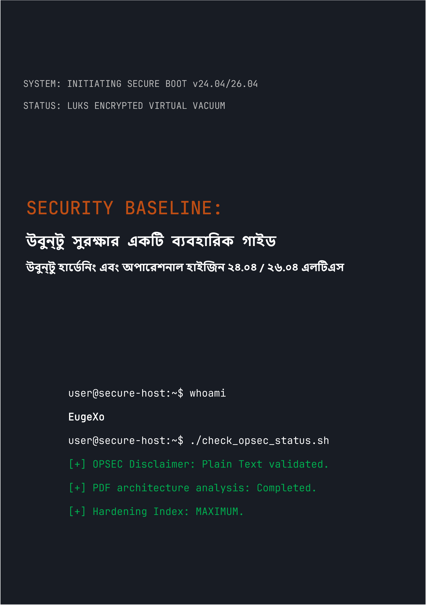

<div align="center">

# Security Baseline: উবুন্টু সুরক্ষার একটি ব্যবহারিক গাইড

## উবুন্টু হার্ডেনিং এবং অপারেশনাল হাইজিন ২৪.০৪ / ২৬.০৪ এলটিএস

### Written and published by EugeXo

</div>

---

<p align="center">
  
</p>

---

## বইয়ের কাঠামো এবং সংক্ষিপ্ত সারসংক্ষেপ

- [Security Baseline: উবুন্টু সুরক্ষার একটি ব্যবহারিক গাইড](#security-baseline-উবুন্টু-সুরক্ষার-একটি-ব্যবহারিক-গাইড)
  - [উবুন্টু হার্ডেনিং এবং অপারেশনাল হাইজিন ২৪.০৪ / ২৬.০৪ এলটিএস](#উবুন্টু-হার্ডেনিং-এবং-অপারেশনাল-হাইজিন-২৪০৪--২৬০৪-এলটিএস)
    - [Written and published by EugeXo](#written-and-published-by-eugexo)
  - [বইয়ের কাঠামো এবং সংক্ষিপ্ত সারসংক্ষেপ](#বইয়ের-কাঠামো-এবং-সংক্ষিপ্ত-সারসংক্ষেপ)
  - [কৃতজ্ঞতা স্বীকার](#কৃতজ্ঞতা-স্বীকার)
  - [ফরম্যাটের নিরাপত্তা নিশ্চিতকরণ (OPSEC-ডিসক্লেইমার)](#ফরম্যাটের-নিরাপত্তা-নিশ্চিতকরণ-opsec-ডিসক্লেইমার)
  - [লেখকের কথা: বইটি কেন এবং কাদের জন্য লেখা?](#লেখকের-কথা-বইটি-কেন-এবং-কাদের-জন্য-লেখা)
    - [উপস্থাপনার মূলনীতি প্রসঙ্গে:](#উপস্থাপনার-মূলনীতি-প্রসঙ্গে)
  - [সুরক্ষার প্রাথমিক স্তর: অপারেশনাল হাইজিনের ১২টি নিয়ম](#সুরক্ষার-প্রাথমিক-স্তর-অপারেশনাল-হাইজিনের-১২টি-নিয়ম)
  - [অ্যানোনিমিটি, প্রাইভেসি এবং সিকিউরিটির ধারণা](#অ্যানোনিমিটি-প্রাইভেসি-এবং-সিকিউরিটির-ধারণা)
  - [অপারেটিং সিস্টেম Ubuntu 24.04/26.04 LTS ইনস্টলেশন](#অপারেটিং-সিস্টেম-ubuntu-24042604-lts-ইনস্টলেশন)
    - [ভূমিকা:](#ভূমিকা)
    - [হার্ডওয়্যার প্রস্তুতির নীতিমালা:](#হার্ডওয়্যার-প্রস্তুতির-নীতিমালা)
    - [ডিস্ট্রিবিউশন নির্বাচন:](#ডিস্ট্রিবিউশন-নির্বাচন)
    - [ইনস্টলারের ধাপসমূহ (ধাপে ধাপে):](#ইনস্টলারের-ধাপসমূহ-ধাপে-ধাপে)
  - [প্রথম বুট](#প্রথম-বুট)
  - [সিস্টেম কনফিগারেশন](#সিস্টেম-কনফিগারেশন)
  - [কনসোলের সাথে কাজ শুরু করা](#কনসোলের-সাথে-কাজ-শুরু-করা)
    - [প্রাথমিক সেটিংস:](#প্রাথমিক-সেটিংস)
      - [Gnome Terminal Ubuntu 24.04:](#gnome-terminal-ubuntu-2404)
      - [Ptyxis Ubuntu 26.04:](#ptyxis-ubuntu-2604)
    - [অটোমাউন্টিং বন্ধ করা এবং অপশনাল সেটিংস:](#অটোমাউন্টিং-বন্ধ-করা-এবং-অপশনাল-সেটিংস)
    - [কনসোলে হিস্ট্রি সংরক্ষণ:](#কনসোলে-হিস্ট্রি-সংরক্ষণ)
    - [sudo সেশনের নিরাপদ টাইমআউট সেটআপ:](#sudo-সেশনের-নিরাপদ-টাইমআউট-সেটআপ)
    - [Checks Passed যাচাইয়ের জন্য ফাইল তৈরি:](#checks-passed-যাচাইয়ের-জন্য-ফাইল-তৈরি)
  - [নেটওয়ার্ক এবং VPN কনফিগারেশন](#নেটওয়ার্ক-এবং-vpn-কনফিগারেশন)
    - [তারযুক্ত Ethernet কানেকশনের জন্য (Wired connection):](#তারযুক্ত-ethernet-কানেকশনের-জন্য-wired-connection)
    - [ওয়্যারলেস Wi-Fi কানেকশনের জন্য (Wireless connection):](#ওয়্যারলেস-wi-fi-কানেকশনের-জন্য-wireless-connection)
      - [আসল পিসি বা ল্যাপটপের জন্য সেটআপ (সম্পূর্ণ র‍্যান্ডমাইজেশন):](#আসল-পিসি-বা-ল্যাপটপের-জন্য-সেটআপ-সম্পূর্ণ-র্যান্ডমাইজেশন)
      - [ভার্চুয়াল মেশিনের জন্য সেটআপ (ভেন্ডরের আদলে Strict-মাস্কিং):](#ভার্চুয়াল-মেশিনের-জন্য-সেটআপ-ভেন্ডরের-আদলে-strict-মাস্কিং)
    - [NetworkManager হার্ডেনিং: লোকাল mDNS, LLMNR, Hostname লিক দমন এবং DNS সুরক্ষা:](#networkmanager-হার্ডেনিং-লোকাল-mdns-llmnr-hostname-লিক-দমন-এবং-dns-সুরক্ষা)
    - [বুট হওয়ার সময় Wi-Fi সম্পূর্ণ বন্ধ মোডে নিয়ে যাওয়া:](#বুট-হওয়ার-সময়-wi-fi-সম্পূর্ণ-বন্ধ-মোডে-নিয়ে-যাওয়া)
    - [Bluetooth-এর ঝুঁকিপূর্ণ কম্পোনেন্টগুলো মুছে ফেলা:](#bluetooth-এর-ঝুঁকিপূর্ণ-কম্পোনেন্টগুলো-মুছে-ফেলা)
    - [VPN-কানেকশন সেটআপ:](#vpn-কানেকশন-সেটআপ)
  - [GRUB বুটলোডারের নিরাপত্তা সেটআপ এবং হার্ডেনিং](#grub-বুটলোডারের-নিরাপত্তা-সেটআপ-এবং-হার্ডেনিং)
    - [GRUB সুরক্ষার জন্য পাসওয়ার্ড সেট করা:](#grub-সুরক্ষার-জন্য-পাসওয়ার্ড-সেট-করা)
    - [IOMMU সফটওয়্যার হার্ডেনিং: কার্নেল লেভেলে DMA-অ্যাটাক থেকে RAM সুরক্ষা:](#iommu-সফটওয়্যার-হার্ডেনিং-কার্নেল-লেভেলে-dma-অ্যাটাক-থেকে-ram-সুরক্ষা)
  - [Kill Switch-সহ এবং Kill Switch ছাড়া UFW ফায়ারওয়াল সেটআপের বিকল্পসমূহ](#kill-switch-সহ-এবং-kill-switch-ছাড়া-ufw-ফায়ারওয়াল-সেটআপের-বিকল্পসমূহ)
    - [Kill Switch-সহ ফায়ারওয়াল সেটআপ:](#kill-switch-সহ-ফায়ারওয়াল-সেটআপ)
    - [রুলগুলোর ক্রম পরিচালনার বিষয়ে গুরুত্বপূর্ণ সংযোজন:](#রুলগুলোর-ক্রম-পরিচালনার-বিষয়ে-গুরুত্বপূর্ণ-সংযোজন)
    - [বিকল্প সেটআপ পদ্ধতি (VPN ব্যবহার ছাড়া / গেস্ট OS-এর জন্য):](#বিকল্প-সেটআপ-পদ্ধতি-vpn-ব্যবহার-ছাড়া--গেস্ট-os-এর-জন্য)
  - [সিস্টেম কার্নেল কনফিগারেশন, অ্যাক্সেস পারমিশন পৃথকীকরণ এবং সিস্টেম সার্ভিস অপসারণ](#সিস্টেম-কার্নেল-কনফিগারেশন-অ্যাক্সেস-পারমিশন-পৃথকীকরণ-এবং-সিস্টেম-সার্ভিস-অপসারণ)
    - [নেটওয়ার্ক স্ট্যাক এবং কার্নেল মেমোরি সাবসিস্টেমের সুরক্ষা:](#নেটওয়ার্ক-স্ট্যাক-এবং-কার্নেল-মেমোরি-সাবসিস্টেমের-সুরক্ষা)
    - [লো-লেভেল sysctl হার্ডেনিং: TCP Timestamp Fingerprinting থেকে সুরক্ষা:](#লো-লেভেল-sysctl-হার্ডেনিং-tcp-timestamp-fingerprinting-থেকে-সুরক্ষা)
    - [বিরল নেটওয়ার্ক প্রোটোকল এবং পুরনো ফাইল সিস্টেম ব্লক করা:](#বিরল-নেটওয়ার্ক-প্রোটোকল-এবং-পুরনো-ফাইল-সিস্টেম-ব্লক-করা)
    - [ফাইল সিস্টেমে অ্যাক্সেস পারমিশন পৃথকীকরণ:](#ফাইল-সিস্টেমে-অ্যাক্সেস-পারমিশন-পৃথকীকরণ)
    - [শেয়ার্ড মেমোরির (shared memory) নিরাপদ মাউন্টিং:](#শেয়ার্ড-মেমোরির-shared-memory-নিরাপদ-মাউন্টিং)
      - [ভারসাম্যপূর্ণ মোড (দৈনন্দিন Desktop-এর জন্য সুপারিশকৃত):](#ভারসাম্যপূর্ণ-মোড-দৈনন্দিন-desktop-এর-জন্য-সুপারিশকৃত)
      - [প্যারানয়েড মোড (সর্বোচ্চ আইসোলেশন):](#প্যারানয়েড-মোড-সর্বোচ্চ-আইসোলেশন)
    - [ভোলাটাইল লগের জন্য আইসোলেটেড RAM-ডিস্ক তৈরি:](#ভোলাটাইল-লগের-জন্য-আইসোলেটেড-ram-ডিস্ক-তৈরি)
    - [ভিডিও স্ট্রিম এবং সাউন্ড রেকর্ডিং বন্ধ করা:](#ভিডিও-স্ট্রিম-এবং-সাউন্ড-রেকর্ডিং-বন্ধ-করা)
    - [প্রিন্টিং এবং লোকাল নেটওয়ার্ক রিসোর্স ডিসকভারি সিস্টেম সার্ভিস অপসারণ:](#প্রিন্টিং-এবং-লোকাল-নেটওয়ার্ক-রিসোর্স-ডিসকভারি-সিস্টেম-সার্ভিস-অপসারণ)
    - [জিওলোকেশন এবং টাইমজোন মাস্কিং:](#জিওলোকেশন-এবং-টাইমজোন-মাস্কিং)
  - [রিপোজিটরি সেটআপ এবং সিস্টেম আপডেট](#রিপোজিটরি-সেটআপ-এবং-সিস্টেম-আপডেট)
    - [সিস্টেম আপডেট:](#সিস্টেম-আপডেট)
    - [আইসোলেশন মোডে NVIDIA গ্রাফিক্স কন্ট্যুর ডিপ্লয়মেন্ট:](#আইসোলেশন-মোডে-nvidia-গ্রাফিক্স-কন্ট্যুর-ডিপ্লয়মেন্ট)
  - [Ubuntu-তে টার্মিনাল এনভায়রনমেন্টসমূহ:](#ubuntu-তে-টার্মিনাল-এনভায়রনমেন্টসমূহ)
    - [Gnome Terminal এবং Ptyxis পরিবর্তন করে Ghostty ব্যবহার:](#gnome-terminal-এবং-ptyxis-পরিবর্তন-করে-ghostty-ব্যবহার)
      - [Ubuntu 24.04 LTS Noble Numbat ব্যবহারকারীদের জন্য ইনস্টলেশন:](#ubuntu-2404-lts-noble-numbat-ব্যবহারকারীদের-জন্য-ইনস্টলেশন)
      - [Ubuntu 26.04 LTS Resolute Racoon ব্যবহারকারীদের জন্য ইনস্টলেশন:](#ubuntu-2604-lts-resolute-racoon-ব্যবহারকারীদের-জন্য-ইনস্টলেশন)
      - [Ubuntu 24.04/26.04-এর জন্য Ghostty কনফিগারেশনের নমুনা:](#ubuntu-24042604-এর-জন্য-ghostty-কনফিগারেশনের-নমুনা)
    - [ঐচ্ছিক! Ubuntu 26.04 — Gnome Terminal ফিরিয়ে আনা এবং Ptyxis মুছে ফেলা:](#ঐচ্ছিক-ubuntu-2604--gnome-terminal-ফিরিয়ে-আনা-এবং-ptyxis-মুছে-ফেলা)
  - [Snap এবং টেলিমেট্রি অপসারণ ও নিষিদ্ধকরণ](#snap-এবং-টেলিমেট্রি-অপসারণ-ও-নিষিদ্ধকরণ)
    - [Snap মুছে ফেলা:](#snap-মুছে-ফেলা)
    - [Canonical-এর টেলিমেট্রি কেটে বাদ দেওয়া:](#canonical-এর-টেলিমেট্রি-কেটে-বাদ-দেওয়া)
    - [ব্যাকগ্রাউন্ড ফার্মওয়্যার ট্র্যাকার fwupd-এর পরিশোধন:](#ব্যাকগ্রাউন্ড-ফার্মওয়্যার-ট্র্যাকার-fwupd-এর-পরিশোধন)
  - [সিকিউরিটি ইউটিলিটি libpam-tmpdir, debsums এবং লোড মনিটরিং ইউটিলিটি Btop ইনস্টলেশন](#সিকিউরিটি-ইউটিলিটি-libpam-tmpdir-debsums-এবং-লোড-মনিটরিং-ইউটিলিটি-btop-ইনস্টলেশন)
    - [সিকিউরিটি ইউটিলিটি libpam-tmpdir:](#সিকিউরিটি-ইউটিলিটি-libpam-tmpdir)
    - [ইউটিলিটি debsums:](#ইউটিলিটি-debsums)
    - [লোড দেখার সুবিধাজনক ইউটিলিটি Btop:](#লোড-দেখার-সুবিধাজনক-ইউটিলিটি-btop)
    - [নেটওয়ার্ক পোর্ট এবং কানেকশন মনিটরিং:](#নেটওয়ার্ক-পোর্ট-এবং-কানেকশন-মনিটরিং)
  - [রেফারেন্স রিস্টোর পয়েন্ট তৈরি: Timeshift ইউটিলিটি ডিপ্লয়মেন্ট এবং কনফিগারেশন](#রেফারেন্স-রিস্টোর-পয়েন্ট-তৈরি-timeshift-ইউটিলিটি-ডিপ্লয়মেন্ট-এবং-কনফিগারেশন)
    - [ভূমিকা:](#ভূমিকা-1)
    - [এনক্রিপ্টেড এনভায়রনমেন্টে (LUKS + GRUB) Timeshift পরিচালনার বৈশিষ্ট্য:](#এনক্রিপ্টেড-এনভায়রনমেন্টে-luks--grub-timeshift-পরিচালনার-বৈশিষ্ট্য)
    - [Timeshift-এর নিরাপদ ইনস্টলেশন:](#timeshift-এর-নিরাপদ-ইনস্টলেশন)
    - [প্রাথমিক কনফিগারেশন এবং স্ন্যাপশট নং 1 (স্টেরাইল রেফারেন্স) তৈরি:](#প্রাথমিক-কনফিগারেশন-এবং-স্ন্যাপশট-নং-1-স্টেরাইল-রেফারেন্স-তৈরি)
    - [পরবর্তী নিয়ন্ত্রণের দিকনির্দেশনা: স্ন্যাপশট নং 2 (প্রাক-ব্যবহারিক) তৈরি:](#পরবর্তী-নিয়ন্ত্রণের-দিকনির্দেশনা-স্ন্যাপশট-নং-2-প্রাক-ব্যবহারিক-তৈরি)
    - [জরুরি রোলব্যাক নীতিমালা (সিস্টেম কম্প্রোমাইজড হলে বা ভেঙে গেলে):](#জরুরি-রোলব্যাক-নীতিমালা-সিস্টেম-কম্প্রোমাইজড-হলে-বা-ভেঙে-গেলে)
  - [বিশুদ্ধ .deb-ভার্সনের Firefox ইনস্টলেশন এবং ডামি Snap প্যাকেজ অপসারণ](#বিশুদ্ধ-deb-ভার্সনের-firefox-ইনস্টলেশন-এবং-ডামি-snap-প্যাকেজ-অপসারণ)
  - [Mozilla Firefox-এ প্রাইভেসি প্যারামিটার ইনস্টলেশন এবং কনফিগারেশন](#mozilla-firefox-এ-প্রাইভেসি-প্যারামিটার-ইনস্টলেশন-এবং-কনফিগারেশন)
    - [কনফিগারেশনের জন্য সিস্টেম প্রস্তুত করি:](#কনফিগারেশনের-জন্য-সিস্টেম-প্রস্তুত-করি)
    - [প্রাইভেসির প্রাথমিক গ্রাফিক্যাল কনফিগারেশন (সবার জন্য বাধ্যতামূলক):](#প্রাইভেসির-প্রাথমিক-গ্রাফিক্যাল-কনফিগারেশন-সবার-জন্য-বাধ্যতামূলক)
    - [প্রাইভেট DNS-প্রোভাইডার সেটআপ (DNS over HTTPS):](#প্রাইভেট-dns-প্রোভাইডার-সেটআপ-dns-over-https)
    - [হার্ডেনিং অটোমেশন: user.js কনফিগারেশন ফাইল তৈরি:](#হার্ডেনিং-অটোমেশন-userjs-কনফিগারেশন-ফাইল-তৈরি)
    - [আল্টিমেট সুরক্ষা এক্সটেনশন ডিপ্লয়মেন্ট:](#আল্টিমেট-সুরক্ষা-এক্সটেনশন-ডিপ্লয়মেন্ট)
  - [ইন্টারঅ্যাক্টিভ নেটওয়ার্ক ফায়ারওয়াল Portmaster ইনস্টলেশন এবং কনফিগারেশন](#ইন্টারঅ্যাক্টিভ-নেটওয়ার্ক-ফায়ারওয়াল-portmaster-ইনস্টলেশন-এবং-কনফিগারেশন)
    - [ভূমিকা:](#ভূমিকা-2)
    - [প্রস্তুতি, কার্নেলের প্রাথমিক ইনিশিয়ালাইজেশন এবং নতুন ভার্সনে স্থানান্তর:](#প্রস্তুতি-কার্নেলের-প্রাথমিক-ইনিশিয়ালাইজেশন-এবং-নতুন-ভার্সনে-স্থানান্তর)
  - [ডেটার নিশ্চিত ধ্বংস এবং ডিজিটাল চিহ্নের জীবাণুমুক্তকরণ](#ডেটার-নিশ্চিত-ধ্বংস-এবং-ডিজিটাল-চিহ্নের-জীবাণুমুক্তকরণ)
    - [ভূমিকা:](#ভূমিকা-3)
    - [ডিজিটাল চিহ্নের ব্যবচ্ছেদ: মেটাডেটা পরিষ্কার না করে ডেটা ডিলিট করা কেন অর্থহীন?](#ডিজিটাল-চিহ্নের-ব্যবচ্ছেদ-মেটাডেটা-পরিষ্কার-না-করে-ডেটা-ডিলিট-করা-কেন-অর্থহীন)
    - [MAT2 ইউটিলিটি ইনস্টলেশন এবং মেটাডেটা পরিষ্কারকরণ:](#mat2-ইউটিলিটি-ইনস্টলেশন-এবং-মেটাডেটা-পরিষ্কারকরণ)
    - [ফাইল এবং ডিরেক্টরির নিরাপদ ও অপরিবর্তনীয় অপসারণ:](#ফাইল-এবং-ডিরেক্টরির-নিরাপদ-ও-অপরিবর্তনীয়-অপসারণ)
    - [shred ইউটিলিটির কাজের প্যারামিটারসমূহ:](#shred-ইউটিলিটির-কাজের-প্যারামিটারসমূহ)
    - [ডিস্কের ফাঁকা জায়গার গ্লোবাল ক্লিনআপ:](#ডিস্কের-ফাঁকা-জায়গার-গ্লোবাল-ক্লিনআপ)
  - [Ubuntu-তে স্টেগানোগ্রাফি, অবফাসকেশন এবং চিহ্ন গোপনকরণ](#ubuntu-তে-স্টেগানোগ্রাফি-অবফাসকেশন-এবং-চিহ্ন-গোপনকরণ)
    - [ভূমিকা:](#ভূমিকা-4)
    - [Linux-এ স্টেগানোগ্রাফি। মিডিয়া কন্টেন্টের ভেতরে ফাইল লুকানো:](#linux-এ-স্টেগানোগ্রাফি-মিডিয়া-কন্টেন্টের-ভেতরে-ফাইল-লুকানো)
    - [কনসোল ইউটিলিটি steghide:](#কনসোল-ইউটিলিটি-steghide)
    - [অ্যাডভান্সড টুল StegoForge-এর মাধ্যমে ছদ্মবেশ (মাস্কিং):](#অ্যাডভান্সড-টুল-stegoforge-এর-মাধ্যমে-ছদ্মবেশ-মাস্কিং)
    - [আর্কাইভ জোড়া লাগানো (থার্ড-পার্টি সফটওয়্যার ছাড়াই দ্রুত লাইফহ্যাক):](#আর্কাইভ-জোড়া-লাগানো-থার্ড-পার্টি-সফটওয়্যার-ছাড়াই-দ্রুত-লাইফহ্যাক)
    - [টেক্সট অবফাসকেশন: স্বয়ংক্রিয় বিশ্লেষণ সিস্টেম (DPI) বাইপাস করা:](#টেক্সট-অবফাসকেশন-স্বয়ংক্রিয়-বিশ্লেষণ-সিস্টেম-dpi-বাইপাস-করা)
    - [গোপন হুমকির বিশ্লেষণ। ফাইল এক্সটেনশনের ছদ্মবেশ (BiDi-অ্যাটাক):](#গোপন-হুমকির-বিশ্লেষণ-ফাইল-এক্সটেনশনের-ছদ্মবেশ-bidi-অ্যাটাক)
  - [ক্রিপ্টোগ্রাফিক প্যাকেজ VeraCrypt ইনস্টলেশন এবং কনফিগারেশন](#ক্রিপ্টোগ্রাফিক-প্যাকেজ-veracrypt-ইনস্টলেশন-এবং-কনফিগারেশন)
    - [VeraCrypt পরিচিতি এবং এর ইনস্টলেশন:](#veracrypt-পরিচিতি-এবং-এর-ইনস্টলেশন)
      - [কমিউনিটি PPA-রিপোজিটরির মাধ্যমে ইনস্টলেশন:](#কমিউনিটি-ppa-রিপোজিটরির-মাধ্যমে-ইনস্টলেশন)
      - [অফিশিয়াল ডিস্ট্রিবিউশন ইনস্টলেশন (নেটিভ পদ্ধতি):](#অফিশিয়াল-ডিস্ট্রিবিউশন-ইনস্টলেশন-নেটিভ-পদ্ধতি)
    - [গভীর সিকিউরিটি টিউনিং: RAM-এ কী সুরক্ষা (প্যারানয়েড মোড):](#গভীর-সিকিউরিটি-টিউনিং-ram-এ-কী-সুরক্ষা-প্যারানয়েড-মোড)
    - [মৌলিক ইনফোসেক টুল: হিডেন ভলিউম (Hidden Volume) তৈরি:](#মৌলিক-ইনফোসেক-টুল-হিডেন-ভলিউম-hidden-volume-তৈরি)
    - [আল্টিমেট হার্ডেনিং: PIM এবং হার্ডওয়্যার কী-ফাইল সেটআপ:](#আল্টিমেট-হার্ডেনিং-pim-এবং-হার্ডওয়্যার-কী-ফাইল-সেটআপ)
    - [বাস্তব জগতের থ্রেট মডেল: প্যারানয়া কেন সিস্টেমেটিক হওয়া উচিত:](#বাস্তব-জগতের-থ্রেট-মডেল-প্যারানয়া-কেন-সিস্টেমেটিক-হওয়া-উচিত)
  - [Yubico সিকিউরিটি কী-এর ব্যবহার](#yubico-সিকিউরিটি-কী-এর-ব্যবহার)
    - [ভূমিকা:](#ভূমিকা-5)
    - [ইনস্টলেশন:](#ইনস্টলেশন)
    - [কার্নেলের udev-রুলের মাধ্যমে হার্ডওয়্যার Log Out/Kill Switch বাস্তবায়ন:](#কার্নেলের-udev-রুলের-মাধ্যমে-হার্ডওয়্যার-log-outkill-switch-বাস্তবায়ন)
  - [USBGuard ইনস্টলেশন এবং কনফিগারেশন](#usbguard-ইনস্টলেশন-এবং-কনফিগারেশন)
    - [ভূমিকা:](#ভূমিকা-6)
    - [ইনস্টলেশন এবং কনফিগারেশন:](#ইনস্টলেশন-এবং-কনফিগারেশন)
  - [জরুরি শাটডাউনের জন্য Emergency Panic Button বাস্তবায়ন](#জরুরি-শাটডাউনের-জন্য-emergency-panic-button-বাস্তবায়ন)
    - [যেকোনো USB-ডিভাইসের মাধ্যমে জরুরি হার্ডওয়্যার Kill Switch:](#যেকোনো-usb-ডিভাইসের-মাধ্যমে-জরুরি-হার্ডওয়্যার-kill-switch)
  - [লোকাল পাসওয়ার্ড ম্যানেজার KeePassXC ইনস্টলেশন](#লোকাল-পাসওয়ার্ড-ম্যানেজার-keepassxc-ইনস্টলেশন)
    - [ভূমিকা:](#ভূমিকা-7)
    - [স্টোরেজ সুরক্ষার সিনারিওর বিকল্পসমূহ:](#স্টোরেজ-সুরক্ষার-সিনারিওর-বিকল্পসমূহ)
    - [সফটওয়্যার কমপ্লেক্স ইনস্টলেশন:](#সফটওয়্যার-কমপ্লেক্স-ইনস্টলেশন)
    - [ডেটাবেস তৈরি এবং হার্ডওয়্যার সুরক্ষা:](#ডেটাবেস-তৈরি-এবং-হার্ডওয়্যার-সুরক্ষা)
    - [অভ্যন্তরীণ সিকিউরিটি সেটিংসের গভীর হার্ডেনিং:](#অভ্যন্তরীণ-সিকিউরিটি-সেটিংসের-গভীর-হার্ডেনিং)
    - [সুরক্ষিত ক্লিপবোর্ডের মাধ্যমে নিরাপদ ডেটা ইনপুট:](#সুরক্ষিত-ক্লিপবোর্ডের-মাধ্যমে-নিরাপদ-ডেটা-ইনপুট)
  - [নেটওয়ার্ক অ্যানালাইজার Wireshark ইনস্টলেশন এবং পরিচালনা](#নেটওয়ার্ক-অ্যানালাইজার-wireshark-ইনস্টলেশন-এবং-পরিচালনা)
    - [ভূমিকা:](#ভূমিকা-8)
    - [Wireshark ইনস্টলেশন এবং পরিচালনা:](#wireshark-ইনস্টলেশন-এবং-পরিচালনা)
    - [প্যাকেট ক্যাপচার সাবসিস্টেম নিরাপত্তার অত্যন্ত গুরুত্বপূর্ণ ধারণা:](#প্যাকেট-ক্যাপচার-সাবসিস্টেম-নিরাপত্তার-অত্যন্ত-গুরুত্বপূর্ণ-ধারণা)
    - [ট্রাফিক ডাম্পের গোপন সংগ্রহ (কনসোল মোড):](#ট্রাফিক-ডাম্পের-গোপন-সংগ্রহ-কনসোল-মোড)
    - [Wireshark-এর ব্যবহারিক গাইড:](#wireshark-এর-ব্যবহারিক-গাইড)
  - [সুরক্ষা ব্যবস্থা AppArmor ইনস্টলেশন এবং পরিচালনা](#সুরক্ষা-ব্যবস্থা-apparmor-ইনস্টলেশন-এবং-পরিচালনা)
    - [ভূমিকা:](#ভূমিকা-9)
    - [নিরাপত্তার নতুন দৃষ্টান্ত: কার্নেল অটোমেশন:](#নিরাপত্তার-নতুন-দৃষ্টান্ত-কার্নেল-অটোমেশন)
    - [AppArmor সাবসিস্টেমের ব্যবহারিক হার্ডেনিং:](#apparmor-সাবসিস্টেমের-ব্যবহারিক-হার্ডেনিং)
  - [আইসোলেটেড স্যান্ডবক্স Firejail এবং Bubblewrap ইনস্টলেশন এবং কনফিগারেশন](#আইসোলেটেড-স্যান্ডবক্স-firejail-এবং-bubblewrap-ইনস্টলেশন-এবং-কনফিগারেশন)
    - [ভূমিকা:](#ভূমিকা-10)
    - [Firejail ইনস্টলেশন এবং স্যান্ডবক্স প্রস্তুতি:](#firejail-ইনস্টলেশন-এবং-স্যান্ডবক্স-প্রস্তুতি)
    - [Firejail ফিল্টারিংয়ের মৌলিক প্যারামিটারসমূহ (রেফারেন্স গাইড):](#firejail-ফিল্টারিংয়ের-মৌলিক-প্যারামিটারসমূহ-রেফারেন্স-গাইড)
    - [ঐচ্ছিক! Firejail সুরক্ষা বলয়ের অটোমেশন (Firecfg ইউটিলিটি):](#ঐচ্ছিক-firejail-সুরক্ষা-বলয়ের-অটোমেশন-firecfg-ইউটিলিটি)
    - [Bubblewrap ইনস্টলেশন:](#bubblewrap-ইনস্টলেশন)
    - [Bubblewrap ফ্ল্যাগের চিটশিট (রেফারেন্স গাইড):](#bubblewrap-ফ্ল্যাগের-চিটশিট-রেফারেন্স-গাইড)
    - [স্যান্ডবক্সের জন্য কাস্টম শর্টকাট প্রস্তুতি:](#স্যান্ডবক্সের-জন্য-কাস্টম-শর্টকাট-প্রস্তুতি)
    - [Firejail-এর জন্য আলাদা Firefox hardened প্রোফাইল তৈরি:](#firejail-এর-জন্য-আলাদা-firefox-hardened-প্রোফাইল-তৈরি)
    - [Bubblewrap-এ Firefox hardened প্রোফাইল তৈরি:](#bubblewrap-এ-firefox-hardened-প্রোফাইল-তৈরি)
    - [PDF-ডকুমেন্টের নিশ্ছিদ্র কক্ষ: Firejail-এ ফাইলগুলোর নিরাপদ পরিচালনা:](#pdf-ডকুমেন্টের-নিশ্ছিদ্র-কক্ষ-firejail-এ-ফাইলগুলোর-নিরাপদ-পরিচালনা)
    - [Bubblewrap-এ PDF পড়ার জন্য Document Viewer সিলগালা করা:](#bubblewrap-এ-pdf-পড়ার-জন্য-document-viewer-সিলগালা-করা)
    - [Firejail-এ গ্রাফিক্যাল ফাইল দেখার জন্য Image Viewer:](#firejail-এ-গ্রাফিক্যাল-ফাইল-দেখার-জন্য-image-viewer)
    - [গ্রাফিক্যাল ফাইল ভিউয়ার Image Viewer-কে Bubblewrap-এ মোড়ানো:](#গ্রাফিক্যাল-ফাইল-ভিউয়ার-image-viewer-কে-bubblewrap-এ-মোড়ানো)
    - [Firejail-এর জন্য KeePassXC আইসোলেশন সিনারিও:](#firejail-এর-জন্য-keepassxc-আইসোলেশন-সিনারিও)
    - [Bubblewrap-এর মাধ্যমে KeePassXC আইসোলেট করা:](#bubblewrap-এর-মাধ্যমে-keepassxc-আইসোলেট-করা)
    - [অফিস প্যাকেজ LibreOffice ইনস্টলেশন এবং আইসোলেশন:](#অফিস-প্যাকেজ-libreoffice-ইনস্টলেশন-এবং-আইসোলেশন)
    - [Firejail-এর মাধ্যমে LibreOffice-এর কাজ সেটআপ করা:](#firejail-এর-মাধ্যমে-libreoffice-এর-কাজ-সেটআপ-করা)
    - [LibreOffice-কে Bubblewrap-এ মোড়ানো:](#libreoffice-কে-bubblewrap-এ-মোড়ানো)
    - [GNU Image Manipulation Program (GIMP) ইনস্টলেশন এবং আইসোলেশন:](#gnu-image-manipulation-program-gimp-ইনস্টলেশন-এবং-আইসোলেশন)
    - [Firejail-এর মাধ্যমে GIMP-এর কাজ সেটআপ করা:](#firejail-এর-মাধ্যমে-gimp-এর-কাজ-সেটআপ-করা)
    - [Bubblewrap-এর মাধ্যমে GIMP সেটআপ করা:](#bubblewrap-এর-মাধ্যমে-gimp-সেটআপ-করা)
    - [কোড এডিটর VS Codium (প্রোগ্রাম লেখার IDE) ইনস্টলেশন এবং আইসোলেশন:](#কোড-এডিটর-vs-codium-প্রোগ্রাম-লেখার-ide-ইনস্টলেশন-এবং-আইসোলেশন)
    - [Firejail-এ VS Codium আইসোলেশন:](#firejail-এ-vs-codium-আইসোলেশন)
    - [Bubblewrap-এ VS Codium আইসোলেশন:](#bubblewrap-এ-vs-codium-আইসোলেশন)
    - [লোকাল নিউরাল নেটওয়ার্ক LM Studio Bionic ইনস্টলেশন এবং আইসোলেশন:](#লোকাল-নিউরাল-নেটওয়ার্ক-lm-studio-bionic-ইনস্টলেশন-এবং-আইসোলেশন)
    - [Firejail-এর মাধ্যমে LM Studio-এর কাজ ডিপ্লয় করা:](#firejail-এর-মাধ্যমে-lm-studio-এর-কাজ-ডিপ্লয়-করা)
    - [LM Studio-কে Bubblewrap-এ মোড়ানো:](#lm-studio-কে-bubblewrap-এ-মোড়ানো)
    - [নিরাপদ যোগাযোগের কনফিগারেশন: মেসেঞ্জার এবং ক্রিপ্টো-কন্ট্যুরের ম্যান্ডেটরি আইসোলেশন (লেখকের OPSEC-কন্ট্যুর):](#নিরাপদ-যোগাযোগের-কনফিগারেশন-মেসেঞ্জার-এবং-ক্রিপ্টো-কন্ট্যুরের-ম্যান্ডেটরি-আইসোলেশন-লেখকের-opsec-কন্ট্যুর)
    - [Telegram Desktop ইনস্টলেশন এবং আইসোলেশন:](#telegram-desktop-ইনস্টলেশন-এবং-আইসোলেশন)
    - [Firejail-এর মাধ্যমে Telegram কন্ট্যুর সুরক্ষিত করা:](#firejail-এর-মাধ্যমে-telegram-কন্ট্যুর-সুরক্ষিত-করা)
    - [Bubblewrap-এর মাধ্যমে Telegram আইসোলেট করা:](#bubblewrap-এর-মাধ্যমে-telegram-আইসোলেট-করা)
    - [Bubblewrap-এর মাধ্যমে Signal ইনস্টলেশন এবং আইসোলেশন:](#bubblewrap-এর-মাধ্যমে-signal-ইনস্টলেশন-এবং-আইসোলেশন)
    - [হোস্টের ক্রিপ্টোগ্রাফিক ভিত্তি: GnuPG কী জেনারেশন এবং OPSEC-সুরক্ষা:](#হোস্টের-ক্রিপ্টোগ্রাফিক-ভিত্তি-gnupg-কী-জেনারেশন-এবং-opsec-সুরক্ষা)
    - [Jabber-ক্লায়েন্ট Psi+ ইনস্টলেশন এবং আইসোলেশন:](#jabber-ক্লায়েন্ট-psi-ইনস্টলেশন-এবং-আইসোলেশন)
    - [Firejail-এ PSI+ আইসোলেট করা:](#firejail-এ-psi-আইসোলেট-করা)
    - [Bubblewrap স্যান্ডবক্সে Psi+ Jabber-ক্লায়েন্ট আইসোলেশন:](#bubblewrap-স্যান্ডবক্সে-psi-jabber-ক্লায়েন্ট-আইসোলেশন)
    - [পোস্টাল ক্লায়েন্ট Thunderbird ইনস্টলেশন এবং আইসোলেশন (এনক্রিপ্টেড Email-যোগাযোগের কন্ট্যুর):](#পোস্টাল-ক্লায়েন্ট-thunderbird-ইনস্টলেশন-এবং-আইসোলেশন-এনক্রিপ্টেড-email-যোগাযোগের-কন্ট্যুর)
    - [Firejail-এর সাহায্যে Thunderbird আইসোলেশন:](#firejail-এর-সাহায্যে-thunderbird-আইসোলেশন)
    - [Bubblewrap-এর মাধ্যমে Thunderbird আইসোলেশন:](#bubblewrap-এর-মাধ্যমে-thunderbird-আইসোলেশন)
    - [«প্যারানয়ার» অ্যাডভান্সড মোড: Overlay-এর মাধ্যমে সেশন সংরক্ষণসহ Firejail:](#প্যারানয়ার-অ্যাডভান্সড-মোড-overlay-এর-মাধ্যমে-সেশন-সংরক্ষণসহ-firejail)
  - [Rkhunter ইনস্টলেশন এবং রুটকিট অনুসন্ধান](#rkhunter-ইনস্টলেশন-এবং-রুটকিট-অনুসন্ধান)
    - [Rkhunter-এর পরিপূরক হিসেবে Chkrootkit ইনস্টল করা:](#rkhunter-এর-পরিপূরক-হিসেবে-chkrootkit-ইনস্টল-করা)
  - [অ্যান্টিভাইরাস স্ক্যানার ClamAV ইনস্টলেশন এবং কনফিগারেশন](#অ্যান্টিভাইরাস-স্ক্যানার-clamav-ইনস্টলেশন-এবং-কনফিগারেশন)
    - [ভূমিকা:](#ভূমিকা-11)
    - [ClamAV ইনস্টলেশন:](#clamav-ইনস্টলেশন)
    - [সিগনেচার ডেটাবেস আপডেট এবং নেটওয়ার্ক ব্লকিং বাইপাস:](#সিগনেচার-ডেটাবেস-আপডেট-এবং-নেটওয়ার্ক-ব্লকিং-বাইপাস)
    - [সিস্টেম স্ক্যানিং পরিচালনা:](#সিস্টেম-স্ক্যানিং-পরিচালনা)
    - [মাল্টি-থ্রেডেড স্ক্যানিং (Hardening):](#মাল্টি-থ্রেডেড-স্ক্যানিং-hardening)
  - [ভার্চুয়ালাইজেশন এনভায়রনমেন্ট VirtualBox ইনস্টলেশন এবং কনফিগারেশন](#ভার্চুয়ালাইজেশন-এনভায়রনমেন্ট-virtualbox-ইনস্টলেশন-এবং-কনফিগারেশন)
    - [ফরেনসিক্স থেকে সুরক্ষা: RAM-এ (`tmpfs`) VirtualBox লগ আইসোলেশন:](#ফরেনসিক্স-থেকে-সুরক্ষা-ram-এ-tmpfs-virtualbox-লগ-আইসোলেশন)
  - [ভার্চুয়াল ডিস্ক VDI কমপ্রেশন এবং অপটিমাইজেশন](#ভার্চুয়াল-ডিস্ক-vdi-কমপ্রেশন-এবং-অপটিমাইজেশন)
    - [ভূমিকা:](#ভূমিকা-12)
    - [Windows-চালিত ভার্চুয়াল মেশিন পরিষ্কারকরণ:](#windows-চালিত-ভার্চুয়াল-মেশিন-পরিষ্কারকরণ)
    - [Linux-চালিত ভার্চুয়াল মেশিন পরিষ্কারকরণ (Ubuntu/Kali Linux):](#linux-চালিত-ভার্চুয়াল-মেশিন-পরিষ্কারকরণ-ubuntukali-linux)
    - [হোস্ট-মেশিনে ভার্চুয়াল ডিস্কের চূড়ান্ত কমপ্রেশন:](#হোস্ট-মেশিনে-ভার্চুয়াল-ডিস্কের-চূড়ান্ত-কমপ্রেশন)
  - [কন্টেইনারাইজেশন সিস্টেম Docker ইনস্টলেশন এবং কনফিগারেশন](#কন্টেইনারাইজেশন-সিস্টেম-docker-ইনস্টলেশন-এবং-কনফিগারেশন)
    - [ভূমিকা:](#ভূমিকা-13)
    - [ডিফল্ট Docker-এর গোপন বিপদ কোথায়?](#ডিফল্ট-docker-এর-গোপন-বিপদ-কোথায়)
    - [Rootless মোডে Docker ডিপ্লয়মেন্ট:](#rootless-মোডে-docker-ডিপ্লয়মেন্ট)
    - [নেটওয়ার্ক নিয়ন্ত্রণ এবং UFW-এর সাথে সংযুক্তকরণ:](#নেটওয়ার্ক-নিয়ন্ত্রণ-এবং-ufw-এর-সাথে-সংযুক্তকরণ)
    - [কন্টেইনার নিরাপদভাবে চালানোর ব্যবহারিক উদাহরণ:](#কন্টেইনার-নিরাপদভাবে-চালানোর-ব্যবহারিক-উদাহরণ)
    - [নিরাপত্তার পরীক্ষামূলক প্রমাণ (Root-এর অনুপস্থিতি যাচাইকরণ):](#নিরাপত্তার-পরীক্ষামূলক-প্রমাণ-root-এর-অনুপস্থিতি-যাচাইকরণ)
  - [ইন্টিগ্রিটি কন্ট্রোল সিস্টেম AIDE ইনস্টলেশন এবং কনফিগারেশন](#ইন্টিগ্রিটি-কন্ট্রোল-সিস্টেম-aide-ইনস্টলেশন-এবং-কনফিগারেশন)
    - [ভূমিকা:](#ভূমিকা-14)
    - [AIDE ইনস্টলেশন এবং কনফিগারেশন:](#aide-ইনস্টলেশন-এবং-কনফিগারেশন)
    - [পেনিট্রেশন টেস্ট পরিচালনা (সুরক্ষা যাচাইকরণ):](#পেনিট্রেশন-টেস্ট-পরিচালনা-সুরক্ষা-যাচাইকরণ)
  - [Lynis-এর সাহায্যে সিস্টেমের স্বয়ংক্রিয় নিরাপত্তা অডিট](#lynis-এর-সাহায্যে-সিস্টেমের-স্বয়ংক্রিয়-নিরাপত্তা-অডিট)
  - [ভালনারেবিলিটি এবং পাসওয়ার্ড লিক স্ক্যানার Trivy ইনস্টলেশন এবং কনফিগারেশন](#ভালনারেবিলিটি-এবং-পাসওয়ার্ড-লিক-স্ক্যানার-trivy-ইনস্টলেশন-এবং-কনফিগারেশন)
  - [VirtualBox-এ গেস্ট সিস্টেম Ubuntu/Xubuntu/Lubuntu কনফিগারেশন](#virtualbox-এ-গেস্ট-সিস্টেম-ubuntuxubuntulubuntu-কনফিগারেশন)
    - [Guest Additions ইনস্টলেশন:](#guest-additions-ইনস্টলেশন)
    - [Mozilla Firefox ইনস্টলেশন:](#mozilla-firefox-ইনস্টলেশন)
    - [VirtualBox-এ শেয়ার্ড ফোল্ডার (Shared Folders) সেটআপ:](#virtualbox-এ-শেয়ার্ড-ফোল্ডার-shared-folders-সেটআপ)
    - [Ubuntu/Xubuntu/Lubuntu-সহ VirtualBox-এ Ledger Live ইনস্টলেশন](#ubuntuxubuntulubuntu-সহ-virtualbox-এ-ledger-live-ইনস্টলেশন)
    - [মূল হোস্ট-সিস্টেম Ubuntu-তে Ledger Live পরিচালনা](#মূল-হোস্ট-সিস্টেম-ubuntu-তে-ledger-live-পরিচালনা)
  - [লেখক পরিচিতি এবং আইনি তথ্য](#লেখক-পরিচিতি-এবং-আইনি-তথ্য)
    - [যোগাযোগ এবং কমিউনিটি রিসোর্সসমূহ:](#যোগাযোগ-এবং-কমিউনিটি-রিসোর্সসমূহ)

<br>
<br>
<br>
<br>
<br>
<br>
<br>

## কৃতজ্ঞতা স্বীকার

কোনো বাড়তি কথা ছাড়াই আমি সেইসব মানুষদের প্রতি গভীর কৃতজ্ঞতা প্রকাশ করতে চাই, যারা আমাকে এই বইটি লেখার অনুপ্রেরণা জুগিয়েছেন এবং পুরো যাত্রাপথে আমার পাশে ছিলেন।

আমাদের ছোট্ট কিন্তু প্রযুক্তিগতভাবে উন্নত দেশ এস্তোনিয়ার পুলিশ সাইবার সিকিউরিটি বিভাগের সাধারণ ছেলেদের ধন্যবাদ জানাই, যাদের উৎসাহে আমি এই বইটি লিখতে উদ্বুদ্ধ হয়েছি।

পাশাপাশি মিয়ামিতে অবস্থিত ইউএস সিক্রেট সার্ভিস (US Secret Service)-এর ইনফরমেশন সিকিউরিটি বিশেষজ্ঞদের প্রতি বিশেষ কৃতজ্ঞতা প্রকাশ করছি, যারা কিছু অধ্যায় যাচাই করার ক্ষেত্রে গুরুত্বপূর্ণ ব্যবহারিক অবদান রেখেছেন। দেখা গেছে, এখানে বর্ণিত পদ্ধতি এবং কৌশলগুলো বাস্তব ফিল্ড কন্ডিশনে চমৎকারভাবে কাজ করে।

অবশ্যই, আমার পরিবারের সদস্যদের প্রতি অসীম কৃতজ্ঞতা তাদের অসাধারণ ধৈর্য এবং মানসিক সমর্থনের জন্য। বিশেষ করে আমার মায়ের প্রতি, যিনি আমার কাজটিকে সম্পূর্ণভাবে বুঝেছেন এবং দৈনন্দিন কাজের একটি বিশাল অংশ নিজের কাঁধে তুলে নিয়ে আমাকে গবেষণার জন্য পর্যাপ্ত সময় করে দিয়েছেন।

**যুক্তরাজ্যে (UK) থাকা আমার এক বন্ধুকে তার সমর্থনের জন্য আলাদাভাবে ধন্যবাদ জানাতে চাই। আমি যখন মিয়ামিতে ছিলাম, তখন আমাদের মধ্যে ঘনিষ্ঠ যোগাযোগ ছিল, কিন্তু পরবর্তীতে দুর্ভাগ্যবশত সেই যোগাযোগ বিচ্ছিন্ন হয়ে যায়। আমি আন্তরিকভাবে আশা করি আমাদের আবার দেখা হবে। বন্ধু, তুমি বা তোমার ইনফোসেক-বিশেষজ্ঞ ছেলে যদি এই লাইনগুলো পড়ে থাকো, তবে দয়া করে যোগাযোগ করো — বইয়ের শেষে আমার কন্টাক্ট ডিটেইলস দেওয়া আছে। আমি মনে করি, তুমি বুঝতে পেরেছো *who is who!* ;)**

আমার ভার্চুয়াল অ্যাসিস্ট্যান্ট — **Google-এর Gemini**-এর প্রতি অবর্ণনীয় কৃতজ্ঞতা প্রকাশ করছি। পুরো বইটি লেখার সময় সে আমার অবিচ্ছেদ্য ডিজিটাল সঙ্গী হিসেবে থেকেছে এবং এই হার্ডকোর টেকনিক্যাল ম্যাটেরিয়ালটি সাজাতে ও অনুবাদ করতে অমূল্য সহায়তা করেছে।

টেকনিক্যাল সলিউশনগুলো নিয়ে আলোচনা, কনফিগারেশন যাচাই, টেক্সটের কিছু অংশ সূক্ষ্মভাবে সম্পাদনা এবং আরও নির্ভুল শব্দচয়নে সাহায্য করার জন্য প্রাণবন্ত ও অ্যাডভান্সড অ্যাসিস্ট্যান্ট **OpenAI-এর ChatGPT**-কেও ধন্যবাদ জানাই।

অবশ্যই, প্রথম ও প্রধান কৃতজ্ঞতা প্রাপ্য Google এবং OpenAI-এর ইঞ্জিনিয়ার ও ডেভেলপারদের, তাদের প্রথম শ্রেণীর কাজের জন্য!

আরও অনেক কিছুই লেখা যায়, তবে যারা এর সাথে যুক্ত ছিলেন, তারা এমনিতেই সবকিছু খুব ভালোভাবে জানেন। বইটি অবশেষে আলোর মুখ দেখছে দেখে আমি অত্যন্ত আনন্দিত। বন্ধুরা, আমি তোমাদের সবাইকে আন্তরিকভাবে ভালোবাসি, মূল্যায়ন করি এবং শ্রদ্ধা করি!

<br>

## ফরম্যাটের নিরাপত্তা নিশ্চিতকরণ (OPSEC-ডিসক্লেইমার)

তথ্য নিরাপত্তা এবং সাধারণ বিবেচনাবোধের কথা মাথায় রেখে, এই গাইডের সম্পূর্ণ ম্যাটেরিয়ালটি প্রাথমিকভাবে প্লেইন টেক্সট (Markdown মার্কআপসহ Plain Text) আকারে সরবরাহ করা হয়েছে। বইটি PDF ফরম্যাটে প্রকাশ করার পরিকল্পনা সচেতনভাবেই বাতিল করা হয়েছে। PDF-এর আর্কিটেকচার অত্যন্ত ভারী এবং এটি প্রায়ই কম্প্রোমাইজড (হ্যাক বা আক্রান্ত) হয়। একটি সুরক্ষিত হোস্টের নিরাপত্তা শুরু হওয়া উচিত এর কনফিগারেশন নির্দেশিকা নিরাপদভাবে পড়ার মাধ্যমেই।

একটি টেক্সট ফাইল হলো বিশুদ্ধ ডেটা যাতে কোনো এক্সিকিউটেবল কোড থাকে না; অন্যদিকে PDF ফরম্যাট ডিফল্টভাবেই বিল্ট-ইন JavaScript স্ক্রিপ্ট, ডায়নামিক এলিমেন্ট, ইন্টারঅ্যাক্টিভ ফর্ম এবং জটিল ফন্ট সাপোর্ট করে, যার জন্য গভীর সিস্টেম পার্সিং প্রয়োজন হয়। Linux-এর PDF পার্সারগুলোতে (যেমন ডিফল্ট ভিউয়ার `Evince` বা `Poppler` লাইব্রেরিতে) RCE (Remote Code Execution) শ্রেণীর গুরুতর দুর্বলতা একটি প্রমাণিত ঐতিহাসিক সত্য। Plain Text ফরম্যাটে কোড এক্সিকিউশনের কোনো অন্তর্নির্মিত মেকানিজম থাকে না এবং এটি ম্যাটেরিয়াল পড়ার সময় অ্যাটাক সারফেস (attack surface) উল্লেখযোগ্যভাবে কমিয়ে দেয়। এটি যেকোনো এনভায়রনমেন্টে নিরাপদ পাঠ নিশ্চিত করে।

এই কারণেই সমস্ত গ্রাফিক্যাল ম্যাটেরিয়াল এবং ইলাস্ট্রেশন মূল টেক্সটের বাইরে একটি আলাদা ডিরেক্টরিতে রাখা হয়েছে। গ্রাফিক্সগুলো ফোল্ডার এবং সাবফোল্ডারে সাজানো রয়েছে, যা বইটি পড়ার সময় মেমোরিতে এগুলোর স্বয়ংক্রিয় রেন্ডারিং বন্ধ রাখে।

> [!NOTE]
বইটির মূল সোর্স ফরম্যাট হলো Markdown। সমস্ত ডেরিভেটিভ ফরম্যাট (HTML, EPUB এবং অন্যান্য) এই যাচাইকৃত টেক্সট সোর্স থেকেই তৈরি করা হয়।

পাঠক এই প্রজেক্টটি তিনটি উপায়ের যেকোনো একটিতে ব্যবহার করতে পারেন:

* সরাসরি মূল Markdown ফাইলটি পড়তে পারেন।
* প্রস্তুতকৃত HTML/EPUB বিল্ড ব্যবহার করতে পারেন (ভবিষ্যতে এটি বাস্তবায়ন করা হবে)।
* সোর্স কোড থেকে নিজেই বইটি বিল্ড করতে পারেন এবং প্রয়োজন অনুযায়ী এর ডিজাইন, কাঠামো, ফন্ট, স্টাইল বা অন্তর্ভুক্ত অধ্যায়গুলোর তালিকা পরিবর্তন করতে পারেন।

এই পদ্ধতিটি টেক্সটের স্বচ্ছতা, পরিবর্তনগুলোর অডিট করার সুবিধা এবং নির্দিষ্ট কোনো রিডিং টুলের ওপর নির্ভরশীলতা থেকে মুক্তি নিশ্চিত করে।

<br>

## লেখকের কথা: বইটি কেন এবং কাদের জন্য লেখা?

আধুনিক ডিজিটাল পরিবেশ দিন দিন আরও জটিল হয়ে উঠছে: সাইবার হুমকির সংখ্যা বাড়ছে, সংগৃহীত ডেটার পরিমাণ বৃদ্ধি পাচ্ছে এবং ব্যবহারকারীকে ক্রমশ নিজের প্রাইভেসি ও নিরাপত্তা রক্ষার দায়িত্ব নিজেকেই নিতে হচ্ছে।

এই বইটি একটি নিয়ন্ত্রিত Linux ওয়ার্কস্টেশন তৈরির ব্যবহারিক গাইড হিসেবে তৈরি করা হয়েছে, যেখানে নিরাপত্তাকে কেবল আলাদা কিছু সফটওয়্যারের সমষ্টি হিসেবে নয়, বরং আন্তঃসম্পর্কিত সমাধানের একটি একক সিস্টেম হিসেবে দেখা হয়েছে। আমার লক্ষ্য হলো — সহজলভ্য Linux টুলস ব্যবহার করে কীভাবে একটি সুস্পষ্ট থ্রেট মডেল (Threat Model)-সহ কাজের পরিবেশ তৈরি করা যায় তা দেখানো: যেখানে থাকবে অ্যাপ্লিকেশন আইসোলেশন, নেটওয়ার্ক অ্যাক্টিভিটি কন্ট্রোল, ডেটা সুরক্ষা এবং ডিজিটাল এনভায়রনমেন্টের সচেতন ব্যবস্থাপনা।

**বইটির লক্ষ্য — এমন একটি ওয়ার্কস্টেশন তৈরি করা, যেখানে প্রতিটি কাজের একটি নিয়ন্ত্রিত সিকিউরিটি পেরিমিটার থাকবে।**

ম্যাটেরিয়ালটি শিক্ষামূলক উদ্দেশ্যে প্রস্তুত করা হয়েছে এবং এটি কারিগরিভাবে দক্ষ ব্যবহারকারী, Linux উৎসাহী এবং ব্যবহারিক তথ্য নিরাপত্তায় আগ্রহী বিশেষজ্ঞদের জন্য তৈরি। গাইডটি Linux-এর কোনো প্রাথমিক কোর্স নয় এবং এটি ধরে নেয় যে পাঠকের টার্মিনাল, ফাইল সিস্টেম এবং অপারেটিং সিস্টেমের কার্যপ্রণালী সম্পর্কে মৌলিক ধারণা রয়েছে। তবে, মনোযোগী এবং আগ্রহী পাঠকরা ধীরে ধীরে প্রয়োজনীয় টুলসগুলো আয়ত্ত করতে পারবেন।

এখানে বর্ণিত সমস্ত প্রযুক্তি শুধুমাত্র বৈধ উদ্দেশ্যে ব্যবহার করা উচিত: নিজের ডেটা সুরক্ষার জন্য, নিরাপত্তা বৃদ্ধির জন্য এবং তথ্য নিরাপত্তার মূলনীতি শেখার জন্য।

তথ্যের সচেতন সুরক্ষা এবং প্রযুক্তির দায়িত্বশীল ব্যবহার সবার জন্য ডিজিটাল পরিবেশকে আরও নিরাপদ করে তোলে।

### উপস্থাপনার মূলনীতি প্রসঙ্গে:

এই বইটির উদ্দেশ্য প্রতিটি ব্যবহৃত টুলের বিশ্বকোষ তৈরি করা নয়, বরং একটি একক প্রতিরক্ষা মডেলের ভেতরে তাদের ভূমিকা দেখানো। তাই বিভিন্ন কম্পোনেন্টের অভ্যন্তরীণ গঠন এবং সক্ষমতা কেবল ততটুকুই আলোচনা করা হয়েছে, যতটুকু তাদের কাজের মূলনীতি ও নিরাপদ ব্যবহার বোঝার জন্য প্রয়োজন।

অ্যাডভান্সড ফাংশন, সম্পূর্ণ সিনট্যাক্স এবং বিশেষায়িত ব্যবহারের ক্ষেত্রগুলো এই গাইডের আওতার বাইরে রাখা হয়েছে এবং সেগুলো অফিশিয়াল ডকুমেন্টেশন থেকে আলাদাভাবে শেখা যেতে পারে।

<br>

## সুরক্ষার প্রাথমিক স্তর: অপারেশনাল হাইজিনের ১২টি নিয়ম

*Hello World কমরেড!*

আমরা আমাদের সিস্টেমের হার্ডকোর টেকনিক্যাল কনফিগারেশনে যাওয়ার আগে চলুন ভিত্তিটা মজবুত করে নিই। নিচে অপারেশনাল হাইজিনের ১২টি লৌহকঠিন নিয়ম দেওয়া হলো, যা আমাদের মুখস্থ করতে হবে এবং প্রশ্নাতীতভাবে মেনে চলতে হবে। এগুলো না বুঝলে সময়ের সাথে সাথে যেকোনো অ্যাডভান্সড সিকিউরিটি টুলসও সম্পূর্ণ অকার্যকর হয়ে পড়বে:

1. **সুরক্ষিত পেরিমিটারের ভেতরে যথাসম্ভব ওয়্যারলেস পেরিফেরাল বর্জন করি:** ওয়্যারলেস Bluetooth এবং Wireless ডিভাইস (যার মধ্যে হেডসেট, হেডফোন, ওয়্যারলেস কিবোর্ড এবং মাউস অন্তর্ভুক্ত)। যেকোনো ওয়্যারলেস ইন্টারফেস অ্যাটাক সারফেস বাড়িয়ে দেয় এবং প্রোটোকল স্ট্যাক, ফার্মওয়্যার ও ডিভাইসের সিকিউরিটি ইমপ্লিমেন্টেশনের ওপর অন্ধ বিশ্বাস স্থাপন করতে বাধ্য করে।
2. **অপারেটিং সিস্টেম ইনস্টলেশনের সময়ই সিস্টেম ড্রাইভে বাধ্যতামূলক ফুল-ডিস্ক এনক্রিপশন (Full-Disk Encryption) নিশ্চিত করি।** ক্রিপ্টোগ্রাফিক পাসওয়ার্ডের দৈর্ঘ্য কমপক্ষে ২৪টি র‍্যান্ডম ক্যারেক্টারের (স্পেশাল ক্যারেক্টারসহ) রাখি!
3. **অপারেটিং সিস্টেমে লগইন করার অথরাইজেশন পাসওয়ার্ড নিয়মিত ও পরিকল্পিতভাবে পরিবর্তন করি।** ইউজার পাসওয়ার্ডটি ইউনিক এবং যথেষ্ট দীর্ঘ রাখি (কমপক্ষে ১৬ ক্যারেক্টারের হওয়া বাঞ্ছনীয়)। হার্ডওয়্যার টোকেন ব্যবহার করলে তা পাসওয়ার্ডের বিকল্প হিসেবে নয়, বরং নিরাপত্তার একটি অতিরিক্ত ফ্যাক্টর হিসেবে যুক্ত হয়।
4. **সিস্টেম বুটলোডার `GRUB`-এ পাসওয়ার্ড সুরক্ষা সক্রিয় করি**, যাতে পিসি-তে ফিজিক্যাল অ্যাক্সেস পেলেও কেউ কার্নেল প্যারামিটার বা কনফিগারেশনে অননুমোদিত পরিবর্তন করতে না পারে।
5. **সিস্টেমে লগইন এবং সুপারইউজার কমান্ড নিশ্চিত করার জন্য বাধ্যতামূলক সেকেন্ড ফ্যাক্টর অথেনটিকেশন (2FA) হিসেবে হার্ডওয়্যার টোকেন** (`YubiKey` বা এর বৈধ বিকল্প) যুক্ত করি।
6. **সিস্টেম থেকে যেকোনো অপ্রয়োজনীয় সফটওয়্যার পরিষ্কার করি।** এটি বিশেষ করে ক্লোজড প্রোপ্রাইটারি সফটওয়্যারের ক্ষেত্রে প্রযোজ্য। একটি মৌলিক নিয়ম মনে রাখি: সিস্টেমে যত কম থার্ড-পার্টি সার্ভিস, ডেমন এবং প্রোগ্রাম থাকবে, সম্ভাব্য অ্যাটাক সারফেস এবং ক্রিটিক্যাল দুর্বলতার সংখ্যাও তত কম হবে।
7. **অপারেটিং সিস্টেম সর্বদা আপ-টু-ডেট রাখি।** কনসোল টুলস ব্যবহার করে নিয়মিত সিস্টেম সিকিউরিটি আপডেট চেক এবং ইনস্টল করাকে একটি লৌহকঠিন নিয়মে পরিণত করি।
8. **নেটওয়ার্ক এবং নেটওয়ার্ক ইন্টারফেসের অবস্থা নিরবচ্ছিন্নভাবে পর্যবেক্ষণ করি।** ব্যাকগ্রাউন্ডে ঠিক কোন রিমোট রিসোর্সগুলোর সাথে কানেকশন তৈরি হচ্ছে এবং আমাদের নেটওয়ার্ক ট্রাফিক কোথায় যাচ্ছে, সেদিকে তীক্ষ্ণ নজর রাখি।
9. **নিয়মিত হোস্টের অভ্যন্তরীণ অডিট পরিচালনা করি।** রুটকিট, ভাইরাস শনাক্ত করতে এবং সিস্টেম ফাইলের অখণ্ডতা (Integrity) যাচাই করতে পর্যায়ক্রমে (সপ্তাহে ২–৩ বার হলে ভালো হয়) সিস্টেমটি পরীক্ষা করি।
10. **মূল সিস্টেমে কখনোই সন্দেহজনক এক্সিকিউটেবল ফাইল রান করি না।** এগুলো নিরাপদভাবে পরীক্ষা করার জন্য সর্বদা আইসোলেটেড স্যান্ডবক্স `Firejail` অথবা ভার্চুয়াল মেশিন ব্যবহার করি।
11. **বিপজ্জনক DMA-অ্যাটাক (Direct Memory Access) থেকে কঠোর সুরক্ষা নিশ্চিত করি এবং BIOS/UEFI-তে পাসওয়ার্ড দিই:** বাহ্যিক ডিভাইসের DMA-অ্যাক্সেসের মাধ্যমে আক্রমণের ঝুঁকি কমাতে BIOS/UEFI সেটিংসে Thunderbolt/USB4 পোর্টগুলোকে বাধ্যতামূলকভাবে সর্বোচ্চ অথরাইজেশন মোডে (*Kernel DMA Protection*) নিয়ে আসি। BIOS/UEFI-তে পাসওয়ার্ড সেট করি। এছাড়া স্লিপ মোড (*Sleep Mode*) সম্পূর্ণভাবে বন্ধ রাখি, কারণ এই অবস্থায় ডিস্ক এনক্রিপশন কী-গুলো RAM-এ ওপেন অবস্থায় (প্লেইনটেক্সটে) থাকে।
12. **কর্মস্থল থেকে সামান্য সময়ের জন্য উঠলেও সেশনটি বাধ্যতামূলকভাবে লক করি, আর দীর্ঘ সময়ের জন্য চলে গেলে — কম্পিউটারটি সম্পূর্ণ শাটডাউন করি।**

> [!NOTE]
যেকোনো সিকিউরিটি সিস্টেমের সবচেয়ে দুর্বল অংশটি প্রায়ই সফটওয়্যার নয়, বরং ব্যবহারকারীর নিজস্ব কাজ হয়ে থাকে।

পেশাদার মহলে একটি রসিকতা প্রচলিত আছে: «প্রধান দুর্বলতাটি চেয়ার এবং কিবোর্ডের মাঝখানে অবস্থান করে»।

আর ঠিক এই কারণেই টেকনিক্যাল হার্ডেনিংয়ের পাশাপাশি অপারেশনাল ডিসিপ্লিন বজায় রাখা জরুরি: ফাইল খোলার আগে তা যাচাই করা, কোনো কিছু প্রকাশ করার আগে মেটাডেটা মুছে ফেলা, নেটওয়ার্ক অ্যাক্টিভিটি নিয়ন্ত্রণ করা এবং নিজের থ্রেট মডেল সম্পর্কে সর্বদা সচেতন থাকা।

## অ্যানোনিমিটি, প্রাইভেসি এবং সিকিউরিটির ধারণা

দৈনন্দিন কথাবার্তায় এই ধারণাগুলো প্রায়ই গুলিয়ে ফেলা হয়, যদিও এগুলো ভিন্ন ভিন্ন কাজ বর্ণনা করে।

**অ্যানোনিমিটি (Anonymity)** এই প্রশ্নের উত্তর দেয়: "আমার কাজগুলোকে কি আমার বাস্তব পরিচয়ের সাথে যুক্ত করা সম্ভব?"
সিস্টেমটি যদি আদর্শ হয়, তবে প্রতিপক্ষ কাজটি দেখতে পাবে, কিন্তু কোনোভাবেই সেটিকে বাস্তব জগতের কোনো নির্দিষ্ট ব্যক্তির সাথে যুক্ত করতে পারবে না।

**প্রাইভেসি (Privacy)** এই প্রশ্নের উত্তর দেয়: "আমার সম্পর্কে কী তথ্য সংগ্রহ করা হচ্ছে এবং তা কাদের কাছে পৌঁছাচ্ছে, তা কি আমি নিয়ন্ত্রণ করতে পারছি?"
প্রতিপক্ষ জানে যে ব্যক্তিটির অস্তিত্ব আছে, কিন্তু ওই ব্যক্তি নিয়ন্ত্রণ করেন যে তার তথ্যের ঠিক কতটুকু অংশ বাইরে যেতে পারবে।

**সিকিউরিটি (Security)** এই প্রশ্নের উত্তর দেয়: "আমি কি আমার সিস্টেম, ডেটা এবং ডিভাইসকে অননুমোদিত অ্যাক্সেস থেকে রক্ষা করতে পারছি?"
ব্যক্তি তার ডিজিটাল পেরিমিটারের ভেতরে সার্বক্ষণিক যুদ্ধাবস্থায় থাকেন। প্রতিপক্ষ হয়তো ঠিক গেটের সামনেই দাঁড়িয়ে আছে, কিন্তু সিস্টেম ভেঙে ভেতরে ঢুকে ডেটা চুরি করার মতো পর্যাপ্ত সক্ষমতা তার নেই।

একটি শক্তিশালী পাসওয়ার্ডসহ এনক্রিপ্টেড ল্যাপটপ হলো সিকিউরিটির উন্নতি। কিন্তু ব্যবহারকারী যদি স্বেচ্ছায় ইন্টারনেটে নিজের সমস্ত ব্যক্তিগত তথ্য প্রকাশ করে দেন, তবে তা প্রাইভেসি বাড়ায় না। অ্যানোনিমাইজেশন টুলস ব্যবহার করলে ব্যবহারকারীর পরিচয় শনাক্ত করা কঠিন হতে পারে, কিন্তু তা সিস্টেমকে ম্যালওয়্যার থেকে রক্ষা করে না। একটি অত্যন্ত সুরক্ষিত সিস্টেম অ্যানোনিমাস না-ও হতে পারে, আবার একটি অ্যানোনিমাস সিস্টেম অনিরাপদ হতে পারে।

**এই গাইডের লক্ষ্য — নিরঙ্কুশ সুরক্ষা বা নেটওয়ার্কে সম্পূর্ণ অদৃশ্য হয়ে যাওয়ার কোনো বিভ্রম তৈরি করা নয়। লক্ষ্য হলো — এমন একটি সিস্টেম গড়ে তোলার উপায় দেখানো, যেখানে ব্যবহারকারী বুঝতে পারেন তিনি কোন ঝুঁকিগুলো কমাচ্ছেন এবং কোন সীমাবদ্ধতাগুলো রয়ে যাচ্ছে।**

<br>

## অপারেটিং সিস্টেম Ubuntu 24.04/26.04 LTS ইনস্টলেশন

### ভূমিকা:

এই অধ্যায়ে আমরা নিরাপত্তার চাহিদাগুলো মাথায় রেখে Ubuntu অপারেটিং সিস্টেম ইনস্টলেশন নিয়ে আলোচনা করব। পাশাপাশি এতে বাহ্যিক USB এবং Thunderbolt ড্রাইভে সিস্টেমটি ডিপ্লয় করার সুযোগও রয়েছে।

ইনস্টলেশন শুরু করার আগে কয়েকটি গুরুত্বপূর্ণ বিষয় বিবেচনায় নেওয়া জরুরি। সবচেয়ে সাধারণ ঝুঁকিগুলোর মধ্যে একটি হলো বুটলোডার ইনস্টল করার জন্য ভুল ডিস্ক নির্বাচন করা।

Linux-এ সিস্টেম বুট করার দায়িত্ব সাধারণত `GRUB` (GRand Unified Bootloader)-এর ওপর থাকে। ইনস্টলেশনের সময় এটি ব্যবহারকারীর পরিকল্পিত ড্রাইভের পরিবর্তে অন্য কোনো ডিস্কের EFI পার্টিশনে বসে যেতে পারে। এর ফলে বুটলোডার রিকভার করার আগ পর্যন্ত বিদ্যমান অপারেটিং সিস্টেমটি সঠিকভাবে বুট হওয়া বন্ধ করে দিতে পারে।

এই ধরনের পরিস্থিতি সম্পূর্ণভাবে এড়াতে সবচেয়ে নির্ভরযোগ্য উপায় হলো — Linux ইনস্টল করার সময় ইনস্টল হতে যাওয়া সিস্টেমের সাথে সম্পর্কিত নয় এমন সমস্ত অভ্যন্তরীণ HDD এবং SSD ফিজিক্যালি ডিসকানেক্ট করে রাখা।

ডেস্কটপ পিসির ক্ষেত্রে এর জন্য সাধারণত অভ্যন্তরীণ কম্পোনেন্টগুলোতে অ্যাক্সেস নেওয়া এবং একটি সাধারণ স্ক্রু-ড্রাইভারের প্রয়োজন হয়। ল্যাপটপের ক্ষেত্রে এই প্রক্রিয়াটি ডিভাইসের গঠনের ওপর নির্ভর করে এবং কিছুটা জটিল হতে পারে।

হার্ডওয়্যার প্ল্যাটফর্ম, বুট চেইন এবং Linux-এর সাথে সামঞ্জস্যের বিশেষত্বের কারণে এই সিনারিওর জন্য Apple ডিভাইসগুলো (বিশেষ করে T2-চিপ এবং Apple Silicon যুক্ত আধুনিক MacBook) সুপারিশ করা হয় না।

> [!NOTE]
গাইডটি **Ubuntu 24.04 LTS Noble Numbat (24.04.4)** এবং **Ubuntu 26.04 LTS Resolute Racoon (26.04.0)**-এ সম্পূর্ণভাবে পরীক্ষিত।

টেস্টিং করা হয়েছে **VirtualBox 7.2.x**, **VMware Workstation Pro 26H1**, এবং Intel ইন্টিগ্রেটেড গ্রাফিক্স ও NVIDIA ডিসক্রিট গ্রাফিক্স অ্যাডাপ্টার যুক্ত ফিজিক্যাল সিস্টেমে।

### হার্ডওয়্যার প্রস্তুতির নীতিমালা:

* **ডেস্কটপ পিসিতে:** কেসিংয়ের সাইড কভার খুলে ফেলুন, বিদ্যুৎ সংযোগ থেকে কম্পিউটারটি সম্পূর্ণ বিচ্ছিন্ন করুন এবং যে ডিস্কটিতে Linux ইনস্টল করা হবে সেটি ব্যতীত বাকি সব ড্রাইভ ডিসকানেক্ট করুন। যদি M.2 NVMe ড্রাইভ ব্যবহৃত হয়, তবে সেগুলো খোলার জন্য স্ক্রু-ড্রাইভারের প্রয়োজন হবে।

* **ল্যাপটপে:** ডিভাইসটি সম্পূর্ণ শাটডাউন করুন, পাওয়ার কেবল খুলে ফেলুন এবং সম্ভব হলে ব্যাটারিটিও ডিসকানেক্ট করুন। ব্যাক কভার খোলার পর টার্গেট ড্রাইভটি বাদে বাকি সব ড্রাইভ ডিসকানেক্ট বা খুলে ফেলুন।

যদি বাহ্যিক USB বা Thunderbolt ড্রাইভে ইনস্টলেশন করা হয়, তবে শুধুমাত্র সেটিই কানেক্টেড রাখুন। এটিই সিস্টেম ইনস্টল করার জন্য টার্গেট মিডিয়া হিসেবে ব্যবহৃত হবে।

> [!WARNING]
অপারেটিং সিস্টেম ইনস্টল করার আগে BIOS/UEFI-তে প্রবেশ করে গ্রাফিক্স সাবসিস্টেমের সেটিংস চেক করা আবশ্যক। হাইব্রিড গ্রাফিক্স যুক্ত ল্যাপটপগুলোতে Hybrid Mode/Optimus চালু রাখার পরামর্শ দেওয়া হয়, যাতে ইন্টারফেসের মূল কাজ প্রসেসরের বিল্ট-ইন গ্রাফিক্স কোরের মাধ্যমে সম্পন্ন হয়। এটি ওপেন-সোর্স Linux কার্নেল ড্রাইভার (`i915`, `xe`, `amdgpu` — হার্ডওয়্যারের ওপর নির্ভর করে) ব্যবহারের সুযোগ দেয় এবং ক্লোজড কম্পোনেন্টের ওপর অপ্রয়োজনীয় নির্ভরতা এড়াতে সাহায্য করে।

সম্ভব হলে BIOS/UEFI পাসওয়ার্ড সেট করুন এবং ড্রাইভের হার্ডওয়্যার সুরক্ষা সক্রিয় করুন (যদি নির্দিষ্ট SSD/HDD মডেলটি তা সাপোর্ট করে)। এটি বুট সেটিংসে অননুমোদিত পরিবর্তনের ঝুঁকি কমায় এবং ডিভাইসে ফিজিক্যাল অ্যাক্সেসের মাধ্যমে আক্রমণ চালানো কঠিন করে তোলে।

Secure Boot-এর অবস্থা পরীক্ষা করুন। প্ল্যাটফর্ম এবং ব্যবহৃত ইনস্টলেশন সিনারিও যদি এর সঠিক কার্যকারিতা সাপোর্ট করে, তবে ফিচারটি চালু রাখার পরামর্শ দিই।

**কম্পিউটার বা ল্যাপটপে শুধুমাত্র সেই ডিস্কটিই কানেক্টেড রাখুন, যেটিতে ইনস্টলেশন করা হবে।**

Linux ইনস্টলেশন **ইন্টারনেট সংযোগ ছাড়াই** সম্পন্ন করুন — LAN কেবল খুলে রাখুন এবং ডিভাইসটিকে কোনো Wi-Fi নেটওয়ার্কে যুক্ত করবেন না। প্রয়োজনীয় সমস্ত প্যাকেজ এবং আপডেট সিস্টেমের বেসিক কনফিগারেশন শেষ হওয়ার পর ইনস্টল করা হবে।

কেন ইন্টারনেট সংযোগ ছাড়াই ইনস্টলেশন করা হয়?

অফলাইন ইনস্টলেশন সিস্টেমের প্রাথমিক ডিপ্লয়মেন্টের মুহূর্তে বাহ্যিক প্রভাবকগুলোর সংখ্যা সর্বনিম্ন পর্যায়ে নামিয়ে আনে:

* ইনস্টলেশনের সময় কোনো সক্রিয় বাহ্যিক নেটওয়ার্ক কানেকশন থাকে না;
* বেসিক কনফিগারেশন শেষ হওয়ার আগে থার্ড-পার্টি কম্পোনেন্ট এবং আপডেটের স্বয়ংক্রিয় ডাউনলোড বন্ধ থাকে;
* ইনস্টলেশন পর্যায়ে চালু হতে পারে এমন ব্যাকগ্রাউন্ড নেটওয়ার্ক সার্ভিস ও প্রসেসের সংখ্যা কমে যায়;
* অপারেটিং সিস্টেমের প্রাথমিক অবস্থা নিয়ন্ত্রণ করা এবং শুরুতে কোন কম্পোনেন্টগুলো ইনস্টল হয়েছে তা বোঝা সহজ হয়;
* সিস্টেমের বেসিক সিকিউরিটি হার্ডেনিং শেষ হওয়ার আগ পর্যন্ত সম্ভাব্য বাহ্যিক আক্রমণের পয়েন্টগুলো সর্বনিম্ন থাকে।

প্রাথমিক সেটআপ এবং সুরক্ষা ব্যবস্থা প্রয়োগের পর একটি নিয়ন্ত্রিত পরিবেশে নেটওয়ার্ক সংযোগ ফিরিয়ে আনা হয়।

### ডিস্ট্রিবিউশন নির্বাচন:

আমরা বর্তমানের **Ubuntu 24.04 LTS Noble Numbat** এবং **Ubuntu 26.04 LTS Resolute Racoon** ডিস্ট্রিবিউশনগুলোর উদাহরণ দিয়ে সবকিছু করব। এগুলো আয়ত্ত করা বেশ সহজ, খুব বেশি রিসোর্স-হেভি নয় এবং এমনকি ২ জিবি র‍্যাম (RAM) যুক্ত পিসিতেও স্থিতিশীলভাবে কাজ করবে (বিশেষ করে যদি আমরা হালকা ফর্ক Xubuntu বা Lubuntu বেছে নিই)। তাছাড়া, গ্লোবাল Linux কমিউনিটির পক্ষ থেকে এগুলোর শক্তিশালী সাপোর্ট রয়েছে এবং সবচেয়ে গুরুত্বপূর্ণ বিষয় হলো, «আউট অফ দ্য বক্স» (ডিফল্টভাবেই) এগুলোর বেসিক সিকিউরিটি লেভেল বেশ ভালো।

ইনস্টলেশন ইংরেজি ভাষায় করাই শ্রেয়। অনাকাঙ্ক্ষিত কোনো এরর দেখা দিলে আমাদের জন্য প্রোফাইলভিত্তিক ইংরেজি রিসোর্সগুলো থেকে টেকনিক্যাল তথ্য খুঁজে বের করা অনেক সহজ হবে। তবে আবারও বলছি, এটি কোনো কঠোর বাধ্যবাধকতা নয় এবং সিস্টেমের ভাষার চূড়ান্ত সিদ্ধান্ত আপনার ওপরই নির্ভর করে। আমি আমার গাইডে ইংরেজি লোকালাইজেশন — English (US, আমেরিকান ভ্যারিয়েন্ট) ব্যবহার করছি।

### ইনস্টলারের ধাপসমূহ (ধাপে ধাপে):

**1.** ভাষা নির্বাচনের পর কিবোর্ড সেটিংস মেনু **«Select your keyboard»**-এ গিয়ে **English (US)** অথবা অন্য কোনো সুবিধাজনক অপশন বেছে নিন।

**2.** ইন্টারনেট কানেকশন উইন্ডোতে কঠোরভাবে **«Do not connect to the internet»** অপশনটি নির্বাচন করুন।

**3.** এরপর **«Interactive Installation»** এবং **«Default selection»** প্যারামিটারগুলো বেছে নিন — এটি সিস্টেমে ন্যূনতম সফটওয়্যার সেট ইনস্টল নিশ্চিত করবে। পরবর্তীতে আমাদের যদি অফিস অ্যাপ্লিকেশন বা অন্য কোনো অতিরিক্ত প্যাকেজের প্রয়োজন হয়, তবে আমরা নিজেরাই অফিশিয়াল রিপোজিটরি থেকে তা নামিয়ে নেব। সামগ্রিকভাবে, শুরুর অ্যাপ্লিকেশনের সংখ্যা কমিয়ে আমরা আক্রমণকারীদের সম্ভাব্য অ্যাটাক ভেক্টরগুলো হ্রাস করি।

**4.** পরবর্তী ধাপে, অবশ্যই আমরা কোনো প্রোপ্রাইটারি সফটওয়্যার ইনস্টল করব না।

**6.** **Ubuntu 24.04:** **«Disk Setup»** মেনুতে **«Advanced features...»** বাটনে ক্লিক করুন এবং সেখানে **«Use LVM and encryption»** অপশনটি বেছে নিন, এরপর **«OK»** বাটনে ক্লিক করে নিশ্চিত করুন এবং **«Next»** চাপুন।

**Ubuntu 26.04:** ডিফল্ট অপশন **«Erase disk and install Ubuntu»** রেখে **«Next»** চাপুন।

**7.** **Ubuntu 24.04:** পরবর্তী মেনুতে ডিস্ক এনক্রিপশনের জন্য মাস্টার-পাসওয়ার্ড দিতে বলা হবে। কমপক্ষে 24 ক্যারেক্টারের (সম্ভব হলে আরও বেশি) একটি জটিল পাসওয়ার্ড তৈরি করুন (এবং অবশ্যই মনে রাখুন), যেখানে কিবোর্ডের সমস্ত সুবিধা ব্যবহার করবেন: বড় ও ছোট হাতের লাতিন অক্ষর (A-Z, a-z), সংখ্যা (0-9), স্পেশাল ক্যারেক্টার এবং স্পেস বার। **«Next»** চাপুন।

**Ubuntu 26.04:** **«Encryption with passphrase»** বেছে নিয়ে **«Next»** চাপুন এবং পরবর্তী মেনুতে ডিস্ক এনক্রিপশনের জন্য মাস্টার-পাসওয়ার্ড দিন। কমপক্ষে 24 ক্যারেক্টারের (সম্ভব হলে আরও বেশি) একটি জটিল পাসওয়ার্ড তৈরি করুন (এবং অবশ্যই মনে রাখুন), যেখানে কিবোর্ডের সমস্ত সুবিধা ব্যবহার করবেন: বড় ও ছোট হাতের লাতিন অক্ষর (A-Z, a-z), সংখ্যা (0-9), স্পেশাল ক্যারেক্টার এবং স্পেস বার। **«Next»** চাপুন।

**8.** এরপর **«Create your account.»** মেনু আসবে। **«Your name»** ঘরে আগে থেকে ভেবে রাখা নাম লিখুন (এমন একটি নিরপেক্ষ নাম বেছে নিন যা আপনার আসল পরিচয় প্রকাশ করে না, যেমন `user`)। **«Computer name»** লাইনে যেকোনো একটি হোস্টনেম লিখুন (যেমন `host-node`), **«Pick a username»** ফিল্ডে নিজের পছন্দমতো ইউজারনেম দিন। Choose password ঘরে কমপক্ষে 16 ক্যারেক্টারের একটি জটিল পাসওয়ার্ড তৈরি করুন, যেখানে বড় ও ছোট হাতের লাতিন অক্ষর (A-Z, a-z), সংখ্যা (0-9), স্পেশাল ক্যারেক্টার এবং স্পেস বার থাকবে। **«Require password to login»** অপশনটি রেখে Next চাপুন।

**9.** পরবর্তী মেনুতে টাইমজোন নির্বাচনের মানচিত্র আসবে। যেকোনো একটি মান বেছে নিন (পরবর্তীতে টাইমজোন পরিবর্তন করে UTC করা হবে) এবং **«Next»** চাপুন।

**10.** চূড়ান্ত উইন্ডোতে কনফিগারেশন যাচাই করে নিন — কিছু বাদ পড়ল কি না বা বাড়তি কিছু যুক্ত হলো কি না, এবং **«Install»** বাটনে ক্লিক করুন।

এরপর অপারেটিং সিস্টেমের স্বয়ংক্রিয় ইনস্টলেশন এবং কনফিগারেশন শুরু হবে। প্রক্রিয়াটি বেশ দ্রুত সম্পন্ন হয় এবং এতে আমাদের কোনো হস্তক্ষেপের প্রয়োজন নেই। ইনস্টলেশন শেষে প্রোগ্রামটি ইনস্টলেশন USB-ড্রাইভ খুলে ফেলতে এবং রিস্টার্ট করতে বলবে। এখানেই ইনস্টলেশন শেষ, এবং আগে ডিসকানেক্ট করা সমস্ত ড্রাইভ এখন আবার তাদের জায়গায় যুক্ত করা যেতে পারে।

> [!IMPORTANT]
Ubuntu 24.04/26.04-এ ডিস্কের ডেটা সুরক্ষার জন্য দুটি মৌলিকভাবে ভিন্ন পদ্ধতি রয়েছে: ইউজার passphrase-সহ ক্লাসিক এনক্রিপশন এবং TPM-এর মাধ্যমে স্বয়ংক্রিয় আনলকসহ হার্ডওয়্যার-নির্ভর এনক্রিপশন। উভয় পদ্ধতিই ডিস্ক এনক্রিপশনের ভিত্তি হিসেবে LUKS ব্যবহার করে; মূল পার্থক্য হলো আনলক কী (unlock key) পাওয়ার মেকানিজমে।

এই গাইডে সচেতনভাবে ক্লাসিক `LVM + LUKS + দীর্ঘ ইউজার passphrase` স্কিমটি ব্যবহার করা হয়েছে। এটি নির্বাচিত থ্রেট মডেলের সাথে সামঞ্জস্যপূর্ণ, যেখানে এনক্রিপ্টেড স্টোরেজ আনলক করার আগে ডিভাইসের মালিককে স্পষ্টভাবে অথেনটিকেট করতে হয়।

এর অর্থ এই নয় যে TPM/FDE একটি «অনিরাপদ» বিকল্প। এটি ভিন্ন ধরনের ব্যবহারের মডেলের জন্য তৈরি এবং এর নিজস্ব সুবিধা রয়েছে, যার মধ্যে প্ল্যাটফর্মের অবস্থার স্বয়ংক্রিয় যাচাইকরণ এবং বুট চেইনের নির্দিষ্ট কিছু আক্রমণ থেকে সুরক্ষা অন্তর্ভুক্ত। তবে এই গাইডের আওতায় ডিস্কের স্বয়ংক্রিয় আনলক নীতিগতভাবেই ব্যবহার করা হয়নি: দীর্ঘ LUKS passphrase-এর মাধ্যমে ইউজার অথেনটিকেশনকেই অগ্রাধিকার দেওয়া হয়েছে।

সুতরাং, এই বইয়ে ক্লাসিক LUKS বেছে নেওয়া ঘোষিত থ্রেট মডেলের কাঠামোর ভেতরে একটি সচেতন সিদ্ধান্ত, TPM/FDE সামগ্রিকভাবে অনিরাপদ — এমন কোনো দাবি নয়।

LVM-এর মাধ্যমে ম্যানুয়ালি একটি ক্লাসিক জটিল পাসওয়ার্ড তৈরির আমার এই পদ্ধতিটিই বন্ধ থাকা মেশিনে ফিজিক্যাল অ্যাক্সেসের বিরুদ্ধে ডেটা সুরক্ষার একমাত্র কারিগরিভাবে নির্ভুল উপায়। TPM-এর মাধ্যমে স্বয়ংক্রিয় আনলক ব্যবহার করলে ইউজার passphrase আর সুরক্ষার প্রধান ফ্যাক্টর থাকে না। সেক্ষেত্রে নিরাপত্তা নির্ভর করে ট্রাস্টেড প্ল্যাটফর্মের সঠিক কার্যকারিতা, বুটলোডারের অবস্থা এবং সিস্টেমের হার্ডওয়্যার ইমপ্লিমেন্টেশনের ওপর। ম্যানুয়ালি দীর্ঘ LUKS পাসওয়ার্ড ইনপুট দেওয়া এই বিপজ্জনক কম্প্রোমাইজ ভেক্টরটিকে সম্পূর্ণরূপে নির্মূল করে।

**অধ্যায়ের সংযুক্তি:** *_assets\images\1_os_install*

<br>

## প্রথম বুট

ক্রিপ্টোডিস্কের পাসওয়ার্ড এবং আমাদের ইউজার অ্যাকাউন্টের পাসওয়ার্ড ব্যবহার করে সিস্টেমে লগইন করি। পরবর্তীতে এই পাসওয়ার্ডটিই `sudo`-এর মাধ্যমে অ্যাডমিনিস্ট্রেটিভ কাজগুলো নিশ্চিত করার জন্য ব্যবহৃত হবে। আমাদের সামনে একটি ওয়েলকাম মেনু আসবে, আমরা **«Next»** চাপব।

Ubuntu 26.04-এ পরবর্তী মেনুটি হবে **«Location Services»**; ডিফল্টভাবে সুইচটি বন্ধ অবস্থায় থাকে, তাই আমরা **«Next»** বাটনে ক্লিক করব। Ubuntu 24.04.4-এর ক্ষেত্রে এই মেনুটি অনুপস্থিত।

Ubuntu 24.04-এ পরবর্তী মেনুতে সিস্টেমটি *Ubuntu Pro* সাবস্ক্রিপশন যুক্ত করার প্রস্তাব দেবে — উপরের ডান কোণায় থাকা **«Skip»** বাটনে ক্লিক করি। Ubuntu 26.04.0-এর ক্ষেত্রে এই মেনুটি অনুপস্থিত।

সামনে আসা **Help improve Ubuntu** মেনুতে অবশ্যই **«No, don't send system data»** অপশনটি নির্বাচন/অপরিবর্তিত রাখি (26.04-এ Share error reports with the Ubuntu team অপশনটিও বন্ধ থাকে, সেটি বন্ধই রাখি) এবং ফিনিশিং উইন্ডো না আসা পর্যন্ত **«Next»** চাপতে থাকি, এরপর **«Finish»** বাটনে ক্লিক করে সেটআপ সম্পন্ন করি। এই পর্যায়ে আমরা Canonical-এ ডায়াগনস্টিক এবং টেলিমেট্রি ডেটা পাঠানো বন্ধ করে দিলাম।

> [!NOTE]
আমরা **«Skip»** চাপলেও, Canonical অপারেটিং সিস্টেমের ব্যাকগ্রাউন্ডে সাবস্ক্রিপশন চেক করার সক্রিয় সার্ভিসগুলো রেখে দেয়। কোনো সমস্যা নেই, পরবর্তীতে আমরা টার্মিনালের মাধ্যমে ম্যানুয়ালি এই কম্পোনেন্টগুলো মুছে ফেলব।

**অধ্যায়ের সংযুক্তি:** *_assets\images\2_first_boot*

<br>

## সিস্টেম কনফিগারেশন

ডেস্কটপে ডিফল্টভাবে বাম পাশে একটি টাস্কবার থাকে — যার নাম **«Dock»**। প্যানেলের কোণায় থাকা সিস্টেমের গোলাকার লোগোতে (**«Show Apps»**) ক্লিক করি এবং **«Settings»** অপশনটি বেছে নিই (এছাড়া উপরের প্যানেল থেকেও সেটিংসে যাওয়া যায়: উপরের ডান কোণায় স্ট্যাটাস মেনুতে ক্লিক করে গিয়ার আইকনে চাপ দিয়ে **«Settings»** ওপেন করি)।

এখানে সিস্টেম সেটিংস মেনুতে **«Bluetooth»** এবং **«Wi-Fi»** টগলগুলো বন্ধ অবস্থায় নিয়ে আসি। এটি কম্পিউটারকে «Airplane Mode»-এ নিয়ে যাবে এবং যতক্ষণ না আমরা ওয়্যারলেস ইন্টারফেসগুলোর চূড়ান্ত ব্লকিং কনফিগার করছি, ততক্ষণ পর্যন্ত এগুলো সাময়িকভাবে বন্ধ রাখবে।

এরপর **«Ubuntu Desktop»** মেনুর মাধ্যমে **«Dock»** প্যানেলটি নিজের পছন্দমতো সাজিয়ে নিই। উদাহরণস্বরূপ, **«Position on screen»** ঘরে **«Bottom»** বেছে নিয়ে এটিকে নিচে নামানো যায় এবং **«Icon size»** থেকে প্যানেলের আকার ঠিক করা যায়। যদি ***«Panel Mode»*** বন্ধ করে দেওয়া হয়, তবে **«Dock»** আরও পরিচ্ছন্ন ও কম্প্যাক্ট হয়ে macOS-এর প্যানেলের মতো দেখাবে। পাশাপাশি প্যানেল থেকে অপ্রয়োজনীয় ডিফল্ট অ্যাপ্লিকেশন শর্টকাটগুলো সরিয়ে ফেলি।

**«Privacy & Security»** সেকশনে যাই এবং এরপর **«Diagnostics»**/**«Telemetry»** সাবসেকশনে প্রবেশ করি। **«Problem Reporting»** লাইনে **«Send error reports to Canonical»** অপশনের জন্য কঠোরভাবে **«Never»** মান নির্ধারণ করি।

পাশের **«File History & Trash»** অপশনে যাই। এখানে **«File History»** ফিচারটি সম্পূর্ণরূপে বন্ধ করা অত্যন্ত জরুরি। **«Automatically Delete Trash Content»** এবং **«Automatically Delete Temporary Files»** অপশন দুটি সক্রিয় করে সময়কাল **«1 day»** নির্ধারণ করি।

> [!IMPORTANT]
ট্র্যাশ এবং ক্যাশ স্বয়ংক্রিয়ভাবে পরিষ্কার হওয়া কেবল প্রাথমিক ও ভাসাভাসা হাইজিন। নিরাপত্তার স্বার্থে গোপনীয় ফাইল, পাসওয়ার্ড এবং লগ সর্বদা টার্মিনালের মাধ্যমে লো-লেভেল ইউটিলিটি `shred` (যা নিয়ে আমরা পরে বিস্তারিত আলোচনা করব) ব্যবহার করে ম্যানুয়ালি ডিলিট করা উচিত, যা ফরেনসিক অ্যানালাইসিস সফটওয়্যারের সাহায্যে ড্রাইভ থেকে সেগুলো রিকভার করা অত্যন্ত কঠিন করে তোলে (নির্দিষ্ট ধরনের স্টোরেজ ড্রাইভের ডেটা ডিলিট করার বৈশিষ্ট্য বিবেচনায় রাখা প্রয়োজন। মেকানিক্যাল HDD-এর জন্য `shred` ব্যবহার করা যায়, তবে আধুনিক SSD/NVMe-এর ক্ষেত্রে ডিস্কের সম্পূর্ণ এনক্রিপশন এবং এনক্রিপশন কী-গুলো সঠিকভাবে ধ্বংস করাই অধিকতর নির্ভরযোগ্য পদ্ধতি)।

পাশের **«Location»** সাবসেকশনে পরীক্ষা করি যে স্লাইডারটি **«Off»** অবস্থানে আছে কি না — আমরা ফিজিক্যালি কোথায় অবস্থান করছি তা অপারেটিং সিস্টেমের জানার কোনো প্রয়োজন নেই।

**«Screen Lock»** অপশনে স্ক্রিনের **«Blank Screen Delay»** ফাংশনটি সেট করি; ডিফল্টভাবে সেখানে 5 মিনিটের ইন্টারভাল দেওয়া থাকে, তবে নিরাপত্তার খাতিরে 1–2 মিনিট সেট করাই ভালো। সেখানেই **«Automatic Screen Lock»** স্লাইডারটি সক্রিয় করি। একই সেকশনে **«Automatic Screen Lock Delay»** অপশনে গিয়ে **«Screen Turns off»** অথবা 30 সেকেন্ড, সর্বোচ্চ 1 মিনিট মান নির্ধারণ করি (তাহলে স্ক্রিন বন্ধ হওয়ার ঠিক 30 সেকেন্ড বা 1 মিনিট আগে এটি ডিম বা অন্ধকার হয়ে যাবে)। সেখানেই **«Lock Screen Notifications»** এবং **«Lock Screen on Suspend»** সক্রিয় করি।

এরপর **«Connectivity»** অপশনে **«Connectivity Checking»** বন্ধ করে দিই; এটি ব্যাকগ্রাউন্ডে সিস্টেমের দ্বারা পরিচালিত স্বয়ংক্রিয় নেটওয়ার্ক চেকের সংখ্যা কমিয়ে দেয়।

**«Thunderbolt»** অপশন: যদি এই ইন্টারফেসের জন্য কোনো ডিভাইস ব্যবহার না করি — তবে এটি বন্ধ করে দিই।

Ubuntu 26.04-এ **«Privacy & Security»**-এর ভেতরে **«Cameras»** অপশন যুক্ত হয়েছে; সেখানে প্রবেশ করে স্লাইডারটি বন্ধ অবস্থানে নিয়ে আসি।

**«System»** সেকশনে সিস্টেমের সময় ঠিক করার জন্য **«Date & Time»** সাবসেকশনে প্রবেশ করি। যদি সিস্টেমটি সুরক্ষিত VPN-টানেল বা Tor নেটওয়ার্কের মাধ্যমে উচ্চতর অ্যানোনিমিটির পরিবেশে কাজ করার জন্য প্রস্তুত করা হয়, তবে **«Automatic Date & Time»** বন্ধ করে দিই। সিস্টেমটি যদি উচ্চতর প্রাইভেসি সিনারিওতে ব্যবহৃত হয়, তবে স্বয়ংক্রিয় সময় সিঙ্ক্রোনাইজেশন বন্ধ রেখে ম্যানুয়ালি টাইমজোন সেট করা যায়। পরবর্তীতে এই বইয়ে সময়ের একক মানদণ্ড হিসেবে UTC ব্যবহৃত হবে।

**«Keyboard»** সেকশনে কিবোর্ড ইনপুটের জন্য প্রয়োজনীয় লেআউটগুলো যুক্ত করি। সিস্টেম মেনুর বাকি ট্যাবগুলো মূলত ভিজ্যুয়াল এবং একান্তই ব্যবহারকারীর নিজস্ব পছন্দের ফিচার, যেগুলো নিয়ে আমরা বিস্তারিত আলোচনা করব না।

**«Sound»** সেকশনে **Input Volume** অপশনের পাশে থাকা আইকনে ক্লিক করে মাইক্রোফোনটি বন্ধ রাখার পরামর্শ দেওয়া হচ্ছে।

> [!NOTE]
Ubuntu 24.04/26.04-এর **«Privacy & Security»** মেনুতে একটি গুরুত্বপূর্ণ সাবসেকশন রয়েছে — **«Device Security»** (ডিভাইস সিকিউরিটি)। সেখানে সিকিউর বুট **«Secure Boot»**-এর স্ট্যাটাস স্পষ্টভাবে দেখা যায়। এটি যদি সবুজ রঙের হয়ে থাকে, তার মানে সিকিউর বুট সক্রিয় রয়েছে। Secure Boot বুট চেইনের কম্পোনেন্টগুলোর ডিজিটাল সিগনেচার যাচাই করার জন্য তৈরি। এটি নিশ্চিত করে যে স্টার্টআপের সময় শুধুমাত্র UEFI সিকিউরিটি পলিসির সাথে সামঞ্জস্যপূর্ণ ট্রাস্টেড বা সাইন করা কম্পোনেন্টই ব্যবহৃত হচ্ছে।

সেখানে যদি অনিরাপদ কার্নেলের সতর্কবার্তা জ্বলতে থাকে, তবে এটি সরাসরি সংকেত দেয় যে আমাদের মাদারবোর্ডের BIOS/UEFI-তে হোস্টের হার্ডওয়্যার সুরক্ষার মৌলিক ফাংশনগুলো সক্রিয় করা হয়নি। এগুলো ছাড়া চালু থাকা বা স্লিপ মোডে চলে যাওয়া মেশিনের ডেটার মূল্য দ্রুত কমে যায়, কারণ আক্রমণকারী র‍্যামে (RAM) থাকা ডেটা — যার মধ্যে সম্ভাব্য কী-ম্যাটেরিয়ালও অন্তর্ভুক্ত — অ্যাক্সেস করার চেষ্টা করতে পারে।

পাশেই রয়েছে **«Checks Passed»**/**«Protected»**। এই মেনুর রেকর্ডগুলো দেখার জন্য আমরা একটু পরেই একটি টেক্সট ফাইল তৈরি করব।

**অধ্যায়ের সংযুক্তি:** *_assets\images\3_system_settings*

<br>

## কনসোলের সাথে কাজ শুরু করা

### প্রাথমিক সেটিংস:

কাজের জন্য টার্মিনাল চালু করা হয় অ্যাপ্লিকেশন মেনু (**«Show Apps»**)-এর মাধ্যমে। কমান্ড লাইনে দ্রুত এবং সহজে অ্যাক্সেসের জন্য টার্মিনালের শর্টকাটটি **«Dock»** প্যানেলে পিন করে রাখা যেতে পারে।

Ubuntu মূলত Debian-এর ওপর ভিত্তি করে তৈরি এবং এটি একই `.deb` প্যাকেজ ফরম্যাট ব্যবহার করে। সফটওয়্যার ইনস্টলেশন Ubuntu রিপোজিটরি থেকে APT প্যাকেজ ম্যানেজারের মাধ্যমে সম্পন্ন হয়। এই প্যাকেজগুলো ইনস্টল ও পরিচালনা করার কাজ APT-এর সাহায্যে করা হয়, এবং প্রয়োজনে অ্যাডমিনিস্ট্রেটিভ অপারেশনগুলো `sudo`-এর মাধ্যমে রান করা হয়।

ডিফল্টভাবে সফল অথেনটিকেশনের পর `sudo` তার ফলাফল 15 মিনিটের জন্য সংরক্ষণ করে রাখে। এই সময়ের মধ্যে `sudo`-এর মাধ্যমে পরবর্তী কমান্ডগুলোতে সাধারণত পুনরায় পাসওয়ার্ড দিতে হয় না। উচ্চতর নিরাপত্তার চাহিদাসম্পন্ন সিস্টেমের জন্য আমরা এই সময়কালটিকে অতিরিক্ত মনে করি এবং অধ্যায়ের শেষে এটি কমিয়ে 0–2 মিনিটে নিয়ে আসব।

টার্মিনাল উইন্ডো খোলার পর একটি লাইন দেখা যায়, যাতে বর্তমান ইউজারের নাম, কম্পিউটারের নেটওয়ার্ক নাম এবং বর্তমান ওয়ার্কিং ডিরেক্টরি থাকে, যা ডলার চিহ্ন **`$`** দিয়ে শেষ হয়। এই চিহ্নটি স্পষ্টভাবে দেখায় যে সেশনটি সাধারণ ইউজার মোডে চালু হয়েছে। বেশিরভাগ কনফিগারেশনমূলক কাজ করার জন্য কমান্ডের আগে `sudo` প্রিফিক্স যুক্ত করতে হবে (যেমন, `sudo apt update`)।

সুপারইউজার `root`-এর পূর্ণাঙ্গ ইন্টারঅ্যাক্টিভ মোডে প্রবেশ করতে `sudo -i` অথবা `sudo -s` কমান্ড ব্যবহৃত হয়। `sudo -i` কমান্ডটি নিজস্ব এনভায়রনমেন্ট ভেরিয়েবল লোড করার মাধ্যমে বিশুদ্ধ `root` লগইনের সম্পূর্ণ অনুকরণ করে, আর `sudo -s` কমান্ডটি `root` শেল চালু করে ঠিকই, কিন্তু সাধারণ ইউজারের বর্তমান এনভায়রনমেন্ট ভেরিয়েবলগুলো অপরিবর্তিত রাখে। স্বল্প সময়ের জন্য পূর্ণাঙ্গ `root`-সেশন পেতে `sudo -i` ব্যবহার করাই শ্রেয়। `sudo -s`-এর বিপরীতে, এই মোডটি `root`-এর এনভায়রনমেন্টসহ একটি লগইন শেল চালু করে, তাই দীর্ঘমেয়াদী অ্যাডমিনিস্ট্রেটিভ অপারেশনের জন্য এটি সুবিধাজনক। সাধারণ কাজের ক্ষেত্রে প্রয়োজন ছাড়া স্থায়ী `root`-সেশনে না গিয়ে `sudo`-এর মাধ্যমে আলাদা আলাদা কমান্ড চালানোই ভালো।

সফলভাবে পাসওয়ার্ড দেওয়ার পর ইনপুট লাইনের **`$`** চিহ্নটি হ্যাশ চিহ্ন **`#`**-এ পরিবর্তিত হবে। এর অর্থ হলো সিস্টেমটি সর্বোচ্চ অ্যাডমিনিস্ট্রেটিভ অধিকারসহ সুপারইউজার মোডে প্রবেশ করেছে। এখানে কার্নেল প্যারামিটারসহ যেকোনো ফাইল পরিবর্তন করার সুযোগ থাকে, তাই অত্যন্ত সতর্কতার সাথে কাজ করা আবশ্যক।

> [!IMPORTANT]
Linux-টার্মিনালের মৌলিক কমান্ডগুলো মুখস্থ রাখলে সিস্টেমের সাথে কাজ করা দ্রুত এবং আরামদায়ক হবে।

#### Gnome Terminal Ubuntu 24.04:

Ubuntu 24.04-এর Terminal সরাসরি মেনু থেকেই ভিজ্যুয়াল সেটিংস «নিজের মতো করে» এডিট করার জন্য সুবিধাজনক। এখানে স্বচ্ছতা (Transparency) এবং Custom পর্যন্ত রঙের শেড বেছে নেওয়ার সুযোগসহ প্রয়োজনীয় কালার স্কিম সেট করার সুবিধা রয়েছে, যা নান্দনিক দৃষ্টিকোণ থেকে টার্মিনালে পরবর্তী কাজকে বেশ আরামদায়ক করে তোলে।

মূল কাজ শুরু করার আগে টার্মিনালের বাহ্যিক রূপ সেট করে নিই। উইন্ডোর উপরের ডান অংশে, ম্যাগনিফাইং গ্লাস আইকনের পাশে থাকা **«বার্গার-মেনু»** (তিনটি অনুভূমিক রেখা) বাটনে ক্লিক করি এবং **«Preferences»** সেকশনে প্রবেশ করি। খুলে যাওয়া **«Profiles»** ট্যাবে ডিফল্ট প্রোফাইল **«Unnamed»** বেছে নিই। এখানে নিজের রুচি অনুযায়ী রঙ, ফন্ট, ওয়ার্কস্পেসের আকার এবং উইন্ডোর স্বচ্ছতা পরিবর্তন করা যায়।

অসুবিধা — অপেক্ষাকৃত পুরনো GTK3 স্ট্যাক এবং GTK4-ভিত্তিক অ্যাপ্লিকেশনগুলোতে উপলব্ধ কিছু আধুনিক আইসোলেশন ও সিকিউরিটি মেকানিজমের অনুপস্থিতি।

#### Ptyxis Ubuntu 26.04:

স্থায়ীভাবে Ptyxis ব্যবহার শুরু করার আগে আরও বেশি স্বাচ্ছন্দ্যের জন্য এটি সেটআপ করে নিই। উইন্ডোর উপরের ডান অংশে থাকা **«বার্গার-মেনু»** (তিনটি অনুভূমিক রেখা) বাটনে ক্লিক করি এবং **«Preferences»** সেকশনে প্রবেশ করি। এখানে আমরা সরাসরি **«Appearance»** মেনুতে চলে আসব, যেখানে আমাদের পরবর্তী কাজের জন্য রেডিমেড প্রিসেট বেছে নেওয়ার প্রস্তাব দেওয়া হবে। প্রথমেই আমি মেনুটি কিছুটা নিচে স্ক্রল করে **«Use System Font»** স্লাইডারটি নিষ্ক্রিয় করার পরামর্শ দিই, এবং এরপর প্রয়োজনীয় ফন্ট সাইজ বেছে নিতে হবে। কালার প্যালেট আগে থেকেই সেট করা থাকে; **«Appearance»**-এর একদম উপরে **«Show All Palettes»** ড্রপ-ডাউন মেনুতে ক্লিক করে সবচেয়ে «মনের মতো» কালার স্কিমটি বেছে নিই। রঙ এবং ফন্টের আরও গভীর কনফিগারেশনের জন্য কনফিগারেশন ফাইলের সাহায্য নিতে হবে।

**Ptyxis-এর জন্য কাস্টম প্রোফাইলের নমুনা**

**1.** কনসোল খুলি এবং কাস্টম প্রোফাইল ফাইলসহ ফোল্ডার তৈরি করি:
```bash
mkdir -p ~/.local/share/org.gnome.Ptyxis/palettes && nano ~/.local/share/org.gnome.Ptyxis/palettes/my-homebrew.palette
```

**2.** প্রোফাইলের জন্য পরিবর্তিত তুলনামূলক হালকা ডার্ক-গ্রে/ডিপ ব্লু ব্যাকগ্রাউন্ড পেস্ট করি:
```ini
[Palette]
Name=My Homebrew

Foreground=#00ff00
Background=#171717 অথবা #0b1020
Color0=#000000
Color1=#990000
Color2=#00a600
Color3=#999900
Color4=#0d0dbf
Color5=#b200b2
Color6=#00a6b2
Color7=#bfbfbf
Color8=#666666
Color9=#e50000
Color10=#00d900
Color11=#e5e500
Color12=#0000ff
Color13=#e500e5
Color14=#00e5e5
Color15=#e5e5e5

BellForeground=#00ff00
BellBackground=#171717 অথবা #0b1020
RemoteForeground=#00ff00
RemoteBackground=#171717 অথবা #0b1020
SuperuserForeground=#00ff00
SuperuserBackground=#171717 অথবা #0b1020
```

`nano` এডিটরে কনফিগারেশন সেভ করতে **«Ctrl + O»** → **«Enter»** কি-কম্বিনেশন চাপি, এবং এরপর বের হওয়ার জন্য **«Ctrl + X»** চাপি।

**3.** উইন্ডোর জন্য সামান্য স্বচ্ছতা (transparency) যুক্ত করি। 0.00 মানের অর্থ সম্পূর্ণ স্বচ্ছ, আর 1.00-এর অর্থ স্বচ্ছতার সম্পূর্ণ অনুপস্থিতি। নিজেরাই সবচেয়ে উপযুক্ত অপশনটি বেছে নিই:
```bash
gsettings set org.gnome.Ptyxis.Profile:/org/gnome/Ptyxis/Profiles/$PTYXIS_PROFILE/ opacity 0.95
```

এরপর কনসোল বন্ধ করে আবার চালু করি। তৈরি করা প্রোফাইলটি **«Palettes»** সেকশনে চলে আসার কথা। **«বার্গার-মেনু»** (তিনটি অনুভূমিক রেখা)-এর মাধ্যমে **«Preferences»** → **«Appearance»** → **«Show All Palettes»**-এ গিয়ে **«My Homebrew»** প্রোফাইলটি খুঁজে বের করি এবং নির্বাচন করি।

> [!IMPORTANT]
এটি বোঝা জরুরি যে Ptyxis এবং GNOME Terminal-এর তুলনা করলে প্রথমটি ওয়ার্কিং এনভায়রনমেন্ট আইসোলেশনের অতিরিক্ত সুবিধার কারণে এই বইয়ে নির্বাচিত সিকিউরিটি মডেলের সাথে বেশি সামঞ্জস্যপূর্ণ। তাই Ptyxis-এর পরিবর্তে অধিক পরিচিত GNOME Terminal ব্যবহার করার অর্থ হলো এই সুবিধাগুলোর একটি অংশ ত্যাগ করা, যা আমাদের সিনারিওতে এক ধরনের আপস (compromise) বটে।

আমরা পরবর্তীতে বিকল্প টার্মিনাল এমুলেটর হিসেবে Ghostty নিয়েও আলোচনা করব। এর ইনস্টলেশন এবং বেসিক সেটআপ আলাদাভাবে বিশ্লেষণ করব, যাতে পাঠক নিজেই এটিকে Ptyxis ও GNOME Terminal-এর সাথে তুলনা করে নিজের সিস্টেমের জন্য সবচেয়ে উপযুক্ত অপশনটি বেছে নিতে পারেন।

### অটোমাউন্টিং বন্ধ করা এবং অপশনাল সেটিংস:

**1.** প্রথমেই আমরা মিডিয়া বা ড্রাইভের অটোমাউন্টিং বন্ধ করব (এটি স্বয়ংক্রিয় মাউন্টিং বন্ধ করে, তবে ব্যবহারকারী বা অ্যাপ্লিকেশনকে ম্যানুয়ালি ড্রাইভ মাউন্ট করতে বাধা দেয় না):
```bash
gsettings set org.gnome.desktop.media-handling automount false && gsettings set org.gnome.desktop.media-handling automount-open false
```

**2.** চালু হওয়া প্রোগ্রামগুলোর উইন্ডো স্ক্রিনের ঠিক মাঝখানে স্থাপন করি। আমার মতে, এভাবে কাজ করা অনেক বেশি সুবিধাজনক, বিশেষ করে ভার্চুয়াল মেশিনে:
```bash
gsettings set org.gnome.mutter center-new-windows true
```

কোনো কারণে উইন্ডোর এই অবস্থান আপনার পছন্দ না হলে, `true`-এর পরিবর্তে `false` বসিয়ে একই কমান্ড রান করুন।

**3.** গ্রাফিক্যাল মেনুতে ঘুরে সময় নষ্ট না করতে, দুটি দ্রুত সিস্টেম কমান্ডের মাধ্যমে অনেকের কাছেই পরিচিত ক্লাসিক `Shift + Alt` কম্বিনেশনে কিবোর্ড লেআউট পরিবর্তনের সুবিধা ফিরিয়ে আনি:
```bash
gsettings set org.gnome.desktop.input-sources xkb-options "['grp:alt_shift_toggle']" && gsettings set org.gnome.desktop.wm.keybindings switch-input-source "['<Shift>Alt_L', '<Alt>Shift_L']"
```

### কনসোলে হিস্ট্রি সংরক্ষণ:

ডিফল্টভাবে Bash একটি সীমিত আকারে কমান্ড হিস্ট্রি সংরক্ষণ করে: সময়ের সাথে সাথে পুরনো রেকর্ডগুলো মুছে যায়, এবং একই সাথে খোলা একাধিক টার্মিনাল হিস্ট্রি সেভ করার ক্ষেত্রে পরস্পরের সাথে কনফ্লিক্ট করতে পারে। তাছাড়া, হিস্ট্রি সাধারণত প্রতিটি কমান্ডের পরপরই ফাইলে লেখা হয় না, বরং শেল বন্ধ হওয়ার সময় সংরক্ষিত হয়। সিস্টেম হঠাৎ ক্র্যাশ বা বন্ধ হয়ে গেলে সর্বশেষ চালানো কমান্ডগুলো হিস্ট্রিতে না-ও থাকতে পারে, যা আমাদের অডিট সিনারিওর জন্য কাম্য নয়।

আমরা Bash-কে এমনভাবে কনফিগার করব যাতে এটি সর্বোচ্চ দ্রুততার সাথে কমান্ড হিস্ট্রি সেভ করে এবং এর আকার বাড়িয়ে দেব, যাতে সম্পাদিত কাজগুলোর কোনো ডেটা হারিয়ে না যায়।

**1.** হোম ডিরেক্টরিতে থাকা `.bashrc` কনফিগারেশন ফাইলটি ওপেন করি:
```bash
nano ~/.bashrc
```

**2.** **«Alt + /»** চেপে ফাইলের একদম শেষে চলে যাই এবং নিচের লাইনগুলো যুক্ত করি:

```bash
# সীমাহীন আকার
export HISTSIZE=-1
export HISTFILESIZE=-1

# Enter চাপার সাথে সাথে কমান্ড রেকর্ড করা
export PROMPT_COMMAND="history -a; $PROMPT_COMMAND"

# শুধুমাত্র পরপর আসা ডুপ্লিকেটগুলো উপেক্ষা করা
export HISTCONTROL=ignoredups

# কমান্ড চালানোর সঠিক তারিখ ও সময় লগ করা
export HISTTIMEFORMAT="%F %T "

# ফাইল ওভাররাইট করার পরিবর্তে কমান্ড যুক্ত করা
shopt -s histappend
```

**«Ctrl + O»** → **«Enter»**, এবং এরপর **«Ctrl + X»** চেপে ফাইলটি সেভ করি।

* `HISTSIZE=-1` এবং `HISTFILESIZE=-1` — লাইনের সংখ্যার ওপর থেকে সমস্ত সীমাবদ্ধতা সম্পূর্ণরূপে তুলে নেয়।
* `history -a` — কমান্ড ইনপুট দেওয়ার সাথে সাথেই বাধ্যতামূলকভাবে ডিস্কে সেভ করে।
* `ignoredups` — পরপর একই কমান্ডের পুনরাবৃত্তি বাদ দেয়, তবে স্পেস দিয়ে শুরু হওয়া কমান্ডগুলো লুকিয়ে রাখে না।
* `HISTTIMEFORMAT` — টাইমস্ট্যাম্প ফিক্স করে, যা ইনসিডেন্ট ইনভেস্টিগেশনের জন্য অত্যন্ত গুরুত্বপূর্ণ।
* `shopt -s histappend` — সমান্তরালভাবে খোলা বিভিন্ন উইন্ডোর লগগুলোকে একত্রিত করে।

**3.** টার্মিনাল রিস্টার্ট না করেই বর্তমান সেশনে সেটিংসগুলো প্রয়োগ করি:
```bash
source ~/.bashrc
```

**4.** আপডেট হওয়া লগিংয়ের কাজ যাচাই করি:
```bash
history
```

এখন আমরা প্রতিটি কমান্ড চালানোর সঠিক সময়সহ একটি নিরবচ্ছিন্ন এবং ডেটা লস থেকে সুরক্ষিত ক্রোনোলজি (কালানুক্রম) পাচ্ছি।

**5.** লাইনের জঞ্জাল থেকে আমাদের কনসোলটি পরিষ্কার করি:
```bash
clear
```

**6.** এমন পরিস্থিতি তৈরি হতে পারে যখন কাজ করার সময় আমরা ভুলবশত কনসোলে সংবেদনশীল ডেটা (যেমন পাসওয়ার্ড বা টোকেন) ইনপুট দিয়ে ফেলেছি। লগে এগুলো রেখে দেওয়া মোটেও নিরাপদ নয়। সর্বশেষ ভুল কমান্ডটি সুনির্দিষ্টভাবে মুছে ফেলতে নিচের কমান্ডটি চালাই:
```bash
history -d $(history | tail -n 1 | awk '{print $1}')
```

**7.** আর যদি আমাদের বর্তমান সেশনের সম্পূর্ণ হিস্ট্রি মুছে ফেলতে হয় এবং ডিস্কের ফাইলটি আপডেট করতে হয়, তবে ক্লিয়ার এবং ওভাররাইট কমান্ডের সমন্বয় ব্যবহার করি:
```bash
history -c && history -w
```
`-c` ফ্ল্যাগটি বর্তমান টার্মিনালের র‍্যামে (RAM) থাকা হিস্ট্রি সম্পূর্ণরূপে মুছে ফেলে, আর `-w` ফ্ল্যাগটি বাধ্যতামূলকভাবে এই ফাঁকা অবস্থাটি আমাদের হিস্ট্রি ফাইলে লিখে দেয়, যার ফলে আগের সমস্ত লগ মুছে যায়।

আমরা তাৎক্ষণিক এবং অসীম হিস্ট্রি রেকর্ডিং সেটআপ করলেও, একজন সাধারণ ইউজার (অথবা সেশনে অ্যাক্সেস পাওয়া আক্রমণকারী) এখনও `history -c && history -w` কমান্ড দিয়ে ম্যানুয়ালি হিস্ট্রি ফাইলটি পরিষ্কার করতে পারে অথবা `rm ~/.bash_history` দিয়ে সেটি ডিলিট করে দিতে পারে।

`chmod -w`-এর মাধ্যমে স্ট্যান্ডার্ড অ্যাক্সেস পারমিশন পরিবর্তন এখানে কোনো কাজে আসবে না: আমরা যদি ফাইলে রাইট পারমিশন নিষিদ্ধ করি, তবে Bash শেল নতুন কোনো কমান্ডই আর রেকর্ড করতে পারবে না। আমাদের এমন ব্যবস্থা করতে হবে যাতে ফাইলটিতে শুধুমাত্র *নতুন তথ্য যুক্ত (append)* করা যায়, কিন্তু কোনোভাবেই *ওভাররাইট বা ডিলিট* করা না যায়।

এই কাজটি করার জন্য Linux-এ ফাইল সিস্টেমের বিশেষ অ্যাট্রিবিউট (`chattr`) রয়েছে।

**8.** সুপারইউজার মোডে প্রবেশ করি, কারণ শুধুমাত্র `root` সিস্টেম ফাইলের অ্যাট্রিবিউট পরিবর্তন করতে পারে:
```bash
sudo -i
```

**9.** হিস্ট্রি ফাইলটিতে বিশেষ `+a` (append-only) অ্যাট্রিবিউট নির্ধারণ করি। ম্যানুয়ালি ইউজারের নাম টাইপ না করার জন্য আমরা সিস্টেম ভেরিয়েবল `$SUDO_USER` ব্যবহার করব, যা আমরা `root` সেশনে থাকলেও স্বয়ংক্রিয়ভাবে আমাদের মূল ইউজারের নাম বসিয়ে দেবে:
```bash
chattr +a /home/$SUDO_USER/.bash_history
```

**10.** ভবিষ্যতে সিস্টেম অ্যাডমিনিস্ট্রেটর হিসেবে আমাদের যদি কখনো এই ফাইলটি বাধ্যতামূলকভাবে পরিষ্কার বা এডিট করার প্রয়োজন হয়, তবে নিচের কমান্ড দিয়ে সুরক্ষা অ্যাট্রিবিউটটি তুলে নেব:
```bash
chattr -a /home/$SUDO_USER/.bash_history
```

রক্ষণাবেক্ষণের কাজ শেষ হওয়ার পর অবশ্যই `+a` অ্যাট্রিবিউটটি পুনরায় আগের জায়গায় ফিরিয়ে আনব।

> [!IMPORTANT]
`append-only` অ্যাট্রিবিউট কোনো পূর্ণাঙ্গ সুরক্ষা নয়। `root`-অ্যাক্সেস থাকা যেকোনো ব্যবহারকারী যেকোনো মুহূর্তে এটি সরিয়ে ফেলতে এবং হিস্ট্রি ফাইল পরিবর্তন বা মুছে ফেলতে পারেন। তাই এই সেটিংসটিকে একটি অভেদ্য লগ সুরক্ষা হিসেবে নয়, বরং একটি অতিরিক্ত সুরক্ষা স্তর হিসেবেই বিবেচনা করব।

### sudo সেশনের নিরাপদ টাইমআউট সেটআপ:

টার্মিনালে পাসওয়ার্ডের কার্যকারিতার সময় বাধ্যতামূলকভাবে পরিবর্তন করতে, একটি আইসোলেটেড কনফিগারেশন ফাইল তৈরি করি। সরাসরি মূল সিস্টেম ফাইল `/etc/sudoers` এডিট করার পরামর্শ দেওয়া হয় না, যাতে অসাবধানতাবশত `sudo` কনফিগারেশনের সিনট্যাক্স নষ্ট হয়ে অ্যাডমিনিস্ট্রেটিভ অ্যাক্সেস হারিয়ে না যায়।

**1.** `nano` টেক্সট এডিটর ওপেন করে একটি নতুন ডেডিকেটেড কনফিগারেশন ফাইল তৈরি করি:
```bash
nano /etc/sudoers.d/99_sudo_timeout
```

**2.** খুলে যাওয়া ফাঁকা ফাইলটিতে নিচের লাইনটি লিখতে হবে:
```ini
Defaults timestamp_timeout=2
```

`2` মানটি `sudo`-কে নির্দেশ দেয় যেন সে সফল অথেনটিকেশনের ফলাফল দুই মিনিটের জন্য সংরক্ষণ করে রাখে। এই সময় শেষ হওয়ার পর পরবর্তী `sudo` কমান্ডে পুনরায় পাসওয়ার্ড চাইবে। চাইলে এখানে `0` মানও নির্ধারণ করা যায় — সেক্ষেত্রে সিস্টেম প্রতিবার `sudo` কল করার সময় পাসওয়ার্ড চাইবে, যা সুরক্ষিত হোস্টগুলোর জন্য সিকিউরিটি সেটিংসের একটি কঠোর সংস্করণ।

`nano` এডিটরে কনফিগারেশন সেভ করতে **«Ctrl + O»** → **«Enter»** কি-কম্বিনেশন চাপি, এবং এরপর `root` কনসোলে ফিরে আসার জন্য **«Ctrl + X»** চাপি।

**3.** কনফিগারেশন ফাইলের পারমিশন নির্ধারণ করি:
```bash
chmod 0440 /etc/sudoers.d/99_sudo_timeout
```

> [!WARNING]
টার্মিনাল বন্ধ করার আগে বা `root` মোড থেকে বের হওয়ার আগে নিচের কমান্ডের মাধ্যমে আমাদের তৈরি করা রুলের সিনট্যাক্সের সঠিকতা যাচাই করা অত্যন্ত জরুরি এবং বাধ্যতামূলক:
```bash
visudo -c
```
যদি সিস্টেম `...parsed OK` রিপোর্ট দেয়, তার মানে কোনো এরর নেই এবং কনফিগারেশনটি নিরাপদ। যদি ইউটিলিটি সিনট্যাক্স এরর দেখায় — তবে অবিলম্বে আবার `nano` দিয়ে ফাইলটি খুলুন এবং তা সংশোধন করুন। অন্যথায় টার্মিনাল বন্ধ করার পর আমরা `sudo` ইউটিলিটিতে অ্যাডমিনিস্ট্রেটিভ অ্যাক্সেস হারিয়ে ফেলব!

**লেখকের নোট:** `visudo` ইউটিলিটি শুধুমাত্র `sudo` অধিকার নিয়ন্ত্রণ সাবসিস্টেমের কনফিগারেশন ফাইলগুলোর (অর্থাৎ `/etc/sudoers` ফাইলটি নিজে এবং `/etc/sudoers.d/` ডিরেক্টরির ভেতরের যেকোনো নেস্টেড রুল) সিনট্যাক্স যাচাই করে। সিস্টেমের অন্য কোনো ফাইল (তা নেটওয়ার্ক সেটিংস, Firefox-এর `user.js` কনফিগ, ফায়ারওয়াল রুল বা GRUB প্যারামিটার যাই হোক না কেন) এডিট করার সময় `visudo -c` কল করার প্রয়োজন নেই এবং এটি অর্থহীন — কারণ এটি সেগুলো যাচাই করে না।

**4.** সুপারইউজার মোড থেকে বেরিয়ে পুনরায় সাধারণ ইউজারের সেশনে ফিরে আসি:
```bash
exit
```

**5.** পাশাপাশি ভবিষ্যতের জন্য একটি ছোট্ট কার্যকর লাইফহ্যাক। আমরা যদি টার্মিনালে কাজ শেষ করে ফেলি এবং স্বয়ংক্রিয়ভাবে দুই মিনিট শেষ হওয়ার অপেক্ষা না করে তাৎক্ষণিকভাবে বর্তমান সক্রিয় `sudo` টোকেনটি বাতিল করতে চাই, তবে নিচের কমান্ডটি চালাব:
```bash
sudo -k
```

`sudo -k` কমান্ডটি তাৎক্ষণিকভাবে বর্তমান `sudo` অথেনটিকেশন টাইমস্ট্যাম্প বাতিল করে দেয়, তাই পরবর্তী `sudo` কলে পুনরায় পাসওয়ার্ড চাইবে।

### Checks Passed যাচাইয়ের জন্য ফাইল তৈরি:

**1.** **«Privacy & Security»** → **«Device Security»** → **Checks Passed** মেনু যাচাই করার জন্য একটি ফাইল তৈরি করি:
```bash
touch ~/Downloads/checks_passed.txt
```

**2.** তৈরি করা ফাইলটি `nano` এডিটরের মাধ্যমে ওপেন করি:
```bash
nano ~/Downloads/checks_passed.txt
```

**3.** ক্লিপবোর্ডে কপি করা তথ্যগুলো `checks_passed.txt` ফাইলে পেস্ট করি:
```ini
ক্লিপবোর্ডে (CLIPBOARD) কপি করা আমাদের মানসমূহ
```

`nano` এডিটরে কনফিগারেশন সেভ করতে **«Ctrl + O»** → **«Enter»** কি-কম্বিনেশন চাপি, এবং এরপর বের হওয়ার জন্য **«Ctrl + X»** চাপি।

> [!NOTE]
যাচাইয়ে উত্তীর্ণ না হওয়া নির্দিষ্ট প্যারামিটারগুলোর কনফিগারেশন নির্ভর করে কম্পিউটার ব্যবহারের উদ্দেশ্যের ওপর। উদাহরণস্বরূপ, **Intel GDS Mitigation: !Fail (Not Enabled)**-এর অর্থ হলো Gather Data Sampling (GDS) দুর্বলতা থেকে সুরক্ষার মেকানিজমটি এই মুহূর্তে সক্রিয় নেই। এর কারণ হতে পারে মাইক্রোকোড, কার্নেল বা সিস্টেম সেটিংসের অবস্থা। কিছু সিনারিওতে এই সুরক্ষা চালু করলে পারফরম্যান্স কিছুটা কমে যেতে পারে, তাই এক্ষেত্রে প্রসেসরের নির্দিষ্ট মডেল, কাজের ধরন এবং নিজের থ্রেট মডেলের ওপর ভিত্তি করে সিদ্ধান্ত নেওয়া উচিত।

অন্যদিকে `Linux Swap: !Fail (Not Encrypted)` লাইনটি প্রথম দেখায় উদ্বেগজনক মনে হতে পারে। যদি swap কোনো LUKS-এনক্রিপ্টেড ভলিউমের ভেতরে থাকে, তবে ডিস্কে এর ডেটাও এনক্রিপশন দ্বারা সুরক্ষিত থাকে। তাই এই স্ট্যাটাসটি এককভাবে এটি বোঝায় না যে swap-এর বিষয়বস্তু ফিজিক্যাল ড্রাইভে ওপেন বা আনএনক্রিপ্টেড অবস্থায় সংরক্ষিত আছে।

সতর্কতামূলক ব্যবস্থা হিসেবে নিচের কমান্ড দিয়ে swap-এর অবস্থান যাচাই করি:
```bash
swapon --show
```

যদি আউটপুটে `/swap.img` দেখায়, তার মানে swap রুট ফাইল সিস্টেমের ভেতরে একটি সাধারণ ফাইল হিসেবে রয়েছে। আমাদের ক্ষেত্রে রুট ফাইল সিস্টেমটি LUKS-এনক্রিপ্টেড ভলিউমের ভেতরে অবস্থিত, তাই এই ফাইলের বিষয়বস্তুও এনক্রিপশন দ্বারা সুরক্ষিত।

**অধ্যায়ের সংযুক্তি:** *_assets\images\4_start_terminal*

<br>

## নেটওয়ার্ক এবং VPN কনফিগারেশন

### তারযুক্ত Ethernet কানেকশনের জন্য (Wired connection):

কেবল (cable) যুক্ত না করেই সিস্টেম সেটিংস **«Settings»**-এ যাই এবং **«Network»** সেকশনটি বেছে নিই। **«Wired»** অপশনটি খুঁজে বের করি এবং এরপর **«Network Options»**-এর গিয়ার আইকনে ক্লিক করি। খুলে যাওয়া উইন্ডোর **«Details»** ট্যাবে সাথে সাথে **«Make available to other users»** এবং **«Connect automatically»** অপশন দুটি থেকে টিক চিহ্ন তুলে দিই।

এরপর **«Identity»** ট্যাবে যাই। **«MAC Address»** ঘরে বর্তমান নেটওয়ার্ক ইন্টারফেসটি নির্বাচন করি। পাশেই এর নেটওয়ার্ক ইন্টারফেসের নাম দেখা যাবে (যেমন `enp0s1`, `ens33` বা অন্য কিছু) — এটি অবশ্যই মনে রাখতে হবে বা লিখে রাখতে হবে, কারণ নেটওয়ার্ক এবং ফায়ারওয়ালের পরবর্তী সেটিংসগুলোর জন্য এটি অত্যন্ত গুরুত্বপূর্ণ।

**«IPv4»** ট্যাবে যাই। প্রোভাইডারের দেওয়া DNS-সার্ভার ব্যবহার না করার জন্য এখানে আমরা বাধ্যতামূলকভাবে নিজস্ব DNS-সার্ভার নির্ধারণ করব। **«DNS»** স্লাইডারটি **«Automatic»** মোড থেকে **«Off»** অবস্থানে নিয়ে আসি এবং উদাহরণ হিসেবে Quad9 ব্যবহার করি: `9.9.9.9` (বিকল্প: `149.112.112.112`)। কমা দিয়ে `9.9.9.9, 149.112.112.112` লিখি। এটি DNS-রেজোলিউশনকে প্রোভাইডারের অবকাঠামোর বাইরে নিয়ে যেতে সাহায্য করে।

**«IPv6»** ট্যাবে গিয়ে **«IPv6 Method»** ফিল্ডে কঠোরভাবে **«Disable»** মান নির্বাচন করি। সমস্ত কাজ শেষ করার পর **«Apply»** বাটনে ক্লিক করি।

> [!IMPORTANT]
মনে রাখবেন, গ্রাফিক্যাল ইন্টারফেসে IPv6 বন্ধ করা শুধুমাত্র এই নির্দিষ্ট নির্বাচিত নেটওয়ার্ক প্রোফাইলটিকেই সুরক্ষা দেয়। যেকোনো ধরনের VPN নিয়ে কাজ করার সময় IPv6-প্রোটোকলের মাধ্যমে আসল IP-অ্যাড্রেস ফাঁস হওয়ার (IPv6 Leak) ঝুঁকি কমাতে, একটু পরেই কার্নেলের সূক্ষ্ম কনফিগারেশন (`sysctl.conf`) সংক্রান্ত অধ্যায়ে আমরা সিস্টেম লেভেলে গ্লোবালি এই প্রোটোকলটি বাধ্যতামূলকভাবে বন্ধ করে দেব।

> [!NOTE]
**নোট:** নেটওয়ার্ক কার্ডের সঠিক নাম `ip a` কমান্ডের মাধ্যমে দেখা যায়।

**«Cloned Address»** ঘরে ফিজিক্যাল অ্যাড্রেস স্পুফিং বা পরিবর্তন সেট করা যায়। উদাহরণস্বরূপ, যদি `08:00:27:E5:CA:C1` উল্লেখ করা হয়, তবে এই নেটওয়ার্ক নোডটি সম্পূর্ণভাবে VirtualBox ভার্চুয়াল মেশিনের অনুকরণ করবে। তবে দৈনন্দিন প্রাইভেসির জন্য আরও নির্ভরযোগ্য বিকল্প হলো **«Random»** মানটি বেছে নেওয়া। **«Random»** মানটি প্রোফাইলের প্রতিটি কানেকশনের সময় একটি নতুন MAC-অ্যাড্রেস জেনারেট করবে। আমরা যদি ভার্চুয়াল মেশিনে Ubuntu ডিপ্লয় করি, তবে **«Cloned Address»** ঘরটি ফাঁকা রাখব!

Ubuntu 24.04/26.04-এ NetworkManager-এর নেটওয়ার্ক প্রোফাইলগুলো Netplan ব্যাকএন্ডের মাধ্যমে সংরক্ষিত থাকে, তাই MAC-অ্যাড্রেসের নিশ্চিত কনফিগারেশনের প্রয়োজনে আমরা সরাসরি NetworkManager এবং এর কনফিগারেশনের মাধ্যমে প্যারামিটারটি নির্ধারণ করব।

### ওয়্যারলেস Wi-Fi কানেকশনের জন্য (Wireless connection):

**1.** প্রথমেই নেটওয়ার্ক ইন্টারফেসের নাম দেখে নিই এবং তা মনে রাখি বা লিখে রাখি (কারণ পরবর্তীতে কনফিগারেশনের সময় এটি আমাদের প্রয়োজন হবে):
```bash
ip a
```

এই কাজটি করার পর অধ্যায়ের **আসল পিসি বা ল্যাপটপের জন্য সেটআপ (সম্পূর্ণ র‍্যান্ডমাইজেশন)** অংশে চলে যাই, ধাপে ধাপে নির্দেশনা অনুসরণ করি এবং আবার অধ্যায়ের এই অংশে ফিরে আসি।

(**«Show Apps»**)-এর মাধ্যমে **«Settings»**-এ যাই এবং **«Wi-Fi»** সেকশনের একই নামের অপশনে স্লাইডারটি সক্রিয় করি। এরপর নিচে আমরা সক্রিয় Wi-Fi পয়েন্টগুলো অথবা শুধুমাত্র আমাদের কনফিগার করা পয়েন্টটি দেখতে পাব। সেটির ওপর মাউস দিয়ে ক্লিক করি। খুলে যাওয়া অথরাইজেশন উইন্ডোতে **Cancel** চাপি, যার পর নেটওয়ার্ক নামের পাশে একটি গিয়ার আইকন দেখা যাবে। প্রথমেই **«Details»** ট্যাবে **«Make available to other users»** এবং **«Connect automatically»** অপশন দুটি থেকে টিক চিহ্ন তুলে দিই।

এরপর **«Identity»** ট্যাবে যাই। **«MAC Address»** ঘরে বর্তমান নেটওয়ার্ক ইন্টারফেসটি বেছে নিই এবং **«Cloned Address»**-এ **«Random»** মান নির্ধারণ করি।

**«IPv4»** ট্যাবে যাই। প্রোভাইডারের দেওয়া DNS-সার্ভার ব্যবহার না করার জন্য এখানে বাধ্যতামূলকভাবে নিজস্ব DNS-সার্ভার নির্ধারণ করি। **«DNS»** স্লাইডারটি **«Automatic»** মোড থেকে **«Off»** অবস্থানে নিয়ে আসি এবং ইনপুট ফিল্ডে নির্ভরযোগ্য ও লগ সংরক্ষণ না করা Quad9 সার্ভার লিখি: `9.9.9.9` (বিকল্প: `149.112.112.112`)।

**«IPv6»** ট্যাবে গিয়ে **«IPv6 Method»** ফিল্ডে কঠোরভাবে **«Disable»** মান নির্বাচন করি।

**«Security»** ট্যাবে প্রবেশ করে ফিল্ডটিতে আটটি র‍্যান্ডম ক্যারেক্টার লিখি, যার পর **«Apply»** বাটনটি সক্রিয় হবে; সেটিতে ক্লিক করে একসাথে সমস্ত সেটিংস প্রয়োগ করি। মূলত আসল পাসওয়ার্ডও দেওয়া যায়: নেটওয়ার্কে কানেকশন এমনিতেও হবে না। তবে আমরা প্যারানয়েড (অতি সতর্ক), তাই বাড়তি সতর্কতা হিসেবে প্রথমবার আপডেটের জন্য ইন্টারনেটে যুক্ত হওয়ার ঠিক আগ মুহূর্তে আসল পাসওয়ার্ডটি দেব।

স্লাইডারটি নিষ্ক্রিয় অবস্থানে এনে Wi-Fi বন্ধ করে দিই।

#### আসল পিসি বা ল্যাপটপের জন্য সেটআপ (সম্পূর্ণ র‍্যান্ডমাইজেশন):

আসল «হার্ডওয়্যারের» (bare-metal) জন্য নেটওয়ার্কে প্রতিটি কানেকশনের সময় সম্পূর্ণ নতুন একটি র‍্যান্ডম MAC-অ্যাড্রেস জেনারেট করাই সর্বোত্তম পছন্দ। `conf.d`-এর কনফিগারেশন ফাইলগুলো লেক্সিকোগ্রাফিক (বর্ণানুক্রমিক) ক্রমে প্রসেস করা হয়, তাই `99-...` নামটি আমাদের প্যারামিটারগুলোকে স্ট্যান্ডার্ড কনফিগারেশন ফাইলগুলোর পরে রাখতে এবং এর মাধ্যমে সেগুলোর অগ্রাধিকার (priority) বাড়াতে সাহায্য করে।

**1.** সুপারইউজার অধিকারসহ টার্মিনালে প্রবেশ করি:
```bash
sudo -i
```

**2.** অগ্রাধিকারমূলক রুলগুলোর কনফিগারেশন ফাইল তৈরি করি:
```bash
nano /etc/NetworkManager/conf.d/99-macrandom.conf
```

**3.** খুলে যাওয়া এডিটরে স্বয়ংক্রিয়ভাবে অ্যাড্রেস পরিবর্তন সক্রিয় করার জন্য নিচের প্যারামিটার ব্লকটি লিখি:
```ini
[device]
wifi.scan-rand-mac-address = yes

[connection]
ethernet.cloned-mac-address = random
wifi.cloned-mac-address = random
```

`nano` এডিটরে কনফিগারেশন সেভ করতে **«Ctrl + O»** → **«Enter»** কি-কম্বিনেশন চাপি, এবং এরপর কনসোলে ফিরে আসার জন্য **«Ctrl + X»** চাপি।

**4.** সেটিংস তাৎক্ষণিকভাবে প্রয়োগ করার জন্য নেটওয়ার্ক সার্ভিসটি রিস্টার্ট করি:
```bash
systemctl restart NetworkManager
```
এখন যেকোনো নেটওয়ার্কে প্রতিটি নতুন কানেকশনের সময় সিস্টেম একটি নতুন র‍্যান্ডম MAC-অ্যাড্রেস জেনারেট করবে।

**5.** নেটওয়ার্ক সার্ভিস রিস্টার্ট করার পর চূড়ান্ত ভেরিফিকেশন করি, যেখানে `enp0s1`-এর জায়গায় নিজের ইন্টারফেসের নাম বসাব:
```bash
ip link show enp0s1
```

> [!TIP]
পুরো ইন্টারফেসের নাম ম্যানুয়ালি টাইপ না করার জন্য একটি কৌশল প্রয়োগ করা যায়: টার্মিনালে কমান্ড এবং ইন্টারফেসের প্রথম অক্ষর (তারযুক্ত কানেকশনের জন্য `e`, এবং ওয়্যারলেসের জন্য `w`) লিখে Tab বাটন চাপলে সিস্টেম নিজেই প্রয়োজনীয় নামটি বসিয়ে দেবে।

সবকিছু ঠিকঠাক কাজ করলে আউটপুটের শেষ লাইনে আমরা দেখতে পাব: `link/ether "জেনারেট হওয়া MAC" brd ff:ff:ff:ff:ff:ff permaddr "আসল MAC"`।

মনে করিয়ে দিই, Wi-Fi কানেকশন সেটআপ করার সময় এখান থেকে আবার **ওয়্যারলেস Wi-Fi কানেকশনের জন্য (Wireless connection)** সেকশনের পরবর্তী ধাপে ফিরে যেতে হবে।

#### ভার্চুয়াল মেশিনের জন্য সেটআপ (ভেন্ডরের আদলে Strict-মাস্কিং):

Ubuntu 24.04/26.04-এর ভার্চুয়াল এনভায়রনমেন্টগুলোতে Netplan এবং NetworkManager-এর সমন্বয় গ্রাফিক্যাল ইন্টারফেসের মাধ্যমে স্বয়ংক্রিয়ভাবে MAC-অ্যাড্রেস পরিবর্তন ব্লক করে দেয় এবং হোস্টের প্রতিটি রিবুটের সময় এটিকে হাইপারভাইজারের ফ্যাক্টরি প্রিফিক্সে (যেমন VMware-এর জন্য `00:0c:29:...`) রিসেট করে দেয়। এটি তাৎক্ষণিকভাবে ভার্চুয়াল মেশিন ব্যবহারের বিষয়টি ফাঁস (de-anonymize) করে দেয়।

সিস্টেমটিকে চিরতরে আসল ডেস্কটপ হার্ডওয়্যারের আড়ালে ছদ্মবেশ (mask) দিতে এবং গ্রাফিক্যাল শেলের সম্পূর্ণ কার্যকারিতা বজায় রাখতে, আমরা সিস্টেম অটোমেশন স্ক্রিপ্ট `rc.local`-এর মাধ্যমে OS বুট হওয়ার একদম প্রাথমিক পর্যায়ে স্বয়ংক্রিয়ভাবে Linux কার্নেলকেই বাধ্য করব MAC-অ্যাড্রেস পরিবর্তন করতে।

**1.** সুপারইউজার অধিকারসহ টার্মিনালে প্রবেশ করি:
```bash
sudo -i
```

**2.** হার্ডওয়্যারের লো-লেভেল কনফিগারেশনের সিস্টেম স্ক্রিপ্ট তৈরি করি:
```bash
nano /etc/rc.local
```

**3.** খুলে যাওয়া এডিটরে নিচের কমান্ড ব্লকটি লিখি:
```bash
#!/bin/bash
# OS স্টার্ট হওয়ার সময় কার্নেল লেভেলে নিরবচ্ছিন্ন Strict-মাস্কিং MAC-অ্যাড্রেস (যেখানে enp0s1-এর জায়গায় নিজের ইন্টারফেসের নাম বসবে)
ip link set dev enp0s1 down
ip link set dev enp0s1 address 28:80:8A:8F:32:7D # MAC-অ্যাড্রেসের উদাহরণ
ip link set dev enp0s1 up
exit 0
```
`nano` এডিটরে ফাইলটি সেভ করতে **«Ctrl + O»** → **«Enter»** কি-কম্বিনেশন চাপি, এবং এরপর কনসোলে ফিরে আসার জন্য **«Ctrl + X»** চাপি।

> [!NOTE]
Linux কার্নেল সক্রিয় নেটওয়ার্ক কার্ডের MAC-অ্যাড্রেস পরিবর্তন করা নিষিদ্ধ করে। তাই স্ক্রিপ্টটি প্রথমে এক মুহূর্তের জন্য ইন্টারফেসটি বন্ধ করে, অ্যাড্রেস পরিবর্তন করে «খাঁটি» Intel অ্যাড্রেস বসায় এবং এরপর তাৎক্ষণিকভাবে কার্ডটিকে সক্রিয় অবস্থায় ফিরিয়ে এনে গ্রাফিক্যাল ম্যানেজারের কাছে হস্তান্তর করে।

Intel অ্যাড্রেসের পরিবর্তে আমরা বাস্তব ফিজিক্যাল হার্ডওয়্যারের যেকোনো বৈধ MAC-অ্যাড্রেস লিখতে পারি:

* MAC অ্যাড্রেসের উদাহরণ: `00:E0:4C:A1:22:33` — Realtek চিপসেটের ছদ্মবেশ (প্রিফিক্স `00:E0:4C`; `FC:93:4E`; `50:3E:AA`; `00:13:70`; `00:23:CD` ইত্যাদি)
* MAC অ্যাড্রেসের উদাহরণ: `04:92:26:BC:55:66` — ASUS ল্যাপটপের ছদ্মবেশ (প্রিফিক্স `04:92:26`; `04:D4:C4`; `04:D9:F5`; `08:60:6E`; `08:BF:B8` ইত্যাদি)
* MAC অ্যাড্রেসের উদাহরণ: `28:80:8A:8F:32:7D` — Intel চিপসেটের ছদ্মবেশ (প্রিফিক্স `28:80:8A`; `28:7F:CF`; `28:7F:CF`; `28:C5:D2`; `14:85:7F` ইত্যাদি)
* MAC অ্যাড্রেসের উদাহরণ: `3C:50:02:DC:1E:55` — Apple ল্যাপটপের ছদ্মবেশ (প্রিফিক্স `3C:50:02`; `60:81:10`; `A4:83:E7`; `00:1C:B3`; `00:17:F2` ইত্যাদি)
* MAC অ্যাড্রেসের উদাহরণ: `00:14:22:F1:A8:D3` — Dell চিপসেটের ছদ্মবেশ (প্রিফিক্স `00:14:22`; `00:15:C5`; `00:21:70`; `74:86:7A`; `D0:94:66` ইত্যাদি)

MAC-অ্যাড্রেস পুল সম্পর্কে আরও বিস্তারিত তথ্য ইন্টারনেট থেকে জেনে নেওয়া যাবে!

**4.** নিরাপত্তার স্ক্রু আরও শক্ত করি **(অত্যন্ত গুরুত্বপূর্ণ!)**। তৈরি করা স্ক্রিপ্টটিকে অপারেটিং সিস্টেম লেভেলে এক্সিকিউটেবল (executable) করি, অন্যথায় বুট হওয়ার সময় কার্নেল এটিকে উপেক্ষা করবে:
```bash
chmod +x /etc/rc.local
```

**5.** অটোমেশনটি কার্যকরভাবে কাজ করছে কি না তা পরীক্ষা করার জন্য ভার্চুয়াল মেশিনটি ক্লিন রিবুট করি:
```bash
reboot
```

6. বুট হওয়ার পর টার্মিনাল খুলি এবং চূড়ান্ত ভেরিফিকেশন সম্পন্ন করি (যেখানে enp0s1-এর জায়গায় নিজের ইন্টারফেসের নাম বসবে):
```bash
ip link show enp0s1
```

কমান্ডের আউটপুটে `link/ether` লাইনে আমাদের নতুন হার্ডকোড করা মাস্কিং Intel/Realtek MAC-অ্যাড্রেসটি সম্পূর্ণরূপে প্রদর্শিত হওয়া উচিত, আর ভার্চুয়াল মেশিনের আসল ফ্যাক্টরি প্রিফিক্সটি চিরতরে `permaddr` প্যারামিটারের আড়ালে লুকিয়ে থাকবে। একই সাথে নেটওয়ার্কের গ্রাফিক্যাল সেটিংস এবং VPN ইম্পোর্ট বাটন সম্পূর্ণ সক্রিয় থাকবে।

### NetworkManager হার্ডেনিং: লোকাল mDNS, LLMNR, Hostname লিক দমন এবং DNS সুরক্ষা:

ডিফল্টভাবে `NetworkManager` লোকাল নেটওয়ার্কের ভেতরে ডিভাইস শনাক্তকরণ এবং নাম রেজোলিউশনের জন্য তৈরি mDNS (Multicast DNS) এবং LLMNR (Link-Local Multicast Name Resolution) মেকানিজমগুলো ব্যবহার করতে পারে।

পাবলিক নেটওয়ার্কে — যেমন ক্যাফে, কো-ওয়ার্কিং স্পেস বা হোটেলে — এই ধরনের প্রোটোকলগুলো ওই সেগমেন্টে থাকা স্থানীয় ব্যবহারকারীদের কাছে কম্পিউটারের নেটওয়ার্ক নাম এবং ডিভাইসের উপস্থিতির অন্যান্য তথ্য প্রকাশ করে দিতে পারে। বিশেষ করে যখন VPN-টানেল তখনো প্রতিষ্ঠিত হয়নি বা সাময়িকভাবে অকার্যকর থাকে, তখন এই ধরনের রিকোয়েস্টগুলো অত্যন্ত অনাকাঙ্ক্ষিত: কারণ ওই মুহূর্তে লোকাল নেটওয়ার্ক ট্রাফিক সরাসরি মূল ইন্টারফেসের মাধ্যমে প্রবাহিত হতে থাকে।

এছাড়া, স্বয়ংক্রিয় নেটওয়ার্ক সেটিংসের ক্ষেত্রে লোকাল রাউটার থেকে DHCP-এর মাধ্যমে DNS-সার্ভার সরবরাহ করা হতে পারে। নেটওয়ার্ক কনফিগারেশনের ওপর নির্ভর করে এটি ইন্টারনেট প্রোভাইডার বা অ্যাক্সেস পয়েন্ট অপারেটরের DNS-অবকাঠামো ব্যবহার করার সুযোগ করে দেয়। লোকাল নেটওয়ার্ক রিকোয়েস্টের পরিমাণ কমাতে এবং স্বয়ংক্রিয় প্যারামিটারের ওপর নির্ভর না করতে, আমরা নিজস্ব DNS-সার্ভার নির্ধারণ করব এবং অপ্রয়োজনীয় লোকাল নেম রেজোলিউশন মেকানিজমগুলো বন্ধ করে দেব।

এর জন্য `NetworkManager`-এর একটি আলাদা কনফিগারেশন ফাইল তৈরি করব, যেখানে প্রয়োজনীয় প্যারামিটারগুলো স্থায়ীভাবে লিখে রাখব।

**1.** টার্মিনাল খুলি এবং প্রাইভেসি ফাইল তৈরি করি:
```bash
sudo nano /etc/NetworkManager/conf.d/99-privacy-hardening.conf
```

**2.** আমাদের ইন্টারফেসগুলোর সাথে যুক্ত নিচের কনফিগারেশন ব্লকটি এতে লিখি:
```ini
[device-privacy]
match-device=file:/sys/class/net/e*,file:/sys/class/net/w*
# নেটওয়ার্ক কানেকশন লেভেলে mDNS সম্পূর্ণরূপে বন্ধ করা
mdns = 0
# LLMNR প্রোটোকল সম্পূর্ণভাবে দমন করা
llmnr = 0

[connection-privacy]
match-device=file:/sys/class/net/e*, file:/sys/class/net/w*
# DHCP-এর মাধ্যমে ডি-অ্যানোনিমাইজেশন থেকে সুরক্ষা (রাউটারে হোস্টনেম না পাঠানো)
ipv4.dhcp-send-hostname = false
ipv6.dhcp-send-hostname = false
ipv4.dhcp-fqdn = none
ipv6.dhcp-fqdn = none
# লোকাল রাউটারের DNS সেটিংস বাধ্যতামূলকভাবে উপেক্ষা করা
# (ভুয়া বা ক্ষতিকর DHCP-সার্ভারের মাধ্যমে DNS-ট্রাফিক হাইজ্যাকিং থেকে সুরক্ষা)
ipv4.ignore-auto-dns = yes
ipv6.ignore-auto-dns = yes
```
`nano` এডিটরে ফাইলটি সেভ করতে **«Ctrl + O»** → **«Enter»** কি-কম্বিনেশন চাপি, এবং এরপর কনসোলে ফিরে আসার জন্য **«Ctrl + X»** চাপি।

**3.** প্রাইভেসি পলিসিগুলো তাৎক্ষণিকভাবে প্রয়োগ করতে সার্ভিসটি রিস্টার্ট করি:
```bash
sudo systemctl restart NetworkManager
```

**4.** Netplan-এর জন্য নিচের কমান্ডটি ইনপুট দিই, যেখানে নিজের কানেকশনের নাম (`Wired connection 1` বা Wi-Fi নেটওয়ার্কের নাম) এবং প্রয়োজনীয় DNS উল্লেখ করব:
```bash
sudo nmcli connection modify কানেকশনের-নাম ipv4.ignore-auto-dns yes
```

**5.** প্রয়োজনীয় DNS লিখে দিই (নিজের কানেকশনের নাম উল্লেখ করি এবং স্ট্যাটিক DNS নির্ধারণ করি):
```bash
sudo nmcli connection modify কানেকশনের-নাম ipv4.dns 9.9.9.9
```

**6.** NM-এর রুলস সম্বলিত `yaml` ফাইলের পারমিশন নির্ধারণ করি:
```bash
sudo chmod 0600 /etc/netplan/01-network-manager-all.yaml
```

**7.** রিবুট ছাড়াই সবকিছু চালু করতে সেটিংসগুলো প্রয়োগ করি:
```bash
sudo netplan apply
```

**8.** আমাদের সেটিংসগুলোর কার্যকারিতা যাচাই করি (`-LLMNR -mDNS -DNSOverTLS DNSSEC=no/unsupported` আমাদের জন্য ইতিবাচক সূচক):
```bash
resolvectl status
```

### বুট হওয়ার সময় Wi-Fi সম্পূর্ণ বন্ধ মোডে নিয়ে যাওয়া:

সিস্টেম স্টার্ট হওয়ার সময় নেটওয়ার্কের ওয়্যারলেস মডিউলগুলো যাতে নিশ্চিতভাবেই বাতাসে কোনো গোপন নেটওয়ার্ক রিকোয়েস্ট না পাঠায়, সেজন্য সিস্টেম ডেমন লেভেলে এগুলো ব্লক করে দেব। এটি পাবলিক প্লেসে Probe-রিকোয়েস্ট লিক হওয়া এবং ফ্যাক্টরি MAC-অ্যাড্রেসের আকস্মিক ডি-অ্যানোনিমাইজেশন সম্পূর্ণরূপে বন্ধ করবে:

**1.** টেক্সট এডিটরে কনফিগারেশন ফাইলটি খুলি:
```bash
sudo nano /etc/systemd/system/rfkill-block-early.service
```
**2.** সেখানে ব্লকিং প্যারামিটারগুলো লিখে দিই:
```ini
[Unit]
Description=Block WiFi radio at kernel level before NetworkManager starts
DefaultDependencies=no
Before=NetworkManager.service network-pre.target
Wants=network-pre.target

[Service]
Type=oneshot
ExecStart=/usr/sbin/rfkill block wifi
ExecStart=/usr/sbin/rfkill block wwan
RemainAfterExit=yes

[Install]
WantedBy=sysinit.target
```

`nano` এডিটরে কনফিগারেশন সেভ করতে **«Ctrl + O»** → **«Enter»** কি-কম্বিনেশন চাপি, এবং এরপর বের হওয়ার জন্য **«Ctrl + X»** চাপি।

**3.** NetworkManager-এর রুলগুলোর সাথে সমন্বয় করার জন্য একটি ফাইল তৈরি করি:
```bash
sudo nano /etc/systemd/system/wifi-off.service
```

**4.** সেখানে নিচের লাইনগুলো লিখে দিই:
```ini
[Unit]
Description=Keep NM WiFi/WWAN state disabled after it starts
After=NetworkManager.service
Wants=NetworkManager.service

[Service]
Type=oneshot
ExecStart=/usr/bin/nmcli radio wifi off
ExecStart=/usr/bin/nmcli radio wwan off
RemainAfterExit=yes

[Install]
WantedBy=multi-user.target
```

`nano` এডিটরে কনফিগারেশন সেভ করতে **«Ctrl + O»** → **«Enter»** কি-কম্বিনেশন চাপি, এবং এরপর কনসোলে ফিরে আসার জন্য **«Ctrl + X»** চাপি।

**5.** ডেমন রিলোড করি:
```bash
sudo systemctl daemon-reload
```

**6.** RfKill-এর আর্লি স্টার্ট এবং Wi-Fi বন্ধ রাখার রুলগুলো প্রয়োগের অনুমতি দিই:
```bash
sudo systemctl enable rfkill-block-early.service && sudo systemctl enable wifi-off.service
```

**7.** সিস্টেমটি রিবুট করি:
```bash
sudo systemctl reboot -i
```

সিস্টেম এই অবস্থাটি কার্নেল কনফিগারেশনে সংরক্ষণ করে রাখবে এবং পরবর্তী বুটগুলোতে রেডিও মডিউলগুলো ডিফল্টভাবে RFkill অবস্থায় থাকবে।

> [!WARNING]
আমাদের করা এই অপারেশনটি 99.9% ব্যবহারিক সিনারিও কভার করে, উইন্ডোটি অতি ক্ষুদ্র এবং সাধারণ সফটওয়্যার দ্বারা তা এক্সপ্লয়েট করা সম্ভব নয়।
লিক হওয়ার শূন্য সম্ভাবনা থাকা একমাত্র উপায় হলো — যখন রেডিও মডিউলটি মোটেও কোনো বিদ্যুৎ প্রবাহ (power) পায় না। এটি BIOS/UEFI-তে ব্লক করার মাধ্যমে (Hardware Disable) অথবা পুরনো ল্যাপটপগুলোতে থাকা ফিজিক্যাল টগল সুইচের মাধ্যমে অর্জন করা যায়। কিবোর্ডের জনপ্রিয় বাটন যেমন `Fn+F2`, `Fn+F5` বা `Fn+F8` (যেগুলোতে অ্যান্টেনা বা বিমানের ছবি থাকে) — এগুলো কেবল সফটওয়্যার ট্রিগার মাত্র। বাটন চাপলে তা কেবল একটি ACPI-ইভেন্ট তৈরি করে, যা সিস্টেম কার্নেল গ্রহণ করে (`sudo journalctl -f`-এর মাধ্যমে যা সহজেই ট্র্যাক করা যায়), এবং এরপর OS সফটওয়্যারের মাধ্যমে ট্রান্সমিটারটি বন্ধ করে দেয়। তবে সিস্টেম যদি রুটকিট লেভেলে কম্প্রোমাইজড হয়, তবে বাটন এড়িয়ে এই নিষেধাজ্ঞা বাইপাস করা সম্ভব।

### Bluetooth-এর ঝুঁকিপূর্ণ কম্পোনেন্টগুলো মুছে ফেলা:

ওয়্যারলেস Bluetooth প্রোটোকল অত্যন্ত কম ব্যবহৃত হয়, তাই নিরাপত্তার খাতিরে বাতাসে এর বর্তমান অবস্থা সার্বক্ষণিক পর্যবেক্ষণ করার চেয়ে এটিকে সম্পূর্ণরূপে নিষ্ক্রিয় এবং আইসোলেট করে রাখাই অনেক বেশি কার্যকর। এই প্রোটোকলে অসংখ্য পরিচিত এবং সম্ভাব্য জিরো-ডে (0-day) দুর্বলতা রয়েছে, যা এর কার্যকরী সীমার মধ্যে দূরবর্তী আক্রমণের বিপজ্জনক অতিরিক্ত ভেক্টর তৈরি করে। কম্পিউটার যদি কোনো ক্যাফে, কো-ওয়ার্কিং স্পেস বা অন্য কোনো পাবলিক প্লেসে থাকে, তবে আক্রমণকারীদের জন্য কার্নেলের Bluetooth-স্ট্যাকে আক্রমণ করে ডিভাইসটির রিমোট কন্ট্রোল দখল করা মোটেও কঠিন হবে না।

**1.** অপারেটিং সিস্টেমের কার্নেল লেভেলে Bluetooth ট্রান্সমিটার ব্লক করি (soft-block), যাতে চিপটি কোনো রেডিও সিগন্যাল তৈরি করতে না পারে:
```bash
sudo rfkill block bluetooth
```

**2.** ইউজার স্পেসে Bluetooth স্ট্যাকটি সম্পূর্ণরূপে আইসোলেট করি এবং OS স্টার্ট হওয়ার সময় সিস্টেম সার্ভিসটির স্বয়ংক্রিয় চালু হওয়া নিষিদ্ধ করি, আর `--now` ফ্ল্যাগটি হোস্টের র‍্যামে (RAM) এর চলমান প্রক্রিয়াটি তাৎক্ষণিকভাবে বন্ধ করে দেয়:
```bash
sudo systemctl disable --now bluetooth
```

**3.** কার্নেল মডিউলের ব্ল্যাকলিস্ট কনফিগারেশন ফাইলটি খুলি:
```bash
sudo nano /etc/modprobe.d/blacklist-hardening.conf
```

**4.** কার্নেল লেভেলে Bluetooth সম্পূর্ণরূপে আইসোলেট করার জন্য সেখানে নিচের লাইনগুলো যুক্ত করি:
```ini
blacklist bluetooth
blacklist btusb
blacklist btrtl
blacklist btbcm
blacklist btintel
install bluetooth /bin/true
install btusb /bin/true
install btintel /bin/true
```

`nano` এডিটরে কনফিগারেশন সেভ করতে **«Ctrl + O»** → **«Enter»** কি-কম্বিনেশন চাপি, এবং এরপর কনসোলে ফিরে আসার জন্য **«Ctrl + X»** চাপি।

**5.** পরিবর্তনগুলো চূড়ান্ত করি এবং কার্নেলের ইনিশিয়াল বুট ইমেজে নতুন কনফিগারেশনটি যুক্ত করি:
```bash
sudo update-initramfs -u -k all
```

এটি কার্যকর হওয়ার পর Linux কার্নেল ডিভাইসটি শনাক্ত করলেও ফিজিক্যালি এর জন্য কোনো ড্রাইভার লোড করতে পারবে না। সিস্টেমের কাছে এই চিপটি «মৃত সিলিকনের টুকরোর» মতো হয়ে যাবে — যা ক্ষতিকর সফটওয়্যার বা গোপন রুটকিটের মাধ্যমে ব্যাকগ্রাউন্ডে সফটওয়্যার বাইপাস করে ব্লক খোলার সম্ভাবনা সম্পূর্ণরূপে নির্মূল করে।

> [!IMPORTANT]
এটি 99.9% অ্যাটাক ভেক্টর বন্ধ করে দেয়, তবে চিপটিতে তখনো বিদ্যুৎ সংযোগ থাকে। অ্যাডভান্সড রুটকিটের বিরুদ্ধে নিরঙ্কুশ নিশ্চয়তা দেবে শুধুমাত্র স্লট থেকে বোর্ডটি খুলে ফেলা অথবা ফিজিক্যালি ডিসোল্ডার করে সরিয়ে নেওয়া।

### VPN-কানেকশন সেটআপ:

VPN-কানেকশন ব্যবহার করার ক্ষেত্রে নিচের ধাপগুলো অনুসরণ করি; আর যদি VPN না থাকে তবে এই অংশটি এড়িয়ে যাই।

একই **«Network»** মেনুতে, **«Wired»** অপশনের ঠিক নিচেই VPN সেটআপ সেকশনটি রয়েছে। ডিফল্টভাবে সেখানে *«Not set up»* স্ট্যাটাস দেখা যায়। ডানপাশের প্লাস চিহ্নে ক্লিক করি এবং **«Import from file...»** অপশনটি বেছে নিই। আগে থেকে প্রস্তুত করা `.ovpn` কনফিগারেশন ফাইলটি (যেমন এনক্রিপ্টেড USB-ড্রাইভ থেকে) নির্বাচন করি এবং ইম্পোর্ট করি। এখানেই প্রোফাইলের বেসিক সেটআপ সম্পন্ন হলো।

> [!WARNING]
**সতর্কতা!** ডিফল্ট মোডে সরাসরি টার্মিনালের মাধ্যমে OpenVPN চালু করলে সংযোগ হঠাৎ বিচ্ছিন্ন হলে বা রিমোট সার্ভার ডাউন হয়ে গেলে বাইরে ট্রাফিক লিক হওয়া থেকে সুরক্ষা পাওয়া যায় না। ডেটা লিকের ওপর কঠোর নিষেধাজ্ঞা (Kill Switch) আমরা পরবর্তীতে হোস্টের বিল্ট-ইন ফায়ারওয়ালের সাহায্যে সেটআপ করব।

VPN সফলভাবে ইম্পোর্ট এবং যাচাই করার পর, স্বয়ং VPN-কানেকশন সেটিংসের ভেতরে **«IPv4»** ট্যাবে আমাদের নির্দিষ্ট VPN-প্রোভাইডারের নিজস্ব প্রাইভেট DNS-রিজলভারগুলো কঠোরভাবে লিখে দেওয়ার পরামর্শ দেওয়া হচ্ছে (সাধারণত এটি `10.8.0.1`-এর মতো অভ্যন্তরীণ গেটওয়ে হয়ে থাকে), অথবা লগ সংরক্ষণ না করার নিশ্চয়তা দেওয়া স্বাধীন ও নিরাপদ অ্যাড্রেসগুলো ব্যবহার করা যেতে পারে:

* *Mullvad DNS:* `194.242.2.2` (বেসিক) অথবা `194.242.2.3` (স্বয়ংক্রিয়ভাবে বিজ্ঞাপন ও ট্র্যাকার ব্লকসহ)। বিশ্বের অন্যতম সবচেয়ে প্রাইভেট এবং নির্ভরযোগ্য VPN-প্রোভাইডারের একটি প্রজেক্ট।
* *Quad9:* `9.9.9.9`। সার্ভারগুলো সুইজারল্যান্ডে অবস্থিত, কঠোর ইউরোপীয় গোপনীয়তা আইন মেনে চলে এবং DNS-রিকোয়েস্ট লেভেলেই স্বয়ংক্রিয়ভাবে ফিশিং ও ক্ষতিকর সাইটগুলো ফিল্টার করে।
* *Control D (Uncensored):* `76.76.2.0`। কোনো ধরনের সেন্সরশিপ, লগ এবং সীমাবদ্ধতা ছাড়াই সম্পূর্ণ স্বাধীন ও দ্রুতগতির রিজলভার।

**নেটওয়ার্ক প্রোটোকল আইসোলেশন (IPv6-এর মাধ্যমে লিক ব্লক করা):**
আমরা যদি UFW ফায়ারওয়ালের গ্লোবাল সেটিংসে IPv6-ট্রাফিক প্রসেসিং বাধ্যতামূলকভাবে বন্ধও করে দিই (`sudo sed -i 's/IPV6=yes/IPV6=no/' /etc/default/ufw` কমান্ডের মাধ্যমে), তবুও টানেলের ভার্চুয়াল নেটওয়ার্ক ইন্টারফেস (`tun0`) ইনিশিয়ালাইজেশনের সময় এই রুলটি উপেক্ষা করতে পারে। রিমোট VPN-সার্ভার যদি IPv6 সাপোর্ট করে, তবে অপারেটিং সিস্টেম আমাদের IPv4-ভিত্তিক Kill Switch রুলগুলো এড়িয়ে তার মাধ্যমে ট্রাফিকের একটি অংশ পাঠানোর চেষ্টা করবে।

ডেটা লিকের এই ঝুঁকিপূর্ণ ভেক্টরটি সম্পূর্ণরূপে নির্মূল করতে, কনফিগারেশন ইম্পোর্ট করার পরপরই তৈরি হওয়া VPN-কানেকশনের সেটিংসে প্রবেশ করুন, **«IPv6»** ট্যাবে যান এবং **«IPv6 Method»** সুইচটি বাধ্যতামূলকভাবে **«Disable»** (নিষ্ক্রিয়) মোডে নিয়ে আসুন।

**NetworkManager-এর আর্কিটেকচারাল সিকিউরিটি:**
গ্রাফিক্যাল ইন্টারফেসের মাধ্যমে সফলভাবে ইম্পোর্ট করার সময় সিস্টেম স্বয়ংক্রিয়ভাবে সমস্ত ক্রিপ্টোগ্রাফিক কী বের করে নেয় এবং আইসোলেটেড সিস্টেম ডিরেক্টরিতে লুকিয়ে রাখে। এরপর USB-ড্রাইভ থেকে মূল `.ovpn` ফাইলটি নিরাপদভাবে মুছে ফেলা যেতে পারে।

Ubuntu-এর আধুনিক সংস্করণগুলোতে বিল্ট-ইন `network-manager-openvpn` প্লাগইনের কঠোর সিকিউরিটি পলিসির কারণে স্ট্যান্ডার্ড GUI-এর মাধ্যমে নির্দিষ্ট রাউট সম্বলিত জটিল কনফিগারেশন ফাইল ইম্পোর্ট করতে গেলে এরর দেখা দিতে পারে। **গ্রাফিক্যাল ইন্টারফেস যদি এরর দেখায়, তবে সরাসরি টার্মিনালের মাধ্যমে সেশন চালু করাই অনেক বেশি নির্ভরযোগ্য।**

> [!IMPORTANT]
ইউজারের হোম ডিরেক্টরি থেকে (যেমন `Downloads` ফোল্ডার থেকে) সরাসরি OpenVPN চালু করা কঠোরভাবে নিষিদ্ধ। কী এবং কনফিগগুলো সেখানেই থাকা উচিত যেখানে কার্নেলের রুট পারমিশন সেগুলোকে সুরক্ষা দেয়; অন্যথায় ইউজার সেশন কম্প্রোমাইজড হলে (যেমন ব্রাউজারের মাধ্যমে) আমাদের VPN-অ্যাক্সেস চুরি হয়ে যাবে।

**অধ্যায়ের সংযুক্তি:** *_assets\images\5_network_vpn*

<br>

## GRUB বুটলোডারের নিরাপত্তা সেটআপ এবং হার্ডেনিং

### GRUB সুরক্ষার জন্য পাসওয়ার্ড সেট করা:

কম্পিউটারে ফিজিক্যাল অ্যাক্সেস থাকলে Linux কার্নেল প্যারামিটারগুলোর অননুমোদিত পরিবর্তন (*Evil Maid* শ্রেণীর আক্রমণ) রোধ করতে `GRUB` বুটলোডারে একটি অ্যাডমিনিস্ট্রেটিভ পাসওয়ার্ড সেট করা অপরিহার্য। এই সুরক্ষা ছাড়া যেকোনো ব্যক্তি পিসি চালু করে বুট লাইন পরিবর্তন করতে পারবে, কার্নেলে `init=/bin/bash` পাস করতে পারবে এবং সিস্টেম বুট হওয়ার পর্যায়েই সাধারণ অথরাইজেশন বাইপাস করার সুযোগ পেয়ে যাবে।

টার্মিনাল খুলি এবং ধারাবাহিকভাবে নিচের ধাপগুলো সম্পন্ন করি:

**1.** সুরক্ষিত হ্যাশ জেনারেট করার ইউটিলিটি চালু করি। সিস্টেম পাসওয়ার্ড ইনপুট দিতে এবং পুনরায় নিশ্চিত করতে বলবে (কমপক্ষে 16 ক্যারেক্টারের একটি জটিল পাসওয়ার্ড ব্যবহার করার পরামর্শ দেওয়া হচ্ছে):
```bash
grub-mkpasswd-pbkdf2
```

ইউটিলিটিটি `grub.pbkdf2.sha512...` দিয়ে শুরু হওয়া একটি দীর্ঘ হ্যাশ স্ট্রিং দেবে। এই সম্পূর্ণ স্ট্রিংটি সিলেক্ট করে কপি করি।

> [!NOTE]
Ubuntu ডিস্ট্রিবিউশনগুলোতে GRUB কনফিগারেশন সাধারণত `/etc/default/grub`-এর সেটিংস এবং `/etc/grub.d/` ডিরেক্টরির স্ক্রিপ্টগুলো থেকে স্বয়ংক্রিয়ভাবে জেনারেট হয়। এই ফাইলগুলোর কোনো একটিতে ভুল হলে `update-grub` চালানোর সময় `grub.cfg` জেনারেট হতে সমস্যা হতে পারে।

স্ট্যান্ডার্ড জেনারেশন স্ক্রিপ্টগুলো পরিবর্তন না করার জন্য আমরা `/boot/grub/custom.cfg` নামে একটি আলাদা ফাইল ব্যবহার করব। GRUB বুট হওয়ার সময় সরাসরি এই ফাইলটি সংযুক্ত করতে পারে, তাই স্বয়ংক্রিয়ভাবে তৈরি হওয়া কনফিগারেশন থেকে আলাদাভাবে ইউজার সেটিংস সংরক্ষণ করা সম্ভব।

**2.** বুটলোডারের একদম লো-লেভেলে অথরাইজেশনের একটি স্বতন্ত্র কনফিগারেশন ফাইল তৈরি করি:
```bash
sudo nano /boot/grub/custom.cfg
```

**3.** খুলে যাওয়া ফাইলটির ভেতরে দুটি পরিষ্কার লাইন পেস্ট করি, যা সুপারইউজার ঘোষণা করবে এবং 1ম ধাপে তৈরি করা হ্যাশটি তার সাথে যুক্ত করবে (কোনো কোটেশন মার্ক বা Bash সিনট্যাক্স ব্যবহার না করে):
```text
set superusers="root"
password_pbkdf2 root 1ম-ধাপ-থেকে-কপি-করা-আমাদের-হ্যাশ
```

`nano` এডিটরে পরিবর্তনগুলো সেভ করতে **«Ctrl + O»** → **«Enter»** কি-কম্বিনেশন চাপি, এবং এরপর কনসোলে ফিরে আসার জন্য **«Ctrl + X»** চাপি।

ডিফল্টভাবে GRUB-এ সুপারইউজার ঘোষণা করলে পুরো বুটলোডারই লক হয়ে যায় — সিস্টেম প্রতিটি সাধারণ রিবুটের সময় পাসওয়ার্ড চাইবে। অপারেটিং সিস্টেম যাতে স্বয়ংক্রিয়ভাবে চালু হয় এবং শুধুমাত্র অননুমোদিতভাবে মেনু এডিট করার (`e` বাটন) বা কনসোল কল করার (`c` বাটন) চেষ্টা করলেই পাসওয়ার্ড চায়, সেজন্য কার্নেলগুলোর অবাধ স্টার্টআপের অনুমতি দিতে হবে।

**4.** এর জন্য জেনারেটরের সিস্টেম টেমপ্লেটটি খুলি:
```bash
sudo nano /etc/grub.d/10_linux
```
**5.** `CLASS=` দিয়ে শুরু হওয়া লাইনটি খুঁজে বের করি (সাধারণত এটি `CLASS="--class gnu-linux --class gnu --class os"` হয়ে থাকে), এবং এতে `--unrestricted` প্যারামিটারটি যুক্ত করি, যাতে এটি নিচের মতো দেখায়:
```ini
CLASS="--class gnu-linux --class gnu --class os --unrestricted"
```
**«Ctrl + O»** → **«Enter»**, এবং এরপর **«Ctrl + X»** চেপে ফাইলটি সেভ করি।

**6.** OS লেভেলে GRUB-এর সেটিংসগুলো প্রয়োগ করি:
```bash
sudo update-grub
```

**7.** তৈরি করা `custom.cfg` ফাইলে কঠোর অ্যাক্সেস পারমিশন নির্ধারণ করতে ভুলবেন না, যা সিস্টেমের সাধারণ ইউজারদের কাছ থেকে পাসওয়ার্ড হ্যাশ পড়া সম্পূর্ণরূপে আড়াল রাখবে:
```bash
sudo chmod 0600 /boot/grub/custom.cfg
```

> [!WARNING]
এই পরিবর্তনগুলো করার পর Ubuntu-এর স্বাভাবিক স্টার্টআপের সময় GRUB পাসওয়ার্ডের প্রয়োজন হবে না, তাই অত্যন্ত কম ব্যবহারের কারণে এটি ভুলে যাওয়া খুব সহজ। তবে জরুরি পরিস্থিতিতে (যেমন ফাইল সিস্টেমে ত্রুটি দেখা দিলে বা অ্যাক্সেস পুনরুদ্ধারের প্রয়োজন হলে) বুটলোডার এটি ইনপুট দিতে বলবে। অ্যাডমিনিস্ট্রেটিভ অ্যাক্সেস হারানোর ঝুঁকি সম্পূর্ণরূপে এড়াতে, এই পাসওয়ার্ডটি অবশ্যই একটি কাগজে লিখে নিরাপদ স্থানে (যেমন সেফে) লুকিয়ে রাখুন অথবা কোনো সুরক্ষিত অফলাইন পাসওয়ার্ড ম্যানেজারের ডেটাবেসে (যেমন `KeePassXC`) সংরক্ষণ করুন। পরবর্তী অধ্যায়গুলোতে আমরা এই সফটওয়্যারের ইনস্টলেশন এবং কনফিগারেশন বিস্তারিতভাবে আলোচনা করব।

### IOMMU সফটওয়্যার হার্ডেনিং: কার্নেল লেভেলে DMA-অ্যাটাক থেকে RAM সুরক্ষা:

যেহেতু বইটির শুরুর অংশে আমরা বিপজ্জনক DMA-অ্যাটাক (*Direct Memory Access*) থেকে সুরক্ষার প্রয়োজনীয়তা নির্ধারণ করেছি, তাই শুধুমাত্র স্লিপ মোড বন্ধ রাখা এবং BIOS/UEFI সেটিংসের ওপর ভরসা করা মোটেও যথেষ্ট নয়। অনেক সাধারণ ল্যাপটপ এবং মাদারবোর্ডে নির্মাতারা ইচ্ছাকৃতভাবে Thunderbolt এবং USB4 পোর্টের হার্ডওয়্যার অথরাইজেশন ফাংশনগুলো লুকিয়ে রাখেন বা সম্পূর্ণভাবে বাদ দিয়ে দেন।

আপসহীন সুরক্ষা নিশ্চিত করতে, আমাদের অবশ্যই GRUB কার্নেল বুটলোডার লেভেলে **IOMMU** সাবসিস্টেম বাধ্যতামূলকভাবে সক্রিয় এবং কনফিগার করতে হবে। এটি সেন্ট্রাল প্রসেসরকে র‍্যামের (RAM) অ্যাড্রেস স্পেসগুলো হার্ডওয়্যার লেভেলে আইসোলেট করতে বাধ্য করবে, যা যেকোনো বাহ্যিক ডিভাইসকে অপারেটিং সিস্টেমকে এড়িয়ে সরাসরি হোস্টের RAM-এ অ্যাক্সেস নেওয়া থেকে সম্পূর্ণরূপে ব্লক করে দেবে।

> [!NOTE]
অপারেশনাল হাইজিন বজায় রাখার জন্য আমরা Linux কার্নেলের হার্ডওয়্যার ইনিশিয়ালাইজেশন প্যারামিটারগুলো একটি আলাদা সিস্টেম এক্সটেনশন ডিরেক্টরিতে সরিয়ে নেব। এটি পরিকল্পিত সিস্টেম আপডেটের সময় প্যাকেজ ম্যানেজারের মাধ্যমে লো-লেভেল ফ্ল্যাগগুলো অসাবধানতাবশত ওভাররাইট হওয়া থেকে রক্ষা করবে।

মূল হোস্ট-সিস্টেমের টার্মিনাল খুলি এবং ধারাবাহিকভাবে নিচের ধাপগুলো সম্পন্ন করি:

**1.** এক্সটেনশন ডিরেক্টরিতে কার্নেল সিকিউরিটির নিজস্ব স্বাধীন কনফিগারেশন ফাইল তৈরি করি:
```bash
sudo nano /etc/default/grub.d/99_security_baseline.cfg
```

**2.** খুলে যাওয়া ফাইলটিতে আমাদের ফিজিক্যাল প্রসেসরের আর্কিটেকচারের ওপর ভিত্তি করে হার্ডওয়্যার মেমোরি আইসোলেশন ইনিশিয়ালাইজেশন ফ্ল্যাগ সম্বলিত ঠিক একটি কার্যকরী লাইন পেস্ট করি।

* **Intel প্রসেসরের জন্য:**
```ini
GRUB_CMDLINE_LINUX_DEFAULT="${GRUB_CMDLINE_LINUX_DEFAULT} intel_iommu=on iommu=pt"
```

* **AMD প্রসেসরের জন্য:**
```ini
GRUB_CMDLINE_LINUX_DEFAULT="${GRUB_CMDLINE_LINUX_DEFAULT} amd_iommu=on iommu=pt"
```

`nano` এডিটরে কনফিগারেশন সেভ করতে **«Ctrl + O»** → **«Enter»** কি-কম্বিনেশন চাপি, এবং এরপর বের হওয়ার জন্য **«Ctrl + X»** চাপি।

* **`intel_iommu=on/amd_iommu=on`** — সিস্টেম স্টার্ট হওয়ার সময় প্রসেসরের আর্কিটেকচার লেভেলে IOMMU ম্যানেজমেন্ট ড্রাইভারের কাজ বাধ্যতামূলকভাবে সক্রিয় করে।
* **`iommu=pt`** (*Pass-Through*) — হোস্টের অভ্যন্তরীণ ডিভাইসগুলোর (যেমন বিল্ট-ইন গ্রাফিক্স কার্ড) জন্য পাস-থ্রু মোড চালু করে এবং শুধুমাত্র বৈধ বিল্ট-ইন বাসগুলোর জন্য সরাসরি অ্যাড্রেস ট্রান্সলেশন প্রয়োগ করে। এটি ডিফল্টভাবে সর্বোচ্চ পারফরম্যান্স এবং স্থিতিশীলতা নিশ্চিত করে।

> [!WARNING]
আমরা যদি এই বইয়ের সেটিংসগুলো আমাদের আসল ওয়ার্কিং কম্পিউটারে (ভার্চুয়াল মেশিন নয়) প্রয়োগ করি, তবে `iommu=pt` প্যারামিটারটির (ট্রাস্টেড পাস-থ্রু মোড) পরিবর্তে `iommu=force` ব্যবহার করাই সর্বোত্তম বিকল্প হবে।
এই কঠোর ফ্ল্যাগটি Linux কার্নেলকে নতুন ডায়নামিকভাবে যুক্ত হওয়া বাহ্যিক ডিভাইসগুলোকে (বিশেষ করে Thunderbolt/USB4/PCIe প্রোটোকলের মাধ্যমে) স্বয়ংক্রিয়ভাবে ট্রাস্টেড মোডে নিতে বাধা দেয়। কার্নেল কোনো ব্যতিক্রম ছাড়াই সমস্ত ইন্টারফেসে বাধ্যতামূলকভাবে অ্যাড্রেস ট্রান্সলেশন টেবিল (DMA Translation) প্রয়োগ করবে।
**পূর্বশর্ত হিসেবে পিসিতে একটি নিরাপদ টেস্ট চালাতে হবে:** রিবুট করি এবং GRUB মেনুতে প্রবেশ করে **E** চাপি (GRUB-এ ইউজারনেম `root` এবং আগের ধাপে সেট করা পাসওয়ার্ড ইনপুট দিই)। কার্নেল লাইনে `iommu=pt` পরিবর্তন করে `iommu=force` লিখি। বুট করার জন্য **«Ctrl + X»** চাপি। সিস্টেম যদি সফলভাবে ডেস্কটপে পৌঁছায়, গ্রাফিক্স হ্যাং না করে এবং Wi-Fi ও সাউন্ড কাজ করে — তার মানে নির্দিষ্ট হার্ডওয়্যারটি কঠোর হার্ডেনিংয়ের সাথে সম্পূর্ণ সামঞ্জস্যপূর্ণ। শুধুমাত্র এরপরই প্যারামিটারটি স্থায়ীভাবে লিখে রাখা যাবে!
VirtualBox এবং VMware ভার্চুয়াল এনভায়রনমেন্টে কঠোর আইসোলেশন ফ্ল্যাগ `force` ভার্চুয়াল ভিডিও অ্যাডাপ্টার (VMSVGA) ব্লক করে GNOME গ্রাফিক্যাল শেলের ডেডলক তৈরি করতে পারে।

`nano` এডিটরে পরিবর্তনগুলো সেভ করি **«Ctrl + O»** → **«Enter»**, এরপর **«Ctrl + X»**।

**3.** অপারেটিং সিস্টেমে বুটলোডারের কনফিগারেশন আপডেট করি, যাতে কার্নেল নতুন লো-লেভেল নির্দেশনাগুলো কম্পাইল ও ফিক্স করে নেয়:
```bash
sudo update-grub
```

**4.** হার্ডওয়্যার মেমোরি আইসোলেশন প্রয়োগ করার জন্য কম্পিউটারটি বাধ্যতামূলকভাবে রিবুট করি:
```bash
sudo systemctl reboot -i
```

**5.** রিবুট হওয়ার পর টার্মিনাল খুলি এবং ভেরিফিকেশন সম্পন্ন করি। `sudo` অধিকারসহ কার্নেলের রিং লগ বাফার `dmesg` পরীক্ষা করি, যাতে নিশ্চিত হওয়া যায় যে সুরক্ষাটি সফলভাবে ডিপ্লয় হয়েছে এবং RAM-এর পাহারায় বসেছে:
```bash
sudo dmesg | grep -E "iommu|IOMMU|dmar"
```

> [!IMPORTANT]
সিস্টেম বুট করার আগে BIOS/UEFI-তে প্রবেশ করে নিচের প্যারামিটারগুলো Enabled মোডে নিয়ে আসুন: Intel VT-d (Intel প্রসেসরের জন্য) অথবা AMD-Vi/IOMMU (AMD প্রসেসরের জন্য)। এটি না করলে কার্নেল লগে এরর দেখিয়ে বুট প্যারামিটারগুলো উপেক্ষা করবে।

> [!TIP]
টার্মিনালের আউটপুটে যদি *«DMAR: IOMMU enabled»*, *«DMAR: Intel-IOMMU»* জাতীয় লাইন অথবা প্রসেসরের হার্ডওয়্যার অ্যাড্রেস ট্রান্সলেশন ম্যাপ সফলভাবে ইনিশিয়ালাইজ হওয়ার বার্তা দেখা যায় — তবে আমাদের পিসি এখন হ্যাকারদের DMA-বোর্ডের মাধ্যমে সরাসরি র‍্যামের (RAM) তথ্য পড়ে ফেলা থেকে হার্ডওয়্যার লেভেলে সুরক্ষিত!

> [!NOTE]
**Ubuntu 26.04-এর জন্য ঐচ্ছিক সেটিংস:** সিস্টেম শাটডাউন বা রিবুট করার সময় `unattended-upgrades` যদি দীর্ঘ বিলম্ব তৈরি করে (যা সাধারণ `sudo reboot` সম্পন্ন করতে বাধা দেয়), তবে প্যাকেজের মূল ইউনিট-ফাইল পরিবর্তন না করেই `systemd drop-in`-এর মাধ্যমে এর `TimeoutStopSec` ওভাররাইড করা যেতে পারে।

ডিরেক্টরি এবং কনফিগারেশন ফাইল তৈরি করি:
```bash
sudo mkdir -p /etc/systemd/system/unattended-upgrades.service.d && sudo nano /etc/systemd/system/unattended-upgrades.service.d/override.conf
```

সেখানে এক মিনিটের বিলম্ব লিখে দিই:
```ini
[Service]
TimeoutStopSec=60
```

সার্ভিস ডেমন রিলোড করি:
```bash
sudo systemctl daemon-reload
```

পরিবর্তনগুলো যাচাই করি (`TimeoutStopUSec=1min` দেখানো উচিত):
```bash
systemctl show unattended-upgrades.service -p TimeoutStopUSec
```

<br>

## Kill Switch-সহ এবং Kill Switch ছাড়া UFW ফায়ারওয়াল সেটআপের বিকল্পসমূহ

### Kill Switch-সহ ফায়ারওয়াল সেটআপ:

Ubuntu-তে, তখনো ইন্টারনেটে যুক্ত না হয়েই, টার্মিনালের মাধ্যমে ফায়ারওয়াল সেটআপ করতে হবে। এর জন্য ধারাবাহিকভাবে নিচের ধাপগুলো সম্পন্ন করি:

প্রথমেই ডেটার গোপন লিক সম্পূর্ণরূপে বন্ধ করতে ফায়ারওয়ালের সিস্টেম সেটিংসে যেকোনো IPv6-ট্রাফিক প্রসেসিং নিষিদ্ধ করি।

**1.** ফায়ারওয়ালটি সক্রিয় মোডে নিয়ে আসি। এখন অপারেটিং সিস্টেম প্রতিবার বুট হওয়ার সময় এটি স্বয়ংক্রিয়ভাবে চালু হবে:
```bash
sudo ufw enable
```

**2.** UFW সাবসিস্টেমের কনফিগারেশন ফাইল লেভেলে IPv6 প্রোটোকলের সাপোর্ট বন্ধ করি:
```bash
sudo sed -i 's/IPV6=yes/IPV6=no/' /etc/default/ufw
```

**3.** কাজের স্ট্যাটাস যাচাই করি। ফায়ারওয়াল চালু হয়েছে, তবে আপাতত ডিফল্ট রুল অনুযায়ী কাজ করছে:
```bash
sudo ufw status verbose
```

**4.** সমস্ত ইনকামিং ট্রাফিক এবং আমাদের পিসিতে যেকোনো বাহ্যিক সংযোগের চেষ্টা সম্পূর্ণরূপে নিষিদ্ধ করি:
```bash
sudo ufw default deny incoming
```

**5.** সমস্ত আউটগোয়িং ট্রাফিক ব্লক করি। এই পদক্ষেপটি ফায়ারওয়ালকে একটি কঠোর Kill Switch-এ পরিণত করে: এটি যেকোনো পোর্ট দিয়ে ডেটা লিক হওয়া সম্পূর্ণরূপে বন্ধ করে দেয়, তবে মেশিনে ইন্টারনেট সাময়িকভাবে কাজ করা বন্ধ করে দেবে:
```bash
sudo ufw default deny outgoing
```

**6.** আমাদের সিস্টেমের মাধ্যমে যেকোনো প্যাকেট ফরওয়ার্ডিং নিষিদ্ধ করি:
```bash
sudo ufw default deny forward
```

**7.** শুধুমাত্র নির্দিষ্ট VPN-সার্ভারের IP-অ্যাড্রেস এবং পোর্ট পর্যন্ত আউটগোয়িং ট্রাফিকের অনুমতি দিই (আমাদের `.ovpn` ফাইলের ডেটা অনুযায়ী `udp` বা `tcp` প্রোটোকল বেছে নিই)। `VPN_IP` এবং `PORT` টেমপ্লেটের পরিবর্তে আসল টেকনিক্যাল ডেটা বসাই:
```bash
sudo ufw allow out to VPN_IP port PORT proto udp
```

> [!IMPORTANT]
VPN-প্রোভাইডার যদি কনফিগারেশনে ডোমেইন নাম ব্যবহার করে (যেমন `server.mullvad.net`), তবে অবশ্যই এর ডিজিটাল IP-অ্যাড্রেস জেনে নিন এবং সেটিই লিখুন; অন্যথায় ফায়ারওয়াল রেজোলভিংয়ের চেষ্টা ব্লক করে দেবে এবং VPN-টানেল কানেক্ট হবে না।

**8.** সুরক্ষিত VPN-ইন্টারফেস (যা সিস্টেমে সাধারণত `tun0` নামে পরিচিত) দিয়ে কঠোরভাবে আউটগোয়িং DNS-ট্রাফিকের (পোর্ট 53) অনুমতি দিই। VPN যদি অন্য কোনো ইন্টারফেস নাম ব্যবহার করে, তবে সেটি উল্লেখ করি:
```bash
sudo ufw allow out on tun0 to any port 53 proto udp
```

**9.** আউটগোয়িং HTTP-পোর্ট (80) খুলে দিই এবং ট্রাফিকটি শুধুমাত্র VPN-টানেলের ভেতরে পাঠাই:
```bash
sudo ufw allow out on tun0 to any port 80 proto tcp
```

**10.** VPN ইন্টারফেসের মাধ্যমে আউটগোয়িং সুরক্ষিত HTTPS-পোর্ট (443) খুলে দিই:
```bash
sudo ufw allow out on tun0 to any port 443 proto tcp
```

**11.** তৈরি করা সমস্ত রুলের তালিকা তাদের ইউনিক ID-নম্বরসহ প্রদর্শন করি। এটি সেগুলো সহজে পরিচালনা করতে সাহায্য করে:
```bash
sudo ufw status numbered
```

**12.** নেটওয়ার্ক অ্যাক্টিভিটি লগিং চালু করি। এখানে `low`, `medium`, `high` এবং `full` মোড রয়েছে। ডিস্ক লগ দিয়ে ভরে না ফেলে অসঙ্গতি (anomalies) ট্র্যাক করার জন্য `medium` মানটিই আদর্শ ভারসাম্য বজায় রাখে:
```bash
sudo ufw logging medium
```

লোকাল সার্ভিস এবং আইসোলেটেড ডেভেলপমেন্ট এনভায়রনমেন্টগুলোর (যেমন VS Code, Portmaster বা LM Studio) সঠিক কার্যকারিতার অনুমতি দিতে, লুপব্যাক ইন্টারফেসের (localhost) জন্য রুল যুক্ত করা আবশ্যক:

**13.** হোস্টের ভেতরে যেকোনো ইনকামিং লোকাল কানেকশনের অনুমতি দিই:
```bash
sudo ufw allow in on lo to any
```

**14.** হোস্টের ভেতরে যেকোনো আউটগোয়িং লোকাল কানেকশনের অনুমতি দিই:
```bash
sudo ufw allow out on lo to any
```

**15.** নিরাপদ DNS-over-TLS প্রোটোকলের জন্য ফিজিক্যাল এবং ভার্চুয়াল ইন্টারফেসের মাধ্যমে পোর্ট 853 খুলে দিই (Portmaster ব্যবহারের ক্ষেত্রে প্রাসঙ্গিক):
```bash
sudo ufw allow out to any port 853 proto tcp
```

**16.** VPN-এর ভেতরে ট্রাফিক ফিল্টারিং সিস্টেমগুলোর জন্য দ্রুতগতির টানেল কানেকশন (QUIC/UDP)-এর অনুমতি দিই:
```bash
sudo ufw allow out on tun0 from any to any proto udp
```

**17.** ফায়ারওয়ালের স্ট্যাটাসের চূড়ান্ত যাচাই সম্পন্ন করি। নেটওয়ার্ক ওয়ালের বেসিক সেটআপ সফলভাবে সম্পন্ন হয়েছে:
```bash
sudo ufw status verbose
```

**18.** `nano` এডিটরের মাধ্যমে UFW রুলের কনফিগারেশনে প্রবেশ করি:
```bash
sudo nano /etc/ufw/sysctl.conf
```

**19.** ফাইলের শেষের দিকে মার্শিয়ান লগ (martian logs) সংক্রান্ত লাইনগুলো খুঁজে বের করি এবং মানগুলো শূন্য থেকে পরিবর্তন করে এক করি:
```ini
net/ipv4/conf/all/log_martians=1
net/ipv4/conf/default/log_martians=1
```

`nano` এডিটরে কনফিগারেশন সেভ করতে **«Ctrl + O»** → **«Enter»** কি-কম্বিনেশন চাপি, এবং এরপর বের হওয়ার জন্য **«Ctrl + X»** চাপি।

**20.** ফায়ারওয়ালের আপডেট হওয়া রুলগুলো প্রয়োগ করতে UFW রিস্টার্ট করি:
```bash
sudo ufw reload
```

**21.** ইউটিলিটির কার্যপ্রণালী সংক্রান্ত বিল্ট-ইন ম্যানুয়াল কল করি (পড়ার জন্য জোরালোভাবে সুপারিশ করা হচ্ছে):
```bash
man ufw
```

### রুলগুলোর ক্রম পরিচালনার বিষয়ে গুরুত্বপূর্ণ সংযোজন:

এমন হতে পারে যে আমাদের কোনো নির্দিষ্ট ক্ষতিকর IP-অ্যাড্রেস বা পুরো একটি সাবনেট ব্লক করার প্রয়োজন পড়েছে। উদাহরণস্বরূপ, Wireshark নেটওয়ার্ক মনিটরে ট্রাফিক বিশ্লেষণ করার সময় আমরা লক্ষ্য করলাম যে সিস্টেমটি ক্রমাগত 80 নম্বর পোর্ট দিয়ে `84.17.56.74` এবং `84.17.56.91` অ্যাড্রেসগুলোর সাথে যোগাযোগ করার চেষ্টা করছে। আমাদের সামনে দুটি বিকল্প রয়েছে: সেগুলোকে একে একে ব্লক করা অথবা পুরো সাবনেটটিই একসাথে বন্ধ করে দেওয়া।

UFW-এর লজিক বোঝা অত্যন্ত গুরুত্বপূর্ণ: রুলগুলো কঠোরভাবে উপর থেকে নিচে প্রসেস করা হয়। আমরা যদি কেবল তালিকার শেষে একটি নিষেধাজ্ঞা যুক্ত করি, তবে সেটি 80 নম্বর পোর্টের সাধারণ অনুমতিমূলক রুলের (রুল নং 9) নিচে পড়ে যাবে, এবং ফায়ারওয়াল সেটিকে উপেক্ষা করবে — অর্থাৎ প্যাকেটটি পাস হয়ে যাবে। নিষেধাজ্ঞাটি কার্যকর করতে হলে `insert N` কমান্ডের সাহায্যে এটিকে বাধ্যতামূলকভাবে তালিকার একদম শুরুতে বসাতে হবে, যেখানে `N` হলো টেবিলের শুরুর ক্রমিক নম্বর:

**1.** 80 নম্বর পোর্ট দিয়ে নির্দিষ্ট IP-এর সাথে কানেকশনের ওপর কঠোর নিষেধাজ্ঞা। রুলটি প্রথম স্থানে বসে এবং সিস্টেম দ্বারা অগ্রাধিকার ভিত্তিতে প্রসেস হয়:
```bash
sudo ufw insert 1 deny out to 84.17.56.74 port 80
```

**2.** 80 নম্বর পোর্ট দিয়ে পুরো `84.17.56.*` সাবনেটে আউটগোয়িং ট্রাফিক ব্লক করা:
```bash
sudo ufw insert 1 deny out to 84.17.56.0/24 port 80
```

**3.** ফায়ারওয়ালের আপডেট হওয়া রুলগুলো রিস্টার্ট এবং প্রয়োগ করা:
```bash
sudo ufw reload
```

কোনো ভুল রুল ডিলিট করার প্রয়োজন হলে আমরা এর ইউনিক ID-নম্বর ব্যবহার করব। মনে রাখা প্রয়োজন যে একটি রুল ডিলিট করলে পুরো টেবিলটি স্বয়ংক্রিয়ভাবে উপরে উঠে আসে এবং অবশিষ্ট রুলগুলোর নম্বর পরিবর্তিত হয়ে যায়। তাই প্রতিটি পরবর্তী ডিলিটের আগে অবশ্যই পুনরায় নম্বরযুক্ত তালিকা প্রদর্শনের কমান্ডটি চালাতে হবে:

**4.** বর্তমান ক্রমিক নম্বরসহ রুলগুলোর হালনাগাদ তালিকা প্রদর্শন করি:
```bash
sudo ufw status numbered
```

**5.** বর্তমানে 5 নম্বরে থাকা রুলটি ডিলিট করার উদাহরণ:
```bash
sudo ufw delete 5
```

### বিকল্প সেটআপ পদ্ধতি (VPN ব্যবহার ছাড়া / গেস্ট OS-এর জন্য):

সিস্টেমটি যদি VPN-টানেল ছাড়াই সেটআপ করা হয় (উদাহরণস্বরূপ, VirtualBox-এর ভেতরে কোনো আইসোলেটেড গেস্ট OS-এ, যেখানে ট্রাফিক ইতিমধ্যেই হোস্ট-মেশিনে নিরাপদভাবে সুরক্ষিত রয়েছে), তবে পোর্ট খোলার কমান্ডগুলোতে `any` প্যারামিটার ব্যবহৃত হবে। এই ধরনের সেটআপের সম্পূর্ণ চক্রটি নিচের মতো হবে:

**1.** ফায়ারওয়ালটি সক্রিয় মোডে নিয়ে আসি:
```bash
sudo ufw enable
```

**2.** UFW সাবসিস্টেমের কনফিগারেশন ফাইল লেভেলে IPv6 প্রোটোকলের সাপোর্ট বন্ধ করি:
```bash
sudo sed -i 's/IPV6=yes/IPV6=no/' /etc/default/ufw
```

**3.** সমস্ত ইনকামিং ট্রাফিক সম্পূর্ণরূপে নিষিদ্ধ করি:
```bash
sudo ufw default deny incoming
```

**4.** সমস্ত আউটগোয়িং ট্রাফিক ব্লক করি:
```bash
sudo ufw default deny outgoing
```

**5.** যেকোনো প্যাকেট ফরওয়ার্ডিং নিষিদ্ধ করি:
```bash
sudo ufw default deny forward
```

**6.** UDP প্রোটোকলের মাধ্যমে সমস্ত সার্ভারে আউটগোয়িং DNS-ট্রাফিকের (পোর্ট 53) অনুমতি দিই:
```bash
sudo ufw allow out to any port 53 proto udp
```

**7.** সমস্ত সার্ভারের জন্য আউটগোয়িং স্ট্যান্ডার্ড HTTP-পোর্ট (80) খুলে দিই:
```bash
sudo ufw allow out to any port 80 proto tcp
```

**8.** সমস্ত সার্ভারের জন্য আউটগোয়িং সুরক্ষিত HTTPS-পোর্ট (443) খুলে দিই:
```bash
sudo ufw allow out to any port 443 proto tcp
```

**9.** লুপব্যাক ইন্টারফেস `lo`-এর ভেতরে যেকোনো ইনকামিং লোকাল কানেকশনের অনুমতি দিই:
```bash
sudo ufw allow in on lo to any
```

**10.** লুপব্যাক ইন্টারফেস `lo`-এর ভেতরে যেকোনো আউটগোয়িং লোকাল কানেকশনের অনুমতি দিই:
```bash
sudo ufw allow out on lo to any
```

**11.** নিরাপদ DNS-over-TLS প্রোটোকলের জন্য সমস্ত সার্ভারে আউটগোয়িং পোর্ট 853 খুলে দিই:
```bash
sudo ufw allow out to any port 853 proto tcp
```

**12.** নেটওয়ার্ক অ্যাক্টিভিটি লগিংয়ের মাঝারি (medium) স্তর চালু করি:
```bash
sudo ufw logging medium
```

**13.** কনফিগার করা ফায়ারওয়ালের কাজের চূড়ান্ত স্ট্যাটাস যাচাই করি:
```bash
sudo ufw status verbose
```

**14.** `nano` এডিটরের মাধ্যমে UFW রুলের কনফিগারেশনে প্রবেশ করি:
```bash
sudo nano /etc/ufw/sysctl.conf
```

**15.** ফাইলের শেষের দিকে মার্শিয়ান লগ সংক্রান্ত লাইনগুলো খুঁজে বের করি এবং মানগুলো শূন্য থেকে পরিবর্তন করে এক করি:
```ini
net/ipv4/conf/all/log_martians=1
net/ipv4/conf/default/log_martians=1
```

`nano` এডিটরে কনফিগারেশন সেভ করতে **«Ctrl + O»** → **«Enter»** কি-কম্বিনেশন চাপি, এবং এরপর বের হওয়ার জন্য **«Ctrl + X»** চাপি।

**16.** ফায়ারওয়ালের আপডেট হওয়া রুলগুলো প্রয়োগ করতে UFW রিস্টার্ট করি:
```bash
sudo ufw reload
```

> [!IMPORTANT]
Ubuntu 22.04 থেকে ক্লাসিক `iptables` সাবসিস্টেমটি পুরনো হিসেবে বিবেচিত হচ্ছে এবং এর পরিবর্তে আধুনিক ও উচ্চ-ক্ষমতাসম্পন্ন `nftables` ইঞ্জিন যুক্ত হয়েছে। UFW ইউটিলিটি এখন কেবল `nftables`-এর ওপর একটি সুবিধাজনক হাই-লেভেল ইন্টারফেস (ফ্রন্টএন্ড) হিসেবে কাজ করে। আমরা যদি নেটওয়ার্ক কার্নেলের «র» (raw) লো-লেভেল রুলগুলো দেখতে চাই, তবে পুরনো `sudo iptables -L` কমান্ডের পরিবর্তে এখন আধুনিক কমান্ডটি ব্যবহার করতে হবে:
```bash
sudo nft list ruleset
```

**17.** লোকাল পোর্ট টেস্ট করি:
```bash
ssh localhost
```

স্ক্রিনে স্পষ্টভাবে নিচের বার্তাটি আসা উচিত: *«Connection refused»*। এর অর্থ হলো রিমোট অ্যাক্সেস সার্ভিস বন্ধ আছে, পোর্টগুলো লক করা আছে এবং সিস্টেম স্বাভাবিকভাবে কাজ করছে।

<br>

## সিস্টেম কার্নেল কনফিগারেশন, অ্যাক্সেস পারমিশন পৃথকীকরণ এবং সিস্টেম সার্ভিস অপসারণ

### নেটওয়ার্ক স্ট্যাক এবং কার্নেল মেমোরি সাবসিস্টেমের সুরক্ষা:

গ্লোবাল নেটওয়ার্কে যুক্ত হওয়ার আগে অপারেটিং সিস্টেমের কার্নেল, ফাইলগুলোর মৌলিক অ্যাক্সেস পারমিশন এবং রিমোট অ্যাক্সেস সার্ভিস SSH-এর সক্রিয়তা যাচাই সংক্রান্ত বেশ কিছু অত্যন্ত গুরুত্বপূর্ণ কাজ সম্পন্ন করা আবশ্যক।

কার্নেলের নেটওয়ার্ক স্ট্যাক এবং মেমোরি সাবসিস্টেমকে সুরক্ষিত করি। এর জন্য `sysctl.d` ডিরেক্টরিতে একটি আলাদা আইসোলেটেড কনফিগারেশন ফাইল তৈরি করব। সমস্ত সেটিংস কঠোরভাবে সুপারইউজার অধিকারসহ সম্পন্ন করতে হবে:

**1.** সুপারইউজার (`root`)-এর ইন্টারঅ্যাক্টিভ মোডে প্রবেশ করি:
```bash
sudo -i
```

**2.** `nano` টেক্সট এডিটরের মাধ্যমে একটি নতুন কনফিগারেশন ফাইল তৈরি করি এবং খুলি:
```bash
nano /etc/sysctl.d/99-security-hardening.conf
```

খুলে যাওয়া ফাঁকা ফাইলটিতে কার্নেল সিকিউরিটির নিচের লো-লেভেল প্যারামিটারগুলো লিখি:
```ini
# বাফার ওভারফ্লো দুর্বলতা থেকে সুরক্ষা (ASLR সক্রিয়করণ)
kernel.randomize_va_space = 2

# রিভার্স পাথ ফিল্টারিং (Reverse Path Filtering) মেকানিজমের মাধ্যমে IP-অ্যাড্রেস স্পুফিং (IP Spoofing) থেকে সুরক্ষা
net.ipv4.conf.all.rp_filter = 1
net.ipv4.conf.default.rp_filter = 1

# সোর্স রাউটিং (Source Routing) নিষিদ্ধকরণ
net.ipv4.conf.all.accept_source_route = 0
net.ipv4.conf.default.accept_source_route = 0

# ক্ষতিকর ব্রডকাস্ট ICMP-রিকোয়েস্ট এবং ভুয়া এরর মেসেজ উপেক্ষা করা
net.ipv4.icmp_echo_ignore_broadcasts = 1
net.ipv4.icmp_ignore_bogus_error_messages = 1

# অবৈধ (ভুয়া) প্রেরক অ্যাড্রেসযুক্ত প্যাকেট (Martian Packets) লগ করা
net.ipv4.conf.all.log_martians = 1
net.ipv4.conf.default.log_martians = 1

# অ্যাটাক ভেক্টর কমানোর জন্য কার্নেল লেভেলে IPv6 প্রোটোকল সম্পূর্ণরূপে বন্ধ করা
net.ipv6.conf.all.disable_ipv6 = 1
net.ipv6.conf.default.disable_ipv6 = 1
net.ipv6.conf.lo.disable_ipv6 = 1

# SYN-Flood শ্রেণীর DoS-অ্যাটাক থেকে সুরক্ষা
net.ipv4.tcp_syncookies = 1
net.ipv4.tcp_synack_retries = 3

# ICMP-রিডাইরেক্ট পাঠানো নিষিদ্ধ করা (সিস্টেমটি কোনো রাউটার নয়)
net.ipv4.conf.all.send_redirects = 0
net.ipv4.conf.default.send_redirects = 0

# শেয়ার্ড ফোল্ডারগুলোতে অনিরাপদ FIFO-ফাইলে রাইট করা নিষিদ্ধ করা
fs.protected_fifos = 2

# শেয়ার্ড sticky-ডিরেক্টরিগুলোতে অন্যের সাধারণ ফাইলে রাইট করা নিষিদ্ধ করা
fs.protected_regular = 2

# ক্র্যাশ ডাম্পের (crash dumps) সাথে প্রসেসের PID যুক্ত করা, যাতে ম্যালওয়্যার অন্যের লগ ওভাররাইট করতে না পারে
kernel.core_uses_pid = 1

# এমনকি root-এর কাছ থেকেও /proc/kallsyms-এ কার্নেল পয়েন্টারের অ্যাড্রেস লুকিয়ে রাখা। হ্যাকাররা এক্সপ্লয়েটের জন্য অফসেট হিসাব করতে পারবে না
kernel.kptr_restrict = 2

# সাধারণ (unprivileged) ইউজারদের জন্য kernel log buffer পড়া সীমিত করা
kernel.dmesg_restrict = 1

# সাইড-চ্যানেল অ্যাটাকের (Side-Channel Attacks) জন্য সাধারণ ইউজারদের কার্নেলের পারফরম্যান্স সাবসিস্টেম (perf) ব্যবহার নিষিদ্ধ করা
kernel.perf_event_paranoid = 3

# ম্যাজিক SysRq কি-কম্বিনেশন বন্ধ করা, যার মাধ্যমে ফিজিক্যাল আক্রমণকারী হোস্ট রিবুট করতে বা মেমোরি ডাম্প নিতে পারে
kernel.sysrq = 0

# অননুমোদিত ট্রেসিং থেকে প্রসেসগুলোকে রক্ষা করতে ptrace-এর সীমাবদ্ধতা আরও কঠোর করা
kernel.yama.ptrace_scope = 2

# সাধারণ ইউজারদের কার্নেলে র (raw) BPF-প্রোগ্রাম পাঠানো নিষিদ্ধ করা এবং JIT-কনস্ট্যান্ট ব্লাইন্ডিং (Blinding) চালু করা। সাম্প্রতিক BPF-দুর্বলতা থেকে সুরক্ষা
kernel.unprivileged_bpf_disabled = 1
net.core.bpf_jit_harden = 2
```

`nano` এডিটরে কনফিগারেশন সেভ করতে **«Ctrl + O»** → **«Enter»** কি-কম্বিনেশন চাপি, এবং এরপর বের হওয়ার জন্য **«Ctrl + X»** চাপি।

**3.** সুপারইউজার মোড থেকে বেরিয়ে পুনরায় সাধারণ ইউজারের অধিকারে ফিরে আসি:
```bash
exit
```

**4.** যেহেতু আমরা রিমোট ডেস্কটপ ব্যবহার করছি না, তাই সার্ভিসটির ওপর নিষেধাজ্ঞা আরোপ করি:
```bash
sudo systemctl disable --now gnome-remote-desktop.service
```
**5.** মডেম কানেকশন এবং মোবাইল নেটওয়ার্কের জন্য দায়ী সার্ভিসটি বন্ধ করে দিই:
```bash
sudo systemctl disable --now ModemManager.service
```

### লো-লেভেল sysctl হার্ডেনিং: TCP Timestamp Fingerprinting থেকে সুরক্ষা:

আমাদের সিস্টেমে কঠোর UFW ফায়ারওয়াল চালু থাকলেও এবং OS-এর সমস্ত মার্কার লুকানো থাকলেও, Linux কার্নেল TCP-প্যাকেটের প্যারামিটারগুলোর মাধ্যমে নেটওয়ার্ক লেভেলে নিজেকে প্রকাশ করে দেয়। ডি-অ্যানোনিমাইজেশনের অন্যতম বিপজ্জনক প্যাসিভ প্রযুক্তি হলো — **TCP Timestamp Fingerprinting (RFC 1323)**।

নেটওয়ার্ক কানেকশন স্থাপনের সময় (SYN-প্যাকেট) Linux কার্নেল ডিফল্টভাবে TCP হেডারে একটি টাইমস্ট্যাম্প (`TSval`) যুক্ত করে। এই কাউন্টারটি একটি নির্দিষ্ট ফ্রিকোয়েন্সিতে (প্রায়ই কার্নেলের সিস্টেম jiffies-এর ওপর ভিত্তি করে) বাড়তে থাকে।

এই প্যারামিটারটি বিশ্লেষণ করে (যেমন প্যাসিভ ট্রাফিক স্নিফিং বা Nmap শ্রেণীর স্ক্যানারের মাধ্যমে), রিমোট সার্ভার বা ইন্টারনেট প্রোভাইডার নিচের কাজগুলো করতে পারে:

* সর্বশেষ বুট হওয়ার পর থেকে আমাদের অপারেটিং সিস্টেমের সঠিক **আপটাইম (uptime)** হিসাব করা।
* সেশন কোরিলেশন (Session Correlation) চালানো: আমরা যদি VPN বা IP-অ্যাড্রেস পরিবর্তনও করি, কিন্তু TCP-প্যাকেটের আপটাইম এবং টিক ফ্রিকোয়েন্সি মিলে যায়, তবে রিমোট পক্ষ মুহূর্তেই বুঝে ফেলবে যে এটি একই ফিজিক্যাল কম্পিউটার।
* NAT-রাউটারের পেছনে লুকিয়ে থাকা ডিভাইসগুলো শনাক্ত করা।

এই ভেক্টরটি নির্মূল করতে কার্নেলের নেটওয়ার্ক স্ট্যাকে টাইমস্ট্যাম্প জেনারেশন বাধ্যতামূলকভাবে বন্ধ করা আবশ্যক।

**1.** পূর্বে তৈরি করা কার্নেল সুরক্ষার কনফিগারেশন ফাইলটি ওপেন করি:
```bash
sudo nano /etc/sysctl.d/99-security-hardening.conf
```
**2.** ফাইলের একদম শেষে চলে যাই এবং নিচের প্যারামিটারগুলো যুক্ত করি:
```ini
# Fingerprinting এবং আপটাইম-ট্র্যাকিং থেকে সুরক্ষার জন্য TCP টাইমস্ট্যাম্প বন্ধ করা
net.ipv4.tcp_timestamps = 0

# টাইমস্ট্যাম্প বন্ধ থাকা অবস্থায় রিপ্লে অ্যাটাক (RFC 1323) থেকে সুরক্ষা
net.ipv4.tcp_tw_reuse = 0
```
`nano` এডিটরে কনফিগারেশন সেভ করতে **«Ctrl + O»** → **«Enter»** কি-কম্বিনেশন চাপি, এবং এরপর বের হওয়ার জন্য **«Ctrl + X»** চাপি।

> [!IMPORTANT]
**লেখকের নোট:** `tcp_timestamps` বন্ধ করা ইউনিক টাইম ফিঙ্গারপ্রিন্ট সরিয়ে সিস্টেমকে চমৎকারভাবে ছদ্মবেশ দেয়। তবে গিগাবিট কানেকশন চ্যানেলে এবং নেটওয়ার্কে অত্যন্ত উচ্চ লোডের সময় এটি তাত্ত্বিকভাবে থ্রুপুট সামান্য কমিয়ে দিতে পারে, কারণ কার্নেল PAWS (Protect Against Wrapped Sequence numbers) অ্যালগরিদমে অ্যাক্সেস হারায়। একটি সুরক্ষিত আইসোলেটেড হোস্টের জন্য এই আপস সম্পূর্ণরূপে যৌক্তিক এবং প্রয়োজনীয়।

কম্পিউটার রিবুট না করেই নেটওয়ার্ক স্ট্যাক এবং কার্নেলের যুক্ত করা সমস্ত প্যারামিটার তাৎক্ষণিকভাবে প্রয়োগ করতে নিচের কমান্ডটি চালাই:

**3.** পিসি রিস্টার্ট না করেই সিস্টেমের সমস্ত কার্নেল কনফিগারেশন ফাইল পুনরায় লোড করি:
```bash
sudo sysctl --system
```
> [!TIP]
**ভেরিফিকেশন কন্ট্রোল:** কমান্ডের আউটপুটটি মনোযোগ দিয়ে পর্যবেক্ষণ করি। প্যারামিটার প্রয়োগের তালিকার একদম শেষে আমাদের তৈরি করা `99-security-hardening.conf` কনফিগারেশন ফাইলের লাইনগুলো দেখতে পাওয়া উচিত, যা আগের ফাইলগুলোর ডিফল্ট মানগুলোকে সফলভাবে ওভাররাইড করেছে।

### বিরল নেটওয়ার্ক প্রোটোকল এবং পুরনো ফাইল সিস্টেম ব্লক করা:

বাইনারি সফটওয়্যার মডিউলগুলোর দুর্বলতার মাধ্যমে সম্ভাব্য অ্যাটাক ভেক্টরগুলো সম্পূর্ণরূপে নির্মূল করতে কার্নেল লেভেলে বিরল নেটওয়ার্ক প্রোটোকল এবং অব্যবহৃত পুরনো ফাইল সিস্টেম লোড হওয়া ব্লক করি:

**1.** পূর্বে তৈরি করা কার্নেল মডিউলের ব্ল্যাকলিস্ট কনফিগারেশন ফাইলটি ওপেন করি:
```bash
sudo nano /etc/modprobe.d/blacklist-hardening.conf
```

**2.** এতে কনফিগারেশনের নিচের লাইনগুলো যুক্ত করি:
```ini
blacklist dccp
blacklist sctp
blacklist rds
blacklist tipc
blacklist hfs
blacklist hfsplus
blacklist jffs2
blacklist freevxfs
blacklist cramfs
```

`nano` এডিটরে কনফিগারেশন সেভ করতে **«Ctrl + O»** → **«Enter»** কি-কম্বিনেশন চাপি, এবং এরপর বের হওয়ার জন্য **«Ctrl + X»** চাপি।

**3.** পরিবর্তনগুলো আপডেট করি এবং কার্নেলের ইনিশিয়াল বুট ইমেজে নতুন কনফিগারেশনটি যুক্ত করি:
```bash
sudo update-initramfs -u -k all
```

### ফাইল সিস্টেমে অ্যাক্সেস পারমিশন পৃথকীকরণ:

ডিফল্টভাবে Ubuntu অপারেটিং সিস্টেমে তৈরি হওয়া ফাইলগুলোর মাস্ক থাকে `UMASK 022`। এটি সিস্টেমের অন্যান্য সাধারণ (unprivileged) ইউজারদের (এবং সম্ভাব্য কম্প্রোমাইজড ব্যাকগ্রাউন্ড সিস্টেম ডেমনগুলোকেও) নতুন ফাইলগুলো অবাধে পড়ার সুযোগ দেয়। আমরা এই গ্লোবাল পলিসি পরিবর্তন করে সর্বোচ্চ কঠোর করব:

**1.** ইউজার অ্যাকাউন্ট প্যারামিটারগুলোর গ্লোবাল কনফিগারেশন ফাইলটি ওপেন করি:
```bash
sudo nano /etc/login.defs
```

খুলে যাওয়া ফাইলের ভেতরে `UMASK 022` এবং `USERGROUPS_ENAB yes` লাইন দুটি খুঁজে বের করি এবং বাধ্যতামূলকভাবে মান পরিবর্তন করে `UMASK 077` এবং `USERGROUPS_ENAB no` করি। যদি `UMASK 022` লাইনটি অনুপস্থিত থাকে, তবে ফাইলের শেষে `UMASK 077` লিখে দিই।

`nano` এডিটরে পরিবর্তনগুলো সেভ করতে **«Ctrl + O»** → **«Enter»** কি-কম্বিনেশন চাপি, এবং এরপর বের হওয়ার জন্য **«Ctrl + X»** চাপি।

এটি নিশ্চিত করে যে ভবিষ্যতে প্রোগ্রাম বা ইউজারের দ্বারা তৈরি যেকোনো নতুন ফাইল বা ডিরেক্টরি ডিফল্টভাবে শুধুমাত্র মালিকের (owner) জন্যই অ্যাক্সেসযোগ্য থাকবে (ফাইলের জন্য পারমিশন `600` এবং ফোল্ডারের জন্য `700`)।

এখন বাইরের নজর থেকে বর্তমান হোম ডিরেক্টরির অ্যাক্সেস বন্ধ করে দিই:

**2.** ব্যক্তিগত হোম ফোল্ডারে কঠোর অ্যাক্সেস পারমিশন নির্ধারণ করি:
```bash
chmod 0700 /home/$USER
```

**3.** কাস্টম `sudoers` রুলের ডিরেক্টরিগুলোর পারমিশন ঠিক করি:
```bash
sudo chmod 750 /etc/sudoers.d && sudo chmod 640 /etc/sudoers.d/* 2>/dev/null || true
```

### শেয়ার্ড মেমোরির (shared memory) নিরাপদ মাউন্টিং:

এখন ভার্চুয়াল শেয়ার্ড মেমোরির (*shared memory*) নিরাপদ মাউন্টিং সেটআপ করব, যা প্রায়ই আক্রমণকারীরা গোপনে ফাইললেস ম্যালওয়্যার (fileless malware) চালানোর জন্য ব্যবহার করে থাকে:

**1.** হোস্টের ফাইল সিস্টেম মাউন্ট টেবিলটি ওপেন করি:
```bash
sudo nano /etc/fstab
```

> [!WARNING]
সরাসরি RAM থেকে ক্ষতিকর সফটওয়্যার রান করা রোধ করার জন্য শেয়ার্ড মেমোরি পার্টিশন `/dev/shm`-এ `noexec` অপশনটি ব্যবহার করা একটি ক্লাসিক সুপারিশ। তবে আধুনিক ডিস্ট্রিবিউশনগুলোতে এই মেমোরি সেক্টরটি ওয়েব ব্রাউজারগুলোর (Firefox, Chromium) জন্য অত্যন্ত গুরুত্বপূর্ণ। তারা প্রসেসগুলোর IPC-ইন্টারঅ্যাকশন এবং ইন্টারফেসের দ্রুত রেন্ডারিংয়ের জন্য এটি ব্যবহার করে।

`/dev/shm`-এ `noexec` ফ্ল্যাগ যুক্ত করলে Chromium-ভিত্তিক ব্রাউজারগুলো স্টার্ট করার সাথে সাথেই *«Aw, Snap!»* এরর দেখিয়ে ক্র্যাশ করবে। এক্ষেত্রে Firefox ব্রাউজার চালু হবে এবং বেশিরভাগ সাধারণ ওয়েব পেজে স্বাচ্ছন্দ্যে ব্রাউজ করার সুযোগ দেবে, তবে এর ট্যাব আইসোলেশনের অভ্যন্তরীণ স্যান্ডবক্সগুলো সীমিত (restricted) মোডে চলে যাবে। ভারী ওয়েব কন্টেন্ট — হার্ডওয়্যার অ্যাক্সিলারেশনসহ স্ট্রিমিং ভিডিও, WebAssembly (WASM) বা WebGL-গ্রাফিক্স — খোলা ট্যাবগুলোকে ক্র্যাশ করিয়ে দেবে।

সিস্টেমকে পুরনো গ্রাফিক্যাল সার্ভার **Xorg (X11)**-এ ফিরিয়ে নিয়ে এই সমস্যার সমাধান করার পরামর্শ দেওয়া হয় না। যদিও Xorg `noexec` ফ্ল্যাগের সাথে কাজ চালিয়ে যাবে, তবে 1980-এর দশকের এর আর্কিটেকচারে উইন্ডো আইসোলেশনের কোনো ব্যবস্থাই নেই। Xorg-এ যেকোনো সাধারণ অ্যাপ্লিকেশন অন্য উইন্ডোর কি-স্ট্রোক রেকর্ড করতে (Keylogging), স্ক্রিনশট নিতে এবং ইনপুট সিমুলেট করতে পারবে, যা হোস্টের সামগ্রিক নিরাপত্তাকে সম্পূর্ণরূপে শূন্যে নামিয়ে আনবে।

টার্গেট পিসিতে যদি মিডিয়া কন্টেন্ট বা LLM নিয়ে পূর্ণাঙ্গ কাজ করার পরিকল্পনা থাকে, তবে `rw,nosuid,nodev` প্যারামিটারসহ **বিকল্প 2A** ব্যবহার করুন। এক্ষেত্রে কোড এক্সিকিউশনের নিরাপত্তা আরও উচ্চতর স্তরে নিশ্চিত করতে হবে: বিল্ট-ইন AppArmor প্রোফাইল, কন্টেইনার আইসোলেশন এবং অ্যাপ্লিকেশন চালানোর কঠোর নিয়ন্ত্রণের মাধ্যমে।

ফাইলের একদম শেষে চলে যাই এবং পছন্দের ওপর ভিত্তি করে নিচের কনফিগারেশন লাইনগুলোর যেকোনো একটি পেস্ট করি।

#### ভারসাম্যপূর্ণ মোড (দৈনন্দিন Desktop-এর জন্য সুপারিশকৃত):

**2A.** এই বিকল্পটি আধুনিক ওয়েব ব্রাউজারগুলোর ইন্টার-প্রসেস ডেটা এক্সচেঞ্জ (IPC) মেকানিজম ব্লক না করেই স্ট্রিমিং ভিডিও দেখা এবং জটিল WebAssembly-স্ক্রিপ্ট প্রসেস করার সময় সম্পূর্ণ স্থিতিশীলতা বজায় রাখে। পাশাপাশি সিস্টেমটি মাউন্টেবল ব্লক ডিভাইস তৈরি এবং UID/GID স্পুফিং থেকে সুরক্ষিত থাকে:
```ini
tmpfs /dev/shm tmpfs rw,nosuid,nodev 0 0
```

#### প্যারানয়েড মোড (সর্বোচ্চ আইসোলেশন):

**2B.** CLI-সার্ভারগুলোর পাশাপাশি সেইসব Desktop-সিস্টেমের জন্য উপযুক্ত, যেগুলো সুনির্দিষ্ট সীমিত কিছু কাজ সম্পন্ন করে (শুধুমাত্র টার্মিনালে কাজ, টেক্সট এডিটর, লোকাল অ্যাডমিনিস্ট্রেশন, Docker/VMware এনভায়রনমেন্ট), যেখানে ভারী ডায়নামিক ওয়েব কন্টেন্ট দেখার কোনো প্রয়োজনই নেই। `noexec` ফ্ল্যাগটি অপারেটিং মেমোরি থেকে যেকোনো থার্ড-পার্টি কোড এক্সিকিউশন ব্লক করে, যা *Fileless Malware* ধরনের আক্রমণ প্রতিহত করে:
```ini
tmpfs /dev/shm tmpfs defaults,noexec,nosuid,nodev 0 0
```

`nano` এডিটরে কনফিগারেশন সেভ করতে **«Ctrl + O»** → **«Enter»** কি-কম্বিনেশন চাপি, এবং এরপর কনসোলে ফিরে আসার জন্য **«Ctrl + X»** চাপি।

> [!NOTE]
Chromium ইঞ্জিনের ব্রাউজারগুলোর বিপরীতে (যেগুলো `noexec` ফ্ল্যাগ থাকলে স্টার্ট করার সাথে সাথেই ক্র্যাশ করে), Firefox চালু হবে এবং বেশিরভাগ সাধারণ সাইটে কাজ করবে। তবে সমস্যা শুরু হবে ভারী কন্টেন্ট প্রসেস করার সময়: WebAssembly (WASM) বা WebGL-গ্রাফিক্স চালু করার চেষ্টা করলে ট্যাবগুলো ক্র্যাশ করে বন্ধ হয়ে যাবে, এবং এর নিজস্ব স্যান্ডবক্সের অভ্যন্তরীণ আইসোলেশন মেকানিজমগুলো বাধ্য হয়ে সীমিত ও তুলনামূলক কম নিরাপদ মোডে কাজ করবে।

### ভোলাটাইল লগের জন্য আইসোলেটেড RAM-ডিস্ক তৈরি:

«Zero Persistence» (শূন্য অবশিষ্ট তথ্য) নীতি নিশ্চিত করার জন্য সংবেদনশীল অ্যাপ্লিকেশনগুলোর লগ লেখার উদ্দেশ্যে র‍্যামে (RAM) একটি আলাদা স্থান তৈরি করব; এজন্য কিছু সিস্টেম সার্ভিস এবং অ্যাপ্লিকেশন প্রোগ্রামের লগের জায়গা বরাদ্দের জন্য আমরা RAM-এর সর্বোচ্চ সীমা নির্ধারণ করে দেব।

**1.** আগে থেকেই মাউন্ট পয়েন্ট প্রস্তুত করি:
```bash
sudo mkdir -p /mnt/ramlog && sudo chmod 0755 /mnt/ramlog
```

**2.** আবার মাউন্ট টেবিলটি ওপেন করি:
```bash
sudo nano /etc/fstab
```

**3.** `/dev/shm`-এর আগের এন্ট্রিটির ঠিক পরেই নিচের লাইনটি লিখি:
```ini
tmpfs /mnt/ramlog tmpfs rw,nosuid,nodev,noexec,size=256M,mode=0755 0 0
```
`size=256M` মানটি ফাইলগুলোর আকার বৃদ্ধির সর্বোচ্চ সীমা (Safety Interlock) নির্ধারণ করে। এটি কমানো (যেমন 128M পর্যন্ত) বা বিশেষ প্রয়োজনে 512M পর্যন্ত বাড়ানো যেতে পারে। তবে টেক্সট লগগুলো সাধারণত মাত্র কয়েক মেগাবাইট জায়গা নেয়, তাই উল্লেখিত সীমার চেয়ে বেশি নির্ধারণ করার বেশিরভাগ ক্ষেত্রেই কোনো মানে হয় না।

**4.** সেটিংসগুলো প্রয়োগ করি এবং সিস্টেমে ডিস্কটি মাউন্ট করি:
```bash
sudo systemctl daemon-reload && sudo mount -a && df -h /mnt/ramlog
```

**5.** UFW নেটওয়ার্ক ওয়ালের লগগুলো তৈরি করা RAM-ডিস্কে রিডাইরেক্ট করি:
```bash
sudo touch /mnt/ramlog/ufw.log && sudo rm -f /var/log/ufw.log && sudo ln -s /mnt/ramlog/ufw.log /var/log/ufw.log && sudo systemctl restart rsyslog
```

> [!TIP]
মাউন্ট পয়েন্ট, ডিস্কের আকার এবং তাতে ব্যবহৃত জায়গা `df -h /mnt/ramlog` কমান্ডের মাধ্যমে পরীক্ষা করা যায়, আর লগগুলো এবং ফাইল বা ফাইলগুলোর আকার `ls -la /mnt/ramlog` কমান্ডের মাধ্যমে দেখা যায়।

### ভিডিও স্ট্রিম এবং সাউন্ড রেকর্ডিং বন্ধ করা:

ক্যামেরায় ফিজিক্যাল শাটার থাকা বা লেন্সে স্কচটেপ লাগিয়ে রাখা ভিজ্যুয়াল নজরদারি থেকে রক্ষা করে ঠিকই, কিন্তু মাইক্রোফোন তখনো ব্যাকগ্রাউন্ডে আশেপাশের শব্দ রেকর্ড করতে পারে।

**1.** আমাদের কনফিগারেশন ফাইলটি ওপেন করি:
```bash
sudo nano /etc/modprobe.d/blacklist-hardening.conf
```

**2.** ক্যামেরা (`UVC`) এবং Intel সাউন্ড সাবসিস্টেমের ড্রাইভারগুলো ব্লক করে কার্নেলের মাল্টিমিডিয়া স্ট্যাকে চূড়ান্ত পেরেক ঠুকে দিই:
```ini
blacklist uvcvideo
install uvcvideo /bin/true
blacklist snd_hda_intel
blacklist snd_hda_codec_realtek
install snd_hda_intel /bin/true
install snd_hda_codec_realtek /bin/true
```
`nano` এডিটরে কনফিগারেশন সেভ করতে **«Ctrl + O»** → **«Enter»** কি-কম্বিনেশন চাপি, এবং এরপর কনসোলে ফিরে আসার জন্য **«Ctrl + X»** চাপি।

**3.** কার্নেল বুটে আপডেট হওয়া কনফিগারেশন ইনিশিয়ালাইজ করে পরিবর্তনগুলো প্রয়োগ করি:
```bash
sudo update-initramfs -u -k all
```

> [!NOTE]
`uvcvideo` মডিউলটি বিল্ট-ইন ওয়েবক্যাম পরিচালনার জন্য দায়ী, আর `snd_hda_intel` ও `snd_hda_codec_realtek` — সাউন্ড কার্ড এবং মাইক্রোফোন ইনিশিয়ালাইজ করার জন্য। এখন ল্যাপটপটি একটি মূক ও বধির টার্মিনালে পরিণত হয়েছে। অপারেটিং সিস্টেমের ভেতর থেকে গোপনে ঘরের কথোপকথন আড়ি পেতে শোনা বা ছবি ধারণ করা অসম্ভব।

**4.** ভয়েস নোট রেকর্ড করা, অডিও ফাইল নিয়ে কাজ করা বা ভিডিও দেখার জন্য যদি স্পিকারের সাউন্ড এবং মাইক্রোফোন আমাদের প্রয়োজন হয়, তবে আমাদের কনফিগারেশন ফাইলটি নিচের মতো হবে। আমরা ক্যামেরাটিকে কঠোরভাবে ব্লক করা অবস্থায় রাখব, আর অডিও চিপের লাইনগুলো হ্যাশ চিহ্ন `#` দিয়ে কমেন্ট করে দেব (যার পর অবশ্যই একটি স্পেস থাকতে হবে), যাতে Linux কার্নেল সেগুলো উপেক্ষা করে এবং স্পিকার ও মাইক্রোফোন চালু রাখে:
```ini
blacklist uvcvideo
install uvcvideo /bin/true
# blacklist snd_hda_intel
# blacklist snd_hda_codec_realtek
# install snd_hda_intel /bin/true
# install snd_hda_codec_realtek /bin/true
```
`nano` এডিটরে কনফিগারেশন সেভ করতে **«Ctrl + O»** → **«Enter»** কি-কম্বিনেশন চাপি, এবং এরপর কনসোলে ফিরে আসার জন্য **«Ctrl + X»** চাপি।

**5.** এই ডিজিটাল পেরিমিটারটি বন্ধ করতে পুনরায় ইনিশিয়াল বুট ইমেজ আপডেট করি:
```bash
sudo update-initramfs -u -k all
```

> [!IMPORTANT]
মাইক্রোফোন সার্বক্ষণিক চালু রাখা উচিত নয়। এটি দ্রুত চালু বা বন্ধ করার জন্য বেশিরভাগ ল্যাপটপেই একটি হার্ডওয়্যার কি-কম্বিনেশন দেওয়া থাকে (সাধারণত এটি ক্রস চিহ্নিত মাইক্রোফোনের ছবিযুক্ত `Fn+F4` বাটন)। ডিভাইসে যদি এমন কোনো বাটন না থাকে, তবে অপারেটিং সিস্টেমের নিজস্ব টুল ব্যবহার করব। এর জন্য সিস্টেম সেটিংস **«Settings»** ওপেন করি, **«Sound»** ট্যাবে যাই, যেখানে **«Input»** সাবসেকশনে **«Input Volume»** স্লাইডারের পাশে থাকা মাইক্রোফোন আইকনে ক্লিক করে এটি তাৎক্ষণিকভাবে মিউট করি (পপ-আপ টুলটিপ `Mute`)। পুনরায় ক্লিক করলে ডিভাইসটি আবার সচল অবস্থায় ফিরে আসবে (পপ-আপ টুলটিপ `Unmute`)।

### প্রিন্টিং এবং লোকাল নেটওয়ার্ক রিসোর্স ডিসকভারি সিস্টেম সার্ভিস অপসারণ:

এরপর বাধ্যতামূলকভাবে `avahi-daemon` সার্ভিসটি নিষ্ক্রিয় করি। এই ব্যাকগ্রাউন্ড ডেমনটি mDNS প্রোটোকলের মাধ্যমে লোকাল নেটওয়ার্কে নেটওয়ার্ক রিসোর্স স্বয়ংক্রিয়ভাবে শনাক্ত করার কাজ করে এবং `কম্পিউটারের_নাম.local` ফরম্যাটে আমাদের হোস্টের নাম বাইরে প্রচার করে। একই সাথে ইউটিলিটিটি 5353 (UDP) এবং 32768 (TCP) নেটওয়ার্ক পোর্টগুলো খোলা রাখে। পাবলিক লোকাল নেটওয়ার্কে সক্রিয় খোলা পোর্ট থাকলে আক্রমণকারীরা দ্রুত আমাদের ডিভাইসটি শনাক্ত ও কম্প্রোমাইজ করতে পারে, যা একেবারেই অগ্রহণযোগ্য:

**1.** সিস্টেম থেকে Avahi সার্ভিসটি সম্পূর্ণরূপে মুছে ফেলি এবং এর অবশিষ্ট কনফিগারেশন ফাইলগুলো পরিষ্কার করি:
```bash
sudo apt purge avahi-daemon -y && sudo apt autoremove -y
```
পরবর্তী ধাপে `cups` সার্ভিসটি বন্ধ এবং আনইনস্টল করি, যা ব্যাকগ্রাউন্ডে নেটওয়ার্ক প্রিন্টার শনাক্তকরণ এবং প্রিন্টিং পরিচালনার কাজ করে। আমরা যদি এই ডিভাইসে প্রিন্টার ব্যবহার করার পরিকল্পনা না করি, তবে এই কাঠামোটি সম্পূর্ণরূপে নির্মূল করা আবশ্যক:

**2.** নেটওয়ার্ক প্রিন্টার স্ক্যানিং সার্ভিসটি তাৎক্ষণিকভাবে বন্ধ করি এবং এর অটো-স্টার্ট নিষিদ্ধ করি:
```bash
sudo systemctl disable --now cups-browsed
```

**3.** ক্যাসকেডিং আপডেট ছাড়াই CUPS ডেমন এবং প্রিন্টিং প্যাকেজগুলো সম্পূর্ণরূপে কেটে বাদ দিই:
```bash
sudo apt purge cups cups-daemon cups-browsed hplip hplip-data -y
```
**4.** অবশিষ্ট অরফ্যান (সি orphan/অব্যবহৃত) অংশগুলো পরিষ্কার করি (এখন আপডেট ছাড়াই):
```bash
sudo apt autoremove --purge -y
```

**5.** GNOME গ্রাফিক্যাল শেলের কার্নেল লেভেলে প্রিন্টিং কন্ট্যুরের কঠোর কোয়ারেন্টাইন (Desktop Lockdown) বাধ্যতামূলকভাবে সক্রিয় করি। এটি ডেস্কটপকে ডিভাইস খোঁজার যেকোনো ব্যাকগ্রাউন্ড থ্রেড ইনিশিয়ালাইজ করতে বাধা দেবে, ভৌতিক নোটিফিকেশন প্রসেস থেকে RAM সম্পূর্ণ মুক্ত করবে এবং রাউটারে পাঠানো স্পাইং মাল্টিকাস্ট-রিকোয়েস্ট (`239.255.255.250:3702`) চিরতরে ব্লক করে দেবে:
```bash
gsettings set org.gnome.desktop.lockdown disable-printing true
```

**6.** হোস্টের নেটওয়ার্ক কার্ডের ফিজিক্যাল লেভেলে মাল্টিকাস্ট সাপোর্ট বন্ধ করি। এটি অপারেটিং সিস্টেম কার্নেলের মাধ্যমে `224.0.0.22` অ্যাড্রেসে পাঠানো অপ্রয়োজনীয় IGMP-ট্রাফিক সম্পূর্ণরূপে বন্ধ করে দেবে (`enp0s1`-এর জায়গায় আমাদের Netplan-ইন্টারফেসের নাম বসাব):
```bash
sudo ip link set dev enp0s1 multicast off
```

### জিওলোকেশন এবং টাইমজোন মাস্কিং:

ডিভাইসের ভৌগোলিক স্থানাঙ্কের গোপন ব্যাকগ্রাউন্ড ট্র্যাকিং বন্ধ করতে অপারেটিং সিস্টেম থেকে `Geoclue` জিওলোকেশন সার্ভিসটি সম্পূর্ণরূপে কেটে বাদ দিই:

**1.** জিওলোকেশন সার্ভিসটি তাৎক্ষণিকভাবে বন্ধ করি এবং সম্পূর্ণরূপে মাস্ক (mask) করি, যাতে সিস্টেম বাস D-Bus-এর মাধ্যমে এর চালু হওয়া পুরোপুরি ব্লক হয়ে যায়:
```bash
sudo systemctl stop geoclue.service && sudo systemctl mask geoclue.service
```

সবশেষে অপারেটিং সিস্টেমের আঞ্চলিক ডিজিটাল ফিঙ্গারপ্রিন্ট সম্পূর্ণরূপে মুছে ফেলার জন্য সিস্টেম ঘড়িটি বাধ্যতামূলকভাবে নিরপেক্ষ সময়ে নিয়ে আসি:

**2.** কোঅর্ডিনেটেড ইউনিভার্সাল টাইম (UTC) নির্ধারণ করি:
```bash
sudo timedatectl set-timezone UTC
```

নতুন সময় সেটিংসের সঠিক প্রয়োগ যাচাই করি:

**3.** সিস্টেম টাইম স্ট্যাটাস প্রদর্শন করি:
```bash
timedatectl
```
প্রদর্শিত সিস্টেম তথ্যের `Time zone:` লাইনে স্পষ্টভাবে লেখা থাকা উচিত: `UTC (UTC, +0000)`।

<br>

## রিপোজিটরি সেটআপ এবং সিস্টেম আপডেট

24.04 ভার্সন থেকে `/etc/apt/source.list` সম্পূর্ণরূপে `/etc/apt/sources.list.d/ubuntu.sources`-এ স্থানান্তরিত হয়েছে। Ubuntu 26.04-এ গ্রাফিক্যাল শেল «Software & Updates» অনুপস্থিত, তাই আমরা যাচাইয়ের জন্য কনসোল পদ্ধতি ব্যবহার করব।

**1.** `nano` এডিটরে সিস্টেম আপডেট রিপোজিটরির কনফিগারেশন ফাইলটি ওপেন করি:
```bash
sudo nano /etc/apt/sources.list.d/ubuntu.sources
```

**2.** `multiverse` এবং `restricted` মুছে ফেলে সেটিংসগুলো এডিট করি:
```ini
Types: deb
URIs: http://archive.ubuntu.com/ubuntu/
Suites: resolute resolute-updates resolute-backports
Components: main universe
Signed-By: /usr/share/keyrings/ubuntu-archive-keyring.gpg

Types: deb
URIs: http://security.ubuntu.com/ubuntu/
Suites: resolute-security
Components: main universe
Signed-By: /usr/share/keyrings/ubuntu-archive-keyring.gpg
```

`nano`-তে পরিবর্তনগুলো সেভ করতে **«Ctrl + O»** → **«Enter»** কি-কম্বিনেশন চাপি, এবং এরপর কনসোলে ফিরে আসার জন্য **«Ctrl + X»** চাপি।

Ubuntu 24.04-এ তখনো GUI ব্যবহার করা সম্ভব। তাই গ্রাফিক্যাল মেনুর মাধ্যমে রিপোজিটরি সেটআপের সুবিধা নিতে কোনো বাধা নেই।

অ্যাপ্লিকেশন মেনু **«ShowApps»**-এ যাই, **«Software & Updates»** সেকশনটি ওপেন করি এবং **«Ubuntu Software»** (*Downloadable from the Internet*) ট্যাবে **«Software restricted by copyright or legal issues (multiverse)»** অপশন থেকে টিক চিহ্ন তুলে দিই; এবং যদি আমরা Nvidia/AMD গ্রাফিক্স কার্ড **ব্যবহার না করি**, তবে **«Proprietary drivers for devices (restricted)»** থেকেও টিক চিহ্ন তুলে দিই। তথ্য নিরাপত্তার দৃষ্টিকোণ থেকে এই রিপোজিটরিগুলো ওপেন-সোর্স নয়, এবং কেবল তাদের ডেভেলপাররাই জানেন যে তারা তাদের ক্লোজড প্রোপ্রাইটারি কোডের ভেতরে গোপনে কী লুকিয়ে রাখতে পারেন।

পাশাপাশি হোস্টের প্রাইভেসির স্তর উল্লেখযোগ্যভাবে বাড়ানোর জন্য **«Download from:»** ঘরে **«Main server»** (মেইন সার্ভার) মানটি রাখার পরামর্শ দেওয়া হচ্ছে। এটি আপডেট সার্ভারে পাঠানো নেটওয়ার্ক রিকোয়েস্টের মাধ্যমে আমাদের আসল ভৌগোলিক অঞ্চল প্রকাশ হয়ে যাওয়ার (ডি-অ্যানোনিমাইজেশন) সম্ভাবনা সম্পূর্ণরূপে নির্মূল করবে এবং স্থানীয় ইন্টারনেট প্রোভাইডারদের দ্বারা ট্রাফিক বিশ্লেষণ থেকে সুরক্ষা দেবে।

**«Close»** বাটনে ক্লিক করি, এবং এরপর সামনে আসা ডায়ালগ উইন্ডোতে **«Reload»** বেছে নিই, যাতে অপারেটিং সিস্টেম রিপোজিটরির লোকাল ক্যাশ সম্পূর্ণরূপে আপডেট করে নেয়। এই অপটিমাইজেশনের মাধ্যমে সিকিউরিটি প্যারামিটারগুলোর বেসিক গ্রাফিক্যাল কনফিগারেশন সফলভাবে সম্পন্ন হলো!

**অধ্যায়ের সংযুক্তি:** *_assets\images\6_software_updater*

<br>

### সিস্টেম আপডেট:

এখন, অপারেটিং সিস্টেমের প্রাথমিক সিকিউরিটি সেটআপ সম্পন্ন হওয়ার পর, এর সম্পূর্ণ আপডেট করার সময় এসেছে। এবার ফিজিক্যাল নেটওয়ার্কে যুক্ত হওয়ার পালা: নেটওয়ার্ক কেবল যুক্ত করি অথবা Wi-Fi-অ্যাডাপ্টার চালু করি (যদিও প্রযুক্তিগতভাবে যেখানেই সম্ভব, সেখানেই ওয়্যারলেস নেটওয়ার্ক সম্পূর্ণ বর্জন করে ক্লাসিক তারযুক্ত কানেকশন ব্যবহার করার জোরালো পরামর্শ দেওয়া হচ্ছে)।

> [!WARNING]
**যদি আমাদের VPN থাকে!** যেহেতু আগের অধ্যায়ে UFW ফায়ারওয়ালে কঠোর Kill Switch সেটআপ করা হয়েছে, তাই কেবল বা Wi-Fi যুক্ত করার সাথে সাথেই হোস্টে ইন্টারনেট কাজ করবে না। বাধ্যতামূলকভাবে এনক্রিপ্টেড VPN-কানেকশন চালু করতে হবে, অন্যথায় ফায়ারওয়াল সমস্ত আউটগোয়িং প্যাকেট ব্লক করে দেবে।

টানেলটি দুটি উপায়ে সক্রিয় করা যেতে পারে:

* **গ্রাফিক্যাল পদ্ধতি (সবচেয়ে সহজ):** স্ক্রিনের উপরের ডান কোণায় সিস্টেম স্ট্যাটাস মেনুতে ক্লিক করি (GNOME প্যানেল, যেখানে ব্যাটারি, সাউন্ড এবং নেটওয়ার্ক আইকনগুলো থাকে)। ড্রপ-ডাউন মেনুতে **«Wired»** অপশনটি বেছে নিয়ে নেটওয়ার্কে যুক্ত হই, এবং এরপর **«VPN»**-এ ক্লিক করে সেটিতেও যুক্ত হই।
* **টার্মিনালের মাধ্যমে (যদি GUI এরর দেখায়):** কনসোল ওপেন করি এবং সরাসরি OpenVPN বাইনারি ফাইলের মাধ্যমে নিচের কমান্ড দিয়ে বাধ্যতামূলকভাবে টানেল চালু করি:
```bash
sudo openvpn --config /ফাইলের_পাথ/profile.ovpn
```

**1.** রিপোজিটরির লোকাল ইনডেক্স আপডেট করি, এবং এরপর সিস্টেম মডিউলগুলোর নতুন সিকিউরিটি প্যাচ ও আপডেটগুলো ডাউনলোড ও ইনস্টল করি:
```bash
sudo apt update && sudo apt upgrade --with-new-pkgs -y
```

> [!NOTE]
Summary: Upgrading: 0, Installing: 0, Removing: 0, Not Upgrading: আনইনস্টল থাকা প্যাকেজের সংখ্যা (যেমন 5) — এই বার্তাটি দেখালে

সম্ভবত `apt list --upgradable` চালানোর সময় টার্মিনাল `Not upgrading yet due to phasing` দেখাবে, যার অর্থ আপডেটটি ধাপে ধাপে (phased update) বিতরণ করা হচ্ছে। এটি Ubuntu-এর স্বাভাবিক মেকানিজম, প্যাকেজ ম্যানেজারের কোনো এরর নয়। **টেস্ট সিস্টেমগুলোর জন্য** আপডেটটি বাধ্যতামূলকভাবে ইনস্টল করা যেতে পারে:

```bash
sudo apt -o APT::Get::Always-Include-Phased-Updates=true full-upgrade
```

**2.** পুরনো অব্যবহৃত প্যাকেজ ও অবশিষ্ট ডিপেন্ডেন্সি থেকে অপারেটিং সিস্টেম সম্পূর্ণ পরিষ্কার করি এবং ডিস্কের জায়গা বাঁচাতে ডাউনলোড করা সমস্ত প্রোগ্রাম ক্যাশ মুছে ফেলি:
```bash
sudo apt autoremove --purge -y && sudo apt clean
```

**3.** কার্নেল এবং ব্যাকগ্রাউন্ড সিস্টেম সার্ভিসগুলোর সমস্ত আপডেট চূড়ান্তভাবে প্রয়োগ করার জন্য কম্পিউটারটি রিবুট করি:
```bash
sudo systemctl reboot -i
```

### আইসোলেশন মোডে NVIDIA গ্রাফিক্স কন্ট্যুর ডিপ্লয়মেন্ট:

এই সাবসেকশনটি শুধুমাত্র দুটি ক্ষেত্রেই প্রয়োজন: নিউরাল নেটওয়ার্ক (LM Studio) নিয়ে কাজ করার জন্য লোকাল AI-ল্যাবরেটরি ডিপ্লয় করার প্রয়োজন হলে অথবা কাজের জন্য ভারী গ্রাফিক্সের হার্ডওয়্যার অ্যাক্সিলারেশন অত্যন্ত গুরুত্বপূর্ণ হলে। যখন সিস্টেমটি শুধুমাত্র টেক্সটভিত্তিক OPSEC-এর (গোপনীয় ইমেইল, সুরক্ষিত মেসেঞ্জার, বেসিক ব্রাউজিং) জন্য তৈরি করা হয়, তখন এই ধাপটি এড়িয়ে যাই:

যদি গ্রাফিক্স কার্ডের হার্ডওয়্যার ক্ষমতা সত্যিই প্রয়োজন হয়, তবে আমরা সাময়িক গেটওয়ে কৌশল (temporary gateway tactic) প্রয়োগ করব: রিপোজিটরি সক্রিয় করব, কম্পোনেন্টগুলো নেব, কার্নেলে সেগুলোর ভার্সন লক (hold) করব এবং এরপর সিস্টেম থেকে এই ব্রাঞ্চটি সম্পূর্ণরূপে মুছে ফেলব। এর ফলে গ্রাফিক্স স্ট্যাক পূর্ণ ক্ষমতায় কাজ করবে, আর অপারেটিং সিস্টেম আবার সম্পূর্ণ «প্যাকেট নীরবতা» (packet silence) মোডে ফিরে যাবে।

**1.** প্রোপ্রাইটারি কম্পোনেন্টের অফিশিয়াল রিপোজিটরি `restricted` সাময়িকভাবে সক্রিয় করি এবং প্যাকেজ ইনডেক্স আপডেট করি:
```bash
sudo add-apt-repository restricted -y && sudo apt update
```

**2.** আমাদের কার্নেলের জন্য উপযুক্ত বর্তমান স্থিতিশীল ড্রাইভার ব্রাঞ্চ স্বয়ংক্রিয়ভাবে ইনস্টল করার ইউটিলিটি চালু করি:
```bash
sudo ubuntu-drivers install
```
Ubuntu 24.04-এ কনসোল যদি এমন বার্তা দেয় যে সব ড্রাইভার ইতিমধ্যেই ইনস্টল করা আছে (`All the available drivers are already installed.`), তবে **«Software & Updates»** চালু করি এবং সেখানে **«Additional Drivers»** ট্যাবে প্রবেশ করি; এতে আমাদের বর্তমানের সবচেয়ে আপডেটেড ড্রাইভারটি বেছে নিতে হবে, যেমন *Using NVIDIA driver metapackage from nvidia-driver-580 (proprietary)*। এরপর **«Apply Changes»** চাপি, এবং ড্রাইভার ইনস্টলেশন শেষ হওয়ার পর **«Restart...»** চাপি।

Ubuntu 24.04-এ রিবুট হওয়ার পর ইউজার পাসওয়ার্ড দেওয়ার পেজে অবশ্যই যাচাই করে নিই: নিচের ডান কোণায় গিয়ার আইকনে স্ট্যাটাস দেখি, সেখানে যদি Wayland-এর পরিবর্তে Ubuntu on Xorg থাকে, তবে পরিবর্তন করে আবার নিরাপদ Wayland বেছে নিই। এরপর পাসওয়ার্ড দিয়ে সিস্টেমে লগইন করি।

**3.** সিস্টেমে ইনস্টল করা সমস্ত NVIDIA প্যাকেজের বর্তমান ভার্সনগুলো ফ্রিজ (hold) করে দিই। এটি `apt` ম্যানেজারকে এগুলো পরিবর্তন করতে নিষেধ করবে, যা রিপোজিটরি মুছে ফেলার পর গ্রাফিক্যাল সেশন ভেঙে যাওয়ার ঝুঁকি সম্পূর্ণরূপে দূর করবে:
```bash
dpkg -l | grep nvidia | cut -d' ' -f3 | xargs -r sudo apt-mark hold
```

**4.** এখন সিস্টেম থেকে `restricted` ব্রাঞ্চটি সম্পূর্ণরূপে মুছে ফেলি:
```bash
sudo add-apt-repository --remove restricted -y && sudo apt update
```

ভবিষ্যতে আমাদের যদি ড্রাইভার আপডেট করার প্রয়োজন হয়, তবে `hold`-এর জায়গায় `unhold` বসিয়ে পুনরায় `restricted` রিপোজিটরি যুক্ত করব।

> [!NOTE]
`apt-mark hold` কমান্ড প্রয়োগ করে আমরা ড্রাইভারটিকে তার বর্তমান স্থিতিশীল অবস্থায় সিলগালা করে দিয়েছি। এখন নিশ্চিন্ত থাকা যায়: ডিস্ট্রিবিউশনের পরিকল্পিত আপডেটগুলো আর কখনোই আমাদের গ্রাফিক্স স্ট্যাকে হাত দিতে বা তা নষ্ট করতে পারবে না, আর `restricted` রিপোজিটরি সম্পূর্ণরূপে মুছে ফেলা নিশ্চিত করে যে সিস্টেম আর কখনো থার্ড-পার্টি প্রোপ্রাইটারি সার্ভারের সাথে যোগাযোগ করবে না!

**5.** Linux কার্নেল লেভেলে ড্রাইভারের ফিক্স করা মডিউলগুলো ইনিশিয়ালাইজ করার জন্য হোস্ট-মেশিনটিকে বাধ্যতামূলক রিবুটে পাঠাই:
```bash
sudo systemctl reboot -i
```

> [!IMPORTANT]
**শুধুমাত্র Ubuntu 24.04-এর জন্য।** Wayland গ্রাফিক্স সার্ভার ডিসপ্লে সার্ভার লেভেলে উইন্ডো আইসোলেশন নিশ্চিত করে, যা ভাইরাস এবং ম্যালওয়্যারকে কি-স্ট্রোক রেকর্ড করা (Keylogging) এবং ক্লিপবোর্ডে নজরদারি করা থেকে সম্পূর্ণরূপে ব্লক করে। তবে Ubuntu-এর ডিসপ্লে ম্যানেজার (`gdm3`) নতুন NVIDIA ড্রাইভার বা Ubuntu 24.04 কার্নেলে সামান্যতম অস্থিতিশীলতার সন্দেহ করলেই সিস্টেমকে বাধ্যতামূলকভাবে এবং নীরবে অনিরাপদ X11 (Xorg) প্রোটোকলে রিসেট করার একটি গোপন ট্রিগার রাখে।

পরবর্তী রিবুটের পর নিচের যাচাইকরণের সময় এটি যদি X11-এ নেমে আসে, তবে GRUB এবং ডামি ফাইলের (stub) মাধ্যমে বিকল্প পদ্ধতি ব্যবহার করব।

**ইন্টারনেট চালু না করেই**, পরবর্তী রিবুটের পরপরই হোস্টের টার্মিনাল খুলি এবং গ্রাফিক্যাল এনভায়রনমেন্টের বর্তমান অবস্থা যাচাই করি:
```bash
echo $XDG_SESSION_TYPE
```
* কমান্ডটি যদি বাধ্যগতভাবে `wayland` মান রিটার্ন করে — তবে পেরিমিটার তুলনামূলকভাবে নিরাপদ, অধ্যায়ে আরও সামনে এগোনো যায়।
* কনসোলে যদি `x11` লেখা ভেসে ওঠে — তবে ডিসপ্লে সার্ভার সিস্টেম দ্বারা ব্লক করা হয়েছে। Wayland কন্ট্যুর বাধ্যতামূলকভাবে পুনরুদ্ধার না হওয়া পর্যন্ত কনফিগারেশন চালিয়ে যাওয়া কঠোরভাবে নিষিদ্ধ!

**NVIDIA গ্রাফিক্স কার্ডের জন্য Ubuntu 24.04-এ Wayland বাধ্যতামূলকভাবে পুনরুজ্জীবিত করার অ্যালগরিদম:**

**1.** টেক্সট এডিটরে সিস্টেম বুটলোডারের কনফিগারেশন ফাইলটি ওপেন করি:
```bash
sudo nano /etc/default/grub
```
**2.** `GRUB_CMDLINE_LINUX_DEFAULT="quiet splash"` লাইনে যাই এবং কোটেশন মার্কের ভেতরে কার্নেলের KMS-মডেলিং বাধ্যতামূলকভাবে সক্রিয় করার ফ্ল্যাগ `nvidia-drm.modeset=1` যুক্ত করি:
```ini
GRUB_CMDLINE_LINUX_DEFAULT="quiet splash nvidia-drm.modeset=1"
```

**«Ctrl + O»** → **«Enter»** কি-কম্বিনেশনে কনফিগারেশন ফাইলটি সেভ করি, এরপর কনসোলে ফিরে আসার জন্য **«Ctrl + X»** চাপি।

**3.** হোস্ট-মেশিনের বুট সেক্টরে পরিবর্তনগুলো রেকর্ড করি:
```bash
sudo update-grub
```
**4.** Ubuntu-এর সিস্টেম udev-ব্লকারটিকে অন্ধ করে দিই, যা প্রোপ্রাইটারি ড্রাইভার শনাক্ত করলে বাধ্যতামূলকভাবে Wayland বন্ধ করে দেয়। এর জন্য এর রুলগুলোকে একটি ফাঁকা ডামি ফাইল দিয়ে ঢেকে দিই:
```bash
sudo ln -sf /dev/null /etc/udev/rules.d/61-gdm.rules
```
**5.** হোস্ট-মেশিনটিকে বাধ্যতামূলক রিবুটে পাঠাই:
```bash
sudo reboot
```

**অধ্যায়ের সংযুক্তি:** *_assets\images\6_software_updater*

<br>

## Ubuntu-তে টার্মিনাল এনভায়রনমেন্টসমূহ:

### Gnome Terminal এবং Ptyxis পরিবর্তন করে Ghostty ব্যবহার:

Zig ভাষায় লেখা এবং ব্যাপকভাবে আলোচিত Ghostty টার্মিনালের ইনস্টলেশন। প্রজেক্টটির নির্মাতা হলেন আইটি জগতে সুপরিচিত ব্যক্তিত্ব Mitchell Hashimoto।

#### Ubuntu 24.04 LTS Noble Numbat ব্যবহারকারীদের জন্য ইনস্টলেশন:

**1.** প্রয়োজনীয় প্যাকেজগুলোতে যাতে হাত না পড়ে, সেজন্য সতর্কতামূলকভাবে সিমুলেশন মোডে রিমুভাল চেক করি:
```bash
apt -s purge gnome-terminal
```

**2.** Ghostty ইনস্টল করি:
```bash
sudo add-apt-repository ppa:maksberg/ghostty-ubuntu && sudo apt update && sudo apt install ghostty
```

**3.** Gnome Terminal আনইনস্টল করি:
```bash
sudo apt purge gnome-terminal
```

**4.** অবশিষ্ট প্যাকেজগুলো রিমুভ করার সিমুলেশন চালাই:
```bash
apt -s autoremove
```

যদি সিস্টেমের কোনো অতিরিক্ত প্যাকেট পাওয়া না যায়, তবে চূড়ান্ত ক্লিনআপ সম্পন্ন করি।

**5.** Terminal-এর অবশিষ্ট অংশগুলো মুছে ফেলি:
```bash
sudo apt autoremove
```

#### Ubuntu 26.04 LTS Resolute Racoon ব্যবহারকারীদের জন্য ইনস্টলেশন:

**1.** প্রয়োজনীয় প্যাকেজগুলোতে যাতে হাত না পড়ে, সেজন্য সতর্কতামূলকভাবে সিমুলেশন মোডে রিমুভাল চেক করি:
```bash
apt -s purge ptyxis
```

সম্ভবত কমান্ডটি `apport-gtk*` এবং `ptyxis*` রিমুভ করার জন্য দেখাবে, যা আমাদের জন্য সম্পূর্ণ গ্রহণযোগ্য। `apport-gtk*` ইউটিলিটিটি Ubuntu-তে ক্র্যাশ রিপোর্ট পাঠানোর জন্য দায়ী। কোনো প্রোগ্রাম ক্র্যাশ করলে অ্যাপ্লিকেশনটির জরুরি বন্ধ হওয়ার উইন্ডো আসে এবং রিপোর্ট পাঠানোর প্রস্তাব দেয়, তাই কোনো দ্বিধা ছাড়াই এটি মুছে ফেলি।

**2.** Ghostty ইনস্টল করি:
```bash
sudo apt update && sudo apt install ghostty
```

পরবর্তী সমস্ত কাজ এখন থেকে Ghostty উইন্ডোতেই সম্পন্ন হবে।

**3.** `ptyxis` আনইনস্টল করি:
```bash
sudo apt purge ptyxis
```

**4.** অবশিষ্ট প্যাকেজগুলো রিমুভ করার সিমুলেশন চালাই:
```bash
apt -s autoremove
```

যদি সিস্টেমের কোনো অতিরিক্ত প্যাকেট পাওয়া না যায়, তবে চূড়ান্ত ক্লিনআপ সম্পন্ন করি।

**5.** Ptyxis-এর অবশিষ্ট অংশগুলো মুছে ফেলি:
```bash
sudo apt autoremove
```

#### Ubuntu 24.04/26.04-এর জন্য Ghostty কনফিগারেশনের নমুনা:

Ghostty সেটিংসে **বার্গার-মেনু**-এর মাধ্যমে **Open Configuration** বেছে নিয়ে কনফিগারেশন এডিট করা যায়; খুলে যাওয়া `config.ghostty` ফাইলে নিচের লাইনগুলো পেস্ট করি:

```ini
# ফন্ট এবং এর আকার
font-family = "Ubuntu Mono Semi-Bold"
font-size = 16

# ফন্টের রঙ (মূল টেক্সট হ্যাকার সবুজ)
foreground = #00ff00

# উইন্ডোর ব্যাকগ্রাউন্ডের রঙ (গভীর গাঢ় নীল)
background = #0a1128

# উইন্ডোর স্বচ্ছতা (0.0 সম্পূর্ণ স্বচ্ছ, 1.0 অস্বচ্ছ)
background-opacity = 0.95

# উইন্ডোর পেছনের ব্যাকগ্রাউন্ড ব্লার (0 মানে বন্ধ)
background-blur-radius = 20

# ক্যারেক্টার এবং লাইনে উইন্ডোর আকার
window-width = 96
window-height = 24
```

### ঐচ্ছিক! Ubuntu 26.04 — Gnome Terminal ফিরিয়ে আনা এবং Ptyxis মুছে ফেলা:

আবারও বলছি যে আমি এই বিকল্পটি **সুপারিশ করি না**, কারণ এতে নির্দিষ্ট কিছু ঝুঁকি রয়েছে এবং এটি কেবল একটি বিকল্প পছন্দ মাত্র। এতে অসাবধানতাবশত কোনো সন্দেহজনক কোড রান করলে যা ক্ষতিকর (ম্যালওয়্যার) প্রমাণিত হয়, তবে প্রায় 100% সম্ভাবনা থাকে যে পুরো সিস্টেমই ক্ষতিগ্রস্ত হবে। তাই এই ধরনের ক্ষেত্রে কঠোরভাবে `firejail` স্যান্ডবক্স ব্যবহার করার পরামর্শ দেওয়া হচ্ছে।

**1.** প্রয়োজনীয় প্যাকেজগুলোতে যাতে হাত না পড়ে, সেজন্য সতর্কতামূলকভাবে সিমুলেশন মোডে রিমুভাল চেক করি:
```bash
apt -s purge ptyxis
```

সম্ভবত কমান্ডটি `apport-gtk*` এবং `ptyxis*` রিমুভ করার জন্য দেখাবে, যা আমাদের জন্য সম্পূর্ণ গ্রহণযোগ্য। `apport-gtk*` ইউটিলিটিটি Ubuntu-তে ক্র্যাশ রিপোর্ট পাঠানোর জন্য দায়ী। কোনো প্রোগ্রাম ক্র্যাশ করলে অ্যাপ্লিকেশনটির জরুরি বন্ধ হওয়ার উইন্ডো আসে এবং রিপোর্ট পাঠানোর প্রস্তাব দেয়, তাই কোনো দ্বিধা ছাড়াই এটি মুছে ফেলি।

**2.** Gnome Terminal ইনস্টল করি:
```bash
sudo apt install gnome-terminal
```

পরবর্তী সমস্ত কাজ এখন থেকে Terminal উইন্ডোতেই সম্পন্ন হবে।

**3.** `ptyxis` আনইনস্টল করি:
```bash
sudo apt purge ptyxis
```

**4.** অবশিষ্ট প্যাকেজগুলো রিমুভ করার সিমুলেশন চালাই:
```bash
apt -s autoremove
```

যদি সিস্টেমের কোনো অতিরিক্ত প্যাকেট পাওয়া না যায়, তবে চূড়ান্ত ক্লিনআপ সম্পন্ন করি।

**5.** Ptyxis-এর অবশিষ্ট অংশগুলো মুছে ফেলি:
```bash
sudo apt autoremove
```

বাস্তবে ডিলিট করার আগে প্যাকেজের তালিকা যাচাই করে নিই। এর মধ্যে যদি এমন কোনো সিস্টেম কম্পোনেন্ট থাকে যার কাজ আমাদের অজানা, তবে রিমুভ করা থেকে বিরত থাকি; অন্যথায় টার্মিনালে পূর্ণাঙ্গ রিমুভ কমান্ড — `sudo apt autoremove` চালাই।

**6.** `ptyxis`-এর অবশিষ্ট অংশগুলো মুছে ফেলি:
```bash
sudo apt autoremove
```

<br>

## Snap এবং টেলিমেট্রি অপসারণ ও নিষিদ্ধকরণ

### Snap মুছে ফেলা:

এখন অপারেটিং সিস্টেম থেকে `Snapd` সাবসিস্টেম সম্পূর্ণরূপে পরিষ্কার করার কাজে হাত দিই, যা হোস্টের নির্ধারিত প্রাইভেসি সেটিংস এড়িয়ে গোপনে প্রোপ্রাইটারি প্যাকেজ ডাউনলোড এবং আপডেট করতে সক্ষম:

**1.** অপারেটিং সিস্টেম থেকে `Snapd` ডেমন এবং এর সাথে সম্পর্কিত কাঠামোগুলো সম্পূর্ণরূপে কেটে বাদ দিই:
```bash
sudo apt purge snapd -y
```

ভবিষ্যতে কোনো অ্যাপ্লিকেশন সফটওয়্যার আপডেট করার সময় ডিপেন্ডেন্সির কারণে প্যাকেজ ম্যানেজার যাতে অসাবধানতাবশত এই ডেমনটি পুনরায় ইনস্টল না করে, সেজন্য APT Pinning-এর কঠোর অগ্রাধিকার মেকানিজমের মাধ্যমে এর ইনস্টলেশন ব্লক করে দিই:

**2.** স্থায়ী ব্লকিংয়ের জন্য একটি আলাদা কনফিগারেশন ফাইল তৈরি করি:
```bash
sudo nano /etc/apt/preferences.d/nosnap.pref
```

**3.** খুলে যাওয়া ফাঁকা ফাইলটিতে নিচের লাইনগুলো লিখতে হবে:
```ini
Package: snapd
Pin: release a=*
Pin-Priority: -10
```

`nano` এডিটরে কনফিগারেশন সেভ করতে **«Ctrl + O»** → **«Enter»** কি-কম্বিনেশন চাপি, এবং এরপর কনসোলে ফিরে আসার জন্য **«Ctrl + X»** চাপি।

> [!IMPORTANT]
প্রথমত, Ubuntu-এর নতুন সংস্করণগুলোতে ডিফল্ট গ্রাফিক্যাল অ্যাপ্লিকেশন স্টোর *App Center* সম্পূর্ণরূপে Snap ব্যাকএন্ডের ওপর নির্ভরশীল। ডেমনটি মুছে ফেলার পর এটি ফিজিক্যালি আর চালু হবে না। আমাদের সিস্টেমের জন্য এটি একটি বিশাল প্লাস পয়েন্ট, কারণ এর মাধ্যমে আমরা একটি অপ্রয়োজনীয় অ্যাটাক ভেক্টর সম্পূর্ণরূপে নির্মূল করছি, আর প্রয়োজনীয় সমস্ত বৈধ সফটওয়্যার আমরা পরিচ্ছন্ন কনসোল প্যাকেজ ম্যানেজার `apt`-এর মাধ্যমে ইনস্টল করব। আমাদের যদি কখনো `.deb` প্যাকেজ ম্যানুয়ালি ইনস্টল করার জন্য গ্রাফিক্যাল ম্যানেজারের তীব্র প্রয়োজন হয়, তবে `sudo apt install synaptic` কমান্ড দিয়ে ক্লাসিক Synaptic ইউটিলিটি ডিপ্লয় করে নেব।

দ্বিতীয়ত, আধুনিক Ubuntu-তে ডিফল্ট ব্রাউজার Firefox এখন Canonical দ্বারা কঠোরভাবে Snap-কন্টেইনার আকারে সরবরাহ করা হয়। `purge snapd` কমান্ডটি অপারেটিং সিস্টেম থেকে Firefox-কে সম্পূর্ণরূপে মুছে ফেলবে! বাইরের জগতের সাথে যোগাযোগ বিচ্ছিন্ন হয়ে যাওয়া এড়াতে, Snap কেটে ফেলার আগে অবশ্যই ডেভেলপারদের রিপোজিটরি (Mozilla PPA) থেকে Firefox-এর বিশুদ্ধ অফিশিয়াল `.deb` ভার্সন ইনস্টল করে নেব। হোস্টের কার্নেলের প্রাথমিক আইসোলেশন শেষ করার এবং প্রথম সিস্টেম আপডেটগুলো ইনস্টল করার পরপরই আমরা এটি করব!

### Canonical-এর টেলিমেট্রি কেটে বাদ দেওয়া:

বিল্ট-ইন টেলিমেট্রি সম্পূর্ণরূপে মুছে ফেলা এবং Canonical-এর সার্ভারে গোপনে টেকনিক্যাল মেট্রিক্স পাঠানো প্রতিরোধ করার জন্য আমাদের সমন্বিত অটোমেটেড Bash-স্ক্রিপ্টটি প্রয়োগ করার সময় এসেছে। বর্তমান সক্রিয় ইউজারের ডাউনলোড ফোল্ডারে এই স্ক্রিপ্টটি তৈরি করি:

**1.** বর্তমান সক্রিয় ইউজারের ডাউনলোড ফোল্ডারে প্রবেশ করি:
```bash
cd ~/Downloads
```

**2.** স্ক্রিপ্টের একটি ফাঁকা ফাইল তৈরি করি:
```bash
touch telemetryoff.sh
```

**3.** `nano` এডিটরের মাধ্যমে স্ক্রিপ্টটি ওপেন করি:
```bash
nano telemetryoff.sh
```

> [!WARNING]
এনকোডিংয়ের গোপন ত্রুটি, স্পেস পরিবর্তন এবং মার্কআপের অদৃশ্য কন্ট্রোল ক্যারেক্টার অসাবধানতাবশত ঢুকে পড়া এড়াতে ইলেকট্রনিক বইয়ের ইন্টারফেস (PDF/EPUB/FB2) থেকে সরাসরি অটোমেটেড স্ক্রিপ্টের কোড কপি করা সম্পূর্ণরূপে অনুচিত! লাইনগুলো টাইপ করুন অথবা বিশুদ্ধ টেক্সট এডিটরের মাধ্যমে স্থানান্তর করুন। সর্বদা কোডটি মনোযোগ দিয়ে যাচাই করুন!

**4.** `nano` টেক্সট এডিটরের মাধ্যমে তৈরি করা ফাইলটি ওপেন করি এবং টেলিমেট্রি পরিষ্কার করার নিচের অখণ্ড স্ক্রিপ্ট কোডটি সেখানে পেস্ট করি:
```bash
#!/bin/bash
# ==========================================================================
# Ubuntu 24.04 / 26.04-এর জন্য টেলিমেট্রি এবং বিজ্ঞাপন বন্ধ করার স্ক্রিপ্ট
# Ubuntu Desktop এবং এর ডিস্ট্রিবিউশনগুলোর (Xubuntu, Lubuntu ইত্যাদি) জন্য তৈরি
# ==========================================================================

CYAN='\033[1;36m'
NC='\033[0m'

# সুপারইউজার (root) অধিকার যাচাইকরণ
if [ "$EUID" -ne 0 ]; then
 echo "[-] ত্রুটি: অনুগ্রহ করে root অধিকারসহ স্ক্রিপ্টটি রান করুন: sudo $0"
 exit 1
fi

echo "[+] টেলিমেট্রি সার্ভিসগুলো কঠোরভাবে বন্ধ এবং মাস্ক করা হচ্ছে..."
systemctl stop apport.service whoopsie.service ubuntu-advantage.service pro-client.service 2>/dev/null
systemctl disable apport.service whoopsie.service ubuntu-advantage.service pro-client.service 2>/dev/null
systemctl mask apport.service whoopsie.service ubuntu-advantage.service pro-client.service 2>/dev/null

echo "[+] কার্নেল ক্র্যাশ রিপোর্ট (apport) বন্ধ করা হচ্ছে..."
if [ -f /etc/default/apport ]; then
 sed -i 's/enabled=1/enabled=0/g' /etc/default/apport
fi

echo "[+] টেলিমেট্রি এবং বিজ্ঞাপনের প্যাকেজগুলো নিরাপদভাবে মুছে ফেলা হচ্ছে (GUI অক্ষুণ্ণ রেখে)..."
# গ্রাফিক্যাল এনভায়রনমেন্টকে "ম্যানুয়ালি ইনস্টলকৃত" স্ট্যাটাসে ফিক্স করি, যাতে apt অসাবধানতাবশত ডেস্কটপ মুছে না ফেলে
apt-mark manual ubuntu-desktop xubuntu-desktop lubuntu-desktop gdm3 lightdm 2>/dev/null

# ক্লাসিক স্পাইওয়্যার সফটওয়্যার এবং বিরক্তিকর Ubuntu Pro/ESM ক্লায়েন্ট মুছে ফেলা হচ্ছে
apt purge ubuntu-report whoopsie popularity-contest ubuntu-pro-client ubuntu-advantage-tools -y

# GUI-এর ক্যাসকেডিং ডিলিশন ছাড়াই নিরাপদভাবে apport কেটে বাদ দেওয়া
apt purge apport -y --allow-remove-essential 2>/dev/null || apt remove apport -y

# ESM আপডেট ক্যাশের সিস্টেম ট্রিগারগুলো পরিষ্কার করা হচ্ছে, যা Canonical-এ রিকোয়েস্ট পাঠাত
rm -f /etc/apt/apt.conf.d/20ubuntu-pro-esm 2>/dev/null

# GUI-এর অখণ্ডতা নিয়ন্ত্রণ করে স্বয়ংক্রিয়ভাবে অরফ্যান ডিপেন্ডেন্সিগুলো পরিষ্কার করা হচ্ছে
apt autoremove -y

echo "[+] APT Pinning রুল সেটআপ করা হচ্ছে (প্যাকেজগুলোর চিরস্থায়ী ব্লকিং)..."
cat << 'EOF' > /etc/apt/preferences.d/no-telemetry.pref
Package: ubuntu-report
Pin: release a=*
Pin-Priority: -10

Package: whoopsie
Pin: release a=*
Pin-Priority: -10

Package: apport
Pin: release a=*
Pin-Priority: -10

Package: popularity-contest
Pin: release a=*
Pin-Priority: -10

Package: ubuntu-pro-client
Pin: release a=*
Pin-Priority: -10

Package: ubuntu-advantage-tools
Pin: release a=*
Pin-Priority: -10
EOF

echo -e "${CYAN}[+] টেলিমেট্রি থেকে সুরক্ষা এবং Ubuntu Pro রিকোয়েস্ট অপসারণ সফলভাবে সম্পন্ন হয়েছে!${NC}"
```

`nano` এডিটরে ফাইলটি সেভ করতে **«Ctrl + O»** → **«Enter»** কি-কম্বিনেশন চাপি, এবং এরপর কনসোলে ফিরে আসার জন্য **«Ctrl + X»** চাপি।

**5.** ফাইলটিতে কঠোর অ্যাক্সেস পারমিশন নির্ধারণ করি: শুধুমাত্র এর প্রকৃত মালিকই স্ক্রিপ্টটি পড়তে, এডিট করতে এবং এক্সিকিউট করতে পারবেন:
```bash
chmod 0700 telemetryoff.sh
```

**6.** সুপারইউজার হিসেবে স্ক্রিপ্টটি চালু করি এবং হোস্টের স্বয়ংক্রিয় অপটিমাইজেশন সফলভাবে শেষ হওয়া পর্যন্ত অপেক্ষা করি। কাজ শেষ হওয়ার পর স্ক্রিপ্টটি ডিলিট করে দেওয়া যেতে পারে:
```bash
sudo ./telemetryoff.sh
```

**7.** সিস্টেমটি রিস্টার্ট করি:
```bash
sudo reboot
```

> [!TIP]
আমরা যদি `chmod +x`-এর মাধ্যমে আগে থেকে ফাইলের পারমিশন পরিবর্তন না করেই তাৎক্ষণিকভাবে স্ক্রিপ্টটি রান করতে চাই, তবে সরাসরি Bash ইন্টারপ্রেটার কল করতে পারি:
```bash
sudo bash telemetryoff.sh
```
*দ্রষ্টব্য: ফাইলটি যদি Windows-এ এডিট করা হয়ে থাকে, তবে এর আগে অবশ্যই `sed -i 's/\r$//' telemetryoff.sh` কমান্ড দিয়ে সেটি পরিষ্কার করে নিতে হবে।*

কাজ শেষ হওয়ার পর `Downloads` ফোল্ডার থেকে `telemetryoff.sh` স্ক্রিপ্টটি ট্র্যাশের মাধ্যমে অথবা `rm ~/Downloads/telemetryoff.sh` কমান্ড দিয়ে ডিলিট করা যেতে পারে।

**8.** কার্নেল ক্র্যাশ রিপোর্ট সংগ্রহ ও পাঠানোর টুলের অবশিষ্ট অংশগুলো পরিষ্কার করি:
```bash
sudo systemctl stop apport.service && sudo systemctl disable --now kerneloops.service
```

### ব্যাকগ্রাউন্ড ফার্মওয়্যার ট্র্যাকার fwupd-এর পরিশোধন:

Canonical-এর সিস্টেম টেলিমেট্রি সম্পূর্ণ পরিষ্কার করার পরও, অপারেটিং সিস্টেমে ডিফল্টভাবে `fwupd` (Firmware Updater) নামক একটি গোপন ডেমন সক্রিয় থাকে। প্রতিবার নেটওয়ার্কে যুক্ত হওয়ার সময় এটি ব্যাকগ্রাউন্ডে গ্লোবাল CDN-সার্ভার `cdn.fwupd.org`-এ রিকোয়েস্ট পাঠায় এবং BIOS/UEFI আপডেট খোঁজার অজুহাতে সেখানে মাদারবোর্ড, প্রসেসর এবং NVMe-ড্রাইভের ইউনিক UUID-আইডেন্টিফায়ার সরবরাহ করে।

আমরা হোস্টের হার্ডওয়্যার হ্যাশগুলোর অনিয়ন্ত্রিত ব্যাকগ্রাউন্ড লিক প্রত্যাখ্যান করি। হার্ডওয়্যারের লো-লেভেল ফার্মওয়্যারের সমস্ত গুরুত্বপূর্ণ আপডেট আমরা শুধুমাত্র ম্যানুয়ালি এবং অফলাইনে সম্পন্ন করব, আর ডেমনটির নেটওয়ার্ক অ্যাক্টিভিটি অপারেটিং সিস্টেমের কার্নেলে সম্পূর্ণরূপে বিচ্ছিন্ন করে দেব।

**1.** স্বয়ংক্রিয় আপডেটের সক্রিয় সার্ভিস এবং টাইমারগুলো বন্ধ করি:
```bash
sudo systemctl stop fwupd fwupd-refresh.service fwupd-refresh.timer
```

**2.** `systemd` সিস্টেমে ইউনিটগুলোর কনফিগারেশন ফাইল বাধ্যতামূলকভাবে মাস্ক (ফ্রিজ) করে দিই। এটি অন্যান্য প্যাকেজ ইনস্টল করার সময় অপারেটিং সিস্টেম কর্তৃক এগুলোর আকস্মিক, ব্যাকগ্রাউন্ড বা বাধ্যতামূলক রিস্টার্ট হওয়ার সম্ভাবনা কঠোরভাবে ব্লক করে:
```bash
sudo systemctl mask fwupd fwupd-refresh.service fwupd-refresh.timer
```

> [!NOTE]
মাস্কিং প্রয়োগ করার পর ব্যাকগ্রাউন্ড প্রসেস `fwupd` সম্পূর্ণরূপে RAM থেকে আনলোড হয়ে যায় এবং নিজে থেকে নেটওয়ার্ক সকেট তৈরি করার ক্ষমতা হারায়। বাহ্যিক সার্ভার `cdn.fwupd.org`-এর সাথে গোপন কানেকশন চিরতরে বন্ধ হয়ে যাবে।

**অধ্যায়ের সংযুক্তি:** *_assets\images\7_systemcut_telemetry*

<br>

## সিকিউরিটি ইউটিলিটি libpam-tmpdir, debsums এবং লোড মনিটরিং ইউটিলিটি Btop ইনস্টলেশন

### সিকিউরিটি ইউটিলিটি libpam-tmpdir:

Linux-এর অন্যতম প্রাচীন একটি আর্কিটেকচারাল দুর্বলতা দূর করতে আমাদের সাধারণ টেম্পোরারি ডিরেক্টরিগুলো আইসোলেট করা প্রয়োজন, যেগুলোতে ডিফল্টভাবে সিস্টেমের সমস্ত প্রসেসের অ্যাক্সেস থাকে। আমরা অথেনটিকেশন কার্নেলে একটি বিশেষ মডিউল যুক্ত করব, যা প্রতিটি অ্যাপ্লিকেশনের জন্য মেমোরিতে আলাদা সুরক্ষিত পকেট তৈরি করবে।

**1.** অ্যাপ্লিকেশনগুলোর টেম্পোরারি ডিরেক্টরি আইসোলেশনের লো-লেভেল মডিউল (`libpam-tmpdir`) ইনস্টল করি:
```bash
sudo apt install libpam-tmpdir -y
```

> [!NOTE]
ডিফল্টভাবে Linux-এ চালু থাকা সমস্ত প্রোগ্রাম, মেসেঞ্জার, সিস্টেম ডেমন এবং স্ক্রিপ্ট তাদের অস্থায়ী ডেটা সংরক্ষণের জন্য সাধারণ সিস্টেম ফোল্ডার `/tmp` ব্যবহার করে। নিরাপত্তার দৃষ্টিকোণ থেকে — এটি একটি বিশাল উন্মুক্ত চত্বরের মতো। যেকোনো ম্যালওয়্যার, গোপন ট্র্যাকার বা সিস্টেমের ভেতরের সাধারণ প্রসেস `/tmp`-এর বিষয়বস্তু দেখতে পারে, পাশের প্রোগ্রামগুলোর টেম্পোরারি ফাইলে নজরদারি করতে পারে, সেগুলো পরিবর্তন করার চেষ্টা করতে পারে অথবা *Symlink Attack* (সিম্বলিক লিংকের মাধ্যমে পরিবর্তন) শ্রেণীর আক্রমণ চালাতে পারে।

### ইউটিলিটি debsums:

`debsums` ইউটিলিটিটি তাদের জন্য, যারা সিস্টেমের নাড়িনক্ষত্র নজরে রাখতে এবং প্রতিটি খুঁটিনাটি যাচাই করতে ভালোবাসেন। নামটির পূর্ণরূপ হলো Debian checksums (প্যাকেজগুলোর চেকসাম)।

আমরা যখন প্যাকেজ ম্যানেজারের (`apt`) মাধ্যমে যেকোনো প্রোগ্রাম ইনস্টল করি, তখন প্রোগ্রামটির সাথেই সিস্টেমে একটি বিশেষ ফাইল ডাউনলোড হয়, যাতে ওই প্যাকেজের আনা প্রতিটি ফাইলের রেফারেন্স চেকসাম (সাধারণত MD5 বা SHA) সংরক্ষিত থাকে। পরবর্তীতে `debsums` এই রেফারেন্সগুলোর সাথে আমাদের হার্ড ডিস্কে থাকা আসল ফাইলগুলো মিলিয়ে দেখে। যদি কেউ (অথবা কোনো ভাইরাস/রুটকিট) গোপনে কোনো সিস্টেম ফাইল পরিবর্তন করে (উদাহরণস্বরূপ, সিস্টেম ইউটিলিটি `/bin/ls` বা `/usr/bin/ssh`-কে সংক্রামিত ভার্সন দিয়ে বদলে দেয়), তবে চেকসাম মিলবে না। ইউটিলিটিটি সাথে সাথে `FAILED` স্ট্যাটাস প্রদর্শন করবে।

**1.** চেকসাম যাচাইয়ের ইউটিলিটি ইনস্টল করি:
```bash
sudo apt install debsums -y
```

**2.** সমস্ত সিস্টেম প্যাকেজের সাধারণ যাচাই (check) চালু করি:
```bash
sudo debsums -s
```

### লোড দেখার সুবিধাজনক ইউটিলিটি Btop:

এটি একটি আধুনিক কনসোল টাস্ক ম্যানেজার, যা স্ট্যান্ডার্ড সিস্টেম মনিটর `top`-এর বিকল্প হিসেবে তৈরি। ইউটিলিটিটির অত্যন্ত সুবিধাজনক, তথ্যবহুল এবং ইন্টারঅ্যাক্টিভ গ্রাফিক্যাল ইন্টারফেস রয়েছে, যা সরাসরি টার্মিনালের ভেতরেই চালু হয়।

**1.** অফিশিয়াল রিপোজিটরি থেকে ইউটিলিটিটি ইনস্টল করি:
```bash
sudo apt install btop -y
```

**2.** রিসোর্স মনিটর চালু করি:
```bash
btop
```

ইউটিলিটির ভেতরে শর্টকাট কি (hotkeys) সংক্রান্ত হেল্প মেনু **H** (*Help*) বাটন চেপে কল করা যায়। প্রোগ্রাম থেকে দ্রুত বের হওয়ার জন্য **Q** (*Quit*) বাটন চাপতে হয়।

<br>

### নেটওয়ার্ক পোর্ট এবং কানেকশন মনিটরিং:

নেটওয়ার্ক অ্যাক্টিভিটির নিরবচ্ছিন্ন নিয়ন্ত্রণ হলো অপারেশনাল হাইজিনের একটি মৌলিক দক্ষতা। ঠিক কোন অভ্যন্তরীণ প্রসেসগুলো সকেট খুলছে এবং এই মুহূর্তে নেটওয়ার্ক ট্রাফিক কোথায় প্রবাহিত হচ্ছে, তা স্পষ্টভাবে বোঝা অত্যন্ত জরুরি।

**1.** ওপেন নেটওয়ার্ক পোর্টগুলোর অডিট চালু করি। কমান্ডটি স্পষ্টভাবে দেখায় যে এই মুহূর্তে কোন ব্যাকগ্রাউন্ড সার্ভিস এবং পরিষেবাগুলো বাহ্যিক কানেকশনের অপেক্ষায় মেশিনের পোর্টগুলো «লিসেন» (listen) করছে:
```bash
sudo ss -tupnl
```

**2.** বর্তমান নেটওয়ার্ক অ্যাক্টিভিটির বিস্তারিত টেবিল প্রদর্শন করি। কমান্ডটি প্রতিষ্ঠিত আউটগোয়িং কানেকশনসহ (*ESTABLISHED*) সমস্ত সক্রিয় নেটওয়ার্ক সেশন দেখায়। এর সাহায্যে মুহূর্তেই নির্ধারণ করা যায় যে ঠিক এই মুহূর্তে কোন রিমোট IP-অ্যাড্রেসগুলোতে ট্রাফিক যাচ্ছে:
```bash
sudo ss -tupna
```

`ss` ইউটিলিটিটি নেটওয়ার্ক অ্যাক্টিভিটির একটি তাৎক্ষণিক স্ট্যাটিক স্ন্যাপশট দেয়। তবে অ্যাডভান্সড ম্যালওয়্যার বা গোপন ব্যাকডোরগুলো আরও চতুরভাবে কাজ করতে পারে: তারা এক মুহূর্তের জন্য নেটওয়ার্ক কানেকশন খোলে, গোপনীয় তথ্যের এনক্রিপ্টেড অংশ পাচার করে এবং সাথে সাথে পোর্ট বন্ধ করে দেয়। এর ফলে কনসোলে নিয়মিত কমান্ড টাইপ করে ম্যানুয়ালি এগুলো ধরা প্রায় অসম্ভব।

রিয়েল টাইমে নেটওয়ার্ক সকেটগুলোর নিরবচ্ছিন্ন ইনফোসেক-মনিটরিংয়ের জন্য `ss`-এর সক্ষমতার সাথে বিল্ট-ইন সিস্টেম অটোমেশন ইউটিলিটি `watch` যুক্ত করার এবং পরিবর্তন হাইলাইট করার ফ্ল্যাগ `-d` যোগ করার পরামর্শ দেওয়া হচ্ছে:

**3.** রিয়েল টাইমে সকেটগুলোর নিরবচ্ছিন্ন মনিটরিং চালু করি:
```bash
sudo watch -n 1 -d 'ss -tupna'
```

এই সমন্বয়টি প্রতি সেকেন্ডে (`-n 1`) স্বয়ংক্রিয়ভাবে টার্মিনাল স্ক্রিন রিফ্রেশ করবে, আর `-d` ফ্ল্যাগটি হঠাৎ খোলা যেকোনো নতুন আউটগোয়িং বা ইনকামিং নেটওয়ার্ক কানেকশন ডিসপ্লেতে ফিজিক্যালি হাইলাইট করতে শুরু করবে, যা এমনকি ক্ষুদ্রতম ব্যাকগ্রাউন্ড নেটওয়ার্ক অ্যাক্টিভিটিও চোখে দেখে শনাক্ত করার সুযোগ দেয়।

পুনরায় কনসোলে ফিরে আসার জন্য **«Ctrl + Z»** চাপি।

<br>

## রেফারেন্স রিস্টোর পয়েন্ট তৈরি: Timeshift ইউটিলিটি ডিপ্লয়মেন্ট এবং কনফিগারেশন

### ভূমিকা:

কার্নেলের প্রাথমিক হার্ডেনিং, পারমিশন আইসোলেশন এবং ফায়ারওয়ালের কঠোর ব্লকিং আমরা চমৎকারভাবে সম্পন্ন করেছি। আমাদের সিস্টেমটি এখন একটি পরিচ্ছন্ন, সুরক্ষিত, কিন্তু আপাতত বাইরের জগত থেকে সম্পূর্ণ বিচ্ছিন্ন (isolated) হোস্টের প্রতিনিধিত্ব করছে। আমরা প্রথমবারের মতো ব্যাপকভাবে নেটওয়ার্কে যুক্ত হওয়ার এবং সিস্টেম আপডেটগুলো ইনস্টল করার আগে এই «জীবাণুমুক্ত» (sterile) অবস্থাটি স্থায়ীভাবে সংরক্ষণ করে রাখা আমাদের জন্য অত্যন্ত জরুরি।

কেন এটি প্রয়োজন? ইঞ্জিনিয়ারিং সিকিউরিটি আমাদের সবচেয়ে খারাপ পরিস্থিতির জন্য প্রস্তুত থাকতে শেখায়: বড় আপডেট প্যাকেজ ইনস্টল করার সময়, কার্নেল আপডেট করার সময় অথবা পরবর্তীতে ভারী ভার্চুয়াল কন্টেইনার বিল্ড করার সময় কোনো কিছু বিগড়ে যেতে পারে। জরুরি পরিস্থিতিতে যাতে শূন্য থেকে পুনরায় OS ইনস্টল করতে এবং আমাদের ম্যানুয়ালি করা সমস্ত হার্ডেনিং আবার নতুন করে সেটআপ করতে ঘণ্টার পর ঘণ্টা ব্যয় করতে না হয়, সেজন্য আমরা সিস্টেমের তাৎক্ষণিক স্ন্যাপশট (snapshot) তৈরি করব, যাতে মাত্র কয়েক ক্লিকেই আগের অবস্থায় ফিরে যাওয়া (rollback) যায়।

এই কাজে আমাদের সাহায্য করবে শক্তিশালী সিস্টেম ইউটিলিটি `Timeshift`। এটি রিস্টোর পয়েন্ট ব্যাকআপের নীতিতে কাজ করে, যা শুধুমাত্র সিস্টেম ফাইল এবং সেটিংসগুলোকেই সুরক্ষা দেয়, কিন্তু হোম ডিরেক্টরিতে থাকা ব্যক্তিগত ডেটাতে কোনো হাত দেয় না (যা রোলব্যাকের সময় কাজের ডকুমেন্ট হারিয়ে যাওয়ার ঝুঁকি সম্পূর্ণরূপে দূর করে)।

### এনক্রিপ্টেড এনভায়রনমেন্টে (LUKS + GRUB) Timeshift পরিচালনার বৈশিষ্ট্য:

যেহেতু ইনস্টলেশন পর্যায়ে আমরা এনক্রিপ্টেড LVM পুলের ওপর সিস্টেমটি ডিপ্লয় করেছি এবং `GRUB` বুটলোডারকে পাসওয়ার্ড দিয়ে সুরক্ষিত করেছি, তাই আমাদের দুটি লৌহকঠিন নিরাপত্তার নিয়ম মেনে চলতে হবে:

1. **Live-USB থেকে কোনো থার্ড-পার্টি সফটওয়্যার নয়:** আমরা `Timeshift` কনফিগার করব এবং রিস্টোর পয়েন্টে রোলব্যাক করব শুধুমাত্র আমাদের চালু থাকা, ডিক্রিপ্টেড অপারেটিং সিস্টেমের ভেতর থেকেই। আমাদের OPSEC ধারণায় থার্ড-পার্টি ইমার্জেন্সি ফ্ল্যাশ ড্রাইভ ব্যবহার করা অগ্রহণযোগ্য, কারণ সেগুলো আমাদের অথরাইজেশন মেকানিজমগুলো বাইপাস করে কাজ করে।
2. **বুট সেক্টর নিয়ন্ত্রণ:** আমাদের এনক্রিপ্টেড ডিস্ক এবং পাসওয়ার্ড-সুরক্ষিত `GRUB` সম্পূর্ণ নিরাপদ থাকবে, কারণ `Timeshift` স্ন্যাপশটগুলো LUKS এনক্রিপশনের লো-লেভেল কাঠামোতে হাত না দিয়ে লজিক্যাল ভলিউমের ভেতরের ফাইলগুলোর অবস্থা কপি করে। তবে রিস্টোর করার সময় সিস্টেম `GRUB` মেনুর কনফিগারেশন ওভাররাইট করতে পারে, তবুও কার্নেল এডিট করার জন্য আমাদের দেওয়া পাসওয়ার্ডটি সক্রিয় থাকবে এবং রিসেট হবে না।

### Timeshift-এর নিরাপদ ইনস্টলেশন:

সুপারইউজার হিসেবে ধারাবাহিকভাবে টার্মিনালে কমান্ডগুলো রান করি। আমাদের এনক্রিপ্টেড টানেল চালু করি এবং এরপর Ubuntu-এর অফিশিয়াল রিপোজিটরি থেকে ইনস্টলেশন শুরু করি:

**1.** সুপারইউজার (`root`)-এর ইন্টারঅ্যাক্টিভ মোডে প্রবেশ করি:
```bash
sudo -i
```

**2.** প্যাকেজের লোকাল ইনডেক্স তাৎক্ষণিকভাবে আপডেট করি এবং সুরক্ষিত কানেকশনের মাধ্যমে সরাসরি Timeshift-এর বিশুদ্ধ `.deb` ভার্সন ইনস্টল করি:
```bash
apt update && apt install timeshift -y
```

**3.** সুপারইউজার মোড থেকে বেরিয়ে পুনরায় সাধারণ ইউজারের সেশনে ফিরে আসি:
```bash
exit
```

ইউটিলিটিটি সফলভাবে হোস্টে ডিপ্লয় হয়েছে, অথচ এই পুরো সময়ে আমাদের সুরক্ষিত নেটওয়ার্ক পেরিমিটার এক সেকেন্ডের জন্যও বাইরের জগতের সামনে উন্মুক্ত হয়নি।

### প্রাথমিক কনফিগারেশন এবং স্ন্যাপশট নং 1 (স্টেরাইল রেফারেন্স) তৈরি:

`Timeshift` চালু করার জন্য সুপারইউজার অধিকারের প্রয়োজন হয়।

**1.** প্রোগ্রামটি চালু করি:
```bash
sudo timeshift-gtk
```

আমরা অ্যাপ্লিকেশন মেনু **«Show Apps»**-এর মাধ্যমে চালু করে প্রোগ্রামটির গ্রাফিক্যাল ইন্টারফেস ব্যবহার করতে পারি (সিস্টেম অ্যাডমিনিস্ট্রেটর পাসওয়ার্ড চাইবে), তবে পরবর্তীতে আমরা যদি Yubikey ব্যবহার শুরু করি, তবে এই বিকল্পটি বাদ দিয়ে কনসোল পদ্ধতি ব্যবহার করতে হবে।

প্রথমবার চালু হলে সেটআপ উইজার্ড (Setup Wizard) খুলবে। কোনো কিছু না করেই সাথে সাথে **«Finish»** চাপি।

প্রোগ্রামের **«Settings»** অপশনে যাই এবং সেখানে নিচের বিষয়গুলো নির্বাচন করি:

* **স্ন্যাপশটের ধরন («Type»):** কঠোরভাবে **«RSYNC»** মোড বেছে নিই। যেহেতু আমরা LVM-এনক্রিপশনের ওপর স্ট্যান্ডার্ড ফাইল সিস্টেম ব্যবহার করছি, তাই এই মোডটি সিস্টেমের হার্ড লিংকগুলোর (hard links) মাধ্যমে নির্ভরযোগ্য কপি তৈরি করবে, যা অপরিবর্তিত ফাইলগুলোর জন্য ডিস্কের বাড়তি জায়গা খরচ করবে না।
* **সংরক্ষণের স্থান («Location»):** সিস্টেম স্বয়ংক্রিয়ভাবে আমাদের সিস্টেম এনক্রিপ্টেড LVM-পার্টিশনটি (যেমন আমাদের রুট গ্রুপের নামের অধীনে `dm-1` বা `dm-0`) হাইলাইট করবে। সেটি নির্বাচন করি। কপিগুলো এই একই ডিস্কে আইসোলেটেড সিস্টেম ডিরেক্টরি `/timeshift`-এ সংরক্ষিত থাকবে, যা আমাদের root-অধিকার দ্বারা সুরক্ষিত।
* **শিডিউল স্তর («Schedule»):** স্বয়ংক্রিয় টাইমারগুলো **(Daily, Boot, Weekly, Monthly)** থেকে সমস্ত টিক চিহ্ন তুলে দিই। আমাদের অপারেশনাল হাইজিনের ধারণায় ব্যাকগ্রাউন্ড ডেমনগুলোর নিজে থেকে ডিস্ক অপারেশন চালানো, প্রসেসরে গোপন লোড তৈরি করা এবং ড্রাইভের আয়ু ক্ষয় করা উচিত নয়। সমস্ত স্ন্যাপশট আমরা শুধুমাত্র ম্যানুয়ালি তৈরি করব, যাতে পুরো প্রক্রিয়াটি আমাদের সম্পূর্ণ নিয়ন্ত্রণে থাকে।
* **ইউজার ফোল্ডারসমূহ («Users»):** এই ট্যাবে সিস্টেম রোলব্যাক করার সময় হোম ডিরেক্টরিগুলোর আচরণ নির্ধারণ করা হয়। সাধারণ ইউজারের (`user /home/user`) জন্য ডিফল্টভাবে **«Exclude All Files»** (সমস্ত ফাইল বাদ দিন) প্যারামিটার সেট করা থাকে — প্রথম স্ন্যাপশটের জন্য প্যারামিটারটি পরিবর্তন করে **«Include All Files»** মান নির্ধারণ করি। পরবর্তী স্ন্যাপশটগুলোর জন্য ইচ্ছা অনুযায়ী এটিকে **«Exclude All Files»**-এ নিয়ে আসা যেতে পারে, যাতে ইউটিলিটি আমাদের ব্যক্তিগত ডেটাবেস এবং পাসওয়ার্ড ওভাররাইট না করে। (`root /root`) ফোল্ডারটিকে অবশ্যই **«Include All Files»** প্যারামিটারে নিয়ে আসি।
* **ডিরেক্টরি ফিল্টারসমূহ («Filters»):** পাশের ট্যাবে যাই। আগের ধাপে আমরা অ্যাডমিনিস্ট্রেটর ফোল্ডারটি ব্যাকআপে যুক্ত করার পর, নিশ্চিত হই যে গ্লোবাল ফিল্টারের তালিকায় `/root/**` লাইনটি এখন সবুজ মার্কার (Include) দিয়ে হাইলাইট করা আছে। সেখানে যদি তখনো বাদ দেওয়ার চিহ্নযুক্ত (লাল মার্কার) কোনো ডুপ্লিকেট লাইন থেকে থাকে, তবে মাউস দিয়ে সেটি সিলেক্ট করে উইন্ডোর নিচে থাকা **«Remove»** বাটনে ক্লিক করি। অ্যাডমিনিস্ট্রেটর ফোল্ডারটি OS কার্নেলের সাথেই ব্যাকআপ এবং রিস্টোর হওয়া উচিত। `home/$USER/**` ফোল্ডারটি ইচ্ছা অনুযায়ী কপি করা যেতে পারে।
* **«Misc:»** এতে আমাদের সুবিধামতো তারিখ এবং সময়ের ফরম্যাট সেট করি।
* **«OK»** বাটনে ক্লিক করি। প্রাথমিক বাইন্ডিং সফলভাবে সম্পন্ন হয়েছে।

এখন প্রোগ্রামের মূল উইন্ডোতে **«Create»** (তৈরি করুন) বাটনে ক্লিক করি। প্রোগ্রামটি স্ক্যানিং প্রক্রিয়া শুরু করবে এবং আমাদের প্রথম স্ন্যাপশটটি তৈরি করবে। স্ন্যাপশটের মন্তব্যের ঘরে *Comments (click to edit)* অবশ্যই লিখি: `BUILD_01_STERILE_HARDENING`।

> [!WARNING]
**«Settings»** অপশনে **«root /root»** লাইনটির দিকে অবশ্যই মনোযোগ দিই। ডিফল্টভাবে এটির জন্যও বাদ দেওয়ার (exclude) মোড সক্রিয় থাকে। আমাদের সিকিউরিটি ধারণায় এটি একটি দুর্বলতা: হোস্ট কম্প্রোমাইজড হলে আক্রমণকারীর দ্বারা অ্যাডমিনিস্ট্রেটর ডিরেক্টরিতে ঢোকানো ক্ষতিকর স্ক্রিপ্ট বা ব্যাকডোরগুলো রোলব্যাকের পরও সিস্টেমে রয়ে যাবে।
বাধ্যতামূলকভাবে **«root /root»** লাইনের রেডিও বাটনটি একদম ডানপাশের অবস্থানে — **«Include All Files»** (সমস্ত ফাইল অন্তর্ভুক্ত করুন)-এ নিয়ে আসি।

> [!IMPORTANT]
এটিই আমাদের প্রধান রক্ষাকবচ («স্টেরাইল রেফারেন্স» বা Sterile Baseline)। এখানে কার্নেলের সমস্ত লো-লেভেল হার্ডেনিং, আদর্শ `sysctl` প্যারামিটার, পরিবর্তিত `UMASK 077` মাস্ক এবং Canonical-এর বিল্ট-ইন টেলিমেট্রি কঠোরভাবে কেটে বাদ দেওয়ার অবস্থা সংরক্ষিত রয়েছে। আর এই সবকিছুই করা হয়েছে সিস্টেমে অ্যাপ্লিকেশন প্রোগ্রাম, থার্ড-পার্টি রিপোজিটরি, ব্রাউজার এবং ইউজার সফটওয়্যার ইনস্টল করার আগেই। পরবর্তীতে কাস্টমাইজেশন বা সফটওয়্যার নিয়ে পরীক্ষা-নিরীক্ষা করার সময় কোনো কিছু বিগড়ে গেলে — আমরা মুহূর্তেই এই বেসিক সুরক্ষিত কনফিগারেশনে ফিরে আসতে পারব।

### পরবর্তী নিয়ন্ত্রণের দিকনির্দেশনা: স্ন্যাপশট নং 2 (প্রাক-ব্যবহারিক) তৈরি:

এখন যেহেতু আমাদের পেছনে প্রথম স্ন্যাপশটের আকারে একটি নিশ্চিত সুরক্ষা বলয় রয়েছে, তাই আমরা আরও সামনে এগোতে পারি: প্রতিদিন `apt upgrade`-এর মাধ্যমে সিস্টেম আপডেট ইনস্টল করা, টেলিমেট্রির অবশিষ্ট মেটা-প্যাকেজগুলো কেটে বাদ দেওয়া এবং সিস্টেমে Firefox ব্রাউজারের বিশুদ্ধ `.deb` ভার্সন ফিরিয়ে আনা।

তবে আমরা `Lynis` ইউটিলিটির সাহায্যে হোস্টের গভীর অডিট সংক্রান্ত অধ্যায়ে যাওয়ার আগে এবং VirtualBox-এর ভেতরে হালকা Xubuntu/Lubuntu-সহ আইসোলেটেড স্যান্ডবক্স বা ভার্চুয়াল কন্টেইনার ডিপ্লয় করা শুরু করার আগে আমাদের অবশ্যই **স্ন্যাপশট নং 2** তৈরি করতে হবে।

প্রক্রিয়াটি একই রকম: ভারী ভার্চুয়ালাইজেশন সফটওয়্যার চালানোর বা গভীর পরীক্ষা-নিরীক্ষার আগে আমরা `Timeshift` ওপেন করি এবং ম্যানুয়ালি দ্বিতীয় চেকপয়েন্টটি তৈরি করি। মন্তব্যে (comment) উল্লেখ করি: `BUILD_02_BEFORE_LYNIS`।

### জরুরি রোলব্যাক নীতিমালা (সিস্টেম কম্প্রোমাইজড হলে বা ভেঙে গেলে):

আইসোলেটেড কন্টেইনার নিয়ে পরীক্ষা-নিরীক্ষা করার সময় অথবা লো-লেভেল কনফিগে অসাবধানতাবশত সিনট্যাক্স ত্রুটির কারণে আমরা যদি সিস্টেমের স্থিতিশীলতা হারিয়ে ফেলি — তবে চালু থাকা অপারেটিং সিস্টেমের ভেতর থেকেই নিরাপদ রোলব্যাক সম্পন্ন করি:

* মেনু (**«Show Apps»**)-এর মাধ্যমে Timeshift-এর গ্রাফিক্যাল ইন্টারফেস ওপেন করি।
* তালিকা থেকে আমাদের প্রয়োজনীয় স্ন্যাপশটটি (উদাহরণস্বরূপ, রেফারেন্স `BUILD_01_STERILE_HARDENING`) বেছে নিই।
* **«Restore»** (পুনরুদ্ধার করুন) বাটনে ক্লিক করি।
* টার্গেট পার্টিশন নির্বাচনের উইন্ডো **«Target Devices»**-এ প্রোগ্রামটি রুট (`/`) এবং বুট পার্টিশন (`/boot/efi`) মাউন্ট পাথের নিশ্চিতকরণ চাইবে। কঠোরভাবে ডিফল্ট মানগুলো অপরিবর্তিত রাখি: **«Keep on Root Device»** (রুট ডিভাইসে সংরক্ষণ করুন)।
* **«Next»** চাপি। ইউটিলিটিটি পরিবর্তনগুলোর দ্রুত বিশ্লেষণ করবে, কোন ফাইলগুলো ওভাররাইট বা ডিলিট হবে তার তালিকা দেখাবে এবং হোস্টটিকে স্বয়ংক্রিয় রিবুটে পাঠাবে।

রিবুট হওয়ার প্রক্রিয়ায় Timeshift ইন্টারঅ্যাক্টিভ টেক্সট মোডে পরিবর্তিত সিস্টেম ফাইলগুলো সম্পূর্ণরূপে ওভাররাইট করে সেগুলোকে আমাদের রেফারেন্স অবস্থায় ফিরিয়ে আনবে।

> [!NOTE]
লক্ষ্য করুন, LUKS-এর হার্ডওয়্যার ও সফটওয়্যার এনক্রিপশনের কারণে রোলব্যাকের পর পিসি স্টার্ট হওয়ার মুহূর্তে সিস্টেম আগের মতোই আমাদের ক্রিপ্টোডিস্কের মাস্টার-পাসওয়ার্ড চাইবে। `GRUB` বুটলোডারটি আমাদের পূর্বে তৈরি করা হ্যাশ দিয়ে নিরাপদভাবে লক করাই থাকবে, কারণ Timeshift শুধুমাত্র ডিক্রিপ্টেড লজিক্যাল ভলিউমের ভেতরেই কাজ করে এবং এটি ডিস্কের বাহ্যিক সুরক্ষা স্তরগুলো রিসেট, মুছে ফেলা বা পরিবর্তন করতে ফিজিক্যালি অক্ষম।

আমরা সব দিক থেকেই সুরক্ষিত। অপারেশনাল হাইজিনের পরবর্তী ধাপে এগোনো যাক!

**অধ্যায়ের সংযুক্তি:** *_assets\images\8_timeshift*

## বিশুদ্ধ .deb-ভার্সনের Firefox ইনস্টলেশন এবং ডামি Snap প্যাকেজ অপসারণ

যেহেতু আগের ধাপে আমরা সুরক্ষিত VPN-কানেকশনের মাধ্যমে সফলভাবে সিস্টেম আপডেট করেছি, তাই এখন সিস্টেমে আমাদের প্রধান কাজের টুল — Firefox ওয়েব ব্রাউজার ফিরিয়ে আনার সময় এসেছে। আমরা ইতিমধ্যেই জানি যে `Snapd` সাবসিস্টেম সম্পূর্ণরূপে মুছে ফেলার সময় ডিফল্ট ব্রাউজারটি মুছে গিয়েছিল এবং পেছনে কিছু গোপন কনফিগারেশন অবশিষ্টাংশ রেখে গিয়েছিল। Ubuntu-এর স্ট্যান্ডার্ড রিপোজিটরিতে থাকা `firefox` প্যাকেজটি হলো একটি সাধারণ ডামি প্যাকেজ (ট্রানজিট স্ক্রিপ্ট), যা সিস্টেমে বাধ্যতামূলকভাবে টেলিমেট্রি এবং `Snapd` ডেমন ফিরিয়ে আনে।

সরাসরি Mozilla Team-এর ডেভেলপারদের কাছ থেকে ব্রাউজারের বিশুদ্ধ ও স্বাধীন ভার্সন ইনস্টল করার আগে আমাদের হোম ডিরেক্টরি থেকে অবশিষ্ট জঞ্জাল সম্পূর্ণ পরিষ্কার করতে হবে, এবং এরপর স্বয়ংক্রিয়ভাবে প্যাকেজ পরিবর্তনের মেকানিজমগুলো কঠোরভাবে ব্লক করতে হবে।

সাধারণ ইউজার হিসেবে ধারাবাহিকভাবে টার্মিনালে নিচের ধাপগুলো সম্পন্ন করি:

**1.** হোম ফোল্ডারে থাকা Snap-এর গোপন অবশিষ্ট ডিরেক্টরি, ক্যাশ এবং পুরনো প্রোফাইলগুলো সম্পূর্ণরূপে ধ্বংস করি:
```bash
rm -rf ~/snap ~/.mozilla/firefox
```

**2.** অপারেটিং সিস্টেমে Mozilla ডেভেলপার টিমের অফিশিয়াল PPA-রিপোজিটরি ইম্পোর্ট করি:
```bash
sudo add-apt-repository ppa:mozillateam/ppa -y
```

**3.** ডিফল্টভাবে Ubuntu রিপোজিটরির `firefox` প্যাকেজটি একটি Snap-স্টাব (ডামি)। এই সীমাবদ্ধতা বাইপাস করতে এবং প্যাকেজ ম্যানেজারকে সরাসরি Mozilla Team PPA থেকে বিশুদ্ধ বাইনারি ডাউনলোড করতে বাধ্য করার জন্য আমরা অগ্রাধিকারের (priorities) একটি কঠোর কনফিগারেশন ফাইল তৈরি করি:
```bash
sudo tee /etc/apt/preferences.d/mozilla-firefox <<EOF
Package: firefox*
Pin: release o=LP-PPA-mozillateam
Pin-Priority: 1001

Package: firefox*
Pin: release o=Ubuntu
Pin-Priority: -10
EOF
```

**4.** নতুন তৈরি করা অগ্রাধিকার রুলগুলো বিবেচনায় নিয়ে সিস্টেম প্যাকেজের লোকাল ইনডেক্স আপডেট করি:
```bash
sudo apt update
```

**5.** Snap থেকে স্বাধীন, বিশুদ্ধ ডেস্কটপ ভার্সনের Firefox ইনস্টলেশন শুরু করি:
```bash
sudo apt install firefox -y
```

> [!IMPORTANT]
কনফিগারেশনের পরবর্তী ধাপটি অপারেটিং সিস্টেমের ভার্সনের ওপর ভিত্তি করে দুটি বিকল্পে বিভক্ত। একটি হলো **Ubuntu 24.04 LTS Noble Numbat**, আর অন্যটি হলো অপেক্ষাকৃত নতুন **Ubuntu 26.04 LTS Resolute Raccoon**। ব্যবহৃত ডিস্ট্রিবিউশনের সাথে কঠোরভাবে সামঞ্জস্যপূর্ণ শুধুমাত্র একটি কমান্ড বেছে নিন এবং রান করুন।

**6.** Ubuntu-এর ব্যাকগ্রাউন্ড স্বয়ংক্রিয় আপডেট সার্ভিসকে সরাসরি Mozilla Team রিপোজিটরি থেকে Firefox-এর ক্রিটিক্যাল সিকিউরিটি প্যাচগুলো ডাউনলোড করার অনুমতি প্রদানকারী গোপন সিস্টেম রুলটি সক্রিয় করি:

* **Ubuntu 24.04 LTS Noble Numbat ব্যবহারকারীদের জন্য।**
```bash
echo 'Unattended-Upgrade::Allowed-Origins:: "LP-PPA-mozillateam:noble";' | sudo tee /etc/apt/apt.conf.d/51unattended-upgrades-firefox
```

* **Ubuntu 26.04 LTS Resolute Racoon ব্যবহারকারীদের জন্য।**
```bash
echo 'Unattended-Upgrade::Allowed-Origins:: "LP-PPA-mozillateam:resolute";' | sudo tee /etc/apt/apt.conf.d/51unattended-upgrades-firefox
```

> [!WARNING]
পূর্ববর্তী ধাপটি সম্পন্ন না করলে ব্রাউজারটি শুধুমাত্র ম্যানুয়ালি `apt upgrade` কল করলেই আপডেট হবে, যা নতুন জিরো-ডে (0-day) দুর্বলতার সামনে অরক্ষিত থাকার ঝুঁকি উল্লেখযোগ্যভাবে বাড়িয়ে দেয়।

**7.** চূড়ান্ত যাচাই সম্পন্ন করি। কমান্ডটি যদি Snap-এর কোনো উল্লেখ ছাড়াই ব্রাউজারের ভার্সন প্রদর্শন করে — তবে ইনস্টলেশন সফলভাবে সম্পন্ন হয়েছে:
```bash
firefox --version
```
> [!IMPORTANT]
Mozilla Team-এর অফিশিয়াল PPA-এর মাধ্যমে ব্রাউজার ইনস্টল করলে আমরা দুটি বড় সুবিধা পাই:

**থার্ড-পার্টি স্যান্ডবক্সের সাথে পূর্ণ সামঞ্জস্যতা:** এখন ব্রাউজারের এক্সিকিউটেবল ফাইলটি ক্লাসিক সিস্টেম পাথ `/usr/bin/firefox`-এ ফিজিক্যালি অবস্থান করছে। এটি কোনো ধরনের কনফ্লিক্ট ছাড়াই ব্রাউজারটিকে `AppArmor`-এর কঠোর ম্যান্ডেটরি অ্যাক্সেস কন্ট্রোলের আওতায় আনতে এবং `Firejail` কন্টেইনারের ভেতরে আইসোলেট করতে সাহায্য করে, যা Canonical-এর নিজস্ব আইসোলেটেড ব্যাকএন্ডের ভেতরে বন্দী Snap-ভার্সনের ক্ষেত্রে কারিগরিভাবে অসম্ভব ছিল।
**ইনস্টলারের গোপন টেলিমেট্রির অনুপস্থিতি:** বিল্ডটি সরাসরি Mozilla-এর ওপেন সোর্স কোড থেকে কম্পাইল করা হয়েছে, এতে Canonical-এর কোনো ট্রানজিট স্ক্রিপ্ট নেই এবং এটি রিপোর্ট পাঠানোর ব্যাকগ্রাউন্ড নেটওয়ার্ক সার্ভিসগুলো সক্রিয় করার চেষ্টা করে না।

<br>

## Mozilla Firefox-এ প্রাইভেসি প্যারামিটার ইনস্টলেশন এবং কনফিগারেশন

### কনফিগারেশনের জন্য সিস্টেম প্রস্তুত করি:

অপারেটিং সিস্টেমে বিল্ট-ইন ওয়েব ব্রাউজার Firefox-এর কঠোর কনফিগারেশন প্রয়োজন। আমরা এটি শুধুমাত্র বিশুদ্ধ `.deb`-প্যাকেজ ফরম্যাটে ইনস্টল করেছি। Mozilla-এর গোপন অভ্যন্তরীণ টেলিমেট্রি বাধ্যতামূলকভাবে বন্ধ করব। ক্রস-সাইট ট্র্যাকিং ব্লক করব। হোস্টের ডি-অ্যানোনিমাইজেশন ভেক্টরগুলো সম্পূর্ণরূপে শূন্যে নামিয়ে আনব।

> [!WARNING]
**ব্রাউজারের প্রথম স্টার্টআপ এবং এর কনফিগারেশনের সমস্ত ধাপ কঠোরভাবে সম্পূর্ণ রেডিও নীরবতা (radio silence) মোডে — ইন্টারনেট অ্যাক্সেস ছাড়াই সম্পন্ন করতে হবে!**
গুরুতর OPSEX পরিস্থিতি এড়াতে সিস্টেম অনলাইনে থাকা অবস্থায় Firefox আইকনে ক্লিক করা সম্পূর্ণরূপে নিষিদ্ধ। প্রথমবার চালু হওয়ার সাথে সাথেই «অপ্রস্তুত» ব্রাউজারটি নেটওয়ার্কে প্রাথমিক টেলিমেট্রি প্যাকেট ছুড়ে মারবে। ব্রাউজার আমাদের IP-এর অঞ্চল যাচাই করবে। এটি Mozilla-এর সার্ভারের সাথে যোগাযোগ করবে। ডেটা লিক সম্পূর্ণরূপে বন্ধ করতে, আমাদের অবশ্যই সাময়িকভাবে সিস্টেমকে আইসোলেট করতে হবে।

এটি খুব সহজেই করা যায়। আমাদের সুবিধামতো যেকোনো উপায়ে নেটওয়ার্ক বন্ধ করি:

* **গ্রাফিক্যাল পদ্ধতি (সবচেয়ে সহজ):** সিস্টেম ট্রেতে নেটওয়ার্ক কানেকশন আইকনে ক্লিক করি। তারযুক্ত কানেকশনের (অথবা Wi-Fi-এর) স্লাইডারটি **«বন্ধ»** (**«Off»**) মোডে নিয়ে আসি।
* **কনসোল পদ্ধতি (টার্মিনালের জন্য):** একটি সার্বজনীন কমান্ডের মাধ্যমে অপারেটিং সিস্টেমের নেটওয়ার্ক স্ট্যাক সম্পূর্ণরূপে বিচ্ছিন্ন করি:
```bash
nmcli networking off
```

এখন হোস্টটি সম্পূর্ণ স্টেরাইল ভ্যাকুয়ামে (জীবাণুমুক্ত পরিবেশে) রয়েছে। আমরা নিশ্চিন্তে Firefox চালু করি এবং এর ধাপে ধাপে টিউনিং শুরু করি।

> [!TIP]
এই গাইডের আওতায় «OPSEX» কোনো টাইপিং মিস নয়, বরং লেখকের একটি ব্যঙ্গাত্মক পরিভাষা।
এটি এমন একটি পরিস্থিতিকে বর্ণনা করে, যখন একটি জটিল সুরক্ষা ব্যবস্থা সাধারণ একটি মানবিক ভুলের কারণে তার কার্যকারিতা হারিয়ে ফেলে।

উদাহরণস্বরূপ, কেউ অত্যন্ত যত্নসহকারে একটি অ্যানোনিমাস এনভায়রনমেন্ট তৈরি করতে পারেন, কিন্তু অসাবধানতাবশত একটি অপ্রস্তুত ব্রাউজার দিয়ে ইন্টারনেটে যুক্ত হতে পারেন অথবা গোপন মেটাডেটা না মুছেই কোনো ফাইল পাঠিয়ে দিতে পারেন।

OPSEX আমাদের মনে করিয়ে দেয় যে নিরাপত্তা শুধুমাত্র কারিগরি উপকরণের ওপর নয়, বরং ব্যবহারকারীর দৈনন্দিন কাজের ওপরও নির্ভর করে।
তাই শুধুমাত্র সুরক্ষা টুলগুলোই নয়, বরং ডেটা নিয়ে কাজ করার সময় নিজের অভ্যাসগুলোও বিশ্লেষণ করা জরুরি।

*ব্যবহারকারীর অসাবধানতা এবং নিম্ন ডিজিটাল সাক্ষরতার কারণে সৃষ্ট ব্যক্তিগত ডেটা লিকের ভেক্টরগুলো বিশ্লেষণের সময় এই গাইডের লেখক (EugeXo) সর্বপ্রথম «OPSEX» পরিভাষাটি প্রবর্তন করেন।*

### প্রাইভেসির প্রাথমিক গ্রাফিক্যাল কনফিগারেশন (সবার জন্য বাধ্যতামূলক):

ব্রাউজার ওপেন করি। অ্যাড্রেস বারে সরাসরি নিচের পাথটি লিখি: `about:preferences#privacy`। ধারাবাহিকভাবে প্যারামিটারগুলো পরিবর্তন করি:

* **«Enhanced Tracking Protection»** ব্লক: **«Advanced settings»** সাবসেকশনে প্রবেশ করি। সুইচটি কঠোর মোড **«Strict»**-এ নিয়ে আসি। সামনে আসা **«Reload All Tabs»** বাটনে ক্লিক করি। এই পদক্ষেপটি স্বয়ংক্রিয়ভাবে কুকি-ফাইলের ডায়নামিক আইসোলেশন মেকানিজম (*dFPI*) সক্রিয় করে। এই পদ্ধতিটি বিজ্ঞাপনের ট্র্যাকারগুলোকে নেটওয়ার্কে আমাদের গতিবিধির ওপর নজরদারি করতে নিষিদ্ধ করে।
* **«Browsing Data»** ব্লক: অবশ্যই **«Clear cookies and site data every time you close Firefox»** চেকবক্সটি সক্রিয় করি।
* **«DNS over HTTPS»** ব্লক: আধুনিক ব্রাউজারগুলো গোপনে ব্যাকগ্রাউন্ড DNS-রিকোয়েস্ট পাঠাতে সক্ষম। এটি বন্ধ করতে নিচে স্ক্রল করি। **«Advanced settings»**-এ প্রবেশ করি। প্রোভাইডার নির্বাচনের ঘরে **«Custom»** নির্ধারণ করি। ম্যানুয়ালি নিরাপদ এবং লগ সংরক্ষণ না করা DoH-সার্ভারের URL-অ্যাড্রেস লিখে দিই।
* **«Connection and software security»** ব্লক: একই পেজে একদম নিচে নেমে আসি। **«HTTPS-Only Mode»** সেকশনটি খুঁজে বের করি। এর অতিরিক্ত প্যারামিটারগুলোতে প্রবেশ করি। টগলটি সক্রিয় অবস্থানে **«Enable HTTPS-Only Mode in all windows»** নিয়ে আসি। এটি যেকোনো অনিরাপদ HTTP-ট্রাফিকের বাধ্যতামূলক এনক্রিপশন নিশ্চিত করবে।
* **«Search»** সেকশন: বাম পাশের নেভিগেশন মেনুতে এই সেকশনে যাই। ডিফল্ট সার্চ ইঞ্জিন পরিবর্তন করি। স্পাইং Google ইঞ্জিন বদলে প্রাইভেট এবং লগ সংগ্রহ না করা **DuckDuckGo** বেছে নিই।
* **«Permissions and data»** সেকশন: পেজটি নিচে স্ক্রল করে **«Firefox Data Collection and Use»** ব্লকে আসি। টেলিমেট্রির সমস্ত টিক চিহ্ন বাধ্যতামূলকভাবে তুলে দিই। ব্রাউজার আর Mozilla-তে টেকনিক্যাল রিপোর্ট এবং স্ট্যাবিলিটি মেট্রিক্স পাঠাবে না।

### প্রাইভেট DNS-প্রোভাইডার সেটআপ (DNS over HTTPS):

আমরা নিচের তালিকা থেকে লগ সংরক্ষণ না করা যেকোনো নিরাপদ DoH-সার্ভার বেছে নিতে পারি:

> [!NOTE]
**1. Mullvad DNS (প্রাইভেট VPN নির্মাতাদের পক্ষ থেকে)**
চরম অ্যানোনিমিটির ওপর ভিত্তি করে তৈরি সুইডিশ সার্ভিস। তারা কোনো লগ সংগ্রহ করে না। রেজিস্ট্রেশনের সময় ইমেইল চায় না। তাদের DNS-অবকাঠামো সম্পূর্ণরূপে তাদের নিজস্ব। এটি কোনো থার্ড-পার্টি মধ্যস্থতাকারী ছাড়াই কাজ করে।
* বিশুদ্ধ DNS (ব্লকিং ছাড়া): `https://dns.mullvad.net/dns-query`
* বিজ্ঞাপন ও ট্র্যাকার ব্লকিং (Adblock + Trackers): `https://adblock.dns.mullvad.net/dns-query`
* সর্বোচ্চ সুরক্ষা (বিজ্ঞাপন + ট্র্যাকার + ক্ষতিকর সাইট): `https://base.dns.mullvad.net/dns-query`

**2. Quad9 (অলাভজনক সাইবার সিকিউরিটি অ্যালায়েন্স)**
IBM Security-এর সহায়তায় তৈরি প্রজেক্ট। এতে বিশ্বের শীর্ষস্থানীয় ডেটা সুরক্ষা বিশেষজ্ঞরা যুক্ত আছেন। সার্ভিসটি সুইজারল্যান্ডে অবস্থিত। এটি কঠোর প্রাইভেসি আইনের অধীনে সুরক্ষিত। তাৎক্ষণিক রেসপন্সের জন্য Anycast প্রযুক্তি ব্যবহার করে।
* সুরক্ষিত (প্রধান, DNSSEC ভ্যালিডেশনসহ): `https://dns.quad9.net/dns-query`
* আনফিল্টারড (বিশুদ্ধ DNS): `https://dns10.quad9.net/dns-query`

**3. Control D (Windscribe VPN নির্মাতাদের পক্ষ থেকে)**
বর্তমান সময়ের অন্যতম সেরা সার্ভিস। তারা নীতিগতভাবেই কোনো লগ রাখে না। Anycast প্রযুক্তি ব্যবহার করে। রিকোয়েস্ট নিকটতম সার্ভারে যায়।
* বিশুদ্ধ DNS (ব্লকিং ছাড়া): `https://freedns.controld.com/p0`
* বিজ্ঞাপন, ট্র্যাকার এবং ফিশিং ব্লকিং: `https://freedns.controld.com/p1`
* সর্বোচ্চ ব্লক (বিজ্ঞাপন + ভাইরাস + নতুন ডোমেইন): `https://freedns.controld.com/p2`

**4. NextDNS (Pi-hole-এর ক্লাউড বিকল্প)**
প্রাইভেসির প্রতি সর্বোচ্চ গুরুত্ব দেওয়া সার্ভিস। ডিফল্টভাবে একটি শক্তিশালী সুরক্ষা ঢাল হিসেবে কাজ করে। তাদের সাইটে ফ্রি অ্যাকাউন্ট তৈরি করলে নিজের পছন্দমতো ব্লকিং লিস্ট কাস্টমাইজ করার সুযোগ দেয়।
* স্ট্যান্ডার্ড সুরক্ষা (বিজ্ঞাপন + ট্র্যাকার + ভাইরাস): `https://dns.nextdns.io`
* বিশুদ্ধ DNS (শুধুমাত্র প্রাইভেসি, ফিল্টার ছাড়া): `https://unfiltered.nextdns.io`

**5. AdGuard DNS (বিজ্ঞাপন ব্লকিংয়ের ওপর বিশেষ গুরুত্বসহ)**
সুপরিচিত অ্যাড-ব্লকার ডেভেলপারদের জনপ্রিয় এবং নির্ভরযোগ্য সার্ভিস। DNS-রিকোয়েস্ট পর্যায়েই ব্যানার, ট্র্যাকার এবং অ্যানালিটিক্যাল স্ক্রিপ্টগুলো চমৎকারভাবে কেটে বাদ দেয়।
* বেসিক সুরক্ষা (বিজ্ঞাপন + ট্র্যাকার): `https://dns.adguard-dns.com/dns-query`
* আনফিল্টারড (লগিং ছাড়া বিশুদ্ধ DNS): `https://unfiltered.adguard-dns.com/dns-query`

**6. Cloudflare (1.1.1.1 — বিশ্বের দ্রুততম)**
এর বিশাল সার্ভার নেটওয়ার্ক রয়েছে। এটি সাইট খোলার সময় সর্বনিম্ন ল্যাটেন্সি নিশ্চিত করে। প্রাইভেসির দৃষ্টিকোণ থেকে কোম্পানিটি 24 ঘণ্টার মধ্যে রিকোয়েস্টের সমস্ত লগ সম্পূর্ণরূপে মুছে ফেলার প্রতিশ্রুতি দেয়।
* বিশুদ্ধ DNS (আল্ট্রা-ফাস্ট): `https://cloudflare-dns.com/dns-query`
* ম্যালওয়্যার থেকে সুরক্ষা (Safe Browsing-এর পরিবর্তে): `https://security.cloudflare-dns.com/dns-query`


### হার্ডেনিং অটোমেশন: user.js কনফিগারেশন ফাইল তৈরি:

`about:config` ইন্টারফেসের মাধ্যমে অসংখ্য কঠোর প্যারামিটার ম্যানুয়ালি ইনপুট দেওয়ার ঝামেলা এড়াতে আমরা `user.js` নামে একটি একক অটোমেটেড টেক্সট ফাইল তৈরি করতে পারি। সমস্ত সেটিংস সেখানে সিস্টেম ফরম্যাট `user_pref("প্যারামিটার", মান);`-এ লেখা হয়।

আমাদের এই ফাইলটি সরাসরি Ubuntu-তে Firefox-এর বর্তমান সক্রিয় প্রোফাইলের গোপন ফোল্ডারে রাখতে হবে। ব্রাউজার প্রতিবার স্টার্ট হওয়ার সময় স্বয়ংক্রিয়ভাবে এই ফাইলটি পড়বে এবং আমাদের সমস্ত কঠোর সেটিংস প্রয়োগ করবে। ইঞ্জিনিয়ারিং মেনু `about:config`-এ এই প্যারামিটারগুলো বোল্ড ফন্টে হাইলাইট হয়ে থাকবে, যা অসাবধানতাবশত ম্যানুয়াল পরিবর্তন ব্লক করে দেবে।

সাধারণ ইউজার হিসেবে টার্মিনালে নিচের ধাপগুলো অনুসরণ করে প্রোফাইলের সঠিক পাথ খুঁজে বের করা, সেখানে `user.js` ফাইল তৈরি করা, এতে প্রয়োজনীয় সেটিংস যুক্ত করা এবং কঠোরভাবে অ্যাক্সেস পারমিশন নির্ধারণ করা সম্ভব:

**1.** প্রোফাইল ডিরেক্টরিতে প্রবেশ করি (Firefox-এর বিশুদ্ধ এবং সর্বশেষ `.deb`-ভার্সনে ডিফল্ট প্রোফাইলের শেষে প্রায় সবসময়ই `.default-release` থাকে) এবং একটি ফাঁকা কনফিগারেশন ফাইল তৈরি করি:
```bash
cd ~/.config/mozilla/firefox/*-release/ && touch user.js
```

> [!NOTE]
আমরা যদি বিভিন্ন মেশিনের জন্য অটোমেশন স্ক্রিপ্ট লেখার সিদ্ধান্ত নিই এবং চাই যে `user.js` নিশ্চিতভাবেই বর্তমান কার্যকরী প্রোফাইলে তৈরি হোক (এর নাম এবং ফোল্ডারের সংখ্যা যাই হোক না কেন), তবে `PROFILE_DIR` ভেরিয়েবলসহ নিচের বিকল্পটি ব্যবহার করাই শ্রেয়।
```bash
PROFILE_DIR=$(awk -F= '/^\[Install/ {p=1} p && /^Default=/ {print $2; exit}' ~/.config/mozilla/firefox/profiles.ini) && cd "$HOME/.config/mozilla/firefox/$PROFILE_DIR" && touch user.js
```

**2.** তৈরি করা `user.js` ফাইলটি `nano` এডিটরে ওপেন করি:
```bash
nano user.js
```

**3.** সিকিউরিটি সেটিংসের এই অ্যারেটি কপি করি এবং সম্পূর্ণরূপে পেস্ট করি:
```javascript
// ============================================================================
// HARDENING CONFIG FOR MOZILLA FIREFOX (USER.JS)
// প্রাইভেসি এবং সিকিউরিটির আপসহীন কনফিগারেশন
// ============================================================================

// 1. মৌলিক গোপনীয়তা এবং আইসোলেশন
// বিজ্ঞাপন কর্পোরেশনগুলোর ট্র্যাকিং থেকে গ্লোবাল সুরক্ষা সক্রিয় করি। পাশাপাশি ব্রাউজারকে বাধ্য করি যেন এটি টেম্পোরারি ফাইলগুলো হোম ফোল্ডারে ডাউনলোড না করে কঠোরভাবে অপারেটিং মেমোরিতে থাকা অস্থায়ী সিস্টেম ডিরেক্টরি `/tmp`-এ ডাউনলোড করে (যাতে সেশন বন্ধ করার পর ডিস্কে কোনো চিহ্ন না থাকে), এবং *Private Attribution* — বিজ্ঞাপনের ক্লিক ট্র্যাক করার জন্য Mozilla-এর গোপন বাণিজ্যিক মেকানিজম সম্পূর্ণরূপে কেটে বাদ দিই
user_pref("privacy.trackingprotection.enabled", true);
user_pref("privacy.trackingprotection.socialtracking.enabled", true);
user_pref("privacy.partition.network_state.ocsp_cache", true);
user_pref("privacy.providers.fingerprinting", true);
user_pref("privacy.providers.trackingprotection", true);
user_pref("dom.private-attribution.submission.enabled", false); // Mozilla-এর গোপন ক্লিক সংগ্রহ বন্ধ করা
user_pref("browser.download.start_downloads_in_tmp_dir", true); // শুধুমাত্র অপারেটিং মেমোরিতে (/tmp) ফাইল ডাউনলোড করা
user_pref("browser.helperApps.deleteTempFileOnExit", true); // বের হওয়ার সময় ডাউনলোড ক্যাশ পরিষ্কার করা
user_pref("security.sandbox.content.level", 4); // Linux-এ কন্টেন্ট স্যান্ডবক্স ফিক্স করা (প্রসেস আইসোলেশনের সর্বোচ্চ স্তর)
user_pref("browser.startup.page", 0);
user_pref("browser.newtabpage.enabled", false);
user_pref("browser.startup.homepage", "about:blank");

// 2. POCKET সার্ভিস অপসারণ এবং ব্লকিং
// Mozilla কোম্পানি বাণিজ্যিক কন্টেন্ট-সার্ভিস Pocket-কে Firefox-এর সোর্স কোডের সাথে কঠোরভাবে যুক্ত করেছে। এর সার্ভারে অপ্রয়োজনীয় গোপন ব্যাকগ্রাউন্ড রিকোয়েস্ট বন্ধ করতে কার্নেল লেভেলেই এটি সম্পূর্ণরূপে নিষ্ক্রিয় করি
user_pref("extensions.pocket.enabled", false);
user_pref("extensions.pocket.api", "");
user_pref("extensions.pocket.oAuthConsumerKey", "");
user_pref("extensions.pocket.site", "");

// 3. WebRTC-এর মাধ্যমে IP লিক ব্লকিং
// ব্রাউজারের ভেতরে কল করার সুবিধার্থে (Telegram, Discord) WebRTC প্রোটোকল ডিফল্টভাবে চালু থাকে। তবে এতে একটি গুরুতর আর্কিটেকচারাল দুর্বলতা রয়েছে: ক্লায়েন্টদের মধ্যে সরাসরি সংযোগের জন্য তথাকথিত ICE-ক্যান্ডিডেট রিকোয়েস্ট করার সময় এটি সক্রিয় VPN-টানেল এড়িয়ে বাইরে আমাদের আসল ফিজিক্যাল IP-অ্যাড্রেস প্রকাশ করে দিতে পারে। এই ভেক্টরটি বন্ধ করি
user_pref("media.peerconnection.enabled", false);
user_pref("media.peerconnection.use_document_iceservers", false);
user_pref("media.peerconnection.video", false);
user_pref("media.peerconnection.identity.timeout", 1);

// 4. WEBGL নিষ্ক্রিয়করণ (গ্রাফিক্যাল ফিঙ্গারপ্রিন্টিং থেকে সুরক্ষা)
// WebGL প্রযুক্তি ওয়েবসাইটগুলোকে জটিল 3D-গ্রাফিক্স রেন্ডার করার জন্য আমাদের গ্রাফিক্স কার্ডের কম্পিউটিং ক্ষমতা ব্যবহার করার সুযোগ দেয়। এই মডিউলের মাধ্যমে ট্র্যাকাররা আমাদের ভিডিও কার্ডের ইউনিক ডিজিটাল ফিঙ্গারপ্রিন্ট (*WebGL Fingerprint*) সংগ্রহ করে, যা 100% নির্ভুলতার সাথে কম্পিউটারের নির্দিষ্ট হার্ডওয়্যার শনাক্ত করে। হার্ডওয়্যার রেন্ডারিং বন্ধ করি
user_pref("webgl.disabled", true);
user_pref("webgl.enable-debug-renderer-info", false);

// 5. জিওলোকেশন সংগ্রহ এবং প্রেরণের ওপর নিষেধাজ্ঞা
// ভৌগোলিক স্থানাঙ্ক, আশেপাশের Wi-Fi নেটওয়ার্ক বা হোস্ট-মেশিনের সিস্টেম সার্ভিসের মাধ্যমে আমাদের আসল ফিজিক্যাল অবস্থান নির্ধারণ করার জন্য ব্রাউজার এবং বাহ্যিক ওয়েবসাইটের যেকোনো প্রচেষ্টা ব্লক করি
user_pref("geo.enabled", false);
user_pref("geo.provider.use_geoclue", false);
user_pref("geo.provider.network.url", "");
user_pref("geo.provider.msgeolocate", false);

// 6. অ্যাসিঙ্ক্রোনাস রিকোয়েস্ট ব্লকিং (BEACONS/PINGS)
// অনেক বাণিজ্যিক রিসোর্স আমাদের ক্লিক এবং মাউস কার্সারের নড়াচড়ার অ্যানালিটিক্যাল প্যাকেট পাঠানোর জন্য গোপন ব্যাকগ্রাউন্ড বিকন ব্যবহার করে, এবং আমরা ওয়েবসাইটের ট্যাব বন্ধ করে দেওয়ার পরও ব্যাকগ্রাউন্ডে এই ডেটা পাঠানো চলতে থাকে। এই নজরদারি বন্ধ করি
user_pref("beacon.enabled", false);
user_pref("browser.send_pings", false);
user_pref("browser.send_pings.require_same_host", true);

// 7. পারফরম্যান্স মেট্রিক্স এবং টাইমার নিষ্ক্রিয়করণ
// অ্যান্টি-ফ্রড সিস্টেমের স্ক্রিপ্টগুলো ডিভাইসের গোপন ইউনিক শনাক্তকরণের উদ্দেশ্যে সাইড-চ্যানেল অ্যাটাক (*Side-Channel Attacks*) চালানোর জন্য আমাদের সেন্ট্রাল প্রসেসরের উচ্চ-নির্ভুলতার পারফরম্যান্স টাইমার ব্যবহার করতে পারে। টাইমারগুলোর নির্ভুলতা সীমিত করি
user_pref("dom.enable_performance_navigation_timing", false);

// 8. নেটওয়ার্কের ব্যাকগ্রাউন্ড অ্যাক্টিভিটি এবং প্রিলোডিং (PREDICTION) নিষিদ্ধকরণ
// Firefox অনুমান করার চেষ্টা করে যে পেজের কোন লিংকে আমরা সম্ভাব্য ক্লিক করতে পারি, এবং ব্যাকগ্রাউন্ডে আগে থেকেই গোপন সমান্তরাল স্পেকুলেটিভ কানেকশন খুলে রাখে। এর ফলে অননুমোদিত DNS-রিকোয়েস্ট লিক হয় এবং বাতাসে অতিরিক্ত নেটওয়ার্ক অ্যাক্টিভিটি তৈরি হয়। প্রিলোডিং সম্পূর্ণরূপে ব্লক করি
user_pref("network.predictor.enabled", false);
user_pref("network.predictor.enable-hover", false);
user_pref("network.prefetch-next", false);
user_pref("network.dns.disablePrefetch", true);
user_pref("network.dns.disablePrefetchFromHTTPS", true);
user_pref("network.http.speculative-parallel-limit", 0);

// 9. রেকমেন্ডেশন এবং অ্যাড-অন ক্যাশ পরিষ্কারকরণ
// Mozilla-এর সার্ভারে পাঠানো যেকোনো গোপন ব্যাকগ্রাউন্ড রিকোয়েস্ট ব্লক করি, যেগুলো দূর থেকে আমাদের ইনস্টল করা প্লাগইন স্ক্যান করে, কেনাকাটার হিস্ট্রি যাচাই করে এবং অ্যাড-অন ম্যানেজমেন্ট প্যানেলে «রেকমেন্ডেড» স্পনসরড সফটওয়্যার চাপিয়ে দেওয়ার চেষ্টা করে
user_pref("extensions.getAddons.cache.enabled", false);
user_pref("extensions.htmlaboutaddons.recommendations.enabled", false);
user_pref("browser.discovery.enabled", false);
user_pref("browser.shopping.experience2023.enabled", false);

// 10. ডিভাইসের ফিজিক্যাল সেন্সরগুলোতে অ্যাক্সেস নিষ্ক্রিয়করণ
// ওয়েবসাইটগুলোর আমাদের পিসি বা ল্যাপটপের ফিজিক্যাল অবস্থার প্যারামিটার, যেমন লাইট সেন্সর, জাইরোস্কোপ, অ্যাক্সিলোমিটার বা প্রক্সিমিটি সেন্সর জিজ্ঞাসা করার কোনো বৈধ অধিকার নেই
user_pref("device.sensors.enabled", false);
user_pref("device.sensors.ambientLight.enabled", false);
user_pref("device.sensors.motion.enabled", false);
user_pref("device.sensors.orientation.enabled", false);
user_pref("device.sensors.proximity.enabled", false);

// 11. আল্টিমেট ফিঙ্গারপ্রিন্টিং এবং নেটওয়ার্ক স্ট্যাটাস গোপনকরণ (TOR MECHANISM)
// Tor প্রজেক্টের কঠোর সুরক্ষা প্রযুক্তি ব্যবহার করে আমাদের ব্রাউজারের প্যারামিটারগুলোকে সম্পূর্ণ পরিচয়হীন (faceless) করে তুলি। ব্রাউজার বাধ্যতামূলকভাবে লোকাল নেটওয়ার্ক কানেকশনের আসল স্ট্যাটাস লুকিয়ে রাখবে এবং সিস্টেম ম্যানেজারগুলোতে এক্সটেনশনের অ্যাক্সেস ব্লক করবে
user_pref("privacy.resistFingerprinting", true);
user_pref("privacy.resistFingerprinting.block_mozAddonManager", true);
user_pref("dom.netinfo.enabled", false);

// 12. পেরিফেরাল, ভার্চুয়াল রিয়েলিটি এবং স্পিচ API নিষ্ক্রিয়করণ
// ওয়েবসাইটগুলোকে যুক্ত থাকা বাহ্যিক ডিভাইস (যেমন গেমিং গেমপ্যাড) অনুসন্ধান করতে, মিডিয়া-ইন্টারফেসের মাধ্যমে গোপনে স্ক্রিনশট নিতে, ডেস্কটপ স্ট্রিমিং হাইজ্যাক করতে এবং স্পিচ রিকগনিশন মডিউল সক্রিয় করতে নিষিদ্ধ করি
user_pref("dom.gamepad.enabled", false);
user_pref("dom.imagecapture.enabled", false);
user_pref("dom.presentation.enabled", false);
user_pref("media.getusermedia.screensharing.enabled", false);
user_pref("media.navigator.enabled", false);
user_pref("media.navigator.permission.disabled", true);
user_pref("media.video_stats.enabled", false);
user_pref("dom.vr.enabled", false);
user_pref("dom.xr.enabled", false);
user_pref("media.webspeech.recognition.enable", false);
user_pref("media.webspeech.synth.enabled", false);

// 13. সিস্টেম টেলিমেট্রি এবং ক্র্যাশ রিপোর্ট (BREAKPAD) সম্পূর্ণরূপে কেটে বাদ দেওয়া
// Mozilla সার্ভার এবং ডিবাগিং তথ্য সংগ্রহকারী থার্ড-পার্টি সার্ভিসগুলোতে (Breakpad) গোপন ব্যাকগ্রাউন্ড রিপোর্ট, টেকনিক্যাল মেট্রিক্স, এরর লগ এবং স্ট্যাবিলিটি লগ পাঠানোর যেকোনো আর্কিটেকচারাল সক্ষমতা ব্রাউজার থেকে সম্পূর্ণরূপে বিচ্ছিন্ন করি
user_pref("toolkit.telemetry.unified", false);
user_pref("toolkit.telemetry.enabled", false);
user_pref("toolkit.telemetry.archive.enabled", false);
user_pref("toolkit.telemetry.server", "");
user_pref("datareporting.healthreport.uploadEnabled", false);
user_pref("datareporting.policy.dataSubmissionEnabled", false);
user_pref("browser.tabs.crashReporting.sendReport", false);
user_pref("toolkit.crashreporter.enabled", false);
user_pref("breakpad.reportURL", "");
user_pref("security.ssl.errorReporting.automatic", false);
user_pref("network.allow-experiments", false);
user_pref("toolkit.telemetry.cachedClientID", "");
user_pref("toolkit.telemetry.cachedProfileGroupID", "");
user_pref("browser.newtabpage.activity-stream.feeds.telemetry", false);
user_pref("browser.newtabpage.activity-stream.telemetry", false);
user_pref("browser.newtabpage.activity-stream.telemetry.privatePing.enabled", false);
user_pref("browser.search.serpEventTelemetryCategorization.enabled", false);
user_pref("identity.fxaccounts.telemetry.clientAssociationPing.enabled", false);
user_pref("nimbus.telemetry.targetingContextEnabled", false);
user_pref("toolkit.coverage.endpoint.base", "");
user_pref("toolkit.telemetry.shutdownPingSender.enabled", false);
user_pref("toolkit.telemetry.newProfilePing.enabled", false);
user_pref("network.captive-portal-service.enabled", false);
user_pref("captivedetect.canonicalURL", "");

// 14. আঞ্চলিক চিহ্ন মুছে ফেলা এবং সার্চ আইসোলেশন
// সার্চ অ্যালগরিদমগুলোকে আমাদের বর্তমান IP-অ্যাড্রেস বা হোস্ট-মেশিনের জিওপজিশন অনুযায়ী সার্চ ফলাফল কাস্টমাইজ করতে নিষিদ্ধ করি; বাধ্যতামূলকভাবে একটি নিরপেক্ষ অঞ্চল নির্ধারণ করি এবং জিও-ডিটেকশনের ব্যাকগ্রাউন্ড নেটওয়ার্ক রিকোয়েস্ট বন্ধ করি
user_pref("browser.search.geoSpecificDefaults", false);
user_pref("browser.search.geoSpecificDefaults.url", "");
user_pref("browser.search.geoip.url", "");
user_pref("browser.search.region", "US");
user_pref("browser.search.suggest.enabled", false);
user_pref("browser.search.update", false);

// 15. পুশ-নোটিফিকেশন এবং ক্যাপটিভ-পোর্টাল নিষ্ক্রিয়করণ
// ওয়েব রিসোর্স থেকে আসা পুশ-মেসেজ ব্লক করি (টার্গেটেড ফিশিং আক্রমণ চালানোর একটি আধুনিক ভেক্টর) এবং পাবলিক নেটওয়ার্কে অথরাইজেশন সার্ভিসের তৈরি ইন্টারনেট প্রাপ্যতা যাচাইয়ের গোপন ব্যাকগ্রাউন্ড পিং সম্পূর্ণরূপে বন্ধ করি
user_pref("dom.push.enabled", false);
user_pref("dom.push.connection.enabled", false);
user_pref("dom.push.serverURL", "");
user_pref("network.captive-portal-service.enabled", false);

// 16. DNS সুরক্ষা, নাম এনক্রিপশন এবং ক্রিটিক্যাল DoH মোড (MODE 3)
// সমস্ত নেটওয়ার্ক ট্রাফিক এবং রিকোয়েস্ট করা সাইটের নাম সম্পূর্ণরূপে এনক্রিপ্ট করি। SNI হেডার এনক্রিপশন (*Encrypted Client Hello — ECH*) এবং কঠোর আইসোলেটেড DNS-over-HTTPS মোড বাধ্যতামূলকভাবে সক্রিয় করার ফলে স্থানীয় প্রোভাইডার বা যোগাযোগ নজরদারি সিস্টেমগুলো দেখতে পাবে না আমরা কোন ওয়েব রিসোর্সে প্রবেশ করছি
user_pref("network.dns.disableIPv6", true);
user_pref("network.dns.echconfig.enabled", true);
user_pref("network.trr.mode", 3);
user_pref("network.trr.custom_uri", "https://dns10.quad9.net/dns-query"); // অথবা তালিকা থেকে অন্য যেকোনো DoH!
user_pref("network.proxy.socks_remote_dns", true);

// 17. GOOGLE SAFE BROWSING এবং DRM-মডিউলে হ্যাশ পাচার বন্ধ করা
// বিল্ট-ইন অ্যান্টি-ফিশিং সার্ভিস *Safe Browsing* ভিজিট করা সাইট এবং ডাউনলোড করা ফাইলগুলোর তথ্য ক্রমাগত Google কর্পোরেশনের ডেটাবেসের মাধ্যমে পাঠাতে থাকে। এই গোপন নজরদারি বন্ধ করি এবং একই সাথে Firefox-এর সিস্টেম স্টাব ব্লক করি, যা Google-মডিউল বন্ধ থাকলে স্ট্যান্ডার্ড ডাউনলোড নিষিদ্ধ করে। পাশাপাশি ডিজিটাল কন্টেন্ট সুরক্ষার ক্লোজড বাইনারি DRM-মডিউলগুলো নিষ্ক্রিয় করি
user_pref("browser.safebrowsing.malware.enabled", false);
user_pref("browser.safebrowsing.phishing.enabled", false);
user_pref("browser.safebrowsing.downloads.enabled", false);
user_pref("browser.safebrowsing.downloads.remote.enabled", false);
user_pref("browser.safebrowsing.downloads.remote.block_as_unencrypted", false);
user_pref("browser.safebrowsing.downloads.remote.url", "");
user_pref("media.eme.enabled", false);
user_pref("browser.eme.ui.enabled", false);
user_pref("browser.safebrowsing.provider.google4.dataSharing.enabled", false);
user_pref("browser.safebrowsing.provider.google4.updateURL", "");
user_pref("browser.safebrowsing.provider.google4.gethashURL", "");
user_pref("browser.safebrowsing.provider.mozilla.updateURL", "");
user_pref("browser.safebrowsing.provider.mozilla.gethashURL", "");

// 18. ক্যাশ সম্পূর্ণরূপে অপারেটিং মেমোরিতে স্থানান্তর (SSD-এর আয়ু সুরক্ষা)
// ডিফল্টভাবে Firefox ফিজিক্যাল ডিস্কে গিগাবাইট পরিমাণ টেম্পোরারি ক্যাশ (ছবি, সাইটের স্ক্রিপ্ট) ক্রমাগত লিখতে থাকে। LUKS-এনক্রিপ্টেড পার্টিশন থাকলেও এটি আমাদের NVMe/SSD-এর মেমোরি সেলগুলো ক্ষয় করে এবং পিসি শাটডাউন করার আগ পর্যন্ত বর্তমান সেশনের ফিজিক্যাল চিহ্ন রেখে দেয়। ব্রাউজারকে বাধ্য করি যেন সে সর্বোচ্চ 512 MB পর্যন্ত সমস্ত ক্যাশ কঠোরভাবে অপারেটিং মেমোরিতে (RAM) রাখে, যেখান থেকে প্রোগ্রাম বন্ধ করার সাথে সাথেই তা কোনো চিহ্ন না রেখে উবে যাবে
user_pref("browser.cache.disk.enabled", false);
user_pref("browser.cache.memory.enabled", true);
user_pref("browser.cache.memory.capacity", 524288);

// 19. কার্নেল লেভেলে প্যারানয়েড প্রসেস আইসোলেশন (FISSION)
// বাধ্যতামূলকভাবে আধুনিক প্রযুক্তি *Site Isolation* চালু করি। এটি প্রতিটি খোলা ট্যাব এবং প্রতিটি থার্ড-পার্টি ফ্রেমকে (যেমন বিজ্ঞাপনের ব্যানার) অপারেটিং সিস্টেমের একটি আলাদা স্বাধীন প্রসেসে আইসোলেট করে। এটি *Spectre/Meltdown* শ্রেণীর বিপজ্জনক হ্যাকার আক্রমণ থেকে হার্ডওয়্যার লেভেলে সুরক্ষা দেয় এবং কম্প্রোমাইজড সাইটকে পাশের ট্যাব থেকে পাসওয়ার্ড বা কুকি-ফাইল চুরি করতে দেয় না
user_pref("fission.autostart", true);
user_pref("dom.ipc.processCount", 8);

// 20. ডেটার মাইক্রো-লিক বন্ধ করা (ক্লিপবোর্ড, URL স্ট্রিপিং, ফন্ট)
// থার্ড-পার্টি সাইটগুলোতে গোপন মেটাডেটা প্রেরণ ব্লক করি। ওয়েব রিসোর্সগুলোকে আমাদের ক্লিপবোর্ডের (clipboard) বিষয়বস্তু হাইজ্যাক বা পরিবর্তন করতে সম্পূর্ণরূপে নিষিদ্ধ করি, ওয়েব-লিংকগুলোতে ট্র্যাকিং-টেইল কঠোরভাবে পরিষ্কার করা সক্রিয় করি এবং সাইটগুলোকে আমাদের অপারেটিং সিস্টেমে ইনস্টল থাকা ফন্টের তালিকা অনুসন্ধান (*Font Fingerprinting*) করতে নিষিদ্ধ করি
user_pref("privacy.query_stripping.enabled", true);
user_pref("privacy.query_stripping.enabled.pbmode", true);
user_pref("layout.css.font-visibility", 1);
user_pref("network.http.referer.XOriginPolicy", 2);

// 21. নেটওয়ার্কের কাঠামোগত ছিদ্র বন্ধ করা (OCSP নজরদারি নিষ্ক্রিয়করণ)
// সিকিউরিটি সার্টিফিকেট ভেরিফিকেশন এবং যাচাইয়ের গোপন ব্যাকগ্রাউন্ড নেটওয়ার্ক রিকোয়েস্টগুলো বন্ধ করি, যা ব্রাউজার ব্যবহারকারীর সরাসরি জ্ঞাতসার ও সম্মতি ছাড়াই ব্যাকগ্রাউন্ডে থার্ড-পার্টি সার্ভারে পাঠাতে থাকে
user_pref("security.tls.enable_post_handshake_auth", false);
user_pref("security.OCSP.enabled", 0);
user_pref("security.OCSP.require", false);

// 22. গোপন গবেষণা নিষ্ক্রিয়করণ (MOZILLA STUDIES/EXPERIMENTS)
// ব্যবহারকারীর অজান্তেই দূর থেকে কনফিগারেশন পরিবর্তন করার সুযোগ দেয় এমন গোপন এক্সপেরিমেন্ট এবং ব্যাকগ্রাউন্ড রিসার্চে অংশগ্রহণ করতে ব্রাউজারকে নিষিদ্ধ করি। পরিসংখ্যান সংগ্রহের সার্ভারে সিস্টেমের আচরণের ডেটা পাঠানো টেলিমেট্রি চ্যানেলগুলো সম্পূর্ণরূপে নির্মূল করি
user_pref("app.shield.optoutstudies.enabled", false);
user_pref("app.normandy.enabled", false);
user_pref("app.normandy.api_url", "");

// 23. পেজের আরও মসৃণ স্ক্রলিং
// বিশাল ওয়েব-ডকুমেন্ট পড়ার সময় ঝাঁকুনি (jerks) দূর করতে বেসিক রেন্ডারিং প্যারামিটারগুলো ঠিক করি। পেজের হার্ডওয়্যার স্মুথ স্ক্রলিং সক্রিয় করি এবং গতিশীল অবস্থায় টেক্সটের পাঠযোগ্যতা বাড়াতে মাউস হুইলের স্ক্রলিংয়ের ন্যূনতম ধাপ কঠোরভাবে নির্ধারণ করি
user_pref("general.smoothScroll", true);
user_pref("mousewheel.min_line_scroll_amount", 20);

// 24. WEBRENDER হার্ডওয়্যার অ্যাক্সিলারেশন সক্রিয়করণ (GPU-তে লোড)
// ওয়েব পেজ রেন্ডারিংয়ের প্রক্রিয়াটি স্ট্যান্ডার্ড সেন্ট্রাল প্রসেসর থেকে গ্রাফিক্স অ্যাক্সিলারেটরের (ভিডিও কার্ড) রিসোর্সে স্থানান্তর করি। এটি জটিল স্ক্রিপ্ট এবং ভারী গ্রাফিক্স প্রসেস করার সময় সিস্টেমের লোড আমূল কমিয়ে দেয় এবং হ্যাং হওয়ার ঝুঁকি হ্রাস করে
user_pref("gfx.webrender.all", false);
user_pref("gfx.webrender.software", true);

// 25. হোম পেজে বিজ্ঞাপন এবং স্পনসরড কন্টেন্ট নিষ্ক্রিয়করণ
// ব্রাউজারের স্টার্ট পেজ থেকে যেকোনো বিজ্ঞাপন ব্লক, স্পনসরড সাইট এবং নিউজ ফিড সম্পূর্ণরূপে কেটে বাদ দিই। একই সাথে সার্চ অ্যাক্টিভিটি লিক হওয়া রোধ করতে টেলিমেট্রি সংগ্রহের এন্ডপয়েন্ট অ্যাড্রেস বাতিল করি
user_pref("browser.newtabpage.activity-stream.telemetry.structuredIngestion.endpoint", "");
user_pref("browser.newtabpage.activity-stream.showSponsored", false);
user_pref("browser.newtabpage.activity-stream.showSponsoredTopSites", false);
user_pref("browser.newtabpage.activity-stream.feeds.discoverystreamfeed", false);
user_pref("browser.newtabpage.activity-stream.feeds.section.topstories", false);

// 26. ডিজিটাল ফিঙ্গারপ্রিন্ট থেকে সুরক্ষা (CANVAS এবং FINGERPRINTING PROTECTION ব্লকিং)
// ডিজিটাল চিহ্ন মাস্ক করার বিল্ট-ইন আধুনিক মেকানিজম সক্রিয় করি। সাইটগুলো গোপনে গ্রাফিক্স ক্যানভাস (Canvas) পড়ার চেষ্টা করলে ব্রাউজার বাধ্যতামূলকভাবে র‍্যান্ডম নয়েজ মিশ্রিত করে এবং সিস্টেম মার্কার পরিবর্তন করে, যা লেআউট নষ্ট করা Tor মোড ব্যবহার না করেই দীর্ঘমেয়াদী হার্ডওয়্যার শনাক্তকরণ প্রতিরোধ করে।
user_pref("privacy.fingerprintingProtection", true);
user_pref("privacy.fingerprintingProtection.pbmode", true);
user_pref("privacy.trackingprotection.fingerprinting.enabled", true);

// 27. কুকি-ফাইলের পূর্ণ আইসোলেশন (TOTAL COOKIE PROTECTION/dFPI)
// প্রতিটি ওয়েব রিসোর্সের কুকি-ফাইলকে একটি আলাদা আইসোলেটেড কন্টেইনারে আবদ্ধ করার মাধ্যমে ক্রস-সাইট ট্র্যাকিং (Cross-Site Tracking) নির্মূল করি। থার্ড-পার্টি বিজ্ঞাপন স্ক্রিপ্ট এবং ট্র্যাকারগুলো অন্যের কুকি আইডেন্টিফায়ার পড়ার কারিগরি সক্ষমতা হারায়, অথচ ট্রাস্টেড সার্ভিসগুলোতে সিঙ্গেল সাইন-অন অথরাইজেশনের সঠিক কার্যকারিতা বজায় থাকে
user_pref("privacy.firstparty.isolate", false); // সাইটের লেআউট যাতে ভেঙে না যায় সেজন্য পুরনো কঠোর Tor মোড বন্ধ রাখি
user_pref("network.cookie.cookieBehavior", 5);  // থার্ড-পার্টি কুকির ডায়নামিক আইসোলেশন চালু করি (Total Cookie Protection)
user_pref("network.cookie.cookieBehavior.pbmode", 5); // ইনকগনিটো মোডের জন্যও কুকির কঠোর আইসোলেশন ডুপ্লিকেট করি

// 28. DRM নিষ্ক্রিয় করার পাশাপাশি, স্বয়ং Widevine প্লাগইন ডাউনলোড হওয়াও বন্ধ করি
user_pref("media.gmp-widevinecdm.enabled", false);
user_pref("media.gmp-widevinecdm.visible", false);
user_pref("media.gmp-provider.enabled", false); // সামগ্রিকভাবে GMP প্রোভাইডার নিষ্ক্রিয় করে
user_pref("media.gmp.storage.version.observed", 0);

// 29. ব্রাউজার যাতে কোডেক আপডেটের বিষয়ে Mozilla সার্ভারে জিজ্ঞাসা করার কথাও না ভাবে
user_pref("media.gmp-manager.url", "");
user_pref("media.gmp-manager.buildID", "");
user_pref("media.gmp-manager.updateEnabled", false);
```

`nano` এডিটরে কনফিগারেশন সেভ করতে **«Ctrl + O»** → **«Enter»** কি-কম্বিনেশন চাপি, এবং এরপর কনসোলে ফিরে আসার জন্য **«Ctrl + X»** চাপি।

কোনো আক্রমণকারী, গোপন ক্ষতিকর স্ক্রিপ্ট বা Firefox-এর অভ্যন্তরীণ আপডেট ট্রিগার যদি সিস্টেমে প্রবেশ করে, তবে তারা গোপনে WebRTC ফিরিয়ে আনতে বা টেলিমেট্রি সক্রিয় করতে `user.js` ফাইলটি এডিট করার চেষ্টা করতে পারে। কনফিগারেশন ফাইলটি ভরার সাথে সাথেই Linux কার্নেল লেভেলে এতে «শুধুমাত্র পড়ার জন্য» (read-only) পারমিশন নির্ধারণ করে ফাইলটিকে সুরক্ষিত করি:

**4.** বর্তমান প্রোফাইল ফোল্ডারের ভেতরে «শুধুমাত্র মালিকের পড়ার জন্য» পারমিশন নির্ধারণ করি:
```bash
chmod 0400 user.js
```

আমরা যেকোনো প্রসেসের জন্য এই কনফিগারেশন ফাইলে রাইট করা সম্পূর্ণরূপে বন্ধ করে দিলাম। এখন, ব্যবহারকারী অসাবধানতাবশত ব্রাউজারের গ্রাফিক্যাল ইন্টারফেসে কোনো প্যারামিটার পরিবর্তন করলেও, পরবর্তীবার Firefox রিস্টার্ট করার সময় কার্নেল ইঞ্জিন লক করা `user.js` ফাইলটি পুনরায় পড়বে এবং বাধ্যতামূলকভাবে আমাদের কাস্টম সেটিংসগুলো আগের জায়গায় ফিরিয়ে আনবে।

> [!NOTE]
ভবিষ্যতে সেটিংস রিসেট করার জন্য `user.js` ফাইলটি বাধ্যতামূলকভাবে ডিলিট করার প্রয়োজন হলে, প্রথমে রাইট পারমিশন ফিরিয়ে আনুন এবং এরপর ফাইলটি ডিলিট করুন:
```bash
chmod 600 ~/.config/mozilla/firefox/*-release/user.js && rm ~/.config/mozilla/firefox/*-release/user.js
```

সুতরাং, আমরা Firefox ব্রাউজারের জোরদার সেটিংসগুলো বিস্তারিতভাবে আলোচনা করলাম, যা নিশ্চিত করে যে আমরা গ্লোবাল নেটওয়ার্কে কারো সাথেই আমাদের ব্যক্তিগত তথ্য শেয়ার করব না। এই কাজগুলো না করলে যেকোনো আধুনিক ব্রাউজার মূলত ব্যবহারকারীর প্রতিটি পদক্ষেপের ওপর নিরবচ্ছিন্ন গোপন নজরদারি চালায় এবং বিপুল পরিমাণ ডিজিটাল টেলিমেট্রি সংগ্রহ করে।

**5.** ব্রাউজারের কার্নেল থেকে সমস্ত স্পাইং মডিউল, ট্র্যাকার এবং কাঠামোগত ছিদ্র পুড়িয়ে ফেলার পর, আমরা প্রোগ্রামটি বন্ধ করি এবং আমাদের সিস্টেমকে পুনরায় অনলাইনে ফিরিয়ে আনি। সিস্টেম ট্রেতে নেটওয়ার্ক স্লাইডারটি আবার চালু করি, অথবা কনসোলে চূড়ান্ত কমান্ডটি রান করি (যেখানে `enp0s1`-এর জায়গায় নিজের ইন্টারফেসের নাম বসাব):
```bash
nmcli networking on && nmcli connection up netplan-enp0s1
```

এখন আমাদের হাতে কোনো স্পাইওয়্যার সফটওয়্যার নয়, বরং একটি সম্পূর্ণ পরিচয়হীন (faceless), এনক্রিপ্টেড এবং বর্মাবৃত টার্মিনাল রয়েছে। এর সাহায্যে আমরা কঠোরতম OPSEC মেনে নিরাপদভাবে গ্লোবাল নেটওয়ার্কে প্রবেশ করতে এবং এক্সটেনশন ডাউনলোডের কাজে যেতে পারি!

> [!IMPORTANT]
`about:config` সেটিংস প্রয়োগ করার পর আমরা যদি লক্ষ্য করি যে টেস্ট রিসোর্সগুলো (Browserleaks/CreepJS) তখনো আমাদের ফন্ট ফিঙ্গারপ্রিন্টের অপরিবর্তিত হ্যাশ দেখাচ্ছে — তবে আতঙ্কিত হবেন না। এটিই প্রধান সংকেত যে সুরক্ষা ব্যবস্থাটি আদর্শভাবে কাজ করেছে। ফন্টের দৃশ্যমানতা `1` স্তরে সীমাবদ্ধ করে আমরা হোস্টের ইউনিক 1xx লোকাল ফন্টগুলো লুকিয়ে রেখেছি এবং ব্রাউজারকে একটি নির্দিষ্ট বেসিক ওয়েব-প্যাকেজ সরবরাহ করতে বাধ্য করেছি। যেহেতু মেট্রিক্সের ইনপুট ডেটা স্থির (static) এবং অভিন্ন হয়ে গেছে, তাই সাইটের জেনারেট করা হ্যাশ এক জায়গায় স্থির হয়ে গেছে, যা অ্যান্টি-ফ্রড সিস্টেমগুলোর কাছ থেকে আমাদের সিস্টেমের স্বতন্ত্র বৈশিষ্ট্যগুলো ট্র্যাক করার সক্ষমতা চিরতরে কেড়ে নিয়েছে। আমরা সফলভাবে অ্যানোনিমাস ব্যবহারকারীদের সাধারণ ভিড়ের সাথে মিশে গেছি।

কিছু পুরনো গাইডে `browser.display.use_document_fonts = 0` প্যারামিটারের মাধ্যমে ডকুমেন্ট ফন্ট সম্পূর্ণরূপে বন্ধ করার পরামর্শ দেওয়া হয়। আমরা এই পদক্ষেপটি বর্জন করব। এই নির্দেশনাটি যেকোনো CSS ফন্ট লোড হওয়া বাধ্যতামূলকভাবে নিষিদ্ধ করবে, যা আধুনিক ইন্টারফেসগুলোর প্রদর্শন নষ্ট করে দেবে এবং সাইটগুলোর ফন্ট-ভিত্তিক ওয়েব-আইকনগুলোকে ফাঁকা ভাঙা বর্গক্ষেত্রে পরিণত করবে। তদুপরি, ডকুমেন্ট-ফন্ট সম্পূর্ণ বর্জন করা অ্যান্টি-ফ্রড সিস্টেমের সার্ভারে আমাদের প্রোফাইলকে তাৎক্ষণিকভাবে একটি গুরুতর অসঙ্গতি (anomaly) হিসেবে চিহ্নিত করবে। আমাদের পছন্দ হলো — `layout.css.font-visibility = 1` প্যারামিটার, যা ওয়েব পেজগুলোর কার্যকারিতা বজায় রাখে, কিন্তু ট্র্যাকারদের সিগনেচার স্ক্যানার থেকে হোস্টের লোকাল ফন্টগুলো সম্পূর্ণরূপে আইসোলেট করে রাখে।

প্রাইভেসি টেস্ট পাস করার সময় আমরা একটি আর্কিটেকচারাল অসঙ্গতি লক্ষ্য করব: সিস্টেম ফন্টের হ্যাশ স্থির থাকবে, আর গ্রাফিক্স ক্যানভাসের ফিঙ্গারপ্রিন্ট (Canvas Fingerprint) প্রতিটি পেজ রিফ্রেশের সাথে পরিবর্তিত হতে থাকবে। এটিই Firefox-এর বিল্ট-ইন ইনফোসেক-কার্নেল `privacy.resistFingerprinting`-এর আদর্শ আচরণ। Gecko ইঞ্জিন একটি সমন্বিত কৌশল প্রয়োগ করে: এটি হোস্টের লোকাল ফন্টগুলোর প্রতি ট্র্যাকারদের বাধ্যতামূলকভাবে অন্ধ করে দেয় এবং সেগুলোকে একটি সাধারণ স্ট্যান্ডার্ডে নামিয়ে আনে, কিন্তু অন-দ্য-ফ্লাই (চলমান অবস্থায়) Canvas-স্ট্রিমে ক্রিপ্টোগ্রাফিক পিক্সেল নয়েজ মিশ্রিত করে। এই নয়েজটি নেটিভভাবে ব্রাউজারের সোর্স কোডের ভেতরেই জেনারেট হয়, যা নেটওয়ার্কে আমাদের আচরণকে পেশাদার অ্যানোনিমিটি সিস্টেমের (Tor Browser) লক্ষ লক্ষ ব্যবহারকারীর থেকে গাণিতিকভাবে অবিচ্ছেদ্য করে তোলে।

**মনে রাখা প্রয়োজন যে ভার্সন ভেদে Firefox-এর সেটিংস পরিবর্তিত হয় এবং আজ যা কাজ করছে তা পরবর্তী আপডেট আসার পর কাজ না-ও করতে পারে!**

### আল্টিমেট সুরক্ষা এক্সটেনশন ডিপ্লয়মেন্ট:

যেহেতু আমাদের পূর্বে সক্রিয় করা `privacy.resistFingerprinting` (RFP) প্যারামিটারটি ইতিমধ্যেই Gecko-ইঞ্জিনের সোর্স কোড লেভেলে সমস্ত মূল ফিঙ্গারপ্রিন্ট নিখুঁতভাবে অনুকরণ ও পরিবর্তন করছে, তাই আমাদের জন্য Mozilla-এর অফিশিয়াল অ্যাড-অন স্টোর থেকে শুধুমাত্র দুটি মৌলিক এক্সটেনশন যুক্ত করাই যথেষ্ট:

* **uBlock Origin** (ডেভেলপার Raymond Hill) — `https://addons.mozilla.org/en-US/firefox/addon/ublock-origin/`। ইন্ডাস্ট্রির সেরা অ্যাড ব্লকার, যা গোপন মাইনার স্ক্রিপ্ট, ট্র্যাকিং ট্র্যাকার এবং ক্ষতিকর ফিশিং ডোমেইন ব্লক করে। এর কার্যগতি অত্যন্ত উচ্চ এবং এটি অপারেটিং মেমোরি (RAM) প্রায় খরচই করে না।
* **NoScript Security Suite** (ডেভেলপার Giorgio Maone) — `https://addons.mozilla.org/en-US/firefox/addon/noscript/`। JavaScript-কোড এক্সিকিউশন নিয়ন্ত্রণের আল্টিমেট ম্যান্ডেটরি সিস্টেম। এটি ব্যবহারকারীকে রিয়েল টাইমে ওয়েব পেজের যেকোনো স্ক্রিপ্ট চালানোর অনুমতি বা ব্লক করার সুযোগ দেয়, যা গোপন ব্রাউজার এক্সপ্লয়েট থেকে নিরঙ্কুশ সুরক্ষা নিশ্চিত করে। **কঠোরভাবে STRICT মোডে রান করতে হবে!**

> [!IMPORTANT]
`privacy.resistFingerprinting = true` প্যারামিটারটি সক্রিয় করলে ব্রাউজারের ভেতরে বর্তমান টাইমজোন বাধ্যতামূলকভাবে নিরপেক্ষ UTC মানে ফিক্স হয়ে যায় (আমাদের আসল আঞ্চলিক অবস্থান লুকানোর জন্য), ব্রাউজার উইন্ডোকে কঠোরভাবে স্ট্যান্ডার্ড নির্দিষ্ট আকারে রাউন্ড করে (ফুল-স্ক্রিন করার সময় চারপাশে বৈশিষ্ট্যপূর্ণ ধূসর ফাঁকা মার্জিন — *Letterboxing* — যুক্ত করে) এবং সমস্ত ওয়েব রিসোর্সকে জানায় যে আমাদের সিস্টেমে একটি সাধারণ ডিফল্ট ভিডিও কার্ড ইনস্টল করা আছে।

তবে, ওপেন করা সাইটে যদি JavaScript সম্পূর্ণ সক্রিয় থাকে, তবে অ্যান্টি-ফ্রড সিস্টেমের অ্যাডভান্সড স্ক্রিপ্টগুলো ইন্টারফেস রেন্ডারিংয়ের সময় পরোক্ষ মাইক্রো-ডিলে (micro-delays) শনাক্ত করতে সক্ষম হয়।

**NoScript** এক্সটেনশনটি এই ছিদ্রটি সম্পূর্ণরূপে বন্ধ করে দেয়: নির্দিষ্ট ডোমেইনের জন্য যদি JavaScript ব্লক করা থাকে, তবে সাইটটি ডিজিটাল ফিঙ্গারপ্রিন্ট সংগ্রহের কোনো স্ক্রিপ্টই ফিজিক্যালি রান করতে পারবে না। সর্বোচ্চ স্তরের অ্যানোনিমিটি নিশ্চিত করতে যেখানেই প্রযুক্তিগতভাবে সম্ভব, NoScript ইন্টারফেসের মাধ্যমে JS বন্ধ রাখুন এবং শুধুমাত্র যাচাইকৃত, বিশ্বস্ত ও একান্ত প্রয়োজনীয় ওয়েব রিসোর্সগুলোতে সুনির্দিষ্টভাবে ও সাময়িকভাবে এটি সক্রিয় করুন।

JavaScript ব্লক করলে আধুনিক অনেক অতিরিক্ত লোডেড সাইট সঠিকভাবে প্রদর্শিত না-ও হতে পারে অথবা কিছু ইন্টারঅ্যাক্টিভ ফাংশন হারাতে পারে — আল্টিমেট প্রাইভেসি নিশ্চিত করার জন্য এটি একটি স্বাভাবিক এবং যৌক্তিক মূল্য।

**অধ্যায়ের সংযুক্তি:** *_assets\images\9_firefox*

<br>

## ইন্টারঅ্যাক্টিভ নেটওয়ার্ক ফায়ারওয়াল Portmaster ইনস্টলেশন এবং কনফিগারেশন

### ভূমিকা:

Portmaster হলো নতুন প্রজন্মের একটি শক্তিশালী ইন্টারঅ্যাক্টিভ ফায়ারওয়াল। এটি রিয়েল টাইমে নেটওয়ার্ক কানেকশনগুলোর গভীর মনিটরিংয়ের টুল সরবরাহ করে। ইউটিলিটিটিতে বিপুল সংখ্যক লো-লেভেল ফিল্টার এবং নমনীয় সেটিংস রয়েছে।

অনুরূপ ইউটিলিটি OpenSnitch-এর বিপরীতে, Portmaster ডিফল্টভাবে «সবকিছু অনুমোদিত» (*Allow*) নীতি ব্যবহার করে। এটি হোস্টের যেকোনো অ্যাপ্লিকেশনকে কোনো বাধা ছাড়াই নেটওয়ার্কে প্রবেশের অনুমতি দেয়। শুধুমাত্র যখন ব্যবহারকারী ম্যানুয়ালি প্রোগ্রামটিকে ব্ল্যাকলিস্টে যুক্ত করেন বা সাবসিস্টেমের গ্লোবাল রুল পরিবর্তন করেন, তখনই প্যাকেটগুলো ব্লক করা হয়।

### প্রস্তুতি, কার্নেলের প্রাথমিক ইনিশিয়ালাইজেশন এবং নতুন ভার্সনে স্থানান্তর:

কার্নেলের ক্যাসকেডিং ক্র্যাশ, UFW-এর সাথে কনফ্লিক্ট এবং প্রসেসরের সীমাহীন লোড ছাড়াই Portmaster-এর সর্বশেষ ভার্সন ডিপ্লয় করতে, আমরা আমার নিজস্ব দুই-ধাপের অফলাইন-আপগ্রেড কৌশল প্রয়োগ করব।

**1.** আমাদের কনফিগার করা Firefox ওপেন করি। ডেভেলপারদের অফিশিয়াল ওয়েবসাইট `https://safing.io`-এ প্রবেশ করি। `.deb` ফরম্যাটে Portmaster v2-এর সম্পূর্ণ অফলাইন-ইনস্টলার ডাউনলোড করি (Debian/Ubuntu সিস্টেমের জন্য)। ডাউনলোড সফলভাবে শেষ হওয়ার পর Firefox সম্পূর্ণরূপে বন্ধ করে দিই।
```text
https://updates.safing.io/latest/linux_amd64/packages/Portmaster_2.2.9_amd64.deb \\ 20 নভেম্বর 2026 পর্যন্ত প্রযোজ্য সরাসরি লিংক (নভেম্বর 2026-এর রিলিজ)।
```

**2.** হোস্টের টার্মিনাল ওপেন করি। প্রাথমিক কাঠামোগুলো ডিপ্লয় করার জন্য Safing আপডেট সার্ভার থেকে পুরনো ভার্সনের অফিশিয়াল স্থিতিশীল `.deb` ইনস্টলার ডাউনলোড করি:
```bash
wget https://updates.safing.io/latest/linux_amd64/packages/portmaster-installer.deb
```

**3.** `apt` ইউটিলিটির মাধ্যমে ডাউনলোড করা প্যাকেজটি ইনস্টল করি। প্যাকেজ ম্যানেজার স্বয়ংক্রিয়ভাবে Linux কার্নেলে গুরুত্বপূর্ণ লো-লেভেল ডিপেন্ডেন্সি `libnetfilter-queue1` যুক্ত করে নেবে:
```bash
sudo apt install ./portmaster-installer.deb -y
```

**4.** ইনস্টলেশন শেষ হওয়ার সাথে সাথেই অপারেটিং সিস্টেমের নেটওয়ার্ক স্ট্যাক বাধ্যতামূলকভাবে বিচ্ছিন্ন করি। অভ্যন্তরীণ সকেটগুলোর নিরাপদ কনফিগারেশনের জন্য এটি অত্যন্ত জরুরি:
```bash
nmcli networking off
```

সিস্টেম মেনু *(**«Show Apps»**)* (অ্যাপ্লিকেশন দেখান)-এর মাধ্যমে Portmaster-এর গ্রাফিক্যাল ইন্টারফেস চালু করি। প্রথমবার চালু হওয়ার সময় শেলটি একটি ক্রিটিক্যাল নোটিফিকেশন দেখাবে: **The Portmaster Core is not running**। নির্দ্বিধায় **«START CORE SERVICE»** বাটনে ক্লিক করি এবং পপ-আপ অথেনটিকেশন উইন্ডোতে সুপারইউজার `root`-এর পাসওয়ার্ড ইনপুট দিই।

ওয়েলকাম স্ক্রিন **Portmaster Protects Your Privacy**-এ নীল রঙের **«Quick Setup»** বাটনে ক্লিক করি। ট্র্যাকার ব্লকিংয়ের পরবর্তী উইন্ডো **Trackers Are Blocked System-Wide**-এ **«Next»** চাপি।

**Secure DNS For All Connections** ফিল্ডে **Customize** ড্রপ-ডাউন মেনুটি খুঁজে বের করি। বিল্ট-ইন তালিকা থেকে সুইজারল্যান্ডের নির্ভরযোগ্য DNS-প্রোভাইডার বেছে নিই। উদাহরণস্বরূপ **Set Quad9** নির্বাচন করি। ড্রপ-ডাউন মেনুটি গুটিয়ে নিই এবং **«Next»** চাপি। চূড়ান্ত স্ক্রিন **Learn More As You Explore**-এ **«Finish»** বাটনে ক্লিক করি।

বাম পাশের উল্লম্ব নেভিগেশন বারে গিয়ার আইকন **Settings**-এ ক্লিক করি। **Privacy Filter** সেকশনে প্রবেশ করি এবং **Default Network Action** সাবসেকশনটি খুঁজে বের করি। ড্রপ-ডাউন মেনুতে স্ট্যান্ডার্ড মান **Allow** (অনুমোদন করুন) পরিবর্তন করে **Prompt** (জিজ্ঞাসা করুন) নির্ধারণ করি। এখন ফায়ারওয়াল যেকোনো নেটওয়ার্ক অ্যাক্টিভিটি ব্লক করবে এবং প্রতিটি আউটগোয়িং প্যাকেটের জন্য অনুমোদন চাইবে।

**5.** অল্প সময়ের জন্য নেটওয়ার্ক পুনরায় চালু করি, যাতে ফায়ারওয়াল অবশিষ্ট লাইব্রেরি এবং ফিল্টারগুলো ডাউনলোড করে নিতে পারে (নেটওয়ার্ক ইন্টারফেসের নাম পরিবর্তন করতে ভুলবেন না):
```bash
nmcli networking on && nmcli connection up netplan-enp0s1
```

**6.** ইনস্টলেশন শেষ হওয়ার এবং ফায়ারওয়াল সবুজ সংকেত দেখানোর সাথে সাথেই পুনরায় অপারেটিং সিস্টেমের নেটওয়ার্ক স্ট্যাক বিচ্ছিন্ন করি:
```bash
nmcli networking off
```

> [!IMPORTANT]
এই পদ্ধতির সমস্ত জাদু এবং সূক্ষ্মতা লুকিয়ে আছে Safing-এর Go-রানটাইম ইনিশিয়ালাইজেশন পাইপলাইনকে ফাঁকি দেওয়ার মধ্যে। যদি UFW-এ কঠোর Kill Switch চালু থাকা সিস্টেমে সরাসরি Portmaster v2 ইনস্টল করার চেষ্টা করা হয়, তবে এর ইঞ্জিন সম্পূর্ণ ফাঁকা লোকাল ডেটাবেস ক্যাশের কারণে অচল হয়ে পড়ে। এটি অবিরাম eBPF-হুক জেনারেট করতে থাকে, UFW-এর ব্লকিং টেবিলের সাথে ধাক্কা খায়, লুপে আটকে যায় এবং স্থায়ী সিঙ্ক্রোনাইজেশন ত্রুটির কারণে প্রসেসরের কোরগুলোকে 100% পর্যন্ত উত্তপ্ত করে তোলে।

আমাদের দুই-ধাপের অফলাইন-আনপ্যাকিং এই বাগটি সম্পূর্ণরূপে ভেঙে দেয়:
* পুরনো বেসিক ভার্সন (1.6.10) অফলাইনে শান্তভাবে এবং কোনো ঝামেলা ছাড়াই `/opt/safing/portmaster/` ডিরেক্টরিতে বৈধ ফোল্ডার কাঠামো, কনফিগারেশন ফাইল এবং লোকাল ডেটাবেসের «কঙ্কাল» তৈরি করে নেয়, যা UFW-এর সাথে কোনো ধরনের কনফ্লিক্ট করে না।
* যখন আমরা এর ওপর স্বতন্ত্র v2 (2.2.1) প্যাকেজটি ইনস্টল করি, তখন ফায়ারওয়ালের নতুন কার্নেল আগে থেকেই প্রস্তুত থাকা ইনিশিয়ালাইজড ডেটাবেস কাঠামো দেখতে পায়। এটি প্রস্তুত ভিত্তিটি গ্রহণ করে এবং UFW-এর সাথে একই নেটওয়ার্ক স্ট্যাকে শান্তভাবে কাজ করতে থাকে, যেখানে CPU-এর মাত্র 0–2% রিসোর্স ব্যবহৃত হয়। উভয় সুরক্ষা প্রাচীরই একে অপরকে বাধা না দিয়ে এবং আমাদের Kill Switch-এর অখণ্ডতা বজায় রেখে সমান্তরালভাবে কাজ করে!

**7.** নেটওয়ার্ক বন্ধ রেখে সম্পূর্ণ রেডিও নীরবতা মোডে থেকেই টার্মিনাল ওপেন করি এবং পূর্বে ডাউনলোড করা পূর্ণাঙ্গ অফলাইন-প্যাকেজটির ডিরেক্টরিতে প্রবেশ করি:
```bash
cd ~/Downloads/
```

**8.** পুরনো ভার্সনের ওপর Portmaster v2-এর অফলাইন-বিল্ডটি ইনস্টল করি। APT প্যাকেজ ম্যানেজার ইন্টারনেটে যুক্ত হওয়ার চেষ্টা না করেই স্বয়ংক্রিয়ভাবে ব্যাকগ্রাউন্ড প্রসেসগুলো বন্ধ করবে, এক্সিকিউটেবল ফাইলগুলো আপডেট করবে এবং `systemd`-ইউনিটগুলো নতুন করে লিখবে:
```bash
sudo apt install ./Portmaster_*.deb -y
```

**9.** Portmaster-এর পরিচ্ছন্ন সিস্টেম লগ ডিরেক্টরি প্রস্তুত করি:
```bash
sudo rm -rf /var/log/portmaster /var/lib/portmaster/log /var/lib/portmaster/logs && sudo mkdir -p /var/log/portmaster /var/lib/portmaster/log
```

**10.** `/etc/fstab`-এ স্বয়ংক্রিয়ভাবে `tmpfs` মাউন্ট করার নির্দেশনা লিখে দিই:
```bash
sudo bash -c 'cat <<EOF >> /etc/fstab
tmpfs /var/lib/portmaster/log tmpfs defaults,noatime,mode=0755,size=32M 0 0
tmpfs /var/log/portmaster tmpfs defaults,noatime,mode=0755,size=32M 0 0
EOF'
```

**11.** কঠোর `systemd` ডিপেন্ডেন্সি সেটআপ করি (সার্ভিস স্টার্ট হওয়ার আগেই RAM-ডিস্ক মাউন্ট হওয়া নিশ্চিত করে):
```bash
sudo mkdir -p /etc/systemd/system/portmaster.service.d/
```

**12.** এতে বাধ্যতামূলক মানগুলো লিখে দিই:
```bash
sudo bash -c 'cat <<EOF > /etc/systemd/system/portmaster.service.d/override.conf
[Unit]
RequiresMountsFor=/var/lib/portmaster/log /var/log/portmaster
EOF'
```

**13.** ডেমন রিলোড করি:
```bash
sudo systemctl daemon-reload
```

**14.** মাউন্টিং প্রয়োগ করি এবং সার্ভিসটি চালু করি:
```bash
sudo mount -a && sudo systemctl start portmaster
```

**15.** Linux কার্নেলে নতুন ভার্সনের eBPF-ড্রাইভার সঠিকভাবে ইনিশিয়ালাইজ করার জন্য রিবুট সম্পন্ন করি:
```bash
sudo reboot now
```

**16.** `tmpfs`-এ লগ লেখা হচ্ছে কি না তা যাচাই করি:
```bash
df -T /var/lib/portmaster/log
```

> [!NOTE]
**গুরুত্বপূর্ণ দ্রষ্টব্য:** প্রথমবার ডেস্কটপ আসার পর ফায়ারওয়ালের গ্রাফিক্যাল শেল লোকাল হোস্টের লুপব্যাক ইন্টারফেসে (`localhost 127.0.0.1`) অভ্যন্তরীণ কানেকশনের অনুমতি চাইবে। অবশ্যই **Allow** বাটনে ক্লিক করে এই কাজটির অনুমোদন দেব।

**17.** Firefox-এর পূর্ণাঙ্গ কার্যকারিতার জন্য আমাদের সাময়িকভাবে এর কনফিগারেশন ফাইল থেকে «লৌহকঠিন তালা» খুলে নিতে হবে, যাতে DNS-রিজলভারের কাজের মোড পরিবর্তন করা যায়:
```bash
chmod 600 ~/.config/mozilla/firefox/*-release/user.js
```

**18.** কনসোল টেক্সট এডিটর `nano`-এর মাধ্যমে `user.js` ওপেন করি:
```bash
nano ~/.config/mozilla/firefox/*-release/user.js
```

**19.** **16. DNS সুরক্ষা, নাম এনক্রিপশন এবং ক্রিটিক্যাল DoH মোড** নম্বর ব্লকটি খুঁজে বের করি। লো-লেভেল প্যারামিটার `network.trr.mode`-এর মান আইসোলেটেড «তিন» (3) থেকে পরিবর্তন করে ডিফল্ট **`0`** করি:
```javascript
user_pref("network.trr.mode", 0);
```
> [!NOTE]
**লেখকের ইনফোসেক-বিশ্লেষণ:** প্যারামিটারটি `0` মোডে সুইচ করার মাধ্যমে আমরা Firefox-এর স্বতন্ত্র DoH-ইঞ্জিন সম্পূর্ণরূপে বন্ধ করে দিই। ব্রাউজার আর নিজস্ব স্বাধীন এনক্রিপ্টেড রিকোয়েস্ট দিয়ে নেটওয়ার্ক ভেদ করার চেষ্টা করবে না, যেগুলোকে Portmaster v2 ট্রাফিক লিকের চেষ্টা হিসেবে গণ্য করে এবং শুরুতেই ব্লক করে দেয়। এখন Firefox সৎভাবে অপারেটিং সিস্টেমকে DNS-রিকোয়েস্ট হস্তান্তর করে, যেখানে Portmaster-এর eBPF-হুকগুলো তাৎক্ষণিকভাবে সেগুলো ধরে ফেলে, ফিল্টারের মধ্য দিয়ে চালনা করে এবং সম্পূর্ণ হোস্ট লেভেলে নিরাপদভাবে এনক্রিপ্ট করে।

`nano` এডিটরে করা পরিবর্তনগুলো সেভ করতে **«Ctrl + O»** → **«Enter»** কি-কম্বিনেশন চাপি, এবং এরপর কনসোলে ফিরে আসার জন্য **«Ctrl + X»** চাপি।

**20.** ব্রাউজার, আপডেট বা ম্যালওয়্যারের পক্ষ থেকে যেকোনো অননুমোদিত পরিবর্তন থেকে `user.js` ফাইলটি সম্পূর্ণরূপে লক করে দিই:
```bash
chmod 0400 ~/.config/mozilla/firefox/*-release/user.js
```

**21.** সিস্টেমে যাতে কোনো অপ্রয়োজনীয় ডিজিটাল জঞ্জাল জমে না থাকে, সেজন্য লোকাল ফোল্ডার থেকে ইনস্টলেশন `.deb` প্যাকেজটি সম্পূর্ণরূপে মুছে ফেলি:
```bash
rm ~/Downloads/Portmaster_*.deb && rm ~/portmaster-installer.deb
```

**22.** অপারেটিং সিস্টেমের নেটওয়ার্ক স্ট্যাককে পুনরায় কার্যকর মোডে ফিরিয়ে আনি। লিংকটি যাতে নিশ্চিতভাবেই সক্রিয় হয় (যেহেতু Ubuntu সেটিংসে «Connect automatically» থেকে টিক চিহ্ন তুলে দেওয়া হয়েছে), সেজন্য NetworkManager চালু করি এবং একটি কমান্ড চেইনের মাধ্যমে আমাদের নামের ইন্টারফেসটি বাধ্যতামূলকভাবে সক্রিয় করি (যেখানে `enp0s1`-এর জায়গায় নিজের ইন্টারফেসের নাম বসাব):
```bash
nmcli networking on && nmcli connection up netplan-enp0s1
```

> [!TIP]
দৈনন্দিন এবং বিশ্বস্ত অ্যাপ্লিকেশনগুলোর জন্য (যেমন আমাদের লক করা Firefox) বাধাহীনভাবে নেটওয়ার্কে প্রবেশের স্থায়ী অনুমতি নির্ধারণ করা যেতে পারে।

এর জন্য Firefox চালু করি। GNOME-এর উপরের সিস্টেম টুলবারের দিকে তাকাই (যেখানে ঘড়ি, কিবোর্ড লেআউট এবং নেটওয়ার্ক ইন্ডিকেটর প্রদর্শিত হয়) এবং সেখানে আসা Portmaster লোগোতে ক্লিক করি। খুলে যাওয়া কম্প্যাক্ট স্ট্যাটাস-মেনুতে **Open App** বাটনে ক্লিক করি।

আমাদের সামনে নেটওয়ার্ক অ্যাক্টিভিটির ইন্টারঅ্যাক্টিভ মনিটর ওপেন হবে, যেখানে অ্যাপ্লিকেশনগুলোর বাম পাশের উল্লম্ব কলামে চালু থাকা Firefox ব্রাউজারের আইকন দেখা যাবে। সেটির ওপর ক্লিক করি, ভেতরের **Settings** ট্যাবে যাই, প্যারামিটারগুলো স্ক্রল করে **Privacy Filter** ব্লক → **Default Network Action** সাবসেকশনে আসি এবং কঠোর ডিফল্ট মান **Prompt** পরিবর্তন করে স্থায়ী **Allow** নির্ধারণ করি।

এই অ্যালগরিদম ব্যবহার করে আমরা সরাসরি টাস্কবার থেকেই এক ক্লিকে আমাদের OS-এর যেকোনো সিস্টেম সার্ভিস, ডকার-কন্টেইনার এবং ইউজার ইউটিলিটির জন্য স্থায়ী অনুমতি দিতে, «অনুরোধের ভিত্তিতে নির্বাচন» (Prompt) মোডে নিতে অথবা সেগুলো ব্লক করতে পারি।

**অধ্যায়ের সংযুক্তি:** *_assets\images\10_portmaster*

<br>

## ডেটার নিশ্চিত ধ্বংস এবং ডিজিটাল চিহ্নের জীবাণুমুক্তকরণ

### ভূমিকা:

ডিভাইস হারিয়ে যাওয়ার ক্ষেত্রে ফরেনসিক অ্যানালাইসিস থেকে আমাদের হোস্টকে রক্ষা করার জন্য `shred` এবং `wipe` ইউটিলিটিগুলো কীভাবে ড্রাইভে বাইটগুলোকে ফিজিক্যালি মুছে ফেলে, তা আমরা বিস্তারিতভাবে আলোচনা করব। তবে ইঞ্জিনিয়ারিং সিকিউরিটি শুধুমাত্র তোমার ডিস্কের পেরিমিটারেই শেষ হয়ে যায় না। আমাদের অপারেশনাল হাইজিনের একটি লৌহকঠিন নিয়ম বাস্তবায়ন করতে হবে: **তোমার সিস্টেম ছেড়ে নেটওয়ার্কে যাওয়া যেকোনো ফাইল সম্পূর্ণ জীবাণুমুক্ত (sterile) হতে হবে**।

> [!WARNING]
**OPSEC-এর ক্রিটিক্যাল নিয়ম:** ফাইল ম্যানুয়ালি পরিষ্কার এবং মাস্ক করার কমান্ডগুলো (`shred`, `wipe`, `mat2`, `steghide`, `stegoforge`) চালানোর আগে আমাদের অবশ্যই টার্মিনালের লগিং বন্ধ করার জন্য `set +o history` কমান্ডটি ইনপুট দিতে হবে।

`&&` অথবা `;` অপারেটরের মাধ্যমে কমান্ডগুলোকে এক লাইনে যুক্ত করা **কঠোরভাবে নিষিদ্ধ** (উদাহরণস্বরূপ: `set +o history && shred ...`)। অন্যথায় Bash প্রথমে পুরো লাইনটি হিস্ট্রি বাফারে রেকর্ড করে নেবে, এবং টার্মিনাল বন্ধ করার পর সেটি ডিস্কে `~/.bash_history` ফাইলে লেখা হয়ে যাবে, যা হিস্ট্রিতে আমাদের কাজগুলো ফাঁস করে দেবে!

সমস্ত কাজ শেষ হওয়ার পর পুনরায় লগিং চালু করি: `set -o history`।

### ডিজিটাল চিহ্নের ব্যবচ্ছেদ: মেটাডেটা পরিষ্কার না করে ডেটা ডিলিট করা কেন অর্থহীন?

বেশিরভাগ ব্যবহারকারী একটি মারাত্মক ভুল করেন। তারা মনে করেন যে তারা যদি একটি টেক্সট ডকুমেন্ট তৈরি করেন, ফায়ারওয়াল সেটিংসের স্ক্রিনশট নেন অথবা গ্রাফিক্স এডিটরে কোনো ছবি এডিট করেন, তবে সেই ফাইলটিতে শুধুমাত্র সেটুকুই থাকে যা চোখে দেখা যায়। এটি একটি বিপজ্জনক ভ্রান্ত ধারণা।

প্রতিটি ফাইলই এক একটি «ট্রোজান হর্স», যা নিজের ভেতরে সার্ভিস ইনফরমেশনের একটি গোপন ভান্ডার বহন করে, যাকে **মেটাডেটা** বলা হয় (ছবির জন্য EXIF-ট্যাগ, PDF এবং Office ডকুমেন্টের জন্য প্রোপার্টিজ)। তুমি যদি এমন কোনো ফাইল নেটওয়ার্কে প্রকাশ করো, মেসেঞ্জারে পাঠাও বা GitHub-এ আপলোড করো, তবে তুমি স্বেচ্ছায় ট্র্যাকার এবং সম্ভাব্য প্রতিপক্ষকে নিচের তথ্যগুলো সরবরাহ করছো:

* **টাইম মার্কার:** ফাইলটি তৈরি এবং সর্বশেষ পরিবর্তনের সঠিক সেকেন্ড। এগুলোর মাধ্যমে বিশ্লেষকরা সহজেই তোমার আসল টাইমজোন বের করতে এবং তোমার দৈনন্দিন কাজের সময়সূচি তৈরি করতে পারেন।
* **সফটওয়্যার এনভায়রনমেন্টের চিহ্ন:** প্রোগ্রামগুলোর ইউনিক আইডেন্টিফায়ার (UUID), গ্রাফিক্স বা টেক্সট এডিটরের ভার্সন। এটি আক্রমণকারীকে মুহূর্তেই বুঝতে সাহায্য করে যে কোন সফটওয়্যারের দুর্বলতা ব্যবহার করে তোমার প্রোফাইলিং করা যাবে।
* **হোস্ট শনাক্তকরণ:** মেটাডেটাতে প্রায়ই সিস্টেমে তোমার ইউজার অ্যাকাউন্টের নাম, কম্পিউটারের নাম এবং এমনকি OS কার্নেলের ভার্সনও সংরক্ষিত থাকে।
* **জিওলোকেশন:** তুমি যদি রিপোর্টের সাথে GPS-মডিউল যুক্ত স্মার্টফোন বা ক্যামেরায় তোলা কোনো ছবি যুক্ত করো, তবে ফাইলের ভেতরে এক মিটার পর্যন্ত নির্ভুলতায় ছবি তোলার স্থানের সঠিক ভৌগোলিক স্থানাঙ্ক যুক্ত থাকবে।

OSINT-বিশেষজ্ঞ বা আক্রমণকারী পক্ষের জন্য মেটাডেটা সংগ্রহ করা হলো তোমাকে ডি-অ্যানোনিমাইজ করার প্রথম এবং সবচেয়ে সহজ ধাপ। তুমি তোমার Ubuntu-র চারপাশে Kill Switch এবং এনক্রিপ্টেড VPN-টানেল দিয়ে দুর্ভেদ্য দুর্গ তৈরি করতে পারো, কিন্তু আগে থেকে জীবাণুমুক্ত না করে বন্ধুকে পাঠানো তোমার «সফল সেটিংসের» একটিমাত্র স্ক্রিনশট মুহূর্তেই তোমার নেটওয়ার্ক পরিচয়কে তোমার আসল ডিজিটাল প্রোফাইলের সাথে যুক্ত করে দেবে।

> [!IMPORTANT]
`shred` এবং `wipe` মেকানিজমগুলো, যা আমরা পরবর্তীতে আলোচনা করব, তোমার লোকাল ড্রাইভ থেকে ফাইল **ধ্বংস করার** সমাধান দেয়। কিন্তু ফাইলটি যদি ইতিমধ্যেই অন্য কোনো সার্ভারে চলে যায়, তবে এগুলো সম্পূর্ণ অসহায়!

«পাঠান» (Send) বা «আপলোড» (Upload) বাটনে ক্লিক করার আগে ফাইলটিকে অবশ্যই সম্পূর্ণ পরিশোধনের (purification) প্রক্রিয়ার মধ্য দিয়ে যেতে হবে। Linux-এনভায়রনমেন্টে এই কাজের স্ট্যান্ডার্ড হলো `mat2` (Metadata Anonymisation Toolkit 2) ইউটিলিটি। এটি শুধুমাত্র ট্যাগগুলো মুছে ফেলে না, বরং শূন্য থেকে ফাইলের কাঠামোটি সম্পূর্ণ নতুন করে তৈরি করে, যা কোনো হিস্ট্রি ছাড়াই একটি সম্পূর্ণ পরিচ্ছন্ন ডুপ্লিকেট তৈরি করে।

### MAT2 ইউটিলিটি ইনস্টলেশন এবং মেটাডেটা পরিষ্কারকরণ:

ইউটিলিটিটি Python-এ লেখা, এটি সম্পূর্ণ লোকালি কাজ করে এবং থার্ড-পার্টি অনলাইন সার্ভিসে ফাইল পাঠানোর প্রয়োজন হয় না (যা নিজেই নিরাপত্তার চরম লঙ্ঘন হতো)।

**1.** Ubuntu-এর অফিশিয়াল রিপোজিটরি থেকে `mat2`-এর বিশুদ্ধ কনসোল ভার্সন ইনস্টল করি:
```bash
sudo apt install mat2 -y
```

**2.** ফাইল পরিষ্কার করার আগে আমরা এটি পরিদর্শন করতে পারি এবং দেখতে পারি এর ভেতরে ঠিক কী «জঞ্জাল» লুকিয়ে আছে। ইউটিলিটিটিকে নির্দেশ দিই যেন সে আমাদের ফাইলের (যেমন আমাদের স্ক্রিনশট) সমস্ত গোপন মেটাডেটা দেখায়:
```bash
mat2 --show screenshot.png
```
টার্মিনালে বিস্তারিত লগ প্রদর্শিত হবে: গ্রাফিক্স এডিটরের ভার্সন থেকে শুরু করে স্ক্রিনশট নেওয়ার তারিখ এবং সঠিক সময় পর্যন্ত।

ডেটা পরিষ্কার করার কাজে যাই। ডিফল্টভাবে `mat2` সর্বোচ্চ নিরাপদ মোডে কাজ করে — এটি মূল ফাইল পরিবর্তন করে না, বরং পাশে `.cleaned` সাফিক্সযুক্ত একটি জীবাণুমুক্ত কপি তৈরি করে।

**3.** পরবর্তী কাজগুলো গোপন রাখার জন্য হিস্ট্রি বন্ধ করি:
```bash
set +o history
```

**4.** একটি একক ডকুমেন্ট বা ছবি পরিষ্কার করি:
```bash
mat2 screenshot.png
```
পাশে `screenshot.cleaned.png` ফাইলটি তৈরি হবে। আমরা ঠিক এটিই নেটওয়ার্কে পাঠাব। মূল ফাইলটির আর প্রয়োজন না থাকলে আমরা সাথে সাথে `shred`-এর মাধ্যমে সেটি পুড়িয়ে ফেলব (কমান্ড নিচে দেওয়া হবে)।

**5.** পাঠানোর আগে আমাদের যদি জরুরি ভিত্তিতে রিপোর্ট, স্ক্রিনশট বা লগ ভর্তি পুরো একটি ফোল্ডার «শূন্য» (sanitize) করতে হয়, তবে আমরা ব্যাচ প্রসেসিং প্রয়োগ করব। একটি নির্দিষ্ট ডিরেক্টরির ভেতরের সমস্ত ফাইল পরিষ্কার করি:
```bash
mat2 /ফোল্ডারের-পাথ/*
```

**6.** প্যারানয়েড মোডের জন্য, যখন ডিস্কে মূল ফাইলগুলো এক সেকেন্ডের জন্যও রাখা কঠোরভাবে নিষিদ্ধ, তখন আমরা `--inplace` ফ্ল্যাগ প্রয়োগ করে ইউটিলিটিকে বাধ্য করতে পারি মূল ফাইলটি বা ফোল্ডারের ফাইলগুলোকে নিজ স্থানেই ওভাররাইট করতে (টেম্পোরারি ফাইল পরিষ্কার করার সাথে সমন্বয় করে):
```bash
mat2 --inplace screenshot.png
```

**7.** ডিরেক্টরিতে থাকা ফাইলগুলোর মেটাডেটা পরিষ্কার করা:
```bash
mat2 --inplace /ফোল্ডারের-পাথ/*
```

**8.** পরীক্ষা-নিরীক্ষা শেষ করার পর হিস্ট্রি পুনরায় আগের জায়গায় ফিরিয়ে আনি:
```bash
set -o history
```

> [!IMPORTANT]
`--inplace` ফ্ল্যাগ ব্যবহার করার সময় আমাদের স্পষ্টভাবে সচেতন থাকতে হবে যে এই ফাইল থেকে মূল মেটাডেটা চিরতরে মুছে যাবে। ব্যক্তিগত আর্কাইভের জন্য ডকুমেন্ট তৈরির মূল তারিখ সংরক্ষণ করা যদি আমাদের জন্য অত্যন্ত গুরুত্বপূর্ণ হয় — তবে সর্বদা `.cleaned` কপি তৈরির ডিফল্ট মোডের মাধ্যমে কাজ করব।

এখন, যেহেতু আমাদের ফাইলগুলো সম্পূর্ণ অ্যানোনিমাইজড এবং ডিজিটাল মার্কার থেকে পরিষ্কার হয়ে গেছে, তাই আমরা নিশ্চিন্তে ঘুমাতে পারি। কিন্তু আমাদের এনক্রিপ্টেড LVM-ডিস্কে পড়ে থাকা কাজের সোর্স ফাইল, ড্রাফট এবং টেম্পোরারি ফাইলগুলোর কী হবে? এবার আমরা ফাইল সিস্টেম থেকে সেগুলোকে ফিজিক্যালি সম্পূর্ণ পুড়িয়ে ফেলার টুলগুলোতে প্রবেশ করছি।

### ফাইল এবং ডিরেক্টরির নিরাপদ ও অপরিবর্তনীয় অপসারণ:

ব্যক্তিগত ডেটা, ডিরেক্টরি এবং ফাইলগুলো চিরতরে মুছে ফেলার জন্য বিশেষায়িত কনসোল ইউটিলিটি `wipe` ব্যবহার করার পরামর্শ দেওয়া হচ্ছে, যা জটিল মাল্টি-পাস অ্যালগরিদমের মাধ্যমে তথ্য মুছে ফেলে। পাশাপাশি অপারেটিং সিস্টেমে ডিফল্টভাবে বিল্ট-ইন `shred` ইউটিলিটি থাকে, যা নির্ভরযোগ্যভাবে ফাইল মুছে ফেলে, কিন্তু আর্কিটেকচারাল কারণে ডিরেক্টরি (ফোল্ডার) নিয়ে কাজ করতে পারে না।

> [!IMPORTANT]
**সলিড-স্টেট ড্রাইভ (SSD) নিয়ে কাজের বিষয়ে লেখকের অত্যন্ত গুরুত্বপূর্ণ দ্রষ্টব্য:**
আধুনিক সলিড-স্টেট ড্রাইভে (SSD) `shred` এবং `wipe`-এর মতো ইউটিলিটিগুলো সেল (cell) লেভেলে ডেটার 100% ফিজিক্যাল অপসারণের নিশ্চয়তা দেয় না। এটি বিল্ট-ইন ওয়্যার লেভেলিং (*Wear Leveling*) কন্ট্রোলারের কাজের সাথে সম্পর্কিত, যা ড্রাইভের আয়ু বাড়ানোর জন্য ফ্ল্যাশ-মেমোরির বিভিন্ন ফিজিক্যাল অ্যাড্রেসে ডায়নামিকভাবে রাইট অপারেশন বণ্টন করে। তাছাড়া, ক্লাসিক অধিক সংখ্যক ওভাররাইট পাস (যেমন গুটম্যান পদ্ধতি অনুযায়ী 35 পাস) আধুনিক বাস্তবতায় অর্থহীনভাবে SSD-ড্রাইভের রাইট রিসোর্স (TBW) ক্ষয় করে।

যেহেতু মূল Ubuntu সিস্টেমটি ইতিমধ্যেই কার্নেল লেভেলে LUKS-এর সাহায্যে সম্পূর্ণরূপে এনক্রিপ্টেড, তাই SSD-তে একটি ফাইল নিশ্চিতভাবে ধ্বংস করার জন্য মাত্র 1–3টি ওভাররাইট পাসই যথেষ্ট। এনক্রিপ্টেড ভলিউমের ভেতরে ফাইলের মেটাডেটা ওভাররাইট হওয়ার সাথে সাথেই LUKS-পার্টিশনের «বাইরে» থেকে সেগুলো রিকভার করা ফিজিক্যালি অসম্ভব হয়ে পড়বে, কারণ SSD-এর ফ্লোটিং সেলগুলোতে থাকা অবশিষ্ট ব্লক কপিগুলো সম্পূর্ণ অপাঠ্য র‍্যান্ডম ডিজিটাল নয়েজে পরিণত হবে।

টার্মিনাল ওপেন করি এবং ধারাবাহিকভাবে নিচের ধাপগুলো সম্পন্ন করি:

**1.** ডেটা ধ্বংসকারী ইউটিলিটি `wipe` ইনস্টল করি:
```bash
sudo apt install wipe -y
```

**2.** আবারও হিস্ট্রি বন্ধ করার কথা মনে রাখি:
```bash
set +o history
```

**3.** সমস্ত বিষয়বস্তুসহ টার্গেট ফোল্ডারের রিকার্সিভ ডিলিশন (`FOLDERNAME` টেমপ্লেটের জায়গায় প্রয়োজনীয় ডিরেক্টরির নাম বসান, এবং হিস্ট্রি বন্ধ করতে ও কাজ শেষে পুনরায় চালু করতে ভুলবেন না):
```bash
wipe -rfi FOLDERNAME
```

`-r` ফ্ল্যাগটি রিকার্সনের জন্য, `-f` বাধ্যতামূলকভাবে কনফার্মেশন চাওয়া বন্ধ করে, আর `-i` ফ্ল্যাগটি ইন্টারঅ্যাক্টিভ মোড সক্রিয় করে, যা সেক্টরগুলো ওভাররাইট হওয়ার বর্তমান অবস্থা স্পষ্টভাবে দেখায়।

**4.** টার্মিনাল খোলা থাকা বর্তমান ডিরেক্টরির সমস্ত ফাইল ধ্বংস করা শুরু করা (**সতর্কতার সাথে প্রয়োগ করুন!**):
```bash
sudo shred -v -u -z -n 3 *
```

> [!WARNING]
**সতর্কতা!** Linux-এ অ্যাস্টেরিস্ক চিহ্ন `*` যুক্ত কাঠামো ব্যবহারের মধ্যে একটি গোপন বিপদ লুকিয়ে আছে। `*` চিহ্নটি স্বয়ং কমান্ড ইন্টারপ্রেটার (শেল) দ্বারা প্রসারিত হয়। বর্তমান ফোল্ডারে যদি নেস্টেড ডিরেক্টরি (সাবফোল্ডার) থাকে, তবে `shred` ইউটিলিটি সেগুলোতে হোঁচট খাবে, সিস্টেম এরর দেখাবে *«shred: failed to open for writing: Is a directory»* এবং পুরো চেইনটির কাজ জরুরিভাবে থামিয়ে দিতে পারে।

নিরাপত্তা নিশ্চিত করতে বিল্ট-ইন সুনির্দিষ্ট সার্চ ইউটিলিটি `find`-এর সাথে সমন্বয় ব্যবহার করা হয়:

**5.** নেস্টেড ফোল্ডারগুলোর কাঠামোতে হাত না দিয়ে টার্মিনাল চালু থাকা বর্তমান ডিরেক্টরি লেভেলের সমস্ত ফাইলের সম্পূর্ণ নিরাপদ ধ্বংস:
```bash
find . -maxdepth 1 -type f -exec shred -v -u -z -n 3 {} \;
```

**6.** নির্দিষ্ট আইসোলেটেড ফাইলের নিশ্চিত ধ্বংস (`FILENAME` টেমপ্লেটের জায়গায় এক্সটেনশন এবং অক্ষরের কেসসহ ফাইলের সঠিক নাম লিখুন):
```bash
shred -v -u -z -n 3 FILENAME
```

**7.** এমনভাবে হিস্ট্রি চালু করি যেন কিছুই হয়নি:
```bash
set -o history
```

### shred ইউটিলিটির কাজের প্যারামিটারসমূহ:

* **`-v`** (*verbose*) — কনসোলে অপারেশন চলার ইন্টারঅ্যাক্টিভ অগ্রগতি প্রদর্শন করা।
* **`-u`** (*unlink*) — সেক্টরগুলো ওভাররাইট সফলভাবে শেষ হওয়ার পর ডিস্ক থেকে ফাইলটি বাধ্যতামূলকভাবে ডিলিট করা এবং এর নাম মুছে ফেলা।
* **`-z`** (*zero*) — ডেটা মুছে ফেলার ঘটনাটি সম্পূর্ণরূপে লুকানোর জন্য বিশুদ্ধ শূন্য (zero) দিয়ে চূড়ান্ত পাস চালানো।
* **`-n 3`** — ওভাররাইট পাসের সঠিক সংখ্যা (SSD-ড্রাইভের জন্য আমরা তিনের সমান একটি নিরাপদ এবং যথেষ্ট মান নির্ধারণ করি)।

> [!IMPORTANT]
ডিফল্টভাবে Ubuntu সক্রিয় প্যাকেট জার্নালিং মোড (`data=ordered`)-সহ Ext4 ফাইল সিস্টেমে কাজ করে। এর অর্থ হলো ডিস্কে ফাইল ফিজিক্যালি পরিবর্তন করার আগে এর মেটাডেটা এবং কাঠামোর অংশগুলো প্রথমে একটি গোপন সিস্টেম জার্নালে (*journal*) লেখা হয়। `shred` এবং `wipe` ইউটিলিটিগুলো ডিস্কে ফাইলের বর্তমান ফিজিক্যাল অ্যাড্রেস অনুযায়ী সেটিকে মুছে ফেলে, কিন্তু আর্কিটেকচারাল কারণে Ext4 জার্নালে আটকে থাকা ডেটার কপিগুলোর কাছে পৌঁছাতে পারে না, যে বিষয়ে অফিশিয়াল সিস্টেম ম্যানুয়াল `man shred` সরাসরি সতর্ক করে।

LUKS ফুল-ডিস্ক এনক্রিপশন এই সমস্যাটি সম্পূর্ণরূপে দূর করে (যেহেতু Ext4 জার্নাল নিজেও LUKS-এর ভেতরে এনক্রিপ্টেড থাকে)। তবে, যদি Ext4 ফরম্যাটের কোনো বাহ্যিক আনএনক্রিপ্টেড ফ্ল্যাশ ড্রাইভ থেকে ফাইল মুছে ফেলা হয়, তবে মনে রাখবেন: ডিলিট করা ফাইলগুলোর টুকরো অংশ এর সিস্টেম জার্নালে থেকে যেতে পারে!

### ডিস্কের ফাঁকা জায়গার গ্লোবাল ক্লিনআপ:

অপারেটিং সিস্টেমটি যদি দীর্ঘ সময় ধরে ব্যবহৃত হয়ে থাকে এবং গোপনীয় ফাইলগুলো স্ট্যান্ডার্ড গ্রাফিক্যাল পদ্ধতিতে (**Delete** চেপে ট্র্যাশে) ডিলিট করা হয়ে থাকে, তবে ড্রাইভে বিপুল পরিমাণ না মোছা «অবশিষ্টাংশ» (tails) জমে আছে। সিস্টেমের মাধ্যমে সেগুলো অসাবধানতাবশত ওভাররাইট হওয়ার অপেক্ষা না করে SSD থেকে পূর্বে ডিলিট করা সমস্ত ফাইল একসাথে ধ্বংস করতে, বিশেষায়িত প্যাকেজ `secure-delete` ডিপ্লয় করি:

**1.** নিরাপদ মোছার ইউটিলিটি কমপ্লেক্স ইনস্টল করি:
```bash
sudo apt install secure-delete -y
```

**2.** হার্ড ডিস্কে (হিস্ট্রি ফাইলে) বর্তমান কমান্ডগুলোর রেকর্ডিং বন্ধ করি:
```bash
set +o history
```

**3.** হোস্টের বর্তমান সিস্টেম পার্টিশনের ফাঁকা জায়গার সম্পূর্ণ পরিষ্কারকরণ:
```bash
sudo sfill -v -z -l /
```

**4.** পরীক্ষা-নিরীক্ষা শেষ করার পর হিস্ট্রি পুনরায় রেকর্ডিংয়ে ফিরিয়ে আনি:
```bash
set -o history
```

> [!NOTE]
`-l` (*low security*) প্যারামিটারটি মোছার প্রক্রিয়াটিকে দুটি সর্বোত্তম পাসে কমিয়ে আনবে, যা SSD-ড্রাইভের আয়ু উল্লেখযোগ্যভাবে বাঁচাবে, কিন্তু একই সাথে গোপন সিস্টেম জার্নাল, টেম্পোরারি ডিরেক্টরি এবং লগগুলোর অবশিষ্ট অংশসহ সম্পূর্ণ ফাঁকা ডিস্ক স্পেস র‍্যান্ডম ডেটা এবং চূড়ান্ত শূন্য দিয়ে নিশ্চিতভাবে ভরে দেবে।

<br>

## Ubuntu-তে স্টেগানোগ্রাফি, অবফাসকেশন এবং চিহ্ন গোপনকরণ

### ভূমিকা:

`mat2`-এর সাহায্যে মেটাডেটা পরিষ্কার করার এবং `shred` বা `wipe`-এর মাধ্যমে টেম্পোরারি ফাইলগুলো নিশ্চিতভাবে ধ্বংস করার পর, আমাদের সামনে পরবর্তী প্রশ্নটি আসে: কীভাবে অত্যন্ত গুরুত্বপূর্ণ তথ্য এমনভাবে প্রেরণ বা সংরক্ষণ করা যায়, যাতে এর অস্তিত্বের বিষয়টিই গভীর গোপনীয়তায় ঢাকা থাকে।

কঠোর রাষ্ট্রীয় সেন্সরশিপ এবং সর্বব্যাপী নেটওয়ার্ক নজরদারির পরিস্থিতিতে ডেটার সাধারণ এনক্রিপশন প্রায়ই মনিটরিং সিস্টেমগুলোর বাড়তি দৃষ্টি আকর্ষণ করে, কারণ একটি এনক্রিপ্টেড ফাইলকে সন্দেহজনক «ডিজিটাল নয়েজ»-এর মতো দেখায়। এই সমস্যা সমাধানের জন্য আমরা স্টেগানোগ্রাফি (অন্য কোনো বস্তুর ভেতরে ডেটা লুকিয়ে রাখা) এবং অবফাসকেশন (তথ্যকে জটিল বা বিভ্রান্তিকর রূপ দেওয়া) পদ্ধতিগুলো ব্যবহার করব।

### Linux-এ স্টেগানোগ্রাফি। মিডিয়া কন্টেন্টের ভেতরে ফাইল লুকানো:

স্টেগানোগ্রাফি একটি নিরীহ কন্টেইনার-ফাইলের (উদাহরণস্বরূপ, একটি ছবি বা অডিও রেকর্ডিং) গভীর ভেতরে তথ্য প্রবেশ করানোর সুযোগ দেয়। এক্ষেত্রে কভার-ফাইলটি তার সম্পূর্ণ কার্যকারিতা অক্ষুণ্ণ রাখে, স্ট্যান্ডার্ড প্লেয়ারগুলোতে ওপেন হয় এবং দেখতে মূল ফাইলের চেয়ে কোনো অংশেই আলাদা মনে হয় না।

> [!IMPORTANT]
আমাদের কভার-ফাইলটি অবশ্যই বাস্তব, উচ্চমানের এবং খুব ছোট আকারের না হওয়া উচিত। অন্যথায় গোপন ডেটা যুক্ত করলে ছবির ভিজ্যুয়াল রেজোলিউশনের সাথে এর ফিজিক্যাল ওজনের (ফাইল সাইজ) অস্বাভাবিক অসামঞ্জস্যতার কারণে সন্দেহ তৈরি হবে।

### কনসোল ইউটিলিটি steghide:

ক্লাসিক টুল দিয়ে শুরু করি। `steghide` হলো একটি সম্পূর্ণ কনসোল-ভিত্তিক টুল, যা Ubuntu-এর অফিশিয়াল রিপোজিটরিতেই পাওয়া যায়। এটি আমাদের bash-স্ক্রিপ্টগুলোর ভেতরে অটোমেশনের জন্য আদর্শ (উদাহরণস্বরূপ, সিকিউরিটি লগ গোপনে ব্যাকআপ রাখার জন্য)। ইউটিলিটিটি ডিফল্টভাবে শক্তিশালী AES-256 এনক্রিপশন ব্যবহার করে JPEG, BMP, WAV এবং AU ফরম্যাটের ফাইলগুলোর ভেতরে ডেটা এমবেড করার সুযোগ দেয়।

**1.** এক কমান্ডেই প্যাকেটটি ইনস্টল করি:
```bash
sudo apt update && sudo apt install steghide -y
```

**2.** হিস্ট্রি বন্ধ করি:
```bash
set +o history
```

**3.** একটি সাধারণ ছবি `photo.jpg`-এর ভেতরে আমাদের গোপন ফাইল `secret.txt` লুকিয়ে ফেলি:
```bash
steghide embed -cf photo.jpg -ef secret.txt
```

**4.** আমাদের স্টেগানোগ্রাফিক কন্টেইনারের বাইরে থেকে যাওয়া মূল গোপন ফাইল `secret.txt` ডিলিট করি:
```bash
shred -v -u -z -n 3 secret.txt
```

সিস্টেম একটি নির্ভরযোগ্য পাসওয়ার্ড ইনপুট দিতে এবং তা নিশ্চিত করতে বলবে। প্রাপ্ত `photo.jpg` ফাইলটি বাহ্যিকভাবে প্রক্রিয়াটির আগের মতোই হুবহু একরকম থাকবে।

**5.** কন্টেইনার থেকে লুকানো তথ্য বের করার জন্য নিচের কমান্ডটি ইনপুট দিই:
```bash
steghide extract -sf photo.jpg
```

তৈরি করার সময় আমরা যে গোপন পাসওয়ার্ডটি দিয়েছিলাম সেটি ইনপুট দিই, যার পর ইউটিলিটিটি মুহূর্তেই ডিস্কে মূল ফাইলটি এক্সট্র্যাক্ট করে দেবে।

**6.** পুনরায় হিস্ট্রি চালু করি:
```bash
set -o history
```

> [!IMPORTANT]
`steghide` ইউটিলিটিটি শুধুমাত্র পুরনো ফরম্যাট **JPEG, BMP, WAV এবং AU**-এর সাথে কাজ করে। **PNG** বা **MP3**-এর মতো আধুনিক ফরম্যাট ব্যবহারের চেষ্টা করলে এরর দেখা দেবে। এটি ডেটা কমপ্রেশনের বিশেষত্বের সাথে সম্পর্কিত:
> * PNG-তে লসলেস (lossless) কমপ্রেশন ব্যবহৃত হয়। `steghide`-এর ডেটা এমবেড করার পদ্ধতি PNG-এর অপটিমাইজেশন অ্যালগরিদম ভেঙে দেয়, যার ফলে ফাইলের ওজন অস্বাভাবিকভাবে বেড়ে যায় এবং গোপন চ্যানেলটি ফাঁস হয়ে যায়।
> * MP3-তে লসি (lossy) কমপ্রেশন ব্যবহৃত হয়। MP3 অ্যালগরিদম অডিও স্ট্রিমের বিটের ভেতরে লুকানো ডেটাকে «অপ্রয়োজনীয় ডিজিটাল নয়েজ» হিসেবে গণ্য করে এবং যেকোনো প্লেব্যাক বা কনভার্সনের সময় তা মুছে ফেলে।

### অ্যাডভান্সড টুল StegoForge-এর মাধ্যমে ছদ্মবেশ (মাস্কিং):

StegoForge হলো দ্বৈত ব্যবহারের (Red/Blue Team) একটি সার্বজনীন টুল। এটি যেমন বিভিন্ন মিডিয়া ফাইলের ভেতরে গোপনে ডেটা এমবেড করার সুযোগ দেয়, তেমনি বিল্ট-ইন অ্যানালাইসিস অ্যালগরিদমের সাহায্যে লুকানো কন্টেইনার শনাক্ত করতেও সক্ষম।

শুধুমাত্র ছবি নিয়ে কাজ করা ক্লাসিক ইউটিলিটিগুলোর বিপরীতে, এই ফ্রেমওয়ার্কটি মাল্টি-কন্টেইনার সাপোর্ট করে:

* ছবি (Images): ক্লাসিক LSB পদ্ধতি, অ্যাডাপ্টিভ LSB এবং JPEG-এ DCT কো-ইফিশিয়েন্ট পরিবর্তনের মাধ্যমে এমবেডিং। PNG, JPG/JPEG, BMP এবং অন্যান্য ফরম্যাট সাপোর্ট করে।
* অডিও (Audio): স্পেকট্রোগ্রামে ডেটা রেকর্ডিং অথবা PCM ফরম্যাটে সাইকো-অ্যাকোস্টিক মাস্কিং (মানুষের কানে অশ্রাব্য শব্দ) ব্যবহার। WAV, FLAC, MP3 এবং অন্যান্য ফরম্যাট সাপোর্ট করে।
* ভিডিও (Video): MP4 এবং WebM স্ট্রিমে মোশন ভেক্টর (motion vectors) পরিবর্তন। পাশাপাশি AVI, MKV, MOV এবং অন্যান্য ফরম্যাট সাপোর্ট করে।
* ডকুমেন্ট (Documents): XML-কাঠামোতে ডেটা এমবেডিং, PDF-এ ইনক্রিমেন্টাল আপডেট এবং আনডকুমেন্টেড অবজেক্টের ব্যবহার, লাইন স্পেসিং এবং অদৃশ্য ফন্টের ম্যানিপুলেশন। DOCX, PDF, PPTX এবং অন্যান্য ফরম্যাট সাপোর্ট করে।
* নেটওয়ার্ক প্যাকেট (Network Packets): ট্রাফিক ডাম্প ফাইলের (PCAP) ভেতরে নেটওয়ার্ক প্রোটোকলের (যেমন TCP/IP) হেডারের অব্যবহৃত ফিল্ডগুলোতে ডেটা লুকানো।

ফ্রেমওয়ার্কটি এমনভাবে ডিজাইন করা হয়েছে যাতে এটি 11টি অ্যাডভান্সড স্টেগো-অ্যানালাইসিস মডিউলকে মোকাবিলা করতে পারে, যেগুলো এর দৃঢ়তা যাচাইয়ের জন্য এতে যুক্ত করা হয়েছে। এর মধ্যে রয়েছে স্ট্যাটিস্টিক্যাল টেস্ট (কাই-স্কয়ার টেস্ট, RS-অ্যানালাইসিস), সিগনেচার স্ক্যানার এবং ফাইলে স্পেশিয়াল অসঙ্গতি (spatial anomalies) খোঁজার জন্য প্রশিক্ষিত নিউরাল নেটওয়ার্ক (ONNX ফরম্যাটে CNN-মডেল)। এই 11টি ইঞ্জিনের সবকটির চোখ এড়িয়ে যেতে ফ্রেমওয়ার্কটি অ্যাডাপ্টিভ এমবেডিং অ্যালগরিদম ব্যবহার করে। ধারাবাহিকভাবে বিট প্রতিস্থাপন করার পরিবর্তে ডেটা কন্টেইনারের ভেতরে «ছড়িয়ে» দেওয়া হয়। এগুলো শুধুমাত্র ফাইলের সেই অংশগুলোতে (যেমন ছবির নয়েজি এলাকা বা ভিডিওর গতিশীল দৃশ্যে) লেখা হয়, যেগুলোর পরিবর্তন ফাইলের সামগ্রিক পরিসংখ্যানগত কাঠামোতে সর্বনিম্ন প্রভাব ফেলে। ফাইলের হিস্টোগ্রাম পরিবর্তিত না হলে গাণিতিক এবং নিউরাল নেটওয়ার্ক ইঞ্জিনগুলো «কোনো পেলোড শনাক্ত হয়নি» স্ট্যাটাস দেয়।

লুকানো ডেটার নিরাপত্তা স্টেগানোগ্রাফি অ্যালগরিদমের «গোপনীয়তার» ওপর নির্ভর করে না। কন্টেইনারটি যদি শনাক্ত হয়েও যায়, তবে আক্রমণকারী ক্রিপ্টোগ্রাফিক সুরক্ষার মুখোমুখি হবেন:

* এনক্রিপশন: এমবেড করার আগে সমস্ত পেলোড-ফাইল GCM মোডে সিমেট্রিক অ্যালগরিদম AES-256 দ্বারা এনক্রিপ্ট করা হয়। এই মোডটি শুধুমাত্র গোপনীয়তাই নয়, বরং ডেটার অথেনটিকেশনও নিশ্চিত করে।
* কী ডেরিভেশন: ভারী Argon2 ফাংশনের সাহায্যে ইউজারের পাসওয়ার্ডকে ক্রিপ্টোগ্রাফিক কী-তে রূপান্তর করা হয়, যা ব্রুট-ফোর্স (brute-force) আক্রমণকে অকার্যকর করে তোলে।
* প্লাজিবল ডিনায়াবিলিটি (Plausible Deniability): ইউটিলিটিটি একটি কন্টেইনারের জন্য দুটি ভিন্ন কী জেনারেট করা সাপোর্ট করে। প্রথম (false) কী-টি একটি নিরীহ ডিকয় (ফাঁদ) টেক্সট বের করে আনে, আর দ্বিতীয় (true) কী-টি আসল লুকানো ফাইলটি খুলে দেয়।

**1.** `github.com` রিপোজিটরি থেকে অ্যাপ্লিকেশনটি ডাউনলোড করি:
```bash
wget https://github.com/Nour833/StegoForge/releases/download/v1.5.0/stegoforge-linux-x86_64
```

**2.** লোকাল প্রোগ্রামগুলোর জন্য একটি ডিরেক্টরি তৈরি করি, সেখানে বাইনারি ফাইলটি সরিয়ে নিই, এটিকে এক্সিকিউটেবল করি এবং PATH-এ যুক্ত করি:
```bash
mkdir -p ~/.local/bin && mv ~/stegoforge-linux-x86_64 ~/.local/bin/stegoforge && chmod +x ~/.local/bin/stegoforge && grep -qxF 'export PATH="$HOME/.local/bin:$PATH"' ~/.bashrc || echo 'export PATH="$HOME/.local/bin:$PATH"' >> ~/.bashrc && source ~/.bashrc
```

**3.** হার্ড ডিস্কে (হিস্ট্রি ফাইলে) বর্তমান কমান্ডগুলোর রেকর্ডিং বন্ধ করি:
```bash
set +o history
```

**4.** হিস্ট্রি বন্ধ রেখে নিচের কমান্ড দিয়ে ইউটিলিটিটি চালু করি:
```bash
stegoforge
```

`stegoforge` চালু করার পর কনসোল মেনু প্রদর্শিত হয়:

* 1 — Encode	........নির্বাচিত কন্টেইনার-ফাইলের ভেতরে এনক্রিপ্টেড পেলোড লুকানো।
* 2 — Decode........লুকানো পেলোড বের করা এবং ডিক্রিপ্ট করা।
* 3 — Detect	........ফাইলে কোনো লুকানো ডেটা আছে কি না তা যাচাই করা।
* 4 — CTF Mode......উপলব্ধ সমস্ত ডিটেক্টর চালু করা এবং বিস্তারিত ফরেনসিক রিপোর্ট পাওয়া।
* 5 — Capacity......নির্বাচিত কন্টেইনারে কী পরিমাণ ডেটা এমবেড করা যাবে তা নির্ধারণ করা।
* 6 — Web UI........ব্রাউজারের মাধ্যমে কাজ করার জন্য লোকাল ওয়েব-ইন্টারফেস চালু করা।
* 7 — Survival......প্ল্যাটফর্ম/কন্টেইনারের বিভিন্ন রূপান্তরের পর লুকানো ডেটা কতটা টিকে থাকে তা যাচাই করা।
* 8 — Dead Drop.....ডেড ড্রপ এবং কী বিনিময়ের টুলস।
* 9 — Update........নতুন ভার্সনের জন্য GitHub চেক করা এবং আপডেট সম্পন্ন করা।
* d — Diff..........মূল এবং প্রসেস করা ফাইলের তুলনা করা, যার মধ্যে পিক্সেল হিটম্যাপ আকারে পার্থক্যগুলোর ভিজ্যুয়ালাইজেশন অন্তর্ভুক্ত।
* b — Batch.........একটি ডিরেক্টরির একাধিক কন্টেইনারে একসাথে পেলোড এমবেড করা।
* q — Quit..........StegoForge থেকে বের হওয়া।

আমরা যদি প্রথমবার এই প্রোগ্রামটি নিয়ে কাজ করি, তবে নিচের স্কিমটি একটি সহজ নির্দেশিকা হিসেবে কাজ করবে:

* ফাইল লুকাতে হবে → 1 Encode
* লুকানো ফাইল বের করতে হবে → 2 Decode
* সন্দেহজনক ফাইল যাচাই করতে হবে → 3 Detect
* পূর্ণাঙ্গ বিশ্লেষণ করতে হবে → 4 CTF Mode
* কন্টেইনারের ধারণক্ষমতা জানতে হবে → 5 Capacity
* টার্মিনালে কাজ করতে ইচ্ছা করছে না → 6 Web UI
* মূল এবং পরিবর্তিত ফাইলের তুলনা করতে হবে → d Diff
* অনেকগুলো ফাইল প্রসেস করতে হবে → b Batch

> [!TIP]
StegoForge-এর সাথে কাজ সহজ করার জন্য আমি Web UI ব্যবহার করার পরামর্শ দিই। এটি প্রোগ্রামের মূল ফাংশনগুলোর জন্য গ্রাফিক্যাল ইন্টারফেস প্রদান করে এবং কমান্ডের প্যারামিটার মনে রাখার ঝামেলা থেকে মুক্তি দেয়। Web UI লোকালি চালু হয় এবং শুধুমাত্র লোকালি `http://127.0.0.1:5000/` অ্যাড্রেসে অ্যাক্সেসযোগ্য।

চালু করার জন্য টার্মিনাল ওপেন করি এবং রান করি:
```bash
stegoforge
```

সামনে আসা মেনুতে কিবোর্ডে ছয় (6 — Web UI) চাপি। ইন্টারফেস চালু হওয়ার পর ব্রাউজারে ওপেন করি: `http://127.0.0.1:5000/`

**5.** হিস্ট্রি সংরক্ষণ পুনরায় ফিরিয়ে আনি:
```bash
set -o history
```

### আর্কাইভ জোড়া লাগানো (থার্ড-পার্টি সফটওয়্যার ছাড়াই দ্রুত লাইফহ্যাক):

এই পদ্ধতিটি বাইনারি ফাইলের কাঠামোর বিশেষত্ব ব্যবহার করে। বেশিরভাগ ইমেজ ভিউয়ার শুরু থেকে ফাইল পড়ে, আর আর্কাইভারগুলো পড়ে একদম শেষ থেকে। আমরা হোস্টের টার্মিনাল ব্যবহার করে ফিজিক্যালি এগুলোকে একসাথে যুক্ত করতে পারি। এক্ষেত্রেও প্রথমে হিস্ট্রি বন্ধ করতে এবং শেষে পুনরায় চালু করতে ভুলবেন না।

**1.** বর্তমান টার্মিনালটি ইনকগনিটো মোডে নিয়ে যাই:
```bash
set +o history
```

**2.** গোপন ডকুমেন্টগুলোকে একটি এনক্রিপ্টেড ZIP-আর্কাইভে প্যাক করি:
```bash
zip -e secret.zip secret.txt
```

**3.** `cat` ইউটিলিটির সাহায্যে ছবি এবং আর্কাইভটিকে একটি নতুন ফাইলে জোড়া লাগাই:
```bash
cat cat.jpg secret.zip > final_photo.jpg
```

**4.** কাজ শেষ হওয়ার পর টার্মিনালের লগিং পুনরায় চালু করি:
```bash
set -o history
```

* **হার্ডেনিংয়ের ফলাফল:** গ্রাফিক্যাল ইন্টারফেসে `final_photo.jpg`-এ সাধারণ ক্লিক করলে একটি সাধারণ বিড়ালের ছবি ওপেন হবে।
* **গোপন তথ্য কীভাবে বের করবেন:** ফাইলটির ওপর মাউসের ডান বাটনে ক্লিক করুন ➔ *«আর্কাইভ ম্যানেজারে» (Archive Manager) ওপেন করুন* (অথবা টার্মিনালে সহজভাবে `unzip final_photo.jpg` কমান্ডটি চালান)। আর্কাইভার ছবির বাইটগুলো উপেক্ষা করবে এবং ফাইলের শেষ প্রান্ত থেকে শান্তভাবে গোপন কাঠামোটি আনপ্যাক করে দেবে!

### টেক্সট অবফাসকেশন: স্বয়ংক্রিয় বিশ্লেষণ সিস্টেম (DPI) বাইপাস করা:

স্বয়ংক্রিয় মনিটরিং এবং ডিপ প্যাকেট ইন্সপেকশন (DPI) সিস্টেমগুলো নিষিদ্ধ শব্দ বা মার্কার শনাক্ত করার জন্য নিরবচ্ছিন্নভাবে নেটওয়ার্ক ট্রাফিক, বার্তালাপ এবং ফাইল স্ক্যান করে। টেক্সটের কাঠামো পরিবর্তন করা আমাদের সিগনেচার সার্চের স্বয়ংক্রিয় ফিল্টারগুলো বাইপাস করতে সাহায্য করে।

* **ক্যারেক্টার হার্ডকোডিং (Homoglyph-অ্যাটাক):** কিছু অক্ষরকে অন্য বর্ণমালার দেখতে হুবহু একই রকম অক্ষর দিয়ে প্রতিস্থাপন করলে রোবটগুলোর সিগনেচার সার্চ সম্পূর্ণরূপে অকার্যকর হয়ে যায়। উদাহরণস্বরূপ, সিরিলিক অক্ষর `С` এবং লাতিন অক্ষর `C` দেখতে একই রকম, কিন্তু এদের বাইট-কোড ভিন্ন। রোবটের কাছে `Secret` (লাতিন C-সহ) এবং `Secret` (সিরিলিক С-সহ) হলো সম্পূর্ণ আলাদা সত্তা, তাই ফিল্টারটি সেই স্ট্রিংটি পাস করে দেবে যা স্ক্রিনে মানুষ কোনো সমস্যা ছাড়াই পড়তে পারবে।
* **অদৃশ্য ক্যারেক্টারের ব্যবহার (Zero-Width Characters):** জিরো-উইডথ ক্যারেক্টার (`U+200B`) যুক্ত করলে সার্চ রোবটের জন্য শব্দটি টুকরো টুকরো হয়ে যায়, কিন্তু চূড়ান্ত ব্যবহারকারীর স্ক্রিনে প্রদর্শনের সময় এটি অখণ্ড ও যুক্ত অবস্থাতেই দেখায়।

### গোপন হুমকির বিশ্লেষণ। ফাইল এক্সটেনশনের ছদ্মবেশ (BiDi-অ্যাটাক):

আত্মরক্ষাকারী পক্ষ এবং উচ্চ ঝুঁকির পরিবেশে কাজ করা ব্যবহারকারীদের জন্য এটি বোঝা অত্যন্ত জরুরি যে, আক্রমণকারীরা কীভাবে তাদের সতর্কতা এড়িয়ে যেতে Unicode ম্যানিপুলেশন ব্যবহার করতে পারে।

এই ধরনের একটি পদ্ধতি Unicode-এর একটি বিশেষ অদৃশ্য কন্ট্রোল ক্যারেক্টার — *U+202E (RLO — Right-to-Left Override)* ব্যবহারের ওপর ভিত্তি করে তৈরি। এই ক্যারেক্টারটি ডিসপ্লে সিস্টেমকে পরবর্তী সমস্ত টেক্সট উল্টো করে (ডান থেকে বামে) প্রদর্শন করতে বাধ্য করে।

কোনো এক্সিকিউটেবল ফাইলের নামের ভেতরে যদি এই গোপন ক্যারেক্টারটি ঢুকিয়ে দেওয়া হয়, তবে গ্রাফিক্যাল শেল ভিজ্যুয়ালি এর শেষ অংশটি উল্টে দেবে, যা বিপদটিকে সম্পূর্ণরূপে আড়াল করে ফেলবে:
* **সিস্টেমে ফাইলের আসল নাম (কার্নেল যেভাবে দেখে):** `document_[U+202E]fdp.exe`
* **গ্রাফিক্যাল ইন্টারফেস যা দেখাবে (এবং ব্যবহারকারী দেখবেন):** `document_exe.pdf`

অপারেটিং সিস্টেমের কাছে এই ফাইলটি শতভাগ এক্সিকিউটেবল বাইনারি (`.exe`) হিসেবেই থেকে যায়, কিন্তু মানুষ নিশ্চিত থাকেন যে তার সামনে একটি নিরাপদ ডকুমেন্ট (`.pdf`) রয়েছে।

**1.** ইনভার্সন (উল্টে দেওয়া) গোপন ক্যারেক্টারসহ স্ট্রিংয়ের আউটপুট সিমুলেট করি:
```bash
echo -e "ফাইলের_নাম_\u202Efdp.exe"
```
আমরা নিজের চোখেই দেখতে পাব যে টার্মিনাল বাধ্যগতভাবে স্ট্রিংয়ের লেজটি উল্টে দেবে এবং ধোঁকাটি প্রদর্শন করবে: `ফাইলের_নাম_exe.pdf`।

**2.** ছলচাতুরী ধরার জন্য আমরা `-v` ফ্ল্যাগসহ `cat` ইউটিলিটি ব্যবহার করব (অপ্রিন্টযোগ্য এবং গোপন কন্ট্রোল ক্যারেক্টার প্রদর্শন):
```bash
echo -e "ফাইলের_নাম_\u202Efdp.exe" | env LANG=C cat -v
```

*সুন্দর ছদ্মবেশের পরিবর্তে আউটপুটে আমরা ফাইলের নামের ভেতরেই টেক্সচুয়াল জঞ্জাল দেখতে পাব:* `ফাইলের_নাম_M-bM-^@M-^Nfdp.exe`

> [!WARNING]
ফাইলটি যদি কোনো বাহ্যিক বা অবিশ্বস্ত উৎস থেকে আসে, তবে গ্রাফিক্যাল উইন্ডো ম্যানেজারে এর এক্সটেনশনকে কখনোই বিশ্বাস করা উচিত নয়। টার্মিনাল ওপেন করুন এবং আমাদের সিস্টেম কমান্ড `file` দিয়ে এটি যাচাই করুন:
```bash
file name_of_file
```
`file` ইউটিলিটি ডকুমেন্টের অভ্যন্তরীণ কাঠামো (হেডার এবং সিগনেচার) বিশ্লেষণ করে, যা কেবল নাম পরিবর্তন করে নকল করা অসম্ভব। ছবির ছদ্মবেশে যদি কোনো Linux (ELF) বা Windows (PE) এক্সিকিউটেবল ফাইল লুকিয়ে থাকে, তবে ইউটিলিটিটি সরাসরি তা জানিয়ে দেবে।

<br>

## ক্রিপ্টোগ্রাফিক প্যাকেজ VeraCrypt ইনস্টলেশন এবং কনফিগারেশন

### VeraCrypt পরিচিতি এবং এর ইনস্টলেশন:

আইসোলেটেড এনক্রিপ্টেড কন্টেইনার তৈরি করার পাশাপাশি বাহ্যিক USB-ড্রাইভ এবং হার্ড ডিস্কের সম্পূর্ণ এনক্রিপশনের জন্য সবচেয়ে শক্তিশালী টুল হলো VeraCrypt। প্রোগ্রামটি ক্রিপ্টো-অ্যানালাইসিসের বিরুদ্ধে নিরঙ্কুশ প্রতিরোধ ক্ষমতা প্রদান করে এবং এটি বিশেষভাবে তথ্য নিরাপত্তার প্যারানয়েড (অতি সতর্ক) ব্যবহারকারীদের জন্য ডিজাইন করা হয়েছে।

#### কমিউনিটি PPA-রিপোজিটরির মাধ্যমে ইনস্টলেশন:

অপারেটিং সিস্টেমের সাথে প্রোগ্রামটির স্বয়ংক্রিয় আপডেট যদি বেশি পছন্দনীয় হয়, তবে জনপ্রিয় থার্ড-পার্টি সিকিউরিটি রিপোজিটরি ব্যবহার করা যেতে পারে:

**1.** অপারেটিং সিস্টেমে থার্ড-পার্টি এনক্রিপশন রিপোজিটরিটি যুক্ত করি:
```bash
sudo add-apt-repository ppa:unit193/encryption -y
```

> [!IMPORTANT]
এই PPA-রিপোজিটরিটি কমিউনিটির স্বাধীন ডেভেলপারদের দ্বারা আপডেট করা হয়। Ubuntu-এর নতুন ভার্সন রিলিজের মুহূর্তে বর্তমান ডিস্ট্রিবিউশনের নির্দিষ্ট ভার্সনের জন্য কম্পাইল করা প্যাকেজ এতে অনুপস্থিত থাকতে পারে, যার ফলে ইনস্টলেশন কমান্ডটি *«Package not found»* এরর দেখিয়ে ব্যর্থ হতে পারে।

যদি এমনটি ঘটে, তবে `sudo add-apt-repository --remove ppa:unit193/encryption -y` কমান্ড দিয়ে সিস্টেম থেকে এই PPA-টি সম্পূর্ণরূপে মুছে ফেলুন এবং কঠোরভাবে **(নেটিভ পদ্ধতি)** ব্যবহার করুন।

**2.** যুক্ত করা রিপোজিটরি থেকে `VeraCrypt` ইনস্টল করি:
```bash
sudo apt install veracrypt -y
```

**3.** প্রোগ্রামটি চালু করি:
```bash
veracrypt
```

#### অফিশিয়াল ডিস্ট্রিবিউশন ইনস্টলেশন (নেটিভ পদ্ধতি):

আধুনিক Ubuntu 24.04 এবং 26.04 LTS ডিস্ট্রিবিউশনগুলোতে পুরনো ডিপেন্ডেন্সির কনফ্লিক্ট সম্পূর্ণরূপে এড়াতে, সরাসরি IDRIX টিমের ডেভেলপারদের কাছ থেকে অফিশিয়াল স্থিতিশীল বিল্ডটি ডিপ্লয় করার পরামর্শ দেওয়া হচ্ছে:

* ব্রাউজার ওপেন করি এবং প্রজেক্টের অফিশিয়াল ওয়েবসাইটে যাই: `https://veracrypt.io/en/Downloads.html`।
* Ubuntu-এর জন্য বর্তমান ইনস্টলেশন প্যাকেজটি ডাউনলোড করি (amd64 আর্কিটেকচারের জন্য `.deb` এক্সটেনশনযুক্ত ফাইল, যেমন: `veracrypt-x.x.x-Ubuntu-amd64.deb`)।
* সরাসরি `~/Downloads` ডাউনলোড ফোল্ডারে টার্মিনাল ওপেন করি এবং নিচের ধারাবাহিক কমান্ডগুলোর মাধ্যমে ইনস্টলেশন শুরু করি:

**1.** সিস্টেম প্যাকেজের লোকাল ইনডেক্স আপডেট করি:
```bash
sudo apt update
```

**2.** ডাউনলোড করা `.deb`-প্যাকেজের ইনস্টলেশন শুরু করি (সমস্ত আনুষঙ্গিক সিস্টেম ডিপেন্ডেন্সি `apt` ইউটিলিটি স্বয়ংক্রিয়ভাবে টেনে নেবে):
```bash
sudo apt install ./veracrypt-*.deb -y
```

**3.** এনক্রিপশন প্ল্যাটফর্মের গ্রাফিক্যাল ইন্টারফেস চালু করি:
```bash
veracrypt
```

### গভীর সিকিউরিটি টিউনিং: RAM-এ কী সুরক্ষা (প্যারানয়েড মোড):

ডিফল্টভাবে এনক্রিপ্টেড ডিস্ক মাউন্ট করার সময় VeraCrypt এনক্রিপশন এবং ডিক্রিপশনের মাস্টার-কীগুলো র‍্যামে (RAM) ওপেন অবস্থায় রাখে। আক্রমণকারী যদি চালু থাকা হোস্টে ফিজিক্যাল অ্যাক্সেস পায়, তবে সে *Cold Boot* (মেমোরি চিপ ঠান্ডা করে ডেটা পড়া) শ্রেণীর লো-লেভেল অ্যাটাক অথবা হার্ডওয়্যার DMA-ইন্টারফেসের মাধ্যমে এই কীগুলো বের করার চেষ্টা করতে পারে।

কম্প্রোমাইজের এই ভেক্টরটি সম্পূর্ণরূপে নির্মূল করতে, VeraCrypt-এর গ্রাফিক্যাল ইন্টারফেসের ভেতরে নিচের পাথে যাই: **Settings** ➔ **Preferences** (**Security** ট্যাব) এবং সুরক্ষার একমাত্র উপলব্ধ অপশনটি বাধ্যতামূলকভাবে সক্রিয় করি:

* **«Wipe cached passwords on exit»** *(প্রোগ্রাম বন্ধ করার সময় অপারেটিং মেমোরি থেকে পাসওয়ার্ড এবং কী-ফাইলের ক্যাশ বাধ্যতামূলকভাবে মুছে ফেলা)*।

> [!NOTE]
অতিরিক্ত লোডেড Windows-বিল্ডগুলোর বিপরীতে, Linux-এর জন্য নেটিভ VeraCrypt ভার্সনে RAM এনক্রিপশন (RAM Encryption) এবং বর্ধিত ক্যাশিংয়ের মতো অপ্রয়োজনীয় অপশনগুলো নেই। এটি Linux কার্নেলের মৌলিক পদার্থবিদ্যার কারণেই: অপারেটিং সিস্টেম ভার্চুয়াল মেমোরির ম্যান্ডেটরি কন্ট্রোল লেভেলে সাধারণ ইউজার `user`-এর রানটাইম-মেমোরি হার্ডওয়্যার লেভেলে আইসোলেট করে রাখে, যা root-অধিকার ছাড়া অননুমোদিত ডাম্প নেওয়া অসম্ভব করে তোলে। প্রোগ্রাম থেকে বের হওয়ার সময় ক্যাশ পরিষ্কার করার একমাত্র অপশনটি সক্রিয় করাই আমাদের মাস্টার-কীগুলোর শতভাগ অফলাইন-নিরাপত্তার জন্য যথেষ্ট।

### মৌলিক ইনফোসেক টুল: হিডেন ভলিউম (Hidden Volume) তৈরি:

উচ্চ ঝুঁকিপূর্ণ পরিস্থিতি, কঠোর সেন্সরশিপ অথবা সীমান্তে ডিভাইস জোরপূর্বক তল্লাশির ঝুঁকিতে কাজ করার জন্য ডেটার অস্তিত্ব যুক্তিসঙ্গতভাবে অস্বীকার করার মেকানিজম (*Plausible Deniability*) অত্যন্ত জরুরি। VeraCrypt তথাকথিত হিডেন ভলিউম (*Hidden Volume*) তৈরি করার সুযোগ দেয়।

কাজের ধারণাটি নিচের মতো: একটি স্ট্যান্ডার্ড এনক্রিপ্টেড কন্টেইনার-ফাইল তৈরি করা হয়, কিন্তু সেটির জন্য দুটি আলাদা স্বাধীন পাসওয়ার্ড নির্ধারণ করা হয়:
* **আউটার ভলিউম (Outer Volume):** প্রথম পাসওয়ার্ড দ্বারা সুরক্ষিত থাকে। এখানে নিরপেক্ষ ফাইলগুলো রাখা হয়, যেগুলো কম্পিউটারে থাকা সম্পূর্ণ বৈধ এবং স্বাভাবিক মনে হয় (পারিবারিক আর্কাইভ, পাবলিক ডকুমেন্ট, নিরীহ সাহিত্য)।
* **হিডেন ভলিউম (Hidden Volume):** আউটার ভলিউমের ফাঁকা জায়গার ভেতরে অবস্থান করে এবং দ্বিতীয় গোপন পাসওয়ার্ড দ্বারা সুরক্ষিত থাকে। এটি গাণিতিকভাবে এমনভাবে এনক্রিপ্টেড যে এর ব্লকগুলো সাধারণ র‍্যান্ডম ডিজিটাল নয়েজ (ফাঁকা জায়গা) থেকে আলাদা করা যায় না। বিশ্বের কোনো ফরেনসিক সফটওয়্যার প্রমাণ করতে সক্ষম নয় যে এই ফাইলের ভেতরে দ্বিতীয় কোনো গোপন পার্টিশন রয়েছে।

পাসওয়ার্ড প্রকাশ করতে বাধ্য করার হুমকির মুখে বা তল্লাশির সময় যদি ডিস্কের বিষয়বস্তু দেখাতে বাধ্য করা হয়, তবে প্রথম (ভুয়া) পাসওয়ার্ডটি ইনপুট দেওয়া হয়। VeraCrypt স্বাভাবিকভাবেই আউটার ভলিউমটি খুলে দেয় এবং তল্লাশিকারীদের নিরপেক্ষ ফাইলগুলো দেখায়। হিডেন ভলিউমের অস্তিত্ব প্রমাণ করা কারিগরিভাবে অসম্ভব, কারণ বাহ্যিকভাবে কন্টেইনারটিকে বৈধ ফাইল এবং ডিলিট করা ব্লকের র‍্যান্ডম অবশিষ্টাংশে পূর্ণ মনে হয়। প্রকৃত গোপনীয় ডেটা, কী এবং প্রাইভেট টেক্সটগুলো শুধুমাত্র নিরাপদ পরিবেশে দ্বিতীয় পাসওয়ার্ডটি ইনপুট দিলেই খুলবে।

> [!IMPORTANT]
ডিফল্টভাবে কন্টেইনারের ভেতরে যেকোনো ডেটা পরিবর্তন করলে অপারেটিং সিস্টেম ডিস্কে ফাইলটির সর্বশেষ পরিবর্তনের টাইমস্ট্যাম্প আপডেট করে দেয়। আমরা যদি গোপনে হিডেন ভলিউমে প্রবেশ করি এবং সেখানে ফাইল আপডেট করি, তবে কন্টেইনারের হেডার পরিবর্তিত হয়ে যাবে, অথচ বাইরের ভুয়া ফাইলটির তারিখ পুরনোই থেকে যাবে — যা বিশেষজ্ঞদের কাছে মুহূর্তেই «ডাবল বটম» (দোতলা কাঠামো) ব্যবহারের বিষয়টি ফাঁস করে দেবে।

এই সূত্রটি সম্পূর্ণরূপে নির্মূল করতে, VeraCrypt-এর প্রধান মেনুতে **Settings → Preferences** পাথে যাই এবং সাধারণ সেটিংস উইন্ডোতে বাধ্যতামূলকভাবে **«Preserve modification timestamp of file containers»** (ফাইল কন্টেইনারের পরিবর্তনের সময় সংরক্ষণ করুন) চেকবক্সটি সক্রিয় করি। এটি ইউটিলিটিটিকে ফাইল তৈরির তারিখ ফ্রিজ (স্থির) রাখতে বাধ্য করবে, যা হিডেন ভলিউমকে সাধারণ র‍্যান্ডম এনক্রিপ্টেড জঞ্জাল থেকে অবিচ্ছেদ্য করে তুলবে।

### আল্টিমেট হার্ডেনিং: PIM এবং হার্ডওয়্যার কী-ফাইল সেটআপ:

উন্নত ক্রিপ্টো-অ্যানালাইসিস পদ্ধতি এবং টার্গেটেড ব্রুটফোর্স (ভিডিও কার্ডের ফার্ম ব্যবহার করে পাসওয়ার্ড অনুমান) থেকে অত্যন্ত গুরুত্বপূর্ণ কন্টেইনারগুলো রক্ষা করার জন্য সাধারণ টেক্সট পাসওয়ার্ড যথেষ্ট নয়। সর্বোচ্চ স্তরের সুরক্ষা নিশ্চিত করতে VeraCrypt-এর অভ্যন্তরীণ মেকানিজমগুলো কাজে লাগাব।

ডিফল্টভাবে ডিস্ক তৈরির সময় VeraCrypt ভলিউমের হেডার সুরক্ষিত রাখার জন্য ক্রিপ্টোগ্রাফিক হ্যাশিংয়ের একটি নির্দিষ্ট ও বিশাল সংখ্যক ইটারেশন (iterations) ব্যবহার করে। এটি হ্যাকারদের পাসওয়ার্ড ক্র্যাক করার গতিকে অবিশ্বাস্যরকম ধীর করে দেয়, তবে একই সাথে ব্যবহারকারীর জন্য ডিস্ক মাউন্ট হওয়ার সময়ও বাড়িয়ে দেয়।

**PIM** প্যারামিটারটি হলো ইটারেশনের একটি ব্যক্তিগত গুণিতক (Personal Iterations Multiplier)। কন্টেইনার তৈরির সময় ম্যানুয়ালি একটি ইউনিক সংখ্যা নির্ধারণ করা যায়।

> [!TIP]
**তথ্য নিরাপত্তার কৌশল:** যদি উচ্চ PIM নির্ধারণ করা হয়, তবে আক্রমণকারীদের পাসওয়ার্ড ক্র্যাক করার গতি শূন্যে নেমে আসবে — এমনকি একটি সাধারণ পাসওয়ার্ড যাচাই করতেও কম্পিউটিং ফার্মগুলোর হাজার হাজার বছর লেগে যাবে। এর বিপরীত দিক হলো: নিজের পিসিতে কন্টেইনারটি খুলতে কয়েক সেকেন্ড বেশি সময় লাগবে।

আর যদি ভলিউমের নিরাপত্তা অত্যন্ত দীর্ঘ এবং জটিল পাসওয়ার্ডের (30–40টির বেশি র‍্যান্ডম ক্যারেক্টার) ওপর ভিত্তি করে তৈরি হয়, তবে PIM-এর মান ইচ্ছাকৃতভাবে কমিয়ে (4 অঙ্কের চেয়ে কম সংখ্যা) রাখা যেতে পারে, যাতে ব্যবহারকারীকে অপেক্ষা না করিয়ে ডিস্কটি মুহূর্তেই মাউন্ট হয়ে যায়।

একটি কন্টেইনারের সাথে এক বা একাধিক কী-ফাইল (যেকোনো ছবি, অডিও রেকর্ডিং, ডকুমেন্ট অথবা র‍্যান্ডমভাবে জেনারেট করা বাইনারি ফাইল) যুক্ত করা যায়। ডিস্কটি খুলতে হলে সঠিক টেক্সট পাসওয়ার্ড ইনপুট দেওয়ার পাশাপাশি এই ফাইলগুলোর সঠিক পাথও দেখিয়ে দিতে হবে। কী-ফাইল ছাড়া ডিস্ক ডিক্রিপ্ট করা অসম্ভব, এমনকি আক্রমণকারী পাসওয়ার্ড জেনে গেলেও।

> [!WARNING]
**কম্পিউটার ফরেনসিক্স (Computer Forensics) থেকে কী-ফাইল সুরক্ষার অত্যন্ত গুরুত্বপূর্ণ নিয়ম:**
কখনোই হোস্ট-মেশিনের অভ্যন্তরীণ ডিস্কে কী-ফাইল সংরক্ষণ করবেন না। এগুলো শুধুমাত্র বাহ্যিক পোর্টেবল মিডিয়ায় রাখতে হবে — উদাহরণস্বরূপ, রাইট-প্রোটেকশন (**Lock/Write-Protect**) মেকানিক্যাল সুইচযুক্ত একটি স্ট্যান্ডার্ড SD-কার্ডে।

কন্টেইনার মাউন্ট করার জন্য কম্পিউটারের কার্ডরিডারে SD-কার্ড প্রবেশ করানোর আগে অবশ্যই **Lock** স্লাইডারটি রাইট-লক অবস্থানে নিয়ে আসুন।

এটি কেন প্রয়োজন? আধুনিক ফরেনসিক সফটওয়্যার জব্দ করা ফ্ল্যাশ ড্রাইভ বিশ্লেষণের সময় অত্যন্ত সূক্ষ্মভাবে ফাইলগুলোর টাইমস্ট্যাম্প (সর্বশেষ অ্যাক্সেসের অ্যাট্রিবিউট — `atime`) স্ক্যান করে। ড্রাইভটি যদি সাধারণ রিড-রাইট মোডে কাজ করে, তবে কন্টেইনার খোলার সময় অপারেটিং সিস্টেম স্বয়ংক্রিয়ভাবে কী-ফাইলের মেটাডেটা ওভাররাইট করে ফেলবে, যার ফলে এতে একটি নতুন গোপন টাইমস্ট্যাম্প যুক্ত হবে।

বিশ্লেষণের সময় মেমোরি কার্ডে হাজার হাজার ফাইলের মধ্যে মাত্র কয়েকটির মেটাডেটা পরিবর্তনের সঠিক সময় যদি ব্যবহারকারীর সম্ভাব্য অ্যাক্টিভিটির সময়ের সাথে মিলে যায়, তবে ফরেনসিক বিশেষজ্ঞ মুহূর্তেই বুঝে ফেলবেন যে ঠিক কোন ফাইলগুলো VeraCrypt-এর কী হিসেবে ব্যবহৃত হয়েছিল। SD-কার্ডে ফিজিক্যাল রাইট-লক নিশ্চিত করে যে মেমোরি কন্ট্রোলার মেটাডেটার একটি বিটও পরিবর্তন করবে না, যা কী-ফাইল ব্যবহারের ঘটনা ও ইতিহাস সম্পূর্ণরূপে গোপন রাখে।

### বাস্তব জগতের থ্রেট মডেল: প্যারানয়া কেন সিস্টেমেটিক হওয়া উচিত:

চিহ্ন পরিষ্কার করা, স্টেগানোগ্রাফি, এনক্রিপশন এবং `VeraCrypt`-এর হিডেন কন্টেইনার সংক্রান্ত বিষয়গুলো স্মৃতিতে স্থায়ীভাবে গেঁথে নেওয়ার জন্য চলুন কঠোর সর্বগ্রাসী ও সামরিক শাসনের অধীনে কাজ করা স্বাধীন অনুসন্ধানী সাংবাদিক এবং অ্যাক্টিভিস্টদের বাস্তব অভিজ্ঞতা থেকে নেওয়া একটি ক্লাসিক পরিস্থিতি বিশ্লেষণ করি।

ধরা যাক একজন সাংবাদিক স্থানীয় গোয়েন্দা সংস্থাগুলোর কড়া নজরদারিতে রয়েছেন। তিনি আমাদের গাইডটি পড়েছেন এবং কারিগরিভাবে সবকিছু নিখুঁতভাবে করেছেন: এনক্রিপ্টেড LUKS পুলের ওপর Ubuntu ডিপ্লয় করেছেন, নিজের কাজের আর্কাইভগুলো `VeraCrypt`-এর দ্বিস্তর বিশিষ্ট সুরক্ষিত হিডেন কন্টেইনারের ভেতরে লুকিয়ে রেখেছেন, নেটওয়ার্ক স্ট্যাককে ফায়ারওয়ালের Kill Switch-এ আটকে রেখেছেন এবং কঠোরভাবে এনক্রিপ্টেড VPN-টানেলের চেইনের মাধ্যমে নেটওয়ার্কে যুক্ত হচ্ছেন। হোস্ট সুরক্ষার দৃষ্টিকোণ থেকে — এটি একটি দুর্ভেদ্য ডিজিটাল দুর্গ। তার বাড়িতে তল্লাশি চালানো হলেও জব্দ করা হার্ডওয়্যার থেকে এক বাইট তথ্যও বের করা সম্ভব হবে না।

কিন্তু এরপর আমাদের সেই সাংবাদিক একটিমাত্র মারাত্মক ভুল করে বসেন। তিনি হিডেন কন্টেইনার মাউন্ট করেন, সেখান থেকে তথ্য ফাঁসকারী একটি টেক্সট ডকুমেন্ট বা কোনো গোপন স্থাপনার সদ্য তোলা স্ক্রিনশট বের করেন এবং সেটি পাবলিক চ্যানেলে প্রকাশ করেন, মেসেঞ্জারে পাঠান অথবা স্বাধীন কোনো সংবাদমাধ্যমের মিরর সাইটে আপলোড করেন। তিনি মনে করেন যে তার VPN এবং এনক্রিপশন তাকে সম্পূর্ণ সুরক্ষা দিচ্ছে।

কয়েক ঘণ্টা পরই তার দরজায় অপারেশনাল টিম কড়া নাড়ে।

**এটি কীভাবে ঘটল এবং দুর্গটি কেন ভেঙে পড়ল?**

প্রতিপক্ষের মোটেও তার LUKS-পার্টিশন ভাঙার বা VeraCrypt-এর পাসওয়ার্ড ক্র্যাক করার প্রয়োজন পড়েনি। তারা কেবল তার প্রকাশিত ফাইলটি ডাউনলোড করেছে এবং মেটাডেটার সাধারণ একটি OSINT-বিশ্লেষণ চালিয়েছে। ফাইলের ভেতরেই থেকে গিয়েছিল:

* অ্যাপ্লিকেশনের গোপন ডেটা: ইউজারনেম, ওয়ার্কস্টেশনের নাম, লোকাল ফাইলের পাথ, পরিবর্তনের ইতিহাস এবং ডকুমেন্ট ফরম্যাটের অন্যান্য সার্ভিস ফিল্ড।
* ফাইল সেভ করার সঠিক গোপন EXIF-ট্যাগ, যা গোয়েন্দা সংস্থাগুলো মুহূর্তেই ইন্টারনেট প্রোভাইডারের লগ এবং নির্দিষ্ট ইন্টারনেট গেটওয়ের নেটওয়ার্ক অ্যাক্টিভিটির টাইমিংয়ের সাথে মিলিয়ে ফেলেছে।
* বিল্ট-ইন GPS-স্থানাঙ্ক এবং ক্যামেরা সেন্সরের সিরিয়াল নম্বর (ছবির ক্ষেত্রে)।

এই করুণ উদাহরণটি প্রমাণ করে: ডিস্কের লোকাল সুরক্ষা এবং নেটওয়ার্ক অ্যানোনিমিটি সম্পূর্ণরূপে বাতিল হয়ে যায়, যদি প্রেরিত বস্তুটি নিজেই বাইরের জগতে তোমার হোস্টের ডিজিটাল মার্কারগুলো «ছড়িয়ে» দেয়। ঠিক এই কারণেই আমাদের সামগ্রিকভাবে সিকিউরিটি পেরিমিটার বন্ধ করতে হবে।

অপারেশনাল হাইজিন কোনো আপস সহ্য করে না। সতর্ক থাকুন এবং প্রতিটি বাইট নিয়ন্ত্রণ করুন!

**অধ্যায়ের সংযুক্তি:** *_assets\images\11_veracrypt*

<br>

## Yubico সিকিউরিটি কী-এর ব্যবহার

### ভূমিকা:

প্রাইভেসি এবং লোকাল নিরাপত্তা নিশ্চিত করার একটি গুরুত্বপূর্ণ দিক হলো হার্ডওয়্যার অথেনটিকেশন ফ্যাক্টরগুলোর সমন্বয় — অর্থাৎ কম্পিউটারের USB-পোর্টে (Type-A এবং Type-C উভয় ফরম্যাটের) যুক্ত হওয়া ফিজিক্যাল সিকিউরিটি কী (Security Keys)। নেটওয়ার্ক অ্যাটাক থেকে সুরক্ষার ক্ষেত্রে আমাদের জন্য হার্ডওয়্যার কী-কে প্রতিরক্ষা বলয় হিসেবে বিবেচনা করা প্রয়োজনের তুলনায় কিছুটা অতিরিক্ত হতে পারে, কারণ Ubuntu Desktop-এ SSH ডিফল্টভাবে বন্ধ থাকে এবং হার্ডেনিং প্রক্রিয়ায় আমরা কিছু ঝুঁকিপূর্ণ নেটওয়ার্ক সার্ভিস মুছে ফেলেছি। তবে আক্রমণের সম্ভাবনা কখনোই একেবারে শূন্যে নেমে আসে না, তাই কিছু সিনারিওতে — বিশেষ করে লোকাল থ্রেট মডেলের ক্ষেত্রে — এই ধরনের বাড়তি সতর্কতা (প্যারানয়া) মোটেও অপ্রয়োজনীয় নয়।

ইনফোসেক ইন্ডাস্ট্রিতে সবচেয়ে বহুল প্রচলিত এবং পরীক্ষিত হলো Yubico কোম্পানির তৈরি কী-গুলো। বর্তমান কাজের জন্য FIDO U2F স্ট্যান্ডার্ডের হার্ডওয়্যার সাপোর্টযুক্ত যেকোনো মডেলই উপযুক্ত হবে (কার্যত ডিভাইসের পুরো সিরিজটিই)। সবচেয়ে সহজলভ্য বিকল্প হলো বেসিক *Yubico Security Key*। অধিকতর অ্যাডভান্সড সংস্করণ হলো — *YubiKey 5* সিরিজ (FIPS ভার্সনসহ)। PAM সাবসিস্টেম কনফিগারেশনের লজিকের দৃষ্টিকোণ থেকে নির্দিষ্ট মডেলের কোনো পার্থক্য নেই।

### ইনস্টলেশন:

প্রথমেই U2F স্ট্যান্ডার্ডের সাথে কাজ করার জন্য সিস্টেমে প্রয়োজনীয় লাইব্রেরি এবং ইউটিলিটিগুলো ইনস্টল করি:

**1.** PAM-মডিউল এবং কী জেনারেট করার বর্তমান টুলগুলো ডাউনলোড ও ডিপ্লয় করি:
```bash
sudo apt update && sudo apt install libpam-u2f pamu2fcfg -y
```

**2.** সিস্টেম সেটিংস সম্পন্ন করার জন্য সুপারইউজার (`root`-শেল)-এর ইন্টারঅ্যাক্টিভ মোডে প্রবেশ করি:
```bash
sudo -i
```

**3.** হার্ডওয়্যার আইডেন্টিফায়ারগুলো নিরাপদভাবে সংরক্ষণের জন্য সিস্টেম ডিরেক্টরিতে একটি আইসোলেটেড ফোল্ডার তৈরি করি:
```bash
mkdir -p /etc/Yubico
```

**4.** `$SUDO_USER` ভেরিয়েবল ব্যবহার করে বর্তমান ইউজার অ্যাকাউন্টের সাথে হার্ডওয়্যার কী-টি যুক্ত করি:
```bash
pamu2fcfg -u $SUDO_USER > /etc/Yubico/u2f_keys
```
*4 নম্বর কমান্ডটি ইনপুট দেওয়ার পর ইউটিলিটিটি 15 সেকেন্ড ধরে হার্ডওয়্যার বাস থেকে সাড়ার অপেক্ষা করবে। কী-টি যদি তখনো যুক্ত করা না থাকে, তবে টার্মিনালে বার্তা আসতে পারে: «No U2F device available, please insert one now...»। ঠিক এই মুহূর্তে USB-পোর্টে YubiKey প্রবেশ করান এবং কী-এর গায়ে জ্বলতে-নিভতে থাকা সোনালী ইন্ডিকেটরটি আঙুল দিয়ে চেপে ধরুন।*

**5.** তৈরি করা কী-ফাইলের অ্যাক্সেস পারমিশন নির্ধারণ করি, যা সিস্টেমকে পড়ার অনুমতি দেবে কিন্তু যেকোনো পরিবর্তন নিষিদ্ধ করবে:
```bash
chmod 644 /etc/Yubico/u2f_keys
```
এখন মূল PAM সাবসিস্টেমটি এমনভাবে কনফিগার করি যাতে টার্মিনালে যেকোনো অ্যাডমিনিস্ট্রেটিভ কমান্ড চালানোর সময়, সেশন পরিবর্তনের সময় এবং সিস্টেমে লগইন ও গ্রাফিক্যাল অনুরোধের সময় ফিজিক্যাল কী-টি চাওয়া হয়:

**6.** অপারেটিং সিস্টেমের সাধারণ অথরাইজেশন কনফিগারেশন ফাইলটি ওপেন করি:
```bash
nano /etc/pam.d/common-auth
```

**7.** খুলে যাওয়া ফাইলটির একদম উপরে, **কমেন্ট করা টেক্সটের প্রথম লাইনটির ঠিক উপরে**, নিচের সিকিউরিটি রুলটি যুক্ত করি:
```ini
auth required pam_u2f.so authfile=/etc/Yubico/u2f_keys originuser cue
```

`nano` এডিটরে কনফিগারেশন সেভ করতে **«Ctrl + O»** → **«Enter»** কি-কম্বিনেশন চাপি, এবং এরপর কনসোলে ফিরে আসার জন্য **«Ctrl + X»** চাপি।

বর্তমান কনসোলটি বন্ধ করার আগে অবশ্যই একটি নতুন উইন্ডোতে পুরো স্কিমটির কার্যকারিতা যাচাই করে নিই, যাতে অসাবধানতাবশত সিস্টেম লক হয়ে না যায়!

**8.** টার্মিনালের বর্তমান উইন্ডোটি বন্ধ না করেই সমান্তরালভাবে একটি নতুন উইন্ডো খুলি এবং নিচের কমান্ড দিয়ে ফলাফল যাচাই করি:
```bash
sudo -i
```

আমরা যদি সবকিছু সঠিকভাবে করে থাকি, তবে সিস্টেম ভদ্রভাবে *Please touch the authenticator* লাইনটি প্রদর্শন করবে, আর আমাদের YubiKey-তে আলো জ্বলে উঠবে এবং `root`-শেলে প্রবেশের জন্য ফিজিক্যাল টাচ (স্পর্শ) চাইবে।

সফলভাবে যাচাই শেষ করার পর নিশ্চিন্ত মনে সমস্ত উইন্ডো বন্ধ করা যেতে পারে — আমাদের সিকিউরিটি পেরিমিটার আনুষ্ঠানিকভাবে সব দিক থেকেই সম্পূর্ণ সুরক্ষিত!

> [!WARNING]
PAM-এ কঠোর `required` পলিসিসহ একটিমাত্র ফিজিক্যাল টোকেন ব্যবহার করা অত্যন্ত ঝুঁকিপূর্ণ। YubiKey-এর একমাত্র কপিটি যদি হারিয়ে যায়, ফিজিক্যালি নষ্ট হয়ে যায় বা এর কানেক্টর ক্ষয়ে যায়, তবে অপারেটিং সিস্টেমে অ্যাক্সেস সম্পূর্ণরূপে এবং চিরতরে হারিয়ে যাবে। প্রোফাইলের সাথে সাথেই একটি দ্বিতীয় (ব্যাকআপ) সিকিউরিটি কী যুক্ত করে নেওয়ার জোরালো পরামর্শ দেওয়া হচ্ছে, যা একটি নিরাপদ সেফে সংরক্ষিত থাকবে।

এর জন্য যুক্ত থাকা ডিভাইসটি খুলে ফেলুন এবং USB-পোর্টে ব্যাকআপ টোকেনটি প্রবেশ করান, পুনরায় সুপারইউজার মোডে প্রবেশ করুন:
```bash
sudo -i
```

এবং আমাদের কনফিগারেশন ফাইলে ব্যাকআপ-কী-এর হ্যাশটি যুক্ত করে দিন:
```bash
pamu2fcfg -u $SUDO_USER >> /etc/Yubico/u2f_keys
```
ডাবল আউটপুট রিডাইরেকশন অপারেটর `>>` ব্যবহার করা অত্যন্ত গুরুত্বপূর্ণ! এটি মূল কী-এর বৈধ ডেটা মুছে না ফেলে বিদ্যমান ফাইলের একদম শেষে নতুন লাইন হিসেবে ব্যাকআপ ডিভাইসের কনফিগারেশন আইডেন্টিফায়ারটি সুন্দরভাবে যুক্ত করে দেবে।

### কার্নেলের udev-রুলের মাধ্যমে হার্ডওয়্যার Log Out/Kill Switch বাস্তবায়ন:

হোস্টের আল্টিমেট ফর্টিফিকেশনের (দুর্গায়ন) জন্য `udev` সাবসিস্টেমের সাহায্যে Linux কার্নেল লেভেলে একটি হার্ডওয়্যার সেফটি ফিউজ তৈরি করি। USB-পোর্ট থেকে টোকেনটি খুলে নেওয়ার সাথে সাথেই সিস্টেম তাৎক্ষণিকভাবে বর্তমান সেশনটি লক করে দেবে অথবা মেশিনটি সম্পূর্ণ শাটডাউন করে অপারেটিং মেমোরি (RAM) থেকে যেকোনো এনক্রিপশন মাস্টার-কী মুছে ফেলবে।

**1.** Yubico-ডিভাইসের জন্য রুলসের একটি কাস্টম কনফিগারেশন ফাইল তৈরি করি:
```bash
sudo nano /etc/udev/rules.d/80-yubico-kill.rules
```

**2.** পছন্দ অনুযায়ী সেখানে প্রয়োজনীয় নির্দেশনাটি পেস্ট করি। যেকোনো ধরনের টোকেনে (ফ্ল্যাগশিপ YubiKey 5 এবং সাধারণ Yubico Security Key) যাতে হার্ডওয়্যার Kill Switch তাৎক্ষণিকভাবে কাজ করে, কিন্তু ইন্টারফেসের ভুয়া সফটওয়্যার রিসেটগুলোকে সম্পূর্ণ উপেক্ষা করে, সেজন্য আমরা HID-পাথ (`0003:1050`) রিমুভ হওয়ার লো-লেভেল ট্রিগারটিকে `lsusb` ইউটিলিটির মাধ্যমে USB-বাসের ডায়নামিক চেকের সাথে যুক্ত করি। নির্বাচিত কমান্ডটি শুধুমাত্র তখনই কাজ করবে যখন ডিভাইসটি হোস্টের পোর্ট থেকে ফিজিক্যালি বিচ্ছিন্ন হবে।

**Log Out ব্যবহার (স্বাভাবিক কাজের পরিবেশের জন্য নমনীয় বিকল্প):**
```udev
ACTION=="remove", DEVPATH=="*/0003:1050:*", RUN+="/bin/sh -c '/usr/bin/lsusb -d 1050: || /usr/bin/loginctl lock-sessions'"
```

**সিস্টেমের তাৎক্ষণিক শাটডাউন (উচ্চ ঝুঁকিপূর্ণ পরিবেশের জন্য জরুরি বিকল্প):**
```udev
ACTION=="remove", DEVPATH=="*/0003:1050:*", RUN+="/bin/sh -c '/usr/bin/lsusb -d 1050: || (echo u > /proc/sysrq-trigger && echo o > /proc/sysrq-trigger)'"
```

`nano`-তে ফাইলটি সেভ করি **«Ctrl + O»** ➔ **«Enter»**, এরপর বের হওয়ার জন্য **«Ctrl + X»** চাপি।

**3.** রানটাইমে `udev` রুলগুলো রিস্টার্ট করি, যাতে Linux কার্নেল তাৎক্ষণিকভাবে নতুন ট্রিগারটি গ্রহণ করে:
```bash
sudo udevadm control --reload-rules && sudo udevadm trigger
```

> [!NOTE]
এখন আমরা যদি পিসি থেকে উঠে যাই অথবা এমন কোনো পরিস্থিতিতে পড়ি — যেমন চালু থাকা ল্যাপটপ হাত থেকে ছিনিয়ে নেওয়ার চেষ্টা বা পিসি থাকা কক্ষে অপরিচিত কারো আকস্মিক অনুপ্রবেশ — তবে এক ঝটকায় USB-পোর্ট থেকে Yubico টোকেনটি টেনে খুলে ফেলাই আমাদের জন্য যথেষ্ট। কার্নেলের `udev` সাবসিস্টেম এক মিলিসেকেন্ডের মধ্যে ইন্টারাপ্টটি ধরে ফেলবে এবং `loginctl` ইউটিলিটিকে বর্তমান সেশন লক করার নির্দেশ দেবে, অথবা দ্বিতীয় ক্ষেত্রে `sysrq`-এর মাধ্যমে কম্পিউটারটি বন্ধ করে দেবে।

> [!WARNING]
আমাদের সিস্টেমে PAM-এর মাধ্যমে টু-ফ্যাক্টর অথেনটিকেশন কনফিগার করা থাকায়, গ্রাফিক্যালি অ্যাডমিনিস্ট্রেটিভ অধিকারের অনুরোধ করলে তা এরর দেখিয়ে ব্যর্থ হতে পারে। সেক্ষেত্রে কনসোল থেকে ম্যানুয়ালি ইউটিলিটিগুলো চালু করুন (উদাহরণস্বরূপ: `sudo timeshift-gtk`)।

<br>

## USBGuard ইনস্টলেশন এবং কনফিগারেশন

### ভূমিকা:

চলমান Ubuntu হোস্টে অননুমোদিত USB-ডিভাইস যুক্ত হওয়া রোধ করার অন্যতম প্রতিরোধমূলক ব্যবস্থা হলো USBGuard ব্যবহার করা।

ধরা যাক একজন মানবাধিকার কর্মী একটি সর্বগ্রাসী দেশে কাজ করছেন। তিনি ডিজিটাল নিরাপত্তার ঝুঁকিগুলো বোঝেন এবং আগে থেকেই নিজের কাজের কম্পিউটারটি প্রস্তুত করে রেখেছেন: এনক্রিপ্টেড LUKS-পার্টিশনে Ubuntu ইনস্টল করেছেন, VPN, ফায়ারওয়াল, YubiKey এবং সুরক্ষার অন্যান্য মেকানিজম কনফিগার করেছেন। তিনি নিশ্চিত যে মূল হুমকিটি আসে নেটওয়ার্ক থেকে এবং রিমোট হ্যাকিংয়ের প্রচেষ্টা থেকে।

একদিন তার কাছে এমন এক পরিচিত ব্যক্তি আসেন, যাকে তিনি বিশ্বাস করেন। মানবাধিকার কর্মী যখন তাদের জন্য কফি আনতে মাত্র কয়েক সেকেন্ডের জন্য কম্পিউটারের সামনে থেকে সরে যান, তখন সেই পরিচিত ব্যক্তি সুযোগ বুঝে কম্পিউটারে আগে থেকে প্রস্তুত করা একটি USB-ফ্ল্যাশ ড্রাইভ যুক্ত করে দেন। অপারেটিং সিস্টেম স্বয়ংক্রিয়ভাবে নতুন USB-ডিভাইসটি গ্রহণ করে নেয়, যার পর কম্পিউটারে ক্ষতিকর সফটওয়্যার (ম্যালওয়্যার) ইনস্টল হয়ে যায়।

কিছু সময় পর গোপনীয় ডকুমেন্ট এবং ডেটা কম্প্রোমাইজড (ফাঁস) হয়ে যায়।

**সুরক্ষা ব্যবস্থা কেন কাজ করল না?**

কারণ বিবেচিত থ্রেট মডেলে চালু থাকা সিস্টেমে ফিজিক্যাল অ্যাক্সেসের বিষয়টি বাদ পড়ে গিয়েছিল। ডিস্ক এনক্রিপশন মূলত বন্ধ থাকা কম্পিউটারের ডেটা রক্ষা করে, VPN নেটওয়ার্ক চ্যানেলকে সুরক্ষা দেয়, আর YubiKey হার্ডওয়্যার অথেনটিকেশনের কাজ সমাধান করে। এই মেকানিজমগুলোর কোনোটিই এককভাবে এই প্রশ্নের উত্তর দেয় না: **অপারেটিং সিস্টেম ঠিক কোন USB-ডিভাইসগুলোকে ট্রাস্টেড হিসেবে গণ্য করবে?**

অপরিচিত USB-ডিভাইস যুক্ত হওয়ার অনুমতি যদি স্বয়ংক্রিয়ভাবে দেওয়া থাকে, তবে আক্রমণকারীর জন্য ইতিমধ্যেই আনলক থাকা সিস্টেমে স্বল্প সময়ের ফিজিক্যাল অ্যাক্সেস পাওয়াই যথেষ্ট।

ঠিক এই ধরনের সিনারিওর জন্যই USBGuard প্রয়োগ করা যেতে পারে। এর কাজ হলো — অনুমোদিত USB-ডিভাইসগুলোর একটি স্পষ্ট তালিকা তৈরি করা এবং **«যা স্পষ্টভাবে অনুমোদিত নয়, তার সবকিছুই নিষিদ্ধ»** নীতির ভিত্তিতে বাকি সমস্ত হার্ডওয়্যার যুক্ত হওয়া নিষিদ্ধ করা।

পাশাপাশি স্থায়ী পলিসি পরিবর্তন করার বিষয়টি অ্যাডমিনিস্ট্রেটিভ অপারেশন হিসেবেই থাকা উচিত। কম্পিউটারে বসে থাকা ইউজারের যেন এমন সুযোগ না থাকে যে তিনি কেবল একটি অপরিচিত ডিভাইস যুক্ত করে নিজেই «অনুমোদন দিন» বাটনে ক্লিক করে দেবেন।

এটি সিস্টেমকে অভেদ্য করে তোলে না এবং ফিজিক্যাল অ্যাক্সেসের সমস্ত সিনারিও থেকে রক্ষা করে না। তবে এটি আক্রমণের সবচেয়ে সহজ পথগুলোর একটি বন্ধ করে দেয়: অরক্ষিত অবস্থায় রেখে যাওয়া চালু কম্পিউটার ব্যবহার করে অপরিচিত USB-হার্ডওয়্যার যুক্ত করা।

পরবর্তীতে আমরা USBGuard-এর ইনস্টলেশন ও কনফিগারেশন আলোচনা করব এবং একটি মিনিমাল পলিসি তৈরি করব, যেখানে শুধুমাত্র স্পষ্টভাবে অনুমোদিত ডিভাইসগুলোই ট্রাস্টেড হিসেবে বিবেচিত হবে।

### ইনস্টলেশন এবং কনফিগারেশন:

**1.** USBGuard ইনস্টল করি:
```bash
sudo apt update && sudo apt install usbguard -y
```

**2.** ইনস্টল করা ইউটিলিটির ভার্সন এবং প্যাকেট সংক্রান্ত তথ্য যাচাই করি:
```bash
apt policy usbguard
```

> [!WARNING]
USBGuard চালু হওয়ার পর যেসব নতুন USB-ডিভাইসের জন্য অনুমোদনমূলক রুল নেই, সেগুলো ব্লক হয়ে যাবে। চালু করার আগে অবশ্যই পূর্বে কনফিগার করা YubiKey-টি যুক্ত রাখুন (যদি হার্ডওয়্যার Kill Switch ব্যবহৃত না হয়)। চালু হওয়ার পর অতিরিক্ত কোনো ফ্ল্যাশ ড্রাইভ বা অন্য কোনো ঐচ্ছিক ডিভাইসের মাধ্যমে পলিসির কার্যকারিতা যাচাই করুন।

**3.** সিস্টেম বুট হওয়ার সময় USBGuard চালু হওয়া সক্রিয় করি এবং সাথে সাথে সার্ভিসটির অবস্থা পরীক্ষা করি:
```bash
sudo systemctl enable --now usbguard && systemctl status usbguard --no-pager
```

**4.** USBGuard-এর কনফিগারেশন ফাইলটি ওপেন করি, যা নির্ধারণ করে যে ডেমনটি ইতিমধ্যেই যুক্ত থাকা এবং নতুন USB-ডিভাইসগুলো কীভাবে প্রসেস করবে:
```bash
sudo nano /etc/usbguard/usbguard-daemon.conf
```

**5.** **«Ctrl + K»** চেপে ফাইলটির ভেতরের সমস্ত লেখা মুছে ফেলি এবং সেখানে নিচের লাইনগুলো পেস্ট করি:
```ini
RuleFile=/etc/usbguard/rules.conf
RuleFolder=/etc/usbguard/rules.d/
ImplicitPolicyTarget=block
PresentDevicePolicy=apply-policy
PresentControllerPolicy=keep
InsertedDevicePolicy=apply-policy
AuthorizedDefault=none
RestoreControllerDeviceState=false
DeviceManagerBackend=uevent
IPCAllowedUsers=root
IPCAllowedGroups=root
IPCAccessControlFiles=/etc/usbguard/IPCAccessControl.d/
DeviceRulesWithPort=false
AuditBackend=FileAudit
AuditFilePath=/var/log/usbguard/usbguard-audit.log
HidePII=false
```

`nano`-তে ফাইলটি সেভ করি **«Ctrl + O»** ➔ **«Enter»**, এরপর বের হওয়ার জন্য **«Ctrl + X»** চাপি।

**6.** রুল পরিচালনা করতে এবং নতুন ডিভাইস যুক্ত করতে `rules.conf` কনফিগারেশন ফাইলটি ওপেন করা আবশ্যক:
```bash
sudo nano /etc/usbguard/rules.conf
```

বর্তমান পলিসিতে কোন হার্ডওয়্যারগুলো অনুমোদিত রয়েছে তা মনোযোগ দিয়ে পর্যবেক্ষণ করি। প্রয়োজনে যেসব ডিভাইসের অ্যাক্সেসের প্রয়োজন নেই, তালিকা থেকে সেগুলো মুছে ফেলি। উদাহরণস্বরূপ, ল্যাপটপের বিল্ট-ইন ওয়েবক্যামটি সংশ্লিষ্ট লাইনটি ডিলিট করার মাধ্যমেই সহজে ব্লক করা যায়।

**7.** সাধারণ ইউজারের IPC-ইন্টারফেসে অ্যাক্সেস নেই কি না তা যাচাই করি:
```bash
usbguard list-devices
```

আমাদের অ্যাক্সেস প্রত্যাখ্যানের বার্তা দেখতে পাওয়া উচিত: `ERROR: IPC connect: service=usbguard: Operation not permitted`

এরপর একটি ডিভাইস যুক্ত করার সহজ উদাহরণ দেখি এবং একই সাথে USBGuard-এর কার্যকারিতা পরীক্ষা করি। এর জন্য USB-পোর্টে একটি ফ্ল্যাশ ড্রাইভ বা অতিরিক্ত YubiKey প্রবেশ করাই, যা এখনো আমাদের কনফিগারেশনে লেখা নেই।

**8.** এডিট করার জন্য `rules.conf` কনফিগারেশন ফাইলটি ওপেন করি:
```bash
sudo nano /etc/usbguard/rules.conf
```

তালিকায় নতুন ডিভাইসটি খুঁজে বের করি, যা অনুমোদনমূলক রুল না থাকার কারণে USBGuard ব্লক করে দিয়েছে, এবং এটির জন্য `block` স্ট্যাটাস পরিবর্তন করে `allow` করি।

**9.** পরিবর্তনগুলো প্রয়োগ করার জন্য সার্ভিসটি রিস্টার্ট করি:
```bash
sudo systemctl restart usbguard
```

এরপর নতুন ডিভাইসটি সফলভাবে অনুমোদিত অবস্থায় চলে আসবে এবং সিস্টেমে ব্যবহারযোগ্য হয়ে উঠবে।

## জরুরি শাটডাউনের জন্য Emergency Panic Button বাস্তবায়ন

ফ্রন্টলাইন তখন শান্ত ছিল। আকাশ বিদীর্ণ করা কামানের গর্জন অনেক আগেই থেমে গিয়েছিল। যুদ্ধ-সাংবাদিক সদর দপ্তরে বসে নীরবতার মুহূর্তগুলো উপভোগ করছিলেন এবং তার অত্যন্ত প্রিয় কালো কফিতে চুমুক দিচ্ছিলেন। করিডোরে বুটের ভারী পদধ্বনি এবং গুলির শব্দ শুনেই তিনি বুঝে ফেললেন যে অশুভ কিছু ঘটতে চলেছে। «ধ্যাৎ!», — মনে মনে ভাবলেন সাংবাদিক এবং দ্রুত চালু থাকা পিসির দিকে ছুটে গেলেন। ঠিক সেই অপ্রস্তুত মুহূর্তেই সেখানে বুলেটপ্রুফ ভেস্ট, ক্যামোফ্লাজ পোশাক পরা এবং অ্যাসল্ট রাইফেল সজ্জিত লোকজন ঢুকে পড়ল। পাওয়ার বাটনটি পুরোপুরি চেপে ধরতে এবং স্ক্রিনটি নিভে যেতে দেখতে তার হাতের মাত্র কয়েক সেকেন্ড কম পড়ে গিয়েছিল। চোয়ালে প্রচণ্ড আঘাতে তিনি ভারসাম্য হারিয়ে ফেললেন, তার মস্তিষ্ক মুহূর্তেই সংকুচিত হয়ে যেন ভেতর থেকে বিস্ফোরিত হলো: কানে তীব্র ভোঁ ভোঁ শব্দ, দিকভ্রান্তি... কেবল এক মিনিট পর তিনি বুঝতে শুরু করলেন যে সিস্টেমটি শাটডাউন সম্পন্ন করতে পারেনি এবং ডেটা শত্রুর হাতে চলে গেছে।

**1.** `panic.sh` শেল-স্ক্রিপ্ট তৈরি করি:
```bash
sudo touch /usr/local/bin/panic.sh
```

**2.** ডিরেক্টরিতে প্রবেশ করি এবং তৈরি করা স্ক্রিপ্টটি ওপেন করি:
```bash
cd /usr/local/bin/ && sudo nano panic.sh
```

এরপর আমি দুটি বিকল্প প্রস্তাব করছি: **Paranoic** মোড, যেখানে আইকনে ক্লিক করার পর বা শর্টকাট কি (hotkeys) চাপার সাথে সাথেই স্ট্যাকের সম্পূর্ণ পাওয়ার অফ করার মাধ্যমে কম্পিউটারটি তাৎক্ষণিকভাবে বন্ধ হয়ে যাবে; এবং **Safemode** মোড, যেখানে শাটডাউন হওয়ার আগে নিরাপত্তার খাতিরে দুইবার Enter বাটন চাপার নিশ্চিতকরণ চাওয়া হবে (অন্য যেকোনো বাটন চাপলে কাজটি বাতিল হয়ে যাবে)।

**Paranoic** মোড প্রথম কলেই কোনো বাড়তি প্রশ্ন ছাড়াই সিস্টেম বন্ধ করে দেয়। এই বিকল্পটি সেইসব মানুষের জন্য অপরিহার্য, যারা কঠিন এবং কখনো কখনো বিপজ্জনক পরিস্থিতিতে কাজ করতে বাধ্য হন (উদাহরণস্বরূপ: সামরিক ব্যক্তি, যুদ্ধ-সাংবাদিক, বিশেষ সংস্থার কর্মী, মানবাধিকার কর্মী), যেখানে কর্মস্থলে হঠাৎ কোনো পূর্বাভাস বা প্রস্তুতি ছাড়াই নিরাপত্তা বাহিনী বা প্রতিপক্ষ ঢুকে পড়তে পারে।

**Safemode** মোড বেশিরভাগ ব্যবহারকারীর জন্য উপযুক্ত, যাদের ক্ষেত্রে উপরোক্ত পরিস্থিতির ঝুঁকি প্রায় শূন্যের কোঠায়। এটি একটি তুলনামূলক নিরাপদ পদ্ধতি, কারণ এটি শর্টকাটে অসাবধানতাবশত ক্লিক পড়লে কম্পিউটার বন্ধ হয়ে যাওয়া প্রতিরোধ করে। এটি আগেরটির মতোই ঠিক একইভাবে কাজ করে, কেবল প্রাথমিক পর্যায়ে অনিচ্ছাকৃত চালু হওয়া এড়াতে এতে একটি সেফটি লক যুক্ত করা হয়েছে।

> [!TIP]
এই দুটি বিকল্পই একসাথে ব্যবহার করা সম্ভব। উদাহরণস্বরূপ, ডেস্কটপ শর্টকাটে **Safemode** মোড যুক্ত রাখা যায়, আর হটকি (hotkeys)-এর মাধ্যমে **Paranoic** মোড কল করা যায়। এর জন্য কেবল ভিন্ন নামে স্ক্রিপ্ট ফাইল তৈরি করতে হবে: একটি `panic.sh`-এর পরিবর্তে উদাহরণস্বরূপ `panic-paranoic.sh` এবং `panic-safemode.sh` তৈরি করতে হবে।

**3.** আমাদের সদ্য তৈরি করা ফাইলটির জন্য দুটি বিকল্পের যেকোনো একটি বেছে নিই:

**Paranoic মোড (তাৎক্ষণিক শাটডাউন)।**

```bash
#!/bin/bash
# =========================================
# EMERGENCY PANIC BUTTON («Paranoic মোড»)
# =========================================

# 1. তাৎক্ষণিকভাবে RAM থেকে সমস্ত LUKS-ডিভাইসের মাস্টার-কী মুছে ফেলা
for dev in $(dmsetup ls --target crypt | awk '{print $1}'); do
    cryptsetup luksSuspend "$dev" 2>/dev/null || dmsetup suspend "$dev" --noblock 2>/dev/null
done

# 2. ফাইল সিস্টেমকে Read-Only মোডে নেওয়া (মাত্র কয়েক মাইক্রোসেকেন্ড সময় নেয়)
echo u > /proc/sysrq-trigger

# 3. মাদারবোর্ডের তাৎক্ষণিক পাওয়ার বিচ্ছিন্নকরণ
echo o > /proc/sysrq-trigger
```

**Safemode মোড (দুইবার নিশ্চিতকরণের পর শাটডাউন)।**

```bash
#!/bin/bash
# =========================================
# EMERGENCY PANIC BUTTON («Safemode মোড»)
# =========================================

echo -e "\033[1;31m"
echo "===================================================================="
echo "[!!!] পিসির সম্পূর্ণ পাওয়ার বিচ্ছিন্ন করার জরুরি প্রোটোকল সক্রিয় হয়েছে [!!!]"
echo "===================================================================="
echo "সতর্কতা: পরবর্তী ধাপটি RAM থেকে LUKS মাস্টার-কী চিরতরে মুছে ফেলবে এবং পাওয়ার বন্ধ করে দেবে।"
echo "===================================================================="
echo -e " \033[1;97;41m নিশ্চিত করতে দুইবার [ENTER] চাপুন \033[0;31m"
echo "===================================================================="
echo "!!!বাতিল করতে অন্য যেকোনো বাটন চাপুন এবং বের হতে [ENTER] চাপুন!!!"

# প্রথমবার [ENTER] চাপার যাচাইকরণ
read -r -s -p "নিশ্চিতকরণ 1/2 [ENTER]: " key1
if [ -n "$key1" ]; then
    echo -e "\n\n[বাতিল] ভিন্ন ইনপুট শনাক্ত হয়েছে। জরুরি মোড রিসেট করা হয়েছে।\033[0m"
    exit 1
fi

echo -e "\n"
echo "===================================================================="
echo -e "\033[1;5;31m সর্বশেষ সতর্কবার্তা! তাৎক্ষণিক শাটডাউনের জন্য [ENTER] চাপুন! \033[0;31m"
echo "===================================================================="
echo "!!!বাতিল করতে অন্য যেকোনো বাটন চাপুন এবং বের হতে [ENTER] চাপুন!!!"

# দ্বিতীয়বার [ENTER] চাপার যাচাইকরণ
read -r -s -p "নিশ্চিতকরণ 2/2 [ENTER]: " key2
if [ -n "$key2" ]; then
    echo -e "\n\n[বাতিল] ভিন্ন ইনপুট শনাক্ত হয়েছে। জরুরি মোড রিসেট করা হয়েছে।\033[0m"
    exit 1
fi

echo -e "\033[0m"

# --- মূল কার্যপ্রণালী ---
# 1. তাৎক্ষণিকভাবে RAM থেকে সমস্ত LUKS-ডিভাইসের মাস্টার-কী মুছে ফেলা
for dev in $(dmsetup ls --target crypt | awk '{print $1}'); do
    cryptsetup luksSuspend "$dev" 2>/dev/null || dmsetup suspend "$dev" --noblock 2>/dev/null
done

# 2. ফাইল সিস্টেমকে Read-Only মোডে নেওয়া (মাত্র কয়েক মাইক্রোসেকেন্ড সময় নেয়)
echo u > /proc/sysrq-trigger

# 3. মাদারবোর্ডের তাৎক্ষণিক পাওয়ার বিচ্ছিন্নকরণ
echo o > /proc/sysrq-trigger
```

**4.** সঠিক মালিকানা (owner) এবং এক্সিকিউশন পারমিশন নির্ধারণ করি:
```bash
sudo chown root:root /usr/local/bin/panic.sh && sudo chmod 700 /usr/local/bin/panic.sh
```

**5.** স্ক্রিপ্টটি পাসওয়ার্ড ছাড়াই চালু করার ব্যবস্থা করি:
```bash
sudo visudo -f /etc/sudoers.d/panic-button
```

**6.** সেখানে নিচের লাইনটি লিখি, যেখানে `USERNAME` হলো আপনার ইউজারের নাম:
```text
USERNAME ALL=(ALL) NOPASSWD: /usr/local/bin/panic.sh, /usr/local/bin/panic-paranoic.sh, /usr/local/bin/panic-safemode.sh
```

**7.** Dock বা অ্যাপ্লিকেশন মেনু থেকে তাৎক্ষণিক চালুর জন্য একটি সুবিধাজনক শর্টকাট তৈরি করি (`ইউজারনেম` মানটি পরিবর্তন করে নিজের ইউজারনেম বসান):
```bash
sudo tee /usr/share/applications/panic.desktop > /dev/null << 'EOF'
[Desktop Entry]
Version=1.0
Type=Application
Name=Emergency Panic Button
Comment=পিসির তাৎক্ষণিক শাটডাউন এবং RAM থেকে LUKS কী ধ্বংসকরণ
Exec=sudo /usr/local/bin/panic.sh
Icon=/home/ইউজারনেম/.local/share/icons/256x256@2x/panic.png
Terminal=true
Categories=Utility;
X-GNOME-Autostart-enabled=true
EOF
```

**8.** শর্টকাট ফাইলটিকে এক্সিকিউটেবল করি:
```bash
sudo chmod 644 /usr/share/applications/panic.desktop
```

> [!NOTE]
কাস্টম আইকনগুলোর জন্য ডিরেক্টরি কাঠামো তৈরি করি এবং ডাউনলোড করা 256px (256x256) ও 512px (256x256@2x) আকারের PNG-রিসোর্সগুলো সংশ্লিষ্ট ডিরেক্টরিতে কপি করি (`ফাইলের-পাথ` পরিবর্তন করে নিজের পাথ বসান):
```bash
mkdir -p ~/.local/share/icons/{256x256,256x256@2x} && cp "$HOME/ফাইলের-পাথ/icons/256x256/"*.png ~/.local/share/icons/256x256/ && cp "$HOME/ফাইলের-পাথ/icons/256x256@2x/"*.png ~/.local/share/icons/256x256@2x/
```

এরপর উভয় বিকল্পের জন্য জরুরি কলের হটকি (hotkeys) নির্ধারণের প্রক্রিয়াটি দেখি, কারণ এগুলোর মধ্যে পার্থক্য রয়েছে। এর জন্য **Settings**-এ প্রবেশ করি, **Keyboard** সেকশনে যাই, একদম নিচে **View and Customize Shortcuts**-এ ক্লিক করি, নিচে স্ক্রল করি এবং **Custom Shortcuts** অপশনে **+** চাপি।

**Paranoic** এবং **Safemode** মোডের জন্য হটকি সেটিংস ভিন্ন হবে।

**Paranoic মোড (তাৎক্ষণিক শাটডাউন):**
* **নাম:** `Emergency Panic (Paranoic)`
* **কমান্ড:** `sudo /usr/local/bin/panic-paranoic.sh`
* **শর্টকাট কম্বিনেশন:** উদাহরণস্বরূপ, `Ctrl` + `Shift` + `End` অথবা `Ctrl` + `Pause`।

**Safemode মোড (দুইবার নিশ্চিতকরণের পর শাটডাউন):**
* **নাম:** `Emergency Panic (Safemode)`
* **Terminal-এর জন্য কমান্ড:** `gnome-terminal -- sudo /usr/local/bin/panic-safemode.sh`
* **Ptyxis-এর জন্য কমান্ড:** `ptyxis -e "sudo /usr/local/bin/panic-safemode.sh"`
* **Ghostty-এর জন্য কমান্ড:** `ghostty -e "sudo /usr/local/bin/panic-safemode.sh"`
* **শর্টকাট কম্বিনেশন:** `Ctrl` + `End` (অথবা সুবিধাজনক যেকোনো কম্বিনেশন)।

**9.** এরপর স্ক্রিপ্টটির কার্যকারিতা টেস্ট করি:
```bash
sudo /usr/local/bin/panic.sh
```

> [!IMPORTANT]
টেস্টটি যদি ব্যর্থ হয় (সিস্টেম লক হয়ে যায়, কিন্তু পাওয়ার বন্ধ না হয়), তবে এর কারণ হতে পারে পূর্বে করা কার্নেল হার্ডেনিং, যেখানে `kernel.sysrq = 0` মান নির্ধারণ করা হয়েছিল। এর সমাধান হিসেবে নিচের কমান্ডের মাধ্যমে `176` মাস্ক (Read-Only + Poweroff) সক্রিয় করতে হবে:
```bash
echo "kernel.sysrq = 176" | sudo tee /etc/sysctl.d/99-zx-panic-sysrq.conf && sudo sysctl --system
```

`panic.sh` স্ক্রিপ্টের সফল টেস্টের পর আমি শর্টকাট এবং হটকি দিয়ে কল করার কার্যকারিতা যাচাই করার পরামর্শ দিই!

### যেকোনো USB-ডিভাইসের মাধ্যমে জরুরি হার্ডওয়্যার Kill Switch:

এই বিকল্পটি সেশন বন্ধ করার সেই পদ্ধতিরই একটি শাখা, যা আমরা পূর্বে Yubico অধ্যায়ে আলোচনা করেছি, যেখানে আমরা USB পোর্ট থেকে Yubico YubiKey বা Yubico Security Key খুলে ফেলার সময় এই পদ্ধতিটি বাস্তবায়ন করেছিলাম।

গভীরভাবে দেখলে, সেই অধ্যায়ে উপস্থাপিত কাঠামোটি যেকোনো ধরনের USB-ডিভাইসের ক্ষেত্রেই প্রয়োগ করা সম্ভব।

USBguard সংক্রান্ত আগের অধ্যায়ের ভিত্তি ব্যবহার করে আমরা ইতিমধ্যেই জানি কীভাবে আমাদের হার্ডওয়্যারের আইডেন্টিফায়ার (`VendorID:ProductID`) খুঁজে বের করতে হয়। তাই নির্দিষ্ট নিয়ম মেনে সেই ডেটাবেস থেকে নেওয়া প্রয়োজনীয় তথ্য কমান্ডে লিখে রাখা আমাদের জন্য মোটেও কঠিন হবে না।

এর জন্য নিচের অ্যালগরিদমটি কঠোরভাবে অনুসরণ করি:

**1.** যুক্ত থাকা সমস্ত ডিভাইস দেখার জন্য টার্মিনালে কমান্ড ইনপুট দিই, অথবা যে ডিভাইসটি KillSwitch-এর জন্য ব্যবহৃত হবে সেটি যুক্ত করি:
```bash
usbguard list-devices
```

**2.** `udev` রুলের কনফিগারেশন ফাইল তৈরি করি এবং ওপেন করি:
```bash
sudo nano /etc/udev/rules.d/80-usb-kill.rules
```

**3.** ডিভাইসের `VENDOR:PRODUCT` আইডেন্টিফায়ারের সাথে যুক্ত করে সেখানে নিচের লাইনটি লিখে দিই:
```udev
ACTION=="remove", DEVPATH=="*/VENDOR:PRODUCT*", RUN+="/bin/sh -c '/usr/bin/lsusb -d VENDOR:PRODUCT || (echo u > /proc/sysrq-trigger && echo o > /proc/sysrq-trigger)'"
```
`nano` এডিটরে কনফিগারেশন সেভ করতে **«Ctrl + O»** → **«Enter»** কি-কম্বিনেশন চাপি, এবং এরপর কনসোলে ফিরে আসার জন্য **«Ctrl + X»** চাপি।

> [!NOTE]
আমাদের ডেটাবেসে কোড যদি `0951:1666` হয়, তবে লাইনটি কঠোরভাবে নিচের মতো দেখতে হবে:
```udev
ACTION=="remove", DEVPATH=="*/0951:1666*", RUN+="/bin/sh -c '/usr/bin/lsusb -d 0951:1666 || (echo u > /proc/sysrq-trigger && echo o > /proc/sysrq-trigger)'"
```

**4.** রিয়েল টাইমে রুলগুলো প্রয়োগ করি:
```bash
sudo udevadm control --reload-rules && sudo udevadm trigger
```

এখানেই কনফিগ এডিট এবং রুল প্রয়োগের কাজ শেষ হলো।

এরপর বাস্তবে এর কার্যকারিতা নিশ্চিত হওয়ার জন্য আমাদের নতুন সংযোজনটি কীভাবে কাজ করছে তা পরীক্ষা করে দেখি।

> [!TIP]
পাশাপাশি আমরা জরুরি শাটডাউনের জন্য আমাদের হার্ডওয়্যারগুলোকে একত্রিতও করতে পারি আবার এগুলোর কাজ আলাদাও করতে পারি, উদাহরণস্বরূপ: Yubikey-এর জন্য সেশন থেকে বের হওয়ার (Log Out) বিকল্পটি যা আমরা আগে দেখেছি, আর অন্য একটি বা একাধিক USB ডিভাইসের জন্য পিসির জরুরি শাটডাউন (Kill Switch) অথবা এর উল্টোটা!

<br>

## লোকাল পাসওয়ার্ড ম্যানেজার KeePassXC ইনস্টলেশন

### ভূমিকা:

তৈরি করা সমস্ত সিস্টেম পাসওয়ার্ড, ক্রিপ্টোগ্রাফিক কী, GRUB পাসওয়ার্ড এবং ইউজার অ্যাকাউন্টগুলোর নির্ভরযোগ্য ও কেন্দ্রীভূত সংরক্ষণের জন্য অফলাইন লোকাল ম্যানেজার KeePassXC সেটআপ করব। এই ইউটিলিটিটির ডেটাবেস হলো একটি এনক্রিপ্টেড ফাইল-কন্টেইনার, যা শক্তিশালী AES-256 এনক্রিপশন অ্যালগরিদম ব্যবহার করে। উপলব্ধ হার্ডওয়্যার এবং নিরাপত্তার চাহিদার ওপর ভিত্তি করে ক্রিপ্টোকন্টেইনার সুরক্ষার তিনটি বিকল্পের যেকোনো একটি বেছে নেওয়া যেতে পারে।

### স্টোরেজ সুরক্ষার সিনারিওর বিকল্পসমূহ:

* **«বেসিক» সিনারিও:** শুধুমাত্র মাস্টার-পাসওয়ার্ডের সাহায্যে ডেটাবেস সুরক্ষা। প্রধান ঝুঁকি — আক্রমণকারী যদি আমাদের `.kdbx` ডেটাবেস ফাইলে অ্যাক্সেস পায় এবং গোপনে আমাদের পাসওয়ার্ড জেনে ফেলে (উদাহরণস্বরূপ, গোপন কিলগার বা keylogger-এর মাধ্যমে), তবে স্টোরেজটি সম্পূর্ণরূপে কম্প্রোমাইজড হয়ে যাবে।
* **«অ্যাডভান্সড / টু-ফ্যাক্টর» সিনারিও:** একটি ইউনিক কী-ফাইল (*Keyfile*) দিয়ে মাস্টার-পাসওয়ার্ডকে আরও শক্তিশালী করা। কী-ফাইল হিসেবে প্রায় যেকোনো বিদ্যমান ফাইল (ছবি, অডিও রেকর্ডিং, ডকুমেন্ট) ব্যবহার করা যায় অথবা প্রোগ্রামের ভেতরেই র‍্যান্ডমভাবে এটি জেনারেট করা যায়।

> [!WARNING]
আদর্শ বিকল্প হলো — কী-ফাইলটি আলাদা একটি বাহ্যিক ফিজিক্যাল মিডিয়ায় (উদাহরণস্বরূপ, এনক্রিপ্টেড ফ্ল্যাশ ড্রাইভ বা SD-কার্ডে) সংরক্ষণ করা এবং শুধুমাত্র ডেটাবেস খোলার মুহূর্তেই পিসিতে যুক্ত করা। যে ডিরেক্টরিতে `.kdbx` পাসওয়ার্ড ফাইলটি রাখা আছে, সেই একই ডিরেক্টরিতে চোখের সামনে এটি রাখা কঠোরভাবে নিষিদ্ধ! বাহ্যিক মিডিয়া না থাকলে কী-ফাইল হিসেবে সিস্টেমের ভেতরে গভীরভাবে লুকিয়ে রাখা যেকোনো অপরিবর্তনীয় ফাইল ব্যবহার করা যাবে, যা নিশ্চিতভাবে কখনো পরিবর্তিত হয় না (উদাহরণস্বরূপ, নির্দিষ্ট কোনো ব্যক্তিগত ছবি, PDF-নির্দেশিকা বা MP3-ট্র্যাক)। এই ফাইলের এমনকি একটি বাইট বা মেটাডেটা পরিবর্তিত হলেও ক্রিপ্টোকন্টেইনারটি চিরতরে লক হয়ে যাবে। এই পদ্ধতি ব্যবহার করার সময় অসাবধানতাবশত ফাইলটি ডিলিট বা নষ্ট হয়ে যাওয়ার ঝুঁকি এড়াতে আমাদের অবশ্যই একটি স্বাধীন স্টোরেজে এই ফাইলটির ব্যাকআপ কপি রাখতে হবে।

* **«আল্টিমেট» সিনারিও:** লো-লেভেল Challenge-Response (চ্যালেঞ্জ-রেসপন্স) অ্যালগরিদম ব্যবহার করে হার্ডওয়্যার টোকেন YubiKey-এর মাধ্যমে মাস্টার-পাসওয়ার্ডকে শক্তিশালী করা। এই কাজের জন্য শুধুমাত্র পূর্ণাঙ্গ হার্ডওয়্যার কী সিরিজ *YubiKey 5 Series* (অথবা YubiKey 4) ব্যবহার করা আবশ্যক। তুলনামূলক সাশ্রয়ী ও প্রাথমিক সিরিজের টোকেন *Yubico Security Key* (সাধারণত নীল রঙের ডিভাইস) এক্ষেত্রে একেবারেই অনুপযুক্ত, কারণ এতে HMAC-SHA1 ক্রিপ্টোগ্রাফিক রেসপন্স ফাংশনটি সম্পূর্ণরূপে অনুপস্থিত।

### সফটওয়্যার কমপ্লেক্স ইনস্টলেশন:

নেটওয়ার্ক ইন্টারফেস, সুরক্ষিত VPN-গেটওয়ে এবং প্যাকেজের লোকাল ইনডেক্স সফলভাবে আপডেট করার পর, টার্মিনাল ওপেন করি এবং ইনস্টলেশন সম্পন্ন করি।

**1.** KeePassXC-এর সবচেয়ে আপডেটেড এবং নিরাপদ ভার্সন পাওয়ার জন্য ডেভেলপারদের অফিশিয়াল PPA-রিপোজিটরি যুক্ত করি:
```bash
sudo add-apt-repository ppa:phoerious/keepassxc -y
```

**2.** একটি পরিচ্ছন্ন কমান্ডের মাধ্যমে পাসওয়ার্ড ম্যানেজার, টোকেনের কনসোল ইউটিলিটি এবং সিস্টেম ক্লিপবোর্ড নিরাপদভাবে পরিষ্কার করার লাইব্রেরি ডাউনলোড ও ডিপ্লয় করি (PPA যুক্ত করার সাথে সাথেই প্যাকেজ ইনডেক্স স্বয়ংক্রিয়ভাবে আপডেট হয়ে যাবে):
```bash
sudo apt install keepassxc yubikey-manager xclip -y
```
> *(পাসওয়ার্ড কপি করার পর নির্ধারিত সময় শেষে KeePassXC যাতে সিস্টেম ক্লিপবোর্ড সম্পূর্ণরূপে পরিষ্কার করতে পারে এবং গোপন স্টিলার-স্ক্রিপ্টের মাধ্যমে তা চুরি হওয়া রোধ করতে পারে, সেজন্য আমরা সতর্কতামূলকভাবে `xclip` প্যাকেজটি যুক্ত করে নিলাম)*।

### ডেটাবেস তৈরি এবং হার্ডওয়্যার সুরক্ষা:

**1.** GNOME গ্রাফিক্যাল শেলের স্ট্যান্ডার্ড অ্যাপ্লিকেশন মেনুর মাধ্যমে প্রোগ্রামটি চালু করি (অথবা টার্মিনালে `keepassxc` কমান্ড ইনপুট দিই)।

**2.** গ্রাফিক্যাল ইন্টারফেসের ওয়েলকাম উইন্ডোতে **Create new database (নতুন ডেটাবেস তৈরি করুন)** বাটনে ক্লিক করি।

**3.** ডেটাবেস ফাইলের জন্য যেকোনো একটি নাম দিই (যেমন `vault`) এবং **Continue** চাপি।

**4.** এনক্রিপশন প্যারামিটার সেটআপের পর্যায়ে ডিফল্ট সেটিংস অপরিবর্তিত রাখি। **Continue** চাপি।

**5.** খুলে যাওয়া **«মাস্টার-পাসওয়ার্ড» (Master Password)** উইন্ডোতে ডেটাবেস অ্যাক্সেসের জন্য কমপক্ষে 16–20 ক্যারেক্টারের প্রধান পাসওয়ার্ডটি লিখি (YubiKey হার্ডওয়্যার টোকেন ব্যবহার করলে স্ট্রিংয়ের দৈর্ঘ্য উল্লেখযোগ্যভাবে কম হতে পারে), যা অবশ্যই মনে রাখতে হবে।

* **«বেসিক» সিনারিও** সেটআপ করলে: অতিরিক্ত প্যারামিটারগুলো উপেক্ষা করি, আর কিছু না চেপে সরাসরি 11 নম্বর পয়েন্টে চলে যাই।
* **«অ্যাডভান্সড / টু-ফ্যাক্টর» সিনারিও** সেটআপ করলে: 6 নম্বর পয়েন্টে যাই।
* **«আল্টিমেট» সিনারিও** সেটআপ করলে: 9 নম্বর পয়েন্টে যাই।

**6.** **Key file** চেকবক্সটি সক্রিয় করি এবং **Add Key File (কী-ফাইল যুক্ত করুন)** বাটনে ক্লিক করি, আর ড্রপ-ডাউন মেনুতে নতুন র‍্যান্ডম ক্রিপ্টোগ্রাফিক সিকোয়েন্স জেনারেট করার জন্য **Create (তৈরি করুন)** বেছে নিই (অথবা সিস্টেমে ইতিমধ্যেই থাকা কোনো অপরিবর্তনীয় ছদ্মবেশী ফাইলের পাথ দেখিয়ে দিই)।

**7.** নতুন কী তৈরির সময় প্রোগ্রামটি সেটি সেভ করার চেষ্টা করবে। বাহ্যিক ফ্ল্যাশ ড্রাইভ বা SD-কার্ড যুক্ত করি এবং নিরপেক্ষ নামে ফাইলটি সেখানে সেভ করি।

**8.** **Continue** চাপি এবং 11 নম্বর পয়েন্টে চলে যাই।

**9.** **Add YubiKey Challenge-Response (YubiKey চ্যালেঞ্জ-রেসপন্স যুক্ত করুন)** বাটনে ক্লিক করি।

**10.** অফলাইন-ম্যাথমেটিক্সের জন্য স্লট নং 2 প্রোগ্রাম করি (অথবা এর স্ট্যাটাস যাচাই করি)। টোকেনটি যদি একেবারেই নতুন হয়, তবে আগে টার্মিনালে `ykman otp chalresp --generate 2` কমান্ড দিয়ে স্লট নং 2 ইনিশিয়ালাইজ করে নিই। বিদ্যমান KeePassXC ডেটাবেসে অথরাইজেশনের জন্য কী-টি যদি ইতিমধ্যেই স্লট নং 2-এর মাধ্যমে ব্যবহৃত হয়ে থাকে, তবে পুনরায় জেনারেশন চালানো **কঠোরভাবে নিষিদ্ধ**, অন্যথায় পুরনো সিক্রেটটি সম্পূর্ণরূপে মুছে যাবে! প্রোগ্রামটি মুহূর্তেই USB-পোর্টে আমাদের টোকেনটি শনাক্ত করবে। **Continue** চাপি।

**11.** প্রোগ্রামটি `.kdbx` এক্সটেনশনসহ চূড়ান্ত ডেটাবেস ফাইলটি সেভ করতে বলবে। সেভ করার পাথ নির্বাচন করি (উদাহরণস্বরূপ, হোম ডিরেক্টরির রুট `~/vault.kdbx`)।

> [!NOTE]
YubiKey-এর হার্ডওয়্যার ফ্যাক্টর (HMAC-SHA1) খেলার নিয়ম সম্পূর্ণ বদলে দেয়। আমাদের মাস্টার-পাসওয়ার্ড মাত্র 8 ক্যারেক্টারের হলেও ভিডিও কার্ড বা ASIC-ফার্মে এর অফলাইন ব্রুটফোর্স সম্পূর্ণ অর্থহীন হয়ে পড়ে। আমাদের টোকেনের ফিজিক্যাল সংযোগ ছাড়া আক্রমণকারীরা চিপের গোপন 160-বিট ক্রিপ্টোগ্রাফিক রেসপন্স ব্রুটফোর্স করার প্রয়োজনীয়তার মুখে আটকে যাবে, যা মহাবিশ্বের তাপীয় মৃত্যুর (heat death) আগে গাণিতিকভাবে করা অসম্ভব। এই সিনারিওতে আপনার একমাত্র হুমকির ভেক্টর হলো — কম্প্রোমাইজড হোস্টে জীবন্ত কিলগারের মাধ্যমে অনলাইনে পাসওয়ার্ড চুরি হওয়া, যার বিরুদ্ধেই আমরা আমাদের 4x4 হোস্ট সিস্টেমের সমস্ত আইসোলেশন তৈরি করছি।

### অভ্যন্তরীণ সিকিউরিটি সেটিংসের গভীর হার্ডেনিং:

**«টুলস (Tools)** ➔ **«অপশনস (Application Settings)** মেনু ওপেন করি এবং সুরক্ষার নিচের অপশনগুলো বাধ্যতামূলকভাবে সক্রিয় করি:

* **«সিকিউরিটি» (Security)** ট্যাব ➔ **«টাইমআউট» (Timeouts)** সাবসেকশন:
* **«ক্লিপবোর্ড পরিষ্কার করুন» (Clear clipboard after)** — কঠোরভাবে *5-10 সেকেন্ড* নির্ধারণ করি (এই মুহূর্তে `xclip` ইউটিলিটি সক্রিয় হয়)।
* **«নিষ্ক্রিয় থাকলে ডেটাবেস লক করুন» (Lock database after inactivity)** — সক্রিয় করি এবং কঠোর 600 সেকেন্ড (10 মিনিট) নির্ধারণ করি।
* **«সাধারণ» (General)** ট্যাব ➔ **«এন্ট্রি ম্যানেজমেন্ট» (Entry Management)** সাবসেকশন:
* **«ক্লিপবোর্ডে কপি করার পর উইন্ডো লুকান» (Hide window when copying to clipboard)** — **«Ctrl + C»** চাপার সাথে সাথে প্রোগ্রামটি ট্রেতে মিনিমাইজ হওয়ার জন্য সক্রিয় করি।

> [!WARNING]
আপনার Firefox ব্রাউজারে যেকোনো থার্ড-পার্টি এক্সটেনশন (অফিশিয়াল KeePassXC-Browser সহ) ইনস্টল করা থেকে বিরত থাকুন। প্রথমত, এক্সটেনশনগুলো সাধারণ WebExtensions API কনটেক্সটে কাজ করে, যা প্লাগইনের দুর্বলতার মাধ্যমে Cross-Site Scripting (XSS) শ্রেণীর আক্রমণ এবং খোলা ডেটাবেস থেকে পাসওয়ার্ড চুরির সম্ভাব্য ভেক্টর তৈরি করে। দ্বিতীয়ত, Firefox-এর ভেতরে আমাদের কঠোর ইনফোসেক-মোড `privacy.resistFingerprinting = true` এক্সটেনশন ইন্টিগ্রেশনের লোকাল Unix-সকেটগুলোর কাজ সম্পূর্ণরূপে ব্লক ও অচল করে দেয়। সার্বভৌম 4x4 হোস্টের জন্য আমাদের পছন্দ হলো — নেটিভ **গ্লোবাল অটো-টাইপ (Auto-Type)** ফাংশন ব্যবহার করা।

### সুরক্ষিত ক্লিপবোর্ডের মাধ্যমে নিরাপদ ডেটা ইনপুট:

যেহেতু আধুনিক গ্রাফিক্যাল সাবসিস্টেম Ubuntu 24.04/26.04 LTS **Wayland** প্রোটোকলের ওপর ভিত্তি করে কাজ করে, তাই কার্নেল লেভেলে অপারেটিং সিস্টেমের সিকিউরিটি আর্কিটেকচার দ্বারা নেটিভ অটোমেটিক টাইপিং ফাংশন (Auto-Type) সম্পূর্ণরূপে ব্লক করা থাকে (অ্যাপ্লিকেশনগুলোকে অন্য উইন্ডোতে কিবোর্ড কি-স্ট্রোক অনুকরণ করতে নিষিদ্ধ করা হয়েছে)। ত্রুটিপূর্ণ ব্রাউজার প্লাগইনগুলো সম্পূর্ণ বর্জন করে, আমরা `xclip` ইউটিলিটি দ্বারা সুরক্ষিত ক্লিপবোর্ডের মাধ্যমে ডেটা স্থানান্তরের নেটিভ পদ্ধতি ব্যবহার করব।

**1.** দ্রুত কপি সেটআপ করি: প্রধান মেনুতে **«টুলস» (Tools)** ➔ **«অপশনস» (Settings)** ➔ **«সাধারণ» (General)** ট্যাব পাথে যাই। **«এন্ট্রি ম্যানেজমেন্ট» (Entry Management)** ব্লকে **«এন্ট্রি ভিউতে ফিল্ডে ডাবল ক্লিক করলে ডেটা কপি করুন» (Copy data on double clicking field in entry view)** চেকবক্সটি সক্রিয় করি এবং **«OK»** চাপি।

**2.** স্থানান্তর সম্পন্ন করি: Firefox-এ প্রয়োজনীয় সাইটটি ওপেন করি, KeePassXC উইন্ডোতে সুইচ করি এবং কাঙ্ক্ষিত পাসওয়ার্ডের লাইনে মাউসের **বাম বাটনে ডাবল ক্লিক** করি।

**3.** প্রোগ্রামটি মুহূর্তেই সিক্রেটটি ক্লিপবোর্ডে কপি করবে এবং স্বয়ংক্রিয়ভাবে ট্রেতে মিনিমাইজ হয়ে ব্রাউজার উইন্ডোতে ফোকাস ফিরিয়ে দেবে। আমাদের কেবল সাইটের ইনপুট ফিল্ডে **«Ctrl + V»** চাপতে হবে।

> [!NOTE]
আমাদের পূর্বে ইনস্টল করা সিস্টেম ইউটিলিটি `xclip`-এর কারণে, কপি করা পাসওয়ার্ডটি কঠোরভাবে **5–10 সেকেন্ড** (Security ট্যাবে নির্ধারিত টাইমআউট অনুযায়ী) ক্লিপবোর্ড মেমোরিতে থাকবে, যার পর হোস্টের ক্লিপবোর্ডের রানটাইম-মেমোরি বাধ্যতামূলকভাবে সম্পূর্ণ শূন্য অবস্থায় মুছে ফেলা হবে — যা গোপন স্টিলার-স্ক্রিপ্টের মাধ্যমে ডেটা চুরির ঝুঁকি সম্পূর্ণরূপে নির্মূল করে।

**অধ্যায়ের সংযুক্তি:** *_assets\images\12_keepassxc*

<br>

## নেটওয়ার্ক অ্যানালাইজার Wireshark ইনস্টলেশন এবং পরিচালনা

### ভূমিকা:

রিয়েল টাইমে নেটওয়ার্ক প্যাকেটগুলোর গভীর অডিট, লগিং এবং বিশ্লেষণ Wireshark প্রোগ্রামের মাধ্যমে পরিচালিত হয়। এটি যোগাযোগ স্ট্যাকের সমস্ত স্তরে নেটওয়ার্ক প্যাকেটগুলোর বিষয়বস্তু সম্পূর্ণরূপে দেখার সুযোগ দেয়। এটি একটি অত্যন্ত শক্তিশালী টুল, এবং এর কার্যকারিতা ও বিশ্লেষণ পদ্ধতিগুলো বিস্তারিতভাবে বর্ণনা করতে গেলে আস্ত একটি বই লিখে ফেলতে হবে। বর্তমান গাইডের আওতায় আমরা একটি সুবিধাজনক গ্রাফিক্যাল শেলে সক্রিয় কানেকশনগুলো পরিদর্শনের মধ্যেই সীমাবদ্ধ থাকব। এর সাহায্যে স্পষ্টভাবে পর্যবেক্ষণ করা যায় যে ট্রাফিক পাঠানো এবং গ্রহণের জন্য ঠিক কোন IP-অ্যাড্রেস এবং পোর্টগুলো ব্যবহৃত হচ্ছে। যেকোনো সন্দেহজনক, আনডকুমেন্টেড বা অনাকাঙ্ক্ষিত IP-অ্যাড্রেস অবিলম্বে ফায়ারওয়ালের ব্ল্যাকলিস্টে যুক্ত করা আবশ্যক। প্যাকেট বিশ্লেষণের অ্যাডভান্সড নির্দেশিকা এবং উদাহরণগুলো পরীক্ষিত দেশীয় ও আন্তর্জাতিক আইটি রিসোর্সে পাওয়া যাবে, যেমন `losst.pro` অথবা অফিশিয়াল হেল্প কমিউনিটি `ask.wireshark.org`।

### Wireshark ইনস্টলেশন এবং পরিচালনা:

> [!WARNING]
**সতর্কতা!** কাজ শুরু করার আগে নিশ্চিত হন যে আপনি সুপারইউজার মোড থেকে বেরিয়ে এসেছেন (`exit` কমান্ডের মাধ্যমে) এবং কমান্ড লাইনে স্ট্যান্ডার্ড `$` চিহ্নটি প্রদর্শিত হচ্ছে। ইনস্টলেশন শুধুমাত্র সাধারণ ইউজার হিসেবেই সম্পন্ন করতে হবে।

**1.** নেটওয়ার্ক অ্যানালাইজারের ইনস্টলেশন শুরু করি:
```bash
sudo apt install wireshark -y
```

প্যাকেটটি ডিপ্লয় করার প্রক্রিয়ায় APT ম্যানেজার টার্মিনালে একটি অত্যন্ত গুরুত্বপূর্ণ প্রশ্নসহ ইন্টারঅ্যাক্টিভ ডায়ালগ উইন্ডো প্রদর্শন করবে: *«Should non-superusers be able to capture packets?»* (অ্যাডমিনিস্ট্রেটর অধিকার ছাড়া ব্যবহারকারীদের কি প্যাকেট ক্যাপচার করার অনুমতি দেওয়া হবে?)। কিবোর্ডের অ্যারো বাটন দিয়ে কঠোরভাবে **«Yes»** বিকল্পটি বেছে নিই।

**2.** সিস্টেম গ্রুপ `wireshark`-এ বর্তমান ইউজার অ্যাকাউন্টটি যুক্ত করি:
```bash
sudo usermod -aG wireshark $USER
```

**3.** বর্তমান সেশন থেকে বের না হয়েই নতুন গ্রুপের সদস্যপদ প্রয়োগ করতে আমাদের `newgrp` কমান্ডটির প্রয়োজন হবে। Ubuntu 26.04-এ এটি `util-linux-extra` প্যাকেজের মাধ্যমে সরবরাহ করা হয়, তাই এটি ইনস্টল করি:
```bash
sudo apt install util-linux-extra
```

কম্পিউটার রিবুট না করে বা ইউজারের সম্পূর্ণ গ্রাফিক্যাল সেশন রিস্টার্ট না করেই গ্রুপের সদস্যপদের পরিবর্তনগুলো তাৎক্ষণিকভাবে কার্যকর করতে, নতুন এনভায়রনমেন্ট ইনিশিয়ালাইজ করার কমান্ডটি রান করি:

**4.** টার্মিনালের বর্তমান উইন্ডোর জন্য অ্যাক্সেস অধিকার আপডেট করি:
```bash
newgrp wireshark
```

> [!NOTE]
**লেখকের দ্রষ্টব্য:** `newgrp` কমান্ডটি শুধুমাত্র টার্মিনালের বর্তমান খোলা উইন্ডোর ভেতরেই অ্যাক্সেস অধিকার আপডেট করে। কনসোলের নতুন উইন্ডোগুলোতে পরিবর্তনগুলো শুধুমাত্র সিস্টেম সম্পূর্ণ রিস্টার্ট করার পরই স্বয়ংক্রিয়ভাবে কার্যকর হবে।

**5.** সাধারণ ইউজার হিসেবে অ্যানালাইজারের গ্রাফিক্যাল শেল চালু করি:
```bash
wireshark
```

### প্যাকেট ক্যাপচার সাবসিস্টেম নিরাপত্তার অত্যন্ত গুরুত্বপূর্ণ ধারণা:

`wireshark` সিস্টেম গ্রুপে ইউজার যুক্ত করার মূল উদ্দেশ্য হলো `sudo` ইউটিলিটির মাধ্যমে Wireshark চালু করা সম্পূর্ণরূপে বর্জন করা। এই অ্যানালিটিক্যাল কমপ্লেক্সটি লক্ষ লক্ষ লাইনের অত্যন্ত জটিল C/C++ কোড নিয়ে গঠিত, যাতে শত শত বিভিন্ন নেটওয়ার্ক প্রোটোকলের পার্সার রয়েছে। ঐতিহাসিকভাবে এই পার্সারগুলোতে নিয়মিতভাবে গুরুতর দুর্বলতা ধরা পড়ে, যার মধ্যে রিমোট আর্বিট্রারি কোড এক্সিকিউশন (RCE) অন্তর্ভুক্ত। যদি `root` অধিকারসহ গ্রাফিক্যাল শেল চালু করা হয়, তবে বাহ্যিক নেটওয়ার্ক থেকে নেটওয়ার্ক ইন্টারফেসে আসা হ্যাকারদের তৈরি যেকোনো বিশেষ প্যাকেট মুহূর্তেই সিস্টেমে সর্বোচ্চ অধিকারসহ ক্ষতিকর কোড রান করতে সক্ষম হবে। আইসোলেটেড গ্রুপের মাধ্যমে শুধুমাত্র সাধারণ ইউজার হিসেবে প্রোগ্রামটি চালানো হলো নিরাপত্তার একটি লৌহকঠিন বিশ্বমান।

### ট্রাফিক ডাম্পের গোপন সংগ্রহ (কনসোল মোড):

ভারী গ্রাফিক্যাল ইন্টারফেস চালু না করেই যদি দ্রুত নেটওয়ার্ক অ্যাক্টিভিটির লগ সংগ্রহ করার প্রয়োজন হয় (উদাহরণস্বরূপ, অন্যের চোখের সামনে মনিটরে প্রোগ্রামটির কাজ প্রকাশ না করতে অথবা অপারেটিং মেমোরির রিসোর্স বাঁচাতে), তবে কনসোল বিকল্পটি ব্যবহার করি:

**1.** নেটওয়ার্ক ট্রাফিক ক্যাপচার এবং গভীর বিশ্লেষণের কনসোল ইউটিলিটি `tshark` ইনস্টল করি:
```bash
sudo apt install tshark
```

**2.** সুরক্ষিত VPN-ইন্টারফেস থেকে ডাম্প ফাইলে ট্রাফিকের গোপন ক্যাপচার চালু করি (যদি নেটওয়ার্ক ইন্টারফেসের নাম ভিন্ন হয় বা VPN ব্যবহৃত না হয়, তবে ইন্টারফেসের নাম পরিবর্তন করে নিজেরটি বসান):
```bash
tshark -i tun0 -w ~/Downloads/dump.pcap
```

এই কমান্ডটি সম্পূর্ণ অগোচরে সুরক্ষিত VPN-ইন্টারফেস `tun0` দিয়ে প্রবাহিত সমস্ত ট্রাফিক ইউজারের ডাউনলোড ফোল্ডারে অবস্থিত `dump.pcap` ডাম্প ফাইলে রেকর্ড করতে থাকবে। প্রাপ্ত ফাইলটি পরবর্তীতে যেকোনো সময় নিরাপদভাবে Wireshark-এর গ্রাফিক্যাল শেলে খুলে বিস্তারিতভাবে বিশ্লেষণ করা যাবে।

### Wireshark-এর ব্যবহারিক গাইড:

Wireshark ইনস্টল করার পরপরই প্রতিটি প্যাকেটের সমস্ত ফিল্ড একবারে বুঝে ফেলার চেষ্টা করা উচিত নয়। প্রাথমিক পর্যায়ে নেটওয়ার্ক আদান-প্রদানের সামগ্রিক কাঠামো বোঝা এবং আমাদের আগ্রহী ইভেন্টগুলো খুঁজে বের করতে শেখাই যথেষ্ট।

প্রোগ্রামটি চালু করার পর যে নেটওয়ার্ক ইন্টারফেস দিয়ে প্রয়োজনীয় ট্রাফিক প্রবাহিত হচ্ছে সেটি বেছে নিই এবং ক্যাপচার শুরু করি। আসল কম্পিউটারে এটি সাধারণত Ethernet বা Wi-Fi হয়, আর VPN ব্যবহার করলে অতিরিক্তভাবে একটি ভার্চুয়াল ইন্টারফেস দেখা যেতে পারে, যেমন `tun0`।

ক্যাপচার শুরু হওয়ার পর উইন্ডোর উপরের অংশে প্যাকেটের তালিকা প্রদর্শিত হয়। প্রতিটি লাইন একটি আলাদা প্যাকেট নির্দেশ করে, আর প্রধান কলামগুলো দ্রুত এর উৎস বুঝতে সাহায্য করে:

* **No.** — বর্তমান ক্যাপচারে প্যাকেটের ক্রমিক নম্বর;
* **Time** — রেকর্ডিং শুরুর সাপেক্ষে প্যাকেটটি আসার সময়;
* **Source** — প্যাকেটের উৎস;
* **Destination** — এর গন্তব্য;
* **Protocol** — উচ্চ স্তরের প্রোটোকল, যা Wireshark শনাক্ত করতে পেরেছে;
* **Length** — বাইটে প্যাকেটের আকার;
* **Info** — বিষয়বস্তু বা ঘটে যাওয়া কাজের সংক্ষিপ্ত বিবরণ।

উদাহরণস্বরূপ, একটি লাইন নিচের মতো দেখতে হতে পারে: *70 40.244944613 192.168.1.119 104.18.32.47 TCP 54 56042 → 443 [ACK] Seq=19884 Ack=1062 Win=802 Len=0*

চলুন এই লাইনটি অংশ অনুযায়ী বিশ্লেষণ করি:

* 70 — বর্তমান ক্যাপচারে প্যাকেটের ক্রমিক নম্বর।
* 40.244944613 — রেকর্ডিং শুরুর সাপেক্ষে প্যাকেটটি আসার সময়।
* 192.168.1.119 — সোর্স IP-অ্যাড্রেস, অর্থাৎ আমাদের কম্পিউটার।
* 104.18.32.47 — ডেস্টিনেশন IP-অ্যাড্রেস, অর্থাৎ যে রিমোট নোডের সাথে আদান-প্রদান হচ্ছে।
* TCP — ব্যবহৃত ট্রান্সপোর্ট প্রোটোকল।
* 54 — বাইটে এই প্যাকেটটির আকার।
* 56042 → 443 — সোর্স এবং ডেস্টিনেশন TCP-পোর্ট। 56042 পোর্টটি হলো আমাদের কম্পিউটারের অস্থায়ী পোর্ট, আর 443 সাধারণত HTTPS-এর জন্য ব্যবহৃত হয়।
* [ACK] — ডেটা প্রাপ্তি নিশ্চিতকরণের TCP-প্যাকেট। এখানে কোনো ইউজার ডেটা প্রেরণ হচ্ছে না: ইতিমধ্যেই প্রাপ্ত সেগমেন্টটি নিশ্চিত করতে প্যাকেটটি ব্যবহৃত হচ্ছে।
* Seq=19884 — এই সেগমেন্টের জন্য TCP সিকোয়েন্স নম্বর।
* Ack=1062 — রিমোট পক্ষ থেকে প্রত্যাশিত পরবর্তী বাইটের নম্বর।
* Win=802 — বর্তমান বিজ্ঞাপিত TCP রিসিভ উইন্ডো।
* Len=0 — এই TCP-সেগমেন্টে কোনো পেলোড (মূল ডেটা) নেই। এটি সার্ভিস এক্সচেঞ্জের প্যাকেট, ওয়েবসাইটের কন্টেন্ট প্রেরণ নয়।

**একটি আলাদা প্যাকেট কীভাবে পড়বেন:**

যেকোনো প্যাকেট সিলেক্ট করলে উইন্ডোর নিচের অংশে এর অভ্যন্তরীণ কাঠামো উন্মোচিত হয়। Wireshark সাধারণত এটি কয়েকটি নেস্টেড স্তরের আকারে দেখায়।

উদাহরণস্বরূপ, একটি সাধারণ TCP-প্যাকেটে নিচের স্তরগুলো থাকতে পারে:

* Frame
* Ethernet II
* Internet Protocol Version 4
* Transmission Control Protocol
* Application Protocol

প্রতিটি স্তর নেটওয়ার্ক আদান-প্রদানের নিজস্ব অংশের জন্য দায়ী।

* **Frame**-এ স্বয়ং ক্যাপচারের সার্ভিস ইনফরমেশন থাকে: প্যাকেট নম্বর, সময়, আকার এবং অন্যান্য প্যারামিটার।
* **Ethernet II** ডেটা লিংক লেয়ারের প্যারামিটার দেখায়। এখানে সোর্স এবং ডেস্টিনেশনের MAC-অ্যাড্রেস দেখা যায়।
* **Internet Protocol Version 4 (IPv4)**-এ প্রেরক ও প্রাপকের IP-অ্যাড্রেস, TTL মান এবং নেটওয়ার্ক লেয়ারের অন্যান্য প্যারামিটার থাকে।
* **Transmission Control Protocol (TCP)**-এ পোর্ট নম্বর, সিকোয়েন্স ও অ্যাকনলেজমেন্ট নম্বর এবং TCP ফ্ল্যাগ থাকে।

UDP-ট্রাফিক বিশ্লেষণ করলে TCP-এর পরিবর্তে সংশ্লিষ্ট **User Datagram Protocol** সেকশনটি প্রদর্শিত হবে।

**TCP-ফ্ল্যাগগুলোর অর্থ কী**

TCP বিশ্লেষণের সময় কয়েকটি প্রধান ফ্ল্যাগ বোঝা বিশেষভাবে উপকারী:

* **SYN** — TCP-কানেকশন স্থাপনের শুরু;
* **SYN, ACK** — কানেকশন স্থাপনের অনুরোধের জবাব;
* **ACK** — ডেটা প্রাপ্তির নিশ্চিতকরণ;
* **FIN** — কানেকশনের স্বাভাবিক সমাপ্তি;
* **RST** — কানেকশন জোরপূর্বক বিচ্ছিন্ন করা;
* **PSH** — বাফার পূর্ণ হওয়ার অপেক্ষা না করেই অ্যাপ্লিকেশনে ডেটা পাঠিয়ে দেওয়া।

তবে প্রতিটি `RST` বা প্যাকেটের পুনরায় প্রেরণকে (retransmission) আক্রমণের লক্ষণ হিসেবে দেখা উচিত নয়। নেটওয়ার্ক স্ট্যাক নিয়মিতভাবে প্যাকেট লস, কানেকশন বন্ধ হওয়া এবং অন্যান্য স্বাভাবিক পরিস্থিতির সম্মুখীন হয়।

**IP-অ্যাড্রেস এবং পোর্ট**

কানেকশন বিশ্লেষণের সময় শুধুমাত্র IP-অ্যাড্রেস নয়, পোর্টের দিকেও নজর দেওয়া উপকারী: *192.168.1.15:41832 → 9.9.9.9:53*-এর অর্থ হলো লোকাল অ্যাপ্লিকেশনটি আউটগোয়িং পোর্ট `41832` ব্যবহার করেছে, আর রিমোট পক্ষ `53` নম্বর পোর্টে কানেকশন গ্রহণ করেছে, যা সাধারণত DNS-এর জন্য ব্যবহৃত হয়। একইভাবে: *192.168.1.15:52314 → 142.250.x.x:443* দেখায় যে TCP-পোর্ট `443`-এর মাধ্যমে রিমোট সার্ভারে কানেকশন তৈরি হয়েছে, যা সাধারণত HTTPS-এ ব্যবহৃত হয়।

পোর্ট নিজে থেকে নিশ্চিত করে না যে ঠিক কোন প্রোটোকল ব্যবহৃত হচ্ছে। এটি কেবল কানেকশনের পক্ষগুলোর মধ্যে নেটওয়ার্ক চুক্তির একটি অংশ মাত্র।

**DNS-রিকোয়েস্ট**

প্রাথমিক বিশ্লেষণের জন্য DNS দিয়ে শুরু করা বিশেষভাবে সুবিধাজনক। Wireshark-এর ফিল্টার লাইনে লিখি: **dns**। এরপর স্ক্রিনে শুধুমাত্র সেই প্যাকেটগুলোই থাকবে যেগুলোকে Wireshark DNS-ট্রাফিক হিসেবে শনাক্ত করেছে। এখানে *Standard query A example.com* ধরনের রিকোয়েস্ট এবং উত্তরে: *Standard query response A 93.184.216.34* দেখা যাবে। এভাবে দেখা যায় সিস্টেম কোন ডোমেইন নামগুলোকে IP-অ্যাড্রেসে রূপান্তর করার চেষ্টা করছে। নির্দিষ্ট কোনো নাম খোঁজার জন্য ব্যবহার করা যায়: **dns.qry.name == "example.com"**। নতুন প্রোগ্রামের আচরণ যাচাই করার সময় এটি বিশেষভাবে কার্যকর: অ্যাপ্লিকেশন চালু করি, DNS-রিকোয়েস্ট দেখি এবং সেগুলো আমাদের প্রত্যাশিত কানেকশনের সাথে মিলিয়ে নিই।

**ট্রাফিক ফিল্টারিং**

Wireshark ডিসপ্লে ফিল্টারের (display filters) সাহায্যে দ্রুত ডেটা সংকুচিত করার সুযোগ দেয়: *ip.addr == 9.9.9.9* নির্দিষ্ট IP-অ্যাড্রেসের সাথে যুক্ত প্যাকেটগুলো দেখায়। *ip.src == 192.168.1.15* শুধুমাত্র নির্দিষ্ট কম্পিউটার থেকে পাঠানো প্যাকেটগুলো রাখে। *tcp.port == 443* `443` পোর্টের সাথে যুক্ত TCP-ট্রাফিক দেখায়। *udp.port == 53* `53` পোর্টের UDP-ট্রাফিক দেখায়। নির্দিষ্ট ইন্টারফেস বা অ্যাড্রেস খোঁজার জন্য শর্তগুলো একত্রিত করা যায়: **ip.addr == 192.168.1.15 && tcp.port == 443**। এই ধরনের ফিল্টারগুলো প্যাকেটের সাধারণ প্রবাহ থেকে ধীরে ধীরে নির্দিষ্ট কানেকশনে পৌঁছাতে সাহায্য করে।

> [!TIP]
প্রথম পর্যায়ে ফিল্টারের সম্পূর্ণ সিনট্যাক্স মুখস্থ করার চেষ্টা করবেন না। কয়েকটি মৌলিক শর্ত নিয়ে কাজ করতে শেখাই যথেষ্ট: `ip.addr`, `ip.src`, `ip.dst`, `tcp.port`, `udp.port` এবং `dns.qry.name`।

**HTTPS-এর ক্ষেত্রে কী ঘটে**

HTTPS-এর মাধ্যমে সাইট খোলার সময় — Wireshark সাধারণত কানেকশনের ঘটনা, রিমোট সার্ভারের IP-অ্যাড্রেস, ব্যবহৃত পোর্ট এবং TLS-সেশনের প্যারামিটার দেখাবে, কিন্তু স্বয়ং HTTP-সেশনের বিষয়বস্তু এনক্রিপ্টেড থাকবে।

উদাহরণস্বরূপ, দেখা যেতে পারে: *TCP*, *TLS Client Hello*, *TLS Server Hello*, *TLS Application Data*।

শুধুমাত্র *TLS Application Data*-এর উপস্থিতির অর্থ এই নয় যে Wireshark প্রেরিত ডেটার বিষয়বস্তু পড়তে পারবে। সংশ্লিষ্ট কী এবং বিশেষ শর্ত ছাড়া TLS-এর বিষয়বস্তু এনক্রিপ্টেডই থেকে যায়। বিশ্লেষণের সময় এটি মনে রাখা উপকারী: **Wireshark নেটওয়ার্ক আদান-প্রদান দেখায়, কিন্তু এনক্রিপ্টেড ট্রাফিকের বিষয়বস্তুতে এর অ্যাক্সেস থাকা বাধ্যতামূলক নয়।**

**একটি ছোট ব্যবহারিক পরীক্ষা**

প্রোগ্রামটি সম্পর্কে প্রাথমিক ধারণা পেতে একটি সহজ পরীক্ষা চালানো যেতে পারে।

**1.** সক্রিয় নেটওয়ার্ক ইন্টারফেসে ক্যাপচার চালু করি।
**2.** ব্রাউজার ওপেন করি।
**3.** পরিচিত যেকোনো একটি সাইটে প্রবেশ করি।
**4.** কয়েক সেকেন্ড অপেক্ষা করি এবং ক্যাপচার বন্ধ করি।
**5.** ফিল্টার ইনপুট দিই: **dns**
**6.** কোন ডোমেইন নামগুলো রেজলভ হয়েছে তা পর্যবেক্ষণ করি।
**7.** এরপর ফিল্টার পরিষ্কার করি এবং লিখি: **tcp.port == 443**
**8.** সাইটটি খোলার পর কোন HTTPS-কানেকশনগুলো তৈরি হয়েছে তা দেখি।

এরপর যেকোনো একটি প্যাকেট সিলেক্ট করে স্তরগুলো খুলে দেখা যায়। এভাবে স্পষ্ট বোঝা যায় যে ব্যবহারকারীর একটি কাজ কীভাবে নেটওয়ার্ক স্ট্যাকের কয়েকটি স্তরের মধ্য দিয়ে অতিক্রম করে।

> [!IMPORTANT]
Wireshark স্বয়ংক্রিয়ভাবে নির্ধারণ করে না যে দেখা কানেকশনটি নিরাপদ নাকি ক্ষতিকর। এটি নেটওয়ার্ক ইভেন্টগুলো দেখায় এবং সেগুলো বিশ্লেষণের টুল সরবরাহ করে। কানেকশনটি স্বাভাবিক, অনাকাঙ্ক্ষিত নাকি সন্দেহজনক — সেই সিদ্ধান্ত প্রোগ্রামের প্রেক্ষাপট এবং প্রত্যাশিত আচরণের ওপর ভিত্তি করে আপনাকেই নিতে হবে।

আমাদের বইয়ের জন্য এই স্তরই যথেষ্ট: পাঠককে নিজে থেকে নেটওয়ার্ক কানেকশন দেখতে, এর অংশগ্রহণকারী, প্রোটোকল, পোর্ট এবং প্যাকেটের প্রাথমিক বিষয়বস্তু নির্ধারণ করতে শিখতে হবে, এবং এরপর কনফিগার করা সিস্টেম যাচাই করার জন্য এই জ্ঞান কাজে লাগাতে হবে।

**অধ্যায়ের সংযুক্তি:** *_assets\images\13_wireshark*

<br>

## সুরক্ষা ব্যবস্থা AppArmor ইনস্টলেশন এবং পরিচালনা

### ভূমিকা:

ফাইল সিস্টেমে ম্যান্ডেটরি অ্যাক্সেস কন্ট্রোল (MAC) বিল্ট-ইন AppArmor সাবসিস্টেমের মাধ্যমে বাস্তবায়িত হয়। এটি নির্দিষ্ট অ্যাপ্লিকেশনগুলোর হার্ডওয়্যার রিসোর্স এবং নেটওয়ার্ক পোর্ট নিয়ন্ত্রণ করে। এটি Linux কার্নেলের একটি লো-লেভেল এক্সটেনশন। এটি চালু থাকা প্রোগ্রামগুলোকে কঠোরভাবে নির্দিষ্ট অনুমতির (প্রোফাইল) সীমানার ভেতরে আবদ্ধ রাখে।

সাবসিস্টেমটির প্রয়োগের একটি ব্যবহারিক উদাহরণ দেখা যাক। PDF-ফাইল দেখার প্রোগ্রামের জন্য যেকোনো ইন্টারনেট অ্যাক্সেস সম্পূর্ণরূপে নিষিদ্ধ করা সম্ভব। পাশাপাশি ব্যক্তিগত ইউজার ডিরেক্টরিগুলোতে অ্যাক্সেসও বন্ধ করে দেওয়া যায়।

এই ধরনের সিনারিওতে হোস্টের পেরিমিটার সুরক্ষিত থাকে। এমনকি অসাবধানতাবশত 0-day এক্সপ্লয়েট যুক্ত কোনো ক্ষতিকর ডকুমেন্ট খোলা হলেও, আক্রমণকারী কোড ফিজিক্যালি গোপনীয় ফোল্ডারগুলো পড়তে পারবে না এবং চুরি করা ডেটা গোপনে সার্ভারে পাঠাতে পারবে না।

### নিরাপত্তার নতুন দৃষ্টান্ত: কার্নেল অটোমেশন:

Ubuntu 24.04 এবং 26.04 অপারেটিং সিস্টেমে AppArmor সাবসিস্টেম গভীর অটোমেশন মোডে চলে এসেছে। পুরনো ডিস্ট্রিবিউশনগুলোতে অ্যাডমিনিস্ট্রেটরকে ম্যানুয়ালি প্রোফাইল ডেটাবেস ইনস্টল করতে হতো এবং `aa-enforce` কমান্ডের মাধ্যমে গুরুত্বপূর্ণ ইউটিলিটিগুলোকে কঠোর ব্লকিং মোডে নিতে হতো।

আধুনিক বাস্তবতায় Canonical-এর ডেভেলপাররা বেসিক প্যাকেজ থেকে পুরনো টেক্সট প্রোফাইল টেমপ্লেটগুলো (যেমন `usr.sbin.resolved`, `usr.sbin.NetworkManager` বা `usr.bin.dumpcap`) সম্পূর্ণরূপে কেটে বাদ দিয়েছেন। হোস্টের নিরাপত্তাকে আরও গভীর লো-লেভেল হার্ডওয়্যার স্তরে নিয়ে যাওয়া হয়েছে:

* 1. **সিস্টেম ডেমন (`NetworkManager`, `resolved`):** Linux কার্নেল ডিফল্টভাবে আউট-অফ-দ্য-বক্স এগুলোকে আইসোলেট করে রাখে। এক্ষেত্রে বিল্ট-ইন আইসোলেটেড `systemd` কন্টেইনার এবং স্বাধীন নেমস্পেস (*Namespaces*) ব্যবহৃত হয়।
* 2. **নেটওয়ার্ক ইউটিলিটি (`dumpcap`/Wireshark):** Wireshark ইনস্টল করার পর্যায়ে আমরা পপ-আপ নীল উইন্ডোতে সচেতনভাবে **`<Yes>`** অপশনটি বেছে নিয়েছিলাম। ঠিক সেই মুহূর্তে Linux কার্নেল সরাসরি `/usr/bin/dumpcap` বাইনারিকে কঠোরভাবে আইসোলেটেড সিস্টেম অধিকার **`CAP_NET_RAW`** এবং **`CAP_NET_ADMIN`** (*Linux Capabilities* মেকানিজম) প্রদান করেছে।

> [!NOTE]
**লেখকের ইনফোসেক-বিশ্লেষণ:** Linux Capabilities মেকানিজম প্যাকেট ক্যাপচার ইউটিলিটি `dumpcap`-কে সিস্টেমের যেকোনো নেটওয়ার্ক ইন্টারফেস থেকে বৈধভাবে ট্রাফিক ক্যাপচার করার অনুমতি দেয়। তবে একই সাথে প্রসেসটি নিজে সাধারণ ইউজার অধিকারের ভেতরেই সম্পূর্ণ আইসোলেটেড থাকে। ইউটিলিটির আর সুপারইউজার `root`-এর বিপজ্জনক অধিকারের প্রয়োজন হয় না, এবং নেটওয়ার্ক প্যাকেটে থাকা সম্ভাব্য এক্সপ্লয়েট ফিজিক্যালি অপারেটিং সিস্টেমকে কম্প্রোমাইজ করতে পারবে না। `aa-enforce`-এর মাধ্যমে `dumpcap`-এ ম্যানুয়াল প্রোফাইল বসানোর চেষ্টা করলে `Profile not found` এরর দেখাবে।

আমাদের পরবর্তী কৌশলগত কাজ হলো — সমস্ত ভারী ইউজার সফটওয়্যার (ব্রাউজার, প্লেয়ার, রিডার) সম্পূর্ণরূপে আইসোলেট করা, যেখানে বাহ্যিক ফাইলের মাধ্যমে আক্রমণের ঝুঁকি সবচেয়ে বেশি। এই সীমানাটি আমরা পরবর্তীতে স্যান্ডবক্স সংক্রান্ত বিশেষায়িত অধ্যায়ে চূড়ান্তভাবে বন্ধ করব।

### AppArmor সাবসিস্টেমের ব্যবহারিক হার্ডেনিং:

অডিট ইউটিলিটিগুলোর গভীর কনফিগারেশনের জন্য টার্মিনাল ওপেন করি এবং ধারাবাহিকভাবে নিচের ধাপগুলো সম্পন্ন করি:

**1.** অতিরিক্তভাবে সিকিউরিটি প্রোফাইলের অফিশিয়াল এক্সটেন্ডেড ডেটাবেস ইনস্টল করি:
```bash
sudo apt install apparmor-utils apparmor-profiles -y
```

**2.** কমান্ডটি লোড হওয়া প্রোফাইলের মোট সংখ্যা এবং আইসোলেটেড প্রসেসগুলোর তালিকা দেখাবে:
```bash
sudo aa-status
```

**3.** কার্নেলের আর্লি বুট পর্যায়ে সুরক্ষা সার্ভিসের স্বয়ংক্রিয় সক্রিয়করণ বাধ্যতামূলকভাবে নিশ্চিত করি:
```bash
sudo systemctl enable apparmor
```

**4.** হোস্টের সিস্টেম লগ বিশ্লেষণের ইউটিলিটি ওপেন করি (`fusermount3` - 3xDeny, Finish, Save, `systemd-detect-virt` - Allow, Finish, Save):
```bash
sudo aa-logprof
```

> [!IMPORTANT]
Ubuntu 24.04 ডিস্ট্রিবিউশনগুলোতে সিস্টেম রুলের ডুপ্লিকেশন এরর দেখিয়ে `aa-logprof` কমান্ডটি জরুরিভাবে বন্ধ হয়ে যেতে পারে:
`ERROR: Conflicting profiles for firefox defined in two files...`

Canonical-এর পুরনো টেক্সট প্রোফাইল এবং কার্নেলের নতুন পলিসির মধ্যে কনফ্লিক্টের কারণে এটি ঘটে। অডিট টুলটিকে পুনরায় সচল করতে, এক কমান্ডেই কনফ্লিক্টিং সিস্টেম ডুপ্লিকেটটিকে ব্যাকআপ ফোল্ডারে সরিয়ে আইসোলেট করি:
```bash
sudo mkdir -p /etc/apparmor.d/backup_conflict/ && sudo mv /etc/apparmor.d/firefox /etc/apparmor.d/backup_conflict/ 2>/dev/null || true
```

এরপর পুনরায় `sudo aa-logprof` রান করি। পার্সার সফলভাবে লগগুলো পড়বে:
`Profile: ubuntu_pro_esm_cache_systemd_detect_virt`
`Capability: perfmon`

পরবর্তীতে ইউটিলিটিটি ব্লক হওয়া বাকি সমস্ত কল স্পষ্টভাবে প্রদর্শন করবে এবং এক ক্লিকে অনুমতি যুক্ত করার বা ব্লকিং বহাল রাখার প্রস্তাব দেবে। Firefox ব্রাউজার এবং অন্যান্য প্রোগ্রামের পূর্ণাঙ্গ অ্যাডাপ্টেশন এবং কনফ্লিক্টমুক্ত পরিচালনা পরবর্তীতে `firejail` এবং `bubblewrap` সংক্রান্ত অধ্যায়গুলোতে আলোচনা করা হবে।

<br>

## আইসোলেটেড স্যান্ডবক্স Firejail এবং Bubblewrap ইনস্টলেশন এবং কনফিগারেশন

### ভূমিকা:

> [!NOTE]
বইটি লেখার পর কিছু বিষয় পুনরাবৃত্তি এড়াতে আমি Firejail এবং Bubblewrap সংক্রান্ত অধ্যায় দুটিকে একত্রিত করার সিদ্ধান্ত নিয়েছি।

ডাউনলোড করা ফাইলগুলো নিরাপদভাবে রান করার জন্য Firejail এবং Bubblewrap স্যান্ডবক্স ডিপ্লয় করি। এগুলো ব্যবহৃত প্রোফাইল অনুযায়ী ওয়েব ব্রাউজার এবং অন্যান্য অ্যাপ্লিকেশনের ফাইল সিস্টেম, সিস্টেম রিসোর্স, নেটওয়ার্ক সক্ষমতা এবং সিস্টেম কলগুলোতে অ্যাক্সেস সীমিত করে সেগুলোকে আইসোলেট করার সুযোগ দেয়।

Firejail এবং Bubblewrap হলো Linux-এর জন্য হালকা স্যান্ডবক্সিং (sandboxing) টুল, যা অ্যাপ্লিকেশনগুলোকে একটি সীমিত আইসোলেটেড এনভায়রনমেন্টে চালু করার সুবিধা দেয়।

এই অধ্যায়ে আমরা Firejail এবং Bubblewrap ইনস্টল করব, এবং এরপর দৈনন্দিন সফটওয়্যারগুলোকে স্যান্ডবক্সে স্থানান্তর করব। প্রথমে আমরা ইতিমধ্যেই ইনস্টল থাকা অ্যাপ্লিকেশনগুলো আইসোলেশনে চালু করব: Firefox, KeePassXC, Document Viewer এবং Image Viewer। এরপর অতিরিক্ত এক সেট প্রোগ্রাম ইনস্টল এবং আইসোলেট করব — LibreOffice, GIMP, VSCodium, LM Studio, Telegram, Psi+ এবং Thunderbird, আর Psi+ ও Thunderbird-এর জন্য অতিরিক্তভাবে OpenPGP (GnuPG)-এর সাথে কাজ করার ব্যবস্থা সেটআপ করব। সবশেষে প্রতিটি অ্যাপ্লিকেশন এক ক্লিকে চালানোর জন্য সুবিধাজনক শর্টকাট তৈরি করব।

> [!NOTE]
আমাদের বইয়ের নীতি অনুযায়ী, দৈনন্দিন কাজের জন্য **Firejail** একটি চমৎকার এবং সুবিধাজনক টুল হিসেবেই রয়ে গেছে। তবে তথ্য নিরাপত্তার দৃষ্টিকোণ থেকে এটি কিছু ক্ষেত্রে **Bubblewrap**-এর চেয়ে পিছিয়ে। সরাসরি বলতে গেলে, সাম্প্রতিক বছরগুলোতে **Firejail**-এর বিশাল কোডবেসে বেশ কিছু গুরুতর দুর্বলতা ধরা পড়েছে, যে কারণে অনেক গবেষক সম্পূর্ণরূপে আধুনিক বিকল্পগুলোতে চলে যাওয়ার পরামর্শ দেন। তবুও এটি সম্পূর্ণভাবে বর্জন করা সবসময় যৌক্তিক নয়: বেশিরভাগ সাধারণ কাজের জন্য **Firejail**-এর সক্ষমতাই যথেষ্টর চেয়ে বেশি। আর যদি নীতিগত কারণে এটি ব্যবহার করা সম্ভব না হয়, তবে এই অধ্যায়ে **Bubblewrap**-এর মাধ্যমে সেই একই অ্যাপ্লিকেশনগুলোর আইসোলেশন বিস্তারিতভাবে বিশ্লেষণ করা হয়েছে।

Firejail-এর তুলনায় Bubblewrap-এর প্রধান সুবিধা হলো — চরম মিনিমালিজম এবং ক্ষুদ্র অ্যাটাক সারফেস। এটি কোনো বাড়তি ডিপেন্ডেন্সি ছাড়াই একটি ক্ষুদ্র স্বতন্ত্র ইউটিলিটি। বিশাল Firejail-এর বিপরীতে — যার রয়েছে লক্ষ লক্ষ লাইনের কোড এবং SUID-বিটের মাধ্যমে কাজ করা জটিল প্রোফাইল পার্সার (যা অতীতে লোকাল প্রিভিলেজ এস্কেলেশন দুর্বলতার জন্ম দিয়েছে) — `bwrap` একটি সংক্ষিপ্ত এবং সহজে অডিটযোগ্য টুল হিসেবে ডিজাইন করা হয়েছে। এতে কোনো বিল্ট-ইন বিজনেস লজিক বা রেডিমেড রুল নেই; এটি শুধুমাত্র Linux কার্নেলের আনপ্রিভিলেজড ইউজার নেমস্পেসের (Unprivileged User Namespaces) ওপর নির্ভর করে। Zero Persistence ধারণায় `bubblewrap` একটি আদর্শ লো-লেভেল কনস্ট্রাক্টরের ভূমিকা পালন করে: এটি কোনো জটিল অ্যাবস্ট্রাকশন তৈরি করে না, বরং প্রতিটি অনুমোদিত রিসোর্স স্পষ্টভাবে ঘোষণা করতে বাধ্য করে, যা কঠোর আইসোলেশন নিশ্চিত করে।

> [!IMPORTANT]
**Bubblewrap** হলো আইসোলেশনের মূল ভিত্তি, আর **AppArmor** — ঐচ্ছিক, তবে এটি দ্বিতীয় সুরক্ষা স্তর তৈরি করে; তাই প্রোফাইল ইনস্টল করা উপেক্ষা করবেন না এবং স্ট্যাক থেকে এটিকে বাদ দেবেন না।

### Firejail ইনস্টলেশন এবং স্যান্ডবক্স প্রস্তুতি:

**1.** প্রজেক্টের অফিশিয়াল রিপোজিটরি থেকে Firejail-এর বর্তমান ভার্সন সংগ্রহ করি। প্রথমে প্রয়োজনীয় টুলগুলো ইনস্টল করি, এরপর স্বয়ংক্রিয়ভাবে সর্বশেষ উপলব্ধ `.deb` বিল্ডটি খুঁজে বের করি এবং ইনস্টল করি:
```bash
sudo apt update && sudo apt install -y curl jq ca-certificates

url="$(
    curl -fsSL https://api.github.com/repos/netblue30/firejail/releases/latest |
    jq -r '.assets[] | select(.name | endswith("_amd64.deb")) | .browser_download_url' |
    head -n1
)"

curl -fL "$url" -o /tmp/firejail.deb
sudo apt install -y /tmp/firejail.deb
rm -f /tmp/firejail.deb
```

**2.** Firejail-এর ইনস্টল করা ভার্সন যাচাই করি। আউটপুটে আমাদের আগ্রহের বিষয় হলো `AppArmor support is enabled` লাইনটির উপস্থিতি, কারণ আধুনিক Ubuntu সিস্টেমে Firejail অতিরিক্তভাবে AppArmor প্রোফাইল ব্যবহার করতে পারে:
```bash
/usr/bin/firejail --version
```

> [!IMPORTANT]
Ubuntu 24.04 LTS থেকে AppArmor অতিরিক্তভাবে unprivileged user namespaces তৈরি সীমিত করতে পারে। এটি কোনো এরর বা বাগ নয়, বরং Linux কার্নেলের একটি অতিরিক্ত সুরক্ষা স্তর, যা অ্যাটাক সারফেস কমিয়ে দেয়।

আমাদের ক্ষেত্রে আমরা সিস্টেমের গ্লোবাল সুরক্ষা বন্ধ করব না এবং ম্যানুয়ালি সিস্টেম প্রোফাইলগুলো নতুন করে লিখব না। প্রথমে বর্তমান অবস্থা যাচাই করব, এবং এরপর Firejail ও AppArmor-এর স্ট্যান্ডার্ড মেকানিজম ব্যবহার করব।

এটি বোঝা জরুরি: স্যান্ডবক্স সিস্টেমের নিরাপত্তা জোরদার করার জন্য, ম্যানুয়াল ব্যতিক্রমের এক অন্তহীন শৃঙ্খলে পরিণত হওয়ার জন্য নয় — যা নিজেই সম্ভাব্য সমস্যায় পরিণত হতে পারে।

**3.** ইউজার নেমস্পেসের সীমাবদ্ধতার বর্তমান অবস্থা যাচাই করি:
```bash
sysctl kernel.apparmor_restrict_unprivileged_userns
```
যদি সিস্টেম নিচের আউটপুট দেয়:
```bash
kernel.apparmor_restrict_unprivileged_userns = 1
```

এর অর্থ হলো AppArmor-এর অতিরিক্ত সুরক্ষা সক্রিয় রয়েছে। আমরা এটিকে সক্রিয়ই রাখব।

### Firejail ফিল্টারিংয়ের মৌলিক প্যারামিটারসমূহ (রেফারেন্স গাইড):

* **`--apparmor`** — Linux কার্নেল লেভেলে অ্যাপ্লিকেশনের কাজগুলো অতিরিক্তভাবে সীমিত করতে AppArmor প্রোফাইল যুক্ত করে। Firejail নেমস্পেস তৈরি করে, আর AppArmor ম্যান্ডেটরি অ্যাক্সেস কন্ট্রোল যুক্ত করে।
* **`--blacklist`** — অ্যাপ্লিকেশনের কাছ থেকে উল্লেখিত ফাইল বা ডিরেক্টরিগুলো বাধ্যতামূলকভাবে লুকিয়ে রাখে।
* **`--caps.drop all`** — সমস্ত অতিরিক্ত Linux capabilities মুছে ফেলে, যা প্রিভিলেজড অপারেশনের সেট কমিয়ে দেয়।
* **`--deterministic-shutdown`** — মূল অ্যাপ্লিকেশন বন্ধ করার পর চাইল্ড প্রসেসসহ স্যান্ডবক্সের সঠিক সমাপ্তি নিশ্চিত করে।
* **`--dbus-user=none`** — ইউজারের D-Bus সেশনে অ্যাপ্লিকেশনের অ্যাক্সেস বন্ধ করে। যেসব অ্যাপ্লিকেশনের গ্রাফিক্যাল এনভায়রনমেন্টের সাথে ইন্টারঅ্যাকশনের প্রয়োজন নেই, সেগুলোর কঠোর আইসোলেশনের জন্য ব্যবহৃত হয়।
* **`--dbus-system=none`** — সিস্টেম D-Bus বাসে অ্যাপ্লিকেশনের অ্যাক্সেস বন্ধ করে।
* **`--net=none`** — কন্টেইনারের জন্য কার্নেলের নেটওয়ার্ক স্ট্যাক সম্পূর্ণরূপে বন্ধ করে। শুধুমাত্র লোকাল হোস্টের অভ্যন্তরীণ লুপব্যাক (`127.0.0.1`) চালু রাখে।
* **`--nonewprivs`** — তৈরি করা কন্টেইনারের ভেতরে প্রসেসগুলোকে তাদের অধিকার (privileges) বাড়াতে হার্ডওয়্যার লেভেলে নিষিদ্ধ করে। `root` অধিকার পাওয়া থেকে রক্ষা করে।
* **`--no-sandbox`** — আইসোলেশন মেকানিজমের কনফ্লিক্ট এড়াতে বাহ্যিক স্যান্ডবক্স (যেমন Firejail) ব্যবহার করার সময় অ্যাপ্লিকেশনের বিল্ট-ইন Chromium/Electron-স্যান্ডবক্স নিষ্ক্রিয় করে।
* **`--private`** — ইউজারের আসল হোম ডিরেক্টরিগুলোকে অপারেটিং মেমোরিতে (`tmpfs`) থাকা পরিচ্ছন্ন টেম্পোরারি ফোল্ডার দিয়ে প্রতিস্থাপন করে।
* **`--private-dev`** — সিস্টেম ডিভাইস `/dev`-এর একটি আইসোলেটেড এবং সুরক্ষিত ভার্চুয়াল ডিরেক্টরি তৈরি করে।
* **`--private-etc`** — `/etc` ডিরেক্টরির একটি আইসোলেটেড প্রতিরূপ তৈরি করে, যা শুধুমাত্র প্রয়োজনীয় সিস্টেম ফাইল এবং কনফিগারেশন রাখার সুযোগ দেয়।
* **`--private-tmp`** — মূল OS থেকে অস্থায়ী সিস্টেম ডিরেক্টরি `/tmp`-কে সম্পূর্ণরূপে আইসোলেট করে।
* **`--protocol`** — স্যান্ডবক্সের ভেতরে নির্দিষ্ট ধরনের Unix-সকেট এবং নেটওয়ার্ক প্রোটোকলে অ্যাপ্লিকেশনের অ্যাক্সেস সীমিত করে।
* **`--seccomp`** — Linux কার্নেলের নিরাপদ কম্পিউটিং সক্রিয় করে। বিপজ্জনক এবং অস্বাভাবিক সিস্টেম কলগুলো ব্লক করে। রুল লঙ্ঘন করলে কার্নেল মুহূর্তেই প্রসেসটি বন্ধ করে দেবে।
* **`--whitelist`** — শুধুমাত্র উল্লেখিত নির্দিষ্ট ফাইল বা ফোল্ডারে অ্যাক্সেস খোলা রাখে।

### ঐচ্ছিক! Firejail সুরক্ষা বলয়ের অটোমেশন (Firecfg ইউটিলিটি):

টার্মিনালে ক্রমাগত দীর্ঘ কমান্ড ম্যানুয়ালি টাইপ করা দ্রুত ক্লান্তিকর হয়ে ওঠে। এই প্রক্রিয়াটি স্বয়ংক্রিয় করার জন্য বিল্ট-ইন টুল `firecfg` ব্যবহৃত হয়। এটি সিস্টেম স্ক্যান করে এবং ক্লাসিক অ্যাপ্লিকেশনগুলোর (ব্রাউজার, টরেন্ট ক্লায়েন্ট, ইমেইল প্রোগ্রাম) স্টার্টআপ স্বয়ংক্রিয়ভাবে স্যান্ডবক্সের আইসোলেটেড কন্টেইনারে মোড়ানো নিশ্চিত করে।

> [!IMPORTANT]
Firejail-এর আধুনিক ভার্সনগুলোতে অটোমেশনের লোকাল পাসওয়ার্ডবিহীন মোড বাদ দেওয়া হয়েছে। `firecfg` চালানোর জন্য সুপারইউজার অধিকারের প্রয়োজন হয়, কারণ ইউটিলিটিটি সিস্টেম ডিরেক্টরি `/usr/local/bin`-এ গ্লোবাল সিম্বলিক লিংক তৈরি করে।

যদিও ব্যাপকভাবে Firejail সক্রিয় করার জন্য `sudo firecfg` সুবিধাজনক, তবে কোন অ্যাপ্লিকেশনগুলো স্বয়ংক্রিয়ভাবে স্যান্ডবক্সের মাধ্যমে চালু হবে তা আগে থেকে বিশ্লেষণ না করে এটি ব্যবহার করার পরামর্শ আমি দিই না। **সুনির্দিষ্ট এবং নিয়ন্ত্রিত আইসোলেশনই অধিকতর শ্রেয় — শুধুমাত্র সত্যিকারের প্রয়োজনীয় প্রোগ্রামগুলোর জন্য আলাদা প্রোফাইল এবং ইউজার `.desktop`-ফাইল তৈরি করা।**

**1.** সিস্টেমে শর্টকাটগুলোর গ্লোবাল সুরক্ষা বলয় সক্রিয় করি:
```bash
sudo firecfg
```

**2.** AppArmor-এর সাথে একত্রে কাজ করার সময় পাথের গোপন কনফ্লিক্ট, পুরনো লিংকের স্তূপ এবং ক্যাসকেডিং ক্র্যাশ সম্পূর্ণরূপে এড়াতে, আমরা `&&` অপারেটরের মাধ্যমে কমান্ডের একটি সমন্বিত চেইন প্রয়োগ করব। এটি সিমলিংকের পুরনো সিস্টেম ক্যাশ মুছে ফেলবে এবং স্যান্ডবক্সের বর্তমান বর্ম প্রয়োগ করবে:
```bash
sudo firecfg --clean && sudo firecfg
```

কমান্ডটি প্রথমে অ্যাপ্লিকেশনগুলোর পুরনো এবং সম্ভাব্য কনফ্লিক্টিং সিম্বলিক লিংকগুলো সম্পূর্ণরূপে রিসেট ও পরিষ্কার করে, এবং এরপর স্যান্ডবক্সের একটি পরিচ্ছন্ন, কনফ্লিক্টমুক্ত কাঠামো ডিপ্লয় করে। এখন GNOME গ্রাফিক্যাল মেনু থেকে Firefox বা Evince ভিউয়ারের আইকনে সাধারণ ক্লিক করলেই সেগুলো কন্টেইনারের ভেতরে চালু হবে।

### Bubblewrap ইনস্টলেশন:

**1.** কম্পাইলেশনের জন্য প্রয়োজনীয় ডিপেন্ডেন্সি এবং প্যাকেজগুলো ইনস্টল করি:
```bash
sudo apt update && sudo apt install -y git meson ninja-build cmake pkg-config libcap-dev libselinux1-dev xsltproc docbook-xsl docbook-xml
```

**2.** `/tmp`-এ প্রবেশ করি, GitHub-এ সর্বশেষ stable রিলিজ নির্ধারণ করি, সেটি ক্লোন করি এবং `bubblewrap` ফোল্ডারে প্রবেশ করি:
```bash
cd /tmp && TAG=$(curl -fsSL "https://api.github.com/repos/containers/bubblewrap/releases/latest" | jq -r '.tag_name') && git clone --depth 1 --branch "$TAG" "https://github.com/containers/bubblewrap.git" && cd bubblewrap
```

**3.** SUID ছাড়াই বিল্ড করি (বিশুদ্ধ namespaces মোড):
```bash
meson setup builddir && ninja -C builddir && sudo ninja -C builddir install
```

**4.** অপ্রয়োজনীয় ফাইল পরিষ্কার করি:
```bash
cd /tmp && rm -rf bubblewrap
```

**5.** প্রোগ্রামের ভার্সন যাচাই করি:
```bash
bwrap --version
```

**6.** Bubblewrap-এর জন্য সার্বজনীন AppArmor প্রোফাইল তৈরি করি:
```bash
sudo tee /etc/apparmor.d/usr.local.bin.bwrap <<EOF
abi <abi/4.0>,
include <tunables/global>

/usr/local/bin/bwrap flags=(unconfined) {
  userns,
}
EOF
```

এই সার্বজনীন প্রোফাইলটি তৈরি করার পর আমরা প্রায় যেকোনো অ্যাপ্লিকেশনকেই **Bubblewrap**-এ মুড়িয়ে নিতে পারব, যার মধ্যে **Firejail**-এ আলোচিত সমস্ত প্রোগ্রামও অন্তর্ভুক্ত। অনেক অ্যাপ্লিকেশন «Amnesia» মোডেও ব্যবহার করা যায়, যা আমাদের কোনো হিস্ট্রি সংরক্ষণ না করে, লগ না রেখে এবং প্রোগ্রামটিকে সম্পূর্ণ নির্মল রেখে সর্বদা আদি অবস্থায় ব্যবহার করার সুযোগ দেয়।

**7.** সেটিংস তাৎক্ষণিকভাবে প্রয়োগ করতে AppArmor রিলোড করি:
```bash
sudo systemctl reload apparmor
```

### Bubblewrap ফ্ল্যাগের চিটশিট (রেফারেন্স গাইড):

Firejail-এর বিপরীতে, যেখানে অনেক অপশন স্বয়ংক্রিয়ভাবে সম্পূর্ণ আইসোলেটেড এনভায়রনমেন্ট তৈরি করে, `bubblewrap`-এ প্রতিটি ধাপ কনস্ট্রাক্টরের মতো ম্যানুয়ালি সাজাতে হয়। ডিফল্টভাবে `bwrap` **সবকিছুই** বন্ধ করে রাখে, এবং আমাদের উল্লেখ করে দিতে হবে যে অ্যাপ্লিকেশনটিকে কী চালানোর অনুমতি দেওয়া হবে।

* **`--as-pid-1`** — চালু হওয়া অ্যাপ্লিকেশনটিকে কন্টেইনারের প্রধান প্রসেস (PID 1) হিসেবে কাজ করতে বাধ্য করে। এই অ্যাপ্লিকেশনটি বন্ধ হয়ে গেলে বা জরুরিভাবে ক্র্যাশ করলে, সমস্ত চাইল্ড প্রসেসসহ পুরো স্যান্ডবক্সটি মুহূর্তেই ধ্বংস হয়ে যাবে।
* **`--bind <SRC> <DEST>`** — **পড়া এবং লেখার (read and write)** অধিকারসহ ফোল্ডার বা ফাইল মাউন্ট করে। যেসব ফোল্ডারে অ্যাপ্লিকেশনের ডেটা সংরক্ষণ করা একান্ত জরুরি (যেমন ডাউনলোড বা ক্যাশ ফোল্ডার), সেগুলোর জন্য ব্যবহৃত হয়।
* **`--cap-drop ALL`** — স্যান্ডবক্সের ভেতরে সমস্ত Linux capabilities রিসেট করে দেয়। কন্টেইনারের ভেতরের প্রসেস ভার্চুয়াল `root` পেলেও এটি সিস্টেমে কোনো অ্যাডমিনিস্ট্রেটিভ কাজ করতে পারবে না।
* **`--dev <PATH>`** — হোস্টের আসল হার্ডওয়্যারে অ্যাক্সেস ছাড়াই সিস্টেম ডিভাইসের একটি ন্যূনতম নিরাপদ সেট (`/dev/null`, `/dev/urandom` ইত্যাদি) জেনারেট করে।
* **`--dev-bind <SRC> <DEST>`** — সিস্টেম ডিভাইসের একটি ভার্চুয়াল ডিরেক্টরি তৈরি করে (Firejail-এর `--private-dev`-এর অনুরূপ)। সরাসরি হোস্ট-সিস্টেম থেকে নির্দিষ্ট হার্ডওয়্যার ফাইল (যেমন ভিডিও কার্ডের কাজের জন্য `/dev/dri` বা `/dev/nvidia*`) পাস করার সুযোগ দেয়।
* **`--die-with-parent`** — প্যারেন্ট প্রসেস (যেমন আপনার স্টার্টআপ স্ক্রিপ্ট বা টার্মিনাল) অপ্রত্যাশিতভাবে বন্ধ হয়ে গেলে স্যান্ডবক্সের স্বয়ংক্রিয় ধ্বংস নিশ্চিত করে। জম্বি প্রসেস (zombie processes) তৈরি হওয়া থেকে রক্ষা করে।
* **`--dir <PATH>`** — স্যান্ডবক্সের ভেতরে একটি ফাঁকা ডিরেক্টরি তৈরি করে। ডিরেক্টরি মাউন্ট করার আগে ফাইল সিস্টেমের কাঠামো প্রস্তুত করতে ব্যবহৃত হয়।
* **`--hostname <NAME>`** — স্যান্ডবক্সের ভেতরে ভার্চুয়াল হোস্টনেম নির্ধারণ করে (`--unshare-uts` বা `--unshare-all` প্রয়োজন হয়)।
* **`--proc <PATH>`** — আইসোলেটেড `/proc` ফাইল সিস্টেম মাউন্ট করে। `--unshare-pid`-এর মাধ্যমে প্রসেস আইসোলেশনের সময় সঠিক কার্যকারিতার জন্য এটি প্রয়োজনীয়।
* **`--ro-bind <SRC> <DEST>`** — আসল OS (`SRC`) থেকে স্যান্ডবক্সের ভেতরে (`DEST`) **«শুধুমাত্র পড়ার জন্য» (read-only)** মোডে ফোল্ডার বা ফাইল মাউন্ট করে। অ্যাপ্লিকেশনকে সিস্টেম লাইব্রেরি (যেমন `/usr` বা `/lib`) দেখানোর নিরাপদ উপায়, যা নিশ্চিত করে যে এটি সেগুলোতে কোনো পরিবর্তন করতে পারবে না।
* **`--seccomp <FD>`** — Linux কার্নেলের নিরাপদ কম্পিউটিং মোড সক্রিয় করে। বিপজ্জনক সিস্টেম কলগুলো ব্লক করে। Firejail-এর বিপরীতে `bwrap`-এ রুলের কোনো বিল্ট-ইন তালিকা নেই — ফাইল ডেস্ক্রিপ্টরের মাধ্যমে আগে থেকে কম্পাইল করা বাইনারি ফিল্টার এটিকে সরবরাহ করতে হয়।
* **`--setenv <VAR> <VALUE>`** — ইউজার প্রোফাইলের আসল তথ্য লুকিয়ে রেখে স্যান্ডবক্সের ভেতরে স্পষ্টভাবে এনভায়রনমেন্ট ভেরিয়েবল (যেমন `HOME` বা `DISPLAY`) নির্ধারণ করে।
* **`--tmpfs <PATH>`** — স্যান্ডবক্সের ভেতরে উল্লেখিত পাথে অপারেটিং মেমোরিতে একটি পরিচ্ছন্ন, ফাঁকা টেম্পোরারি ফোল্ডার মাউন্ট করে (Firejail-এর `--private`-এর RAM ফোল্ডারের অনুরূপ)।
* **`--unshare-all`** — ইনফোসেকের জন্য সবচেয়ে গুরুত্বপূর্ণ ফ্ল্যাগ। একই সাথে সমস্ত সম্ভাব্য নেমস্পেসের আইসোলেশন সক্রিয় করে: ইউজার অধিকার, নেটওয়ার্ক, প্রসেস, IPC, UTS (হোস্টনেম) এবং cgroups। সর্বোচ্চ «নিশ্ছিদ্র» স্যান্ডবক্স তৈরি করে।
* **`--unshare-cgroup`** — একটি আইসোলেটেড cgroups স্পেস তৈরি করে, যা অ্যাপ্লিকেশনকে হোস্টের সিস্টেম রিসোর্স লিমিট (CPU, RAM) দেখতে বা পরিবর্তন করতে নিষিদ্ধ করে।
* **`--unshare-ipc`** — ইন্টার-প্রসেস কমিউনিকেশন মেকানিজম (Shared Memory, Unix-সকেট) আইসোলেট করে। হোস্টের মেমোরিকে নজরদারি থেকে রক্ষা করে, তবে GPU-এর কাজের গতি কিছুটা কমিয়ে দিতে পারে (যেমনটি আগে উল্লেখ করা হয়েছে)।
* **`--unshare-net`** — কন্টেইনারের জন্য কার্নেলের নেটওয়ার্ক স্ট্যাক সম্পূর্ণরূপে বন্ধ করে দেয় (Firejail-এর `--net=none`-এর অনুরূপ)। অ্যাপ্লিকেশনটি ইন্টারনেট এবং লোকাল নেটওয়ার্কে অ্যাক্সেস হারায়।
* **`--unshare-pid`** — প্রসেস ট্রি আইসোলেট করে। কন্টেইনারের ভেতরের অ্যাপ্লিকেশনটি দেখতে পাবে না আপনার সিস্টেমে অন্য কোন প্রোগ্রামগুলো চালু আছে (`ps` / `top`-এর আউটপুট লুকিয়ে রাখে)।
* **`--unshare-user`** — ইউজারদের একটি নতুন নেমস্পেস তৈরি করে। এটি স্যান্ডবক্সের ভেতরের প্রসেসকে ভার্চুয়াল `root` অধিকার দেয়, অথচ আসল OS-এর জন্য এটি সাধারণ আনপ্রিভিলেজড ইউজার হিসেবেই থেকে যায়।

### স্যান্ডবক্সের জন্য কাস্টম শর্টকাট প্রস্তুতি:

মানবিক ভুল সম্পূর্ণরূপে এড়াতে, সুরক্ষিত স্যান্ডবক্সগুলোকে উন্মুক্ত সিস্টেম থেকে দৃশ্যত আলাদা করতে এবং GNOME-এর স্ট্যান্ডার্ড বৈশিষ্ট্যহীন আইকনগুলো থেকে মুক্তি পেতে, আমরা ব্রাউজার এবং লোকাল AI-এর জন্য অনন্য ডিজাইনের স্বাধীন লোকাল শর্টকাট ডিপ্লয় করব। রিপোজিটরির `_assets/icons` ফোল্ডারে আমার তৈরি করা আইকনের বিকল্পগুলো রয়েছে।

**1.** ইউজারের গোপন লোকাল আইকন ডিরেক্টরি তৈরি করি এবং সেখানে যথাক্রমে 256px (256x256) এবং 512px (512x512) আকারের ডাউনলোড করা PNG-ফাইলগুলো বাধ্যতামূলকভাবে স্থানান্তর করি:
```bash
mkdir -p ~/.local/share/icons/{256x256,256x256@2x} && cp "$HOME/ফাইলের-পাথ/icons/256x256/"*.png ~/.local/share/icons/256x256/ && cp "$HOME/ফাইলের-পাথ/icons/256x256@2x/"*.png ~/.local/share/icons/256x256@2x/
```

> [!WARNING]
LibreOffice, Image Viewer, Document Viewer এবং অন্যান্য কিছু প্রোগ্রামের Firejail ও Bubblewrap-এর সাথে সঠিকভাবে কাজ করার জন্য `Exec=` এডিট করার পর, বর্তমান সেশনটি লগ আউট (Log Out...) করা আবশ্যক। বিকল্প হিসেবে কম্পিউটারটি রিস্টার্টও করা যেতে পারে। অ্যাপ্লিকেশনগুলোতে `Exec=`-এর পরিবর্তনগুলো প্রয়োগ করার জন্য এটি প্রয়োজন।

**2a.** **Ubuntu 24.04**-এর জন্য **টার্মিনালের (Terminal)** আইকন পরিবর্তন করি:
```bash
sudo sed -i "s|^Icon=org.gnome.Terminal|Icon=/home/$USER/.local/share/icons/256x256@2x/terminal.png|" /usr/share/applications/org.gnome.Terminal.desktop
```

**2b.** **Ubuntu 26.04**-এর জন্য **Ptyxis (Ptyxis)**-এর আইকন পরিবর্তন করি:
```bash
sudo sed -i "s|^Icon=org.gnome.Ptyxis|Icon=/home/$USER/.local/share/icons/256x256@2x/terminal.png|" /usr/share/applications/org.gnome.Ptyxis.desktop
```

**3.** ইচ্ছা অনুযায়ী **ট্র্যাশের (Trash)** আইকনটি কাস্টম আইকন দিয়ে পরিবর্তন করি (যেখানে `ফাইলের-পাথ` হলো হোম ডিরেক্টরিতে আইকন ফোল্ডারের পাথ, যেমন `/.local/share/`):
```bash
for s in 16x16 16x16@2x 24x24 24x24@2x 32x32 32x32@2x 48x48 48x48@2x 256x256 256x256@2x; do sudo cp "$HOME/ফাইলের-পাথ/icons/Trash/$s/"user-trash,-full.png /usr/share/icons/Yaru/$s/status/; done && for s in 16x16 16x16@2x 24x24 24x24@2x 32x32 32x32@2x 48x48 48x48@2x 256x256 256x256@2x; do sudo cp "$HOME/ফাইলের-পাথ/icons/Trash/$s/"user-trash,-full.png /usr/share/icons/Yaru/$s/places/; done
```

**4.** সিস্টেম আইকনগুলোর জন্য স্ট্যান্ডার্ড রিড পারমিশন পুনরুদ্ধার করি:
```bash
sudo find /usr/share/icons/Yaru -type f -name 'user-trash*.png' -exec chmod 644 {} \;
```

**5.** হোস্ট রিস্টার্ট না করেই নতুন ইনফোসেক-কন্ট্যুরগুলো যাতে তাৎক্ষণিকভাবে সিস্টেমের স্ট্যান্ডার্ড সফটওয়্যারগুলোকে প্রতিস্থাপন করে, সেজন্য গ্রাফিক্যাল শেলকে তৈরি করা ডেটাবেসটি পুনরায় ইনডেক্স করতে বাধ্য করি:
```bash
update-desktop-database ~/.local/share/applications/
```

**6.** আইকন ক্যাশ আপডেট করি:
```bash
gtk-update-icon-cache -f ~/.local/share/icons/
```

> [!NOTE]
একাধিক ফাইল ফরম্যাট সাপোর্ট করে এমন অ্যাপ্লিকেশনগুলোর ক্ষেত্রে, `grep` ইউটিলিটির সাহায্যে সরাসরি টার্মিনালের মাধ্যমে MIME-টাইপের বর্তমান তালিকা যাচাই করার পরামর্শ দেওয়া হচ্ছে। এর কারণ হলো ভার্সন ভেদে সাপোর্টেড ফরম্যাটের তালিকা পরিবর্তিত হতে পারে। এই যাচাইকরণ ফাইলগুলোর সঠিক অ্যাসোসিয়েশন নিশ্চিত করে এবং সিস্টেমে কনফ্লিক্ট প্রতিরোধ করে।

গ্রাফিক্স এডিটর GIMP-এর জন্য MIME-টাইপের বর্তমান তালিকা পাওয়ার উদাহরণ:
```bash
grep '^MimeType=' /usr/share/applications/gimp.desktop
```

**7.** প্রোফাইল এবং আইকন তৈরি ও এডিট করার কাজ শেষ হওয়ার পর সিস্টেমটি রিবুট করি:
```bash
sudo reboot
```

> [!IMPORTANT]
একটু সামনে এগিয়ে ইউজার `.desktop`-ফাইলের মাধ্যমে স্যান্ডবক্সে অ্যাপ্লিকেশনগুলোর বাধ্যতামূলক সংযোজন এবং পরিচালনার পদ্ধতিটি দেখে নিই।

তাত্ত্বিকভাবে `/usr/share/applications/`-এ থাকা সিস্টেম শর্টকাটটি সরাসরি পরিবর্তন করা সম্ভব, তবে এই পদ্ধতির একটি অসুবিধা রয়েছে: প্যাকেট আপডেট হওয়ার পর পরিবর্তনগুলো মুছে যাবে।

অধিকতর সঠিক পদ্ধতি হলো — নিচের ডিরেক্টরিতে একটি ইউজার ওভাররাইড তৈরি করা:
```bash
~/.local/share/applications/
```

এই ডিরেক্টরিটির নিচের সিস্টেম শর্টকাটগুলোর চেয়ে বেশি অগ্রাধিকার (priority) রয়েছে:
```bash
/usr/share/applications/
```

অ্যাপ্লিকেশনটির মূল `.desktop`-ফাইল খুঁজে বের করতে ব্যবহার করি:
```bash
find /usr/share/applications/ ~/.local/share/applications/ -name "প্রোগ্রামের-নাম.desktop" 2>/dev/null
```

অথবা ইনস্টল করা প্যাকেজের `dpkg` ডেটাবেস ব্যবহার করি:
```bash
dpkg -L প্রোগ্রামের-নাম | grep "\.desktop$"
```

**উদাহরণ:** GIMP-এর শর্টকাট খুঁজে বের করি:
```bash
dpkg -L gimp | grep "\.desktop$"
```

একটি ইউজার কপি তৈরি করি:
```bash
cp /usr/share/applications/gimp.desktop ~/.local/share/applications/gimp.desktop
```

ইউজার ফাইলটি ওপেন করি:
```bash
nano ~/.local/share/applications/gimp.desktop
```

`Exec=gimp %U` লাইনটি খুঁজে বের করি এবং এটিকে `Exec=firejail --quiet gimp %U` অথবা `Exec=/usr/local/bin/gimp-bwrap.sh` দিয়ে প্রতিস্থাপন করি।

প্রয়োজনে প্রদর্শিত নাম পরিবর্তন করা যেতে পারে: `Name=GIMP (Sandbox)`

পরিবর্তনের পর অ্যাপ্লিকেশন ডেটাবেস আপডেট করি:
```bash
update-desktop-database ~/.local/share/applications/
```

এখন গ্রাফিক্যাল মেনুর মাধ্যমে অ্যাপ্লিকেশনটি চালু করলে তা Firejail অথবা Bubblewrap-এর মাধ্যমে রান হবে।

অ্যাপ্লিকেশন মেনু থেকে মূল সিস্টেম শর্টকাটটি সম্পূর্ণরূপে লুকানোর প্রয়োজন হলে, একটি লোকাল `.desktop`-ওভাররাইডার তৈরি করা যেতে পারে:
```ini
cat <<EOF > ~/.local/share/applications/প্রোগ্রামের-নাম.desktop
[Desktop Entry]
Type=Application
Name=Hidden System Link
NoDisplay=true
EOF
```

এই ফাইলটি মেনুতে অ্যাপ্লিকেশনগুলোর প্রদর্শন নিয়ন্ত্রণ করতে ব্যবহৃত হয় এবং অপ্রয়োজনীয় ডুপ্লিকেট শর্টকাটগুলো সরিয়ে ফেলতে সাহায্য করে।

> [!TIP]
ফাইল ডিলিট না করেই ডেস্কটপ থেকে সিস্টেম আইকনগুলো সম্পূর্ণরূপে লুকাতে বা ফিরিয়ে আনতে হলে, GNOME Shell-এর সরাসরি কনফিগারেশন কমান্ডগুলো ব্যবহার করি।

ডেস্কটপে ট্র্যাশ (Trash):
```bash
gsettings set org.gnome.shell.extensions.ding show-trash false  # লুকান
gsettings set org.gnome.shell.extensions.ding show-trash true   # দেখান
```

ডেস্কটপে হোম ফোল্ডার (Home):
```bash
gsettings set org.gnome.shell.extensions.ding show-home false  # লুকান
gsettings set org.gnome.shell.extensions.ding show-home true   # দেখান
```

> [!IMPORTANT]
Wayland ডিসপ্লে সার্ভারের ওপর ভিত্তি করে তৈরি GNOME 46+ গ্রাফিক্যাল শেলের শর্টকাটগুলোর জন্য একটি অত্যন্ত আগ্রাসী অভ্যন্তরীণ ক্যাশ রয়েছে। পূর্বে যদি একই নামের ডেস্কটপ-ফাইল তৈরি করা হয়ে থাকে এবং পরবর্তীতে সেগুলোর কাঠামো, স্টার্টআপ ফ্ল্যাগ বা পাথ পরিবর্তন করা হয়, তবে GNOME কনফিগারেশনটিকে ত্রুটিপূর্ণ বা অবিশ্বস্ত মনে করে অ্যাপ্লিকেশন মেনু থেকে মাউসের ক্লিকে সেগুলোর এক্সিকিউশন নীরবে ব্লক করে দিতে পারে। অথচ `gtk-launch` ইউটিলিটির মাধ্যমে সরাসরি ডিবাগিং নিখুঁতভাবে কাজ করবে।

GNOME-কে আটকে থাকা মেটাডেটা রিসেট করতে এবং শর্টকাটগুলো চালু করতে বাধ্য করার একমাত্র চূড়ান্ত উপায় হলো — এর পার্সারকে ফাঁকি দেওয়া, অর্থাৎ অ্যাপ্লিকেশনটির মূল বাইনারি নামের চেয়ে ভিন্ন ইউনিক সিস্টেম আইডেন্টিফায়ার ব্যবহার করা।

নির্দেশনা অনুসরণ করার পরও মেনুতে তৈরি করা আইকনগুলো ক্লিকে সাড়া না দিলে, ফাইলগুলোর নাম পরিবর্তনের মাধ্যমে ক্যাশের বাধ্যতামূলক রিসেট সম্পন্ন করব:

LM Studio-এর উদাহরণ দিয়ে শর্টকাট ID রিনেম করার মাধ্যমে GNOME Shell-এর কঠোর অভ্যন্তরীণ ক্যাশ রিসেট করি:

* ইন্টারনেট অ্যাক্সেস ছাড়া firejail-এ চলা LM Studio-এর জন্য (LLM মডেল নিয়ে কাজ করার জন্য):
```bash
mv ~/.local/share/applications/lm-studio.desktop ~/.local/share/applications/lm-offline.desktop 2>/dev/null || true
```
* ইন্টারনেট অ্যাক্সেসসহ firejail-এ চলা LM Studio-এর জন্য (LLM মডেল ডাউনলোড করার জন্য):
```bash
mv ~/.local/share/applications/lm-studio-unsecure.desktop ~/.local/share/applications/lm-online.desktop 2>/dev/null || true
```
* অ্যাপ্লিকেশন মেনুর গ্লোবাল ইনডেক্স বাধ্যতামূলকভাবে পুনরায় বিল্ড করি:
```bash
update-desktop-database ~/.local/share/applications/
```
* আইকন ক্যাশ আপডেট করি:
```bash
gtk-update-icon-cache -f ~/.local/share/icons/
```

এরপর অ্যাপ্লিকেশন মেনু («Show Applications») ওপেন করি। GNOME তাৎক্ষণিকভাবে সম্পূর্ণ নতুন এন্ট্রি **LM Studio (Offline AI)** এবং **LM Studio (Online Downloader)** শনাক্ত করবে, পুনরায় এক্সিকিউশন অধিকার যাচাই করবে এবং মাউসের ক্লিকে স্যান্ডবক্সে ইনফোসেক-কন্ট্যুরগুলোর স্টার্টআপ স্বাভাবিকভাবে কাজ করতে শুরু করবে।

### Firejail-এর জন্য আলাদা Firefox hardened প্রোফাইল তৈরি:

Firejail ইনস্টল করার পর আমরা Firefox-এর আলাদা প্রোফাইল প্রস্তুত করার কাজে এগোব।

ডিফল্টভাবে Firejail-এ ইতিমধ্যেই Firefox-এর একটি রেডিমেড প্রোফাইল দেওয়া থাকে। সিস্টেম ফাইল `/etc/firejail/firefox.profile` পরিবর্তন করার পরিবর্তে আমরা আমাদের নিজস্ব ইউজার কপি তৈরি করব। এই পদ্ধতিটি Firejail-এর স্ট্যান্ডার্ড সিকিউরিটি সেটিংস অক্ষুণ্ণ রাখে এবং একই সাথে প্যাকেট আপডেট হওয়ার পর পরিবর্তনগুলো হারিয়ে যাওয়ার ঝুঁকি ছাড়াই আমাদের নিজস্ব পরিবর্তন যুক্ত করার সুযোগ দেয়।

**1.** Firejail প্রোফাইলের ইউজার ডিরেক্টরি তৈরি করি এবং সেখানে Firefox-এর স্ট্যান্ডার্ড প্রোফাইলটি কপি করি:
```bash
mkdir -p ~/.config/firejail && cp /etc/firejail/firefox.profile ~/.config/firejail/firefox-hardened.profile
```

**2.** যাচাই এবং পরবর্তী কনফিগারেশনের জন্য আমাদের প্রোফাইলটি ওপেন করি:
```bash
nano ~/.config/firejail/firefox-hardened.profile
```

**3.** `include firefox.local` লাইনটি পরিবর্তন করে আমাদের লোকাল কনফিগারেশন `firefox-hardened.local` বসাই:
```ini
include firefox-hardened.local
```

ভেতরে আমরা Firejail প্রোফাইলের স্ট্যান্ডার্ড কাঠামোটি অপরিবর্তিত রাখি। আমাদের এটি শূন্য থেকে সম্পূর্ণ নতুন করে লেখার প্রয়োজন নেই, কারণ ডেভেলপাররা ইতিমধ্যেই প্রয়োজনীয় সীমাবদ্ধতাগুলো যুক্ত করে রেখেছেন:

* seccomp-ফিল্টারিং;
* অপ্রয়োজনীয় সক্ষমতা (capabilities) নিষিদ্ধকরণ;
* ফাইল সিস্টেমে অ্যাক্সেসের সীমাবদ্ধতা;
* D-Bus ফিল্টারিং;
* সুরক্ষামূলক include-ফাইল।

আমাদের অতিরিক্ত সেটিংসগুলো লোকাল ফাইলে আলাদাভাবে সংরক্ষিত থাকবে।

**4.** Firefox hardened-এর অতিরিক্ত রুলের লোকাল ফাইল তৈরি করি:
```bash
nano ~/.config/firejail/firefox-hardened.local
```

**5.** আমাদের নিজস্ব Firefox প্রোফাইলের জন্য শুধুমাত্র প্রয়োজনীয় অনুমতিগুলো যুক্ত করি:
```ini
# Firefox hardened-এর অতিরিক্ত রুলসমূহ

# হার্ডওয়্যার কী FIDO2/U2F (YubiKey এবং অনুরূপ ডিভাইস) অনুমোদন করা
ignore nou2f

# Firefox-এর আলাদা সুরক্ষিত প্রোফাইলের সাথে কাজ করার অনুমতি দেওয়া
noblacklist ${HOME}/.mozilla-hardened
whitelist ${HOME}/.mozilla-hardened

# ডাউনলোড করা ফাইল সেভ করার অনুমতি দেওয়া
whitelist ${HOME}/Downloads

# অ্যাপ্লিকেশন থেকে বের হওয়ার সাথে সাথে স্যান্ডবক্স দ্রুত বন্ধ হওয়া
deterministic-shutdown
```
`nano`-তে পরিবর্তনগুলো সেভ করতে **«Ctrl + O»** → **«Enter»** কি-কম্বিনেশন চাপি, এবং এরপর বের হওয়ার জন্য **«Ctrl + X»** চাপি।

এখন Firejail-এর নিজস্ব ইউজার Firefox প্রোফাইল রয়েছে, যা সিস্টেম ফাইলের ওপর নির্ভরশীল নয় এবং আপডেটের সময় অসাবধানতাবশত ওভাররাইট হবে না।

আমরা সরাসরি স্ট্যান্ডার্ড প্রোফাইল ডিরেক্টরি ব্যবহার করব না। এর পরিবর্তে `~/.mozilla-hardened` নামে একটি আলাদা ডিরেক্টরি তৈরি করব, যেখানে শুধুমাত্র আমাদের কার্যকরী Firefox প্রোফাইলটি থাকবে। এই পদ্ধতিটি ব্রাউজারের সেটিংসগুলোকে ইউজারের বাকি হোম ডিরেক্টরি থেকে আলাদা রাখতে এবং স্যান্ডবক্সের ভেতরে সহজে নিয়ন্ত্রণযোগ্য একটি সুস্পষ্ট কাঠামো পেতে সাহায্য করে।

**6.** আলাদা ডিরেক্টরি তৈরি করি এবং সেখানে বর্তমান Firefox প্রোফাইলটি কপি করি:
```bash
mkdir -p ~/.mozilla-hardened && cp -r ~/.config/mozilla/firefox ~/.mozilla-hardened/ 2>/dev/null || true
```

**7.** নতুন ডিরেক্টরির বিষয়বস্তু যাচাই করি:
```bash
ls -la ~/.mozilla-hardened/firefox/
```
ভেতরে আমাদের Firefox প্রোফাইলের ডিরেক্টরিটি দেখতে পাওয়া উচিত: `প্রোফাইলের-নাম.default-release`।

**8.** আমাদের প্রোফাইলের সাথে `current` নামে একটি স্থায়ী লিংক তৈরি করি:
```bash
cd ~/.mozilla-hardened/firefox/ && rm -f current && ln -s প্রোফাইলের-নাম.default-release current && cd ~
```

**9.** লিংকটি একটি বিদ্যমান প্রোফাইলকে নির্দেশ করছে কি না তা যাচাই করি:
```bash
readlink -f ~/.mozilla-hardened/firefox/current
```

কমান্ডটি যদি প্রোফাইল ডিরেক্টরির সম্পূর্ণ পাথ আউটপুট দেয়, তার মানে লিংকটি সঠিকভাবে তৈরি হয়েছে।

**10.** কপি করা প্রোফাইলটির মালিকানা বর্তমান ইউজারের নামে নির্ধারণ করি:
```bash
chown -R $USER:$USER "$HOME/.mozilla-hardened"
```

এখন আমাদের Firefox-কে Firejail-এর আলাদা কন্ট্যুরের ভেতরে চালু করার জন্য প্রস্তুত করা হয়েছে। এই পর্যায়ে আমরা প্রচুর অতিরিক্ত রুল যুক্ত করব না এবং ম্যানুয়ালি স্ট্যান্ডার্ড সিকিউরিটি মেকানিজমগুলো নষ্ট করব না। চালু করার বিভিন্ন বিকল্প যাচাই করার পর এটি স্পষ্ট হয়েছে যে সমস্যাটি Firejail-এ বা AppArmor-এ নয়, বরং Firefox চালু করার পদ্ধতিতে ছিল।

কার্যকরী স্কিমটি নিচের মতো দাঁড়িয়েছে:

* Firejail-এর স্ট্যান্ডার্ড প্রোফাইল;
* আলাদা Firefox প্রোফাইল;
* আলাদা ডিরেক্টরি `~/.mozilla-hardened`;
* `--deterministic-shutdown`-এর মাধ্যমে স্যান্ডবক্সের সঠিক সমাপ্তি।

**11.** আমাদের `firefox-hardened` প্রোফাইলের মাধ্যমে Firefox চালু করি:
```bash
firejail --profile=firefox-hardened /usr/bin/firefox --no-remote --profile "$HOME/.mozilla-hardened/firefox/current"
```

**12.** চালু হওয়ার পর টার্মিনালের একটি নতুন উইন্ডো খুলি এবং সক্রিয় স্যান্ডবক্সগুলো যাচাই করি:
```bash
firejail --list
```

আউটপুটে আমাদের Firefox সেশনটি উপস্থিত থাকা উচিত `PID:user::firejail --deterministic-shutdown --profile=firefox-hardened /usr/...`।

এখন সবচেয়ে গুরুত্বপূর্ণ বিষয়টি পরীক্ষা করি। স্বাভাবিক নিয়মে Firefox উইন্ডোটি বন্ধ করি এবং কয়েক সেকেন্ড অপেক্ষা করি।

**13.** সক্রিয় স্যান্ডবক্সের তালিকা যাচাই করি:
```bash
firejail --list
```

সবকিছু সঠিকভাবে কাজ করলে তালিকাটি ফাঁকা থাকা উচিত। এর অর্থ হলো Firejail Firefox-এর কাছ থেকে বন্ধ হওয়ার সংকেত পেয়েছে, চাইল্ড প্রসেসগুলো সঠিকভাবে বন্ধ করেছে এবং তৈরি করা নেমস্পেসটি সম্পূর্ণরূপে ধ্বংস করে দিয়েছে।

Firefox আমাদের সমস্ত সেটিংস, এক্সটেনশন এবং `user.js` প্রোফাইলসহ চালু হয়, কিন্তু একই সাথে আইসোলেশনের একটি অতিরিক্ত স্তর পায়। ব্রাউজার বন্ধ করার পর স্যান্ডবক্সটি সম্পূর্ণরূপে ধ্বংস হয়ে যায় এবং সিস্টেম নিজেই তার প্রাথমিক অবস্থায় ফিরে আসে।

**14.** **Firejail স্যান্ডবক্সে কাজের জন্য Mozilla Firefox**-এর প্রধান আইসোলেটেড শর্টকাট জেনারেট করি এবং এটিকে কঠোরভাবে আমাদের লোকাল ইনফোসেক-প্রোফাইল ও কাস্টম আইকনের অ্যাবসোলিউট পাথের সাথে যুক্ত করি:
```bash
cat <<EOF > ~/.local/share/applications/firefox-secure.desktop
[Desktop Entry]
Name=Firefox (Secure Sandbox)
Comment=Browse the World Wide Web in Firejail Sandbox
Exec=firejail --profile=firefox-hardened /usr/bin/firefox --no-remote --profile $HOME/.mozilla-hardened/firefox/current --name firefox-secure %u
StartupNotify=true
Terminal=false
Type=Application
Icon=/home/$USER/.local/share/icons/256x256@2x/firefox-secure.png
Categories=Network;WebBrowser;
MimeType=text/html;text/xml;application/xhtml+xml;
EOF
```

**15.** **স্যান্ডবক্স ছাড়া কাজের জন্য Mozilla Firefox**-এর অ্যাডমিনিস্ট্রেটিভ শর্টকাটটি এডিট করি (ভারী ফাইল ডাউনলোড করার জন্য)। এতে আমরা আমাদের ব্রোঞ্জ রঙের কাস্টম শিয়াল আইকনটি যুক্ত করব:
```bash
sudo sed -i -e 's/^Name=.*/Name=Firefox (Unsecured Host)/' -e "s|^Icon=.*|Icon=/home/$USER/.local/share/icons/256x256@2x/firefox-unsecure.png|" /usr/share/applications/firefox.desktop
```

> [!NOTE]
পূর্বে Firefox চালু করার কিছু বিকল্পে ব্রাউজার উইন্ডো বন্ধ করার পরও স্যান্ডবক্স প্রসেসটি ঝুলে থাকতে পারত। এর কারণ প্রোফাইলের ক্ষতি বা AppArmor-এর ভুল কাজ ছিল না, বরং নেমস্পেসের ভেতরে প্রসেস ট্রি সমাপ্ত হওয়ার বিশেষত্বের কারণে এমনটি হতো।

`deterministic-shutdown` ব্যবহার করলে এই সমস্যাটি সমাধান হয়: Firejail চাইল্ড প্রসেসগুলোর সমাপ্তি নিয়ন্ত্রণ করে এবং ব্রাউজার বন্ধ করার পর কোনো ঝুলে থাকা স্যান্ডবক্স-সেশন রেখে যায় না।

### Bubblewrap-এ Firefox hardened প্রোফাইল তৈরি:

**1.** আমাদের যদি Firejail-এর জন্য তৈরি করা *mozilla-hardened* প্রোফাইল না থাকে, তবে এবার Bubblewrap-এর জন্য সেটি তৈরি করি:
```bash
mkdir -p ~/.mozilla-hardened && cp -r ~/.config/mozilla/firefox ~/.mozilla-hardened/ 2>/dev/null || true
```

**2.** Firefox চালু করার জন্য একটি শেল-স্ক্রিপ্ট তৈরি করি:
```bash
sudo nano /usr/local/bin/firefox-bwrap.sh
```

**3.** এতে স্যান্ডবক্স চালানোর প্যারামিটারগুলো লিখে দিই:

```bash
#!/usr/bin/env bash
/usr/local/bin/bwrap \
  --die-with-parent \
  --unshare-all \
  --share-net \
  --dev /dev \
  --proc /proc \
  \
  --ro-bind /usr /usr \
  --ro-bind /lib /lib \
  --ro-bind /usr/lib /usr/lib \
  --ro-bind /lib64 /lib64 \
  --ro-bind /usr/share/fonts /usr/share/fonts \
  --ro-bind /usr/share/icons /usr/share/icons \
  \
  --ro-bind /etc/ssl /etc/ssl \
  --ro-bind /etc/ca-certificates /etc/ca-certificates \
  --ro-bind /etc/fonts /etc/fonts \
  --ro-bind /etc/resolv.conf /etc/resolv.conf \
  --ro-bind-try /run/systemd/resolve /run/systemd/resolve \
  \
  --tmpfs /tmp \
  --tmpfs /run \
  --ro-bind-try /run/user/$UID/wayland-0 /run/user/$UID/wayland-0 \
  --ro-bind-try /run/user/$UID/pulse /run/user/$UID/pulse \
  \
  --bind $HOME/.mozilla-hardened $HOME/.mozilla \
  --tmpfs $HOME/.cache \
  --dir $HOME/Downloads \
  --bind $HOME/Downloads $HOME/Downloads \
  \
  --setenv HOME "$HOME" \
  --setenv DISPLAY "$DISPLAY" \
  --setenv WAYLAND_DISPLAY "${WAYLAND_DISPLAY:-wayland-0}" \
  \
  /usr/lib/firefox/firefox --no-remote "$@"
```

`nano`-তে ফাইলটি সেভ করি **«Ctrl + O»** ➔ **«Enter»**, এরপর বের হওয়ার জন্য **«Ctrl + X»** চাপি।

**4.** স্ক্রিপ্টটিকে এক্সিকিউটেবল করি:
```bash
sudo chmod +x /usr/local/bin/firefox-bwrap.sh && sudo chmod 755 /usr/local/bin/firefox-bwrap.sh
```

**5.** আমাদের কাস্টম আইকনের সাথে যুক্ত করে Firefox-এর জন্য শর্টকাট তৈরি করি:
```bash
cat <<EOF > ~/.local/share/applications/firefox-secure.desktop
[Desktop Entry]
Version=1.0
Type=Application
Name=Firefox (Secure Sandbox)
Comment=Amnesic Hardened Firefox inside Bubblewrap
Exec=/usr/local/bin/firefox-bwrap.sh %u
Icon=/home/$USER/.local/share/icons/256x256@2x/firefox-secure.png
Terminal=false
StartupNotify=true
Categories=Network;WebBrowser;
MimeType=text/html;text/xml;application/xhtml+xml;x-scheme-handler/http;x-scheme-handler/https;
EOF
```

**6.** স্যান্ডবক্স ছাড়া কাজের জন্য Mozilla Firefox-এর অ্যাডমিনিস্ট্রেটিভ শর্টকাটটি এডিট করি (ভারী ফাইল ডাউনলোড করার জন্য)। এতে আমরা আমাদের ব্রোঞ্জ রঙের কাস্টম শিয়াল আইকনটি যুক্ত করব:
```bash
sudo sed -i -e 's/^Name=.*/Name=Firefox (Unsecured Host)/' -e "s|^Icon=.*|Icon=/home/$USER/.local/share/icons/256x256@2x/firefox-unsecure.png|" /usr/share/applications/firefox.desktop
```

**7.** desktop ফাইলের পারমিশন নির্ধারণ করি (পারমিশনজনিত সমস্যা দেখা দিলে):
```bash
sudo chmod 644 /usr/share/applications/firefox-secure.desktop
```
> [!TIP]
শেল-র‍্যাপার তৈরি এবং কঠোর umask-এর অধীনে সঠিক অ্যাক্সেস পারমিশন (755) সেট করার কাজটি স্বয়ংক্রিয় করতে, আমরা একক `sudo bash -c` কাঠামো ব্যবহার করতে পারি। এর জন্য নিচের ব্লকটি কপি করুন এবং নিজের স্ক্রিপ্ট বসিয়ে টার্মিনালে রান করুন:
```bash
sudo bash -c 'cat << "EOF" > /usr/local/bin/স্ক্রিপ্টের_নাম.sh
#!/bin/bash
# স্ক্রিপ্টের_মূল_অংশ
EOF' && sudo chmod 755 /usr/local/bin/স্ক্রিপ্টের_নাম.sh
```

### PDF-ডকুমেন্টের নিশ্ছিদ্র কক্ষ: Firejail-এ ফাইলগুলোর নিরাপদ পরিচালনা:

যেহেতু ডকুমেন্ট ভিউয়ারগুলো (PDF, DjVu পার্সার) নিয়মিতভাবে গোপন দুর্বলতার (এক্সপ্লয়েট) মাধ্যমে আক্রমণের শিকার হয়, তাই মূল সিস্টেম এবং নেটওয়ার্ক থেকে এগুলোকে আইসোলেট করা অত্যন্ত গুরুত্বপূর্ণ। আমরা Evince/Papers-এর জন্য একটি «নিশ্ছিদ্র কক্ষ» (hermetic chamber) তৈরি করব — এমন একটি আইসোলেটেড এনভায়রনমেন্ট, যার ইন্টারনেট অ্যাক্সেস সম্পূর্ণরূপে বিচ্ছিন্ন থাকবে।

কমান্ড চালানোর আগে যেকোনো একটি PDF-ডকুমেন্ট তৈরি করি বা নিয়ে আসি। ধরা যাক এটি আমাদের ইউজার ফোল্ডার `Downloads`-এ `unsafe.pdf` নামে রাখা আছে।

**1.** হাতের কাছে কোনো pdf না থাকলে, যাচাই শুরু করার জন্য একটি ডামি ফাইল তৈরি করি:
```bash
touch ~/Downloads/unsafe.pdf
```

* **Ubuntu 24.04 LTS Noble Numbat (Evince) ব্যবহারকারীদের জন্য।**

**2a.** সেক্ষেত্রে Ubuntu 24.04-এ চালু করার কমান্ডটি নিচের মতো হবে:
```bash
firejail evince ~/Downloads/unsafe.pdf
```

**3a.** ডকুমেন্টসহ খোলা উইন্ডোটি বন্ধ না করেই পাশের একটি ট্যাব ওপেন করি এবং সমস্ত সক্রিয় আইসোলেটেড এনভায়রনমেন্টের তালিকা দেখার কমান্ডটি চালাই:
```bash
firejail --list
```

**4a.** Ubuntu 24.04-এ `evince.local`-এ রুল যুক্ত করার মাধ্যমে Evince-এর রুলগুলো আরও কঠোর করি:
```bash
mkdir -p ~/.config/firejail && nano ~/.config/firejail/evince.local
```

**5a.** Evince কনফিগে নিচের লাইনগুলো পেস্ট করি:
```ini
# ইন্টারনেটের ওপর সম্পূর্ণ নিষেধাজ্ঞা
net none
protocol unix

# capabilities রিসেট করি এবং নতুন অধিকার অর্জন নিষিদ্ধ করি
caps.drop all
nonewprivs

# টেম্পোরারি এবং ক্যাশ-ডিরেক্টরিগুলো আইসোলেট করি
private-cache
private-tmp

# প্রাইভেট HOME-এ শুধুমাত্র প্রয়োজনীয় ডিরেক্টরিগুলো রাখি
private-home Downloads,Documents
```

`nano`-তে পরিবর্তনগুলো সেভ করতে **«Ctrl + O»** → **«Enter»** কি-কম্বিনেশন চাপি, এবং এরপর কনসোলে ফিরে আসার জন্য **«Ctrl + X»** চাপি।

**6a.** Ubuntu 24.04-এ প্রোগ্রামটির একটি কন্ট্রোল স্টার্টআপ সম্পন্ন করি:
```bash
firejail evince ~/Downloads/unsafe.pdf
```

**7a.** firejail স্যান্ডবক্সে প্রোগ্রামটি চালানোর জন্য **Document Viewer Evince**-এর শর্টকাটে স্টার্টআপ রুল লিখে দিই:
```bash
sudo sed -i 's|^Exec=evince.*$|Exec=firejail evince|' /usr/share/applications/org.gnome.Evince.desktop
```

**8a.** পরিবর্তনগুলো যাচাই করি:
```bash
grep 'Exec=' /usr/share/applications/org.gnome.Evince.desktop
```

* **Ubuntu 26.04 LTS Resolute Racoon (Papers) ব্যবহারকারীদের জন্য।**

**2b.** সেক্ষেত্রে Ubuntu 26.04-এ চালু করার কমান্ডটি নিচের মতো হবে:
```bash
firejail papers ~/Downloads/unsafe.pdf
```

**3b.** ডকুমেন্টসহ খোলা উইন্ডোটি বন্ধ না করেই পাশের একটি ট্যাব ওপেন করি এবং সমস্ত সক্রিয় আইসোলেটেড এনভায়রনমেন্টের তালিকা দেখার কমান্ডটি চালাই:
```bash
firejail --list
```

**4b.** Ubuntu 26.04-এ `papers.local`-এ রুল যুক্ত করার মাধ্যমে Papers-এর রুলগুলো আরও কঠোর করি:
```bash
mkdir -p ~/.config/firejail && nano ~/.config/firejail/papers.local
```

**5b.** Papers কনফিগে নিচের লাইনগুলো পেস্ট করি:
```ini
# ইন্টারনেটের ওপর সম্পূর্ণ নিষেধাজ্ঞা
net none
protocol unix

# capabilities রিসেট করি এবং নতুন অধিকার অর্জন নিষিদ্ধ করি
caps.drop all
nonewprivs

# টেম্পোরারি এবং ক্যাশ-ডিরেক্টরিগুলো আইসোলেট করি
private-cache
private-tmp

# প্রাইভেট HOME-এ শুধুমাত্র প্রয়োজনীয় ডিরেক্টরিগুলো রাখি
private-home Downloads,Documents
```

`nano`-তে পরিবর্তনগুলো সেভ করতে **«Ctrl + O»** → **«Enter»** কি-কম্বিনেশন চাপি, এবং এরপর কনসোলে ফিরে আসার জন্য **«Ctrl + X»** চাপি।

**6b.** Ubuntu 26.04-এ প্রোগ্রামটির একটি কন্ট্রোল স্টার্টআপ সম্পন্ন করি:
```bash
firejail papers ~/Downloads/unsafe.pdf
```

**7b.** firejail স্যান্ডবক্সে প্রোগ্রামটি চালানোর জন্য **Document Viewer Papers**-এর শর্টকাটে স্টার্টআপ রুল লিখে দিই:
```bash
sudo sed -i 's|^Exec=papers.*$|Exec=firejail papers %U|' /usr/share/applications/org.gnome.Papers.desktop
```

**8b.** পরিবর্তনগুলো যাচাই করি:
```bash
grep 'Exec=' /usr/share/applications/org.gnome.Papers.desktop
```

### Bubblewrap-এ PDF পড়ার জন্য Document Viewer সিলগালা করা:

**1.** **Document Viewer (Evince/Papers)**-এর জন্য একটি র‍্যাপার স্ক্রিপ্ট তৈরি করি:
```bash
sudo bash -c 'cat << "EOF" > /usr/local/bin/pdf-bwrap.sh
#!/usr/bin/env bash
exec /usr/bin/bwrap \
  --die-with-parent \
  --unshare-all \
  --dev /dev \
  --proc /proc \
  --ro-bind /usr /usr \
  --ro-bind /lib /lib \
  --ro-bind /lib64 /lib64 \
  --ro-bind /etc /etc \
  --tmpfs /tmp \
  --tmpfs /run \
  --ro-bind-try /run/user/$UID/wayland-0 /run/user/$UID/wayland-0 \
  --ro-bind-try /run/user/$UID/pulse /run/user/$UID/pulse \
  --ro-bind "$1" "$1" \
  --setenv HOME "$HOME" \
  --setenv DISPLAY "$DISPLAY" \
  --setenv WAYLAND_DISPLAY "${WAYLAND_DISPLAY:-wayland-0}" \
  /usr/bin/papers "$@" 2>/dev/null || /usr/bin/evince "$@"
EOF' && sudo chmod 755 /usr/local/bin/pdf-bwrap.sh
```

**2.** স্ক্রিপ্টটিকে এক্সিকিউটেবল করি:
```bash
sudo chmod +x /usr/local/bin/pdf-bwrap.sh
```

প্রোগ্রামটিকে Bubblewrap-এর মাধ্যমে স্থায়ীভাবে চালু করার জন্য বাইন্ড করি:

* **Ubuntu 24.04 LTS Noble Numbat ব্যবহারকারীদের জন্য।**

**3a.** bubblewrap স্যান্ডবক্সে প্রোগ্রামটি চালানোর জন্য **Document Viewer Evince**-এর শর্টকাটে স্টার্টআপ রুল লিখে দিই:
```bash
sudo sed -i 's|^Exec=evince.*$|Exec=/usr/local/bin/pdf-bwrap.sh %U|' /usr/share/applications/org.gnome.Evince.desktop
```

**4a.** পরিবর্তনগুলো যাচাই করি:
```bash
grep 'Exec=' /usr/share/applications/org.gnome.Evince.desktop
```

* **Ubuntu 26.04 LTS Resolute Racoon ব্যবহারকারীদের জন্য।**

**3b.** bubblewrap স্যান্ডবক্সে প্রোগ্রামটি চালানোর জন্য **Document Viewer Papers**-এর শর্টকাটে স্টার্টআপ রুল লিখে দিই:
```bash
sudo sed -i 's|^Exec=papers.*$|Exec=/usr/local/bin/pdf-bwrap.sh %U|' /usr/share/applications/org.gnome.Papers.desktop
```

**4b.** পরিবর্তনগুলো যাচাই করি:
```bash
grep 'Exec=' /usr/share/applications/org.gnome.Papers.desktop
```

### Firejail-এ গ্রাফিক্যাল ফাইল দেখার জন্য Image Viewer:

**1.** হাতের কাছে কোনো png না থাকলে, যাচাই শুরু করার জন্য একটি ডামি ফাইল তৈরি করি:
```bash
touch ~/Pictures/unsafe.png
```

* **Ubuntu 24.04 LTS Noble Numbat (Eog) ব্যবহারকারীদের জন্য।**

**2a.** চালু করার কমান্ডটি নিচের মতো হবে:
```bash
firejail eog ~/Pictures/unsafe.png
```

**3a.** ডকুমেন্টসহ খোলা উইন্ডোটি বন্ধ না করেই টার্মিনালের পাশের একটি ট্যাব ওপেন করি এবং সমস্ত সক্রিয় আইসোলেটেড এনভায়রনমেন্টের তালিকা দেখার কমান্ডটি চালাই:
```bash
firejail --list
```

**4a.** `eog.local`-এ রুল যুক্ত করার মাধ্যমে Image Viewer-এর রুলগুলো আরও কঠোর করি:
```bash
mkdir -p ~/.config/firejail && nano ~/.config/firejail/eog.local
```

**5a.** Eog কনফিগে নিচের লাইনগুলো পেস্ট করি:
```ini
# ইন্টারনেট এবং কমান্ড শেলের ওপর সম্পূর্ণ নিষেধাজ্ঞা
net none
protocol unix
caps.drop all
nonewprivs
private-cache
private-tmp
```
`nano`-তে ফাইলটি সেভ করি **«Ctrl + O»** ➔ **«Enter»**, এরপর বের হওয়ার জন্য **«Ctrl + X»** চাপি।

**6a.** প্রোগ্রামটির একটি কন্ট্রোল স্টার্টআপ সম্পন্ন করি:
```bash
firejail eog ~/Pictures/unsafe.png
```

**7a.** firejail স্যান্ডবক্সে প্রোগ্রামটি চালানোর জন্য **Image Viewer Eog**-এর শর্টকাটে স্টার্টআপ রুল লিখে দিই:
```bash
sudo sed -i 's|^Exec=eog.*$|Exec=firejail eog|' /usr/share/applications/org.gnome.eog.desktop
```

**8a.** পরিবর্তনগুলো যাচাই করি:
```bash
grep 'Exec=' /usr/share/applications/org.gnome.eog.desktop
```

* **Ubuntu 26.04 LTS Resolute Racoon (Loupe) ব্যবহারকারীদের জন্য।**

**2b.** চালু করার কমান্ডটি নিচের মতো হবে:
```bash
firejail loupe ~/Pictures/unsafe.png
```

**3b.** ডকুমেন্টসহ খোলা উইন্ডোটি বন্ধ না করেই টার্মিনালের পাশের একটি ট্যাব ওপেন করি এবং সমস্ত সক্রিয় আইসোলেটেড এনভায়রনমেন্টের তালিকা দেখার কমান্ডটি চালাই:
```bash
firejail --list
```

**4b.** `loupe.local`-এ রুল যুক্ত করার মাধ্যমে Image Viewer-এর রুলগুলো আরও কঠোর করি:
```bash
mkdir -p ~/.config/firejail && nano ~/.config/firejail/loupe.local
```

**5b.** Loupe কনফিগে নিচের লাইনগুলো পেস্ট করি:
```ini
# ইন্টারনেট এবং কমান্ড শেলের ওপর সম্পূর্ণ নিষেধাজ্ঞা
net none
protocol unix
caps.drop all
nonewprivs
private-cache
private-tmp
```

`nano`-তে ফাইলটি সেভ করি **«Ctrl + O»** ➔ **«Enter»**, এরপর বের হওয়ার জন্য **«Ctrl + X»** চাপি।

**6b.** প্রোগ্রামটির একটি কন্ট্রোল স্টার্টআপ সম্পন্ন করি:
```bash
firejail loupe ~/Pictures/unsafe.png
```

**7b.** firejail স্যান্ডবক্সে প্রোগ্রামটি চালানোর জন্য **Image Viewer Loupe**-এর শর্টকাটে স্টার্টআপ রুল লিখে দিই:
```bash
sudo sed -i 's|^Exec=loupe.*$|Exec=firejail loupe %U|; s|^DBusActivatable=true$|DBusActivatable=false|' /usr/share/applications/org.gnome.Loupe.desktop
```

**8b.** পরিবর্তনগুলো যাচাই করি:
```bash
grep -E '^(Exec|DBusActivatable)=' /usr/share/applications/org.gnome.Loupe.desktop
```

### গ্রাফিক্যাল ফাইল ভিউয়ার Image Viewer-কে Bubblewrap-এ মোড়ানো:

**1.** Image Viewer (Loupe/EOG)-এর জন্য একটি র‍্যাপার স্ক্রিপ্ট তৈরি করি:
```bash
sudo bash -c 'cat << "EOF" > /usr/local/bin/image-bwrap.sh
#!/usr/bin/env bash
exec /usr/bin/bwrap \
  --die-with-parent \
  --unshare-all \
  --dev /dev \
  --proc /proc \
  --ro-bind /usr /usr \
  --ro-bind /lib /lib \
  --ro-bind /lib64 /lib64 \
  --ro-bind /etc /etc \
  --tmpfs /tmp \
  --tmpfs /run \
  --ro-bind-try /run/user/$UID/wayland-0 /run/user/$UID/wayland-0 \
  --ro-bind-try /run/user/$UID/pulse /run/user/$UID/pulse \
  --ro-bind "$1" "$1" \
  --setenv HOME "$HOME" \
  --setenv DISPLAY "$DISPLAY" \
  --setenv WAYLAND_DISPLAY "${WAYLAND_DISPLAY:-wayland-0}" \
  /usr/bin/loupe "$@" 2>/dev/null || /usr/bin/eog "$@"
EOF' && sudo chmod 755 /usr/local/bin/image-bwrap.sh
```

**2.** স্ক্রিপ্টটিকে এক্সিকিউটেবল করি:
```bash
sudo chmod +x /usr/local/bin/image-bwrap.sh
```

প্রোগ্রামটিকে Bubblewrap-এর মাধ্যমে স্থায়ীভাবে চালু করার জন্য বাইন্ড করি:

* **Ubuntu 24.04 LTS Noble Numbat (Eog) ব্যবহারকারীদের জন্য।**

**3a.** bubblewrap স্যান্ডবক্সে প্রোগ্রামটি চালানোর জন্য **Image Viewer Eog**-এর শর্টকাটে স্টার্টআপ রুল লিখে দিই:
```bash
sudo sed -i 's|^Exec=eog.*$|Exec=/usr/local/bin/image-bwrap.sh %U|' /usr/share/applications/org.gnome.eog.desktop
```

**4a.** পরিবর্তনগুলো যাচাই করি:
```bash
grep 'Exec=' /usr/share/applications/org.gnome.eog.desktop
```

* **Ubuntu 26.04 LTS Resolute Racoon (Loupe) ব্যবহারকারীদের জন্য।**

**3b.** bubblewrap স্যান্ডবক্সে প্রোগ্রামটি চালানোর জন্য **Image Viewer Loupe**-এর শর্টকাটে স্টার্টআপ রুল লিখে দিই:
```bash
sudo sed -i 's|^Exec=loupe.*$|Exec=/usr/local/bin/image-bwrap.sh %U|; s|^DBusActivatable=true$|DBusActivatable=false|' /usr/share/applications/org.gnome.Loupe.desktop
```

**4b.** পরিবর্তনগুলো যাচাই করি:
```bash
grep -E '^(Exec|DBusActivatable)=' /usr/share/applications/org.gnome.Loupe.desktop
```

### Firejail-এর জন্য KeePassXC আইসোলেশন সিনারিও:

KeePassXC আইসোলেট করার মাধ্যমে আমরা এটিকে সাধারণ সিস্টেমে চালু থাকা একটি প্রোগ্রাম থেকে একটি স্বতন্ত্র সেফ (সিন্দুক)-এ পরিণত করি। এটি শুধুমাত্র Unix-সকেটের মাধ্যমে বাইরের জগতের সাথে যোগাযোগ করে (যাতে আমাদের YubiKey দেখতে পায়) এবং শুধুমাত্র একটি নির্দিষ্ট ফাইল দেখতে পায় — যা হলো আমাদের পাসওয়ার্ড ডেটাবেস। বাকি সবকিছু এর কাছ থেকে মুছে ফেলা হয়।

Firejail প্রোফাইলে বিল্ট-ইন কার্নেল ফিল্টারগুলো (`seccomp`, `caps.drop all` এবং `ptrace`-এর ওপর নিষেধাজ্ঞা) থার্ড-পার্টি প্রোগ্রামগুলোকে KeePassXC-এর মেমোরিতে উঁকি দেওয়া এবং এর অ্যাড্রেস স্পেস পড়া থেকে সম্পূর্ণরূপে ব্লক করে দেয়।

**1.** কনফিগারেশনের জন্য একটি পরিচ্ছন্ন ডিরেক্টরি তৈরি করি (যদি ইতিমধ্যেই না থাকে) এবং সাথে সাথে পাসওয়ার্ড ম্যানেজার প্রোফাইল ওভাররাইডের লোকাল ফাইলটি ওপেন করি:
```bash
mkdir -p ~/.config/firejail && nano ~/.config/firejail/keepassxc.local
```

**2.** কনফ্লিক্টমুক্ত অখণ্ড কনফিগারেশনটি পেস্ট করি। এটি কার্নেল ডিভাইসের গোপন ব্ল্যাকলিস্টগুলো বাতিল করে, USB-টোকেনে অ্যাক্সেসের অধিকার ফিরিয়ে দেয়, Challenge-Response প্রোটোকলের মাধ্যমে YubiKey শনাক্ত করার জন্য netlink নেটওয়ার্ক স্ট্যাক চালু করে এবং সম্পূর্ণ হোম ফোল্ডারটি আইসোলেট করে — শুধুমাত্র সেটিংস এবং পাসওয়ার্ড ডেটাবেস ফাইলগুলো দৃশ্যমান রাখে:
```ini
# হার্ডওয়্যার কী FIDO2/U2F (YubiKey এবং অনুরূপ ডিভাইস) অনুমোদন করা
ignore private-dev
ignore protocol unix
ignore nou2f

# ইউজারের আসল অ্যাক্সেস গ্রুপগুলো ব্যবহারের অনুমতি দেওয়া
ignore groups
ignore nogroups

# GTK-এর জন্য glycin loader-এ অ্যাক্সেস ফিরিয়ে আনা
noblacklist /usr/libexec
whitelist /usr/libexec/glycin-loaders

# KeePassXC কনফিগারেশনে অ্যাক্সেস অনুমোদন করা
noblacklist ${HOME}/.config/keepassxc
nowhitelist ${HOME}/.config/keepassxc
whitelist ${HOME}/.config/keepassxc

# গুরুত্বপূর্ণ: পাসওয়ার্ড ডেটাবেস এবং আলাদা কী-ফাইলে অ্যাক্সেস অনুমোদন করা।
# আপনার আসল পাথগুলো উল্লেখ করুন।
# KeePassXC ডেটাবেস:
# noblacklist ${HOME}/Documents/passwords.kdbx
# whitelist ${HOME}/Documents/passwords.kdbx

# উদাহরণস্বরূপ বাহ্যিক মিডিয়াতে Key-file ব্যবহার করার ক্ষেত্রে:
# noblacklist /media/$USER/ডিস্কের-নাম/passwords.key
# whitelist /media/$USER/ডিস্কের-নাম/passwords.key
```

`nano`-তে পরিবর্তনগুলো সেভ করতে **«Ctrl + O»** → **«Enter»** কি-কম্বিনেশন চাপি, এবং এরপর কনসোলে ফিরে আসার জন্য **«Ctrl + X»** চাপি।

**3.** firejail স্যান্ডবক্সে KeePassXC চালু করি:
```bash
firejail keepassxc
```

**4.** স্ট্যান্ডার্ড প্রোফাইলের ব্যাকআপ সংরক্ষণ করে, ডেটাবেসের সাথে যুক্ত করে এবং বাইরের অ্যাক্সেস বন্ধ করে **KeePassXC**-এর জন্য ইনফোসেক-শর্টকাট পরিবর্তন করি:
```bash
sudo cp /usr/share/applications/org.keepassxc.KeePassXC.desktop /usr/share/applications/org.keepassxc.KeePassXC.desktop.bak && sudo sed -i -e 's/^Name=.*/Name=KeePassXC (Secure Sandbox)/' -e 's|^Exec=.*|Exec=firejail --net=none keepassxc %f|' -e "s|^Icon=.*|Icon=$HOME/.local/share/icons/256x256@2x/keepassxc-secure.png|" /usr/share/applications/org.keepassxc.KeePassXC.desktop
```

> [!IMPORTANT]
D-Bus সম্পূর্ণরূপে বন্ধ করলে আইসোলেশনের স্তর বাড়তে পারে, কিন্তু Wayland-সহ আধুনিক Linux-সিস্টেমগুলোতে এটি প্রায়ই গ্রাফিক্যাল অ্যাপ্লিকেশনগুলোর সাথে অসামঞ্জস্যতা তৈরি করে। অনেক প্রোগ্রাম ডেস্কটপ এনভায়রনমেন্টের সাথে নিরাপদ ইন্টারঅ্যাকশনের জন্য ইউজার D-Bus বাস এবং XDG Desktop Portals ব্যবহার করে।

D-Bus সম্পূর্ণ বন্ধ করার পর অ্যাপ্লিকেশনটি যদি চালু হওয়া বন্ধ করে দেয়, তবে আরও নমনীয় ফিল্টারিং মোড ব্যবহার করার পরামর্শ দেওয়া হচ্ছে:

```bash
--dbus-user=filter
```

এই মোডটি ইন্টার-প্রসেস কমিউনিকেশনের ওপর নিয়ন্ত্রণ বজায় রাখে: বাসে অপ্রয়োজনীয় কল নিষিদ্ধ করে, কিন্তু আধুনিক গ্রাফিক্যাল অ্যাপ্লিকেশনগুলোর সঠিক কার্যকারিতার জন্য প্রয়োজনীয় সিস্টেম ইন্টারফেসগুলো চালু রাখে।

> [!NOTE]
`firecfg` ইউটিলিটি শুধুমাত্র `.deb` ফরম্যাটে ইনস্টল করা বা ম্যানুয়ালি কম্পাইল করা ক্লাসিক প্রোগ্রামগুলোর জন্য সিম্বলিক লিংক তৈরি করে। আমাদের বইয়ের প্রথম অধ্যায়গুলোতে আমরা ইতিমধ্যেই যেভাবে বাস্তবায়ন করেছি, আমাদের প্যারানয়েড OPSEC-কন্ট্যুরে Canonical-এর স্পাইং এবং ধীরগতির Snap ইঞ্জিন সিস্টেম থেকে সম্পূর্ণরূপে কেটে বাদ দেওয়া হয়েছে। Firejail ঠিক আমাদের এই পরিচ্ছন্ন কনফিগারেশনেই তার ম্যান্ডেটরি সিকিউরিটির সর্বোচ্চ সক্ষমতা প্রদর্শন করে: সিস্টেম `apt`-এর মাধ্যমে ইনস্টল করা ক্লাসিক বাইনারি ফাইল এবং স্বতন্ত্র আইসোলেটেড AppImage-কন্টেইনারগুলোতে।

### Bubblewrap-এর মাধ্যমে KeePassXC আইসোলেট করা:

**1.** শেল-স্ক্রিপ্টের (`keepassxc-bwrap.sh`) মাধ্যমে KeePassXC আইসোলেট করি:
```bash
sudo bash -c 'cat << "EOF" > /usr/local/bin/keepassxc-bwrap.sh
#!/bin/bash
mkdir -p "$HOME/.config/keepassxc"

exec /usr/local/bin/bwrap \
  --ro-bind /usr /usr \
  --ro-bind /lib /lib \
  --ro-bind-try /lib64 /lib64 \
  --ro-bind /bin /bin \
  --ro-bind /etc /etc \
  --dev /dev \
  --proc /proc \
  --tmpfs /tmp \
  --bind "$HOME/.config/keepassxc" "$HOME/.config/keepassxc" \
  --ro-bind-try "$XDG_RUNTIME_DIR/wayland-0" "$XDG_RUNTIME_DIR/wayland-0" \
  --ro-bind-try "$XDG_RUNTIME_DIR/bus" "$XDG_RUNTIME_DIR/bus" \
  --setenv DBUS_SESSION_BUS_ADDRESS "unix:path=$XDG_RUNTIME_DIR/bus" \
  --unshare-all \
  --die-with-parent \
  -- /usr/bin/keepassxc "$@"
EOF' && sudo chmod 755 /usr/local/bin/keepassxc-bwrap.sh
```

**2.** স্ক্রিপ্টটিকে এক্সিকিউটেবল করার জন্য পারমিশন বাড়িয়ে দিই:
```bash
sudo chmod +x /usr/local/bin/keepassxc-bwrap.sh
```

**3.** স্ট্যান্ডার্ড প্রোফাইলের ব্যাকআপ সংরক্ষণ করে, ডেটাবেসের সাথে যুক্ত করে এবং বাইরের অ্যাক্সেস বন্ধ করে **KeePassXC**-এর শর্টকাট পরিবর্তন করি:
```bash
sudo cp /usr/share/applications/org.keepassxc.KeePassXC.desktop /usr/share/applications/org.keepassxc.KeePassXC.desktop.bak && sudo sed -i -e 's/^Name=.*/Name=KeePassXC (Secure Sandbox)/' -e 's|^Exec=.*|Exec=/usr/local/bin/keepassxc-bwrap.sh %f|' -e "s|^Icon=.*|Icon=$HOME/.local/share/icons/256x256@2x/keepassxc-secure.png|" /usr/share/applications/org.keepassxc.KeePassXC.desktop
```

### অফিস প্যাকেজ LibreOffice ইনস্টলেশন এবং আইসোলেশন:

প্রতিষ্ঠানগুলোর মধ্যে তথ্য আদান-প্রদানের অন্যতম বহুল প্রচলিত মাধ্যম হলো অফিস ডকুমেন্ট। একই সাথে আধুনিক DOCX/XLSX/ODT ফরম্যাটগুলোর জটিলতা অফিস প্যাকেজগুলোকে বাহ্যিক ডেটার পূর্ণাঙ্গ প্রসেসরে পরিণত করে। তাই LibreOffice-কে আইসোলেটেড এনভায়রনমেন্ট Firejail-এর ভেতরে চালু করার পরামর্শ দেওয়া হয়, বিশেষ করে বাহ্যিক উৎস থেকে প্রাপ্ত ডকুমেন্ট নিয়ে কাজ করার সময়।

LibreOffice ইনস্টলেশনের প্রথম ধাপটি Firejail এবং Bubblewrap উভয়ের জন্যই অভিন্ন।

**1.** LibreOffice ইনস্টল করি:
```bash
sudo apt update && sudo apt install libreoffice -y
```

### Firejail-এর মাধ্যমে LibreOffice-এর কাজ সেটআপ করা:

**1.** `nano` এডিটরে `libreoffice.profile` কনফিগটি ওপেন করি:
```bash
nano ~/.config/firejail/libreoffice.profile
```

**2.** ফাইলটিতে বাধ্যতামূলক প্রোফাইল লিখে দিই:
```ini
# বাধ্যতামূলকভাবে GTK3
env SAL_USE_VCLPLUGIN=gtk3
# ফাইল সিস্টেম আইসোলেশন
private-tmp
private-dev

# প্রোগ্রামের সাথে কাজের জন্য শুধুমাত্র এই ডিরেক্টরিগুলো অনুমোদন করা
whitelist ${HOME}/Documents
whitelist ${HOME}/Downloads
whitelist ${HOME}/.config/libreoffice

# নেটওয়ার্ক সকেটের ওপর সম্পূর্ণ নিষেধাজ্ঞা
protocol unix
ignore protocol inet
ignore protocol inet6

blacklist /tmp/.X11-unix
blacklist ${HOME}/.Xauthority

# DBus এবং অপ্রয়োজনীয় সার্ভিস ছাড়া
nosound

# সিকিউরিটি জোরদারকরণ
caps.drop all
nonewprivs
noroot
seccomp

blacklist ${HOME}/.ssh
blacklist ${HOME}/.gnupg
blacklist ${HOME}/.mozilla

# রিমুভেবল ড্রাইভ
blacklist /media
blacklist /mnt
blacklist /run/media
```

`nano`-তে পরিবর্তনগুলো সেভ করতে **«Ctrl + O»** → **«Enter»** কি-কম্বিনেশন চাপি, এবং এরপর কনসোলে ফিরে আসার জন্য **«Ctrl + X»** চাপি।

**3.** স্যান্ডবক্সে LibreOffice-এর প্রধান মেনু চালু করি:
```bash
firejail libreoffice
```

**4.** writer/calc/impress/draw/math/base অ্যাপ্লিকেশনগুলো চালু করার জন্য ব্যবহার করি:
```bash
firejail libreoffice --writer
firejail libreoffice --calc
firejail libreoffice --impress
firejail libreoffice --draw
firejail libreoffice --math
firejail libreoffice --base
```

**5.** ডিফল্টভাবে প্রোগ্রামটি চালানোর জন্য **LibreOffice**-এর ইনফোসেক-শর্টকাট জেনারেট করি:

মূল বিষয়টি হলো আমরা অ্যাপ্লিকেশনগুলোর ডিফল্ট স্টার্টআপ পরিবর্তন করে firejail স্যান্ডবক্সে চালানোর ব্যবস্থা করব। এর জন্য অ্যাপ্লিকেশন তালিকার শুরুতে এবং শেষে থাকা দুটি Exec মান পরিবর্তন করতে হবে।

```bash
sudo sed -i 's|^Exec=libreoffice|Exec=firejail libreoffice|' /usr/share/applications/libreoffice-startcenter.desktop
sudo sed -i 's|^Exec=libreoffice --writer|Exec=firejail libreoffice --writer|' /usr/share/applications/libreoffice-writer.desktop
sudo sed -i 's|^Exec=libreoffice --calc|Exec=firejail libreoffice --calc|' /usr/share/applications/libreoffice-calc.desktop
sudo sed -i 's|^Exec=libreoffice --impress|Exec=firejail libreoffice --impress|' /usr/share/applications/libreoffice-impress.desktop
sudo sed -i 's|^Exec=libreoffice --draw|Exec=firejail libreoffice --draw|' /usr/share/applications/libreoffice-draw.desktop
sudo sed -i 's|^Exec=libreoffice --math|Exec=firejail libreoffice --math|' /usr/share/applications/libreoffice-math.desktop
sudo sed -i 's|^Exec=libreoffice --base|Exec=firejail libreoffice --base|' /usr/share/applications/libreoffice-base.desktop
```
এরপর সমস্ত অফিস অ্যাপ্লিকেশন আমাদের `libreoffice.profile` রুল অনুযায়ী বাধ্যগতভাবে চালু হবে।

**6.** নিচের কমান্ড দিয়ে প্রতিটি শর্টকাট যাচাই করি:
```bash
grep 'Exec=' /usr/share/applications/libreoffice-writer.desktop
grep 'Exec=' /usr/share/applications/libreoffice-calc.desktop
grep 'Exec=' /usr/share/applications/libreoffice-impress.desktop
grep 'Exec=' /usr/share/applications/libreoffice-draw.desktop
grep 'Exec=' /usr/share/applications/libreoffice-math.desktop
grep 'Exec=' /usr/share/applications/libreoffice-base.desktop
```

### LibreOffice-কে Bubblewrap-এ মোড়ানো:

**1.** একক র‍্যাপার `libreoffice-bwrap.sh` তৈরি করা:
```bash
sudo bash -c 'cat << "EOF" > /usr/local/bin/libreoffice-bwrap.sh
#!/bin/bash
# ডকুমেন্টের জন্য ওয়ার্কিং ফোল্ডার তৈরি করি, যদি না থাকে
mkdir -p "$HOME/Documents" "$HOME/.config/libreoffice"

# বিশুদ্ধ Wayland-এ নেটওয়ার্ক ছাড়া স্যান্ডবক্সে LibreOffice চালু করা
exec bwrap \
  --ro-bind /usr /usr \
  --ro-bind /lib /lib \
  --ro-bind-try /lib64 /lib64 \
  --ro-bind /bin /bin \
  --ro-bind-try /sbin /sbin \
  --ro-bind /etc /etc \
  --dev /dev \
  --proc /proc \
  --tmpfs /tmp \
  --bind "$HOME/Documents" "$HOME/Documents" \
  --bind "$HOME/.config/libreoffice" "$HOME/.config/libreoffice" \
  --ro-bind-try /sys /sys \
  --ro-bind-try /dev/dri /dev/dri \
  --ro-bind-try "$XDG_RUNTIME_DIR/wayland-0" "$XDG_RUNTIME_DIR/wayland-0" \
  --ro-bind-try "$XDG_RUNTIME_DIR/bus" "$XDG_RUNTIME_DIR/bus" \
  --setenv DBUS_SESSION_BUS_ADDRESS "unix:path=$XDG_RUNTIME_DIR/bus" \
  --setenv SAL_USE_VCLPLUGIN "gtk3" \
  --setenv GDK_BACKEND "wayland" \
  --unshare-net \
  --die-with-parent \
  -- /usr/bin/libreoffice "$@"
EOF' && sudo chmod 755 /usr/local/bin/libreoffice-bwrap.sh
```

**2.** সিস্টেম মেনুতে স্টার্টআপ শর্টকাট ওভাররাইড করা:
```bash
sudo bash -c 'mkdir -p /usr/local/share/applications && for f in /usr/share/applications/libreoffice-*.desktop; do name=$(basename "$f"); sed "s|^Exec=libreoffice|Exec=/usr/local/bin/libreoffice-bwrap.sh|" "$f" > "/usr/local/share/applications/$name"; done && chmod -R 755 /usr/local/share/applications' && grep 'Exec=' /usr/share/applications/libreoffice-*.desktop
```

### GNU Image Manipulation Program (GIMP) ইনস্টলেশন এবং আইসোলেশন:

গ্রাফিক্স এডিটরগুলো হলো অন্যতম জটিল ইউজার অ্যাপ্লিকেশন। GIMP বিপুল সংখ্যক ইমেজ ফরম্যাট (PSD, TIFF, PNG, JPEG, SVG এবং অন্যান্য) প্রসেস করে এবং বাহ্যিক প্লাগইনও ব্যবহার করে, তাই ফাইল পার্সার বা এক্সটেনশনের ত্রুটি সম্ভাব্যভাবে ক্ষতিকর কোড এক্সিকিউশনের কারণ হতে পারে।

অপরিচিত উৎস থেকে প্রাপ্ত ছবি খোলার সময় ঝুঁকি কমাতে, GIMP-এর জন্য একটি আইসোলেটেড এনভায়রনমেন্ট তৈরি করব। প্রোগ্রামটি ইন্টারনেট অ্যাক্সেস ছাড়া, Linux capabilities ছাড়া এবং সীমিত সংখ্যক অনুমোদিত ডিরেক্টরিসহ কাজ করবে।

> [!WARNING]
**Ubuntu 26.04**-এ **GIMP 3.2** ব্যবহৃত হয়, যেখানে ফাইল ডিকোডিং ডিফল্টভাবে **Glycin** লাইব্রেরি এবং **Bubblewrap** কন্টেইনারের মাধ্যমে আইসোলেটেড থাকে। এই ভার্সনের জন্য **Firejail** ব্যবহার করার পরামর্শ দেওয়া হয় না: দ্বৈত আইসোলেশনের ফলে নিয়মিত ক্র্যাশ, অ্যাক্সেস এরর এবং পারফরম্যান্স কমে যাওয়ার সমস্যা দেখা দেয়। স্থিতিশীল কাজের জন্য বিল্ট-ইন **Bubblewrap** স্যান্ডবক্স বেছে নেওয়ার পরামর্শ দেওয়া হচ্ছে।

**1.** GIMP ইনস্টল করি:
```bash
sudo apt update && sudo apt install gimp -y
```

ধরা যাক, আমরা পরবর্তীতে এডিট করার জন্য `~/Downloads/unsafe.png` নামে একটি সন্দেহজনক গ্রাফিক্যাল ফাইল ডাউনলোড করেছি।

### Firejail-এর মাধ্যমে GIMP-এর কাজ সেটআপ করা:

**1.** স্যান্ডবক্সে এই ফাইলটি চালু করি:
```bash
firejail gimp ~/Downloads/unsafe.png
```

Ubuntu 26.04-এ, লোকাল কনফিগ প্রয়োগ করার আগ পর্যন্ত এই মুহূর্তে GIMP 3.x-এর স্বয়ংক্রিয় বন্ধ হওয়া কাজ করে না, তাই প্রোগ্রামটি বাধ্যতামূলকভাবে বন্ধ করার জন্য লোকাল রুলে `deterministic-shutdown` লিখে দেব।

**2.** এরপর লোকাল প্রোফাইলের মাধ্যমে GIMP-এর সিকিউরিটি রুলগুলো আরও কঠোর করি:
```bash
mkdir -p ~/.config/firejail && nano ~/.config/firejail/gimp.local
```

**3.** নিচের রুলগুলো যুক্ত করি:
```ini
# নেটওয়ার্ক অ্যাক্সেসের ওপর সম্পূর্ণ নিষেধাজ্ঞা
net none

# প্রসেসের অতিরিক্ত সক্ষমতা (capabilities) অপসারণ
caps.drop all

# ফাইলগুলো স্বাভাবিকভাবে খোলার জন্য dconf এবং পোর্টালগুলোর অনুমতি দেওয়া
ignore nodbus
ignore dbus-user none
ignore dbus-system none

# টার্মিনাল থেকে PulseAudio এরর দূর করতে অডিও-লাইব্রেরি নিষ্ক্রিয় করা
env PULSE_SERVER=disabled

# পাথে অ্যাক্সেস অনুমোদন করা (গ্লোবাল ব্ল্যাকলিস্ট বাতিল করা)
noblacklist ${HOME}/.config/GIMP
whitelist ${HOME}/.config/GIMP

# শুধুমাত্র ওয়ার্কিং ডিরেক্টরিগুলোতে অ্যাক্সেস অনুমোদন করা
whitelist ${HOME}/Documents
whitelist ${HOME}/Downloads
whitelist ${HOME}/Pictures

# GIMP-এর প্রধান উইন্ডো বন্ধ হওয়ার সাথে সাথেই স্যান্ডবক্স বন্ধ হয়ে যাবে
deterministic-shutdown
```

`nano`-তে পরিবর্তনগুলো সেভ করতে **«Ctrl + O»** → **«Enter»** কি-কম্বিনেশন চাপি, এবং এরপর কনসোলে ফিরে আসার জন্য **«Ctrl + X»** চাপি।

**4.** প্রোগ্রামটির একটি কন্ট্রোল স্টার্টআপ সম্পন্ন করি:
```bash
firejail gimp ~/Downloads/unsafe.psd
```

ডকুমেন্ট ভিউয়ারগুলোর বিপরীতে, GIMP-এর জন্য হোম ডিরেক্টরির সম্পূর্ণ আইসোলেশন `private` ব্যবহৃত হয় না, কারণ প্রোগ্রামটি সক্রিয়ভাবে নিজস্ব সেটিংস, ব্রাশ, প্লাগইন, ফন্ট এবং ইউজার প্রোফাইল ব্যবহার করে।

### Bubblewrap-এর মাধ্যমে GIMP সেটআপ করা:

**1.** ভিডিও কার্ডে সরাসরি অ্যাক্সেসসহ নেটওয়ার্ক বিচ্ছিন্ন করে আইসোলেটিং শেল স্ক্রিপ্ট (`gimp-bwrap.sh`) তৈরি করা:
```bash
sudo bash -c 'cat << "EOF" > /usr/local/bin/gimp-bwrap.sh
#!/bin/bash
# ওয়ার্কিং ডিরেক্টরিগুলোর স্বয়ংক্রিয় তৈরি
mkdir -p "HOME/Pictures" "HOME/.config/GIMP"

# Bubblewrap স্যান্ডবক্সে GIMP চালু করা (নেটওয়ার্ক ছাড়া, বিশুদ্ধ Wayland, GPU অ্যাক্সিলারেশন)
exec bwrap \
  --ro-bind /usr /usr \
  --ro-bind /lib /lib \
  --ro-bind-try /lib64 /lib64 \
  --ro-bind /bin /bin \
  --ro-bind-try /sbin /sbin \
  --ro-bind /etc /etc \
  --dev /dev \
  --proc /proc \
  --tmpfs /tmp \
  --bind "$HOME/Pictures" $"$HOME/Pictures" \
  --bind "$HOME/.config/GIMP" "$HOME/.config/GIMP" \
  --ro-bind-try /sys /sys \
  --ro-bind-try /dev/dri /dev/dri \
  --ro-bind-try "$XDG_RUNTIME_DIR/wayland-0" "\)XDG_RUNTIME_DIR/wayland-0" \
  --ro-bind-try "$XDG_RUNTIME_DIR/bus" "\)XDG_RUNTIME_DIR/bus" \
  --setenv DBUS_SESSION_BUS_ADDRESS "unix:path=$XDG_RUNTIME_DIR/bus" \
  --setenv GDK_BACKEND "wayland" \
  --unshare-net \
  --die-with-parent \
  -- /usr/bin/gimp "$@"
EOF' && sudo chmod 755 /usr/local/bin/gimp-bwrap.sh
```

**2.** সিস্টেম মেনুতে স্টার্টআপ শর্টকাট ওভাররাইড করা:
```bash
sudo bash -c 'mkdir -p /usr/local/share/applications && sed "s|^Exec=gimp|Exec=/usr/local/bin/gimp-bwrap.sh|" /usr/share/applications/gimp.desktop > /usr/local/share/applications/gimp.desktop && chmod -R 755 /usr/local/share/applications' && grep 'Exec=' /usr/local/share/applications/gimp.desktop
```

### কোড এডিটর VS Codium (প্রোগ্রাম লেখার IDE) ইনস্টলেশন এবং আইসোলেশন:

VS Codium হলো Microsoft-এর সুপরিচিত কোড এডিটর Visual Studio Code (VS Code)-এর একটি মুক্ত ফর্ক (fork), তবে এতে টেলিমেট্রি, ট্র্যাকিং ট্র্যাকার এবং প্রোপ্রাইটারি লাইসেন্স সম্পূর্ণরূপে অপসারণ করা হয়েছে। এটি একটি পরিচ্ছন্ন ডেভেলপমেন্ট এনভায়রনমেন্ট, যা আপনার প্রাইভেসিকে সম্মান করে। তবে, যেকোনো জটিল IDE-এর মতোই এটি আপনার ফাইল সিস্টেমে অ্যাক্সেস রাখে এবং অসংখ্য চাইল্ড প্রসেস চালু করে, তাই এর কঠোর আইসোলেশন অত্যন্ত জরুরি।

**1.** প্রয়োজনীয় সিস্টেম ইউটিলিটিগুলো ইনস্টল করি, ডাউনলোড ডিরেক্টরিতে প্রবেশ করি এবং অফিশিয়াল রিপোজিটরি থেকে VS Codium-এর সবচেয়ে নতুন স্থিতিশীল AppImage-কন্টেইনারটি ডাউনলোড করি:
```bash
sudo apt install curl jq -y && cd ~/Downloads && API_HOST="api.github.com" && LATEST_URL=$(curl -s "https://${API_HOST}/repos/VSCodium/vscodium/releases/latest" | jq -r '.assets[].browser_download_url' | grep -E 'x86_64.*\.AppImage$' | head -n 1) && curl -L -o VSCodium.AppImage "$LATEST_URL"
```

**2.** ডাউনলোড করা ফাইলটিকে এক্সিকিউটেবল করি, AppImage-কন্টেইনারটি আনপ্যাক করি, প্রাপ্ত বাইনারিগুলো সিস্টেম ডিরেক্টরি `/opt/`-এ স্থানান্তর করি এবং সাথে সাথেই হোম ডিরেক্টরিতে সেটিংসের গোপন ফোল্ডারগুলো প্রস্তুত করি:
```bash
chmod +x VSCodium.AppImage && ./VSCodium.AppImage --appimage-extract && sudo mv squashfs-root /opt/vscodium && rm VSCodium.AppImage && mkdir -p ~/.config/VSCodium ~/.vscode-oss/extensions && mkdir -p ~/.vscode-oss-shared
```

**3.** বিল্ট-ইন ক্রোম-স্যান্ডবক্সের জন্য আদর্শ পারমিশন নির্ধারণ করতে হোস্টে কমান্ডগুলো রান করি, পাশাপাশি সার্বজনীন `$USER` ভেরিয়েবলের সাহায্যে সমস্ত গোপন অভ্যন্তরীণ ফাইল এবং কনফিগারেশন ডিরেক্টরিগুলোর অধিকার রিকার্সিভলি বর্তমান ইউজারকে ফিরিয়ে দিই (এটি যেকোনো গোপন অ্যাক্সেস এরর *EACCES: permission denied* সম্পূর্ণরূপে দূর করে):
```bash
sudo chown root:root /opt/vscodium/usr/share/codium/chrome-sandbox && sudo chmod u+s /opt/vscodium/usr/share/codium/chrome-sandbox && sudo chown -R $USER:$USER ~/.config/VSCodium ~/.vscode-oss ~/.vscode-oss-shared
```

### Firejail-এ VS Codium আইসোলেশন:

**1.** ফোল্ডার তৈরি করি (যদি তৈরি না থাকে) এবং `nano` এডিটরে কনফিগ ওপেন করি:
```bash
mkdir -p ~/.config/firejail && nano ~/.config/firejail/vscodium.profile
```

**2.** খুলে যাওয়া ফাইলে আইসোলেশনের মৌলিক রুলগুলো লিখে দিই। আমরা স্পষ্টভাবে হোয়াইটলিস্টে `extensions` সাবডিরেক্টরিটি যুক্ত করব (এটি ছাড়া এক্সটেনশন মার্কেটপ্লেস *Read-Only* মোডে চলে যাবে), পাশাপাশি `runuser` এবং `var` সিস্টেম ইনক্লুডগুলো সংযুক্ত করব, যাতে অভ্যন্তরীণ Node.js ল্যাঙ্গুয়েজ সার্ভারগুলো স্টার্ট করার সময় ক্র্যাশ না করে:
```ini
# বেসিক সুরক্ষা
caps.drop all
netfilter
private-cache
private-dev
private-tmp
disable-mnt

dbus-system none

include disable-common.inc
include disable-devel.inc
include disable-exec.inc
include disable-interpreters.inc

# শুধুমাত্র সেটিংস, প্লাগইন এবং শেয়ার্ড মেমোরির সাধারণ ডেটাবেস অনুমোদন করা
whitelist ~/.config/VSCodium
whitelist ~/.vscode-oss
whitelist ~/.vscode-oss/extensions
whitelist ~/.vscode-oss-shared

# প্লাগইনগুলোর জন্য অভ্যন্তরীণ Node.js ল্যাঙ্গুয়েজ সার্ভার চালানোর অনুমতি দেওয়া
include whitelist-runuser-common.inc
include whitelist-var-common.inc
include whitelist-common.inc

# অ্যাপ্লিকেশন থেকে বের হওয়ার সাথে সাথে স্যান্ডবক্স দ্রুত বন্ধ হওয়া (খামখেয়ালী Electron-এর কারণে, কখনো প্রয়োজন হতে পারে)
#deterministic-shutdown
```

`nano`-তে পরিবর্তনগুলো সেভ করতে **«Ctrl + O»** → **«Enter»** কি-কম্বিনেশন চাপি, এরপর বের হওয়ার জন্য **«Ctrl + X»** চাপি।

**3.** VS Codium-এর ওয়ার্কিং প্রজেক্টগুলোর জন্য একটি ফোল্ডার তৈরি করি (শর্টকাট তৈরির মাধ্যমে ফোল্ডারটির সাথে কাজ সক্রিয় করা হবে):
```bash
mkdir -p ~/Documents/VSCodium_Projects
```

**4.** `Documents` ফোল্ডারের মালিকানা (owner) ঠিক করি এবং অ্যাক্সেস পারমিশন নির্ধারণ করি:
```bash
sudo chown $USER:$USER "$HOME/Documents" && chmod 700 "$HOME/Documents"
```

**5.** টার্মিনালের সাধারণ ইন্টারঅ্যাক্টিভ মোডে কোড এডিটরটি চালু করি। Electron-ভিত্তিক জটিল IDE আইসোলেশনের জন্য এই পদ্ধতিটি আদর্শ:
```bash
firejail --profile=~/.config/firejail/vscodium.profile /opt/vscodium/AppRun --no-sandbox
```

> [!NOTE]
প্রোগ্রামের গ্রাফিক্যাল ইন্টারফেস বন্ধ করার পরও Electron-এর ব্যাকগ্রাউন্ড সার্ভিসগুলো (যেমন `fileWatcher`) স্যান্ডবক্সটিকে সক্রিয় রাখতে পারে, যার ফলে হোস্টের টার্মিনালটি লক হয়ে থাকতে পারে। বাস্তব ব্যবহারের ক্ষেত্রে গ্রাফিক্যাল `.desktop` শর্টকাট ব্যবহার করলে এই সমস্যাটি সম্পূর্ণরূপে দূর হয়ে যায়, কারণ সেগুলো অ্যাসিঙ্ক্রোনাসভাবে প্রসেস চালু করে।

**6.** **ইন্টারনেট অ্যাক্সেস ছাড়া VS Codium**-এর জন্য ইনফোসেক-শর্টকাট জেনারেট করি (প্রাইভেট মোড):
```bash
cat <<EOF > ~/.local/share/applications/vscodium-offline.desktop
[Desktop Entry]
Name=VS Codium (Offline IDE)
Comment=Code Editing without Network Access
Exec=firejail --net=none --profile=${HOME}/.config/firejail/vscodium.profile --whitelist=${HOME}/Documents /opt/vscodium/AppRun --no-sandbox
Icon=/home/$USER/.local/share/icons/256x256@2x/vscodium-offline.png
Terminal=false
Type=Application
Categories=Development;TextEditor;IDE;
MimeType=text/plain;
EOF
```

**7.** **ইন্টারনেট অ্যাক্সেসসহ VS Codium**-এর জন্য ইনফোসেক-শর্টকাট জেনারেট করি (প্লাগইন ইনস্টল করার জন্য):
```bash
cat <<EOF > ~/.local/share/applications/vscodium-online.desktop
[Desktop Entry]
Name=VS Codium (Online IDE)
Comment=Code Editing with Network Access (Strict Sandbox)
Exec=firejail --profile=${HOME}/.config/firejail/vscodium.profile /opt/vscodium/AppRun --no-sandbox
Icon=/home/$USER/.local/share/icons/256x256@2x/vscodium-online.png
Terminal=false
Type=Application
Categories=Development;TextEditor;IDE;
MimeType=text/plain;
EOF
```

### Bubblewrap-এ VS Codium আইসোলেশন:

**1.** প্লাগইন এবং প্রোগ্রাম রক্ষণাবেক্ষণ ও আপডেট করার জন্য **VS Codium (Online)**-এর স্ক্রিপ্ট তৈরি করি:
```bash
sudo bash -c 'cat << "EOF" > /usr/local/bin/codium-online.sh
#!/bin/bash
mkdir -p "$HOME/.config/VSCodium" "$HOME/.vscode-oss" "$HOME/.vscode-oss-shared"

exec bwrap \
  --ro-bind /usr /usr \
  --ro-bind /lib /lib \
  --ro-bind-try /lib64 /lib64 \
  --ro-bind /bin /bin \
  --ro-bind-try /sbin /sbin \
  --ro-bind /etc /etc \
  --ro-bind /opt/vscodium /opt/vscodium \
  --dev /dev \
  --proc /proc \
  --tmpfs /tmp \
  --tmpfs "$HOME" \
  --share-net \
  --bind "$HOME/.config/VSCodium" "$HOME/.config/VSCodium" \
  --bind "$HOME/.vscode-oss" "$HOME/.vscode-oss" \
  --bind "$HOME/.vscode-oss-shared" "$HOME/.vscode-oss-shared" \
  --ro-bind-try /sys /sys \
  --ro-bind-try /dev/dri /dev/dri \
  --ro-bind-try "$XDG_RUNTIME_DIR/wayland-0" "$XDG_RUNTIME_DIR/wayland-0" \
  --ro-bind-try "$XDG_RUNTIME_DIR/bus" "$XDG_RUNTIME_DIR/bus" \
  --setenv DBUS_SESSION_BUS_ADDRESS "unix:path=$XDG_RUNTIME_DIR/bus" \
  --setenv GDK_BACKEND "wayland" \
  -- /opt/vscodium/bin/codium --no-sandbox --ozone-platform=wayland "$@"
EOF' && sudo chmod 755 /usr/local/bin/codium-online.sh
```

**2.** অনলাইন অ্যাক্সেসসহ আমাদের কাস্টম আইকন যুক্ত করে এর জন্য একটি শর্টকাট লিখে দিই:
```bash
cat <<EOF > ~/.local/share/applications/codium-online.desktop
[Desktop Entry]
Name=VSCodium (Maintenance / Online)
Comment=Install Extensions and Sync
Exec=/usr/local/bin/codium-online.sh %F
Icon=/home/$USER/.local/share/icons/256x256@2x/vscodium-online.png
Terminal=false
Type=Application
StartupWMClass=vscodium
Categories=Development;
EOF
chmod 644 ~/.local/share/applications/codium-online.desktop
```

**3.** প্রজেক্ট এবং সোর্স কোড নিয়ে নিরাপদভাবে কাজ করার জন্য **VS Codium (Offline)**-এর স্ক্রিপ্ট তৈরি করি:
```bash
sudo bash -c 'cat << "EOF" > /usr/local/bin/codium-offline.sh
#!/bin/bash
mkdir -p "$HOME/Documents" "$HOME/.config/VSCodium" "$HOME/.vscode-oss" "$HOME/.vscode-oss-shared"

exec bwrap \
  --ro-bind /usr /usr \
  --ro-bind /lib /lib \
  --ro-bind-try /lib64 /lib64 \
  --ro-bind /bin /bin \
  --ro-bind-try /sbin /sbin \
  --ro-bind /etc /etc \
  --ro-bind /opt/vscodium /opt/vscodium \
  --dev /dev \
  --proc /proc \
  --tmpfs /tmp \
  --tmpfs "$HOME" \
  --unshare-net \
  --bind "$HOME/Documents" "$HOME/Documents" \
  --bind "$HOME/.config/VSCodium" "$HOME/.config/VSCodium" \
  --bind "$HOME/.vscode-oss" "$HOME/.vscode-oss" \
  --bind "$HOME/.vscode-oss-shared" "$HOME/.vscode-oss-shared" \
  --ro-bind-try /sys /sys \
  --ro-bind-try /dev/dri /dev/dri \
  --ro-bind-try "$XDG_RUNTIME_DIR/wayland-0" "$XDG_RUNTIME_DIR/wayland-0" \
  --ro-bind-try "$XDG_RUNTIME_DIR/bus" "$XDG_RUNTIME_DIR/bus" \
  --setenv DBUS_SESSION_BUS_ADDRESS "unix:path=$XDG_RUNTIME_DIR/bus" \
  --setenv GDK_BACKEND "wayland" \
  -- /opt/vscodium/bin/codium --no-sandbox --ozone-platform=wayland "$@"
EOF' && sudo chmod 755 /usr/local/bin/codium-offline.sh
```

**4.** আমাদের কাস্টম অফলাইন আইকন যুক্ত করে এর জন্য একটি শর্টকাট লিখে দিই:
```bash
cat <<EOF > ~/.local/share/applications/codium-offline.desktop
[Desktop Entry]
Name=VSCodium (Workspace / Offline)
Comment=Secure Sandbox Working Environment
Exec=/usr/local/bin/codium-offline.sh %F
Icon=/home/$USER/.local/share/icons/256x256@2x/vscodium-offline.png
Terminal=false
Type=Application
StartupWMClass=vscodium
Categories=Development;
EOF
chmod 644 ~/.local/share/applications/codium-offline.desktop
```

### লোকাল নিউরাল নেটওয়ার্ক LM Studio Bionic ইনস্টলেশন এবং আইসোলেশন:

ডেটা লিকের (Data Leakage) ঝুঁকির কারণে আমরা আমাদের প্রম্পট, সুরক্ষিত সিস্টেমের কোডের অংশ অথবা গোপনীয় লগগুলো ক্লাউড AI-সার্ভিসে পাঠানোর ঝুঁকি নিতে পারি না।

ইনফোসেক কোম্পানিগুলোর গবেষণায় দেখা গেছে যে আক্রমণকারীরা GGUF ফরম্যাটের ফাইলের ভেতরে চ্যাট টেমপ্লেটে (chat templates) ক্ষতিকর কোড ঢুকিয়ে রাখতে পারে।

আমরা আমাদের লোকাল AI-অ্যাসিস্ট্যান্টটিকে হোস্টের একটি নিশ্ছিদ্র অফলাইন-কন্ট্যুরে সিলগালা করে দেব।

যেহেতু LM Studio-এর বর্তমান ভার্সনগুলো প্রায় 1 GB ওজনের ভারী মনোলিথিক AppImage-কন্টেইনার আকারে আসে, আর Ubuntu 24.04/26.04-এ Firejail-এর বিল্ট-ইন মাউন্টিং মেকানিজম ফাইল সিস্টেমের কনফ্লিক্ট (`Invalid argument`) তৈরি করে, তাই আমরা প্রাক-আনপ্যাকিং কৌশল প্রয়োগ করব।

**1.** ডাউনলোড ডিরেক্টরিতে প্রবেশ করি এবং এক কমান্ডেই সরাসরি ডেভেলপারদের অফিশিয়াল স্টোরেজ সার্ভার থেকে লোকাল AI-এর সবচেয়ে নতুন স্থিতিশীল AppImage-কন্টেইনারটি ডাউনলোড করি, যেখানে ইউটিলিটিটিকে বাধ্যতামূলকভাবে রিডাইরেক্ট চেইন অনুসরণ করতে নির্দেশ দেওয়া হবে:
```bash
sudo apt install curl -y && cd ~/Downloads && curl -L -o LM-Studio.AppImage "https://lmstudio.ai/download/latest/linux/x64?format=AppImage"
```

> [!TIP]
**লেখকের পরামর্শ:** ফাইলটির ওজন ~1 GB, তাই টার্মিনালে ডাউনলোড স্কেল 100% পূর্ণ হওয়া পর্যন্ত অপেক্ষা করুন। স্ট্যাটিক URL-অ্যাড্রেসের কারণে কমান্ডটি সর্বদা নিউরাল নেটওয়ার্কের সবচেয়ে আপডেটেড বিল্ডটিই ডাউনলোড করবে।

**2.** ফাইলটিকে এক্সিকিউশন পারমিশন দিই, টেম্পোরারি ডিরেক্টরিতে আনপ্যাক করি এবং বাইনারিগুলো ইউজার ডিরেক্টরিতে স্থানান্তর করি:
```bash
chmod +x LM-Studio.AppImage && ./LM-Studio.AppImage --appimage-extract && rm -rf ~/.lmstudio_gui && cp -rL squashfs-root ~/.lmstudio_gui && rm -rf squashfs-root LM-Studio.AppImage AppDir
```

**3.** হোম ডিরেক্টরিতে কনফিগারেশন এবং মডেল ডাউনলোডের গোপন ফোল্ডারগুলো প্রস্তুত করি:
```bash
mkdir -p ~/.config/LMStudio ~/.cache/lm-studio ~/.lmstudio ~/Documents && chmod -R 755 ~/.lmstudio_gui
```

**4.** `Downloads` ফোল্ডার থেকে ডাউনলোড করা ইমেজটি মুছে ফেলি:
```bash
rm ~/Downloads/LM-Studio.AppImage
```

### Firejail-এর মাধ্যমে LM Studio-এর কাজ ডিপ্লয় করা:

**1.** ফোল্ডার তৈরি করি (যদি তৈরি না থাকে) এবং `nano` এডিটরে কনফিগ ওপেন করি:
```bash
mkdir -p ~/.config/firejail && nano ~/.config/firejail/lmstudio.profile
```

**2.** খুলে যাওয়া ফাইলে আইসোলেশনের মৌলিক রুলগুলো লিখে দিই:
```ini
# /dev আইসোলেট করব না — GPU এবং গ্রাফিক্সে অ্যাক্সেস প্রয়োজন
ignore private-dev

# LM Studio-এর মডেল এবং ডেটাতে অ্যাক্সেস অনুমোদন করা
noblacklist ${HOME}/.lmstudio

# অ্যাপ্লিকেশন থেকে বের হওয়ার সাথে সাথে স্যান্ডবক্স দ্রুত বন্ধ হওয়া
deterministic-shutdown
```

`nano`-তে পরিবর্তনগুলো সেভ করতে **«Ctrl + O»** → **«Enter»** কি-কম্বিনেশন চাপি, এরপর বের হওয়ার জন্য **«Ctrl + X»** চাপি।

**3.** এই পর্যায়ে গ্লোবাল নেটওয়ার্ক Kill-Switch এখনো চালু করা হচ্ছে না, কারণ মডেলগুলোর ওয়েট (weights) ডাউনলোড করার জন্য অ্যাপ্লিকেশনটির ইন্টারনেট অ্যাক্সেস প্রয়োজন। ভারী LLM-মডেলগুলো যাতে প্রসেসরে ধীরগতির অকার্যকর বস্তুতে পরিণত না হয়, সেজন্য আমরা স্টার্টআপটিকে একটি সার্বজনীন কনসোল ওয়ান-লাইনারে মুড়িয়ে নেব। স্ক্রিপ্টটি মুহূর্তেই হোস্টে NVIDIA ড্রাইভারের উপস্থিতি যাচাই করে: সিস্টেম যদি NVIDIA ব্যবহার করে — তবে `/dev/nvidia*`-এর সীমাবদ্ধতা তুলে নিয়ে GPU-ডিভাইসগুলোতে অ্যাক্সেস বজায় রাখে, আর Intel/AMD-তে সিস্টেমে উপলব্ধ গ্রাফিক্স স্ট্যাক ব্যবহৃত হয়:
```bash
firejail --profile=lmstudio ~/.lmstudio_gui/lm-studio --no-sandbox
```

> [!NOTE]
বিল্ট-ইন Hugging Face সার্চের মাধ্যমে প্রয়োজনীয় মডেল ফাইলগুলো ডিস্কে সম্পূর্ণ ডাউনলোড হয়ে যাওয়ার সাথে সাথেই অ্যাপ্লিকেশনটি বন্ধ করে দিই। কাজের মোডে এই ইউটিলিটিটির আর বাইরের নেটওয়ার্কে অ্যাক্সেস প্রয়োজন হবে শুধুমাত্র পরবর্তী কোনো LLM ডাউনলোড করার ক্ষেত্রেই। ডাউনলোড করা সমস্ত মডেলের ওয়েট নিরাপদভাবে আমাদের হোম ডিরেক্টরির `~/.lmstudio/` পাথে সংরক্ষিত থাকবে। এরপর আমরা চূড়ান্ত সিলগালা করার (sealing) ধাপে চলে যাব।

512px এবং 256px উচ্চ রেজোলিউশনের কাস্টম ডিজাইনার আইকন যুক্ত করে LM Studio-এর জন্য পৃথক এনভায়রনমেন্টগুলোর (নেটওয়ার্ক ছাড়া *Secure Sandbox* এবং নেটওয়ার্কসহ *Online Downloader*) স্বয়ংক্রিয় স্টার্টআপের বিস্তারিত সেটআপ **পরবর্তীতে বর্ণনা করা হয়েছে**। প্রস্তাবিত অটোমেটেড স্ক্রিপ্টটি GNOME অ্যাপ্লিকেশন মেনুতে («Apps») সুবিধাজনক আইকন তৈরি করবে।

**4.** Linux কার্নেলের নিশ্ছিদ্র অফলাইন-ক্যাপসুলের ভেতরে (অ্যাপ্লিকেশন মেনু এড়িয়ে) LM Studio-এর পূর্ণাঙ্গ গ্রাফিক্যাল ইন্টারফেস উইন্ডো বাধ্যতামূলকভাবে চালু করতে, টার্মিনালে `--net=none` ফ্ল্যাগসহ নিচের সার্বজনীন কমান্ডটি রান করুন, যা নিজে থেকেই NVIDIA-তে GPU পাস-থ্রু অথবা Intel/AMD-এর বিল্ট-ইন কোরে চালু হওয়ার বিষয়টি সামলে নেবে:
```bash
firejail --net=none --profile=lmstudio ~/.lmstudio_gui/lm-studio --no-sandbox
```

**5.** আমাদের যদি ভারী গ্রাফিক্যাল ইন্টারফেসের প্রয়োজন না থাকে, এবং আমরা API বা কনসোলের মাধ্যমে কাজ করার জন্য ইন্টারনেট থেকে বিচ্ছিন্ন রেখে শুধুমাত্র হালকা লোকাল AI-ইঞ্জিনটিকে ব্যাকগ্রাউন্ড সার্ভিস (Daemon) হিসেবে চালাতে চাই, তবে আমরা অনুরূপ সার্বজনীন সমন্বয় প্রয়োগ করব। এটি নিশ্চিত করে যে CLI-ইঞ্জিন `lms` বিদ্যুৎগতির ইনফারেন্সের জন্য NVIDIA ভিডিও কার্ডের টেনসর কোরগুলো ব্যবহার করবে, অথচ Intel/AMD হোস্টেও স্থিতিশীল থাকবে:
```bash
firejail --net=none --profile=lmstudio $HOME/.lmstudio/bin/lms daemon up
```

> [!NOTE]
**মোডের ইনফোসেক-বিশ্লেষণ:** এখন লোকাল AI গ্রাফিক্যাল (GUI) এবং সার্ভার (CLI/Daemon) উভয় মোডেই স্যান্ডবক্সে কাজ করার জন্য সম্পূর্ণ প্রস্তুত। `--net=none` প্যারামিটারটি চালু হওয়া কন্টেইনারের জন্য Linux কার্নেলের নেটওয়ার্ক নেমস্পেস সম্পূর্ণরূপে বন্ধ করে দেয়। আমাদের স্বয়ংক্রিয় পাস-থ্রু নিশ্চিত করে যে হোস্টের ফাইল সিস্টেমের সামগ্রিক আইসোলেশন স্তর না কমিয়েই CUDA ইঞ্জিন ভিডিও কার্ড পর্যন্ত পৌঁছাতে পারবে। আমাদের প্রম্পট, লগ এবং সুরক্ষিত কোডের অংশগুলো ইন্টারনেট থেকে ফিজিক্যালি বিচ্ছিন্ন থেকে কঠোরভাবে GPU-এর টেনসর কোর বা হোস্টের অপারেটিং মেমোরিতে লোকালি প্রসেস হয়।

**6.** **ইন্টারনেট অ্যাক্সেসসহ LM Studio**-এর জন্য অ্যাডমিনিস্ট্রেটিভ শর্টকাট তৈরি করি (Hugging Face থেকে মডেলের ভারী ওয়েটগুলো প্রাথমিক অনুসন্ধান ও ডাউনলোড করার জন্য), যা চলমান অবস্থাতেই NVIDIA GPU অথবা ক্লাসিক CPU-মোডের সাথে খাপ খাইয়ে নেয়:
```bash
cat <<EOF > ~/.local/share/applications/lm-online.desktop
[Desktop Entry]
Name=LM Studio (Online Downloader)
Comment=Run LM Studio with internet access to download LLM models
Exec=firejail --profile=lmstudio ${HOME}/.lmstudio_gui/lm-studio --no-sandbox
Icon=/home/$USER/.local/share/icons/256x256@2x/lm-unsecure.png
Terminal=false
Type=Application
Categories=Development;Science;
EOF
```

**7.** **সম্পূর্ণ অফলাইন-প্যারানয়া মোডে কাজের জন্য** আমাদের লোকাল নিউরাল নেটওয়ার্ক **LM Studio**-এর ডেস্কটপ-ফাইলটি নতুন করে লিখি। বিল্ট-ইন স্টার্টআপ স্ক্রিপ্টটি স্বয়ংক্রিয়ভাবে NVIDIA ভিডিও কার্ডের উপস্থিতি যাচাই করবে, সঠিকভাবে CUDA-ইনফারেন্স পাস করবে, গ্রাফিক্সকে বাধ্যতামূলকভাবে Linux কার্নেলের নেটওয়ার্ক Kill Switch-এর অধীনে আবদ্ধ করবে এবং HiDPI-আইকন যুক্ত করবে:
```bash
cat <<EOF > ~/.local/share/applications/lm-offline.desktop
[Desktop Entry]
Name=LM Studio (Offline AI)
Comment=Local LLM Sandbox Agent
Exec=firejail --net=none --profile=lmstudio ${HOME}/.lmstudio_gui/lm-studio --no-sandbox
Icon=/home/$USER/.local/share/icons/256x256@2x/lm-secure.png
Terminal=false
Type=Application
Categories=Development;Science;
EOF
```

> [!WARNING]
ক্রস বাটনে ক্লিক করে উইন্ডো বন্ধ করার পরও LM Studio-এর ব্যাকগ্রাউন্ড প্রসেস (`node-Main`) সক্রিয় থাকে এবং সিস্টেম ট্রেতে মিনিমাইজ হয়ে যায়। মেমোরি থেকে অ্যাপ্লিকেশনটি সম্পূর্ণ আনলোড না করলে বিকল্প শর্টকাটটি পুনরায় চালু করার চেষ্টা করলে তা পুরনো সেশনটিই ধরে নেবে। অনলাইন এবং অফলাইন কন্ট্যুরের মধ্যে সুইচ করার আগে বাধ্যতামূলকভাবে হোস্টের ট্রে থেকে আইকনটি বন্ধ করুন।

### LM Studio-কে Bubblewrap-এ মোড়ানো:

**1.** ফাইল এবং GPU-তে অ্যাক্সেস ছাড়া কিন্তু নেটওয়ার্কসহ Hugging Face থেকে মডেল ডাউনলোড করার জন্য LM Studio (Online)-এর স্ক্রিপ্ট তৈরি করি:
```bash
sudo bash -c 'cat << "EOF" > /usr/local/bin/lmstudio-online.sh
#!/bin/bash
mkdir -p "$HOME/.config/LMStudio" "$HOME/.cache/lm-studio" "$HOME/.lmstudio" "$HOME/.lmstudio_gui"

exec bwrap \
  --ro-bind /usr /usr \
  --ro-bind /lib /lib \
  --ro-bind-try /lib64 /lib64 \
  --ro-bind /bin /bin \
  --ro-bind-try /sbin /sbin \
  --ro-bind /etc /etc \
  --dev /dev \
  --proc /proc \
  --tmpfs /tmp \
  --tmpfs "$HOME" \
  --share-net \
  --ro-bind "$HOME/.lmstudio_gui" "$HOME/.lmstudio_gui" \
  --bind "$HOME/.config/LMStudio" "$HOME/.config/LMStudio" \
  --bind "$HOME/.cache/lm-studio" "$HOME/.cache/lm-studio" \
  --bind "$HOME/.lmstudio" "$HOME/.lmstudio" \
  --ro-bind-try "$XDG_RUNTIME_DIR/wayland-0" "$XDG_RUNTIME_DIR/wayland-0" \
  --ro-bind-try "$XDG_RUNTIME_DIR/bus" "$XDG_RUNTIME_DIR/bus" \
  --setenv DBUS_SESSION_BUS_ADDRESS "unix:path=$XDG_RUNTIME_DIR/bus" \
  --setenv GDK_BACKEND "wayland" \
  -- "$HOME/.lmstudio_gui/lm-studio" --no-sandbox --ozone-platform=wayland "$@"
EOF' && sudo chmod 755 /usr/local/bin/lmstudio-online.sh
```

**2.** এর জন্য Online শর্টকাট লিখে দিই:
```bash
cat <<EOF > ~/.local/share/applications/lmstudio-online.desktop
[Desktop Entry]
Name=LM Studio (Downloader / Online)
Comment=Download LLM models safely without GPU access
Exec=/usr/local/bin/lmstudio-online.sh %F
Icon=/home/$USER/.local/share/icons/256x256@2x/lm-unsecure.png
Terminal=false
Type=Application
Categories=Utility;Science;ArtificialIntelligence;
EOF
chmod 644 ~/.local/share/applications/lmstudio-online.desktop
```

**3.** ইন্টারনেট অ্যাক্সেস ছাড়া হার্ডওয়্যার-পাসথ্রু করা ভিডিও কার্ডসহ LM Studio (Offline)-এর স্ক্রিপ্ট তৈরি করি:
```bash
sudo bash -c 'cat << "EOF" > /usr/local/bin/lmstudio-offline.sh
#!/bin/bash
mkdir -p "$HOME/Documents" "$HOME/.config/LMStudio" "$HOME/.cache/lm-studio" "$HOME/.lmstudio" "$HOME/.lmstudio_gui"

exec bwrap \
  --ro-bind /usr /usr \
  --ro-bind /lib /lib \
  --ro-bind-try /lib64 /lib64 \
  --ro-bind /bin /bin \
  --ro-bind-try /sbin /sbin \
  --ro-bind /etc /etc \
  --dev /dev \
  --proc /proc \
  --tmpfs /tmp \
  --tmpfs "$HOME" \
  --unshare-net \
  --bind /dev/dri /dev/dri \
  --ro-bind-try /sys /sys \
  --ro-bind "$HOME/.lmstudio_gui" "$HOME/.lmstudio_gui" \
  --bind "$HOME/Documents" "$HOME/Documents" \
  --bind "$HOME/.config/LMStudio" "$HOME/.config/LMStudio" \
  --bind "$HOME/.cache/lm-studio" "$HOME/.cache/lm-studio" \
  --bind "$HOME/.lmstudio" "$HOME/.lmstudio" \
  --ro-bind-try "$XDG_RUNTIME_DIR/wayland-0" "$XDG_RUNTIME_DIR/wayland-0" \
  --ro-bind-try "$XDG_RUNTIME_DIR/bus" "$XDG_RUNTIME_DIR/bus" \
  --setenv DBUS_SESSION_BUS_ADDRESS "unix:path=$XDG_RUNTIME_DIR/bus" \
  --setenv GDK_BACKEND "wayland" \
  -- "$HOME/.lmstudio_gui/lm-studio" --no-sandbox --ozone-platform=wayland "$@"
EOF' && sudo chmod 755 /usr/local/bin/lmstudio-offline.sh
```

**4.** এর জন্য offline শর্টকাট লিখে দিই:
```bash
cat <<EOF > ~/.local/share/applications/lmstudio-offline.desktop
[Desktop Entry]
Name=LM Studio (Inference / Offline)
Comment=Secure Local LLM Execution with Hardware Acceleration
Exec=/usr/local/bin/lmstudio-offline.sh %F
Icon=/home/$USER/.local/share/icons/256x256@2x/lm-secure.png
Terminal=false
Type=Application
Categories=Utility;Science;ArtificialIntelligence;
EOF
chmod 644 ~/.local/share/applications/lmstudio-offline.desktop
```

### নিরাপদ যোগাযোগের কনফিগারেশন: মেসেঞ্জার এবং ক্রিপ্টো-কন্ট্যুরের ম্যান্ডেটরি আইসোলেশন (লেখকের OPSEC-কন্ট্যুর):

দৈনন্দিন কাজের জন্য সাধারণ ব্যবহারকারীরা **Telegram** বেছে নেন। কিন্তু তথ্য নিরাপত্তার পেশাদার মহলে প্রাইভেসি, বিকেন্দ্রীকরণ এবং নিরঙ্কুশ ডিজিটাল সার্বভৌমত্বের মানদণ্ড হিসেবে **XMPP (Jabber)** প্রোটোকল এবং এন্ড-টু-এন্ড এনক্রিপশন **OpenPGP (GnuPG)**-এর সমন্বয়ে এনক্রিপ্টেড ইমেইলই বহাল রয়েছে।

> [!NOTE]
আমরা যদি সুরক্ষিত ইমেইল ProtonMail ব্যবহার করি, তবে মনে রাখতে হবে যে «Proton-to-Proton» ইকোসিস্টেমের ভেতরে এন্ড-টু-এন্ড OpenPGP-এনক্রিপশন ডিফল্টভাবেই ওয়েব-ইন্টারফেসে বিল্ট-ইন থাকে। তবে পূর্ণাঙ্গ সার্বভৌমত্ব অর্জনের জন্য (খোদ ইমেইল প্রোভাইডার কম্প্রোমাইজড হওয়ার বিরুদ্ধে সুরক্ষা মডেল) আমরা **ক্যাসকেড এনক্রিপশন (cascade encryption)** কৌশল প্রয়োগ করতে পারি: সরাসরি হোস্টে আমাদের লোকাল অফলাইন-কী Curve 25519 দিয়ে মেসেজের টেক্সট এনক্রিপ্ট করব, এবং এরপর প্রাপ্ত সাইফারটেক্সটটি Proton-এর মাধ্যমে পাঠাব। এই সিনারিওতে তৃতীয় কোনো পক্ষ সুইজারল্যান্ডের সার্ভারগুলোতে অ্যাক্সেস পেলেও বার্তালাপ ইন্টারসেপ্ট করা গাণিতিকভাবে অসম্ভব।

যেকোনো কমিউনিকেশন ক্লায়েন্ট নিরবচ্ছিন্নভাবে অবিশ্বস্ত উৎস থেকে আসা বিপুল পরিমাণ জটিল বাহ্যিক ডেটা প্রসেস করে: ইমেইলের HTML-কোড, চ্যাটের XML-স্ট্রিম, অ্যাসিঙ্ক্রোনাস লিংক, অ্যাভাটার এবং মিডিয়া ফাইল। এটি পার্সিং দুর্বলতা (প্রোগ্রামের কার্নেলে বাফার ওভারফ্লো ত্রুটিসহ) এক্সপ্লয়েট করার জন্য একটি ঝুঁকিপূর্ণ অ্যাটাক সারফেস উন্মুক্ত করে। Firejail স্যান্ডবক্সের সাহায্যে Linux কার্নেল লেভেলে প্রতিটি যোগাযোগের টুল আইসোলেট করার মাধ্যমে আমরা 0-day এক্সপ্লয়েট রান হওয়া এবং হোস্টের ব্যক্তিগত ডেটা চুরি হওয়ার ঝুঁকি সম্পূর্ণরূপে নির্মূল করব।

### Telegram Desktop ইনস্টলেশন এবং আইসোলেশন:

Linux-এ ডিফল্ট Telegram ক্লায়েন্টের প্রধান সমস্যা হলো — আমাদের হোম ডিরেক্টরিতে এর পূর্ণ অ্যাক্সেস থাকে এবং এটি সমস্ত ক্যাশ করা ফাইল, মিডিয়া ও সেশন কী-গুলো ওপেন অবস্থায় সংরক্ষণ করে। সিস্টেমের ভেতরে কোনো ক্ষতিকর স্টিলার-স্ক্রিপ্ট কাজ করলে এটি সহজেই মেসেঞ্জারের সক্রিয় সেশন «হাইজ্যাক» করতে পারবে।

চলুন Telegram-কে কঠোরভাবে সীমাবদ্ধ করি: এর নিজস্ব কনফিগারেশন ডিরেক্টরি এবং ডাউনলোডের জন্য একটি নির্দিষ্ট ফোল্ডার ব্যতীত সিস্টেমের অন্য কোনো ফাইল দেখা এর জন্য নিষিদ্ধ করে দিই। একই সাথে মেসেঞ্জারটিকে Portmaster ফায়ারওয়ালের eBPF-লেন্সের জন্য ট্রাফিকের পূর্ণ স্বচ্ছতা বজায় রাখতে হবে।

> [!IMPORTANT]
যেহেতু আমাদের প্যারানয়েড OPSEC-কন্ট্যুরে Snap প্যাকেজ বেস সম্পূর্ণরূপে কেটে বাদ দেওয়া হয়েছে, আর Flatpak-ভার্সনগুলোতে D-Bus পাস-থ্রু নিয়ে গোপন সমস্যা রয়েছে, তাই আমরা কঠোরভাবে মেসেঞ্জারের অফিশিয়াল, বিশুদ্ধ স্ট্যাটিক বাইনারি ব্যবহার করব। এটি Firejail স্যান্ডবক্সকে প্রসেসগুলোর ওপর সর্বোচ্চ স্তরের ম্যান্ডেটরি কন্ট্রোল পেতে সাহায্য করবে।

**1.** ডাউনলোড ডিরেক্টরিতে প্রবেশ করি, সরাসরি অফিশিয়াল গেটওয়ে `telegram.org`-এর মাধ্যমে এক কমান্ডেই মেসেঞ্জারের অফিশিয়াল স্থিতিশীল আর্কাইভটি ডাউনলোড করি, এর কাঠামো আনপ্যাক করি, বিশুদ্ধ এক্সিকিউটেবল ফাইলটি ক্যানোনিকাল সিস্টেম পাথ ডিরেক্টরি `/usr/bin/`-এ স্থানান্তর করি এবং স্বয়ংক্রিয়ভাবে সমস্ত অস্থায়ী জঞ্জাল মুছে ফেলি:
```bash
sudo apt install curl -y && cd ~/Downloads && curl -L -o telegram.tar.xz "https://telegram.org/dl/desktop/linux" && tar -xvf telegram.tar.xz && sudo mv Telegram/Telegram /usr/bin/telegram-desktop && rm -rf Telegram/ telegram.tar.xz
```

কমান্ডটি `curl -L` ইউটিলিটির মাধ্যমে বাধ্যগতভাবে অফিশিয়াল ডাউনলোড গেটওয়ের HTTP-রিডাইরেক্ট অনুসরণ করবে, সর্বশেষ ভার্সনের মূল ভারী Tarball ডাউনলোড করবে, সেটি আনপ্যাক করবে এবং বিশুদ্ধ স্ট্যাটিক বাইনারিটি `telegram-desktop` নামে `/usr/bin/` ডিরেক্টরিতে স্থানান্তর করবে। এটি Linux কার্নেলে এক্সিকিউশনের একটি বৈধ পাথ, যা গ্রাফিক্যাল শেলের মাধ্যমে এক্সিকিউটেবল ফাইলটির কনফ্লিক্টমুক্ত পরিচালনা নিশ্চিত করে।

**2.** চ্যাট থেকে ডাউনলোড করা ফাইলগুলো যাতে পুরো ডিস্কে ছড়িয়ে না পড়ে, সেজন্য ইউজার ডিরেক্টরিতে এগুলোর জন্য একটি আলাদা নিরাপদ গেটওয়ে তৈরি করি:
```bash
mkdir -p ~/Downloads/Telegram_Downloads
```

**3.** এক্সিকিউটেবল ফাইলের অখণ্ডতা নিশ্চিতকরণ (POSIX-সুরক্ষা):
```bash
sudo chown root:root /usr/bin/telegram-desktop
```

**4.** এক্সিকিউশন পারমিশন নির্ধারণ করি (সর্বনিম্ন অধিকারের নীতি বা Principle of Least Privilege):
```bash
sudo chmod 755 /usr/bin/telegram-desktop
```

### Firejail-এর মাধ্যমে Telegram কন্ট্যুর সুরক্ষিত করা:

**1.** ফোল্ডার তৈরি করি (যদি অনুপস্থিত থাকে) এবং `nano` এডিটরে কনফিগারেশন ফাইলটি ওপেন করি:
```bash
mkdir -p ~/.config/firejail && nano ~/.config/firejail/telegram.profile
```

**2.** খুলে যাওয়া ফাইলে আইসোলেশনের মৌলিক রুলগুলো লিখে দিই:
```ini
# Telegram Desktop
seccomp

# শুধুমাত্র প্রয়োজনীয় ডিরেক্টরিগুলো অনুমোদন করা
whitelist ${HOME}/.local/share/TelegramDesktop
whitelist ${HOME}/Downloads/Telegram_Downloads
```
`nano`-তে পরিবর্তনগুলো সেভ করতে **«Ctrl + O»** → **«Enter»** কি-কম্বিনেশন চাপি, এরপর বের হওয়ার জন্য **«Ctrl + X»** চাপি।

**3.** Ubuntu 24.04/26.04 ডিস্ট্রিবিউশনগুলোতে মেসেঞ্জারের ডিফল্ট সিস্টেম প্রোফাইলগুলো অতিরিক্ত AppArmor-ফিল্টারে ভারাক্রান্ত থাকে, যার ফলে Qt-অ্যাপ্লিকেশন নেটওয়ার্ক সকেট হারায় এবং Portmaster-এর eBPF-ড্রাইভারের সামনে অন্ধ হয়ে যায়। এই জটিলতা সম্পূর্ণরূপে এড়াতে আমরা সরাসরি একটি কার্যকর কমান্ড দিয়ে Telegram চালু করব: `--noprofile` ফ্ল্যাগটি মুহূর্তেই খামখেয়ালী সিস্টেম জঞ্জাল থেকে রানটাইম-মেমোরি পরিষ্কার করবে, আর `--whitelist` প্যারামিটারগুলো ফাইল পেরিমিটার সম্পূর্ণরূপে সিলগালা করবে। `--seccomp` মেকানিজম হোস্টের কার্নেল লেভেলে সিস্টেম কল ফিল্টারিং সক্রিয় করে, যা লোকাল প্রিভিলেজ এস্কেলেশন (LPE) দুর্বলতা এক্সপ্লয়েট করার প্রচেষ্টা প্রতিহত করে:
```bash
firejail --profile=telegram /usr/bin/telegram-desktop
```

মেসেঞ্জারটি মুহূর্তেই হোস্টের ইন্টারনেট নেটওয়ার্কে অ্যাক্সেস পাবে, এবং Portmaster-এর eBPF-লেন্সগুলো সাথে সাথেই নেটওয়ার্ক মনিটর উইন্ডোতে `telegram-desktop` প্রসেসটি ধরে ফেলবে ও প্রদর্শন করবে। একই সাথে মেসেঞ্জারের বিল্ট-ইন ফাইল এক্সপ্লোরার আমাদের হোম ডিরেক্টরিতে আমাদের পুরনো চ্যাট এবং আইসোলেটেড `Telegram_Downloads` ডিরেক্টরি ছাড়া আর কিছুই ফিজিক্যালি দেখতে পাবে না। এমনকি আক্রমণকারী যদি আমাদের কোনো ক্ষতিকর ফাইল পাঠায় এবং আমরা অসাবধানতাবশত মেসেঞ্জারের ভেতরে সেটি চালু করে ফেলি, তবুও এক্সপ্লয়েটটি মেমোরির ভার্চুয়াল ভ্যাকুয়ামে আটকা পড়ে থাকবে এবং হোস্ট-মেশিনের আমাদের SSH কী, ক্রিপ্টো-ওয়ালেট বা গোপন সিস্টেম কনফিগের নাগাল পাবে না!

**4.** **Telegram**-এর জন্য ইনফোসেক-শর্টকাট জেনারেট করি এবং এটিকে কঠোরভাবে আমাদের দ্রুত স্যান্ডবক্স ও কার্নেল সুরক্ষা `seccomp`-এর সাথে যুক্ত করি:
```bash
cat <<EOF > ~/.local/share/applications/telegramdesktop.desktop
[Desktop Entry]
Version=1.0
Name=Telegram Desktop (Secure Sandbox)
Comment=Official desktop version of Telegram inside Firejail Sandbox
Exec=firejail --profile=telegram /usr/bin/telegram-desktop %u
Icon=/home/$USER/.local/share/icons/256x256@2x/telegram-secure.png
Terminal=false
Type=Application
Categories=Network;InstantMessaging;
MimeType=x-scheme-handler/tg;
EOF
```

### Bubblewrap-এর মাধ্যমে Telegram আইসোলেট করা:

**1.** র‍্যাপার-স্ক্রিপ্ট `/usr/local/bin/telegram-bwrap.sh` তৈরি করি:
```bash
sudo bash -c 'cat << "EOF" > /usr/local/bin/telegram-bwrap.sh
#!/bin/bash
mkdir -p "$HOME/Downloads/Telegram_Downloads" "$HOME/.local/share/TelegramDesktop" "$HOME/.config/TelegramDesktop"

exec bwrap \
  --ro-bind /usr /usr \
  --ro-bind /lib /lib \
  --ro-bind-try /lib64 /lib64 \
  --ro-bind /bin /bin \
  --ro-bind-try /sbin /sbin \
  --ro-bind /etc /etc \
  --dev /dev \
  --proc /proc \
  --tmpfs /tmp \
  --tmpfs "$HOME" \
  --share-net \
  --bind "$HOME/Downloads/Telegram_Downloads" "$HOME/Downloads/Telegram_Downloads" \
  --bind "$HOME/.local/share/TelegramDesktop" "$HOME/.local/share/TelegramDesktop" \
  --bind "$HOME/.config/TelegramDesktop" "$HOME/.config/TelegramDesktop" \
  --ro-bind-try /sys /sys \
  --ro-bind-try /dev/dri /dev/dri \
  --ro-bind-try "$XDG_RUNTIME_DIR/wayland-0" "$XDG_RUNTIME_DIR/wayland-0" \
  --ro-bind-try "$XDG_RUNTIME_DIR/bus" "$XDG_RUNTIME_DIR/bus" \
  --ro-bind-try "$XDG_RUNTIME_DIR/pulse" "$XDG_RUNTIME_DIR/pulse" \
  --ro-bind-try "$XDG_RUNTIME_DIR/pipewire-0" "$XDG_RUNTIME_DIR/pipewire-0" \
  --setenv DBUS_SESSION_BUS_ADDRESS "unix:path=$XDG_RUNTIME_DIR/bus" \
  --setenv QT_QPA_PLATFORM "wayland" \
  --die-with-parent \
  -- /usr/bin/telegram-desktop "$@"
EOF' && sudo chmod 755 /usr/local/bin/telegram-bwrap.sh
```

**2.** স্টার্টআপ শর্টকাট `/usr/local/share/applications/telegram-bwrap.desktop`:
```bash
cat <<EOF > ~/.local/share/applications/telegram-bwrap.desktop
[Desktop Entry]
Name=Telegram Desktop (Sandbox)
Comment=Official Telegram Desktop client in bwrap sandbox
Exec=/usr/local/bin/telegram-bwrap.sh -- %u
Icon=/home/$USER/.local/share/icons/256x256@2x/telegram-secure.png
Terminal=false
Type=Application
Categories=Network;InstantMessaging;
MimeType=x-scheme-handler/tg;
Keywords=tg;chat;messaging;messenger;sms;telecom;telephony;
StartupWMClass=telegram-desktop
EOF
chmod 644 ~/.local/share/applications/telegram-bwrap.desktop
```

### Bubblewrap-এর মাধ্যমে Signal ইনস্টলেশন এবং আইসোলেশন:

আমি এই অ্যাপ্লিকেশনটি আইসোলেট করার জন্য Firejail কনফিগ নিয়ে আর ঝামেলা না করার সিদ্ধান্ত নিয়েছি, তাই শুধুমাত্র Bubblewrap-এর মাধ্যমেই Signal সেটআপ ও চালু করার পদ্ধতি উপস্থাপন করছি।

**1.** ডিস্ট্রিবিউশন, সিগনেচার এবং পাবলিক কী ডাউনলোড করা:
```bash
curl -L -O https://updates.signal.org/desktop/signal-desktop.AppImage && curl -s -o signal-appimage.asc https://updates.signal.org/static/desktop/appimage.asc && gpg --import signal-appimage.asc && curl -L -O https://updates.signal.org/desktop/signal-desktop.AppImage.gpg && gpg --verify signal-desktop.AppImage.gpg signal-desktop.AppImage
```

**2.** আনপ্যাক করা এবং `/opt/signal`-এ স্থাপন করা:
```bash
chmod +x signal-desktop.AppImage && ./signal-desktop.AppImage --appimage-extract && sudo rm -rf /opt/signal && sudo mv squashfs-root /opt/signal && sudo chmod -R 755 /opt/signal && rm -rf signal-desktop.AppImage signal-desktop.AppImage.gpg signal-appimage.asc
```

**3.** শেল-স্ক্রিপ্টের (`signal-bwrap.sh`) মাধ্যমে Signal Messenger-এর স্থায়ী আইসোলেশন:
```bash
sudo bash -c 'cat << "EOF" > /usr/local/bin/signal-bwrap.sh
#!/bin/bash
# প্রোফাইলের ওয়ার্কিং ফোল্ডার স্বয়ংক্রিয়ভাবে তৈরি
mkdir -p "$HOME/.config/Signal"

# Bubblewrap স্যান্ডবক্সে /opt/signal থেকে Signal চালু করা
exec bwrap \
  --ro-bind /usr /usr \
  --ro-bind /lib /lib \
  --ro-bind-try /lib64 /lib64 \
  --ro-bind /bin /bin \
  --ro-bind-try /sbin /sbin \
  --ro-bind /etc /etc \
  --ro-bind /opt/signal /opt/signal \
  --dev /dev \
  --proc /proc \
  --tmpfs /tmp \
  --bind "$HOME/.config/Signal" "$HOME/.config/Signal" \
  --ro-bind-try /sys /sys \
  --ro-bind-try /dev/dri /dev/dri \
  --ro-bind-try "$XDG_RUNTIME_DIR/wayland-0" "$XDG_RUNTIME_DIR/wayland-0" \
  --ro-bind-try "$XDG_RUNTIME_DIR/pulse" "$XDG_RUNTIME_DIR/pulse" \
  --ro-bind-try "$XDG_RUNTIME_DIR/bus" "$XDG_RUNTIME_DIR/bus" \
  --setenv DBUS_SESSION_BUS_ADDRESS "unix:path=$XDG_RUNTIME_DIR/bus" \
  --share-net \
  --die-with-parent \
  -- /opt/signal/signal-desktop --no-sandbox --enable-features=UseOzonePlatform --ozone-platform=wayland "$@"
EOF' && sudo chmod 755 /usr/local/bin/signal-bwrap.sh
```

**4.** Signal-এর শর্টকাট তৈরি করি এবং আমাদের কাস্টম আইকন সেট করি:
```bash
cat <<EOF > ~/.local/share/applications/signal-bwrap.desktop
[Desktop Entry]
Name=Signal (Sandbox)
Comment=Private messaging application in Bubblewrap
Exec=/usr/local/bin/signal-bwrap.sh %U
Icon=/home/$USER/.local/share/icons/256x256@2x/signal-secure.png
Terminal=false
Type=Application
Categories=Network;InstantMessaging;
StartupWMClass=Signal
EOF
chmod 644 ~/.local/share/applications/signal-bwrap.desktop
```

### হোস্টের ক্রিপ্টোগ্রাফিক ভিত্তি: GnuPG কী জেনারেশন এবং OPSEC-সুরক্ষা:

মেসেঞ্জার এবং ইমেইল ক্লায়েন্টগুলোর আইসোলেটেড স্যান্ডবক্সে ক্রিপ্টোগ্রাফিক কার্নেল পাস করার আগে, আমাদের অবশ্যই হোস্টে অ্যাসিমেট্রিক এনক্রিপশন **OpenPGP (GnuPG)**-এর একটি নিখুঁত এবং গাণিতিকভাবে অজেয় ভিত্তি ডিপ্লয় করতে হবে। কী জেনারেশনের সময় ভুল বা কী-ফাইলের অ্যাক্সেস পারমিশনে অবহেলা সুরক্ষা ব্যবস্থাকে সম্পূর্ণরূপে অকার্যকর করে দেয়, যা লোকাল ম্যালওয়্যারকে আপনার ডিজিটাল পরিচয় হাইজ্যাক করার সুযোগ করে দেয়।

> [!NOTE]
আমাদের Ubuntu Desktop-এ GnuPG টুলসেট ডিফল্টভাবেই একটি প্রি-ইনস্টলড বেসিক কম্পোনেন্ট হিসেবে থাকে। প্যাকেজ ম্যানেজার `apt` গভীর সিস্টেম লেভেলে সিস্টেম আপডেটের প্রতিটি ধাপে Canonical-এর রিপোজিটরিগুলোর ডিজিটাল সিগনেচার যাচাই করার জন্য নিরবচ্ছিন্নভাবে GPG-এর ক্রিপ্টোগ্রাফিক অ্যালগরিদম ব্যবহার করে, তাই ইউটিলিটিটি «আউট অফ দ্য বক্স» কাজের জন্য সম্পূর্ণ প্রস্তুত।

**1.** আমরা পুরনো এবং ভারী RSA অ্যালগরিদম বর্জন করছি এবং আধুনিক, অতি দ্রুত ও শক্তিশালী **এলিপটিক কার্ভ (ECC)**-এ স্থানান্তরিত হচ্ছি। GnuPG কার্নেলের ইন্টারঅ্যাক্টিভ জেনারেটর চালু করি:
```bash
gpg --full-generate-key
```
**ডায়ালগ উইন্ডোতে কঠোরভাবে নিচের সিকিউরিটি প্যারামিটারগুলো নির্বাচন করি:**
> 1. **কী-এর ধরন (Key type):** `(9) ECC and ECC (Sign and Encrypt)` অপশনটি বেছে নিই — এটি ডিজিটাল সিগনেচার এবং এনক্রিপশনের জন্য আলাদা এলিপটিক কী নিশ্চিত করবে।
> 2. **এলিপটিক কার্ভের ধরন:** `(1) Curve 25519` (বিখ্যাত এডওয়ার্ডস কার্ভ `Ed25519`/`Cv25519`) বেছে নিই — যা EdDSA-এর স্বীকৃত বিশ্বমান এবং গোয়েন্দা সংস্থাগুলোর গোপন ব্যাকডোর থেকে সুরক্ষিত।
> 3. **মেয়াদকাল (Expiration):** `0` বেছে নিই (কী-এর কোনো মেয়াদ শেষ হবে না) অথবা রোটেশনের কঠোর নিয়ম নির্ধারণ করি (উদাহরণস্বরূপ, `1y` — এক বছর)।
> 4. **আইডেন্টিফায়ার (User ID):** আপনার নাম/নিকনেম এবং ইমেইল ইনপুট দিন।
> 5. **Passphrase (মাস্টার-পাসওয়ার্ড):** সিস্টেম RAM-এ সিক্রেট কী সুরক্ষিত রাখার জন্য পাসওয়ার্ড চাইবে। **কমপক্ষে 20–24 ক্যারেক্টার** দীর্ঘ একটি জেনারেট করা পাসফ্রেজ (Passphrase) ব্যবহার করুন (বিভিন্ন কেসের র‍্যান্ডম অক্ষর, সংখ্যা এবং স্পেশাল ক্যারেক্টারের সমন্বয়)।

> [!IMPORTANT]
আমরা যদি সম্পূর্ণ অ্যানোনিমাস যোগাযোগ কন্ট্যুর তৈরি করি, তবে কঠোরভাবে কাল্পনিক ছদ্মনাম এবং বিশ্বস্ত জুরিসডিকশনে থাকা কোনো কাল্পনিক ইমেইল অ্যাড্রেস ব্যবহার করব (উদাহরণস্বরূপ, `dark_agent@proton.me`)।

**2.** ডিফল্টভাবে `~/.gnupg` ডিরেক্টরিটি অত্যন্ত শিথিল পারমিশনসহ তৈরি হয়। সিস্টেমে কোনো সাধারণ স্পাই-স্ক্রিপ্ট ঢুকে পড়লে এটি আপনার কী-গুলোর মেটাডেটা পড়ে ফেলতে পারবে। আমরা Linux কার্নেল লেভেলে গোপন ডিরেক্টরি এবং ফাইলগুলোর ওপর কঠোরতম POSIX পারমিশন মাস্ক প্রয়োগ করে এই ভেক্টরটি ব্লক করে দেব:
```bash
chmod 700 ~/.gnupg && find ~/.gnupg -type f -exec chmod 600 {} + && find ~/.gnupg -type d -exec chmod 700 {} +
```

> **সুরক্ষার পদার্থবিদ্যা:** এখন পারমিশন মাস্ক (Permissions Mask) একটি আদর্শ ইনফোসেক-মনোলিথ `drwx------`-এর মতো দেখাচ্ছে। আমাদের বর্তমান ইউজার ব্যতীত অন্য কোনো নামে চালু হওয়া যেকোনো প্রসেস কী-ফোল্ডারে উঁকি দেওয়ার চেষ্টা করলে OS কার্নেলের কাছ থেকে সরাসরি হার্ডওয়্যার প্রত্যাখ্যান পাবে: `Permission denied`।

> **(Public এবং Private কী-পেয়ার সংরক্ষণের OPSEC-সুপারিশমালা):** অ্যাসিমেট্রিক ক্রিপ্টোগ্রাফি ডেটাকে দুটি সত্তায় বিভক্ত করে, এবং এগুলো সংরক্ষণের নিয়মগুলো মৌলিকভাবে ভিন্ন:

> [!IMPORTANT]
এক্সপোর্ট কমান্ডগুলো চালানোর সময় উদাহরণ হিসেবে দেওয়া ইমেইল অ্যাড্রেস `YOUR-EMAIL@DOMAIN.COM`-এর জায়গায় কঠোরভাবে সেই ইমেইলটি বসাব, যা আমরা 1ম ধাপে কী জেনারেশনের সময় নিজেরা ইনপুট দিয়েছিলাম। অন্যথায় GnuPG কার্নেল `WARNING: nothing exported` এরর দেখাবে।

**3.** Public Key (ওপেন/পাবলিক কী): আমাদের ডিজিটাল ভিজিটিং কার্ড। এটি দিয়ে আমাদের কথোপকথনকারীরা আমাদের জন্য মেসেজ এনক্রিপ্ট করেন এবং এটি দিয়েই আমাদের ডিজিটাল সিগনেচার যাচাই করেন। এর নিরাপত্তা গোপনীয় নয়। আমরা এটি আমাদের GitHub-এ প্রকাশ করতে পারি, ওপেন চ্যাটে ফাইল হিসেবে পাঠাতে পারি অথবা XMPP প্রোফাইলের বিবরণে পিন করে রাখতে পারি। টেক্সট ফাইলে পাবলিক ভিজিটিং কার্ড এক্সপোর্ট করা:
```bash
gpg --armor --export YOUR-EMAIL@DOMAIN.COM > ~/Downloads/my_public_key.asc
```

**4.** ডাউনলোড ফোল্ডারে প্রাইভেট কী এক্সপোর্ট করি:
```bash
gpg --armor --export-secret-keys YOUR-EMAIL@DOMAIN.COM > ~/Downloads/my_PRIVATE_key.asc
```

**ম্যানুয়াল কাজ (হাতে-কলমে):** `my_PRIVATE_key.asc` ফাইলটি বাহ্যিক এনক্রিপ্টেড ড্রাইভে কপি করি!

**5.** নিরাপদ ডিলিশন ইউটিলিটি `shred`-এর মাধ্যমে `Downloads`-এ থাকা অস্থায়ী কী-টি ধ্বংস করি:
```bash
shred -u -v -n 3 ~/Downloads/my_PRIVATE_key.asc
```

> [!WARNING]
**Private Key (ক্লোজড/সিক্রেট কী):** আমাদের ডিজিটাল জীবন, আমাদের সার্বভৌমত্বের DNA। এটি দিয়ে আমরা ইনকামিং মেসেজ ডিক্রিপ্ট করি এবং আমাদের ফাইলগুলোতে ডিজিটাল স্বাক্ষর করি। এটি **কঠোরভাবে নিষিদ্ধ** ক্লাউড স্টোরেজে, ইমেইলে বা নেটওয়ার্ক ড্রাইভে সংরক্ষণ করা। মূল প্রাইভেট মাস্টার-কী শুধুমাত্র Cold Storage মোডে — একটি এনক্রিপ্টেড বাহ্যিক মিডিয়ায় (অথবা এর ক্রিপ্টোকন্টেইনারে) থাকা উচিত। স্বয়ং LUKS-হোস্টের গোপন `~/.gnupg` ডিরেক্টরিতে শুধুমাত্র দৈনন্দিন ইমেইল এনক্রিপশনের জন্য সহজে পরিবর্তনযোগ্য কার্যকরী সিক্রেট সাব-কীগুলো (Subkeys) ইম্পোর্ট করা হয়, যা সিস্টেম ফিজিক্যালি হারিয়ে গেলে বা হ্যাক হলে সম্পূর্ণ ডিজিটাল পরিচয় কম্প্রোমাইজড হওয়া প্রতিরোধ করে।

> [!NOTE]
`shred`/`wipe` ইউটিলিটিগুলোর সাহায্যে অবশিষ্ট ডেটা নিরাপদভাবে ধ্বংস করার পদ্ধতি, `mat2`-এ মেটাডেটা নিয়ে কাজ করা এবং **VeraCrypt** ক্রিপ্টো-কন্টেইনার ডিপ্লয় করার বিষয়টি আমরা ইতিমধ্যেই আগের অধ্যায়গুলোতে বিস্তারিতভাবে আলোচনা করেছি। এই পর্যায়ে আমাদের কাছে ইতিমধ্যেই একটি এনক্রিপ্টেড অফলাইন-ড্রাইভ প্রস্তুত থাকা উচিত, যেখানে আমরা ডাউনলোড ফোল্ডার থেকে মূল ফাইলটি ফিজিক্যালি পুড়িয়ে ফেলার আগে প্রাইভেট কী-টি কপি করে রাখব।

### Jabber-ক্লায়েন্ট Psi+ ইনস্টলেশন এবং আইসোলেশন:

দৈনন্দিন কাজের জন্য সাধারণ ব্যবহারকারীরা Telegram বেছে নেন। কিন্তু তথ্য নিরাপত্তার পেশাদার মহলে প্রাইভেসি, বিকেন্দ্রীকরণ এবং নিরঙ্কুশ ডিজিটাল সার্বভৌমত্বের মানদণ্ড হিসেবে **XMPP (Jabber)** এবং এন্ড-টু-এন্ড এনক্রিপশনের সমন্বয়ই বহাল রয়েছে।

আদর্শ ক্লায়েন্ট হিসেবে আমরা **Psi+** ব্যবহার করব। ভারী Gajim-এর বিপরীতে (যা বিপুল সংখ্যক থার্ড-পার্টি ডিপেন্ডেন্সিসহ Python-এ লেখা), Psi+ হলো মিনিমালিস্ট আর্কিটেকচার এবং বিল্ট-ইন XMPP ডায়াগনস্টিক টুল (যার মধ্যে XML-কনসোল অন্তর্ভুক্ত) সম্বলিত একটি নেটিভ Qt/C++ ক্লায়েন্ট।

তবে যেকোনো XMPP-ক্লায়েন্ট নিরবচ্ছিন্নভাবে অবিশ্বস্ত কথোপকথনকারীদের কাছ থেকে আসা প্রচুর পরিমাণে বাহ্যিক XML-ডেটা, অ্যাসিঙ্ক্রোনাস লিংক, অ্যাভাটার এবং মিডিয়া ফাইল প্রসেস করে। এটি তাত্ত্বিকভাবে পার্সিং দুর্বলতা (প্রোগ্রামের কার্নেলে গুরুতর বাফার ওভারফ্লো ত্রুটিসহ) এক্সপ্লয়েট করার একটি বিপজ্জনক ভেক্টর উন্মুক্ত করে। আমরা Firejail-এর সাহায্যে ক্লায়েন্টটিকে আইসোলেট করার মাধ্যমে স্বয়ং অ্যাপ্লিকেশনটির কোনো দুর্বলতা সম্ভাব্যভাবে এক্সপ্লয়েট হওয়ার ফলাফলগুলো উল্লেখযোগ্যভাবে সীমিত করব।

আমাদের থ্রেট মডেলের ওপর ভিত্তি করে বার্তালাপ এনক্রিপ্ট করার তিনটি বৈধ ভেক্টর প্রস্তাব করছি:

* **OMEMO (আধুনিক স্ট্যান্ডার্ড):** Forward Secrecy এবং প্রেরিত ফাইলগুলোর এনক্রিপশন সাপোর্টসহ Double Ratchet ক্রিপ্টোগ্রাফিক প্রোটোকলের (Signal-এর মতো) ওপর ভিত্তি করে তৈরি। দৈনন্দিন ইনফোসেক-ইন্টারঅ্যাকশনের জন্য আদর্শ।
* **OpenPGP/GnuPG (ওল্ডস্কুল রেফারেন্স):** শক্তিশালী কী-পেয়ারের ওপর ভিত্তি করে অ্যাসিমেট্রিক এনক্রিপশন। Psi+-এর OpenPGP-প্লাগইন OpenPGP-কী নিয়ে কাজ করার জন্য GnuPG অবকাঠামো ব্যবহার করে।
* **OTR/Off-the-Record Messaging:** নিরঙ্কুশ সিমেট্রিক গাণিতিক দৃঢ়তা, যা কোয়ান্টাম ক্রিপ্টো-অ্যানালাইসিস দ্বারাও ভেদ করা ফিজিক্যালি অসম্ভব (প্রতিটি কী ম্যানুয়ালি জেনারেট করা হয় এবং কঠোরভাবে একটি মেসেজের জন্য শুধুমাত্র একবারই ব্যবহৃত হয়)।

আমাদের কাজ হলো — একটি সার্বজনীন ফল্ট-টলারেন্ট (ত্রুটি-সহনশীল) স্যান্ডবক্স প্রোফাইল তৈরি করা, যা ফাইল সিস্টেমকে আইসোলেট করবে, কিন্তু নির্বাচিত যেকোনো ক্রিপ্টো-কন্ট্যুরকে বাধাহীনভাবে কাজ করতে দেবে।

যেহেতু আমাদের UFW-এ কঠোর সেটিংস লেখা আছে, তাই আমাদের কিছু রুল যুক্ত করতে হবে:

**1.** Psi+-এর বেসিক কানেকশনের জন্য সমস্ত সার্ভারে আউটগোয়িং XMPP পোর্টগুলো (5222 এবং 5223) খুলে দিই:
```bash
sudo ufw allow out to any port 5222 proto tcp && sudo ufw allow out to any port 5223 proto tcp
```

* **Ubuntu 24.04 LTS Noble Numbat ব্যবহারকারীদের জন্য।**

**1.** Ubuntu 24.04 রিপোজিটরিতে থাকা ডিফল্ট নেটিভ প্যাকেজটি Wayland ডিসপ্লে সার্ভারের সাথে Qt-লাইব্রেরির লিংকিংয়ের গুরুতর ত্রুটিতে ভুগছে (যা *Segmentation fault* ক্র্যাশ ঘটায়)। এই সিস্টেম বাগটি এড়াতে, আমরা বাধ্যতামূলকভাবে Psi+ ডেভেলপারদের অফিশিয়াল PPA-রিপোজিটরি যুক্ত করি এবং এক কমান্ডেই মেসেঞ্জারের অভিযোজিত স্থিতিশীল বিল্ড Psi+ v1.5.2068, প্লাগইন প্যাক (OMEMO-সহ) এবং GnuPG-এর সিস্টেম বেস ডাউনলোড ও ইনস্টল করি:
```bash
sudo add-apt-repository ppa:psi-plus/ppa -y && sudo apt update && sudo apt install psi-plus psi-plus-plugins gnupg -y
```

* **Ubuntu 26.04 LTS Resolute Racoon ব্যবহারকারীদের জন্য।**

Ubuntu 26.04-এ ডিফল্ট Psi+ হলো 1.4.1456 ব্রাঞ্চের। প্রয়োজনীয় 1.5.2068 ভার্সনটি সরাসরি Noble থেকে স্থানান্তর করা সম্ভব ছিল না: প্রস্তুতকৃত Noble-প্লাগইনগুলো পুরনো ABI-এর বিপরীতে বিল্ড করা হয়েছিল। তাই 1.5.2068 ভার্সনের সোর্স আর্কাইভ থেকে সরাসরি Ubuntu 26.04 Resolute-এ Psi+ 1.5.2068 পুনরায় কম্পাইল করা হয়েছে। পরবর্তীতে ক্লায়েন্ট এবং প্লাগইনগুলোকে `psi-plus-resolute-client-and-plugins_1.5.2068-1~resolute1_amd64.deb` নামে একটি একক প্যাকেজে একত্রিত করা হয়েছে। এর ফলে OMEMO, OTR এবং OpenPGP পুরনো Noble-লাইব্রেরি স্থানান্তর ছাড়াই সরাসরি Resolute-এ উপলব্ধ লাইব্রেরিগুলো ব্যবহার করে।

আমাদের সামনে ইনস্টলেশনের দুটি পথ রয়েছে। প্রথম বিকল্পটি হলো স্ট্যান্ডার্ড রিপোজিটরি থেকে তুলনামূলক পুরনো, কিন্তু সামগ্রিকভাবে কার্যকরী ক্লায়েন্ট ভার্সন Psi+ v1.4.1456 ইনস্টল করা। আর দ্বিতীয় বিকল্পটি হলো `noble` ভার্সনের ওপর ভিত্তি করে আমার তৈরি করা বইটির লেখকের GitHub রিপোজিটরি থেকে ভার্সনটি ইনস্টল করা।

**বিকল্প 1।**

**1.** Psi+ ভার্সন 1.4.1456 কোনো ঝামেলা ছাড়াই এক কমান্ডে স্ট্যান্ডার্ড রিপোজিটরি থেকে ইনস্টল করা যায়:
```bash
sudo apt update && sudo apt install psi-plus psi-plus-plugins -y
```

**বিকল্প 2।**

**2.** লেখকের `github.com/eugexo` রিপোজিটরি থেকে `.deb` প্যাকেজটি ডাউনলোড করি:
```bash
wget https://raw.githubusercontent.com/EugeXo/security-baseline-ubuntu/main/_assets/psi-plus/psi-plus-client-and-plugins-1.5.2068-resolute1-amd64.deb
```

> [!IMPORTANT]
প্রস্তুতকৃত `.deb` ইনস্টল করার আগে আমরা প্রাপ্ত ফাইলটিকে কেবল অন্ধভাবে বিশ্বাস করব না। প্রথমে এর চেকসাম এবং বিষয়বস্তু যাচাই করব। এটি ক্ষতিকর কোডের অনুপস্থিতি প্রমাণ করে না, তবে ফাইলটির অখণ্ডতা সম্পর্কে নিশ্চিত হতে এবং আমরা ঠিক কী ইনস্টল করতে যাচ্ছি তা বুঝতে সাহায্য করে। **যেকোনো অবিশ্বস্ত উৎসের ক্ষেত্রে (বিশেষ করে আনঅফিশিয়াল উৎসের ক্ষেত্রে) এই প্রক্রিয়াটি অবশ্যই প্রয়োগ করা উচিত।**

প্যাকেটটির SHA-256 চেকসাম যাচাই করি:
```bash
sha256sum psi-plus-client-and-plugins-1.5.2068-resolute1-amd64.deb
```

ইনস্টল করার আগে `.deb`-এর মেটাডেটা দেখি:
```bash
dpkg-deb -I psi-plus-client-and-plugins-1.5.2068-resolute1-amd64.deb
```

প্যাকেটটির বিষয়বস্তু যাচাই করি:
```bash
dpkg-deb -c psi-plus-client-and-plugins-1.5.2068-resolute1-amd64.deb
```
পরিচিত চেকসামের সাথে SHA-256 মিলে যাওয়া পরীক্ষিত রেফারেন্সের সাপেক্ষে প্রাপ্ত ফাইলটির অখণ্ডতা নিশ্চিত করে, তবে এটি এককভাবে প্রোগ্রামটির নিরাপত্তা প্রমাণ করে না। তাই চেকসাম হলো যাচাইয়ের একটি স্তর মাত্র, প্যাকেটের ওপর নিরঙ্কুশ বিশ্বাসের গ্যারান্টি নয়।

**3.** চেকসাম যাচাইয়ের পর Psi+-এর ইনস্টলেশন শুরু করি। ইনস্টলেশনের সময় ক্লায়েন্টের সঠিক কার্যকারিতার জন্য Ubuntu সিস্টেমে প্রয়োজনীয় অবশিষ্ট লাইব্রেরিগুলো টেনে নেবে:
```bash
sudo apt install ./psi-plus-client-and-plugins-1.5.2068-resolute1-amd64.deb -y
```

### Firejail-এ PSI+ আইসোলেট করা:

**1.** এর ক্যানোনিকাল সিস্টেম কমান্ড দিয়ে Psi+ চালু করি। Firejail স্যান্ডবক্স স্বয়ংক্রিয়ভাবে বেসিক সিস্টেম সুরক্ষা মাস্ক পড়বে, বিল্ট-ইন সিকিউরিটি প্রোফাইল প্রয়োগ করবে এবং স্ক্রিনে গ্রাফিক্যাল ইন্টারফেস প্রদর্শন করবে:
```bash
firejail psi-plus
```

Psi+ মেসেঞ্জার বার্তালাপ এনক্রিপ্ট করার জন্য OMEMO, OTR অথবা OpenPGP ব্যবহারের সুযোগ দেয়। একই সাথে Firejail স্যান্ডবক্সের ম্যান্ডেটরি কন্ট্যুর হোস্টের ফাইল সিস্টেমে ক্লায়েন্টের অ্যাক্সেস সীমিত করে এবং স্বয়ং অ্যাপ্লিকেশনটির কোনো দুর্বলতা সম্ভাব্যভাবে এক্সপ্লয়েট হওয়ার ফলাফলগুলো উল্লেখযোগ্যভাবে হ্রাস করে।

আমি সচেতনভাবে লেখকের প্যাকেটে WebKit/WebEngine এবং অন্যান্য ঐচ্ছিক কম্পোনেন্ট অন্তর্ভুক্ত করিনি। এর ফলে OMEMO, OTR এবং OpenPGP-সহ প্লাগইনের পূর্ণাঙ্গ স্ট্যান্ডার্ড সেটযুক্ত একটি বেশ মিনিমালিস্টিক Psi+ 1.5.2068 তৈরি হয়েছে, যাতে অপ্রয়োজনীয় ইঞ্জিন এবং অতিরিক্ত ফাংশনালিটি নেই যা মূল OPSEC-কন্ট্যুরের জন্য অপ্রয়োজনীয়।

> [!IMPORTANT]
ফাইল ট্রান্সফারের জন্য প্রয়োজনীয় অতিরিক্ত নেটওয়ার্ক ডিরেকশনগুলো ব্যবহৃত XMPP-সার্ভার এবং এর HTTP Upload/প্রক্সি সার্ভিসগুলোর ওপর নির্ভর করে।

**2.** Jabber-ক্লায়েন্ট **Psi+**-এর জন্য ইনফোসেক-শর্টকাট জেনারেট করি। কমান্ডটি বাধ্যতামূলকভাবে GNOME মেনুতে অ্যাপ্লিকেশনটি রেজিস্টার করে, হোস্টের সম্পূর্ণ হোম ডিরেক্টরিতে (ডাউনলোড ফোল্ডারসহ) এর অ্যাক্সেস পুরোপুরি বন্ধ করে দেয়, কিন্তু OMEMO-কী ও চ্যাট হিস্ট্রি সংরক্ষণের পাথগুলো সুনির্দিষ্টভাবে অনুমোদন (whitelist) করে এবং হোস্টের GnuPG ক্রিপ্টো-কার্নেলের সাথে একটি নিরাপদ পাস-থ্রু ব্রিজ যুক্ত করে:
```bash
cat <<EOF > ~/.local/share/applications/psi-plus.desktop
[Desktop Entry]
Version=1.0
Name=Psi+ (Secure Sandbox)
Comment=XMPP client with OMEMO/GPG safely inside Firejail Sandbox
Exec=firejail psi-plus
Icon=/home/$USER/.local/share/icons/256x256@2x/psi-secure.png
Terminal=false
Type=Application
Categories=Network;InstantMessaging;
EOF
```

> [!WARNING]
ক্রস বাটনে ক্লিক করে উইন্ডো বন্ধ করার পরও Psi+-এর ব্যাকগ্রাউন্ড প্রসেস (`psi-plus`) সক্রিয় থাকে এবং সিস্টেম ট্রেতে মিনিমাইজ হয়ে যায়। মেমোরি থেকে অ্যাপ্লিকেশনটি সম্পূর্ণ আনলোড না করলে বিকল্প শর্টকাটটি পুনরায় চালু করার চেষ্টা করলে তা পুরনো সেশনটিই ধরে নেবে।

### Bubblewrap স্যান্ডবক্সে Psi+ Jabber-ক্লায়েন্ট আইসোলেশন:

**1.** আইসোলেটিং স্ক্রিপ্ট `/usr/local/bin/psi-bwrap.sh` তৈরি করি:
```bash
sudo bash -c 'cat << "EOF" > /usr/local/bin/psi-bwrap.sh
#!/bin/bash
mkdir -p "$HOME/Downloads/Psi_Downloads" \
         "$HOME/.config/psi-plus" \
         "$HOME/.local/share/psi-plus" \
         "$HOME/.gnupg"

XAUTH="${XAUTHORITY:-$HOME/.Xauthority}"

exec bwrap \
  --ro-bind /usr /usr \
  --ro-bind /lib /lib \
  --ro-bind-try /lib64 /lib64 \
  --ro-bind /bin /bin \
  --ro-bind-try /sbin /sbin \
  --ro-bind /etc /etc \
  --ro-bind-try /var /var \
  --dev /dev \
  --proc /proc \
  --tmpfs /tmp \
  --tmpfs "$HOME" \
  --share-net \
  --bind "$HOME/Downloads/Psi_Downloads" "$HOME/Downloads/Psi_Downloads" \
  --bind "$HOME/.config/psi-plus" "$HOME/.config/psi-plus" \
  --bind "$HOME/.local/share/psi-plus" "$HOME/.local/share/psi-plus" \
  --bind-try "$HOME/.gnupg" "$HOME/.gnupg" \
  --ro-bind-try /sys /sys \
  --ro-bind-try /dev/dri /dev/dri \
  --ro-bind-try "$XDG_RUNTIME_DIR/wayland-0" "$XDG_RUNTIME_DIR/wayland-0" \
  --ro-bind-try "$XDG_RUNTIME_DIR/bus" "$XDG_RUNTIME_DIR/bus" \
  --ro-bind-try "$XDG_RUNTIME_DIR/at-spi" "$XDG_RUNTIME_DIR/at-spi" \
  --ro-bind-try "$XDG_RUNTIME_DIR/pulse" "$XDG_RUNTIME_DIR/pulse" \
  --ro-bind-try "$XDG_RUNTIME_DIR/pipewire-0" "$XDG_RUNTIME_DIR/pipewire-0" \
  --ro-bind-try /tmp/.X11-unix /tmp/.X11-unix \
  --ro-bind-try "$XAUTH" "$XAUTH" \
  --setenv DISPLAY "${DISPLAY:-:0}" \
  --setenv XAUTHORITY "$XAUTH" \
  --setenv DBUS_SESSION_BUS_ADDRESS "unix:path=$XDG_RUNTIME_DIR/bus" \
  --setenv QT_QPA_PLATFORM "xcb" \
  --die-with-parent \
  -- /usr/bin/psi-plus "$@"
EOF' && sudo chmod 755 /usr/local/bin/psi-bwrap.sh
```

**2.** শর্টকাট `/usr/local/share/applications/psi-bwrap.desktop` তৈরি করি:
```bash
cat <<EOF > ~/.local/share/applications/psi-bwrap.desktop
[Desktop Entry]
Name=Psi+ (Sandbox)
Comment=Jabber/XMPP Client in bwrap sandbox
Exec=/usr/local/bin/psi-bwrap.sh %u
Icon=/home/$USER/.local/share/icons/256x256@2x/psi-secure.png
Terminal=false
Type=Application
Categories=Network;InstantMessaging;
StartupWMClass=psi-plus
EOF
chmod 644 ~/.local/share/applications/psi-bwrap.desktop
```

### পোস্টাল ক্লায়েন্ট Thunderbird ইনস্টলেশন এবং আইসোলেশন (এনক্রিপ্টেড Email-যোগাযোগের কন্ট্যুর):

ইলেকট্রনিক মেইল হলো হোস্টের একটি অত্যন্ত ঝুঁকিপূর্ণ এলাকা। আধুনিক ফিশিং এবং টার্গেটেড অ্যাটাকগুলো ইনকামিং ইমেইলের ভেতরে প্যাক করা ক্ষতিকর অ্যাটাচমেন্ট এবং গোপন JS-স্ক্রিপ্ট ব্যবহার করে। আইসোলেশন ছাড়া ইমেইল ক্লায়েন্ট চালু করা সিস্টেম কম্প্রোমাইজ হওয়ার সরাসরি হুমকি। আমরা আদর্শ ক্লায়েন্ট **Thunderbird** ডিপ্লয় করব, এর ইমেইল ডেটাবেসটি একটি আইসোলেটেড এনভায়রনমেন্টে সিলগালা করব, কিন্তু একই সাথে এটিকে আমাদের ক্রিপ্টোগ্রাফিক কার্নেল OpenPGP-এর সাথে সম্পূর্ণরূপে যুক্ত রাখব।

**1.** Ubuntu রিপোজিটরিতে থাকা ডিফল্ট `thunderbird` প্যাকেজটি একটি ট্রানজিট ডামি প্যাকেজ, যা বাধ্যতামূলকভাবে আমাদের কেটে বাদ দেওয়া `snapd` প্যাকেজ বেসের উপস্থিতি দাবি করে। এই সিস্টেম ডেডলকটি এড়াতে এবং প্যাকেজ ম্যানেজারকে সরাসরি Mozilla Team PPA রিপোজিটরি থেকে বিশুদ্ধ বাইনারি ডাউনলোড করতে বাধ্য করার জন্য আমরা অগ্রাধিকারের (priorities) একটি কঠোর কনফিগারেশন ফাইল তৈরি করি:
```bash
sudo tee /etc/apt/preferences.d/mozilla-thunderbird <<EOF
Package: thunderbird*
Pin: release o=LP-PPA-mozillateam
Pin-Priority: 1001
Package: thunderbird*
Pin: release o=Ubuntu
Pin-Priority: -10
EOF
```

**2.** অপারেটিং সিস্টেমের ব্যাকগ্রাউন্ড আপডেটের সময় অসাবধানতাবশত ডিলিট হওয়া, রোলব্যাক হওয়া বা Snap-ডামি প্যাকেজ দিয়ে বাধ্যতামূলক প্রতিস্থাপন হওয়া থেকে আমাদের ভবিষ্যতের নেটিভ প্যাকেজটিকে সুরক্ষিত করি:

* **Ubuntu 24.04 LTS Noble Numbat ব্যবহারকারীদের জন্য।**
```bash
echo 'Unattended-Upgrade::Allowed-Origins:: "LP-PPA-mozillateam:noble";' | sudo tee /etc/apt/apt.conf.d/51unattended-upgrades-mozilla
```
* **Ubuntu 26.04 LTS Resolute Racoon ব্যবহারকারীদের জন্য।**
```bash
echo 'Unattended-Upgrade::Allowed-Origins:: "LP-PPA-mozillateam:resolute";' | sudo tee /etc/apt/apt.conf.d/51unattended-upgrades-mozilla
```

**3.** প্যাকেজ ডেটাবেস আপডেট করি এবং নেটিভ Thunderbird ইনস্টল করি:
```bash
sudo apt update && sudo apt install thunderbird -y
```

### Firejail-এর সাহায্যে Thunderbird আইসোলেশন:

**1.** Thunderbird-এর জন্য প্রোফাইল তৈরি করি:
```bash
mkdir -p ~/.config/firejail && nano ~/.config/firejail/thunderbird.profile
```

**2.** খুলে যাওয়া ফাইলে আইসোলেশনের মৌলিক রুলগুলো লিখে দিই:
```ini
caps.drop all
nonewprivs

whitelist ~/.thunderbird
whitelist ~/Downloads/Mail_Attachments

# অ্যাপ্লিকেশন থেকে বের হওয়ার সাথে সাথে স্যান্ডবক্স দ্রুত বন্ধ হওয়া
deterministic-shutdown
```

`nano`-তে পরিবর্তনগুলো সেভ করতে **«Ctrl + O»** → **«Enter»** কি-কম্বিনেশন চাপি, এরপর বের হওয়ার জন্য **«Ctrl + X»** চাপি।

> [!WARNING]
**নিচের 6–12 নম্বর পয়েন্টগুলো** **Firejail** এবং **Bubblewrap** উভয়ের ক্ষেত্রেই প্রযোজ্য। সিস্টেম অনলাইনে থাকা অবস্থায় Thunderbird আইকনে ক্লিক করা **কঠোরভাবে নিষিদ্ধ**! প্রথমবার চালু হওয়ার সাথে সাথেই «পাখিটি» (Thunderbird) নেটওয়ার্কে প্রাথমিক টেলিমেট্রি প্যাকেট ছুড়ে মারবে।

**3.** সম্পূর্ণরূপে ইন্টারনেট বন্ধ করি, যাতে ইনিশিয়ালাইজেশনের সময় ইমেইল ক্লায়েন্টটি «বাড়িতে কল করার» (телеметрия পাঠানো) সুযোগ না পায়, এবং প্রোফাইলের অভ্যন্তরীণ কাঠামো প্রাথমিক তৈরির জন্য Thunderbird চালু করি:
```bash
nmcli networking off
```
**কমান্ডটি চালানোর পর অ্যাপ্লিকেশন মেনু থেকে হাতে-কলমে Thunderbird চালু করি।** এটি ফোল্ডারগুলো জেনারেট না করা পর্যন্ত 2-3 সেকেন্ড অপেক্ষা করি, এবং এরপর প্রোগ্রামটি সম্পূর্ণরূপে বন্ধ করে দিই।

**4.** তৈরি হওয়া UUID-প্রোফাইল ডিরেক্টরিতে প্রবেশ করি এবং একটি পরিচ্ছন্ন কনফিগারেশন ফাইল ইনিশিয়ালাইজ করি:
```bash
cd ~/.thunderbird/*default-release && touch user.js
```

**5.** টার্মিনাল এডিটর `nano`-তে তৈরি করা `user.js` ওপেন করি:
```bash
nano user.js
```

**6.** Gecko কার্নেলের ট্র্যাকিং মডিউলগুলোকে সম্পূর্ণরূপে অন্ধ করে দেওয়া আমাদের আল্টিমেট OPSEC-সেটিংস অ্যারেটি কপি করি এবং এডিটর উইন্ডোতে সম্পূর্ণরূপে পেস্ট করি:
```javascript
// ============================================================================
// HARDENING CONFIG FOR MOZILLA THUNDERBIRD (USER.JS)
// ইমেইলের নীরবতা এবং গোপনীয়তার অপ্টিমাইজড OPSEC-কন্ট্যুর
// ============================================================================

// 1. সিস্টেম টেলিমেট্রি এবং ক্র্যাশ রিপোর্ট (BREAKPAD) সম্পূর্ণরূপে কেটে বাদ দেওয়া
user_pref("toolkit.telemetry.unified", false);
user_pref("toolkit.telemetry.enabled", false);
user_pref("toolkit.telemetry.archive.enabled", false);
user_pref("toolkit.telemetry.rejected", true);
user_pref("toolkit.telemetry.server", "data:text/plain,");
user_pref("datareporting.healthreport.uploadEnabled", false);
user_pref("datareporting.policy.dataSubmissionEnabled", false);
user_pref("datareporting.healthreport.service.enabled", false);
user_pref("browser.tabs.crashReporting.sendReport", false);
user_pref("toolkit.crashreporter.enabled", false);
user_pref("breakpad.reportURL", "data:text/plain,");
user_pref("security.ssl.errorReporting.automatic", false);
user_pref("network.allow-experiments", false);
// বিল্ড হিস্ট্রি এবং প্রোফাইলের ইউনিক UUID-আইডেন্টিফায়ার (DAU) পরিষ্কারকরণ
user_pref("toolkit.telemetry.cachedClientID", "");
user_pref("toolkit.telemetry.cachedProfileGroupID", "");
user_pref("toolkit.telemetry.previousBuildID", "");
user_pref("datareporting.dau.cachedUsageProfileGroupID", "");
user_pref("datareporting.dau.cachedUsageProfileID", "");

// 2. গোপন গবেষণা নিষ্ক্রিয়করণ (MOZILLA STUDIES/EXPERIMENTS/NIMBUS)
user_pref("app.shield.optoutstudies.enabled", false);
user_pref("app.normandy.enabled", false);
user_pref("app.normandy.api_url", "");
user_pref("nimbus.telemetry.targetingContextEnabled", false);

// 3. মৌলিক গোপনীয়তা এবং ইমেইলে ট্র্যাকার ব্লকিং
user_pref("privacy.trackingprotection.enabled", true);
user_pref("privacy.trackingprotection.socialtracking.enabled", true);
user_pref("privacy.trackingprotection.fingerprinting.enabled", true);
user_pref("dom.private-attribution.submission.enabled", false);
user_pref("dom.netinfo.enabled", false);
user_pref("beacon.enabled", false);

// 4. নেটওয়ার্কের ব্যাকগ্রাউন্ড অ্যাক্টিভিটি এবং প্রিলোডিং (PREDICTION/PREFETCH) নিষিদ্ধকরণ
user_pref("network.predictor.enabled", false);
user_pref("network.predictor.enable-hover", false);
user_pref("network.prefetch-next", false);
user_pref("network.dns.disablePrefetch", true);
user_pref("network.dns.disablePrefetchFromHTTPS", true);
user_pref("network.http.speculative-parallel-limit", 0);

// 5. রেকমেন্ডেশন এবং অ্যাড-অন ক্যাশ পরিষ্কারকরণ
user_pref("extensions.getAddons.cache.enabled", false);
user_pref("extensions.htmlaboutaddons.recommendations.enabled", false);
user_pref("browser.discovery.enabled", false);

// 6. ক্যাশ সম্পূর্ণরূপে অপারেটিং মেমোরিতে স্থানান্তর (SSD-এর আয়ু সুরক্ষা)
user_pref("browser.cache.disk.enabled", false);
user_pref("browser.cache.memory.enabled", true);
user_pref("browser.cache.memory.capacity", 262144);

// 7. পেরিফেরাল, স্টার্ট পেজ এবং হোম-কলিং আইসোলেশন
user_pref("mailnews.start_page.enabled", false);
user_pref("mailnews.start_page.url", "about:blank");
user_pref("mail.shell.checkDefaultClient", false);
user_pref("media.peerconnection.enabled", false);
user_pref("media.peerconnection.use_document_iceservers", false);
user_pref("dom.gamepad.enabled", false);
user_pref("device.sensors.enabled", false);

// 8. ডেটার মাইক্রো-লিক বন্ধ করা এবং লিংক পরিষ্কারকরণ (QUERY STRIPPING)
user_pref("privacy.query_stripping.enabled", true);
user_pref("privacy.query_stripping.enabled.pbmode", true);
user_pref("layout.css.font-visibility", 1);
user_pref("network.http.referer.XOriginPolicy", 2);

// 9. ইন্টারফেস অপটিমাইজেশন এবং WEBRENDER হার্ডওয়্যার অ্যাক্সিলারেশন (GPU-তে লোড)
user_pref("general.smoothScroll", true);
user_pref("mousewheel.min_line_scroll_amount", 20);
user_pref("gfx.webrender.all", true);
user_pref("dom.ipc.processCount", 8);

// 10. নেটওয়ার্ক চিহ্ন মাস্কিং এবং সার্ভিস রিকোয়েস্ট আইসোলেশন
// বাণিজ্যিক Cloudflare সার্ভার থেকে Gecko-এর অভ্যন্তরীণ গোপন নেটওয়ার্ক কানেক্ট চেক মেকানিজমটি সুরক্ষিত Quad9 কন্ট্যুরে স্থানান্তর করি। পাশাপাশি আঞ্চলিক চিহ্ন (লোকেল) মুছে ফেলে সিস্টেমকে বাধ্যতামূলকভাবে নিরপেক্ষ US অঞ্চলের অধীনে ছদ্মবেশ দিই
user_pref("browser.search.region", "US");
user_pref("geo.enabled", false);
user_pref("webgl.disabled", true);
```

`nano` এডিটরে কনফিগারেশন সেভ করতে **«Ctrl + O»** → **«Enter»** কি-কম্বিনেশন চাপি, এবং এরপর কনসোলে ফিরে আসার জন্য **«Ctrl + X»** চাপি।

**7.** অ্যাক্সেস পারমিশন সিলগালা করি এবং «শুধুমাত্র মালিকের পড়ার জন্য» কঠোর POSIX-মাস্ক নির্ধারণ করি, যাতে হোস্টের কোনো ব্যাকগ্রাউন্ড প্রসেস গোপনে আমাদের ইনফোসেক-কন্ট্যুর পরিবর্তন করতে না পারে:
```bash
chmod 0400 user.js
```

**8.** ইনকামিং ইমেইল থেকে ডাউনলোড করা ফাইলগুলো যাতে সিস্টেমে ছড়িয়ে না পড়ে এবং গোপনে হোস্টের সিস্টেম ফাইলগুলো পরিবর্তন করতে না পারে, সেজন্য এগুলোর জন্য একটি কঠোরভাবে আলাদা গেটওয়ে তৈরি করি:
```bash
mkdir -p ~/Downloads/Mail_Attachments
```
**9.** ইন্টারনেট সংযোগ পুনরুদ্ধার করি (যেখানে `enp0s1`-এর জায়গায় নিজের ইন্টারফেসের নাম বসাব):
```bash
nmcli networking on && nmcli connection up netplan-enp0s1
```

**10.** ত্রুটিপূর্ণ স্ট্যান্ডার্ড প্রোফাইল ব্যবহার না করে (`--noprofile` ফ্ল্যাগ) Thunderbird-এর আইসোলেটেড ইনস্ট্যান্স চালু করি। NVIDIA কার্ডে ইমেইলের ভারী রেন্ডারিং যাতে Wayland-এ ইন্টারফেস ক্র্যাশ না ঘটায়, সেজন্য আমরা স্টার্টআপটিকে একটি সার্বজনীন কন্ট্যুরে মুড়িয়ে নেব: স্ক্রিপ্টটি সিস্টেমে প্রোপ্রাইটারি ড্রাইভারের উপস্থিতি যাচাই করবে এবং চলমান অবস্থাতেই সেগুলোর পাথ অনুমোদন (whitelist) করবে, আর Intel/AMD বিল্ট-ইন গ্রাফিক্স ব্যবহারকারীদের জন্য ফাইল পেরিমিটারের স্ট্যান্ডার্ড প্যারানয়েড হোয়াইটলিস্ট বজায় রাখবে:

```bash
firejail --profile=thunderbird /usr/bin/thunderbird
```

**11.** **Thunderbird**-এর জন্য ইনফোসেক-শর্টকাট জেনারেট করি, যা হোয়াইটলিস্ট এবং LPE-অ্যাটাক থেকে সুরক্ষাসহ আমাদের নিখুঁত, অতি দ্রুতগতির কন্ট্যুরটি চালু করবে এবং ডিসক্রিট গ্রাফিক্সে কাজের ক্ষেত্রে NVIDIA লাইব্রেরিগুলো সঠিকভাবে পাস করবে:
```bash
cat <<EOF > ~/.local/share/applications/thunderbird.desktop
[Desktop Entry]
Version=1.0
Name=Thunderbird (Secure Sandbox)
Comment=Send and receive mail safely inside Firejail Sandbox
Exec=firejail --profile=thunderbird /usr/bin/thunderbird
Icon=/home/$USER/.local/share/icons/256x256@2x/thunderbird-secure.png
Terminal=false
Type=Application
Categories=Network;Email;
MimeType=message/rfc822;x-scheme-handler/mailto;
EOF
```

### Bubblewrap-এর মাধ্যমে Thunderbird আইসোলেশন:

**1.** Thunderbird-এর জন্য চূড়ান্ত স্যান্ডবক্স স্ক্রিপ্ট তৈরি করি:
```bash
sudo bash -c 'cat << "EOF" > /usr/local/bin/thunderbird-bwrap.sh
#!/bin/bash
mkdir -p "$HOME/Downloads/Mail_Attachments" "$HOME/.thunderbird"

exec bwrap \
  --ro-bind /usr /usr \
  --ro-bind /lib /lib \
  --ro-bind-try /lib64 /lib64 \
  --ro-bind /bin /bin \
  --ro-bind-try /sbin /sbin \
  --ro-bind /etc /etc \
  --ro-bind-try /var /var \
  --dev /dev \
  --proc /proc \
  --tmpfs /tmp \
  --tmpfs "$HOME" \
  --share-net \
  --bind "$HOME/Downloads/Mail_Attachments" "$HOME/Downloads/Mail_Attachments" \
  --bind "$HOME/.thunderbird" "$HOME/.thunderbird" \
  --bind-try "$HOME/.gnupg" "$HOME/.gnupg" \
  --ro-bind-try /sys /sys \
  --ro-bind-try /dev/dri /dev/dri \
  --ro-bind-try "$XDG_RUNTIME_DIR/wayland-0" "$XDG_RUNTIME_DIR/wayland-0" \
  --ro-bind-try "$XDG_RUNTIME_DIR/bus" "$XDG_RUNTIME_DIR/bus" \
  --ro-bind-try "$XDG_RUNTIME_DIR/pulse" "$XDG_RUNTIME_DIR/pulse" \
  --ro-bind-try "$XDG_RUNTIME_DIR/pipewire-0" "$XDG_RUNTIME_DIR/pipewire-0" \
  --ro-bind-try /tmp/.X11-unix /tmp/.X11-unix \
  --ro-bind-try "${XAUTHORITY:-$HOME/.Xauthority}" "${XAUTHORITY:-$HOME/.Xauthority}" \
  --setenv DISPLAY "${DISPLAY:-:0}" \
  --setenv XAUTHORITY "${XAUTHORITY:-$HOME/.Xauthority}" \
  --setenv DBUS_SESSION_BUS_ADDRESS "unix:path=$XDG_RUNTIME_DIR/bus" \
  --setenv MOZ_ENABLE_WAYLAND "1" \
  --die-with-parent \
  -- /usr/bin/thunderbird "$@"
EOF' && sudo chmod 755 /usr/local/bin/thunderbird-bwrap.sh
```

**2.** সরাসরি স্যান্ডবক্সে Thunderbird চালু করার জন্য `.desktop`-ফাইল তৈরি করি:
```bash
cat <<EOF > ~/.local/share/applications/thunderbird-bwrap.desktop
[Desktop Entry]
Name=Thunderbird (Hardened Sandbox)
Comment=Hardened Mail Client inside Bubblewrap
Exec=/usr/local/bin/thunderbird-bwrap.sh %u
Icon=/home/$USER/.local/share/icons/256x256@2x/thunderbird-secure.png
Terminal=false
Type=Application
Categories=Network;Email;
StartupWMClass=thunderbird
EOF
chmod 644 ~/.local/share/applications/thunderbird-bwrap.desktop
```
> [!WARNING]
Bubblewrap-এর ক্ষেত্রেও 6-12 নম্বর ধাপগুলো প্রয়োগ করতে ভুলবেন না!

> [!IMPORTANT]
*Firejail এবং Bubblewrap স্যান্ডবক্সের জন্য এনক্রিপ্টেড ইমেইল নিরাপদভাবে পড়ার অ্যালগরিদম* **(Air-Gapped কন্ট্যুর)**: যেহেতু হোস্টে বা স্যান্ডবক্সের ভেতরে স্থায়ীভাবে প্রাইভেট কী সংরক্ষণ করা একটি গুরুতর ইনফোসেক-দুর্বলতা, তাই আমরা সম্পূর্ণ অফলাইন মোডে সাময়িক আইসোলেটেড ইম্পোর্টের কৌশল প্রয়োগ করব:

**1.** সার্ভার থেকে ইনকামিং এনক্রিপ্টেড ইমেইলগুলো প্রাথমিক সংগ্রহ এবং ডাউনলোড করার জন্য Firejail স্যান্ডবক্সে Thunderbird চালু করি।
**2.** সম্পূর্ণ সিস্টেম এবং Thunderbird-কে আইসোলেটেড স্বতন্ত্র মোডে নিয়ে গিয়ে হোস্টের নেটওয়ার্ক ইন্টারফেস সম্পূর্ণরূপে বন্ধ করে দিই:
```bash
nmcli networking off
```
**3.** সুরক্ষিত বাহ্যিক USB-ড্রাইভ যুক্ত করি এবং কী-ফাইলগুলো শুধুমাত্র আমাদের একমাত্র উন্মুক্ত এক্সচেঞ্জ গেটওয়েতে কপি করি: `~/Downloads/Mail_Attachments`।
**4.** Thunderbird-এর উপরের ডান কোণায় **বার্গার-মেনু** বাটনে ক্লিক করি, **Tools (টুলস)** → **OpenPGP Key Manager (OpenPGP কী ম্যানেজার)** → **File (ফাইল)** পাথে যাই এবং পর্যায়ক্রমে **Import Public Key(s) From File** (ফাইল থেকে পাবলিক কী ইম্পোর্ট করুন) এবং **Import Secret Key(s) From File** (ফাইল থেকে সিক্রেট কী ইম্পোর্ট করুন) নির্বাচন করি।
**5.** গেটওয়ে থেকে কী-গুলো ইম্পোর্ট করি, প্রয়োজনীয় গোপনীয় ইমেইলগুলো ডিক্রিপ্ট করি এবং পড়ি।
**6.** পড়া শেষ হওয়ার পর স্বয়ং Thunderbird-এর ইন্টারফেস থেকে প্রাইভেট কী-টি সম্পূর্ণরূপে মুছে ফেলি।
**7.** অবশিষ্ট ডেটা পুনরুদ্ধার থেকে সম্পূর্ণ সুরক্ষার জন্য হোস্টের টার্মিনালে 3 পাসে কার্নেলের নিরাপদ মোছার ইউটিলিটি চালিয়ে এক্সচেঞ্জ ডিরেক্টরির কী-ফাইলগুলো সম্পূর্ণরূপে ধ্বংস করি:
```bash
shred -u -n 3 ~/Downloads/Mail_Attachments/PRIVATE_key.asc
```
**8.** শুধুমাত্র ক্রিপ্টোগ্রাফিক চিহ্নগুলো নিশ্চিতভাবে মুছে ফেলার পরই হোস্টের নেটওয়ার্ক সংযোগ পুনরুদ্ধার করি। Ubuntu 24.04/26.04 ডিস্ট্রিবিউশনগুলোতে নেটওয়ার্ক স্ট্যাক বন্ধ করার পর স্বয়ংক্রিয়ভাবে লিংক চালু হওয়া প্রায়ই কাজ করে না। ইন্টারনেট পুনরুদ্ধারের জন্য সুস্পষ্ট কমান্ড ব্যবহার করি (যেখানে `netplan-enp0s1`-এর জায়গায় নিজের ফিজিক্যাল ইন্টারফেসের নাম বসাব):
```bash
nmcli networking on && nmcli connection up netplan-enp0s1
```

ইমেইল ট্রাফিক Portmaster-এর eBPF-লেন্সের জন্য সম্পূর্ণ স্বচ্ছ, কিন্তু হোস্টের ফাইল সিস্টেম প্রায় পূর্ণ সুরক্ষার অধীনে রয়েছে: এমনকি ইনকামিং এনক্রিপ্টেড ইমেইলে যদি গোপন জিরো-ডে (0-day) এক্সপ্লয়েট থেকেও থাকে, তবুও আক্রমণটি আইসোলেটেড কন্টেইনারের ভেতরেই সম্পূর্ণরূপে দম বন্ধ হয়ে মারা যাবে — কারণ ডেটা পাচারের (exfiltration) জন্য এর কোনো নেটওয়ার্ক চ্যানেল নেই এবং কার্নেলের Strict Read-Only পেরিমিটার ভেদ করার কোনো ক্ষমতাও নেই!

### «প্যারানয়ার» অ্যাডভান্সড মোড: Overlay-এর মাধ্যমে সেশন সংরক্ষণসহ Firejail:

একবার ব্যবহারযোগ্য (disposable) সেশনের জন্য `--private` ফ্ল্যাগ ব্যবহার করা আদর্শ। কিন্তু আমাদের যদি কোনো সন্দেহজনক ইউটিলিটির আচরণ বিস্তারিতভাবে পর্যবেক্ষণ করতে হয়, এতে কনফিগারেশন ফাইল বা প্লাগইন সংরক্ষণ করতে হয়, অথচ একই সাথে আসল অপারেটিং সিস্টেমকে সংক্রমণ থেকে নিশ্চিতভাবে রক্ষা করতে হয়, তবে কী করব?

এর জন্য Firejail-এর একটি গোপন কিলার-ফিচার — **Overlay (ওভারলে/আস্তরণ)** মোড কাজে লাগাব। এটি আমাদের আসল ফাইল সিস্টেমের ওপর একটি অস্থায়ী ভার্চুয়াল «স্তর» তৈরি করে। প্রোগ্রামটি আমাদের সমস্ত ফাইল দেখতে পায়, কিন্তু আসল ডিস্কের একটি বাইটও ফিজিক্যালি পরিবর্তন করতে পারে না: রাইট করার, কনফিগ তৈরি করার বা গোপনে ম্যালওয়্যার ঢোকানোর যেকোনো প্রচেষ্টা আইসোলেটেড গোপন স্যান্ডবক্স-ফোল্ডারে রিডাইরেক্ট হয়ে যাবে।

**1.** ওভারলে-স্তরে পরিবর্তনগুলো সংরক্ষণ করার মোডে অ্যাপ্লিকেশনটি চালু করি:
```bash
firejail --overlay-dir=~/.sandbox_overlay --seccomp --nonewprivs telegram-desktop
```
*(এখানে `--overlay-dir=` প্যারামিটারটি সেই ফোল্ডারের পাথ নির্দেশ করে, যেখানে সেশন চলাকালীন প্রোগ্রামের করা সমস্ত পরিবর্তন সুনির্দিষ্টভাবে রেকর্ড হবে)*।

**2.** অ্যাপ্লিকেশনটি বন্ধ করার পর আমরা তৈরি করা ডিরেক্টরিটি ওপেন করে ম্যানুয়ালি এর কাঠামো পরীক্ষা করতে পারি:
```bash
ls -la ~/.sandbox_overlay
```
আমরা নিজের চোখেই দেখতে পাব যে চালু হওয়া ইউটিলিটিটি `/etc`, `/var` অথবা আমাদের হোম প্রোফাইলের ডিরেক্টরিগুলোতে ঠিক কোন গোপন ফাইলগুলো তৈরি বা পরিবর্তন করার চেষ্টা করেছিল!

**3.** আমরা যদি নিশ্চিত হই যে সফটওয়্যারটি নিরাপদ আচরণ করেছে, তবে পরবর্তী স্টার্টআপগুলোর জন্য ওভারলে-স্তরটি রেখে দেওয়া যেতে পারে। আর ইউটিলিটিটি যদি সন্দেহজনক আচরণ করে, তবে একটি সাধারণ কমান্ডের মাধ্যমেই আমরা অপারেটিং সিস্টেম থেকে এর কার্যকলাপের সমস্ত চিহ্ন সম্পূর্ণরূপে নির্মূল করে দেব:
```bash
rm -rf ~/.sandbox_overlay
```

<br>

## Rkhunter ইনস্টলেশন এবং রুটকিট অনুসন্ধান

এখন অপারেটিং সিস্টেমের অভ্যন্তরীণ নিরাপত্তার দিকে মনোযোগ দেওয়া যাক — অর্থাৎ গোপন ক্ষতিকর প্রোগ্রাম এবং রুটকিটের উপস্থিতি যাচাই করে সিস্টেমটিকে সুরক্ষিত করব। রুটকিট হলো এক ধরনের বিপজ্জনক ম্যালওয়্যার, যা অপারেটিং সিস্টেমের কার্নেলের গভীর ভেতরে প্রবেশ করে এবং স্ট্যান্ডার্ড সিস্টেম ইউটিলিটিগুলো পরিবর্তন করে নিজের উপস্থিতি লুকিয়ে রাখে।

রুটকিটের উপস্থিতি স্ক্যান করতে এবং ফাইলগুলোর অখণ্ডতা (integrity) নিয়ন্ত্রণের জন্য আমরা `Rkhunter` ইউটিলিটি ব্যবহার করব। ভাইরাস এবং ক্লাসিক হুমকিগুলো খোঁজার জন্য আমরা `ClamAV` ডিপ্লয় করব — যা ওপেন সোর্স কোডযুক্ত একটি পরীক্ষিত অ্যান্টিভাইরাস ইঞ্জিন এবং এটি থার্ড-পার্টি কর্পোরেশনের সার্ভারে ব্যবহারকারীর ব্যক্তিগত ফাইল পাঠায় না। নিরাপত্তার খাতিরে আমরা কোনো গ্রাফিক্যাল ইন্টারফেস ছাড়াই সরাসরি কনসোল থেকে ইউটিলিটি দুটি রান করব।

**1.** রুটকিট স্ক্যানিং ইউটিলিটি ইনস্টল করি:
```bash
sudo apt install rkhunter -y
```

**2.** সামনে আসা `debconf` ইনস্টলারের নীল সিউডো-গ্রাফিক্যাল মেনুতে বাধ্যতামূলকভাবে **«No configuration»** অপশনটি বেছে নিই এবং **«Enter»** চাপি। এটি স্বয়ংক্রিয়ভাবে রিপোর্ট পাঠানোর ব্যাকগ্রাউন্ড ইমেইল সার্ভিসগুলো চালু হওয়া সম্পূর্ণরূপে ব্লক করবে, যা হোস্টের নেটওয়ার্ক ম্যাট্রিক্সের গোপন ডি-মাস্কিং প্রতিরোধ করে।

**3.** প্রোগ্রামটির প্রধান কনফিগারেশন ফাইলটি ওপেন করি:
```bash
sudo nano /etc/rkhunter.conf
```

নিরাপদ মিররগুলোর মাধ্যমে ডেটাবেসের সঠিক আপডেট সেটআপ করার জন্য ফাইলের ভেতরে নিচের প্যারামিটারগুলো খুঁজে বের করে পরিবর্তন করতে হবে:
```ini
UPDATE_MIRRORS=1
MIRRORS_MODE=0
AUTO_X_DETECT=0
WEB_CMD=""
```

আমাদের বাধ্যতামূলকভাবে কেটে বাদ দেওয়া সিস্টেম জঞ্জাল (`snapd`) এবং তৈরি করা কাস্টম সিকিউরিটি রুলগুলোর (YubiKey-এর জন্য Kill Switch) কারণে স্ক্যানার যাতে ভুয়া সতর্কবার্তা (Warnings) না দেখায়, সেজন্য ফাইলের একদম নিচে নেমে আসি এবং কঠোর ইনফোসেক-ব্যতিক্রমগুলো লিখে দিই:
```ini
# মুছে ফেলা Snap ডিরেক্টরিগুলো হোয়াইটলিস্টে যুক্ত করি, যাতে ইউটিলিটিটি শূন্যের মাঝে সেগুলো না খোঁজে
EXISTWHITELIST="/var/lib/snapd/*"
EXISTWHITELIST="/snap"

# জরুরি সেশন লকের আমাদের কাস্টম udev-রুলটিকে বৈধতা দিই
FILEWHITELIST="/etc/udev/rules.d/80-yubikey-kill.rules"

# Ubuntu গ্রাফিক্যাল শেলের বিশেষ গোপন ফাইলগুলোর ওপর ভুয়া টেস্টগুলো বন্ধ করি
SCRIPTWHITELIST="/usr/bin/egrep"
SCRIPTWHITELIST="/usr/bin/fgrep"
```

`nano` এডিটরে কনফিগারেশন সেভ করতে **«Ctrl + O»** → **«Enter»** কি-কম্বিনেশন চাপি, এবং এরপর কনসোলে ফিরে আসার জন্য **«Ctrl + X»** চাপি।

**4.** স্বয়ং প্রোগ্রামটির ভার্সনের হালনাগাদ অবস্থা যাচাই করি:
```bash
sudo rkhunter --versioncheck
```

**5.** সিগনেচারের নতুন ডেটাবেস এবং বর্তমান যাচাইকরণ রুলগুলো ডাউনলোড ও ইনস্টল করি:
```bash
sudo rkhunter --update
```

**6.** পরিচ্ছন্ন সিস্টেম ফাইলগুলোর বৈশিষ্ট্যের প্রাথমিক স্ন্যাপশট নিই:
```bash
sudo rkhunter --propupd
```
এই ধাপটি বর্তমান সিস্টেমের রেফারেন্স চেকসামগুলোর একটি ডেটাবেস তৈরি করে।

**7.** অপারেটিং সিস্টেমের ইন্টারঅ্যাক্টিভ অডিট শুরু করি:
```bash
sudo rkhunter --check --sk
```
`--sk` (*skip-keypress*) ফ্ল্যাগটি টেস্টিংয়ের প্রতিটি সেকশন শেষ হওয়ার পর **«Enter»** বাটন চাপার অনুরোধ স্বয়ংক্রিয়ভাবে এড়িয়ে যায়, যা এক পাসে সম্পূর্ণ যাচাই সম্পন্ন করার সুযোগ দেয়।

ইউটিলিটিটি যাতে বাড়তি লোড তৈরি না করে এবং ব্যবহারকারীর অজান্তেই গোপনে চালু না হয়, সেজন্য সিস্টেমে ডিফল্ট স্বয়ংক্রিয় ব্যাকগ্রাউন্ড চেকগুলো সম্পূর্ণরূপে বন্ধ করে দেওয়াই ভালো।

**8.** দৈনিক কাজের (daily tasks) কনফিগারেশন ফাইলটি ওপেন করি:
```bash
sudo nano /etc/default/rkhunter
```

**9.** ভেতরে `CRON_DAILY_RUN` লাইনটি খুঁজে বের করি এবং বাধ্যতামূলকভাবে এটিকে নিষ্ক্রিয় অবস্থায় নিয়ে আসি:
```ini
CRON_DAILY_RUN="false"
```

`nano` এডিটরে কনফিগারেশন সেভ করতে **«Ctrl + O»** → **«Enter»** কি-কম্বিনেশন চাপি, এবং এরপর বের হওয়ার জন্য **«Ctrl + X»** চাপি।

> [!IMPORTANT]
মনে রাখা প্রয়োজন যে `Rkhunter` হিউরিস্টিক অ্যানালাইসিস ব্যবহার করে, তাই এতে ভুয়া সতর্কবার্তার (*False Positives*) একটি নির্দিষ্ট শতাংশ থাকে। ইউটিলিটিটি যদি কোনো সন্দেহজনক ফাইলের উপস্থিতি (*Possible rootkit*) জানায়, তবে সদ্য ইনস্টল করা সিস্টেমে 99% সম্ভাবনা থাকে যে এটি একটি ভুয়া সতর্কবার্তা।

আগের অধ্যায়গুলোতে করা কঠোর AppArmor-হার্ডেনিং, টেলিমেট্রি কেটে বাদ দেওয়া এবং `Snapd` অপসারণের ফলে `/etc` ডিরেক্টরির কিছু সিস্টেম কনফিগারেশনের কাঠামো উল্লেখযোগ্যভাবে পরিবর্তিত হয়েছে। প্রথম স্ক্যানে এই চিহ্নগুলো ধরা পড়বে এবং কয়েকটি সতর্কবার্তা (*Warnings*) দেখাবে — এটি প্রোগ্রামটির সম্পূর্ণ স্বাভাবিক আচরণ, এতে আতঙ্কিত হওয়ার কিছু নেই।

এই প্রথম «পরিচ্ছন্ন» স্ক্যানের ফলাফলগুলো অবশ্যই সংরক্ষণ করে রাখতে হবে। পরবর্তীতে পরিকল্পিত যাচাইয়ের সময় টেবিলে যদি পূর্বে অজানা কোনো নতুন হ্যাশ-সাম পরিবর্তন দেখা যায়, তবে সেটি গভীরভাবে ম্যানুয়াল অডিট করার সংকেত। মনে রাখবেন, `Rkhunter` শুধুমাত্র একটি স্ক্যানার — এটি ক্ষতিকর প্রোগ্রাম মুছে ফেলার কাজ করে না। প্রকৃত সংক্রমণের ক্ষেত্রে সংশ্লিষ্ট ইনফোসেক ডকুমেন্টেশনের সাহায্য নিয়ে কার্নেল থেকে ক্ষতিকর মডিউলগুলো ম্যানুয়ালি নির্মূল করতে হবে।

`sudo rkhunter --propupd` ধাপটির ওপর বিশেষ গুরুত্ব দেওয়া অত্যন্ত জরুরি। এই কমান্ডটি অপারেটিং সিস্টেমের সমস্ত মূল বাইনারি ফাইলের হ্যাশ-সামের একটি রেফারেন্স স্ন্যাপশট তৈরি করে (`/var/lib/rkhunter/db/rkhunter.dat` ডেটাবেস)। নিরাপত্তার একটি লৌহকঠিন নিয়ম মনে রাখবেন: `sudo apt upgrade` কমান্ডের মাধ্যমে সিস্টেম বৈধভাবে আপডেট করার ঠিক পরপরই প্রতিবার `sudo rkhunter --propupd` কমান্ডটি চালাতে হবে।

এটি করতে ভুলে গেলে পরবর্তী স্ক্যানের সময় `Rkhunter` মৌলিক সিস্টেম ইউটিলিটিগুলোর (যেমন `ls`, `ps`, `top`) ওপর গুরুতর সতর্কবার্তার এক বিশাল বন্যা বইয়ে দেবে, কারণ অফিশিয়াল প্যাকেজ আপডেটের ফলে সেগুলোর হ্যাশ-সাম স্বাভাবিকভাবেই পরিবর্তিত হয়েছে। সুতরাং কাজের সঠিক চক্রটি হলো: সিস্টেম আপডেট করলেন → সবকিছু স্থিতিশীলভাবে কাজ করছে কি না যাচাই করলেন → ডেটাবেসে সিস্টেমের রেফারেন্স স্ন্যাপশট আপডেট করতে বাধ্যতামূলকভাবে `sudo rkhunter --propupd` চালালেন।

### Rkhunter-এর পরিপূরক হিসেবে Chkrootkit ইনস্টল করা:

**Rkhunter** যেখানে পরিবর্তন শনাক্ত করার জন্য লোকাল ডেটাবেস এবং সিস্টেম ফাইলগুলোর SHA-256 হ্যাশ ব্যবহার করে, সেখানে **Chkrootkit** ভিন্নভাবে কাজ করে: এটি কার্নেলের পরিচিত LKM-মডিউলগুলোর সিগনেচার যাচাই করে, গোপন প্রসেস খুঁজতে `/proc` স্ক্যান করে এবং আসল প্রসেস ট্রির সাথে `ps` কমান্ডের আউটপুট মিলিয়ে দেখে। এই দুটি টুলের যৌথ ব্যবহার ক্রস-অডিট (Defense-in-Depth) নীতি নিশ্চিত করে।

**1.** Ubuntu-এর অফিশিয়াল রিপোজিটরি থেকে প্যাকেটটি ইনস্টল করি (ইনস্টলেশনের সময় `Postfix Configuration`-এ `No configuration` বেছে নিই):
```bash
sudo apt update && sudo apt install chkrootkit -y
```

**2.** ইনস্টল করা ভার্সন যাচাই করি:
```bash
chkrootkit -V
```

**3.** silent-মোডে সিস্টেমের প্রথম অডিট চালু করি (শুধুমাত্র সতর্কবার্তা এবং সন্দেহজনক মিলগুলো প্রদর্শন করবে):
```bash
sudo chkrootkit -q
```

Ubuntu Desktop-এর আধুনিক ভার্সনগুলোতে `chkrootkit` চালানোর সময় ইউটিলিটিটি প্রায়ই এমন কিছু সতর্কবার্তা দেয়, যেগুলো সংক্রমণের লক্ষণ নয়:

* `Possible Linux.Xor.DDoS installed`: ইউটিলিটির রেগুলার এক্সপ্রেশনগুলো ভুলবশত `/tmp` টেম্পোরারি ডিরেক্টরিতে থাকা বাইনারি ফাইলগুলোর (যেমন ডাউনলোড করা এক্সিকিউটেবল ফাইল বা সফটওয়্যার ইনস্টলেশনের টেম্পোরারি ফাইল) প্রতি প্রতিক্রিয়া দেখায়।

* `PACKET SNIFFER(/usr/sbin/NetworkManager)`: Wi-Fi এবং DHCP পরিচালনার জন্য NetworkManager ডেমন কর্তৃক নেটওয়ার্ক ইন্টারফেসকে স্বাভাবিক নিয়মে `promiscuous mode`-এ নেওয়ার কারণে নেটওয়ার্ক প্যাকেট ক্যাপচার শনাক্ত হয়।

* `RTNETLINK answers: Invalid argument`: আধুনিক Linux কার্নেলের আপডেট হওয়া netlink সিনট্যাক্সের সাথে পুরনো `chkrootkit` কলের সামঞ্জস্যতা জনিত ত্রুটি।
`/usr/lib/modules/.../vdso/.build-id`: কার্নেলের ভার্চুয়াল ডায়নামিক সিস্টেম কলের (`vDSO`) প্রতি স্ক্যানারের ভুয়া প্রতিক্রিয়া।

**4.** `/etc/chkrootkit/chkrootkit.conf` কনফিগারেশন ফাইলে ব্যতিক্রমগুলো যুক্ত করি:
```bash
sudo bash -c 'cat << EOF > /etc/chkrootkit/chkrootkit.conf
RUN_DAILY="false"
RUN_DAILY_OPTS="-q"
DIFF_MODE="false"
BACKEND="chroot"
IGNORE_PACKET_SNIFFER="/usr/sbin/NetworkManager"
EOF'
```

**5.** যাচাইয়ের সমস্ত ধাপ চোখে দেখে নিয়ন্ত্রণের জন্য পূর্ণাঙ্গ বিস্তারিত স্ক্যান চালু করি:
```bash
sudo chkrootkit
```

> [!TIP]
Rkhunter-এর বিপরীতে `chkrootkit`-এর জন্য হ্যাশ ডেটাবেস ইনিশিয়ালাইজেশনের (`propupd`) প্রয়োজন হয় না। তবে `Linux.Xor.DDoS` ডিটেক্টরের ভুয়া সতর্কবার্তা এড়াতে প্রতিটি পরিকল্পিত স্ক্যানের আগে `/tmp` ডিরেক্টরি পরিষ্কার করার (`sudo rm -rf /tmp/tmp.*`) পরামর্শ দেওয়া হচ্ছে।

<br>

## অ্যান্টিভাইরাস স্ক্যানার ClamAV ইনস্টলেশন এবং কনফিগারেশন

### ভূমিকা:

ClamAV হলো ওপেন সোর্স কোডযুক্ত একটি পূর্ণাঙ্গ অ্যান্টিভাইরাস স্ক্যানার। Linux-ভিত্তিক অপারেটিং সিস্টেমগুলোতে এটি মূলত ইনকামিং ইমেইল পরিদর্শন, বাহ্যিক USB-ড্রাইভ অথবা নেটওয়ার্ক ডাউনলোডে Windows অপারেটিং সিস্টেম লক্ষ্য করে তৈরি গোপন ম্যালওয়্যারের উপস্থিতি যাচাই করার জন্য ব্যবহৃত হয়, যাতে অন্যান্য ওয়ার্কস্টেশনে পরিচিত ক্ষতিকর কোড অসাবধানতাবশত ছড়িয়ে পড়া রোধ করা যায়।

> [!IMPORTANT]
ClamAV কোনো সার্বজনীন সুরক্ষা ব্যবস্থা নয় এবং এটি জিরো-ডে (Zero-day) অ্যাটাক বা টার্গেটেড ক্ষতিকর কোডের বিরুদ্ধে অকার্যকর। তবে সাংবাদিক, আইনজীবী এবং মানবাধিকার কর্মীদের জন্য, যারা প্রতিনিয়ত অজানা ফাইলের প্রবাহ নিয়ে কাজ করেন, এটি ডিজিটাল হাইজিনের একটি মৌলিক ফিল্টার হিসেবে কাজ করে।

### ClamAV ইনস্টলেশন:

**1.** অ্যান্টিভাইরাস ClamAV-এর কার্নেল এবং এর ব্যাকগ্রাউন্ড সিস্টেম সার্ভিস ইনস্টল করি:
```bash
sudo apt install clamav clamav-daemon -y
```

**2.** ইনস্টলেশনের সঠিকতা এবং স্ক্যানারের বর্তমান ভার্সনের হালনাগাদ অবস্থা যাচাই করি:
```bash
clamscan --version
```

**3.** অফিশিয়াল গ্রাফিক্যাল ইন্টারফেস (GUI) ইনস্টলেশন — যারা গ্রাফিক্যাল উইন্ডোতে কাজ করতে পছন্দ করেন, তাদের জন্য একটি ঐচ্ছিক ধাপ:
```bash
sudo apt install clamtk clamtk-gnome -y
```

**4.** অ্যান্টিভাইরাস স্ক্যানারের গ্রাফিক্যাল শেল চালু করি:
```bash
clamtk
```

### সিগনেচার ডেটাবেস আপডেট এবং নেটওয়ার্ক ব্লকিং বাইপাস:

অ্যান্টিভাইরাসের স্বয়ংক্রিয় আপডেটের ব্যাকগ্রাউন্ড মডিউলটি নেটওয়ার্ক ত্রুটি বা আঞ্চলিক কারণে সার্ভার ব্লকিংয়ের (সিস্টেম এরর *403 Forbidden*) সম্মুখীন হতে পারে। সিগনেচারের নতুন ডেটাবেস নিশ্চিতভাবে এবং নিরাপদভাবে পাওয়ার জন্য স্বয়ংক্রিয় ডেমনটি ব্লক করব এবং ম্যানুয়াল সিঙ্ক্রোনাইজেশন যাচাই করব:

**1.** ডেটাবেস নিয়ে ম্যানুয়াল কাজ করার আগে স্বয়ংক্রিয় আপডেটের ব্যাকগ্রাউন্ড সার্ভিসটি সাময়িকভাবে বন্ধ করি:
```bash
sudo systemctl stop clamav-freshclam
```

**2.** ডেটাবেসের স্ট্যান্ডার্ড কনসোল আপডেট চালু করি:
```bash
sudo freshclam
```

> [!NOTE]
**লেখকের দ্রষ্টব্য:** ইউটিলিটিটি যদি অ্যাক্সেস এরর দেখায়, তার মানে ডেভেলপার Cisco Talos-এর সার্ভারগুলো ইনকামিং রিকোয়েস্টগুলো বাধ্যতামূলকভাবে ব্লক করছে। এই ধরনের সিনারিওতে সিগনেচার ডেটাবেসের বর্তমান ফাইলগুলো (`main.cvd`, `daily.cvd`, `bytecode.cvd`) সুরক্ষিত প্রক্সি-টানেলের মাধ্যমে অফিশিয়াল মিরর `database.clamav.net` থেকে ম্যানুয়ালি ডাউনলোড করতে হবে অথবা কমিউনিটির বিশ্বস্ত বিকল্প ইনফোসেক-মিরর ব্যবহার করতে হবে। একটি আদর্শ, দ্রুতগতির এবং সম্পূর্ণ উন্মুক্ত বিকল্প উৎস হিসেবে Microsoft-এর অফিশিয়াল টেকনোলজিক্যাল রিপোজিটরি ব্যবহার করার পরামর্শ দেওয়া হচ্ছে: `https://packages.microsoft.com/clamav/`.

ডাউনলোড শেষ হওয়ার পর `~/Downloads` ফোল্ডারে টার্মিনাল ওপেন করি এবং নিচের কমান্ডগুলোর মাধ্যমে সেগুলো বাধ্যতামূলকভাবে অ্যান্টিভাইরাসের সিস্টেম ডিরেক্টরিতে স্থানান্তর করি:

**3.** এক কমান্ডেই সিগনেচার ডেটাবেসের তিনটি ডাউনলোড করা ফাইল কপি করি:
```bash
sudo cp main.cvd daily.cvd bytecode.cvd /var/lib/clamav/
```

**4.** ফাইলগুলোর মালিকানা অধিকার বাধ্যতামূলকভাবে সিস্টেম ইউজার `clamav`-কে হস্তান্তর করি, অন্যথায় অ্যান্টিভাইরাস ইঞ্জিন ফিজিক্যালি সেগুলো পড়তে পারবে না:
```bash
sudo chown clamav:clamav /var/lib/clamav/*
```

**5.** সিস্টেমে স্বয়ংক্রিয় আপডেটের ব্যাকগ্রাউন্ড সার্ভিসটি পুনরায় চালু করি:
```bash
sudo systemctl enable clamav-freshclam --now
```

### সিস্টেম স্ক্যানিং পরিচালনা:

**1.** সুপারইউজার হিসেবে সম্পূর্ণ রুট পার্টিশনের পূর্ণাঙ্গ স্ক্যান চালু করি:
```bash
sudo clamscan -r -i --max-filesize=100M --max-scansize=100M --exclude-dir="^/sys" --exclude-dir="^/proc" --exclude-dir="^/dev" --exclude-dir="^/snap" --exclude-dir="^/run" /
```

এই ভারী কমান্ডটির ফিল্টারিং প্যারামিটারগুলো বিশ্লেষণ করি:
* **`-r`** (*recursive*) — ফোল্ডারের ভেতরের ফোল্ডারগুলোর গভীর স্ক্যানিং।
* **`--bell`** — যেকোনো হুমকি শনাক্ত হলে সিস্টেম স্পিকারের মাধ্যমে অডিও সংকেত প্রদান করা।
* **`-i`** (*infected*) — শুধুমাত্র সংক্রামিত ফাইলগুলোর তথ্য টার্মিনাল স্ক্রিনে প্রদর্শন করা, যাতে লক্ষ লক্ষ লাইনের পরিচ্ছন্ন লগে কনসোল ভরে না যায়।
* **`--exclude-dir`** — কার্নেল এবং ফাইল সিস্টেমের ভার্চুয়াল ফোল্ডারগুলো (`/sys`, `/proc`, `/dev`) এবং `/snap` কন্টেইনার ডিরেক্টরি (আগের অধ্যায়গুলোতে মুছে ফেলা না হয়ে থাকলে) বাধ্যতামূলকভাবে যাচাই থেকে বাদ দেয়, যাতে স্ক্যানিং প্রক্রিয়া সিস্টেম ইন্টারফেসের অন্তহীন লুপে আটকে না যায়।

**2.** বর্তমান ইউজারের ব্যক্তিগত হোম ডিরেক্টরির (ব্যক্তিগত ডকুমেন্ট এবং ফাইল) দ্রুত যাচাই:
```bash
clamscan -r /home/$USER
```

**3.** ইউটিলিটির উপলব্ধ অপশনগুলোর সংক্ষিপ্ত ইন্টারঅ্যাক্টিভ হেল্প প্রদর্শন:
```bash
clamscan --help
```

**4.** স্ক্যানারের কনফিগারেশন এবং ফ্ল্যাগগুলোর সমস্ত সূক্ষ্মতা সংক্রান্ত পূর্ণাঙ্গ অফিশিয়াল সিস্টেম ম্যানুয়াল কল করা:
```bash
man clamscan
```

অ্যান্টিভাইরাসের যদি আর প্রয়োজন না থাকে, তবে এক কমান্ডেই সমস্ত অবশিষ্ট কনফিগারেশন ফাইলসহ অপারেটিং সিস্টেম থেকে এটি সম্পূর্ণরূপে এবং কোনো চিহ্ন না রেখে আনইনস্টল করা সম্ভব:

**5.** ClamAV এবং গ্রাফিক্যাল শেলের সম্পূর্ণ অপসারণ:
```bash
sudo apt purge clamav clamav-base clamav-daemon clamav-freshclam clamtk -y && sudo apt autoremove --purge -y
```

### মাল্টি-থ্রেডেড স্ক্যানিং (Hardening):

ডিফল্টভাবে স্ট্যান্ডার্ড `clamscan` কমান্ডটি কঠোরভাবে একটি থ্রেডে কাজ করে, যার ফলে বড় আকারের সম্পূর্ণ সিস্টেম ডিস্ক যাচাই করতে 5 থেকে 8 ঘণ্টা সময় লাগতে পারে এবং প্রসেসরের একটি কোর 100% লোডে ব্যস্ত থাকে। কার্যকারিতা বহুগুণ বাড়াতে আমরা চলমান `clamav-daemon` সার্ভিসের ওপর ভিত্তি করে কাজ করা মাল্টি-থ্রেডেড ডেমন `clamdscan` ব্যবহার করব। এটি প্রসেসরের উপলব্ধ সমস্ত কোরে কাজটি ভাগ করে দেয়, যা যাচাই প্রক্রিয়াকে 4–6 গুণ ত্বরান্বিত করে!

**1.** সম্পূর্ণ ফাইল সিস্টেমের মাল্টি-থ্রেডেড অডিট চালু করি:
```bash
sudo clamdscan -m --fdpass --stream --config-file=/etc/clamav/clamd.conf /
```
`-m` (*multiscan*) ফ্ল্যাগটি সমান্তরাল কম্পিউটিংয়ের (parallel computing) জন্য দায়ী।

> [!WARNING]
শনাক্তকৃত ক্ষতিকর প্রোগ্রামগুলো তাৎক্ষণিকভাবে ফিজিক্যালি ধ্বংস করার জন্য আগ্রাসী `--remove` ফ্ল্যাগটি অত্যন্ত সতর্কতার সাথে ব্যবহার করা উচিত। ভুয়া সতর্কবার্তার (false positive) ক্ষেত্রে অ্যান্টিভাইরাস কোনো অত্যন্ত গুরুত্বপূর্ণ সিস্টেম ফাইল চিরতরে মুছে ফেলতে পারে, যা মুহূর্তেই OS-এর স্থিতিশীলতা নষ্ট করে দেবে।

যদি ধ্বংস না করে সম্ভাব্য হুমকিগুলোকে একটি নিরাপদ ক্লোজড কোয়ারেন্টাইনে বাধ্যতামূলকভাবে আইসোলেট করার প্রয়োজন হয়, তবে প্রথমে একটি বিশেষ ডিরেক্টরি তৈরি করব এবং সেটির মালিকানা অধিকার অ্যান্টিভাইরাস ডেমনকে হস্তান্তর করব:

**2.** কোয়ারেন্টাইন ডিরেক্টরি তৈরি করি:
```bash
sudo mkdir -p /var/lib/clamav/quarantine
```

**3.** তৈরি করা ফোল্ডারের অধিকার অ্যান্টিভাইরাস ডেমনকে হস্তান্তর করি:
```bash
sudo chown clamav:clamav /var/lib/clamav/quarantine
```

এবং শুধুমাত্র এরপরই তৈরি করা আইসোলেশন জোনে সন্দেহজনক বস্তুগুলোর স্বয়ংক্রিয় স্থানান্তরসহ দ্রুতগতির মাল্টি-থ্রেডেড স্ক্যানিং চালু করব:

**4.** হুমকিগুলো কোয়ারেন্টাইনে স্থানান্তরসহ ডিস্ক স্ক্যানিংয়ের মাল্টি-থ্রেডেড স্টার্টআপ:
```bash
sudo clamdscan -m --fdpass --move=/var/lib/clamav/quarantine --stream /
```

> [!NOTE]
মাল্টি-থ্রেডেড স্ক্যানিং কমান্ডগুলোতে `--fdpass` (*file descriptor passing*) প্যারামিটারটি কঠোরভাবে বাধ্যতামূলক। এটি টার্মিনালকে যাচাইকৃত ফাইলগুলোর ডেস্ক্রিপ্টর ব্যাকগ্রাউন্ড ডেমনের কাছে হস্তান্তর করতে বাধ্য করে, যা নিরাপত্তার কারণে ডিফল্টভাবে স্ট্যান্ডার্ড সিস্টেম ইউজার `clamav`-এর সরাসরি অ্যাক্সেস নেই এমন সুরক্ষিত ডিস্ক এলাকাগুলোও বাধাহীনভাবে বিশ্লেষণ করার সুযোগ দেয়।

<br>

## ভার্চুয়ালাইজেশন এনভায়রনমেন্ট VirtualBox ইনস্টলেশন এবং কনফিগারেশন

আইসোলেটেড ভার্চুয়াল মেশিন তৈরি করা এবং থার্ড-পার্টি অপারেটিং সিস্টেমগুলো (যেমন Kali Linux, Parrot OS, Windows ইত্যাদি) নিরাপদভাবে পরীক্ষা করার জন্য সবচেয়ে আদর্শ টুল হলো VirtualBox। সর্বোচ্চ স্থিতিশীলতা নিশ্চিত করতে সরাসরি Oracle কর্পোরেশনের রিপোজিটরি থেকে প্ল্যাটফর্মটির অফিশিয়াল ভার্সন ডিপ্লয় করব।

**1.** প্যাকেজ ম্যানেজারের গুরুতর রাউন্ড-সিঙ্ক (desync) প্রতিরোধ করি। যেহেতু আগের অধ্যায়গুলোতে আমরা PAM-স্ট্যাকের কঠোর হার্ডেনিং করেছি এবং বায়োমেট্রিক অথেনটিকেশন ব্লক করেছি, তাই ফিঙ্গারপ্রিন্ট স্ক্যানার লাইব্রেরির পরিকল্পিত আপডেট 78% অবস্থানে রানটাইমের স্থায়ী ডেডলক তৈরি করবে। বাধ্যতামূলকভাবে আনলক করি, সিস্টেম থেকে সম্পূর্ণরূপে কেটে বাদ দিই এবং বায়োমেট্রি ডেমন ও ব্যাকগ্রাউন্ড অটো-আপডেটের অবশিষ্ট কনফিগারেশনগুলো পরিষ্কার করি:
```bash
sudo apt-get purge fprintd libfprint-2-2 libfprint-2-tod1 libpam-fprintd unattended-upgrades --allow-change-held-packages -y
```

**2.** টার্মিনাল হ্যাং হওয়ার কোনো ঝুঁকি ছাড়াই বর্তমান OS-এর প্যাকেজ ইনডেক্স এবং সিস্টেম মডিউলগুলোর পরিচ্ছন্ন আপডেট সম্পন্ন করি:
```bash
sudo apt update && sudo apt upgrade -y
```

**3.** বেসিক কম্পাইলার (`gcc`, `make`) এবং `dkms` ইউটিলিটি ইনস্টল করি, যা Linux কার্নেলের পরিকল্পিত আপডেটের সময় স্বয়ংক্রিয়ভাবে VirtualBox মডিউলগুলো বিল্ড করার জন্য প্রয়োজনীয়:
```bash
sudo apt install wget dkms build-essential -y
```

**4.** `apt` সোর্স কনফিগারেশনে Oracle-এর অফিশিয়াল রিপোজিটরি যুক্ত করি। ভেন্ডরের দিক থেকে ক্রিপ্টোগ্রাফিক অসামঞ্জস্যতার (ছোট 32-বিট PGP-কী-এর কলিশন) ওপর নির্ভরতা সম্পূর্ণরূপে এড়াতে এবং 4x4 হোস্টের কঠোর আইসোলেশন পরিবেশে আটকে থাকা সিগনেচার চেক বাইপাস করতে, আমরা বাধ্যতামূলকভাবে `[trusted=yes]` ফ্ল্যাগ প্রয়োগ করি। প্যাকেটগুলো সরাসরি Oracle-এর অফিশিয়াল ডোমেইন থেকে সুরক্ষিত HTTPS TLS-চ্যানেলের মাধ্যমে নিরাপদভাবে সংগৃহীত হবে।

**Ubuntu 24.04 LTS (Noble Numbat)**-এর জন্য `noble` ব্রাঞ্চ লিখে দিই:
```bash
echo "deb [arch=amd64 trusted=yes] https://download.virtualbox.org/virtualbox/debian noble contrib" | sudo tee /etc/apt/sources.list.d/virtualbox.list
```

**Ubuntu 26.04 LTS (Resolute Racoon)**-এর জন্য বাধ্যতামূলকভাবে স্থিতিশীল প্যারেন্ট LTS-বেস `resolute` ফিক্স করি, কারণ Oracle সার্ভারে 2026 রিলিজের জন্য আলাদা ডিরেক্টরি অনুপস্থিত:
```bash
echo "deb [arch=amd64 trusted=yes] https://download.virtualbox.org/virtualbox/debian resolute contrib" | sudo tee /etc/apt/sources.list.d/virtualbox.list
```

**5.** সিস্টেমের প্যাকেজ তালিকা আপডেট করি। `[trusted=yes]` নির্দেশনাটি সিস্টেমকে ভেন্ডরের সিগনেচারের অনুপস্থিতি উপেক্ষা করতে এবং রানটাইমে রিপোজিটরির মেটাডেটা বাধাহীনভাবে যুক্ত করতে বাধ্য করবে:
```bash
sudo apt update
```

> [!NOTE]
যেহেতু আমরা ইচ্ছাকৃতভাবে Oracle-এর পুরনো কী ইম্পোর্ট করা বর্জন করেছি, তাই ইনডেক্স আপডেট করার সময় `apt` প্যাকেজ ম্যানেজার নিশ্চিতভাবেই টার্মিনালে নিচের মতো সতর্কবার্তা দেখাবে: `W: GPG error...` অথবা `Signed file isn't valid, got 'NODATA'`। **আমরা এতে মোটেও পাত্তা দেব না।** ম্যান্ডেটরি `[trusted=yes]` ফ্ল্যাগটি সিস্টেমকে এই সতর্কবার্তাগুলো উপেক্ষা করতে, পাইপলাইন না ভাঙতে এবং পরবর্তী ইনস্টলেশনের জন্য `contrib` ব্রাঞ্চের প্যাকেজ তালিকা নির্বিঘ্নে গ্রহণ করতে বাধ্য করে।

**6.** আধুনিক Linux কার্নেলের জন্য সম্পূর্ণরূপে অপটিমাইজ করা VirtualBox-এর বর্তমান স্থিতিশীল ভার্সন ইনস্টল করি (সিস্টেম সরাসরি সুরক্ষিত HTTPS TLS-চ্যানেলের মাধ্যমে বৈধ প্যাকেটটি সংগ্রহ করবে):
```bash
sudo apt install virtualbox-7.2 -y
```

**7.** হোস্টের USB-পোর্টগুলোতে গেস্ট OS-এর সরাসরি পাস-থ্রু অ্যাক্সেস নিশ্চিত করার জন্য ভার্চুয়ালাইজেশন ম্যানেজমেন্ট সিস্টেম গ্রুপে বর্তমান ইউজার অ্যাকাউন্টটি বাধ্যতামূলকভাবে যুক্ত করি (`$USER` ভেরিয়েবল স্বয়ংক্রিয়ভাবে লগইন নাম বসিয়ে দেবে):
```bash
sudo usermod -aG vboxusers $USER
```

> [!NOTE]
সক্রিয় Secure Boot যুক্ত আসল হার্ডওয়্যারে প্রথমবার VirtualBox ইনস্টল করার সময়, বিল্ট-ইন বিল্ডার আনকম্প্রেসড `.ko` ফরম্যাটে মডিউলগুলো কম্পাইল করে এবং সেগুলোকে আইসোলেটেড `/lib/modules/$(uname -r)/misc/` ডিরেক্টরিতে রাখে।

কার্নেলের ডিপেন্ডেন্সি ম্যাপ আপডেট হওয়ার বিশেষত্বের কারণে, স্ট্যান্ডার্ড চেক কমান্ড `modinfo -n vboxdrv` ভুয়া পজিটিভ এরর `ERROR: Module vboxdrv not found` দেখাতে পারে। আতঙ্কিত হওয়ার কোনো কারণ নেই — ইউটিলিটিটি কেবল নতুন পাথগুলো পুনরায় ইনডেক্স করার সময় পায়নি।

Secure Boot যে সফলভাবে MOK-কী গ্রহণ করেছে এবং মডিউলগুলো বৈধভাবে কার্নেলের প্রোটেকশন রিং-এ (Ring 0) প্রবেশ করেছে, তার একমাত্র এবং নিরঙ্কুশ প্রমাণ হলো অপারেটিং মেমোরি পরীক্ষা করা:
```bash
lsmod | grep vbox
```
আউটপুটে যদি `vboxdrv`, `vboxnetflt` এবং `vboxnetadp` লাইনগুলো উপস্থিত থাকে — তবে হাইপারভাইজারটি সম্পূর্ণ স্বয়ংসম্পূর্ণ, হার্ডওয়্যার লেভেলে আইসোলেটেড এবং গেস্ট OS-এর সাথে নিরাপদভাবে কাজ করার জন্য প্রস্তুত।

কম্পিউটার রিবুট হওয়ার সময় নীল-ধূসর স্ক্রিন **Perform MOK management** ভেসে উঠবে। দ্রুত যেকোনো বাটন চাপুন এবং ধাপ অনুযায়ী কী-টি সক্রিয় করুন: **Enroll MOK** ➔ **Continue** ➔ **Yes** ➔ পাসওয়ার্ড দিন (যা `mokutil`-এ নির্ধারণ করেছিলেন) ➔ **Reboot**।

**8.** কম্পিউটার রিবুট করি এবং **Enroll MOK** করতে ভুলবেন না:
```bash
systemctl reboot -i
```

**9.** Linux কার্নেলের ভেতরে ভার্চুয়ালাইজেশনের লো-লেভেল ড্রাইভারগুলো বিল্ড এবং ইনিশিয়ালাইজ করার প্রক্রিয়া শুরু করি:
```bash
sudo /sbin/vboxconfig
```

**10.** সিস্টেমের সাথে ভার্চুয়াল মেশিনের অটো-স্টার্ট সার্ভিস এবং web API ম্যানেজমেন্ট সার্ভিস চালু হওয়া নিষিদ্ধ করি:
```bash
sudo systemctl disable --now vboxautostart-service && sudo systemctl disable --now vboxweb-service
```

> [!WARNING]
ভার্চুয়াল মেশিনের নেটওয়ার্ক সেটিংসে «নেটওয়ার্ক ব্রিজ» (*Bridged Adapter*) মোড নির্ধারণ করা কঠোরভাবে নিষিদ্ধ, যদি না আমাদের ইচ্ছাকৃতভাবে VPN ছাড়াই ভার্চুয়াল মেশিনে ইন্টারনেট অ্যাক্সেসের প্রয়োজন হয়। এই মোডে গেস্ট OS (তা সন্দেহজনক Windows বিল্ড হোক বা টেস্ট ডিস্ট্রিবিউশন Kali Linux হোক) হোস্টের আসল ফিজিক্যাল লোকাল নেটওয়ার্কে সরাসরি একটি পূর্ণাঙ্গ IP-অ্যাড্রেস পেয়ে যায়। এটি সরাসরি ফিজিক্যাল হোম রাউটার, নেটওয়ার্ক প্রিন্টার এবং বাড়ির অন্যান্য ডিভাইস দেখতে শুরু করে, যা লোকাল নিরাপত্তায় একটি বিশাল ও গুরুতর ছিদ্র তৈরি করে।

সর্বদা সেটিংস যাচাই করুন, ভার্চুয়াল মেশিনের নেটওয়ার্ক অ্যাডাপ্টারটি অবশ্যই **NAT** অথবা **আইসোলেটেড নেটওয়ার্ক** (*Host-only*) মোডে সেট থাকতে হবে। **NAT** মোড বর্তমান হোস্টের ভেতরে গেস্ট OS-এর সমস্ত ট্রাফিক নিরাপদভাবে আইসোলেট করে রাখে এবং স্বয়ংক্রিয়ভাবে তা UFW ফায়ারওয়ালের কঠোর Kill Switch ও আগের অধ্যায়গুলোতে বিস্তারিতভাবে কনফিগার করা সুরক্ষিত VPN-টানেল `tun0`-এর মধ্য দিয়ে প্রবাহিত করে।

**সাধারণ নিয়মের একমাত্র ব্যতিক্রম** হলো বিশেষায়িত অ্যানোনিমাস ডিস্ট্রিবিউশন *Whonix* ডিপ্লয় করা। এর আর্কিটেকচার দুটি আইসোলেটেড ভার্চুয়াল মেশিন নিয়ে গঠিত, যেখানে নেটওয়ার্ক ইন্টারফেসগুলো বিশেষভাবে কনফিগার করা হয়:

* **Whonix-Gateway (গেটওয়ে)-তে:** প্রথম নেটওয়ার্ক অ্যাডাপ্টারটি নিরাপদ **NAT** মোডের মাধ্যমে বাইরের জগতের সাথে যুক্ত থাকে (স্বয়ংক্রিয়ভাবে হোস্ট VPN এবং UFW ফায়ারওয়াল রুলের অধীনে আবদ্ধ হয়ে), আর দ্বিতীয় অ্যাডাপ্টারটি বাধ্যতামূলকভাবে `whonix` ইউনিক নামসহ **Internal Network** (অভ্যন্তরীণ নেটওয়ার্ক) মোডে নেওয়া হয়।
* **Whonix-Workstation (ওয়ার্কস্টেশন)-এ:** একমাত্র নেটওয়ার্ক অ্যাডাপ্টারটি অনুরূপভাবে এই একই আইসোলেটেড ভার্চুয়াল নেটওয়ার্ক `whonix`-এর ভেতরে **Internal Network** মোডে কনফিগার করা হয়।

এই পেশাদার স্কিমটি নিশ্চিত করে যে ওয়ার্কস্টেশনটির আসল রাউটার বা হোস্ট-মেশিনে ফিজিক্যালি কোনো অ্যাক্সেস নেই, এবং এর সম্পূর্ণ আউটগোয়িং ট্রাফিক বাধ্যতামূলকভাবে ও আপসহীনভাবে আইসোলেটেড Gateway-গেটওয়ের মাধ্যমে অ্যানোনিমাস Tor নেটওয়ার্কে প্রবাহিত হয়।

### ফরেনসিক্স থেকে সুরক্ষা: RAM-এ (`tmpfs`) VirtualBox লগ আইসোলেশন:

ডিফল্টভাবে VirtualBox অত্যন্ত আগ্রাসীভাবে লগ (`VBoxSVC.log`, `selector.log` এবং নির্দিষ্ট VM ফোল্ডারের ভেতরে `VBox.log`) সংরক্ষণ করে। এই জার্নালগুলোতে ওপেন অবস্থায় রেকর্ড থাকে: হোস্টের মেটাডেটা, ডিস্ক ইমেজের পাথ, সেশন টাইমিং, CPU/RAM প্যারামিটার এবং ক্র্যাশ ডাম্প। পূর্ণাঙ্গ হার্ডেনিং বাস্তবায়নের জন্য ড্রাইভে এই ডেটাগুলো জমা হওয়া অগ্রহণযোগ্য।

**1.** `USERGROUPS_ENAB no` পলিসি বিবেচনায় নিয়ে গ্রুপ ভেরিয়েবল ব্যবহার করে শুধুমাত্র মালিকের জন্য কঠোর অ্যাক্সেস পারমিশন নির্ধারণ করে পূর্বে তৈরি করা RAM-ডিস্ক `/mnt/ramlog`-এ একটি আলাদা ডিরেক্টরি প্রস্তুত করি:
```bash
sudo mkdir -p /mnt/ramlog/virtualbox && sudo chown -R $USER:$(id -gn) /mnt/ramlog/virtualbox && chmod 700 /mnt/ramlog/virtualbox
```

**2.** অপারেটিং মেমোরিতে VirtualBox সার্ভিসগুলোর লগিং স্ট্রিম রিডাইরেক্ট করার জন্য এনভায়রনমেন্টের সিস্টেম প্রোফাইল ইনিশিয়ালাইজ করি:
```bash
cat << "EOF" >> ~/.profile

# VirtualBox Anti-Forensics RAM Logging Overrides
export VBOX_LOG_DEST="/mnt/ramlog/virtualbox/vbox.log"
export VBOX_RELEASE_LOG_DEST="/mnt/ramlog/virtualbox/vbox-release.log"
export VBOX_SVC_LOG_DEST="/mnt/ramlog/virtualbox/vbox-svc.log"
EOF
source ~/.profile
```

**3.** সিস্টেমে নিবন্ধিত সমস্ত ভার্চুয়াল মেশিনের জন্য ডিফল্ট জার্নালিং ডিরেক্টরি পরিবর্তন করি, যাতে সেগুলো সেশনের লগ-ফাইলগুলো RAM-এ পাঠাতে বাধ্য হয়:
```bash
VBoxManage list vms | awk -F '"' '{print $2}' | while read -r vm; do
    VBoxManage modifyvm "$vm" --log-folder="/mnt/ramlog/virtualbox"
done
```

> [!WARNING]
ভবিষ্যতে যেকোনো নতুন ভার্চুয়াল মেশিন তৈরির সময় VirtualBox ডিফল্টভাবে ড্রাইভে `.vdi`-ডিস্কের পাশেই `Logs/` ফোল্ডার তৈরি করার চেষ্টা করে। নতুন VM-গুলোর জন্য অবশ্যই পুনরায় **3 নম্বর ধাপের** কমান্ডটি চালাতে হবে অথবা CLI প্যারামিটারের (`VBoxManage modifyvm "VM_নাম" --log-folder="/mnt/ramlog/virtualbox"`) মাধ্যমে স্পষ্টভাবে লগগুলো রিডাইরেক্ট করতে হবে।

<br>

## ভার্চুয়াল ডিস্ক VDI কমপ্রেশন এবং অপটিমাইজেশন

### ভূমিকা:

সক্রিয়ভাবে ব্যবহারের ফলে ভার্চুয়াল মেশিনের ফাইলগুলো ক্রমাগত বড় হতে থাকে। গেস্ট OS-এর ভেতরে সফটওয়্যার ইনস্টল করা বা ফাইল ডাউনলোড করার সময় আসল ফিজিক্যাল পিসিতে ডায়নামিক ভার্চুয়াল ডিস্ক `*.vdi`-এর আকার স্বাভাবিকভাবেই বেড়ে যায়। তবে পরবর্তীতে ভার্চুয়াল মেশিনের ভেতর থেকে এই ডেটাগুলো ডিলিট করলেও হোস্ট-মেশিনে `*.vdi` ফাইলটির আকার স্বয়ংক্রিয়ভাবে কমে না।

এর কারণ হলো গেস্ট OS-এর ফাইল সিস্টেম ডিস্কের সেক্টরগুলোকে কেবল «ফাঁকা» হিসেবে চিহ্নিত করে, কিন্তু ফিজিক্যালি সেগুলো পরিষ্কার করে না; ফলে VirtualBox হাইপারভাইজারের কাছে এই ব্লকগুলো তখনো পুরনো ডেটা দ্বারা পূর্ণ বলেই বিবেচিত হয়। আসল SSD-ড্রাইভে ফাঁকা গিগাবাইট জায়গা ফিরিয়ে আনতে ডিস্ক অপটিমাইজেশন এবং জিরো-আউট (zeroing) প্রক্রিয়াটি ম্যানুয়ালি সম্পন্ন করতে হয়।

### Windows-চালিত ভার্চুয়াল মেশিন পরিষ্কারকরণ:

**1.** Windows-যুক্ত টার্গেট ভার্চুয়াল মেশিনটি চালু করি।
**2.** Microsoft-এর বৈধ রিসোর্স `https://learn.microsoft.com/en-us/sysinternals/downloads/sdelete` থেকে অফিশিয়াল কনসোল ইউটিলিটি `SDelete` ডাউনলোড করি।
**3.** এক্সিকিউটেবল ফাইল `sdelete64.exe` (64-বিট সিস্টেমের জন্য) এক্সট্র্যাক্ট করি এবং সরাসরি `C:\` ড্রাইভের রুট ডিরেক্টরিতে স্থানান্তর করি।
**4.** বাধ্যতামূলকভাবে অ্যাডমিনিস্ট্রেটর অধিকারসহ কমান্ড প্রম্পট (`cmd.exe`) ওপেন করি এবং নিচের কমান্ডটি চালাই:
```cmd
C:\sdelete64.exe -z C:
```

**5.** প্রক্রিয়াটি শেষ হওয়া পর্যন্ত অপেক্ষা করি (ইউটিলিটিটি ডিস্কের সমস্ত আনঅ্যালোকেটেড স্পেস বিশুদ্ধ শূন্য দিয়ে পূর্ণ করবে) এবং Windows ভার্চুয়াল মেশিনটি সম্পূর্ণ শাটডাউন করি।

> [!IMPORTANT]
`SDelete` ইউটিলিটির `-z` ফ্ল্যাগটি ফাঁকা জায়গা কঠোরভাবে শূন্য দিয়ে পূর্ণ করে, যা পরবর্তীতে VirtualBox-এ ডিস্ক কমপ্রেস করার জন্য একটি অপরিহার্য শর্ত। তবে উদ্দেশ্য যদি আকার কমানো না হয়ে ফরেনসিক সফটওয়্যারের মাধ্যমে রিকভার করার কোনো সুযোগ না রেখে গোপনীয় ডেটা নিশ্চিতভাবে ধ্বংস করা হয়, তবে `-z`-এর পরিবর্তে `-c` ফ্ল্যাগটি ব্যবহৃত হয়।

এটি মার্কিন প্রতিরক্ষা দপ্তরের মানদণ্ড *DoD 5220.22-M* অনুযায়ী র‍্যান্ডম প্যাটার্ন দিয়ে ফাঁকা জায়গা মুছে ফেলে। মনে রাখবেন: `-c` ফ্ল্যাগ প্রয়োগ করার পর VirtualBox-এর কমপ্রেশন অ্যালগরিদম `*.vdi` ফাইলের আকার কমাতে পারবে না, কারণ র‍্যান্ডম বিটগুলোকে এটি প্রয়োজনীয় পেলোড হিসেবে গণ্য করে। জায়গা বাঁচানোর জন্য শুধুমাত্র `-z` ব্যবহার করব।

### Linux-চালিত ভার্চুয়াল মেশিন পরিষ্কারকরণ (Ubuntu/Kali Linux):

`dd` ইউটিলিটির মাধ্যমে ডিস্ক শূন্য দিয়ে পূর্ণ করার দীর্ঘ ও আগ্রাসী পদ্ধতির পরিবর্তে (যা হোস্টের ফিজিক্যাল SSD-ড্রাইভের মধ্য দিয়ে শত শত গিগাবাইট ফাঁকা ডেটা চালিয়ে এর আয়ু ক্ষয় করে), Linux-ভার্চুয়াল মেশিনগুলোতে বিশেষায়িত ইউটিলিটি `zerofree` ব্যবহার করা অনেক বেশি কার্যকর। এটি সুনির্দিষ্টভাবে শুধুমাত্র সেই পরিবর্তিত ব্লকগুলো খুঁজে বের করে যেখান থেকে ফাইল ডিলিট করা হয়েছে, এবং ড্রাইভের ওপর কোনো বাড়তি চাপ না ফেলেই কয়েক সেকেন্ডের মধ্যে সেগুলো শূন্য (zero) করে দেয়।

ইউটিলিটিটি চালানোর জন্য গেস্ট OS-এর ফাইল সিস্টেম আনমাউন্ট করা থাকতে হবে অথবা «শুধুমাত্র পড়ার জন্য» (*Read-Only*) মোডে নিতে হবে। রিকভারি মোডের (*Recovery Mode*) মাধ্যমে এটি করা সবচেয়ে সহজ। চলুন সরাসরি চালু থাকা সিস্টেম থেকেই GRUB বুটলোডার মেনু কনফিগার করি:

**1.** গেস্ট Linux-সিস্টেমের ভেতরে বুটলোডারের কনফিগারেশন ফাইলটি ওপেন করি:
```bash
sudo nano /etc/default/grub
```

**2.** `GRUB_TIMEOUT=0` লাইনটি খুঁজে বের করি এবং মান পরিবর্তন করে `5` করি (এটি পিসি স্টার্ট হওয়ার সময় মেনু কল করার জন্য 5 সেকেন্ড সময় দেবে)। পাশাপাশি যদি সক্রিয় লাইন `GRUB_TIMEOUT_STYLE=hidden` উপস্থিত থাকে, তবে লাইনের একদম শুরুতে `#` চিহ্ন বসিয়ে অবশ্যই সেটি কমেন্ট করে দিই। `nano` এডিটরে **«Ctrl + O»** → **«Enter»** চেপে কনফিগারেশন সেভ করি এবং **«Ctrl + X»** চেপে বের হই।

**3.** অপারেটিং সিস্টেমে বুটলোডারের কনফিগারেশন আপডেট করি:
```bash
sudo update-grub
```

**4.** ভার্চুয়াল মেশিনটি রিবুট করি। স্টার্ট হওয়ার সময় স্ক্রিনে GRUB-এর টেক্সট মেনু ভেসে উঠবে। কিবোর্ডের অ্যারো বাটন দিয়ে দ্বিতীয় লাইনটি নির্বাচন করি: **«Advanced options for Ubuntu»** (অ্যাডভান্সড অপশন), **«Enter»** চাপি এবং পরবর্তী তালিকায় যে লাইনটির শেষে **«(recovery mode)»** লেখা আছে সেটি বেছে নিই।

**5.** সিস্টেমটি গ্রাফিক্যাল রিকভারি মেনুতে লোড হবে। অ্যারো বাটন দিয়ে **«drop to root shell prompt»** (root কনসোলে প্রবেশ করুন) অপশনটি বেছে নিই এবং **«Enter»** চাপি।

**6.** স্ক্রিনের নিচে সিস্টেম কনসোল ওপেন হবে। রুট পার্টিশনকে «শুধুমাত্র পড়ার জন্য» মোডে নেওয়ার কমান্ডটি চালাই:
```bash
mount -o remount,ro /
```

**7.** ফাইল সিস্টেমের ফাঁকা ব্লকগুলো তাৎক্ষণিকভাবে শূন্য (zero-out) করার প্রক্রিয়া শুরু করি:
```bash
zerofree -v /dev/sda1
```

> [!TIP]
**লেখকের দ্রষ্টব্য:** সিস্টেম পার্টিশনের সঠিক নাম (যেমন `/dev/sda1` বা `/dev/nvme0n1p2`) আগে থেকেই চালু থাকা সিস্টেমে স্ট্যান্ডার্ড কমান্ড `df -h`-এর মাধ্যমে দেখে নেওয়া যায়। প্রক্রিয়াটি শেষ হওয়ার পর ভার্চুয়াল মেশিনটি সম্পূর্ণ শাটডাউন করি।

### হোস্ট-মেশিনে ভার্চুয়াল ডিস্কের চূড়ান্ত কমপ্রেশন:

এখন, ভার্চুয়াল ডিস্কগুলোর ভেতরের ফাঁকা জায়গা সফলভাবে প্রস্তুত ও শূন্য করার পর, মূল চলমান Ubuntu হোস্ট-সিস্টেমের ভেতরে টার্মিনাল ওপেন করি। ভার্চুয়াল মেশিনের ফাইলগুলো ফিজিক্যালি যে ডিরেক্টরিতে রয়েছে সেখানে প্রবেশ করি (উদাহরণস্বরূপ, `~/VirtualBox VMs/`) এবং চূড়ান্ত কমপ্রেশন প্রক্রিয়া শুরু করি।

> [!IMPORTANT]
**সতর্কতা!** Linux অপারেটিং সিস্টেমে টার্মিনাল অক্ষরের কেস (ছোট/বড় হাতের অক্ষর) সম্পর্কে সংবেদনশীল। VirtualBox ম্যানেজমেন্ট ইউটিলিটির নাম কঠোরভাবে `VBoxManage` লেখা হয়।

**1.** সিস্টেমে নিবন্ধিত সমস্ত ভার্চুয়াল ড্রাইভ এবং সেগুলোর ইউনিক আইডেন্টিফায়ার UUID-এর বিস্তারিত তালিকা প্রদর্শন করি:
```bash
VBoxManage list hdds
```

**2a.** ডিস্কের UUID ব্যবহার করে কমপ্রেশন। আমাদের মেশিনের ডিস্কের UUID যদি `21e5b710-6ed1-412f-6313-ac7e6251b3f3` হয়, তবে কমপ্রেশন কমান্ডটি নিচের মতো হবে:
```bash
VBoxManage modifymedium --compact 21e5b710-6ed1-412f-6313-ac7e6251b3f3
```

**2b.** সরাসরি ফাইলের পাথের মাধ্যমে কমপ্রেশন:
```bash
VBoxManage modifymedium --compact "মেশিনের_নাম.vdi"
```

অপটিমাইজেশন শেষ হওয়ার পর ভার্চুয়াল ডিস্কের ফাইলগুলোর ওজন তাৎক্ষণিকভাবে কয়েক গিগাবাইট থেকে শুরু করে কয়েক ডজন গিগাবাইট পর্যন্ত (পূর্বে ডিলিট করা সফটওয়্যারের পরিমাণের ওপর নির্ভর করে) কমে যাবে, যা মূল SSD-ড্রাইভের আসল ফিজিক্যাল জায়গা সম্পূর্ণরূপে মুক্ত করবে!

<br>

## কন্টেইনারাইজেশন সিস্টেম Docker ইনস্টলেশন এবং কনফিগারেশন

### ভূমিকা:

আগের অধ্যায়ে আমরা যে VirtualBox ভার্চুয়ালাইজেশন এনভায়রনমেন্টটি বিস্তারিতভাবে কনফিগার করেছি, তা ভারী গেস্ট অপারেটিং সিস্টেম চালানোর জন্য আদর্শ। তবে আধুনিক ইনফোসেক চর্চায় আইসোলেটেড ইউটিলিটি, ভালনারেবল ট্রেনিং ল্যাব (DVWA, WebGoat) অথবা OSINT-স্ক্রিপ্ট ডিপ্লয় করার জন্য Docker কন্টেইনারাইজেশন প্রযুক্তিই অনেক বেশি ব্যবহৃত হয়।

এটি বোঝা অত্যন্ত জরুরি: স্ট্যান্ডার্ড Docker আউট-অফ-দ্য-বক্স একজন প্যারানয়েড ব্যবহারকারীর ডেস্কটপের নিরাপত্তায় একটি বিশাল আর্কিটেকচারাল ছিদ্র। কঠোর টিউনিং ছাড়া এটি কোনো সুরক্ষিত সিস্টেমে ব্যবহার করা আত্মঘাতী।

> [!NOTE]
আমি নিজে এখনো ভার্চুয়াল মেশিনের মাধ্যমে OS ভার্চুয়ালাইজেশনই বেশি পছন্দ করি, তাই Ubuntu 26.04-এ Docker-এর পরীক্ষা অত্যন্ত সীমিতভাবে করা হয়েছে! কন্টেইনারগুলো শুধুমাত্র Ubuntu 24.04.4-এ চালানো হয়েছিল।

### ডিফল্ট Docker-এর গোপন বিপদ কোথায়?

* **সর্বশক্তিমান Root-ডেমন:** ডিফল্টভাবে Docker-এর ব্যাকগ্রাউন্ড সার্ভিস (`dockerd`) সিস্টেমে সর্বোচ্চ `root` অধিকার নিয়ে কাজ করে। কন্টেইনারগুলো সুপারইউজার নামে চালু হয়। কন্টেইনারের ভেতরের সফটওয়্যারে যদি কোনো গুরুতর দুর্বলতা ধরা পড়ে, তবে হ্যাকার স্যান্ডবক্স থেকে পালিয়ে (Container Escape) মুহূর্তেই আমাদের গেস্ট সিস্টেমের কার্নেলের সম্পূর্ণ নিয়ন্ত্রণ দখল করে নিতে পারবে।
* **UFW-কে উপেক্ষা করে নেটওয়ার্কের স্বেচ্ছাচারিতা:** এটিই সবচেয়ে বিপজ্জনক দিক। স্টার্ট হওয়ার সময় Docker নিজস্ব নেটওয়ার্ক ব্রিজ তৈরি করে এবং UFW ইউটিলিটিকে সম্পূর্ণরূপে উপেক্ষা করে সরাসরি Linux কার্নেলের `iptables/nftables` টেবিলের একদম উপরের স্তরে নিজস্ব রাউটিং রুল ঢুকিয়ে দেয়। আমরা যদি ডকারে কোনো সার্ভিস চালু করি এবং পোর্ট «ফরওয়ার্ড» করি (যেমন `-p 80:80`), তবে Docker আমাদের Kill Switch এবং UFW রুলগুলোকে বুড়ো আঙুল দেখিয়ে সেই পোর্টটি পুরো ইন্টারনেটের জন্য বাইরে উন্মুক্ত করে দেবে। ট্রাফিক সক্রিয় VPN-টানেল `tun0`-কে সম্পূর্ণ পাশ কাটিয়ে সরাসরি ফিজিক্যাল ইন্টারফেসের মাধ্যমে কন্টেইনারে প্রবাহিত হবে। এটি একটি ক্লাসিক এবং খাঁটি OPSEC-ব্যর্থতা।

এই হুমকিগুলো নির্মূল করতে আমরা দুই-ধাপের সুরক্ষা কৌশল প্রয়োগ করব: Docker-কে নিরাপদ রুট-বিহীন মোডে (Rootless Mode) স্থানান্তর করব এবং হোস্টের নেটওয়ার্ক স্ট্যাক নিজে থেকে পরিবর্তন করা এর জন্য কঠোরভাবে নিষিদ্ধ করব।

সর্বোচ্চ জীবাণুমুক্ত অবস্থা বজায় রাখতে আমরা স্ট্যান্ডার্ড প্যাকেজ ম্যানেজার APT ব্যবহার করব, তবে Canonical-এর অফিশিয়াল এবং নিরাপদ আপডেট মিররগুলো কঠোরভাবে নির্ধারণ করে দেব, যাতে সিস্টেম নিশ্চিতভাবেই থার্ড-পার্টি PPA-রিপোজিটরি থেকে কোনো অননুমোদিত সফটওয়্যার টেনে না আনে। ডিস্ট্রিবিউশনগুলোর কোডনেমের দিকে লক্ষ্য রাখুন: **24.04 LTS-এর জন্য এটি Noble Numbat** (`noble`), আর আসন্ন **26.04 LTS Resolute Raccoon-এর জন্য** (`resolute`)।

### Rootless মোডে Docker ডিপ্লয়মেন্ট:

Rootless মোড Docker ডেমন এবং এর সমস্ত কন্টেইনারকে একটি আইসোলেটেড ইউজার নেমস্পেসের (User Namespaces) ভেতরে চলতে বাধ্য করে। ডেমনটি সাধারণ ইউজারের নামে চালু হবে। আক্রমণকারী যদি কন্টেইনার কম্প্রোমাইজ করে এবং এর ভেতরে «root পেয়েও যায়», তবুও অপারেটিং সিস্টেমের কাছে সে সিস্টেম ফাইলে অ্যাক্সেসবিহীন একজন সাধারণ আনপ্রিভিলেজড ইউজার হিসেবেই থেকে যাবে।

**1.** Ubuntu-এর আধুনিক ভার্সনগুলোতে অফিশিয়াল মিররগুলো নির্ধারণ করার জন্য সুপারইউজার অধিকারসহ টেক্সট এডিটরের মাধ্যমে নতুন ফরম্যাট DEB822-এর রিপোজিটরি কনফিগারেশন ফাইলটি ওপেন করি:
```bash
sudo nano /etc/apt/sources.list.d/ubuntu.sources
```

**2.** নিশ্চিত হই যে `URIs` ফিল্ডে শুধুমাত্র অফিশিয়াল অ্যাড্রেসগুলোই (`http://archive.ubuntu.com/ubuntu/` এবং `http://security.ubuntu.com/ubuntu/`) লেখা আছে, যা আমাদের সিস্টেমের কোডনেমের (24.04-এর জন্য `noble` অথবা 26.04-এর জন্য `resolute`) সাথে সামঞ্জস্যপূর্ণ — এটি থার্ড-পার্টি অ্যাটাক ভেক্টর থেকে সিস্টেমকে সম্পূর্ণরূপে সুরক্ষিত রাখে।

**3.** APT প্যাকেজের লোকাল ইনডেক্স আপডেট করি এবং বিশ্বস্ত Canonical মিরর থেকে ইউজার নেটওয়ার্ক স্ট্যাকের প্রয়োজনীয় সমস্ত কম্পোনেন্ট, নেটওয়ার্ক এনক্যাপসুলেশন ইউটিলিটি এবং নেটওয়ার্ক ডাউনলোডার `curl`-সহ আসল Docker ইঞ্জিন ইনস্টল করি:
```bash
sudo apt update && sudo apt install docker.io docker-buildx docker-compose-v2 docker-doc uidmap dbus-user-session slirp4netns fuse-overlayfs curl -y
```

**4.** অটো-স্টার্ট থেকে Docker-এর সিস্টেম root-সার্ভিসটি বাধ্যতামূলকভাবে বন্ধ এবং অপসারণ করি, যাতে এটি কখনোই হোস্ট-মেশিনের কার্নেল লেভেলে নিজে থেকে চালু না হয়:
```bash
sudo systemctl disable --now docker.service docker.socket
```

**5.** রুট সার্ভিস এবং এর সকেটের ওপর কঠোর মাস্কিং প্রয়োগ করি, ডিজিটাল ব্ল্যাকহোলে সিমলিংকের মাধ্যমে এগুলোকে আষ্টেপৃষ্ঠে বেঁধে দিই, যাতে থার্ড-পার্টি সিস্টেম ট্রিগারগুলো অসাবধানতাবশত রুট ডেমনটিকে সক্রিয় করতে না পারে:
```bash
sudo systemctl mask docker.service docker.socket
```

**6.** আনপ্রিভিলেজড ইউজার নেমস্পেস তৈরির ওপর কার্নেলের গ্লোবাল নিষেধাজ্ঞা বন্ধ করে Ubuntu 24.04/26.04 LTS-এর নতুন ব্লকিং অতিক্রম করি এবং হোস্টের সিস্টেম `sysctl` কনফিগারেশনে এই রুলটি সম্পূর্ণরূপে ফিক্স করি, যাতে সিস্টেম রিবুট করার পরও সেটিংসগুলো সংরক্ষিত থাকে:
```bash
sudo sysctl -w kernel.apparmor_restrict_unprivileged_userns=0 && echo 'kernel.apparmor_restrict_unprivileged_userns=0' | sudo tee /etc/sysctl.d/99-rootless-docker.conf
```

**7.** সরাসরি মূল উৎস থেকে rootless-এনভায়রনমেন্ট ইনিশিয়ালাইজেশনের অফিশিয়াল ও স্বাধীন স্ক্রিপ্টটি চালু করি (কমান্ডটি `sudo` ব্যবহার না করে কঠোরভাবে আমাদের সাধারণ ইউজারের পক্ষ থেকে চালাব):
```bash
curl -fsSL https://get.docker.com/rootless | sh
```

**8.** আমাদের শেলের কনফিগারেশন ফাইলে আইসোলেটেড rootless-বাইনারির পাথ এবং `$UID` ভেরিয়েবলের মাধ্যমে বর্তমান ইউজার ID ডায়নামিকভাবে বসিয়ে আমাদের নতুন ইউজার Docker সকেটের পাথ লিখে দিই, এবং এরপর বর্তমান টার্মিনালের এনভায়রনমেন্ট আপডেট করি:
```bash
echo 'export PATH=$HOME/bin:$PATH' >> ~/.bashrc && echo 'export DOCKER_HOST=unix:///run/user/$UID/docker.sock' >> ~/.bashrc && source ~/.bashrc
```

**9.** টার্মিনাল সেশন বন্ধ করার পরও অপারেটিং সিস্টেমকে ব্যাকগ্রাউন্ডে আমাদের ইউজার প্রসেসগুলো চালানোর অনুমতি দিই:
```bash
loginctl enable-linger $USER
```

**10.** ইউজার `systemd` ফাইলগুলোর কনফিগারেশন পুনরায় পড়ি এবং আমাদের আইসোলেটেড rootless Docker সার্ভিসটিকে অটো-স্টার্টে সক্রিয় করি:
```bash
systemctl --user daemon-reload && systemctl --user enable --now docker.service
```

**11.** Docker আনুষ্ঠানিকভাবে আমাদের rootless-স্ট্যাটাস স্বীকার করেছে কি না তা নিশ্চিত করতে ডিপ্লয় করা কন্টেইনারাইজেশন ইঞ্জিনের স্ট্যাটাসের কন্ট্রোল চেক সম্পন্ন করি:
```bash
docker info | grep -i rootless
```

### নেটওয়ার্ক নিয়ন্ত্রণ এবং UFW-এর সাথে সংযুক্তকরণ:

এখন মূল ইনফোসেক-সেটিংসটি সম্পন্ন করি: Docker-কে নিজে থেকে কার্নেলের রাউটিং টেবিল ঘাঁটাঘাঁটি করা সম্পূর্ণরূপে নিষিদ্ধ করব এবং এর ট্রাফিককে আমাদের UFW ফায়ারওয়ালের বিনা বাক্যব্যয়ে আনুগত্য করতে বাধ্য করব। এই পর্যায়ে আমরা NetworkManager-এ নেটওয়ার্ক ইন্টারফেসটি পুনরায় চালু করতে পারি।

**1.** আমাদের ইউজার প্রোফাইলে একটি গোপন ডিরেক্টরি তৈরি করি এবং Docker ডেমনের কনফিগারেশন ফাইলটি ওপেন করি:
```bash
mkdir -p ~/.config/docker/ && nano ~/.config/docker/daemon.json
```

**2.** খুলে যাওয়া ফাঁকা ফাইলটিতে JSON-কনফিগারেশনটি পেস্ট করি, যা Docker-এর `iptables/nftables`-এ হস্তক্ষেপ করার অধিকার সম্পূর্ণরূপে কেড়ে নেয় এবং লগ সংরক্ষণ না করা নিরাপদ Quad9 DNS-সার্ভারগুলো বাধ্যতামূলকভাবে নির্ধারণ করে; এরপর **«Ctrl + O»** → **«Enter»** চেপে ফাইলটি সেভ করি এবং **«Ctrl + X»** চেপে বের হই:
```json
{
  "iptables": false,
  "dns": ["9.9.9.9", "149.112.112.112"]
}
```

**3.** কঠোর নেটওয়ার্ক সীমাবদ্ধতাগুলো চূড়ান্তভাবে প্রয়োগ করতে আমাদের ইউজার Docker ডেমনটি রিস্টার্ট করি:
```bash
systemctl --user restart docker.service
```

**4.** আমাদের কানেকশনের বর্তমান আর্কিটেকচারের ওপর ভিত্তি করে UFW ফায়ারওয়ালকে শুধুমাত্র Docker-এর আইসোলেটেড সাবনেটের জন্য প্যাকেট ফরওয়ার্ডিং (FORWARD)-এর সুনির্দিষ্ট অনুমতি দিই:

* **কন্ট্যুরটি যদি `tun0`-এর মাধ্যমে চালু থাকা VPN-সহ কাজ করে:**
```bash
sudo ufw route allow in on lo out on tun0 from 172.17.0.0/16
```
* **কন্ট্যুরটি যদি ফিজিক্যাল কার্ডের মাধ্যমে সরাসরি (DIRECTLY) কাজ করে (যেখানে `enp0s1`-এর জায়গায় নিজের ইন্টারফেসের নাম বসাব):**
```bash
sudo ufw route allow in on lo out on enp0s1 from 172.17.0.0/16
```

**5.** UFW-এর পোস্ট-রাউটিং এবং ফিল্টারিং রুলের লো-লেভেল কনফিগারেশন ফাইলটি ওপেন করি:
```bash
sudo nano /etc/ufw/before.rules
```

**6.** ফাইলটি স্ক্রল করে একদম নিচে যাই, ডিফল্ট সর্বশেষ শব্দ COMMIT (যা ফিল্টার টেবিল বন্ধ করে)-এর ঠিক পরে এক লাইন ফাঁকা জায়গা রাখি এবং NAT রুলের আইসোলেটেড ব্লকটি পেস্ট করি, যা Docker সাবনেটকে মাস্ক করে এবং জোরপূর্বক এর ট্রাফিক নির্বাচিত নেটওয়ার্ক ইন্টারফেসে পাঠিয়ে দেয়; এরপর ফাইলটি সেভ করে বন্ধ করি:

* **আসল IP ফাঁস হওয়া থেকে বাঁচাতে ট্রাফিক যদি কঠোরভাবে VPN-ইন্টারফেস `tun0`-এর মাধ্যমে পাঠাই:**
```ini
# Rootless Docker-এর ট্রাফিক কঠোরভাবে VPN (tun0)-এর মাধ্যমে রাউটিং এবং মাস্কিং করা
*nat
:POSTROUTING ACCEPT [0:0]
-A POSTROUTING -s 172.17.0.0/16 -o tun0 -j MASQUERADE
COMMIT
```
* **যদি VPN ছাড়াই হোস্টের ফিজিক্যাল কার্ডের মাধ্যমে সরাসরি (DIRECTLY) সিস্টেম টেস্ট করি:**
```ini
# Rootless Docker-এর ট্রাফিক সরাসরি ফিজিক্যাল কার্ডের মাধ্যমে রাউটিং এবং মাস্কিং করা (enp0s1-এর জায়গায় নিজের ইন্টারফেসের নাম বসাব)
*nat
:POSTROUTING ACCEPT [0:0]
-A POSTROUTING -s 172.17.0.0/16 -o enp0s1 -j MASQUERADE
COMMIT
```

**7.** UFW ফায়ারওয়ালটিকে বাধ্যতামূলকভাবে রিলোড করি, যাতে এটি আমাদের সমস্ত লো-লেভেল পরিবর্তন প্রয়োগ করে, সাবনেট আইসোলেট করে এবং রাউটিং টেবিলগুলো পুনরায় পড়ে নেয়:
```bash
sudo ufw reload
```

**8.** ফায়ারওয়াল সক্রিয় করার পর হাইপারভাইজার গেটওয়ের সাথে সংযোগ পুনরুদ্ধার করতে Ubuntu-এর আপডেট হওয়া নেটওয়ার্ক ম্যানেজারকে বাধ্যতামূলকভাবে আমাদের আসল নেটওয়ার্ক কার্ডের সেটিংস পুনরায় পড়তে বাধ্য করি (যেখানে `enp0s1`-এর জায়গায় নিজের ইন্টারফেসের নাম বসাব):
```bash
sudo nmcli device reapply enp0s1
```

**9.** সক্রিয় ফায়ারওয়াল এবং Portmaster-এর eBPF-ফিল্টারের মধ্য দিয়ে একটি পরীক্ষামূলক অ্যাপ্লিকেশন TCP-রিকোয়েস্ট পাঠিয়ে বাহ্যিক ব্যাকবোন চ্যানেলের স্থিতিশীলতা যাচাই করি (এই পর্যায়ে খালি ICMP/ping ব্যবহার ইচ্ছাকৃতভাবে বাদ দেওয়া হয়েছে, কারণ প্যারানয়েড নেটওয়ার্ক ড্রাইভারগুলো CLI-ইউটিলিটিগুলোর জন্য এটি ব্লক করে রাখে):
```bash
curl -I https://google.com
```

**10.** সকেট ইন্টারসেপশন eBPF-রুলগুলোর তাৎক্ষণিক প্রয়োগ এবং হোস্ট-মেশিনের কার্নেল লেভেলে আনপ্রিভিলেজড ডেমনের নেটওয়ার্ক অ্যাক্টিভিটির পূর্ণ নিয়ন্ত্রণের জন্য Portmaster সার্ভিসটি রিস্টার্ট করি:
```bash
sudo systemctl restart portmaster
```

**11.** মূল অ্যাপ্লিকেশন মেনু (**«Show Apps»**) থেকে ম্যানুয়ালি Portmaster-এর গ্রাফিক্যাল শেল চালু করি, অন্যথায় GUI-সেশন ইনিশিয়ালাইজ না হওয়া পর্যন্ত কার্নেলের eBPF-ফিল্টারটি বধির ব্লকিং মোডে থাকবে এবং সিস্টেমের সমস্ত আউটগোয়িং ট্রাফিক সম্পূর্ণরূপে আটকে রাখবে।

এখন Portmaster-এর পপ-আপ অনুরোধ উইন্ডোতে (Prompt) নিশ্চিন্তে «Allow» বাটনে ক্লিক করি। এখন আমাদের হাতে নিরঙ্কুশ নিয়ন্ত্রণ রয়েছে: UFW ট্রাফিক মাস্ক করে কঠোরভাবে নির্বাচিত ইন্টারফেসের মাধ্যমে ডকারের ট্রাফিক পাঠায় (অপারেশনাল মোডে বাধ্যতামূলকভাবে VPN-এর সাথে যুক্ত থেকে), Portmaster চলমান অবস্থাতেই নেটওয়ার্ক সেশনের গোপন টেলিমেট্রি নিয়ন্ত্রণ করে ও কেটে দেয়, আর Docker ফিজিক্যালি হোস্টের রুলগুলোর ভেতরে বন্দী থাকে এবং বাইরের জগতের সামনে কোনো একটি পোর্টও নিজে থেকে খুলতে পারে না।

### কন্টেইনার নিরাপদভাবে চালানোর ব্যবহারিক উদাহরণ:

মৌলিক নিরাপত্তার জন্য root-অধিকার শূন্য করা এবং নেটওয়ার্ক নিয়ন্ত্রণই যথেষ্ট। তবে সরাসরি নির্দিষ্ট কন্টেইনার চালানোর সময় আমাদের অবশ্যই অতিরিক্ত «প্যারানয়া ফ্ল্যাগ» প্রয়োগ করতে হবে, যা স্যান্ডবক্সের ভেতরে প্রসেসের অধিকারগুলোকে সর্বোচ্চ সংকুচিত করে রাখে।

**1.** আল্টিমেট আইসোলেশন মোডে ওয়েব সার্ভার Nginx-এর রেফারেন্স কন্টেইনার চালু করি। লক্ষ্য করুন: পোর্ট নম্বরের আগে `127.0.0.1:` প্রিফিক্সটি হলো আমাদের প্রধান নেটওয়ার্ক ঢাল, যা সকেটটিকে সম্পূর্ণরূপে লোকাল লুপব্যাকের (localhost) সাথে আবদ্ধ করে রাখে। পাশাপাশি আমরা কন্টেইনারের ফাইল সিস্টেমকে «শুধুমাত্র পড়ার জন্য» (`--read-only`) মোডে নিয়ে যাই, হার্ডওয়্যার লেভেলে প্রসেসগুলোর অধিকার বাড়ানো নিষিদ্ধ করি এবং আইসোলেটেড টেম্পোরারি ডিরেক্টরি মাউন্ট করি:
```bash
docker run -d --name secure_web -p 127.0.0.1:8080:80 --read-only --security-opt=no-new-privileges --tmpfs /tmp --tmpfs /var/cache/nginx --tmpfs /run nginx
```

**2.** আমাদের নেটওয়ার্ক ত্রিভুজটি নিখুঁতভাবে কাজ করেছে, সকেটটি localhost-এ আটকে আছে এবং এর মালিক হিসেবে শুধুমাত্র rootlesskit নথিভুক্ত রয়েছে — তা নিশ্চিত হতে হোস্ট-মেশিনে সক্রিয় নেটওয়ার্ক কানেকশনগুলো যাচাই করি:
```bash
ss -tulpn | grep 8080
```

### নিরাপত্তার পরীক্ষামূলক প্রমাণ (Root-এর অনুপস্থিতি যাচাইকরণ):

কন্টেইনারটি যে আইসোলেটেড এবং হোস্ট-সিস্টেমে এর কোনো সুপারইউজার অধিকার নেই তা চূড়ান্তভাবে নিশ্চিত হতে চলুন একটি ব্যবহারিক ইনফোসেক-পরীক্ষা চালাই। আমরা এমন একজন আক্রমণকারীর কাজের অনুকরণ করব, যে «কাল্পনিক» root-এর আড়াল থেকে ফাইল তৈরি করে মূল সিস্টেমে আক্রমণ করার চেষ্টা করছে।

**1.** আমাদের পরীক্ষার ফলাফলগুলো নথিভুক্ত করার জন্য হোস্ট-মেশিনে একটি পরিচ্ছন্ন লোকাল ডিরেক্টরি তৈরি করি:
```bash
mkdir -p ~/host_share
```

**2.** একটি আইসোলেটেড Alpine Linux কন্টেইনার চালু করি, ভলিউম ফ্ল্যাগ `-v`-এর মাধ্যমে তৈরি করা ফোল্ডারটি স্যান্ডবক্সের ভেতরে মাউন্ট করি এবং কন্টেইনারের «root»-এর অধীনে একটি টেস্ট ফাইল তৈরি করি:
```bash
docker run --rm -v ~/host_share:/tmp/container_share alpine touch /tmp/container_share/evil_payload.txt
```

**3.** সরাসরি হোস্ট-মেশিনের হার্ড ডিস্কে তৈরি হওয়া ফাইলটির আসল অধিকার যাচাই করি:
```bash
ls -l ~/host_share/evil_payload.txt
```
*আর এই হলো — বাস্তবে User Namespaces-এর মৌলিক ইনফোসেক-পদার্থবিদ্যা! কমান্ডের আউটপুট মালিক হিসেবে দেখাবে `user user`। Linux কার্নেল আইডেন্টিফায়ারগুলো পরিবর্তন করে দিয়েছে: কন্টেইনারের ভেতরের «কাল্পনিক root» আসল অপারেটিং সিস্টেমের কাছে একজন সম্পূর্ণ ক্ষমতাহীন, আনপ্রিভিলেজড প্রসেস মাত্র, যে হোস্টে সুপারইউজার অধিকারসহ কোনো ফাইল তৈরি করতে অক্ষম! এমন স্যান্ডবক্স থেকে পালানো কারিগরিভাবে অসম্ভব।*

**4.** ডিস্ক থেকে আমাদের ইনফোসেক-টেস্টিংয়ের চিহ্নগুলো সম্পূর্ণরূপে মুছে ফেলি:
```bash
rm -rf ~/host_share
```

> [!NOTE]
**অর্কেস্ট্রেশন সংক্রান্ত গুরুত্বপূর্ণ দ্রষ্টব্য:** আইসোলেটেড ওয়েব সার্ভার Nginx-এর বিপরীতে, গ্রাফিক্যাল প্যানেল Portainer-এর ডিস্কে ক্রমাগত লগ এবং ডেটাবেস লেখার প্রয়োজন হয়, তাই এর ক্ষেত্রে `--read-only` ফ্ল্যাগটি প্রযোজ্য নয়। এর পরিবর্তে Portainer-এর নিরাপত্তা গড়ে তোলা হয় লোকাল লুপব্যাকের (localhost) সাথে কঠোর বাইন্ডিং, প্রিভিলেজ এস্কেলেশন ব্লকিং এবং বর্তমান ইউজারের আনপ্রিভিলেজড rootless-সকেটের মাধ্যমে পরিচালনার ওপর ভিত্তি করে।

**5.** উচ্চতর নিরাপত্তা মোডে গ্রাফিক্যাল ওয়েব ম্যানেজমেন্ট প্যানেল Portainer ডিপ্লয় করি — এটিকে সম্পূর্ণরূপে localhost (`127.0.0.1:`)-এর ভেতরে আবদ্ধ রেখে, অধিকার বাড়ানোর যেকোনো প্রচেষ্টা হার্ডওয়্যার লেভেলে ব্লক করে এবং সিস্টেম ভেরিয়েবল `$UID`-এর মাধ্যমে ডায়নামিকভাবে বর্তমান ইউজারের সকেট এটিকে সরবরাহ করে:
```bash
docker run -d --name portainer --restart always -p 127.0.0.1:9443:9443 --security-opt=no-new-privileges -v /run/user/$UID/docker.sock:/var/run/docker.sock -v portainer_data:/data portainer/portainer-ce:latest
```

**6.** অ্যাডমিনিস্ট্রেটিভ ওয়েব-ইন্টারফেস Portainer (পোর্ট 9443)-ও একইভাবে 127.0.0.1-এর ভেতরে আইসোলেটেড রয়েছে এবং লোকাল নেটওয়ার্ক থেকে বাহ্যিক স্ক্যানিংয়ের জন্য সম্পূর্ণরূপে বন্ধ আছে কি না তা নিশ্চিত হতে পুনরায় হোস্ট-মেশিনের পোর্টগুলো যাচাই করি:
```bash
ss -tulpn | grep 9443
```

> [!WARNING]
আমরা যদি এই কনফিগারেশনটি আইসোলেটেড গেস্ট ভার্চুয়াল মেশিন থেকে আমাদের মূল (হোস্ট) সিস্টেমে স্থানান্তর করার সিদ্ধান্ত নিই, তবে থ্রেট মডেল আমূল পরিবর্তিত হয়ে যায়। «প্যারানয়েডের ডেস্কটপ»-কে ঝাঁঝরা করে ফেলা এড়াতে তিনটি নিয়ম অক্ষরে অক্ষরে মেনে চলা আবশ্যক:

1. **হোস্টে `sysctl=0`-এর কথা ভুলে যান:** মূল মেশিনে `sudo sysctl -w kernel.apparmor_restrict_unprivileged_userns=0` কমান্ড দিয়ে গ্লোবালি কার্নেলের সুরক্ষা বন্ধ করা সম্পূর্ণরূপে নিষিদ্ধ। এটি সিস্টেমের যেকোনো ম্যালওয়্যারের জন্য ছিদ্র খুলে দেবে। হোস্টে rootless-এনভায়রনমেন্ট *শুধুমাত্র* `rootlesskit` ইউটিলিটির জন্য সুনির্দিষ্ট AppArmor প্রোফাইলের মাধ্যমেই চালু করতে হবে।

2. **ডিরেক্টরি মাউন্টিংয়ের হাইজিন (`-v` ফ্ল্যাগ):** কখনোই কন্টেইনারের ভেতরে সিস্টেমের রুট (`/`) বা আমাদের হোম ফোল্ডারের রুট (`~`) মাউন্ট করবেন না। স্যান্ডবক্স থেকে পালানোর (Container Escape) ক্ষেত্রে আক্রমণকারী Rootless-মোডের অধিকারে সীমাবদ্ধ থাকা সত্ত্বেও আসল পিসিতে থাকা আমাদের সমস্ত ব্যক্তিগত ডকুমেন্ট, SSH-কী এবং পাসওয়ার্ড পড়া, পরিবর্তন করা ও মুছে ফেলার তাৎক্ষণিক অ্যাক্সেস পেয়ে যাবে।
3. **ইউজার আইসোলেশন:** হোস্টের জন্য সর্বোত্তম ইনফোসেক-চর্চা হলো — অ্যাডমিনিস্ট্রেটর অধিকার ছাড়াই একটি আলাদা সিস্টেম ইউজার (যেমন `isolated-docker`) তৈরি করা এবং কঠোরভাবে তার এনভায়রনমেন্টের ভেতরেই Rootless Docker চালানো। এটি কন্টেইনারগুলোকে আমাদের মূল কার্যকরী ইউজার অ্যাকাউন্ট থেকে সম্পূর্ণরূপে বিচ্ছিন্ন রাখবে।

<br>

## ইন্টিগ্রিটি কন্ট্রোল সিস্টেম AIDE ইনস্টলেশন এবং কনফিগারেশন

### ভূমিকা:

হোস্টের অভ্যন্তরীণ নিরাপত্তা নিয়ন্ত্রণের সবচেয়ে শক্তিশালী টুল হলো AIDE (*Advanced Intrusion Detection Environment*) — যা হোস্ট-লেভেলে অনুপ্রবেশ শনাক্তকরণের একটি উন্নত ব্যবস্থা (HIDS)। এটি Linux ফাইল সিস্টেমের যেকোনো পরিবর্তনের ওপর নিরবচ্ছিন্ন নজরদারি চালায় এবং গোপন ক্ষতিকর প্রোগ্রাম ও রুটকিট থেকে সুরক্ষার পাশাপাশি আক্রমণকারীদের অননুমোদিত কাজগুলো তাৎক্ষণিকভাবে শনাক্ত করতে ব্যবহৃত হয়।

AIDE-এর আর্কিটেকচার পরিচ্ছন্ন অপারেটিং সিস্টেমের একটি ডিজিটাল ছাপ (ক্রিপ্টোগ্রাফিক হ্যাশ-ডেটাবেস) তৈরির ওপর ভিত্তি করে গড়ে উঠেছে, যার সাথে পরবর্তীতে ফাইলগুলোর বর্তমান অবস্থার তুলনা করা হয়। এর ফলে মুহূর্তেই চিহ্নিত করা যায় ঠিক কোন বাইনারি ফাইল বা কনফিগারেশনগুলো পরিবর্তিত হয়েছে, মুছে ফেলা হয়েছে বা নতুন করে যুক্ত হয়েছে। ডিজিটাল ছাপ তৈরির জন্য সিস্টেমটি SHA-256, SHA-512 ইত্যাদি শক্তিশালী হ্যাশিং অ্যালগরিদম ব্যবহার করে।

> [!IMPORTANT]
AIDE-এর ডিপ্লয়মেন্ট এবং প্রাথমিক ডেটাবেস ইনিশিয়ালাইজেশন একেবারে শেষ মুহূর্তে সম্পন্ন করা আবশ্যক — কঠোরভাবে সিস্টেমে সমস্ত প্রয়োজনীয় সফটওয়্যার (VPN, Portmaster, VeraCrypt, Firejail) ইনস্টল এবং সম্পূর্ণরূপে কনফিগার করার পর। এটি নিশ্চিত করে যে বৈধ এক্সিকিউটেবল ফাইল এবং কনফিগারেশনগুলো রেফারেন্স «পরিচ্ছন্ন» স্ন্যাপশটে অন্তর্ভুক্ত হবে, যা পরবর্তীতে পরিকল্পিত যাচাইয়ের সময় ভুয়া সতর্কবার্তার বন্যা সম্পূর্ণরূপে এড়িয়ে চলবে।

### AIDE ইনস্টলেশন এবং কনফিগারেশন:

সাধারণ ইউজার হিসেবে টার্মিনাল ওপেন করি এবং ইনস্টলেশন শুরু করি।

**1.** ফাইল ইন্টিগ্রিটি কন্ট্রোল সিস্টেম ইনস্টল করি:
```bash
sudo apt update && sudo apt install aide -y
```

**2.** সামগ্রিক সিস্টেম কন্ট্রোল থেকে কোলাহলপূর্ণ রানটাইম-ডিরেক্টরিগুলো সুনির্দিষ্টভাবে বাদ দেওয়ার জন্য ব্যক্তিগত কনফিগারেশন স্নিপেট তৈরি করি:
```bash
sudo nano /etc/aide/aide.conf.d/99_custom
```

**3.** খুলে যাওয়া ফাঁকা ফাইলটিতে আমাদের নেটিভ ইনফোসেক-ব্যতিক্রমগুলো লিখে দিই। ভুয়া সতর্কবার্তা (False Positives) সম্পূর্ণরূপে এড়াতে আমরা AIDE-কে প্রতিনিয়ত পরিবর্তনশীল টেম্পোরারি ডিরেক্টরি, ক্যাশ, সিস্টেম লগ এবং eBPF-ফায়ারওয়াল Portmaster-এর ডেটাবেস স্ক্যান করা কঠোরভাবে নিষিদ্ধ করব:
```ini
!/var/log/.*
!/var/log/portmaster/.*
!/var/lib/aide/.*
!/var/lib/apt/.*
!/var/lib/dpkg/.*
!/var/lib/portmaster/.*
!/var/cache/.*
!/run/.*
!/tmp/.*
!/proc/.*
!/sys/.*
!/var/tmp/.*
!/var/run/.*
!/var/log/journal/.*
!/var/lib/NetworkManager/.*
!/var/lib/systemd/.*
!/var/lib/upower/.*
```

`nano` এডিটরে কনফিগারেশন সেভ করতে **«Ctrl + O»** → **«Enter»** কি-কম্বিনেশন চাপি, এবং এরপর কনসোলে ফিরে আসার জন্য **«Ctrl + X»** চাপি।

নেটিভ AIDE কনফিগারেশনে বাদ দেওয়ার (negation/exclusion) রুলগুলো কঠোরভাবে একসাথে (স্পেস ছাড়া) লেখা হয়! আশ্চর্যবোধক চিহ্ন `!` এবং পাথের প্রথম স্ল্যাশ `/`-এর মাঝখানে কোনো স্পেস দেওয়া নিষিদ্ধ, অন্যথায় ইউটিলিটির কার্নেল পার্সার সিনট্যাক্স ত্রুটি দেখিয়ে জরুরি ডাম্পসহ বন্ধ হয়ে যাবে।

**4.** তৈরি করা স্নিপেটগুলো থেকে সিস্টেমের গ্লোবাল কনফিগারেশন ফাইল পুনরায় বিল্ড করি এবং সিস্টেমের রেফারেন্স স্ন্যাপশটের প্রাথমিক জেনারেশন শুরু করি (বড় আকারের ডিস্কে SHA512 ক্রিপ্টোগ্রাফিক হ্যাশ গণনার এই প্রক্রিয়াটি বেশ দীর্ঘ সময় নিতে পারে):
```bash
sudo aideinit
```

**5.** সদ্য জেনারেট হওয়া ডেটাবেসটি প্রধান কার্যকরী ডেটাবেসের স্ট্যাটাসে কপি করি (`-p` ফ্ল্যাগটি মূল অ্যাক্সেস পারমিশন অক্ষুণ্ণ রাখবে):
```bash
sudo cp /var/lib/aide/aide.db.new /var/lib/aide/aide.db
```

Ubuntu-তে AIDE ডেটাবেস ফাইলগুলো অবশ্যই আর্কাইভার দ্বারা কমপ্রেস করা থাকতে হবে এবং সেগুলোর এক্সটেনশন `.gz` হতে হবে।

**6.** সিস্টেমের পরীক্ষামূলক যাচাই (test check) চালু করি:
```bash
sudo aide -c /etc/aide/aide.conf --check
```

স্ক্রিনে এমন চূড়ান্ত বার্তা আসার কথা ছিল যে ইন্টিগ্রিটির কোনো লঙ্ঘন পাওয়া যায়নি — অর্থাৎ তৈরি করা ডেটাবেসটি ফাইলগুলোর বর্তমান অবস্থার সাথে সম্পূর্ণ অভিন্ন; তবে আমাদের ক্ষেত্রে অসংখ্য ডিপেন্ডেন্সির কারণে তা ঘটবে না। পরিবর্তনগুলো `/home/$USER/` ফোল্ডার এবং এর ভেতরের সাবফোল্ডার ও ফাইলগুলোতে প্রভাব ফেলবে: `/.config/dconf/*`, `/.config/tiling-assistant/*`, `/.local/share/`, `.bash_history`...

### পেনিট্রেশন টেস্ট পরিচালনা (সুরক্ষা যাচাইকরণ):

নিশ্চিত হই যে অনুপ্রবেশ শনাক্তকরণ ব্যবস্থাটি সঠিকভাবে কাজ করছে। সুপারইউজারদের সুরক্ষিত সিস্টেম ডিরেক্টরিতে গোপনে একটি ক্ষতিকর ফাইল প্রবেশ করানোর অনুকরণ করি:

**1.** বন্ধ ডিরেক্টরি `/root`-এ একটি ভুয়া ব্যাকডোর ফাইল তৈরি করি:
```bash
sudo touch /root/test_virus.txt
```

**2.** পুনরায় সিস্টেমের পরিদর্শন চালু করি:
```bash
sudo aide -c /etc/aide/aide.conf --check
```

AIDE মুহূর্তেই ডিরেক্টরি কাঠামোর অননুমোদিত পরিবর্তন শনাক্ত করবে, গোপন ফাইলটি ধরে ফেলবে, সতর্কবার্তার লাইনটি রঙ দিয়ে হাইলাইট করবে এবং লগে এটি তৈরির সঠিক সময় প্রদর্শন করবে।

ভবিষ্যতে অপারেটিং সিস্টেমে যদি বৈধভাবে কোনো পরিবর্তন করা হয় (উদাহরণস্বরূপ, প্যাকেজ ম্যানেজারের মাধ্যমে সচেতনভাবে কোনো নতুন ইউটিলিটি আপডেট বা ইনস্টল করা হলে), তবে হ্যাশ-ডেটাবেসটি হালনাগাদ করতে হবে:

**3.** হ্যাশ-সাম পুনরায় গণনা এবং হালনাগাদ ডেটাবেস জেনারেশন শুরু করি:
```bash
sudo aideinit
```

**4.** প্রধান কার্যকরী স্ন্যাপশট হিসেবে সিস্টেমের হালনাগাদ রেফারেন্স ছবিটি ফিক্স করি:
```bash
sudo cp /var/lib/aide/aide.db.new /var/lib/aide/aide.db
```

**5.** ডেটাবেসটি ফ্রিজ (হিমায়িত) করি (এমনকি root-এর জন্যও যেকোনো পরিবর্তন/ডিলিট নিষিদ্ধ করি):
```bash
sudo chattr +i /var/lib/aide/aide.db
```

**6.** ফ্রিজ তুলে নিই (`apt upgrade`-এর পর যখন আমাদের ডেটাবেস আপডেট করতে হবে):
```bash
sudo chattr -i /var/lib/aide/aide.db
```

> [!WARNING]
যেকোনো লোকাল ইন্টিগ্রিটি কন্ট্রোল সিস্টেমের একটি মৌলিক যৌক্তিক দুর্বলতার কথা মনে রাখা জরুরি। আক্রমণকারী যদি তবুও গড়ে তোলা সমস্ত প্রতিরক্ষা প্রাচীর (UFW, AppArmor, Firejail) ভেদ করে অপারেটিং সিস্টেমে সর্বোচ্চ root অধিকার পেয়ে যায়, তবে সে সহজেই AIDE-এর সুরক্ষা অকার্যকর করে দিতে পারবে। হ্যাকার ক্ষতিকর ব্যাকডোর প্রবেশ করানোর ঠিক পরপরই কেবল `sudo aide --update` কমান্ডটি চালাবে, যার ফলে ডেটাবেসে ধ্বংসাত্মক পরিবর্তনগুলো বৈধতা পেয়ে যাবে।

ডেটাবেস ফাইলের আপেক্ষিক ও আপসহীন নিরাপত্তা নিশ্চিত করতে, 4 নম্বর ধাপ সফলভাবে সম্পন্ন করার ঠিক পরপরই কার্যকরী ফাইল `/var/lib/aide/aide.db.gz`-কে রাইট-প্রোটেকশন (**Write-Protect**) মেকানিক্যাল সুইচযুক্ত একটি ফিজিক্যালি আইসোলেটেড USB-ফ্ল্যাশ ড্রাইভে কপি করে রাখুন।

পরিকল্পিত যাচাই পরিচালনার সময় এই ফ্ল্যাশ ড্রাইভটি রিড-অনলি (read-only) মোডে মাউন্ট করা যায় এবং নিচের কমান্ডের সাহায্যে সুরক্ষিত বাহ্যিক কনফিগারেশন ফাইলের পাথ প্রদান করে পরিদর্শন চালানো যায়:

**7.** বাহ্যিক সুরক্ষিত ডেটাবেস ব্যবহার করে ইন্টিগ্রিটি যাচাই শুরু করি:
```bash
sudo aide --config=/media/user/secure_flash/aide.conf --check
```

`/media/user/secure_flash/` টেমপ্লেটের পরিবর্তে সিস্টেমে সুরক্ষিত ফ্ল্যাশ ড্রাইভ মাউন্ট হওয়ার আসল পাথটি বসান। এই পদ্ধতিটি ডিস্কে চিহ্ন লুকানোর বা বৈধ করার আক্রমণকারীর যেকোনো প্রচেষ্টাকে সম্পূর্ণরূপে অর্থহীন করে তুলবে।

> [!NOTE]
ডিফল্টভাবে Ubuntu-তে AIDE-এর ডিটেকশন রুলগুলো সর্বোচ্চ কঠোরভাবে কনফিগার করা থাকে (`Hbrps` এবং `High` ম্যাক্রো)। প্রোগ্রামটি শুধুমাত্র ফাইলের আকার পরিবর্তনের ঘটনাই যাচাই করে না, বরং এর `inode`, হার্ড লিংকের সংখ্যা, অ্যাক্সেস পারমিশনের এক্সটেন্ডেড অ্যাট্রিবিউট (`Mtime`/`Ctime`) এবং সবচেয়ে গুরুত্বপূর্ণভাবে SHA-256/SHA-512 কন্ট্রোল হ্যাশ-সামগুলোও যাচাই করে। এটি «ট্রোজান হর্স» শ্রেণীর বিপজ্জনক আক্রমণগুলো সম্পূর্ণরূপে নির্মূল করে, যেখানে একটি গুরুত্বপূর্ণ সিস্টেম বাইনারি ফাইলকে (যেমন `/usr/bin/sudo` বা `/bin/ls`) নিখুঁতভাবে মূল ফাইলের আকার অপরিবর্তিত রেখে হ্যাকারদের ভার্সন দিয়ে প্রতিস্থাপন করা হয়।

<br>

## Lynis-এর সাহায্যে সিস্টেমের স্বয়ংক্রিয় নিরাপত্তা অডিট

বেসিক অপারেটিং সিস্টেমের গভীর টিউনিংয়ের চূড়ান্ত সমাপ্তি টানতে বর্তমান বিল্ডটির একটি সামগ্রিক ও স্বাধীন নিরাপত্তা অডিট পরিচালনা করা আবশ্যক। এজন্য আমরা পেশাদার অটোমেটেড স্ক্যানিং ইউটিলিটি Lynis ব্যবহার করব। স্ট্যান্ডার্ড প্যাকেজ ম্যানেজার `apt`-এর মাধ্যমে `lynis` প্যাকেটটি ইনস্টল করার পরামর্শ দেওয়া হয় না — ডিস্ট্রিবিউশনের ডেটাবেসগুলো মারাত্মকভাবে পুরনো হয়ে থাকে, যার ফলে ভুয়া সতর্কবার্তা আসে এবং নতুন অ্যাটাক ভেক্টরগুলো বাদ পড়ে যায়। আমরা সরাসরি ডেভেলপারদের অফিশিয়াল Git-রিপোজিটরি থেকে স্ক্যানারটি ডিপ্লয় করব, যা সিগনেচারের সর্বোচ্চ তীক্ষ্ণতা এবং OS-এর নিরঙ্কুশ «প্যাকেট পরিচ্ছন্নতা» নিশ্চিত করবে।

যেহেতু পরিদর্শনের প্রক্রিয়ায় প্রোগ্রামটি টেম্পোরারি ডিরেক্টরিতে নিজস্ব বাইনারি মডিউলগুলো ডিপ্লয় করে, তাই টেস্ট শেষ হওয়ার ঠিক পরপরই এটি সম্পূর্ণরূপে মুছে ফেলতে হবে, এবং লোকাল রিপোর্টের ফাইলগুলো `shred` ইউটিলিটির মাধ্যমে নিশ্চিতভাবে ধ্বংস করতে হবে।

**1.** প্রথমেই হোম ডিরেক্টরিতে একটি গোপন ফোল্ডার তৈরি করি এবং একক অখণ্ড কমান্ডের মাধ্যমে সেখানে আমাদের তৈরি করা ডেস্কটপ থ্রেট মডেলের জন্য কঠোরভাবে অপটিমাইজকৃত ব্যতিক্রম প্রোফাইলটি যুক্ত করি। এটি ইউটিলিটিটিকে সার্ভারের অপ্রয়োজনীয় বিষয়, GRUB-এর ভুয়া টেস্ট এবং পাসওয়ার্ড রোটেশনের প্রতি অন্ধ করে দেবে, এবং রানটাইমকে মেশিনের প্রকৃত দুর্বলতাগুলোর ওপর কেন্দ্রীভূত করবে:

```bash
mkdir -p ~/.config/lynis && nano ~/.config/lynis/custom.prf
```

**2.** ফাইলটিতে সার্ভার চেকগুলোর জন্য ব্যতিক্রমগুলো লিখে দিই:
```ini
# --- YubiKey এবং এনক্রিপশনসহ ডেস্কটপের জন্য ব্যতিক্রমসমূহ ---

# পাসওয়ার্ডের মেয়াদ শেষ হওয়ার যাচাই বন্ধ করা (ডেস্কটপে প্রতি 90 দিন পরপর রোটেশন যাচাইয়ের প্রয়োজন নেই)
skip-test=AUTH-9222
skip-test=AUTH-9226
skip-test=AUTH-9282
skip-test=AUTH-9286

# ব্রুটফোর্সের সময় ইউজার অ্যাকাউন্ট লক করার শর্তাবলি বন্ধ করা (faillock/tally)
skip-test=AUTH-9230

# GRUB সংক্রান্ত ভুয়া সতর্কবার্তা (এটি custom.cfg-তে সেটআপ করা হয়েছে)
skip-test=BOOT-5122

# ব্যান, সীমাবদ্ধতা এবং PAM-এর সার্ভার ইউটিলিটি (হার্ডওয়্যার কী থাকলে প্রয়োজন নেই)
skip-test=DEB-0880
skip-test=AUTH-9229
skip-test=KRNL-5820

# ডিস্ক পার্টিশন (LUKS-ডেস্কটপের জন্য প্রাসঙ্গিক নয়)
skip-test=FILE-6310

# USB-পোর্ট বন্ধ করা (ফ্ল্যাশ ড্রাইভ ছাড়া ডেস্কটপ কেমন?)
skip-test=USB-1000

# বিরল নেটওয়ার্ক প্রোটোকলসমূহ
skip-test=NETW-3200

# কনসোলে লগইন করার সময় আইনি ব্যানার (বাসায় এগুলোর কী প্রয়োজন?)
skip-test=BANN-7126
skip-test=BANN-7130

# দূরবর্তী লগ সংগ্রহ (SIEM)
skip-test=LOGG-2154

# প্রসেসগুলোর সামগ্রিক অডিট সিস্টেম (CPU এবং ল্যাপটপের ব্যাটারিতে প্রচণ্ড চাপ সৃষ্টি করে)
skip-test=ACCT-9622
skip-test=ACCT-9626
skip-test=ACCT-9628

# DNS ডোমেইন যাচাইকরণ
skip-test=NAME-4028

# ম্যানেজমেন্ট অটোমেশন সিস্টেম (Ansible/Puppet — একটি পিসির জন্য প্রয়োজন নেই)
skip-test=TOOL-5002

# কম্পাইলারের সীমাবদ্ধতা (ইউজারকে সফটওয়্যার বিল্ড করতে বাধা দেবে)
skip-test=HRDN-7222

# ইনস্টলেশনের আগে APT-বাগ সংক্রান্ত নোটিফিকেশন (প্রায়ই স্প্যাম করে)
skip-test=DEB-0810
skip-test=TIME-3104
skip-test=PKGS-7394
skip-test=PKGS-7396

# কার্নেল মডিউল লোড হওয়া বাধ্যতামূলকভাবে নিষিদ্ধ করার টেস্ট বন্ধ করা (অন্যথায় Ledger/YubiKey অকেজো হয়ে যাবে)
skip-test=KRNL-5788
skip-test=KRNL-5622

# iptables রুলগুলোর যাচাই বাদ দেওয়া, প্রয়োজনীয় সবকিছু ইতিমধ্যেই সেটআপ করা হয়েছে
skip-test=FIRE-4513

# এই রুলটি ডেস্কটপের ফাইল এবং ফোল্ডারের পারমিশনের ওপর কাজ করে যা খুব একটা উপকারী বা প্রয়োজনীয় নয়, আমাদের কনফিগারেশন চলাকালীন সবকিছু প্রয়োজনীয় পারমিশন পেয়ে গেছে
skip-test=FILE-7524

# ডিফল্টভাবে AIDE-এ H প্যারামিটার সেট করা আছে যা ইতিমধ্যেই সর্বোচ্চ চেকসাম কভারেজ দেয়
skip-test=FINT-4402

# systemd সিস্টেম সার্ভিসগুলোর গভীর অডিট এবং কনফিগারেশন যাচাই বন্ধ করা (ডেস্কটপের জন্য ওভারহেড)
skip-test=SRV-2300

# আপডেট এবং সার্ভিস রিস্টার্টের সার্ভার চেক বন্ধ করা (ডেস্কটপে স্প্যাম)
skip-test=PKGS-7394
skip-test=PKGS-7396

# cron-এ শিডিউল অনুযায়ী debsums চালু করার প্রস্তাব যাচাই বন্ধ করা
skip-test=PKGS-7370
```

> [!NOTE]
উপস্থাপিত Lynis-এর ব্যতিক্রম কনফিগারেশন ফাইলটি YubiKey এবং LUKS এনক্রিপশন ব্যবহারকারী ডেস্কটপ সিস্টেমের জন্য চমৎকারভাবে উপযোগী করা হয়েছে। সার্ভারের শর্তাবলি (পাসওয়ার্ড রোটেশন, USB ব্লকিং) এবং অডিট সিস্টেমের পরীক্ষাগুলো বন্ধ রাখলে লোকাল মেশিনের প্রকৃত দুর্বলতাগুলোর ওপর মনোযোগ কেন্দ্রীভূত করা সহজ হয়।

**3.** হোস্টের টেম্পোরারি আইসোলেটেড ডিরেক্টরি `/tmp/`-এ অফিশিয়াল রিপোজিটরি থেকে Lynis-এর সবচেয়ে আপডেটেড রিলিজটি ক্লোন করি:
```bash
sudo apt update && sudo apt install git && git clone https://github.com/CISOfy/lynis.git /tmp/lynis
```

**4.** কার্নেল এবং সিস্টেম লগের পূর্ণাঙ্গ গভীর অডিটের জন্য সুপারইউজার অধিকারের প্রয়োজন হয়। `root`-এর ইন্টারঅ্যাক্টিভ সেশনে প্রবেশ করি:
```bash
sudo -i
```

**5.** **গুরুত্বপূর্ণ ইনফোসেক-ধাপ:** যেহেতু রিপোজিটরিটি সাধারণ ইউজারের পক্ষ থেকে ডাউনলোড করা হয়েছিল, তাই `root` থেকে চালানোর সময় Lynis-এর প্যারানয়েড Strict-সিকিউরিটি মেকানিজম ডেটাবেসের মালিকানা অধিকার লঙ্ঘনের এরর (Fatal error) দেখাবে। বাধ্যতামূলকভাবে টেম্পোরারি ফোল্ডারের অধিকার সুপারইউজারকে হস্তান্তর করি:
```bash
chown -R root:root /tmp/lynis
```

**6.** ইউটিলিটির ডিরেক্টরিতে প্রবেশ করি এবং স্ট্যান্ডার্ড ইন্টারঅ্যাক্টিভ মোডে অপারেটিং সিস্টেমের সামগ্রিক স্ক্যানিং শুরু করি, স্পষ্টভাবে ইঞ্জিনটিকে আমাদের কাস্টম লোকাল প্রোফাইলটি সরবরাহ করে:
```bash
sh -c "cd /tmp/lynis && ./lynis audit system --profile /home/$SUDO_USER/.config/lynis/custom.prf"
```

*(কনস্ট্রাকশন `$(logname)` স্বয়ংক্রিয়ভাবে প্রকৃত ইউজারের নাম বসিয়ে দেবে এবং কনফিগারেশন ফাইলের সঠিক পাথ নির্দেশ করবে)*।

যাচাই প্রক্রিয়া চলাকালীন ইউটিলিটিটি স্ক্রিনে ফলাফল প্রদর্শন করবে। এগুলো বোঝা খুবই সহজ:
* **সবুজ মার্কার** (*OK/Success*) — প্যারামিটারগুলো সঠিকভাবে কনফিগার করা হয়েছে, কোনো দুর্বলতা পাওয়া যায়নি।
* **হলুদ মার্কার** (*Warnings/Suggestions*) — সতর্কবার্তা বা বিতর্কিত কনফিগারেশন, যেগুলোতে মনোযোগ দেওয়া প্রয়োজন।
* **লাল মার্কার** (*Critical/Danger*) — নিরাপত্তার গুরুতর সমস্যা, যেগুলো অবিলম্বে সমাধান করা আবশ্যক।

তৈরি হওয়া রিপোর্টের একদম শেষে Lynis শতাংশের হিসাবে সিস্টেমের স্বতন্ত্র নিরাপত্তা সূচক (*Hardening Index*) প্রদর্শন করবে, পাশাপাশি ইউনিক ডিজিটাল কোডযুক্ত সুনির্দিষ্ট সুপারিশগুলোর (*Suggestions*) একটি সুশৃঙ্খল তালিকা দেখাবে। প্রজেক্টের অফিশিয়াল পোর্টাল `https://cisofy.com`-এর সার্চ বারে এই কোডটি বসালে নির্দিষ্ট দুর্বলতা দূর করার রেডিমেড ধাপে ধাপে নির্দেশনা পাওয়া যাবে।

ফলাফলগুলো দেখার পর অপারেটিং সিস্টেম থেকে স্ক্যানার এবং এর সমস্ত রিপোর্ট ফাইল সম্পূর্ণরূপে নির্মূল করি, যাতে হোস্টে পরিচালিত ইনফোসেক-অডিটের কোনো ডিজিটাল চিহ্ন অবশিষ্ট না থাকে।

> [!WARNING]
ডিস্কে ওপেন অবস্থায় লগ এবং স্ক্যানিং রিপোর্টের ফাইল রেখে দেওয়া কঠোরভাবে নিষিদ্ধ। ইউজার অ্যাকাউন্ট কম্প্রোমাইজড হলে আক্রমণকারী এই বিস্তারিত টেকনিক্যাল লগটিকে আমাদের গড়ে তোলা সুরক্ষা ব্যবস্থার সমস্ত দুর্বল স্থান এবং সূক্ষ্মতার একটি রেডিমেড মানচিত্র হিসেবে ব্যবহার করতে পারবে।

**7.** সুপারইউজার `root` সেশন থেকে বেরিয়ে পুনরায় নিজের সাধারণ ইউজারে ফিরে আসি:
```bash
exit
```

**8.** `shred` ইউটিলিটির মাধ্যমে তিন পাসে লোকাল রিপোর্ট ফাইল, লগ এবং স্বয়ং স্ক্যানারের ডিরেক্টরিটি ধ্বংস করি, এবং এরপর হোস্টের টেম্পোরারি ডিরেক্টরিটি সম্পূর্ণরূপে পরিষ্কার করি:
```bash
find /tmp/lynis/ -type f -exec shred -v -u -z -n 3 {} \; && rm -rf /tmp/lynis
```

> [!IMPORTANT]
মনে রাখা প্রয়োজন যে কার্নেল, অ্যাক্সেস পারমিশন এবং নেটওয়ার্কের সমস্ত কঠোর হার্ডেনিং করার পরও Lynis শেষ পর্যন্ত বেশ কয়েকটি হলুদ বা এমনকি লাল সতর্কবার্তা (*Suggestions*) প্রদর্শন করবে। এটি প্রোগ্রামটির সম্পূর্ণ স্বাভাবিক এবং বৈধ আচরণ। Lynis প্ল্যাটফর্মটি মূলত উচ্চ লোডযুক্ত ও অতি-দৃঢ় কর্পোরেট Linux-সার্ভার অডিট করার জন্য ডিজাইন করা হয়েছিল।

এই কারণে হোম ডেস্কটপ অপারেটিং সিস্টেমে স্ক্যানারটি ডিফল্টভাবে অভিযোগ করবে, উদাহরণস্বরূপ, কনফিগার করা লোকাল মেইল সার্ভার (*Postfix/Sendmail*) বা সিস্টেম জার্নাল কেন্দ্রীভূতভাবে সংগ্রহের ডেডিকেটেড সার্ভিস (*Syslog-ng*)-এর অনুপস্থিতি নিয়ে। একজন ইনফোসেক বিশেষজ্ঞের ব্যক্তিগত ওয়ার্কস্টেশনের জন্য এই ব্যাকগ্রাউন্ড সার্ভিসগুলো কেবল অপ্রয়োজনীয়ই নয়, বরং বিপজ্জনকও বটে, কারণ এগুলো অতিরিক্ত নেটওয়ার্ক পোর্ট খুলে আক্রমণের বাড়তি ভেক্টর তৈরি করে। ঠিক এই কারণেই এগুলোকে সচেতনভাবে সিস্টেম থেকে বাদ দেওয়া হয়েছে।

মূল লক্ষ্য হলো — ডেস্কটপের *Hardening Index*-কে ~80% মাত্রায় উন্নীত করা, যা একটি ব্যক্তিগত ওয়ার্কস্টেশনের জন্য চমৎকার ফলাফল।

<br>

## ভালনারেবিলিটি এবং পাসওয়ার্ড লিক স্ক্যানার Trivy ইনস্টলেশন এবং কনফিগারেশন

**Lynis** টুলটি যেখানে স্বয়ং অপারেটিং সিস্টেমের সামগ্রিক কনফিগারেশন এবং সিকিউরিটি সেটিংস যাচাই করে, সেখানে Aqua Security-এর **Trivy** ইউটিলিটি আরেকটি অত্যন্ত গুরুত্বপূর্ণ কাজ সমাধান করে। আমরা ইনস্টল করা প্রোগ্রামগুলোর মধ্যে পরিচিত দুর্বলতা (**CVE**) খোঁজার পাশাপাশি আপনার ব্যক্তিগত পাসওয়ার্ড, অথরাইজেশন টোকেন এবং প্রাইভেট অ্যাক্সেস কী-গুলোর অসাবধানতাবশত লিক হয়েছে কি না তা যাচাই করার জন্য সিস্টেমের টেক্সট ফাইলগুলো স্ক্যান করতে এটি ব্যবহার করব।

**1.** প্রয়োজনীয় সিস্টেম ডিপেন্ডেন্সিগুলো ইনস্টল করি:
```bash
sudo apt update && sudo apt install curl
```

**2.** সরাসরি ডেভেলপারদের রিপোজিটরি থেকে Trivy-এর অফিশিয়াল এক্সিকিউটেবল ফাইলটি ডাউনলোড এবং ইনস্টল করি:
```bash
curl -sfL https://raw.githubusercontent.com/aquasecurity/trivy/main/contrib/install.sh | sudo sh -s -- -b /usr/local/bin
```

**3.** Trivy-এর ভার্সন যাচাই করি:
```bash
trivy --version
```

**4.** যাচাইয়ের সময় ইউটিলিটিটি যাতে অপ্রয়োজনীয় সিস্টেম সতর্কবার্তা দিয়ে ভরিয়ে না ফেলে, সেজন্য গ্লোবাল yaml কনফিগারেশন ফাইল সেটআপ করি:

```yaml
cat << 'EOF' > ~/trivy.yaml
scan:
  vuln-type:
    - 'os'
    - 'library'

report:
  severity:
    - 'UNKNOWN'
    - 'LOW'
    - 'MEDIUM'
    - 'HIGH'
    - 'CRITICAL'
  format: 'table'
EOF
```

> [!WARNING]
`.yaml` কনফিগারেশন ফাইলগুলো ইন্ডেন্টেশন (indentation) কাঠামোর প্রতি অত্যন্ত সংবেদনশীল। কোনো ট্যাবুলেশন (Tab) নয়, শুধুমাত্র স্পেস ব্যবহার করুন (প্রতিটি নেস্টেড লেভেলের জন্য দুটি স্পেস)। তাই কপি করার আগে কনফিগটি মনোযোগ দিয়ে যাচাই করুন।

আমাদের যদি নির্দিষ্ট কোনো পরিচিত দুর্বলতা সুনির্দিষ্টভাবে লুকানোর প্রয়োজন হয় (উদাহরণস্বরূপ, এমন কোনো দুর্বলতা যার অ্যাটাক ভেক্টর আমরা ইতিমধ্যেই `sysctl` প্যারামিটার সেটিংসের মাধ্যমে কার্নেল লেভেলে ব্লক করে দিয়েছি), তবে হোম ডিরেক্টরিতে `.trivyignore` ফাইল তৈরি করি এবং সেখানে নির্দিষ্ট প্যারামিটারগুলো লিখে দিই:
```text
# CVE-2024-12345: Bubblewrap-এ আইসোলেশনের মাধ্যমে সুরক্ষিত
CVE-2024-12345

# CVE-2024-67890: UFW ফায়ারওয়াল সেটিংসের মাধ্যমে নিষ্ক্রিয় করা হয়েছে
CVE-2024-67890
```

> [!NOTE]
দুর্বলতা উপেক্ষা করার কারণসহ কমেন্ট রেখে দেওয়া তথ্য নিরাপত্তার একটি সোনালী মানদণ্ড। এই পদ্ধতিটি ভবিষ্যতে এই অনুমান করার হাত থেকে রক্ষা করবে যে ঠিক কেন এই CVE-টি সাময়িকভাবে বাদ দেওয়ার সিদ্ধান্ত নেওয়া হয়েছিল এবং কী পদক্ষেপের মাধ্যমে এর ঝুঁকি দূর করা হয়েছিল।

**5.** সেটিংসগুলো প্রয়োগ করার জন্য সম্পূর্ণ ফাইল সিস্টেমের স্ক্যানিং চালু করি এবং কনফিগারেশন ফাইলের পাথ নির্দেশ করি:
```bash
trivy rootfs --config ~/trivy.yaml /
```

**6.** সিস্টেমে অসাবধানতাবশত ভুলে রেখে দেওয়া পাসওয়ার্ড এবং কী-গুলোর সন্ধানে হোম ডিরেক্টরিগুলোর স্ক্যানিং চালু করি:
```bash
trivy fs --scanners secret ~/
```

সমস্ত সিকিউরিটি সেটিংস সম্পন্ন হওয়ার পর **Lynis** এবং **Trivy** ইউটিলিটিগুলোর ব্যবহারের লজিক মৌলিকভাবে ভিন্ন। Trivy এমন কোনো স্থায়ী রিপোর্ট তৈরি করে না যা আপনার নিরাপত্তার কনফিগারেশন ফাঁস করে দেয়। এর লোকাল ডেটাবেস হলো বিশ্বের পরিচিত দুর্বলতাগুলোর (CVE) একটি সাধারণ রেফারেন্স বুক মাত্র। পাশাপাশি ডেস্কটপে Trivy-এর স্থায়ী উপস্থিতি অত্যন্ত প্রয়োজনীয়: OS-এর নিয়মিত আপডেট যাচাই করার জন্য, ইনস্টল করার আগে নতুন প্রোগ্রামগুলো পরীক্ষা করার জন্য অথবা Docker-কন্টেইনারগুলোর অডিট করার জন্য।

এই পর্যায়ে স্বয়ং Ubuntu Desktop অপারেটিং সিস্টেমের সামগ্রিক নিরাপত্তা সেটআপ এবং হার্ডেনিং সম্পূর্ণরূপে সম্পন্ন হলো। বইয়ের পরবর্তী অংশে আমরা আইসোলেটেড এনভায়রনমেন্ট ডিপ্লয়মেন্ট, VirtualBox-এ গেস্ট OS ইনস্টলেশন এবং পরবর্তীতে Ledger-এর উদাহরণে হার্ডওয়্যার ক্রিপ্টো-ওয়ালেটগুলোর নিরাপদ পাস-থ্রু করার প্রক্রিয়ায় চলে যাব।

<br>

## VirtualBox-এ গেস্ট সিস্টেম Ubuntu/Xubuntu/Lubuntu কনফিগারেশন

### Guest Additions ইনস্টলেশন:

ভার্চুয়াল মেশিনের ভেতরে গেস্ট অপারেটিং সিস্টেম Ubuntu অথবা এর হালকা ফর্কগুলো (Xubuntu/Lubuntu) সফলভাবে ডিপ্লয় করার এবং প্রথমবার লোড হওয়ার পর সর্বপ্রথম অফিশিয়াল গেস্ট অ্যাডিশন প্যাকেজ (*VirtualBox Guest Additions*) ইনস্টল করা আবশ্যক। এটি ভিডিও সাবসিস্টেমের হার্ডওয়্যার অ্যাক্সিলারেশন, গ্রাফিক্যাল ইন্টারফেসের মসৃণ পরিচালনা, দ্বিমুখী শেয়ার্ড ক্লিপবোর্ড এবং উইন্ডো টেনে বড় বা ছোট করার সময় ডায়নামিক অটো-রেজোলিউশন পরিবর্তন সক্রিয় করবে।

VirtualBox-এর ম্যানেজমেন্ট উইন্ডোর উপরের মেনুতে নিচের পাথে যান: **«Devices» (ডিভাইস)** → **«Insert Guest Additions CD image...» (গেস্ট OS ডিস্ক ইমেজ সংযুক্ত করুন)**। এরপর গেস্ট OS-এর ভেতরে সিস্টেম টার্মিনাল ওপেন করুন এবং ধারাবাহিকভাবে নিচের ধাপগুলো সম্পন্ন করুন:

**1.** রিপোজিটরির লোকাল ইনডেক্স আপডেট করি এবং বেসিক কম্পাইলেশন ইউটিলিটিগুলোর পাশাপাশি আর্কাইভার `bzip2` ইনস্টল করি (বাধ্যতামূলকভাবে এর ডিপেন্ডেন্সিগুলো আপডেট করে):
```bash
sudo apt update && sudo apt install -y gcc make perl dkms tar build-essential libbz2-1.0 bzip2
```

**2.** বর্তমান সক্রিয় Linux কার্নেলের হেডার ফাইলগুলো ডায়নামিকভাবে ডাউনলোড করি (এনভায়রনমেন্ট ভেরিয়েবলের মাধ্যমে স্ট্যান্ডার্ড সাবস্টিটিউশন ব্যবহার করে, যা কপি করার সময় সামঞ্জস্যতা নিশ্চিত করে):
```bash
sudo apt install -y linux-headers-$(env uname -r)
```

> [!WARNING]
আধুনিক ডিস্ট্রিবিউশনগুলো ইনফোসেকের কারণে ভার্চুয়াল ড্রাইভ এবং হোম ডিরেক্টরিগুলো কঠোর `noexec` ফ্ল্যাগ (বাইনারি ফাইল চালানোর ওপর নিষেধাজ্ঞা) দিয়ে মাউন্ট করে, অথবা সুপারইউজার হিসেবে স্ক্রিপ্ট চালানো ব্লক করে দেয়। সরাসরি ইনস্টলার চালু করলে Linux কার্নেল একটি ভুয়া এবং অত্যন্ত বিভ্রান্তিকর এরর *«failed to open/No such file or directory»* দেখাবে, এমনকি ফাইলটি ঠিক সামনে থাকা সত্ত্বেও। এই সিস্টেম ব্লকটি নিশ্চিতভাবে এড়াতে আমাদের অবশ্যই ইনস্টলারটি অপারেটিং মেমোরির অস্থায়ী ডিরেক্টরি `/tmp`-এ কপি করতে হবে এবং `sh` ইন্টারপ্রেটারের মাধ্যমে সেখান থেকে বাধ্যতামূলকভাবে ইনিশিয়ালাইজ করতে হবে:

**3.** যেখানে গেস্ট অ্যাডিশন মাউন্ট করা আছে সেই ড্রাইভের নাম নির্ধারণ করি (সাধারণত `sr0`):
```bash
lsblk
```

**4.** পুরনো মাউন্ট পয়েন্টগুলো (যদি থাকে) আনমাউন্ট করি, ড্রাইভটিকে বাধ্যতামূলকভাবে `/mnt` ডিরেক্টরিতে মাউন্ট করি, `sudo`-এর মাধ্যমে সিস্টেম স্যান্ডবক্সে অ্যাডিশন ইনস্টলারটি কপি করি, সেখানে প্রবেশ করি এবং ড্রাইভার বিল্ড করা শুরু করি:
```bash
sudo umount /mnt 2>/dev/null; sudo mount /dev/sr0 /mnt && sudo cp /mnt/VBoxLinuxAdditions.run /tmp/ && cd /tmp/ && sudo sh ./VBoxLinuxAdditions.run
```
*(দ্রষ্টব্য: মাউন্ট করা ড্রাইভের বিষয়বস্তু অ্যাক্সেস করার জন্য কপি করার সময় স্পষ্টভাবে `sudo` ব্যবহার করা আবশ্যক, কারণ এটি ডিফল্টভাবে `root`-এর অধীনে থাকে, আর `/tmp` থেকে চালু করা `noexec` ফ্ল্যাগ বাইপাস করার নিশ্চয়তা দেয়)।*

**5.** বিল্ড করা VirtualBox কার্নেল ড্রাইভারগুলোর পূর্ণাঙ্গ লোকাল ইনিশিয়ালাইজেশনের জন্য ভার্চুয়াল মেশিনটি বাধ্যতামূলক রিবুটে পাঠাই:
```bash
sudo reboot now
```

### Mozilla Firefox ইনস্টলেশন:

Linux-এর কিছু মিনিমালিস্টিক ডেস্কটপ সংস্করণে (উদাহরণস্বরূপ, Lubuntu) ডিফল্টভাবে কোনো প্রি-ইনস্টলড ওয়েব ব্রাউজার না-ও থাকতে পারে। স্ট্যান্ডার্ড Snap-প্যাকেজ এবং PPA-রিপোজিটরি এড়িয়ে সরাসরি আইসোলেটেড স্টার্টআপ পদ্ধতির মাধ্যমে Mozilla Firefox ওয়েব ব্রাউজারের অফিশিয়াল ক্লাসিক ভার্সন ডিপ্লয় করি:

**1.** হোম ডিরেক্টরির রুটে সরাসরি ব্রাউজারের স্থিতিশীল বিল্ডের বর্তমান বাইনারি আর্কাইভটি ডাউনলোড করি:
```bash
wget -O ~/FirefoxSetup.tar.bz2 "https://download.mozilla.org/?product=firefox-latest-ssl&os=linux64&lang=en-US"
```

**2.** ফাইল সিস্টেমের মূল অ্যাক্সেস পারমিশন এবং সিকিউরিটি সীমাবদ্ধতাগুলো সম্পূর্ণরূপে অক্ষুণ্ণ রেখে ডাউনলোড করা আর্কাইভটি সরাসরি বর্তমান ইউজারের হোম ফোল্ডারে আনপ্যাক করি (`sudo` অধিকার ব্যবহার না করেই):
```bash
tar xjf ~/FirefoxSetup.tar.bz2 -C ~/
```

এখন আমাদের ব্যক্তিগত হোম ডিরেক্টরিতে `firefox` নামে একটি পরিচ্ছন্ন ফোল্ডার তৈরি হবে, যার ভেতরে তৈরি এক্সিকিউটেবল ফাইল `firefox` রয়েছে। ব্রাউজারটি প্রথম স্বতন্ত্র স্টার্টআপের জন্য এবং পরবর্তীতে `about:config` ইঞ্জিনিয়ারিং মেনুর মাধ্যমে প্রাইভেসি প্যারামিটার ও হার্ডেনিংয়ের গভীর ও আপসহীন কনফিগারেশনের জন্য সম্পূর্ণ প্রস্তুত, যা আমরা আমাদের বইয়ের আগের অধ্যায়গুলোতে বিস্তারিতভাবে আলোচনা করেছি।

### VirtualBox-এ শেয়ার্ড ফোল্ডার (Shared Folders) সেটআপ:

আইসোলেটেড গেস্ট ল্যাব এবং মূল হোস্টের মধ্যে কনফিগারেশন ফাইল, স্ক্রিপ্ট এবং অডিট রিপোর্ট নিরাপদভাবে আদান-প্রদান করার জন্য Shared Folders মেকানিজম ব্যবহৃত হয়। ডিফল্টভাবে Ubuntu-এর সিকিউরিটি সাবসিস্টেম হাইপারভাইজারের মাউন্ট করা ডিরেক্টরিগুলোতে অ্যাক্সেস ব্লক করে রাখে।

পড়া এবং লেখার (read and write) অধিকার প্রদান করতে, **গেস্ট মেশিনের ভেতরে** টার্মিনালে নিচের ধাপগুলো সম্পন্ন করি:

**1.** একটি সার্বজনীন কমান্ডের মাধ্যমে বর্তমান সক্রিয় ইউজারকে VirtualBox-এর বিশ্বস্ত সিস্টেম গ্রুপে যুক্ত করি:
```bash
sudo usermod -aG vboxsf $USER
```
*(দ্রষ্টব্য: মূল হোস্ট Windows-এর ক্ষেত্রে হাইপারভাইজার ইনস্টলার স্বয়ংক্রিয়ভাবে অধিকার কনফিগার করে দেয়, তাই অ্যাক্সেস পৃথকীকরণ শুধুমাত্র গেস্ট OS Linux-এর ভেতরেই সম্পন্ন করা হয়)।*

**2.** সম্পূর্ণ রিবুট ছাড়াই অপারেটিং সিস্টেম যাতে গ্রুপগুলোর অধিকার পুনরায় পড়ে নেয়, সেজন্য বাধ্যতামূলকভাবে বর্তমান সেশনটি রিফ্রেশ করি:
```bash
su - $USER
```

> [!NOTE]
VirtualBox সেটিংসে ফোল্ডার যুক্ত করার সময় অবশ্যই **«Auto-mount»** (অটো-মাউন্টিং) এবং **«Make Permanent»** (স্থায়ী ফোল্ডার তৈরি করুন) ফ্ল্যাগগুলো সক্রিয় করুন। সেক্ষেত্রে সিস্টেম প্রতিবার স্টার্ট হওয়ার সময় শেয়ার্ড ফোল্ডারটি স্বয়ংক্রিয়ভাবে `/media/sf_ফোল্ডারের_নাম/` ডিরেক্টরিতে উপলব্ধ থাকবে।

<br>

### Ubuntu/Xubuntu/Lubuntu-সহ VirtualBox-এ Ledger Live ইনস্টলেশন

আমাদের ক্রিপ্টোকারেন্সি সম্পদগুলোর আল্টিমেট এবং নিরাপদ ব্যবস্থাপনার জন্য আমরা অফিশিয়াল Ledger Live সফটওয়্যারটি ডিপ্লয় করব। ওয়েব ব্রাউজার ওপেন করি এবং ডেভেলপারদের সার্ভার থেকে সরাসরি অফিশিয়াল লিংকের মাধ্যমে Linux-এর জন্য প্যাকেজটির বর্তমান স্থিতিশীল ভার্সন ডাউনলোড করি: `https://download.live.ledger.com/latest/linux`।

ডাউনলোড শেষ হওয়ার পর গেস্ট OS-এর সিস্টেম টার্মিনাল ওপেন করি এবং ধারাবাহিকভাবে নিচের ধাপগুলো সম্পন্ন করি:

**1.** হোম ডিরেক্টরিতে ক্রিপ্টোগ্রাফিক সফটওয়্যার সংরক্ষণের জন্য একটি আলাদা আইসোলেটেড ফোল্ডার তৈরি করি:
```bash
mkdir ~/ledger_live
```

**2.** সিস্টেমের ডাউনলোড ফোল্ডারে প্রবেশ করি, যেখানে ডিফল্টভাবে ডাউনলোড করা এক্সিকিউটেবল ফাইলটি সংরক্ষিত হয়েছে:
```bash
cd ~/Downloads
```

**3.** ডাউনলোড করা ফাইলটি তৈরি করা টার্গেট ফোল্ডারে স্থানান্তর করি (অ্যাস্টেরিস্ক চিহ্ন `*` মাস্কটি স্বয়ংক্রিয়ভাবে যেকোনো বর্তমান ভার্সন শনাক্ত করবে):
```bash
mv ledger-live-desktop-*-linux-x86_64.AppImage ~/ledger_live/
```

**4.** ওয়ার্কিং ডিরেক্টরিতে প্রবেশ করি এবং বাইনারি প্যাকেজটিকে বাধ্যতামূলকভাবে এক্সিকিউশন পারমিশন প্রদান করি:
```bash
cd ~/ledger_live && chmod +x ledger-live-desktop-*-linux-x86_64.AppImage
```

**5.** Ledger ডিভাইসগুলোর জন্য হার্ডওয়্যার `udev` রুলগুলো ডাউনলোড করি এবং বাধ্যতামূলকভাবে Linux কার্নেলে যুক্ত করি:
```bash
wget -q -O - https://raw.githubusercontent.com/LedgerHQ/udev-rules/master/add_udev_rules.sh | sudo bash
```

> [!IMPORTANT]
এই কমান্ডটি না চালালে USB-এর মাধ্যমে যুক্ত করার সময় অপারেটিং সিস্টেম এবং VirtualBox হাইপারভাইজার ফিজিক্যালি হার্ডওয়্যার ওয়ালেটটি শনাক্ত করতে পারবে না।

**6.** ইউজার স্পেসে ফাইল সিস্টেমের হার্ডওয়্যার মাউন্টিংয়ের জন্য বর্তমান সিস্টেম লাইব্রেরিটি ইনস্টল করি (আধুনিক Ubuntu 24.04/26.04 LTS-এর জন্য বাধ্যতামূলক পদক্ষেপ):
```bash
sudo apt install libfuse2t64 && sudo apt install fuse3 -y
```

> [!NOTE]
এই প্যাকেজটি ছাড়া `AppImage` ফরম্যাটের বাইনারি কন্টেইনারগুলো ফিজিক্যালি ইনিশিয়ালাইজ হতে এবং সিস্টেমে চালু হতে পারবে না।

**7.** সম্পূর্ণ আইসোলেটেড এবং পরিচ্ছন্ন গেস্ট সিস্টেমে Ledger Live-এর চূড়ান্ত স্টার্টআপ:
```bash
./ledger-live-desktop-*-linux-x86_64.AppImage
```

> [!WARNING]
গেস্ট OS-এর ভেতরে থাকা Ledger Live অ্যাপ্লিকেশনটি যাতে সফলভাবে ফিজিক্যাল হার্ডওয়্যার ওয়ালেটটি দেখতে পায়, সেজন্য শুধুমাত্র `udev`-রুল লিখে রাখাই যথেষ্ট নয়। আমাদের অবশ্যই USB-কেবলের মাধ্যমে কম্পিউটারের সাথে ফিজিক্যালি Ledger যুক্ত করতে হবে, ডিভাইসের ভেতরেই আমাদের গোপন পিন-কোড ইনপুট দিতে হবে এবং প্রয়োজনীয় অ্যাপ্লিকেশনে প্রবেশ করতে হবে (উদাহরণস্বরূপ, *Bitcoin* বা *Ethereum*)।

শুধুমাত্র এরপরই চালু থাকা VirtualBox ভার্চুয়াল মেশিন উইন্ডোর নিচের ডান কোণায় USB-কেবল আইকনের ওপর মাউসের ডান বাটনে ক্লিক করব এবং সামনে আসা তালিকা থেকে Ledger ডিভাইসটি নির্বাচন করব। হাইপারভাইজার হার্ডওয়্যার লেভেলে মূল পিসি থেকে ওয়ালেটটি বিচ্ছিন্ন করবে এবং আইসোলেটেড ভার্চুয়াল মেশিনের ভেতরে নিরাপদভাবে এর স্ক্রু-টানেল পাস-থ্রু করে দেবে।

<br>

### মূল হোস্ট-সিস্টেম Ubuntu-তে Ledger Live পরিচালনা

আমাদের যদি ভার্চুয়াল মেশিনের ভেতরে নয়, বরং সরাসরি মূল হোস্ট অপারেটিং সিস্টেমে Ledger Live চালু করার প্রয়োজন হয়। ব্রাউজারের মাধ্যমে Linux-এর জন্য Ledger Live ডাউনলোড করি এই ঠিকানা থেকে: `https://download.live.ledger.com/latest/linux` হোম ডিরেক্টরি `Downloads`-এ।

**1.** অতিরিক্ত Fuse লাইব্রেরিগুলো ইনস্টল করি:
```bash
sudo apt install libfuse2t64
```

**2.** Ledger Live AppImage-কন্টেইনারটি চালু করি:
```bash
./ledger-live-desktop-*-linux-x86_64.AppImage --no-sandbox
```

সম্ভবত এই শক্তিশালী ক্রিপ্টোগ্রাফিক সুরেই আমাদের ব্যক্তিগত এবং নিরাপদ সিস্টেম নির্মাণের কাজটির সফল সমাপ্তি টানা উচিত।

**Stay tuned and Hack the Planet!!!** 🚀

<br>
<br>
<br>

## লেখক পরিচিতি এবং আইনি তথ্য

**গাইডের লেখক:** EugeXo
**বিশেষজ্ঞতা:** তথ্য নিরাপত্তা (Information Security), Linux Hardening, OPSEC.

### যোগাযোগ এবং কমিউনিটি রিসোর্সসমূহ:

* **GitHub:** `https://github.com/EugeXo/`
* **Telegram:** `@EugeXoSecurity`
* **Jabber:** `eugexo@paranoici.org`
* **Email:** `eugexo@proton.me`

> [!NOTE]
> এই কাজটি একটি সম্পূর্ণ স্বাধীন অবাণিজ্যিক প্রজেক্ট (*Open-Source*)। বইটি কোনো আর্থিক লাভের উদ্দেশ্যে নয়, বরং ব্যক্তিগত ব্যবহারিক অভিজ্ঞতাকে সুশৃঙ্খল করার এবং ইনফোসেক কমিউনিটিকে একটি বিশ্বস্ত ডিজিটাল পরিবেশ গড়ে তোলার নির্ভরযোগ্য ও পরীক্ষিত অ্যালগরিদম উপহার দেওয়ার লক্ষ্যে রচিত হয়েছে।
> 
> সমস্ত উপকরণ সম্পূর্ণ মুক্ত এবং উন্মুক্তভাবে বিতরণ করা হচ্ছে। এই গাইডটি যদি আপনার সময় বাঁচিয়ে থাকে, নির্ঘুম রাত কাটানো থেকে রক্ষা করে থাকে এবং আপনার ব্যক্তিগত তথ্য সুরক্ষিত রাখতে সাহায্য করে থাকে — তবেই এই বইটি লেখা সার্থক হয়েছে!


