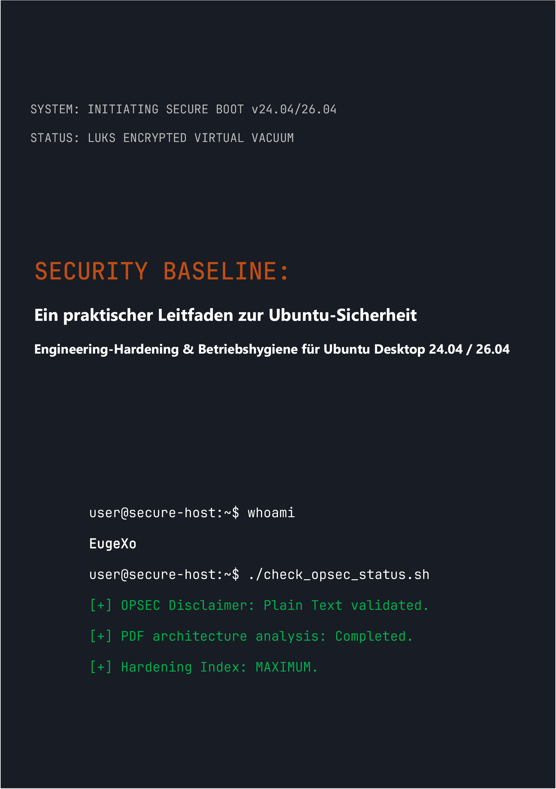

<div align="center">

# Security Baseline: Ein praktischer Leitfaden zur Ubuntu-Sicherheit

## Engineering-Hardening und Betriebshygiene für Ubuntu Desktop 24.04/26.04 LTS

### Written and published by EugeXo

</div>

---

<p align="center">
  
</p>

---

## Buchstruktur und Kurzbeschreibungen

- [Security Baseline: Ein praktischer Leitfaden zur Ubuntu-Sicherheit](#security-baseline-ein-praktischer-leitfaden-zur-ubuntu-sicherheit)
  - [Engineering-Hardening und Betriebshygiene für Ubuntu Desktop 24.04/26.04 LTS](#engineering-hardening-und-betriebshygiene-für-ubuntu-desktop-24042604-lts)
    - [Written and published by EugeXo](#written-and-published-by-eugexo)
  - [Buchstruktur und Kurzbeschreibungen](#buchstruktur-und-kurzbeschreibungen)
  - [Danksagungen](#danksagungen)
  - [Format-Sicherheit (OPSEC-Disclaimer)](#format-sicherheit-opsec-disclaimer)
  - [Vom Autor: Warum und für wen wurde dieses Buch geschrieben?](#vom-autor-warum-und-für-wen-wurde-dieses-buch-geschrieben)
    - [Zum Prinzip der Darstellung:](#zum-prinzip-der-darstellung)
  - [Grundlegendes Schutzniveau: 12 Regeln der Betriebshygiene](#grundlegendes-schutzniveau-12-regeln-der-betriebshygiene)
  - [Begriffe: Anonymität, Privatsphäre und Sicherheit](#begriffe-anonymität-privatsphäre-und-sicherheit)
  - [Installation des Betriebssystems Ubuntu 24.04/26.04 LTS](#installation-des-betriebssystems-ubuntu-24042604-lts)
    - [Einführung:](#einführung)
    - [Richtlinie zur Hardware-Vorbereitung:](#richtlinie-zur-hardware-vorbereitung)
    - [Wahl der Distribution:](#wahl-der-distribution)
    - [Schritt-für-Schritt-Durchlauf des Installers:](#schritt-für-schritt-durchlauf-des-installers)
  - [Erster Systemstart](#erster-systemstart)
  - [Systemkonfiguration](#systemkonfiguration)
  - [Erste Schritte mit der Konsole](#erste-schritte-mit-der-konsole)
    - [Grundeinstellungen:](#grundeinstellungen)
      - [Gnome Terminal Ubuntu 24.04:](#gnome-terminal-ubuntu-2404)
      - [Ptyxis Ubuntu 26.04:](#ptyxis-ubuntu-2604)
    - [Deaktivierung des Automountings und optionale Einstellungen:](#deaktivierung-des-automountings-und-optionale-einstellungen)
    - [Speicherung der Befehls-Historie in der Konsole:](#speicherung-der-befehls-historie-in-der-konsole)
    - [Konfiguration eines sicheren Session-Timeouts für sudo:](#konfiguration-eines-sicheren-session-timeouts-für-sudo)
    - [Erstellen einer Datei zur Prüfung von Checks Passed:](#erstellen-einer-datei-zur-prüfung-von-checks-passed)
  - [Netzwerkkonfiguration und VPN](#netzwerkkonfiguration-und-vpn)
    - [Für kabelgebundene Ethernet-Verbindungen (Wired connection):](#für-kabelgebundene-ethernet-verbindungen-wired-connection)
    - [Für drahtlose Wi-Fi-Verbindungen (Wireless connection):](#für-drahtlose-wi-fi-verbindungen-wireless-connection)
      - [Konfiguration für einen realen PC oder Laptop (Vollständige Randomisierung):](#konfiguration-für-einen-realen-pc-oder-laptop-vollständige-randomisierung)
      - [Konfiguration für virtuelle Maschinen (Strict-Tarnung als Hardware-Hersteller):](#konfiguration-für-virtuelle-maschinen-strict-tarnung-als-hardware-hersteller)
    - [Hardening des NetworkManagers: Unterdrückung lokaler Leaks (mDNS, LLMNR, Hostname) und DNS-Schutz:](#hardening-des-networkmanagers-unterdrückung-lokaler-leaks-mdns-llmnr-hostname-und-dns-schutz)
    - [Wi-Fi beim Systemstart vollständig deaktivieren:](#wi-fi-beim-systemstart-vollständig-deaktivieren)
    - [Kompromittierende Bluetooth-Komponenten entfernen:](#kompromittierende-bluetooth-komponenten-entfernen)
    - [Einrichtung der VPN-Verbindung:](#einrichtung-der-vpn-verbindung)
  - [Sicherheitskonfiguration und Hardening des GRUB-Bootloaders](#sicherheitskonfiguration-und-hardening-des-grub-bootloaders)
    - [Passwortschutz für GRUB einrichten:](#passwortschutz-für-grub-einrichten)
    - [Software-Hardening von IOMMU: Schutz des RAM vor DMA-Angriffen auf Kernel-Ebene:](#software-hardening-von-iommu-schutz-des-ram-vor-dma-angriffen-auf-kernel-ebene)
  - [Varianten der UFW-Firewall-Konfiguration mit und ohne Kill Switch](#varianten-der-ufw-firewall-konfiguration-mit-und-ohne-kill-switch)
    - [Firewall mit Kill Switch konfigurieren:](#firewall-mit-kill-switch-konfigurieren)
    - [Wichtige Ergänzung zur Verwaltung der Regelreihenfolge:](#wichtige-ergänzung-zur-verwaltung-der-regelreihenfolge)
    - [Alternative Konfigurationsvariante (Ohne VPN-Nutzung / Für Gast-Betriebssysteme):](#alternative-konfigurationsvariante-ohne-vpn-nutzung--für-gast-betriebssysteme)
  - [Systemkernel-Konfiguration, Zugriffsrechtssteuerung und Entfernen von Systemdiensten](#systemkernel-konfiguration-zugriffsrechtssteuerung-und-entfernen-von-systemdiensten)
    - [Schutz des Netzwerk-Stacks und des Kernel-Speicher-Subsystems:](#schutz-des-netzwerk-stacks-und-des-kernel-speicher-subsystems)
    - [Low-Level-Hardening via sysctl: Schutz vor TCP Timestamp Fingerprinting:](#low-level-hardening-via-sysctl-schutz-vor-tcp-timestamp-fingerprinting)
    - [Blockieren seltener Netzwerkprotokolle und veralteter Dateisysteme:](#blockieren-seltener-netzwerkprotokolle-und-veralteter-dateisysteme)
    - [Steuerung der Zugriffsrechte im Dateisystem:](#steuerung-der-zugriffsrechte-im-dateisystem)
    - [Sicheres Einbinden von Shared Memory:](#sicheres-einbinden-von-shared-memory)
      - [Ausgewogener Modus (Empfohlen für den alltäglichen Desktop-Einsatz):](#ausgewogener-modus-empfohlen-für-den-alltäglichen-desktop-einsatz)
      - [Paranoider Modus (Maximale Isolierung):](#paranoider-modus-maximale-isolierung)
    - [Erstellen einer isolierten RAM-Disk für flüchtige Logs:](#erstellen-einer-isolierten-ram-disk-für-flüchtige-logs)
    - [Videostream und Tonaufnahme unterbinden:](#videostream-und-tonaufnahme-unterbinden)
    - [Entfernen von Systemdiensten für Druck und lokale Netzwerkerkennung:](#entfernen-von-systemdiensten-für-druck-und-lokale-netzwerkerkennung)
    - [Geolokalisierung und Zeitzone verschleiern:](#geolokalisierung-und-zeitzone-verschleiern)
  - [Repository-Konfiguration und Systemaktualisierung](#repository-konfiguration-und-systemaktualisierung)
    - [Systemaktualisierung:](#systemaktualisierung)
    - [Bereitstellung des NVIDIA-Grafik-Stacks im Isolationsmodus:](#bereitstellung-des-nvidia-grafik-stacks-im-isolationsmodus)
  - [Terminal-Umgebungen unter Ubuntu:](#terminal-umgebungen-unter-ubuntu)
    - [Austausch von Gnome Terminal und Ptyxis gegen Ghostty:](#austausch-von-gnome-terminal-und-ptyxis-gegen-ghostty)
      - [Installation für Benutzer von Ubuntu 24.04 LTS Noble Numbat:](#installation-für-benutzer-von-ubuntu-2404-lts-noble-numbat)
      - [Installation für Benutzer von Ubuntu 26.04 LTS Resolute Racoon:](#installation-für-benutzer-von-ubuntu-2604-lts-resolute-racoon)
      - [Konfigurationsvariante für Ghostty unter Ubuntu 24.04/26.04:](#konfigurationsvariante-für-ghostty-unter-ubuntu-24042604)
    - [Optional! Ubuntu 26.04 – Gnome Terminal zurückholen und Ptyxis entfernen:](#optional-ubuntu-2604--gnome-terminal-zurückholen-und-ptyxis-entfernen)
  - [Entfernen und Sperren von Snap und Telemetrie](#entfernen-und-sperren-von-snap-und-telemetrie)
    - [Snap entfernen:](#snap-entfernen)
    - [Canonical-Telemetrie herausschneiden:](#canonical-telemetrie-herausschneiden)
    - [Neutralisierung des Hintergrund-Firmware-Trackers fwupd:](#neutralisierung-des-hintergrund-firmware-trackers-fwupd)
  - [Installation der Sicherheits-Tools libpam-tmpdir, debsums und des Systemmonitors Btop](#installation-der-sicherheits-tools-libpam-tmpdir-debsums-und-des-systemmonitors-btop)
    - [Das Sicherheits-Tool libpam-tmpdir:](#das-sicherheits-tool-libpam-tmpdir)
    - [Das Tool debsums:](#das-tool-debsums)
    - [Das praktische Tool zur Lastüberwachung Btop:](#das-praktische-tool-zur-lastüberwachung-btop)
    - [Überwachung von Netzwerkports und Verbindungen:](#überwachung-von-netzwerkports-und-verbindungen)
  - [Erstellen von Referenz-Wiederherstellungspunkten: Bereitstellung und Konfiguration des Tools Timeshift](#erstellen-von-referenz-wiederherstellungspunkten-bereitstellung-und-konfiguration-des-tools-timeshift)
    - [Einführung:](#einführung-1)
    - [Besonderheiten der Arbeit mit Timeshift in einer verschlüsselten Umgebung (LUKS + GRUB):](#besonderheiten-der-arbeit-mit-timeshift-in-einer-verschlüsselten-umgebung-luks--grub)
    - [Sichere Installation von Timeshift:](#sichere-installation-von-timeshift)
    - [Erstkonfiguration und Erstellung von Snapshot Nr. 1 (Sterile Referenz):](#erstkonfiguration-und-erstellung-von-snapshot-nr-1-sterile-referenz)
    - [Vektor der weiteren Kontrolle: Erstellung von Snapshot Nr. 2 (Vorab-Betriebsstand):](#vektor-der-weiteren-kontrolle-erstellung-von-snapshot-nr-2-vorab-betriebsstand)
    - [Richtlinie für den Notfall-Rollback (Falls das System kompromittiert oder beschädigt ist):](#richtlinie-für-den-notfall-rollback-falls-das-system-kompromittiert-oder-beschädigt-ist)
  - [Installation der sauberen .deb-Version von Firefox und Entfernen des Snap-Dummys](#installation-der-sauberen-deb-version-von-firefox-und-entfernen-des-snap-dummys)
  - [Installation und Konfiguration der Datenschutzeinstellungen in Mozilla Firefox](#installation-und-konfiguration-der-datenschutzeinstellungen-in-mozilla-firefox)
    - [Vorbereitung des Systems auf die Konfiguration:](#vorbereitung-des-systems-auf-die-konfiguration)
    - [Grundlegende grafische Datenschutzeinstellungen (Pflicht für alle):](#grundlegende-grafische-datenschutzeinstellungen-pflicht-für-alle)
    - [Konfiguration privater DNS-Anbieter (DNS over HTTPS):](#konfiguration-privater-dns-anbieter-dns-over-https)
    - [Automatisierung des Hardenings: Erstellung der Konfigurationsdatei user.js:](#automatisierung-des-hardenings-erstellung-der-konfigurationsdatei-userjs)
    - [Bereitstellung ultimativer Schutz-Erweiterungen:](#bereitstellung-ultimativer-schutz-erweiterungen)
  - [Installation und Konfiguration der interaktiven Netzwerk-Firewall Portmaster](#installation-und-konfiguration-der-interaktiven-netzwerk-firewall-portmaster)
    - [Einführung:](#einführung-2)
    - [Vorbereitung, Erstinitialisierung des Kerns und Umstieg auf die neue Version:](#vorbereitung-erstinitialisierung-des-kerns-und-umstieg-auf-die-neue-version)
  - [Garantierte Datenvernichtung und Sterilisation digitaler Spuren](#garantierte-datenvernichtung-und-sterilisation-digitaler-spuren)
    - [Einführung:](#einführung-3)
    - [Anatomie der digitalen Spur: Warum das Löschen von Daten ohne Bereinigung der Metadaten nutzlos ist?](#anatomie-der-digitalen-spur-warum-das-löschen-von-daten-ohne-bereinigung-der-metadaten-nutzlos-ist)
    - [Installation und Metadatenbereinigung mit dem Tool MAT2:](#installation-und-metadatenbereinigung-mit-dem-tool-mat2)
    - [Sicheres und unwiederbringliches Löschen von Dateien und Verzeichnissen:](#sicheres-und-unwiederbringliches-löschen-von-dateien-und-verzeichnissen)
    - [Parameter des Tools shred:](#parameter-des-tools-shred)
    - [Globale Bereinigung des freien Speicherplatzes auf dem Datenträger:](#globale-bereinigung-des-freien-speicherplatzes-auf-dem-datenträger)
  - [Steganografie, Verschleierung (Obfuscation) und Spurenverwischung unter Ubuntu](#steganografie-verschleierung-obfuscation-und-spurenverwischung-unter-ubuntu)
    - [Einführung:](#einführung-4)
    - [Steganografie unter Linux: Dateien in Medieninhalten verstecken:](#steganografie-unter-linux-dateien-in-medieninhalten-verstecken)
    - [Das Konsolen-Tool steghide:](#das-konsolen-tool-steghide)
    - [Tarnung über das fortschrittliche Tool StegoForge:](#tarnung-über-das-fortschrittliche-tool-stegoforge)
    - [Zusammenfügen von Archiven (Schneller Lifehack ohne Drittanbieter-Software):](#zusammenfügen-von-archiven-schneller-lifehack-ohne-drittanbieter-software)
    - [Text-Obfuscation: Umgehen automatischer Analysesysteme (DPI):](#text-obfuscation-umgehen-automatischer-analysesysteme-dpi)
    - [Analyse versteckter Bedrohungen: Verschleierung von Dateiendungen (BiDi-Angriffe):](#analyse-versteckter-bedrohungen-verschleierung-von-dateiendungen-bidi-angriffe)
  - [Installation und Konfiguration des Kryptografie-Pakets VeraCrypt](#installation-und-konfiguration-des-kryptografie-pakets-veracrypt)
    - [Einführung in VeraCrypt und Installation:](#einführung-in-veracrypt-und-installation)
      - [Installation über das Community-PPA-Repository:](#installation-über-das-community-ppa-repository)
      - [Installation der offiziellen Distribution (Native Methode):](#installation-der-offiziellen-distribution-native-methode)
    - [Tiefgehendes Sicherheits-Tuning: Schutz der Schlüssel im RAM (Paranoia-Modus):](#tiefgehendes-sicherheits-tuning-schutz-der-schlüssel-im-ram-paranoia-modus)
    - [Fundamentales InfoSec-Werkzeug: Erstellung versteckter Volumes (Hidden Volume):](#fundamentales-infosec-werkzeug-erstellung-versteckter-volumes-hidden-volume)
    - [Ultimatives Hardening: Konfiguration von PIM und Hardware-Schlüsseldateien:](#ultimatives-hardening-konfiguration-von-pim-und-hardware-schlüsseldateien)
    - [Bedrohungsmodell in der realen Welt: Warum Paranoia systematisch sein muss:](#bedrohungsmodell-in-der-realen-welt-warum-paranoia-systematisch-sein-muss)
  - [Verwendung von Yubico-Sicherheitsschlüsseln](#verwendung-von-yubico-sicherheitsschlüsseln)
    - [Einführung:](#einführung-5)
    - [Installation:](#installation)
    - [Implementierung eines Hardware-Log-Out-/Kill-Switches über Kernel-udev-Regeln:](#implementierung-eines-hardware-log-out-kill-switches-über-kernel-udev-regeln)
  - [Installation und Konfiguration von USBGuard](#installation-und-konfiguration-von-usbguard)
    - [Einführung:](#einführung-6)
    - [Installation und Konfiguration:](#installation-und-konfiguration)
  - [Implementierung eines Emergency Panic Buttons zum sofortigen Herunterfahren](#implementierung-eines-emergency-panic-buttons-zum-sofortigen-herunterfahren)
    - [Notfall-Hardware-Kill-Switch über ein beliebiges USB-Gerät:](#notfall-hardware-kill-switch-über-ein-beliebiges-usb-gerät)
  - [Installation des lokalen Passwortmanagers KeePassXC](#installation-des-lokalen-passwortmanagers-keepassxc)
    - [Einführung:](#einführung-7)
    - [Varianten der Schutzszenarien für den Tresor:](#varianten-der-schutzszenarien-für-den-tresor)
    - [Installation des Softwarepakets:](#installation-des-softwarepakets)
    - [Erstellung und Hardware-Schutz der Datenbank:](#erstellung-und-hardware-schutz-der-datenbank)
    - [Tiefgehendes Hardening der internen Sicherheitseinstellungen:](#tiefgehendes-hardening-der-internen-sicherheitseinstellungen)
    - [Sichere Dateneingabe über die geschützte Zwischenablage:](#sichere-dateneingabe-über-die-geschützte-zwischenablage)
  - [Installation und Start des Netzwerkanalysators Wireshark](#installation-und-start-des-netzwerkanalysators-wireshark)
    - [Einführung:](#einführung-8)
    - [Installation und Start von Wireshark:](#installation-und-start-von-wireshark)
    - [Kritisch wichtiges Sicherheitskonzept des Paketmitschnitt-Subsystems:](#kritisch-wichtiges-sicherheitskonzept-des-paketmitschnitt-subsystems)
    - [Verdecktes Sammeln von Traffic-Dumps (Konsolenmodus):](#verdecktes-sammeln-von-traffic-dumps-konsolenmodus)
    - [Praktischer Leitfaden zu Wireshark:](#praktischer-leitfaden-zu-wireshark)
  - [Installation und Verwaltung des Schutzsystems AppArmor](#installation-und-verwaltung-des-schutzsystems-apparmor)
    - [Einführung:](#einführung-9)
    - [Neues Sicherheitsparadigma: Kernel-Automatisierung:](#neues-sicherheitsparadigma-kernel-automatisierung)
    - [Praktisches Hardening des AppArmor-Subsystems:](#praktisches-hardening-des-apparmor-subsystems)
  - [Installation und Konfiguration der isolierten Sandboxes Firejail und Bubblewrap](#installation-und-konfiguration-der-isolierten-sandboxes-firejail-und-bubblewrap)
    - [Einführung:](#einführung-10)
    - [Installation von Firejail und Vorbereitung der Sandbox:](#installation-von-firejail-und-vorbereitung-der-sandbox)
    - [Grundlegende Filterparameter von Firejail (Referenz):](#grundlegende-filterparameter-von-firejail-referenz)
    - [Optional! Automatisierung des Firejail-Schutzperimeters (Tool Firecfg):](#optional-automatisierung-des-firejail-schutzperimeters-tool-firecfg)
    - [Installation von Bubblewrap:](#installation-von-bubblewrap)
    - [Spickzettel zu den Bubblewrap-Flags (Referenz):](#spickzettel-zu-den-bubblewrap-flags-referenz)
    - [Vorbereitung benutzerdefinierter Verknüpfungen für Sandboxes:](#vorbereitung-benutzerdefinierter-verknüpfungen-für-sandboxes)
    - [Erstellung eines separaten Profils Firefox hardened für Firejail:](#erstellung-eines-separaten-profils-firefox-hardened-für-firejail)
    - [Erstellung des Profils Firefox hardened in Bubblewrap:](#erstellung-des-profils-firefox-hardened-in-bubblewrap)
    - [Hermetische Kammer für PDF-Dokumente: Sicheres Öffnen von Dateien in Firejail:](#hermetische-kammer-für-pdf-dokumente-sicheres-öffnen-von-dateien-in-firejail)
    - [Document Viewer zum Lesen von PDFs in Bubblewrap versiegeln:](#document-viewer-zum-lesen-von-pdfs-in-bubblewrap-versiegeln)
    - [Image Viewer zum Betrachten von Grafikdateien in Firejail:](#image-viewer-zum-betrachten-von-grafikdateien-in-firejail)
    - [Den Bildbetrachter Image Viewer in Bubblewrap verpacken:](#den-bildbetrachter-image-viewer-in-bubblewrap-verpacken)
    - [Isolierungsszenario für KeePassXC in Firejail:](#isolierungsszenario-für-keepassxc-in-firejail)
    - [KeePassXC über Bubblewrap isolieren:](#keepassxc-über-bubblewrap-isolieren)
    - [Installation und Isolierung der Office-Suite LibreOffice:](#installation-und-isolierung-der-office-suite-libreoffice)
    - [Betrieb von LibreOffice über Firejail konfigurieren:](#betrieb-von-libreoffice-über-firejail-konfigurieren)
    - [LibreOffice in Bubblewrap verpacken:](#libreoffice-in-bubblewrap-verpacken)
    - [Installation und Isolierung des GNU Image Manipulation Program (GIMP):](#installation-und-isolierung-des-gnu-image-manipulation-program-gimp)
    - [Betrieb von GIMP über Firejail konfigurieren:](#betrieb-von-gimp-über-firejail-konfigurieren)
    - [GIMP über Bubblewrap konfigurieren:](#gimp-über-bubblewrap-konfigurieren)
    - [Installation und Isolierung des Code-Editors VS Codium (IDE zum Schreiben von Programmen):](#installation-und-isolierung-des-code-editors-vs-codium-ide-zum-schreiben-von-programmen)
    - [Isolierung von VS Codium in Firejail:](#isolierung-von-vs-codium-in-firejail)
    - [Isolierung von VS Codium in Bubblewrap:](#isolierung-von-vs-codium-in-bubblewrap)
    - [Installation und Isolierung der lokalen KI LM Studio Bionic:](#installation-und-isolierung-der-lokalen-ki-lm-studio-bionic)
    - [Betrieb von LM Studio über Firejail einrichten:](#betrieb-von-lm-studio-über-firejail-einrichten)
    - [LM Studio in Bubblewrap verpacken:](#lm-studio-in-bubblewrap-verpacken)
    - [Einrichtung sicherer Kommunikation: Obligatorische Isolierung von Messengern und Krypto-Perimeter (OPSEC-Perimeter des Autors):](#einrichtung-sicherer-kommunikation-obligatorische-isolierung-von-messengern-und-krypto-perimeter-opsec-perimeter-des-autors)
    - [Installation und Isolierung von Telegram Desktop:](#installation-und-isolierung-von-telegram-desktop)
    - [Telegram-Perimeter über Firejail schützen:](#telegram-perimeter-über-firejail-schützen)
    - [Telegram über Bubblewrap isolieren:](#telegram-über-bubblewrap-isolieren)
    - [Installation und Isolierung von Signal über Bubblewrap:](#installation-und-isolierung-von-signal-über-bubblewrap)
    - [Kryptografisches Fundament des Hosts: Generierung und OPSEC-Schutz von GnuPG-Schlüsseln:](#kryptografisches-fundament-des-hosts-generierung-und-opsec-schutz-von-gnupg-schlüsseln)
    - [Installation und Isolierung des Jabber-Clients Psi+:](#installation-und-isolierung-des-jabber-clients-psi)
    - [PSI+ in Firejail isolieren:](#psi-in-firejail-isolieren)
    - [Isolierung des Psi+ Jabber-Clients in der Bubblewrap-Sandbox:](#isolierung-des-psi-jabber-clients-in-der-bubblewrap-sandbox)
    - [Installation und Isolierung des E-Mail-Clients Thunderbird (Perimeter für verschlüsselte E-Mail-Korrespondenz):](#installation-und-isolierung-des-e-mail-clients-thunderbird-perimeter-für-verschlüsselte-e-mail-korrespondenz)
    - [Isolierung von Thunderbird mithilfe von Firejail:](#isolierung-von-thunderbird-mithilfe-von-firejail)
    - [Isolierung von Thunderbird über Bubblewrap:](#isolierung-von-thunderbird-über-bubblewrap)
    - [Fortgeschrittener „Paranoia“-Modus: Firejail mit Sitzungsspeicherung über Overlay:](#fortgeschrittener-paranoia-modus-firejail-mit-sitzungsspeicherung-über-overlay)
  - [Installation von Rkhunter und Rootkit-Suche](#installation-von-rkhunter-und-rootkit-suche)
    - [Installation von Chkrootkit als Ergänzung zu Rkhunter:](#installation-von-chkrootkit-als-ergänzung-zu-rkhunter)
  - [Installation und Konfiguration des Antiviren-Scanners ClamAV](#installation-und-konfiguration-des-antiviren-scanners-clamav)
    - [Einführung:](#einführung-11)
    - [Installation von ClamAV:](#installation-von-clamav)
    - [Aktualisierung der Signaturdatenbanken und Umgehen von Netzwerksperren:](#aktualisierung-der-signaturdatenbanken-und-umgehen-von-netzwerksperren)
    - [Organisation des System-Scans:](#organisation-des-system-scans)
    - [Multithreaded-Scanning (Hardening):](#multithreaded-scanning-hardening)
  - [Installation und Konfiguration der Virtualisierungsumgebung VirtualBox](#installation-und-konfiguration-der-virtualisierungsumgebung-virtualbox)
    - [Schutz vor Forensik: Isolierung der VirtualBox-Logs im RAM (`tmpfs`):](#schutz-vor-forensik-isolierung-der-virtualbox-logs-im-ram-tmpfs)
  - [Komprimierung und Optimierung virtueller VDI-Festplatten](#komprimierung-und-optimierung-virtueller-vdi-festplatten)
    - [Einführung:](#einführung-12)
    - [Bereinigung einer virtuellen Maschine unter Windows:](#bereinigung-einer-virtuellen-maschine-unter-windows)
    - [Bereinigung einer virtuellen Maschine unter Linux (Ubuntu/Kali Linux):](#bereinigung-einer-virtuellen-maschine-unter-linux-ubuntukali-linux)
    - [Abschließende Komprimierung der virtuellen Festplatte auf der Host-Maschine:](#abschließende-komprimierung-der-virtuellen-festplatte-auf-der-host-maschine)
  - [Installation und Konfiguration des Container-Systems Docker](#installation-und-konfiguration-des-container-systems-docker)
    - [Einführung:](#einführung-13)
    - [Worin besteht die versteckte Gefahr des Standard-Dockers?](#worin-besteht-die-versteckte-gefahr-des-standard-dockers)
    - [Bereitstellung von Docker im Rootless-Modus:](#bereitstellung-von-docker-im-rootless-modus)
    - [Zähmung des Netzwerks und Anbindung an UFW:](#zähmung-des-netzwerks-und-anbindung-an-ufw)
    - [Praktisches Beispiel für das sichere Starten von Containern:](#praktisches-beispiel-für-das-sichere-starten-von-containern)
    - [Experimenteller Sicherheitsbeweis (Prüfung auf fehlende Root-Rechte):](#experimenteller-sicherheitsbeweis-prüfung-auf-fehlende-root-rechte)
  - [Installation und Konfiguration des Integritätskontrollsystems AIDE](#installation-und-konfiguration-des-integritätskontrollsystems-aide)
    - [Einführung:](#einführung-14)
    - [Installation und Konfiguration von AIDE:](#installation-und-konfiguration-von-aide)
    - [Durchführung eines Penetrationstests (Validierung des Schutzes):](#durchführung-eines-penetrationstests-validierung-des-schutzes)
  - [Automatisiertes Sicherheitsaudit des Systems mit Lynis](#automatisiertes-sicherheitsaudit-des-systems-mit-lynis)
  - [Installation und Konfiguration des Schwachstellen- und Passwortleck-Scanners Trivy](#installation-und-konfiguration-des-schwachstellen--und-passwortleck-scanners-trivy)
  - [Konfiguration von Gastsystemen (Ubuntu/Xubuntu/Lubuntu) in VirtualBox](#konfiguration-von-gastsystemen-ubuntuxubuntulubuntu-in-virtualbox)
    - [Installation der Guest Additions:](#installation-der-guest-additions)
    - [Installation von Mozilla Firefox:](#installation-von-mozilla-firefox)
    - [Einrichtung gemeinsamer Ordner (Shared Folders) in VirtualBox:](#einrichtung-gemeinsamer-ordner-shared-folders-in-virtualbox)
    - [Installation von Ledger Live in VirtualBox mit Ubuntu/Xubuntu/Lubuntu:](#installation-von-ledger-live-in-virtualbox-mit-ubuntuxubuntulubuntu)
    - [Starten von Ledger Live auf dem Haupt-Hostsystem Ubuntu:](#starten-von-ledger-live-auf-dem-haupt-hostsystem-ubuntu)
  - [Über den Autor und rechtliche Hinweise](#über-den-autor-und-rechtliche-hinweise)
    - [Kontaktmöglichkeiten und Community-Ressourcen:](#kontaktmöglichkeiten-und-community-ressourcen)

<br>
<br>
<br>
<br>
<br>
<br>
<br>

## Danksagungen

Ohne viele Umschweife möchte ich den Menschen meinen tiefsten Dank aussprechen, die mich zum Schreiben dieses Buches bewegt und mich auf dem gesamten Weg unterstützt haben.

Ich danke den unkomplizierten Jungs aus der Cybercrime-Abteilung der Polizei unseres kleinen, aber technologisch fortschrittlichen Estlands, die mir den Anstoß zu diesem Buch gegeben haben.

Mein besonderer Dank gilt außerdem den Spezialisten für Informationssicherheit aus der Außenstelle des US Secret Service in Miami, die einen gewichtigen praktischen Beitrag zur Verifizierung einiger Kapitel geleistet haben. Wie sich herausstellte, funktionieren die hier beschriebenen Methoden und Ansätze unter realen Einsatzbedingungen hervorragend.

Selbstverständlich gebührt mein größter Dank meiner Familie für ihre phänomenale Geduld und moralische Unterstützung – insbesondere meiner Mutter, die meiner Arbeit mit vollem Verständnis begegnet ist und mir einen riesigen Teil der alltäglichen Routine abgenommen hat, um mir den Rücken für meine Recherchen freizuhalten.

**Ganz besonders möchte ich meinem Kameraden aus Großbritannien für seine Unterstützung danken. Wir standen in engem Kontakt, als ich in Miami war, doch leider ist die Verbindung danach abgerissen. Ich hoffe aufrichtig, dass wir wieder zueinanderfinden. Mein Freund, falls du oder dein Sohn – der InfoSec-Spezialist – diese Zeilen lest, meldet euch bitte – meine Kontaktdaten stehen am Ende des Buches. Ich denke, du hast verstanden, *who is who!* ;)**

Ein unbeschreiblicher Dank geht an meinen virtuellen Assistenten – **Gemini von Google**. Während der gesamten Arbeit an diesem Buch blieb er ein treuer digitaler Partner und leistete unschätzbare Hilfe bei der Strukturierung und Übersetzung dieses Hardcore-Materials.

Ich danke auch dem humorvollen und fortschrittlichen Assistenten **ChatGPT von OpenAI** für die Hilfe bei der Diskussion technischer Lösungen, der Prüfung von Konfigurationen sowie für das aufmerksame Lektorat einzelner Textpassagen und die Suche nach präziseren Formulierungen.

In erster Linie gilt mein Dank natürlich den Ingenieuren und Entwicklern von Google und OpenAI für ihre erstklassig geleistete Arbeit!

Man könnte noch lange weiterschreiben, aber alle Beteiligten wissen ohnehin genau, worum es geht. Ich freue mich riesig, dass dieses Buch endlich das Licht der Welt erblickt. Leute, ich schätze, respektiere und mag euch alle von Herzen!

<br>

## Format-Sicherheit (OPSEC-Disclaimer)

Aus Gründen der Informationssicherheit und des gesunden Menschenverstands wird das gesamte Material dieses Leitfadens ursprünglich als reiner Text (Plain Text mit Markdown-Auszeichnung) bereitgestellt. Der Plan, das Buch im PDF-Format zu veröffentlichen, wurde bewusst verworfen. PDF besitzt eine zu schwerfällige Architektur und wird regelmäßig kompromittiert. Die Sicherheit des zu schützenden Hosts muss bereits beim sicheren Lesen der Konfigurationsanleitungen beginnen.

Eine Textdatei besteht aus reinen Daten ohne ausführbaren Code, während das PDF-Format standardmäßig eingebettete JavaScript-Skripte, dynamische Elemente, interaktive Formulare und komplexe Schriftarten unterstützt, die ein tiefgreifendes System-Parsing erfordern. Kritische Schwachstellen der Klasse RCE (Remote Code Execution) über PDF-Parser unter Linux (beispielsweise im Standard-Viewer `Evince` oder den `Poppler`-Bibliotheken) sind eine bewiesene historische Tatsache. Das Plain-Text-Format enthält keinerlei integrierte Mechanismen zur Codeausführung und reduziert die Angriffsfläche beim Lesen des Materials erheblich. Dies garantiert ein sicheres Lesen in jeder Umgebung.

Aus diesem Grund sind sämtliche Grafiken und Illustrationen in ein separates Verzeichnis außerhalb des Haupttextes ausgelagert. Die Grafiken sind in Ordnern und Unterordnern strukturiert, was ihr automatisches Rendering im Arbeitsspeicher während des Lesens verhindert.

> [!NOTE]
> Das primäre Ausgangsformat des Buches ist Markdown. Alle abgeleiteten Formate (HTML, EPUB und andere) werden aus dem geprüften Text-Quellcode generiert.

Der Leser kann das Projekt auf drei Arten nutzen:

* Den ursprünglichen Markdown-Quelltext direkt lesen.
* Fertige HTML-/EPUB-Builds verwenden (wird zu einem späteren Zeitpunkt umgesetzt).
* Das Buch selbstständig aus den Quelldateien kompilieren und bei Bedarf Layout, Struktur, Schriftarten, Stile oder die Auswahl der enthaltenen Kapitel anpassen.

Dieser Ansatz gewährleistet die Transparenz des Textes, eine einfache Nachvollziehbarkeit von Änderungen (Audit) und Unabhängigkeit von einem bestimmten Lesewerkzeug.

<br>

## Vom Autor: Warum und für wen wurde dieses Buch geschrieben?

Die moderne digitale Umgebung wird immer komplexer: Die Zahl der Cyberbedrohungen wächst, das Volumen der gesammelten Daten steigt, und der Nutzer sieht sich zunehmend gezwungen, seine Privatsphäre und Sicherheit eigenständig zu schützen.

Dieses Buch ist als praktischer Leitfaden zum Aufbau einer kontrollierten Linux-Workstation konzipiert, in der Sicherheit nicht als bloße Ansammlung einzelner Programme betrachtet wird, sondern als ein geschlossenes System ineinandergreifender Lösungen. Mein Ziel ist es zu zeigen, wie man mit den Bordmitteln von Linux eine Arbeitsumgebung mit einem klaren Bedrohungsmodell aufbaut: mit Anwendungsisolierung, Kontrolle der Netzwerkaktivität, Datenschutz und einem bewussten Management der digitalen Umgebung.

**Das Ziel des Buches ist es, eine Workstation zu errichten, auf der jede Aktion über einen kontrollierten Sicherheitsperimeter verfügt.**

Das Material wurde zu Bildungszwecken erstellt und richtet sich an technisch versierte Nutzer, Linux-Enthusiasten und Spezialisten mit Interesse an praktischer Informationssicherheit. Der Leitfaden ist kein Einsteigerkurs in Linux und setzt ein grundlegendes Verständnis des Terminals, des Dateisystems und der Funktionsweise des Betriebssystems voraus. Dennoch wird sich ein aufmerksamer und motivierter Leser die notwendigen Werkzeuge schrittweise aneignen können.

Alle beschriebenen Technologien dürfen ausschließlich zu legalen Zwecken eingesetzt werden: zum Schutz eigener Daten, zur Erhöhung der Systemsicherheit und zum Studium der Prinzipien der Informationssicherheit.

Ein bewusster Schutz von Informationen und der verantwortungsvolle Umgang mit Technologien machen die digitale Welt für alle sicherer.

### Zum Prinzip der Darstellung:

Ziel dieses Buches ist es nicht, eine Enzyklopädie für jedes verwendete Tool zu verfassen, sondern deren Rolle innerhalb eines einheitlichen Schutzmodells aufzuzeigen. Daher werden der innere Aufbau und die Funktionen der Komponenten nur in dem Umfang behandelt, der für das Verständnis der Funktionsprinzipien und die sichere Anwendung erforderlich ist.

Erweiterte Funktionen, die vollständige Syntax und spezialisierte Einsatzszenarien bleiben außerhalb des Rahmens dieses Leitfadens und können separat in der jeweiligen offiziellen Dokumentation nachgeschlagen werden.

## Grundlegendes Schutzniveau: 12 Regeln der Betriebshygiene

*Hello World Kamerad!*

Bevor wir zur knallharten technischen Konfiguration unseres Systems übergehen, legen wir das Fundament fest. Nachfolgend findest du 12 eiserne Regeln der Betriebshygiene, die wir auswendig lernen und bedingungslos einhalten müssen. Ohne ihr Verständnis erweisen sich selbst die fortschrittlichsten Schutzwerkzeuge mit der Zeit als völlig nutzlos:

1. **Im geschützten Perimeter verzichten wir nach Möglichkeit auf drahtlose Peripherie:** kabelloses Bluetooth und Wireless (einschließlich Headsets, Kopfhörer, kabellose Tastaturen und Mäuse). Jede drahtlose Schnittstelle vergrößert die Angriffsfläche und setzt Vertrauen in den Protokoll-Stack, die Firmware und die Sicherheitsimplementierung der Geräte voraus.
2. **Wir gewährleisten eine obligatorische Vollverschlüsselung** des Systemdatenträgers bereits bei der OS-Installation. Die Länge des kryptografischen Passworts wählen wir mit mindestens 24 zufälligen Zeichen (einschließlich Sonderzeichen)!
3. **Wir führen einen regelmäßigen, planmäßigen Wechsel des Anmeldepassworts im Betriebssystem durch.** Das Benutzerpasswort gestalten wir einzigartig und ausreichend lang (empfohlen werden mindestens 16 Zeichen). Beim Einsatz von Hardware-Tokens wird das Passwort nicht ersetzt, sondern um einen zusätzlichen Schutzfaktor ergänzt.
4. **Wir aktivieren den Passwortschutz für den System-Bootloader `GRUB`**, um unbefugten Zugriff auf Kernel-Parameter und Konfigurationsänderungen bei physischem Zugriff auf den PC vollständig auszuschließen.
5. **Wir integrieren ein Hardware-Token** (YubiKey oder legitime Pendants) als obligatorischen zweiten Authentifizierungsfaktor (2FA) für die Systemanmeldung und die Bestätigung von Superuser-Befehlen.
6. **Wir säubern das System von jeglicher überflüssiger Software.** Dies gilt insbesondere für geschlossene proprietäre Programme. Denken wir an die Grundregel: Je weniger fremde Dienste, Daemons und Programme im System laufen, desto kleiner sind die potenzielle Angriffsfläche und die Anzahl kritischer Schwachstellen.
7. **Wir halten das Betriebssystem stets auf dem neuesten Stand.** Machen wir es uns zur eisernen Regel, regelmäßig Sicherheitsupdates über die Konsolen-Tools zu prüfen und einzuspielen.
8. **Wir überwachen kontinuierlich den Zustand des Netzwerks und der Netzwerkschnittstellen.** Achten wir genau darauf, zu welchen externen Ressourcen Hintergrundverbindungen aufgebaut werden und wohin unser Netzwerkverkehr abfließt.
9. **Wir führen regelmäßig ein internes Audit des Hosts durch.** Das System wird periodisch (vorzugsweise 2–3 Mal pro Woche) auf Rootkits und Viren untersucht sowie auf die Integrität der Systemdateien geprüft.
10. **Wir führen niemals verdächtige ausführbare Dateien direkt im Hauptsystem aus.** Für deren gefahrloses Testen nutzen wir konsequent die isolierte Sandbox `Firejail` oder virtuelle Maschinen.
11. **Wir sorgen für strikten Schutz vor gefährlichen DMA-Angriffen (Direct Memory Access) und sichern BIOS/UEFI mit einem Passwort:** In den BIOS/UEFI-Einstellungen schalten wir Thunderbolt-/USB4-Ports zwangsweise in den maximalen Autorisierungsmodus (*Kernel DMA Protection*), um das Risiko von Angriffen über direkten Speicherzugriff externer Geräte zu minimieren. Wir setzen ein BIOS/UEFI-Passwort. Zusätzlich deaktivieren wir den Energiesparmodus (*Sleep Mode*) vollständig, da in diesem Zustand die Festplatten-Verschlüsselungsschlüssel im Klartext im RAM verbleiben.
12. **Beim geringsten Verlassen des Arbeitsplatzes sperren wir die Sitzung zwangsweise, und bei längerer Abwesenheit fahren wir den Computer vollständig herunter.**

> [!NOTE]
> Das schwächste Glied in jedem Sicherheitssystem bleibt oft nicht die Software, sondern die Handlung des Nutzers.

Im professionellen Umfeld gibt es den scherzhaften Ausdruck: „Die Hauptschwachstelle befindet sich zwischen Stuhllehne und Tastatur.“

Genau deshalb muss technisches Hardening von operativer Disziplin begleitet werden: Prüfung von Dateien vor dem Öffnen, Entfernen von Metadaten vor der Veröffentlichung, Kontrolle der Netzwerkaktivität und ein ständiges Bewusstsein für das eigene Bedrohungsmodell.

## Begriffe: Anonymität, Privatsphäre und Sicherheit

Im allgemeinen Sprachgebrauch werden diese Begriffe oft vermischt, obwohl sie unterschiedliche Aufgaben beschreiben.

**Anonymität** beantwortet die Frage: „Lassen sich meine Handlungen mit meiner realen Identität verknüpfen?“
Wenn das System ideal aufgebaut ist, sieht der Angreifer zwar die Handlung selbst, kann sie aber in keiner Weise mit einer konkreten Person in der realen Welt in Verbindung bringen.

**Privatsphäre** beantwortet die Frage: „Kontrolliere ich, welche Informationen über mich gesammelt werden und wem sie zugänglich sind?“
Der Angreifer weiß, dass die Person existiert, aber diese Person steuert, welcher Teil der Informationen nach außen dringen darf.

**Sicherheit** beantwortet die Frage: „Kann ich mein System, meine Daten und mein Gerät vor unbefugtem Zugriff schützen?“
Man befindet sich in ständiger Gefechtsbereitschaft innerhalb seines digitalen Perimeters. Der Angreifer mag direkt vor den Toren stehen, verfügt aber nicht über genügend Möglichkeiten, das System zu knacken und Daten abzugreifen.

Ein verschlüsselter Laptop mit einem starken Passwort ist ein Gewinn an Sicherheit. Wenn der Nutzer jedoch freiwillig alle persönlichen Daten im Internet veröffentlicht, erhöht dies nicht die Privatsphäre. Der Einsatz von Anonymisierungstools kann die Identifizierung des Nutzers erschweren, schützt das System aber nicht vor Schadsoftware. Ein gut geschütztes System kann unanonym sein, und ein anonymes System kann unsicher sein.

**Ziel dieses Leitfadens ist es nicht, die Illusion absoluten Schutzes oder völliger Unsichtbarkeit im Netz zu erzeugen. Ziel ist es, Wege zum Aufbau eines Systems aufzuzeigen, bei dem der Nutzer genau versteht, welche Risiken er reduziert und welche Grenzen bestehen bleiben.**

<br>

## Installation des Betriebssystems Ubuntu 24.04/26.04 LTS

### Einführung:

In diesem Kapitel betrachten wir die Installation des Betriebssystems Ubuntu unter Berücksichtigung strenger Sicherheitsanforderungen. Zudem besteht die Möglichkeit, das System auf externen USB- und Thunderbolt-Datenträgern bereitzustellen.

Vor Beginn der Installation müssen einige wichtige Faktoren bedacht werden. Eines der häufigsten Risiken ist die falsche Wahl des Datenträgers für die Installation des Bootloaders.

Unter Linux ist normalerweise `GRUB` (GRand Unified Bootloader) für den Systemstart zuständig. Während der Installation kann dieser versehentlich nicht auf dem vom Nutzer geplanten Datenträger platziert werden, sondern beispielsweise auf der EFI-Partition einer anderen Festplatte. Infolgedessen startet ein bereits vorhandenes Betriebssystem möglicherweise erst nach einer Wiederherstellung des Bootloaders wieder korrekt.

Um ein solches Szenario vollständig auszuschließen, besteht die zuverlässigste Methode darin, alle internen HDDs und SSDs, die nicht zum zu installierenden System gehören, für die Dauer der Linux-Installation physisch abzuklemmen.

Bei einem Desktop-PC erfordert dies in der Regel nur den Zugang zu den internen Komponenten und einen gewöhnlichen Schraubendreher. Bei Laptops hängt der Ablauf von der Bauweise des Geräts ab und kann aufwendiger sein.

Apple-Geräte (insbesondere moderne MacBooks mit T2-Chip und Apple Silicon) werden für dieses Szenario aufgrund der Besonderheiten der Hardwareplattform, der Boot-Kette und der Linux-Kompatibilität nicht empfohlen.

> [!NOTE]
> Der Leitfaden wurde vollständig unter **Ubuntu 24.04 LTS Noble Numbat (24.04.4)** und **Ubuntu 26.04 LTS Resolute Racoon (26.04.0)** getestet.

Die Tests wurden in **VirtualBox 7.2.x**, **VMware Workstation Pro 26H1** sowie auf physischen Systemen mit integrierter Intel-Grafik und dedizierten NVIDIA-Grafikadaptern durchgeführt.

### Richtlinie zur Hardware-Vorbereitung:

* **Beim stationären PC:** Wir nehmen die Seitenwand des Gehäuses ab, trennen den Computer vollständig vom Stromnetz und klemmen alle Datenträger ab – außer der einen Festplatte, auf der Linux installiert werden soll. Wenn M.2-NVMe-SSDs verbaut sind, wird zum Ausbau ein Schraubendreher benötigt.

* **Beim Laptop:** Wir schalten das Gerät komplett aus, trennen das Netzteil und klemmen – sofern möglich – den Akku ab. Nach dem Abnehmen der Bodenplatte trennen oder entfernen wir alle Datenträger außer dem Ziellaufwerk.

Erfolgt die Installation auf einem externen USB- oder Thunderbolt-Datenträger, lassen wir ausschließlich diesen angeschlossen. Genau er wird als Zielmedium für die Systeminstallation verwendet.

> [!WARNING]
> Vor der Installation des Betriebssystems müssen wir ins BIOS/UEFI wechseln und die Einstellungen des Grafik-Subsystems prüfen. Auf Laptops mit Hybrid-Grafik empfiehlt es sich, den Modus Hybrid Mode/Optimus zu aktivieren, bei dem die Hauptarbeit der Oberfläche über den integrierten Grafikkern des Prozessors läuft. Dies ermöglicht die Nutzung der offenen Linux-Kernel-Treiber (`i915`, `xe`, `amdgpu` je nach Hardware) und vermeidet unnötige Abhängigkeiten von geschlossenen Komponenten.

Sofern diese Möglichkeit besteht, setzen wir ein BIOS/UEFI-Passwort und aktivieren den Hardware-Schutz der Datenträger (falls vom jeweiligen SSD-/HDD-Modell unterstützt). Dies senkt das Risiko unbefugter Änderungen an den Boot-Einstellungen und erschwert Angriffe bei physischem Zugriff auf das Gerät.

Wir prüfen den Status von Secure Boot. Wenn die Plattform und das gewählte Installationsszenario dessen einwandfreie Funktion unterstützen, empfehle ich, diese Funktion aktiviert zu lassen.

**Wir lassen im Computer oder Laptop ausschließlich den einen Datenträger angeschlossen, auf dem die Installation durchgeführt wird.**

Die Installation von Linux führen wir **ohne Internetverbindung** durch – wir ziehen das LAN-Kabel ab und verbinden das Gerät nicht mit WLAN-Netzwerken. Alle benötigten Pakete und Updates werden erst nach Abschluss der Basiskonfiguration des Systems installiert.

Warum führen wir die Installation ohne Internetverbindung durch?

Eine Offline-Installation erlaubt es, externe Einflussfaktoren im Moment der Erstbereitstellung des Systems auf ein Minimum zu reduzieren:

* Während der Installation bestehen keinerlei aktive externe Netzwerkverbindungen;
* das automatische Nachladen von Drittanbieter-Komponenten und Updates vor Abschluss der Basishärtung wird ausgeschlossen;
* die Anzahl der Hintergrund-Netzwerkdienste und -prozesse, die während der Installation starten können, verringert sich;
* der Ausgangszustand des Betriebssystems lässt sich leichter kontrollieren und man behält den Überblick, welche Komponenten ursprünglich installiert wurden;
* potenzielle externe Angriffsvektoren bis zum Abschluss der grundlegenden Systemhärtung werden minimiert.

Nach der Erstkonfiguration und der Aktivierung unserer Schutzmechanismen wird die Netzwerkverbindung in einer bereits kontrollierten Umgebung wiederhergestellt.

### Wahl der Distribution:

Wir setzen alles am Beispiel der aktuellen Distributionen **Ubuntu 24.04 LTS Noble Numbat** und **Ubuntu 26.04 LTS Resolute Racoon** um. Sie sind recht einfach zu erlernen, nicht besonders ressourcenhungrig und laufen selbst auf einem PC mit 2 GB Arbeitsspeicher stabil (insbesondere, wenn wir die leichtgewichtigen Derivate Xubuntu oder Lubuntu wählen). Darüber hinaus genießen sie starke Unterstützung durch die globale Linux-Community und bieten vor allem bereits „out of the box“ ein solides Grundschutzniveau.

Die Installation führt man am besten auf Englisch durch. Sollten unvorhergesehene Fehler auftreten, fällt es uns deutlich leichter, technische Informationen auf einschlägigen englischsprachigen Ressourcen zu suchen und zu finden. Dies ist jedoch nicht zwingend vorgeschrieben, und die endgültige Wahl der Systemsprache bleibt dir überlassen. Ich verwende in meinem Leitfaden die englische Lokalisierung – English (US, amerikanische Variante).

### Schritt-für-Schritt-Durchlauf des Installers:

**1.** Nach der Sprachauswahl wechseln wir in das Menü zur Tastaturkonfiguration **«Select your keyboard»** und wählen **English (US)** oder eine andere passende Variante.

**2.** Im Fenster für Internetverbindungen wählen wir strikt den Punkt **«Do not connect to the internet»**.

**3.** Als Nächstes wählen wir die Optionen **«Interactive Installation»** und **«Default selection»** – dies sorgt für die Installation eines minimalen Softwarepakets im System. Falls wir später zusätzliche Pakete wie Office-Anwendungen oder Ähnliches benötigen, laden wir diese eigenständig aus dem offiziellen Repository nach. Grundsätzlich gilt: Indem wir die anfängliche Anzahl an Anwendungen minimieren, reduzieren wir die potenziellen Angriffsvektoren für Angreifer.

**4.** Im nächsten Schritt installieren wir selbstverständlich keinerlei proprietäre Software.

**6.** **Ubuntu 24.04:** Im Menü **«Disk Setup»** klicken wir auf die Schaltfläche **«Advanced features...»**, wählen dort den Punkt **«Use LVM and encryption»**, bestätigen die Auswahl mit **«OK»** und klicken auf **«Next»**.

**Ubuntu 26.04:** Wir belassen die Standardauswahl **«Erase disk and install Ubuntu»** und klicken auf **«Next»**.

**7.** **Ubuntu 24.04:** Das nächste Menü fordert zur Eingabe eines Master-Passworts für die Festplattenverschlüsselung auf. Wir denken uns ein komplexes Passwort mit einer Länge von mindestens 24 Zeichen (gerne mehr) aus – und merken es uns unbedingt! Dabei nutzen wir alle verfügbaren Möglichkeiten der Tastatur: Groß- und Kleinbuchstaben (A–Z, a–z), Ziffern (0–9), Sonderzeichen und die Leertaste. Wir klicken auf **«Next»**.

**Ubuntu 26.04:** Wir wählen **«Encryption with passphrase»**, klicken auf **«Next»** und geben im nächsten Menü das Master-Passwort für die Festplattenverschlüsselung ein. Wir denken uns ein komplexes Passwort mit einer Länge von mindestens 24 Zeichen (gerne mehr) aus – und merken es uns unbedingt! Dabei nutzen wir alle verfügbaren Möglichkeiten der Tastatur: Groß- und Kleinbuchstaben (A–Z, a–z), Ziffern (0–9), Sonderzeichen und die Leertaste. Wir klicken auf **«Next»**.

**8.** Daraufhin erscheint das Menü **«Create your account.»** Im Feld **«Your name»** tragen wir das zuvor überlegte Pseudonym ein (wir wählen einen neutralen Namen, der nichts über unsere reale Identität verrät, z. B. `user`). In der Zeile **«Computer name»** vergeben wir einen beliebigen Hostnamen (z. B. `host-node`), den Benutzernamen im Feld **«Pick a username»** wählen wir nach eigenem Ermessen. Im Feld Choose password erstellen wir ein komplexes Passwort von mindestens 16 Zeichen Länge unter Verwendung von Groß- und Kleinbuchstaben (A–Z, a–z), Ziffern (0–9), Sonderzeichen und der Leertaste. Wir belassen die Option **«Require password to login»** und klicken auf Next.

**9.** Im nächsten Menü erscheint eine Karte zur Auswahl der Zeitzone. Wir wählen einen beliebigen Wert (später wird die Zeitzone auf UTC umgestellt) und klicken auf **«Next»**.

**10.** Im Abschlussfenster prüfen wir die Konfiguration, ob wir nichts vergessen haben abzuwählen oder hinzuzufügen, und klicken auf die Schaltfläche **«Install»**.

Danach beginnt die automatische Installation und Einrichtung des Betriebssystems. Der Vorgang läuft recht zügig ab und erfordert kein Eingreifen unsererseits. Nach Abschluss der Installation fordert das Programm dazu auf, den USB-Installationsdatenträger zu entfernen und einen Neustart durchzuführen. Damit ist die Installation abgeschlossen, und alle zuvor abgeklemmten Datenträger können wieder eingebaut werden.

> [!IMPORTANT]
> Unter Ubuntu 24.04/26.04 stehen zwei grundlegend unterschiedliche Ansätze zum Schutz von Daten auf dem Datenträger zur Verfügung: die klassische Verschlüsselung mit einer benutzerdefinierten Passphrase und die hardwaregestützte Verschlüsselung mit automatischer Entsperrung über TPM. Beide Ansätze nutzen `LUKS` als Basis der Festplattenverschlüsselung; der Unterschied liegt vor allem im Mechanismus zur Gewinnung des Entsperrschlüssels.

In diesem Leitfaden wird bewusst das klassische Schema `LVM` + `LUKS` + lange Benutzer-Passphrase eingesetzt. Dies entspricht dem gewählten Bedrohungsmodell, bei dem sich der Besitzer des Geräts vor dem Entsperren des verschlüsselten Speichers explizit authentifizieren muss.

Das bedeutet nicht, dass TPM/FDE eine „unsichere“ Option wäre. Es ist für ein anderes Nutzungsszenario konzipiert und bietet eigene Vorteile, darunter die automatische Integritätsprüfung des Plattformzustands und den Schutz vor bestimmten Angriffen auf die Boot-Kette. Im Rahmen dieses Leitfadens wird auf die automatische Entsperrung des Datenträgers jedoch prinzipiell verzichtet: Der Vorzug gilt der Benutzerauthentifizierung mittels einer langen `LUKS`-Passphrase.

Somit ist die Wahl des klassischen `LUKS` in diesem Buch eine bewusste Entscheidung innerhalb des definierten Bedrohungsmodells und keine Behauptung, dass TPM/FDE generell unsicher sei.

Mein Ansatz, manuell ein klassisches, hochkomplexes Passwort über `LVM` anzulegen, ist aus Sicht der Informationssicherheit der einzig technisch korrekte Weg, Daten gegen physischen Zugriff auf eine ausgeschaltete Maschine zu schützen. Bei der automatischen Entsperrung über TPM verliert die Benutzer-Passphrase ihre Rolle als primärer Schutzfaktor. In diesem Fall hängt die Sicherheit von der fehlerfreien Funktion des Trusted Platform Module, dem Zustand des Bootloaders und der Hardware-Implementierung des Systems ab. Die manuelle Eingabe eines langen `LUKS`-Passworts eliminiert diesen gefährlichen Kompromittierungsvektor vollständig.

**Anhang zum Kapitel:** *_assets\images\1_os_install*

## Erster Systemstart

Wir melden uns im System mit dem Passwort für den verschlüsselten Datenträger und dem Passwort unseres Benutzerkontos an. Künftig wird dieses Passwort auch zur Bestätigung administrativer Aktionen über `sudo` verwendet. Uns begrüßt das Willkommensmenü; wir klicken auf **«Next»**.

Unter Ubuntu 26.04 folgt als nächstes Menü **«Location Services»**. Standardmäßig befindet sich der Schalter in der ausgeschalteten Position, daher klicken wir auf die Schaltfläche **«Next»**. Unter Ubuntu 24.04.4 ist dieses Menü nicht vorhanden.

Unter Ubuntu 24.04 bietet das System im nächsten Schritt das Verbinden eines *Ubuntu Pro*-Abonnements an – wir klicken auf die Schaltfläche **«Skip»** in der oberen rechten Ecke. Unter Ubuntu 26.04.0 fehlt dieses Menü.

Im erscheinenden Menü **Help improve Ubuntu** wählen bzw. belassen wir zwingend den Punkt **«No, don't send system data»** (unter 26.04 gibt es zudem den deaktivierten Punkt Share error reports with the Ubuntu team, diesen lassen wir ausgeschaltet). Wir klicken auf **«Next»**, bis das Abschlussfenster erscheint, und beenden die Einrichtung mit einem Klick auf die Schaltfläche **«Finish»**. In diesem Schritt unterbinden wir das Senden von Diagnose- und Telemetriedaten an Canonical.

> [!NOTE]
> Obwohl wir auf **«Skip»** geklickt haben, lässt Canonical dennoch aktive Dienste zur Überprüfung des Abonnements im Hintergrund des Betriebssystems laufen. Alles in Ordnung – diese Komponenten entfernen wir im weiteren Verlauf manuell über das Terminal.

**Anhang zum Kapitel:** *_assets\images\2_first_boot*

<br>

## Systemkonfiguration

Auf dem Desktop befindet sich standardmäßig links die Taskleiste – sie heißt **«Dock»**. Wir klicken auf das runde Systemlogo in der Ecke der Leiste (**«Show Apps»**) und wählen den Punkt **«Settings»** (alternativ gelangen wir über die obere Leiste in die Einstellungen: Wir klicken auf das Statusmenü oben rechts, dann auf das Zahnrad-Symbol und öffnen **«Settings»**).

Hier im Menü der Systemeinstellungen schalten wir die Regler **«Bluetooth»** und **«Wi-Fi»** in den ausgeschalteten Zustand. Dies versetzt den Computer in den „Airplane Mode“ und deaktiviert die drahtlosen Schnittstellen vorübergehend bis zu dem Zeitpunkt, an dem wir deren endgültige Blockierung konfigurieren.

Als Nächstes passen wir das **«Dock»** über das Menü **«Ubuntu Desktop»** an unsere Bedürfnisse an. Man kann es beispielsweise nach unten verschieben, indem man unter **«Position on screen»** die Option **«Bottom»** wählt, und die Symbolgröße über **«Icon size»** korrigiert. Deaktiviert man den Modus ***«Panel Mode»***, wird das **«Dock»** schlanker und kompakter, ähnlich der Leiste unter macOS. Zusätzlich bereinigen wir die Leiste von unnötigen Standard-App-Verknüpfungen.

Wir wechseln in die Kategorie **«Privacy & Security»** und anschließend in den Unterbereich **«Diagnostics»**/**«Telemetry»**. In der Zeile **«Problem Reporting»** setzen wir für die Option **«Send error reports to Canonical»** strikt den Wert **«Never»**.

Wir gehen weiter zum benachbarten Punkt **«File History & Trash»**. Hier ist es kritisch wichtig, die Funktion **«File History»** vollständig auszuschalten. Die Optionen **«Automatically Delete Trash Content»** und **«Automatically Delete Temporary Files»** schalten wir aktiv mit einem Intervall von **«1 day»**.

> [!IMPORTANT]
> Das automatische Leeren von Papierkorb und Cache ist lediglich eine grundlegende oberflächliche Hygiene. Vertrauliche Dateien, Passwörter und Logs müssen aus Sicherheitsgründen immer manuell über das Terminal mit dem Low-Level-Tool `shred` gelöscht werden (worauf wir später noch detailliert eingehen), was deren Wiederherstellung von der Datenträgeroberfläche mittels forensischer Analysesoftware erheblich erschwert (dabei müssen die Besonderheiten der Datenlöschung auf dem jeweiligen Speichertyp berücksichtigt werden: Für mechanische HDDs kann `shred` verwendet werden, bei modernen SSDs/NVMe hingegen ist die vollständige Festplattenverschlüsselung in Kombination mit der korrekten Vernichtung der Verschlüsselungsschlüssel der zuverlässigere Ansatz).

Im benachbarten Unterbereich **«Location»** prüfen wir, ob der Schieberegler auf **«Off»** steht – das Betriebssystem muss nicht wissen, wo wir uns physisch aufhalten.

Unter dem Punkt **«Screen Lock»** konfigurieren wir die Bildschirmfunktion **«Blank Screen Delay»**. Standardmäßig ist dort ein Intervall von 5 Minuten eingestellt, aus Sicherheitsgründen empfiehlt es sich jedoch, 1–2 Minuten zu wählen. Dort schalten wir auch den Regler **«Automatic Screen Lock»** aktiv. Im selben Bereich wechseln wir zum Punkt **«Automatic Screen Lock Delay»** und setzen den Wert auf **«Screen Turns off»** oder 30 Sekunden, maximal 1 Minute (dann erfolgt vor dem Abschalten des Bildschirms eine Abdunkelung für genau 30 Sekunden bzw. 1 Minute). Ebenfalls aktivieren wir dort **«Lock Screen Notifications»** und **«Lock Screen on Suspend»**.

Weiter unten deaktivieren wir unter **«Connectivity»** den Punkt **«Connectivity Checking»** – dies reduziert die Anzahl automatischer Netzwerkprüfungen, die das System im Hintergrund durchführt.

Punkt **«Thunderbolt»**: Falls wir keine Geräte für diese Schnittstelle verwenden – ausschalten.

Unter Ubuntu 26.04 ist unter **«Privacy & Security»** der Punkt **«Cameras»** hinzugekommen; wir öffnen ihn und stellen den Regler auf ausgeschaltet.

Im Bereich **«System»** öffnen wir den Unterpunkt **«Date & Time»** zur Korrektur der Systemzeit. Wird das System für den Einsatz unter erhöhter Anonymität über geschützte VPN-Tunnel oder das Tor-Netzwerk vorbereitet, deaktivieren wir **«Automatic Date & Time»**. In Szenarien mit erhöhten Privatsphäre-Anforderungen kann die automatische Zeitsynchronisation abgeschaltet und die Zeitzone manuell eingerichtet werden. Im weiteren Verlauf des Buches wird UTC als einheitlicher Zeitstandard verwendet.

Unter **«Keyboard»** fügen wir die benötigten Tastaturlayouts hinzu. Die übrigen Reiter des Systemmenüs sind überwiegend visuelle und rein benutzerspezifische Funktionen, auf die wir nicht näher eingehen werden.

Unter **«Sound»** empfiehlt es sich, das Mikrofon stummzuschalten, indem man auf das Symbol beim Punkt **Input Volume** klickt.

> [!NOTE]
> Im Menü **«Privacy & Security»** von Ubuntu 24.04/26.04 befindet sich ein wichtiger Unterbereich – **«Device Security»** (Gerätesicherheit). Dort wird übersichtlich der Status des sicheren Systemstarts **«Secure Boot»** angezeigt. Leuchtet dieser grün, ist Secure Boot aktiv. Secure Boot dient der Überprüfung digitaler Signaturen der Komponenten der Boot-Kette. Es stellt sicher, dass während des Systemstarts nur vertrauenswürdige oder signierte Komponenten verwendet werden, die der UEFI-Sicherheitsrichtlinie entsprechen.

Werden dort Warnungen über einen ungeschützten Kernel angezeigt, ist dies ein direktes Signal dafür, dass im BIOS/UEFI unseres Mainboards grundlegende Hardware-Schutzfunktionen des Hosts nicht aktiviert sind. Ohne diese sinkt der Schutz von Daten auf einer eingeschalteten oder im Energiesparmodus befindlichen Maschine rapide, da ein Angreifer versuchen könnte, auf Daten im Arbeitsspeicher – einschließlich potenziell dort liegenden Schlüsselmaterials – zuzugreifen.

Direkt daneben befindet sich **«Checks Passed»**/**«Protected»**. Etwas später erstellen wir eine Textdatei, um die Einträge in diesem Menü genauer zu betrachten.

**Anhang zum Kapitel:** *_assets\images\3_system_settings*

## Erste Schritte mit der Konsole

### Grundeinstellungen:

Der Start des Terminals für die Arbeit erfolgt über das Anwendungsmenü (**«Show Apps»**). Für einen schnellen und bequemen Zugriff auf die Kommandozeile lässt sich die Terminal-Verknüpfung im **«Dock»** anheften.

Ubuntu basiert auf Debian und verwendet dasselbe Paketformat `.deb`. Die Installation von Software erfolgt über den Paketmanager `APT` aus den Ubuntu-Repositories. Installation und Verwaltung solcher Pakete werden mithilfe von `APT` durchgeführt, und administrative Vorgänge werden bei Bedarf über `sudo` gestartet.

Standardmäßig speichert `sudo` nach einer erfolgreichen Authentifizierung deren Ergebnis für 15 Minuten. Während dieser Zeit erfordern nachfolgende Befehle über `sudo` in der Regel keine erneute Passworteingabe. Für ein System mit erhöhten Sicherheitsanforderungen halten wir ein solches Intervall für überflüssig und werden es am Ende des Kapitels auf 0–2 Minuten reduzieren.

Beim Öffnen des Terminalfensters wird eine Zeile angezeigt, die den Namen des aktuellen Benutzers, den Netzwerknamen des Computers und das aktuelle Arbeitsverzeichnis enthält und mit dem Dollarzeichen **`$`** endet. Dieses Symbol zeigt anschaulich, dass die Sitzung im Modus eines gewöhnlichen Benutzers läuft. Für die Ausführung der meisten Konfigurationsschritte muss den Befehlen das Präfix `sudo` vorangestellt werden (zum Beispiel `sudo apt update`).

Um in den vollwertigen interaktiven Superuser-Modus `root` zu wechseln, werden die Befehle `sudo -i` oder `sudo -s` verwendet. Der Befehl `sudo -i` simuliert vollständig eine saubere `root`-Anmeldung inklusive Laden der eigenen Umgebungsvariablen, während `sudo -s` eine `root`-Shell startet, aber die aktuellen Umgebungsvariablen des normalen Benutzers beibehält. Für die kurzzeitige Erlangung einer vollwertigen `root`-Sitzung empfiehlt sich `sudo -i`. Im Gegensatz zu `sudo -s` startet dieser Modus eine Login-Shell mit der `root`-Umgebung und eignet sich daher gut für längere administrative Operationen. Im normalen Arbeitsalltag ist es jedoch vorzuziehen, einzelne Befehle über `sudo` auszuführen, ohne ohne Notwendigkeit in eine dauerhafte `root`-Sitzung zu wechseln.

Nach erfolgreicher Passworteingabe ändert sich das Symbol **`$`** in der Eingabezeile zum Rautezeichen **`#`**. Dies bedeutet, dass das System in den Superuser-Modus mit maximalen administrativen Rechten gewechselt ist. Hier ist die Modifikation beliebiger Dateien einschließlich Kernel-Parametern möglich, weshalb äußerste Vorsicht geboten ist.

> [!IMPORTANT]
> Das Einprägen grundlegender Befehle des Linux-Terminals macht die Arbeit mit dem System schnell und komfortabel.

#### Gnome Terminal Ubuntu 24.04:

Das Terminal unter Ubuntu 24.04 lässt sich bequem direkt über das Menü optisch „auf sich selbst“ zuschneiden. Es bietet Transparenz (Transparency) sowie die Möglichkeit, ein gewünschtes Farbschema mit feiner Farbauswahl bis hin zu Custom festzulegen, was die weitere Arbeit im Terminal aus ästhetischer Sicht sehr angenehm macht.

Vor Beginn der eigentlichen Arbeit passen wir das Erscheinungsbild des Terminals an. Im oberen rechten Bereich des Fensters, neben dem Lupensymbol, klicken wir auf das **«Burger-Menü»** (drei horizontale Striche) und öffnen den Bereich **«Preferences»**. Im sich öffnenden Reiter **«Profiles»** wählen wir das Standardprofil **«Unnamed»**. Hier lassen sich Farben, Schriftarten, Größe des Arbeitsbereichs und Fenstertransparenz nach eigenem Geschmack anpassen.

Ein Nachteil ist der ältere GTK3-Stack sowie das Fehlen einiger moderner Isolations- und Sicherheitsmechanismen, die Anwendungen auf Basis von GTK4 zur Verfügung stehen.

#### Ptyxis Ubuntu 26.04:

Bevor wir zur dauerhaften Nutzung von Ptyxis übergehen, passen wir es für höheren Komfort an. Im oberen rechten Bereich des Fensters klicken wir auf das **«Burger-Menü»** (drei horizontale Striche) und öffnen den Bereich **«Preferences»**. Hier landen wir direkt im Menü **«Appearance»**, wo uns ein fertiges Preset für die weitere Arbeit angeboten wird. Als Erstes empfehle ich, im Menü etwas nach unten zu scrollen und den Schieberegler **«Use System Font»** zu deaktivieren, um anschließend die gewünschte Schriftgröße auszuwählen. Die Farbpaletten sind vordefiniert; ganz oben unter **«Appearance»** klicken wir auf das Dropdown-Menü **«Show All Palettes»** und wählen die Farbgebung aus, die uns optisch am meisten zusagt. Für eine tiefere Anpassung von Farben und Schriftarten müssen wir auf Konfigurationsdateien zurückgreifen.

**Variante eines benutzerdefinierten Profils für Ptyxis**

**1.** Wir öffnen die Konsole und erstellen den Ordner samt Datei für das benutzerdefinierte Profil:
```bash
mkdir -p ~/.local/share/org.gnome.Ptyxis/palettes && nano ~/.local/share/org.gnome.Ptyxis/palettes/my-homebrew.palette
```

**2.** Wir fügen den angepassten, etwas helleren dunkelgrauen bzw. tiefblauen Hintergrund für das Profil ein:
```ini
[Palette]
Name=My Homebrew

Foreground=#00ff00
Background=#171717 oder #0b1020
Color0=#000000
Color1=#990000
Color2=#00a600
Color3=#999900
Color4=#0d0dbf
Color5=#b200b2
Color6=#00a6b2
Color7=#bfbfbf
Color8=#666666
Color9=#e50000
Color10=#00d900
Color11=#e5e500
Color12=#0000ff
Color13=#e500e5
Color14=#00e5e5
Color15=#e5e5e5

BellForeground=#00ff00
BellBackground=#171717 oder  #0b1020
RemoteForeground=#00ff00
RemoteBackground=#171717 oder #0b1020
SuperuserForeground=#00ff00
SuperuserBackground=#171717 oder #0b1020

```

Um die Konfiguration im Editor `nano` zu speichern, drücken wir die Tastenkombination **«Ctrl + O»** → **«Enter»** und anschließend **«Ctrl + X»** zum Beenden.

**3.** Fügen wir dem Fenster eine leichte Transparenz hinzu. Der Wert `0.00` bedeutet vollständige Transparenz und `1.00` keinerlei Transparenz. Wir wählen selbst die am besten passende Variante:
```bash
gsettings set org.gnome.Ptyxis.Profile:/org/gnome/Ptyxis/Profiles/$PTYXIS_PROFILE/ opacity 0.95
```

Anschließend schließen wir die Konsole und starten sie erneut. Das erstellte Profil sollte nun im Bereich **«Palettes»** erscheinen. Über das **«Burger-Menü»** (drei horizontale Striche) navigieren wir zu **«Preferences»** → **«Appearance»** → **«Show All Palettes»**, suchen das Profil **«My Homebrew»** und wählen es aus.

> [!IMPORTANT]
> Man muss verstehen, dass beim Vergleich zwischen Ptyxis und GNOME Terminal Ersteres dank zusätzlicher Möglichkeiten zur Isolierung von Arbeitsumgebungen besser zum gewählten Sicherheitsmodell dieses Buches passt. Daher bedeutet der Ersatz von Ptyxis durch das gewohntere GNOME Terminal den Verzicht auf einen Teil dieser Fähigkeiten und stellt in unserem Szenario eher einen Kompromiss dar.

Ghostty betrachten wir im weiteren Verlauf ebenfalls als alternativen Terminal-Emulator. Wir werden dessen Installation und Basiskonfiguration gesondert durchgehen, damit der Leser es selbstständig mit Ptyxis und GNOME Terminal vergleichen und die für sein System passendste Option wählen kann.

### Deaktivierung des Automountings und optionale Einstellungen:

**1.** Als Erstes schalten wir das automatische Einbinden von Datenträgern ab (dies deaktiviert das automatische Mounten, verbietet es dem Nutzer oder einer Anwendung aber nicht, einen Datenträger manuell einzuhängen):
```bash
gsettings set org.gnome.desktop.media-handling automount false && gsettings set org.gnome.desktop.media-handling automount-open false
```

**2.** Platzieren wir die Fenster startender Programme exakt in der Bildschirmmitte. Meiner Meinung nach arbeitet es sich so deutlich angenehmer, insbesondere in virtuellen Maschinen:
```bash
gsettings set org.gnome.mutter center-new-windows true
```

Falls dir diese Fensterpositionierung aus irgendeinem Grund nicht zusagt, führe denselben Befehl erneut aus und ersetze den Wert `true` durch `false`.

**3.** Um keine Zeit mit dem Navigieren durch grafische Menüs zu verschwenden, stellen wir die vielen vertraute Umschaltung des Tastaturlayouts über die klassische Kombination `Shift + Alt` mit zwei schnellen Systembefehlen wieder her:
```bash
gsettings set org.gnome.desktop.input-sources xkb-options "['grp:alt_shift_toggle']" && gsettings set org.gnome.desktop.wm.keybindings switch-input-source "['<Shift>Alt_L', '<Alt>Shift_L']"
```

### Speicherung der Befehls-Historie in der Konsole:

Standardmäßig speichert Bash die Befehls-Historie mit begrenzter Größe: Alte Einträge werden mit der Zeit verdrängt, und mehrere gleichzeitig geöffnete Terminals können zu Konflikten beim Speichern der Historie führen. Zudem wird die Historie üblicherweise nicht nach jedem einzelnen Befehl, sondern erst beim Beenden der Shell in die Datei geschrieben. Bei einem unerwarteten Systemabsturz landen die zuletzt ausgeführten Befehle möglicherweise nicht in der Historie, was für unser Audit-Szenario unerwünscht ist.

Konfigurieren wir Bash für eine maximal zeitnahe Speicherung der Befehls-Historie und erhöhen wir deren Größe, damit keine Daten über ausgeführte Aktionen verloren gehen.

**1.** Wir öffnen die Konfigurationsdatei `.bashrc` im Home-Verzeichnis:
```bash
nano ~/.bashrc
```

**2.** Wir springen ganz ans Ende der Datei (**«Alt + /»**) und fügen folgende Zeilen hinzu:

```bash
# Unbegrenzte Größe
export HISTSIZE=-1
export HISTFILESIZE=-1

# Sofortige Aufzeichnung des Befehls nach Drücken der Enter-Taste
export PROMPT_COMMAND="history -a; $PROMPT_COMMAND"

# Ignorieren nur unmittelbar aufeinanderfolgender Duplikate
export HISTCONTROL=ignoredups

# Protokollierung von exaktem Datum und Uhrzeit der Ausführung
export HISTTIMEFORMAT="%F %T "

# Anhängen der Befehle an die Datei statt Überschreiben
shopt -s histappend
```

Wir speichern die Datei mit **«Ctrl + O»** → **«Enter»** und beenden den Editor anschließend mit **«Ctrl + X»**.

* `HISTSIZE=-1` und `HISTFILESIZE=-1` – heben die Begrenzung der Zeilenanzahl vollständig auf.
* `history -a` – speichert den Befehl unmittelbar nach dessen Eingabe zwangsweise auf den Datenträger.
* `ignoredups` – entfernt direkte Wiederholungen desselben Befehls hintereinander, verbirgt aber keine Befehle, die mit einem Leerzeichen beginnen.
* `HISTTIMEFORMAT` – erfasst Zeitstempel, was für die Untersuchung von Sicherheitsvorfällen (Incident Response) entscheidend ist.
* `shopt -s histappend` – führt die Logs aus verschiedenen parallel geöffneten Terminalfenstern zusammen.

**3.** Wir wenden die Einstellungen ohne Neustart des Terminals auf die aktuelle Sitzung an:
```bash
source ~/.bashrc
```

**4.** Wir überprüfen die Funktion der aktualisierten Protokollierung:
```bash
history
```

Nun erhalten wir eine durchgehende, vor Verlusten geschützte Chronologie mit der exakten Ausführungszeit jedes einzelnen Befehls.

**5.** Bereinigen wir unsere Konsole von den angesammelten Zeilen:
```bash
clear
```

**6.** Es kommt vor, dass wir während der Arbeit versehentlich sensible Daten (etwa ein Passwort oder ein Token) in die Konsole eingeben. Diese dürfen keinesfalls in den Logs verbleiben. Zur gezielten Löschung des letzten fehlerhaften Befehls führen wir aus:
```bash
history -d $(history | tail -n 1 | awk '{print $1}')
```

**7.** Wenn wir hingegen die Historie der aktuellen Sitzung vollständig löschen und die Datei auf dem Datenträger aktualisieren müssen, nutzen wir eine Kombination aus Lösch- und Überschreibbefehl:
```bash
history -c && history -w
```
Das Flag `-c` löscht die Historie im Arbeitsspeicher des aktuellen Terminals vollständig, und das Flag `-w` schreibt diesen leeren Zustand zwangsweise in unsere Historiendatei, wodurch alle vorherigen Einträge getilgt werden.

Selbst wenn wir eine sofortige und unbegrenzte Aufzeichnung der Historie eingerichtet haben, kann ein normaler Benutzer (oder ein Angreifer, der Zugriff auf die Sitzung erlangt hat) die Historiendatei immer noch manuell mit `history -c && history -w` bereinigen oder sie einfach über `rm ~/.bash_history` löschen.

Eine Standardänderung der Zugriffsrechte mittels `chmod -w` hilft hier nicht weiter: Wenn wir das Schreiben in die Datei verbieten, kann die Bash-Shell überhaupt keine neuen Befehle mehr protokollieren. Wir müssen erreichen, dass an die Datei nur *angehängt* werden darf, ein *Überschreiben oder Löschen* jedoch strikt untersagt ist.

Für diese Aufgabe existieren unter Linux spezielle Dateisystem-Attribute (`chattr`).

**8.** Wir wechseln in den Superuser-Modus, da nur `root` Systemattribute von Dateien ändern darf:
```bash
sudo -i
```

**9.** Wir weisen der Historiendatei das spezielle Attribut `+a` (append-only) zu. Um den Benutzernamen nicht manuell eingeben zu müssen, verwenden wir die Systemvariable `$SUDO_USER`, die automatisch den Namen unseres Hauptbenutzers einsetzt, selbst wenn wir uns in einer `root`-Sitzung befinden:
```bash
chattr +a /home/$SUDO_USER/.bash_history
```

**10.** Falls wir künftig als Systemadministrator diese Datei dennoch einmal zwangsweise bereinigen oder bearbeiten müssen, entfernen wir das Schutzattribut mit dem Befehl:
```bash
chattr -a /home/$SUDO_USER/.bash_history
```

Nach Abschluss der Wartungsarbeiten setzen wir das Attribut `+a` unbedingt wieder zurück.

> [!IMPORTANT]
> Das Attribut `append-only` stellt keinen vollständigen Schutz dar. Ein Benutzer mit `root`-Zugriff kann es jederzeit entfernen und die Historiendatei verändern oder löschen. Daher betrachten wir diese Einstellung genau als das, was sie ist: eine zusätzliche Schutzschicht und kein unüberwindbarer Schutz des Protokolls.

### Konfiguration eines sicheren Session-Timeouts für sudo:

Um die Gültigkeitsdauer des Passworts im Terminal zwangsweise zu ändern, erstellen wir eine isolierte Konfigurationsdatei. Es wird nicht empfohlen, die Hauptsystemdatei `/etc/sudoers` direkt zu bearbeiten, um nicht versehentlich die Syntax der `sudo`-Konfiguration zu beschädigen und den administrativen Zugriff zu verlieren.

**1.** Wir öffnen den Texteditor `nano` und legen eine neue dedizierte Konfigurationsdatei an:
```bash
nano /etc/sudoers.d/99_sudo_timeout
```

**2.** In die geöffnete leere Datei tragen wir folgende Zeile ein:
```ini
Defaults timestamp_timeout=2
```

Der Wert `2` weist `sudo` an, das Ergebnis einer erfolgreichen Authentifizierung zwei Minuten lang zu speichern. Nach Ablauf dieser Zeit verlangt der nächste `sudo`-Befehl erneut das Passwort. Auf Wunsch kann hier der Wert `0` gesetzt werden – dann fordert das System bei jedem einzelnen Aufruf von `sudo` das Passwort an, was eine strikte Sicherheitskonfiguration für gehärtete Hosts darstellt.

Um die Konfiguration im Editor `nano` zu speichern, drücken wir **«Ctrl + O»** → **«Enter»** und anschließend **«Ctrl + X»**, um zur `root`-Konsole zurückzukehren.

**3.** Wir setzen die Zugriffsrechte für die Konfigurationsdatei:
```bash
chmod 0440 /etc/sudoers.d/99_sudo_timeout
```

> [!WARNING]
Bevor wir das Terminal schließen oder den `root`-Modus verlassen, ist es zwingend erforderlich, die Syntax der von uns erstellten Regel mit folgendem Befehl zu überprüfen:
```bash
visudo -c
```
Gibt das System den Bericht `...parsed OK` zurück, liegen keine Fehler vor und die Konfiguration ist sicher. Meldet das Tool einen Syntaxfehler – öffnen wir die Datei sofort wieder mit `nano` und beheben ihn. Andernfalls verlieren wir nach dem Schließen des Terminals den administrativen Zugriff über `sudo`!

**Anmerkung des Autors:** Das Tool `visudo` prüft ausschließlich die Syntax der Konfigurationsdateien des `sudo`-Subsystems (also die Datei `/etc/sudoers` selbst sowie alle eingebundenen Regeln im Verzeichnis `/etc/sudoers.d/`). Beim Bearbeiten beliebiger anderer Dateien im System (seien es Netzwerkeinstellungen, `user.js`-Konfigurationen in Firefox, Firewall-Regeln oder `GRUB`-Parameter) ist der Aufruf von `visudo -c` unnötig und sinnlos – das Tool prüft diese schlichtweg nicht.

**4.** Wir verlassen den Superuser-Modus und kehren in die Sitzung des normalen Benutzers zurück:
```bash
exit
```

**5.** Noch ein kleiner nützlicher Lifehack für die Zukunft: Wenn wir die Arbeit im Terminal beendet haben und das aktuell aktive `sudo`-Token sofort ungültig machen wollen, ohne den automatischen Ablauf der zwei Minuten abzuwarten, führen wir folgenden Befehl aus:
```bash
sudo -k
```

Der Befehl `sudo -k` annulliert den aktuellen Authentifizierungs-Zeitstempel von `sudo` sofort, sodass der nächste Aufruf von `sudo` erneut nach dem Passwort fragt.

### Erstellen einer Datei zur Prüfung von Checks Passed:

**1.** Wir erstellen eine Datei zur Überprüfung des Menüs **«Privacy & Security»** → **«Device Security»** → **Checks Passed**:
```bash
touch ~/Downloads/checks_passed.txt
```

**2.** Wir öffnen die erstellte Datei mit dem Editor `nano`:
```bash
nano ~/Downloads/checks_passed.txt
```

**3.** Wir fügen die in die Zwischenablage kopierten Informationen in `checks_passed.txt` ein:
```ini
UNSERE IN DIE ZWISCHENABLAGE (CLIPBOARD) KOPIERTEN WERTE
```

Um die Konfiguration im Editor `nano` zu speichern, drücken wir **«Ctrl + O»** → **«Enter»** und anschließend **«Ctrl + X»** zum Beenden.

> [!NOTE]
Die Konfiguration konkreter Parameter, die die Prüfung nicht bestanden haben, hängt vom Einsatzzweck des Computers ab. Beispielsweise bedeutet **Intel GDS Mitigation: !Fail (Not Enabled)**, dass der Schutzmechanismus gegen die Schwachstelle Gather Data Sampling (GDS) derzeit nicht aktiviert ist. Ursache kann der Zustand des Microcodes, des Kernels oder der Systemeinstellungen sein. Das Aktivieren dieses Schutzes kann in bestimmten Szenarien die Leistung verringern, weshalb man sich hier am konkreten Prozessormodell, dem Lastprofil und dem eigenen Bedrohungsmodell orientieren sollte.

Die Zeile `Linux Swap: !Fail (Not Encrypted)` hingegen mag auf den ersten Blick beunruhigend wirken. Befindet sich der Swap innerhalb eines `LUKS`-verschlüsselten Volumes, sind dessen Daten auf dem Datenträger ebenfalls durch Verschlüsselung geschützt. Allein dieser Status bedeutet daher nicht, dass der Inhalt des Swaps im Klartext auf dem physischen Laufwerk liegt.

Zur Sicherheit prüfen wir den Speicherort des Swaps mit dem Befehl:
```bash
swapon --show
```

Wird in der Ausgabe `/swap.img` angezeigt, liegt der Swap als reguläre Datei innerhalb des Root-Dateisystems vor. In unserem Fall befindet sich das Root-Dateisystem innerhalb eines `LUKS`-verschlüsselten Volumes, sodass auch der Inhalt dieser Datei vollständig verschlüsselt ist.

**Anhang zum Kapitel:** *_assets\images\4_start_terminal*

## Netzwerkkonfiguration und VPN

### Für kabelgebundene Ethernet-Verbindungen (Wired connection):

Ohne das Kabel einzustecken, wechseln wir in die Systemeinstellungen **«Settings»** und wählen den Bereich **«Network»**. Wir suchen den Punkt **«Wired»** und klicken anschließend auf das Zahnradsymbol **«Network Options»**. Im sich öffnenden Fenster entfernen wir im Reiter **«Details»** sofort die Häkchen bei **«Make available to other users»** und **«Connect automatically»**.

Danach wechseln wir in den Reiter **«Identity»**. Im Feld **«MAC Address»** wählen wir die aktuelle Netzwerkschnittstelle aus. Direkt daneben wird deren Schnittstellenname angezeigt (zum Beispiel `enp0s1`, `ens33` oder ähnlich) – diesen müssen wir uns unbedingt merken oder notieren, da er für die weiteren Netzwerk- und Firewall-Einstellungen entscheidend ist.

Wechseln wir in den Reiter **«IPv4»**. Hier legen wir zwangsweise einen eigenen DNS-Server fest, um nicht die vom Internetanbieter bereitgestellten DNS-Server zu nutzen. Wir schalten den Regler **«DNS»** vom Modus **«Automatic»** auf **«Off»** und verwenden als Beispiel Quad9: `9.9.9.9` (alternativ: `149.112.112.112`). Wir tragen ein: `9.9.9.9, 149.112.112.112` (durch Komma getrennt). Dadurch wird die DNS-Namensauflösung aus der Infrastruktur des Providers ausgelagert.

Im Reiter **«IPv6»** wählen wir im Feld **«IPv6 Method»** strikt den Wert **«Disable»**. Nach Abschluss aller Anpassungen klicken wir auf die Schaltfläche **«Apply»**.

> [!IMPORTANT]
> Merken wir uns, dass das Deaktivieren von IPv6 in der grafischen Oberfläche nur dieses eine konkret ausgewählte Netzwerkprofil schützt. Um das Risiko eines IPv6-Leaks (Abfluss der realen IP-Adresse über das IPv6-Protokoll) bei der Arbeit mit beliebigen VPN-Typen zu minimieren, werden wir dieses Protokoll etwas später im Kapitel über die Feinabstimmung des Kernels (`sysctl.conf`) global auf Systemebene zwangsweise abschalten.

> [!NOTE]
> **Anmerkung:** Den exakten Namen der Netzwerkkarte kann man über den Befehl `ip a` abfragen.

Im Feld **«Cloned Address»** lässt sich das Spoofing der physischen Adresse konfigurieren. Gibt man beispielsweise `08:00:27:E5:CA:C1` an, ahmt dieser Netzwerkknoten vollständig eine virtuelle Maschine von VirtualBox nach. Eine deutlich zuverlässigere Option für die alltägliche Privatsphäre ist jedoch die Auswahl des Wertes **«Random»**. Der Wert **«Random»** generiert bei jedem Verbindungsaufbau des Profils eine neue MAC-Adresse. Falls wir Ubuntu in einer virtuellen Maschine (VM) betreiben, lassen wir **«Cloned Address»** leer!

Unter Ubuntu 24.04/26.04 werden Netzwerkprofile des `NetworkManager` über das Backend `Netplan` verwaltet; daher setzen wir den Parameter bei Bedarf für eine garantierte MAC-Adressen-Konfiguration direkt über `NetworkManager` und dessen Konfigurationsdateien.

### Für drahtlose Wi-Fi-Verbindungen (Wireless connection):

**1.** Als Erstes lassen wir uns den Namen der Netzwerkschnittstelle anzeigen und merken oder notieren ihn (da wir ihn im weiteren Verlauf für die Konfiguration benötigen):
```bash
ip a
```

Nach diesem Schritt springen wir zum Abschnitt **Konfiguration für einen realen PC oder Laptop (Vollständige Randomisierung)**, arbeiten die Anleitung Schritt für Schritt ab und kehren anschließend hierher zurück.

Unter (**«Show Apps»**) wechseln wir in **«Settings»** und schalten im Bereich **«Wi-Fi»** beim gleichnamigen Punkt den Regler aktiv. Daraufhin sehen wir darunter aktive WLAN-Access-Points oder nur den bei uns eingerichteten. Wir klicken ihn mit der Maus an. Im erscheinenden Authentifizierungsfenster klicken wir auf **Cancel**, woraufhin neben dem Netzwerknamen ein Zahnradsymbol erscheint. Als Erstes entfernen wir im Reiter **«Details»** die Häkchen bei **«Make available to other users»** und **«Connect automatically»**.

Danach wechseln wir in den Reiter **«Identity»**. Im Feld **«MAC Address»** wählen wir die aktuelle Netzwerkschnittstelle aus und setzen unter **«Cloned Address»** den Wert **«Random»**.

Wechseln wir in den Reiter **«IPv4»**. Hier legen wir zwangsweise einen eigenen DNS-Server fest, um nicht die vom Internetanbieter bereitgestellten DNS-Server zu verwenden. Wir schalten den Regler **«DNS»** von **«Automatic»** auf **«Off»** und tragen im Eingabefeld die zuverlässigen, logfreien Server von Quad9 ein: `9.9.9.9` (alternativ: `149.112.112.112`).

Im Reiter **«IPv6»** wählen wir im Feld **«IPv6 Method»** strikt den Wert **«Disable»**.

Wir öffnen den Reiter **«Security»**, geben in das Feld acht zufällige Zeichen ein, woraufhin die Schaltfläche **«Apply»** aktiv wird – wir klicken sie an und übernehmen alle Einstellungen auf einmal. Grundsätzlich könnte man auch das echte Passwort eingeben: Eine Verbindung zum Netzwerk wird ohnehin nicht aufgebaut. Aber wir sind Paranoiker, gehen auf Nummer sicher und geben das echte Passwort erst unmittelbar vor dem ersten Online-Gang zum Herunterladen der Updates ein.

Wir schalten Wi-Fi wieder aus, indem wir den Regler in die inaktive Position schieben.

#### Konfiguration für einen realen PC oder Laptop (Vollständige Randomisierung):

Für reale Hardware ist die Generierung einer völlig neuen zufälligen MAC-Adresse bei jedem Verbindungsaufbau die optimale Wahl. Konfigurationsdateien in `conf.d` werden in lexikografischer Reihenfolge verarbeitet; daher platziert der Dateiname `99-...` unsere Parameter hinter den Standard-Konfigurationsdateien und verleiht ihnen somit höchste Priorität.

**1.** Wir öffnen das Terminal mit Superuser-Rechten:
```bash
sudo -i
```

**2.** Wir erstellen die Konfigurationsdatei für vorrangige Regeln:
```bash
nano /etc/NetworkManager/conf.d/99-macrandom.conf
```

**3.** In den geöffneten Editor tragen wir folgenden Parameterblock ein, der den automatischen Adresswechsel aktiviert:
```ini
[device]
wifi.scan-rand-mac-address = yes

[connection]
ethernet.cloned-mac-address = random
wifi.cloned-mac-address = random
```

Um die Konfiguration im Editor `nano` zu speichern, drücken wir **«Ctrl + O»** → **«Enter»** und anschließend **«Ctrl + X»**, um zur Konsole zurückzukehren.

**4.** Wir starten den Netzwerkdienst neu, damit die Einstellungen sofort greifen:
```bash
systemctl restart NetworkManager
```
Nun generiert das System bei jeder neuen Verbindung zu einem beliebigen Netzwerk eine neue zufällige MAC-Adresse.

**5.** Nach dem Neustart des Netzwerkdienstes führen wir eine abschließende Verifizierung durch, wobei wir `enp0s1` durch den Namen unserer eigenen Schnittstelle ersetzen:
```bash
ip link show enp0s1
```

> [!TIP]
> Um den vollständigen Schnittstellennamen nicht manuell eintippen zu müssen, kann man einen kleinen Trick anwenden: Nach Eingabe des Befehls und des ersten Buchstabens der Schnittstelle (bei kabelgebundenen Verbindungen `e`, bei drahtlosen `w`) ergänzt das System den Namen beim Drücken der `Tab`-Taste automatisch.

Wenn alles wie vorgesehen funktioniert hat, sehen wir in der letzten Zeile der Ausgabe `link/ether "generierte MAC" brd ff:ff:ff:ff:ff:ff permaddr "reale MAC"`.

Ich erinnere daran, dass wir bei der Einrichtung einer Wi-Fi-Verbindung nun wieder zurück zum nächsten Schritt im Abschnitt **Für drahtlose Wi-Fi-Verbindungen (Wireless connection)** springen.

#### Konfiguration für virtuelle Maschinen (Strict-Tarnung als Hardware-Hersteller):

In virtuellen Umgebungen unter Ubuntu 24.04/26.04 blockiert das Zusammenspiel aus `Netplan` und `NetworkManager` den automatischen MAC-Adressen-Wechsel über die grafische Oberfläche und setzt sie bei jedem Neustart des Hosts auf das werkseitige Präfix des Hypervisors zurück (z. B. `00:0c:29:...` bei VMware). Dies enttarnt sofort die Nutzung einer virtuellen Maschine.

Um das System dauerhaft als reale stationäre Hardware zu tarnen und die volle Funktionsfähigkeit der grafischen Oberfläche zu erhalten, zwingen wir den Linux-Kernel selbst, die MAC-Adresse bereits in der frühesten Boot-Phase des OS über das System-Automatisierungsskript `rc.local` zu überschreiben.

**1.** Wir öffnen das Terminal mit Superuser-Rechten:
```bash
sudo -i
```

**2.** Wir erstellen das Systemskript für die Low-Level-Hardwarekonfiguration:
```bash
nano /etc/rc.local
```

**3.** In den geöffneten Editor tragen wir folgenden Befehlsblock ein:
```bash
#!/bin/bash
# Nahtlose Strict-Maskierung der MAC-Adresse auf Kernel-Ebene beim OS-Start (enp0s1 durch eigenen Schnittstellennamen ersetzen)
ip link set dev enp0s1 down
ip link set dev enp0s1 address 28:80:8A:8F:32:7D # Beispiel-MAC-Adresse
ip link set dev enp0s1 up
exit 0
```
Um die Datei im Editor `nano` zu speichern, drücken wir **«Ctrl + O»** → **«Enter»** und anschließend **«Ctrl + X»**, um zur Konsole zurückzukehren.

> [!NOTE]
Der Linux-Kernel verbietet das Ändern der MAC-Adresse bei einer aktiven Netzwerkkarte. Daher schaltet das Skript die Schnittstelle zunächst für den Bruchteil einer Sekunde ab, tauscht die Adresse gegen eine „echte“ Intel-MAC aus und versetzt die Karte sofort wieder in den aktiven Zustand für die Übergabe an den grafischen Netzwerkmanager.

Statt der Intel-Adresse können wir jede andere gültige MAC-Adresse realer physischer Hardware eintragen:

* Beispiel-MAC-Adresse: `00:E0:4C:A1:22:33` – Tarnung als Realtek-Chipsatz (Präfix `00:E0:4C`; `FC:93:4E`; `50:3E:AA`; `00:13:70`; `00:23:CD` usw.)
* Beispiel-MAC-Adresse: `04:92:26:BC:55:66` – Tarnung als ASUS-Laptop (Präfix `04:92:26`; `04:D4:C4`; `04:D9:F5`; `08:60:6E`; `08:BF:B8` usw.)
* Beispiel-MAC-Adresse: `28:80:8A:8F:32:7D` – Tarnung als Intel-Chipsatz (Präfix `28:80:8A`; `28:7F:CF`; `28:C5:D2`; `14:85:7F` usw.)
* Beispiel-MAC-Adresse: `3C:50:02:DC:1E:55` – Tarnung als Apple-Laptop (Präfix `3C:50:02`; `60:81:10`; `A4:83:E7`; `00:1C:B3`; `00:17:F2` usw.)
* Beispiel-MAC-Adresse: `00:14:22:F1:A8:D3` – Tarnung als Dell-Chipsatz (Präfix `00:14:22`; `00:15:C5`; `00:21:70`; `74:86:7A`; `D0:94:66` usw.)

Ausführlichere Informationen zu MAC-Adresspools lassen sich im Internet recherchieren!

**4.** Ziehen wir die Sicherheitsschrauben an **(Kritisch!)**. Wir machen das erstellte Skript auf Betriebssystemebene ausführbar, andernfalls ignoriert es der Kernel beim Booten:
```bash
chmod +x /etc/rc.local
```

**5.** Wir schicken die virtuelle Maschine in einen sauberen Neustart, um die Automatik in Aktion zu prüfen:
```bash
reboot
```

**6.** Nach dem Systemstart öffnen wir das Terminal und führen die abschließende Verifizierung durch (wobei wir `enp0s1` durch den Namen unserer eigenen Schnittstelle ersetzen):
```bash
ip link show enp0s1
```
In der Befehlsausgabe muss in der Zeile `link/ether` nun vollständig unsere neue, fest hinterlegte Tarn-MAC-Adresse von Intel/Realtek erscheinen, während das echte Werkspräfix der VM dauerhaft im Parameter `permaddr` verborgen bleibt. Gleichzeitig bleiben die grafischen Netzwerkeinstellungen und die Schaltfläche zum VPN-Import voll funktionsfähig.

### Hardening des NetworkManagers: Unterdrückung lokaler Leaks (mDNS, LLMNR, Hostname) und DNS-Schutz:

Standardmäßig kann der `NetworkManager` Mechanismen zur lokalen Namensauflösung wie `mDNS` (Multicast DNS) und `LLMNR` (Link-Local Multicast Name Resolution) verwenden, die für die Geräteerkennung und Namensauflösung innerhalb des lokalen Netzwerks vorgesehen sind.

In öffentlichen Netzwerken – etwa in Cafés, Coworking-Spaces oder Hotels – können solche Protokolle lokalen Netzwerkteilnehmern den Hostnamen des Computers sowie weitere Informationen über die Präsenz des Geräts im Netzwerksegment preisgeben. Besonders unerwünscht sind derartige Anfragen in Situationen, in denen der VPN-Tunnel noch nicht aufgebaut oder vorübergehend nicht verfügbar ist: Der lokale Netzwerkverkehr läuft in diesem Moment direkt über die physische Hauptschnittstelle.

Darüber hinaus können bei automatischer Netzwerkkonfiguration DNS-Server per DHCP vom lokalen Router zugewiesen werden. Je nach Netzwerkkonfiguration wird dadurch die DNS-Infrastruktur des Providers oder des Hotspot-Betreibers genutzt. Um das Volumen lokaler Netzwerkanfragen zu reduzieren und sich nicht auf automatische Parameter zu verlassen, legen wir eigene DNS-Server fest und deaktivieren unnötige lokale Namensauflösungsmechanismen.

Dazu erstellen wir eine eigene Konfigurationsdatei für den `NetworkManager`, in der wir die erforderlichen Parameter fixieren.

**1.** Wir öffnen das Terminal und erstellen die Datenschutz-Konfigurationsdatei:
```bash
sudo nano /etc/NetworkManager/conf.d/99-privacy-hardening.conf
```

**2.** Wir tragen folgenden Konfigurationsblock ein, gebunden an unsere Netzwerkschnittstellen:
```ini
[device-privacy]
match-device=file:/sys/class/net/e*,file:/sys/class/net/w*
# Totale Deaktivierung von mDNS auf Ebene der Netzwerkverbindungen
mdns = 0
# Vollständige Unterdrückung des LLMNR-Protokolls
llmnr = 0

[connection-privacy]
match-device=file:/sys/class/net/e*, file:/sys/class/net/w*
# Schutz vor Deanonymisierung per DHCP (kein Senden des Hostnamens an den Router)
ipv4.dhcp-send-hostname = false
ipv6.dhcp-send-hostname = false
ipv4.dhcp-fqdn = none
ipv6.dhcp-fqdn = none
# Zwangsweises Ignorieren der DNS-Vorgaben des lokalen Routers
# (Schutz vor Abfangen des DNS-Verkehrs über einen manipulierten DHCP-Server)
ipv4.ignore-auto-dns = yes
ipv6.ignore-auto-dns = yes
```
Um die Datei im Editor `nano` zu speichern, drücken wir **«Ctrl + O»** → **«Enter»** und anschließend **«Ctrl + X»**, um zur Konsole zurückzukehren.

**3.** Wir starten den Dienst neu, damit die Datenschutzrichtlinien sofort greifen:
```bash
sudo systemctl restart NetworkManager
```

**4.** Für `Netplan` geben wir folgenden Befehl ein, wobei wir den Namen unserer Verbindung (`Wired connection 1` oder den Namen des WLAN-Netzes) sowie die gewünschten DNS-Parameter angeben:
```bash
sudo nmcli connection modify VERBINDUNGSNAME ipv4.ignore-auto-dns yes
```

**5.** Wir hinterlegen die benötigten DNS-Server (wir geben unseren Verbindungsnamen an und setzen die statischen DNS-Adressen):
```bash
sudo nmcli connection modify VERBINDUNGSNAME ipv4.dns 9.9.9.9
```

**6.** Setzen wir die Zugriffsrechte für die `yaml`-Datei mit den `NM`-Regeln:
```bash
sudo chmod 0600 /etc/netplan/01-network-manager-all.yaml
```

**7.** Wenden wir die Einstellungen an, damit alles ohne Neustart aktiv wird:
```bash
sudo netplan apply
```

**8.** Wir überprüfen die Funktion unserer Einstellungen (`-LLMNR -mDNS -DNSOverTLS DNSSEC=no/unsupported` ist für uns ein positives Ergebnis):
```bash
resolvectl status
```

### Wi-Fi beim Systemstart vollständig deaktivieren:

Damit drahtlose Netzwerkmodule beim Systemstart garantiert keine versteckten Netzwerkanfragen in den Äther senden, blockieren wir sie auf Ebene eines System-Daemons. Dies schließt das Abfließen von Probe-Requests und eine versehentliche Deanonymisierung der werksseitigen MAC-Adresse an öffentlichen Orten vollständig aus:

**1.** Wir öffnen die Konfigurationsdatei im Texteditor:
```bash
sudo nano /etc/systemd/system/rfkill-block-early.service
```

**2.** Wir tragen dort die Blockierparameter ein:
```ini
[Unit]
Description=Block WiFi radio at kernel level before NetworkManager starts
DefaultDependencies=no
Before=NetworkManager.service network-pre.target
Wants=network-pre.target

[Service]
Type=oneshot
ExecStart=/usr/sbin/rfkill block wifi
ExecStart=/usr/sbin/rfkill block wwan
RemainAfterExit=yes

[Install]
WantedBy=sysinit.target
```

Um die Konfiguration im Editor `nano` zu speichern, drücken wir **«Ctrl + O»** → **«Enter»** und anschließend **«Ctrl + X»** zum Beenden.

**3.** Wir erstellen eine Datei zur Abstimmung mit den Regeln des `NetworkManager`:
```bash
sudo nano /etc/systemd/system/wifi-off.service
```

**4.** Wir tragen dort folgende Zeilen ein:
```ini
[Unit]
Description=Keep NM WiFi/WWAN state disabled after it starts
After=NetworkManager.service
Wants=NetworkManager.service

[Service]
Type=oneshot
ExecStart=/usr/bin/nmcli radio wifi off
ExecStart=/usr/bin/nmcli radio wwan off
RemainAfterExit=yes

[Install]
WantedBy=multi-user.target
```

Um die Konfiguration im Editor `nano` zu speichern, drücken wir **«Ctrl + O»** → **«Enter»** und anschließend **«Ctrl + X»**, um zur Konsole zurückzukehren.

**5.** Wir laden die Daemon-Konfiguration neu:
```bash
sudo systemctl daemon-reload
```

**6.** Wir aktivieren die Regeln für den frühen Start von `rfkill` und die Deaktivierung von Wi-Fi:
```bash
sudo systemctl enable rfkill-block-early.service && sudo systemctl enable wifi-off.service
```

**7.** Wir starten das System neu:
```bash
sudo systemctl reboot -i
```

Das System speichert diesen Zustand in der Kernel-Konfiguration, und bei künftigen Systemstarts befinden sich die Funkmodule standardmäßig im `RFkill`-Zustand.

> [!WARNING]
> Diese Maßnahme deckt 99,9 % aller praktischen Szenarien ab; das Zeitfenster ist mikroskopisch klein und wird von regulärer Software nicht ausgenutzt.
> Die einzige Variante mit einer Leak-Wahrscheinlichkeit von null besteht darin, das Funkmodul komplett stromlos zu schalten. Dies erreicht man durch eine Deaktivierung im BIOS/UEFI (Hardware Disable) oder über einen physischen Hardware-Schalter an älteren Laptops. Beliebte Tastenkombinationen wie `Fn+F2`, `Fn+F5` oder `Fn+F8` (mit Antennen- oder Flugzeugsymbol) sind lediglich ein Software-Trigger. Ein Tastendruck erzeugt lediglich ein ACPI-Ereignis, das vom Systemkernel abgefangen wird (was sich leicht über `sudo journalctl -f` verfolgen lässt), woraufhin das OS den Sender softwareseitig stummschaltet. Ist das System jedoch auf Rootkit-Ebene kompromittiert, lässt sich diese Sperre umgehen.

### Kompromittierende Bluetooth-Komponenten entfernen:

Das drahtlose Bluetooth-Protokoll wird äußerst selten benötigt; daher ist es aus Sicherheitsgründen wesentlich effektiver, es vollständig zu deaktivieren und zu isolieren, statt seinen aktuellen Zustand im Äther permanent überwachen zu müssen. Dieses Protokoll weist eine Vielzahl bekannter und potenzieller Zero-Day-Schwachstellen (0-Day) auf und schafft gefährliche zusätzliche Angriffsvektoren für Fernangriffe innerhalb seiner Funkreichweite. Befindet sich der Computer in einem Café, einem Coworking-Space oder an einem anderen öffentlichen Ort, fällt es Angreifern nicht schwer, den Bluetooth-Stack des Kernels anzugreifen und die Fernsteuerung über das Gerät zu übernehmen.

**1.** Wir blockieren den Bluetooth-Sender auf Ebene des Betriebssystem-Kernels (Soft-Block) und untersagen dem Chip, Funksignale zu erzeugen:
```bash
sudo rfkill block bluetooth
```

**2.** Wir isolieren den Bluetooth-Stack vollständig im Userspace, indem wir den automatischen Start des Systemdienstes beim Hochfahren des OS verbieten; das Flag `--now` stoppt die Ausführung im Arbeitsspeicher des Hosts sofort:
```bash
sudo systemctl disable --now bluetooth
```

**3.** Wir öffnen die Konfigurationsdatei der Blacklist für Kernel-Module:
```bash
sudo nano /etc/modprobe.d/blacklist-hardening.conf
```

**4.** Wir tragen dort folgende Zeilen zur vollständigen Isolierung von Bluetooth auf Kernel-Ebene ein:
```ini
blacklist bluetooth
blacklist btusb
blacklist btrtl
blacklist btbcm
blacklist btintel
install bluetooth /bin/true
install btusb /bin/true
install btintel /bin/true
```

Um die Konfiguration im Editor `nano` zu speichern, drücken wir **«Ctrl + O»** → **«Enter»** und anschließend **«Ctrl + X»**, um zur Konsole zurückzukehren.

**5.** Wir schließen die Änderungen ab und betten die neue Konfiguration fest in das Initial-RAM-Disk-Image des Kernels ein:
```bash
sudo update-initramfs -u -k all
```

Nach der Ausführung kann der Linux-Kernel bei der Erkennung des Geräts physisch keinen Treiber mehr dafür laden. Für das System wird dieser Chip zu einem „Stück totem Silizium“ – dies schließt eine heimliche softwareseitige Umgehung der Sperre durch Schadsoftware oder versteckte Rootkits vollständig aus.

> [!IMPORTANT]
> Dies schließt 99,9 % der Angriffsvektoren, doch der Chip steht weiterhin unter Strom. Absoluten Schutz vor hochentwickelten Rootkits bietet nur der physische Ausbau der Karte aus dem Steckplatz oder das Auslöten des Chips.

### Einrichtung der VPN-Verbindung:

Falls eine VPN-Verbindung genutzt wird, führen wir die nachstehenden Schritte aus; falls kein VPN vorhanden ist, überspringen wir diesen Abschnitt.

Im selben Menü **«Network»**, direkt unter dem Punkt **«Wired»**, befindet sich der Bereich zur VPN-Konfiguration. Standardmäßig wird dort der Status *«Not set up»* angezeigt. Wir klicken auf das Pluszeichen rechts und wählen den Punkt **«Import from file...»**. Wir wählen die zuvor vorbereitete Konfigurationsdatei `.ovpn` (beispielsweise von einem verschlüsselten USB-Datenträger) aus und importieren sie. Damit ist die Basiseinrichtung des Profils abgeschlossen.

> [!WARNING]
> **Achtung!** Der direkte Start von OpenVPN über das Terminal im Standardmodus schützt nicht vor einem Abfluss des Datenverkehrs nach außen, falls die Verbindung plötzlich abreißt oder der entfernte Server ausfällt. Eine strikte Sperre gegen Datenlecks (Kill Switch) richten wir im nächsten Schritt mithilfe der integrierten Host-Firewall ein.

Nach dem erfolgreichen Import und Test des VPN empfiehlt es sich, innerhalb der Einstellungen der VPN-Verbindung selbst im Reiter **«IPv4»** strikt private DNS-Resolver einzutragen, die unserem konkreten VPN-Anbieter gehören (üblicherweise ein internes Gateway wie `10.8.0.1`), oder unabhängige, sichere Adressen zu nutzen, die garantiert keine Logs führen:

* *Mullvad DNS:* `194.242.2.2` (Basis) oder `194.242.2.3` (mit automatischer Blockierung von Werbung und Trackern). Ein Projekt eines der datenschutzfreundlichsten und renommiertesten VPN-Anbieter der Welt.
* *Quad9:* `9.9.9.9`. Die Server stehen in der Schweiz, unterliegen strengen europäischen Datenschutzgesetzen und filtern Phishing- sowie Schadseiten automatisch auf Ebene der DNS-Anfragen heraus.
* *Control D (Uncensored):* `76.76.2.0`. Ein völlig unabhängiger und schneller Resolver ohne jegliche Zensur, Logs oder Einschränkungen.

**Isolierung der Netzwerkprotokolle (Blockieren von Leaks über IPv6):**
Selbst wenn wir in den globalen Einstellungen der `UFW`-Firewall die Verarbeitung von IPv6-Verkehr zwangsweise deaktivieren (mit dem Befehl `sudo sed -i 's/IPV6=yes/IPV6=no/' /etc/default/ufw`), kann die virtuelle Netzwerkschnittstelle des Tunnels (`tun0`) bei der Initialisierung diese Regel ignorieren. Unterstützt der entfernte VPN-Server IPv6, versucht das Betriebssystem, einen Teil des Datenverkehrs unter Umgehung unserer IPv4-Kill-Switch-Regeln darüber zu leiten.

Um diesen kritischen Datenleck-Vektor vollständig auszuschließen, öffnen wir unmittelbar nach dem Import der Konfiguration die Einstellungen der erstellten VPN-Verbindung, wechseln in den Reiter **«IPv6»** und stellen den Schalter **«IPv6 Method»** zwangsweise auf **«Disable»** (Deaktiviert).

**Architektonische Sicherheit des NetworkManagers:**
Beim erfolgreichen Import über die grafische Oberfläche extrahiert das System automatisch alle kryptografischen Schlüssel und legt sie in isolierten Systemverzeichnissen ab. Die ursprüngliche `.ovpn`-Datei auf dem USB-Datenträger kann danach sicher gelöscht werden.

In modernen Ubuntu-Versionen kann der Import komplexer Konfigurationsdateien mit spezifischen Routen über die Standard-GUI aufgrund strenger Sicherheitsrichtlinien des integrierten Plugins `network-manager-openvpn` mit einer Fehlermeldung abbrechen. **Falls die grafische Oberfläche einen Fehler ausgibt, ist es wesentlich zuverlässiger, die Sitzung direkt über das Terminal zu starten.**

> [!IMPORTANT]
> Es ist strikt untersagt, OpenVPN direkt aus Benutzer-Home-Verzeichnissen (z. B. aus dem Ordner `Downloads`) heraus zu starten. Schlüssel und Konfigurationsdateien müssen dort liegen, wo sie durch Kernel-Root-Rechte geschützt sind; andernfalls führt eine Kompromittierung der Benutzersitzung (etwa über den Browser) zum Diebstahl unserer VPN-Zugangsdaten.

**Anhang zum Kapitel:** *_assets\images\5_network_vpn*

<br>

## Sicherheitskonfiguration und Hardening des GRUB-Bootloaders

### Passwortschutz für GRUB einrichten:

Um unbefugte Änderungen an den Parametern des Linux-Kernels (Angriffe der Klasse *Evil Maid*) bei physischem Zugriff auf den Computer auszuschließen, muss ein administratives Passwort für den Bootloader `GRUB` eingerichtet werden. Ohne diesen Schutz kann jede Person, die den PC einschaltet, die Boot-Zeilen modifizieren und dem Kernel `init=/bin/bash` übergeben, wodurch sich die reguläre Authentifizierung bereits in der Startphase des Systems umgehen lässt.

Wir öffnen das Terminal und führen nacheinander folgende Schritte aus:

**1.** Wir starten das Tool zur Generierung eines geschützten Hash-Werts. Das System fordert zur Eingabe und Wiederholung eines Passworts auf (empfohlen wird ein komplexes Passwort mit einer Länge von mindestens 16 Zeichen):
```bash
grub-mkpasswd-pbkdf2
```

Das Tool gibt eine lange Hash-Zeichenkette aus, die mit `grub.pbkdf2.sha512...` beginnt. Wir markieren und kopieren diese Zeile vollständig.

> [!NOTE]
> In Ubuntu-Distributionen wird die `GRUB`-Konfiguration üblicherweise automatisch aus den Einstellungen in `/etc/default/grub` und den Skripten im Verzeichnis `/etc/grub.d/` generiert. Ein Fehler in einer dieser Dateien kann dazu führen, dass die Generierung von `grub.cfg` bei der Ausführung von `update-grub` fehlschlägt.

Um die Standard-Generierungsskripte nicht zu verändern, nutzen wir eine separate Datei `/boot/grub/custom.cfg`. `GRUB` ist in der Lage, diese Datei direkt beim Bootvorgang einzubinden, sodass benutzerdefinierte Einstellungen getrennt von der automatisch erstellten Konfiguration gespeichert werden können.

**2.** Wir erstellen eine eigenständige Authentifizierungs-Konfigurationsdatei auf der untersten Ebene des Bootloaders:
```bash
sudo nano /boot/grub/custom.cfg
```

**3.** In die geöffnete Datei fügen wir zwei saubere Zeilen ein, die den Superuser deklarieren und den erstellten Hash an ihn binden (ohne Anführungszeichen oder Bash-Syntax):
```text
set superusers="root"
password_pbkdf2 root UNSER_KOPIERTER_HASH_AUS_SCHRITT_1
```

Um die Änderungen im Editor `nano` zu speichern, drücken wir **«Ctrl + O»** → **«Enter»** und anschließend **«Ctrl + X»**, um zur Konsole zurückzukehren.

Standardmäßig sperrt die Deklaration eines Superusers in `GRUB` den Bootloader komplett – das System fragt dann bei jedem regulären Neustart nach dem Passwort. Damit das Betriebssystem automatisch startet und das Passwort *nur* beim Versuch einer unbefugten Bearbeitung des Boot-Menüs (Taste `e`) oder beim Aufruf der Konsole (Taste `c`) abgefragt wird, müssen wir das freie Starten der Kernel-Einträge erlauben.

**4.** Dazu öffnen wir die Systemvorlage des Generators:
```bash
sudo nano /etc/grub.d/10_linux
```

**5.** Wir suchen die Zeile, die mit `CLASS=` beginnt (üblicherweise `CLASS="--class gnu-linux --class gnu --class os"`), und ergänzen sie um den Parameter `--unrestricted`, sodass sie wie folgt aussieht:
```ini
CLASS="--class gnu-linux --class gnu --class os --unrestricted"
```

Wir speichern die Datei mit **«Ctrl + O»** → **«Enter»** und beenden den Editor anschließend mit **«Ctrl + X»**.

**6.** Wir übernehmen die Einstellungen für `GRUB` auf Betriebssystemebene:
```bash
sudo update-grub
```

**7.** Vergessen wir nicht, strikte Zugriffsrechte für die erstellte Datei `custom.cfg` zu setzen, um den Passwort-Hash vollständig vor dem Auslesen durch normale Benutzer im System zu verbergen:
```bash
sudo chmod 0600 /boot/grub/custom.cfg
```

> [!WARNING]
> Nach diesen Änderungen wird das `GRUB`-Passwort beim regulären Start von Ubuntu nicht abgefragt; aufgrund der äußerst seltenen Nutzung kann es daher leicht in Vergessenheit geraten. In Notfallsituationen (etwa bei Dateisystemfehlern oder wenn der Zugriff wiederhergestellt werden muss) verlangt der Bootloader jedoch dessen Eingabe. Um das Risiko eines Verlusts des administrativen Zugriffs vollständig auszuschließen, notieren wir dieses Passwort unbedingt auf einem Papierträger und verwahren es an einem sicheren Ort (z. B. im Safe) oder speichern es in der geschützten Datenbank eines Offline-Passwortmanagers (wie etwa `KeePassXC`). In den folgenden Kapiteln werden wir die Installation und Einrichtung dieser Software ausführlich behandeln.

### Software-Hardening von IOMMU: Schutz des RAM vor DMA-Angriffen auf Kernel-Ebene:

Da wir im einführenden Teil des Buches die Notwendigkeit des Schutzes vor gefährlichen DMA-Angriffen (*Direct Memory Access*) festgehalten haben, reichen das bloße Deaktivieren des Energiesparmodus und die Hoffnung auf BIOS/UEFI-Einstellungen absolut nicht aus. Auf vielen Consumer-Laptops und Mainboards blenden Hersteller Funktionen zur Hardware-Autorisierung von Thunderbolt- und USB4-Ports absichtlich aus oder streichen sie komplett.

Um kompromisslosen Schutz zu gewährleisten, müssen wir das **IOMMU**-Subsystem zwangsweise auf Ebene des `GRUB`-Kernel-Loaders aktivieren und konfigurieren. Dadurch wird der Hauptprozessor gezwungen, die Adressräume des Arbeitsspeichers hardwareseitig zu isolieren, was jeglichen direkten Speicherzugriff auf den Host-RAM durch externe Geräte am Betriebssystem vorbei vollständig blockiert.

> [!NOTE]
> Um die Betriebshygiene zu wahren, lagern wir die Hardware-Initialisierungsparameter des Linux-Kernels in ein dediziertes System-Erweiterungsverzeichnis aus. Dies schützt die Low-Level-Flags vor dem versehentlichen Überschreiben durch den Paketmanager bei planmäßigen Systemupdates.

Wir öffnen das Terminal des Haupt-Hostsystems und führen nacheinander folgende Schritte aus:

**1.** Wir erstellen eine eigene, unabhängige Kernel-Sicherheitskonfigurationsdatei im Erweiterungsverzeichnis:
```bash
sudo nano /etc/default/grub.d/99_security_baseline.cfg
```

**2.** In die geöffnete Datei fügen wir exakt eine Arbeitszeile ein, welche die Flags zur Initialisierung der Hardware-Speicherisolierung abhängig von der Architektur unseres physischen Prozessors enthält.

* **Für Intel-Prozessoren:**
```ini
GRUB_CMDLINE_LINUX_DEFAULT="${GRUB_CMDLINE_LINUX_DEFAULT} intel_iommu=on iommu=pt"
```

* **Für AMD-Prozessoren:**
```ini
GRUB_CMDLINE_LINUX_DEFAULT="${GRUB_CMDLINE_LINUX_DEFAULT} amd_iommu=on iommu=pt"
```

Um die Konfiguration im Editor `nano` zu speichern, drücken wir **«Ctrl + O»** → **«Enter»** und anschließend **«Ctrl + X»** zum Beenden.

* **`intel_iommu=on/amd_iommu=on`** – erzwingt beim Systemstart die Initialisierung des `IOMMU`-Verwaltungstreibers auf Ebene der Prozessorarchitektur.
* **`iommu=pt`** (*Pass-Through*) – aktiviert den Durchreichmodus für interne Geräte des Hosts (z. B. die integrierte Grafikkarte) und setzt direkte Adressübersetzungen nur für legitime interne Busse ein. Dies gewährleistet standardmäßig maximale Leistung und Stabilität.

> [!WARNING]
> Wenn wir die Einstellungen aus diesem Buch auf unseren realen Arbeitscomputer (keine virtuelle Maschine) übertragen, empfiehlt es sich, den Parameter `iommu=pt` (vertrauenswürdiger Durchreichmodus) durch `iommu=force` zu ersetzen.
> Dieses strikte Flag verbietet es dem Linux-Kernel, neu und dynamisch angeschlossene externe Geräte (insbesondere über Thunderbolt/USB4/PCIe) automatisch in den vertrauenswürdigen Modus zu versetzen. Der Kernel wendet die Adressübersetzungstabellen (DMA Translation) ausnahmslos auf alle Schnittstellen an.
> **Vorab muss ein sicherer Test auf dem PC durchgeführt werden:** Wir starten neu, rufen das `GRUB`-Menü auf und drücken **E** (in `GRUB` geben wir den Login `root` und das im vorherigen Schritt festgelegte Passwort ein). In der Kernel-Zeile ändern wir `iommu=pt` in `iommu=force`. Wir drücken **«Ctrl + X»** zum Booten. Gelangt das System erfolgreich bis auf den Desktop, friert die Grafik nicht ein und funktionieren WLAN sowie Ton – ist die jeweilige Hardware vollständig mit dem strikten Hardening kompatibel. Erst danach darf der Parameter dauerhaft eingetragen werden!
> Auf virtuellen Testumgebungen wie VirtualBox und VMware kann das strikte Isolations-Flag `force` aufgrund der Blockierung des virtuellen Grafikadapters (VMSVGA) zu einem Deadlock der grafischen GNOME-Oberfläche führen.

Wir speichern die Änderungen im Editor `nano` mit **«Ctrl + O»** → **«Enter»**, dann **«Ctrl + X»**.

**3.** Wir aktualisieren die Bootloader-Konfiguration im Betriebssystem, damit der Kernel die neuen Low-Level-Anweisungen kompiliert und verankert:
```bash
sudo update-grub
```

**4.** Wir schicken den Computer in einen erzwungenen Neustart, um die Hardware-Speicherisolierung zu aktivieren:
```bash
sudo systemctl reboot -i
```

**5.** Nach dem Neustart öffnen wir das Terminal und führen die Verifizierung durch. Wir inspizieren den Ringpuffer der Kernel-Logs `dmesg` mit `sudo`-Rechten, um sicherzustellen, dass der Schutz erfolgreich aktiviert wurde und den RAM bewacht:
```bash
sudo dmesg | grep -E "iommu|IOMMU|dmar"
```

> [!IMPORTANT]
Vor dem Systemstart gehen wir ins BIOS/UEFI und setzen folgende Parameter auf Enabled: `Intel VT-d` (für Intel-Prozessoren) bzw. `AMD-Vi/IOMMU` (für AMD-Prozessoren). Unterbleibt dies, ignoriert der Kernel die Boot-Parameter schlichtweg und gibt einen Fehler im Log aus.

> [!TIP]
> Erscheinen in der Terminalausgabe Zeilen wie *«DMAR: IOMMU enabled»*, *«DMAR: Intel-IOMMU»* oder Meldungen über die erfolgreiche Initialisierung der Hardware-Adressübersetzungstabellen des Prozessors – ist unser PC nun hardwareseitig vor dem direkten Auslesen des Arbeitsspeicherinhalts durch Angreifer-DMA-Karten geschützt!

> [!NOTE]
> **Optionale Einstellung für Ubuntu 26.04:** Falls `unattended-upgrades` beim Herunterfahren oder Neustarten des Systems eine lange Verzögerung verursacht (was ein normales `sudo reboot` behindert), lässt sich dessen `TimeoutStopSec` über ein `systemd`-Drop-in überschreiben, ohne die originale Unit-Datei des Pakets zu verändern.
> 
> Wir erstellen das Verzeichnis und die Konfigurationsdatei:
> ```bash
> sudo mkdir -p /etc/systemd/system/unattended-upgrades.service.d && sudo nano /etc/systemd/system/unattended-upgrades.service.d/override.conf
> ```
> 
> Wir tragen dort eine einminütige Verzögerung ein:
> ```ini
> [Service]
> TimeoutStopSec=60
> ```
> 
> Wir laden den Dienst-Daemon neu:
> ```bash
> sudo systemctl daemon-reload
> ```
> 
> Wir prüfen die Änderungen (es sollte `TimeoutStopUSec=1min` angezeigt werden):
> ```bash
> systemctl show unattended-upgrades.service -p TimeoutStopUSec
> ```

<br>

## Varianten der UFW-Firewall-Konfiguration mit und ohne Kill Switch

### Firewall mit Kill Switch konfigurieren:

In Ubuntu führen wir, weiterhin ohne Internetverbindung, die Konfiguration der Firewall über das Terminal durch. Dazu arbeiten wir nacheinander folgende Schritte ab:

Als Erstes untersagen wir die Verarbeitung jeglichen IPv6-Verkehrs in den Systemeinstellungen der Firewall, um versteckte Datenlecks vollständig auszuschließen.

**1.** Wir versetzen die Firewall in den aktiven Modus. Von nun an startet sie automatisch bei jedem Hochfahren des Betriebssystems:
```bash
sudo ufw enable
```

**2.** Wir deaktivieren die Unterstützung des IPv6-Protokolls auf Ebene der Konfigurationsdatei des `UFW`-Subsystems:
```bash
sudo sed -i 's/IPV6=yes/IPV6=no/' /etc/default/ufw
```

**3.** Wir überprüfen den Betriebsstatus. Die Firewall läuft, arbeitet aber vorerst nach den Standardregeln:
```bash
sudo ufw status verbose
```

**4.** Wir blockieren vollständig den gesamten eingehenden Datenverkehr sowie jegliche externen Verbindungsversuche zu unserem PC:
```bash
sudo ufw default deny incoming
```

**5.** Wir blockieren den gesamten ausgehenden Datenverkehr. Diese Aktion verwandelt die Firewall in einen strikten Kill Switch: Sie unterbindet Datenabflüsse über beliebige Ports komplett, das Internet auf der Maschine funktioniert jedoch vorübergehend nicht mehr:
```bash
sudo ufw default deny outgoing
```

**6.** Wir untersagen jegliche Weiterleitung (Forwarding) von Paketen über unser System:
```bash
sudo ufw default deny forward
```

**7.** Wir erlauben ausgehenden Datenverkehr strikt nur zur IP-Adresse und zum Port des konkreten VPN-Servers (das Protokoll `udp` oder `tcp` wählen wir entsprechend den Angaben in unserer `.ovpn`-Datei). Anstelle der Platzhalter `VPN_IP` und `PORT` tragen wir die realen technischen Daten ein:
```bash
sudo ufw allow out to VPN_IP port PORT proto udp
```

> [!IMPORTANT]
> Verwendet der VPN-Anbieter in der Konfiguration einen Domainnamen (zum Beispiel `server.mullvad.net`), ermitteln wir zwingend dessen numerische IP-Adresse und tragen genau diese ein; andernfalls blockiert die Firewall den Auflösungsversuch und der VPN-Tunnel baut keine Verbindung auf.

**8.** Wir erlauben ausgehenden DNS-Verkehr (Port 53) strikt nur über die geschützte VPN-Schnittstelle, die im System üblicherweise als `tun0` bezeichnet wird. Verwendet das VPN einen anderen Schnittstellennamen, geben wir diesen an:
```bash
sudo ufw allow out on tun0 to any port 53 proto udp
```

**9.** Wir öffnen den HTTP-Port (80) für ausgehenden Verkehr und leiten die Pakete ausschließlich in den VPN-Tunnel:
```bash
sudo ufw allow out on tun0 to any port 80 proto tcp
```

**10.** Wir öffnen den geschützten HTTPS-Port (443) für ausgehenden Verkehr über die VPN-Schnittstelle:
```bash
sudo ufw allow out on tun0 to any port 443 proto tcp
```

**11.** Wir geben die Liste aller erstellten Regeln samt ihren eindeutigen ID-Nummern aus. Dies ermöglicht eine komfortable Verwaltung:
```bash
sudo ufw status numbered
```

**12.** Wir aktivieren die Protokollierung der Netzwerkaktivität. Verfügbar sind die Modi `low`, `medium`, `high` und `full`. Der Wert `medium` bietet die ideale Balance zur Erkennung von Anomalien, ohne den Datenträger mit Logs zu überfluten:
```bash
sudo ufw logging medium
```

Um den reibungslosen Betrieb lokaler Dienste und isolierter Entwicklungsumgebungen (wie etwa VS Code, Portmaster oder LM Studio) zu gewährleisten, müssen wir Regeln für das Loopback-Interface (`localhost`) hinzufügen:

**13.** Wir erlauben jegliche eingehenden lokalen Verbindungen innerhalb des Hosts:
```bash
sudo ufw allow in on lo to any
```

**14.** Wir erlauben jegliche ausgehenden lokalen Verbindungen innerhalb des Hosts:
```bash
sudo ufw allow out on lo to any
```

**15.** Wir öffnen Port 853 über die physische und virtuelle Schnittstelle für das sichere Protokoll DNS-over-TLS (relevant beim Einsatz von Portmaster):
```bash
sudo ufw allow out to any port 853 proto tcp
```

**16.** Wir erlauben schnelle Tunnelverbindungen (QUIC/UDP) für Traffic-Filtersysteme innerhalb des VPN:
```bash
sudo ufw allow out on tun0 from any to any proto udp
```

**17.** Wir führen eine abschließende Überprüfung des Firewall-Status durch. Die Basiskonfiguration des Schutzwalls ist erfolgreich abgeschlossen:
```bash
sudo ufw status verbose
```

**18.** Wir öffnen die Konfigurationsdatei der `UFW`-Regeln im Editor `nano`:
```bash
sudo nano /etc/ufw/sysctl.conf
```

**19.** Wir suchen gegen Ende der Datei die Zeilen für die Protokollierung von Martian Packets und ändern die Werte von Null auf Eins:
```ini
net/ipv4/conf/all/log_martians=1
net/ipv4/conf/default/log_martians=1
```

Um die Konfiguration im Editor `nano` zu speichern, drücken wir **«Ctrl + O»** → **«Enter»** und anschließend **«Ctrl + X»** zum Beenden.

**20.** Wir laden `UFW` neu, um die aktualisierten Firewall-Regeln anzuwenden:
```bash
sudo ufw reload
```

**21.** Aufruf des integrierten Handbuchs zur Bedienung des Tools (dringend zur Lektüre empfohlen):
```bash
man ufw
```

### Wichtige Ergänzung zur Verwaltung der Regelreihenfolge:

Es kommt vor, dass wir eine bestimmte bösartige IP-Adresse oder ein ganzes Subnetz blockieren müssen. Beispielsweise haben wir bei der Analyse des Datenverkehrs im Netzwerkmonitor `Wireshark` bemerkt, dass das System ständig versucht, die Adressen `84.17.56.74` und `84.17.56.91` über Port 80 zu kontaktieren. Wir haben nun die Wahl: sie einzeln zu blockieren oder direkt das gesamte Subnetz zu sperren.

Es ist entscheidend, die Logik von `UFW` zu verstehen: Regeln werden strikt von oben nach unten abgearbeitet. Fügt man eine Sperre einfach am Ende der Liste hinzu, landet sie unterhalb der allgemeinen Erlaubnisregel für Port 80 (Regel Nr. 9) und wird von der Firewall ignoriert – das Paket wird durchgelassen. Damit die Sperre greift, muss sie mit dem Befehl `insert N` zwangsweise ganz an den Anfang der Liste gesetzt werden, wobei `N` die Positionsnummer am Tabellenanfang ist:

**1.** Strikte Sperrung von Verbindungen zu einer konkreten IP über Port 80. Die Regel rückt an die erste Stelle und wird vom System vorrangig verarbeitet:
```bash
sudo ufw insert 1 deny out to 84.17.56.74 port 80
```

**2.** Blockieren des ausgehenden Datenverkehrs für das gesamte Subnetz `84.17.56.*` über Port 80:
```bash
sudo ufw insert 1 deny out to 84.17.56.0/24 port 80
```

**3.** Neuladen und Anwenden der aktualisierten Firewall-Regeln:
```bash
sudo ufw reload
```

Falls eine fehlerhafte Regel entfernt werden muss, verwenden wir deren eindeutige ID-Nummer. Zu beachten ist, dass beim Löschen einer Regel die gesamte Tabelle automatisch nach oben aufrückt und sich die Nummern der verbleibenden Regeln ändern. Daher führen wir vor jedem weiteren Löschvorgang zwingend erneut den Befehl zur Anzeige der nummerierten Liste aus:

**4.** Wir geben die aktuelle Regelliste samt den gegenwärtigen Positionsnummern aus:
```bash
sudo ufw status numbered
```

**5.** Beispiel für das Löschen der Regel, die sich aktuell an Position 5 befindet:
```bash
sudo ufw delete 5
```

### Alternative Konfigurationsvariante (Ohne VPN-Nutzung / Für Gast-Betriebssysteme):

Wird das System ohne VPN-Tunnel eingerichtet (beispielsweise innerhalb eines isolierten Gast-OS in VirtualBox, bei dem der Datenverkehr bereits zuverlässig auf der Host-Maschine geschützt wird), verwenden die Befehle zum Öffnen der Ports den Parameter `any`. Der vollständige Konfigurationszyklus sieht dann wie folgt aus:

**1.** Wir versetzen die Firewall in den aktiven Modus:
```bash
sudo ufw enable
```

**2.** Wir deaktivieren die Unterstützung des IPv6-Protokolls auf Ebene der Konfigurationsdatei des `UFW`-Subsystems:
```bash
sudo sed -i 's/IPV6=yes/IPV6=no/' /etc/default/ufw
```

**3.** Wir blockieren vollständig den gesamten eingehenden Datenverkehr:
```bash
sudo ufw default deny incoming
```

**4.** Wir blockieren den gesamten ausgehenden Datenverkehr:
```bash
sudo ufw default deny outgoing
```

**5.** Wir untersagen jegliche Weiterleitung von Paketen:
```bash
sudo ufw default deny forward
```

**6.** Wir erlauben ausgehenden DNS-Verkehr (Port 53) zu allen Servern über das Protokoll UDP:
```bash
sudo ufw allow out to any port 53 proto udp
```

**7.** Wir öffnen den Standard-HTTP-Port (80) für ausgehenden Verkehr zu allen Servern:
```bash
sudo ufw allow out to any port 80 proto tcp
```

**8.** Wir öffnen den geschützten HTTPS-Port (443) für ausgehenden Verkehr zu allen Servern:
```bash
sudo ufw allow out to any port 443 proto tcp
```

**9.** Wir erlauben jegliche eingehenden lokalen Verbindungen innerhalb des Loopback-Interfaces `lo`:
```bash
sudo ufw allow in on lo to any
```

**10.** Wir erlauben jegliche ausgehenden lokalen Verbindungen innerhalb des Loopback-Interfaces `lo`:
```bash
sudo ufw allow out on lo to any
```

**11.** Wir öffnen Port 853 für ausgehenden Verkehr zu allen Servern für das sichere Protokoll DNS-over-TLS:
```bash
sudo ufw allow out to any port 853 proto tcp
```

**12.** Wir aktivieren die mittlere Protokollierungsstufe für Netzwerkaktivitäten:
```bash
sudo ufw logging medium
```

**13.** Wir prüfen den abschließenden Betriebsstatus der eingerichteten Firewall:
```bash
sudo ufw status verbose
```

**14.** Wir öffnen die Konfigurationsdatei der `UFW`-Regeln im Editor `nano`:
```bash
sudo nano /etc/ufw/sysctl.conf
```

**15.** Wir suchen gegen Ende der Datei die Zeilen für die Protokollierung von Martian Packets und ändern die Werte von Null auf Eins:
```ini
net/ipv4/conf/all/log_martians=1
net/ipv4/conf/default/log_martians=1
```

Um die Konfiguration im Editor `nano` zu speichern, drücken wir **«Ctrl + O»** → **«Enter»** und anschließend **«Ctrl + X»** zum Beenden.

**16.** Wir laden `UFW` neu, um die aktualisierten Firewall-Regeln anzuwenden:
```bash
sudo ufw reload
```

> [!IMPORTANT]
> Ab Ubuntu 22.04 gilt das klassische Subsystem `iptables` als veraltet und wurde durch die moderne, leistungsfähige Engine `nftables` ersetzt. Das Tool `UFW` fungiert nun lediglich als komfortables High-Level-Interface (Frontend) über `nftables`. Wenn wir die „rohen“ Low-Level-Regeln des Netzwerk-Kernels untersuchen möchten, müssen wir anstelle des alten Befehls `sudo iptables -L` nun den aktuellen Befehl verwenden:
```bash
sudo nft list ruleset
```

**17.** Wir testen den lokalen Port:
```bash
ssh localhost
```

Auf dem Bildschirm muss die eindeutige Meldung erscheinen: *«Connection refused»*. Dies bedeutet, dass der Fernzugriffsdienst deaktiviert ist, die Ports geschlossen sind und das System ordnungsgemäß arbeitet.

<br>

## Systemkernel-Konfiguration, Zugriffsrechtssteuerung und Entfernen von Systemdiensten

### Schutz des Netzwerk-Stacks und des Kernel-Speicher-Subsystems:

Vor dem Gang ins globale Netzwerk müssen wir eine Reihe kritisch wichtiger Anpassungen am Kernel des Betriebssystems, an den grundlegenden Dateizugriffsrechten sowie an der Statusprüfung des Fernzugriffsdienstes SSH vornehmen.

Schützen wir den Netzwerk-Stack und das Speicher-Subsystem des Kernels. Dazu erstellen wir eine separate, isolierte Konfigurationsdatei im Verzeichnis `sysctl.d`. Sämtliche Einstellungen werden strikt mit Superuser-Rechten durchgeführt:

**1.** Wir wechseln in den interaktiven Superuser-Modus (`root`):
```bash
sudo -i
```

**2.** Wir erstellen und öffnen eine neue Konfigurationsdatei mit dem Texteditor `nano`:
```bash
nano /etc/sysctl.d/99-security-hardening.conf
```

In die geöffnete leere Datei tragen wir folgende Low-Level-Sicherheitsparameter des Kernels ein:
```ini
# Schutz vor Pufferüberlauf-Schwachstellen (Aktivierung von ASLR)
kernel.randomize_va_space = 2

# Schutz vor IP-Spoofing durch Reverse Path Filtering
net.ipv4.conf.all.rp_filter = 1
net.ipv4.conf.default.rp_filter = 1

# Verbot von Source Routing
net.ipv4.conf.all.accept_source_route = 0
net.ipv4.conf.default.accept_source_route = 0

# Ignorieren schädlicher Broadcast-ICMP-Anfragen und gefälschter Fehlermeldungen
net.ipv4.icmp_echo_ignore_broadcasts = 1
net.ipv4.icmp_ignore_bogus_error_messages = 1

# Protokollierung von Paketen mit ungültigen (gefälschten) Absenderadressen (Martian Packets)
net.ipv4.conf.all.log_martians = 1
net.ipv4.conf.default.log_martians = 1

# Vollständige Deaktivierung des IPv6-Protokolls auf Kernel-Ebene zur Minimierung der Angriffsfläche
net.ipv6.conf.all.disable_ipv6 = 1
net.ipv6.conf.default.disable_ipv6 = 1
net.ipv6.conf.lo.disable_ipv6 = 1

# Schutz vor DoS-Angriffen der Klasse SYN-Flood
net.ipv4.tcp_syncookies = 1
net.ipv4.tcp_synack_retries = 3

# Verbot des Sendens von ICMP-Redirects (das System ist kein Router)
net.ipv4.conf.all.send_redirects = 0
net.ipv4.conf.default.send_redirects = 0

# Verbot des Schreibens in unsichere FIFO-Dateien in gemeinsam genutzten Ordnern
fs.protected_fifos = 2

# Verbot des Schreibens in fremde reguläre Dateien in gemeinsamen Sticky-Verzeichnissen
fs.protected_regular = 2

# Hinzufügen der Prozess-PID zu Absturz-Dumps (Core Dumps), damit Malware keine fremden Logs überschreiben kann
kernel.core_uses_pid = 1

# Verbergen von Kernel-Pointer-Adressen in /proc/kallsyms selbst vor root. Angreifer können keine Offsets für Exploits berechnen
kernel.kptr_restrict = 2

# Einschränkung des Lesens des Kernel-Log-Puffers für unprivilegierte Benutzer
kernel.dmesg_restrict = 1

# Verbot für unprivilegierte Benutzer, das Kernel-Performance-Subsystem (perf) für Seitenkanalangriffe zu nutzen
kernel.perf_event_paranoid = 3

# Deaktivieren der magischen SysRq-Tastenkombinationen, über die ein physischer Angreifer den Host neu starten oder einen Speicherabzug erzwingen könnte
kernel.sysrq = 0

# Verschärfung der ptrace-Beschränkung zum Schutz von Prozessen vor unbefugtem Tracing
kernel.yama.ptrace_scope = 2

# Verbot für normale Benutzer, rohe BPF-Programme in den Kernel zu laden, und Aktivierung von dauerhaftem JIT-Blinding. Schutz vor aktuellen BPF-Schwachstellen
kernel.unprivileged_bpf_disabled = 1
net.core.bpf_jit_harden = 2
```

Um die Konfiguration im Editor `nano` zu speichern, drücken wir **«Ctrl + O»** → **«Enter»** und anschließend **«Ctrl + X»** zum Beenden.

**3.** Wir verlassen den Superuser-Modus und kehren zu den Rechten eines normalen Benutzers zurück:
```bash
exit
```

**4.** Da wir keinen Remote-Desktop verwenden, deaktivieren wir den entsprechenden Dienst:
```bash
sudo systemctl disable --now gnome-remote-desktop.service
```

**5.** Wir deaktivieren den Dienst, der für Modemverbindungen und Mobilfunknetze zuständig ist:
```bash
sudo systemctl disable --now ModemManager.service
```

### Low-Level-Hardening via sysctl: Schutz vor TCP Timestamp Fingerprinting:

Selbst wenn auf unserem System eine strikte `UFW`-Firewall aktiv ist und alle OS-Marker verborgen wurden, verrät sich der Linux-Kernel auf Netzwerkebene über Parameter in TCP-Paketen. Eine der gefährlichsten passiven Deanonymisierungstechniken ist das **TCP Timestamp Fingerprinting (RFC 1323)**.

Beim Aufbau einer Netzwerkverbindung (SYN-Paket) fügt der Linux-Kernel standardmäßig einen Zeitstempel (`TSval`) in den TCP-Header ein. Dieser Zähler wird mit einer festen Frequenz (häufig auf Basis der System-Jiffies des Kernels) hochgezählt.

Durch die Analyse dieses Parameters (beispielsweise mittels passivem Traffic-Sniffing oder Scannern der Klasse Nmap) kann ein entfernter Server oder Provider:

* Die exakte **Uptime (Betriebszeit)** unseres Betriebssystems seit dem letzten Neustart berechnen.
* Eine Sitzungskorrelation durchführen: Selbst wenn wir das VPN oder die IP-Adresse gewechselt haben, erkennt die Gegenseite bei übereinstimmender Uptime und Taktfrequenz der TCP-Pakete sofort, dass es sich um denselben physischen Computer handelt.
* Versteckte Geräte hinter einem NAT-Router identifizieren.

Um diesen Vektor zu eliminieren, muss die Generierung von Zeitstempeln im Netzwerk-Stack des Kernels zwangsweise abgeschaltet werden.

**1.** Wir öffnen die zuvor erstellte Kernel-Schutzkonfigurationsdatei:
```bash
sudo nano /etc/sysctl.d/99-security-hardening.conf
```

**2.** Wir springen ans Ende der Datei und fügen folgende Parameter hinzu:
```ini
# Deaktivieren von TCP-Zeitstempeln zum Schutz vor Fingerprinting und Uptime-Tracking
net.ipv4.tcp_timestamps = 0

# Schutz vor Replay-Angriffen (RFC 1323) bei deaktivierten Zeitstempeln
net.ipv4.tcp_tw_reuse = 0
```
Um die Konfiguration im Editor `nano` zu speichern, drücken wir **«Ctrl + O»** → **«Enter»** und anschließend **«Ctrl + X»** zum Beenden.

> [!IMPORTANT]
**Anmerkung des Autors:** Das Deaktivieren von `tcp_timestamps` tarnt das System hervorragend, indem es den eindeutigen Zeitstempel-Fingerabdruck entfernt. Auf Gigabit-Leitungen und bei extrem hoher Netzwerklast kann dies jedoch theoretisch den Durchsatz geringfügig verringern, da der Kernel den Zugriff auf den PAWS-Algorithmus (*Protect Against Wrapped Sequence numbers*) verliert. Für einen gehärteten, isolierten Host ist dieser Kompromiss völlig gerechtfertigt und notwendig.

Um alle hinzugefügten Parameter des Netzwerk-Stacks und des Kernels sofort und ohne Neustart des Computers anzuwenden, führen wir folgenden Befehl aus:

**3.** Wir laden sämtliche Kernel-Konfigurationsdateien im System ohne PC-Neustart neu ein:
```bash
sudo sysctl --system
```

> [!TIP]
**Validierungskontrolle:** Betrachten wir die Ausgabe des Befehls aufmerksam. Ganz am Ende der Auflistung der angewendeten Parameter müssen die Zeilen unserer erstellten Konfigurationsdatei `99-security-hardening.conf` erscheinen, welche die Standardwerte vorheriger Dateien erfolgreich überschrieben haben.

### Blockieren seltener Netzwerkprotokolle und veralteter Dateisysteme:

Sperren wir auf Kernel-Ebene das Laden seltener Netzwerkprotokolle sowie ungenutzter veralteter Dateisysteme, um potenzielle Angriffsvektoren über Schwachstellen in deren binären Programmmodulen vollständig zu eliminieren:

**1.** Wir öffnen die Konfigurationsdatei der zuvor erstellten Blacklist für Kernel-Module:
```bash
sudo nano /etc/modprobe.d/blacklist-hardening.conf
```

**2.** Wir fügen folgende Konfigurationszeilen hinzu:
```ini
blacklist dccp
blacklist sctp
blacklist rds
blacklist tipc
blacklist hfs
blacklist hfsplus
blacklist jffs2
blacklist freevxfs
blacklist cramfs
```

Um die Konfiguration im Editor `nano` zu speichern, drücken wir **«Ctrl + O»** → **«Enter»** und anschließend **«Ctrl + X»** zum Beenden.

**3.** Wir übernehmen die Änderungen und betten die neue Konfiguration in das Initial-RAM-Disk-Image des Kernels ein:
```bash
sudo update-initramfs -u -k all
```

### Steuerung der Zugriffsrechte im Dateisystem:

Standardmäßig erhalten neu erstellte Dateien unter Ubuntu die Maske `UMASK 022`. Dies erlaubt anderen unprivilegierten Benutzern im System (sowie potenziell kompromittierten Hintergrund-System-Daemons) das ungehinderte Lesen neuer Dateien. Ändern wir diese globale Richtlinie auf maximal strikte Werte:

**1.** Wir öffnen die globale Konfigurationsdatei für Benutzerkontoparameter:
```bash
sudo nano /etc/login.defs
```

In der geöffneten Datei suchen wir die Zeilen `UMASK 022` sowie `USERGROUPS_ENAB yes` und ändern die Werte zwangsweise auf `UMASK 077` und `USERGROUPS_ENAB no`. Fehlt die Zeile `UMASK 022`, fügen wir `UMASK 077` am Ende an.

Um die Änderungen im Editor `nano` zu speichern, drücken wir **«Ctrl + O»** → **«Enter»** und anschließend **«Ctrl + X»** zum Beenden.

Dies stellt sicher, dass alle künftig von Programmen oder dem Benutzer neu erstellten Dateien und Verzeichnisse standardmäßig ausschließlich für den Eigentümer zugänglich sind (Rechte `600` für Dateien und `700` für Ordner).

Nun sperren wir den Zugriff auf das aktuelle Home-Verzeichnis vor fremden Blicken:

**2.** Wir setzen strikte Zugriffsrechte für den persönlichen Home-Ordner:
```bash
chmod 0700 /home/$USER
```

**3.** Wir korrigieren die Rechte für die Verzeichnisse benutzerdefinierter `sudoers`-Regeln:
```bash
sudo chmod 750 /etc/sudoers.d && sudo chmod 640 /etc/sudoers.d/* 2>/dev/null || true
```

### Sicheres Einbinden von Shared Memory:

Nun konfigurieren wir das sichere Mounten des virtuellen gemeinsamen Speichers (*Shared Memory*), der von Angreifern häufig zum verdeckten Starten dateiloser Schadsoftware missbraucht wird:

**1.** Wir öffnen die Mount-Tabelle der Dateisysteme des Hosts:
```bash
sudo nano /etc/fstab
```

> [!WARNING]
> Die Option `noexec` für die Shared-Memory-Partition `/dev/shm` ist eine klassische Empfehlung zum Schutz vor der Ausführung von Schadcode direkt aus dem RAM. In modernen Distributionen ist dieser Speicherbereich jedoch kritisch wichtig für Webbrowser (`Firefox`, `Chromium`). Sie nutzen ihn für die IPC-Prozesskommunikation und das schnelle Rendern der Benutzeroberfläche.

Das Setzen des Flags `noexec` auf `/dev/shm` führt bei Chromium-Browsern sofort beim Start zu einem Absturz mit der Fehlermeldung *«Aw, Snap!»*. Der Browser `Firefox` startet zwar und erlaubt das komfortable Surfen auf den meisten einfachen Webseiten, jedoch wechseln seine internen Tab-Isolations-Sandboxes in einen eingeschränkten Modus. Anspruchsvolle Web-Inhalte – wie Videostreaming mit Hardwarebeschleunigung, WebAssembly (WASM) oder WebGL-Grafik – führen zum Absturz der geöffneten Tabs.

Es wird dringend davon abgeraten, dieses Problem durch ein Zurückwechseln auf den veralteten Grafikserver **Xorg (X11)** zu lösen. Obwohl Xorg mit dem Flag `noexec` weiter funktioniert, fehlt seiner Architektur aus den 1980er-Jahren jegliche Fensterisolierung. Jede unprivilegierte Anwendung unter Xorg kann Tastatureingaben (Keylogging) in anderen Fenstern abfangen, Screenshots erstellen und Eingaben simulieren, was die Gesamtsicherheit des Hosts komplett zunichtemacht.

Wenn auf dem Ziel-PC vollwertig mit Medieninhalten oder LLMs gearbeitet werden soll, verwenden wir **Variante 2A** mit den Parametern `rw,nosuid,nodev`. Die Sicherheit der Codeausführung muss in diesem Fall auf einer höheren Ebene gewährleistet werden: durch integrierte `AppArmor`-Profile, Container-Isolierung und strikte Kontrolle beim Starten von Anwendungen.

Wir springen ganz ans Ende der Datei und fügen dort eine der folgenden Konfigurationszeilen nach Wahl ein.

#### Ausgewogener Modus (Empfohlen für den alltäglichen Desktop-Einsatz):

**2A.** Diese Variante bewahrt die volle Stabilität moderner Webbrowser beim Abspielen von Videostreams und der Verarbeitung komplexer WebAssembly-Skripte, ohne deren interne Mechanismen für den Interprozess-Datenaustausch (IPC) zu blockieren. Gleichzeitig bleibt das System vor dem Erstellen einbindbarer Blockgeräte und dem Spoofing von UID/GID-Kennungen geschützt:
```ini
tmpfs /dev/shm tmpfs rw,nosuid,nodev 0 0
```

#### Paranoider Modus (Maximale Isolierung):

**2B.** Geeignet für CLI-Server sowie für Desktop-Systeme mit einem eng umrissenen Aufgabenspektrum (Arbeit ausschließlich im Terminal, Texteditoren, lokale Administration, Docker-/VMware-Umgebungen), bei denen keinerlei Notwendigkeit besteht, komplexe dynamische Web-Inhalte anzuzeigen. Das Flag `noexec` blockiert die Ausführung jeglichen fremden Codes aus dem Arbeitsspeicher und unterbindet Angriffe vom Typ *Fileless Malware*:
```ini
tmpfs /dev/shm tmpfs defaults,noexec,nosuid,nodev 0 0
```

Um die Konfiguration im Editor `nano` zu speichern, drücken wir **«Ctrl + O»** → **«Enter»** und anschließend **«Ctrl + X»**, um zur Konsole zurückzukehren.

> [!NOTE]
Im Gegensatz zu Browsern auf Basis der Chromium-Engine, die beim Flag `noexec` sofort beim Start abstürzen, startet Firefox und funktioniert auf den meisten einfachen Webseiten. Probleme treten jedoch bei der Verarbeitung komplexer Inhalte auf: Tabs schließen sich unerwartet beim Versuch, WebAssembly (WASM) oder WebGL-Grafik auszuführen, und die internen Isolationsmechanismen der eigenen Sandbox müssen zwangsweise in einem eingeschränkten, weniger sicheren Modus arbeiten.

### Erstellen einer isolierten RAM-Disk für flüchtige Logs:

Zur Umsetzung des Prinzips „Zero Persistence“ (keinerlei verbleibende Datenspuren) richten wir im Arbeitsspeicher einen dedizierten Bereich für die Protokollierung sensibler Anwendungen ein; dazu legen wir ein festes RAM-Limit für die Logs ausgewählter Systemdienste und Anwendungsprogramme fest.

**1.** Wir bereiten vorab den Mountpoint vor:
```bash
sudo mkdir -p /mnt/ramlog && sudo chmod 0755 /mnt/ramlog
```

**2.** Wir öffnen erneut die Mount-Tabelle:
```bash
sudo nano /etc/fstab
```

**3.** Wir tragen folgende Zeile direkt unterhalb des vorherigen Eintrags für `/dev/shm` ein:
```ini
tmpfs /mnt/ramlog tmpfs rw,nosuid,nodev,noexec,size=256M,mode=0755 0 0
```
Der Wert `size=256M` definiert die maximale Obergrenze für das Anwachsen des Datenvolumens (Safety Interlock). Er lässt sich bei Bedarf sowohl verkleinern (z. B. auf `128M`) als auch für spezielle Anforderungen auf `512M` erhöhen. Da reine Text-Logs jedoch meist nur wenige Megabyte belegen, ist ein größeres Limit als angegeben in den meisten Fällen nicht sinnvoll.

**4.** Wir übernehmen die Einstellungen und binden das Laufwerk ins System ein:
```bash
sudo systemctl daemon-reload && sudo mount -a && df -h /mnt/ramlog
```

**5.** Wir leiten die Logs der Netzwerk-Firewall `UFW` auf die erstellte RAM-Disk um:
```bash
sudo touch /mnt/ramlog/ufw.log && sudo rm -f /var/log/ufw.log && sudo ln -s /mnt/ramlog/ufw.log /var/log/ufw.log && sudo systemctl restart rsyslog
```

> [!TIP]
> Mountpoint, Laufwerksgröße und den belegten Speicherplatz lassen sich mit dem Befehl `df -h /mnt/ramlog` überprüfen, während die Logs selbst sowie die Dateigrößen über `ls -la /mnt/ramlog` eingesehen werden können.

### Videostream und Tonaufnahme unterbinden:

Das Vorhandensein einer physischen Kameraabdeckung oder das Abkleben des Objektivs mit einem Stück Klebeband schützt zwar vor visueller Ausspähung, doch das Mikrofon kann weiterhin im Hintergrund Umgebungsgeräusche aufzeichnen.

**1.** Wir öffnen unsere Konfigurationsdatei:
```bash
sudo nano /etc/modprobe.d/blacklist-hardening.conf
```

**2.** Wir schlagen die letzten Nägel in den Multimedia-Stack des Kernels, indem wir die Treiber für Kameras (`UVC`) sowie die Intel-Sound-Subsysteme blockieren:
```ini
blacklist uvcvideo
install uvcvideo /bin/true
blacklist snd_hda_intel
blacklist snd_hda_codec_realtek
install snd_hda_intel /bin/true
install snd_hda_codec_realtek /bin/true
```
Um die Konfiguration im Editor `nano` zu speichern, drücken wir **«Ctrl + O»** → **«Enter»** und anschließend **«Ctrl + X»**, um zur Konsole zurückzukehren.

**3.** Wir übernehmen die Änderungen, indem wir die aktualisierte Konfiguration beim Kernel-Start initialisieren:
```bash
sudo update-initramfs -u -k all
```

> [!NOTE]
> Das Modul `uvcvideo` ist für die Funktion der integrierten Webcam zuständig, während `snd_hda_intel` und `snd_hda_codec_realtek` die Soundkarte und Mikrofone initialisieren. Nun hat sich der Laptop in ein taubstummes Terminal verwandelt. Gespräche im Raum heimlich mitzuhören oder das Kamerabild aus dem Inneren des Betriebssystems abzugreifen, ist unmöglich.

**4.** Falls Tonausgabe über die Lautsprecher und das Mikrofon für Sprachnotizen, die Arbeit mit Audiodateien oder das Ansehen von Videos benötigt werden, sieht unsere Konfigurationsdatei wie folgt aus. Wir lassen die Kamera strikt blockiert und kommentieren die Zeilen des Audio-Chips mit dem Rautezeichen `#` (gefolgt von einem obligatorischen Leerzeichen) aus, sodass der Linux-Kernel sie ignoriert und Lautsprecher sowie Mikrofon aktiv bleiben:
```ini
blacklist uvcvideo
install uvcvideo /bin/true
# blacklist snd_hda_intel
# blacklist snd_hda_codec_realtek
# install snd_hda_intel /bin/true
# install snd_hda_codec_realtek /bin/true
```
Um die Konfiguration im Editor `nano` zu speichern, drücken wir **«Ctrl + O»** → **«Enter»** und anschließend **«Ctrl + X»**, um zur Konsole zurückzukehren.

**5.** Wir aktualisieren erneut das Initial-RAM-Disk-Image, um diesen digitalen Perimeter zu schließen:
```bash
sudo update-initramfs -u -k all
```

> [!IMPORTANT]
> Das Mikrofon darf nicht dauerhaft aktiv sein. Zum schnellen Ein- und Ausschalten verfügen die meisten Laptops über eine Hardware-Tastenkombination (üblicherweise `Fn+F4` mit dem Symbol eines durchgestrichenen Mikrofons). Falls eine solche Taste am Gerät fehlt, nutzen wir die Bordmittel des Betriebssystems: Dazu öffnen wir die Systemeinstellungen **«Settings»**, wechseln in den Reiter **«Sound»** und klicken dort im Unterbereich **«Input»** auf das Mikrofonsymbol neben dem Regler **«Input Volume»**, um es sofort stummzuschalten (Tooltip Mute). Ein erneuter Klick versetzt das Gerät wieder in den aktiven Zustand (Tooltip Unmute).

### Entfernen von Systemdiensten für Druck und lokale Netzwerkerkennung:

Als Nächstes deaktivieren wir zwingend den Dienst `avahi-daemon`. Dieser Hintergrund-Daemon ist für die automatische Erkennung von Netzwerkressourcen im lokalen Netz über das `mDNS`-Protokoll zuständig und sendet unseren Hostnamen im Format `computername.local` nach außen. Dabei hält das Tool die Netzwerkports `5353 (UDP)` und `32768 (TCP)` geöffnet. Aktive offene Ports in öffentlichen lokalen Netzwerken ermöglichen es Angreifern, unser Gerät schnell zu identifizieren und zu kompromittieren, was absolut inakzeptabel ist:

**1.** Wir entfernen den Dienst `Avahi` vollständig aus dem System und bereinigen dessen verbleibende Konfigurationsdateien:
```bash
sudo apt purge avahi-daemon -y && sudo apt autoremove -y
```

Im nächsten Schritt deaktivieren und deinstallieren wir den Dienst `cups`, der für die Hintergrunderkennung von Netzwerkdruckern und die Druckverwaltung zuständig ist. Wenn wir auf diesem Gerät keinen Drucker verwenden wollen, muss diese Struktur vollständig beseitigt werden:

**2.** Wir stoppen den Dienst zur Netzwerk-Druckersuche sofort und untersagen dessen Autostart:
```bash
sudo systemctl disable --now cups-browsed
```

**3.** Wir entfernen die `CUPS`-Daemons und Druckpakete vollständig ohne Kaskaden-Updates:
```bash
sudo apt purge cups cups-daemon cups-browsed hplip hplip-data -y
```

**4.** Wir bereinigen verbleibende verwaiste Abhängigkeiten (ebenfalls ohne Updates):
```bash
sudo apt autoremove --purge -y
```

**5.** Wir aktivieren zwangsweise eine strikte Quarantäne des Druck-Subsystems auf Ebene der grafischen GNOME-Oberfläche (Desktop Lockdown). Dies untersagt dem Desktop, jegliche Hintergrund-Threads zur Gerätesuche zu initialisieren, gibt RAM von Phantom-Benachrichtigungsprozessen frei und blockiert ein für alle Mal spionierende Multicast-Anfragen an den Router (`239.255.255.250:3702`):
```bash
gsettings set org.gnome.desktop.lockdown disable-printing true
```

**6.** Wir deaktivieren die Multicast-Unterstützung auf physischer Ebene der Netzwerkkarte des Hosts selbst. Dies unterbindet vollständig das Senden von IGMP-Dienst-Müll durch den Betriebssystem-Kernel an die Adresse `224.0.0.22` (wir ersetzen `enp0s1` durch den Namen unseres Netplan-Interfaces):
```bash
sudo ip link set dev enp0s1 multicast off
```

### Geolokalisierung und Zeitzone verschleiern:

Wir entfernen den Geolokalisierungsdienst `Geoclue` vollständig aus dem Betriebssystem, um eine versteckte Hintergrundverfolgung der geografischen Koordinaten des Geräts auszuschließen:

**1.** Wir stoppen und maskieren den Geolokalisierungsdienst sofort, wodurch dessen Start über den Systembus `D-Bus` komplett blockiert wird:
```bash
sudo systemctl stop geoclue.service && sudo systemctl mask geoclue.service
```

Abschließend stellen wir die Systemuhr zwangsweise auf eine neutrale Zeit um, um den regionalen digitalen Fingerabdruck des Betriebssystems vollständig zu löschen:

**2.** Wir setzen die koordinierte Weltzeit:
```bash
sudo timedatectl set-timezone UTC
```

Prüfen wir die korrekte Übernahme der neuen Zeiteinstellungen:

**3.** Wir geben den Systemzeitstatus aus:
```bash
timedatectl
```
In den ausgegebenen Systeminformationen muss in der Zeile `Time zone:` eindeutig stehen: `UTC (UTC, +0000)`.

<br>

## Repository-Konfiguration und Systemaktualisierung

Ab Version 24.04 ist `/etc/apt/sources.list` vollständig nach `/etc/apt/sources.list.d/ubuntu.sources` umgezogen. Unter Ubuntu 26.04 fehlt die grafische Oberfläche „Software & Updates“, weshalb wir hier die Konsolenmethode zur Prüfung anwenden.

**1.** Wir öffnen die Konfigurationsdatei der System-Update-Repositories im Editor `nano`:
```bash
sudo nano /etc/apt/sources.list.d/ubuntu.sources
```

**2.** Wir bearbeiten die Einstellungen und entfernen `multiverse` sowie `restricted`:
```ini
Types: deb
URIs: http://archive.ubuntu.com/ubuntu/
Suites: resolute resolute-updates resolute-backports
Components: main universe
Signed-By: /usr/share/keyrings/ubuntu-archive-keyring.gpg

Types: deb
URIs: http://security.ubuntu.com/ubuntu/
Suites: resolute-security
Components: main universe
Signed-By: /usr/share/keyrings/ubuntu-archive-keyring.gpg
```

Um die Änderungen in `nano` zu speichern, drücken wir **«Ctrl + O»** → **«Enter»** und anschließend **«Ctrl + X»**, um zur Konsole zurückzukehren.

Unter Ubuntu 24.04 lässt sich weiterhin die GUI verwenden. Daher spricht nichts dagegen, die Repository-Einstellungen über das grafische Menü vorzunehmen.

Wir wechseln in das Anwendungsmenü **«ShowApps»**, öffnen den Bereich **«Software & Updates»** und entfernen im Reiter **«Ubuntu Software»** (*Downloadable from the Internet*) das Häkchen beim Punkt **«Software restricted by copyright or legal issues (multiverse)»** sowie – falls wir **keine** Grafikkarte von Nvidia/AMD verwenden – bei **«Proprietary drivers for devices (restricted)»**. Aus Sicht der Informationssicherheit sind diese Repositories nicht quelloffen, und nur deren Entwickler wissen, was genau in ihrem geschlossenen proprietären Code versteckt sein könnte.

Um das Datenschutzniveau des Hosts deutlich zu erhöhen, empfiehlt es sich außerdem, im Feld **«Download from:»** den Wert **«Main server»** (Hauptserver) belassen. Dies schließt eine potenzielle Deanonymisierung unserer realen geografischen Region anhand von Netzwerkanfragen an lokale Update-Spiegelserver vollständig aus und schützt vor Traffic-Analysen durch lokale Internetanbieter.

Wir klicken auf die Schaltfläche **«Close»** und wählen im anschließenden Dialogfenster **«Reload»**, damit das Betriebssystem den lokalen Repository-Cache vollständig aktualisiert. Mit dieser Optimierung ist die grundlegende grafische Sicherheitskonfiguration erfolgreich abgeschlossen!

**Anhang zum Kapitel:** *_assets\images\6_software_updater*

<br>

### Systemaktualisierung:

Nachdem nun die grundlegende Sicherheitshärtung des Betriebssystems abgeschlossen ist, wird es Zeit für eine vollständige Systemaktualisierung. Jetzt verbinden wir uns mit dem physischen Netzwerk: Wir stecken das Netzwerkkabel ein oder schalten den WLAN-Adapter ein (wobei dringend empfohlen wird, überall dort, wo es technisch möglich ist, vollständig auf drahtlose Netzwerke zugunsten einer klassischen Kabelverbindung zu verzichten).

> [!WARNING]
> **Wenn wir ein VPN verwenden!** Da wir im vorherigen Kapitel einen strikten Kill Switch in der `UFW`-Firewall eingerichtet haben, funktioniert das Internet auf dem Host unmittelbar nach dem Einstecken des Kabels oder Aktivieren von Wi-Fi noch nicht. Wir müssen zwangsweise die verschlüsselte VPN-Verbindung aufbauen, andernfalls blockiert die Firewall ausnahmslos alle ausgehenden Pakete.

Der Tunnel lässt sich auf zwei Arten aktivieren:

* **Grafische Methode (am einfachsten):** Wir klicken auf das System-Statusmenü in der oberen rechten Bildschirmecke (GNOME-Leiste, wo sich Batterie-, Ton- und Netzwerksymbole befinden). Im Dropdown-Menü wählen wir **«Wired»** und verbinden uns mit dem Netzwerk, anschließend wählen wir **«VPN»** und bauen ebenfalls die Verbindung auf.
* **Über das Terminal (falls die GUI einen Fehler ausgibt):** Wir öffnen die Konsole und starten den Tunnel zwangsweise direkt über die `OpenVPN`-Binärdatei mit dem Befehl:
```bash
sudo openvpn --config /pfad_zur_datei/profile.ovpn
```

**1.** Wir aktualisieren den lokalen Repository-Index und laden anschließend frische Sicherheitspatches sowie Updates für Systemmodule herunter und installieren sie:
```bash
sudo apt update && sudo apt upgrade --with-new-pkgs -y
```

> [!NOTE]
Meldung `Summary: Upgrading: 0, Installing: 0, Removing: 0, Not Upgrading: Anzahl nicht installierter Pakete (z. B. 5)`

Höchstwahrscheinlich gibt das Terminal bei Ausführung von `apt list --upgradable` aus: `Not upgrading yet due to phasing`. Dies bedeutet, dass das Update schrittweise ausgerollt wird (Phased Update). Das ist ein regulärer Mechanismus von Ubuntu und kein Fehler des Paketmanagers. **Für Testsysteme** lässt sich das Update zwangsweise einspielen:

```bash
sudo apt -o APT::Get::Always-Include-Phased-Updates=true full-upgrade
```

**2.** Wir bereinigen das Betriebssystem vollständig von alten, nicht mehr benötigten Paketen, verwaisten Abhängigkeiten und löschen den gesamten heruntergeladenen Paket-Cache vom Datenträger, um Speicherplatz zu sparen:
```bash
sudo apt autoremove --purge -y && sudo apt clean
```

**3.** Wir starten den Computer neu, um alle Kernel-Updates und Hintergrund-Systemdienste endgültig zu übernehmen:
```bash
sudo systemctl reboot -i
```

### Bereitstellung des NVIDIA-Grafik-Stacks im Isolationsmodus:

Dieser Unterabschnitt wird ausschließlich in zwei Fällen benötigt: wenn ein lokales KI-Labor für die Arbeit mit neuronalen Netzen (`LM Studio`) aufgebaut werden soll oder wenn für die Arbeit Hardwarebeschleunigung für rechenintensive Grafik zwingend erforderlich ist. Wird das System rein für textbasiertes OPSEC (vertrauliche E-Mails, geschützte Messenger, einfaches Surfen) eingerichtet, überspringen wir diesen Schritt.

Falls die Hardwareleistung der Grafikkarte tatsächlich benötigt wird, wenden wir die Taktik eines temporären Gateways an: Wir aktivieren das Repository, holen uns die Komponenten, frieren deren Versionen im Kernel ein und entfernen diesen Repository-Zweig anschließend wieder komplett aus dem System. Im Ergebnis arbeitet der Grafik-Stack mit voller Leistung, während das Betriebssystem in den Modus völliger „Paket-Stille“ zurückkehrt.

**1.** Wir aktivieren vorübergehend das offizielle Repository für proprietäre Komponenten `restricted` und aktualisieren die Paketindizes:
```bash
sudo add-apt-repository restricted -y && sudo apt update
```

**2.** Wir starten das Tool zur automatischen Installation des aktuellen stabilen Treiberzweigs passend zu unserem Kernel:
```bash
sudo ubuntu-drivers install
```
Falls die Konsole unter Ubuntu 24.04 meldet, dass angeblich bereits alle Treiber installiert seien (`All the available drivers are already installed.`), starten wir **«Software & Updates»**, wechseln dort in den Reiter **«Additional Drivers»** und wählen gezielt den aktuellsten Treiber aus, zum Beispiel *Using NVIDIA driver metapackage from nvidia-driver-580 (proprietary)*. Danach klicken wir auf **«Apply Changes»** und nach Abschluss der Treiberinstallation auf **«Restart...»**.

Beim Neustart unter Ubuntu 24.04 führen wir auf der Anmeldeseite zwingend eine Kontrolle durch: Unten rechts beim Zahnradsymbol prüfen wir den Status; falls dort nicht `Wayland`, sondern `Ubuntu on Xorg` steht, schalten wir zurück auf das sichere `Wayland`. Erst danach geben wir das Passwort ein und melden uns im System an.

**3.** Wir frieren die aktuellen Versionen aller installierten NVIDIA-Pakete im System ein. Dies verbietet es dem Paketmanager `apt`, sie zu modifizieren, und schließt das Risiko eines kaputten Grafik-Stacks nach dem Entfernen des Repositories vollständig aus:
```bash
dpkg -l | grep nvidia | cut -d' ' -f3 | xargs -r sudo apt-mark hold
```

**4.** Nun entfernen wir den Zweig `restricted` wieder vollständig aus dem System:
```bash
sudo add-apt-repository --remove restricted -y && sudo apt update
```

Falls wir die Treiber in Zukunft aktualisieren müssen, ersetzen wir `hold` durch `unhold` und binden das `restricted`-Repository vorübergehend wieder ein.

> [!NOTE]
> Durch die Anwendung des Befehls `apt-mark hold` haben wir den Treiber in seinem aktuellen stabilen Zustand versiegelt. Jetzt können wir beruhigt sein: Planmäßige Distributions-Updates können unseren Grafik-Stack nicht mehr antasten oder beschädigen, und das vollständige Entfernen des `restricted`-Repositories garantiert, dass das System nie wieder Kontakt zu externen proprietären Servern aufnimmt!

**5.** Wir schicken die Host-Maschine in einen obligatorischen Neustart, um die fixierten Treibermodule auf Ebene des Linux-Kernels zu initialisieren:
```bash
sudo systemctl reboot -i
```

> [!IMPORTANT]
> **Nur für Ubuntu 24.04.** Der Grafikserver `Wayland` sorgt für Fensterisolierung auf Ebene des Display-Servers und blockiert Viren sowie Malware vollständig die Möglichkeit, Tastatureingaben abzufangen (Keylogging) und die Zwischenablage auszuspionieren. Allerdings besitzt der Display-Manager von Ubuntu (`gdm3`) beim geringsten Verdacht auf Instabilitäten aktueller NVIDIA-Treiber oder des Ubuntu-24.04-Kernels einen versteckten Trigger, der das System zwangsweise und stillschweigend auf das unsichere `X11`-Protokoll (`Xorg`) zurücksetzt.

Falls `Wayland` nach einem Neustart bei der nachfolgenden Prüfung auf `X11` zurückgefallen ist, nutzen wir die alternative Methode über `GRUB` und eine Dummy-Regel.

**Ohne das Internet einzuschalten**, öffnen wir unmittelbar nach dem Neustart das Host-Terminal und prüfen den aktuellen Zustand der grafischen Umgebung:
```bash
echo $XDG_SESSION_TYPE
```
* Gibt der Befehl brav den Wert `wayland` zurück – ist der Perimeter relativ sicher und wir können im Kapitel fortfahren.
* Erscheint in der Konsole die Ausgabe `x11` – wurde der Display-Server vom System blockiert. Es ist strikt untersagt, mit der Einrichtung fortzufahren, bis der `Wayland`-Perimeter zwangsweise wiederhergestellt wurde!

**Algorithmus zur zwangsweisen Wiederbelebung von Wayland unter Ubuntu 24.04 für NVIDIA-Grafikkarten:**

**1.** Wir öffnen die Konfigurationsdatei des System-Bootloaders im Texteditor:
```bash
sudo nano /etc/default/grub
```

**2.** Wir wechseln in die Zeile `GRUB_CMDLINE_LINUX_DEFAULT="quiet splash"` und ergänzen innerhalb der Anführungszeichen das Flag zur zwangsweisen Aktivierung des Kernel-KMS-Modesettings `nvidia-drm.modeset=1`:
```ini
GRUB_CMDLINE_LINUX_DEFAULT="quiet splash nvidia-drm.modeset=1"
```
Wir speichern die Konfigurationsdatei mit **«Ctrl + O»** → **«Enter»** und drücken anschließend **«Ctrl + X»**, um zur Konsole zurückzukehren.

**3.** Wir schreiben die Änderungen in den Bootsektor der Host-Maschine:
```bash
sudo update-grub
```

**4.** Wir blenden den System-`udev`-Blocker von Ubuntu aus, der `Wayland` bei Erkennung proprietärer Treiber zwangsweise abschaltet. Dazu überschreiben wir seine Regeln mit einer leeren Verknüpfung:
```bash
sudo ln -sf /dev/null /etc/udev/rules.d/61-gdm.rules
```

**5.** Wir schicken die Host-Maschine in einen obligatorischen Neustart:
```bash
sudo reboot
```

**Anhang zum Kapitel:** *_assets\images\6_software_updater*

<br>

## Terminal-Umgebungen unter Ubuntu:

### Austausch von Gnome Terminal und Ptyxis gegen Ghostty:

Installation des heiß diskutierten Terminals `Ghostty`, entwickelt in der Programmiersprache Zig. Autor des Projekts ist der in IT-Kreisen bekannte Mitchell Hashimoto.

#### Installation für Benutzer von Ubuntu 24.04 LTS Noble Numbat:

**1.** Zur Sicherheit testen wir das Entfernen im Simulationsmodus, um keine benötigten Pakete mitzureißen:
```bash
apt -s purge gnome-terminal
```

**2.** Wir installieren `Ghostty`:
```bash
sudo add-apt-repository ppa:maksberg/ghostty-ubuntu && sudo apt update && sudo apt install ghostty
```

**3.** Wir entfernen `Gnome Terminal`:
```bash
sudo apt purge gnome-terminal
```

**4.** Wir führen eine Simulation zum Entfernen verwaister Pakete durch:
```bash
apt -s autoremove
```

Werden keine unnötigen Systempakete gefunden, führen wir die endgültige Bereinigung durch.

**5.** Wir entfernen die verbliebenen Reste von `Terminal`:
```bash
sudo apt autoremove
```

#### Installation für Benutzer von Ubuntu 26.04 LTS Resolute Racoon:

**1.** Zur Sicherheit testen wir das Entfernen im Simulationsmodus, um keine benötigten Pakete mitzureißen:
```bash
apt -s purge ptyxis
```

Höchstwahrscheinlich gibt der Befehl `apport-gtk*` und `ptyxis*` zum Entfernen aus, was uns völlig recht ist. Das Tool `apport-gtk*` ist für das Senden von Absturzberichten in Ubuntu zuständig. Stürzt ein Programm ab, erscheint ein Fenster über die unerwartete Beendigung der Anwendung samt Angebot zum Senden eines Berichts – daher entfernen wir es ohne großes Bedauern.

**2.** Wir installieren `Ghostty`:
```bash
sudo apt update && sudo apt install ghostty
```

Alle weiteren Schritte werden bereits im Fenster von `Ghostty` ausgeführt.

**3.** Wir entfernen `ptyxis`:
```bash
sudo apt purge ptyxis
```

**4.** Wir führen eine Simulation zum Entfernen verwaister Pakete durch:
```bash
apt -s autoremove
```

Werden keine unnötigen Systempakete gefunden, führen wir die endgültige Bereinigung durch.

**5.** Wir entfernen die verbliebenen Reste von `Ptyxis`:
```bash
sudo apt autoremove
```

#### Konfigurationsvariante für Ghostty unter Ubuntu 24.04/26.04:

Die Konfiguration lässt sich in den Einstellungen von `Ghostty` über das **Burger-Menü** unter **Open Configuration** bearbeiten; in die geöffnete Datei `config.ghostty` fügen wir folgende Zeilen ein:

```ini
# Schriftart und Schriftgröße
font-family = "Ubuntu Mono Semi-Bold"
font-size = 16

# Schriftfarbe (Haupttext in Hacker-Grün)
foreground = #00ff00

# Hintergrundfarbe des Fensters selbst (tiefes Dunkelblau)
background = #0a1128

# Fenstertransparenz (0.0 vollständig transparent, 1.0 undurchsichtig)
background-opacity = 0.95

# Hintergrundunschärfe hinter dem Fenster (0 deaktiviert)
background-blur-radius = 20

# Fenstergröße in Zeichen und Zeilen
window-width = 96
window-height = 24
```

### Optional! Ubuntu 26.04 – Gnome Terminal zurückholen und Ptyxis entfernen:

Ich wiederhole noch einmal, dass ich diese Variante **nicht empfehle**, da sie gewisse Risiken birgt und eine rein alternative Wahl darstellt. Führt man darin versehentlich verdächtigen Code aus, der sich als bösartig erweist, wird mit nahezu 100-prozentiger Wahrscheinlichkeit das gesamte System in Mitleidenschaft gezogen. Daher wird in solchen Fällen strikt die Nutzung der Sandbox `firejail` empfohlen.

**1.** Zur Sicherheit testen wir das Entfernen im Simulationsmodus, um keine benötigten Pakete mitzureißen:
```bash
apt -s purge ptyxis
```

Höchstwahrscheinlich gibt der Befehl `apport-gtk*` und `ptyxis*` zum Entfernen aus, was uns völlig recht ist. Das Tool `apport-gtk*` ist für das Senden von Absturzberichten in Ubuntu zuständig. Stürzt ein Programm ab, erscheint ein Fenster über die unerwartete Beendigung der Anwendung samt Angebot zum Senden eines Berichts – daher entfernen wir es ohne großes Bedauern.

**2.** Wir installieren `Gnome Terminal`:
```bash
sudo apt install gnome-terminal
```

Alle weiteren Schritte werden bereits im Fenster von `Terminal` ausgeführt.

**3.** Wir entfernen `ptyxis`:
```bash
sudo apt purge ptyxis
```

**4.** Wir führen eine Simulation zum Entfernen verwaister Pakete durch:
```bash
apt -s autoremove
```

Werden keine unnötigen Systempakete gefunden, führen wir die endgültige Bereinigung durch.

**5.** Wir entfernen die verbliebenen Reste von `Ptyxis`:
```bash
sudo apt autoremove
```

Prüfen wir die Paketliste vor dem tatsächlichen Entfernen sorgfältig. Befinden sich darunter Systemkomponenten, deren Zweck uns unbekannt ist, brechen wir den Vorgang ab; andernfalls führen wir im Terminal den regulären Löschbefehl aus – `sudo apt autoremove`.

**6.** Wir entfernen die verbliebenen Reste von `ptyxis`:
```bash
sudo apt autoremove
```

<br>

## Entfernen und Sperren von Snap und Telemetrie

### Snap entfernen:

Gehen wir nun zur vollständigen Bereinigung des Betriebssystems vom Subsystem `Snapd` über, welches in der Lage ist, heimlich proprietäre Pakete unter Umgehung der festgelegten Datenschutzeinstellungen des Hosts herunterzuladen und zu aktualisieren:

**1.** Wir entfernen den Daemon `Snapd` samt zugehöriger Strukturen vollständig aus dem Betriebssystem:
```bash
sudo apt purge snapd -y
```

Damit der Paketmanager diesen Daemon künftig nicht versehentlich über Abhängigkeiten beim Aktualisieren irgendeiner Anwendungssoftware wieder installiert, blockieren wir dessen Installation über den Mechanismus strikter APT-Pinning-Prioritäten:

**2.** Wir erstellen eine dedizierte Konfigurationsdatei für die dauerhafte Sperre:
```bash
sudo nano /etc/apt/preferences.d/nosnap.pref
```

**3.** In die geöffnete leere Datei tragen wir folgende Zeilen ein:
```ini
Package: snapd
Pin: release a=*
Pin-Priority: -10
```

Um die Konfiguration im Editor `nano` zu speichern, drücken wir **«Ctrl + O»** → **«Enter»** und anschließend **«Ctrl + X»**, um zur Konsole zurückzukehren.

> [!IMPORTANT]
> Erstens ist in neueren Ubuntu-Versionen der standardmäßige grafische App-Store *App Center* vollständig an das `Snap`-Backend gebunden. Nach dem Entfernen des Daemons lässt er sich physisch nicht mehr starten. Für unser System ist das ein riesiger Pluspunkt, da wir einen überflüssigen Angriffsvektor komplett eliminieren und sämtliche benötigte legitime Software sauber über den Konsolen-Paketmanager `apt` installieren. Sollten wir jemals dringend einen grafischen Paketmanager für die manuelle Installation von `.deb`-Paketen benötigen, installieren wir das klassische Tool `Synaptic` mit dem Befehl: `sudo apt install synaptic`.

Zweitens wird der Standardbrowser `Firefox` im modernen Ubuntu von Canonical strikt als `Snap`-Container ausgeliefert. Der Befehl `purge snapd` löscht `Firefox` komplett aus dem Betriebssystem! Um nicht ohne Verbindung zur Außenwelt dazustehen, installieren wir vor oder unmittelbar nach dem Entfernen von `Snap` unbedingt die saubere offizielle `.deb`-Version von `Firefox` aus dem Entwickler-Repository (`Mozilla PPA`). Dies erledigen wir sofort, sobald wir die grundlegende Isolierung des Host-Kernels abgeschlossen und die ersten Systemupdates eingespielt haben!

### Canonical-Telemetrie herausschneiden:

Es ist an der Zeit, unser umfassendes automatisiertes Bash-Skript zur vollständigen Entfernung der integrierten Telemetrie und zur Verhinderung der latenten Übertragung technischer Metriken an die Server von Canonical anzuwenden. Wir erstellen dieses Skript im Downloads-Ordner des aktuellen Benutzers:

**1.** Wir wechseln in das Downloads-Verzeichnis des aktuell angemeldeten Benutzers:
```bash
cd ~/Downloads
```

**2.** Wir legen eine leere Skriptdatei an:
```bash
touch telemetryoff.sh
```

**3.** Wir öffnen das Skript im Editor `nano`:
```bash
nano telemetryoff.sh
```

> [!WARNING]
> Es wird dringend davon abgeraten, den Code automatisierter Skripte direkt aus E-Book-Oberflächen (PDF/EPUB/FB2) zu kopieren, um versteckte Kodierungsfehler, verfälschte Leerzeichen und das versehentliche Einschleusen unsichtbarer Steuerzeichen zu vermeiden! Tippe die Zeilen ab oder übertrage sie über reine Texteditoren. Überprüfe den Code immer sorgfältig!

**4.** Wir öffnen die erstellte Datei im Texteditor `nano` und fügen den folgenden monolithischen Skriptcode zur Telemetrie-Bereinigung ein:
```bash
#!/bin/bash
# ==========================================================================
# Skript zum Deaktivieren von Telemetrie und Werbung für Ubuntu 24.04 / 26.04
# Entwickelt für Ubuntu Desktop und dessen Derivate (Xubuntu, Lubuntu usw.)
# ==========================================================================

CYAN='\033[1;36m'
NC='\033[0m'

# Prüfung auf Superuser-Rechte (root)
if [ "$EUID" -ne 0 ]; then
 echo "[-] Fehler: Bitte führe das Skript mit root-Rechten aus: sudo $0"
 exit 1
fi

echo "[+] Aggressives Stoppen und Maskieren der Telemetriedienste..."
systemctl stop apport.service whoopsie.service ubuntu-advantage.service pro-client.service 2>/dev/null
systemctl disable apport.service whoopsie.service ubuntu-advantage.service pro-client.service 2>/dev/null
systemctl mask apport.service whoopsie.service ubuntu-advantage.service pro-client.service 2>/dev/null

echo "[+] Deaktivieren von Kernel-Absturzberichten (apport)..."
if [ -f /etc/default/apport ]; then
 sed -i 's/enabled=1/enabled=0/g' /etc/default/apport
fi

echo "[+] Sicheres Entfernen von Telemetrie- und Werbepaketen (unter Beibehaltung der GUI)..."
# Wir markieren die grafische Umgebung als "manuell installiert", damit apt nicht versehentlich den Desktop entfernt
apt-mark manual ubuntu-desktop xubuntu-desktop lubuntu-desktop gdm3 lightdm 2>/dev/null

# Wir entfernen klassische Spyware-Komponenten und den aufdringlichen Ubuntu-Pro/ESM-Client
apt purge ubuntu-report whoopsie popularity-contest ubuntu-pro-client ubuntu-advantage-tools -y

# Sicheres Entfernen von apport ohne Kaskadenlöschung der GUI
apt purge apport -y --allow-remove-essential 2>/dev/null || apt remove apport -y

# Wir bereinigen System-Trigger des ESM-Update-Caches, die Anfragen an Canonical gesendet haben
rm -f /etc/apt/apt.conf.d/20ubuntu-pro-esm 2>/dev/null

# Automatische Bereinigung verwaister Abhängigkeiten unter Wahrung der GUI-Integrität
apt autoremove -y

echo "[+] Konfiguration von APT-Pinning-Regeln (dauerhafte Paketsperre)..."
cat << 'EOF' > /etc/apt/preferences.d/no-telemetry.pref
Package: ubuntu-report
Pin: release a=*
Pin-Priority: -10

Package: whoopsie
Pin: release a=*
Pin-Priority: -10

Package: apport
Pin: release a=*
Pin-Priority: -10

Package: popularity-contest
Pin: release a=*
Pin-Priority: -10

Package: ubuntu-pro-client
Pin: release a=*
Pin-Priority: -10

Package: ubuntu-advantage-tools
Pin: release a=*
Pin-Priority: -10
EOF

echo -e "${CYAN}[+] Schutz vor Telemetrie und Entfernung der Ubuntu-Pro-Anfragen erfolgreich abgeschlossen!${NC}"
```

Um die Datei im Editor `nano` zu speichern, drücken wir **«Ctrl + O»** → **«Enter»** und anschließend **«Ctrl + X»**, um zur Konsole zurückzukehren.

**5.** Wir setzen strikte Zugriffsrechte für die Datei: Ausschließlich der unmittelbare Eigentümer darf das Skript lesen, bearbeiten und ausführen:
```bash
chmod 0700 telemetryoff.sh
```

**6.** Wir starten das Skript mit Superuser-Rechten und warten den erfolgreichen Abschluss der automatischen Host-Optimierung ab. Nach der Ausführung kann das Skript gelöscht werden:
```bash
sudo ./telemetryoff.sh
```

**7.** Wir starten das System neu:
```bash
sudo reboot
```

> [!TIP]
Wenn wir das Skript sofort ausführen möchten, ohne zuvor die Dateirechte über `chmod +x` zu ändern, können wir den Bash-Interpreter direkt aufrufen:
```bash
sudo bash telemetryoff.sh
```
*Hinweis: Falls die Datei unter Windows bearbeitet wurde, muss sie vorher zwingend mit dem Befehl `sed -i 's/\r$//' telemetryoff.sh` bereinigt werden.*

Nach der Ausführung kann das Skript `telemetryoff.sh` aus dem Ordner `Downloads` über den Papierkorb oder mittels `rm ~/Downloads/telemetryoff.sh` gelöscht werden.

**8.** Wir bereinigen die Überreste des Tools zur Erfassung und Übermittlung von Kernel-Absturzberichten:
```bash
sudo systemctl stop apport.service && sudo systemctl disable --now kerneloops.service
```

### Neutralisierung des Hintergrund-Firmware-Trackers fwupd:

Selbst nach der vollständigen Bereinigung der Canonical-Systemtelemetrie bleibt im Betriebssystem standardmäßig der versteckte Daemon `fwupd` (Firmware Updater) aktiv. Bei jedem Internetzugang sendet er im Hintergrund Anfragen an den globalen CDN-Server `cdn.fwupd.org` und übermittelt dorthin eindeutige UUID-Kennungen des Mainboards, des Prozessors und der NVMe-Datenträger unter dem Vorwand, nach BIOS-/UEFI-Updates zu suchen.

Wir verzichten auf ein unkontrolliertes Abfließen von Hardware-Hashes des Hosts im Hintergrund. Alle kritischen Updates für Low-Level-Hardware-Firmware führen wir ausschließlich manuell und offline durch, während wir die Netzwerkaktivität des Daemons im Betriebssystem-Kernel vollständig kappen.

**1.** Wir stoppen die aktiven Dienste und Timer für automatische Updates:
```bash
sudo systemctl stop fwupd fwupd-refresh.service fwupd-refresh.timer
```

**2.** Wir maskieren (frieren ein) zwangsweise die Unit-Konfigurationsdateien im `systemd`-Subsystem. Dies blockiert strikt die Möglichkeit eines versehentlichen, hintergrundgesteuerten oder erzwungenen Neustarts durch das Betriebssystem bei der Installation anderer Pakete:
```bash
sudo systemctl mask fwupd fwupd-refresh.service fwupd-refresh.timer
```

> [!NOTE]
Nach Anwendung der Maskierung wird der Hintergrundprozess `fwupd` vollständig aus dem Arbeitsspeicher entladen und verliert die Fähigkeit, eigenständig Netzwerk-Sockets zu öffnen. Versteckte Verbindungen zu externen `cdn.fwupd.org`-Servern hören damit ein für alle Mal auf.

**Anhang zum Kapitel:** *_assets\images\7_systemcut_telemetry*

<br>

## Installation der Sicherheits-Tools libpam-tmpdir, debsums und des Systemmonitors Btop

### Das Sicherheits-Tool libpam-tmpdir:

Um eine der ältesten architektonischen Schwachstellen von Linux zu beseitigen, müssen wir die gemeinsam genutzten temporären Verzeichnisse isolieren, auf die standardmäßig alle Prozesse im System Zugriff haben. Wir integrieren ein spezielles Modul in den Authentifizierungskern, das für jede Anwendung eine eigene, geschützte Tasche im Arbeitsspeicher anlegt.

**1.** Wir installieren das Low-Level-Modul zur Isolierung temporärer Anwendungsverzeichnisse (`libpam-tmpdir`):
```bash
sudo apt install libpam-tmpdir -y
```

> [!NOTE]
Standardmäßig nutzen unter Linux absolut alle gestarteten Programme, Messenger, System-Daemons und Skripte für die Speicherung ihrer temporären Daten den gemeinsamen Systemordner `/tmp`. Aus Sicht der Sicherheit ist das ein riesiger Durchgangsbahnhof. Jede Malware, jeder versteckte Tracker oder unprivilegierte Prozess im System kann den Inhalt von `/tmp` einsehen, temporäre Dateien benachbarter Programme ausspionieren, versuchen sie auszutauschen oder einen Angriff der Klasse *Symlink Attack* (Manipulation über symbolische Verknüpfungen) durchführen.

### Das Tool debsums:

Das Tool `debsums` ist ein Werkzeug für alle, die den Puls des Systems im Blick behalten und jede einzelne Schraube überprüfen wollen. Der Name steht für Debian Checksums (Paket-Prüfsummen).

Wenn wir ein beliebiges Programm über den Paketmanager (`apt`) installieren, wird zusammen mit dem Programm selbst eine spezielle Datei mit Referenz-Prüfsummen (üblicherweise MD5 oder SHA) für jede Datei heruntergeladen, die dieses Paket mitbringt. Anschließend nimmt `debsums` diese Referenzwerte und gleicht sie mit den realen Dateien auf unserer Festplatte ab. Hat jemand (oder ein Virus/Rootkit) heimlich eine Systemdatei verändert (beispielsweise das System-Tool `/bin/ls` oder `/usr/bin/ssh` durch eine infizierte Version ersetzt), stimmt die Prüfsumme nicht mehr überein. Das Tool meldet sofort den Status `FAILED`.

**1.** Wir installieren das Tool zur Prüfung der Checksums:
```bash
sudo apt install debsums -y
```

**2.** Wir starten eine allgemeine Überprüfung aller Systempakete:
```bash
sudo debsums -s
```

### Das praktische Tool zur Lastüberwachung Btop:

Ein moderner Konsolen-Taskmanager, der den klassischen Systemmonitor `top` ersetzt. Das Tool verfügt über eine wesentlich komfortablere, informativere und interaktive grafische Oberfläche, die sich direkt im Terminal entfaltet.

**1.** Wir installieren das Tool aus dem offiziellen Repository:
```bash
sudo apt install btop -y
```

**2.** Wir starten den Ressourcenmonitor:
```bash
btop
```

Das Hilfemenü mit den Tastenkürzeln innerhalb des Tools wird durch Drücken der Taste **H** (*Help*) aufgerufen. Das schnelle Beenden des Programms erfolgt durch Drücken der Taste **Q** (*Quit*).

<br>

### Überwachung von Netzwerkports und Verbindungen:

Die kontinuierliche Kontrolle der Netzwerkaktivität ist eine grundlegende Fähigkeit der Betriebshygiene. Man muss genau verstehen, welche internen Prozesse Sockets öffnen und wohin der Netzwerkverkehr im jeweiligen Moment übertragen wird.

**1.** Wir starten ein Audit der offenen Netzwerkports. Der Befehl zeigt anschaulich, welche Hintergrunddienste und Services derzeit auf der Maschine Ports auf eingehende externe Verbindungen „abhören“:
```bash
sudo ss -tupnl
```

**2.** Wir geben eine erweiterte Tabelle der aktuellen Netzwerkaktivität aus. Der Befehl zeigt ausnahmslos alle aktiven Netzwerksitzungen an, einschließlich aufgebauter ausgehender Verbindungen (*ESTABLISHED*). Damit lässt sich sofort feststellen, an welche entfernten IP-Adressen gerade Datenverkehr abfließt:
```bash
sudo ss -tupna
```

Das Tool `ss` liefert eine unmittelbare Momentaufnahme der Netzwerkaktivität. Hochentwickelte Schadsoftware oder versteckte Backdoors können jedoch raffinierter vorgehen: Sie öffnen eine Netzwerkverbindung für den Bruchteil einer Sekunde, schleusen eine verschlüsselte Portion vertraulicher Daten hinaus und schließen den Port sofort wieder. Dadurch ist es praktisch unmöglich, sie manuell durch regelmäßiges Eintippen des Befehls in der Konsole zu erwischen.

Für ein kontinuierliches InfoSec-Monitoring der Netzwerk-Sockets in Echtzeit empfiehlt es sich, die Möglichkeiten von `ss` mit dem integrierten System-Automatisierungstool `watch` zu kombinieren und das Flag `-d` zum Hervorheben von Änderungen hinzuzufügen:

**3.** Wir starten die kontinuierliche Echtzeit-Überwachung der Sockets:
```bash
sudo watch -n 1 -d 'ss -tupna'
```

Diese Kombination aktualisiert den Terminalbildschirm automatisch jede Sekunde (`-n 1`), während das Flag `-d` jede neu und plötzlich auftretende ein- oder ausgehende Netzwerkverbindung optisch auf dem Display hervorhebt, sodass selbst kürzeste Hintergrund-Netzwerkaktivitäten visuell erfasst werden können.

Um zur Konsole zurückzukehren, drücken wir **«Ctrl + Z»**.

<br>

## Erstellen von Referenz-Wiederherstellungspunkten: Bereitstellung und Konfiguration des Tools Timeshift

### Einführung:

Das grundlegende Kernel-Hardening, die Rechteisolierung und die strikte Firewall-Sperre haben wir hervorragend gemeistert. Unser System stellt nun einen sauberen, geschützten, aber vorerst noch vollständig von der Außenwelt isolierten Host dar. Bevor wir unsere erste großangelegte Netzwerkverbindung herstellen und Systemupdates einspielen, müssen wir diesen „sterilen“ Zustand unbedingt festhalten.

Warum ist das notwendig? Die Ingenieurssicherheit lehrt uns, stets vom schlimmsten Szenario auszugehen: Bei der Installation großer Update-Pakete, einem Kernel-Upgrade oder dem späteren Aufbau schwerer virtueller Container kann etwas schiefgehen. Damit wir im Ernstfall nicht stundenlang das Betriebssystem von Grund auf neu installieren und unser gesamtes manuelles Hardening erneut konfigurieren müssen, erstellen wir sofortige Systemabbilder (Snapshots) mit der Möglichkeit, mit wenigen Klicks dorthin zurückzukehren.

Dabei hilft uns das leistungsstarke System-Tool `Timeshift`. Es arbeitet nach dem Prinzip der Sicherung von Wiederherstellungspunkten, schützt ausschließlich Systemdateien und -konfigurationen und lässt persönliche Daten im Home-Verzeichnis unangetastet (was den Verlust von Arbeitsdokumenten bei einem Rollback vollständig ausschließt).

### Besonderheiten der Arbeit mit Timeshift in einer verschlüsselten Umgebung (LUKS + GRUB):

Da wir bei der Installation das System auf einem verschlüsselten `LVM`-Pool bereitgestellt und den Bootloader `GRUB` mit einem Passwort geschützt haben, müssen wir zwei eiserne Sicherheitsregeln beachten:

1. **Keine Drittanbieter-Software vom Live-USB:** Wir konfigurieren `Timeshift` und führen Rollbacks zu Wiederherstellungspunkten strikt aus dem Inneren unseres laufenden, entschlüsselten Betriebssystems heraus durch. Der Einsatz externer Notfall-USB-Sticks ist in unserem OPSEC-Konzept unzulässig, da diese unsere Authentifizierungsmechanismen umgehen.
2. **Kontrolle der Bootsektoren:** Unser verschlüsselter Datenträger und der passwortgeschützte `GRUB` bleiben vollkommen sicher, da `Timeshift`-Snapshots den Dateizustand innerhalb der logischen Volumes kopieren, ohne die Low-Level-Struktur der `LUKS`-Verschlüsselung anzutasten. Bei einer Wiederherstellung kann das System jedoch die Konfiguration des `GRUB`-Menüs neu schreiben, wobei unser Passwort für das Bearbeiten des Kernels aktiv bleibt und nicht zurückgesetzt wird.

### Sichere Installation von Timeshift:

Wir führen die Befehle nacheinander mit Superuser-Rechten im Terminal aus. Wir bauen unseren verschlüsselten Tunnel auf und initialisieren anschließend die Installation aus dem offiziellen Ubuntu-Repository:

**1.** Wir wechseln in den interaktiven Superuser-Modus (`root`):
```bash
sudo -i
```

**2.** Wir aktualisieren sofort den lokalen Paketindex und installieren die saubere `.deb`-Version von `Timeshift` direkt über die geschützte Verbindung:
```bash
apt update && apt install timeshift -y
```

**3.** Wir verlassen den Superuser-Modus und kehren in die Sitzung des normalen Benutzers zurück:
```bash
exit
```

Das Tool ist erfolgreich an Bord des Hosts bereitgestellt, während unser schützender Netzwerkperimeter keine einzige Sekunde lang nach außen geöffnet war.

### Erstkonfiguration und Erstellung von Snapshot Nr. 1 (Sterile Referenz):

Der Start von `Timeshift` erfordert Superuser-Rechte.

**1.** Wir starten das Programm:
```bash
sudo timeshift-gtk
```

Wir können zwar die grafische Oberfläche des Programms nutzen, indem wir es über das Anwendungsmenü **«Show Apps»** starten (das System fragt dann nach dem Administratorpasswort), doch sobald wir im weiteren Verlauf einen YubiKey einsetzen, müssen wir zugunsten der Konsolenvariante auf diesen Weg verzichten.

Beim ersten Start öffnet sich der Einrichtungsassistent (Setup Wizard). Wir klicken sofort auf **«Finish»**, ohne etwas zu unternehmen.

Wir wechseln in den Programmpunkt **«Settings»** und wählen dort:

* **Snapshot-Typ («Type»):** Wir wählen strikt den Modus **«RSYNC»**. Da wir ein Standard-Dateisystem über `LVM`-Verschlüsselung nutzen, erstellt dieser Modus zuverlässige Kopien über System-Hardlinks, ohne unnötigen Speicherplatz für unveränderte Dateien zu verbrauchen.
* **Speicherort («Location»):** Das System hebt automatisch unsere verschlüsselte `LVM`-Systempartition hervor (z. B. `dm-1` oder `dm-0` unter dem Namen unserer Root-Volumegruppe). Wir wählen diese aus. Die Kopien werden auf demselben Datenträger im isolierten Systemverzeichnis `/timeshift` gespeichert, geschützt durch unsere `root`-Rechte.
* **Zeitplan-Stufen («Schedule»):** Wir entfernen alle Häkchen bei den automatischen Timern **(Daily, Boot, Weekly, Monthly)**. In unserem Paradigma der Betriebshygiene dürfen Hintergrund-Daemons nicht eigenständig Datenträgeroperationen durchführen, versteckte CPU-Last erzeugen und die Lebensdauer der SSD belasten. Alle Snapshots erstellen wir ausschließlich manuell und behalten so die volle Kontrolle über den Prozess.
* **Benutzerordner («Users»):** In diesem Reiter wird das Verhalten der Home-Verzeichnisse bei einem System-Rollback festgelegt. Standardmäßig ist für den normalen Benutzer (`user /home/user`) der Parameter **«Exclude All Files»** (Alle Dateien ausschließen) eingestellt – für den ersten Snapshot stellen wir den Parameter auf **«Include All Files»**. Für nachfolgende Snapshots setzen wir ihn nach Wunsch wieder auf **«Exclude All Files»**, damit das Tool unsere persönlichen Datenbanken und Passwörter nicht überschreibt. Den Ordner (`root /root`) stellen wir zwingend auf den Parameter **«Include All Files»**.
* **Verzeichnisfilter («Filters»):** Wechseln wir auf den benachbarten Reiter. Nachdem wir im vorherigen Schritt den Administratorordner in das Backup aufgenommen haben, vergewissern wir uns, dass in der Liste der globalen Filter die Zeile `/root/**` nun mit einem grünen Marker (Include) hervorgehoben ist. Falls dort noch eine doppelte Zeile mit Ausschlusszeichen (roter Marker) vorhanden ist, markieren wir sie einfach mit der Maus und klicken unten im Fenster auf **«Remove»**. Der Administratorordner muss gemeinsam mit dem OS-Kernel gesichert und wiederhergestellt werden. Der Ordner `home/$USER/**` wird nach eigenem Ermessen mitgesichert.
* **«Misc:»** Hier stellen wir das für uns bequemste Datums- und Zeitformat ein.
* Wir klicken auf die Schaltfläche **«OK»**. Die Erstverknüpfung ist erfolgreich abgeschlossen.

Nun klicken wir im Hauptfenster des Programms auf die Schaltfläche **«Create»** (Erstellen). Das Programm startet den Scanvorgang und legt unseren ersten Snapshot an. In die Kommentarspalte des Snapshots *Comments (click to edit)* tragen wir zwingend ein: `BUILD_01_STERILE_HARDENING`.

> [!WARNING]
> Im Punkt **«Settings»** achten wir unbedingt auf die Zeile **«root /root»**. Standardmäßig ist auch für diese der Ausschlussmodus aktiv. In unserem Sicherheitsparadigma stellt dies eine Schwachstelle dar: Bei einer Kompromittierung des Hosts würden schädliche Skripte oder Backdoors, die ein Angreifer im Administratorverzeichnis platziert hat, nach einem Rollback im System verbleiben.
Wir stellen den Optionsschalter für die Zeile **«root /root»** zwangsweise ganz nach rechts – auf **«Include All Files»** (Alle Dateien einschließen).

> [!IMPORTANT]
> Dies ist unser wichtigster Rettungspunkt („Sterile Referenz“). Hier sind das gesamte Low-Level-Kernel-Hardening, die idealen `sysctl`-Parameter, die verschärfte Maske `UMASK 077` sowie das strikte Entfernen der werkseitigen Canonical-Telemetrie fixiert. Und all das noch bevor Anwendungsprogramme, Drittanbieter-Repositories, Browser und Benutzersoftware ins System gelangen. Falls bei der weiteren Anpassung oder bei Experimenten mit Software etwas schiefgeht – kehren wir augenblicklich zu dieser gehärteten Basiskonfiguration zurück.

### Vektor der weiteren Kontrolle: Erstellung von Snapshot Nr. 2 (Vorab-Betriebsstand):

Da wir nun eine garantierte Rückfallposition in Form des ersten Snapshots besitzen, können wir voranschreiten: regelmäßig Systemupdates über `apt upgrade` einspielen, verbleibende Telemetrie-Metapakete herausschneiden und die saubere `.deb`-Version des `Firefox`-Browsers ins System zurückholen.

Bevor wir jedoch zum Kapitel über das tiefgreifende Host-Audit mithilfe des Tools `Lynis` übergehen und damit beginnen, isolierte Sandboxes oder virtuelle Container mit leichtgewichtigen Xubuntu/Lubuntu-Systemen in VirtualBox bereitzustellen, müssen wir zwingend **Snapshot Nr. 2** anlegen.

Das Vorgehen ist identisch: Vor dem Start schwerer Virtualisierungssoftware oder tiefgreifender Systemprüfungen öffnen wir `Timeshift` und erstellen manuell einen zweiten Kontrollpunkt. Im Kommentar geben wir an: `BUILD_02_BEFORE_LYNIS`.

### Richtlinie für den Notfall-Rollback (Falls das System kompromittiert oder beschädigt ist):

Wenn wir beim Experimentieren mit isolierten Containern oder durch einen versehentlichen Syntaxfehler in Low-Level-Konfigurationsdateien die Systemstabilität verloren haben, führen wir ein sicheres Rollback aus dem laufenden Betriebssystem heraus durch:

* Wir öffnen die grafische Oberfläche von `Timeshift` über das Menü (**«Show Apps»**).
* Wir wählen aus der Liste den gewünschten Snapshot aus (zum Beispiel unsere Referenz `BUILD_01_STERILE_HARDENING`).
* Wir klicken auf die Schaltfläche **«Restore»** (Wiederherstellen).
* Im Fenster zur Auswahl der Zielpartitionen **«Target Devices»** fragt das Programm nach der Bestätigung der Mountpoints für Root (`/`) und die Boot-Partition (`/boot/efi`). Wir belassen strikt die Standardwerte: **«Keep on Root Device»** (Auf dem Root-Gerät belassen).

* Wir klicken auf **«Next»**. Das Tool führt eine Schnellanalyse der Änderungen durch, zeigt eine Liste der Dateien an, die überschrieben oder gelöscht werden, und schickt den Host in einen automatischen Neustart.

Während des Neustarts überschreibt `Timeshift` im interaktiven Textmodus vollständig die veränderten Systemdateien und setzt sie auf unseren Referenzzustand zurück.

> [!NOTE]
> Beachte, dass das System dank der Hardware- und Softwareverschlüsselung `LUKS` beim Systemstart nach dem Rollback wie gewohnt unser Master-Passwort für den verschlüsselten Datenträger abfragt. Der Bootloader `GRUB` bleibt zuverlässig durch unseren zuvor erstellten Hash verschlossen, da `Timeshift` ausschließlich innerhalb des entschlüsselten logischen Volumes arbeitet und physisch nicht in der Lage ist, die äußeren Schutzschichten des Datenträgers zurückzusetzen, zu löschen oder zu modifizieren.

Wir sind von allen Seiten abgesichert. Gehen wir zur nächsten Etappe der Betriebshygiene über!

**Anhang zum Kapitel:** *_assets\images\8_timeshift*

<br>

## Installation der sauberen .deb-Version von Firefox und Entfernen des Snap-Dummys

Da wir im vorherigen Schritt das System erfolgreich über unsere geschützte VPN-Verbindung aktualisiert haben, ist es nun an der Zeit, unser wichtigstes Arbeitswerkzeug ins System zurückzuholen – den Webbrowser `Firefox`. Wie wir bereits wissen, wurde bei der vollständigen Entfernung des `Snapd`-Subsystems der Standardbrowser gelöscht und hat dabei versteckte Konfigurationsreste hinterlassen. Das Paket `firefox` im Standard-Repository von Ubuntu ist lediglich ein Dummy (ein Übergangsskript), das zwangsweise Telemetrie und den `Snapd`-Daemon wieder ins System holt.

Vor der Installation der reinrassigen, unabhängigen Browserversion direkt von den Entwicklern des Mozilla Teams müssen wir die verbliebenen Reste aus dem Home-Verzeichnis restlos bereinigen und anschließend die Mechanismen zum automatischen Paketaustausch strikt blockieren.

Wir führen nacheinander folgende Schritte als normaler Benutzer im Terminal aus:

**1.** Wir löschen vollständig die versteckten Restverzeichnisse, den Cache und alte `Snap`-Profile im Home-Ordner:
```bash
rm -rf ~/snap ~/.mozilla/firefox
```

**2.** Wir importieren das offizielle PPA-Repository des Mozilla-Entwicklerteams in das Betriebssystem:
```bash
sudo add-apt-repository ppa:mozillateam/ppa -y
```

**3.** Das Paket `firefox` in den Ubuntu-Repositories ist standardmäßig ein `Snap`-Platzhalter. Um diese Einschränkung zu umgehen und den Paketmanager zu zwingen, das saubere Binary direkt aus dem Mozilla Team PPA herunterzuladen, erstellen wir eine strikte Prioritäten-Konfigurationsdatei:
```bash
sudo tee /etc/apt/preferences.d/mozilla-firefox <<EOF
Package: firefox*
Pin: release o=LP-PPA-mozillateam
Pin-Priority: 1001

Package: firefox*
Pin: release o=Ubuntu
Pin-Priority: -10
EOF
```

**4.** Wir aktualisieren den lokalen Index der Systempakete unter Berücksichtigung der neu erstellten Prioritätsregeln:
```bash
sudo apt update
```

**5.** Wir starten die Installation der sauberen, von `Snap` unabhängigen Desktop-Version von `Firefox`:
```bash
sudo apt install firefox -y
```

> [!IMPORTANT]
> Der nächste Konfigurationsschritt ist je nach Version des Betriebssystems in zwei Varianten unterteilt: **Ubuntu 24.04 LTS Noble Numbat** sowie das neuere **Ubuntu 26.04 LTS Resolute Racoon**. Wähle und führe nur den einen Befehl aus, der exakt zu der verwendeten Distribution passt.

**6.** Wir aktivieren eine versteckte Systemregel, die es dem Hintergrunddienst für automatische Ubuntu-Updates erlaubt, kritische Sicherheitspatches für `Firefox` direkt aus dem Repository des Mozilla Teams herunterzuladen:

* **Für Benutzer von Ubuntu 24.04 LTS Noble Numbat:**
```bash
echo 'Unattended-Upgrade::Allowed-Origins:: "LP-PPA-mozillateam:noble";' | sudo tee /etc/apt/apt.conf.d/51unattended-upgrades-firefox
```

* **Für Benutzer von Ubuntu 26.04 LTS Resolute Racoon:**
```bash
echo 'Unattended-Upgrade::Allowed-Origins:: "LP-PPA-mozillateam:resolute";' | sudo tee /etc/apt/apt.conf.d/51unattended-upgrades-firefox
```

> [!WARNING]
> Ohne Ausführung des vorherigen Schritts wird der Browser nur bei manuellem Aufruf von `apt upgrade` aktualisiert, was das Risiko erheblich erhöht, vor frischen Zero-Day-Schwachstellen (0-Day) ungeschützt zu bleiben.

**7.** Wir führen eine abschließende Überprüfung durch. Gibt der Befehl die Browserversion ohne Erwähnung von `Snap` aus, war die Installation erfolgreich:
```bash
firefox --version
```

> [!IMPORTANT]
> Die Installation des Browsers über das offizielle PPA des Mozilla Teams bietet uns zwei entscheidende Vorteile:

**Vollständige Kompatibilität mit externen Sandboxes:** Nun liegt die ausführbare Datei des Browsers physisch unter dem klassischen Systempfad `/usr/bin/firefox`. Dies ermöglicht es, ihn ohne jegliche Konflikte in die engen Grenzen der obligatorischen Zugriffskontrolle `AppArmor` zu packen und innerhalb eines `Firejail`-Containers zu isolieren, was mit der im eigenen Canonical-Backend eingesperrten `Snap`-Version technisch unmöglich gewesen wäre.
**Keine versteckte Installer-Telemetrie:** Der Build wird direkt aus dem offenen Quellcode von Mozilla kompiliert, enthält keine Übergangsskripte von Canonical und versucht nicht, Hintergrund-Netzwerkdienste zum Senden von Berichten zu aktivieren.

<br>

## Installation und Konfiguration der Datenschutzeinstellungen in Mozilla Firefox

### Vorbereitung des Systems auf die Konfiguration:

Der im Betriebssystem integrierte Webbrowser `Firefox` erfordert eine strikte Konfiguration. Wir haben ihn ausschließlich als sauberes `.deb`-Paket installiert. Schalten wir nun zwangsweise die versteckte interne Telemetrie von Mozilla ab, blockieren wir websiteübergreifendes Tracking und eliminieren wir sämtliche Vektoren zur Deanonymisierung des Hosts.

> [!WARNING]
> **Der erste Start des Browsers und sämtliche Phasen seiner Konfiguration erfolgen strikt im Modus völliger Funkstille – OHNE Internetzugang!**
> Zur Vermeidung einer kritischen OPSEX-Situation ist es strikt untersagt, auf das `Firefox`-Symbol zu klicken, solange das System online ist. Bereits beim allerersten Start feuert der „nackte“ Browser sofort Pakete mit primärer Telemetrie ins Netz. Er prüft die Region unserer IP-Adresse und nimmt Kontakt zu den Mozilla-Servern auf. Um Datenlecks vollständig auszuschließen, müssen wir das System vorübergehend isolieren.

Dies lässt sich denkbar einfach umsetzen. Wir trennen das Netzwerk auf einem beliebigen für uns bequemen Weg:

* **Grafische Methode (am einfachsten):** Wir klicken auf das Symbol für Netzwerkverbindungen im System-Tray und schalten den Schieberegler der kabelgebundenen Verbindung (oder von Wi-Fi) auf **«Aus»** (**«Off»**).
* **Konsolenmethode (für das Terminal):** Wir kappen den gesamten Netzwerk-Stack des Betriebssystems mit einem einzigen universellen Befehl:
```bash
nmcli networking off
```

Nun befindet sich der Host in einem vollkommen sterilen Vakuum. Wir starten `Firefox` in aller Ruhe und gehen zur schrittweisen Feinabstimmung über.

> [!TIP]
> Im Rahmen dieses Leitfadens ist „OPSEX“ kein Tippfehler, sondern ein ironischer Begriff des Autors.
> Er beschreibt eine Situation, in der ein komplexes Schutzsystem durch einen simplen menschlichen Fehler seine Wirksamkeit verliert.
>
> Beispielsweise kann man eine anonyme Umgebung akribisch einrichten, dann aber versehentlich mit einem unvorbereiteten Browser ins Internet gehen oder eine Datei versenden, ohne zuvor versteckte Metadaten zu entfernen.
>
> OPSEX erinnert daran, dass Sicherheit nicht nur durch technische Mittel bestimmt wird, sondern auch durch die alltäglichen Handlungen des Nutzers.
> Daher ist es wichtig, nicht nur die Schutzwerkzeuge zu analysieren, sondern auch die eigenen Gewohnheiten im Umgang mit Daten.
>
> *Der Begriff OPSEX wurde erstmals vom Autor dieses Leitfadens (EugeXo) im Zuge der Analyse von Datenleck-Vektoren geprägt, die durch Unachtsamkeit der Nutzer und mangelnde digitale Hygiene verursacht werden.*

### Grundlegende grafische Datenschutzeinstellungen (Pflicht für alle):

Wir öffnen den Browser. In die Adresszeile geben wir folgenden direkten Pfad ein: `about:preferences#privacy`. Nacheinander ändern wir folgende Parameter:

* Bereich **«Enhanced Tracking Protection»:** Wir öffnen den Unterpunkt **«Advanced settings»**, stellen den Schalter auf den strikten Modus **«Strict»** und klicken auf die erscheinende Schaltfläche **«Reload All Tabs»**. Diese Aktion aktiviert automatisch den Mechanismus zur dynamischen Cookie-Isolierung (*dFPI*), der Werbe-Trackern das Ausspionieren unserer Bewegungen im Netz untersagt.
* Bereich **«Browsing Data»:** Wir setzen zwingend das Häkchen bei **«Clear cookies and site data every time you close Firefox»**.
* Bereich **«DNS over HTTPS»:** Moderne Browser sind in der Lage, versteckte DNS-Anfragen im Hintergrund durchzuführen. Um dies zu unterbinden, scrollen wir weiter nach unten, öffnen **«Advanced settings»**, wählen bei der Anbieterauswahl **«Custom»** und tragen manuell die URL eines sicheren, logfreien DoH-Servers ein.
* Bereich **«Connection and software security»:** Auf derselben Seite scrollen wir ganz nach unten, suchen den Abschnitt **«HTTPS-Only Mode»**, öffnen dessen erweiterte Einstellungen und schalten den Regler auf **«Enable HTTPS-Only Mode in all windows»**. Dies erzwingt die Verschlüsselung jeglichen ungesicherten HTTP-Verkehrs.
* Bereich **«Search»:** Wir wechseln im linken Navigationsmenü in diesen Bereich und ändern die Standardsuchmaschine vom spionierenden Google-Dienst auf die datenschutzfreundliche, logfreie Suchmaschine **DuckDuckGo**.
* Bereich **«Permissions and data»:** Wir scrollen nach unten bis zum Block **«Firefox Data Collection and Use»** und entfernen zwangsweise sämtliche gesetzten Häkchen bei der Telemetrie. Der Browser sendet fortan keine technischen Berichte oder Stabilitätsmetriken mehr an Mozilla.

### Konfiguration privater DNS-Anbieter (DNS over HTTPS):

Wir können jeden beliebigen sicheren, logfreien DoH-Server aus der nachstehenden Liste wählen:

> [!NOTE]
> **1. Mullvad DNS (Von den Machern des datenschutzfreundlichen VPNs)**
> Ein schwedischer Dienst, der auf radikale Anonymität ausgerichtet ist. Es werden keine Logs gespeichert und bei der Registrierung wird keine E-Mail-Adresse verlangt. Die DNS-Infrastruktur gehört vollständig Mullvad und arbeitet ohne Drittanbieter.
> * Reines DNS (ohne Filterung): `https://dns.mullvad.net/dns-query`
> * Blockieren von Werbung und Trackern (Adblock + Trackers): `https://adblock.dns.mullvad.net/dns-query`
> * Maximaler Schutz (Werbung + Tracker + Schadseiten): `https://base.dns.mullvad.net/dns-query`
>
> **2. Quad9 (Gemeinnützige Cybersicherheits-Allianz)**
> Ein Projekt, das mit Unterstützung von IBM Security ins Leben gerufen wurde und führende weltweite Datenschutzexperten einbindet. Der Dienst hat seinen Sitz in der Schweiz, unterliegt strengen Datenschutzgesetzen und nutzt Anycast-Technologie für minimale Antwortzeiten.
> * Geschützt (Standard, inklusive DNSSEC-Validierung): `https://dns.quad9.net/dns-query`
> * Ungefiltert (Reines DNS): `https://dns10.quad9.net/dns-query`
>
> **3. Control D (Von den Entwicklern von Windscribe VPN)**
> Einer der besten modernen Dienste. Es werden prinzipiell keine Logs geführt, und dank Anycast geht jede Anfrage direkt an den nächstgelegenen Server.
> * Reines DNS (ohne Filterung): `https://freedns.controld.com/p0`
> * Blockieren von Werbung, Trackern und Phishing: `https://freedns.controld.com/p1`
> * Maximale Sperre (Werbung + Viren + neu registrierte Domains): `https://freedns.controld.com/p2`
>
> **4. NextDNS (Cloud-Pendant zu Pi-hole)**
> Ein maximal auf Privatsphäre ausgerichteter Dienst, der standardmäßig als leistungsstarker Schutzschild arbeitet. Nach Erstellung eines kostenlosen Kontos auf der Website lassen sich Sperrlisten flexibel anpassen.
> * Standardschutz (Werbung + Tracker + Viren): `https://dns.nextdns.io`
> * Reines DNS (nur Privatsphäre, ohne Filter): `https://unfiltered.nextdns.io`
>
> **5. AdGuard DNS (Mit Fokus auf Werbeblockierung)**
> Ein beliebter und zuverlässiger Dienst der bekannten Werbeblocker-Entwickler, der Banner, Tracker und Analysesoftware bereits auf Ebene der DNS-Anfrage herausfiltert.
> * Basisschutz (Werbung + Tracker): `https://dns.adguard-dns.com/dns-query`
> * Ungefiltert (Reines DNS ohne Protokollierung): `https://unfiltered.adguard-dns.com/dns-query`
>
> **6. Cloudflare (1.1.1.1 – Der schnellste DNS-Dienst der Welt)**
> Verfügt über ein riesiges Servernetzwerk, was minimale Latenzen beim Öffnen von Webseiten garantiert. Hinsichtlich des Datenschutzes verpflichtet sich das Unternehmen, sämtliche Anfrage-Logs innerhalb von 24 Stunden vollständig zu löschen.
> * Reines DNS (ultraschnell): `https://cloudflare-dns.com/dns-query`
> * Schutz vor Schadsoftware (anstelle von Safe Browsing): `https://security.cloudflare-dns.com/dns-query`

### Automatisierung des Hardenings: Erstellung der Konfigurationsdatei user.js:

Um nicht zahlreiche radikale Parameter manuell über die Oberfläche `about:config` eingeben zu müssen, können wir eine einheitliche automatisierte Textdatei namens `user.js` anlegen. Sämtliche Einstellungen werden dort im Systemformat `user_pref("parameter", wert);` hinterlegt.

Wir müssen diese Datei direkt in den versteckten Ordner des aktuell aktiven `Firefox`-Profils unter Ubuntu legen. Bei jedem Start liest der Browser diese Datei automatisch ein und wendet alle unsere strikten Einstellungen an. Im Konfigurationsmenü `about:config` werden diese Parameter fett hervorgehoben, was versehentliche manuelle Änderungen blockiert.

Den exakten Pfad zum Profil finden, dort die Datei `user.js` anlegen, sie mit Inhalt füllen und die Zugriffsrechte strikt einschränken – all das erledigen wir über die folgenden Schritte als normaler Benutzer im Terminal:

**1.** Wir wechseln in das Profilverzeichnis (in der sauberen und aktuellen `.deb`-Version von `Firefox` endet das Standardprofil praktisch immer auf `.default-release`) und erstellen eine leere Konfigurationsdatei:
```bash
cd ~/.config/mozilla/firefox/*-release/ && touch user.js
```

> [!NOTE]
> Wenn wir ein Automatisierungsskript für verschiedene Maschinen schreiben und sicherstellen möchten, dass `user.js` garantiert im aktuell aktiven Arbeitsprofil erstellt wird (unabhängig von dessen Namen und der Anzahl der Ordner), empfiehlt sich diese Variante mit der Variable `PROFILE_DIR`:
> ```bash
> PROFILE_DIR=$(awk -F= '/^\[Install/ {p=1} p && /^Default=/ {print $2; exit}' ~/.config/mozilla/firefox/profiles.ini) && cd "$HOME/.config/mozilla/firefox/$PROFILE_DIR" && touch user.js
> ```

**2.** Wir öffnen die erstellte `user.js` im Editor `nano`:
```bash
nano user.js
```

**3.** Wir kopieren diesen Block von Sicherheitseinstellungen und fügen ihn vollständig ein:
```javascript
// ============================================================================
// HARDENING CONFIG FOR MOZILLA FIREFOX (USER.JS)
// KOMPROMISSLOSE KONFIGURATION FÜR PRIVATSPHÄRE UND SICHERHEIT
// ============================================================================

// 1. GRUNDLEGENDE VERTRAULICHKEIT UND ISOLIERUNG
// Wir aktivieren den globalen Schutz vor Tracking durch Werbekonzerne. Zusätzlich zwingen wir den Browser, temporäre Dateien nicht im Home-Ordner, sondern strikt im temporären Systemverzeichnis `/tmp` im Arbeitsspeicher abzulegen (damit nach dem Schließen der Sitzung keine Spuren auf dem Datenträger verbleiben), und schneiden *Private Attribution* vollständig heraus – den versteckten kommerziellen Mechanismus von Mozilla zur Verfolgung von Werbeklicks
user_pref("privacy.trackingprotection.enabled", true);
user_pref("privacy.trackingprotection.socialtracking.enabled", true);
user_pref("privacy.partition.network_state.ocsp_cache", true);
user_pref("privacy.providers.fingerprinting", true);
user_pref("privacy.providers.trackingprotection", true);
user_pref("dom.private-attribution.submission.enabled", false); // Versteckte Klickerfassung von Mozilla entfernen
user_pref("browser.download.start_downloads_in_tmp_dir", true); // Downloads nur in den Arbeitsspeicher (/tmp) laden
user_pref("browser.helperApps.deleteTempFileOnExit", true); // Download-Cache beim Beenden bereinigen
user_pref("security.sandbox.content.level", 4); // Fixierung der Content-Sandbox unter Linux (maximale Prozessisolierung)
user_pref("browser.startup.page", 0);
user_pref("browser.newtabpage.enabled", false);
user_pref("browser.startup.homepage", "about:blank");

// 2. ENTFERNEN UND BLOCKIEREN DES DIENSTES POCKET
// Mozilla hat den kommerziellen Content-Dienst Pocket fest in den Quellcode von Firefox integriert. Wir deaktivieren ihn vollständig auf Kernel-Ebene, um überflüssige versteckte Hintergrundanfragen an dessen Server zu unterbinden
user_pref("extensions.pocket.enabled", false);
user_pref("extensions.pocket.api", "");
user_pref("extensions.pocket.oAuthConsumerKey", "");
user_pref("extensions.pocket.site", "");

// 3. BLOCKIEREN VON IP-LEAKS ÜBER WebRTC
// Das WebRTC-Protokoll ist standardmäßig für Anrufe im Browser (Telegram, Discord) aktiviert. Es weist jedoch eine kritische architektonische Schwachstelle auf: Durch das Abfragen sogenannter ICE-Kandidaten für direkte Peer-to-Peer-Verbindungen kann es unsere reale physische IP-Adresse am aktiven VPN-Tunnel vorbei nach außen preisgeben. Wir schalten diesen Vektor ab
user_pref("media.peerconnection.enabled", false);
user_pref("media.peerconnection.use_document_iceservers", false);
user_pref("media.peerconnection.video", false);
user_pref("media.peerconnection.identity.timeout", 1);

// 4. DEAKTIVIEREN VON WEBGL (SCHUTZ VOR GRAFIK-FINGERPRINTING)
// Die WebGL-Technologie erlaubt es Webseiten, die Rechenleistung unserer Grafikkarte zum Rendern komplexer 3D-Grafiken zu nutzen. Über dieses Modul erstellen Tracker einen eindeutigen digitalen Fingerabdruck (*WebGL Fingerprint*) unserer Grafikkarte und identifizieren die konkrete Computer-Hardware mit 100-prozentiger Genauigkeit. Wir deaktivieren das Hardware-Rendering
user_pref("webgl.disabled", true);
user_pref("webgl.enable-debug-renderer-info", false);

// 5. VERBOT DER ERFASSUNG UND ÜBERMITTLUNG VON STANDORTDATEN
// Wir blockieren jegliche Versuche des Browsers und externer Webseiten, unseren realen physischen Standort anhand geografischer Koordinaten, umliegender WLAN-Netze oder Systemdienste der Host-Maschine zu ermitteln
user_pref("geo.enabled", false);
user_pref("geo.provider.use_geoclue", false);
user_pref("geo.provider.network.url", "");
user_pref("geo.provider.msgeolocate", false);

// 6. BLOCKIEREN ASYNCHRONER ANFRAGEN (BEACONS/PINGS)
// Viele kommerzielle Webseiten nutzen versteckte Hintergrund-Beacons, um Analysepakete über unsere Klicks und Mausbewegungen zu versenden – und diese Daten werden selbst dann noch im Hintergrund übertragen, wenn wir den Tab der Webseite bereits geschlossen haben. Wir unterbinden diese Spionage
user_pref("beacon.enabled", false);
user_pref("browser.send_pings", false);
user_pref("browser.send_pings.require_same_host", true);

// 7. DEAKTIVIEREN VON LEISTUNGSMETRIKEN UND HOCHPRÄZISEN TIMERN
// Skripte von Anti-Fraud-Systemen können hochpräzise Performance-Timer unseres Hauptprozessors für telemetrische Seitenkanalangriffe (*Side-Channel Attacks*) nutzen, um das Gerät heimlich eindeutig zu identifizieren. Wir drosseln die Genauigkeit der Timer
user_pref("dom.enable_performance_navigation_timing", false);

// 8. VERBOT VON HINTERGRUND-NETZWERKAKTIVITÄT UND PREFETCHING (PREDICTION)
// Firefox versucht zu erraten, auf welchen Link einer Seite wir potenziell klicken könnten, und öffnet im Hintergrund vorab versteckte parallele spekulative Verbindungen. Dies führt zu unbefugten DNS-Leaks und unnötiger Netzwerkaktivität. Wir blockieren jegliches Vorabladen vollständig
user_pref("network.predictor.enabled", false);
user_pref("network.predictor.enable-hover", false);
user_pref("network.prefetch-next", false);
user_pref("network.dns.disablePrefetch", true);
user_pref("network.dns.disablePrefetchFromHTTPS", true);
user_pref("network.http.speculative-parallel-limit", 0);

// 9. BEREINIGUNG VON EMPFEHLUNGEN UND ADD-ON-CACHE
// Wir blockieren jegliche versteckten Hintergrundanfragen an Mozilla-Server, die aus der Ferne unsere installierten Plugins scannen, die Kaufhistorie prüfen und versuchen, uns im Add-on-Manager „empfohlene“ gesponserte Software unterzuschieben
user_pref("extensions.getAddons.cache.enabled", false);
user_pref("extensions.htmlaboutaddons.recommendations.enabled", false);
user_pref("browser.discovery.enabled", false);
user_pref("browser.shopping.experience2023.enabled", false);

// 10. DEAKTIVIEREN DES ZUGRIFFS AUF PHYSISCHE GERÄTESENSOREN
// Webseiten haben kein legitimes Recht, Parameter des physischen Zustands unseres PCs oder Laptops abzufragen, wie etwa Umgebungslichtsensoren, Gyroskope, Beschleunigungsmesser oder Näherungssensoren
user_pref("device.sensors.enabled", false);
user_pref("device.sensors.ambientLight.enabled", false);
user_pref("device.sensors.motion.enabled", false);
user_pref("device.sensors.orientation.enabled", false);
user_pref("device.sensors.proximity.enabled", false);

// 11. ULTIMATIVES FINGERPRINTING UND VERSCHLEIERUNG DES NETZWERKSTATUS (TOR-MECHANISMUS)
// Wir machen die Parameter unseres Browsers völlig gesichtslos, indem wir die strikten Schutzmechanismen des Tor-Projekts einsetzen. Der Browser verbirgt zwangsweise den realen Status der lokalen Netzwerkverbindung und blockiert Erweiterungen den Zugriff auf System-Manager
user_pref("privacy.resistFingerprinting", true);
user_pref("privacy.resistFingerprinting.block_mozAddonManager", true);
user_pref("dom.netinfo.enabled", false);

// 12. DEAKTIVIEREN VON PERIPHERIE, VIRTUAL REALITY UND SPRACH-APIS
// Wir verbieten Webseiten, angeschlossene externe Geräte (wie Gamepads) abzufragen, heimliche Bildschirmfotos über Medien-Schnittstellen zu erstellen, Desktop-Übertragungen abzugreifen und Spracherkennungsmodule zu aktivieren
user_pref("dom.gamepad.enabled", false);
user_pref("dom.imagecapture.enabled", false);
user_pref("dom.presentation.enabled", false);
user_pref("media.getusermedia.screensharing.enabled", false);
user_pref("media.navigator.enabled", false);
user_pref("media.navigator.permission.disabled", true);
user_pref("media.video_stats.enabled", false);
user_pref("dom.vr.enabled", false);
user_pref("dom.xr.enabled", false);
user_pref("media.webspeech.recognition.enable", false);
user_pref("media.webspeech.synth.enabled", false);

// 13. TOTALE BESEITIGUNG VON SYSTEM-TELEMETRIE UND ABSTURZBERICHTEN (BREAKPAD)
// Wir schneiden dem Browser jegliche architektonische Möglichkeit ab, versteckte Hintergrundberichte, technische Metriken, Fehlerprotokolle und Stabilitäts-Logs an Mozilla-Server und externe Debug-Dienste (Breakpad) zu senden
user_pref("toolkit.telemetry.unified", false);
user_pref("toolkit.telemetry.enabled", false);
user_pref("toolkit.telemetry.archive.enabled", false);
user_pref("toolkit.telemetry.server", "");
user_pref("datareporting.healthreport.uploadEnabled", false);
user_pref("datareporting.policy.dataSubmissionEnabled", false);
user_pref("browser.tabs.crashReporting.sendReport", false);
user_pref("toolkit.crashreporter.enabled", false);
user_pref("breakpad.reportURL", "");
user_pref("security.ssl.errorReporting.automatic", false);
user_pref("network.allow-experiments", false);
user_pref("toolkit.telemetry.cachedClientID", "");
user_pref("toolkit.telemetry.cachedProfileGroupID", "");
user_pref("browser.newtabpage.activity-stream.feeds.telemetry", false);
user_pref("browser.newtabpage.activity-stream.telemetry", false);
user_pref("browser.newtabpage.activity-stream.telemetry.privatePing.enabled", false);
user_pref("browser.search.serpEventTelemetryCategorization.enabled", false);
user_pref("identity.fxaccounts.telemetry.clientAssociationPing.enabled", false);
user_pref("nimbus.telemetry.targetingContextEnabled", false);
user_pref("toolkit.coverage.endpoint.base", "");
user_pref("toolkit.telemetry.shutdownPingSender.enabled", false);
user_pref("toolkit.telemetry.newProfilePing.enabled", false);
user_pref("network.captive-portal-service.enabled", false);
user_pref("captivedetect.canonicalURL", "");

// 14. LÖSCHEN REGIONALER SPUREN UND ISOLIERUNG DER SUCHE
// Wir untersagen Suchalgorithmen, Suchergebnisse an unsere aktuelle IP-Adresse oder die Geolokalisierung der Host-Maschine anzupassen, setzen zwangsweise eine neutrale Region und deaktivieren Hintergrund-Netzwerkanfragen zur Standortbestimmung
user_pref("browser.search.geoSpecificDefaults", false);
user_pref("browser.search.geoSpecificDefaults.url", "");
user_pref("browser.search.geoip.url", "");
user_pref("browser.search.region", "US");
user_pref("browser.search.suggest.enabled", false);
user_pref("browser.search.update", false);

// 15. DEAKTIVIEREN VON PUSH-BENACHRICHTIGUNGEN UND CAPTIVE-PORTALEN
// Wir blockieren Push-Nachrichten von Webseiten (ein aktueller Vektor für gezielte Phishing-Angriffe) und deaktivieren vollständig versteckte Hintergrund-Pings zur Prüfung der Internetverfügbarkeit, die vom Anmeldedienst in öffentlichen Netzen erzeugt werden
user_pref("dom.push.enabled", false);
user_pref("dom.push.connection.enabled", false);
user_pref("dom.push.serverURL", "");
user_pref("network.captive-portal-service.enabled", false);

// 16. DNS-SCHUTZ, NAMENSVERSCHLÜSSELUNG UND STRIKTER DoH-MODUS (MODE 3)
// Wir verschlüsseln den gesamten Netzwerkverkehr sowie die Namen der angefragten Webseiten vollständig. Der lokale Provider oder Überwachungssysteme können dank der erzwungenen Aktivierung von SNI-Header-Verschlüsselung (*Encrypted Client Hello — ECH*) und dem strikt isolierten DNS-over-HTTPS-Modus nicht sehen, welche Webressourcen wir aufrufen
user_pref("network.dns.disableIPv6", true);
user_pref("network.dns.echconfig.enabled", true);
user_pref("network.trr.mode", 3);
user_pref("network.trr.custom_uri", "https://dns10.quad9.net/dns-query"); // Oder jeder andere DoH-Server aus der Liste!
user_pref("network.proxy.socks_remote_dns", true);

// 17. UNTERBINDEN VON HASH-LEAKS AN GOOGLE SAFE BROWSING UND DRM-MODULEN
// Der integrierte Anti-Phishing-Dienst *Safe Browsing* sendet kontinuierlich Informationen über besuchte Webseiten und heruntergeladene Dateien an Datenbanken von Google. Wir deaktivieren diese versteckte Spionage und blockieren gleichzeitig die Systemsperre von Firefox, die reguläre Downloads bei ausgeschaltetem Google-Modul verbietet. Zusätzlich deaktivieren wir geschlossene binäre DRM-Module zum digitalen Rechtemanagement
user_pref("browser.safebrowsing.malware.enabled", false);
user_pref("browser.safebrowsing.phishing.enabled", false);
user_pref("browser.safebrowsing.downloads.enabled", false);
user_pref("browser.safebrowsing.downloads.remote.enabled", false);
user_pref("browser.safebrowsing.downloads.remote.block_as_unencrypted", false);
user_pref("browser.safebrowsing.downloads.remote.url", "");
user_pref("media.eme.enabled", false);
user_pref("browser.eme.ui.enabled", false);
user_pref("browser.safebrowsing.provider.google4.dataSharing.enabled", false);
user_pref("browser.safebrowsing.provider.google4.updateURL", "");
user_pref("browser.safebrowsing.provider.google4.gethashURL", "");
user_pref("browser.safebrowsing.provider.mozilla.updateURL", "");
user_pref("browser.safebrowsing.provider.mozilla.gethashURL", "");

// 18. VOLLSTÄNDIGE VERLAGERUNG DES CACHES IN DEN ARBEITSSPEICHER (SCHUTZ DER SSD-LEBENSDAUER)
// Standardmäßig schreibt Firefox kontinuierlich Gigabyte an temporärem Cache (Bilder, Webseiten-Skripte) auf den physischen Datenträger. Selbst bei einer verschlüsselten LUKS-Partition verschleißt dies die Speicherzellen unserer NVMe/SSD und hinterlässt physische Spuren der aktuellen Sitzung bis zum Ausschalten des PCs. Wir zwingen den Browser, den gesamten Cache strikt im Arbeitsspeicher (RAM) mit bis zu 512 MB zu halten, von wo er beim Schließen des Programms spurlos verschwindet
user_pref("browser.cache.disk.enabled", false);
user_pref("browser.cache.memory.enabled", true);
user_pref("browser.cache.memory.capacity", 524288);

// 19. PARANOIDE PROZESSISOLIERUNG AUF KERNEL-EBENE (FISSION)
// Wir aktivieren zwangsweise die moderne Technologie *Site Isolation*. Sie kapselt jeden geöffneten Tab und jedes eingebettete Fremd-Frame (z. B. Werbebanner) in einen eigenen, unabhängigen Betriebssystemprozess. Dies schützt hardwareseitig vor gefährlichen Angriffen der Klasse *Spectre/Meltdown* und verhindert, dass eine kompromittierte Webseite Passwörter oder Cookies aus einem benachbarten Tab stiehlt
user_pref("fission.autostart", true);
user_pref("dom.ipc.processCount", 8);

// 20. SCHLIESSEN VON MIKRO-DATENLECKS (ZWISCHENABLAGE, URL-STRIPPING, SCHRIFTARTEN)
// Wir blockieren die versteckte Übermittlung von Metadaten an Drittseiten. Wir verbieten Webressourcen vollständig, den Inhalt unserer Zwischenablage (Clipboard) abzufangen oder zu verändern, aktivieren die strikte Bereinigung von Tracking-Parametern in Weblinks und untersagen Webseiten das Abfragen der in unserem Betriebssystem installierten Schriftarten (*Font Fingerprinting*)
user_pref("privacy.query_stripping.enabled", true);
user_pref("privacy.query_stripping.enabled.pbmode", true);
user_pref("layout.css.font-visibility", 1);
user_pref("network.http.referer.XOriginPolicy", 2);

// 21. SCHLIESSEN STRUKTURELLER NETZWERKLÜCKEN (DEAKTIVIERUNG VON OCSP-SPIONAGE)
// Wir deaktivieren versteckte Hintergrund-Netzwerkanfragen zur Zertifikatsprüfung, die der Browser ohne direktes Wissen und Einwilligung des Nutzers im Hintergrund an externe Server sendet
user_pref("security.tls.enable_post_handshake_auth", false);
user_pref("security.OCSP.enabled", 0);
user_pref("security.OCSP.require", false);

// 22. DEAKTIVIERUNG VERSTECKTER STUDIEN (MOZILLA STUDIES/EXPERIMENTS)
// Wir verbieten dem Browser die Teilnahme an geheimen Experimenten und Hintergrundstudien, die eine Fernänderung der Konfiguration ohne Wissen des Nutzers ermöglichen. Wir beseitigen vollständig Telemetriekanäle, die Daten über das Systemverhalten an Statistikserver senden
user_pref("app.shield.optoutstudies.enabled", false);
user_pref("app.normandy.enabled", false);
user_pref("app.normandy.api_url", "");

// 23. FLÜSSIGERES SCROLLEN VON SEITEN
// Wir korrigieren grundlegende Rendering-Parameter, um Ruckler beim Lesen umfangreicher Webdokumente zu beseitigen. Wir aktivieren sanftes Scrollen und fixieren eine minimale Scroll-Schrittweite für das Mausrad, um die Lesbarkeit von Texten in Bewegung zu verbessern
user_pref("general.smoothScroll", true);
user_pref("mousewheel.min_line_scroll_amount", 20);

// 24. AKTIVIERUNG VON WEBRENDER (RENDERING-STEUERUNG)
// Wir steuern die Rendering-Pipeline für Webseiten gezielt über Software-WebRender, um Grafik-Treiber-Angriffsflächen zu reduzieren und gleichzeitig eine stabile, ruckelfreie Darstellung komplexer Seiten sicherzustellen
user_pref("gfx.webrender.all", false);
user_pref("gfx.webrender.software", true);

// 25. DEAKTIVIERUNG VON WERBUNG UND GESPONSERTEN INHALTEN AUF DER STARTSEITE
// Wir entfernen vollständig sämtliche Werbeblöcke, gesponserten Webseiten und News-Feeds von der Startseite des Browsers. Gleichzeitig nullen wir den Endpunkt für die Telemetrieerfassung aus, um ein Abfließen der Suchaktivität zu verhindern
user_pref("browser.newtabpage.activity-stream.telemetry.structuredIngestion.endpoint", "");
user_pref("browser.newtabpage.activity-stream.showSponsored", false);
user_pref("browser.newtabpage.activity-stream.showSponsoredTopSites", false);
user_pref("browser.newtabpage.activity-stream.feeds.discoverystreamfeed", false);
user_pref("browser.newtabpage.activity-stream.feeds.section.topstories", false);

// 26. SCHUTZ VOR DIGITALEN FINGERABDRÜCKEN (BLOCKIEREN VON CANVAS UND FINGERPRINTING PROTECTION)
// Wir aktivieren den modernen integrierten Mechanismus zur Verschleierung der digitalen Spur. Der Browser mischt zwangsweise zufälliges Rauschen bei, wenn Webseiten versuchen, den Grafik-Canvas heimlich auszulesen, und ersetzt System-Marker, wodurch eine langfristige Identifizierung der Hardware verhindert wird, ohne den layoutbrechenden Tor-Modus zu erzwingen
user_pref("privacy.fingerprintingProtection", true);
user_pref("privacy.fingerprintingProtection.pbmode", true);
user_pref("privacy.trackingprotection.fingerprinting.enabled", true);

// 27. VOLLSTÄNDIGE ISOLIERUNG VON COOKIE-DATEIEN (TOTAL COOKIE PROTECTION/dFPI)
// Wir beseitigen websiteübergreifendes Tracking (Cross-Site Tracking), indem die Cookies jeder einzelnen Webressource in einem eigenen isolierten Container eingesperrt werden. Externe Werbeskripte und Tracker verlieren die technische Möglichkeit, fremde Cookie-IDs auszulesen, während eine durchgehende Anmeldung auf vertrauenswürdigen Diensten erhalten bleibt
user_pref("privacy.firstparty.isolate", false); // Alten strikten Tor-Modus deaktivieren, um Seitenlayouts nicht zu zerstören
user_pref("network.cookie.cookieBehavior", 5);  // Dynamische Isolierung von Drittanbieter-Cookies aktivieren (Total Cookie Protection)
user_pref("network.cookie.cookieBehavior.pbmode", 5); // Strikte Cookie-Isolierung für den privaten Modus duplizieren

// 28. ZUSÄTZLICH ZUR DRM-DEAKTIVIERUNG UNTERBINDEN WIR DEN DOWNLOAD DES WIDEVINE-PLUGINS
user_pref("media.gmp-widevinecdm.enabled", false);
user_pref("media.gmp-widevinecdm.visible", false);
user_pref("media.gmp-provider.enabled", false); // Deaktiviert den GMP-Provider insgesamt
user_pref("media.gmp.storage.version.observed", 0);

// 29. DAMIT FIREFOX NICHT EINMAL DARAN DENKT, MOZILLA-SERVER NACH CODEC-UPDATES ABZUFRAGEN
user_pref("media.gmp-manager.url", "");
user_pref("media.gmp-manager.buildID", "");
user_pref("media.gmp-manager.updateEnabled", false);
```

Um die Konfiguration im Editor `nano` zu speichern, drücken wir **«Ctrl + O»** → **«Enter»** und anschließend **«Ctrl + X»**, um zur Konsole zurückzukehren.

Falls ein Angreifer, ein verstecktes Schadskript oder interne Update-Trigger von `Firefox` in das System eindringen, könnten sie versuchen, die Datei `user.js` zu bearbeiten, um heimlich WebRTC wieder zu aktivieren oder die Telemetrie einzuschalten. Schützen wir die Konfigurationsdatei, indem wir direkt nach dem Befüllen auf Linux-Kernel-Ebene „Nur-Lesen“-Rechte setzen:

**4.** Wir setzen innerhalb des aktuellen Profilordners die Rechte auf „Nur Lesen für den Eigentümer“:
```bash
chmod 0400 user.js
```

Wir sperren jegliche Schreibzugriffe auf diese Konfigurationsdatei für beliebige Prozesse vollständig. Selbst wenn der Nutzer versehentlich einen Parameter in der grafischen Oberfläche des Browsers ändert, liest die Kernel-Engine von `Firefox` beim nächsten Neustart die gesperrte `user.js` erneut ein und setzt unsere benutzerdefinierten Einstellungen zwangsweise wieder zurück.

> [!NOTE]
> Falls es künftig erforderlich sein sollte, die Datei `user.js` zum Zurücksetzen der Einstellungen zwangsweise zu löschen, geben wir zunächst die Schreibrechte wieder frei und löschen sie anschließend:
> ```bash
> chmod 600 ~/.config/mozilla/firefox/*-release/user.js && rm ~/.config/mozilla/firefox/*-release/user.js
> ```

Damit haben wir die verschärften Einstellungen für den `Firefox`-Browser detailliert durchgearbeitet, die garantieren, dass wir unsere persönlichen Daten mit niemandem im globalen Netz teilen. Ohne diese Maßnahmen betreibt jeder moderne Browser faktisch eine kontinuierliche verdeckte Überwachung jedes einzelnen Nutzerschritts und sammelt ein riesiges Volumen digitaler Telemetrie.

**5.** Nachdem sämtliche Spionagemodule, Tracker und strukturellen Sicherheitslücken aus dem Browserkern herausgebrannt wurden, schließen wir das Programm und bringen unser System wieder online. Wir aktivieren den Netzwerk-Schieberegler im System-Tray wieder oder geben den abschließenden Befehl in der Konsole ein (wobei wir `enp0s1` durch den Namen unserer eigenen Schnittstelle ersetzen):
```bash
nmcli networking on && nmcli connection up netplan-enp0s1
```

Nun halten wir keine Spionagesoftware mehr in den Händen, sondern ein vollkommen gesichtsloses, verschlüsseltes und gepanzertes Terminal. Damit können wir sicher und unter Einhaltung strengster OPSEC-Regeln ins globale Netz gehen und mit dem Herunterladen der Erweiterungen fortfahren!

> [!IMPORTANT]
> Wenn wir nach dem Anwenden der `about:config`-Einstellungen bemerken, dass Testseiten (Browserleaks/CreepJS) weiterhin einen unveränderten Hash unseres Schriftarten-Fingerabdrucks anzeigen – keine Panik. Das ist der wichtigste Indikator dafür, dass der Schutz perfekt funktioniert hat. Durch die Begrenzung der Schriftartensichtbarkeit auf Stufe `1` haben wir unsere eigenen 1xx lokalen Host-Schriftarten verborgen und den Browser gezwungen, ein festes Standard-Webpaket auszuliefern. Da die Eingabedaten der Metriken statisch und identisch geworden sind, ist der von der Website generierte Hash eingefroren, was Anti-Fraud-Systemen dauerhaft die Möglichkeit nimmt, die einzigartigen Merkmale unseres Systems zu verfolgen. Wir sind erfolgreich in der breiten Masse anonymer Nutzer untergetaucht.
>
> In einigen veralteten Leitfäden wird empfohlen, Dokument-Schriftarten über den Parameter `browser.display.use_document_fonts = 0` vollständig zu deaktivieren. Auf diesen Schritt verzichten wir. Diese Direktive verbietet zwangsweise das Laden jeglicher CSS-Schriftarten, was die Darstellung moderner Benutzeroberflächen zerstört und Web-Icon-Fonts in leere, kaputte Quadrate verwandelt. Darüber hinaus würde der totale Verzicht auf Dokument-Schriftarten unser Profil auf den Servern von Anti-Fraud-Systemen sofort als kritische Anomalie hervorheben. Unsere Wahl ist der Parameter `layout.css.font-visibility = 1`, der die Funktionsfähigkeit von Webseiten erhält, aber die lokalen Host-Schriftarten vollständig vor den Signatur-Scannern der Tracker isoliert.
>
> Beim Durchlaufen von Datenschutztests werden wir eine architektonische Besonderheit bemerken: Der Hash der Systemschriftarten friert ein, während sich der Fingerabdruck der Grafikfläche (Canvas Fingerprint) bei jedem Neuladen der Seite ändert. Dies ist das Referenzverhalten des integrierten InfoSec-Kerns von Firefox `privacy.resistFingerprinting`. Die Gecko-Engine wendet eine kombinierte Taktik an: Sie macht Tracker gegenüber den lokalen Host-Schriftarten blind, indem sie diese auf einen einheitlichen grauen Standard reduziert, mischt aber gleichzeitig zur Laufzeit kryptografisches Pixelrauschen in Canvas-Streams bei. Dieses Rauschen wird nativ im Quellcode des Browsers erzeugt, was unser Verhalten im Netz mathematisch ununterscheidbar von Millionen Nutzern professioneller Anonymitätssysteme (Tor Browser) macht.
>
> **Man sollte bedenken, dass sich Firefox-Einstellungen von Version zu Version ändern und das, was heute funktioniert, nach dem Erscheinen des nächsten Updates möglicherweise nicht mehr greift!**

### Bereitstellung ultimativer Schutz-Erweiterungen:

Da der von uns zuvor aktivierte Parameter `privacy.resistFingerprinting` (RFP) bereits alle zentralen Fingerabdrücke auf Ebene des Quellcodes der Gecko-Engine einwandfrei imitiert und verschleiert, müssen wir nur noch zwei fundamentale Erweiterungen aus dem offiziellen Mozilla Add-on Store integrieren:

* **uBlock Origin** (Entwickler Raymond Hill) – `https://addons.mozilla.org/en-US/firefox/addon/ublock-origin/`. Der branchenweit beste Blocker für Werbung, versteckte Krypto-Miner-Skripte, Tracking-Skripte und bösartige Phishing-Domains. Bietet höchste Geschwindigkeit und verbraucht kaum Arbeitsspeicher.
* **NoScript Security Suite** (Entwickler Giorgio Maone) – `https://addons.mozilla.org/en-US/firefox/addon/noscript/`. Das ultimative System zur obligatorischen Kontrolle der JavaScript-Codeausführung. Ermöglicht es dem Nutzer, in Echtzeit beliebige Skripte auf Webseiten zu erlauben oder zu blockieren, und bietet absoluten Schutz vor versteckten Browser-Exploits. **Strikt im Modus STRICT ausführen!**

> [!IMPORTANT]
> Die Aktivierung des Parameters `privacy.resistFingerprinting = true` fixiert zwangsweise die aktuelle Zeitzone innerhalb des Browsers auf den neutralen Wert UTC (um unseren realen geografischen Standort zu verbergen), rundet das Browserfenster strikt auf Standard-Festgrößen ab (wodurch beim Maximieren auf Vollbild charakteristische graue leere Ränder – *Letterboxing* – entstehen) und meldet allen Webressourcen, dass bei uns eine Standard-Grafikkarte verbaut ist.
>
> Wenn jedoch auf der geöffneten Webseite JavaScript vollständig aktiv ist, können hochentwickelte Skripte von Anti-Fraud-Systemen dennoch indirekte Mikroverzögerungen beim Rendering der Oberfläche erfassen.
>
> Die Erweiterung **NoScript** schließt diese Lücke vollständig: Ist JavaScript für eine bestimmte Domain blockiert, ist die Webseite physisch nicht in der Lage, auch nur ein einziges Skript zum Auslesen des digitalen Fingerabdrucks auszuführen. Um ein maximales Maß an Anonymität zu gewährleisten, deaktivieren wir JS über die NoScript-Oberfläche überall dort, wo es technisch möglich ist, und aktivieren es gezielt und vorübergehend nur auf geprüften, vertrauenswürdigen und zwingend benötigten Webressourcen.
>
> Das Blockieren von JavaScript führt dazu, dass viele moderne, überladene Webseiten möglicherweise nicht korrekt dargestellt werden oder einen Teil ihrer interaktiven Funktionen verlieren – das ist ein natürlicher und gerechtfertigter Preis für ultimative Privatsphäre.

**Anhang zum Kapitel:** *_assets\images\9_firefox*

<br>

## Installation und Konfiguration der interaktiven Netzwerk-Firewall Portmaster

### Einführung:

`Portmaster` ist eine leistungsstarke interaktive Firewall der neuen Generation. Sie bietet Werkzeuge zur tiefgreifenden Echtzeit-Überwachung von Netzwerkverbindungen und verfügt über eine Vielzahl an Low-Level-Filtern und flexiblen Einstellungsmöglichkeiten.

Im Gegensatz zum ähnlichen Tool `OpenSnitch` verfolgt `Portmaster` standardmäßig die Richtlinie „Alles erlaubt“ (*Allow*). Es lässt beliebige Anwendungen des Hosts ungehindert ins Netz. Pakete werden erst dann blockiert, wenn der Nutzer ein Programm manuell auf die Sperrliste setzt oder die globalen Regeln des Subsystems ändert.

### Vorbereitung, Erstinitialisierung des Kerns und Umstieg auf die neue Version:

Um die aktuelle Version von `Portmaster` ohne Kaskadenabstürze des Kerns, Konflikte mit `UFW` und endlose Prozessorauslastung bereitzustellen, wenden wir meine eigene, zweistufige Taktik des Offline-Upgrades an.

**1.** Wir öffnen unseren konfigurierten `Firefox`, rufen die offizielle Website der Entwickler `https://safing.io` auf und laden den vollständigen Offline-Installer von `Portmaster v2` im Format `.deb` (für Debian-/Ubuntu-Systeme) herunter. Nach Abschluss des Downloads schließen wir `Firefox` vollständig.
```text
https://updates.safing.io/latest/linux_amd64/packages/Portmaster_2.2.9_amd64.deb \\ Direktlink aktuell zum 20. November 2026 (Release vom November 2026).
```

**2.** Wir öffnen das Host-Terminal und laden den offiziellen, stabilen `.deb`-Installer der älteren Version von den Safing-Update-Servern herunter, um die primären Verzeichnisstrukturen anzulegen:
```bash
wget https://updates.safing.io/latest/linux_amd64/packages/portmaster-installer.deb
```

**3.** Wir installieren das heruntergeladene Paket über `apt`. Der Paketmanager liefert automatisch die kritische Low-Level-Abhängigkeit `libnetfilter-queue1` in den Linux-Kernel nach:
```bash
sudo apt install ./portmaster-installer.deb -y
```

**4.** Sobald die Installation abgeschlossen ist, kappen wir zwangsweise den Netzwerk-Stack des Betriebssystems. Dies ist für die sichere Einrichtung der internen Sockets erforderlich:
```bash
nmcli networking off
```

Wir starten die grafische Oberfläche von `Portmaster` über das Systemmenü *(**«Show Apps»**)* (Anwendungen anzeigen). Beim ersten Start gibt die Oberfläche eine kritische Meldung aus: **The Portmaster Core is not running**. Wir klicken entschlossen auf die Schaltfläche **«START CORE SERVICE»** und geben im erscheinenden Authentifizierungsfenster das Superuser-Passwort (`root`) ein.

Auf dem Begrüßungsbildschirm **Portmaster Protects Your Privacy** klicken wir auf die blaue Schaltfläche **«Quick Setup»**. Im nächsten Fenster zur Tracker-Blockierung **Trackers Are Blocked System-Wide** klicken wir auf **«Next»**.

Im Bereich **Secure DNS For All Connections** suchen wir das Dropdown-Menü **Customize**, wählen einen zuverlässigen Schweizer DNS-Anbieter aus der integrierten Liste – beispielsweise **Set Quad9** –, klappen das Menü wieder ein und klicken auf **«Next»**. Auf dem Abschlussbildschirm **Learn More As You Explore** klicken wir auf **«Finish»**.

In der linken vertikalen Navigationsleiste klicken wir auf das Zahnradsymbol **Settings**, wechseln in den Bereich **Privacy Filter** und suchen den Unterpunkt **Default Network Action**. Dort ändern wir den Wert im Dropdown-Menü vom Standardwert **Allow** (Erlauben) auf **Prompt** (Nachfragen). Von nun an blockiert die Firewall jegliche Netzwerkaktivität und fordert für jedes ausgehende Paket eine Freigabe an.

**5.** Wir aktivieren das Netzwerk kurzzeitig wieder, damit die Firewall die restlichen Bibliotheken und Filterlisten herunterladen kann (nicht vergessen, den Namen der Netzwerkschnittstelle anzupassen):
```bash
nmcli networking on && nmcli connection up netplan-enp0s1
```

**6.** Sobald der Download abgeschlossen ist und die Firewall grün leuchtet, kappen wir den Netzwerk-Stack des Betriebssystems erneut:
```bash
nmcli networking off
```

> [!IMPORTANT]
> Die gesamte Magie und Eleganz dieses Schemas liegt im Überlisten der Initialisierungspipeline der Safing-Go-Runtime. Versucht man, `Portmaster v2` „frontal“ auf einem System mit striktem `UFW`-Kill-Switch zu installieren, gerät dessen Engine aufgrund des völlig leeren lokalen Datenbank-Caches ins Stocken. Sie beginnt endlos eBPF-Hooks zu generieren, stößt auf die blockierenden `UFW`-Tabellen, gerät in eine Endlosschleife und lastet die Prozessorkerne aufgrund permanenter Synchronisationsfehler zu 100 % aus.
>
> Unsere zweistufige Offline-Entpackung umgeht diesen Bug vollständig:
> * Die ältere Basisversion (1.6.10) legt im Offline-Modus friedlich und reibungslos die legitime Verzeichnisstruktur, Konfigurationsdateien sowie das „Skelett“ der lokalen Datenbanken im Verzeichnis `/opt/safing/portmaster/` an, ohne mit `UFW` in Konflikt zu geraten.
> * Wenn wir anschließend das eigenständige Paket v2 (2.2.1) darüberspielen, findet der neue Firewall-Kern bereits eine fertig initialisierte Datenbankstruktur vor. Er übernimmt das vorhandene Fundament und legt sich im gemeinsamen Netzwerk-Stack mit `UFW` ruhig schlafen – bei einer CPU-Auslastung von lediglich 0–2 %. Beide Schutzbarrieren arbeiten parallel, ohne einander zu stören und unter Wahrung der monolithischen Stabilität unseres Kill Switch!

**7.** Wir bleiben im Modus völliger Funkstille mit getrenntem Netzwerk, öffnen das Terminal und wechseln in das Verzeichnis mit dem zuvor heruntergeladenen vollständigen Offline-Paket:
```bash
cd ~/Downloads/
```

**8.** Wir installieren das Offline-Paket von `Portmaster v2` über die alte Version. Der Paketmanager `APT` stoppt Hintergrundprozesse automatisch, aktualisiert die ausführbaren Dateien und schreibt die `systemd`-Units um, ohne zu versuchen, ins Internet zu gelangen:
```bash
sudo apt install ./Portmaster_*.deb -y
```

**9.** Wir bereiten saubere System-Log-Verzeichnisse für `Portmaster` vor:
```bash
sudo rm -rf /var/log/portmaster /var/lib/portmaster/log /var/lib/portmaster/logs && sudo mkdir -p /var/log/portmaster /var/lib/portmaster/log
```

**10.** Wir tragen das automatische Mounten von `tmpfs` in `/etc/fstab` ein:
```bash
sudo bash -c 'cat <<EOF >> /etc/fstab
tmpfs /var/lib/portmaster/log tmpfs defaults,noatime,mode=0755,size=32M 0 0
tmpfs /var/log/portmaster tmpfs defaults,noatime,mode=0755,size=32M 0 0
EOF'
```

**11.** Wir richten eine strikte `systemd`-Abhängigkeit ein (garantiert das Einbinden der RAM-Disk VOR dem Start des Dienstes):
```bash
sudo mkdir -p /etc/systemd/system/portmaster.service.d/
```

**12.** Wir schreiben die erzwungenen Werte hinein:
```bash
sudo bash -c 'cat <<EOF > /etc/systemd/system/portmaster.service.d/override.conf
[Unit]
RequiresMountsFor=/var/lib/portmaster/log /var/log/portmaster
EOF'
```

**13.** Wir laden den Daemon neu:
```bash
sudo systemctl daemon-reload
```

**14.** Wir führen das Mounten durch und starten den Dienst:
```bash
sudo mount -a && sudo systemctl start portmaster
```

**15.** Für die korrekte Initialisierung der neuen Version des eBPF-Treibers im Linux-Kernel führen wir einen Neustart durch:
```bash
sudo reboot now
```

**16.** Wir überprüfen die Speicherung der Logs in `tmpfs`:
```bash
df -T /var/lib/portmaster/log
```

> [!NOTE]
> **Wichtiger Hinweis:** Beim ersten Erscheinen des Desktops fordert die grafische Oberfläche der Firewall die Erlaubnis für eine interne Verbindung zum Loopback-Interface des lokalen Hosts (`localhost 127.0.0.1`) an. Selbstverständlich bestätigen wir diese Aktion mit einem Klick auf **Allow**.

**17.** Für den reibungslosen Betrieb von `Firefox` müssen wir vorübergehend das „eiserne Schloss“ von dessen Konfigurationsdatei entfernen, um den Betriebsmodus des DNS-Resolvers anzupassen:
```bash
chmod 600 ~/.config/mozilla/firefox/*-release/user.js
```

**18.** Wir öffnen `user.js` im Konsolen-Texteditor `nano`:
```bash
nano ~/.config/mozilla/firefox/*-release/user.js
```

**19.** Wir suchen den Block unter Nummer **16. DNS-SCHUTZ, NAMENSVERSCHLÜSSELUNG UND STRIKTER DoH-MODUS** und ändern den Wert des Low-Level-Parameters `network.trr.mode` von der isolierten „Drei“ auf den Standardwert **`0`**:
```javascript
user_pref("network.trr.mode", 0);
```

> [!NOTE]
> **InfoSec-Analyse des Autors:** Indem wir den Parameter auf `0` umstellen, deaktivieren wir die eigenständige DoH-Engine von `Firefox` vollständig. Der Browser hört auf zu versuchen, das Netz mit eigenen unabhängigen verschlüsselten Anfragen zu durchbrechen, die `Portmaster v2` als Datenleck-Versuch wertet und im Keim erstickt. Nun übergibt `Firefox` die DNS-Anfrage ehrlich an das Betriebssystem, wo sie sofort von den eBPF-Hooks von `Portmaster` abgefangen, durch die Filter geschleust und auf Ebene des gesamten Hosts sicher verschlüsselt wird.

Um die vorgenommenen Änderungen im Editor `nano` zu speichern, drücken wir **«Ctrl + O»** → **«Enter»** und anschließend **«Ctrl + X»**, um zur Konsole zurückzukehren.

**20.** Wir sperren die Datei `user.js` wieder vollständig gegen jegliche unbefugten Änderungen durch den Browser, Updates oder Malware:
```bash
chmod 0400 ~/.config/mozilla/firefox/*-release/user.js
```

**21.** Damit kein überflüssiger digitaler Müll im System verbleibt, löschen wir das Installationspaket `.deb` restlos aus dem lokalen Ordner:
```bash
rm ~/Downloads/Portmaster_*.deb && rm ~/portmaster-installer.deb
```

**22.** Wir versetzen den Netzwerk-Stack des Betriebssystems wieder in den Arbeitsmodus. Damit der Link garantiert hochfährt (da in den Ubuntu-Einstellungen das Häkchen bei „Connect automatically“ entfernt wurde), starten wir den `NetworkManager` und aktivieren unsere benannte Schnittstelle zwangsweise mit einer Befehlskette (wobei `enp0s1` durch den eigenen Schnittstellennamen ersetzt wird):
```bash
nmcli networking on && nmcli connection up netplan-enp0s1
```

> [!TIP]
> Alltäglichen und vertrauenswürdigen Anwendungen (wie unserem gehärteten `Firefox`) lässt sich eine dauerhafte Erlaubnis für den ungehinderten Netzzugang erteilen.
>
> Dazu starten wir `Firefox`, richten unseren Blick auf die obere GNOME-Systemleiste (wo Uhrzeit, Tastaturlayout und Netzwerksymbol angezeigt werden) und klicken auf das dort erschienene `Portmaster`-Logo. Im geöffneten kompakten Statusmenü klicken wir auf die Schaltfläche **Open App**.
>
> Es öffnet sich der interaktive Monitor für Netzwerkaktivitäten, in dem in der linken vertikalen Anwendungsspalte das Symbol des gestarteten `Firefox`-Browsers angezeigt wird. Wir klicken darauf, wechseln in den internen Reiter **Settings**, scrollen bis zum Block **Privacy Filter** → Unterbereich **Default Network Action** und ändern den strikten Standardwert **Prompt** auf dauerhaft **Allow**.
>
> Mithilfe dieses Ablaufs können wir mit einem einzigen Klick direkt aus der Taskleiste heraus dauerhafte Freigaben erteilen, Anwendungen in den Modus „Auswahl auf Anfrage“ versetzen oder beliebige Systemdienste, Docker-Container und Benutzer-Tools in unserem OS blockieren.

**Anhang zum Kapitel:** *_assets\images\10_portmaster*

<br>

## Garantierte Datenvernichtung und Sterilisation digitaler Spuren

### Einführung:

Wir werden im Detail betrachten, wie die Tools `shred` und `wipe` Bytes physisch auf dem Datenträger überschreiben und unseren Host im Falle eines Geräteverlusts vor forensischen Analysen schützen. Doch die Ingenieurssicherheit endet nicht am Perimeter deiner Festplatte. Wir müssen eine eiserne Regel der Betriebshygiene verankern: **Jede Datei, die dein System verlässt und ins Netz geht, muss vollkommen steril sein.**

> [!WARNING]
> **KRITISCHE OPSEC-REGEL:** Vor dem Ausführen von Befehlen zur manuellen Bereinigung und Tarnung von Dateien (`shred`, `wipe`, `mat2`, `steghide`, `stegoforge`) müssen wir zwingend den Befehl `set +o history` eingeben, um die Terminal-Protokollierung zu deaktivieren.
>
> **ES IST STRIKT UNTERSAGT**, Befehle über die Operatoren `&&` oder `;` in einer einzigen Zeile zu verketten (zum Beispiel: `set +o history && shred ...`). Andernfalls schreibt Bash zunächst die gesamte Zeile in den History-Puffer, und nach dem Schließen des Terminals wird sie auf den Datenträger in `~/.bash_history` gespeichert und verrät unsere Aktionen in der Historie!
>
> Nach Abschluss sämtlicher Vorgänge aktivieren wir die Protokollierung wieder: `set -o history`.

### Anatomie der digitalen Spur: Warum das Löschen von Daten ohne Bereinigung der Metadaten nutzlos ist?

Die meisten Nutzer begehen einen fatalen Fehler. Sie glauben, wenn sie ein Textdokument erstellt, einen Screenshot der Firewall-Einstellungen angefertigt oder ein Bild im Grafikeditor bearbeitet haben, enthalte diese Datei nur das, was mit bloßem Auge sichtbar ist. Das ist ein gefährlicher Irrtum.

Jede Datei ist ein „Trojanisches Pferd“, das eine versteckte Ansammlung von Dienstinformationen in sich trägt, sogenannte **Metadaten** (EXIF-Tags bei Bildern, Dokumenteigenschaften bei PDF und Office). Wenn du eine solche Datei im Netz veröffentlichst, in einen Messenger sendest oder auf GitHub hochlädst, übermittelst du Trackern und einem potenziellen Angreifer freiwillig folgende Daten:

* **Zeitstempel:** Exakte Sekunden der Erstellung und letzten Änderung der Datei. Anhand dieser Daten können Analysten leicht deine reale Zeitzone berechnen und ein Profil deiner täglichen Aktivitätszeiten erstellen.
* **Spuren der Softwareumgebung:** Eindeutige Programmkennungen (UUIDs), Versionen von Grafik- oder Texteditoren. Dies ermöglicht es einem Angreifer sofort zu erkennen, auf welche Software-Schwachstellen hin du profiliert werden kannst.
* **Host-Identifikation:** In Metadaten werden häufig der Name deines Benutzerkontos im System, der Computername und sogar die Version des OS-Kernels gespeichert.
* **Geolokalisierung:** Wenn du einem Bericht ein Foto beifügst, das mit einem Smartphone oder einer Kamera mit GPS-Modul aufgenommen wurde, sind in der Datei die exakten geografischen Koordinaten des Aufnahmeorts auf den Meter genau eingebettet.

Für OSINT-Spezialisten oder eine angreifende Partei ist das Sammeln von Metadaten der erste und leichteste Schritt zu deiner Deanonymisierung. Du kannst rund um dein Ubuntu eine uneinnehmbare Festung mit Kill Switch und verschlüsseltem VPN errichten – doch ein einziger Screenshot deiner „erfolgreichen Einstellungen“, der ohne vorherige Desinfektion an einen Freund geschickt wird, verknüpft deine Netzwerkidentität augenblicklich mit deinem realen digitalen Profil.

> [!IMPORTANT]
> Mechanismen wie `shred` und `wipe`, die wir im Folgenden behandeln, lösen die Aufgabe der **Vernichtung** einer Datei auf deinem lokalen Datenträger. Sie sind jedoch völlig machtlos, sobald die Datei bereits auf einen fremden Server gelangt ist!
>
> Bevor man auf „Senden“ oder „Hochladen“ klickt, muss die Datei zwingend eine Prozedur zur vollständigen Bereinigung durchlaufen. In der Linux-Umgebung ist hierfür das Tool `mat2` (Metadata Anonymisation Toolkit 2) der Standard. Es überschreibt nicht bloß Tags, sondern baut die Struktur der Datei von Grund auf neu auf und erzeugt ein vollkommen sauberes Duplikat ohne Historie.

### Installation und Metadatenbereinigung mit dem Tool MAT2:

Das Tool ist in Python geschrieben, arbeitet vollständig lokal und erfordert kein Hochladen von Dateien auf externe Online-Dienste (was an sich schon ein massiver Sicherheitsverstoß wäre).

**1.** Wir installieren die saubere Konsolenversion von `mat2` aus dem offiziellen Ubuntu-Repository:
```bash
sudo apt install mat2 -y
```

**2.** Bevor wir eine Datei bereinigen, können wir sie inspizieren und nachsehen, welcher „Ballast“ genau darin verborgen ist. Lassen wir uns vom Tool sämtliche versteckten Metadaten einer Datei (zum Beispiel unseres Screenshots) anzeigen:
```bash
mat2 --show screenshot.png
```
Im Terminal erscheint ein ausführliches Protokoll: von der Version des Grafikeditors bis hin zu Datum und exakter Uhrzeit der Erstellung des Bildschirmfotos.

Gehen wir zur Datenbereinigung über. Standardmäßig arbeitet `mat2` im maximal sicheren Modus – es verändert die Originaldatei nicht, sondern legt daneben eine sterile Kopie mit dem Suffix `.cleaned` an.

**3.** Wir deaktivieren die Historie, um die nachfolgenden Aktionen zu verbergen:
```bash
set +o history
```

**4.** Wir bereinigen ein einzelnes Dokument oder Bild:
```bash
mat2 screenshot.png
```
Daneben erscheint die Datei `screenshot.cleaned.png`. Genau diese senden wir ins Netz. Das Original vernichten wir, sofern es nicht mehr benötigt wird, sofort über `shred` (die Befehle folgen weiter unten).

**5.** Wenn wir vor dem Versand einen ganzen Ordner mit Berichten, Screenshots oder Logs blitzschnell „nullen“ müssen, wenden wir die Stapelverarbeitung an. Wir bereinigen alle Dateien innerhalb eines konkreten Verzeichnisses:
```bash
mat2 /PFAD-ZUM-ORDNER/*
```

**6.** Für den paranoiden Modus, in dem Originaldateien nicht einmal für eine Sekunde auf dem Datenträger verbleiben dürfen, können wir das Tool zwingen, die Originaldatei oder einen Ordner direkt an Ort und Stelle zu überschreiben, indem wir das Flag `--inplace` anwenden (in Kombination mit dem Löschen temporärer Dateien):
```bash
mat2 --inplace screenshot.png
```

**7.** Bereinigung von Metadaten bei Dateien innerhalb von Verzeichnissen:
```bash
mat2 --inplace /PFAD-ZUM-ORDNER/*
```

**8.** Nach Abschluss der Vorgänge schalten wir die Historie wieder ein:
```bash
set -o history
```

> [!IMPORTANT]
> Bei Verwendung des Flags `--inplace` müssen wir uns darüber im Klaren sein, dass die ursprünglichen Metadaten unwiederbringlich aus dieser Datei gelöscht werden. Wenn es für das persönliche Archiv kritisch wichtig ist, das ursprüngliche Erstellungsdatum eines Dokuments zu bewahren, arbeiten wir stets über den Standardmodus mit `.cleaned`-Kopien.

Nun, da unsere Dateien vollständig anonymisiert und von digitalen Markern gesäubert sind, können wir ruhig schlafen. Doch was geschieht mit Arbeitsentwürfen, Rohdaten und temporären Dateien, die auf unserem verschlüsselten `LVM`-Datenträger liegen geblieben sind? Jetzt gehen wir zu den Werkzeugen für deren vollständiges physisches Ausbrennen aus dem Dateisystem über.

### Sicheres und unwiederbringliches Löschen von Dateien und Verzeichnissen:

Für das unwiederbringliche Löschen privater Daten, Verzeichnisse und Dateien empfiehlt sich das spezialisierte Konsolen-Tool `wipe`, das Informationen nach komplexen Mehrfach-Überschreibungsalgorithmen tilgt. Zudem ist im Betriebssystem standardmäßig das Bordmittel `shred` enthalten, das Dateien zuverlässig überschreibt, architektonisch jedoch nicht mit Verzeichnissen (Ordnern) umgehen kann.

> [!IMPORTANT]
> **Wichtigste Anmerkung des Autors zur Arbeit mit Solid-State-Drives:**
> Auf modernen Solid-State-Laufwerken (SSDs) garantieren Tools wie `shred` und `wipe` keine 100-prozentige physische Löschung der Daten auf Zellebene. Dies hängt mit der Arbeitsweise des integrierten Wear-Leveling-Controllers zusammen, der Schreibvorgänge dynamisch auf verschiedene physische Adressen des Flash-Speichers verteilt, um die Lebensdauer des Laufwerks zu verlängern. Zudem verbraucht eine klassisch hohe Anzahl an Überschreibdurchgängen (etwa 35 Durchgänge nach der Gutmann-Methode) unter heutigen Bedingungen sinnlos das Schreibkontingent (TBW) der SSD.
>
> Da das Basissystem Ubuntu bereits auf Kernel-Ebene vollständig mittels `LUKS` verschlüsselt ist, genügen für die garantierte Vernichtung einer Datei auf einer SSD lediglich 1–3 Überschreibdurchgänge. Sobald die Metadaten der Datei innerhalb des verschlüsselten Volumes überschrieben wurden, ist eine Wiederherstellung „von außen“ außerhalb der `LUKS`-Partition physisch unmöglich, da verbleibende Blockkopien in schwebenden SSD-Zellen zu völlig unlesbarem zufälligem digitalen Rauschen werden.

Wir öffnen das Terminal und führen nacheinander folgende Schritte aus:

**1.** Installation des destruktiven Datenlösch-Tools `wipe`:
```bash
sudo apt install wipe -y
```

**2.** Denken wir auch hier wieder an das Deaktivieren der Historie:
```bash
set +o history
```

**3.** Rekursives Löschen eines Zielordners samt gesamtem Inhalt (anstelle des Platzhalters `FOLDERNAME` den Namen des gewünschten Verzeichnisses einsetzen und nicht vergessen, zuvor die Historie aus- und danach wieder einzuschalten):
```bash
wipe -rfi FOLDERNAME
```

Das Flag `-r` steht für Rekursion, `-f` deaktiviert zwangsweise Bestätigungsabfragen, und `-i` aktiviert den interaktiven Modus, der den aktuellen Status beim Überschreiben der Sektoren anschaulich anzeigt.

**4.** Starten der Vernichtung aller Dateien im aktuellen Verzeichnis, in dem das Terminal geöffnet ist (**Mit Vorsicht anwenden!**):
```bash
sudo shred -v -u -z -n 3 *
```

> [!WARNING]
> **Achtung!** Die Verwendung des Sternchen-Konstrukts `*` unter Linux birgt eine versteckte Gefahr. Das Zeichen `*` wird vom Kommandointerpreter (Shell) selbst aufgelöst. Befinden sich im aktuellen Ordner Unterverzeichnisse, stolpert `shred` darüber, gibt die Systemfehlermeldung *«shred: failed to open for writing: Is a directory»* aus und kann die Ausführung der gesamten Befehlskette vorzeitig abbrechen.
>
> Um absolute Sicherheit zu gewährleisten, nutzen wir eine Kombination mit dem integrierten Such-Tool `find`:

**5.** Vollkommen sichere Vernichtung aller Dateien ausschließlich auf der aktuellen Verzeichnisebene, in der das Terminal gestartet wurde, ohne die Struktur von Unterordnern anzutasten:
```bash
find . -maxdepth 1 -type f -exec shred -v -u -z -n 3 {} \;
```

**6.** Garantierte Vernichtung einer konkreten isolierten Datei (anstelle des Platzhalters `FILENAME` den exakten Dateinamen samt Erweiterung unter Beachtung der Groß-/Kleinschreibung eingeben):
```bash
shred -v -u -z -n 3 FILENAME
```

**7.** Wir schalten die Historie wieder ein, als wäre nichts geschehen:
```bash
set -o history
```

### Parameter des Tools shred:

* **`-v`** (*verbose*) – zeigt den interaktiven Fortschritt der Operation in der Konsole an.
* **`-u`** (*unlink*) – löscht die Datei zwangsweise vom Datenträger und entfernt ihren Namen nach erfolgreichem Abschluss des Überschreibens der Sektoren.
* **`-z`** (*zero*) – abschließender Durchgang mit reinen Nullen zur vollständigen Verschleierung der Tatsache, dass Daten überschrieben wurden.
* **`-n 3`** – exakte Anzahl der Überschreibdurchgänge (für SSD-Laufwerke setzen wir einen sicheren und ausreichenden Wert von drei).

> [!IMPORTANT]
> Standardmäßig läuft Ubuntu auf dem Dateisystem `Ext4` mit aktivem Journaling-Modus (`data=ordered`). Das bedeutet, dass vor der physischen Änderung einer Datei auf dem Datenträger deren Metadaten und Strukturteile zunächst in ein verstecktes Systemjournal (*Journal*) geschrieben werden. Die Tools `shred` und `wipe` überschreiben die Datei an ihrer aktuellen physischen Adresse auf dem Datenträger, können jedoch architektonisch nicht auf Datenkopien zugreifen, die im `Ext4`-Journal hängen geblieben sind – worauf auch das offizielle Systemhandbuch `man shred` ausdrücklich hinweist.
>
> Die Vollverschlüsselung `LUKS` neutralisiert dieses Problem vollständig (da das `Ext4`-Journal selbst ebenfalls innerhalb von `LUKS` verschlüsselt ist). Werden jedoch Dateien auf einem externen, unverschlüsselten USB-Stick im Format `Ext4` überschrieben, gilt es zu bedenken: Fragmente der gelöschten Dateien können in dessen Systemjournal verbleiben!

### Globale Bereinigung des freien Speicherplatzes auf dem Datenträger:

Wenn das Betriebssystem über längere Zeit genutzt wurde und vertrauliche Dateien mit Standard-GUI-Methoden (Taste **Delete** in den Papierkorb) gelöscht wurden, verbleibt auf dem Datenträger eine enorme Menge nicht überschriebener „Datenreste“. Um alle zuvor gelöschten Dateien auf einer SSD auf einen Schlag zu vernichten, ohne auf deren zufälliges Überschreiben durch das System zu warten, installieren wir das spezialisierte Paket `secure-delete`:

**1.** Installation des Tool-Pakets zum sicheren Löschen:
```bash
sudo apt install secure-delete -y
```

**2.** Wir deaktivieren die Aufzeichnung der aktuellen Befehle auf die Festplatte (in die Historiendatei):
```bash
set +o history
```

**3.** Totale Bereinigung des freien Speicherplatzes der aktuellen Systempartition des Hosts:
```bash
sudo sfill -v -z -l /
```

**4.** Nach Abschluss der Vorgänge schalten wir die Aufzeichnung der Historie wieder ein:
```bash
set -o history
```

> [!NOTE]
> Der Parameter `-l` (*low security*) verkürzt den Überschreibvorgang auf zwei optimale Durchgänge, was die Lebensdauer der SSD erheblich schont, aber dennoch garantiert den gesamten freien Speicherplatz – einschließlich verbleibender Fragmente in versteckten Systemjournalen, temporären Verzeichnissen und Logs – mit Zufallsdaten und abschließenden Nullen füllt.

<br>

## Steganografie, Verschleierung (Obfuscation) und Spurenverwischung unter Ubuntu

### Einführung:

Nachdem die Metadaten mit `mat2` bereinigt und temporäre Dateien zuverlässig über `shred` oder `wipe` vernichtet wurden, stellt sich uns die nächste Aufgabe: Wie übertragen oder speichern wir kritisch wichtige Informationen so, dass allein die Tatsache ihrer Existenz im tiefen Verborgenen bleibt?

Unter Bedingungen strikter staatlicher Zensur und totaler Netzwerküberwachung zieht eine einfache Verschlüsselung von Daten oft unnötige Aufmerksamkeit von Überwachungssystemen auf sich, da eine verschlüsselte Datei wie verdächtiges „digitales Rauschen“ aussieht. Um dieses Problem zu lösen, setzen WIR Methoden der Steganografie (das Verbergen von Daten innerhalb anderer Objekte) und der Obfuscation (das Verschleiern von Informationen) ein.

### Steganografie unter Linux: Dateien in Medieninhalten verstecken:

Die Steganografie ermöglicht es, tief in eine harmlose Containerdatei (beispielsweise ein Foto oder eine Audiodatei) einzudringen. Dabei behält die Trägerdatei ihre volle Funktionsfähigkeit, lässt sich in Standard-Playern öffnen und unterscheidet sich visuell in nichts vom Original.

> [!IMPORTANT]
> Unsere Trägerdatei muss echt, hochwertig und nicht zu klein sein. Andernfalls weckt das Hinzufügen geheimer Daten Verdacht aufgrund eines anomalen Missverhältnisses zwischen der physischen Dateigröße des Bildes und seiner visuellen Auflösung.

### Das Konsolen-Tool steghide:

Beginnen wir mit dem Klassiker. `steghide` ist ein reines Konsolenwerkzeug, das in den offiziellen Ubuntu-Repositories zu Hause ist. Es eignet sich ideal für die Automatisierung innerhalb unserer Bash-Skripte (etwa zum verdeckten Sichern von Sicherheits-Logs). Das Tool erlaubt das Einbetten von Daten in Dateien der Formate `JPEG`, `BMP`, `WAV` und `AU` und nutzt standardmäßig die starke `AES-256`-Verschlüsselung.

**1.** Wir installieren das Paket mit einem einzigen Befehl:
```bash
sudo apt update && sudo apt install steghide -y
```

**2.** Wir deaktivieren die Historie:
```bash
set +o history
```

**3.** Wir verstecken unsere geheime Datei `secret.txt` in einem gewöhnlichen Bild `photo.jpg`:
```bash
steghide embed -cf photo.jpg -ef secret.txt
```

**4.** Wir löschen unsere geheime Datei `secret.txt`, die außerhalb unseres steganografischen Containers verblieben ist:
```bash
shred -v -u -z -n 3 secret.txt
```

Das System fordert zur Eingabe und Bestätigung eines sicheren Passworts auf. Die resultierende Datei `photo.jpg` sieht äußerlich exakt genauso aus wie vor dem Vorgang.

**5.** Um die versteckten Informationen aus dem Container zu extrahieren, geben wir folgenden Befehl ein:
```bash
steghide extract -sf photo.jpg
```

Wir geben die geheime Passphrase ein, die wir bei der Erstellung festgelegt haben, woraufhin das Tool die ursprüngliche Datei sofort auf den Datenträger entpackt.

**6.** Wir schalten die Historie wieder ein:
```bash
set -o history
```

> [!IMPORTANT]
> Das Tool `steghide` arbeitet ausschließlich mit den älteren Formaten **JPEG, BMP, WAV und AU**. Der Versuch, moderne Formate wie **PNG** oder **MP3** zu verwenden, endet mit einer Fehlermeldung. Dies hängt mit den Besonderheiten der Datenkompression zusammen:
> * Bei `PNG` wird verlustfreie Kompression verwendet. Die Einbettungsmethode von `steghide` stört den Optimierungsalgorithmus von `PNG`, was zu einem anomalen Anstieg der Dateigröße führt und den verdeckten Kanal enttarnt.
> * Bei `MP3` wird verlustbehaftete Kompression eingesetzt. Der `MP3`-Algorithmus betrachtet die in den Bits des Audiostreams versteckten Daten als „überflüssiges digitales Rauschen“ und überschreibt sie bei jeder Wiedergabe oder Konvertierung schlichtweg.

### Tarnung über das fortschrittliche Tool StegoForge:

`StegoForge` ist ein universelles Dual-Use-Werkzeug (Red/Blue Team). Es ermöglicht sowohl das verdeckte Einbetten von Daten in verschiedene Mediendateien als auch das Aufspüren versteckter Container mithilfe integrierter Analysealgorithmen.

Im Gegensatz zu klassischen Tools, die nur mit Bildern arbeiten, unterstützt dieses Framework Multi-Container-Funktionalität:

* Bilder: Einbettung über die klassische LSB-Methode, adaptives LSB sowie Modifikation von DCT-Koeffizienten in JPEG. Unterstützt `PNG`, `JPG/JPEG`, `BMP` und weitere Formate.
* Audio: Einbetten von Daten in Spektrogramme oder Nutzung psychoakustischer Maskierung im `PCM`-Format (für das menschliche Ohr unhörbare Frequenzen). Unterstützt `WAV`, `FLAC`, `MP3` und andere.
* Video: Modifikation von Bewegungsvektoren (Motion Vectors) in `MP4`- und `WebM`-Streams. Unterstützt außerdem `AVI`, `MKV`, `MOV` und weitere.
* Dokumente: Einbetten von Daten in XML-Strukturen, Nutzung inkrementeller Updates und undokumentierter Objekte in PDFs, Manipulation von Zeilenabständen und unsichtbaren Schriftarten. Unterstützt `DOCX`, `PDF`, `PPTX` und andere.
* Netzwerkpakete: Verbergen von Daten in ungenutzten Header-Feldern von Netzwerkprotokollen (z. B. `TCP/IP`) innerhalb von Traffic-Dump-Dateien (`PCAP`).

Das Framework ist so konzipiert, dass es 11 fortschrittlichen Stegoanalyse-Modulen standhält, die zur Überprüfung der Widerstandsfähigkeit integriert wurden. Dazu gehören statistische Tests (Chi-Quadrat-Test, RS-Analyse), Signatur-Scanner sowie neuronale Netze (CNN-Modelle im `ONNX`-Format), die darauf trainiert sind, räumliche Anomalien in Dateien zu erkennen. Um für alle 11 Engines unentdeckt zu bleiben, nutzt das Framework adaptive Einbettungsalgorithmen. Statt einer sequenziellen Bit-Ersetzung werden die Daten über den Container „verteilt“ und nur in jene Bereiche der Datei geschrieben (etwa verrauschte Bildbereiche oder dynamische Videoszenen), deren Veränderung die statistische Gesamtstruktur der Datei minimal beeinflusst. Verändert sich das Histogramm der Datei nicht, melden mathematische und neuronale Analyse-Engines den Status „Keine Nutzlast erkannt“.

Die Sicherheit der verborgenen Daten hängt nicht von der „Geheimhaltung“ des Steganografie-Algorithmus selbst ab. Wird der Container dennoch entdeckt, stößt ein Angreifer auf kryptografischen Schutz:

* Verschlüsselung: Sämtliche Payload-Dateien werden vor der Einbettung symmetrisch mit `AES-256` im `GCM`-Modus verschlüsselt. Dieser Modus gewährleistet nicht nur Vertraulichkeit, sondern auch Authentizität der Daten.
* Schlüsselableitung: Das Benutzerpasswort wird mithilfe der rechenintensiven Funktion `Argon2` in einen kryptografischen Schlüssel umgewandelt, was Brute-Force-Angriffe ineffektiv macht.
* Glaubhafte Abstreitbarkeit (Plausible Deniability): Das Tool unterstützt die Generierung zweier verschiedener Schlüssel für denselben Container. Der erste (False-)Schlüssel extrahiert einen harmlosen Ködertext, während der zweite (True-)Schlüssel die eigentliche geheime Datei öffnet.

**1.** Wir laden die Anwendung aus dem Repository auf `github.com` herunter:
```bash
wget https://github.com/Nour833/StegoForge/releases/download/v1.5.0/stegoforge-linux-x86_64
```

**2.** Wir erstellen ein Verzeichnis für lokale Programme, verschieben die Binärdatei dorthin, machen sie ausführbar und fügen den Pfad zu `PATH` hinzu:
```bash
mkdir -p ~/.local/bin && mv ~/stegoforge-linux-x86_64 ~/.local/bin/stegoforge && chmod +x ~/.local/bin/stegoforge && grep -qxF 'export PATH="$HOME/.local/bin:$PATH"' ~/.bashrc || echo 'export PATH="$HOME/.local/bin:$PATH"' >> ~/.bashrc && source ~/.bashrc
```

**3.** Wir deaktivieren die Aufzeichnung der aktuellen Befehle auf die Festplatte (in die Historiendatei):
```bash
set +o history
```

**4.** Bei deaktivierter Historie starten wir das Tool mit dem Befehl:
```bash
stegoforge
```

Nach dem Start von `stegoforge` erscheint ein Konsolenmenü:

* `1 — Encode` ........Verschlüsselte Payload in eine gewählte Containerdatei einbetten.
* `2 — Decode` ........Versteckte Payload extrahieren und entschlüsseln.
* `3 — Detect` ........Datei auf versteckte Daten überprüfen.
* `4 — CTF Mode` ......Alle verfügbaren Detektoren ausführen und einen detaillierten Forensic-Bericht erstellen.
* `5 — Capacity` ......Ermitteln, welches Datenvolumen in den gewählten Container eingebettet werden kann.
* `6 — Web UI` ........Lokale Weboberfläche für die Arbeit über den Browser starten.
* `7 — Survival` ......Prüfen, wie gut versteckte Daten verschiedene Transformationen durch Plattformen/Container überstehen.
* `8 — Dead Drop` .....Werkzeuge für Dead Drop und Schlüsselaustausch.
* `9 — Update` ........GitHub auf eine neue Version prüfen und ein Update durchführen.
* `d — Diff` ..........Originaldatei und bearbeitete Datei vergleichen, inklusive Visualisierung der Unterschiede als Pixel-Heatmap.
* `b — Batch` .........Payload gleichzeitig in mehrere Container aus einem Verzeichnis einbetten.
* `q — Quit` ..........`StegoForge` beenden.

Wenn wir zum ersten Mal mit diesem Programm arbeiten, dient folgende Übersicht als klare Orientierungshilfe:

* Datei verstecken → `1 Encode`
* Versteckte Datei herausholen → `2 Decode`
* Verdächtige Datei prüfen → `3 Detect`
* Vollständige Analyse durchführen → `4 CTF Mode`
* Kapazität des Containers ermitteln → `5 Capacity`
* Nicht im Terminal arbeiten wollen → `6 Web UI`
* Original und geänderte Datei vergleichen → `d Diff`
* Viele Dateien stapelweise verarbeiten → `b Batch`

> [!TIP]
> Zur Vereinfachung der Arbeit mit `StegoForge` empfehle ich die Nutzung der `Web UI`. Sie bietet eine grafische Oberfläche für die Hauptfunktionen des Programms und erspart das Auswendiglernen von Befehlsparametern. Die `Web UI` startet lokal und ist ausschließlich lokal unter der Adresse `http://127.0.0.1:5000` erreichbar.
>
> Zum Starten öffnen wir das Terminal und führen aus:
> ```bash
> stegoforge
> ```
>
> Im erscheinenden Menü drücken wir auf der Tastatur die Ziffer Sechs (`6 — Web UI`). Nach dem Start der Oberfläche öffnen wir im Browser: `http://127.0.0.1:5000`

**5.** Wir schalten die Speicherung der Historie wieder ein:
```bash
set -o history
```

### Zusammenfügen von Archiven (Schneller Lifehack ohne Drittanbieter-Software):

Diese Methode nutzt eine Besonderheit in der Struktur binärer Dateien aus. Die meisten Bildbetrachter lesen eine Datei von vorn, während Packprogramme strikt von hinten lesen. Wir können beide physisch über das Host-Terminal miteinander verbinden – und denken auch hier daran, zuvor die Historie aus- und danach wieder einzuschalten.

**1.** Wir versetzen das aktuelle Terminal in den Inkognito-Modus:
```bash
set +o history
```

**2.** Wir packen die geheimen Dokumente in ein verschlüsseltes ZIP-Archiv:
```bash
zip -e secret.zip secret.txt
```

**3.** Wir fügen Bild und Archiv mithilfe des Tools `cat` zu einer einzigen neuen Datei zusammen:
```bash
cat cat.jpg secret.zip > final_photo.jpg
```

**4.** Nach Abschluss schalten wir die Terminal-Protokollierung wieder ein:
```bash
set -o history
```

* **Ergebnis des Hardenings:** Bei einem gewöhnlichen Klick auf `final_photo.jpg` in der grafischen Oberfläche öffnet sich ganz normal das Katzenbild.
* **So extrahieren wir das Geheimnis wieder:** Wir klicken mit der rechten Maustaste auf die Datei ➔ *Öffnen mit „Archivverwaltung“* (oder führen im Terminal einfach den Befehl `unzip final_photo.jpg` aus). Das Packprogramm ignoriert die Bild-Bytes und entpackt die geheime Struktur problemlos vom Dateiende!

### Text-Obfuscation: Umgehen automatischer Analysesysteme (DPI):

Automatisierte Überwachungssysteme und Deep Packet Inspection (DPI) scannen kontinuierlich den Netzwerkverkehr, Nachrichten und Dateien auf Stoppwörter oder verbotene Marker. Das Verändern der Textstruktur erlaubt es uns, automatische Signatur-Suchfilter zu umgehen.

* **Homoglyph-Angriff (Zeichenaustausch):** Das Ersetzen einzelner Buchstaben durch optisch identische Zeichen aus anderen Alphabeten hebelt die signaturbasierte Suche von Bots vollständig aus. Beispielsweise sehen der kyrillische Buchstabe `С` und der lateinische Buchstabe `C` identisch aus, besitzen jedoch unterschiedliche Byte-Codes. Für einen Scanner sind das Wort `Секрет` (mit lateinischem C) und `Секрет` (mit kyrillischem С) völlig unterschiedliche Zeichenketten, sodass der Filter eine Zeile durchlässt, die ein Mensch auf dem Bildschirm problemlos liest.
* **Verwendung unsichtbarer Zeichen (Zero-Width Characters):** Das Einfügen eines Zeichens ohne Breite (`U+200B`) zerlegt ein Wort für einen Suchbot in Einzelteile, lässt es auf dem Bildschirm des menschlichen Empfängers jedoch als geschlossenes, zusammenhängendes Wort erscheinen.

### Analyse versteckter Bedrohungen: Verschleierung von Dateiendungen (BiDi-Angriffe):

Für die verteidigende Seite sowie für Nutzer in Hochrisikoumgebungen ist es entscheidend zu verstehen, wie Unicode-Manipulationen von Angreifern missbraucht werden können, um ihre Wachsamkeit zu umgehen.

Eine dieser Methoden basiert auf der Verwendung eines speziellen unsichtbaren Unicode-Steuerzeichens – *U+202E (RLO — Right-to-Left Override)*. Dieses Zeichen zwingt das Anzeigesystem, den gesamten nachfolgenden Text rückwärts (von rechts nach links) darzustellen.

Wird dieses versteckte Zeichen in den Namen einer ausführbaren Datei eingeschleust, dreht die grafische Oberfläche deren Endung optisch um und tarnt so die Gefahr vollständig:

* **Realer Dateiname im System (wie ihn der Kernel sieht):** `document_[U+202E]fdp.exe`
* **Was die grafische Oberfläche anzeigt (und der Nutzer sieht):** `document_exe.pdf`

Für das Betriebssystem bleibt diese Datei eine 100-prozentige ausführbare Binärdatei (`.exe`), doch der Mensch ist überzeugt, ein harmloses Dokument (`.pdf`) vor sich zu haben.

**1.** Wir simulieren die Ausgabe einer Zeichenkette mit dem versteckten Umkehrzeichen:
```bash
echo -e "Dateiname_\u202Efdp.exe"
```
Wir sehen mit eigenen Augen, dass das Terminal das Ende der Zeile brav umdreht und die Täuschung anzeigt: `Dateiname_exe.pdf`.

**2.** Um den Trick zu entlarven, nutzen wir das Tool `cat` mit dem Flag `-v` (Anzeige nicht druckbarer und versteckter Steuerzeichen):
```bash
echo -e "Dateiname_\u202Efdp.exe" | env LANG=C cat -v
```
*In der Ausgabe sehen wir statt der hübschen Täuschung nun Zeichenmüll mitten im Dateinamen:* `Dateiname_M-bM-^@M-^Nfdp.exe`

> [!WARNING]
> Stammt eine Datei aus einer externen oder nicht vertrauenswürdigen Quelle, darf man niemals ihrer Dateiendung im grafischen Dateimanager trauen. Wir öffnen das Terminal und prüfen sie mit unserem Systembefehl `file`:
> ```bash
> file name_of_file
> ```
> Das Tool `file` analysiert die innere Struktur des Dokuments (Header und Signaturen), die sich nicht durch einfaches Umbenennen fälschen lässt. Verbirgt sich unter dem Deckmantel eines Bildes eine ausführbare Linux-Datei (`ELF`) oder Windows-Datei (`PE`), meldet das Tool dies unmissverständlich.

<br>

## Installation und Konfiguration des Kryptografie-Pakets VeraCrypt

### Einführung in VeraCrypt und Installation:

Das leistungsstärkste Werkzeug zur Erstellung isolierter verschlüsselter Container sowie zur Vollverschlüsselung externer USB-Datenträger und Festplatten ist `VeraCrypt`. Das Programm bietet absolute Widerstandsfähigkeit gegen Kryptoanalyse und wurde speziell für Paranoiker im Bereich der Informationssicherheit entwickelt.

#### Installation über das Community-PPA-Repository:

Wenn die automatische Aktualisierung des Programms zusammen mit dem Betriebssystem bevorzugt wird, kann ein bekanntes Drittanbieter-Sicherheits-Repository eingebunden werden:

**1.** Wir binden das externe Verschlüsselungs-Repository in das Betriebssystem ein:
```bash
sudo add-apt-repository ppa:unit193/encryption -y
```

> [!IMPORTANT]
> Dieses PPA-Repository wird von unabhängigen Entwicklern der Community gepflegt. Zum Zeitpunkt des Releases frischer Ubuntu-Versionen fehlt darin möglicherweise physisch ein kompiliertes Paket für die jeweilige Version der aktuellen Distribution, weshalb der Installationsbefehl mit der Fehlermeldung *«Package not found»* abbricht.
>
> Falls dies passiert, entferne dieses PPA mit dem Befehl `sudo add-apt-repository --remove ppa:unit193/encryption -y` wieder vollständig aus dem System und verwende strikt die **(Native Methode)**.

**2.** Wir installieren `VeraCrypt` aus dem eingebundenen Repository:
```bash
sudo apt install veracrypt -y
```

**3.** Wir starten das Programm:
```bash
veracrypt
```

#### Installation der offiziellen Distribution (Native Methode):

Um Konflikte durch veraltete Abhängigkeiten in modernen Distributionen wie Ubuntu 24.04 und 26.04 LTS vollständig auszuschließen, empfiehlt es sich, das offizielle stabile Release direkt von den Entwicklern des IDRIX-Teams bereitzustellen:

* Wir öffnen den Browser und navigieren zur offiziellen Projekt-Website: `https://veracrypt.io/en/Downloads.html`.
* Wir laden das aktuelle Installationspaket für Ubuntu herunter (eine Datei mit der Endung `.deb` für die Architektur `amd64`, zum Beispiel: `veracrypt-x.x.x-Ubuntu-amd64.deb`).
* Wir öffnen das Terminal direkt im Downloads-Ordner `~/Downloads` und starten die Installation mit den folgenden aufeinanderfolgenden Befehlen:

**1.** Wir aktualisieren den lokalen Index der Systempakete:
```bash
sudo apt update
```

**2.** Wir starten die Installation des heruntergeladenen `.deb`-Pakets (alle zugehörigen Systemabhängigkeiten zieht `apt` automatisch nach):
```bash
sudo apt install ./veracrypt-*.deb -y
```

**3.** Wir starten die grafische Oberfläche der Verschlüsselungsplattform:
```bash
veracrypt
```

### Tiefgehendes Sicherheits-Tuning: Schutz der Schlüssel im RAM (Paranoia-Modus):

Standardmäßig hält `VeraCrypt` beim Einbinden verschlüsselter Laufwerke die Master-Schlüssel zur Ver- und Entschlüsselung im Klartext im Arbeitsspeicher. Erlangt ein Angreifer physischen Zugriff auf den eingeschalteten Host, kann er versuchen, diese Schlüssel mithilfe eines Low-Level-Angriffs der Klasse *Cold Boot* (Einfrieren und Auslesen der Speicherchips) oder über hardwareseitige DMA-Schnittstellen zu extrahieren.

Um diesen Kompromittierungsvektor vollständig auszuschalten, navigieren wir in der grafischen Oberfläche von `VeraCrypt` zu: **Settings** ➔ **Preferences** (Reiter **Security**) und aktivieren zwangsweise die einzige verfügbare Schutzoption:

* **«Wipe cached passwords on exit»** *(Passwort- und Schlüsseldatei-Cache beim Beenden des Programms zwangsweise aus dem Arbeitsspeicher löschen)*.

> [!NOTE]
> Im Gegensatz zu überladenen Windows-Builds verzichtet die native Linux-Version von `VeraCrypt` auf redundante Punkte zur RAM-Verschlüsselung (RAM Encryption) und erweiterten Cache-Steuerung. Dies liegt in der fundamentalen Architektur des Linux-Kernels begründet: Das Betriebssystem isoliert den Laufzeitspeicher eines unprivilegierten Benutzers `user` auf Ebene der obligatorischen Speicherverwaltung hardwareseitig und schließt ein unbefugtes Ziehen von Speicherabzügen ohne `root`-Rechte aus. Die Aktivierung dieser einzigen Option zur Cache-Bereinigung beim Beenden genügt vollkommen für die hundertprozentige Offline-Sicherheit unserer Master-Schlüssel.

### Fundamentales InfoSec-Werkzeug: Erstellung versteckter Volumes (Hidden Volume):

Für die Arbeit unter erhöhtem Gefahrenpotenzial, strenger Zensur oder dem Risiko erzwungener Gerätekontrollen an Grenzen ist ein Mechanismus zur glaubhaften Abstreitbarkeit von Daten (*Plausible Deniability*) unverzichtbar. `VeraCrypt` ermöglicht das Erstellen eines sogenannten versteckten Volumes (*Hidden Volume*).

Das Funktionsprinzip besteht darin, dass eine einzige standardmäßige verschlüsselte Containerdatei angelegt wird, für die jedoch zwei unterschiedliche, unabhängige Passwörter vergeben werden:
* **Äußeres Volume (Outer Volume):** Wird durch das erste Passwort geschützt. Hier werden neutrale Dateien abgelegt, deren Vorhandensein auf dem Computer völlig legal und unverdächtig wirkt (Familienarchive, öffentliche Dokumente, harmlose Literatur).
* **Verstecktes Volume (Hidden Volume):** Liegt innerhalb des freien Speicherplatzes des äußeren Volumes und wird durch ein zweites, geheimes Passwort geschützt. Es ist mathematisch so verschlüsselt, dass seine Blöcke nicht von gewöhnlichem zufälligem digitalem Rauschen (freiem Speicherplatz) zu unterscheiden sind. Keine forensische Software der Welt ist in der Lage zu beweisen, dass sich innerhalb dieser Datei ein zweiter versteckter Bereich befindet.

Wird man unter Androhung von Zwang oder bei einer Kontrolle genötigt, den Inhalt des Datenträgers offenzulegen, gibt man das erste (Täuschungs-)Passwort ein. `VeraCrypt` öffnet regulär das äußere Volume und präsentiert den Kontrolleuren die neutralen Dateien. Das Vorhandensein eines versteckten Volumes nachzuweisen ist technisch unmöglich, da der Container nach außen hin wie vollständig mit legitimen Dateien und zufälligen Resten gelöschter Blöcke gefüllt erscheint. Die wahren vertraulichen Daten, Schlüssel und privaten Texte werden erst durch Eingabe des zweiten Passworts in einer sicheren Umgebung zugänglich.

> [!IMPORTANT]
> Standardmäßig aktualisiert das Betriebssystem bei jeder Datenänderung innerhalb eines Containers den Zeitstempel der letzten Dateiänderung auf dem Datenträger. Wenn wir heimlich auf das versteckte Volume zugegriffen und dort Dateien aktualisiert haben, ändern sich die Container-Header, während das Datum der äußeren Täuschungsdatei alt bleibt – was Experten sofort die Nutzung eines „doppelten Bodens“ verraten würde.
>
> Um diesen Anhaltspunkt vollständig zu eliminieren, navigieren wir im Hauptmenü von `VeraCrypt` zu **Settings → Preferences** und aktivieren im Fenster der allgemeinen Einstellungen zwangsweise das Häkchen bei **«Preserve modification timestamp of file containers»** (Änderungszeitstempel von Datei-Containern beibehalten). Dadurch friert das Tool das Erstellungsdatum der Datei ein und macht das versteckte Volume ununterscheidbar von gewöhnlichem zufälligem verschlüsseltem Rauschen.

### Ultimatives Hardening: Konfiguration von PIM und Hardware-Schlüsseldateien:

Zum Schutz kritischer Container vor fortschrittlichen Kryptoanalysemethoden und gezieltem Brute-Force (Passwort-Durchprobieren auf GPU-Farmen) reicht ein gewöhnliches Textpasswort nicht aus. Nutzen wir die internen Mechanismen von `VeraCrypt`, um ein maximales Schutzniveau zu schaffen.

Standardmäßig verwendet `VeraCrypt` beim Erstellen eines Laufwerks eine feste, gigantische Anzahl an kryptografischen Hash-Iterationen zum Schutz des Volume-Headers. Dies macht das Knacken von Passwörtern für Angreifer extrem langsam, verlängert aber auch die Einbindungszeit des Laufwerks für den Nutzer.

Der Parameter **PIM** ist ein persönlicher Iterationsmultiplikator. Man kann beim Erstellen eines Containers manuell eine individuelle Zahl festlegen.

> [!TIP]
> **Strategie der Informationssicherheit:** Wählt man einen hohen PIM-Wert, sinkt die Geschwindigkeit beim Durchprobieren von Passwörtern durch Angreifer gegen null – Rechenfarmen bräuchten Jahrtausende, um selbst ein einfaches Passwort zu prüfen. Die Kehrseite: Der eigene PC benötigt einige Sekunden länger zum Öffnen des Containers.
>
> Basiert die Sicherheit des Volumes hingegen auf einem extrem langen und komplexen Passwort (über 30–40 zufällige Zeichen), lässt sich der PIM-Wert bewusst absenken (unter eine 4-stellige Zahl), sodass das Laufwerk augenblicklich eingebunden wird, ohne den Nutzer warten zu lassen.

An einen Container lassen sich eine oder mehrere Schlüsseldateien (beliebige Bilder, Audiodateien, Dokumente oder zufällig generierte Binärdateien) binden. Zum Öffnen des Laufwerks müssen das korrekte Textpasswort eingegeben und gleichzeitig die exakten Pfade zu diesen Dateien angegeben werden. Ohne Schlüsseldatei ist eine Entschlüsselung des Laufwerks unmöglich, selbst wenn ein Angreifer das Passwort erfährt.

> [!WARNING]
> **Kritisch wichtige Regel zum Schutz von Schlüsseldateien vor Computer-Forensik (Computer Forensics):**
> Bewahre Schlüsseldateien niemals auf dem internen Laufwerk der Host-Maschine auf. Sie müssen ausschließlich auf einem externen tragbaren Datenträger abgelegt werden – beispielsweise auf einer Standard-SD-Karte, die über einen mechanischen Schreibschutzschalter (**Lock/Write-Protect**) verfügt.

Bevor du die SD-Karte zum Einbinden des Containers in den Kartenleser des Computers einsteckst, schiebe den **Lock**-Schalter unbedingt in die Position für die Schreibsperre.

Warum ist das so wichtig? Moderne forensische Analysesoftware scannt bei der Untersuchung beschlagnahmter Datenträger akribisch die Zeitstempel von Dateien (das Attribut des letzten Zugriffs – `atime`). Arbeitet der Datenträger im normalen Lese-/Schreibmodus, überschreibt das Betriebssystem beim Öffnen des Containers automatisch die Metadaten der Schlüsseldatei und hinterlässt darauf einen frischen versteckten Zeitstempel.

Entdeckt ein Forensik-Experte bei der Analyse einer Speicherkarte, dass unter Tausenden von Dateien bei nur wenigen die Änderungszeit der Metadaten exakt mit dem Zeitpunkt der vermuteten Nutzeraktivität übereinstimmt, identifiziert er sofort, welche Dateien als Schlüssel für `VeraCrypt` verwendet wurden. Die physische Schreibsperre auf der SD-Karte garantiert, dass der Speichercontroller kein einziges Bit der Metadaten verändert und somit die Tatsache sowie die Historie des Zugriffs auf die Schlüsseldatei vollständig verbirgt.

### Bedrohungsmodell in der realen Welt: Warum Paranoia systematisch sein muss:

Um das Wissen über Spurenverwischung, Steganografie, Verschlüsselung und versteckte `VeraCrypt`-Container endgültig zu festigen, betrachten wir ein klassisches Szenario aus der realen Praxis unabhängiger Rechercheure und Aktivisten, die unter den Bedingungen strenger autoritärer Regime oder militärischer Konflikte arbeiten.

Stellen wir uns einen fiktiven Journalisten vor, der unter dichter Beobachtung lokaler Sicherheitsbehörden steht. Er hat unseren Leitfaden gelesen und technisch alles einwandfrei umgesetzt: Er hat Ubuntu auf einem verschlüsselten `LVM`-Pool installiert, seine Arbeitsarchive in einem versteckten, durch doppelten Boden geschützten `VeraCrypt`-Container verborgen, den Netzwerk-Stack im Kill Switch der Firewall eingesperrt und geht strikt über Ketten verschlüsselter VPN-Tunnel ins Netz. Aus Sicht des Host-Schutzes ist dies eine uneinnehmbare digitale Festung. Selbst bei einer Durchsuchung mit Beschlagnahmung gibt die Hardware kein einziges Byte an Informationen preis.

Doch dann begeht unser Journalist einen einzigen fatalen Fehler. Er bindet den versteckten Container ein, entnimmt daraus ein brisantes Textdokument oder einen frischen Screenshot eines sensiblen Objekts und veröffentlicht ihn öffentlich, verschickt ihn über einen Messenger oder lädt ihn auf dem Mirror eines unabhängigen Mediums hoch. Dabei glaubt er, durch sein VPN und seine Verschlüsselung vollkommen geschützt zu sein.

Wenige Stunden später klopft ein Einsatzkommando an seine Tür.

**Wie konnte das passieren und warum ist die Festung gefallen?**

Der Gegenseite musste überhaupt nicht seine `LUKS`-Partition knacken oder versuchen, das Passwort für `VeraCrypt` zu erraten. Sie hat schlicht die von ihm veröffentlichte Datei heruntergeladen und eine banale OSINT-Analyse der Metadaten durchgeführt. In der Datei waren noch enthalten:

* Versteckte Anwendungsdaten: Benutzername, Name der Workstation, Pfade zu lokalen Dateien, Änderungshistorie und weitere Dienstfelder des Dokumentformats.

* Exakte versteckte EXIF-Tags mit dem Speicherzeitpunkt der Datei, welche die Behörden sofort mit den Provider-Logs und dem Timing der Netzwerkaktivität an einem bestimmten Internet-Gateway abglichen.
* Eingebettete GPS-Koordinaten und die Seriennummer des Kamerasensors (im Falle eines Fotos).

Dieses tragische Beispiel beweist: Lokaler Festplattenschutz und Netzwerkanonymität werden vollständig zunichtegemacht, wenn das übermittelte Objekt selbst digitale Marker deines Hosts nach außen „strahlt“. Genau deshalb müssen wir den Sicherheitsperimeter ganzheitlich schließen.

Betriebshygiene duldet keine Kompromisse. Bleib wachsam und kontrolliere jedes einzelne Byte!

**Anhang zum Kapitel:** *_assets\images\11_veracrypt*

<br>

## Verwendung von Yubico-Sicherheitsschlüsseln

### Einführung:

Ein wichtiger Aspekt zur Gewährleistung der Privatsphäre und der lokalen Sicherheit ist die Integration von Hardware-Authentifizierungsfaktoren – physischen Sicherheitsschlüsseln, die an USB-Ports des Computers angeschlossen werden (sowohl im Format Type-A als auch Type-C). Zur Abwehr von Netzwerkangriffen ist die Betrachtung eines Hardware-Schlüssels als Schutzperimeter für uns eher überdimensioniert als notwendig, da `SSH` unter Ubuntu Desktop standardmäßig deaktiviert ist und wir im Zuge des Hardenings einige kompromittierende Netzwerkdienste entfernt haben. Da sich das Risiko eines Angriffs jedoch niemals auf absolut null reduzieren lässt, ist ein solches Maß an Paranoia in bestimmten Szenarien keineswegs überflüssig – insbesondere bei lokalen Bedrohungsmodellen.

Am weitesten verbreitet und in der InfoSec-Branche bewährt sind die Sicherheitsschlüssel des Unternehmens Yubico. Für die aktuellen Aufgaben eignet sich jedes Modell mit Hardware-Unterstützung für den Standard `FIDO U2F` (faktisch die gesamte Produktpalette). Die günstigste Variante ist der einfache *Yubico Security Key*. Fortschrittlichere Ausführungen gehören zur Reihe *YubiKey 5* (einschließlich der FIPS-Versionen). Hinsichtlich der Konfigurationslogik des `PAM`-Subsystems spielt das konkrete Modell keine Rolle.

### Installation:

Als Erstes installieren wir die benötigten Bibliotheken und Werkzeuge für die Arbeit mit dem `U2F`-Standard im System:

**1.** Wir laden das `PAM`-Modul sowie die aktuellen Werkzeuge zur Schlüsselgenerierung herunter und installieren sie:
```bash
sudo apt update && sudo apt install libpam-u2f pamu2fcfg -y
```

**2.** Wir wechseln in den interaktiven Superuser-Modus (`root`-Shell), um die Systemkonfigurationen durchzuführen:
```bash
sudo -i
```

**3.** Wir erstellen ein isoliertes Verzeichnis im Systempfad zur sicheren Aufbewahrung der Hardware-Kennungen:
```bash
mkdir -p /etc/Yubico
```

**4.** Wir verknüpfen den Hardware-Schlüssel mithilfe der Variable `$SUDO_USER` mit dem aktuellen Benutzerkonto:
```bash
pamu2fcfg -u $SUDO_USER > /etc/Yubico/u2f_keys
```
*Nach Eingabe von Befehl Nr. 4 wartet das Tool 15 Sekunden lang auf eine Rückmeldung vom Hardware-Bus. Ist der Schlüssel noch nicht eingesteckt, erscheint im Terminal möglicherweise die Meldung: «No U2F device available, please insert one now...». In diesem Moment steckst du den YubiKey sofort in einen USB-Port und berührst mit dem Finger den blinkenden goldenen Kontakt auf dem Schlüssel selbst.*

**5.** Wir setzen Zugriffsrechte für die erstellte Schlüsseldatei, die dem System das Lesen erlauben, jegliche Modifikationen jedoch untersagen:
```bash
chmod 644 /etc/Yubico/u2f_keys
```

Nun konfigurieren wir das zentrale `PAM`-Subsystem so, dass der physische Schlüssel bei der Ausführung jeglicher administrativer Befehle im Terminal, beim Sitzungswechsel sowie bei der Systemanmeldung und grafischen Berechtigungsabfragen verlangt wird:

**6.** Wir öffnen die Konfigurationsdatei für die allgemeine Authentifizierung des Betriebssystems:
```bash
nano /etc/pam.d/common-auth
```

**7.** In die geöffnete Datei fügen wir ganz oben – **strikt oberhalb der allerersten Zeile des auskommentierten Textes** – folgende Sicherheitsregel ein:
```ini
auth required pam_u2f.so authfile=/etc/Yubico/u2f_keys originuser cue
```

Um die Konfiguration im Editor `nano` zu speichern, drücken wir **«Ctrl + O»** → **«Enter»** und anschließend **«Ctrl + X»**, um zur Konsole zurückzukehren.

Bevor wir die aktuelle Konsole schließen, überprüfen wir unbedingt die Funktion des gesamten Schemas in einem neuen Fenster, um das System nicht versehentlich auszusperren!

**8.** Ohne das aktuelle Terminalfenster zu schließen, öffnen wir ein neues paralleles Fenster und testen das Ergebnis mit dem Befehl:
```bash
sudo -i
```

Wenn wir alles richtig gemacht haben, gibt das System höflich die Zeile *Please touch the authenticator* aus, und unser YubiKey beginnt zu blinken, um eine physische Berührung für den Zugang zur `root`-Shell anzufordern.

Nach erfolgreicher Prüfung können wir beruhigt alle Fenster schließen – unser Sicherheitsperimeter ist nun offiziell von allen Seiten vollständig abgeriegelt!

> [!WARNING]
> Die Verwendung eines einzigen physischen Tokens mit der strikten Richtlinie `required` in `PAM` birgt ein enormes Risiko. Geht dieses einzige Exemplar des YubiKeys verloren, wird es physisch beschädigt oder nutzt sich der Anschluss ab, ist der Zugriff auf das Betriebssystem vollständig und unwiederbringlich verloren. Es wird dringend empfohlen, sofort einen zweiten (Backup-)Sicherheitsschlüssel mit dem Profil zu verknüpfen, der in einem sicheren Safe aufbewahrt wird.
>
> Dazu ziehen wir das registrierte Gerät ab, stecken das Ersatz-Token in den USB-Port, wechseln erneut in den Superuser-Modus:
> ```bash
> sudo -i
> ```
>
> und hängen den Hash des Backup-Schlüssels an unsere Konfigurationsdatei an:
> ```bash
> pamu2fcfg -u $SUDO_USER >> /etc/Yubico/u2f_keys
> ```
> Die Verwendung des doppelten Umleitungsoperators `>>` ist entscheidend! Er schreibt die Konfigurationskennung des Ersatzgeräts sauber als neue Zeile ganz ans Ende der bestehenden Datei, ohne die gültigen Daten des Hauptschlüssels zu überschreiben.

### Implementierung eines Hardware-Log-Out-/Kill-Switches über Kernel-udev-Regeln:

Für eine ultimative Befestigung des Hosts richten wir mithilfe des `udev`-Subsystems eine Hardware-Sicherung auf Ebene des Linux-Kernels ein. Beim Abziehen des Tokens aus dem USB-Port sperrt das System augenblicklich die aktuelle Sitzung oder schaltet die Maschine komplett stromlos, wodurch sämtliche Master-Verschlüsselungsschlüssel aus dem Arbeitsspeicher gelöscht werden.

**1.** Wir erstellen eine benutzerdefinierte Konfigurationsdatei mit Regeln für Yubico-Geräte:
```bash
sudo nano /etc/udev/rules.d/80-yubico-kill.rules
```

**2.** Wir tragen dort die gewünschte Anweisung nach Wahl ein. Damit der Hardware-Kill-Switch sofort bei jedem Token-Typ (den Flaggschiffen der YubiKey-5-Reihe sowie einfachen Yubico Security Keys) auslöst, gleichzeitig aber falsche softwareseitige Interface-Resets vollständig ignoriert, verknüpfen wir den Low-Level-Trigger beim Entfernen des HID-Pfads (`0003:1050`) mit einer dynamischen Prüfung des USB-Busses über das Tool `lsusb`. Der gewählte Befehl wird ausschließlich dann ausgeführt, wenn das Gerät physisch aus den Ports des Hosts verschwunden ist.

**Verwendung von Log Out (sanfte Variante für normale Arbeitsbedingungen):**
```udev
ACTION=="remove", DEVPATH=="*/0003:1050:*", RUN+="/bin/sh -c '/usr/bin/lsusb -d 1050: || /usr/bin/loginctl lock-sessions'"
```

**Sofortiges Herunterfahren des Systems (Notfall-Variante für Hochrisikobedingungen):**
```udev
ACTION=="remove", DEVPATH=="*/0003:1050:*", RUN+="/bin/sh -c '/usr/bin/lsusb -d 1050: || (echo u > /proc/sysrq-trigger && echo o > /proc/sysrq-trigger)'"
```

Wir speichern die Datei in `nano` mit **«Ctrl + O»** ➔ **«Enter»** und drücken anschließend **«Ctrl + X»** zum Beenden.

**3.** Wir laden die `udev`-Regeln zur Laufzeit neu, damit der Linux-Kernel den neuen Trigger sofort übernimmt:
```bash
sudo udevadm control --reload-rules && sudo udevadm trigger
```

> [!NOTE]
> Wenn wir nun unseren PC verlassen oder in eine Situation geraten – etwa den Versuch, den eingeschalteten Laptop aus den Händen zu reißen, oder das plötzliche Eindringen Unbefugter in den Raum –, genügt es, das Yubico-Token mit einer schnellen Bewegung aus dem USB-Anschluss zu ziehen. Das Kernel-Subsystem `udev` fängt den Interrupt binnen einer Millisekunde ab und weist im ersten Fall `loginctl` an, die aktuelle Sitzung zu sperren, oder im zweiten Fall `sysrq`, den Computer sofort auszuschalten.

> [!WARNING]
> Da auf unserem System die Zwei-Faktor-Authentifizierung über `PAM` eingerichtet ist, können grafische Berechtigungsabfragen mit einem Fehler abbrechen. In diesem Fall starten wir die Tools manuell über die Konsole (zum Beispiel: `sudo timeshift-gtk`).

<br>

## Installation und Konfiguration von USBGuard

### Einführung:

Um das unbefugte Anschließen von USB-Geräten an einen laufenden Ubuntu-Host zu verhindern, ist der Einsatz von `USBGuard` eine wirksame präventive Schutzmaßnahme.

Stellen wir uns einen fiktiven Menschenrechtsaktivisten vor, der in einem autoritären Staat arbeitet. Er ist sich der Risiken digitaler Sicherheit bewusst und hat seinen Arbeitscomputer sorgfältig vorbereitet: Er hat Ubuntu auf einer verschlüsselten `LUKS`-Partition installiert, ein VPN, eine Firewall, einen YubiKey und weitere Schutzmechanismen eingerichtet. Er ist überzeugt, dass die Hauptbedrohung aus dem Netzwerk und von Remote-Angriffsversuchen ausgeht.

Eines Tages besucht ihn ein Bekannter, dem er vertraut. Während der Aktivist den Computer buchstäblich nur für wenige Sekunden verlässt, um Kaffee einzuschenken, nutzt der Bekannte den Moment und steckt einen zuvor präparierten USB-Stick an. Das Betriebssystem akzeptiert das neue USB-Gerät automatisch, woraufhin Schadsoftware auf dem Computer installiert wird.

Nach einiger Zeit sind vertrauliche Dokumente und Daten kompromittiert.

**Warum hat der Schutz nicht gegriffen?**

Weil im betrachteten Bedrohungsmodell der physische Zugriff auf das laufende System übersehen wurde. Die Festplattenverschlüsselung schützt Daten vor allem bei ausgeschaltetem Computer, das VPN schützt den Netzwerkkanal, und der YubiKey übernimmt die Hardware-Authentifizierung. Keiner dieser Mechanismen beantwortet für sich genommen die Frage: **Welche USB-Geräte soll das Betriebssystem überhaupt als vertrauenswürdig einstufen?**

Ist das Anschließen eines unbekannten USB-Geräts automatisch erlaubt, genügt einem Angreifer ein kurzzeitiger physischer Zugriff auf das bereits entsperrte System.

Genau für ein solches Szenario kommt `USBGuard` zum Einsatz. Seine Aufgabe besteht darin, eine explizite Positivliste (Whitelist) erlaubter USB-Geräte zu erstellen und das Anschließen sämtlicher übriger Hardware nach dem Prinzip **„Alles ist verboten, was nicht ausdrücklich erlaubt wurde“** zu unterbinden.

Dabei muss das Ändern der dauerhaften Richtlinie eine administrative Operation bleiben. Ein am Computer sitzender Benutzer darf nicht die Möglichkeit haben, einfach ein unbekanntes Gerät einzustecken und selbstständig auf einen „Erlauben“-Button zu klicken.

Dies macht das System zwar nicht unverwundbar und schützt nicht vor allen denkbaren Szenarien physischen Zugriffs. Es schließt jedoch einen der einfachsten Angriffswege: das Ausnutzen eines kurz unbeaufsichtigt gelassenen, laufenden Computers zum Anschließen unbekannter USB-Hardware.

Im Folgenden betrachten wir die Installation und Einrichtung von `USBGuard` und erstellen eine minimale Richtlinie, in der ausschließlich explizit freigegebene Geräte als vertrauenswürdig gelten.

### Installation und Konfiguration:

**1.** Wir installieren `USBGuard`:
```bash
sudo apt update && sudo apt install usbguard -y
```

**2.** Wir überprüfen die Version des installierten Tools sowie Paketinformationen:
```bash
apt policy usbguard
```

> [!WARNING]
> Nach dem Start von `USBGuard` werden neue USB-Geräte, für die keine Erlaubnisregel existiert, blockiert. Vor dem Start halten wir den zuvor konfigurierten YubiKey unbedingt eingesteckt (sofern kein Hardware-Kill-Switch genutzt wird). Nach dem Start prüfen wir die Funktion der Richtlinie mit einem zusätzlichen USB-Stick oder einem anderen unkritischen Gerät.

**3.** Wir aktivieren den automatischen Start von `USBGuard` beim Hochfahren des Systems und prüfen sofort den Dienststatus:
```bash
sudo systemctl enable --now usbguard && systemctl status usbguard --no-pager
```

**4.** Wir öffnen die Konfigurationsdatei von `USBGuard`, die festlegt, wie der Daemon bereits angeschlossene und neu eingesteckte USB-Geräte verarbeitet:
```bash
sudo nano /etc/usbguard/usbguard-daemon.conf
```

**5.** Wir löschen den Inhalt der Datei mit **«Ctrl + K»** und fügen folgende Zeilen ein:
```ini
RuleFile=/etc/usbguard/rules.conf
RuleFolder=/etc/usbguard/rules.d/
ImplicitPolicyTarget=block
PresentDevicePolicy=apply-policy
PresentControllerPolicy=keep
InsertedDevicePolicy=apply-policy
AuthorizedDefault=none
RestoreControllerDeviceState=false
DeviceManagerBackend=uevent
IPCAllowedUsers=root
IPCAllowedGroups=root
IPCAccessControlFiles=/etc/usbguard/IPCAccessControl.d/
DeviceRulesWithPort=false
AuditBackend=FileAudit
AuditFilePath=/var/log/usbguard/usbguard-audit.log
HidePII=false
```

Wir speichern die Datei in `nano` mit **«Ctrl + O»** ➔ **«Enter»** und drücken anschließend **«Ctrl + X»** zum Beenden.

**6.** Zur Verwaltung der Regeln und zum Hinzufügen neuer Geräte müssen wir die Konfigurationsdatei `rules.conf` öffnen:
```bash
sudo nano /etc/usbguard/rules.conf
```

Wir prüfen aufmerksam, welche Hardware durch die aktuelle Richtlinie erlaubt ist. Bei Bedarf entfernen wir jene Geräte aus der Liste, die keinen Zugriff benötigen. Beispielsweise lässt sich die integrierte Webcam eines Laptops durch einfaches Löschen der entsprechenden Zeile blockieren.

**7.** Wir überprüfen, dass ein normaler Benutzer keinen Zugriff auf die IPC-Schnittstelle hat:
```bash
usbguard list-devices
```

Wir müssen folgende Zugriffsverweigerung sehen: `ERROR: IPC connect: service=usbguard: Operation not permitted`

Betrachten wir nun ein einfaches Beispiel zum Hinzufügen eines Geräts und prüfen gleichzeitig die Funktionsweise von `USBGuard`. Dazu stecken wir einen USB-Stick oder einen zusätzlichen YubiKey in einen USB-Port, die noch nicht in unserer Konfiguration eingetragen sind.

**8.** Wir öffnen die Konfiguration `rules.conf` zum Bearbeiten:
```bash
sudo nano /etc/usbguard/rules.conf
```

In der Liste suchen wir das neue Gerät, das `USBGuard` mangels Erlaubnisregel blockiert hat, und ändern dessen Status von `block` auf `allow`.

**9.** Wir führen einen Neustart des Dienstes durch, um die Änderungen anzuwenden:
```bash
sudo systemctl restart usbguard
```

Danach wechselt das neue Gerät erfolgreich in den erlaubten Zustand und steht im System zur Verfügung.

<br>

## Implementierung eines Emergency Panic Buttons zum sofortigen Herunterfahren

An der Front herrschte Stille. Das Grollen der Artillerie, die den Himmel zerrissen hatte, war längst verstummt. Der Kriegsberichterstatter saß im Stab, genoss die Minuten der Ruhe und trank seinen geliebten schwarzen Kaffee. Als er das dumpfe Stampfen von Kampfstiefeln und Schüsse im Korridor hörte, begriff er, dass etwas nicht stimmte. „Verdammte Scheiße“, dachte der Journalist und stürzte rasch zum eingeschalteten PC. Genau in diesem denkbar ungünstigen Moment stürmten Männer in Schutzwesten, gekleidet in Tarnuniformen und bewaffnet mit Sturmgewehren, in den Raum. Seiner Hand fehlten buchstäblich ein paar Sekunden, um den Netzschalter durchzudrücken und den erlöschenden Bildschirm zu sehen. Durch einen Schlag gegen den Kiefer verlor er das Gleichgewicht, sein Gehirn zog sich augenblicklich zusammen und schien von innen zu explodieren: Ohrensausen, Orientierungsverlust... Erst nach einer Minute begann er zu begreifen, dass das System nicht mehr rechtzeitig heruntergefahren war und die Daten dem Gegner in die Hände gefallen waren.

**1.** Wir erstellen das Shell-Skript `panic.sh`:
```bash
sudo touch /usr/local/bin/panic.sh
```

**2.** Wir wechseln in das Verzeichnis und öffnen das erstellte Skript:
```bash
cd /usr/local/bin/ && sudo nano panic.sh
```

Im Folgenden schlage ich zwei Varianten vor: den Modus **Paranoic**, bei dem nach einem Klick auf das Symbol oder beim Drücken einer Tastenkombination (Hotkeys) sofort das Herunterfahren des Computers durch vollständiges Stromlosschalten des Stacks erfolgt, sowie den Modus **Safemode**, bei dem dem Herunterfahren eine Sicherung in Form eines doppelten Drückens der Enter-Taste vorgeschaltet ist (beim Drücken jeder anderen Taste wird der Vorgang abgebrochen).

Der Modus **Paranoic** schaltet das System ohne Rückfragen beim ersten Aufruf ab. Diese Variante ist lebenswichtig für Menschen, die unter harten und mitunter gefährlichen Bedingungen arbeiten müssen (beispielsweise Militärangehörige, Kriegsberichterstatter, Angehörige von Sicherheitsbehörden, Menschenrechtsaktivisten), wo Sicherheitskräfte oder ein Gegner plötzlich, ohne Anklopfen und ohne Vorwarnung am Arbeitsplatz eindringen können.

Der Modus **Safemode** eignet sich für die Mehrheit der Nutzer, für die das Risiko des oben beschriebenen Szenarios praktisch gleich null ist. Dies ist die sicherere Methode, da sie ein versehentliches Ausschalten beim unabsichtlichen Anklicken der Verknüpfung verhindert. Sie funktioniert exakt genauso wie die vorherige, lediglich zu Beginn wurde eine Sicherung gegen versehentliches Auslösen eingebaut.

> [!TIP]
> Beide Varianten lassen sich auch gemeinsam nutzen. Beispielsweise kann man auf das Desktop-Symbol den Modus **Safemode** legen und über eine Tastenkombination **Paranoic** aufrufen. Dazu müssen lediglich Skriptdateien mit unterschiedlichen Namen erstellt werden: statt einer einzigen `panic.sh` legt man etwa `panic-paranoic.sh` und `panic-safemode.sh` an.

**3.** Wir wählen für unsere neu erstellte Datei eine der beiden Varianten:

**Modus Paranoic (sofortiges Ausschalten):**

```bash
#!/bin/bash
# =========================================
# EMERGENCY PANIC BUTTON («Modus Paranoic»)
# =========================================

# 1. Master-Schlüssel aller LUKS-Geräte im RAM sofort überschreiben/sperren
for dev in $(dmsetup ls --target crypt | awk '{print $1}'); do
    cryptsetup luksSuspend "$dev" 2>/dev/null || dmsetup suspend "$dev" --noblock 2>/dev/null
done

# 2. Dateisysteme auf Read-Only umschalten (dauert Mikrosekunden)
echo u > /proc/sysrq-trigger

# 3. Sofortiges Stromlosschalten des Mainboards
echo o > /proc/sysrq-trigger
```

**Modus Safemode (Ausschalten nach doppelter Bestätigung):**

```bash
#!/bin/bash
# =========================================
# EMERGENCY PANIC BUTTON («Modus Safemode»)
# =========================================

echo -e "\033[1;31m"
echo "===================================================================="
echo "[!!!] NOTFALLPROTOKOLL ZUM VOLLSTÄNDIGEN AUSSCHALTEN DES PCs AKTIVIERT [!!!]"
echo "===================================================================="
echo "ACHTUNG: DER NÄCHSTE SCHRITT LÖSCHT ALLE LUKS-MASTER-SCHLÜSSEL AUS DEM RAM UND KAPPT DEN STROM."
echo "===================================================================="
echo -e " \033[1;97;41m DRÜCKE ZWEIMAL [ENTER] ZUR BESTÄTIGUNG \033[0;31m"
echo "===================================================================="
echo "!!!DRÜCKE EINE BELIEBIGE ANDERE TASTE ZUM ABBRECHEN UND DANN [ENTER] ZUM BEENDEN!!!"

# Prüfung der ersten [ENTER]-Eingabe
read -r -s -p "BESTÄTIGUNG 1/2 [ENTER]: " key1
if [ -n "$key1" ]; then
    echo -e "\n\n[ABBRUCH] Fremdeingabe erkannt. Notfallmodus abgebrochen.\033[0m"
    exit 1
fi

echo -e "\n"
echo "===================================================================="
echo -e "\033[1;5;31m LETZTE WARNUNG! DRÜCKE [ENTER] FÜR DAS SOFORTIGE AUSSCHALTEN! \033[0;31m"
echo "===================================================================="
echo "!!!DRÜCKE EINE BELIEBIGE ANDERE TASTE ZUM ABBRECHEN UND DANN [ENTER] ZUM BEENDEN!!!"

# Prüfung der zweiten [ENTER]-Eingabe
read -r -s -p "BESTÄTIGUNG 2/2 [ENTER]: " key2
if [ -n "$key2" ]; then
    echo -e "\n\n[ABBRUCH] Fremdeingabe erkannt. Notfallmodus abgebrochen.\033[0m"
    exit 1
fi

echo -e "\033[0m"

# --- EINSATZLOGIK ---
# 1. Master-Schlüssel aller LUKS-Geräte im RAM sofort überschreiben/sperren
for dev in $(dmsetup ls --target crypt | awk '{print $1}'); do
    cryptsetup luksSuspend "$dev" 2>/dev/null || dmsetup suspend "$dev" --noblock 2>/dev/null
done

# 2. Dateisysteme auf Read-Only umschalten (dauert Mikrosekunden)
echo u > /proc/sysrq-trigger

# 3. Sofortiges Stromlosschalten des Mainboards
echo o > /proc/sysrq-trigger
```

**4.** Wir setzen den korrekten Eigentümer sowie die Ausführungsrechte:
```bash
sudo chown root:root /usr/local/bin/panic.sh && sudo chmod 700 /usr/local/bin/panic.sh
```

**5.** Wir richten die passwortlose Ausführung des Skripts ein:
```bash
sudo visudo -f /etc/sudoers.d/panic-button
```

**6.** Wir tragen dort folgende Zeile ein, wobei `USERNAME` der Name deines Benutzers ist:
```text
USERNAME ALL=(ALL) NOPASSWD: /usr/local/bin/panic.sh, /usr/local/bin/panic-paranoic.sh, /usr/local/bin/panic-safemode.sh
```

**7.** Wir erstellen eine praktische Verknüpfung zum sofortigen Starten über das Dock oder das Anwendungsmenü (den Wert `BENUTZERNAME` ersetzen wir durch unseren eigenen):
```bash
sudo tee /usr/share/applications/panic.desktop > /dev/null << 'EOF'
[Desktop Entry]
Version=1.0
Type=Application
Name=Emergency Panic Button
Comment=Sofortiges Ausschalten des PCs und Vernichtung der LUKS-Schlüssel im RAM
Exec=sudo /usr/local/bin/panic.sh
Icon=/home/BENUTZERNAME/.local/share/icons/256x256@2x/panic.png
Terminal=true
Categories=Utility;
X-GNOME-Autostart-enabled=true
EOF
```

**8.** Wir machen die Verknüpfungsdatei lesbar:
```bash
sudo chmod 644 /usr/share/applications/panic.desktop
```

> [!NOTE]
> Erstellen wir die Verzeichnisstruktur für benutzerdefinierte Symbole und kopieren die heruntergeladenen PNG-Ressourcen in den Größen 256px (`256x256`) und 512px (`256x256@2x`) in die entsprechenden Verzeichnisse (`PFAD-ZU-DEN-DATEIEN` durch unseren eigenen Pfad ersetzen):
> ```bash
> mkdir -p ~/.local/share/icons/{256x256,256x256@2x} && cp "$HOME/PFAD-ZU-DEN-DATEIEN/icons/256x256/"*.png ~/.local/share/icons/256x256/ && cp "$HOME/PFAD-ZU-DEN-DATEIEN/icons/256x256@2x/"*.png ~/.local/share/icons/256x256@2x/
> ```

Im Folgenden betrachten wir die Zuweisung von Tastenkürzeln für den Notfallaufruf beider Varianten, da sich diese unterscheiden. Dazu öffnen wir **Settings**, wechseln in den Bereich **Keyboard**, klicken ganz unten auf **View and Customize Shortcuts**, scrollen bis ganz nach unten und klicken beim Punkt **Custom Shortcuts** auf **+**.

Die Einstellungen der Tastenkürzel für die Modi **Paranoic** und **Safemode** unterscheiden sich wie folgt:

**Modus Paranoic (sofortiges Ausschalten):**
* **Name:** `Emergency Panic (Paranoic)`
* **Befehl:** `sudo /usr/local/bin/panic-paranoic.sh`
* **Tastenkombination:** Zum Beispiel `Ctrl` + `Shift` + `End` oder `Ctrl` + `Pause`.

**Modus Safemode (Ausschalten nach doppelter Bestätigung):**
* **Name:** `Emergency Panic (Safemode)`
* **Befehl für Terminal:** `gnome-terminal -- sudo /usr/local/bin/panic-safemode.sh`
* **Befehl für Ptyxis:** `ptyxis -e "sudo /usr/local/bin/panic-safemode.sh"`
* **Befehl für Ghostty:** `ghostty -e "sudo /usr/local/bin/panic-safemode.sh"`
* **Tastenkombination:** `Ctrl` + `End` (oder jede andere bequeme Kombination).

**9.** Danach testen wir die Funktion des Skripts:
```bash
sudo /usr/local/bin/panic.sh
```

> [!IMPORTANT]
> Falls der Test fehlschlägt (das System wird gesperrt, aber nicht stromlos geschaltet), liegt die Ursache möglicherweise am zuvor durchgeführten Kernel-Hardening, bei dem `kernel.sysrq = 0` gesetzt wurde. Die Lösung besteht in der Aktivierung der Maske `176` (Read-Only + Poweroff) mit dem Befehl:
> ```bash
> echo "kernel.sysrq = 176" | sudo tee /etc/sysctl.d/99-zx-panic-sysrq.conf && sudo sysctl --system
> ```

Nach einem erfolgreichen Test des Skripts `panic.sh` empfehle ich, auch die Funktion der Verknüpfung sowie den Aufruf per Tastenkombination zu überprüfen!

### Notfall-Hardware-Kill-Switch über ein beliebiges USB-Gerät:

Diese Variante ist eine Abwandlung des Sitzungsabbruchs, den wir bereits im Kapitel über Yubico betrachtet haben, wo wir diese Methode beim Abziehen eines Yubico YubiKey oder Yubico Security Key aus dem USB-Port umgesetzt haben.

Betrachtet man es genauer, lässt sich das dort vorgestellte Konstrukt auf jede Art von USB-Gerät anwenden.

Mithilfe der Grundlagen aus dem vorherigen Kapitel zu `USBGuard` wissen wir bereits, wie wir die Kennungen (`VendorID:ProductID`) unserer Hardware ermitteln. Daher bereitet es uns keinerlei Mühe, die entsprechenden Daten aus dieser Datenbank nach bestimmten Regeln in den Befehl einzutragen.

Dazu folgen wir strikt dem nachstehenden Ablauf:

**1.** Wir geben im Terminal den Befehl zur Anzeige aller angeschlossenen Geräte ein oder schließen das Gerät an, das für den Kill Switch verwendet werden soll:
```bash
usbguard list-devices
```

Wir prüfen die Ausgabe und wählen das Gerät aus, auf das die Regel angewendet werden soll (es können auch mehrere Geräte sein). Falls dieses Gerät erst nach dem Erstellen und Anwenden der `USBGuard`-Regeln angeschlossen wurde, wird es blockiert – daher geben wir es zunächst frei.

**2.** Wir erstellen und öffnen die Konfigurationsdatei für `udev`-Regeln:
```bash
sudo nano /etc/udev/rules.d/80-usb-kill.rules
```

**3.** Wir tragen dort folgende Zeile ein und binden sie an die Kennungen `VENDOR:PRODUCT` des Geräts:
```udev
ACTION=="remove", DEVPATH=="*/VENDOR:PRODUCT*", RUN+="/bin/sh -c '/usr/bin/lsusb -d VENDOR:PRODUCT || (echo u > /proc/sysrq-trigger && echo o > /proc/sysrq-trigger)'"
```
Um die Konfiguration im Editor `nano` zu speichern, drücken wir **«Ctrl + O»** → **«Enter»** und anschließend **«Ctrl + X»**, um zur Konsole zurückzukehren.

> [!NOTE]
> Lauten die Codes in unserer Datenbank `0951:1666`, muss die Zeile exakt so aussehen:
> ```udev
> ACTION=="remove", DEVPATH=="*/0951:1666*", RUN+="/bin/sh -c '/usr/bin/lsusb -d 0951:1666 || (echo u > /proc/sysrq-trigger && echo o > /proc/sysrq-trigger)'"
> ```

**4.** Wir wenden die Regeln in Echtzeit an:
```bash
sudo udevadm control --reload-rules && sudo udevadm trigger
```

Damit ist die Bearbeitung der Konfiguration und das Anwenden der Regeln abgeschlossen.

Anschließend prüfen wir unsere Neuerung in der Praxis, um uns von ihrer einwandfreien Funktion zu überzeugen.

> [!TIP]
> Zudem können wir unsere Hardware für Notabschaltungen sowohl kombinieren als auch nach Einsatzzweck trennen – zum Beispiel für den YubiKey die Variante zum Abmelden aus der Sitzung (Log Out), die wir zuvor betrachtet haben, und für ein anderes oder mehrere USB-Geräte das sofortige Ausschalten des PCs (Kill Switch) oder umgekehrt!

<br>

## Installation des lokalen Passwortmanagers KeePassXC

### Einführung:

Zur zuverlässigen und zentralisierten Speicherung aller erstellten Systempasswörter, kryptografischen Schlüssel, `GRUB`-Passwörter und Benutzerkonten richten wir den lokalen Offline-Passwortmanager `KeePassXC` ein. Die Datenbank dieses Tools ist eine verschlüsselte Containerdatei, die den zuverlässigen Verschlüsselungsalgorithmus `AES-256` verwendet. Je nach vorhandener Hardware und Sicherheitsanforderungen lässt sich eine von drei Schutzvarianten für den Krypto-Container wählen.

### Varianten der Schutzszenarien für den Tresor:

* **Szenario „Basis“:** Schutz der Datenbank ausschließlich mithilfe eines Master-Passworts. Hauptrisiko: Erlangt ein Angreifer Zugriff auf unsere Datenbankdatei `.kdbx` und fängt heimlich unser Passwort ab (etwa über einen versteckten Keylogger), ist der Tresor vollständig kompromittiert.
* **Szenario „Fortgeschritten / Zwei-Faktor“:** Verstärkung des Master-Passworts durch eine eindeutige Schlüsseldatei (*Keyfile*). Als Schlüsseldatei kann praktisch jede beliebige vorhandene Datei (ein Bild, eine Audiodatei, ein Dokument) verwendet oder zufällig im Programm selbst generiert werden.

> [!WARNING]
> Die ideale Variante besteht darin, die Schlüsseldatei auf einem separaten externen physischen Datenträger (z. B. einem verschlüsselten USB-Stick oder einer SD-Karte) aufzubewahren und nur im Moment des Öffnens der Datenbank an den PC anzuschließen. Es ist strikt untersagt, sie offen im selben Verzeichnis abzulegen, in dem sich die Passwortdatei `.kdbx` selbst befindet! Steht kein externer Datenträger zur Verfügung, darf als Schlüsseldatei jede beliebige, tief im System versteckte Datei verwendet werden, die garantiert niemals verändert wird (z. B. ein konkretes persönliches Foto, eine PDF-Anleitung oder ein MP3-Titel). Die Änderung auch nur eines einzigen Bytes oder von Metadaten in dieser Datei sperrt den Krypto-Container für immer. Bei Nutzung dieser Methode müssen wir zwingend eine Sicherungskopie (Backup) dieser Datei auf einem unabhängigen Speichermedium anlegen – für den Fall einer versehentlichen Löschung oder Beschädigung.

* **Szenario „Ultimativ“:** Verstärkung des Master-Passworts durch ein Hardware-Token YubiKey unter Verwendung des Low-Level-Algorithmus Challenge-Response (Herausforderung-Antwort). Für diese Aufgabe muss ausschließlich die vollwertige Hardware-Schlüsselreihe *YubiKey 5 Series* (oder YubiKey 4) verwendet werden. Die günstigere Einsteiger-Tokenreihe *Yubico Security Key* (üblicherweise blaue Geräte) ist völlig ungeeignet, da ihr die kryptografische Antwortfunktion `HMAC-SHA1` vollständig fehlt.

### Installation des Softwarepakets:

Nachdem die Netzwerkschnittstellen, die geschützten VPN-Gateways und die Aktualisierung der lokalen Paketindizes erfolgreich eingerichtet wurden, öffnen wir das Terminal und führen die Installation durch.

**1.** Wir fügen das offizielle PPA-Repository der Entwickler hinzu, um die aktuellste und sicherste Version von `KeePassXC` zu erhalten:
```bash
sudo add-apt-repository ppa:phoerious/keepassxc -y
```

**2.** Wir laden den Passwortmanager, das Konsolen-Tool für das Token sowie die Bibliothek zur sicheren Bereinigung der Systemzwischenablage herunter und installieren sie in einem einzigen sauberen Befehl (der Paketindex wird beim Hinzufügen des PPAs automatisch aktualisiert):
```bash
sudo apt install keepassxc yubikey-manager xclip -y
```
> *(Das Paket `xclip` installieren WIR präventiv mit, damit `KeePassXC` die Systemzwischenablage nach dem Kopieren von Passwörtern zeitgesteuert vollständig bereinigen kann und deren Diebstahl durch versteckte Stealer-Skripte ausgeschlossen wird).*

### Erstellung und Hardware-Schutz der Datenbank:

**1.** Wir starten das Programm über das Standard-Anwendungsmenü der grafischen GNOME-Oberfläche (oder durch Eingabe des Befehls `keepassxc` im Terminal).

**2.** Im Begrüßungsfenster der grafischen Oberfläche klicken wir auf die Schaltfläche **Create new database (Neue Datenbank erstellen)**.

**3.** Wir vergeben einen beliebigen Namen für die Datenbankdatei (zum Beispiel `vault`) und klicken auf **Continue**.

**4.** Im Schritt zur Konfiguration der Verschlüsselungsparameter belassen wir die Standardeinstellungen und klicken auf **Continue**.

**5.** Im sich öffnenden Fenster **«Master-Passwort» (Master Password)** geben wir das Hauptpasswort für den Zugriff auf die Datenbank mit einer Länge von mindestens 16–20 Zeichen ein (bei Verwendung eines YubiKey-Hardware-Tokens kann die Zeichenkette deutlich kürzer sein), das wir uns unbedingt merken.

* Wenn wir das **Szenario „Basis“** einrichten: Wir ignorieren die zusätzlichen Parameter, klicken nichts weiter an und springen direkt zu Punkt 11.
* Wenn wir das **Szenario „Fortgeschritten / Zwei-Faktor“** einrichten: Wir gehen weiter zu Punkt 6.
* Wenn wir das **Szenario „Ultimativ“** einrichten: Wir gehen weiter zu Punkt 9.

**6.** Wir setzen das Häkchen bei **Key file**, klicken auf die Schaltfläche **Add Key File (Schlüsseldatei hinzufügen)** und wählen im Dropdown-Menü **Create (Erstellen)** zur Generierung einer neuen zufälligen kryptografischen Sequenz (alternativ geben wir den Pfad zu einer bereits im System vorhandenen, unveränderlichen Tarn-Datei an).

**7.** Beim Erstellen eines neuen Schlüssels versucht das Programm, diesen zu speichern. Wir schließen den externen USB-Stick oder die SD-Karte an und speichern die Datei dort unter einem neutralen Namen.

**8.** Wir klicken auf **Continue** und springen zu Punkt 11.

**9.** Wir klicken auf die Schaltfläche **Add YubiKey Challenge-Response (YubiKey Challenge-Response hinzufügen)**.

**10.** Wir programmieren Slot Nr. 2 für die Offline-Kryptografie (oder prüfen dessen Status). Ist das Token brandneu, initialisieren wir Slot Nr. 2 vorab im Terminal mit dem Befehl `ykman otp chalresp --generate 2`. Wird der Schlüssel bereits zur Authentifizierung an einer bestehenden `KeePassXC`-Datenbank über Slot Nr. 2 genutzt, ist es **STRIKT UNTERSAGT**, die Generierung erneut auszuführen, andernfalls überschreiben wir das alte Geheimnis vollständig! Das Programm erkennt unser Token im USB-Port sofort. Wir klicken auf **Continue**.

**11.** Das Programm fordert dazu auf, die endgültige Datenbankdatei mit der Endung `.kdbx` zu speichern. Wir wählen den Speicherpfad aus (zum Beispiel das Stammverzeichnis des Home-Ordners `~/vault.kdbx`).

> [!NOTE]
> Der Hardware-Faktor YubiKey (`HMAC-SHA1`) ändert die Spielregeln komplett. Selbst wenn unser Master-Passwort nur aus 8 Zeichen besteht, wird ein Offline-Brute-Force auf Grafikkarten oder ASIC-Farmen völlig sinnlos. Ohne physisches Einstecken unseres Tokens stoßen Angreifer auf die Notwendigkeit, die versteckte 160-Bit-Kryptografie-Antwort des Chips per Brute-Force zu knacken – was bis zum Wärmetod des Universums mathematisch unmöglich ist. Dein einziger Angriffsvektor in einem solchen Szenario ist das Online-Abfangen des Passworts durch einen aktiven Keylogger auf einem kompromittierten Host – genau wogegen wir die gesamte Isolierung unseres 4x4-Host-Systems aufbauen.

### Tiefgehendes Hardening der internen Sicherheitseinstellungen:

Wir öffnen das Menü **«Werkzeuge (Tools)»** ➔ **«Einstellungen (Application Settings)»** und aktivieren zwangsweise folgende Schutzoptionen:

* Reiter **«Sicherheit» (Security)** ➔ Unterbereich **«Zeitlimits» (Timeouts):**
  * **«Zwischenablage leeren nach» (Clear clipboard after)** – stellen wir strikt auf *5–10 Sekunden* (in diesem Moment greift das Tool `xclip`).
  * **«Datenbank bei Inaktivität sperren» (Lock database after inactivity)** – aktivieren wir und setzen strikte 600 Sekunden (10 Minuten).
* Reiter **«Allgemein» (General)** ➔ Unterbereich **«Eintragsverwaltung» (Entry Management):**
  * **«Fenster nach dem Kopieren in die Zwischenablage ausblenden» (Hide window when copying to clipboard)** – schalten wir ein, damit sich das Programm beim Drücken von **«Ctrl + C»** sofort in den Tray minimiert.

> [!WARNING]
> Verzichte auf die Installation jeglicher Drittanbieter-Erweiterungen (einschließlich des offiziellen `KeePassXC-Browser`) in deinem `Firefox`-Browser. Erstens laufen Erweiterungen im gemeinsamen Kontext der WebExtensions-API, was einen potenziellen Angriffsvektor der Klasse Cross-Site Scripting (XSS) und den Diebstahl von Passwörtern aus der geöffneten Datenbank über Plugin-Schwachstellen schafft. Zweitens blockiert und unterbindet unser strikter InfoSec-Modus `privacy.resistFingerprinting = true` in `Firefox` vollständig die Funktion lokaler Unix-Sockets für die Integration von Erweiterungen. Unsere Wahl für den souveränen 4x4-Host ist die Nutzung der nativen Funktion **globales Auto-Type**.

### Sichere Dateneingabe über die geschützte Zwischenablage:

Da das moderne Grafik-Subsystem von Ubuntu 24.04/26.04 LTS auf dem **Wayland**-Protokoll basiert, ist die native Funktion zur automatischen Eingabe (Auto-Type) durch die Sicherheitsarchitektur des Betriebssystems auf Kernel-Ebene vollständig blockiert (Anwendungen dürfen keine Tastatureingaben in fremde Fenster simulieren). Indem WIR vollständig auf löchrige Browser-Plugins verzichten, nutzen WIR die native Methode zur sicheren Datenübertragung über die durch `xclip` geschützte Zwischenablage.

**1.** Wir konfigurieren das schnelle Kopieren: Im Hauptmenü navigieren wir zu **«Werkzeuge (Tools)»** ➔ **«Einstellungen (Settings)»** ➔ Reiter **«Allgemein» (General)**. Im Block **«Eintragsverwaltung» (Entry Management)** aktivieren wir das Kontrollkästchen **«Daten bei Doppelklick auf ein Feld in der Eintragsansicht kopieren» (Copy data on double clicking field in entry view)** und klicken auf **«OK»**.

**2.** Wir führen die Übertragung durch: Wir öffnen die gewünschte Website in `Firefox`, wechseln in das `KeePassXC`-Fenster und machen einfach einen **Doppelklick mit der linken Maustaste** auf die Zeile des gewünschten Passworts.

**3.** Das Programm kopiert das Geheimnis sofort in die Zwischenablage, minimiert sich automatisch in den Tray und gibt den Fokus an das Browserfenster zurück. Uns bleibt nur noch, **«Ctrl + V»** im Eingabefeld der Website zu drücken.

> [!NOTE]
> Dank des zuvor installierten System-Tools `xclip` wird das kopierte Passwort strikt **5–10 Sekunden** lang im Speicher der Zwischenablage gehalten (entsprechend dem im Reiter Security festgelegten Timeout), bevor der Laufzeitspeicher der Host-Zwischenablage zwangsweise bis zum absoluten Vakuum gelöscht wird – wodurch das Risiko eines Datenabgriffs durch versteckte Stealer-Skripte vollständig eliminiert ist.

**Anhang zum Kapitel:** *_assets\images\12_keepassxc*

<br>

## Installation und Start des Netzwerkanalysators Wireshark

### Einführung:

Tiefgreifendes Auditing, Protokollierung und Analyse von Netzwerkpaketen in Echtzeit werden mithilfe des Programms `Wireshark` durchgeführt. Es ermöglicht die vollständige Einsicht in den Inhalt von Netzwerkpaketen auf allen Ebenen des Kommunikations-Stacks. Dies ist ein äußerst mächtiges Werkzeug, und um seine gesamte Funktionalität sowie Analysemethoden im Detail zu beschreiben, wäre ein ganzes Buch erforderlich. Im Rahmen dieses Leitfadens beschränken wir uns auf die Inspektion aktiver Verbindungen in einer übersichtlichen grafischen Oberfläche. Damit lässt sich anschaulich nachverfolgen, welche IP-Adressen und Ports genau zum Senden und Empfangen von Datenverkehr genutzt werden. Jegliche verdächtigen, undokumentierten oder unerwünschten IP-Adressen müssen sofort auf die Sperrliste der Firewall gesetzt werden. Weiterführende Anleitungen und Beispiele zur Paketanalyse finden sich in Fachartikeln auf bewährten Ressourcen wie `losst.pro` oder im offiziellen Hilfeforum `ask.wireshark.org`.

### Installation und Start von Wireshark:

> [!WARNING]
> **Achtung!** Vergewissere dich vor Beginn der Arbeiten, dass du den dauerhaften Superuser-Modus (mit dem Befehl `exit`) verlassen hast und in der Kommandozeile das reguläre Symbol `$` angezeigt wird. Die Installation muss ausschließlich als normaler Benutzer durchgeführt werden.

**1.** Wir starten die Installation des Netzwerkanalysators:
```bash
sudo apt install wireshark -y
```

Während der Bereitstellung des Pakets zeigt der `APT`-Paketmanager im Terminal ein interaktives Dialogfenster mit einer kritisch wichtigen Frage an: *«Should non-superusers be able to capture packets?»* (Soll es Benutzern ohne Administratorrechte erlaubt sein, Pakete mitzuschneiden?). Mit den Pfeiltasten auf der Tastatur wählen wir strikt die Option **«Yes»**.

**2.** Wir fügen das aktuelle Benutzerkonto der Systemgruppe `wireshark` hinzu:
```bash
sudo usermod -aG wireshark $USER
```

**3.** Um die Mitgliedschaft in der neuen Gruppe ohne Abmelden aus der aktuellen Sitzung zu übernehmen, benötigen wir den Befehl `newgrp`. Unter Ubuntu 26.04 wird dieser durch das Paket `util-linux-extra` bereitgestellt, daher installieren wir es:
```bash
sudo apt install util-linux-extra
```

Damit die Änderungen an der Gruppenmitgliedschaft sofort wirksam werden – ohne Neustart des Computers oder Abmelden aus der gesamten grafischen Benutzersitzung –, führen wir den Befehl zur Initialisierung der neuen Umgebung aus:

**4.** Wir aktualisieren die Zugriffsberechtigungen für das aktuelle Terminalfenster:
```bash
newgrp wireshark
```

> [!NOTE]
> **Anmerkung des Autors:** Der Befehl `newgrp` aktualisiert die Zugriffsberechtigungen nur innerhalb des aktuell geöffneten Terminalfensters. In neuen Konsolenfenstern treten die Änderungen erst nach einem vollständigen Neustart des Systems automatisch in Kraft.

**5.** Wir starten die grafische Oberfläche des Analysators als normaler Benutzer:
```bash
wireshark
```

### Kritisch wichtiges Sicherheitskonzept des Paketmitschnitt-Subsystems:

Der Sinn des Hinzufügens des Benutzers zur Systemgruppe `wireshark` besteht darin, den Start von `Wireshark` über `sudo` vollständig auszuschließen. Diese Analysesuite besteht aus Millionen Zeilen komplexen C/C++-Codes und enthält Parser für Hunderte verschiedener Netzwerkprotokolle. Historisch gesehen werden in diesen Parsern regelmäßig kritische Schwachstellen entdeckt, darunter Remote Code Execution (RCE). Startet man die grafische Oberfläche mit `root`-Rechten, kann jedes von Angreifern speziell präparierte Paket, das aus dem externen Netz auf der Netzwerkschnittstelle eintrifft, sofort beliebigen Schadcode mit maximalen Systemprivilegien ausführen. Der Start des Programms ausschließlich als normaler Benutzer über eine isolierte Gruppe ist ein eiserner weltweiter Sicherheitsstandard.

### Verdecktes Sammeln von Traffic-Dumps (Konsolenmodus):

Wenn schnell ein Protokoll der Netzwerkaktivität aufgezeichnet werden soll, ohne die schwere grafische Oberfläche zu starten (beispielsweise um die Arbeit nicht durch das Programmfenster vor fremden Blicken zu enttarnen oder um Arbeitsspeicher zu sparen), nutzen wir das Konsolen-Pendant:

**1.** Wir installieren das Konsolen-Tool zum Mitschneiden und zur tiefgreifenden Analyse des Netzwerkverkehrs `tshark`:
```bash
sudo apt install tshark
```

**2.** Wir starten den verdeckten Mitschnitt des Datenverkehrs auf der geschützten VPN-Schnittstelle in eine Dump-Datei (den Namen der Netzwerkschnittstelle durch den eigenen ersetzen, falls er abweicht oder kein VPN genutzt wird):
```bash
tshark -i tun0 -w ~/Downloads/dump.pcap
```

Dieser Befehl zeichnet völlig unauffällig den gesamten durchlaufenden Datenverkehr der geschützten VPN-Schnittstelle `tun0` in die Dump-Datei `dump.pcap` im Downloads-Ordner des Benutzers auf. Die gewonnene Datei kann anschließend jederzeit sicher geöffnet und detailliert in der grafischen Oberfläche von `Wireshark` analysiert werden.

### Praktischer Leitfaden zu Wireshark:

Nach der Installation von `Wireshark` sollte man nicht versuchen, sofort alle Felder jedes einzelnen Pakets zu verstehen. In der ersten Phase genügt es, die allgemeine Struktur des Netzwerkverkehrs zu begreifen und zu lernen, die für uns interessanten Ereignisse herauszufiltern.

Nach dem Programmstart wählen wir die Netzwerkschnittstelle aus, über die der relevante Datenverkehr läuft, und starten die Aufzeichnung (Capture). Auf einem realen Computer ist dies üblicherweise Ethernet oder Wi-Fi, während bei Nutzung eines VPNs zusätzlich eine virtuelle Schnittstelle wie `tun0` erscheint.

Nach Beginn des Mitschnitts erscheint im oberen Bereich des Fensters die Paketliste. Jede Zeile entspricht einem einzelnen Paket, und die Hauptspalten helfen dabei, dessen Herkunft schnell einzuordnen:

* **No.** – laufende Nummer des Pakets im aktuellen Mitschnitt;
* **Time** – Zeitpunkt des Auftretens des Pakets relativ zum Aufzeichnungsbeginn;
* **Source** – Quelle des Pakets;
* **Destination** – dessen Ziel;
* **Protocol** – Protokoll der obersten Schicht, das `Wireshark` erkennen konnte;
* **Length** – Paketgröße in Bytes;
* **Info** – Kurzbeschreibung des Inhalts oder der stattgefundenen Aktion.

Eine Zeile kann beispielsweise etwa so aussehen: *70 40.244944613 192.168.1.119 104.18.32.47 TCP 54 56042 → 443 [ACK] Seq=19884 Ack=1062 Win=802 Len=0*

Zerlegen wir diese Zeile in ihre Bestandteile:

* `70` – laufende Nummer des Pakets im aktuellen Mitschnitt.
* `40.244944613` – Zeitpunkt des Auftretens des Pakets relativ zum Aufzeichnungsbeginn.
* `192.168.1.119` – Quell-IP-Adresse, also unser eigener Computer.
* `104.18.32.47` – Ziel-IP-Adresse, der entfernte Knoten, mit dem der Datenaustausch stattfindet.
* `TCP` – verwendetes Transportprotokoll.
* `54` – Größe dieses Pakets in Bytes.
* `56042 → 443` – Quell- und Ziel-TCP-Port. Port `56042` ist ein temporärer Port unseres Computers, während `443` üblicherweise für HTTPS genutzt wird.
* `[ACK]` – TCP-Bestätigungspaket für den Datenempfang. Hier findet keine Übertragung von Nutzdaten statt: Das Paket dient lediglich der Bestätigung eines bereits empfangenen Segments.
* `Seq=19884` – TCP-Sequenznummer dieses Segments.
* `Ack=1062` – Nummer des nächsten erwarteten Bytes von der Gegenseite.
* `Win=802` – aktuell angekündigtes TCP-Empfangsfenster.
* `Len=0` – in diesem TCP-Segment befindet sich keine Nutzlast (Payload). Es handelt sich um ein reines Steuerpaket und nicht um die Übertragung von Webseiteninhalten.

**Wie man ein einzelnes Paket liest:**

Beim Auswählen eines Pakets legt der untere Fensterbereich dessen innere Struktur offen. `Wireshark` zeigt diese üblicherweise in Form mehrerer verschachtelter Ebenen an.

Ein gewöhnliches TCP-Paket umfasst beispielsweise:

* Frame
* Ethernet II
* Internet Protocol Version 4
* Transmission Control Protocol
* Application Protocol

Jede Ebene ist für ihren eigenen Teil des Netzwerkverkehrs zuständig:

* **Frame** enthält Dienstinformationen des Mitschnitts selbst: Paketnummer, Zeitstempel, Größe und weitere Parameter.
* **Ethernet II** zeigt Parameter der Sicherungsschicht (Data Link Layer). Hier lassen sich Quell- und Ziel-MAC-Adresse einsehen.
* **Internet Protocol Version 4 (IPv4)** enthält Absender- und Empfänger-IP-Adresse, den TTL-Wert und weitere Parameter der Vermittlungsschicht.
* **Transmission Control Protocol (TCP)** enthält Portnummern, Sequenz- und Bestätigungsnummern sowie TCP-Flags.

Wird UDP-Verkehr analysiert, erscheint anstelle von TCP der entsprechende Abschnitt **User Datagram Protocol**.

**Was TCP-Flags bedeuten**

Bei der Analyse von TCP ist es besonders hilfreich, einige grundlegende Flags zu kennen:

* **SYN** – Beginn des Aufbaus einer TCP-Verbindung;
* **SYN, ACK** – Antwort auf eine Anfrage zum Verbindungsaufbau;
* **ACK** – Bestätigung des Datenempfangs;
* **FIN** – regulärer Abbau einer Verbindung;
* **RST** – erzwungenes Zurücksetzen einer Verbindung;
* **PSH** – sofortige Übergabe der Daten an die Anwendung, ohne auf das Füllen des Puffers zu warten.

Dabei sollte man nicht jedes `RST` oder jede erneute Paketübertragung sofort als Zeichen eines Angriffs werten. Der Netzwerk-Stack hat im Alltag regelmäßig mit Paketverlusten, Verbindungsabbrüchen und anderen regulären Situationen zu tun.

**IP-Adressen und Ports**

Bei der Analyse von Verbindungen lohnt es sich, nicht nur auf die IP-Adresse, sondern auch auf den Port zu achten: *192.168.1.15:41832 → 9.9.9.9:53* bedeutet, dass eine lokale Anwendung den ausgehenden Port `41832` verwendet hat und die Gegenseite die Verbindung auf Port `53` entgegengenommen hat, der üblicherweise für DNS genutzt wird. Analog dazu zeigt *192.168.1.15:52314 → 142.250.x.x:443* eine Verbindung zu einem entfernten Server über den TCP-Port `443`, der normalerweise für HTTPS verwendet wird.

Der Port allein garantiert noch nicht, welches Protokoll tatsächlich zum Einsatz kommt. Er ist lediglich Teil der Netzwerkvereinbarung zwischen den Kommunikationspartnern.

**DNS-Anfragen**

Für die erste Analyse bietet es sich besonders an, mit DNS zu beginnen. In die Filterzeile von `Wireshark` geben wir ein: **dns**. Danach bleiben auf dem Bildschirm nur noch Pakete übrig, die `Wireshark` als DNS-Verkehr erkannt hat. Man sieht Anfragen wie *Standard query A example.com* und in der Antwort: *Standard query response A 93.184.216.34*. So lässt sich nachvollziehen, welche Domainnamen das System in IP-Adressen aufzulösen versucht. Zur Suche nach einem konkreten Namen kann man verwenden: **dns.qry.name == "example.com"**. Das ist besonders nützlich, um das Verhalten neuer Programme zu prüfen: Anwendung starten, DNS-Anfragen beobachten und mit den erwarteten Verbindungen abgleichen.

**Traffic filtern**

`Wireshark` erlaubt es, die Auswahl mithilfe von Display-Filtern schnell einzugrenzen: *ip.addr == 9.9.9.9* zeigt Pakete an, die mit der angegebenen IP-Adresse zusammenhängen. *ip.src == 192.168.1.15* belässt Pakete, die vom angegebenen Computer gesendet wurden. *tcp.port == 443* zeigt TCP-Verkehr auf Port `443`. *udp.port == 53* zeigt UDP-Verkehr auf Port `53`. Zur Suche nach einer konkreten Schnittstelle oder Adresse lassen sich Bedingungen kombinieren: **ip.addr == 192.168.1.15 && tcp.port == 443**. Solche Filter ermöglichen es, schrittweise vom allgemeinen Paketstrom zur konkreten Verbindung vorzudringen.

> [!TIP]
> Versuche in der ersten Phase nicht, die gesamte Filtersyntax auswendig zu lernen. Es genügt vollkommen, den Umgang mit einigen wenigen Grundbedingungen zu beherrschen: `ip.addr`, `ip.src`, `ip.dst`, `tcp.port`, `udp.port` und `dns.qry.name`.

**Was bei HTTPS passiert**

Beim Aufrufen einer Website über HTTPS zeigt `Wireshark` in der Regel die Tatsache der Verbindung, die IP-Adresse des Zielservers, den verwendeten Port sowie Parameter der TLS-Sitzung an – der Inhalt der HTTP-Sitzung selbst bleibt jedoch verschlüsselt.

Man sieht beispielsweise: *TCP*, *TLS Client Hello*, *TLS Server Hello*, *TLS Application Data*.

Das bloße Vorhandensein von *TLS Application Data* bedeutet nicht, dass `Wireshark` den Inhalt der übertragenen Daten lesen kann. Ohne entsprechende Sitzungsschlüssel und spezielle Voraussetzungen bleibt der TLS-Inhalt verschlüsselt. Das sollte man bei der Analyse stets im Hinterkopf behalten: **Wireshark zeigt den Netzwerkverkehr an, hat aber nicht zwingend Zugriff auf den Inhalt verschlüsselter Datenströme.**

**Ein kleines praktisches Experiment**

Um ein erstes Gefühl für das Programm zu bekommen, lässt sich ein einfaches Experiment durchführen:

**1.** Wir starten den Mitschnitt auf der aktiven Netzwerkschnittstelle.
**2.** Wir öffnen den Browser.
**3.** Wir rufen eine beliebige bekannte Website auf.
**4.** Wir warten einige Sekunden und stoppen den Mitschnitt.
**5.** Wir geben den Filter ein: **dns**
**6.** Wir prüfen, welche Domainnamen aufgelöst wurden.
**7.** Danach leeren wir den Filter und geben ein: **tcp.port == 443**
**8.** Wir schauen uns an, welche HTTPS-Verbindungen nach dem Öffnen der Seite aufgebaut wurden.

Anschließend kann man eines der Pakete auswählen und die einzelnen Ebenen aufklappen. So wird sichtbar, wie eine einzige Nutzeraktion mehrere Schichten des Netzwerk-Stacks durchläuft.

> [!IMPORTANT]
> `Wireshark` entscheidet nicht automatisch, ob eine beobachtete Verbindung sicher oder bösartig ist. Es bildet Netzwerkereignisse ab und stellt ein Werkzeug zu deren Analyse bereit. Die Bewertung, ob eine Verbindung normal, unerwünscht oder verdächtig ist, muss auf Grundlage des Kontexts und des erwarteten Programmverhaltens erfolgen.

Für unser Buch genügt dieses Niveau völlig: Der Leser soll lernen, eigenständig eine Netzwerkverbindung zu erkennen, deren Teilnehmer, Protokoll, Ports und den grundlegenden Paketinhalt zu bestimmen und dieses Wissen anschließend zur Überprüfung seines gehärteten Systems einzusetzen.

**Anhang zum Kapitel:** *_assets\images\13_wireshark*

<br>

## Installation und Verwaltung des Schutzsystems AppArmor

### Einführung:

Die obligatorische Zugriffskontrolle (Mandatory Access Control, MAC) auf das Dateisystem wird über das integrierte Subsystem `AppArmor` umgesetzt. Es kontrolliert Hardware-Ressourcen sowie Netzwerkports konkreter Anwendungen. Dabei handelt es sich um eine Low-Level-Erweiterung des Linux-Kernels, die gestartete Programme strikt auf einen fest definierten Satz an Berechtigungen (ein Profil) beschränkt.

Betrachten wir ein praktisches Anwendungsbeispiel des Subsystems: Man kann einem PDF-Betrachter jeglichen Netzwerkzugriff vollständig untersagen. Ebenso wird der Zugriff auf persönliche Benutzerverzeichnisse gesperrt.

In einem solchen Szenario ist der Host-Perimeter geschützt. Selbst wenn versehentlich ein präpariertes Dokument mit einem 0-Day-Exploit geöffnet wird, kann der Schadcode physisch keine vertraulichen Ordner auslesen und die gestohlenen Daten nicht heimlich an einen externen Server senden.

### Neues Sicherheitsparadigma: Kernel-Automatisierung:

In den Betriebssystemen Ubuntu 24.04 und 26.04 ist das Subsystem `AppArmor` in einen Modus tiefgreifender Automatisierung übergegangen. In älteren Distributionen musste der Administrator Profildatenbanken manuell nachinstallieren und kritische Tools über Befehle wie `aa-enforce` von Hand in den strikten Blockiermodus versetzen.

In der heutigen Architektur haben die Canonical-Entwickler veraltete Text-Profilvorlagen (wie `usr.sbin.resolved`, `usr.sbin.NetworkManager` oder `usr.bin.dumpcap`) vollständig aus der Standardauslieferung entfernt. Die Sicherheit des Hosts wurde auf eine tiefere Low-Level-Ebene verlagert:

* 1. **System-Daemons (`NetworkManager`, `resolved`):** Der Linux-Kernel isoliert sie standardmäßig „out of the box“. Zum Einsatz kommen integrierte isolierte `systemd`-Container und unabhängige Namespaces.
* 2. **Netzwerk-Tools (`dumpcap`/`Wireshark`):** Bei der Installation von `Wireshark` haben wir im aufpoppenden blauen Fenster bewusst **`<Yes>`** gewählt. In genau diesem Moment hat der Linux-Kernel der Binärdatei `/usr/bin/dumpcap` direkt strikt isolierte Systemprivilegien zugewiesen: **`CAP_NET_RAW`** und **`CAP_NET_ADMIN`** (der Mechanismus *Linux Capabilities*).

> [!NOTE]
> **InfoSec-Analyse des Autors:** Der Mechanismus der Linux Capabilities erlaubt es dem Paketmitschnitt-Tool `dumpcap`, legitim Datenverkehr von beliebigen Netzwerkschnittstellen des Systems abzugreifen. Gleichzeitig bleibt der Prozess selbst vollständig innerhalb der Rechte eines normalen Benutzers isoliert. Das Tool benötigt keine gefährlichen `root`-Rechte mehr, und ein potenzieller Exploit in einem Netzwerkpaket kann das Betriebssystem physisch nicht kompromittieren. Der Versuch, `dumpcap` manuell über `aa-enforce` ein Profil zuzuweisen, liefert die Fehlermeldung `Profile not found`.

Unsere nächste strategische Aufgabe besteht darin, sämtliche komplexe Benutzersoftware (Browser, Media-Player, Dokumentbetrachter), bei der die Gefahr von Angriffen über externe Dateien am höchsten ist, vollständig zu isolieren. Diese Verteidigungslinie schließen wir im nächsten Schritt im spezialisierten Kapitel über Sandboxes.

### Praktisches Hardening des AppArmor-Subsystems:

Für die tiefgreifende Einrichtung der Audit-Tools öffnen wir das Terminal und führen nacheinander folgende Schritte aus:

**1.** Wir installieren zusätzlich die offizielle Datenbank erweiterter Sicherheitsprofile:
```bash
sudo apt install apparmor-utils apparmor-profiles -y
```

**2.** Der Befehl zeigt die Gesamtzahl der geladenen Profile sowie die Listen der isolierten Prozesse an:
```bash
sudo aa-status
```

**3.** Wir bestätigen zwangsweise die automatische Aktivierung des Schutzdienstes bereits in der frühen Startphase des Kernels:
```bash
sudo systemctl enable apparmor
```

**4.** Wir öffnen das Tool zur Analyse der System-Logs des Hosts (`fusermount3` – 3x `Deny`, `Finish`, `Save`; `systemd-detect-virt` – `Allow`, `Finish`, `Save`):
```bash
sudo aa-logprof
```

> [!IMPORTANT]
> In Distributionen mit Ubuntu 24.04 kann der Befehl `aa-logprof` aufgrund doppelter Systemregeln mit einem Fehler abbrechen:
> `ERROR: Conflicting profiles for firefox defined in two files...`
>
> Dies entsteht durch einen Konflikt zwischen einem veralteten Textprofil von Canonical und den neuen Kernel-Richtlinien. Um das Audit-Tool wieder lauffähig zu machen, verschieben wir das kollidierende System-Duplikat mit einem einzigen Befehl in ein Reserve-Backup:
> ```bash
> sudo mkdir -p /etc/apparmor.d/backup_conflict/ && sudo mv /etc/apparmor.d/firefox /etc/apparmor.d/backup_conflict/ 2>/dev/null || true
> ```
>
> Danach starten wir erneut `sudo aa-logprof`. Der Parser liest die Logs nun erfolgreich ein:
> `Profile: ubuntu_pro_esm_cache_systemd_detect_virt`
> `Capability: perfmon`
>
> Anschließend zeigt das Tool übersichtlich alle übrigen blockierten Aufrufe an und bietet mit einem Klick die Möglichkeit, eine Erlaubnis hinzuzufügen oder die Sperre beizubehalten. Die vollständige Anpassung und der konfliktfreie Start sowohl des `Firefox`-Browsers als auch weiterer Programme werden im nächsten Kapitel über `firejail` und `bubblewrap` behandelt.

<br>

## Installation und Konfiguration der isolierten Sandboxes Firejail und Bubblewrap

### Einführung:

> [!NOTE]
> Nach dem Verfassen des Buches habe ich beschlossen, die Kapitel über `Firejail` und `Bubblewrap` zusammenzuführen, um Wiederholungen an einigen Stellen zu vermeiden.

Für das sichere Ausführen heruntergeladener Dateien richten wir die Sandboxes `Firejail` und `Bubblewrap` ein. Sie ermöglichen die Isolierung von Webbrowsern und anderen Anwendungen, indem sie deren Zugriff auf das Dateisystem, Systemressourcen, Netzwerkfunktionen und Systemaufrufe gemäß dem verwendeten Profil einschränken.

`Firejail` und `Bubblewrap` sind leichtgewichtige Sandboxing-Werkzeuge für Linux, mit denen sich Anwendungen in einer eingeschränkten, isolierten Umgebung starten lassen.

In diesem Kapitel installieren wir `Firejail` und `Bubblewrap` und verlagern anschließend alltägliche Software in die Sandbox. Zuerst starten wir bereits installierte Anwendungen isoliert: `Firefox`, `KeePassXC`, `Document Viewer` und `Image Viewer`. Danach installieren und isolieren wir ein zusätzliches Softwarepaket – `LibreOffice`, `GIMP`, `VSCodium`, `LM Studio`, `Telegram`, `Psi+` und `Thunderbird` – und richten für `Psi+` sowie `Thunderbird` zusätzlich die Unterstützung für `OpenPGP` (`GnuPG`) ein. Abschließend erstellen wir komfortable Desktop-Verknüpfungen, um jede Anwendung mit einem Klick zu starten.

> [!NOTE]
> Gemäß den Prinzipien unseres Buches bleibt `Firejail` ein hervorragendes und bequemes Werkzeug für alltägliche Aufgaben. Aus Sicht der Informationssicherheit ist es jedoch in einigen Aspekten `Bubblewrap` unterlegen. Streng genommen wurden in der stark angewachsenen Codebasis von `Firejail` in den letzten Jahren durchaus schwerwiegende Schwachstellen entdeckt, weshalb viele Sicherheitsforscher empfehlen, vollständig auf modernere Alternativen umzusteigen. Dennoch ist ein radikaler Verzicht darauf keineswegs immer gerechtfertigt: Für die meisten typischen Aufgaben reichen die Möglichkeiten von `Firejail` völlig aus. Falls grundsätzliche Sicherheitsüberlegungen den Einsatz jedoch ausschließen, wird in diesem Kapitel die Isolierung exakt derselben Anwendungen über `Bubblewrap` ausführlich behandelt.

Der Hauptvorteil von `Bubblewrap` gegenüber `Firejail` liegt im radikalen Minimalismus und einer winzigen Angriffsfläche. Es handelt sich um ein winziges, eigenständiges Tool ohne unnötige Abhängigkeiten. Im Gegensatz zum monolithischen `Firejail` – mit seinen Zehntausenden Zeilen Code und einem komplexen Profil-Parser, der über ein SUID-Bit arbeitet (was in der Vergangenheit zu Schwachstellen mit lokaler Rechteausweitung führte) – ist `bwrap` als prägnantes und leicht auditierbares Werkzeug konzipiert. Es enthält keine eingebaute Geschäftslogik oder vorgefertigte Regeln, sondern stützt sich ausschließlich auf unprivilegierte Benutzer-Namespaces des Linux-Kernels (*Unprivileged User Namespaces*). Im Konzept von Zero Persistence fungiert `bubblewrap` als idealer Low-Level-Baukasten: Es erzeugt keine komplexen Abstraktionen, sondern zwingt dazu, jede erlaubte Ressource explizit zu deklarieren, was eine strikte Isolierung gewährleistet.

> [!IMPORTANT]
> `Bubblewrap` bildet das grundlegende Fundament der Isolierung, während `AppArmor` optional ist, aber eine zweite Schutzschicht schafft – daher ignorieren wir die Installation von Profilen nicht und schließen es nicht aus unserem Stack aus.

### Installation von Firejail und Vorbereitung der Sandbox:

**1.** Wir beziehen die aktuelle Version von `Firejail` aus dem offiziellen Projekt-Repository. Zuerst installieren wir die benötigten Werkzeuge, ermitteln dann automatisch den neuesten verfügbaren `.deb`-Build und installieren ihn:
```bash
sudo apt update && sudo apt install -y curl jq ca-certificates

url="$(
    curl -fsSL https://api.github.com/repos/netblue30/firejail/releases/latest |
    jq -r '.assets[] | select(.name | endswith("_amd64.deb")) | .browser_download_url' |
    head -n1
)"

curl -fL "$url" -o /tmp/firejail.deb
sudo apt install -y /tmp/firejail.deb
rm -f /tmp/firejail.deb
```

**2.** Wir prüfen die installierte Version von `Firejail`. In der Ausgabe interessiert uns das Vorhandensein der Zeile `AppArmor support is enabled`, da `Firejail` in modernen Ubuntu-Systemen zusätzlich ein `AppArmor`-Profil nutzen kann:
```bash
/usr/bin/firejail --version
```

> [!IMPORTANT]
> Ab Ubuntu 24.04 LTS kann `AppArmor` das Erstellen unprivilegierter Benutzer-Namespaces zusätzlich einschränken. Dies ist kein Fehler und kein Bug, sondern eine zusätzliche Schutzebene des Linux-Kernels, welche die Angriffsfläche verkleinert.
>
> In unserem Fall deaktivieren wir den globalen Systemschutz nicht und schreiben die Systemprofile nicht manuell um. Zuerst prüfen wir den aktuellen Zustand und nutzen anschließend den regulären Mechanismus von `Firejail` und `AppArmor`.
>
> Wichtig ist zu verstehen: Eine Sandbox soll die Sicherheit des Systems erhöhen und sich nicht in eine endlose Kette manueller Ausnahmen verwandeln, die selbst zu einem potenziellen Problem werden.

**3.** Wir prüfen den aktuellen Zustand der Beschränkung von User-Namespaces:
```bash
sysctl kernel.apparmor_restrict_unprivileged_userns
```
Gibt das System Folgendes zurück:
```bash
kernel.apparmor_restrict_unprivileged_userns = 1
```
bedeutet dies, dass der zusätzliche `AppArmor`-Schutz aktiviert ist. Wir belassen ihn aktiv.

### Grundlegende Filterparameter von Firejail (Referenz):

* **`--apparmor`** – bindet ein `AppArmor`-Profil zur zusätzlichen Einschränkung von Anwendungsaktionen auf Linux-Kernel-Ebene ein. `Firejail` erstellt den Namespace und `AppArmor` ergänzt die obligatorische Zugriffskontrolle.
* **`--blacklist`** – verbirgt die angegebenen Dateien oder Verzeichnisse zwangsweise vor der Anwendung.
* **`--caps.drop all`** – entfernt sämtliche zusätzlichen Linux Capabilities und reduziert so den Satz verfügbarer privilegierter Operationen.
* **`--deterministic-shutdown`** – sorgt für die saubere Beendigung der Sandbox samt aller Kindprozesse nach dem Schließen der Hauptanwendung.
* **`--dbus-user=none`** – kappt den Zugriff der Anwendung auf die Benutzersitzung von `D-Bus`. Wird für eine striktere Isolierung von Anwendungen genutzt, die keine Interaktion mit der grafischen Umgebung benötigen.
* **`--dbus-system=none`** – kappt den Zugriff der Anwendung auf den Systembus `D-Bus`.
* **`--net=none`** – deaktiviert den Netzwerk-Stack des Kernels für den Container vollständig. Belässt lediglich die interne Loopback-Schnittstelle des lokalen Hosts (`127.0.0.1`).
* **`--nonewprivs`** – untersagt Prozessen hardwareseitig, ihre Berechtigungen innerhalb des erstellten Containers auszuweiten. Schützt vor dem Erlangen von `root`-Rechten.
* **`--no-sandbox`** – deaktiviert die integrierte Chromium-/Electron-Sandbox der Anwendung bei Verwendung einer externen Sandbox (wie `Firejail`), um Konflikte zwischen Isolationsmechanismen zu vermeiden.
* **`--private`** – ersetzt die realen Home-Verzeichnisse des Benutzers durch saubere temporäre Ordner im Arbeitsspeicher (`tmpfs`).
* **`--private-dev`** – erstellt ein isoliertes und geschütztes virtuelles Verzeichnis für Systemgeräte `/dev`.
* **`--private-etc`** – erstellt eine isolierte Ansicht des Verzeichnisses `/etc`, sodass nur die benötigten Systemdateien und Konfigurationen sichtbar bleiben.
* **`--private-tmp`** – isoliert das temporäre Systemverzeichnis `/tmp` vollständig vom Hauptbetriebssystem.
* **`--protocol`** – beschränkt den Zugriff der Anwendung auf bestimmte Typen von Unix-Sockets und Netzwerkprotokollen innerhalb der Sandbox.
* **`--seccomp`** – aktiviert Secure Computing im Linux-Kernel. Blockiert gefährliche und untypische Systemaufrufe. Bei einem Regelverstoß beendet der Kernel den Prozess augenblicklich.
* **`--whitelist`** – öffnet den Zugriff strikt nur auf die angegebene konkrete Datei oder den angegebenen Ordner.

### Optional! Automatisierung des Firejail-Schutzperimeters (Tool Firecfg):

Das ständige manuelle Eintippen langer Befehle im Terminal ermüdet schnell. Zur Automatisierung dieses Prozesses dient das integrierte Werkzeug `firecfg`. Es scannt das System und verpackt den Start klassischer Anwendungen (Browser, Torrent-Clients, E-Mail-Programme) automatisch in isolierte Sandbox-Container.

> [!IMPORTANT]
> In modernen Versionen von `Firejail` wurde der lokale passwortlose Automatisierungsmodus entfernt. Für die Ausführung von `firecfg` sind Superuser-Rechte erforderlich, da das Tool globale symbolische Links im Systemverzeichnis `/usr/local/bin` anlegt.
>
> Obwohl `sudo firecfg` für die pauschale Aktivierung von `Firejail` bequem ist, empfehle ich nicht, es ohne vorherige Analyse einzusetzen, welche Anwendungen dadurch automatisch über die Sandbox gestartet werden. **Vorzuziehen ist eine gezielte und kontrollierte Isolierung – einzelne Profile und benutzerdefinierte `.desktop`-Dateien ausschließlich für wirklich benötigte Programme.**

**1.** Wir aktivieren den globalen Schutzperimeter der Verknüpfungen im System:
```bash
sudo firecfg
```

**2.** Um versteckte Pfadkonflikte, Überlagerungen alter Verknüpfungen und Kaskadenfehler im Zusammenspiel mit `AppArmor` vollständig auszuschließen, wenden wir eine ultimative Befehlskette mit dem Operator `&&` an. Sie löscht den alten System-Cache der Symlinks und spielt die aktuelle Sandbox-Panzerung neu ein:
```bash
sudo firecfg --clean && sudo firecfg
```

Der Befehl setzt zunächst alte, möglicherweise kollidierende symbolische Links von Anwendungen vollständig zurück und bereinigt sie, bevor er eine saubere, konfliktfreie Sandbox-Struktur aufbaut. Nun starten `Firefox` oder der Dokumentbetrachter `Evince` bei einem gewöhnlichen Klick auf ihr Symbol im grafischen GNOME-Menü direkt innerhalb eines Containers.

### Installation von Bubblewrap:

**1.** Wir installieren die benötigten Abhängigkeiten und Pakete für die Kompilierung:
```bash
sudo apt update && sudo apt install -y git meson ninja-build cmake pkg-config libcap-dev libselinux1-dev xsltproc docbook-xsl docbook-xml
```

**2.** Wir wechseln nach `/tmp`, ermitteln das neueste stabile Release auf GitHub, klonen es und wechseln in den Ordner `bubblewrap`:
```bash
cd /tmp && TAG=$(curl -fsSL "https://api.github.com/repos/containers/bubblewrap/releases/latest" | jq -r '.tag_name') && git clone --depth 1 --branch "$TAG" "https://github.com/containers/bubblewrap.git" && cd bubblewrap
```

**3.** Wir kompilieren ohne SUID (reiner Namespaces-Modus):
```bash
meson setup builddir && ninja -C builddir && sudo ninja -C builddir install
```

**4.** Wir räumen den temporären Müll weg:
```bash
cd /tmp && rm -rf bubblewrap
```

**5.** Wir prüfen die Programmversion:
```bash
bwrap --version
```

**6.** Wir erstellen ein universelles `AppArmor`-Profil für `Bubblewrap`:
```bash
sudo tee /etc/apparmor.d/usr.local.bin.bwrap <<EOF
abi <abi/4.0>,
include <tunables/global>

/usr/local/bin/bwrap flags=(unconfined) {
  userns,
}
EOF
```

Nach dem Erstellen dieses universellen Profils können wir nahezu beliebige Anwendungen in `Bubblewrap` verpacken – einschließlich all jener, die wir unter `Firejail` betrachtet haben. Viele dieser Anwendungen lassen sich zudem im Modus „Amnesia“ betreiben, wodurch wir Programme stets im jungfräulichen Ausgangszustand nutzen können – ohne Speicherung der Historie, ohne Protokollierung und ohne hinterlassene Spuren.

**7.** Wir laden `AppArmor` neu, um die Einstellungen sofort zu übernehmen:
```bash
sudo systemctl reload apparmor
```

### Spickzettel zu den Bubblewrap-Flags (Referenz):

Im Gegensatz zu `Firejail`, wo viele Optionen automatisch ganze isolierte Umgebungen erzeugen, muss bei `bubblewrap` jeder Schritt manuell wie mit einem Baukasten zusammengesetzt werden. Standardmäßig sperrt `bwrap` **überhaupt alles**, und wir müssen explizit angeben, was der Anwendung beim Start erlaubt sein soll.

* **`--as-pid-1`** – zwingt die gestartete Anwendung, als Hauptprozess des Containers (PID 1) zu laufen. Wird diese Anwendung geschlossen oder stürzt sie ab, wird die gesamte Sandbox samt aller Kindprozesse augenblicklich zerstört.
* **`--bind <SRC> <DEST>`** – bindet einen Ordner oder eine Datei mit **Lese- und Schreibrechten** ein. Wird für Ordner verwendet, in denen die Anwendung zwingend Daten speichern muss (z. B. der Downloads-Ordner oder Cache).
* **`--cap-drop ALL`** – entzieht sämtliche Linux Capabilities innerhalb der Sandbox. Selbst wenn ein Prozess im Container virtuelle `root`-Rechte erlangt, kann er keinerlei administrative Aktionen im System ausführen.
* **`--dev <PATH>`** – erzeugt einen minimalen, sicheren Satz an Systemgeräten (`/dev/null`, `/dev/urandom` u. a.) ohne Zugriff auf die reale Hardware des Hosts.
* **`--dev-bind <SRC> <DEST>`** – erstellt ein virtuelles Verzeichnis für Systemgeräte (analog zu `--private-dev` in `Firejail`). Ermöglicht das gezielte Durchreichen von Gerätedateien direkt aus dem Host-System (z. B. `/dev/dri` oder `/dev/nvidia*` für die Grafikkarte).
* **`--die-with-parent`** – sorgt für die automatische Zerstörung der Sandbox, falls der Elternprozess (z. B. dein Startskript oder das Terminal) unerwartet beendet wird. Schützt vor Zombie-Prozessen.
* **`--dir <PATH>`** – erstellt ein leeres Verzeichnis innerhalb der Sandbox. Wird genutzt, um die Dateisystemstruktur vor dem Einbinden von Verzeichnissen vorzubereiten.
* **`--hostname <NAME>`** – setzt einen virtuellen Hostnamen innerhalb der Sandbox (erfordert `--unshare-uts` oder `--unshare-all`).
* **`--proc <PATH>`** – bindet ein isoliertes `/proc`-Dateisystem ein. Notwendig für eine fehlerfreie Funktion bei der Prozessisolierung über `--unshare-pid`.
* **`--ro-bind <SRC> <DEST>`** – bindet einen Ordner oder eine Datei aus dem realen OS (`SRC`) im Modus **„Nur Lesen“** (`DEST`) in die Sandbox ein. Der sichere Weg, der Anwendung Systembibliotheken (z. B. `/usr` oder `/lib`) bereitzustellen und gleichzeitig zu garantieren, dass sie diese nicht verändern kann.
* **`--seccomp <FD>`** – aktiviert Secure Computing im Linux-Kernel und blockiert gefährliche Systemaufrufe. Im Gegensatz zu `Firejail` besitzt `bwrap` keine eingebaute Regelliste – ihm muss ein vorkompilierter Binärfilter über einen Dateideskriptor übergeben werden.
* **`--setenv <VAR> <VALUE>`** – setzt explizit Umgebungsvariablen innerhalb der Sandbox (z. B. `HOME` oder `DISPLAY`) und verbirgt so die realen Daten des Benutzerprofils.
* **`--tmpfs <PATH>`** – bindet einen sauberen, leeren temporären Ordner im Arbeitsspeicher unter dem angegebenen Pfad in der Sandbox ein (analog zu den RAM-Ordnern von `--private` in `Firejail`).
* **`--unshare-all`** – das wichtigste Flag für die InfoSec. Aktiviert gleichzeitig die Isolierung aller verfügbaren Namespaces: Benutzerrechte, Netzwerk, Prozesse, IPC, UTS (Hostname) und cgroups. Schafft eine maximal „abgeschottete“ Sandbox.
* **`--unshare-cgroup`** – erstellt einen isolierten `cgroups`-Namespace und verbietet der Anwendung, Ressourcenlimits (CPU, RAM) des Hosts einzusehen oder zu ändern.
* **`--unshare-ipc`** – isoliert Mechanismen der Interprozesskommunikation (Shared Memory, Unix-Sockets). Schützt den Host-Speicher vor Ausspähung, kann jedoch (wie zuvor erwähnt) die GPU-Geschwindigkeit verringern.
* **`--unshare-net`** – deaktiviert den Netzwerk-Stack des Kernels für den Container vollständig (analog zu `--net=none` in `Firejail`). Die Anwendung verliert den Zugriff auf das Internet und das lokale Netzwerk.
* **`--unshare-pid`** – isoliert den Prozessbaum. Eine Anwendung im Container kann nicht sehen, welche anderen Programme auf deinem System laufen (verbirgt die Ausgabe von `ps` / `top`).
* **`--unshare-user`** – erstellt einen neuen Benutzer-Namespace. Erlaubt es einem Prozess innerhalb der Sandbox, virtuelle `root`-Rechte zu besitzen, während er für das reale OS ein gewöhnlicher unprivilegierter Benutzer bleibt.

### Vorbereitung benutzerdefinierter Verknüpfungen für Sandboxes:

Um menschliche Fehler vollständig auszuschließen, geschützte Sandboxes optisch klar vom offenen System zu unterscheiden und die gesichtslosen GNOME-Standardsymbole loszuwerden, richten wir unabhängige lokale Verknüpfungen mit individuellem Design für Browser und lokale KI ein. Im Repository-Ordner `_assets/icons` befinden sich die von mir entworfenen Symbolvarianten.

**1.** Wir legen das versteckte lokale Symbolverzeichnis des Benutzers an und kopieren unsere heruntergeladenen PNG-Dateien in den Größen 256px (`256x256`) bzw. 512px (`512x512`) dorthin:
```bash
mkdir -p ~/.local/share/icons/{256x256,256x256@2x} && cp "$HOME/PFAD-ZU-DEN-DATEIEN/icons/256x256/"*.png ~/.local/share/icons/256x256/ && cp "$HOME/PFAD-ZU-DEN-DATEIEN/icons/256x256@2x/"*.png ~/.local/share/icons/256x256@2x/
```

> [!WARNING]
> Nach dem Bearbeiten der `Exec=`-Zeile für den ordnungsgemäßen Betrieb mit `Firejail` und `Bubblewrap` bei Programmen wie `LibreOffice`, `Image Viewer`, `Document Viewer` und einigen anderen muss die aktuelle Sitzung beendet werden (Log Out...). Alternativ kann der Computer einfach neu gestartet werden. Dies ist erforderlich, damit die Änderungen an `Exec=` für die Anwendungen übernommen werden.

**2a.** Für **Ubuntu 24.04** ändern wir das Symbol des **Terminals (Terminal)**:
```bash
sudo sed -i "s|^Icon=org.gnome.Terminal|Icon=/home/$USER/.local/share/icons/256x256@2x/terminal.png|" /usr/share/applications/org.gnome.Terminal.desktop
```

**2b.** Für **Ubuntu 26.04** ändern wir das Symbol von **Ptyxis (Ptyxis)**:
```bash
sudo sed -i "s|^Icon=org.gnome.Ptyxis|Icon=/home/$USER/.local/share/icons/256x256@2x/terminal.png|" /usr/share/applications/org.gnome.Ptyxis.desktop
```

**3.** Optional ändern wir das Symbol des **Papierkorbs (Trash)** auf ein benutzerdefiniertes Icon (wobei `PFAD-ZU-DEN-DATEIEN` der Pfad zu den Icon-Ordnern im Home-Verzeichnis ist, z. B. `/.local/share/`):
```bash
for s in 16x16 16x16@2x 24x24 24x24@2x 32x32 32x32@2x 48x48 48x48@2x 256x256 256x256@2x; do sudo cp "$HOME/PFAD-ZU-DEN-DATEIEN/icons/Trash/$s/"user-trash{,-full}.png /usr/share/icons/Yaru/$s/status/; done && for s in 16x16 16x16@2x 24x24 24x24@2x 32x32 32x32@2x 48x48 48x48@2x 256x256 256x256@2x; do sudo cp "$HOME/PFAD-ZU-DEN-DATEIEN/icons/Trash/$s/"user-trash{,-full}.png /usr/share/icons/Yaru/$s/places/; done
```

**4.** Wir stellen die Standard-Leserechte für System-Icons wieder her:
```bash
sudo find /usr/share/icons/Yaru -type f -name 'user-trash*.png' -exec chmod 644 {} \;
```

**5.** Wir weisen die grafische Oberfläche zwangsweise an, die erstellte Datenbank neu zu indizieren, damit die neuen InfoSec-Perimeter die Standardsoftware im System ohne Host-Neustart sofort ersetzen:
```bash
update-desktop-database ~/.local/share/applications/
```

**6.** Wir aktualisieren den Icon-Cache:
```bash
gtk-update-icon-cache -f ~/.local/share/icons/
```

> [!NOTE]
> Bei Anwendungen, die eine Vielzahl von Dateiformaten unterstützen, empfiehlt es sich, die aktuelle Liste der MIME-Typen direkt im Terminal mithilfe des Tools `grep` zu überprüfen. Der Grund dafür ist, dass sich der Umfang der unterstützten Formate von Version zu Version ändern kann. Diese Prüfung stellt eine korrekte Dateizuordnung sicher und verhindert Konflikte im System.
>
> Beispiel für das Abfragen der aktuellen Liste von MIME-Typen für den Grafikeditor `GIMP`:
> ```bash
> grep '^MimeType=' /usr/share/applications/gimp.desktop
> ```

**7.** Nachdem wir das Erstellen und Bearbeiten von Profilen und Symbolen abgeschlossen haben, führen wir einen Neustart des Systems durch:
```bash
sudo reboot
```

> [!IMPORTANT]
> Greifen wir etwas vor und betrachten die Variante, Anwendungen zwangsweise über benutzerdefinierte `.desktop`-Dateien in der Sandbox hinzuzufügen und zu starten.
>
> Theoretisch ließe sich die Systemverknüpfung direkt unter `/usr/share/applications/` ändern, doch hat dieser Weg einen Nachteil: Bei einem Paket-Update gehen die Änderungen verloren.
>
> Der sauberere Weg besteht darin, ein benutzerdefiniertes Override anzulegen unter:
> ```bash
> ~/.local/share/applications/
> ```
>
> Dieses Verzeichnis hat Vorrang vor den Systemverknüpfungen in:
> ```bash
> /usr/share/applications/
> ```
>
> Zur Suche nach der originalen `.desktop`-Datei einer Anwendung verwenden wir:
> ```bash
> find /usr/share/applications/ ~/.local/share/applications/ -name "PROGRAMMNAME.desktop" 2>/dev/null
> ```
>
> Oder wir nutzen die Datenbank installierter Pakete `dpkg`:
> ```bash
> dpkg -L PROGRAMMNAME | grep "\.desktop$"
> ```
>
> **Beispiel:** Suchen wir die Verknüpfung von `GIMP`:
> ```bash
> dpkg -L gimp | grep "\.desktop$"
> ```
>
> Wir erstellen eine Benutzerkopie:
> ```bash
> cp /usr/share/applications/gimp.desktop ~/.local/share/applications/gimp.desktop
> ```
>
> Wir öffnen die Benutzerdatei:
> ```bash
> nano ~/.local/share/applications/gimp.desktop
> ```
>
> Wir suchen die Zeile `Exec=gimp %U` und ersetzen sie durch `Exec=firejail --quiet gimp %U` oder `Exec=/usr/local/bin/gimp-bwrap.sh`
>
> Bei Bedarf lässt sich der angezeigte Name ändern: `Name=GIMP (Sandbox)`
>
> Nach der Änderung aktualisieren wir die Anwendungsdatenbank:
> ```bash
> update-desktop-database ~/.local/share/applications/
> ```
> Nun erfolgt der Start der Anwendung über das grafische Menü direkt in `Firejail` oder `Bubblewrap`.
>
> Falls die originale Systemverknüpfung vollständig aus dem Anwendungsmenü ausgeblendet werden soll, lässt sich ein lokales `.desktop`-Override anlegen:
> ```ini
> cat <<EOF > ~/.local/share/applications/PROGRAMMNAME.desktop
> [Desktop Entry]
> Type=Application
> Name=Hidden System Link
> NoDisplay=true
> EOF
> ```
>
> Eine solche Datei steuert die Sichtbarkeit von Anwendungen im Menü und entfernt überflüssige doppelte Verknüpfungen.

> [!TIP]
> Sollen System-Icons auf dem Desktop komplett ausgeblendet oder wiederhergestellt werden, ohne Dateien zu löschen, nutzen wir direkte Konfigurationsbefehle der GNOME Shell.
>
> Papierkorb auf dem Desktop:
> ```bash
> gsettings set org.gnome.shell.extensions.ding show-trash false  # Ausblenden
> gsettings set org.gnome.shell.extensions.ding show-trash true   # Anzeigen
> ```
>
> Home-Ordner auf dem Desktop:
> ```bash
> gsettings set org.gnome.shell.extensions.ding show-home false  # Ausblenden
> gsettings set org.gnome.shell.extensions.ding show-home true   # Anzeigen
> ```

> [!IMPORTANT]
> Die grafische Oberfläche GNOME 46+ auf Basis des Display-Servers `Wayland` besitzt einen äußerst aggressiven internen Verknüpfungs-Cache. Wurden zuvor `.desktop`-Dateien mit identischen Namen angelegt und später deren Struktur, Start-Flags oder Pfade geändert, blockiert GNOME deren Ausführung per Mausklick aus dem Anwendungsmenü unter Umständen stillschweigend, weil es die Konfiguration für beschädigt oder nicht vertrauenswürdig hält – während ein direkter Test über `gtk-launch` einwandfrei funktioniert.
>
> Der einzige zuverlässige Weg, GNOME zum Verwerfen hängengebliebener Metadaten und zum Starten der Verknüpfungen zu bewegen, besteht darin, dessen Parser durch eindeutige Systemkennungen für die `.desktop`-Dateien zu überlisten, die vom Basisnamen der Programm-Binärdatei abweichen.
>
> Reagieren die erstellten Icons im Menü nach Ausführung der Anleitungen nicht auf Mausklicks, erzwingen wir eine Cache-Bereinigung durch Umbenennen der Dateien:
>
> Wir setzen den strikten internen Cache der GNOME Shell durch Umbenennen der Verknüpfungs-IDs am Beispiel von `LM Studio` zurück:
>
> * Für `LM Studio`, das in `firejail` ohne Internetzugang läuft (Arbeit mit LLM-Modellen):
> ```bash
> mv ~/.local/share/applications/lm-studio.desktop ~/.local/share/applications/lm-offline.desktop 2>/dev/null || true
> ```
> * Für `LM Studio`, das in `firejail` mit Internetzugang läuft (Herunterladen von LLM-Modellen):
> ```bash
> mv ~/.local/share/applications/lm-studio-unsecure.desktop ~/.local/share/applications/lm-online.desktop 2>/dev/null || true
> ```
> * Wir bauen den globalen Index des Anwendungsmenüs zwangsweise neu auf:
> ```bash
> update-desktop-database ~/.local/share/applications/
> ```
> * Wir aktualisieren den Icon-Cache:
> ```bash
> gtk-update-icon-cache -f ~/.local/share/icons/
> ```
>
> Danach öffnen wir das Anwendungsmenü („Anwendungen anzeigen“). GNOME erkennt sofort die völlig neuen Einträge **LM Studio (Offline AI)** und **LM Studio (Online Downloader)**, validiert die Ausführungsrechte neu und der Start der InfoSec-Sandbox-Umgebungen per Mausklick funktioniert einwandfrei.

### Erstellung eines separaten Profils Firefox hardened für Firejail:

Nach der Installation von `Firejail` gehen wir zur Vorbereitung eines eigenen `Firefox`-Profils über.

Standardmäßig wird `Firejail` bereits mit einem fertigen `Firefox`-Profil ausgeliefert. Anstatt die Systemdatei `/etc/firejail/firefox.profile` zu verändern, legen wir eine eigene Benutzerkopie an. Dieser Ansatz bewahrt die regulären Sicherheitseinstellungen von `Firejail` und erlaubt uns gleichzeitig, eigene Anpassungen vorzunehmen, ohne dass diese bei einem Paket-Update überschrieben werden.

**1.** Wir erstellen das Benutzer-Profilverzeichnis von `Firejail` und kopieren das Standardprofil von `Firefox` dorthin:
```bash
mkdir -p ~/.config/firejail && cp /etc/firejail/firefox.profile ~/.config/firejail/firefox-hardened.profile
```

**2.** Wir öffnen unser Profil zur Prüfung und weiteren Konfiguration:
```bash
nano ~/.config/firejail/firefox-hardened.profile
```

**3.** Wir ersetzen die Zeile `include firefox.local` durch unsere lokale Konfiguration `firefox-hardened.local`:
```ini
include firefox-hardened.local
```

Im Inneren belassen wir die reguläre Struktur des `Firejail`-Profils. Wir müssen es nicht komplett neu schreiben, da die Entwickler bereits alle notwendigen Einschränkungen integriert haben:

* `seccomp`-Filterung;
* Entzug überflüssiger Capabilities;
* Beschränkungen des Dateisystemzugriffs;
* `D-Bus`-Filterung;
* schützende Include-Dateien.

Unsere zusätzlichen Einstellungen werden getrennt in der lokalen Datei gespeichert.

**4.** Wir erstellen die lokale Datei mit Zusatzregeln für `Firefox hardened`:
```bash
nano ~/.config/firejail/firefox-hardened.local
```

**5.** Wir fügen ausschließlich die für unser eigenes `Firefox`-Profil benötigten Freigaben hinzu:
```ini
# Zusätzliche Regeln für Firefox hardened

# Hardware-Sicherheitsschlüssel FIDO2/U2F (YubiKey und Pendants) erlauben
ignore nou2f

# Arbeit mit dem separaten geschützten Firefox-Profil erlauben
noblacklist ${HOME}/.mozilla-hardened
whitelist ${HOME}/.mozilla-hardened

# Speichern heruntergeladener Dateien erlauben
whitelist ${HOME}/Downloads

# Schnelles Beenden der Sandbox beim Schließen der Anwendung
deterministic-shutdown
```
Um die Änderungen in `nano` zu speichern, drücken wir **«Ctrl + O»** → **«Enter»** und anschließend **«Ctrl + X»** zum Beenden.

Nun verfügt `Firejail` über ein eigenes benutzerdefiniertes `Firefox`-Profil, das unabhängig von der Systemdatei ist und bei Updates nicht versehentlich überschrieben wird.

Wir verwenden das Standard-Profilverzeichnis nicht direkt. Stattdessen erstellen wir ein separates Verzeichnis `~/.mozilla-hardened`, in dem sich ausschließlich unser Arbeitsprofil von `Firefox` befindet. Dieser Ansatz trennt die Browsereinstellungen vom übrigen Home-Verzeichnis des Benutzers und schafft eine klare Struktur, die sich innerhalb der Sandbox sauber kontrollieren lässt.

**6.** Wir erstellen das separate Verzeichnis und kopieren das aktuelle `Firefox`-Profil dorthin:
```bash
mkdir -p ~/.mozilla-hardened && cp -r ~/.config/mozilla/firefox ~/.mozilla-hardened/ 2>/dev/null || true
```

**7.** Wir prüfen den Inhalt des neuen Verzeichnisses:
```bash
ls -la ~/.mozilla-hardened/firefox/
```
Darin müssen wir das Verzeichnis mit unserem `Firefox`-Profil sehen: `PROFILNAME.default-release`.

**8.** Wir erstellen einen dauerhaften symbolischen Link `current` auf unser Profil:
```bash
cd ~/.mozilla-hardened/firefox/ && rm -f current && ln -s PROFILNAME.default-release current && cd ~
```

**9.** Wir überprüfen, dass der Link auf ein existierendes Profil verweist:
```bash
readlink -f ~/.mozilla-hardened/firefox/current
```

Gibt der Befehl den vollständigen Pfad zum Profilverzeichnis aus, wurde der Link korrekt angelegt.

**10.** Wir weisen das kopierte Profil dem aktuellen Benutzer als Eigentümer zu:
```bash
chown -R $USER:$USER "$HOME/.mozilla-hardened"
```

Nun ist unser `Firefox` für den Start innerhalb eines eigenen `Firejail`-Perimeters vorbereitet. In dieser Phase fügen wir keine Unmengen zusätzlicher Regeln hinzu und hebeln die regulären Sicherheitsmechanismen nicht manuell aus. Nach dem Testen verschiedener Startvarianten hat sich gezeigt, dass das Problem weder bei `Firejail` selbst noch bei `AppArmor` lag, sondern in der Art und Weise, wie `Firefox` gestartet wurde.

Das funktionierende Schema sieht wie folgt aus:

* reguläres `Firejail`-Profil;
* separates `Firefox`-Profil;
* eigenes Verzeichnis `~/.mozilla-hardened`;
* sauberes Beenden der Sandbox über `--deterministic-shutdown`.

**11.** Wir starten `Firefox` über unser Profil `Firefox hardened`:
```bash
firejail --profile=firefox-hardened /usr/bin/firefox --no-remote --profile "$HOME/.mozilla-hardened/firefox/current"
```

**12.** Nach dem Start öffnen wir ein neues Terminalfenster und überprüfen die aktiven Sandboxes:
```bash
firejail --list
```

In der Ausgabe muss unsere `Firefox`-Sitzung erscheinen: `PID:user::firejail --deterministic-shutdown --profile=firefox-hardened /usr/...`.

Prüfen wir nun den wichtigsten Punkt: Wir schließen das `Firefox`-Fenster auf gewöhnlichem Weg und warten einige Sekunden.

**13.** Wir prüfen die Liste der aktiven Sandboxes erneut:
```bash
firejail --list
```

Funktioniert alles korrekt, muss die Liste leer sein. Dies bedeutet, dass `Firejail` das Beendigungssignal von `Firefox` empfangen, alle Kindprozesse sauber beendet und den erstellten Namespace vollständig zerstört hat.

`Firefox` startet mit all unseren Einstellungen, Erweiterungen und dem `user.js`-Profil, erhält dabei jedoch eine zusätzliche Isolationsebene. Nach dem Schließen des Browsers wird die Sandbox restlos zerstört, und das System kehrt in seinen Ausgangszustand zurück.

**14.** Wir generieren die primäre isolierte Verknüpfung **Mozilla Firefox für die Arbeit in der Firejail-Sandbox**, fest verknüpft mit unserem lokalen InfoSec-Profil und dem absoluten Pfad zum benutzerdefinierten Symbol:
```bash
cat <<EOF > ~/.local/share/applications/firefox-secure.desktop
[Desktop Entry]
Name=Firefox (Secure Sandbox)
Comment=Browse the World Wide Web in Firejail Sandbox
Exec=firejail --profile=firefox-hardened /usr/bin/firefox --no-remote --profile $HOME/.mozilla-hardened/firefox/current --name firefox-secure %u
StartupNotify=true
Terminal=false
Type=Application
Icon=/home/$USER/.local/share/icons/256x256@2x/firefox-secure.png
Categories=Network;WebBrowser;
MimeType=text/html;text/xml;application/xhtml+xml;
EOF
```

**15.** Wir bearbeiten die administrative Verknüpfung **Mozilla Firefox für die Arbeit ohne Sandbox** (zum Herunterladen großer Dateien). Ihr weisen wir unser bronzefarbenes benutzerdefiniertes Fuchs-Symbol zu:
```bash
sudo sed -i -e 's/^Name=.*/Name=Firefox (Unsecured Host)/' -e "s|^Icon=.*|Icon=/home/$USER/.local/share/icons/256x256@2x/firefox-unsecure.png|" /usr/share/applications/firefox.desktop
```

> [!NOTE]
> Zuvor konnte bei einigen Startvarianten von `Firefox` der Sandbox-Prozess nach dem Schließen des Browserfensters hängen bleiben. Die Ursache lag nicht in beschädigten Profilen oder einer Fehlfunktion von `AppArmor`, sondern in Besonderheiten beim Beenden des Prozessbaums innerhalb des Namespaces.
>
> Die Verwendung von `deterministic-shutdown` löst dieses Problem: `Firejail` überwacht die Beendigung der Kindprozesse und hinterlässt nach dem Schließen des Browsers keine verwaiste Sandbox-Sitzung.

### Erstellung des Profils Firefox hardened in Bubblewrap:

**1.** Falls wir noch kein Profil `mozilla-hardened` für `Firejail` angelegt haben, erstellen wir es nun für `Bubblewrap`:
```bash
mkdir -p ~/.mozilla-hardened && cp -r ~/.config/mozilla/firefox ~/.mozilla-hardened/ 2>/dev/null || true
```

**2.** Wir erstellen das Shell-Skript zum Starten von `Firefox`:
```bash
sudo nano /usr/local/bin/firefox-bwrap.sh
```

**3.** Wir tragen darin die Startparameter der Sandbox ein:

```bash
#!/usr/bin/env bash
/usr/local/bin/bwrap \
  --die-with-parent \
  --unshare-all \
  --share-net \
  --dev /dev \
  --proc /proc \
  \
  --ro-bind /usr /usr \
  --ro-bind /lib /lib \
  --ro-bind /usr/lib /usr/lib \
  --ro-bind /lib64 /lib64 \
  --ro-bind /usr/share/fonts /usr/share/fonts \
  --ro-bind /usr/share/icons /usr/share/icons \
  \
  --ro-bind /etc/ssl /etc/ssl \
  --ro-bind /etc/ca-certificates /etc/ca-certificates \
  --ro-bind /etc/fonts /etc/fonts \
  --ro-bind /etc/resolv.conf /etc/resolv.conf \
  --ro-bind-try /run/systemd/resolve /run/systemd/resolve \
  \
  --tmpfs /tmp \
  --tmpfs /run \
  --ro-bind-try /run/user/$UID/wayland-0 /run/user/$UID/wayland-0 \
  --ro-bind-try /run/user/$UID/pulse /run/user/$UID/pulse \
  \
  --bind $HOME/.mozilla-hardened $HOME/.mozilla \
  --tmpfs $HOME/.cache \
  --dir $HOME/Downloads \
  --bind $HOME/Downloads $HOME/Downloads \
  \
  --setenv HOME "$HOME" \
  --setenv DISPLAY "$DISPLAY" \
  --setenv WAYLAND_DISPLAY "${WAYLAND_DISPLAY:-wayland-0}" \
  \
  /usr/lib/firefox/firefox --no-remote "$@"
```

Wir speichern die Datei in `nano` mit **«Ctrl + O»** ➔ **«Enter»** und drücken anschließend **«Ctrl + X»** zum Beenden.

**4.** Wir machen das Skript ausführbar:
```bash
sudo chmod +x /usr/local/bin/firefox-bwrap.sh && sudo chmod 755 /usr/local/bin/firefox-bwrap.sh
```

**5.** Wir erstellen die Verknüpfung für `Firefox` mit Anbindung an unser benutzerdefiniertes Symbol:
```bash
cat <<EOF > ~/.local/share/applications/firefox-secure.desktop
[Desktop Entry]
Version=1.0
Type=Application
Name=Firefox (Secure Sandbox)
Comment=Amnesic Hardened Firefox inside Bubblewrap
Exec=/usr/local/bin/firefox-bwrap.sh %u
Icon=/home/$USER/.local/share/icons/256x256@2x/firefox-secure.png
Terminal=false
StartupNotify=true
Categories=Network;WebBrowser;
MimeType=text/html;text/xml;application/xhtml+xml;x-scheme-handler/http;x-scheme-handler/https;
EOF
```

**6.** Wir bearbeiten die administrative Verknüpfung von `Mozilla Firefox` für die Arbeit ohne Sandbox (zum Herunterladen großer Dateien). Ihr weisen wir unser bronzefarbenes benutzerdefiniertes Fuchs-Symbol zu:
```bash
sudo sed -i -e 's/^Name=.*/Name=Firefox (Unsecured Host)/' -e "s|^Icon=.*|Icon=/home/$USER/.local/share/icons/256x256@2x/firefox-unsecure.png|" /usr/share/applications/firefox.desktop
```

**7.** Wir setzen die Zugriffsrechte für die `.desktop`-Datei (falls Berechtigungsprobleme auftreten):
```bash
sudo chmod 644 ~/.local/share/applications/firefox-secure.desktop
```

> [!TIP]
> Zur Automatisierung der Erstellung von Wrapper-Skripten und zum Setzen korrekter Zugriffsrechte (`755`) bei strikter `umask` können wir ein einheitliches Konstrukt mit `sudo bash -c` verwenden. Dazu kopieren wir den nachstehenden Block ins Terminal, führen ihn aus und setzen unser eigenes Skript ein:
> ```bash
> sudo bash -c 'cat << "EOF" > /usr/local/bin/SKRIPTNAME.sh
> #!/bin/bash
> # SKRIPTINHALT
> EOF' && sudo chmod 755 /usr/local/bin/SKRIPTNAME.sh
> ```

### Hermetische Kammer für PDF-Dokumente: Sicheres Öffnen von Dateien in Firejail:

Da Dokumentbetrachter (Parser für PDF, DjVu) regelmäßig Angriffen über versteckte Schwachstellen (Exploits) ausgesetzt sind, ist deren Isolierung vom Hauptsystem und vom Netzwerk kritisch wichtig. Wir schaffen für `Evince`/`Papers` eine „hermetische Kammer“ – eine isolierte Umgebung, der jeglicher Internetzugang vollständig abgeschnitten ist.

Vor dem Ausführen des Befehls erstellen oder nehmen wir ein beliebiges PDF-Dokument. Nehmen wir an, es liegt in unserem Benutzerordner `Downloads` unter dem Namen `unsafe.pdf`.

**1.** Falls wir gerade kein PDF zur Hand haben, erstellen wir eine Dummy-Datei für den Testlauf:
```bash
touch ~/Downloads/unsafe.pdf
```

* **Für Benutzer von Ubuntu 24.04 LTS Noble Numbat (`Evince`):**

**2a.** Unter Ubuntu 24.04 lautet der Startbefehl wie folgt:
```bash
firejail evince ~/Downloads/unsafe.pdf
```

**3a.** Ohne das geöffnete Dokumentenfenster zu schließen, öffnen wir einen benachbarten Tab und führen den Befehl zur Anzeige aller aktiven isolierten Umgebungen aus:
```bash
firejail --list
```

**4a.** Unter Ubuntu 24.04 verschärfen wir die Regeln für `Evince` durch Hinzufügen von Direktiven in `evince.local`:
```bash
mkdir -p ~/.config/firejail && nano ~/.config/firejail/evince.local
```

**5a.** Wir fügen folgende Zeilen in die Konfiguration von `Evince` ein:
```ini
# Vollständiges Internetverbot
net none
protocol unix

# Capabilities entziehen und Erlangen neuer Privilegien verbieten
caps.drop all
nonewprivs

# Temporäre und Cache-Verzeichnisse isolieren
private-cache
private-tmp

# Im privaten HOME nur benötigte Verzeichnisse belassen
private-home Downloads,Documents
```

Um die Änderungen in `nano` zu speichern, drücken wir **«Ctrl + O»** → **«Enter»** und anschließend **«Ctrl + X»**, um zur Konsole zurückzukehren.

**6a.** Unter Ubuntu 24.04 führen wir einen Kontrollstart des Programms durch:
```bash
firejail evince ~/Downloads/unsafe.pdf
```

**7a.** Wir hinterlegen die Startregeln in der Verknüpfung **Document Viewer Evince**, damit das Programm in der `Firejail`-Sandbox arbeitet:
```bash
sudo sed -i 's|^Exec=evince.*$|Exec=firejail evince|' /usr/share/applications/org.gnome.Evince.desktop
```

**8a.** Wir überprüfen die Änderungen:
```bash
grep 'Exec=' /usr/share/applications/org.gnome.Evince.desktop
```

* **Für Benutzer von Ubuntu 26.04 LTS Resolute Racoon (`Papers`):**

**2b.** Unter Ubuntu 26.04 lautet der Startbefehl wie folgt:
```bash
firejail papers ~/Downloads/unsafe.pdf
```

**3b.** Ohne das geöffnete Dokumentenfenster zu schließen, öffnen wir einen benachbarten Tab und führen den Befehl zur Anzeige aller aktiven isolierten Umgebungen aus:
```bash
firejail --list
```

**4b.** Unter Ubuntu 26.04 verschärfen wir die Regeln für `Papers` durch Hinzufügen von Direktiven in `papers.local`:
```bash
mkdir -p ~/.config/firejail && nano ~/.config/firejail/papers.local
```

**5b.** Wir fügen folgende Zeilen in die Konfiguration von `Papers` ein:
```ini
# Vollständiges Internetverbot
net none
protocol unix

# Capabilities entziehen und Erlangen neuer Privilegien verbieten
caps.drop all
nonewprivs

# Temporäre und Cache-Verzeichnisse isolieren
private-cache
private-tmp

# Im privaten HOME nur benötigte Verzeichnisse belassen
private-home Downloads,Documents
```

Um die Änderungen in `nano` zu speichern, drücken wir **«Ctrl + O»** → **«Enter»** und anschließend **«Ctrl + X»**, um zur Konsole zurückzukehren.

**6b.** Unter Ubuntu 26.04 führen wir einen Kontrollstart des Programms durch:
```bash
firejail papers ~/Downloads/unsafe.pdf
```

**7b.** Wir hinterlegen die Startregeln in der Verknüpfung **Document Viewer Papers**, damit das Programm in der `Firejail`-Sandbox arbeitet:
```bash
sudo sed -i 's|^Exec=papers.*$|Exec=firejail papers %U|' /usr/share/applications/org.gnome.Papers.desktop
```

**8b.** Wir überprüfen die Änderungen:
```bash
grep 'Exec=' /usr/share/applications/org.gnome.Papers.desktop
```

### Document Viewer zum Lesen von PDFs in Bubblewrap versiegeln:

**1.** Wir erstellen das Wrapper-Skript für den **Document Viewer (`Evince`/`Papers`)**:
```bash
sudo bash -c 'cat << "EOF" > /usr/local/bin/pdf-bwrap.sh
#!/usr/bin/env bash
exec /usr/bin/bwrap \
  --die-with-parent \
  --unshare-all \
  --dev /dev \
  --proc /proc \
  --ro-bind /usr /usr \
  --ro-bind /lib /lib \
  --ro-bind /lib64 /lib64 \
  --ro-bind /etc /etc \
  --tmpfs /tmp \
  --tmpfs /run \
  --ro-bind-try /run/user/$UID/wayland-0 /run/user/$UID/wayland-0 \
  --ro-bind-try /run/user/$UID/pulse /run/user/$UID/pulse \
  --ro-bind "$1" "$1" \
  --setenv HOME "$HOME" \
  --setenv DISPLAY "$DISPLAY" \
  --setenv WAYLAND_DISPLAY "${WAYLAND_DISPLAY:-wayland-0}" \
  /usr/bin/papers "$@" 2>/dev/null || /usr/bin/evince "$@"
EOF' && sudo chmod 755 /usr/local/bin/pdf-bwrap.sh
```

**2.** Wir machen das Skript ausführbar:
```bash
sudo chmod +x /usr/local/bin/pdf-bwrap.sh
```

Wir binden das Programm an den dauerhaften Start über `Bubblewrap`:

* **Für Benutzer von Ubuntu 24.04 LTS Noble Numbat:**

**3a.** Wir hinterlegen die Startregeln in der Verknüpfung **Document Viewer Evince**, damit das Programm in der `Bubblewrap`-Sandbox arbeitet:
```bash
sudo sed -i 's|^Exec=evince.*$|Exec=/usr/local/bin/pdf-bwrap.sh %U|' /usr/share/applications/org.gnome.Evince.desktop
```

**4a.** Wir überprüfen die Änderungen:
```bash
grep 'Exec=' /usr/share/applications/org.gnome.Evince.desktop
```

* **Für Benutzer von Ubuntu 26.04 LTS Resolute Racoon:**

**3b.** Wir hinterlegen die Startregeln in der Verknüpfung **Document Viewer Papers**, damit das Programm in der `Bubblewrap`-Sandbox arbeitet:
```bash
sudo sed -i 's|^Exec=papers.*$|Exec=/usr/local/bin/pdf-bwrap.sh %U|' /usr/share/applications/org.gnome.Papers.desktop
```

**4b.** Wir überprüfen die Änderungen:
```bash
grep 'Exec=' /usr/share/applications/org.gnome.Papers.desktop
```

### Image Viewer zum Betrachten von Grafikdateien in Firejail:

**1.** Falls wir gerade kein PNG zur Hand haben, erstellen wir eine Dummy-Datei für den Testlauf:
```bash
touch ~/Pictures/unsafe.png
```

* **Für Benutzer von Ubuntu 24.04 LTS Noble Numbat (`Eog`):**

**2a.** Der Startbefehl lautet wie folgt:
```bash
firejail eog ~/Pictures/unsafe.png
```

**3a.** Ohne das geöffnete Bildfenster zu schließen, öffnen wir einen benachbarten Terminal-Tab und führen den Befehl zur Anzeige aller aktiven isolierten Umgebungen aus:
```bash
firejail --list
```

**4a.** Wir verschärfen die Regeln für den `Image Viewer` durch Hinzufügen von Direktiven in `eog.local`:
```bash
mkdir -p ~/.config/firejail && nano ~/.config/firejail/eog.local
```

**5a.** Wir fügen folgende Zeilen in die Konfiguration von `Eog` ein:
```ini
# Vollständiges Verbot von Internetzugang und Kommandozeilen-Shell
net none
protocol unix
caps.drop all
nonewprivs
private-cache
private-tmp
```
Wir speichern die Datei in `nano` mit **«Ctrl + O»** ➔ **«Enter»** und drücken anschließend **«Ctrl + X»** zum Beenden.

**6a.** Wir führen einen Kontrollstart des Programms durch:
```bash
firejail eog ~/Pictures/unsafe.png
```

**7a.** Wir hinterlegen die Startregeln in der Verknüpfung **Image Viewer Eog**, damit das Programm in der `Firejail`-Sandbox arbeitet:
```bash
sudo sed -i 's|^Exec=eog.*$|Exec=firejail eog|' /usr/share/applications/org.gnome.eog.desktop
```

**8a.** Wir überprüfen die Änderungen:
```bash
grep 'Exec=' /usr/share/applications/org.gnome.eog.desktop
```

* **Für Benutzer von Ubuntu 26.04 LTS Resolute Racoon (`Loupe`):**

**2b.** Der Startbefehl lautet wie folgt:
```bash
firejail loupe ~/Pictures/unsafe.png
```

**3b.** Ohne das geöffnete Bildfenster zu schließen, öffnen wir einen benachbarten Terminal-Tab und führen den Befehl zur Anzeige aller aktiven isolierten Umgebungen aus:
```bash
firejail --list
```

**4b.** Wir verschärfen die Regeln für den `Image Viewer` durch Hinzufügen von Direktiven in `loupe.local`:
```bash
mkdir -p ~/.config/firejail && nano ~/.config/firejail/loupe.local
```

**5b.** Wir fügen folgende Zeilen in die Konfiguration von `Loupe` ein:
```ini
# Vollständiges Verbot von Internetzugang und Kommandozeilen-Shell
net none
protocol unix
caps.drop all
nonewprivs
private-cache
private-tmp
```

Wir speichern die Datei in `nano` mit **«Ctrl + O»** ➔ **«Enter»** und drücken anschließend **«Ctrl + X»** zum Beenden.

**6b.** Wir führen einen Kontrollstart des Programms durch:
```bash
firejail loupe ~/Pictures/unsafe.png
```

**7b.** Wir hinterlegen die Startregeln in der Verknüpfung **Image Viewer Loupe**, damit das Programm in der `Firejail`-Sandbox arbeitet:
```bash
sudo sed -i 's|^Exec=loupe.*$|Exec=firejail loupe %U|; s|^DBusActivatable=true$|DBusActivatable=false|' /usr/share/applications/org.gnome.Loupe.desktop
```

**8b.** Wir überprüfen die Änderungen:
```bash
grep -E '^(Exec|DBusActivatable)=' /usr/share/applications/org.gnome.Loupe.desktop
```

### Den Bildbetrachter Image Viewer in Bubblewrap verpacken:

**1.** Wir erstellen das Wrapper-Skript für den `Image Viewer` (`Loupe`/`EOG`):
```bash
sudo bash -c 'cat << "EOF" > /usr/local/bin/image-bwrap.sh
#!/usr/bin/env bash
exec /usr/bin/bwrap \
  --die-with-parent \
  --unshare-all \
  --dev /dev \
  --proc /proc \
  --ro-bind /usr /usr \
  --ro-bind /lib /lib \
  --ro-bind /lib64 /lib64 \
  --ro-bind /etc /etc \
  --tmpfs /tmp \
  --tmpfs /run \
  --ro-bind-try /run/user/$UID/wayland-0 /run/user/$UID/wayland-0 \
  --ro-bind-try /run/user/$UID/pulse /run/user/$UID/pulse \
  --ro-bind "$1" "$1" \
  --setenv HOME "$HOME" \
  --setenv DISPLAY "$DISPLAY" \
  --setenv WAYLAND_DISPLAY "${WAYLAND_DISPLAY:-wayland-0}" \
  /usr/bin/loupe "$@" 2>/dev/null || /usr/bin/eog "$@"
EOF' && sudo chmod 755 /usr/local/bin/image-bwrap.sh
```

**2.** Wir machen das Skript ausführbar:
```bash
sudo chmod +x /usr/local/bin/image-bwrap.sh
```

Wir binden das Programm an den dauerhaften Start über `Bubblewrap`:

* **Für Benutzer von Ubuntu 24.04 LTS Noble Numbat (`Eog`):**

**3a.** Wir hinterlegen die Startregeln in der Verknüpfung **Image Viewer Eog**, damit das Programm in der `Bubblewrap`-Sandbox arbeitet:
```bash
sudo sed -i 's|^Exec=eog.*$|Exec=/usr/local/bin/image-bwrap.sh %U|' /usr/share/applications/org.gnome.eog.desktop
```

**4a.** Wir überprüfen die Änderungen:
```bash
grep 'Exec=' /usr/share/applications/org.gnome.eog.desktop
```

* **Für Benutzer von Ubuntu 26.04 LTS Resolute Racoon (`Loupe`):**

**3b.** Wir hinterlegen die Startregeln in der Verknüpfung **Image Viewer Loupe**, damit das Programm in der `Bubblewrap`-Sandbox arbeitet:
```bash
sudo sed -i 's|^Exec=loupe.*$|Exec=/usr/local/bin/image-bwrap.sh %U|; s|^DBusActivatable=true$|DBusActivatable=false|' /usr/share/applications/org.gnome.Loupe.desktop
```

**4b.** Wir überprüfen die Änderungen:
```bash
grep -E '^(Exec|DBusActivatable)=' /usr/share/applications/org.gnome.Loupe.desktop
```

### Isolierungsszenario für KeePassXC in Firejail:

Durch das Isolieren von `KeePassXC` verwandeln wir es von einem im allgemeinen System laufenden Programm in einen autonomen Tresor. Es kommuniziert mit der Außenwelt ausschließlich über einen Unix-Socket (um unseren YubiKey zu erkennen) und sieht nur eine einzige konkrete Datei – unsere Passwortdatenbank. Alles andere ist für das Programm ausgelöscht.

Die im `Firejail`-Profil integrierten Kernel-Filter (`seccomp`, `caps.drop all` und das Verbot von `ptrace`) blockieren Drittprogrammen vollständig die Möglichkeit, in den Speicher von `KeePassXC` zu blicken und dessen Adressraum auszulesen.

**1.** Wir erstellen ein sauberes Konfigurationsverzeichnis (falls noch nicht vorhanden) und öffnen sofort die lokale Überschreibungsdatei des Passwortmanager-Profils:
```bash
mkdir -p ~/.config/firejail && nano ~/.config/firejail/keepassxc.local
```

**2.** Wir fügen diesen konfliktfreien Monolithen ein. Er hebt versteckte Kernel-Geräte-Blacklists auf, gibt Zugriffsrechte für USB-Tokens zurück, aktiviert den Netzwerk-Stack `netlink` zur Erkennung des YubiKeys über das Challenge-Response-Protokoll und isoliert den gesamten Home-Ordner, sodass nur Einstellungen und Datenbankdateien sichtbar bleiben:
```ini
# Hardware-Sicherheitsschlüssel FIDO2/U2F (YubiKey und Pendants) erlauben
ignore private-dev
ignore protocol unix
ignore nou2f

# Verwendung der realen Zugriffsgruppen des Benutzers erlauben
ignore groups
ignore nogroups

# Zugriff auf den glycin-Loader für GTK wiederherstellen
noblacklist /usr/libexec
whitelist /usr/libexec/glycin-loaders

# Zugriff auf die Konfiguration von KeePassXC erlauben
noblacklist ${HOME}/.config/keepassxc
nowhitelist ${HOME}/.config/keepassxc
whitelist ${HOME}/.config/keepassxc

# WICHTIG: Zugriff auf die Passwortdatenbank und eine separate Schlüsseldatei erlauben.
# Eigene reale Pfade angeben.
# KeePassXC-Datenbank:
# noblacklist ${HOME}/Documents/passwords.kdbx
# whitelist ${HOME}/Documents/passwords.kdbx

# Bei Verwendung eines Keyfiles, z. B. auf einem externen Datenträger:
# noblacklist /media/$USER/LAUFWERKSNAME/passwords.key
# whitelist /media/$USER/LAUFWERKSNAME/passwords.key
```

Um die Änderungen in `nano` zu speichern, drücken wir **«Ctrl + O»** → **«Enter»** und anschließend **«Ctrl + X»**, um zur Konsole zurückzukehren.

**3.** Wir starten `KeePassXC` in der `Firejail`-Sandbox:
```bash
firejail keepassxc
```

**4.** Wir passen die InfoSec-Verknüpfung für **KeePassXC** an, verknüpfen sie mit der Datenbank, kappen den externen Zugriff und legen ein Backup des Standardprofils an:
```bash
sudo cp /usr/share/applications/org.keepassxc.KeePassXC.desktop /usr/share/applications/org.keepassxc.KeePassXC.desktop.bak && sudo sed -i -e 's/^Name=.*/Name=KeePassXC (Secure Sandbox)/' -e 's|^Exec=.*|Exec=firejail --net=none keepassxc %f|' -e "s|^Icon=.*|Icon=$HOME/.local/share/icons/256x256@2x/keepassxc-secure.png|" /usr/share/applications/org.keepassxc.KeePassXC.desktop
```

> [!IMPORTANT]
> Das vollständige Deaktivieren von `D-Bus` kann zwar das Isolationsniveau erhöhen, führt aber auf modernen Linux-Systemen mit `Wayland` häufig zu Inkompatibilitäten mit grafischen Anwendungen. Viele Programme nutzen den Benutzer-`D-Bus` und XDG Desktop Portals für eine sichere Interaktion mit der Arbeitsumgebung.
>
> Startet eine Anwendung nach der vollständigen Deaktivierung von `D-Bus` nicht mehr, empfiehlt sich der Einsatz eines flexibleren Filtermodus:
>
> ```bash
> --dbus-user=filter
> ```
>
> Dieser Modus bewahrt die Kontrolle über die Interprozesskommunikation: Er untersagt unnötige Zugriffe auf den Bus, belässt aber die erforderlichen Systemschnittstellen für den einwandfreien Betrieb moderner grafischer Anwendungen.

> [!NOTE]
> Das Tool `firecfg` legt symbolische Links ausschließlich für klassische Programme an, die im `.deb`-Format installiert oder manuell kompiliert wurden. Wie wir bereits in den ersten Kapiteln unseres Buches umgesetzt haben, ist in unserem paranoiden OPSEC-Perimeter die spionierende und träge `Snap`-Engine von Canonical vollständig aus dem System entfernt. `Firejail` entfaltet sein volles Potenzial an obligatorischer Sicherheit genau auf unserer sauberen Konfiguration: klassischen Binärdateien, die über das System-`apt` installiert wurden, sowie eigenständigen isolierten `AppImage`-Containern.

### KeePassXC über Bubblewrap isolieren:

**1.** Wir isolieren `KeePassXC` über ein Shell-Skript (`keepassxc-bwrap.sh`):
```bash
sudo bash -c 'cat << "EOF" > /usr/local/bin/keepassxc-bwrap.sh
#!/bin/bash
mkdir -p "$HOME/.config/keepassxc"

exec /usr/local/bin/bwrap \
  --ro-bind /usr /usr \
  --ro-bind /lib /lib \
  --ro-bind-try /lib64 /lib64 \
  --ro-bind /bin /bin \
  --ro-bind /etc /etc \
  --dev /dev \
  --proc /proc \
  --tmpfs /tmp \
  --bind "$HOME/.config/keepassxc" "$HOME/.config/keepassxc" \
  --ro-bind-try "$XDG_RUNTIME_DIR/wayland-0" "$XDG_RUNTIME_DIR/wayland-0" \
  --ro-bind-try "$XDG_RUNTIME_DIR/bus" "$XDG_RUNTIME_DIR/bus" \
  --setenv DBUS_SESSION_BUS_ADDRESS "unix:path=$XDG_RUNTIME_DIR/bus" \
  --unshare-all \
  --die-with-parent \
  -- /usr/bin/keepassxc "$@"
EOF' && sudo chmod 755 /usr/local/bin/keepassxc-bwrap.sh
```

**2.** Wir setzen Ausführungsrechte, damit das Skript ausführbar wird:
```bash
sudo chmod +x /usr/local/bin/keepassxc-bwrap.sh
```

**3.** Wir passen die Verknüpfung für **KeePassXC** an, verknüpfen sie mit der Datenbank, kappen den externen Zugriff und erstellen ein Backup des Standardprofils:
```bash
sudo cp /usr/share/applications/org.keepassxc.KeePassXC.desktop /usr/share/applications/org.keepassxc.KeePassXC.desktop.bak && sudo sed -i -e 's/^Name=.*/Name=KeePassXC (Secure Sandbox)/' -e 's|^Exec=.*|Exec=/usr/local/bin/keepassxc-bwrap.sh %f|' -e "s|^Icon=.*|Icon=$HOME/.local/share/icons/256x256@2x/keepassxc-secure.png|" /usr/share/applications/org.keepassxc.KeePassXC.desktop
```

### Installation und Isolierung der Office-Suite LibreOffice:

Office-Dokumente gehören zu den am weitesten verbreiteten Mitteln für den Informationsaustausch zwischen Organisationen. Gleichzeitig macht die Komplexität moderner Formate wie `DOCX`/`XLSX`/`ODT` Office-Pakete zu vollwertigen Verarbeitungs-Engines für externe Daten. Daher empfiehlt es sich, `LibreOffice` innerhalb einer isolierten `Firejail`-Umgebung auszuführen – insbesondere bei der Arbeit mit Dokumenten aus externen Quellen.

Der erste Installationsschritt für `LibreOffice` ist sowohl für `Firejail` als auch für `Bubblewrap` identisch.

**1.** Wir installieren `LibreOffice`:
```bash
sudo apt update && sudo apt install libreoffice -y
```

### Betrieb von LibreOffice über Firejail konfigurieren:

**1.** Wir öffnen im Editor `nano` die Konfigurationsdatei `libreoffice.profile`:
```bash
nano ~/.config/firejail/libreoffice.profile
```

**2.** Wir tragen ein striktes Profil in die Datei ein:
```ini
# GTK3 erzwingen
env SAL_USE_VCLPLUGIN=gtk3
# Dateisystem-Isolierung
private-tmp
private-dev

# Nur diese Verzeichnisse für die Arbeit mit dem Programm erlauben
whitelist ${HOME}/Documents
whitelist ${HOME}/Downloads
whitelist ${HOME}/.config/libreoffice

# Vollständiges Verbot von Netzwerk-Sockets
protocol unix
ignore protocol inet
ignore protocol inet6

blacklist /tmp/.X11-unix
blacklist ${HOME}/.Xauthority

# Ohne DBus und überflüssige Dienste
nosound

# Sicherheitsverschärfung
caps.drop all
nonewprivs
noroot
seccomp

blacklist ${HOME}/.ssh
blacklist ${HOME}/.gnupg
blacklist ${HOME}/.mozilla

# Wechseldatenträger
blacklist /media
blacklist /mnt
blacklist /run/media
```

Um die Änderungen in `nano` zu speichern, drücken wir **«Ctrl + O»** → **«Enter»** und anschließend **«Ctrl + X»**, um zur Konsole zurückzukehren.

**3.** Wir starten das Hauptmenü von `LibreOffice` in der Sandbox:
```bash
firejail libreoffice
```

**4.** Zum Starten der Einzelanwendungen Writer/Calc/Impress/Draw/Math/Base verwenden wir:
```bash
firejail libreoffice --writer
firejail libreoffice --calc
firejail libreoffice --impress
firejail libreoffice --draw
firejail libreoffice --math
firejail libreoffice --base
```

**5.** Wir generieren InfoSec-Verknüpfungen für **LibreOffice** als Standardstart für das Programm:

Das Prinzip besteht darin, dass wir den Standardstart der Anwendungen einfach auf den Start in der `Firejail`-Sandbox umstellen. Dazu ändern wir die `Exec`-Werte am Anfang und Ende der Anwendungsliste:

```bash
sudo sed -i 's|^Exec=libreoffice|Exec=firejail libreoffice|' /usr/share/applications/libreoffice-startcenter.desktop
sudo sed -i 's|^Exec=libreoffice --writer|Exec=firejail libreoffice --writer|' /usr/share/applications/libreoffice-writer.desktop
sudo sed -i 's|^Exec=libreoffice --calc|Exec=firejail libreoffice --calc|' /usr/share/applications/libreoffice-calc.desktop
sudo sed -i 's|^Exec=libreoffice --impress|Exec=firejail libreoffice --impress|' /usr/share/applications/libreoffice-impress.desktop
sudo sed -i 's|^Exec=libreoffice --draw|Exec=firejail libreoffice --draw|' /usr/share/applications/libreoffice-draw.desktop
sudo sed -i 's|^Exec=libreoffice --math|Exec=firejail libreoffice --math|' /usr/share/applications/libreoffice-math.desktop
sudo sed -i 's|^Exec=libreoffice --base|Exec=firejail libreoffice --base|' /usr/share/applications/libreoffice-base.desktop
```
Danach starten sämtliche Office-Anwendungen brav gemäß unseren Regeln in `libreoffice.profile`.

**6.** Wir überprüfen jede Verknüpfung mit dem Befehl:
```bash
grep 'Exec=' /usr/share/applications/libreoffice-writer.desktop
grep 'Exec=' /usr/share/applications/libreoffice-calc.desktop
grep 'Exec=' /usr/share/applications/libreoffice-impress.desktop
grep 'Exec=' /usr/share/applications/libreoffice-draw.desktop
grep 'Exec=' /usr/share/applications/libreoffice-math.desktop
grep 'Exec=' /usr/share/applications/libreoffice-base.desktop
```

### LibreOffice in Bubblewrap verpacken:

**1.** Erstellen des einheitlichen Wrappers `libreoffice-bwrap.sh`:
```bash
sudo bash -c 'cat << "EOF" > /usr/local/bin/libreoffice-bwrap.sh
#!/bin/bash
# Arbeitsordner für Dokumente anlegen, falls nicht vorhanden
mkdir -p "$HOME/Documents" "$HOME/.config/libreoffice"

# Start von LibreOffice in der Sandbox ohne Netzwerk unter reinem Wayland
exec bwrap \
  --ro-bind /usr /usr \
  --ro-bind /lib /lib \
  --ro-bind-try /lib64 /lib64 \
  --ro-bind /bin /bin \
  --ro-bind-try /sbin /sbin \
  --ro-bind /etc /etc \
  --dev /dev \
  --proc /proc \
  --tmpfs /tmp \
  --bind "$HOME/Documents" "$HOME/Documents" \
  --bind "$HOME/.config/libreoffice" "$HOME/.config/libreoffice" \
  --ro-bind-try /sys /sys \
  --ro-bind-try /dev/dri /dev/dri \
  --ro-bind-try "$XDG_RUNTIME_DIR/wayland-0" "$XDG_RUNTIME_DIR/wayland-0" \
  --ro-bind-try "$XDG_RUNTIME_DIR/bus" "$XDG_RUNTIME_DIR/bus" \
  --setenv DBUS_SESSION_BUS_ADDRESS "unix:path=$XDG_RUNTIME_DIR/bus" \
  --setenv SAL_USE_VCLPLUGIN "gtk3" \
  --setenv GDK_BACKEND "wayland" \
  --unshare-net \
  --die-with-parent \
  -- /usr/bin/libreoffice "$@"
EOF' && sudo chmod 755 /usr/local/bin/libreoffice-bwrap.sh
```

**2.** Überschreiben der Startverknüpfung im Systemmenü:
```bash
sudo bash -c 'mkdir -p /usr/local/share/applications && for f in /usr/share/applications/libreoffice-*.desktop; do name=$(basename "$f"); sed "s|^Exec=libreoffice|Exec=/usr/local/bin/libreoffice-bwrap.sh|" "$f" > "/usr/local/share/applications/$name"; done && chmod -R 755 /usr/local/share/applications' && grep 'Exec=' /usr/local/share/applications/libreoffice-*.desktop
```

### Installation und Isolierung des GNU Image Manipulation Program (GIMP):

Grafikeditoren gehören zu den komplexesten Benutzeranwendungen. `GIMP` verarbeitet eine Vielzahl von Bildformaten (`PSD`, `TIFF`, `PNG`, `JPEG`, `SVG` und weitere) und nutzt zudem externe Plugins, sodass Fehler in Datei-Parsern oder Erweiterungen potenziell zur Ausführung von Schadcode führen können.

Um das Risiko beim Öffnen von Bildern aus unbekannten Quellen zu minimieren, richten wir für `GIMP` eine isolierte Umgebung ein. Das Programm läuft ohne Internetzugang, ohne Linux Capabilities und mit einem eingeschränkten Satz erlaubter Verzeichnisse.

> [!WARNING]
> Unter **Ubuntu 26.04** kommt **GIMP 3.2** zum Einsatz, bei dem die Dateidekodierung standardmäßig über die Bibliothek **Glycin** und einen **Bubblewrap**-Container isoliert ist. Die Verwendung von **Firejail** wird für diese Version nicht empfohlen: Eine doppelte Isolierung führt zu periodischen Abstürzen, Zugriffsfehlern und Leistungseinbußen. Für einen stabilen Betrieb empfiehlt es sich, bei der integrierten **Bubblewrap**-Sandbox zu bleiben.

**1.** Wir installieren `GIMP`:
```bash
sudo apt update && sudo apt install gimp -y
```

Nehmen wir an, wir haben eine verdächtige Grafikdatei zur weiteren Bearbeitung heruntergeladen: `~/Downloads/unsafe.png`.

### Betrieb von GIMP über Firejail konfigurieren:

**1.** Wir starten diese Datei in der Sandbox:
```bash
firejail gimp ~/Downloads/unsafe.png
```

Unter Ubuntu 26.04 funktioniert das automatische Schließen von `GIMP 3.x` vor Anwendung der lokalen Konfiguration noch nicht, daher tragen wir `deterministic-shutdown` in die lokalen Regeln ein, um das Beenden des Programms zu erzwingen.

**2.** Als Nächstes verschärfen wir die Sicherheitsregeln für `GIMP` über ein lokales Profil:
```bash
mkdir -p ~/.config/firejail && nano ~/.config/firejail/gimp.local
```

**3.** Wir fügen folgende Regeln hinzu:
```ini
# Vollständiges Verbot des Netzwerkzugriffs
net none

# Entzug überflüssiger Prozess-Capabilities
caps.drop all

# dconf und Portale für normales Öffnen von Dateien erlauben
ignore nodbus
ignore dbus-user none
ignore dbus-system none

# Audio-Bibliotheken stummschalten, um PulseAudio-Fehlermeldungen im Terminal zu vermeiden
env PULSE_SERVER=disabled

# Zugriff auf den Pfad erlauben (globale Blacklist aufheben)
noblacklist ${HOME}/.config/GIMP
whitelist ${HOME}/.config/GIMP

# Zugriff nur auf Arbeitsverzeichnisse erlauben
whitelist ${HOME}/Documents
whitelist ${HOME}/Downloads
whitelist ${HOME}/Pictures

# Die Sandbox schließt sich sofort, sobald das Hauptfenster von GIMP geschlossen wird
deterministic-shutdown
```

Um die Änderungen in `nano` zu speichern, drücken wir **«Ctrl + O»** → **«Enter»** und anschließend **«Ctrl + X»**, um zur Konsole zurückzukehren.

**4.** Wir führen einen Kontrollstart des Programms durch:
```bash
firejail gimp ~/Downloads/unsafe.psd
```

Im Gegensatz zu Dokumentbetrachtern wird für `GIMP` keine vollständige Isolierung des Home-Verzeichnisses (`private`) eingesetzt, da das Programm aktiv auf eigene Einstellungen, Pinsel, Plugins, Schriftarten und Benutzerprofile zugreift.

### GIMP über Bubblewrap konfigurieren:

**1.** Erstellen des isolierenden Wrapper-Skripts (`gimp-bwrap.sh`) ohne Netzwerkzugang und mit direktem Zugriff auf die Grafikkarte:
```bash
sudo bash -c 'cat << "EOF" > /usr/local/bin/gimp-bwrap.sh
#!/bin/bash
# Automatisches Erstellen der Arbeitsverzeichnisse
mkdir -p "$HOME/Pictures" "$HOME/.config/GIMP"

# Start von GIMP in der Bubblewrap-Sandbox (ohne Netzwerk, reines Wayland, GPU-Beschleunigung)
exec bwrap \
  --ro-bind /usr /usr \
  --ro-bind /lib /lib \
  --ro-bind-try /lib64 /lib64 \
  --ro-bind /bin /bin \
  --ro-bind-try /sbin /sbin \
  --ro-bind /etc /etc \
  --dev /dev \
  --proc /proc \
  --tmpfs /tmp \
  --bind "$HOME/Pictures" "$HOME/Pictures" \
  --bind "$HOME/.config/GIMP" "$HOME/.config/GIMP" \
  --ro-bind-try /sys /sys \
  --ro-bind-try /dev/dri /dev/dri \
  --ro-bind-try "$XDG_RUNTIME_DIR/wayland-0" "$XDG_RUNTIME_DIR/wayland-0" \
  --ro-bind-try "$XDG_RUNTIME_DIR/bus" "$XDG_RUNTIME_DIR/bus" \
  --setenv DBUS_SESSION_BUS_ADDRESS "unix:path=$XDG_RUNTIME_DIR/bus" \
  --setenv GDK_BACKEND "wayland" \
  --unshare-net \
  --die-with-parent \
  -- /usr/bin/gimp "$@"
EOF' && sudo chmod 755 /usr/local/bin/gimp-bwrap.sh
```

**2.** Überschreiben der Startverknüpfung im Systemmenü:
```bash
sudo bash -c 'mkdir -p /usr/local/share/applications && sed "s|^Exec=gimp|Exec=/usr/local/bin/gimp-bwrap.sh|" /usr/share/applications/gimp.desktop > /usr/local/share/applications/gimp.desktop && chmod -R 755 /usr/local/share/applications' && grep 'Exec=' /usr/share/applications/gimp.desktop
```

### Installation und Isolierung des Code-Editors VS Codium (IDE zum Schreiben von Programmen):

`VS Codium` ist ein freier Fork des bekannten Code-Editors Visual Studio Code (VS Code) von Microsoft, jedoch mit vollständig entfernter Telemetrie, Tracking-Modulen und proprietären Lizenzen. Es ist eine saubere Entwicklungsumgebung, die deine Privatsphäre respektiert. Wie jede komplexe IDE hat sie jedoch Zugriff auf dein Dateisystem und startet zahlreiche Kindprozesse, weshalb eine strikte Isolierung unerlässlich ist.

**1.** Wir installieren die benötigten System-Tools, wechseln in das Downloads-Verzeichnis und laden den aktuellsten stabilen `AppImage`-Container von `VS Codium` aus dem offiziellen Repository herunter:
```bash
sudo apt install curl jq -y && cd ~/Downloads && API_HOST="api.github.com" && LATEST_URL=$(curl -s "https://${API_HOST}/repos/VSCodium/vscodium/releases/latest" | jq -r '.assets[].browser_download_url' | grep -E 'x86_64.*\.AppImage$' | head -n 1) && curl -L -o VSCodium.AppImage "$LATEST_URL"
```

**2.** Wir machen die heruntergeladene Datei ausführbar, entpacken den `AppImage`-Container, verschieben die gewonnenen Binärdateien in das Systemverzeichnis `/opt/` und legen sofort die versteckten Konfigurationsordner im Home-Verzeichnis an:
```bash
chmod +x VSCodium.AppImage && ./VSCodium.AppImage --appimage-extract && sudo mv squashfs-root /opt/vscodium && rm VSCodium.AppImage && mkdir -p ~/.config/VSCodium ~/.vscode-oss/extensions && mkdir -p ~/.vscode-oss-shared
```

**3.** Wir führen auf dem Host Befehle aus, um die Referenzrechte für die integrierte Chrome-Sandbox zu setzen, und geben dem aktuellen Benutzer mithilfe der universellen Variable `$USER` rekursiv die Eigentumsrechte an ausnahmslos allen versteckten internen Konfigurationsdateien und -verzeichnissen zurück (dies schließt jegliche versteckten Zugriffsfehler *EACCES: permission denied* vollständig aus):
```bash
sudo chown root:root /opt/vscodium/usr/share/codium/chrome-sandbox && sudo chmod u+s /opt/vscodium/usr/share/codium/chrome-sandbox && sudo chown -R $USER:$USER ~/.config/VSCodium ~/.vscode-oss ~/.vscode-oss-shared
```

### Isolierung von VS Codium in Firejail:

**1.** Wir erstellen den Ordner, falls noch nicht vorhanden, und öffnen die Konfigurationsdatei im Editor `nano`:
```bash
mkdir -p ~/.config/firejail && nano ~/.config/firejail/vscodium.profile
```

**2.** Wir tragen grundlegende Isolationsregeln in die geöffnete Datei ein. Wir nehmen das Unterverzeichnis `extensions` explizit in die Whitelist auf (ohne dies wechselt der Erweiterungs-Marketplace in den Modus *Read-Only*) und binden zusätzlich die System-Includes `runuser` und `var` ein, damit die internen Node.js-Sprachserver beim Start nicht abstürzen:
```ini
# Basisschutz
caps.drop all
netfilter
private-cache
private-dev
private-tmp
disable-mnt

dbus-system none

include disable-common.inc
include disable-devel.inc
include disable-exec.inc
include disable-interpreters.inc

# Nur Einstellungen, Plugins und die gemeinsame Shared-Memory-Datenbank erlauben
whitelist ~/.config/VSCodium
whitelist ~/.vscode-oss
whitelist ~/.vscode-oss/extensions
whitelist ~/.vscode-oss-shared

# Start interner Node.js-Sprachserver für Plugins erlauben
include whitelist-runuser-common.inc
include whitelist-var-common.inc
include whitelist-common.inc

# Schnelles Beenden der Sandbox beim Schließen der Anwendung (wegen des eigenwilligen Electron eventuell irgendwann nötig)
#deterministic-shutdown
```

Um die Änderungen in `nano` zu speichern, drücken wir **«Ctrl + O»** → **«Enter»** und anschließend **«Ctrl + X»** zum Beenden.

**3.** Wir erstellen einen Ordner für Arbeitsprojekte von `VS Codium` (die Arbeit mit dem Ordner aktivieren wir über die erstellten Verknüpfungen):
```bash
mkdir -p ~/Documents/VSCodium_Projects
```

**4.** Wir korrigieren den Eigentümer des Ordners `Documents` und setzen die Zugriffsrechte:
```bash
sudo chown $USER:$USER "$HOME/Documents" && chmod 700 "$HOME/Documents"
```

**5.** Wir starten den Code-Editor im regulären interaktiven Terminalmodus. Für die Isolierung komplexer Electron-basierter IDEs ist diese Methode der Standard:
```bash
firejail --profile=~/.config/firejail/vscodium.profile /opt/vscodium/AppRun --no-sandbox
```

> [!NOTE]
> Nach dem Schließen der grafischen Oberfläche des Programms können Electron-Hintergrunddienste (wie etwa `fileWatcher`) die Sandbox aktiv halten, wodurch das Host-Terminal blockiert bleibt. Im realen Betrieb wird dieses Problem vollständig durch die Nutzung grafischer `.desktop`-Verknüpfungen umgangen, welche die Prozesse asynchron starten.

**6.** Wir generieren eine InfoSec-Verknüpfung für **VS Codium ohne Internetzugang** (Privater Modus):
```bash
cat <<EOF > ~/.local/share/applications/vscodium-offline.desktop
[Desktop Entry]
Name=VS Codium (Offline IDE)
Comment=Code Editing without Network Access
Exec=firejail --net=none --profile=${HOME}/.config/firejail/vscodium.profile --whitelist=${HOME}/Documents /opt/vscodium/AppRun --no-sandbox
Icon=/home/$USER/.local/share/icons/256x256@2x/vscodium-offline.png
Terminal=false
Type=Application
Categories=Development;TextEditor;IDE;
MimeType=text/plain;
EOF
```

**7.** Wir generieren eine InfoSec-Verknüpfung für **VS Codium mit Internetzugang** (Zum Installieren von Plugins):
```bash
cat <<EOF > ~/.local/share/applications/vscodium-online.desktop
[Desktop Entry]
Name=VS Codium (Online IDE)
Comment=Code Editing with Network Access (Strict Sandbox)
Exec=firejail --profile=${HOME}/.config/firejail/vscodium.profile /opt/vscodium/AppRun --no-sandbox
Icon=/home/$USER/.local/share/icons/256x256@2x/vscodium-online.png
Terminal=false
Type=Application
Categories=Development;TextEditor;IDE;
MimeType=text/plain;
EOF
```

### Isolierung von VS Codium in Bubblewrap:

**1.** Wir erstellen ein Skript für **VS Codium (Online)** zur Wartung und Aktualisierung von Plugins und Programm:
```bash
sudo bash -c 'cat << "EOF" > /usr/local/bin/codium-online.sh
#!/bin/bash
mkdir -p "$HOME/.config/VSCodium" "$HOME/.vscode-oss" "$HOME/.vscode-oss-shared"

exec bwrap \
  --ro-bind /usr /usr \
  --ro-bind /lib /lib \
  --ro-bind-try /lib64 /lib64 \
  --ro-bind /bin /bin \
  --ro-bind-try /sbin /sbin \
  --ro-bind /etc /etc \
  --ro-bind /opt/vscodium /opt/vscodium \
  --dev /dev \
  --proc /proc \
  --tmpfs /tmp \
  --tmpfs "$HOME" \
  --share-net \
  --bind "$HOME/.config/VSCodium" "$HOME/.config/VSCodium" \
  --bind "$HOME/.vscode-oss" "$HOME/.vscode-oss" \
  --bind "$HOME/.vscode-oss-shared" "$HOME/.vscode-oss-shared" \
  --ro-bind-try /sys /sys \
  --ro-bind-try /dev/dri /dev/dri \
  --ro-bind-try "$XDG_RUNTIME_DIR/wayland-0" "$XDG_RUNTIME_DIR/wayland-0" \
  --ro-bind-try "$XDG_RUNTIME_DIR/bus" "$XDG_RUNTIME_DIR/bus" \
  --setenv DBUS_SESSION_BUS_ADDRESS "unix:path=$XDG_RUNTIME_DIR/bus" \
  --setenv GDK_BACKEND "wayland" \
  -- /opt/vscodium/bin/codium --no-sandbox --ozone-platform=wayland "$@"
EOF' && sudo chmod 755 /usr/local/bin/codium-online.sh
```

**2.** Wir erstellen die zugehörige Verknüpfung mit unserem benutzerdefinierten Online-Symbol:
```bash
cat <<EOF > ~/.local/share/applications/codium-online.desktop
[Desktop Entry]
Name=VSCodium (Maintenance / Online)
Comment=Install Extensions and Sync
Exec=/usr/local/bin/codium-online.sh %F
Icon=/home/$USER/.local/share/icons/256x256@2x/vscodium-online.png
Terminal=false
Type=Application
StartupWMClass=vscodium
Categories=Development;
EOF
chmod 644 ~/.local/share/applications/codium-online.desktop
```

**3.** Wir erstellen ein Skript für **VS Codium (Offline)** für das sichere Arbeiten mit Projekten und Quellcode:
```bash
sudo bash -c 'cat << "EOF" > /usr/local/bin/codium-offline.sh
#!/bin/bash
mkdir -p "$HOME/Documents" "$HOME/.config/VSCodium" "$HOME/.vscode-oss" "$HOME/.vscode-oss-shared"

exec bwrap \
  --ro-bind /usr /usr \
  --ro-bind /lib /lib \
  --ro-bind-try /lib64 /lib64 \
  --ro-bind /bin /bin \
  --ro-bind-try /sbin /sbin \
  --ro-bind /etc /etc \
  --ro-bind /opt/vscodium /opt/vscodium \
  --dev /dev \
  --proc /proc \
  --tmpfs /tmp \
  --tmpfs "$HOME" \
  --unshare-net \
  --bind "$HOME/Documents" "$HOME/Documents" \
  --bind "$HOME/.config/VSCodium" "$HOME/.config/VSCodium" \
  --bind "$HOME/.vscode-oss" "$HOME/.vscode-oss" \
  --bind "$HOME/.vscode-oss-shared" "$HOME/.vscode-oss-shared" \
  --ro-bind-try /sys /sys \
  --ro-bind-try /dev/dri /dev/dri \
  --ro-bind-try "$XDG_RUNTIME_DIR/wayland-0" "$XDG_RUNTIME_DIR/wayland-0" \
  --ro-bind-try "$XDG_RUNTIME_DIR/bus" "$XDG_RUNTIME_DIR/bus" \
  --setenv DBUS_SESSION_BUS_ADDRESS "unix:path=$XDG_RUNTIME_DIR/bus" \
  --setenv GDK_BACKEND "wayland" \
  -- /opt/vscodium/bin/codium --no-sandbox --ozone-platform=wayland "$@"
EOF' && sudo chmod 755 /usr/local/bin/codium-offline.sh
```

**4.** Wir erstellen die zugehörige Verknüpfung mit unserem benutzerdefinierten Offline-Symbol:
```bash
cat <<EOF > ~/.local/share/applications/codium-offline.desktop
[Desktop Entry]
Name=VSCodium (Workspace / Offline)
Comment=Secure Sandbox Working Environment
Exec=/usr/local/bin/codium-offline.sh %F
Icon=/home/$USER/.local/share/icons/256x256@2x/vscodium-offline.png
Terminal=false
Type=Application
StartupWMClass=vscodium
Categories=Development;
EOF
chmod 644 ~/.local/share/applications/codium-offline.desktop
```

### Installation und Isolierung der lokalen KI LM Studio Bionic:

Wir können es uns nicht leisten, unsere Prompts, Code-Ausschnitte des zu schützenden Systems oder vertrauliche Logs an Cloud-KI-Dienste zu senden, da das Risiko eines Datenabflusses (Data Leakage) besteht.

Untersuchungen von InfoSec-Unternehmen haben gezeigt, dass Angreifer Schadcode in Chat-Vorlagen (Chat Templates) innerhalb von Dateien im `GGUF`-Format einbetten können.

Versiegeln wir unseren lokalen KI-Assistenten in einem hermetischen Offline-Perimeter des Hosts.

Da aktuelle Versionen von `LM Studio` als schwerer monolithischer `AppImage`-Container mit rund 1 GB Größe ausgeliefert werden und die integrierten Mount-Mechanismen von `Firejail` unter Ubuntu 24.04/26.04 zu Dateisystemkonflikten (`Invalid argument`) führen, wenden wir die Taktik des vorherigen Entpackens an.

**1.** Wir wechseln in das Downloads-Verzeichnis und laden den aktuellsten stabilen `AppImage`-Container der lokalen KI direkt vom offiziellen Download-Server der Entwickler mit einem einzigen Befehl herunter, wobei wir das Tool zwingen, der Weiterleitungskette zu folgen:
```bash
sudo apt install curl -y && cd ~/Downloads && curl -L -o LM-Studio.AppImage "https://lmstudio.ai/download/latest/linux/x64?format=AppImage"
```

> [!TIP]
> **Tipp des Autors:** Die Datei wiegt ca. 1 GB – warte daher ab, bis die Fortschrittsanzeige im Terminal 100 % erreicht hat. Dank der statischen URL lädt der Befehl immer den aktuellsten Build des neuronalen Netzes herunter.

**2.** Wir vergeben Ausführungsrechte für die Datei, entpacken sie in ein temporäres Verzeichnis und verschieben die Binärdateien in das Benutzerverzeichnis:
```bash
chmod +x LM-Studio.AppImage && ./LM-Studio.AppImage --appimage-extract && rm -rf ~/.lmstudio_gui && cp -rL squashfs-root ~/.lmstudio_gui && rm -rf squashfs-root LM-Studio.AppImage AppDir
```

**3.** Wir bereiten die versteckten Konfigurations- und Modell-Download-Ordner im Home-Verzeichnis vor:
```bash
mkdir -p ~/.config/LMStudio ~/.cache/lm-studio ~/.lmstudio ~/Documents && chmod -R 755 ~/.lmstudio_gui
```

**4.** Wir löschen das heruntergeladene Image aus dem Ordner `Downloads`:
```bash
rm ~/Downloads/LM-Studio.AppImage
```

### Betrieb von LM Studio über Firejail einrichten:

**1.** Wir legen den Ordner an, falls noch nicht vorhanden, und öffnen die Konfigurationsdatei im Editor `nano`:
```bash
mkdir -p ~/.config/firejail && nano ~/.config/firejail/lmstudio.profile
```

**2.** Wir tragen grundlegende Isolationsregeln in die geöffnete Datei ein:
```ini
# /dev nicht isolieren — Zugriff auf GPU und Grafik wird benötigt
ignore private-dev

# Zugriff auf Modelle und Daten von LM Studio erlauben
noblacklist ${HOME}/.lmstudio

# Schnelles Schließen der Sandbox beim Beenden der Anwendung
deterministic-shutdown
```

Um die Änderungen in `nano` zu speichern, drücken wir **«Ctrl + O»** → **«Enter»** und anschließend **«Ctrl + X»** zum Beenden.

**3.** In dieser Phase wird der globale Netzwerk-Kill-Switch noch nicht aktiviert, da die Anwendung Internetzugang zum Herunterladen der Modellgewichte benötigt. Damit große LLM-Modelle auf der CPU nicht zu einer kriechenden Schnecke verkommen, verpacken wir den Start in einen universellen Konsolen-Einzeiler. Das Skript prüft sofort, ob NVIDIA-Treiber auf dem Host vorhanden sind: Nutzt das System NVIDIA, bleibt der Zugriff auf die GPU-Geräte durch Aufheben der Sperre für `/dev/nvidia*` erhalten; auf Intel/AMD wird der im System verfügbare Grafik-Stack verwendet:
```bash
firejail --profile=lmstudio ~/.lmstudio_gui/lm-studio --no-sandbox
```

> [!NOTE]
> Sobald die gewünschten Modelldateien über die integrierte Hugging-Face-Suche vollständig auf den Datenträger heruntergeladen wurden, schließen wir die Anwendung. Im Arbeitsbetrieb benötigt dieses Tool künftig nur noch dann Zugang zum externen Netz, wenn ein weiteres LLM heruntergeladen werden soll. Alle heruntergeladenen Modellgewichte sind sicher in unserem Home-Verzeichnis unter `~/.lmstudio/` gespeichert. Als Nächstes gehen wir zur endgültigen Versiegelung über.

Die detaillierte Einrichtung des automatischen Starts getrennter Umgebungen (*Secure Sandbox* ohne Netzwerk und *Online Downloader* mit Netzwerk) für `LM Studio` samt Einbindung benutzerdefinierter Designer-Icons in hoher Auflösung (512px und 256px) ist **weiter unten im Text** beschrieben. Das dort vorgestellte automatisierte Skript legt bequeme Verknüpfungen im GNOME-Anwendungsmenü („Apps“) an.

**4.** Um das vollständige grafische Fenster der `LM Studio`-Oberfläche zwangsweise innerhalb einer hermetischen Offline-Kapsel des Linux-Kernels (am Anwendungsmenü vorbei) zu starten, führe im Terminal folgenden universellen Befehl mit dem Flag `--net=none` aus, der selbstständig das GPU-Passthrough für NVIDIA oder den Start auf integrierten Intel-/AMD-Kernen regelt:
```bash
firejail --net=none --profile=lmstudio ~/.lmstudio_gui/lm-studio --no-sandbox
```

**5.** Wenn wir keine schwere grafische Oberfläche benötigen und lediglich die leichtgewichtige lokale KI-Engine als Hintergrunddienst (Daemon) für die Arbeit über API oder Konsole abgeschnitten vom Internet starten möchten, nutzen wir eine analoge universelle Kombination. Sie stellt sicher, dass die CLI-Engine `lms` die Tensor-Kerne der NVIDIA-Grafikkarte für blitzschnelle Inferenz nutzt, aber auch auf Intel-/AMD-Hosts stabil läuft:
```bash
firejail --net=none --profile=lmstudio $HOME/.lmstudio/bin/lms daemon up
```

> [!NOTE]
> **InfoSec-Analyse des Modus:** Nun ist die lokale KI sowohl im grafischen (GUI) als auch im Server-Modus (CLI/Daemon) vollständig einsatzbereit in der Sandbox. Der Parameter `--net=none` deaktiviert die Netzwerk-Namespaces des Linux-Kernels für den gestarteten Container komplett. Unser automatisches Passthrough garantiert, dass die CUDA-Engine auf die Grafikkarte zugreifen kann, ohne das allgemeine Isolationsniveau des Host-Dateisystems zu verringern. Unsere Prompts, Logs und zu schützenden Code-Ausschnitte werden strikt lokal in den Tensor-Kernen der GPU oder im Arbeitsspeicher des Hosts verarbeitet – physisch abgeschnitten vom Internet.

**6.** Wir erstellen eine administrative Verknüpfung für **LM Studio mit Internetzugang** (für die initiale Suche und das Herunterladen großer Modellgewichte von Hugging Face), die sich ebenfalls zur Laufzeit an NVIDIA-GPUs oder den klassischen CPU-Modus anpasst:
```bash
cat <<EOF > ~/.local/share/applications/lm-online.desktop
[Desktop Entry]
Name=LM Studio (Online Downloader)
Comment=Run LM Studio with internet access to download LLM models
Exec=firejail --profile=lmstudio ${HOME}/.lmstudio_gui/lm-studio --no-sandbox
Icon=/home/$USER/.local/share/icons/256x256@2x/lm-unsecure.png
Terminal=false
Type=Application
Categories=Development;Science;
EOF
```

**7.** Wir überschreiben die Desktop-Datei unseres lokalen neuronalen Netzes **LM Studio für den Betrieb im Modus totaler Offline-Paranoia**. Das integrierte Startskript prüft automatisch, ob eine NVIDIA-Grafikkarte vorhanden ist, reicht die CUDA-Inferenz korrekt durch, sperrt die Grafik zwangsweise hinter den Netzwerk-Kill-Switch des Linux-Kernels und weist ein HiDPI-Icon zu:
```bash
cat <<EOF > ~/.local/share/applications/lm-offline.desktop
[Desktop Entry]
Name=LM Studio (Offline AI)
Comment=Local LLM Sandbox Agent
Exec=firejail --net=none --profile=lmstudio ${HOME}/.lmstudio_gui/lm-studio --no-sandbox
Icon=/home/$USER/.local/share/icons/256x256@2x/lm-secure.png
Terminal=false
Type=Application
Categories=Development;Science;
EOF
```

> [!WARNING]
> Der Hintergrundprozess von `LM Studio` (`node-Main`) bleibt nach dem Schließen des Fensters über das Kreuz aktiv und minimiert sich in den System-Tray. Wird die Anwendung nicht vollständig aus dem Speicher entladen, übernimmt ein erneuter Start der alternativen Verknüpfung die alte Sitzung. Bevor du zwischen Online- und Offline-Umgebung wechselst, beende das Symbol im Host-Tray zwangsweise.

### LM Studio in Bubblewrap verpacken:

**1.** Wir erstellen ein Skript für `LM Studio (Online)` zum Herunterladen von Modellen von Hugging Face – mit Netzwerkzugang, aber ohne Zugriff auf Dateien und GPU:
```bash
sudo bash -c 'cat << "EOF" > /usr/local/bin/lmstudio-online.sh
#!/bin/bash
mkdir -p "$HOME/.config/LMStudio" "$HOME/.cache/lm-studio" "$HOME/.lmstudio" "$HOME/.lmstudio_gui"

exec bwrap \
  --ro-bind /usr /usr \
  --ro-bind /lib /lib \
  --ro-bind-try /lib64 /lib64 \
  --ro-bind /bin /bin \
  --ro-bind-try /sbin /sbin \
  --ro-bind /etc /etc \
  --dev /dev \
  --proc /proc \
  --tmpfs /tmp \
  --tmpfs "$HOME" \
  --share-net \
  --ro-bind "$HOME/.lmstudio_gui" "$HOME/.lmstudio_gui" \
  --bind "$HOME/.config/LMStudio" "$HOME/.config/LMStudio" \
  --bind "$HOME/.cache/lm-studio" "$HOME/.cache/lm-studio" \
  --bind "$HOME/.lmstudio" "$HOME/.lmstudio" \
  --ro-bind-try "$XDG_RUNTIME_DIR/wayland-0" "$XDG_RUNTIME_DIR/wayland-0" \
  --ro-bind-try "$XDG_RUNTIME_DIR/bus" "$XDG_RUNTIME_DIR/bus" \
  --setenv DBUS_SESSION_BUS_ADDRESS "unix:path=$XDG_RUNTIME_DIR/bus" \
  --setenv GDK_BACKEND "wayland" \
  -- "$HOME/.lmstudio_gui/lm-studio" --no-sandbox --ozone-platform=wayland "$@"
EOF' && sudo chmod 755 /usr/local/bin/lmstudio-online.sh
```

**2.** Wir erstellen die zugehörige Online-Verknüpfung:
```bash
cat <<EOF > ~/.local/share/applications/lmstudio-online.desktop
[Desktop Entry]
Name=LM Studio (Downloader / Online)
Comment=Download LLM models safely without GPU access
Exec=/usr/local/bin/lmstudio-online.sh %F
Icon=/home/$USER/.local/share/icons/256x256@2x/lm-unsecure.png
Terminal=false
Type=Application
Categories=Utility;Science;ArtificialIntelligence;
EOF
chmod 644 ~/.local/share/applications/lmstudio-online.desktop
```

**3.** Wir erstellen ein Skript für `LM Studio` (Offline) mit hardwareseitig durchgereichter Grafikkarte, ohne Internetzugang:
```bash
sudo bash -c 'cat << "EOF" > /usr/local/bin/lmstudio-offline.sh
#!/bin/bash
mkdir -p "$HOME/Documents" "$HOME/.config/LMStudio" "$HOME/.cache/lm-studio" "$HOME/.lmstudio" "$HOME/.lmstudio_gui"

exec bwrap \
  --ro-bind /usr /usr \
  --ro-bind /lib /lib \
  --ro-bind-try /lib64 /lib64 \
  --ro-bind /bin /bin \
  --ro-bind-try /sbin /sbin \
  --ro-bind /etc /etc \
  --dev /dev \
  --proc /proc \
  --tmpfs /tmp \
  --tmpfs "$HOME" \
  --unshare-net \
  --bind /dev/dri /dev/dri \
  --ro-bind-try /sys /sys \
  --ro-bind "$HOME/.lmstudio_gui" "$HOME/.lmstudio_gui" \
  --bind "$HOME/Documents" "$HOME/Documents" \
  --bind "$HOME/.config/LMStudio" "$HOME/.config/LMStudio" \
  --bind "$HOME/.cache/lm-studio" "$HOME/.cache/lm-studio" \
  --bind "$HOME/.lmstudio" "$HOME/.lmstudio" \
  --ro-bind-try "$XDG_RUNTIME_DIR/wayland-0" "$XDG_RUNTIME_DIR/wayland-0" \
  --ro-bind-try "$XDG_RUNTIME_DIR/bus" "$XDG_RUNTIME_DIR/bus" \
  --setenv DBUS_SESSION_BUS_ADDRESS "unix:path=$XDG_RUNTIME_DIR/bus" \
  --setenv GDK_BACKEND "wayland" \
  -- "$HOME/.lmstudio_gui/lm-studio" --no-sandbox --ozone-platform=wayland "$@"
EOF' && sudo chmod 755 /usr/local/bin/lmstudio-offline.sh
```

**4.** Wir erstellen die zugehörige Offline-Verknüpfung:
```bash
cat <<EOF > ~/.local/share/applications/lmstudio-offline.desktop
[Desktop Entry]
Name=LM Studio (Inference / Offline)
Comment=Secure Local LLM Execution with Hardware Acceleration
Exec=/usr/local/bin/lmstudio-offline.sh %F
Icon=/home/$USER/.local/share/icons/256x256@2x/lm-secure.png
Terminal=false
Type=Application
Categories=Utility;Science;ArtificialIntelligence;
EOF
chmod 644 ~/.local/share/applications/lmstudio-offline.desktop
```

### Einrichtung sicherer Kommunikation: Obligatorische Isolierung von Messengern und Krypto-Perimeter (OPSEC-Perimeter des Autors):

Für alltägliche Arbeitsaufgaben greifen gewöhnliche Nutzer zu **Telegram**. Im professionellen Umfeld der Informationssicherheit bleiben jedoch das Protokoll **XMPP (Jabber)** sowie verschlüsselte E-Mails in Kombination mit Ende-zu-Ende-Verschlüsselung via **OpenPGP (GnuPG)** der Standard für Privatsphäre, Dezentralisierung und absolute digitale Souveränität.

> [!NOTE]
> Wenn wir den sicheren E-Mail-Dienst ProtonMail verwenden, gilt es zu bedenken, dass innerhalb des Ökosystems „Proton-to-Proton“ die Ende-zu-Ende-OpenPGP-Verschlüsselung bereits standardmäßig in der Weboberfläche integriert ist. Um jedoch vollständige Souveränität zu erreichen (Schutzmodell gegen die Kompromittierung des E-Mail-Anbieters selbst), können wir die Taktik der **Kaskadenverschlüsselung** anwenden: Wir verschlüsseln den Nachrichtentext direkt auf dem Host mit unserem lokalen Offline-Schlüssel `Curve 25519` und versenden anschließend den entstandenen Geheimtext über Proton. In einem solchen Szenario ist ein Mitlesen der Korrespondenz mathematisch unmöglich – selbst wenn eine dritte Partei Zugriff auf die Server in der Schweiz erlangen sollte.

Jeder Kommunikations-Client verarbeitet ununterbrochen riesige Mengen komplexer externer Daten: HTML-Code von E-Mails, XML-Streams von Chats, asynchrone Links, Avatare und Mediendateien aus nicht vertrauenswürdigen Quellen. Dies eröffnet eine kritische Angriffsfläche für das Ausnutzen von Parsing-Schwachstellen (einschließlich Pufferüberläufen im Programmkern). Wir schließen das Risiko der Ausführung von 0-Day-Exploits und des Diebstahls persönlicher Host-Daten vollständig aus, indem wir jedes Kommunikationswerkzeug mithilfe der Sandbox auf Linux-Kernel-Ebene isolieren.

### Installation und Isolierung von Telegram Desktop:

Das Hauptproblem des regulären `Telegram`-Clients unter Linux besteht darin, dass er vollen Zugriff auf unser Home-Verzeichnis hat und sämtliche zwischengespeicherten Dateien, Medien und Sitzungsschlüssel im Klartext speichert. Wird im System ein schädliches Stealer-Skript aktiv, kann es aktive Messenger-Sitzungen mühelos „kapern“.

Schränken wir `Telegram` strikt ein: Wir untersagen ihm die Sicht auf beliebige Dateien im System – mit Ausnahme seines eigenen Konfigurationsverzeichnisses und eines einzigen dedizierten Download-Ordners. Gleichzeitig muss der Messenger für die eBPF-Linsen der `Portmaster`-Firewall volle Transparenz des Datenverkehrs bewahren.

> [!IMPORTANT]
> Da in unserem paranoiden OPSEC-Perimeter die Paketbasis `Snap` vollständig entfernt wurde und `Flatpak`-Versionen versteckte Probleme beim Durchreichen von `D-Bus` aufweisen, verwenden wir strikt die offizielle, saubere statische Binärdatei des Messengers. Dies verleiht der `Firejail`-Sandbox das höchste Maß an obligatorischer Prozesskontrolle.

**1.** Wir wechseln in das Downloads-Verzeichnis, laden das offizielle stabile Archiv des Messengers mit einem einzigen Befehl direkt über das offizielle Gateway `telegram.org` herunter, entpacken dessen Struktur, verschieben die saubere ausführbare Datei in das kanonische Systemverzeichnis `/usr/bin/` und löschen automatisch sämtlichen temporären Müll:
```bash
sudo apt install curl -y && cd ~/Downloads && curl -L -o telegram.tar.xz "https://telegram.org/dl/desktop/linux" && tar -xvf telegram.tar.xz && sudo mv Telegram/Telegram /usr/bin/telegram-desktop && rm -rf Telegram/ telegram.tar.xz
```

Der Befehl folgt über `curl -L` brav der HTTP-Weiterleitung des offiziellen Download-Gateways, lädt das originale Tarball-Archiv der neuesten Version herunter, entpackt es und verschiebt die saubere statische Binärdatei unter dem Namen `telegram-desktop` in das Verzeichnis `/usr/bin/`. Dies ist ein legitimer Ausführungspfad im Linux-Kernel, was einen konfliktfreien Start der ausführbaren Datei über die grafische Oberfläche garantiert.

**2.** Damit aus Chats heruntergeladene Dateien nicht über den gesamten Datenträger verstreut werden, richten wir für sie ein dediziertes sicheres Gateway im Benutzerverzeichnis ein:
```bash
mkdir -p ~/Downloads/Telegram_Downloads
```

**3.** Sicherstellung der Integrität der ausführbaren Datei (POSIX-Schutz):
```bash
sudo chown root:root /usr/bin/telegram-desktop
```

**4.** Wir setzen die Ausführungsrechte (Prinzip der minimalen Privilegien):
```bash
sudo chmod 755 /usr/bin/telegram-desktop
```

### Telegram-Perimeter über Firejail schützen:

**1.** Wir erstellen den Ordner, falls er nicht existiert, und öffnen die Konfigurationsdatei im Editor `nano`:
```bash
mkdir -p ~/.config/firejail && nano ~/.config/firejail/telegram.profile
```

**2.** Wir tragen grundlegende Isolationsregeln in die geöffnete Datei ein:
```ini
# Telegram Desktop
seccomp

# Nur die benötigten Verzeichnisse erlauben
whitelist ${HOME}/.local/share/TelegramDesktop
whitelist ${HOME}/Downloads/Telegram_Downloads
```
Um die Änderungen in `nano` zu speichern, drücken wir **«Ctrl + O»** → **«Enter»** und anschließend **«Ctrl + X»** zum Beenden.

**3.** In den Distributionen Ubuntu 24.04/26.04 sind die Standard-Systemprofile für Messenger mit übermäßigen `AppArmor`-Filtern überladen, wodurch die Qt-Anwendung ihre Netzwerk-Sockets verliert und vor dem eBPF-Treiber von `Portmaster` blind wird. Um diese Blockade vollständig zu umgehen, starten wir `Telegram` über unser dediziertes Profil: Die `--whitelist`-Parameter versiegeln den Dateiperimeter vollständig, während der Mechanismus `--seccomp` die Filterung von Systemaufrufen auf Ebene des Host-Kernels aktiviert und Versuche zur lokalen Rechteausweitung (LPE) unterbindet:
```bash
firejail --profile=telegram /usr/bin/telegram-desktop
```

Der Messenger erhält sofort Zugriff auf das Internet des Hosts, und die eBPF-Linsen von `Portmaster` fangen den Prozess `telegram-desktop` augenblicklich ab und zeigen ihn im Netzwerkmonitor an. Gleichzeitig sieht der integrierte Dateibrowser des Messengers in unserem Home-Verzeichnis physisch nichts außer unseren alten Chats und dem isolierten Verzeichnis `Telegram_Downloads`. Selbst wenn uns ein Angreifer eine Schad-Datei schickt und wir sie versehentlich im Messenger öffnen, bleibt der Exploit im virtuellen Speichervakuum eingesperrt und gelangt weder an unsere SSH-Schlüssel noch an Krypto-Wallets oder versteckte Systemkonfigurationen der Host-Maschine!

**4.** Wir generieren eine InfoSec-Verknüpfung für **Telegram**, fest verknüpft mit unserer schnellen Sandbox und dem Kernel-Schutz `seccomp`:
```bash
cat <<EOF > ~/.local/share/applications/telegramdesktop.desktop
[Desktop Entry]
Version=1.0
Name=Telegram Desktop (Secure Sandbox)
Comment=Official desktop version of Telegram inside Firejail Sandbox
Exec=firejail --profile=telegram /usr/bin/telegram-desktop %u
Icon=/home/$USER/.local/share/icons/256x256@2x/telegram-secure.png
Terminal=false
Type=Application
Categories=Network;InstantMessaging;
MimeType=x-scheme-handler/tg;
EOF
```

### Telegram über Bubblewrap isolieren:

**1.** Wir erstellen das Wrapper-Skript `/usr/local/bin/telegram-bwrap.sh`:
```bash
sudo bash -c 'cat << "EOF" > /usr/local/bin/telegram-bwrap.sh
#!/bin/bash
mkdir -p "$HOME/Downloads/Telegram_Downloads" "$HOME/.local/share/TelegramDesktop" "$HOME/.config/TelegramDesktop"

exec bwrap \
  --ro-bind /usr /usr \
  --ro-bind /lib /lib \
  --ro-bind-try /lib64 /lib64 \
  --ro-bind /bin /bin \
  --ro-bind-try /sbin /sbin \
  --ro-bind /etc /etc \
  --dev /dev \
  --proc /proc \
  --tmpfs /tmp \
  --tmpfs "$HOME" \
  --share-net \
  --bind "$HOME/Downloads/Telegram_Downloads" "$HOME/Downloads/Telegram_Downloads" \
  --bind "$HOME/.local/share/TelegramDesktop" "$HOME/.local/share/TelegramDesktop" \
  --bind "$HOME/.config/TelegramDesktop" "$HOME/.config/TelegramDesktop" \
  --ro-bind-try /sys /sys \
  --ro-bind-try /dev/dri /dev/dri \
  --ro-bind-try "$XDG_RUNTIME_DIR/wayland-0" "$XDG_RUNTIME_DIR/wayland-0" \
  --ro-bind-try "$XDG_RUNTIME_DIR/bus" "$XDG_RUNTIME_DIR/bus" \
  --ro-bind-try "$XDG_RUNTIME_DIR/pulse" "$XDG_RUNTIME_DIR/pulse" \
  --ro-bind-try "$XDG_RUNTIME_DIR/pipewire-0" "$XDG_RUNTIME_DIR/pipewire-0" \
  --setenv DBUS_SESSION_BUS_ADDRESS "unix:path=$XDG_RUNTIME_DIR/bus" \
  --setenv QT_QPA_PLATFORM "wayland" \
  --die-with-parent \
  -- /usr/bin/telegram-desktop "$@"
EOF' && sudo chmod 755 /usr/local/bin/telegram-bwrap.sh
```

**2.** Startverknüpfung `~/.local/share/applications/telegram-bwrap.desktop`:
```bash
cat <<EOF > ~/.local/share/applications/telegram-bwrap.desktop
[Desktop Entry]
Name=Telegram Desktop (Sandbox)
Comment=Official Telegram Desktop client in bwrap sandbox
Exec=/usr/local/bin/telegram-bwrap.sh -- %u
Icon=/home/$USER/.local/share/icons/256x256@2x/telegram-secure.png
Terminal=false
Type=Application
Categories=Network;InstantMessaging;
MimeType=x-scheme-handler/tg;
Keywords=tg;chat;messaging;messenger;sms;telecom;telephony;
StartupWMClass=telegram-desktop
EOF
chmod 644 ~/.local/share/applications/telegram-bwrap.desktop
```

### Installation und Isolierung von Signal über Bubblewrap:

Ich habe mich entschieden, die `Firejail`-Konfigurationen für diese Anwendung nicht unnötig zu quälen, und beschreibe die Einrichtung und den Start von `Signal` daher ausschließlich über `Bubblewrap`.

**1.** Herunterladen der Distribution, der Signatur und des öffentlichen Schlüssels:
```bash
curl -L -O https://updates.signal.org/desktop/signal-desktop.AppImage && curl -s -o signal-appimage.asc https://updates.signal.org/static/desktop/appimage.asc && gpg --import signal-appimage.asc && curl -L -O https://updates.signal.org/desktop/signal-desktop.AppImage.gpg && gpg --verify signal-desktop.AppImage.gpg signal-desktop.AppImage
```

**2.** Entpacken und Platzieren unter `/opt/signal`:
```bash
chmod +x signal-desktop.AppImage && ./signal-desktop.AppImage --appimage-extract && sudo rm -rf /opt/signal && sudo mv squashfs-root /opt/signal && sudo chmod -R 755 /opt/signal && rm -rf signal-desktop.AppImage signal-desktop.AppImage.gpg signal-appimage.asc
```

**3.** Dauerhafte Isolierung von `Signal Messenger` über ein Shell-Skript (`signal-bwrap.sh`):
```bash
sudo bash -c 'cat << "EOF" > /usr/local/bin/signal-bwrap.sh
#!/bin/bash
# Automatisches Erstellen des Profil-Arbeitsordners
mkdir -p "$HOME/.config/Signal"

# Start von Signal aus /opt/signal in der Bubblewrap-Sandbox
exec bwrap \
  --ro-bind /usr /usr \
  --ro-bind /lib /lib \
  --ro-bind-try /lib64 /lib64 \
  --ro-bind /bin /bin \
  --ro-bind-try /sbin /sbin \
  --ro-bind /etc /etc \
  --ro-bind /opt/signal /opt/signal \
  --dev /dev \
  --proc /proc \
  --tmpfs /tmp \
  --bind "$HOME/.config/Signal" "$HOME/.config/Signal" \
  --ro-bind-try /sys /sys \
  --ro-bind-try /dev/dri /dev/dri \
  --ro-bind-try "$XDG_RUNTIME_DIR/wayland-0" "$XDG_RUNTIME_DIR/wayland-0" \
  --ro-bind-try "$XDG_RUNTIME_DIR/pulse" "$XDG_RUNTIME_DIR/pulse" \
  --ro-bind-try "$XDG_RUNTIME_DIR/bus" "$XDG_RUNTIME_DIR/bus" \
  --setenv DBUS_SESSION_BUS_ADDRESS "unix:path=$XDG_RUNTIME_DIR/bus" \
  --share-net \
  --die-with-parent \
  -- /opt/signal/signal-desktop --no-sandbox --enable-features=UseOzonePlatform --ozone-platform=wayland "$@"
EOF' && sudo chmod 755 /usr/local/bin/signal-bwrap.sh
```

**4.** Wir erstellen die Verknüpfung für `Signal` und hinterlegen unser benutzerdefiniertes Symbol:
```bash
cat <<EOF > ~/.local/share/applications/signal-bwrap.desktop
[Desktop Entry]
Name=Signal (Sandbox)
Comment=Private messaging application in Bubblewrap
Exec=/usr/local/bin/signal-bwrap.sh %U
Icon=/home/$USER/.local/share/icons/256x256@2x/signal-secure.png
Terminal=false
Type=Application
Categories=Network;InstantMessaging;
StartupWMClass=Signal
EOF
chmod 644 ~/.local/share/applications/signal-bwrap.desktop
```

### Kryptografisches Fundament des Hosts: Generierung und OPSEC-Schutz von GnuPG-Schlüsseln:

Bevor wir den kryptografischen Kern in isolierte Messenger- und E-Mail-Client-Sandboxes durchreichen, müssen wir auf dem Host eine einwandfreie, mathematisch unzerstörbare Basis für asymmetrische Verschlüsselung mit **OpenPGP (GnuPG)** errichten. Fehler bei der Generierung oder Nachlässigkeit bei den Zugriffsrechten auf die Schlüsseldateien machen den Schutz völlig zunichte und erlauben es lokaler Malware, deine digitale Identität abzugreifen.

> [!NOTE]
> Das Werkzeugset `GnuPG` ist standardmäßig eine vorinstallierte Basiskomponente in unserem Ubuntu Desktop. Der Paketmanager `apt` nutzt auf tiefer Systemebene kontinuierlich kryptografische GPG-Algorithmen zur Prüfung der digitalen Signaturen der Canonical-Repositories bei jedem Systemupdate, weshalb das Tool „out of the box“ voll einsatzbereit ist.

**1.** Wir verzichten auf veraltete und schwerfällige RSA-Algorithmen und wechseln zu modernen, ultraschnellen und widerstandsfähigen **elliptischen Kurven (ECC)**. Wir starten den interaktiven Generator des `GnuPG`-Kerns:
```bash
gpg --full-generate-key
```
**Wir wählen im Dialogfenster strikt folgende Sicherheitsparameter:**
> 1. **Schlüsselart:** Wir wählen Punkt `(9) ECC and ECC (Sign and Encrypt)` – dies sorgt für getrennte elliptische Schlüssel zum Signieren und Verschlüsseln.
> 2. **Typ der elliptischen Kurve:** Wir wählen `(1) Curve 25519` (die bekannte Edwards-Kurve `Ed25519`/`Cv25519`) – ein anerkannter weltweiter EdDSA-Standard, geschützt vor versteckten Hintertüren von Geheimdiensten.
> 3. **Gültigkeitsdauer:** Wir wählen `0` (der Schlüssel läuft nicht ab) ODER legen eine strikte Rotationsrichtlinie fest (beispielsweise `1y` – ein Jahr).
> 4. **Kennung (User ID):** Wir geben Namen/Nickname und E-Mail-Adresse ein.
> 5. **Passphrase (Hauptpasswort):** Das System fordert zur Eingabe eines Passworts zum Schutz des geheimen Schlüssels im Arbeitsspeicher auf. Wir verwenden eine generierte Passphrase mit einer Länge von **mindestens 20–24 Zeichen** (eine Kombination aus zufälligen Groß- und Kleinbuchstaben, Ziffern und Sonderzeichen).

> [!IMPORTANT]
> Wenn wir einen vollständig anonymen Kommunikationskanal aufbauen, verwenden wir strikt ein frei erfundenes Pseudonym sowie ein nicht existierendes E-Mail-Postfach in einer vertrauenswürdigen Jurisdiktion (zum Beispiel `dark_agent@proton.me`).

**2.** Standardmäßig wird das Verzeichnis `~/.gnupg` mit zu weichen Zugriffsrechten angelegt. Nistet sich im System ein unprivilegiertes Spionageskript ein, könnte es die Metadaten deiner Schlüssel auslesen. Wir blockieren diesen Vektor, indem wir das versteckte Verzeichnis und die Dateien auf Linux-Kernel-Ebene mit striktesten POSIX-Rechtemasken belegen:
```bash
chmod 700 ~/.gnupg && find ~/.gnupg -type f -exec chmod 600 {} + && find ~/.gnupg -type d -exec chmod 700 {} +
```

> **Physik des Schutzes:** Nun sieht die Rechtemaske (Permissions Mask) aus wie ein perfekter InfoSec-Monolith `drwx------`. Jeder Prozess, der nicht unter unserem aktuellen Benutzerkonto läuft, erhält beim Versuch, in den Schlüsselordner zu blicken, eine harte Hardware-Zugriffsverweigerung des OS-Kernels: `Permission denied`.

> **(OPSEC-Empfehlungen zur Aufbewahrung von Public- und Private-Schlüsselpaaren):** Die asymmetrische Kryptografie trennt Daten in zwei Einheiten, und die Regeln für deren Aufbewahrung unterscheiden sich grundlegend:

> [!IMPORTANT]
> Beim Ausführen der Exportbefehle ersetzen wir die Demo-E-Mail-Adresse `YOUR-EMAIL@DOMAIN.COM` strikt durch genau jene E-Mail-Adresse, die wir persönlich in Schritt 1 bei der Schlüsselgenerierung eingegeben haben. Andernfalls gibt der `GnuPG`-Kern die Fehlermeldung `WARNING: nothing exported` aus.

**3.** Public Key (Öffentlicher Schlüssel): Unsere digitale Visitenkarte. Mit ihm verschlüsseln Gesprächspartner Nachrichten für uns, und mit ihm prüfen sie unsere digitale Signatur. Seine Geheimhaltung ist nicht erforderlich. Wir können ihn auf unserem GitHub veröffentlichen, als Datei in einen offenen Chat senden oder in der Profilbeschreibung von XMPP hinterlegen. Export der öffentlichen Visitenkarte in eine Textdatei:
```bash
gpg --armor --export YOUR-EMAIL@DOMAIN.COM > ~/Downloads/my_public_key.asc
```

**4.** Wir exportieren den privaten Schlüssel in den Downloads-Ordner:
```bash
gpg --armor --export-secret-keys YOUR-EMAIL@DOMAIN.COM > ~/Downloads/my_PRIVATE_key.asc
```

**MANUELLE AKTION:** Wir kopieren die Datei `my_PRIVATE_key.asc` auf einen externen verschlüsselten Datenträger!

**5.** Wir vernichten den temporären Schlüssel in `Downloads` mithilfe des sicheren Lösch-Tools `shred`:
```bash
shred -u -v -n 3 ~/Downloads/my_PRIVATE_key.asc
```

> [!WARNING]
> **Private Key (Privater/Geheimer Schlüssel):** Unser digitales Leben, die DNA unserer Souveränität. Mit ihm entschlüsseln wir eingehende Nachrichten und signieren unsere Dateien. Er darf **STRIKT NIEMALS** in Clouds, in E-Mail-Postfächern oder auf Netzlaufwerken gespeichert werden. Das Original des privaten Master-Schlüssels muss sich ausschließlich im Cold-Storage-Modus befinden – auf einem verschlüsselten externen Datenträger (oder in dessen Krypto-Container). Auf den `LUKS`-Host selbst werden in das versteckte Verzeichnis `~/.gnupg` lediglich leicht austauschbare geheime Arbeitssubschlüssel (Subkeys) für die alltägliche E-Mail-Verschlüsselung importiert, was eine Kompromittierung der gesamten digitalen Identität bei physischem Verlust oder Einbruch in das System ausschließt.

> [!NOTE]
> Die Funktionsweise der sicheren Vernichtung verbleibender Daten mit `shred`/`wipe`, die Metadatenbereinigung mit `mat2` sowie die Bereitstellung von `VeraCrypt`-Krypto-Containern haben wir bereits in den vorherigen Kapiteln ausführlich behandelt. In dieser Phase sollte uns bereits ein verschlüsselter Offline-Datenträger zur Verfügung stehen, auf den wir den privaten Schlüssel kopieren, bevor wir dessen Original physisch aus dem Downloads-Ordner ausbrennen.

### Installation und Isolierung des Jabber-Clients Psi+:

Für alltägliche Arbeitsaufgaben greifen gewöhnliche Nutzer zu Telegram. Im professionellen Umfeld der Informationssicherheit bleiben jedoch **XMPP (Jabber)** in Verbindung mit Ende-zu-Ende-Verschlüsselung der Standard für Privatsphäre, Dezentralisierung und absolute digitale Souveränität.

Als Referenz-Client verwenden wir **Psi+**. Im Gegensatz zum schwerfälligen `Gajim` (geschrieben in Python mit einer riesigen Kaskade an Drittanbieter-Abhängigkeiten) ist `Psi+` ein nativer Qt/C++-Client mit minimalistischer Architektur und integrierten XMPP-Diagnosewerkzeugen einschließlich einer XML-Konsole.

Allerdings verarbeitet jeder XMPP-Client ununterbrochen Tonnen externer XML-Daten, asynchroner Links, Avatare und Mediendateien von nicht vertrauenswürdigen Gesprächspartnern. Dies eröffnet theoretisch einen gefährlichen Vektor zur Ausnutzung von Parsing-Schwachstellen (einschließlich kritischer Pufferüberläufe im Programmkern). Wir begrenzen die Folgen einer möglichen Exploit-Ausnutzung in `Psi+` erheblich, indem wir den Client mithilfe von `Firejail` isolieren.

Ich schlage drei legitime Verschlüsselungsvektoren für Chats vor – je nach unserem Bedrohungsmodell:

* **OMEMO (Moderner Standard):** Basiert auf dem kryptografischen Double-Ratchet-Protokoll (wie bei Signal), unterstützt Forward Secrecy sowie die Verschlüsselung übertragener Dateien. Ideal für die alltägliche InfoSec-Kommunikation.
* **OpenPGP/GnuPG (Klassischer Standard):** Asymmetrische Verschlüsselung auf Basis widerstandsfähiger Schlüsselpaare. Das OpenPGP-Plugin von `Psi+` nutzt die Infrastruktur von `GnuPG` für die Arbeit mit OpenPGP-Schlüsseln.
* **OTR/Off-the-Record Messaging:** Absolute symmetrische mathematische Widerstandsfähigkeit, die auch durch Quantenkryptoanalyse physisch nicht angreifbar ist (jeder Schlüssel wird manuell generiert und strikt nur ein einziges Mal für eine einzige Nachricht verwendet).

Unsere Aufgabe besteht darin, ein universelles, ausfallsicheres Sandbox-Profil zu erstellen, das das Dateisystem isoliert, aber jeden gewählten Krypto-Perimeter ungehindert passieren lässt.

Da wir strikte Regeln in `UFW` hinterlegt haben, müssen wir entsprechende Portregeln hinzufügen:

**1.** Wir öffnen die XMPP-Ports (`5222` und `5223`) ausgehend zu allen Servern für die grundlegende Verbindung von `Psi+`:
```bash
sudo ufw allow out to any port 5222 proto tcp && sudo ufw allow out to any port 5223 proto tcp
```

* **Für Benutzer von Ubuntu 24.04 LTS Noble Numbat:**

**1.** Das reguläre native Paket in den Ubuntu-24.04-Repositories leidet unter kritischen Linker-Fehlern der Qt-Bibliotheken mit dem Display-Server `Wayland` (was zum Absturz mit *Segmentation fault* führt). Um diesen Systemfehler zu umgehen, binden wir zwangsweise das offizielle PPA-Repository der `Psi+`-Entwickler ein und installieren den angepassten stabilen Build des Messengers in der Version `Psi+ v1.5.2068`, das Plugin-Paket (inklusive `OMEMO`) sowie die Systembasis `GnuPG` mit einem einzigen Befehl:
```bash
sudo add-apt-repository ppa:psi-plus/ppa -y && sudo apt update && sudo apt install psi-plus psi-plus-plugins gnupg -y
```

* **Für Benutzer von Ubuntu 26.04 LTS Resolute Racoon:**

Unter Ubuntu 26.04 liegt das standardmäßige `Psi+` im Zweig `1.4.1456` vor. Die gewünschte Version `1.5.2068` ließ sich nicht einfach aus Noble übernehmen: Die fertigen Noble-Plugins wurden gegen veraltete ABIs kompiliert. Daher wurde `Psi+ 1.5.2068` direkt unter Ubuntu 26.04 Resolute aus dem Quellarchiv der Version `1.5.2068` neu gebaut. Client und Plugins wurden anschließend in einem einheitlichen Paket `psi-plus-resolute-client-and-plugins_1.5.2068-1~resolute1_amd64.deb` zusammengeführt. Dadurch nutzen `OMEMO`, `OTR` und `OpenPGP` direkt die in Resolute verfügbaren Bibliotheken, ohne alte Noble-Bibliotheken einzuschleppen.

Wir haben zwei Installationswege: Die erste Variante besteht darin, aus dem Standard-Repository die ältere, aber insgesamt funktionsfähige Version des Clients `Psi+ v1.4.1456` zu installieren. Die zweite Variante sieht die Installation der Version aus dem GitHub-Repository des Buches vor, die ich auf Basis der Noble-Version neu gebaut habe.

**Variante 1:**

**1.** `Psi+` in Version `1.4.1456` lässt sich problemlos mit einem Befehl aus dem Standard-Repository installieren:
```bash
sudo apt update && sudo apt install psi-plus psi-plus-plugins -y
```

**Variante 2:**

**2.** Wir laden das `.deb`-Paket aus dem Repository des Autors auf `github.com/eugexo` herunter:
```bash
wget https://raw.githubusercontent.com/EugeXo/security-baseline-ubuntu/main/_assets/psi-plus/psi-plus-client-and-plugins-1.5.2068-resolute1-amd64.deb
```

> [!IMPORTANT]
> Vor der Installation eines fertigen `.deb`-Pakets vertrauen wir der erhaltenen Datei nicht blind. Zuerst prüfen wir deren Prüfsumme und Inhalt. Dies beweist zwar nicht die Abwesenheit von Schadcode, erlaubt es aber, die Integrität der Datei sicherzustellen und genau zu verstehen, was wir installieren wollen. **Dieses Verfahren muss auf alle nicht vertrauenswürdigen Quellen (insbesondere inoffizielle) angewendet werden.**
>
> Wir prüfen die `SHA-256`-Prüfsumme des Pakets:
> ```bash
> sha256sum psi-plus-client-and-plugins-1.5.2068-resolute1-amd64.deb
> ```
>
> Wir sehen uns die Metadaten des `.deb`-Pakets vor der Installation an:
> ```bash
> dpkg-deb -I psi-plus-client-and-plugins-1.5.2068-resolute1-amd64.deb
> ```
>
> Wir prüfen den Inhalt des Pakets:
> ```bash
> dpkg-deb -c psi-plus-client-and-plugins-1.5.2068-resolute1-amd64.deb
> ```
> Die Übereinstimmung von `SHA-256` mit einer bekannten Prüfsumme bestätigt die Integrität der erhaltenen Datei gegenüber einer geprüften Referenz, beweist aber für sich allein noch nicht die Sicherheit des Programms. Daher ist die Prüfsumme eine von mehreren Prüfebenen und keine absolute Vertrauensgarantie für ein Paket.

**3.** Nach der Prüfung der Prüfsumme starten wir die Installation von `Psi+`. Bei der Installation zieht Ubuntu die fehlenden Bibliotheken für den reibungslosen Betrieb des Clients automatisch nach:
```bash
sudo apt install ./psi-plus-client-and-plugins-1.5.2068-resolute1-amd64.deb -y
```

### PSI+ in Firejail isolieren:

**1.** Wir starten `Psi+` mit seinem kanonischen Systembefehl. Die `Firejail`-Sandbox liest automatisch die grundlegende System-Schutzmaske ein, wendet das integrierte Sicherheitsprofil an und bringt die grafische Oberfläche auf den Bildschirm:
```bash
firejail psi-plus
```

Der Messenger `Psi+` erlaubt die Nutzung von `OMEMO`, `OTR` oder `OpenPGP` zur Verschlüsselung der Kommunikation. Gleichzeitig schränkt der obligatorische Sandbox-Perimeter von `Firejail` den Zugriff des Clients auf das Host-Dateisystem ein und reduziert die Folgen einer möglichen Schwachstellenausnutzung in der Anwendung selbst erheblich.

Ich habe mich bewusst dagegen entschieden, WebKit/WebEngine und andere verzichtbare Komponenten in das Paket aufzunehmen. Im Ergebnis entstand ein recht minimalistisches `Psi+ 1.5.2068` mit vollständigem regulärem Plugin-Satz – einschließlich `OMEMO`, `OTR` und `OpenPGP` – ohne überflüssige Engines und Zusatzfunktionen, die für den primären OPSEC-Perimeter nicht benötigt werden.

> [!IMPORTANT]
> Für die Dateiübertragung hängen die zusätzlich benötigten Netzwerkfreigaben vom verwendeten XMPP-Server und dessen HTTP-Upload-/Proxy-Diensten ab.

**2.** Wir generieren eine InfoSec-Verknüpfung für den Jabber-Client **Psi+**. Der Befehl registriert die Anwendung im GNOME-Menü und sorgt für den automatischen Start innerhalb der `Firejail`-Sandbox:
```bash
cat <<EOF > ~/.local/share/applications/psi-plus.desktop
[Desktop Entry]
Version=1.0
Name=Psi+ (Secure Sandbox)
Comment=XMPP client with OMEMO/GPG safely inside Firejail Sandbox
Exec=firejail psi-plus
Icon=/home/$USER/.local/share/icons/256x256@2x/psi-secure.png
Terminal=false
Type=Application
Categories=Network;InstantMessaging;
EOF
```

> [!WARNING]
> Der Hintergrundprozess von `Psi+` (`psi-plus`) bleibt nach dem Schließen des Fensters über das Kreuz aktiv und minimiert sich in den System-Tray. Wird die Anwendung nicht vollständig aus dem Speicher entladen, übernimmt ein erneuter Start einer alternativen Verknüpfung die alte Sitzung.

### Isolierung des Psi+ Jabber-Clients in der Bubblewrap-Sandbox:

**1.** Wir erstellen das Isolationsskript `/usr/local/bin/psi-bwrap.sh`:
```bash
sudo bash -c 'cat << "EOF" > /usr/local/bin/psi-bwrap.sh
#!/bin/bash
mkdir -p "$HOME/Downloads/Psi_Downloads" \
         "$HOME/.config/psi-plus" \
         "$HOME/.local/share/psi-plus" \
         "$HOME/.gnupg"

XAUTH="${XAUTHORITY:-$HOME/.Xauthority}"

exec bwrap \
  --ro-bind /usr /usr \
  --ro-bind /lib /lib \
  --ro-bind-try /lib64 /lib64 \
  --ro-bind /bin /bin \
  --ro-bind-try /sbin /sbin \
  --ro-bind /etc /etc \
  --ro-bind-try /var /var \
  --dev /dev \
  --proc /proc \
  --tmpfs /tmp \
  --tmpfs "$HOME" \
  --share-net \
  --bind "$HOME/Downloads/Psi_Downloads" "$HOME/Downloads/Psi_Downloads" \
  --bind "$HOME/.config/psi-plus" "$HOME/.config/psi-plus" \
  --bind "$HOME/.local/share/psi-plus" "$HOME/.local/share/psi-plus" \
  --bind-try "$HOME/.gnupg" "$HOME/.gnupg" \
  --ro-bind-try /sys /sys \
  --ro-bind-try /dev/dri /dev/dri \
  --ro-bind-try "$XDG_RUNTIME_DIR/wayland-0" "$XDG_RUNTIME_DIR/wayland-0" \
  --ro-bind-try "$XDG_RUNTIME_DIR/bus" "$XDG_RUNTIME_DIR/bus" \
  --ro-bind-try "$XDG_RUNTIME_DIR/at-spi" "$XDG_RUNTIME_DIR/at-spi" \
  --ro-bind-try "$XDG_RUNTIME_DIR/pulse" "$XDG_RUNTIME_DIR/pulse" \
  --ro-bind-try "$XDG_RUNTIME_DIR/pipewire-0" "$XDG_RUNTIME_DIR/pipewire-0" \
  --ro-bind-try /tmp/.X11-unix /tmp/.X11-unix \
  --ro-bind-try "$XAUTH" "$XAUTH" \
  --setenv DISPLAY "${DISPLAY:-:0}" \
  --setenv XAUTHORITY "$XAUTH" \
  --setenv DBUS_SESSION_BUS_ADDRESS "unix:path=$XDG_RUNTIME_DIR/bus" \
  --setenv QT_QPA_PLATFORM "xcb" \
  --die-with-parent \
  -- /usr/bin/psi-plus "$@"
EOF' && sudo chmod 755 /usr/local/bin/psi-bwrap.sh
```

**2.** Wir erstellen die Verknüpfung `~/.local/share/applications/psi-bwrap.desktop`:
```bash
cat <<EOF > ~/.local/share/applications/psi-bwrap.desktop
[Desktop Entry]
Name=Psi+ (Sandbox)
Comment=Jabber/XMPP Client in bwrap sandbox
Exec=/usr/local/bin/psi-bwrap.sh %u
Icon=/home/$USER/.local/share/icons/256x256@2x/psi-secure.png
Terminal=false
Type=Application
Categories=Network;InstantMessaging;
StartupWMClass=psi-plus
EOF
chmod 644 ~/.local/share/applications/psi-bwrap.desktop
```

### Installation und Isolierung des E-Mail-Clients Thunderbird (Perimeter für verschlüsselte E-Mail-Korrespondenz):

E-Mails sind eine kritisch verwundbare Zone des Hosts. Modernes Phishing und gezielte Angriffe nutzen schädliche Anhänge sowie versteckte JS-Skripte, die in eingehende Nachrichten verpackt sind. Der Start eines E-Mail-Clients ohne Isolierung stellt eine unmittelbare Bedrohung für die Kompromittierung des Systems dar. Wir stellen den Referenz-Client **Thunderbird** bereit, versiegeln dessen Nachrichtenbasis in einer isolierten Umgebung und verknüpfen ihn gleichzeitig vollständig mit unserem kryptografischen OpenPGP-Kern.

**1.** Das Standardpaket `thunderbird` in den Ubuntu-Repositories ist ein Übergangs-Dummy, der zwangsweise die von uns entfernte Paketbasis `snapd` voraussetzt. Um diesen System-Deadlock zu umgehen und den Paketmanager zu zwingen, das saubere Binary direkt aus dem Mozilla Team PPA herunterzuladen, erstellen wir eine strikte Prioritäten-Konfigurationsdatei:
```bash
sudo tee /etc/apt/preferences.d/mozilla-thunderbird <<EOF
Package: thunderbird*
Pin: release o=LP-PPA-mozillateam
Pin-Priority: 1001
Package: thunderbird*
Pin: release o=Ubuntu
Pin-Priority: -10
EOF
```

**2.** Wir schützen unser künftiges natives Paket vor versehentlichem Entfernen, Zurücksetzen oder dem erzwungenen Ersetzen durch einen Snap-Dummy bei Hintergrund-Updates des Betriebssystems:

* **Für Benutzer von Ubuntu 24.04 LTS Noble Numbat:**
```bash
echo 'Unattended-Upgrade::Allowed-Origins:: "LP-PPA-mozillateam:noble";' | sudo tee /etc/apt/apt.conf.d/51unattended-upgrades-mozilla
```
* **Für Benutzer von Ubuntu 26.04 LTS Resolute Racoon:**
```bash
echo 'Unattended-Upgrade::Allowed-Origins:: "LP-PPA-mozillateam:resolute";' | sudo tee /etc/apt/apt.conf.d/51unattended-upgrades-mozilla
```

**3.** Wir aktualisieren die Paketdatenbank und installieren den nativen `Thunderbird`:
```bash
sudo apt update && sudo apt install thunderbird -y
```

### Isolierung von Thunderbird mithilfe von Firejail:

**1.** Wir erstellen ein Profil für `Thunderbird`:
```bash
mkdir -p ~/.config/firejail && nano ~/.config/firejail/thunderbird.profile
```

**2.** Wir tragen grundlegende Isolationsregeln in die geöffnete Datei ein:
```ini
caps.drop all
nonewprivs

whitelist ~/.thunderbird
whitelist ~/Downloads/Mail_Attachments

# Schnelles Schließen der Sandbox beim Beenden der Anwendung
deterministic-shutdown
```

Um die Änderungen in `nano` zu speichern, drücken wir **«Ctrl + O»** → **«Enter»** und anschließend **«Ctrl + X»** zum Beenden.

> [!WARNING]
> **Die nachstehenden Punkte 3–9** gelten sowohl für **Firejail** als auch für **Bubblewrap**. **Es ist strikt untersagt**, auf das `Thunderbird`-Symbol zu klicken, solange das System online ist! Bereits beim allerersten Start feuert der E-Mail-Client sofort Pakete mit primärer Telemetrie ins Netz.

**3.** Wir trennen das Internet vollständig, damit der E-Mail-Client bei der Initialisierung nicht „nach Hause telefonieren“ kann, und starten `Thunderbird` zur erstmaligen Erstellung der internen Profilstruktur:
```bash
nmcli networking off
```
**Nach Ausführung dieses Befehls starten wir Thunderbird manuell über das Anwendungsmenü.** Wir warten 2–3 Sekunden, bis die Ordner generiert wurden, und schließen das Programm anschließend vollständig.

**4.** Wir wechseln in das erstellte UUID-Profilverzeichnis und legen eine saubere Konfigurationsdatei an:
```bash
cd ~/.thunderbird/*default-release && touch user.js
```

**5.** Wir öffnen die erstellte `user.js` im Terminal-Editor `nano`:
```bash
nano user.js
```

**6.** Wir kopieren unser ultimatives OPSEC-Array an Sicherheitseinstellungen, das die Tracking-Module des Gecko-Kerns vollständig deaktiviert, und fügen es komplett in das Editorfenster ein:
```javascript
// ============================================================================
// HARDENING CONFIG FOR MOZILLA THUNDERBIRD (USER.JS)
// OPTIMIERTES OPSEC-KONZEPT FÜR FUNKSTILLE UND E-MAIL-VERTRAULICHKEIT
// ============================================================================

// 1. TOTALE BESEITIGUNG VON SYSTEM-TELEMETRIE UND ABSTURZBERICHTEN (BREAKPAD)
user_pref("toolkit.telemetry.unified", false);
user_pref("toolkit.telemetry.enabled", false);
user_pref("toolkit.telemetry.archive.enabled", false);
user_pref("toolkit.telemetry.rejected", true);
user_pref("toolkit.telemetry.server", "data:text/plain,");
user_pref("datareporting.healthreport.uploadEnabled", false);
user_pref("datareporting.policy.dataSubmissionEnabled", false);
user_pref("datareporting.healthreport.service.enabled", false);
user_pref("browser.tabs.crashReporting.sendReport", false);
user_pref("toolkit.crashreporter.enabled", false);
user_pref("breakpad.reportURL", "data:text/plain,");
user_pref("security.ssl.errorReporting.automatic", false);
user_pref("network.allow-experiments", false);
// Bereinigung der Build-Historie und eindeutiger Profil-UUIDs (DAU)
user_pref("toolkit.telemetry.cachedClientID", "");
user_pref("toolkit.telemetry.cachedProfileGroupID", "");
user_pref("toolkit.telemetry.previousBuildID", "");
user_pref("datareporting.dau.cachedUsageProfileGroupID", "");
user_pref("datareporting.dau.cachedUsageProfileID", "");

// 2. DEAKTIVIERUNG VERSTECKTER STUDIEN (MOZILLA STUDIES/EXPERIMENTS/NIMBUS)
user_pref("app.shield.optoutstudies.enabled", false);
user_pref("app.normandy.enabled", false);
user_pref("app.normandy.api_url", "");
user_pref("nimbus.telemetry.targetingContextEnabled", false);

// 3. GRUNDLEGENDE VERTRAULICHKEIT UND TRACKER-BLOCKIERUNG IN E-MAILS
user_pref("privacy.trackingprotection.enabled", true);
user_pref("privacy.trackingprotection.socialtracking.enabled", true);
user_pref("privacy.trackingprotection.fingerprinting.enabled", true);
user_pref("dom.private-attribution.submission.enabled", false);
user_pref("dom.netinfo.enabled", false);
user_pref("beacon.enabled", false);

// 4. VERBOT VON HINTERGRUND-NETZWERKAKTIVITÄT UND PREFETCHING (PREDICTION/PREFETCH)
user_pref("network.predictor.enabled", false);
user_pref("network.predictor.enable-hover", false);
user_pref("network.prefetch-next", false);
user_pref("network.dns.disablePrefetch", true);
user_pref("network.dns.disablePrefetchFromHTTPS", true);
user_pref("network.http.speculative-parallel-limit", 0);

// 5. BEREINIGUNG VON EMPFEHLUNGEN UND ADD-ON-CACHE
user_pref("extensions.getAddons.cache.enabled", false);
user_pref("extensions.htmlaboutaddons.recommendations.enabled", false);
user_pref("browser.discovery.enabled", false);

// 6. VOLLSTÄNDIGE VERLAGERUNG DES CACHES IN DEN ARBEITSSPEICHER (SCHUTZ DER SSD-LEBENSDAUER)
user_pref("browser.cache.disk.enabled", false);
user_pref("browser.cache.memory.enabled", true);
user_pref("browser.cache.memory.capacity", 262144);

// 7. ISOLIERUNG VON PERIPHERIE, STARTSEITE UND "NACH HAUSE TELEFONIEREN"
user_pref("mailnews.start_page.enabled", false);
user_pref("mailnews.start_page.url", "about:blank");
user_pref("mail.shell.checkDefaultClient", false);
user_pref("media.peerconnection.enabled", false);
user_pref("media.peerconnection.use_document_iceservers", false);
user_pref("dom.gamepad.enabled", false);
user_pref("device.sensors.enabled", false);

// 8. SCHLIESSEN VON MIKRO-DATENLECKS UND LINK-BEREINIGUNG (QUERY STRIPPING)
user_pref("privacy.query_stripping.enabled", true);
user_pref("privacy.query_stripping.enabled.pbmode", true);
user_pref("layout.css.font-visibility", 1);
user_pref("network.http.referer.XOriginPolicy", 2);

// 9. OPTIMIERUNG DER OBERFLÄCHE UND HARDWAREBESCHLEUNIGUNG WEBRENDER (GPU-LAST)
user_pref("general.smoothScroll", true);
user_pref("mousewheel.min_line_scroll_amount", 20);
user_pref("gfx.webrender.all", true);
user_pref("dom.ipc.processCount", 8);

// 10. VERSCHLEIERUNG DER NETZWERKSPUR UND ISOLIERUNG VON DIENSTANFRAGEN
// Wir setzen die versteckte Netzwerk-Verbindungsprüfung von Gecko von kommerziellen Cloudflare-Servern auf den geschützten Perimeter von Quad9 um. Zusätzlich löschen wir die regionale Spur (Locale), indem wir das System zwangsweise als neutrale Region US tarnen
user_pref("browser.search.region", "US");
user_pref("geo.enabled", false);
user_pref("webgl.disabled", true);
```

Um die Konfiguration im Editor `nano` zu speichern, drücken wir **«Ctrl + O»** → **«Enter»** und anschließend **«Ctrl + X»**, um zur Konsole zurückzukehren.

**7.** Wir versiegeln die Zugriffsrechte und setzen die strikte POSIX-Maske „Nur Lesen für den Eigentümer“, damit kein Hintergrundprozess des Hosts unseren InfoSec-Perimeter heimlich modifizieren kann:
```bash
chmod 0400 user.js
```

**8.** Damit aus eingehenden E-Mails heruntergeladene Dateien nicht im System verstreut werden und keine Systemdateien des Hosts heimlich verändern können, legen wir ein strikt dediziertes Gateway an:
```bash
mkdir -p ~/Downloads/Mail_Attachments
```

**9.** Wir stellen die Internetverbindung wieder her (wobei `enp0s1` durch den eigenen Schnittstellennamen ersetzt wird):
```bash
nmcli networking on && nmcli connection up netplan-enp0s1
```

**10.** Wir starten die isolierte Instanz von `Thunderbird` über unser benutzerdefiniertes Profil:
```bash
firejail --profile=thunderbird /usr/bin/thunderbird
```

**11.** Wir generieren eine InfoSec-Verknüpfung für **Thunderbird**, die unseren sauberen, ultraschnellen Perimeter mit Whitelists und Schutz vor LPE-Angriffen startet:
```bash
cat <<EOF > ~/.local/share/applications/thunderbird.desktop
[Desktop Entry]
Version=1.0
Name=Thunderbird (Secure Sandbox)
Comment=Send and receive mail safely inside Firejail Sandbox
Exec=firejail --profile=thunderbird /usr/bin/thunderbird
Icon=/home/$USER/.local/share/icons/256x256@2x/thunderbird-secure.png
Terminal=false
Type=Application
Categories=Network;Email;
MimeType=message/rfc822;x-scheme-handler/mailto;
EOF
```

### Isolierung von Thunderbird über Bubblewrap:

**1.** Wir stellen das endgültige Sandbox-Skript für `Thunderbird` zusammen:
```bash
sudo bash -c 'cat << "EOF" > /usr/local/bin/thunderbird-bwrap.sh
#!/bin/bash
mkdir -p "$HOME/Downloads/Mail_Attachments" "$HOME/.thunderbird"

exec bwrap \
  --ro-bind /usr /usr \
  --ro-bind /lib /lib \
  --ro-bind-try /lib64 /lib64 \
  --ro-bind /bin /bin \
  --ro-bind-try /sbin /sbin \
  --ro-bind /etc /etc \
  --ro-bind-try /var /var \
  --dev /dev \
  --proc /proc \
  --tmpfs /tmp \
  --tmpfs "$HOME" \
  --share-net \
  --bind "$HOME/Downloads/Mail_Attachments" "$HOME/Downloads/Mail_Attachments" \
  --bind "$HOME/.thunderbird" "$HOME/.thunderbird" \
  --bind-try "$HOME/.gnupg" "$HOME/.gnupg" \
  --ro-bind-try /sys /sys \
  --ro-bind-try /dev/dri /dev/dri \
  --ro-bind-try "$XDG_RUNTIME_DIR/wayland-0" "$XDG_RUNTIME_DIR/wayland-0" \
  --ro-bind-try "$XDG_RUNTIME_DIR/bus" "$XDG_RUNTIME_DIR/bus" \
  --ro-bind-try "$XDG_RUNTIME_DIR/pulse" "$XDG_RUNTIME_DIR/pulse" \
  --ro-bind-try "$XDG_RUNTIME_DIR/pipewire-0" "$XDG_RUNTIME_DIR/pipewire-0" \
  --ro-bind-try /tmp/.X11-unix /tmp/.X11-unix \
  --ro-bind-try "${XAUTHORITY:-$HOME/.Xauthority}" "${XAUTHORITY:-$HOME/.Xauthority}" \
  --setenv DISPLAY "${DISPLAY:-:0}" \
  --setenv XAUTHORITY "${XAUTHORITY:-$HOME/.Xauthority}" \
  --setenv DBUS_SESSION_BUS_ADDRESS "unix:path=$XDG_RUNTIME_DIR/bus" \
  --setenv MOZ_ENABLE_WAYLAND "1" \
  --die-with-parent \
  -- /usr/bin/thunderbird "$@"
EOF' && sudo chmod 755 /usr/local/bin/thunderbird-bwrap.sh
```

**2.** Wir erstellen eine `.desktop`-Datei, um `Thunderbird` direkt in der Sandbox zu starten:
```bash
cat <<EOF > ~/.local/share/applications/thunderbird-bwrap.desktop
[Desktop Entry]
Name=Thunderbird (Hardened Sandbox)
Comment=Hardened Mail Client inside Bubblewrap
Exec=/usr/local/bin/thunderbird-bwrap.sh %u
Icon=/home/$USER/.local/share/icons/256x256@2x/thunderbird-secure.png
Terminal=false
Type=Application
Categories=Network;Email;
StartupWMClass=thunderbird
EOF
chmod 644 ~/.local/share/applications/thunderbird-bwrap.desktop
```

> [!WARNING]
> Vergessen wir nicht, die Schritte 3–9 auch für `Bubblewrap` anzuwenden!

> [!IMPORTANT]
> *Algorithmus zum sicheren Lesen verschlüsselter E-Mails für die Sandboxes Firejail und Bubblewrap* **(Air-Gapped-Perimeter)**: Da die dauerhafte Speicherung eines privaten Schlüssels auf dem Host oder innerhalb einer Sandbox eine kritische InfoSec-Schwachstelle darstellt, wenden wir die Taktik des temporären, isolierten Imports im vollständigen Offline-Modus an:
>
> **1.** Wir starten `Thunderbird` in der Sandbox, um eingehende verschlüsselte E-Mails vorab von den Servern abzurufen und herunterzuladen.
> **2.** Wir deaktivieren die Netzwerkschnittstelle des Hosts vollständig und versetzen das gesamte System sowie `Thunderbird` in einen isolierten Offline-Modus:
> ```bash
> nmcli networking off
> ```
> **3.** Wir schließen den geschützten externen USB-Datenträger an und kopieren die Schlüsseldateien ausschließlich in unser einziges geöffnetes Austausch-Gateway: `~/Downloads/Mail_Attachments`.
> **4.** In der oberen rechten Ecke von `Thunderbird` klicken wir auf das **Burger-Menü**, navigieren zu **Tools (Werkzeuge)** → **OpenPGP Key Manager (OpenPGP-Schlüsselverwaltung)** → **File (Datei)** und wählen nacheinander **Import Public Key(s) From File** (Öffentliche Schlüssel aus Datei importieren) und **Import Secret Key(s) From File** (Geheime Schlüssel aus Datei importieren).
> **5.** Wir importieren die Schlüssel aus dem Gateway, entschlüsseln und lesen die benötigten vertraulichen Nachrichten.
> **6.** Nach dem Lesen löschen wir den privaten Schlüssel vollständig aus der Oberfläche von `Thunderbird`.
> **7.** Wir vernichten die Schlüsseldateien im Austauschverzeichnis restlos, indem wir im Host-Terminal das sichere Kernel-Löschwerkzeug in 3 Durchgängen ausführen (zum vollständigen Schutz vor nachträglicher Datenwiederherstellung):
> ```bash
> shred -u -n 3 ~/Downloads/Mail_Attachments/PRIVATE_key.asc
> ```
> **8.** Erst nach der garantierten Löschung aller kryptografischen Spuren stellen wir die Netzwerkverbindung des Hosts wieder her. In den Distributionen Ubuntu 24.04/26.04 schlägt das automatische Hochfahren des Links nach dem Deaktivieren des Netzwerk-Stacks häufig fehl. Zur Wiederherstellung des Internets verwenden wir den expliziten Befehl (wobei `netplan-enp0s1` durch den Namen der eigenen physischen Schnittstelle ersetzt wird):
> ```bash
> nmcli networking on && nmcli connection up netplan-enp0s1
> ```
>
> Der E-Mail-Datenverkehr ist für die eBPF-Linsen von `Portmaster` vollkommen transparent, doch das Host-Dateisystem befindet sich unter nahezu lückenlosem Schutz: Selbst wenn eine eingehende verschlüsselte E-Mail einen versteckten Zero-Day-Exploit enthielte, würde der Angriff innerhalb des isolierten Containers vollständig verpuffen – ohne Netzwerkkanal zur Datenexfiltration und ohne Möglichkeit, den strikten Read-Only-Perimeter des Kernels zu durchbrechen!

### Fortgeschrittener „Paranoia“-Modus: Firejail mit Sitzungsspeicherung über Overlay:

Die Verwendung des Flags `--private` ist ideal für einmalige Sitzungen. Doch was tun, wenn wir das Verhalten eines verdächtigen Tools detailliert untersuchen, darin Konfigurationsdateien oder Plugins speichern und gleichzeitig das reale Betriebssystem garantiert vor einer Infektion schützen möchten?

Dafür nutzen wir ein verstecktes Killer-Feature von `Firejail` – den Modus **Overlay (Überlagerung)**. Er legt eine temporäre virtuelle „Schicht“ über unser reales Dateisystem. Das Programm sieht alle unsere Dateien, kann aber physisch kein einziges Byte auf dem realen Datenträger verändern: Jegliche Schreibversuche, das Anlegen von Konfigurationsdateien oder das heimliche Einnisten von Malware werden in einen isolierten, versteckten Sandbox-Ordner umgeleitet.

**1.** Wir starten die Anwendung im Modus zum Speichern von Änderungen auf einer Overlay-Schicht:
```bash
firejail --overlay-dir=~/.sandbox_overlay --seccomp --nonewprivs telegram-desktop
```
*(Der Parameter `--overlay-dir=` gibt den Pfad zum Ordner an, in dem konkret sämtliche Änderungen aufgezeichnet werden, die das Programm während der Sitzung vornimmt).*

**2.** Nach dem Schließen der Anwendung können wir das erstellte Verzeichnis öffnen und dessen Struktur manuell inspizieren:
```bash
ls -la ~/.sandbox_overlay
```
Wir sehen anschaulich, welche versteckten Dateien genau das gestartete Tool in den Verzeichnissen `/etc`, `/var` oder unserem Home-Profil anzulegen oder zu verändern versucht hat!

**3.** Wenn wir uns davon überzeugt haben, dass sich die Software sicher verhalten hat, kann die Overlay-Schicht für künftige Starts beibehalten werden. Verhielt sich das Tool jedoch verdächtig, beseitigen wir sämtliche Spuren seiner Aktivität im Betriebssystem mit einem einzigen einfachen Befehl:
```bash
rm -rf ~/.sandbox_overlay
```

<br>

## Installation von Rkhunter und Rootkit-Suche

Als Nächstes widmen wir uns der inneren Sicherheit des Betriebssystems – wir schützen es und überprüfen es auf versteckte Schadsoftware und Rootkits. Rootkits sind eine gefährliche Klasse von Schadprogrammen, die sich tief in den Kernel des Betriebssystems einnisten und ihre Präsenz tarnen, indem sie reguläre System-Tools manipulieren oder austauschen.

Für den Scan nach Rootkits sowie die Integritätsprüfung von Systemdateien setzen wir das Tool `Rkhunter` ein. Zur Suche nach Viren und klassischen Bedrohungen stellen wir `ClamAV` bereit – eine bewährte Open-Source-Antiviren-Engine, die keinerlei private Nutzerdateien an Server externer Konzerne sendet. Aus Sicherheitsgründen verwenden wir beide Werkzeuge ohne grafische Oberfläche und starten sie direkt aus der Konsole heraus.

**1.** Wir installieren das Rootkit-Scan-Tool:
```bash
sudo apt install rkhunter -y
```

**2.** Im aufpoppenden blauen Pseudografik-Menü des `debconf`-Installers wählen wir zwangsweise den Punkt **«No configuration»** und drücken **«Enter»**. Dies blockiert vollständig das Starten von Hintergrund-Maildiensten für den automatischen Berichtsversand und schließt eine heimliche Enttarnung der Netzwerkmatrix des Hosts aus.

**3.** Wir öffnen die Hauptkonfigurationsdatei des Programms:
```bash
sudo nano /etc/rkhunter.conf
```

In der Datei müssen folgende Parameter gesucht und angepasst werden, um eine saubere Aktualisierung der Datenbanken über sichere Spiegelserver einzurichten:
```ini
UPDATE_MIRRORS=1
MIRRORS_MODE=0
AUTO_X_DETECT=0
WEB_CMD=""
```

Damit der Scanner keine Fehlalarme (Warnings) wegen unseres zwangsweise entfernten Systemmülls (`snapd`) sowie unserer selbst erstellten Sicherheitsregeln (Kill Switch für YubiKey) ausgibt, scrollen wir ganz ans Ende der Datei und tragen strikte InfoSec-Ausnahmen ein:
```ini
# Entfernte Snap-Verzeichnisse auf die Whitelist setzen, damit das Tool nicht im Leeren danach sucht
EXISTWHITELIST="/var/lib/snapd/*"
EXISTWHITELIST="/snap"

# Unsere benutzerdefinierte udev-Regel zur Notfall-Sitzungssperre legitimieren
FILEWHITELIST="/etc/udev/rules.d/80-yubikey-kill.rules"

# Fehlalarme bei spezifischen versteckten Dateien der Ubuntu-Oberfläche deaktivieren
SCRIPTWHITELIST="/usr/bin/egrep"
SCRIPTWHITELIST="/usr/bin/fgrep"
```

Wir speichern die Konfiguration im Editor `nano` mit **«Ctrl + O»** → **«Enter»** und drücken anschließend **«Ctrl + X»**, um zur Konsole zurückzukehren.

**4.** Wir prüfen die Aktualität der Programmversion selbst:
```bash
sudo rkhunter --versioncheck
```

**5.** Wir laden frische Signaturdatenbanken und aktuelle Prüfregeln herunter und installieren sie:
```bash
sudo rkhunter --update
```

**6.** Wir erstellen eine initiale Momentaufnahme der Eigenschaften der sauberen Systemdateien:
```bash
sudo rkhunter --propupd
```
Dieser Schritt legt die Referenzdatenbank der Kontroll-Hashsummen des aktuellen Systems an.

**7.** Wir starten das interaktive Audit des Betriebssystems:
```bash
sudo rkhunter --check --sk
```
Das Flag `--sk` (*skip-keypress*) überspringt automatisch die Aufforderung, nach Abschluss jedes einzelnen Testabschnitts die Taste **«Enter»** zu drücken, und ermöglicht so einen Prüfdurchlauf in einem Rutsch.

Damit das Tool keine unnötige Systemlast erzeugt und nicht heimlich ohne Wissen des Nutzers startet, sollten die standardmäßigen automatischen Hintergrundprüfungen im System vollständig deaktiviert werden.

**8.** Wir öffnen die Konfigurationsdatei für tägliche Aufgaben:
```bash
sudo nano /etc/default/rkhunter
```

**9.** Wir suchen darin die Zeile `CRON_DAILY_RUN` und versetzen sie zwangsweise in den inaktiven Zustand:
```ini
CRON_DAILY_RUN="false"
```

Um die Konfiguration im Editor `nano` zu speichern, drücken wir **«Ctrl + O»** → **«Enter»** und anschließend **«Ctrl + X»** zum Beenden.

> [!IMPORTANT]
> Es ist zu beachten, dass `Rkhunter` heuristische Analysen nutzt und daher einen gewissen Prozentsatz an Fehlalarmen (*False Positives*) aufweist. Meldet das Tool eine verdächtige Datei (*Possible rootkit*), handelt es sich auf einem frisch installierten System mit 99-prozentiger Wahrscheinlichkeit um einen Fehlalarm.
>
> Das strikte `AppArmor`-Hardening, das Entfernen der Telemetrie sowie die Beseitigung von `Snapd` in den vorherigen Kapiteln haben die Struktur einiger Systemkonfigurationen im Verzeichnis `/etc` deutlich verändert. Der erste Scan erfasst diese Spuren und gibt einige Warnungen (*Warnings*) aus – dies ist ein völlig legitimes Verhalten des Programms und kein Grund zur Beunruhigung.
>
> Die Ergebnisse dieses ersten „sauberen“ Scans sollten unbedingt festgehalten werden. Tauchen künftig bei planmäßigen Prüfungen neue, zuvor unbekannte Änderungen der Hashsummen in der Tabelle auf, ist dies ein Anlass für ein gründliches manuelles Audit. Merken wir uns: `Rkhunter` ist ausschließlich ein Scanner – es entfernt keine Schadprogramme. Im Falle einer realen Infektion müssen bösartige Kernel-Module manuell anhand einschlägiger InfoSec-Dokumentationen beseitigt werden.
>
> Äußerst wichtig ist der Schritt `sudo rkhunter --propupd`. Dieser Befehl erzeugt ein Referenz-Abbild der Hashsummen aller zentralen Binärdateien des Betriebssystems (Datenbank `/var/lib/rkhunter/db/rkhunter.dat`). Prägen wir uns eine eiserne Sicherheitsregel ein: Der Befehl `sudo rkhunter --propupd` muss jedes Mal strikt dann ausgeführt werden, nachdem das System legitim über `sudo apt upgrade` aktualisiert wurde.
>
> Vergisst man dies, löst `Rkhunter` beim nächsten Scan eine gewaltige Lawine kritischer Warnungen für grundlegende System-Tools (wie `ls`, `ps`, `top`) aus, da sich deren Hashsummen im Zuge offizieller Paket-Updates naturgemäß geändert haben. Der korrekte Arbeitszyklus lautet daher: System aktualisieren → stabilen Betrieb prüfen → zwangsweise `sudo rkhunter --propupd` ausführen, um das Referenz-Abbild des Systems in der Datenbank zu erneuern.

### Installation von Chkrootkit als Ergänzung zu Rkhunter:

Während **Rkhunter** eine lokale Datenbank und SHA-256-Hashes von Systemdateien nutzt, um Manipulationen aufzuspüren, geht **Chkrootkit** anders vor: Es prüft Signaturen bekannter LKM-Kernel-Module, scannt `/proc` auf versteckte Prozesse und gleicht die Ausgabe des Befehls `ps` mit dem tatsächlichen Prozessbaum ab. Der kombinierte Einsatz beider Werkzeuge gewährleistet das Prinzip der Kreuzprüfung (Defense-in-Depth).

**1.** Wir installieren das Paket aus dem offiziellen Ubuntu-Repository (bei der Installation wählen wir in der *Postfix Configuration* den Punkt `No configuration`):
```bash
sudo apt update && sudo apt install chkrootkit -y
```

**2.** Wir prüfen die installierte Version:
```bash
chkrootkit -V
```

**3.** Wir starten das erste System-Audit im Silent-Modus (Ausgabe ausschließlich von Warnungen und verdächtigen Treffern):
```bash
sudo chkrootkit -q
```

Beim Ausführen von `chkrootkit` auf modernen Ubuntu-Desktop-Versionen gibt das Tool häufig Warnungen aus, die keine Anzeichen einer Infektion sind:

* `Possible Linux.Xor.DDoS installed`: Reguläre Ausdrücke des Tools reagieren fälschlicherweise auf Binärdateien in temporären Verzeichnissen wie `/tmp` (etwa heruntergeladene ausführbare Dateien oder temporäre Installationsdateien).
* `PACKET SNIFFER(/usr/sbin/NetworkManager)`: Das Mitschneiden von Netzwerkpaketen wird gemeldet, weil der `NetworkManager`-Daemon die Netzwerkschnittstelle regulär zur Verwaltung von Wi-Fi und DHCP in den Promiscuous Mode versetzt.
* `RTNETLINK answers: Invalid argument`: Kompatibilitätsfehler veralteter `chkrootkit`-Aufrufe mit der aktualisierten `netlink`-Syntax moderner Linux-Kernels.
* `/usr/lib/modules/.../vdso/.build-id`: Fehlerhafte Reaktion des Scanners auf virtuelle dynamische Systemaufrufe (`vDSO`) des Kernels.

**4.** Wir tragen Ausnahmen in die Konfigurationsdatei `/etc/chkrootkit/chkrootkit.conf` ein:
```bash
sudo bash -c 'cat << EOF > /etc/chkrootkit/chkrootkit.conf
RUN_DAILY="false"
RUN_DAILY_OPTS="-q"
DIFF_MODE="false"
BACKEND="chroot"
IGNORE_PACKET_SNIFFER="/usr/sbin/NetworkManager"
EOF'
```

**5.** Wir starten einen vollständigen, detaillierten Scan zur visuellen Kontrolle aller Prüfschritte:
```bash
sudo chkrootkit
```

> [!TIP]
> Im Gegensatz zu `Rkhunter` benötigt `chkrootkit` keine Initialisierung einer Hash-Datenbank (`propupd`). Vor jedem planmäßigen Scan empfiehlt es sich jedoch, das Verzeichnis `/tmp` zu bereinigen (`sudo rm -rf /tmp/tmp.*`), um Fehlalarme des `Linux.Xor.DDoS`-Detektors auszuschließen.

<br>

## Installation und Konfiguration des Antiviren-Scanners ClamAV

### Einführung:

`ClamAV` ist ein vollwertiger Open-Source-Antiviren-Scanner. In Linux-basierten Betriebssystemen wird er vorwiegend zur Inspektion eingehender E-Mails, externer USB-Datenträger oder Netzwerk-Downloads auf versteckte Schadsoftware eingesetzt, die auf Windows-Betriebssysteme abzielt, um eine versehentliche Weiterverbreitung bekannten Schadcodes auf andere Workstations zu verhindern.

> [!IMPORTANT]
> `ClamAV` ist kein Allheilmittel und machtlos gegen Zero-Day-Angriffe oder gezielt entwickelten Schadcode. Er dient jedoch als grundlegender Filter digitaler Hygiene für Journalisten, Juristen und Menschenrechtsaktivisten, die ständig mit einem Strom unbekannter Dateien arbeiten.

### Installation von ClamAV:

**1.** Wir installieren den Antiviren-Kern `ClamAV` und seinen Hintergrund-Systemdienst:
```bash
sudo apt install clamav clamav-daemon -y
```

**2.** Wir überprüfen die korrekte Installation und die Aktualität der gegenwärtigen Scanner-Version:
```bash
clamscan --version
```

**3.** Installation der offiziellen grafischen Oberfläche (GUI) – ein optionaler Schritt für Nutzer, die das Arbeiten in einem grafischen Fenster bevorzugen:
```bash
sudo apt install clamtk clamtk-gnome -y
```

**4.** Wir starten die grafische Oberfläche des Antiviren-Scanners:
```bash
clamtk
```

### Aktualisierung der Signaturdatenbanken und Umgehen von Netzwerksperren:

Das Hintergrundmodul für automatische Antiviren-Updates kann auf Netzwerkfehler oder regionale Serversperren stoßen (Systemfehler *403 Forbidden*). Für einen garantierten und sicheren Bezug aktueller Signaturdatenbanken deaktivieren wir den automatischen Daemon und prüfen die manuelle Synchronisation:

**1.** Wir stoppen vorübergehend den Hintergrunddienst für automatische Updates vor manuellen Eingriffen in die Datenbanken:
```bash
sudo systemctl stop clamav-freshclam
```

**2.** Wir starten die reguläre Konsolen-Aktualisierung der Datenbanken:
```bash
sudo freshclam
```

> [!NOTE]
> **Anmerkung des Autors:** Gibt das Tool einen Zugriffsfehler zurück, blockieren die Server der Entwickler von Cisco Talos eingehende Anfragen zwangsweise. In einem solchen Szenario müssen die aktuellen Signaturdatenbank-Dateien (`main.cvd`, `daily.cvd`, `bytecode.cvd`) manuell über einen geschützten Proxy-Tunnel vom offiziellen Spiegelserver `database.clamav.net` heruntergeladen oder über vertrauenswürdige alternative InfoSec-Mirrors der Community bezogen werden. Als schneller und vollständig offener Alternativ-Mirror empfiehlt sich das offizielle Technologie-Repository von Microsoft: `https://packages.microsoft.com/clamav/`.

Nach Abschluss des Downloads öffnen wir das Terminal im Ordner `~/Downloads` und verschieben sie zwangsweise mit folgenden Befehlen in das Systemverzeichnis des Antivirenprogramms:

**3.** Wir kopieren alle drei heruntergeladenen Signaturdatenbank-Dateien mit einem einzigen Befehl:
```bash
sudo cp main.cvd daily.cvd bytecode.cvd /var/lib/clamav/
```

**4.** Wir übertragen die Eigentumsrechte an den Dateien zwangsweise auf den Systembenutzer `clamav`, andernfalls kann die Antiviren-Engine sie physisch nicht einlesen:
```bash
sudo chown clamav:clamav /var/lib/clamav/*
```

**5.** Wir starten den Hintergrunddienst für automatische Updates wieder im System:
```bash
sudo systemctl enable clamav-freshclam --now
```

### Organisation des System-Scans:

**1.** Start eines vollständigen Scans der gesamten Root-Partition mit Superuser-Rechten:
```bash
sudo clamscan -r -i --max-filesize=100M --max-scansize=100M --exclude-dir="^/sys" --exclude-dir="^/proc" --exclude-dir="^/dev" --exclude-dir="^/snap" --exclude-dir="^/run" /
```

Betrachten wir die Filterparameter dieses ressourcenintensiven Befehls:
* **`-r`** (*recursive*) – tiefgreifendes Scannen von Unterordnern innerhalb von Ordnern.
* **`--bell`** – akustisches Signal über den Systemlautsprecher ausgeben, sobald eine Bedrohung erkannt wird.
* **`-i`** (*infected*) – auf dem Terminalbildschirm strikt nur Informationen über infizierte Dateien ausgeben, damit die Konsole nicht mit Millionen Zeilen sauberer Logs überflutet wird.
* **`--exclude-dir`** – schließt virtuelle Kernel- und Dateisystemverzeichnisse (`/sys`, `/proc`, `/dev`) sowie das Container-Verzeichnis `/snap` (falls es in früheren Kapiteln nicht entfernt wurde) zwangsweise von der Prüfung aus, damit der Scanvorgang nicht in Endlosschleifen von Systemschnittstellen hängen bleibt.

**2.** Schnelle Überprüfung des persönlichen Home-Verzeichnisses des aktuellen Benutzers (persönliche Dokumente und Dateien):
```bash
clamscan -r /home/$USER
```

**3.** Ausgabe einer kurzen interaktiven Hilfe zu den verfügbaren Optionen des Tools:
```bash
clamscan --help
```

**4.** Aufruf des vollständigen offiziellen Systemhandbuchs zu allen Feinheiten der Konfiguration und den Flags des Scanners:
```bash
man clamscan
```

Falls das Antivirenprogramm nicht mehr benötigt wird, lässt es sich samt aller verbleibenden Konfigurationsdateien mit einem einzigen Befehl restlos und spurlos aus dem Betriebssystem entfernen:

**5.** Vollständiges Entfernen von `ClamAV` und der grafischen Oberfläche:
```bash
sudo apt purge clamav clamav-base clamav-daemon clamav-freshclam clamtk -y && sudo apt autoremove --purge -y
```

### Multithreaded-Scanning (Hardening):

Standardmäßig arbeitet der reguläre Befehl `clamscan` strikt in einem einzigen Thread, weshalb die Überprüfung einer großen Systemfestplatte 5 bis 8 Stunden dauern kann und dabei einen Prozessorkern zu 100 % auslastet. Für eine deutlich höhere Effizienz nutzen wir den Multithreaded-Daemon `clamdscan`, der auf dem laufenden Dienst `clamav-daemon` basiert. Er verteilt die Aufgabe parallel auf alle verfügbaren Prozessorkerne und beschleunigt den Scan um das 4- bis 6-Fache!

**1.** Start eines Multithreaded-Audits des gesamten Dateisystems:
```bash
sudo clamdscan -m --fdpass --stream --config-file=/etc/clamav/clamd.conf /
```
Das Flag `-m` (*multiscan*) steuert die parallele Verarbeitung.

> [!WARNING]
> Die Verwendung des aggressiven Flags `--remove` zur sofortigen physischen Vernichtung erkannter Schadprogramme erfordert äußerste Vorsicht. Im Falle eines Fehlalarms kann das Antivirenprogramm unwiederbringlich eine kritisch wichtige Systemdatei löschen, was die Stabilität des OS augenblicklich zerstört.

Sollen potenzielle Bedrohungen nicht sofort vernichtet, sondern zwangsweise in eine sichere, abgeschottete Quarantäne isoliert werden, legen wir zunächst ein spezielles Verzeichnis an und übertragen die Eigentumsrechte daran auf den Antiviren-Daemon:

**2.** Wir erstellen das Quarantäneverzeichnis:
```bash
sudo mkdir -p /var/lib/clamav/quarantine
```

**3.** Wir übertragen die Rechte an dem erstellten Ordner auf den Antiviren-Daemon:
```bash
sudo chown clamav:clamav /var/lib/clamav/quarantine
```

Erst danach starten wir den schnellen Multithreaded-Scan mit automatischer Verschiebung verdächtiger Objekte in die erstellte Isolationszone:

**4.** Multithreaded-Scan des Datenträgers mit Verschieben erkannter Bedrohungen in die Quarantäne:
```bash
sudo clamdscan -m --fdpass --move=/var/lib/clamav/quarantine --stream /
```

> [!NOTE]
> Der Parameter `--fdpass` (*file descriptor passing*) ist bei Multithreaded-Scan-Befehlen zwingend erforderlich. Er weist das Terminal an, die Dateideskriptoren der zu prüfenden Dateien an den Hintergrund-Daemon zu übergeben, sodass selbst geschützte Festplattenbereiche problemlos analysiert werden können, auf die der reguläre Systembenutzer `clamav` aus Sicherheitsgründen ursprünglich keinen direkten Zugriff hat.

<br>

## Installation und Konfiguration der Virtualisierungsumgebung VirtualBox

Das ideale Werkzeug zum Erstellen isolierter virtueller Maschinen und zum sicheren Testen fremder Betriebssysteme (wie Kali Linux, Parrot OS, Windows u. a.) ist `VirtualBox`. Für maximale Stabilität stellen wir die offizielle Version der Plattform direkt aus den Repositories der Oracle Corporation bereit.

**1.** Wir verhindern eine kritische Desynchronisation des Paketmanagers. Da wir in früheren Kapiteln ein striktes Hardening des `PAM`-Stacks durchgeführt und die biometrische Authentifizierung blockiert haben, würde ein planmäßiges Update der Bibliotheken des Fingerabdrucksensors zu einem endlosen Runtime-Deadlock bei 78 % führen. Wir entsperren den Fingerabdruck-Daemon sowie Hintergrund-Auto-Updates zwangsweise, entfernen sie vollständig aus dem System und bereinigen ihre Konfigurationsreste:
```bash
sudo apt-get purge fprintd libfprint-2-2 libfprint-2-tod1 libpam-fprintd unattended-upgrades --allow-change-held-packages -y
```

**2.** Wir führen eine saubere Aktualisierung des Paketindex und der Systemmodule des aktuellen OS OHNE das Risiko eines interaktiven Einfrierens des Terminals durch:
```bash
sudo apt update && sudo apt upgrade -y
```

**3.** Wir installieren die grundlegenden Compiler (`gcc`, `make`) sowie das Tool `dkms`, das für die automatische Kompilierung der `VirtualBox`-Module bei planmäßigen Updates des Linux-Kernels benötigt wird:
```bash
sudo apt install wget dkms build-essential -y
```

**4.** Wir binden das offizielle Oracle-Repository in die `apt`-Quellenkonfiguration ein. Um Abhängigkeiten von kryptografischen Desynchronisationen auf Herstellerseite (Kollisionen kurzer 32-Bit-PGP-Schlüssel) vollständig auszuschließen und hängende Signaturprüfungen unter den Bedingungen der strikten 4x4-Host-Isolierung zu umgehen, setzen WIR zwangsweise das obligatorische Flag `[trusted=yes]`. Die Pakete werden sicher über einen geschützten TLS-HTTPS-Kanal direkt von der offiziellen Oracle-Domain bezogen.

Für **Ubuntu 24.04 LTS (Noble Numbat)** tragen wir den Zweig `noble` ein:
```bash
echo "deb [arch=amd64 trusted=yes] https://download.virtualbox.org/virtualbox/debian noble contrib" | sudo tee /etc/apt/sources.list.d/virtualbox.list
```

Für **Ubuntu 26.04 LTS (Resolute Racoon)** fixieren wir zwangsweise die stabile übergeordnete LTS-Basis `resolute`, da auf den Oracle-Servern kein separates Verzeichnis für das Release 2026 existiert:
```bash
echo "deb [arch=amd64 trusted=yes] https://download.virtualbox.org/virtualbox/debian resolute contrib" | sudo tee /etc/apt/sources.list.d/virtualbox.list
```

**5.** Wir aktualisieren die Paketlisten des Systems. Die Direktive `[trusted=yes]` weist das System an, die fehlende Herstellersignatur zu ignorieren und die Repository-Metadaten ungehindert in die Laufzeitumgebung aufzunehmen:
```bash
sudo apt update
```

> [!NOTE]
> Da WIR bewusst auf den Import veralteter Oracle-Schlüssel verzichtet haben, gibt der Paketmanager `apt` beim Aktualisieren der Indizes garantiert Warnmeldungen wie `W: GPG error...` oder `Signed file isn't valid, got 'NODATA'` im Terminal aus. **Das ist uns völlig egal.** Das obligatorische Flag `[trusted=yes]` zwingt das System, diese Warnungen zu ignorieren, die Pipeline nicht zu unterbrechen und die Paketlisten des Zweigs `contrib` für die anschließende Installation anstandslos zu schlucken.

**6.** Wir installieren die aktuelle stabile Version von `VirtualBox`, die vollständig für moderne Linux-Kernels optimiert ist (das System bezieht das legitime Paket zwangsweise direkt über einen geschützten TLS-HTTPS-Kanal):
```bash
sudo apt install virtualbox-7.2 -y
```

**7.** Wir fügen das aktuelle Benutzerkonto zwangsweise der Systemgruppe für Virtualisierungsverwaltung hinzu, um Gast-Betriebssystemen direkten Durchgriff (Passthrough) auf die USB-Ports des Hosts zu ermöglichen (die Variable `$USER` setzt den Benutzernamen automatisch ein):
```bash
sudo usermod -aG vboxusers $USER
```

> [!NOTE]
> Bei der Erstinstallation von `VirtualBox` auf realer Hardware mit aktivem Secure Boot kompiliert der integrierte Builder die Kernel-Module im unkomprimierten `.ko`-Format und legt sie im isolierten Verzeichnis `/lib/modules/$(uname -r)/misc/` ab.
>
> Aufgrund der Besonderheiten bei der Aktualisierung der Kernel-Abhängigkeitskarte kann der reguläre Prüfungsbefehl `modinfo -n vboxdrv` die falsch-positive Fehlermeldung `ERROR: Module vboxdrv not found` ausgeben. Kein Grund zur Panik – das Tool hat lediglich die neuen Pfade noch nicht neu indiziert.
>
> Der einzige und absolute Indikator dafür, dass Secure Boot den MOK-Schlüssel erfolgreich akzeptiert hat und die Module legitim in den Schutzring des Kernels (Ring 0) integriert wurden, ist die Abfrage des Arbeitsspeichers:
> ```bash
> lsmod | grep vbox
> ```
> Erscheinen in der Ausgabe die Zeilen `vboxdrv`, `vboxnetflt` und `vboxnetadp` – ist der Hypervisor vollständig autonom, hardwareseitig isoliert und bereit für den sicheren Betrieb mit Gast-Betriebssystemen.

Beim Neustart des Computers erscheint der blau-graue Bildschirm **Perform MOK management**. Wir drücken rasch eine beliebige Taste und aktivieren den Schlüssel Schritt für Schritt: **Enroll MOK** ➔ **Continue** ➔ **Yes** ➔ Passwort eingeben (das zuvor in `mokutil` festgelegt wurde) ➔ **Reboot**.

**8.** Wir starten den Computer neu und denken daran, **Enroll MOK** durchzuführen:
```bash
systemctl reboot -i
```

**9.** Wir starten die Kompilierung und Initialisierung der Low-Level-Virtualisierungstreiber im Linux-Kernel:
```bash
sudo /sbin/vboxconfig
```

**10.** Wir untersagen dem Dienst zum automatischen Starten virtueller Maschinen sowie dem Web-API-Verwaltungsdienst den Systemstart:
```bash
sudo systemctl disable --now vboxautostart-service && sudo systemctl disable --now vboxweb-service
```

> [!WARNING]
> Es ist strikt untersagt, in den Netzwerkeinstellungen einer virtuellen Maschine den Modus „Netzwerkbrücke“ (*Bridged Adapter*) auszuwählen, es sei denn, wir benötigen auf der virtuellen Maschine absichtlich einen Netzzugang ohne VPN. In diesem Modus erhält das Gast-OS (sei es ein fragwürdiges Windows-Build oder eine Testdistribution wie Kali Linux) eine vollwertige direkte IP-Adresse im realen physischen lokalen Netzwerk des Hosts. Es sieht dadurch unmittelbar den physischen Heimrouter, Netzwerkdrucker und andere Geräte im Heimnetz – was eine massive kritische Sicherheitslücke im lokalen Netzwerk aufreißt.
>
> Prüfen wir die Einstellungen immer genau: Der Netzwerkadapter der virtuellen Maschine muss auf **NAT** oder **Nur-Host-Adapter** (*Host-only*) eingestellt sein. Der **NAT**-Modus isoliert den gesamten Datenverkehr des Gast-OS sicher innerhalb des aktuellen Hosts und schleust ihn automatisch durch den strikten Kill Switch der `UFW`-Firewall sowie den geschützten VPN-Tunnel `tun0`, den wir in früheren Kapiteln detailliert eingerichtet haben.
>
> **Die einzige Ausnahme** von dieser allgemeinen Regel bildet die Bereitstellung der spezialisierten Anonymitätsdistribution *Whonix*. Deren Architektur besteht aus zwei isolierten virtuellen Maschinen, deren Netzwerkschnittstellen auf besondere Weise konfiguriert werden:
>
> * **Am Whonix-Gateway:** Der erste Netzwerkadapter zeigt über den sicheren **NAT**-Modus nach außen (und wird automatisch hinter das Host-VPN und die `UFW`-Firewall-Regeln gekapselt), während der zweite Adapter zwangsweise in den Modus **Internal Network** (Internes Netzwerk) mit dem eindeutigen Namen `whonix` versetzt wird.
> * **An der Whonix-Workstation:** Der einzige Netzwerkadapter wird analog dazu im Modus **Internal Network** innerhalb desselben isolierten virtuellen Netzwerks `whonix` eingerichtet.
>
> Dieses professionelle Schema garantiert, dass die Workstation physisch keinerlei Zugriff auf den realen Router oder die Host-Maschine hat und ihr gesamter ausgehender Datenverkehr zwangsweise und kompromisslos über das isolierte Gateway in das anonyme Tor-Netzwerk geleitet wird.

### Schutz vor Forensik: Isolierung der VirtualBox-Logs im RAM (`tmpfs`):

Standardmäßig schreibt `VirtualBox` äußerst ausführliche Logs (`VBoxSVC.log`, `selector.log` und `VBox.log` im jeweiligen VM-Ordner). In diesen Protokollen werden im Klartext festgehalten: Host-Metadaten, Pfade zu den Festplatten-Images, Sitzungs-Zeitstempel, CPU-/RAM-Parameter sowie Absturz-Dumps. Für ein konsequentes Hardening ist das Verbleiben dieser Daten auf dem Datenträger inakzeptabel.

**1.** Wir bereiten ein dediziertes Verzeichnis auf der zuvor erstellten RAM-Disk `/mnt/ramlog` vor und setzen strikte Zugriffsrechte (nur für den Eigentümer) unter Verwendung von Gruppenvariablen (unter Berücksichtigung der Richtlinie `USERGROUPS_ENAB no`):
```bash
sudo mkdir -p /mnt/ramlog/virtualbox && sudo chown -R $USER:$(id -gn) /mnt/ramlog/virtualbox && chmod 700 /mnt/ramlog/virtualbox
```

**2.** Wir initialisieren das System-Umgebungsprofil, um die Protokollierungsströme der `VirtualBox`-Dienste in den Arbeitsspeicher umzuleiten:
```bash
cat << "EOF" >> ~/.profile

# VirtualBox Anti-Forensics RAM Logging Overrides
export VBOX_LOG_DEST="/mnt/ramlog/virtualbox/vbox.log"
export VBOX_RELEASE_LOG_DEST="/mnt/ramlog/virtualbox/vbox-release.log"
export VBOX_SVC_LOG_DEST="/mnt/ramlog/virtualbox/vbox-svc.log"
EOF
source ~/.profile
```

**3.** Wir ändern das Standard-Protokollverzeichnis für alle im System registrierten virtuellen Maschinen, sodass diese ihre Sitzungs-Logdateien im RAM ablegen:
```bash
VBoxManage list vms | awk -F '"' '{print $2}' | while read -r vm; do
    VBoxManage modifyvm "$vm" --log-folder="/mnt/ramlog/virtualbox"
done
```

> [!WARNING]
> Beim Erstellen neuer virtueller Maschinen in der Zukunft versucht `VirtualBox` standardmäßig, einen Ordner `Logs/` direkt neben der `.vdi`-Datei auf dem Datenträger anzulegen. Für neue VMs muss daher entweder der Befehl aus **Schritt 3** erneut ausgeführt oder der Log-Ordner explizit per CLI-Parameter umgeleitet werden (`VBoxManage modifyvm "VM_Name" --log-folder="/mnt/ramlog/virtualbox"`).

<br>

## Komprimierung und Optimierung virtueller VDI-Festplatten

### Einführung:

Im Laufe des aktiven Betriebs neigen Dateien virtueller Maschinen dazu, kontinuierlich anzuwachsen. Bei der Installation von Software oder beim Herunterladen von Dateien innerhalb des Gast-OS vergrößert sich die dynamische virtuelle Festplatte `*.vdi` auf dem realen physischen PC naturgemäß. Werden diese Daten jedoch anschließend innerhalb der virtuellen Maschine wieder gelöscht, verringert sich die Größe der `*.vdi`-Datei auf der Host-Maschine nicht automatisch.

Dies liegt daran, dass das Dateisystem des Gast-OS die Festplattensektoren lediglich als „frei“ markiert, sie aber physisch nicht bereinigt – für den `VirtualBox`-Hypervisor sind diese Blöcke weiterhin mit alten Daten belegt. Um freie Gigabyte auf die reale SSD zurückzuholen, muss das Verfahren zur Optimierung und Nullung (Zeroing) der Datenträger manuell durchgeführt werden.

### Bereinigung einer virtuellen Maschine unter Windows:

**1.** Wir starten die betreffende virtuelle Maschine mit Windows.
**2.** Wir laden das offizielle Konsolen-Tool `SDelete` von der legitimen Microsoft-Seite herunter: `https://learn.microsoft.com/en-us/sysinternals/downloads/sdelete`.
**3.** Wir entpacken die ausführbare Datei `sdelete64.exe` (für 64-Bit-Systeme) und verschieben sie direkt in das Stammverzeichnis von Laufwerk `C:\`.
**4.** Wir öffnen die Eingabeaufforderung (`cmd.exe`) zwingend mit Administratorrechten und führen folgenden Befehl aus:
```cmd
C:\sdelete64.exe -z C:
```

**5.** Wir warten den Abschluss des Vorgangs ab (das Tool füllt den gesamten nicht zugewiesenen Speicherplatz der Festplatte zwangsweise mit reinen Nullen) und fahren die virtuelle Windows-Maschine vollständig herunter.

> [!IMPORTANT]
> Das Flag `-z` des Tools `SDelete` beschreibt den freien Speicherplatz strikt mit Nullen, was die zwingende Voraussetzung für das anschließende Komprimieren der Festplatte in `VirtualBox` ist. Besteht das Ziel jedoch nicht in der Platzersparnis, sondern in der garantierten Vernichtung vertraulicher Daten ohne Möglichkeit der Wiederherstellung durch forensische Software, wird anstelle von `-z` das Flag `-c` verwendet.
>
> Es überschreibt den freien Speicherplatz mit Zufallsmustern nach dem Standard des US-Verteidigungsministeriums *DoD 5220.22-M*. Beachte: Nach Anwendung des Flags `-c` kann der Komprimierungsalgorithmus von `VirtualBox` die Größe der `*.vdi`-Datei nicht verringern, da zufällige Bits als Nutzlast interpretiert werden. Zur Speicherplatzoptimierung verwenden wir daher ausschließlich `-z`.

### Bereinigung einer virtuellen Maschine unter Linux (Ubuntu/Kali Linux):

Anstelle der langwierigen und aggressiven Methode, die Festplatte über `dd` mit Nullen zu füllen (was die Lebensdauer der physischen Host-SSD belastet, indem Hunderte Gigabyte leerer Daten geschrieben werden), ist es in Linux-VMs wesentlich effizienter, das spezialisierte Tool `zerofree` einzusetzen. Es spürt gezielt nur jene tatsächlich veränderten Blöcke auf, aus denen Dateien gelöscht wurden, und nullt sie binnen weniger Sekunden ohne unnötige Belastung des Laufwerks aus.

Um das Tool auszuführen, muss das Dateisystem des Gast-OS ausgehängt oder in den Modus „Nur Lesen“ (*Read-Only*) versetzt werden. Am einfachsten gelingt dies über den Wiederherstellungsmodus (*Recovery Mode*). Konfigurieren wir das `GRUB`-Bootloader-Menü direkt aus dem laufenden System heraus:

**1.** Innerhalb des Linux-Gastsystems öffnen wir die Konfigurationsdatei des Bootloaders:
```bash
sudo nano /etc/default/grub
```

**2.** Wir suchen die Zeile `GRUB_TIMEOUT=0` und ändern den Wert auf `5` (dies gibt uns beim Systemstart 5 Sekunden Zeit, um das Menü aufzurufen). Falls zudem eine aktive Zeile `GRUB_TIMEOUT_STYLE=hidden` vorhanden ist, kommentieren wir diese unbedingt aus, indem wir ein `#` ganz an den Zeilenanfang setzen. Wir speichern die Konfiguration im Editor `nano` mit **«Ctrl + O»** → **«Enter»** und beenden ihn mit **«Ctrl + X»**.

**3.** Wir aktualisieren die Bootloader-Konfiguration im Betriebssystem:
```bash
sudo update-grub
```

**4.** Wir starten die virtuelle Maschine neu. Beim Hochfahren erscheint auf dem Bildschirm das Textmenü von `GRUB`. Mit den Pfeiltasten wählen wir die zweite Zeile aus: **«Advanced options for Ubuntu»** (Erweiterte Optionen), drücken **«Enter»** und wählen in der nächsten Liste die Zeile mit dem Zusatz **«(recovery mode)»** am Ende.

**5.** Das System lädt ein grafisches Wiederherstellungsmenü. Mit den Pfeiltasten wählen wir den Punkt **«drop to root shell prompt»** (In die Root-Konsole wechseln) und drücken **«Enter»**.

**6.** Am unteren Bildschirmrand öffnet sich die Systemkonsole. Wir führen den Befehl aus, um die Root-Partition in den Modus „Nur Lesen“ zu versetzen:
```bash
mount -o remount,ro /
```

**7.** Wir starten das sofortige Ausnullen der freien Dateisystemblöcke:
```bash
zerofree -v /dev/sda1
```

> [!TIP]
> **Anmerkung des Autors:** Den exakten Namen der Systempartition (zum Beispiel `/dev/sda1` oder `/dev/nvme0n1p2`) kann man vorab im laufenden System mit dem Standardbefehl `df -h` nachsehen. Nach Abschluss des Vorgangs fahren wir die virtuelle Maschine vollständig herunter.

### Abschließende Komprimierung der virtuellen Festplatte auf der Host-Maschine:

Nachdem nun der freie Speicherplatz innerhalb der virtuellen Festplatten erfolgreich vorbereitet und ausgenullt wurde, öffnen wir das Terminal auf dem laufenden Ubuntu-Haupt-Hostsystem. Wir wechseln in das Verzeichnis, in dem die Dateien der virtuellen Maschinen physisch liegen (zum Beispiel `~/VirtualBox VMs/`), und starten den abschließenden Komprimierungsvorgang.

> [!IMPORTANT]
> **Achtung!** In Linux-Betriebssystemen unterscheidet das Terminal strikt zwischen Groß- und Kleinschreibung. Der Name des `VirtualBox`-Verwaltungstools wird exakt `VBoxManage` geschrieben.

**1.** Wir geben eine detaillierte Liste aller im System registrierten virtuellen Datenträger samt ihren eindeutigen UUID-Kennungen aus:
```bash
VBoxManage list hdds
```

**2a.** Komprimierung mithilfe der Festplatten-UUID. Lautet die UUID der Festplatte unserer Maschine `21e5b710-6ed1-412f-6313-ac7e6251b3f3`, sieht der Komprimierungsbefehl wie folgt aus:
```bash
VBoxManage modifymedium --compact 21e5b710-6ed1-412f-6313-ac7e6251b3f3
```

**2b.** Komprimierung direkt über den Dateipfad:
```bash
VBoxManage modifymedium --compact "MASCHINENNAME.vdi"
```

Nach Abschluss der Optimierung verlieren die Dateien der virtuellen Festplatten augenblicklich mehrere Gigabyte bis hin zu Dutzenden Gigabyte an Größe (abhängig vom Umfang der zuvor gelöschten Software) und geben wieder echten physischen Speicherplatz auf der Haupt-SSD frei!

<br>

## Installation und Konfiguration des Container-Systems Docker

### Einführung:

Die Virtualisierungsumgebung `VirtualBox`, die wir im vorherigen Kapitel detailliert eingerichtet haben, eignet sich hervorragend zum Ausführen ressourcenintensiver Gast-Betriebssysteme. In der modernen InfoSec-Praxis wird jedoch für die Bereitstellung isolierter Tools, verwundbarer Testumgebungen (DVWA, WebGoat) oder OSINT-Skripte deutlich häufiger die Container-Technologie `Docker` eingesetzt.

Es ist äußerst wichtig zu verstehen: Ein standardmäßiger `Docker` „out of the box“ ist eine massive architektonische Sicherheitslücke auf einem Paranoiker-Desktop. Ohne striktes Tuning ist sein Einsatz in einem gehärteten System fatal.

> [!NOTE]
> Ich persönlich bevorzuge nach wie vor die OS-Virtualisierung über virtuelle Maschinen, weshalb das Testen von `Docker` unter Ubuntu 26.04 nur äußerst oberflächlich durchgeführt wurde! Das Starten von Containern erfolgte ausschließlich unter Ubuntu 24.04.4.

### Worin besteht die versteckte Gefahr des Standard-Dockers?

* **Allmächtiger Root-Daemon:** Standardmäßig läuft der Hintergrunddienst von `Docker` (`dockerd`) im System mit maximalen `root`-Rechten. Container werden als Superuser gestartet. Wird in der Software innerhalb eines Containers eine kritische Schwachstelle entdeckt, kann ein Angreifer aus der Sandbox ausbrechen (Container Escape) und erlangt augenblicklich die volle Kontrolle über den Kernel unseres Gastsystems.
* **Netzwerk-Wildwuchs unter Umgehung von UFW:** Dies ist der gefährlichste Punkt. Beim Start legt `Docker` eine eigene Netzwerkbrücke an und schleust seine Routing-Regeln direkt auf oberster Ebene in die `iptables/nftables`-Tabellen des Linux-Kernels ein – unter völliger Missachtung des Tools `UFW`. Startet man im Docker einen beliebigen Dienst und gibt einen Port frei (zum Beispiel `-p 80:80`), öffnet `Docker` diesen Port nach außen ins gesamte Internet und pfeift auf unseren Kill Switch und unsere `UFW`-Regeln. Der Datenverkehr fließt direkt über die physische Schnittstelle in den Container und umgeht den aktiven VPN-Tunnel `tun0` komplett. Das ist ein klassischer, reinrassiger OPSEC-Fehlschlag in Aktion.

Um diese Bedrohungen zu beseitigen, verfolgen wir eine zweistufige Schutzstrategie: Wir versetzen `Docker` in einen sicheren Modus ohne `root`-Rechte (Rootless Mode) und verbieten ihm strikt, den Netzwerk-Stack des Hosts eigenständig zu modifizieren.

Zur Wahrung maximaler Sterilität nutzen wir den regulären Paketmanager `APT`, fixieren jedoch strikt die offiziellen und sicheren Update-Spiegelserver von Canonical, damit das System garantiert keine fragwürdige Software aus externen PPA-Repositories einschleppt. Beachten wir die Codenamen der Distributionen: Für Version **24.04 LTS lautet er Noble Numbat** (`noble`) und für **26.04 LTS Resolute Racoon** (`resolute`).

### Bereitstellung von Docker im Rootless-Modus:

Der Rootless-Modus zwingt den `Docker`-Daemon und alle seine Container, innerhalb eines isolierten Benutzer-Namensraums (User Namespaces) zu laufen. Der Daemon wird im Kontext eines gewöhnlichen Benutzers gestartet. Selbst wenn ein Angreifer einen Container kompromittiert und darin „root erlangt“, bleibt er für das Betriebssystem ein völlig unprivilegierter normaler Benutzer ohne Zugriff auf Systemdateien.

**1.** Zur Fixierung der offiziellen Spiegelserver in modernen Ubuntu-Versionen öffnen wir die Repository-Konfigurationsdatei im neuen Format DEB822 mit Superuser-Rechten im Texteditor:
```bash
sudo nano /etc/apt/sources.list.d/ubuntu.sources
```

**2.** Wir stellen sicher, dass im Feld `URIs` ausschließlich die offiziellen Adressen (`http://archive.ubuntu.com/ubuntu/` und `http://security.ubuntu.com/ubuntu/`) entsprechend dem Codenamen unseres Systems (`noble` für 24.04 bzw. `resolute` für 26.04) eingetragen sind, um das System vollständig vor externen Angriffsvektoren zu schützen.

**3.** Wir aktualisieren den lokalen Paketindex von `APT` und installieren die originale `Docker`-Engine samt aller benötigten Komponenten des Benutzer-Netzwerk-Stacks, Netzwerk-Kapselungs-Tools sowie dem Download-Werkzeug `curl` aus dem vertrauenswürdigen Canonical-Spiegel:
```bash
sudo apt update && sudo apt install docker.io docker-buildx docker-compose-v2 docker-doc uidmap dbus-user-session slirp4netns fuse-overlayfs curl -y
```

**4.** Wir deaktivieren und entfernen den systemweiten `root`-Dienst von `Docker` zwangsweise aus dem Autostart, damit er niemals selbstständig auf Ebene des Host-Kernels startet:
```bash
sudo systemctl disable --now docker.service docker.socket
```

**5.** Wir wenden eine strikte Maskierung auf den `root`-Dienst und dessen Socket an, indem wir sie mit Symlinks auf das digitale schwarze Loch (`/dev/null`) fesseln, sodass externe System-Trigger den `root`-Daemon nicht versehentlich aktivieren können:
```bash
sudo systemctl mask docker.service docker.socket
```

**6.** Wir überwinden die neue Sperre von Ubuntu 24.04/26.04 LTS, indem wir das globale Kernel-Verbot zum Erstellen unprivilegierter Benutzer-Namespaces aufheben und diese Regel dauerhaft in der `sysctl`-Systemkonfiguration des Hosts verankern, damit die Einstellung nach einem Neustart erhalten bleibt:
```bash
sudo sysctl -w kernel.apparmor_restrict_unprivileged_userns=0 && echo 'kernel.apparmor_restrict_unprivileged_userns=0' | sudo tee /etc/sysctl.d/99-rootless-docker.conf
```

**7.** Wir starten das offizielle, unabhängige Initialisierungsskript für die Rootless-Umgebung direkt aus der Originalquelle (diesen Befehl führen wir strikt im Namen unseres normalen Benutzers ohne `sudo` aus):
```bash
curl -fsSL https://get.docker.com/rootless | sh
```

**8.** Wir verankern in der Konfigurationsdatei unserer Shell die Pfade zu den isolierten Rootless-Binärdateien sowie den Pfad zu unserem neuen Benutzer-Docker-Socket, wobei wir die aktuelle Benutzer-ID dynamisch über die Variable `$UID` einsetzen, und laden anschließend die Umgebung des aktuellen Terminals neu:
```bash
echo 'export PATH=$HOME/bin:$PATH' >> ~/.bashrc && echo 'export DOCKER_HOST=unix:///run/user/$UID/docker.sock' >> ~/.bashrc && source ~/.bashrc
```

**9.** Wir erlauben dem Betriebssystem, unsere Benutzerprozesse auch nach dem Schließen der Terminalsitzung im Hintergrund weiterlaufen zu lassen:
```bash
loginctl enable-linger $USER
```

**10.** Wir laden die Konfiguration der Benutzer-`systemd`-Dateien neu und aktivieren unseren isolierten Rootless-`Docker`-Dienst für den dauerhaften Autostart:
```bash
systemctl --user daemon-reload && systemctl --user enable --now docker.service
```

**11.** Wir führen eine Kontrollprüfung des Status der bereitgestellten Container-Engine durch, um sicherzustellen, dass `Docker` unseren Rootless-Status offiziell anerkannt hat:
```bash
docker info | grep -i rootless
```

### Zähmung des Netzwerks und Anbindung an UFW:

Nun führen wir eine zentrale InfoSec-Konfiguration durch: Wir verbieten `Docker` vollständig, eigenständig in den Routing-Tabellen des Kernels herumzupfuschen, und zwingen seinen Datenverkehr, sich bedingungslos unserer `UFW`-Firewall unterzuordnen. In diesem Schritt können wir die Netzwerkschnittstelle im `NetworkManager` wieder aktivieren.

**1.** Wir legen ein verstecktes Verzeichnis an und öffnen die Konfigurationsdatei des `Docker`-Daemons in unserem Benutzerprofil:
```bash
mkdir -p ~/.config/docker/ && nano ~/.config/docker/daemon.json
```

**2.** Wir fügen in die geöffnete leere Datei eine JSON-Konfiguration ein, die `Docker` sämtliche Rechte entzieht, auf `iptables/nftables` zuzugreifen, und zwangsweise die sicheren, logfreien DNS-Server von Quad9 festlegt. Anschließend speichern wir die Datei mit **«Ctrl + O»** → **«Enter»** und beenden den Editor mit **«Ctrl + X»**:
```json
{
  "iptables": false,
  "dns": ["9.9.9.9", "149.112.112.112"]
}
```

**3.** Wir starten unseren Benutzer-`Docker`-Daemon neu, um die strikten Netzwerkbeschränkungen endgültig anzuwenden:
```bash
systemctl --user restart docker.service
```

**4.** Wir erlauben der `UFW`-Firewall gezielt die Weiterleitung (`FORWARD`) von Paketen ausschließlich für das isolierte `Docker`-Subnetz – abhängig von der aktuellen Architektur unserer Verbindung:

* **Wenn der Perimeter MIT laufendem VPN über `tun0` arbeitet:**
```bash
sudo ufw route allow in on lo out on tun0 from 172.17.0.0/16
```
* **Wenn der Perimeter DIREKT über die physische Netzwerkkarte arbeitet (`enp0s1` durch den eigenen Schnittstellennamen ersetzen):**
```bash
sudo ufw route allow in on lo out on enp0s1 from 172.17.0.0/16
```

**5.** Wir öffnen die Low-Level-Konfigurationsdatei für Post-Routing- und Filterregeln von `UFW`:
```bash
sudo nano /etc/ufw/before.rules
```

**6.** Wir scrollen ganz ans Ende der Datei, fügen eine Leerzeile strikt nach dem allerletzten standardmäßigen Wort `COMMIT` (welches die Filtertabelle abschließt) ein und tragen den isolierten Block mit NAT-Regeln ein, der das `Docker`-Subnetz maskiert und dessen Datenverkehr zwangsweise durch die gewählte Netzwerkschnittstelle leitet. Danach speichern und schließen wir die Datei:

* **Wenn der Verkehr STRIKT über die VPN-Schnittstelle `tun0` geleitet wird, um IP-Leaks zu verhindern:**
```ini
# Routing und Maskierung des Rootless-Docker-Traffics STRIKT über VPN (tun0)
*nat
:POSTROUTING ACCEPT [0:0]
-A POSTROUTING -s 172.17.0.0/16 -o tun0 -j MASQUERADE
COMMIT
```
* **Wenn das System DIREKT ohne VPN über die physische Karte des Hosts getestet wird:**
```ini
# Routing und Maskierung des Rootless-Docker-Traffics DIREKT über die physische Karte (enp0s1 durch den eigenen Schnittstellennamen ersetzen)
*nat
:POSTROUTING ACCEPT [0:0]
-A POSTROUTING -s 172.17.0.0/16 -o enp0s1 -j MASQUERADE
COMMIT
```

**7.** Wir laden die `UFW`-Firewall zwangsweise neu, damit sie alle unsere Low-Level-Änderungen übernimmt, das Subnetz isoliert und die Routing-Tabellen neu einliest:
```bash
sudo ufw reload
```

**8.** Wir zwingen den aktualisierten Netzwerkmanager von Ubuntu, die Einstellungen unserer realen Netzwerkkarte neu einzulesen, um nach der Firewall-Aktivierung die Verbindung zum Hypervisor-Gateway wiederherzustellen (`enp0s1` durch den eigenen Schnittstellennamen ersetzen):
```bash
sudo nmcli device reapply enp0s1
```

**9.** Wir prüfen die Stabilität des externen Backbone-Kanals, indem wir eine TCP-Testanfrage auf Anwendungsebene durch die aktive Firewall und die eBPF-Filter von `Portmaster` senden (die Verwendung von reinem ICMP/Ping wird in diesem Schritt bewusst vermieden, da paranoide Netzwerktreiber dies für CLI-Tools blockieren):
```bash
curl -I https://google.com
```

**10.** Wir starten den `Portmaster`-Dienst neu, um die eBPF-Regeln zum Abfangen von Sockets sowie die lückenlose Kontrolle der Netzwerkaktivität des unprivilegierten Daemons auf Kernel-Ebene der Host-Maschine sofort anzuwenden:
```bash
sudo systemctl restart portmaster
```

**11.** Wir starten die grafische Oberfläche von `Portmaster` zwangsweise manuell über das Hauptanwendungsmenü (**«Show Apps»**), andernfalls bleibt der eBPF-Kernel-Filter im Modus vollständiger Blockierung und sperrt jeglichen ausgehenden Datenverkehr des Systems bis zur Initialisierung der GUI-Sitzung.

Nun klicken wir im aufpoppenden Anfragefenster von `Portmaster` (Prompt) ganz entspannt auf die Schaltfläche «Allow». Jetzt haben wir die absolute Kontrolle: `UFW` maskiert und leitet den Docker-Traffic strikt über die gewählte Schnittstelle (im Produktivbetrieb zwingend über das VPN gekapselt), `Portmaster` überwacht und kappt zur Laufzeit versteckte Telemetrie von Netzwerksitzungen, und `Docker` ist physisch innerhalb der Host-Regeln eingesperrt und kann keinen einzigen Port eigenständig nach außen ins Internet öffnen.

### Praktisches Beispiel für das sichere Starten von Containern:

Das Entfernen von `root`-Rechten und das Zähmen des Netzwerks genügen für die Basissicherheit. Beim unmittelbaren Starten konkreter Container müssen wir jedoch zusätzliche „Paranoia-Flags“ anwenden, welche die Rechte des Prozesses innerhalb der Sandbox maximal einschränken.

**1.** Wir starten einen Referenz-Container des Webservers `Nginx` im Modus ultimativer Isolierung. Beachte: Das Präfix `127.0.0.1:` vor der Portnummer ist unser wichtigster Netzwerkschild, der den Socket vollständig an das lokale Loopback-Interface (`localhost`) bindet. Zudem versetzen wir das Dateisystem des Containers in den Modus „Nur Lesen“ (`--read-only`), untersagen Prozessen hardwareseitig jede Rechteausweitung und binden isolierte temporäre Verzeichnisse ein:
```bash
docker run -d --name secure_web -p 127.0.0.1:8080:80 --read-only --security-opt=no-new-privileges --tmpfs /tmp --tmpfs /var/cache/nginx --tmpfs /run nginx
```

**2.** Wir prüfen die aktiven Netzwerkverbindungen auf der Host-Maschine, um uns zu vergewissern, dass unser Sicherheitsdreieck einwandfrei gegriffen hat, der Socket an `localhost` klebt und als Eigentümer ausschließlich `rootlesskit` eingetragen ist:
```bash
ss -tulpn | grep 8080
```

### Experimenteller Sicherheitsbeweis (Prüfung auf fehlende Root-Rechte):

Um uns endgültig davon zu überzeugen, dass der Container isoliert ist und keine Superuser-Rechte auf dem Host-System besitzt, führen wir ein praktisches InfoSec-Experiment durch. Wir simulieren das Vorgehen eines Angreifers, der versucht, das Hauptsystem durch das Erstellen von Dateien unter dem „scheinbaren“ `root` anzugreifen.

**1.** Wir legen auf der Host-Maschine ein sauberes lokales Verzeichnis an, um die Ergebnisse unseres Experiments festzuhalten:
```bash
mkdir -p ~/host_share
```

**2.** Wir starten einen isolierten `Alpine Linux`-Container, binden den erstellten Ordner über das Volume-Flag `-v` in die Sandbox ein und erzeugen unter dem Container-„root“ eine Testdatei:
```bash
docker run --rm -v ~/host_share:/tmp/container_share alpine touch /tmp/container_share/evil_payload.txt
```

**3.** Wir überprüfen die realen Zugriffsrechte der erstellten Datei direkt auf der Festplatte der Host-Maschine:
```bash
ls -l ~/host_share/evil_payload.txt
```
*Und da ist sie – die fundamentale InfoSec-Physik der User Namespaces in Aktion! Die Befehlsausgabe zeigt den Eigentümer `user user`. Der Linux-Kernel hat die Kennungen übersetzt: Der „scheinbare root“ innerhalb des Containers ist für das reale Betriebssystem ein völlig machtloser, unprivilegierter Prozess, der auf dem Host keine Datei mit Superuser-Rechten anlegen kann! Ein Ausbruch aus einer solchen Sandbox ist technisch unmöglich.*

**4.** Wir bereinigen die Spuren unseres InfoSec-Tests vollständig vom Datenträger:
```bash
rm -rf ~/host_share
```

> [!NOTE]
> **Wichtige Anmerkung zur Orchestrierung:** Im Gegensatz zum isolierten Webserver `Nginx` erfordert das grafische Verwaltungspanel `Portainer` das dauerhafte Schreiben von Logs und seiner Datenbank auf den Datenträger, weshalb das Flag `--read-only` hier nicht anwendbar ist. Stattdessen wird die Sicherheit von `Portainer` durch die strikte Bindung an das lokale Loopback-Interface (`localhost`), die Blockierung von Rechteausweitungen und den Betrieb über den unprivilegierten Rootless-Socket des aktuellen Benutzers gewährleistet.

**5.** Wir stellen die grafische Web-Verwaltungsoberfläche `Portainer` im Modus erhöhter Sicherheit bereit, indem wir sie vollständig innerhalb von `localhost` (`127.0.0.1:`) einsperren, jegliche Versuche zur Rechteausweitung hardwareseitig blockieren und ihr den Socket des aktuellen Benutzers dynamisch über die Systemvariable `$UID` übergeben:
```bash
docker run -d --name portainer --restart always -p 127.0.0.1:9443:9443 --security-opt=no-new-privileges -v /run/user/$UID/docker.sock:/var/run/docker.sock -v portainer_data:/data portainer/portainer-ce:latest
```

**6.** Wir prüfen erneut die Ports auf der Host-Maschine, um sicherzustellen, dass die administrative Weboberfläche von `Portainer` (Port `9443`) ebenso innerhalb von `127.0.0.1` isoliert und vollständig vor externen Scans aus dem lokalen Netzwerk geschützt ist:
```bash
ss -tulpn | grep 9443
```

> [!WARNING]
> Falls wir uns entscheiden, diese Konfiguration aus einer isolierten Gast-VM auf unser Haupt-Hostsystem zu übertragen, ändert sich das Bedrohungsmodell grundlegend. Um den „Paranoiker-Desktop“ nicht in ein Sicherheits-Sieb zu verwandeln, müssen drei Regeln strikt eingehalten werden:
>
> 1. **Vergiss `sysctl=0` auf dem Host:** Auf der Hauptmaschine ist es strikt untersagt, den Kernelschutz global mit dem Befehl `sudo sysctl -w kernel.apparmor_restrict_unprivileged_userns=0` abzuschalten. Dies würde jeder Malware im System ein Einfallstor öffnen. Auf dem Host darf die Rootless-Umgebung *ausschließlich* über ein gezieltes `AppArmor`-Profil für das Tool `rootlesskit` gestartet werden.
> 2. **Hygiene beim Einbinden von Verzeichnissen (Flag `-v`):** Wir binden niemals das Stammverzeichnis des Systems (`/`) oder das Stammverzeichnis unseres Home-Ordners (`~`) in Container ein. Im Falle eines Sandbox-Ausbruchs (Container Escape) erhielte ein Angreifer – selbst unter den Einschränkungen des Rootless-Modus – sofortigen Lese-, Schreib- und Löschzugriff auf alle unsere persönlichen Dokumente, SSH-Schlüssel und Passwörter auf dem realen PC.
> 3. **Benutzerisolierung:** Die beste InfoSec-Praxis für den Host besteht darin, einen separaten Systembenutzer (beispielsweise `isolated-docker`) ohne Administratorrechte anzulegen und Rootless `Docker` strikt innerhalb dessen Umgebung auszuführen. Dadurch werden die Container vollständig von unserem Hauptarbeitskonto getrennt.

<br>

## Installation und Konfiguration des Integritätskontrollsystems AIDE

### Einführung:

Das leistungsstärkste Werkzeug zur Überwachung der inneren Sicherheit des Hosts ist `AIDE` (*Advanced Intrusion Detection Environment*) – ein hochentwickeltes Host-basiertes Intrusion-Detection-System (HIDS). Es führt eine kontinuierliche Überwachung sämtlicher Änderungen im Linux-Dateisystem durch und dient dem Schutz vor versteckter Schadsoftware, Rootkits sowie der sofortigen Erkennung unbefugter Aktionen von Angreifern.

Die Architektur von `AIDE` basiert auf der Erstellung eines digitalen Fingerabdrucks (einer kryptografischen Hash-Datenbank) des sauberen Betriebssystems, mit dem anschließend der aktuelle Zustand der Dateien verglichen wird. Dadurch lässt sich augenblicklich feststellen, welche Binärdateien oder Konfigurationen konkret verändert, gelöscht oder hinzugefügt wurden. Zur Generierung der Prüfsummen nutzt das System widerstandsfähige Hash-Algorithmen: `SHA-256`, `SHA-512` u. a.

> [!IMPORTANT]
> Die Bereitstellung und initiale Erstellung der `AIDE`-Datenbank muss ganz zum Schluss erfolgen – strikt erst nachdem sämtliche benötigte Software (`VPN`, `Portmaster`, `VeraCrypt`, `Firejail`) im System installiert und vollständig konfiguriert wurde. Dies stellt sicher, dass legitime ausführbare Dateien und Konfigurationen in das „saubere“ Referenz-Abbild des Systems einfließen, und verhindert eine Lawine von Fehlalarmen bei späteren planmäßigen Prüfungen.

### Installation und Konfiguration von AIDE:

Wir öffnen das Terminal als normaler Benutzer und beginnen mit der Installation.

**1.** Installation des Datei-Integritätskontrollsystems:
```bash
sudo apt update && sudo apt install aide -y
```

**2.** Erstellen eines benutzerdefinierten Konfigurations-Snippets zum gezielten Ausschließen stark veränderlicher Laufzeitverzeichnisse aus der allgemeinen Systemüberwachung:
```bash
sudo nano /etc/aide/aide.conf.d/99_custom
```

**3.** In die geöffnete leere Datei tragen wir unsere nativen InfoSec-Ausnahmen ein. Wir untersagen `AIDE` zwangsweise das Scannen sich ständig ändernder temporärer Verzeichnisse, Caches, System-Logs sowie der Datenbanken der eBPF-Firewall `Portmaster`, um Fehlalarme (*False Positives*) vollständig auszuschließen:
```ini
!/var/log/.*
!/var/log/portmaster/.*
!/var/lib/aide/.*
!/var/lib/apt/.*
!/var/lib/dpkg/.*
!/var/lib/portmaster/.*
!/var/cache/.*
!/run/.*
!/tmp/.*
!/proc/.*
!/sys/.*
!/var/tmp/.*
!/var/run/.*
!/var/log/journal/.*
!/var/lib/NetworkManager/.*
!/var/lib/systemd/.*
!/var/lib/upower/.*
```

Um die Konfiguration im Editor `nano` zu speichern, drücken wir **«Ctrl + O»** → **«Enter»** und anschließend **«Ctrl + X»**, um zur Konsole zurückzukehren.

In der nativen Konfiguration von `AIDE` werden Ausschlussregeln strikt zusammengeschrieben! Zwischen dem Ausrufezeichen `!` und dem ersten Schrägstrich `/` des Pfades darf kein Leerzeichen stehen, andernfalls bricht der Kernel-Parser des Tools mit einem Syntaxfehler-Dump ab.

**4.** Wir kompilieren die globale Systemkonfigurationsdatei aus den erstellten Snippets neu und starten die initiale Generierung des Referenz-Abbilds des Systems (auf großen Datenträgern kann diese Berechnung der kryptografischen `SHA512`-Hashes einige Zeit in Anspruch nehmen):
```bash
sudo aideinit
```

**5.** Wir kopieren die frisch generierte Datenbank in den Status der aktiven Hauptdatenbank:
```bash
sudo cp /var/lib/aide/aide.db.new /var/lib/aide/aide.db
```

Unter Ubuntu müssen `AIDE`-Datenbankdateien komprimiert sein und die Endung `.gz` tragen.

**6.** Wir starten einen Testlauf der Systemprüfung:
```bash
sudo aide -c /etc/aide/aide.conf --check
```

Auf dem Bildschirm müsste eigentlich die abschließende Meldung erscheinen, dass keine Integritätsverletzungen festgestellt wurden, die erstellte Datenbank also vollständig mit dem aktuellen Dateizustand übereinstimmt – in unserem Fall tritt dies aufgrund zahlreicher Abhängigkeiten jedoch leider nicht ein. Änderungen betreffen den Ordner `/home/$USER/` sowie Unterordner und Dateien darin: `/.config/dconf/*`, `/.config/tiling-assistant/*`, `/.local/share/`, `.bash_history`...

### Durchführung eines Penetrationstests (Validierung des Schutzes):

Überzeugen wir uns davon, dass das Intrusion-Detection-System ordnungsgemäß arbeitet. Wir simulieren das heimliche Einschleusen einer schädlichen Datei in das geschützte Systemverzeichnis des Superusers:

**1.** Wir legen eine gefälschte Backdoor-Datei im gesperrten Verzeichnis `/root` an:
```bash
sudo touch /root/test_virus.txt
```

**2.** Wir starten die Systeminspektion erneut:
```bash
sudo aide -c /etc/aide/aide.conf --check
```

`AIDE` erkennt augenblicklich die unbefugte Änderung der Verzeichnisstruktur, erfasst die versteckte Datei, hebt die Warnzeile farblich hervor und protokolliert den exakten Erstellungszeitpunkt.

Wurden künftig Änderungen am Betriebssystem legitim vorgenommen (beispielsweise durch das bewusste Aktualisieren oder Installieren eines neuen Tools über den Paketmanager), muss die Hash-Datenbank aktualisiert werden:

**3.** Wir starten die Neuberechnung der Hashsummen und die Generierung einer aktualisierten Datenbank:
```bash
sudo aideinit
```

**4.** Wir fixieren das aktualisierte Referenz-Abbild des Systems als neue Hauptarbeitsdatenbank:
```bash
sudo cp /var/lib/aide/aide.db.new /var/lib/aide/aide.db
```

**5.** Wir frieren die Datenbank ein (verbieten jegliche Änderung/Löschung selbst für `root`):
```bash
sudo chattr +i /var/lib/aide/aide.db
```

**6.** Einfrieren aufheben (wenn wir die Datenbank nach einem `apt upgrade` aktualisieren müssen):
```bash
sudo chattr -i /var/lib/aide/aide.db
```

> [!WARNING]
> Man sollte sich einer fundamentalen logischen Schwachstelle jedes lokalen Integritätskontrollsystems bewusst sein. Gelingt es einem Angreifer dennoch, sämtliche errichteten Verteidigungslinien (`UFW`, `AppArmor`, `Firejail`) zu überwinden und höchste `root`-Rechte im Betriebssystem zu erlangen, kann er den `AIDE`-Schutz mühelos neutralisieren. Der Angreifer führt unmittelbar nach dem Platzieren einer Backdoor einfach den Befehl `sudo aide --update` aus und legitimiert damit seine destruktiven Änderungen in der Datenbank.
>
> Um eine kompromisslose Sicherheit der Datenbankdatei zu gewährleisten, kopiere die Arbeitsdatei `/var/lib/aide/aide.db.gz` direkt nach erfolgreichem Abschluss von Schritt Nr. 4 auf einen physisch isolierten USB-Stick, der über einen hardwareseitigen Schreibschutzschalter (**Write-Protect**) verfügt.

Bei der Durchführung regelmäßiger Prüfungen lässt sich dieser USB-Stick im Nur-Lese-Modus einbinden und die Inspektion starten, indem der Pfad zur geschützten externen Konfigurationsdatei über folgenden Befehl übergeben wird:

**7.** Start der Integritätsprüfung unter Verwendung einer externen geschützten Datenbank:
```bash
sudo aide --config=/media/user/secure_flash/aide.conf --check
```

Anstelle des Platzhalters `/media/user/secure_flash/` setzen wir den tatsächlichen Mount-Pfad des geschützten USB-Sticks im System ein. Dieser Ansatz macht jegliche Versuche eines Angreifers, Spuren auf dem Datenträger zu verbergen oder zu legitimieren, völlig zwecklos.

> [!NOTE]
> Standardmäßig sind die Erkennungsregeln von `AIDE` unter Ubuntu maximal strikt eingestellt (Makros `Hbrps` und `High`). Das Programm verifiziert nicht nur die reine Änderung der Dateigröße, sondern auch deren `inode`, die Anzahl der Hardlinks, erweiterte Zugriffsrechtsattribute (`Mtime`/`Ctime`) sowie vor allem die kryptografischen Prüfsummen `SHA-256`/`SHA-512`. Dies schließt kritische Angriffe der Klasse „Trojanisches Pferd“ vollständig aus, bei denen eine wichtige System-Binärdatei (wie etwa `/usr/bin/sudo` oder `/bin/ls`) durch eine manipulierte Version unter feinster Beibehaltung der ursprünglichen Dateigröße ersetzt wird.

<br>

## Automatisiertes Sicherheitsaudit des Systems mit Lynis

Um einen Schlusspunkt unter das tiefgreifende Tuning des Basis-Betriebssystems zu setzen, müssen wir ein umfassendes, unabhängiges Sicherheitsaudit des aktuellen Builds durchführen. Hierfür setzen wir das professionelle automatisierte Scan-Tool `Lynis` ein. Es wird davon abgeraten, das Paket `lynis` über den regulären Paketmanager `apt` zu installieren – die Distributions-Datenbanken sind hoffnungslos veraltet, was zu Fehlalarmen und dem Übersehen aktueller Angriffsvektoren führt. Wir stellen den Scanner direkt aus dem offiziellen Git-Repository der Entwickler bereit und garantieren so maximale Aktualität der Signaturen sowie absolute „Paket-Reinheit“ des OS.

Da das Programm während der Inspektion eigene Binärmodule in einem temporären Verzeichnis entpackt, muss es unmittelbar nach Abschluss des Tests wieder vollständig entfernt und die lokalen Berichtsdateien garantiert über das Tool `shred` vernichtet werden.

**1.** Zunächst legen wir im Home-Verzeichnis einen versteckten Ordner an und schreiben mit einem einzigen zusammenhängenden Befehl unser eigenes, strikt auf das Desktop-Bedrohungsmodell optimiertes Ausnahmeprofil hinein. Dies macht das Tool blind gegenüber Server-Ballast, falschen `GRUB`-Tests und Passwort-Rotationen und fokussiert die Laufzeit auf echte Schwachstellen der Maschine:

```bash
mkdir -p ~/.config/lynis && nano ~/.config/lynis/custom.prf
```

**2.** Wir tragen in die Datei die Ausnahmen für Server-Prüfungen ein:
```ini
# --- Ausnahmen für Desktop-Systeme mit YubiKey und Verschlüsselung ---

# Prüfung der Passwort-Gültigkeitsdauer deaktivieren (Rotation alle 90 Tage auf dem Desktop unnötig)
skip-test=AUTH-9222
skip-test=AUTH-9226
skip-test=AUTH-9282
skip-test=AUTH-9286

# Anforderungen zur Kontosperrung bei Brute-Force deaktivieren (faillock/tally)
skip-test=AUTH-9230

# Fehlalarm bei GRUB (wurde in custom.cfg konfiguriert)
skip-test=BOOT-5122

# Server-Tools für Sperren, Beschränkungen und PAM (mit Hardware-Schlüssel nicht nötig)
skip-test=DEB-0880
skip-test=AUTH-9229
skip-test=KRNL-5820

# Festplattenpartitionierung (für LUKS-Desktop nicht relevant)
skip-test=FILE-6310

# Deaktivierung von USB-Ports (welcher Desktop kommt ohne USB-Sticks aus?)
skip-test=USB-1000

# Seltene Netzwerkprotokolle
skip-test=NETW-3200

# Rechtliche Warnbanner beim Konsolen-Login (wozu zu Hause?)
skip-test=BANN-7126
skip-test=BANN-7130

# Entfernte Log-Sammlung (SIEM)
skip-test=LOGG-2154

# Systeme zur umfassenden Prozessüberwachung (belasten CPU und Laptop-Akku stark)
skip-test=ACCT-9622
skip-test=ACCT-9626
skip-test=ACCT-9628

# Prüfung der DNS-Domain
skip-test=NAME-4028

# Konfigurationsmanagement-Systeme (Ansible/Puppet – für einen einzelnen PC unnötig)
skip-test=TOOL-5002

# Einschränkung von Compilern (würde dem Nutzer das Kompilieren von Software verbieten)
skip-test=HRDN-7222

# Benachrichtigungen über APT-Bugs vor der Installation (erzeugen oft Spam)
skip-test=DEB-0810
skip-test=TIME-3104
skip-test=PKGS-7394
skip-test=PKGS-7396

# Test zum zwangsweisen Verbieten des Ladens von Kernel-Modulen deaktivieren (sonst werden Ledger/YubiKey blind)
skip-test=KRNL-5788
skip-test=KRNL-5622

# Prüfung der iptables-Regeln ausschließen – alles Nötige ist bereits konfiguriert
skip-test=FIRE-4513

# Regel schlägt bei Datei- und Ordnerrechten auf dem Desktop an, wenig hilfreich – alles hat im Zuge unseres Hardenings die nötigen Rechte erhalten
skip-test=FILE-7524

# Standardmäßig ist in AIDE der Parameter H gesetzt, was bereits maximale Checksum-Abdeckung bietet
skip-test=FINT-4402

# Tiefgreifendes Audit und Konfigurationsprüfung von systemd-Diensten deaktivieren (Overhead auf dem Desktop)
skip-test=SRV-2300

# Server-Prüfungen für Updates und Dienst-Neustarts deaktivieren (Spam auf dem Desktop)
skip-test=PKGS-7394
skip-test=PKGS-7396

# Vorschlag deaktivieren, debsums zeitgesteuert per cron auszuführen
skip-test=PKGS-7370
```

> [!NOTE]
> Die dargestellte Ausnahmedatei für `Lynis` ist sinnvoll auf ein Desktop-System zugeschnitten, das einen YubiKey und `LUKS`-Verschlüsselung nutzt. Das Abschalten von Server-Anforderungen (Passwortrotation, USB-Sperre) und Audit-Systemprüfungen ermöglicht die Konzentration auf reale Schwachstellen der lokalen Maschine.

**3.** Wir klonen das aktuellste `Lynis`-Release aus dem offiziellen Repository in das temporäre isolierte Verzeichnis `/tmp/` des Hosts:
```bash
sudo apt update && sudo apt install git && git clone https://github.com/CISOfy/lynis.git /tmp/lynis
```

**4.** Ein vollwertiges, tiefgreifendes Audit des Kernels und der System-Logs erfordert Superuser-Rechte. Wir wechseln in eine interaktive `root`-Sitzung:
```bash
sudo -i
```

**5.** **Kritischer InfoSec-Schritt:** Da das Repository im Namen eines gewöhnlichen Benutzers heruntergeladen wurde, gibt der paranoide Strict-Sicherheitsmechanismus von `Lynis` beim Start als `root` einen Fehler wegen verletzter Eigentumsrechte an den Datenbanken aus (Fatal error). Wir übertragen die Eigentumsrechte am temporären Ordner zwangsweise auf den Superuser:
```bash
chown -R root:root /tmp/lynis
```

**6.** Wir wechseln in das Verzeichnis des Tools und starten einen umfassenden Scan des Betriebssystems im regulären interaktiven Modus, wobei wir der Engine explizit unser benutzerdefiniertes lokales Profil übergeben:
```bash
sh -c "cd /tmp/lynis && ./lynis audit system --profile /home/$SUDO_USER/.config/lynis/custom.prf"
```

*(Das Konstrukt `$(logname)` bzw. `$SUDO_USER` setzt automatisch den Namen des realen Benutzers ein und verweist auf den korrekten Pfad zur Konfigurationsdatei).*

Während der Prüfung gibt das Tool die Ergebnisse auf dem Bildschirm aus. Die Orientierung fällt dabei sehr leicht:
* **Grüne Markierungen** (*OK/Success*) – Parameter sind korrekt konfiguriert, keine Schwachstellen gefunden.
* **Gelbe Markierungen** (*Warnings/Suggestions*) – Warnungen oder diskussionswürdige Konfigurationen, die Aufmerksamkeit erfordern.
* **Rote Markierungen** (*Critical/Danger*) – kritische Sicherheitsprobleme, die unverzüglich behoben werden müssen.

Ganz am Ende des erstellten Berichts gibt `Lynis` einen individuellen Sicherheitsindex des Systems (*Hardening Index*) in Prozent aus und zeigt zudem eine geordnete Liste konkreter Empfehlungen (*Suggestions*), die mit eindeutigen numerischen Codes versehen sind. Gibt man diesen Code in die Suchzeile auf dem offiziellen Projektportal `https://cisofy.com` ein, erhält man eine fertige Schritt-für-Schritt-Anleitung zur Behebung der jeweiligen Schwachstelle.

Nach dem Auswerten der Ergebnisse entfernen wir den Scanner sowie sämtliche Berichtsdateien vollständig aus dem Betriebssystem, damit auf dem Host keinerlei digitale Spur des durchgeführten InfoSec-Audits zurückbleibt.

> [!WARNING]
> Das Belassen von Protokoll- und Scanberichtsdateien im Klartext auf dem Datenträger ist strikt untersagt. Im Falle einer Kompromittierung des Benutzerkontos könnte ein Angreifer dieses detaillierte technische Protokoll als fertige Karte mit einer Auflistung aller Schwachstellen und Feinheiten unserer errichteten Verteidigung nutzen.

**7.** Wir verlassen die `root`-Superuser-Sitzung und kehren zu unserem normalen Benutzer zurück:
```bash
exit
```

**8.** Wir vernichten die lokalen Berichtsdateien, Logs und das Scanner-Verzeichnis selbst in drei Durchgängen mithilfe des Tools `shred` und bereinigen anschließend das temporäre Host-Verzeichnis vollständig:
```bash
find /tmp/lynis/ -type f -exec shred -v -u -z -n 3 {} \; && rm -rf /tmp/lynis
```

> [!IMPORTANT]
> Man sollte bedenken, dass `Lynis` selbst nach Durchführung sämtlicher strikter Hardening-Maßnahmen an Kernel, Zugriffsrechten und Netzwerk am Ende dennoch einige gelbe oder sogar rote Warnungen (*Suggestions*) ausgibt. Dies ist ein völlig normales und legitimes Verhalten des Programms. Die Plattform `Lynis` wurde ursprünglich für das Auditing hochbelasteter, gehärteter Linux-Unternehmensserver entwickelt.
>
> Aus diesem Grund bemängelt der Scanner auf einem privaten Desktop-Betriebssystem standardmäßig beispielsweise das Fehlen eines lokalen Mailservers (*Postfix/Sendmail*) oder eines dedizierten Dienstes zur zentralen Systemprotokollierung (*Syslog-ng*). Für die persönliche Workstation eines InfoSec-Spezialisten sind solche Hintergrunddienste nicht nur nutzlos, sondern gefährlich, da sie zusätzliche Netzwerkports öffnen und unnötige Angriffsvektoren schaffen. Genau deshalb wurden sie bewusst aus dem System entfernt.
>
> Das zentrale Ziel besteht darin, den Desktop-*Hardening Index* auf ein Niveau von rund ~80 % zu heben, was für eine persönliche Workstation ein hervorragendes Ergebnis darstellt.

<br>

## Installation und Konfiguration des Schwachstellen- und Passwortleck-Scanners Trivy

Während das Tool **Lynis** die allgemeine Konfiguration und die Sicherheitseinstellungen des Betriebssystems selbst überprüft, löst das Werkzeug **Trivy** von Aqua Security eine andere entscheidende Aufgabe. Wir nutzen es zur Suche nach bekannten Schwachstellen (**CVE**) in installierten Programmen sowie zur Überprüfung von Textdateien des Systems auf versehentlich hinterlassene persönliche Passwörter, Authentifizierungs-Tokens und private Zugriffsschlüssel.

**1.** Wir installieren die benötigten Systemabhängigkeiten:
```bash
sudo apt update && sudo apt install curl
```

**2.** Wir laden die offizielle ausführbare Datei von `Trivy` direkt aus dem Entwickler-Repository herunter und installieren sie:
```bash
curl -sfL https://raw.githubusercontent.com/aquasecurity/trivy/main/contrib/install.sh | sudo sh -s -- -b /usr/local/bin
```

**3.** Wir prüfen die Version von `Trivy`:
```bash
trivy --version
```

**4.** Damit uns das Tool bei der Prüfung nicht mit unnötigen Systemwarnungen überflutet, richten wir eine globale `yaml`-Konfigurationsdatei ein:

```yaml
cat << 'EOF' > ~/trivy.yaml
scan:
  vuln-type:
    - 'os'
    - 'library'

report:
  severity:
    - 'UNKNOWN'
    - 'LOW'
    - 'MEDIUM'
    - 'HIGH'
    - 'CRITICAL'
  format: 'table'
EOF
```

> [!WARNING]
> `.yaml`-Konfigurationsdateien reagieren äußerst empfindlich auf Einrückungsstrukturen. Keinerlei Tabulatoren verwenden, sondern ausschließlich Leerzeichen (zwei Leerzeichen pro Verschachtelungsebene). Prüfe die Konfiguration daher vor dem Kopieren sorgfältig.

Falls wir eine bestimmte bekannte Schwachstelle gezielt ausblenden müssen (etwa eine, deren Angriffsvektor wir bereits auf Kernel-Ebene über `sysctl`-Parameter blockiert haben), legen wir im Home-Verzeichnis die Datei `.trivyignore` an und tragen dort die konkreten Kennungen ein:
```text
# CVE-2024-12345: Geschützt durch Isolierung in Bubblewrap
CVE-2024-12345

# CVE-2024-67890: Kompensiert durch Firewall-Regeln von UFW
CVE-2024-67890
```

> [!NOTE]
> Einen Kommentar mit dem Grund für das Ignorieren einer Schwachstelle zu hinterlassen, ist ein goldener Standard der Informationssicherheit. Dieser Ansatz bewahrt künftig vor Rätselraten, warum genau diese CVE vorübergehend übersprungen wurde und durch welche Maßnahmen sie entschärft ist.

**5.** Wir starten einen vollständigen Scan des Dateisystems und übergeben zur Anwendung der Einstellungen den Pfad zur Konfigurationsdatei:
```bash
trivy rootfs --config ~/trivy.yaml /
```

**6.** Wir starten einen Scan der Home-Verzeichnisse auf versehentlich im System vergessene Passwörter und Schlüssel:
```bash
trivy fs --scanners secret ~/
```

Die Werkzeuge **Lynis** und **Trivy** verfolgen nach Abschluss aller Sicherheitskonfigurationen eine grundlegend unterschiedliche Nutzungslogik. `Trivy` legt keine dauerhaften Berichte an, die deine Sicherheitskonfiguration offenlegen würden. Seine lokale Datenbank ist lediglich ein Verzeichnis weltweiter Schwachstellen (`CVE`). Gleichzeitig wird `Trivy` dauerhaft auf dem Desktop benötigt: für regelmäßige Prüfungen von OS-Updates, das Testen neuer Programme vor der Installation oder das Auditing von `Docker`-Containern.

In dieser Phase ist die globale Sicherheits- und Hardening-Konfiguration des Betriebssystems Ubuntu Desktop selbst vollständig abgeschlossen. Im nächsten Teil des Buches gehen wir zur Bereitstellung isolierter Umgebungen, zur Installation von Gast-Betriebssystemen in `VirtualBox` sowie zum sicheren Durchreichen von Hardware-Krypto-Wallets am Beispiel von `Ledger` über.

<br>

## Konfiguration von Gastsystemen (Ubuntu/Xubuntu/Lubuntu) in VirtualBox

### Installation der Guest Additions:

Nach der erfolgreichen Bereitstellung und dem ersten Start des Gast-Betriebssystems Ubuntu oder seiner leichtgewichtigen Derivate (`Xubuntu`/`Lubuntu`) innerhalb der virtuellen Maschine muss als Erstes das offizielle Paket der Gasterweiterungen (*VirtualBox Guest Additions*) installiert werden. Dies aktiviert die Hardwarebeschleunigung des Grafik-Subsystems, eine flüssige Darstellung der grafischen Oberfläche, eine bidirektionale gemeinsame Zwischenablage sowie die dynamische automatische Anpassung der Bildschirmauflösung beim Skalieren des Fensters.

Navigiere im oberen Menü des `VirtualBox`-Steuerungsfensters zu: **«Geräte»** → **«Gasterweiterungen einlegen»**. Öffne anschließend das Systemterminal innerhalb des Gast-OS und führe nacheinander folgende Schritte aus:

**1.** Wir aktualisieren den lokalen Repository-Index und installieren die grundlegenden Compiler-Tools sowie das Packprogramm `bzip2` (unter zwangsweiser Aktualisierung seiner Abhängigkeiten):
```bash
sudo apt update && sudo apt install -y gcc make perl dkms tar build-essential libbz2-1.0 bzip2
```

**2.** Wir laden dynamisch die Kernel-Header des aktuell aktiven Linux-Kernels nach (unter Verwendung einer Standard-Substitution über Umgebungsvariablen, was Kompatibilität beim Kopieren garantiert):
```bash
sudo apt install -y linux-headers-$(env uname -r)
```

> [!WARNING]
> Moderne Distributionen binden virtuelle Laufwerke und Home-Verzeichnisse aus InfoSec-Gründen mit dem strikten Flag `noexec` (Verbot der Ausführung von Binärdateien) ein oder blockieren die Ausführung von Skripten mit Superuser-Rechten. Startet man den Installer direkt, gibt der Linux-Kernel die falsche und äußerst verwirrende Fehlermeldung *«failed to open/No such file or directory»* zurück, selbst wenn die Datei direkt vor uns liegt. Um diese Systemsperre garantiert zu umgehen, müssen wir den Installer in das temporäre Verzeichnis im Arbeitsspeicher `/tmp` kopieren und ihn zwangsweise von dort aus über den `sh`-Interpreter starten:

**3.** Wir ermitteln die Bezeichnung unseres optischen Laufwerks, in dem die Gasterweiterungen eingebunden sind (in der Regel `sr0`):
```bash
lsblk
```

**4.** Wir hängen alte Mountpoints aus (falls vorhanden), binden das Laufwerk zwangsweise in das Verzeichnis `/mnt` ein, kopieren den Erweiterungs-Installer per `sudo` in die System-Sandbox, wechseln dorthin und starten die Kompilierung der Treiber:
```bash
sudo umount /mnt 2>/dev/null; sudo mount /dev/sr0 /mnt && sudo cp /mnt/VBoxLinuxAdditions.run /tmp/ && cd /tmp/ && sudo sh ./VBoxLinuxAdditions.run
```
*(Hinweis: Die explizite Verwendung von `sudo` beim Kopieren ist für den Zugriff auf den Inhalt des eingebundenen Laufwerks erforderlich, das standardmäßig `root` gehört, während der Start aus `/tmp` das Umgehen des `noexec`-Flags sicherstellt).*

**5.** Wir schicken die virtuelle Maschine in einen obligatorischen Neustart, um die kompilierten `VirtualBox`-Kernel-Treiber lokal vollständig zu initialisieren:
```bash
sudo reboot now
```

### Installation von Mozilla Firefox:

In einigen minimalistischen Desktop-Editionen von Linux (beispielsweise `Lubuntu`) fehlt möglicherweise standardmäßig ein vorinstallierter Webbrowser. Stellen wir die offizielle klassische Version des Webbrowsers `Mozilla Firefox` unter Umgehung regulärer `Snap`-Pakete und PPA-Repositories mittels direkter isolierter Ausführung bereit:

**1.** Wir laden das aktuelle Binärarchiv des stabilen Browser-Builds direkt in das Stammverzeichnis des Home-Ordners herunter:
```bash
wget -O ~/FirefoxSetup.tar.bz2 "https://download.mozilla.org/?product=firefox-latest-ssl&os=linux64&lang=en-US"
```

**2.** Wir entpacken das heruntergeladene Archiv direkt in den Home-Ordner des aktuellen Benutzers (strikt ohne Verwendung von `sudo`-Rechten), wobei sämtliche ursprünglichen Zugriffsrechte und Sicherheitsbeschränkungen des Dateisystems vollständig erhalten bleiben:
```bash
tar xjf ~/FirefoxSetup.tar.bz2 -C ~/
```

Nun erscheint in unserem persönlichen Home-Verzeichnis ein sauberer Ordner `firefox`, in dem sich die fertige ausführbare Datei `firefox` befindet. Der Browser ist vollständig bereit für den ersten autonomen Start und die anschließende tiefgreifende, kompromisslose Konfiguration der Datenschutz- und Hardening-Parameter über das Konfigurationsmenü `about:config`, die wir in den vorherigen Abschnitten unseres Buches detailliert behandelt haben.

### Einrichtung gemeinsamer Ordner (Shared Folders) in VirtualBox:

Für den sicheren Austausch von Konfigurationsdateien, Skripten und Audit-Berichten zwischen der isolierten Gast-Testumgebung und dem Haupt-Host wird der Mechanismus `Shared Folders` verwendet. Standardmäßig blockiert das Sicherheitssubsystem von Ubuntu den Zugriff auf die eingebundenen Verzeichnisse des Hypervisors.

Um Lese- und Schreibrechte zu gewähren, führen wir **innerhalb der Gastmaschine** folgende Schritte im Terminal aus:

**1.** Mit einem universellen Befehl fügen wir den aktuell aktiven Benutzer der vertrauenswürdigen Systemgruppe `vboxsf` von `VirtualBox` hinzu:
```bash
sudo usermod -aG vboxsf $USER
```
*(Hinweis: Auf Seite eines Windows-Haupt-Hosts werden die Rechte automatisch vom Hypervisor-Installer konfiguriert, weshalb die Zugriffssteuerung strikt innerhalb des Linux-Gast-OS erfolgt).*

**2.** Damit das Betriebssystem die Gruppenrechte ohne vollständigen Neustart neu einliest, aktualisieren wir zwangsweise die aktuelle Sitzung:
```bash
su - $USER
```

> [!NOTE]
> Setze beim Hinzufügen eines Ordners in den `VirtualBox`-Einstellungen unbedingt die Häkchen bei **«Automatisch einbinden»** (Auto-mount) und **«Permanent erzeugen»** (Make Permanent). In diesem Fall steht der gemeinsame Ordner bei jedem Systemstart automatisch im Verzeichnis `/media/sf_ORDNERNAME/` zur Verfügung.

<br>

### Installation von Ledger Live in VirtualBox mit Ubuntu/Xubuntu/Lubuntu:

Für die ultimative und sichere Verwaltung unserer Kryptowährungs-Assets stellen wir die offizielle Software `Ledger Live` bereit. Wir öffnen den Webbrowser und laden die aktuelle stabile Version des Linux-Pakets über den direkten offiziellen Link von den Entwickler-Servern herunter: `https://download.live.ledger.com/latest/linux`.

Nach Abschluss des Downloads öffnen wir das Systemterminal des Gast-OS und führen nacheinander folgende Schritte aus:

**1.** Wir legen ein dediziertes, isoliertes Verzeichnis zur Aufbewahrung der Krypto-Software im Home-Ordner an:
```bash
mkdir ~/ledger_live
```

**2.** Wir wechseln in den System-Downloads-Ordner, in dem die heruntergeladene ausführbare Datei standardmäßig gespeichert wurde:
```bash
cd ~/Downloads
```

**3.** Wir verschieben die heruntergeladene Datei in den erstellten Zielordner (das Sternchen `*` als Platzhalter erkennt automatisch jede aktuelle Version):
```bash
mv ledger-live-desktop-*-linux-x86_64.AppImage ~/ledger_live/
```

**4.** Wir wechseln in das Arbeitsverzeichnis und vergeben für das Binärpaket zwangsweise Ausführungsrechte:
```bash
cd ~/ledger_live && chmod +x ledger-live-desktop-*-linux-x86_64.AppImage
```

**5.** Wir laden die Hardware-`udev`-Regeln für `Ledger`-Geräte herunter und binden sie zwangsweise in den Linux-Kernel ein:
```bash
wget -q -O - https://raw.githubusercontent.com/LedgerHQ/udev-rules/master/add_udev_rules.sh | sudo bash
```

> [!IMPORTANT]
> Ohne Ausführung dieses Befehls sind das Betriebssystem und der `VirtualBox`-Hypervisor physisch nicht in der Lage, die Hardware-Wallet beim Anschließen per USB zu erkennen.

**6.** Wir installieren die aktuelle Systembibliothek für das Mounten von Dateisystemen im Userspace (eine obligatorische Maßnahme für moderne Ubuntu-24.04/26.04-LTS-Systeme):
```bash
sudo apt install libfuse2t64 && sudo apt install fuse3 -y
```

> [!NOTE]
> Ohne dieses Paket können Binärcontainer im Format `AppImage` im System physisch nicht initialisiert und gestartet werden.

**7.** Abschließender Start von `Ledger Live` im vollständig isolierten und sauberen Gastsystem:
```bash
./ledger-live-desktop-*-linux-x86_64.AppImage
```

> [!WARNING]
> Damit die Anwendung `Ledger Live` innerhalb des Gast-OS die physische Hardware-Wallet erfolgreich erkennt, reicht es nicht aus, lediglich die `udev`-Regeln zu hinterlegen. Wir müssen den `Ledger` physisch per USB-Kabel mit dem Computer verbinden, auf dem Gerät selbst unseren geheimen PIN-Code eingeben und die gewünschte App öffnen (zum Beispiel *Bitcoin* oder *Ethereum*).
>
> Erst danach klicken wir in der unteren rechten Ecke des Fensters der laufenden virtuellen Maschine in `VirtualBox` mit der rechten Maustaste auf das USB-Kabel-Symbol und wählen in der erscheinenden Liste das `Ledger`-Gerät aus. Der Hypervisor trennt die Wallet hardwareseitig vom Haupt-PC und reicht sie sicher über einen direkten Tunnel in die isolierte VM durch.

<br>

### Starten von Ledger Live auf dem Haupt-Hostsystem Ubuntu:

Falls wir `Ledger Live` direkt auf dem Haupt-Betriebssystem des Hosts anstatt innerhalb einer virtuellen Maschine ausführen möchten: Wir laden `Ledger Live` über den Browser für Linux unter der Adresse `https://download.live.ledger.com/latest/linux` in das Home-Verzeichnis `Downloads` herunter.

**1.** Wir installieren die zusätzlichen `Fuse`-Bibliotheken:
```bash
sudo apt install libfuse2t64
```

**2.** Wir starten den `AppImage`-Container von `Ledger Live`:
```bash
./ledger-live-desktop-*-linux-x86_64.AppImage --no-sandbox
```

Auf dieser kraftvollen kryptografischen Note setzen wir wohl einen fetten Schlusspunkt unter den Aufbau unseres persönlichen und sicheren Systems.

**Stay tuned and Hack the Planet!!!** 🚀

<br>
<br>
<br>

## Über den Autor und rechtliche Hinweise

**Autor des Leitfadens:** EugeXo
**Schwerpunkte:** Informationssicherheit, Linux Hardening, OPSEC.

### Kontaktmöglichkeiten und Community-Ressourcen:

* **GitHub:** `https://github.com/EugeXo/`
* **Telegram:** `@EugeXoSecurity`
* **Jabber:** `eugexo@paranoici.org`
* **E-Mail:** `eugexo@proton.me`

> [!NOTE]
> Dieses Werk ist ein vollständig unabhängiges, nicht-kommerzielles Projekt (*Open-Source*). Das Buch entstand nicht aus finanziellen Beweggründen, sondern mit dem Ziel, persönliche Praxiserfahrungen zu systematisieren und der InfoSec-Community einen zuverlässigen, erprobten Leitfaden zum Aufbau einer vertrauenswürdigen digitalen Umgebung bereitzustellen.
>
> Sämtliche Materialien werden frei und offen verbreitet. Wenn dir dieser Leitfaden Zeit gespart, schlaflose Nächte erspart und geholfen hat, deine persönlichen Daten zu schützen – dann wurde dieses Buch nicht umsonst geschrieben!


