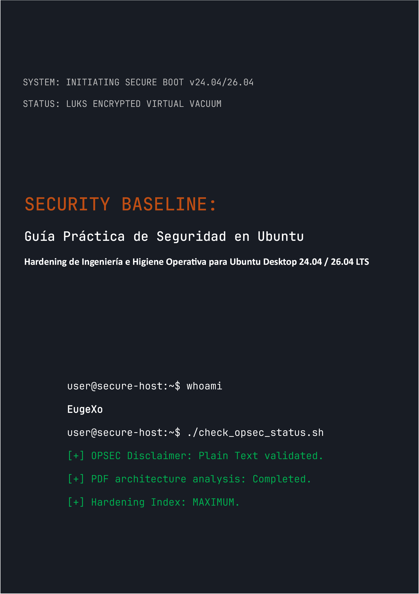

<div align="center">

# Security Baseline: Guía Práctica de Seguridad en Ubuntu

## Hardening de Ingeniería e Higiene Operativa para Ubuntu Desktop 24.04/26.04 LTS

### Written and published by EugeXo

</div>

---

<p align="center">
  
</p>

---

## Estructura del libro y breves anotaciones

- [Security Baseline: Guía Práctica de Seguridad en Ubuntu](#security-baseline-guía-práctica-de-seguridad-en-ubuntu)
  - [Hardening de Ingeniería e Higiene Operativa para Ubuntu Desktop 24.04/26.04 LTS](#hardening-de-ingeniería-e-higiene-operativa-para-ubuntu-desktop-24042604-lts)
    - [Written and published by EugeXo](#written-and-published-by-eugexo)
  - [Estructura del libro y breves anotaciones](#estructura-del-libro-y-breves-anotaciones)
  - [Agradecimientos](#agradecimientos)
  - [Garantía de seguridad del formato (Descargo de responsabilidad OPSEC)](#garantía-de-seguridad-del-formato-descargo-de-responsabilidad-opsec)
  - [Nota del autor: ¿Por qué y para quién está escrito este libro?](#nota-del-autor-por-qué-y-para-quién-está-escrito-este-libro)
    - [Sobre el principio de exposición:](#sobre-el-principio-de-exposición)
  - [Nivel básico de protección: 12 reglas de higiene operativa](#nivel-básico-de-protección-12-reglas-de-higiene-operativa)
  - [Conceptos de anonimato, privacidad y seguridad](#conceptos-de-anonimato-privacidad-y-seguridad)
  - [Instalación del sistema operativo Ubuntu 24.04/26.04 LTS](#instalación-del-sistema-operativo-ubuntu-24042604-lts)
    - [Introducción:](#introducción)
    - [Protocolo de preparación del hardware:](#protocolo-de-preparación-del-hardware)
    - [Elección de la distribución:](#elección-de-la-distribución)
    - [Recorrido paso a paso por el instalador:](#recorrido-paso-a-paso-por-el-instalador)
  - [Primer arranque](#primer-arranque)
  - [Configuración del sistema](#configuración-del-sistema)
  - [Primeros pasos con la consola](#primeros-pasos-con-la-consola)
    - [Configuración inicial:](#configuración-inicial)
      - [Gnome Terminal Ubuntu 24.04:](#gnome-terminal-ubuntu-2404)
      - [Ptyxis Ubuntu 26.04:](#ptyxis-ubuntu-2604)
    - [Desactivación del automontaje y ajustes opcionales:](#desactivación-del-automontaje-y-ajustes-opcionales)
    - [Almacenamiento del historial en la consola:](#almacenamiento-del-historial-en-la-consola)
    - [Configuración de un tiempo de espera seguro para la sesión sudo:](#configuración-de-un-tiempo-de-espera-seguro-para-la-sesión-sudo)
    - [Creamos el archivo para verificar Checks Passed:](#creamos-el-archivo-para-verificar-checks-passed)
  - [Configuración de red y VPN](#configuración-de-red-y-vpn)
    - [Para conexión por cable Ethernet (Wired connection):](#para-conexión-por-cable-ethernet-wired-connection)
    - [Para conexión inalámbrica Wi-Fi (Wireless connection):](#para-conexión-inalámbrica-wi-fi-wireless-connection)
      - [Configuración para un PC o portátil real (Aleatorización completa):](#configuración-para-un-pc-o-portátil-real-aleatorización-completa)
      - [Configuración para máquina virtual (Enmascaramiento estricto bajo un fabricante):](#configuración-para-máquina-virtual-enmascaramiento-estricto-bajo-un-fabricante)
    - [Hardening de NetworkManager: Supresión de fugas locales mDNS, LLMNR, Hostname y protección DNS:](#hardening-de-networkmanager-supresión-de-fugas-locales-mdns-llmnr-hostname-y-protección-dns)
    - [Ponemos el Wi-Fi en modo de desactivación total al arrancar:](#ponemos-el-wi-fi-en-modo-de-desactivación-total-al-arrancar)
    - [Eliminamos los componentes comprometedores de Bluetooth:](#eliminamos-los-componentes-comprometedores-de-bluetooth)
    - [Configuración de la conexión VPN:](#configuración-de-la-conexión-vpn)
  - [Configuración de seguridad y hardening del gestor de arranque GRUB](#configuración-de-seguridad-y-hardening-del-gestor-de-arranque-grub)
    - [Establecemos una contraseña para proteger GRUB:](#establecemos-una-contraseña-para-proteger-grub)
    - [Hardening por software de IOMMU: Protección de la RAM contra ataques DMA a nivel de kernel:](#hardening-por-software-de-iommu-protección-de-la-ram-contra-ataques-dma-a-nivel-de-kernel)
  - [Opciones de configuración del cortafuegos UFW con y sin Kill Switch](#opciones-de-configuración-del-cortafuegos-ufw-con-y-sin-kill-switch)
    - [Configuramos el cortafuegos con Kill Switch:](#configuramos-el-cortafuegos-con-kill-switch)
    - [Complemento importante sobre la gestión del orden de las reglas:](#complemento-importante-sobre-la-gestión-del-orden-de-las-reglas)
    - [Variante alternativa de configuración (Sin uso de VPN / Para SO invitados):](#variante-alternativa-de-configuración-sin-uso-de-vpn--para-so-invitados)
  - [Configuración del kernel del sistema, control de acceso y eliminación de servicios del sistema](#configuración-del-kernel-del-sistema-control-de-acceso-y-eliminación-de-servicios-del-sistema)
    - [Protección de la pila de red y del subsistema de memoria del kernel:](#protección-de-la-pila-de-red-y-del-subsistema-de-memoria-del-kernel)
    - [Hardening de bajo nivel en sysctl: Protección contra TCP Timestamp Fingerprinting:](#hardening-de-bajo-nivel-en-sysctl-protección-contra-tcp-timestamp-fingerprinting)
    - [Bloqueo de protocolos de red poco comunes y sistemas de archivos obsoletos:](#bloqueo-de-protocolos-de-red-poco-comunes-y-sistemas-de-archivos-obsoletos)
    - [Control de permisos de acceso en el sistema de archivos:](#control-de-permisos-de-acceso-en-el-sistema-de-archivos)
    - [Montaje seguro de la memoria compartida (shared memory):](#montaje-seguro-de-la-memoria-compartida-shared-memory)
      - [Modo equilibrado (Recomendado para uso cotidiano de escritorio):](#modo-equilibrado-recomendado-para-uso-cotidiano-de-escritorio)
      - [Modo paranoico (Aislamiento máximo):](#modo-paranoico-aislamiento-máximo)
    - [Creación de un disco RAM aislado para registros volátiles:](#creación-de-un-disco-ram-aislado-para-registros-volátiles)
    - [Bloqueamos el flujo de vídeo y la grabación de audio:](#bloqueamos-el-flujo-de-vídeo-y-la-grabación-de-audio)
    - [Eliminación de servicios del sistema de impresión y descubrimiento de recursos en red local:](#eliminación-de-servicios-del-sistema-de-impresión-y-descubrimiento-de-recursos-en-red-local)
    - [Enmascaramos la geolocalización y la zona horaria:](#enmascaramos-la-geolocalización-y-la-zona-horaria)
  - [Configuración de repositorios y actualización del sistema](#configuración-de-repositorios-y-actualización-del-sistema)
    - [Actualización del sistema:](#actualización-del-sistema)
    - [Despliegue del entorno gráfico NVIDIA en modo aislado:](#despliegue-del-entorno-gráfico-nvidia-en-modo-aislado)
  - [Entornos de terminal en Ubuntu:](#entornos-de-terminal-en-ubuntu)
    - [Sustituimos Gnome Terminal y Ptyxis por Ghostty](#sustituimos-gnome-terminal-y-ptyxis-por-ghostty)
      - [Instalación para usuarios de Ubuntu 24.04 LTS Noble Numbat:](#instalación-para-usuarios-de-ubuntu-2404-lts-noble-numbat)
      - [Instalación para usuarios de Ubuntu 26.04 LTS Resolute Racoon:](#instalación-para-usuarios-de-ubuntu-2604-lts-resolute-racoon)
      - [Variante de configuración de Ghostty para Ubuntu 24.04/26.04:](#variante-de-configuración-de-ghostty-para-ubuntu-24042604)
    - [¡Opcional! Ubuntu 26.04 — recuperamos Gnome Terminal y eliminamos Ptyxis:](#opcional-ubuntu-2604--recuperamos-gnome-terminal-y-eliminamos-ptyxis)
  - [Eliminación y prohibición de Snap y la telemetría](#eliminación-y-prohibición-de-snap-y-la-telemetría)
    - [Eliminamos Snap:](#eliminamos-snap)
    - [Eliminamos la telemetría de Canonical:](#eliminamos-la-telemetría-de-canonical)
    - [Desactivación del rastreador en segundo plano de firmware fwupd:](#desactivación-del-rastreador-en-segundo-plano-de-firmware-fwupd)
  - [Instalación de las utilidades de seguridad libpam-tmpdir, debsums y la utilidad de monitorización de carga Btop](#instalación-de-las-utilidades-de-seguridad-libpam-tmpdir-debsums-y-la-utilidad-de-monitorización-de-carga-btop)
    - [Utilidad de seguridad libpam-tmpdir:](#utilidad-de-seguridad-libpam-tmpdir)
    - [Utilidad debsums:](#utilidad-debsums)
    - [Cómoda utilidad para visualizar la carga Btop:](#cómoda-utilidad-para-visualizar-la-carga-btop)
    - [Monitorización de puertos y conexiones de red:](#monitorización-de-puertos-y-conexiones-de-red)
  - [Creación de puntos de restauración de referencia: Despliegue y configuración de la utilidad Timeshift](#creación-de-puntos-de-restauración-de-referencia-despliegue-y-configuración-de-la-utilidad-timeshift)
    - [Introducción:](#introducción-1)
    - [Particularidades del funcionamiento de Timeshift en un entorno cifrado (LUKS + GRUB):](#particularidades-del-funcionamiento-de-timeshift-en-un-entorno-cifrado-luks--grub)
    - [Instalación segura de Timeshift:](#instalación-segura-de-timeshift)
    - [Configuración inicial y creación de la Instantánea n.º 1 (Referencia Estéril):](#configuración-inicial-y-creación-de-la-instantánea-nº-1-referencia-estéril)
    - [Vector de control posterior: Creación de la Instantánea n.º 2 (Preoperativa):](#vector-de-control-posterior-creación-de-la-instantánea-nº-2-preoperativa)
    - [Protocolo de reversión de emergencia (Si el sistema está comprometido o dañado):](#protocolo-de-reversión-de-emergencia-si-el-sistema-está-comprometido-o-dañado)
  - [Instalación de la versión limpia .deb de Firefox y eliminación del paquete ficticio Snap](#instalación-de-la-versión-limpia-deb-de-firefox-y-eliminación-del-paquete-ficticio-snap)
  - [Instalación y configuración de los parámetros de privacidad en Mozilla Firefox](#instalación-y-configuración-de-los-parámetros-de-privacidad-en-mozilla-firefox)
    - [Preparamos el sistema para la configuración:](#preparamos-el-sistema-para-la-configuración)
    - [Configuración gráfica inicial de privacidad (Obligatoria para todos):](#configuración-gráfica-inicial-de-privacidad-obligatoria-para-todos)
    - [Configuración de proveedores DNS privados (DNS over HTTPS):](#configuración-de-proveedores-dns-privados-dns-over-https)
    - [Automatización del hardening: Creación del archivo de configuración user.js:](#automatización-del-hardening-creación-del-archivo-de-configuración-userjs)
    - [Despliegue de extensiones de protección definitivas:](#despliegue-de-extensiones-de-protección-definitivas)
  - [Instalación y configuración del cortafuegos interactivo de red Portmaster](#instalación-y-configuración-del-cortafuegos-interactivo-de-red-portmaster)
    - [Introducción:](#introducción-2)
    - [Preparación, inicialización inicial del núcleo y transición a la nueva versión:](#preparación-inicialización-inicial-del-núcleo-y-transición-a-la-nueva-versión)
  - [Destrucción garantizada de datos y esterilización de la huella digital](#destrucción-garantizada-de-datos-y-esterilización-de-la-huella-digital)
    - [Introducción:](#introducción-3)
    - [Anatomía de la huella digital: ¿Por qué borrar datos es inútil sin limpiar los metadatos?](#anatomía-de-la-huella-digital-por-qué-borrar-datos-es-inútil-sin-limpiar-los-metadatos)
    - [Instalación y limpieza de metadatos con la utilidad MAT2:](#instalación-y-limpieza-de-metadatos-con-la-utilidad-mat2)
    - [Eliminación segura e irreversible de archivos y directorios:](#eliminación-segura-e-irreversible-de-archivos-y-directorios)
    - [Parámetros de funcionamiento de la utilidad shred:](#parámetros-de-funcionamiento-de-la-utilidad-shred)
    - [Limpieza global del espacio libre del disco:](#limpieza-global-del-espacio-libre-del-disco)
  - [Esteganografía, ofuscación y ocultación de rastros en Ubuntu](#esteganografía-ofuscación-y-ocultación-de-rastros-en-ubuntu)
    - [Introducción:](#introducción-4)
    - [Esteganografía en Linux. Ocultamos archivos en contenido multimedia:](#esteganografía-en-linux-ocultamos-archivos-en-contenido-multimedia)
    - [Utilidad de consola steghide:](#utilidad-de-consola-steghide)
    - [Ocultación mediante la herramienta avanzada StegoForge:](#ocultación-mediante-la-herramienta-avanzada-stegoforge)
    - [Unión de archivos comprimidos (Truco rápido sin software de terceros):](#unión-de-archivos-comprimidos-truco-rápido-sin-software-de-terceros)
    - [Ofuscación de texto: Evasión de sistemas de análisis automático (DPI):](#ofuscación-de-texto-evasión-de-sistemas-de-análisis-automático-dpi)
    - [Análisis de amenazas ocultas. Enmascaramiento de extensiones de archivo (Ataques BiDi):](#análisis-de-amenazas-ocultas-enmascaramiento-de-extensiones-de-archivo-ataques-bidi)
  - [Instalación y configuración del paquete criptográfico VeraCrypt](#instalación-y-configuración-del-paquete-criptográfico-veracrypt)
    - [Introducción a VeraCrypt y su instalación:](#introducción-a-veracrypt-y-su-instalación)
      - [Instalación mediante el repositorio PPA de la comunidad:](#instalación-mediante-el-repositorio-ppa-de-la-comunidad)
      - [Instalación de la distribución oficial (Método nativo):](#instalación-de-la-distribución-oficial-método-nativo)
    - [Ajuste profundo de seguridad: Protección de claves en RAM (Modo paranoico):](#ajuste-profundo-de-seguridad-protección-de-claves-en-ram-modo-paranoico)
    - [Herramienta fundamental de seguridad: Creación de Volúmenes Ocultos (Hidden Volume):](#herramienta-fundamental-de-seguridad-creación-de-volúmenes-ocultos-hidden-volume)
    - [Hardening definitivo: Configuración de PIM y archivos clave de hardware:](#hardening-definitivo-configuración-de-pim-y-archivos-clave-de-hardware)
    - [Modelo de amenazas en el mundo real: Por qué la paranoia debe ser sistémica:](#modelo-de-amenazas-en-el-mundo-real-por-qué-la-paranoia-debe-ser-sistémica)
  - [Uso de las llaves de seguridad Yubico](#uso-de-las-llaves-de-seguridad-yubico)
    - [Introducción:](#introducción-5)
    - [Instalación:](#instalación)
    - [Implementación de Log Out / Kill Switch por hardware mediante reglas udev del kernel:](#implementación-de-log-out--kill-switch-por-hardware-mediante-reglas-udev-del-kernel)
  - [Instalación y configuración de USBGuard](#instalación-y-configuración-de-usbguard)
    - [Introducción:](#introducción-6)
    - [Instalación y configuración:](#instalación-y-configuración)
  - [Implementamos el Emergency Panic Button para el apagado de emergencia](#implementamos-el-emergency-panic-button-para-el-apagado-de-emergencia)
    - [Kill Switch de emergencia por hardware mediante cualquier dispositivo USB:](#kill-switch-de-emergencia-por-hardware-mediante-cualquier-dispositivo-usb)
  - [Instalación del gestor de contraseñas local KeePassXC](#instalación-del-gestor-de-contraseñas-local-keepassxc)
    - [Introducción:](#introducción-7)
    - [Opciones de escenarios de protección del almacén:](#opciones-de-escenarios-de-protección-del-almacén)
    - [Instalación del paquete de software:](#instalación-del-paquete-de-software)
    - [Creación y protección por hardware de la base de datos:](#creación-y-protección-por-hardware-de-la-base-de-datos)
    - [Hardening profundo de los ajustes internos de seguridad:](#hardening-profundo-de-los-ajustes-internos-de-seguridad)
    - [Introducción segura de datos mediante el portapapeles protegido:](#introducción-segura-de-datos-mediante-el-portapapeles-protegido)
  - [Instalación y ejecución del analizador de red Wireshark](#instalación-y-ejecución-del-analizador-de-red-wireshark)
    - [Introducción:](#introducción-8)
    - [Instalación y ejecución de Wireshark:](#instalación-y-ejecución-de-wireshark)
    - [Concepto de seguridad crítico del subsistema de captura de paquetes:](#concepto-de-seguridad-crítico-del-subsistema-de-captura-de-paquetes)
    - [Captura encubierta de volcados de tráfico (Modo consola):](#captura-encubierta-de-volcados-de-tráfico-modo-consola)
    - [Guía práctica de Wireshark:](#guía-práctica-de-wireshark)
  - [Instalación y gestión del sistema de protección AppArmor](#instalación-y-gestión-del-sistema-de-protección-apparmor)
    - [Introducción:](#introducción-9)
    - [Nuevo paradigma de seguridad: Automatización del kernel:](#nuevo-paradigma-de-seguridad-automatización-del-kernel)
    - [Hardening práctico del subsistema AppArmor:](#hardening-práctico-del-subsistema-apparmor)
  - [Instalación y configuración de sandboxes aisladas Firejail y Bubblewrap](#instalación-y-configuración-de-sandboxes-aisladas-firejail-y-bubblewrap)
    - [Introducción:](#introducción-10)
    - [Instalación de Firejail y preparación de la sandbox:](#instalación-de-firejail-y-preparación-de-la-sandbox)
    - [Parámetros básicos de filtrado de Firejail (Guía de referencia):](#parámetros-básicos-de-filtrado-de-firejail-guía-de-referencia)
    - [¡Opcional! Automatización del perímetro de protección de Firejail (Utilidad Firecfg):](#opcional-automatización-del-perímetro-de-protección-de-firejail-utilidad-firecfg)
    - [Instalación de Bubblewrap:](#instalación-de-bubblewrap)
    - [Guía rápida de indicadores de Bubblewrap (Manual de referencia):](#guía-rápida-de-indicadores-de-bubblewrap-manual-de-referencia)
    - [Preparación de accesos directos personalizados para las sandboxes:](#preparación-de-accesos-directos-personalizados-para-las-sandboxes)
    - [Creación de un perfil independiente Firefox hardened para Firejail:](#creación-de-un-perfil-independiente-firefox-hardened-para-firejail)
    - [Creación del perfil Firefox hardened en Bubblewrap:](#creación-del-perfil-firefox-hardened-en-bubblewrap)
    - [Cámara hermética para documentos PDF: ejecución segura de archivos en Firejail:](#cámara-hermética-para-documentos-pdf-ejecución-segura-de-archivos-en-firejail)
    - [Sellamos Document Viewer para leer PDF en Bubblewrap:](#sellamos-document-viewer-para-leer-pdf-en-bubblewrap)
    - [Image Viewer para visualizar archivos gráficos en Firejail:](#image-viewer-para-visualizar-archivos-gráficos-en-firejail)
    - [Envolvemos en Bubblewrap el visor de archivos gráficos Image Viewer:](#envolvemos-en-bubblewrap-el-visor-de-archivos-gráficos-image-viewer)
    - [Escenario de aislamiento de KeePassXC para Firejail:](#escenario-de-aislamiento-de-keepassxc-para-firejail)
    - [Aislamos KeePassXC mediante Bubblewrap:](#aislamos-keepassxc-mediante-bubblewrap)
    - [Instalación y aislamiento de la suite ofimática LibreOffice:](#instalación-y-aislamiento-de-la-suite-ofimática-libreoffice)
    - [Configuramos el funcionamiento de LibreOffice mediante Firejail:](#configuramos-el-funcionamiento-de-libreoffice-mediante-firejail)
    - [Envolvemos LibreOffice en Bubblewrap:](#envolvemos-libreoffice-en-bubblewrap)
    - [Instalación y aislamiento de GNU Image Manipulation Program (GIMP):](#instalación-y-aislamiento-de-gnu-image-manipulation-program-gimp)
    - [Configuramos el funcionamiento de GIMP mediante Firejail:](#configuramos-el-funcionamiento-de-gimp-mediante-firejail)
    - [Configuramos GIMP mediante Bubblewrap:](#configuramos-gimp-mediante-bubblewrap)
    - [Instalación y aislamiento del editor de código VS Codium (IDE para desarrollo):](#instalación-y-aislamiento-del-editor-de-código-vs-codium-ide-para-desarrollo)
    - [Aislamiento de VS Codium en Firejail:](#aislamiento-de-vs-codium-en-firejail)
    - [Aislamiento de VS Codium en Bubblewrap:](#aislamiento-de-vs-codium-en-bubblewrap)
    - [Instalación y aislamiento de la red neuronal local LM Studio Bionic:](#instalación-y-aislamiento-de-la-red-neuronal-local-lm-studio-bionic)
    - [Desplegamos el funcionamiento de LM Studio mediante Firejail:](#desplegamos-el-funcionamiento-de-lm-studio-mediante-firejail)
    - [Envolvemos LM Studio en Bubblewrap:](#envolvemos-lm-studio-en-bubblewrap)
    - [Configuración de comunicaciones seguras: Aislamiento obligatorio de mensajería y perímetro criptográfico (entorno OPSEC del autor):](#configuración-de-comunicaciones-seguras-aislamiento-obligatorio-de-mensajería-y-perímetro-criptográfico-entorno-opsec-del-autor)
    - [Instalación y aislamiento de Telegram Desktop:](#instalación-y-aislamiento-de-telegram-desktop)
    - [Protegemos el perímetro de Telegram mediante Firejail:](#protegemos-el-perímetro-de-telegram-mediante-firejail)
    - [Aislamos Telegram mediante Bubblewrap:](#aislamos-telegram-mediante-bubblewrap)
    - [Instalación y aislamiento de Signal mediante Bubblewrap:](#instalación-y-aislamiento-de-signal-mediante-bubblewrap)
    - [Base criptográfica del host: Generación y protección OPSEC de claves GnuPG:](#base-criptográfica-del-host-generación-y-protección-opsec-de-claves-gnupg)
    - [Instalación y aislamiento del cliente Jabber Psi+:](#instalación-y-aislamiento-del-cliente-jabber-psi)
    - [Aislamos PSI+ en Firejail:](#aislamos-psi-en-firejail)
    - [Aislamiento del cliente Jabber Psi+ en la sandbox Bubblewrap:](#aislamiento-del-cliente-jabber-psi-en-la-sandbox-bubblewrap)
    - [Instalación y aislamiento del cliente de correo Thunderbird (Entorno de correo electrónico cifrado):](#instalación-y-aislamiento-del-cliente-de-correo-thunderbird-entorno-de-correo-electrónico-cifrado)
    - [Aislamiento de Thunderbird mediante Firejail:](#aislamiento-de-thunderbird-mediante-firejail)
    - [Aislamiento de Thunderbird mediante Bubblewrap:](#aislamiento-de-thunderbird-mediante-bubblewrap)
    - [Modo avanzado de «paranoia»: Firejail con conservación de sesión mediante Overlay:](#modo-avanzado-de-paranoia-firejail-con-conservación-de-sesión-mediante-overlay)
  - [Instalación de Rkhunter y búsqueda de rootkits](#instalación-de-rkhunter-y-búsqueda-de-rootkits)
    - [Instalamos Chkrootkit como complemento a Rkhunter:](#instalamos-chkrootkit-como-complemento-a-rkhunter)
  - [Instalación y configuración del escáner antivirus ClamAV](#instalación-y-configuración-del-escáner-antivirus-clamav)
    - [Introducción:](#introducción-11)
    - [Instalación de ClamAV:](#instalación-de-clamav)
    - [Actualización de bases de firmas y evasión de bloqueos de red:](#actualización-de-bases-de-firmas-y-evasión-de-bloqueos-de-red)
    - [Organización del escaneo del sistema:](#organización-del-escaneo-del-sistema)
    - [Escaneo multihilo (Hardening):](#escaneo-multihilo-hardening)
  - [Instalación y configuración del entorno de virtualización VirtualBox](#instalación-y-configuración-del-entorno-de-virtualización-virtualbox)
    - [Protección contra análisis forense: Aislamiento de registros de VirtualBox en RAM (`tmpfs`):](#protección-contra-análisis-forense-aislamiento-de-registros-de-virtualbox-en-ram-tmpfs)
  - [Compresión y optimización de discos virtuales VDI](#compresión-y-optimización-de-discos-virtuales-vdi)
    - [Introducción:](#introducción-12)
    - [Limpieza de una máquina virtual con Windows:](#limpieza-de-una-máquina-virtual-con-windows)
    - [Limpieza de una máquina virtual con Linux (Ubuntu/Kali Linux):](#limpieza-de-una-máquina-virtual-con-linux-ubuntukali-linux)
    - [Compresión final del disco virtual en la máquina anfitriona:](#compresión-final-del-disco-virtual-en-la-máquina-anfitriona)
  - [Instalación y configuración del sistema de contenerización Docker](#instalación-y-configuración-del-sistema-de-contenerización-docker)
    - [Introducción:](#introducción-13)
    - [¿En qué consiste el peligro oculto del Docker predeterminado?](#en-qué-consiste-el-peligro-oculto-del-docker-predeterminado)
    - [Despliegue de Docker en modo Rootless:](#despliegue-de-docker-en-modo-rootless)
    - [Domesticación de la red y vinculación con UFW:](#domesticación-de-la-red-y-vinculación-con-ufw)
    - [Ejemplo práctico de ejecución segura de contenedores:](#ejemplo-práctico-de-ejecución-segura-de-contenedores)
    - [Demostración experimental de seguridad (Comprobación de ausencia de Root):](#demostración-experimental-de-seguridad-comprobación-de-ausencia-de-root)
  - [Instalación y configuración del sistema de control de integridad AIDE](#instalación-y-configuración-del-sistema-de-control-de-integridad-aide)
    - [Introducción:](#introducción-14)
    - [Instalación y configuración de AIDE:](#instalación-y-configuración-de-aide)
    - [Realización de una prueba de penetración (Validación de la protección):](#realización-de-una-prueba-de-penetración-validación-de-la-protección)
  - [Auditoría automatizada de seguridad del sistema mediante Lynis](#auditoría-automatizada-de-seguridad-del-sistema-mediante-lynis)
  - [Instalación y configuración del escáner de vulnerabilidades y fugas de contraseñas Trivy](#instalación-y-configuración-del-escáner-de-vulnerabilidades-y-fugas-de-contraseñas-trivy)
  - [Configuración de sistemas invitados Ubuntu/Xubuntu/Lubuntu en VirtualBox](#configuración-de-sistemas-invitados-ubuntuxubuntulubuntu-en-virtualbox)
    - [Instalación de Guest Additions:](#instalación-de-guest-additions)
    - [Instalación de Mozilla Firefox:](#instalación-de-mozilla-firefox)
    - [Configuración de carpetas compartidas (Shared Folders) en VirtualBox:](#configuración-de-carpetas-compartidas-shared-folders-en-virtualbox)
    - [Instalación de Ledger Live en VirtualBox con Ubuntu/Xubuntu/Lubuntu](#instalación-de-ledger-live-en-virtualbox-con-ubuntuxubuntulubuntu)
    - [Ejecución de Ledger Live en el sistema anfitrión principal Ubuntu](#ejecución-de-ledger-live-en-el-sistema-anfitrión-principal-ubuntu)
  - [Sobre el autor e información legal](#sobre-el-autor-e-información-legal)
    - [Datos de contacto y recursos de la comunidad:](#datos-de-contacto-y-recursos-de-la-comunidad)

<br>
<br>
<br>
<br>
<br>
<br>
<br>

## Agradecimientos

De forma sencilla y sin palabras de más, me gustaría expresar mi profundo agradecimiento a las personas que me impulsaron a escribir este libro y me apoyaron a lo largo de todo el camino.

Agradezco a los compañeros del departamento de ciberseguridad de la policía de nuestra pequeña pero tecnológica Estonia, quienes me motivaron a escribir esta obra.

Asimismo, expreso un agradecimiento especial a los especialistas en seguridad de la información de la oficina del Servicio Secreto de los Estados Unidos en Miami, quienes hicieron una valiosa contribución práctica en la verificación de varios capítulos. Como quedó demostrado, los métodos y enfoques aquí descritos funcionan de manera excelente en condiciones reales de campo.

Por supuesto, mi más enorme gratitud a mi familia por su fenomenal paciencia y apoyo moral. En especial a mi madre, quien comprendió plenamente mi trabajo y asumió una gran carga de la rutina diaria, liberándome tiempo para la investigación.

**Quiero agradecer por separado el apoyo de mi camarada del Reino Unido. Mantuvimos un estrecho contacto cuando estuve en Miami, pero lamentablemente después se perdió la comunicación. Espero sinceramente que volvamos a encontrarnos. Amigo, si tú o tu hijo especialista en ciberseguridad leéis estas líneas, por favor poneos en contacto: mis datos figuran al final del libro. Creo que sabes perfectamente *who is who!* ;)**

Expreso una gratitud indescriptible a mi asistente virtual: **Gemini, de Google**. Durante todo el trabajo en el libro fue un compañero digital insustituible, brindando una ayuda inestimable en la estructuración y traducción de este material técnico avanzado.

Agradezco también al alegre y avanzado asistente **ChatGPT, de OpenAI**, por su ayuda en el análisis de soluciones técnicas, la revisión de configuraciones, así como por la cuidadosa edición de fragmentos concretos del texto y la búsqueda de formulaciones más precisas.

Por supuesto, en primer lugar, mi agradecimiento va dirigido a los ingenieros y desarrolladores de Google y OpenAI por el trabajo de primer nivel que han realizado.

Podría seguir escribiendo mucho más, pero todos los que participaron ya lo saben todo perfectamente. Me alegra enormemente que este libro por fin vea la luz. Chicos, ¡os quiero, os valoro y os respeto sinceramente a todos!

<br>

## Garantía de seguridad del formato (Descargo de responsabilidad OPSEC)

Por motivos de seguridad de la información y sentido común, todo el material de esta guía se entrega inicialmente en formato de texto plano (*Plain Text* con marcado Markdown). La idea de publicar el libro en formato PDF fue descartada de manera consciente. El PDF posee una arquitectura demasiado pesada y se ve comprometido con frecuencia. La seguridad del host que vamos a proteger debe comenzar por una lectura segura de las instrucciones para su configuración.

Un archivo de texto representa datos puros sin código ejecutable, mientras que el formato PDF soporta por defecto scripts de JavaScript incrustados, elementos dinámicos, formularios interactivos y fuentes complejas que requieren un análisis profundo (*parsing*) a nivel de sistema. Las vulnerabilidades críticas de tipo RCE (ejecución remota de código) a través de analizadores de PDF en Linux (por ejemplo, en el visor predeterminado Evince o en las bibliotecas Poppler) son un hecho histórico demostrado. El formato *Plain Text* no contiene mecanismos integrados de ejecución de código y reduce drásticamente la superficie de ataque durante la lectura del material. Esto garantiza una lectura segura en cualquier entorno.

Por esta misma razón, todo el material gráfico y las ilustraciones se han separado del texto principal en un directorio independiente. Los gráficos están estructurados en carpetas y subcarpetas, lo que evita su renderizado automático en memoria mientras se lee el libro.

> [!NOTE]
> El formato fuente principal del libro es Markdown. Todos los formatos derivados (HTML, EPUB y otros) se generan a partir de este texto fuente verificado.
> 
> El lector puede utilizar el proyecto de tres maneras:
> 
> * Leer directamente el archivo fuente en Markdown.
> * Utilizar las compilaciones preparadas en HTML/EPUB (se implementarán más adelante).
> * Compilar el libro por su cuenta a partir de los archivos fuente y, si lo desea, modificar el diseño, la estructura, las tipografías, los estilos o el conjunto de capítulos incluidos.
> 
> Este enfoque garantiza la transparencia del texto, facilita la auditoría de cambios y asegura la independencia respecto a cualquier herramienta de lectura concreta.

<br>

## Nota del autor: ¿Por qué y para quién está escrito este libro?

El entorno digital moderno es cada vez más complejo: aumenta el número de ciberamenazas, crece el volumen de datos recopilados y el usuario se enfrenta con mayor frecuencia a la necesidad de proteger por sí mismo su privacidad y seguridad.

Este libro ha sido creado como una guía práctica para construir una estación de trabajo Linux controlada, en la que la seguridad no se entiende como un conjunto de programas aislados, sino como un sistema unificado de decisiones interconectadas. Mi objetivo es mostrar cómo, utilizando herramientas disponibles en Linux, se puede crear un entorno de trabajo con un modelo de amenazas claro: con aislamiento de aplicaciones, control de la actividad de red, protección de datos y gestión consciente del entorno digital.

**El objetivo del libro es construir una estación de trabajo donde cada acción tenga un perímetro de seguridad controlado.**

El material ha sido preparado con fines educativos y está dirigido a usuarios con preparación técnica, entusiastas de Linux y especialistas interesados en la seguridad de la información práctica. Esta guía no es un curso introductorio a Linux y presupone un conocimiento básico de la terminal, el sistema de archivos y los principios de funcionamiento del sistema operativo. No obstante, un lector atento y motivado podrá dominar gradualmente las herramientas necesarias.

Todas las tecnologías descritas deben utilizarse exclusivamente con fines legítimos: para proteger los datos propios, mejorar la seguridad y estudiar los principios de la seguridad de la información.

La protección consciente de la información y el uso responsable de la tecnología hacen que el entorno digital sea más seguro para todos.

### Sobre el principio de exposición:

El propósito de este libro no es crear una enciclopedia de cada herramienta utilizada, sino mostrar su papel dentro de un modelo único de defensa. Por ello, la arquitectura interna y las capacidades de los componentes se abordan únicamente en la medida necesaria para comprender su funcionamiento y aplicarlos de forma segura.

Las funciones avanzadas, la sintaxis completa y los escenarios de uso especializados quedan fuera del alcance de esta guía y pueden estudiarse por separado en la documentación oficial.

<br>

## Nivel básico de protección: 12 reglas de higiene operativa

*¡Hello World, camarada!*

Antes de pasar a la configuración técnica avanzada de nuestro sistema, establezcamos los cimientos. A continuación se presentan las 12 reglas de hierro de la higiene operativa que debemos aprender de memoria y cumplir sin excepción. Sin comprenderlas, cualquier herramienta de protección, por avanzada que sea, resultará completamente inútil con el tiempo:

1. **En un entorno protegido, excluimos en la medida de lo posible los periféricos inalámbricos:** Bluetooth y Wireless (incluidos auriculares, cascos, teclados y ratones inalámbricos). Cualquier interfaz inalámbrica amplía la superficie de ataque y obliga a confiar en la pila de protocolos, el firmware y la implementación de seguridad de los dispositivos.
2. **Garantizamos el cifrado obligatorio de disco completo** de la unidad del sistema durante la instalación del SO. ¡La longitud de la contraseña criptográfica debe ser de al menos 24 caracteres aleatorios (incluidos caracteres especiales)!
3. **Realizamos cambios periódicos y planificados de la contraseña de inicio de sesión en el sistema operativo.** La contraseña del usuario debe ser única y suficientemente larga (se recomiendan al menos 16 caracteres). Al utilizar tokens de hardware, la contraseña no se sustituye, sino que se complementa con un factor adicional de protección.
4. **Activamos la protección con contraseña del gestor de arranque GRUB**, para impedir por completo el acceso no autorizado a los parámetros del kernel y la edición de la configuración en caso de acceso físico al PC.
5. **Implementamos un token de hardware** (YubiKey o sus equivalentes legítimos) como segundo factor de autenticación obligatorio (2FA) para iniciar sesión en el sistema y confirmar comandos de superusuario.
6. **Limpiamos el sistema de cualquier software innecesario.** Esto aplica especialmente al software propietario de código cerrado. Recordemos la regla básica: cuantos menos servicios de terceros, demonios y programas haya en el sistema, menor será la superficie potencial de ataque y el número de vulnerabilidades críticas.
7. **Mantenemos el sistema operativo siempre actualizado.** Adoptemos como regla de hierro comprobar e instalar periódicamente las actualizaciones de seguridad del sistema, realizando el control mediante herramientas de consola.
8. **Supervisamos continuamente el estado de la red y de las interfaces de red.** Prestamos especial atención a los recursos remotos concretos a los que se realizan conexiones en segundo plano y hacia dónde sale nuestro tráfico de red.
9. **Realizamos periódicamente una auditoría interna del host.** Inspeccionamos el sistema de forma regular (preferiblemente 2 o 3 veces por semana) en busca de rootkits y virus, y verificamos la integridad de los archivos del sistema.
10. **Nunca ejecutamos archivos ejecutables sospechosos en el sistema principal.** Para probarlos de forma segura utilizamos siempre la sandbox aislada `Firejail` o máquinas virtuales.
11. **Aseguramos una protección estricta contra los peligrosos ataques DMA (Direct Memory Access) y protegemos la BIOS/UEFI con contraseña:** En la configuración de BIOS/UEFI forzamos el modo de máxima autorización (*Kernel DMA Protection*) para los puertos Thunderbolt/USB4 con el fin de reducir el riesgo de ataques mediante acceso DMA de dispositivos externos. Establecemos contraseña en BIOS/UEFI. Además, desactivamos por completo el modo de suspensión (*Sleep Mode*), ya que en ese estado las claves de cifrado del disco permanecen en la memoria RAM en texto plano.
12. **Ante el más mínimo abandono del puesto de trabajo, bloqueamos obligatoriamente la sesión y, si nos ausentamos por un periodo prolongado, apagamos el ordenador por completo.**

> [!NOTE]
> El eslabón más débil de cualquier sistema de seguridad suele seguir siendo no el software, sino la acción del usuario.
>
> En el ámbito profesional existe una expresión humorística: «la principal vulnerabilidad se encuentra entre la silla y el teclado».
>
> Precisamente por eso, el hardening técnico debe ir acompañado de disciplina operativa: verificar los archivos antes de abrirlos, eliminar los metadatos antes de publicarlos, controlar la actividad de red y comprender en todo momento el propio modelo de amenazas.

## Conceptos de anonimato, privacidad y seguridad

En el lenguaje cotidiano estos conceptos suelen mezclarse, aunque describen tareas muy distintas.

El **anonimato** responde a la pregunta: «¿Es posible vincular mis acciones con mi identidad real?».
Si el sistema es ideal, el adversario ve la acción en sí, pero no puede relacionarla de ninguna manera con una persona concreta en el mundo real.

La **privacidad** responde a la pregunta: «¿Controlo qué información se recopila sobre mí y quién tiene acceso a ella?».
El adversario sabe que la persona existe, pero esa persona controla qué parte de la información puede salir al exterior.

La **seguridad** responde a la pregunta: «¿Puedo proteger mi sistema, mis datos y mi dispositivo frente a accesos no autorizados?».
La persona se encuentra en alerta permanente dentro de su perímetro digital. El adversario puede estar justo frente a la puerta, pero carece de capacidad suficiente para vulnerar el sistema y sustraer los datos.

Un portátil cifrado con una buena contraseña supone un aumento de la seguridad. Pero si el usuario publica voluntariamente todos sus datos personales en Internet, eso no mejora la privacidad. El uso de herramientas de anonimización puede dificultar la identificación del usuario, pero no protege el sistema frente a programas maliciosos. Un sistema bien protegido puede no ser anónimo, y un sistema anónimo puede no ser seguro.

**El objetivo de esta guía no es crear la ilusión de una protección absoluta ni de una invisibilidad total en la red. El objetivo es mostrar opciones para construir un sistema en el que el usuario comprenda qué riesgos reduce y qué limitaciones permanecen.**

<br>

## Instalación del sistema operativo Ubuntu 24.04/26.04 LTS

### Introducción:

En este capítulo analizaremos la instalación del sistema operativo Ubuntu teniendo en cuenta los requisitos de seguridad. También se contempla la posibilidad de desplegar el sistema en unidades externas USB y Thunderbolt.

Antes de comenzar la instalación es necesario considerar varios factores importantes. Uno de los riesgos más habituales es la elección incorrecta del disco para instalar el gestor de arranque.

En Linux, el arranque del sistema suele estar gestionado por GRUB (GRand Unified Bootloader). Durante la instalación puede colocarse no en la unidad prevista por el usuario, sino, por ejemplo, en la partición EFI de otro disco. Como consecuencia, el sistema operativo existente puede dejar de arrancar correctamente hasta que se restaure el gestor de arranque.

Para excluir por completo este escenario, el método más fiable consiste en desconectar físicamente todos los discos internos HDD y SSD que no correspondan al sistema que se va a instalar mientras dure la instalación de Linux.

En un PC de sobremesa esto suele requerir únicamente acceder a los componentes internos con un destornillador convencional. En los portátiles, el procedimiento depende del diseño del equipo y puede ser más complejo.

Los dispositivos Apple (especialmente los MacBook modernos con chip T2 y Apple Silicon) no se recomiendan para este escenario debido a las particularidades de su plataforma de hardware, la cadena de arranque y la compatibilidad con Linux.

> [!NOTE]
> Esta guía ha sido verificada íntegramente en **Ubuntu 24.04 LTS Noble Numbat (24.04.4)** y **Ubuntu 26.04 LTS Resolute Racoon (26.04.0)**.
>
> Las pruebas se realizaron en **VirtualBox 7.2.x**, **VMware Workstation Pro 26H1**, así como en sistemas físicos con gráficos integrados Intel y adaptador gráfico dedicado NVIDIA.

### Protocolo de preparación del hardware:

* **En un PC de sobremesa:** retiramos la tapa lateral de la caja, desconectamos por completo el equipo de la red eléctrica y desconectamos todas las unidades de almacenamiento excepto el disco en el que se instalará Linux. Si se utilizan unidades M.2 NVMe, será necesario un destornillador para extraerlas.

* **En un portátil:** apagamos el dispositivo por completo, desconectamos la alimentación y, si es posible, desconectamos la batería. Tras retirar la tapa inferior, desconectamos o extraemos todas las unidades excepto la de destino.

Si la instalación se realiza en una unidad externa USB o Thunderbolt, dejamos conectada únicamente dicha unidad. Será esta la que se utilice como medio de destino para instalar el sistema.

> [!WARNING]
> Antes de instalar el sistema operativo, es necesario entrar en la BIOS/UEFI y revisar la configuración del subsistema gráfico. En portátiles con gráficos híbridos se recomienda activar el modo Hybrid Mode/Optimus, en el cual el funcionamiento principal de la interfaz se ejecuta a través del núcleo gráfico integrado del procesador. Esto permite utilizar los controladores abiertos del kernel de Linux (i915, xe, amdgpu, según el hardware) y evitar dependencias innecesarias de componentes cerrados.
>
> Siempre que sea posible, establecemos una contraseña en la BIOS/UEFI y activamos la protección por hardware de las unidades de almacenamiento (si el modelo concreto de SSD/HDD lo admite). Esto reduce el riesgo de modificaciones no autorizadas en los parámetros de arranque y dificulta los ataques con acceso físico al dispositivo.
>
> Comprobamos el estado de Secure Boot. Si la plataforma y el escenario de instalación utilizado admiten su correcto funcionamiento, recomiendo mantener esta función activada.
>
> **Dejamos conectado en el ordenador o portátil únicamente el disco en el que se va a realizar la instalación.**
>
> Realizamos la instalación de Linux **sin conexión a Internet**: desconectamos el cable de red LAN y no conectamos el dispositivo a redes inalámbricas Wi-Fi. Todos los paquetes y actualizaciones necesarios se instalarán una vez finalizada la configuración básica del sistema.

¿Por qué se realiza la instalación sin conexión a Internet?

La instalación offline permite reducir al máximo los factores externos durante el despliegue inicial del sistema:

* no existen conexiones de red externas activas durante la instalación;
* se evita la descarga automática de componentes de terceros y actualizaciones antes de completar la configuración básica;
* se reduce el número de servicios y procesos de red en segundo plano que pueden iniciarse durante la instalación;
* resulta más sencillo controlar el estado inicial del sistema operativo y saber qué componentes se instalaron desde el principio;
* se minimizan los posibles puntos de exposición externa hasta haber completado el refuerzo básico de seguridad del sistema.

Tras la configuración inicial y la aplicación de los mecanismos de protección, la conexión de red se restablece ya dentro de un entorno controlado.

### Elección de la distribución:

Realizaremos todo el proceso tomando como ejemplo las distribuciones actuales **Ubuntu 24.04 LTS Noble Numbat** y **Ubuntu 26.04 LTS Resolute Racoon**. Son bastante sencillas de dominar, no consumen demasiados recursos y funcionarán de manera estable en un PC incluso con 2 GB de memoria RAM (especialmente si elegimos variantes ligeras como Xubuntu o Lubuntu). Además, cuentan con un sólido respaldo por parte de la comunidad global de Linux y, lo más importante, un buen nivel básico de seguridad nada más instalarlas.

Es preferible realizar la instalación en inglés. En caso de que surjan errores imprevistos, nos resultará mucho más fácil buscar y obtener información técnica en recursos especializados en inglés. No obstante, tampoco es un requisito estrictamente obligatorio y la elección final del idioma del sistema queda a tu criterio. En esta guía utilizo la localización en inglés: English (US, variante estadounidense).

### Recorrido paso a paso por el instalador:

**1.** Tras elegir el idioma, pasamos al menú de configuración del teclado **«Select your keyboard»** y seleccionamos **English (US)** u otra distribución que nos resulte cómoda.

**2.** En la ventana de conexiones a Internet seleccionamos estrictamente la opción **«Do not connect to the internet»**.

**3.** A continuación seleccionamos los parámetros **«Interactive Installation»** y **«Default selection»**; esto garantizará la instalación del conjunto mínimo de software en el sistema. Si más adelante necesitamos paquetes adicionales como aplicaciones ofimáticas u otras herramientas, los instalaremos por nuestra cuenta desde el repositorio oficial. En general, al minimizar el número inicial de aplicaciones reducimos los posibles vectores de ataque por parte de actores maliciosos.

**4.** En el siguiente paso, por supuesto, no instalamos software propietario.

**6.** **Ubuntu 24.04:** en el menú **«Disk Setup»** pulsamos el botón **«Advanced features...»**, seleccionamos la opción **«Use LVM and encryption»**, confirmamos pulsando **«OK»** y hacemos clic en **«Next»**.

**Ubuntu 26.04:** dejamos la opción predeterminada **«Erase disk and install Ubuntu»** y pulsamos **«Next»**.

**7.** **Ubuntu 24.04:** el siguiente menú solicita introducir una contraseña maestra para el cifrado del disco. Creamos (y memorizamos obligatoriamente) una contraseña robusta de al menos 24 caracteres (preferiblemente más), aprovechando todas las posibilidades del teclado: letras latinas mayúsculas y minúsculas (A-Z, a-z), números (0-9), caracteres especiales y la barra espaciadora. Pulsamos **«Next»**.

**Ubuntu 26.04:** seleccionamos **«Encryption with passphrase»**, pulsamos **«Next»** y en el siguiente menú introducimos la contraseña maestra para cifrar el disco. Creamos (y memorizamos obligatoriamente) una contraseña robusta de al menos 24 caracteres (preferiblemente más), utilizando letras latinas mayúsculas y minúsculas (A-Z, a-z), números (0-9), caracteres especiales y la barra espaciadora. Pulsamos **«Next»**.

**8.** A continuación aparece el menú **«Create your account.»** En el campo **«Your name»** escribimos el nombre pensado de antemano (elegimos un nombre neutro que no revele nuestra identidad real, por ejemplo, `user`). En la línea **«Computer name»** escribimos un nombre de host arbitrario (por ejemplo, `host-node`), y en el campo **«Pick a username»** elegimos el nombre de usuario a nuestro criterio. En el apartado **«Choose password»** creamos una contraseña compleja de al menos 16 caracteres, combinando letras latinas mayúsculas y minúsculas (A-Z, a-z), números (0-9), caracteres especiales y la barra espaciadora. Dejamos marcada la opción **«Require password to login»** y pulsamos **Next**.

**9.** En el siguiente menú aparece un mapa para elegir la zona horaria. Seleccionamos cualquier valor (más adelante la zona horaria se cambiará a UTC) y pulsamos **«Next»**.

**10.** En la ventana final revisamos toda la configuración para asegurarnos de que no se nos haya olvidado quitar o añadir nada, y pulsamos el botón **«Install»**.

Tras esto comienza la instalación y configuración automática del sistema operativo. El proceso es bastante rápido y no requiere nuestra intervención. Al finalizar la instalación, el programa solicitará retirar el medio USB de instalación y reiniciar el equipo. Con esto concluye la instalación y ya podemos volver a conectar todas las unidades de almacenamiento que habíamos desconectado previamente.

> [!IMPORTANT]
> En Ubuntu 24.04/26.04 existen dos enfoques fundamentalmente distintos para proteger los datos en disco: el cifrado clásico con contraseña de usuario (*passphrase*) y el cifrado asistido por hardware con desbloqueo automático mediante TPM. Ambos enfoques utilizan LUKS como base del cifrado de disco; la diferencia radica principalmente en el mecanismo de obtención de la clave de desbloqueo.
> 
> En esta guía se utiliza deliberadamente el esquema clásico LVM + LUKS + passphrase larga del usuario. Esto responde al modelo de amenazas elegido, en el que el propietario del dispositivo debe autenticarse explícitamente antes de desbloqueo del almacenamiento cifrado.
> 
> Esto no significa que TPM/FDE sea una opción «insegura». Está diseñado para otro modelo de uso y ofrece sus propias ventajas, como la verificación automática del estado de la plataforma y la protección frente a determinados ataques a la cadena de arranque. Sin embargo, dentro de esta guía no se emplea por principio el desbloqueo automático del disco: se da prioridad a la autenticación del usuario mediante una passphrase LUKS larga.
> 
> Por tanto, la elección del LUKS clásico en este libro es una decisión consciente dentro del modelo de amenazas planteado, y no una afirmación de que TPM/FDE sea inseguro en términos generales.
>
> Mi enfoque, basado en crear manualmente una contraseña clásica compleja mediante LVM, es desde el punto de vista de la seguridad de la información la única forma técnicamente correcta de proteger los datos frente al acceso físico a un equipo apagado. Al utilizar el desbloqueo automático mediante TPM, la passphrase del usuario deja de ser el factor principal de protección. En ese caso, la seguridad pasa a depender del correcto funcionamiento de la plataforma de confianza, del estado del gestor de arranque y de la implementación de hardware del sistema. La introducción manual de una contraseña larga de LUKS elimina por completo este peligroso vector de compromiso.

**Anexo del capítulo:** *_assets\images\1_os_install*

<br>

## Primer arranque

Iniciamos sesión en el sistema utilizando la contraseña del disco cifrado y la contraseña de nuestra cuenta de usuario. En adelante, esta contraseña se utilizará para confirmar las acciones administrativas mediante `sudo`. Nos recibirá el menú de bienvenida; pulsamos **«Next»**.

En Ubuntu 26.04 el siguiente menú será **«Location Services»**; por defecto el interruptor se encuentra en posición desactivada, así que hacemos clic en el botón **«Next»**. En Ubuntu 24.04.4 este menú no aparece.

En Ubuntu 24.04, en el siguiente menú el sistema ofrecerá activar la suscripción *Ubuntu Pro*; pulsamos el botón **«Skip»** en la esquina superior derecha. En Ubuntu 26.04.0 este menú no aparece.

En el menú que aparece a continuación, **Help improve Ubuntu**, seleccionamos o dejamos obligatoriamente la opción **«No, don't send system data»** (en 26.04 también aparece desactivada la opción *Share error reports with the Ubuntu team*; la dejamos desactivada), pulsamos **«Next»** hasta llegar a la ventana final y completamos la configuración haciendo clic en el botón **«Finish»**. En esta etapa desactivamos el envío de datos de diagnóstico y telemetría a Canonical.

> [!NOTE]
> A pesar de haber pulsado **«Skip»**, Canonical sigue dejando activos en segundo plano del sistema operativo los servicios de comprobación de suscripción. No pasa nada: más adelante eliminaremos estos componentes manualmente a través de la terminal.

**Anexo del capítulo:** *_assets\images\2_first_boot*

<br>

## Configuración del sistema

En el escritorio, de forma predeterminada, a la izquierda se encuentra la barra de tareas llamada **«Dock»**. Pulsamos sobre el logotipo circular del sistema en la esquina del panel (**«Show Apps»**) y seleccionamos **«Settings»** (también se puede acceder a la configuración desde la barra superior: hacemos clic en el menú de estado en la esquina superior derecha, pulsamos el icono del engranaje y abrimos **«Settings»**).

Aquí, en el menú de configuración del sistema, colocamos los interruptores **«Bluetooth»** y **«Wi-Fi»** en posición desactivada. Esto pondrá el equipo en modo avión («Airplane Mode») y deshabilitará temporalmente las interfaces inalámbricas hasta que configuremos su bloqueo definitivo.

A continuación personalizamos el panel **«Dock»** desde el menú **«Ubuntu Desktop»**. Por ejemplo, podemos desplazarlo hacia abajo seleccionando la opción **«Bottom»** en el campo **«Position on screen»** y ajustar el tamaño del panel en **«Icon size»**. Si desactivamos el modo ***«Panel Mode»***, el **«Dock»** adquirirá un aspecto más limpio y compacto, similar al panel de macOS. Además, limpiamos el panel de los accesos directos predeterminados innecesarios.

Pasamos al apartado **«Privacy & Security»** y después a la subsección **«Diagnostics»**/**«Telemetry»**. En la línea **«Problem Reporting»**, para la opción **«Send error reports to Canonical»**, establecemos estrictamente el valor **«Never»**.

Vamos al apartado contiguo **«File History & Trash»**. Aquí es de vital importancia desactivar por completo la función **«File History»**. Las opciones **«Automatically Delete Trash Content»** y **«Automatically Delete Temporary Files»** las activamos con un periodo de **«1 day»**.

> [!IMPORTANT]
> El vaciado automático de la papelera y de la caché es únicamente una higiene básica superficial. Por motivos de seguridad, los archivos confidenciales, contraseñas y registros deben eliminarse siempre de forma manual desde la terminal mediante la utilidad de bajo nivel `shred` (que analizaremos en detalle más adelante), lo que dificulta enormemente su recuperación de la superficie de la unidad mediante programas de análisis forense (hay que tener en cuenta las particularidades del borrado de datos según el tipo concreto de almacenamiento: en discos mecánicos HDD se puede utilizar `shred`, mientras que en unidades modernas SSD/NVMe el enfoque más fiable es el cifrado completo del disco y la destrucción adecuada de las claves de cifrado).

En la subsección adyacente **«Location»**, comprobamos que el interruptor esté en posición **«Off»**: el sistema operativo no tiene por qué saber dónde nos encontramos físicamente.

En el apartado **«Screen Lock»** configuramos la función de pantalla **«Blank Screen Delay»**; por defecto tiene un intervalo de 5 minutos, pero por seguridad conviene establecer 1 o 2 minutos. Allí mismo activamos el interruptor **«Automatic Screen Lock»**. Dentro de esta misma sección entramos en **«Automatic Screen Lock Delay»** y seleccionamos el valor **«Screen Turns off»** o 30 segundos, como máximo 1 minuto (de este modo, antes de apagarse la pantalla se atenuará exactamente durante 30 segundos o 1 minuto). También activamos allí mismo **«Lock Screen Notifications»** y **«Lock Screen on Suspend»**.

A continuación, en el apartado **«Connectivity»**, desactivamos **«Connectivity Checking»**; esto reduce la cantidad de comprobaciones automáticas de red que el sistema ejecuta en segundo plano.

Apartado **«Thunderbolt»**: si no utilizamos ningún dispositivo para esta interfaz, lo desactivamos.

En Ubuntu 26.04, dentro de **«Privacy & Security»**, ha aparecido el apartado **«Cameras»**; entramos y colocamos el interruptor en posición desactivada.

En la sección **«System»** entramos en la subsección **«Date & Time»** para ajustar la hora del sistema. Si el sistema se prepara para trabajar en condiciones de mayor anonimato a través de túneles VPN protegidos o la red Tor, desactivamos **«Automatic Date & Time»**. Si el sistema se utiliza en escenarios de privacidad reforzada, es posible desactivar la sincronización automática de la hora y configurar la zona horaria manualmente. En adelante, en todo el libro se utilizará UTC como estándar único de tiempo.

En el apartado **«Keyboard»** añadimos las distribuciones de teclado necesarias. El resto de pestañas del menú del sistema corresponden principalmente a aspectos visuales y preferencias de usuario en los que no nos detendremos en detalle.

En el apartado **«Sound»** se recomienda silenciar el micrófono pulsando sobre el icono en la sección **Input Volume**.

> [!NOTE]
> En el menú **«Privacy & Security»** de Ubuntu 24.04/26.04 existe una subsección importante: **«Device Security»** (Seguridad del dispositivo). Allí se muestra de forma visual el estado del arranque seguro **«Secure Boot»**. Si aparece en verde, significa que el arranque seguro está activo. Secure Boot está diseñado para verificar las firmas digitales de los componentes de la cadena de arranque, garantizando que durante el inicio solo se utilicen componentes de confianza o firmados conforme a la política de seguridad UEFI.
>
> Si allí aparecen advertencias sobre un kernel desprotegido, es una señal directa de que en la BIOS/UEFI de nuestra placa base no están activadas las funciones básicas de protección por hardware del host. Sin ellas, el valor de los datos en un equipo encendido o en modo de suspensión cae drásticamente, ya que un atacante puede intentar acceder a los datos alojados en la memoria RAM, incluido el material de claves potencialmente disponible.
>
> Justo al lado se encuentra **«Checks Passed»**/**«Protected»**. Un poco más adelante crearemos un archivo de texto para revisar los registros de este menú.

**Anexo del capítulo:** *_assets\images\3_system_settings*

<br>

## Primeros pasos con la consola

### Configuración inicial:

El inicio de la terminal para trabajar se realiza a través del menú de aplicaciones (**«Show Apps»**). Para un acceso rápido y cómodo a la línea de comandos, el acceso directo de la terminal se puede fijar en el panel **«Dock»**.

Ubuntu está basado en Debian y utiliza el mismo formato de paquetes `.deb`. La instalación de software se realiza mediante el gestor de paquetes APT desde los repositorios de Ubuntu. La instalación y gestión de dichos paquetes se efectúa con APT, y las operaciones administrativas se ejecutan cuando es necesario mediante `sudo`.

Por defecto, tras una autenticación exitosa, `sudo` conserva su validez durante 15 minutos. Durante ese tiempo, los comandos posteriores ejecutados con `sudo` normalmente no volverán a pedir la contraseña. Para un sistema con altos requisitos de seguridad consideramos excesivo este intervalo y al final del capítulo lo reduciremos a 0–2 minutos.

Al abrir la ventana de la terminal aparece una línea que contiene el nombre del usuario actual, el nombre de red del equipo y el directorio de trabajo actual, terminada con el símbolo del dólar **`$`**. Este icono indica visualmente que la sesión se ejecuta en modo de usuario normal. Para realizar la mayoría de las acciones de configuración habrá que anteponer a los comandos el prefijo `sudo` (por ejemplo, `sudo apt update`).

Para pasar al modo interactivo completo de superusuario `root`, se utilizan los comandos `sudo -i` o `sudo -s`. El comando `sudo -i` simula por completo un inicio de sesión limpio de `root` cargando sus propias variables de entorno, mientras que `sudo -s` inicia un shell de `root` conservando las variables de entorno actuales del usuario normal. Para obtener brevemente una sesión completa de `root`, es preferible utilizar `sudo -i`. A diferencia de `sudo -s`, este modo inicia un *login shell* con el entorno de `root`, por lo que resulta más adecuado para operaciones administrativas prolongadas. En el trabajo habitual es preferible ejecutar comandos individuales con `sudo` sin pasar a una sesión permanente de `root` salvo que sea necesario.

Tras introducir correctamente la contraseña, el símbolo **`$`** en la línea de entrada cambiará al signo de almohadilla **`#`**. Esto significa que el sistema ha pasado al modo de superusuario con máximos privilegios administrativos. Aquí es posible modificar cualquier archivo, incluidos los parámetros del kernel, por lo que debe actuarse con extrema precaución.

> [!IMPORTANT]
> Memorizar los comandos básicos de la terminal de Linux hará que el trabajo con el sistema sea rápido y cómodo.

#### Gnome Terminal Ubuntu 24.04:

La terminal de Ubuntu 24.04 resulta cómoda para editar los ajustes visuales «a medida» directamente desde el menú. Incluye transparencia (*Transparency*) y permite establecer la gama cromática deseada eligiendo tonos hasta un perfil personalizado (*Custom*), lo que hace que el trabajo posterior en la terminal sea muy agradable desde el punto de vista estético.

Antes de comenzar el trabajo principal, ajustemos la apariencia de la terminal. En la parte superior derecha de la ventana, junto al icono de la lupa, pulsamos el botón **«Menú hamburguesa»** (tres rayas horizontales) y entramos en **«Preferences»**. En la pestaña **«Profiles»** que se abre, seleccionamos el perfil predeterminado **«Unnamed»**. Aquí se pueden ajustar los colores, las fuentes, el tamaño del área de trabajo y la transparencia de la ventana a nuestro gusto.

Su desventaja es una pila GTK3 más antigua y la ausencia de algunos mecanismos modernos de aislamiento y seguridad disponibles en las aplicaciones basadas en GTK4.

#### Ptyxis Ubuntu 26.04:

Antes de pasar al uso habitual de Ptyxis, configurémoslo para mayor comodidad. En la parte superior derecha de la ventana pulsamos el botón **«Menú hamburguesa»** (tres rayas horizontales) y entramos en **«Preferences»**. Allí accedemos directamente al menú **«Appearance»**, donde se nos ofrecerá elegir un ajuste predefinido para nuestro trabajo posterior. En primer lugar recomiendo desplazarse ligeramente hacia abajo en el menú, desactivar el interruptor **«Use System Font»** y seleccionar después el tamaño de fuente deseado. La selección de paletas de colores viene preinstalada; en la parte superior de **«Appearance»** hacemos clic en el menú desplegable **«Show All Palettes»** y elegimos la gama de colores que mejor se adapte a nuestro estilo. Para una personalización más profunda de colores y tipografías habrá que recurrir a los archivos de configuración.

**Variante de perfil personalizado para Ptyxis**

**1.** Abrimos la consola y creamos la carpeta junto con el archivo del perfil personalizado:
```bash
mkdir -p ~/.local/share/org.gnome.Ptyxis/palettes && nano ~/.local/share/org.gnome.Ptyxis/palettes/my-homebrew.palette
```

**2.** Insertamos un fondo gris oscuro o azul profundo ligeramente más claro para el perfil:
```ini
[Palette]
Name=My Homebrew

Foreground=#00ff00
Background=#171717 o #0b1020
Color0=#000000
Color1=#990000
Color2=#00a600
Color3=#999900
Color4=#0d0dbf
Color5=#b200b2
Color6=#00a6b2
Color7=#bfbfbf
Color8=#666666
Color9=#e50000
Color10=#00d900
Color11=#e5e500
Color12=#0000ff
Color13=#e500e5
Color14=#00e5e5
Color15=#e5e5e5

BellForeground=#00ff00
BellBackground=#171717 o #0b1020
RemoteForeground=#00ff00
RemoteBackground=#171717 o #0b1020
SuperuserForeground=#00ff00
SuperuserBackground=#171717 o #0b1020
```

Para guardar la configuración en el editor `nano`, pulsamos la combinación de teclas **«Ctrl + O»** → **«Enter»**, y después **«Ctrl + X»** para salir.

**3.** Añadimos una ligera transparencia a la ventana. El valor `0.00` significa transparencia total y `1.00` opacidad completa. Elegimos la opción que mejor nos convenga:
```bash
gsettings set org.gnome.Ptyxis.Profile:/org/gnome/Ptyxis/Profiles/$PTYXIS_PROFILE/ opacity 0.95
```

A continuación cerramos la consola y la abrimos de nuevo. El perfil creado debería aparecer en la sección **«Palettes»**. A través del **«Menú hamburguesa»** (tres rayas horizontales) vamos a **«Preferences»** → **«Appearance»** → **«Show All Palettes»**, localizamos el perfil **«My Homebrew»** y lo seleccionamos.

> [!IMPORTANT]
> Es importante comprender que, al comparar Ptyxis y GNOME Terminal, el primero se ajusta mejor al modelo de seguridad elegido en este libro gracias a sus capacidades adicionales de aislamiento de entornos de trabajo. Por tanto, sustituir Ptyxis por el más habitual GNOME Terminal implica renunciar a parte de esas capacidades y, en nuestro escenario, supone más bien un compromiso.
> 
> Más adelante analizaremos también Ghostty como emulador de terminal alternativo. Veremos por separado su instalación y configuración básica para que el lector pueda compararlo por sí mismo con Ptyxis y GNOME Terminal y elegir la opción más adecuada para su sistema.

### Desactivación del automontaje y ajustes opcionales:

**1.** Lo primero que haremos será desactivar el automontaje de medios extraíbles (deshabilita el montaje automático, pero no impide que el usuario o una aplicación monten manualmente una unidad):
```bash
gsettings set org.gnome.desktop.media-handling automount false && gsettings set org.gnome.desktop.media-handling automount-open false
```

**2.** Centramos las ventanas de los programas que se abran estrictamente en el centro de la pantalla. En mi opinión, trabajar así resulta mucho más cómodo, especialmente en máquinas virtuales:
```bash
gsettings set org.gnome.mutter center-new-windows true
```

Si por alguna razón esta disposición de ventanas no te resulta cómoda, ejecuta el mismo comando sustituyendo `true` por `false`.

**3.** Para no perder tiempo navegando por menús gráficos, recuperamos el cambio de distribución de teclado habitual mediante la combinación clásica `Shift + Alt` con dos comandos rápidos del sistema:
```bash
gsettings set org.gnome.desktop.input-sources xkb-options "['grp:alt_shift_toggle']" && gsettings set org.gnome.desktop.wm.keybindings switch-input-source "['<Shift>Alt_L', '<Alt>Shift_L']"
```

### Almacenamiento del historial en la consola:

Por defecto, Bash guarda el historial de comandos con un tamaño limitado: las entradas antiguas se van sobrescribiendo con el tiempo y varias terminales abiertas simultáneamente pueden generar conflictos al guardar el historial. Además, el historial suele escribirse en el archivo no tras cada comando, sino al cerrar el shell. En caso de un apagado inesperado del sistema, los últimos comandos ejecutados pueden no quedar registrados, lo cual es indeseable para nuestro escenario de auditoría.

Configuremos Bash para que guarde el historial de comandos de forma inmediata y ampliemos su tamaño con el fin de no perder datos sobre las acciones realizadas.

**1.** Abrimos el archivo de configuración `.bashrc` en el directorio personal:
```bash
nano ~/.bashrc
```

**2.** Vamos hasta el final del archivo con **«Alt + /»** y añadimos las siguientes líneas:

```bash
# Tamaño ilimitado
export HISTSIZE=-1
export HISTFILESIZE=-1

# Escritura instantánea del comando tras pulsar Enter
export PROMPT_COMMAND="history -a; $PROMPT_COMMAND"

# Ignorar únicamente duplicados consecutivos
export HISTCONTROL=ignoredups

# Registro de la fecha y hora exactas de ejecución
export HISTTIMEFORMAT="%F %T "

# Añadir comandos al archivo en lugar de sobrescribirlo
shopt -s histappend
```

Guardamos el archivo con **«Ctrl + O»** → **«Enter»**, y después **«Ctrl + X»**.

* `HISTSIZE=-1` y `HISTFILESIZE=-1` — eliminan por completo los límites en la cantidad de líneas.
* `history -a` — guarda obligatoriamente el comando en disco inmediatamente después de introducirlo.
* `ignoredups` — elimina repeticiones consecutivas de un mismo comando, pero no oculta los comandos iniciados con un espacio.
* `HISTTIMEFORMAT` — registra marcas de tiempo, algo crítico para la investigación de incidentes.
* `shopt -s histappend` — combina los registros de distintas ventanas abiertas en paralelo.

**3.** Aplicamos los cambios a la sesión actual sin reiniciar la terminal:
```bash
source ~/.bashrc
```

**4.** Comprobamos el funcionamiento del registro actualizado:
```bash
history
```

Ahora disponemos de una cronología continua y protegida frente a pérdidas con la hora exacta de ejecución de cada comando.

**5.** Limpiamos nuestra consola de la acumulación de líneas:
```bash
clear
```

**6.** Hay situaciones en las que, durante el trabajo, introducimos por error datos sensibles en la consola (por ejemplo, una contraseña o un token). No deben quedar en los registros. Para eliminar puntualmente el último comando erróneo ejecutamos:
```bash
history -d $(history | tail -n 1 | awk '{print $1}')
```

**7.** Si necesitamos limpiar por completo el historial de la sesión actual y actualizar el archivo en disco, utilizamos la combinación de comandos de limpieza y reescritura:
```bash
history -c && history -w
```
El indicador `-c` borra por completo el historial en la memoria RAM de la terminal actual, mientras que `-w` escribe obligatoriamente ese estado vacío en nuestro archivo de historial, eliminando todos los registros anteriores.

Incluso si hemos configurado un registro instantáneo e ilimitado del historial, un usuario normal (o un atacante que obtenga acceso a la sesión) aún puede vaciar manualmente el archivo de historial mediante `history -c && history -w` o simplemente eliminarlo con `rm ~/.bash_history`.

Un cambio estándar de permisos mediante `chmod -w` no serviría aquí: si prohibimos la escritura en el archivo, el shell Bash no podrá registrar ningún comando nuevo. Necesitamos que al archivo solo se le pueda *añadir* información, pero que quede terminantemente prohibido *sobrescribirlo o eliminarlo*.

Para resolver esta tarea en Linux existen atributos especiales del sistema de archivos (`chattr`).

**8.** Pasamos al modo de superusuario, ya que solo `root` puede modificar atributos del sistema en los archivos:
```bash
sudo -i
```

**9.** Asignamos al archivo de historial el atributo especial `+a` (*append-only*). Para no introducir el nombre de usuario manualmente, usamos la variable del sistema `$SUDO_USER`, que insertará automáticamente el nombre de nuestro usuario principal incluso estando en la sesión de `root`:
```bash
chattr +a /home/$SUDO_USER/.bash_history
```

**10.** Si en el futuro, como administradores del sistema, necesitamos vaciar o editar obligatoriamente este archivo, retiramos el atributo de protección con el comando:
```bash
chattr -a /home/$SUDO_USER/.bash_history
```

Tras realizar el mantenimiento, volveremos a activar obligatoriamente el atributo `+a`.

> [!IMPORTANT]
> El atributo `append-only` no constituye una protección total. Un usuario con acceso `root` puede retirarlo en cualquier momento y modificar o eliminar el archivo de historial. Por tanto, consideramos este ajuste únicamente como una capa adicional de defensa, y no como una protección impenetrable del registro.

### Configuración de un tiempo de espera seguro para la sesión sudo:

Para modificar de forma forzada el tiempo de validez de la contraseña en la terminal, crearemos un archivo de configuración aislado. No se recomienda editar directamente el archivo principal del sistema `/etc/sudoers` para evitar romper accidentalmente su sintaxis y perder el acceso administrativo.

**1.** Abrimos el editor de texto `nano` creando un nuevo archivo de configuración dedicado:
```bash
nano /etc/sudoers.d/99_sudo_timeout
```

**2.** En el archivo vacío que se abre debemos escribir la siguiente línea:
```ini
Defaults timestamp_timeout=2
```

El valor `2` indica a `sudo` que conserve el resultado de una autenticación exitosa durante dos minutos. Transcurrido ese tiempo, el siguiente comando `sudo` volverá a solicitar la contraseña. Si se desea, aquí se puede establecer el valor `0`; en ese caso el sistema pedirá la contraseña en cada invocación de `sudo`, lo cual constituye una configuración de seguridad estricta para hosts protegidos.

Para guardar la configuración en el editor `nano`, pulsamos **«Ctrl + O»** → **«Enter»**, y después **«Ctrl + X»** para volver a la consola de `root`.

**3.** Establecemos los permisos adecuados sobre el archivo de configuración:
```bash
chmod 0440 /etc/sudoers.d/99_sudo_timeout
```

> [!WARNING]
> Antes de cerrar la terminal o salir del modo `root`, es de vital importancia comprobar obligatoriamente la sintaxis correcta de la regla creada mediante el comando:
> ```bash
> visudo -c
> ```
> Si el sistema devuelve el informe `...parsed OK`, significa que no hay errores y la configuración es segura. Si la utilidad muestra un error de sintaxis, abrimos inmediatamente el archivo con `nano` de nuevo y lo corregimos. De lo contrario, tras cerrar la terminal perderemos el acceso administrativo a la utilidad `sudo`.

**Nota del autor:** La utilidad `visudo` verifica exclusivamente la sintaxis de los archivos de configuración del subsistema de control de privilegios `sudo` (es decir, el propio archivo `/etc/sudoers` y cualquier regla incluida en el directorio `/etc/sudoers.d/`). Al editar cualquier otro archivo del sistema (ya sean ajustes de red, configuraciones `user.js` en Firefox, reglas del cortafuegos o parámetros de GRUB), no es necesario ni tiene sentido ejecutar `visudo -c`, ya que simplemente no los analiza.

**4.** Salimos del modo de superusuario de vuelta a la sesión del usuario normal:
```bash
exit
```

**5.** Además, un pequeño truco útil para el futuro: si hemos terminado de trabajar en la terminal y queremos invalidar de inmediato el token activo de `sudo` sin esperar a que transcurran automáticamente los dos minutos, ejecutamos el comando:
```bash
sudo -k
```

El comando `sudo -k` invalida de inmediato la marca de autenticación actual de `sudo`, por lo que la siguiente invocación de `sudo` volverá a pedir la contraseña.

### Creamos el archivo para verificar Checks Passed:

**1.** Creamos el archivo para comprobar el menú **«Privacy & Security»** → **«Device Security»** → **Checks Passed**:
```bash
touch ~/Downloads/checks_passed.txt
```

**2.** Abrimos el archivo creado mediante el editor `nano`:
```bash
nano ~/Downloads/checks_passed.txt
```

**3.** Pegamos la información copiada al portapapeles (*clipboard*) dentro de `checks_passed.txt`:
```ini
NUESTROS VALORES COPIADOS EN EL PORTAPAPELES (CLIPBOARD)
```

Para guardar la configuración en el editor `nano`, pulsamos **«Ctrl + O»** → **«Enter»**, y después **«Ctrl + X»** para salir.

> [!NOTE]
> La configuración de los parámetros concretos que no hayan superado la comprobación depende del uso previsto del equipo. Por ejemplo, **Intel GDS Mitigation: !Fail (Not Enabled)** indica que el mecanismo de mitigación frente a la vulnerabilidad *Gather Data Sampling* (GDS) no está activado en este momento. El motivo puede deberse al estado del microcódigo, del kernel o de los ajustes del sistema. Activar esta mitigación puede reducir el rendimiento en determinados escenarios, por lo que conviene valorar el modelo concreto de procesador, el tipo de carga y el propio modelo de amenazas.
> 
> En cambio, la línea `Linux Swap: !Fail (Not Encrypted)` puede parecer alarmante a primera vista. Si el área swap se encuentra dentro de un volumen cifrado con LUKS, sus datos en disco también están protegidos por el cifrado. Por tanto, este estado por sí solo no significa que el contenido del swap se almacene en texto plano en la unidad física.
> 
> Por precaución, comprobemos la ubicación del swap mediante el comando:
> ```bash
> swapon --show
> ```
> 
> Si en la salida aparece `/swap.img`, significa que el swap está implementado como un archivo normal dentro del sistema de archivos raíz. En nuestro caso, el sistema de archivos raíz se encuentra dentro de un volumen cifrado con LUKS, por lo que el contenido de este archivo también está protegido mediante cifrado.

**Anexo del capítulo:** *_assets\images\4_start_terminal*

<br>

## Configuración de red y VPN

### Para conexión por cable Ethernet (Wired connection):

Sin conectar todavía el cable, entramos en la configuración del sistema **«Settings»** y seleccionamos la sección **«Network»**. Localizamos el apartado **«Wired»** y hacemos clic en el icono del engranaje **«Network Options»**. En la ventana que aparece, dentro de la pestaña **«Details»**, desmarcamos inmediatamente las casillas **«Make available to other users»** y **«Connect automatically»**.

A continuación pasamos a la pestaña **«Identity»**. En el campo **«MAC Address»** seleccionamos la interfaz de red actual. Junto a ella se mostrará el nombre de la interfaz de red (por ejemplo, `enp0s1`, `ens33` u otro): es necesario memorizarlo o anotarlo, ya que resulta de vital importancia para la configuración posterior de la red y del cortafuegos (*firewall*).

Pasamos a la pestaña **«IPv4»**. Aquí establecemos de forma forzada nuestro propio servidor DNS para no utilizar los servidores DNS proporcionados por el operador. Cambiamos el interruptor **«DNS»** del modo **«Automatic»** a la posición **«Off»** y, como ejemplo, utilizamos Quad9: `9.9.9.9` (alternativo: `149.112.112.112`). Escribimos `9.9.9.9, 149.112.112.112` separados por coma. Esto permite sacar la resolución DNS fuera de la infraestructura del proveedor.

En la pestaña **«IPv6»**, dentro del campo **«IPv6 Method»**, seleccionamos estrictamente el valor **«Disable»**. Tras realizar todas estas acciones, pulsamos el botón **«Apply»**.

> [!IMPORTANT]
> Recordemos que desactivar IPv6 en la interfaz gráfica protege únicamente este perfil de red concreto. Para reducir el riesgo de fuga de la dirección IP real a través del protocolo IPv6 (*IPv6 Leak*) al trabajar con cualquier tipo de VPN, un poco más adelante, en el capítulo sobre el ajuste fino del kernel (`sysctl.conf`), desactivaremos este protocolo de forma forzada y global a nivel de sistema.

> [!NOTE]
> **Nota:** Puedes consultar el nombre exacto de la tarjeta de red mediante el comando `ip a`.

En el campo **«Cloned Address»** es posible configurar la suplantación de la dirección física. Por ejemplo, si indicamos `08:00:27:E5:CA:C1`, este nodo de red imitará por completo a una máquina virtual VirtualBox. Sin embargo, una opción mucho más fiable para la privacidad cotidiana consiste en elegir el valor **«Random»**. El valor **«Random»** generará una nueva dirección MAC cada vez que se conecte el perfil. En caso de desplegar Ubuntu en una máquina virtual, dejamos **«Cloned Address»** vacío.

En Ubuntu 24.04/26.04 los perfiles de red de NetworkManager se almacenan a través del backend Netplan, por lo que, cuando sea necesario garantizar la configuración de la dirección MAC, definiremos el parámetro directamente mediante NetworkManager y su configuración.

### Para conexión inalámbrica Wi-Fi (Wireless connection):

**1.** En primer lugar consultamos el nombre de la interfaz de red y lo memorizamos o anotamos (ya que más adelante lo necesitaremos durante la configuración):
```bash
ip a
```

Tras realizar esta acción, pasamos al apartado **Configuración para un PC o portátil real (Aleatorización completa)**, seguimos las instrucciones paso a paso y regresamos de nuevo a esta parte del capítulo.

En (**«Show Apps»**) entramos en **«Settings»** y, dentro de la sección **«Wi-Fi»**, activamos el interruptor homónimo. A continuación veremos debajo los puntos Wi-Fi activos o únicamente el que tengamos configurado. Hacemos clic sobre él con el ratón. En la ventana de autenticación que aparece pulsamos **Cancel**, tras lo cual junto al nombre de la red aparecerá un icono con forma de engranaje. En primer lugar, en la pestaña **«Details»**, desmarcamos las casillas **«Make available to other users»** y **«Connect automatically»**.

Después pasamos a la pestaña **«Identity»**. En el campo **«MAC Address»** seleccionamos la interfaz de red actual y en **«Cloned Address»** establecemos el valor **«Random»**.

Pasamos a la pestaña **«IPv4»**. Aquí definimos de forma forzada nuestro propio servidor DNS para no usar los DNS proporcionados por el operador. Cambiamos el interruptor **«DNS»** del modo **«Automatic»** a **«Off»** y en el campo de entrada escribimos los servidores fiables y sin registros de Quad9: `9.9.9.9` (alternativo: `149.112.112.112`).

En la pestaña **«IPv6»**, dentro del campo **«IPv6 Method»**, seleccionamos estrictamente el valor **«Disable»**.

Entramos en la pestaña **«Security»**, introducimos ocho caracteres aleatorios en el campo correspondiente, tras lo cual se activará el botón **«Apply»**; lo pulsamos para aplicar toda la configuración de una vez. En realidad también se podría introducir la contraseña verdadera: la conexión a la red no se producirá de todos modos. Pero somos paranoicos, así que tomamos precauciones adicionales e introduciremos la contraseña real justo antes de salir por primera vez a Internet a descargar actualizaciones.

Desactivamos el Wi-Fi colocando el interruptor en posición inactiva.

#### Configuración para un PC o portátil real (Aleatorización completa):

Para el hardware real, la opción óptima consiste en generar una dirección MAC completamente nueva y aleatoria cada vez que nos conectemos a una red. Los archivos de configuración en `conf.d` se procesan en orden lexicográfico, por lo que el nombre `99-...` permite situar nuestros parámetros después de los archivos estándar y elevar así su prioridad.

**1.** Entramos en la terminal con privilegios de superusuario:
```bash
sudo -i
```

**2.** Creamos el archivo de configuración de reglas prioritarias:
```bash
nano /etc/NetworkManager/conf.d/99-macrandom.conf
```

**3.** Introducimos en el editor abierto el siguiente bloque de parámetros que activa el cambio automático de direcciones:
```ini
[device]
wifi.scan-rand-mac-address = yes

[connection]
ethernet.cloned-mac-address = random
wifi.cloned-mac-address = random
```

Para guardar la configuración en el editor `nano`, pulsamos **«Ctrl + O»** → **«Enter»**, y después **«Ctrl + X»** para volver a la consola.

**4.** Reiniciamos el servicio de red para aplicar los cambios de inmediato:
```bash
systemctl restart NetworkManager
```
Ahora, en cada nueva conexión a cualquier red, el sistema generará una nueva dirección MAC aleatoria.

**5.** Tras reiniciar el servicio de red realizamos la verificación final, sustituyendo `enp0s1` por el nombre de tu interfaz:
```bash
ip link show enp0s1
```

> [!TIP]
> Para no tener que escribir manualmente el nombre completo de la interfaz, puedes aplicar un truco: al escribir en la terminal el comando seguido de la primera letra de la interfaz (`e` para conexiones por cable y `w` para inalámbricas) y pulsar la tecla Tab, el propio sistema completará el nombre correspondiente.

Si todo ha funcionado correctamente, veremos en la última línea de la salida `link/ether "MAC generada" brd ff:ff:ff:ff:ff:ff permaddr "MAC real"`.

Te recuerdo que, si estás configurando una conexión Wi-Fi, debes regresar ahora al siguiente paso en la sección **Para conexión inalámbrica Wi-Fi (Wireless connection)**.

#### Configuración para máquina virtual (Enmascaramiento estricto bajo un fabricante):

En entornos virtuales sobre Ubuntu 24.04/26.04, la combinación de Netplan y NetworkManager bloquea el cambio automático de la dirección MAC a través de la interfaz gráfica, restableciéndola al prefijo de fábrica del hipervisor (por ejemplo, `00:0c:29:...` en VMware) en cada reinicio del host. Esto desanonimiza de inmediato el uso de una máquina virtual.

Para enmascarar de forma permanente el sistema como hardware físico real y conservar plena funcionalidad en el entorno gráfico, obligaremos al propio kernel de Linux a sobrescribir de forma forzada la dirección MAC en la fase más temprana del arranque del SO mediante el script de automatización del sistema `rc.local`.

**1.** Entramos en la terminal con privilegios de superusuario:
```bash
sudo -i
```

**2.** Creamos el script del sistema de configuración de hardware a bajo nivel:
```bash
nano /etc/rc.local
```

**3.** Introducimos en el editor abierto el siguiente bloque de comandos:
```bash
#!/bin/bash
# Enmascaramiento estricto y transparente de la dirección MAC a nivel de kernel al iniciar el SO (sustituye enp0s1 por el nombre de tu interfaz)
ip link set dev enp0s1 down
ip link set dev enp0s1 address 28:80:8A:8F:32:7D # ejemplo de dirección MAC
ip link set dev enp0s1 up
exit 0
```
Para guardar el archivo en el editor `nano`, pulsamos **«Ctrl + O»** → **«Enter»**, y después **«Ctrl + X»** para volver a la consola.

> [!NOTE]
> El kernel de Linux prohíbe cambiar la dirección MAC de una tarjeta de red activa. Por ello, el script primero apaga durante una fracción de segundo la interfaz, sustituye la dirección por una dirección Intel «legítima» y devuelve inmediatamente la tarjeta al estado activo para entregársela al gestor gráfico.
>
> En lugar de la dirección Intel podemos escribir cualquier otra dirección MAC válida de equipamiento físico real:
>
> * Ejemplo de dirección MAC: `00:E0:4C:A1:22:33` — Enmascaramiento bajo chipset Realtek (prefijos 00:E0:4C; FC:93:4E; 50:3E:AA; 00:13:70; 00:23:CD, etc.)
> * Ejemplo de dirección MAC: `04:92:26:BC:55:66` — Enmascaramiento bajo portátil ASUS (prefijos 04:92:26; 04:D4:C4; 04:D9:F5; 08:60:6E; 08:BF:B8, etc.)
> * Ejemplo de dirección MAC: `28:80:8A:8F:32:7D` — Enmascaramiento bajo chipset Intel (prefijos 28:80:8A; 28:7F:CF; 28:C5:D2; 14:85:7F, etc.)
> * Ejemplo de dirección MAC: `3C:50:02:DC:1E:55` — Enmascaramiento bajo portátil Apple (prefijos 3C:50:02; 60:81:10; A4:83:E7; 00:1C:B3; 00:17:F2, etc.)
> * Ejemplo de dirección MAC: `00:14:22:F1:A8:D3` — Enmascaramiento bajo chipset Dell (prefijos 00:14:22; 00:15:C5; 00:21:70; 74:86:7A; D0:94:66, etc.)
>
> ¡Puedes consultar más detalles sobre los rangos de direcciones MAC en Internet!

**4.** Ajustamos las tuercas de seguridad **(¡Crítico!)**. Hacemos ejecutable el script creado a nivel del sistema operativo; de lo contrario, el kernel lo ignorará durante el arranque:
```bash
chmod +x /etc/rc.local
```

**5.** Reiniciamos limpiamente la máquina virtual para comprobar la automatización en funcionamiento:
```bash
reboot
```

**6.** Tras el arranque abrimos la terminal y realizamos la verificación final (sustituyendo `enp0s1` por el nombre de tu interfaz):
```bash
ip link show enp0s1
```
En la salida del comando, en la línea `link/ether` debe mostrarse íntegramente nuestra nueva dirección MAC de enmascaramiento Intel/Realtek fijada de forma estática, mientras que el prefijo real de fábrica de la máquina virtual quedará oculto para siempre en el parámetro `permaddr`. Al mismo tiempo, la configuración gráfica de red y el botón de importación de VPN permanecerán totalmente activos.

### Hardening de NetworkManager: Supresión de fugas locales mDNS, LLMNR, Hostname y protección DNS:

Por defecto, `NetworkManager` puede utilizar mecanismos de resolución local de nombres como mDNS (*Multicast DNS*) y LLMNR (*Link-Local Multicast Name Resolution*), diseñados para descubrir dispositivos y resolver nombres dentro de la red local.

En redes públicas —por ejemplo, en cafeterías, espacios de coworking u hoteles— estos protocolos pueden revelar a los participantes locales el nombre de red del equipo y otra información sobre la presencia del dispositivo en el segmento. Estas consultas son especialmente indeseables cuando el túnel VPN aún no se ha establecido o no está disponible temporalmente: en ese momento el tráfico de red local sigue saliendo directamente a través de la interfaz principal.

Además, con la configuración automática de red, los servidores DNS pueden recibirse por DHCP desde el enrutador local. Según la configuración de la red, esto permite utilizar la infraestructura DNS del operador o del punto de acceso. Para reducir el volumen de consultas de red locales y no depender de parámetros automáticos, definiremos nuestros propios servidores DNS y desactivaremos los mecanismos innecesarios de resolución local de nombres.

Para ello crearemos un archivo de configuración independiente para `NetworkManager`, donde fijaremos los parámetros necesarios.

**1.** Abrimos la terminal y creamos el archivo de privacidad:
```bash
sudo nano /etc/NetworkManager/conf.d/99-privacy-hardening.conf
```

**2.** Introducimos en él el siguiente bloque de configuración vinculado a nuestras interfaces:
```ini
[device-privacy]
match-device=file:/sys/class/net/e*,file:/sys/class/net/w*
# Desactivación total de mDNS a nivel de conexiones de red
mdns = 0
# Supresión completa del protocolo LLMNR
llmnr = 0

[connection-privacy]
match-device=file:/sys/class/net/e*, file:/sys/class/net/w*
# Protección contra desanonimización por DHCP (no enviamos el nombre del host al router)
ipv4.dhcp-send-hostname = false
ipv6.dhcp-send-hostname = false
ipv4.dhcp-fqdn = none
ipv6.dhcp-fqdn = none
# Ignorar de forma forzada la configuración DNS del router local
# (Protección contra secuestro de tráfico DNS mediante servidor DHCP malicioso)
ipv4.ignore-auto-dns = yes
ipv6.ignore-auto-dns = yes
```
Para guardar el archivo en el editor `nano`, pulsamos **«Ctrl + O»** → **«Enter»**, y después **«Ctrl + X»** para volver a la consola.

**3.** Reiniciamos el servicio para aplicar de inmediato las políticas de privacidad:
```bash
sudo systemctl restart NetworkManager
```

**4.** Para Netplan ejecutamos el comando indicando el nombre de nuestra conexión (`Wired connection 1` o el nombre de la red Wi-Fi) y los DNS necesarios:
```bash
sudo nmcli connection modify NOMBRE-CONEXION ipv4.ignore-auto-dns yes
```

**5.** Configuramos los DNS necesarios (indicamos el nombre de nuestra conexión y establecemos DNS estáticos):
```bash
sudo nmcli connection modify NOMBRE-CONEXION ipv4.dns 9.9.9.9
```

**6.** Establecemos los permisos adecuados en el archivo `yaml` con las reglas de NM:
```bash
sudo chmod 0600 /etc/netplan/01-network-manager-all.yaml
```

**7.** Aplicamos los cambios para que todo entre en vigor sin reiniciar:
```bash
sudo netplan apply
```

**8.** Comprobamos el funcionamiento de nuestros ajustes (`-LLMNR -mDNS -DNSOverTLS DNSSEC=no/unsupported` es un indicador positivo para nosotros):
```bash
resolvectl status
```

### Ponemos el Wi-Fi en modo de desactivación total al arrancar:

Para garantizar que al iniciar el sistema los módulos inalámbricos de red no envíen consultas ocultas al aire, los bloquearemos a nivel de demonio del sistema. Esto eliminará por completo la fuga de solicitudes *Probe* y la desanonimización accidental de la dirección MAC de fábrica en lugares públicos:

**1.** Abrimos el archivo de configuración en el editor de texto:
```bash
sudo nano /etc/systemd/system/rfkill-block-early.service
```

**2.** Escribimos en él los parámetros de bloqueo:
```ini
[Unit]
Description=Block WiFi radio at kernel level before NetworkManager starts
DefaultDependencies=no
Before=NetworkManager.service network-pre.target
Wants=network-pre.target

[Service]
Type=oneshot
ExecStart=/usr/sbin/rfkill block wifi
ExecStart=/usr/sbin/rfkill block wwan
RemainAfterExit=yes

[Install]
WantedBy=sysinit.target
```

Para guardar la configuración en el editor `nano`, pulsamos **«Ctrl + O»** → **«Enter»**, y después **«Ctrl + X»** para salir.

**3.** Creamos un archivo para coordinar esto con las reglas de NetworkManager:
```bash
sudo nano /etc/systemd/system/wifi-off.service
```

**4.** Añadimos allí las siguientes líneas:
```ini
[Unit]
Description=Keep NM WiFi/WWAN state disabled after it starts
After=NetworkManager.service
Wants=NetworkManager.service

[Service]
Type=oneshot
ExecStart=/usr/bin/nmcli radio wifi off
ExecStart=/usr/bin/nmcli radio wwan off
RemainAfterExit=yes

[Install]
WantedBy=multi-user.target
```

Para guardar la configuración en el editor `nano`, pulsamos **«Ctrl + O»** → **«Enter»**, y después **«Ctrl + X»** para volver a la consola.

**5.** Recargamos el demonio:
```bash
sudo systemctl daemon-reload
```

**6.** Habilitamos la aplicación de reglas para el inicio temprano de RfKill y la desactivación del Wi-Fi:
```bash
sudo systemctl enable rfkill-block-early.service && sudo systemctl enable wifi-off.service
```

**7.** Reiniciamos el sistema:
```bash
sudo systemctl reboot -i
```

El sistema conservará este estado en la configuración del kernel y, en los siguientes arranques, los módulos de radio permanecerán bloqueados por RFkill de forma predeterminada.

> [!WARNING]
> La operación que hemos realizado cubre el 99,9 % de los escenarios prácticos; la ventana de exposición es microscópica y no es explotable por software convencional.
> La única opción con cero probabilidad de fuga se da cuando la radio no recibe alimentación eléctrica en absoluto. Esto se logra bloqueándola en la BIOS/UEFI (*Hardware Disable*) o mediante un interruptor físico en portátiles antiguos. Las populares combinaciones de teclado como Fn+F2, Fn+F5 o Fn+F8 (con el icono de antena o avión) son únicamente un disparador por software. Al pulsarlas se genera un evento ACPI que intercepta el kernel del sistema (algo fácil de observar mediante `sudo journalctl -f`), tras lo cual el SO silencia el transmisor por software. Sin embargo, si el sistema está comprometido a nivel de rootkit, esta restricción puede eludirse saltándose la tecla.

### Eliminamos los componentes comprometedores de Bluetooth:

El protocolo inalámbrico Bluetooth se utiliza muy rara vez, por lo que, por motivos de seguridad, resulta mucho más eficaz desactivarlo y aislarlo por completo que supervisar continuamente su estado en el aire. Este protocolo presenta numerosas vulnerabilidades conocidas y potenciales de día cero (*0-day*), creando vectores adicionales peligrosos para ataques remotos dentro de su radio de alcance. Si el equipo se encuentra en una cafetería, un coworking u otro espacio público, a un atacante no le resultará difícil atacar la pila Bluetooth del kernel y tomar el control remoto del dispositivo.

**1.** Bloqueamos el transmisor Bluetooth a nivel del kernel del sistema operativo (*soft-block*), impidiendo que el chip genere señal de radio:
```bash
sudo rfkill block bluetooth
```

**2.** Aislamos por completo la pila Bluetooth en el espacio de usuario, prohibiendo el inicio automático del servicio del sistema al arrancar el SO, mientras que el indicador `--now` detiene al instante su ejecución en la memoria RAM del host:
```bash
sudo systemctl disable --now bluetooth
```

**3.** Abrimos el archivo de configuración de la lista negra de módulos del kernel:
```bash
sudo nano /etc/modprobe.d/blacklist-hardening.conf
```

**4.** Añadimos las siguientes líneas para aislar Bluetooth por completo a nivel del kernel:
```ini
blacklist bluetooth
blacklist btusb
blacklist btrtl
blacklist btbcm
blacklist btintel
install bluetooth /bin/true
install btusb /bin/true
install btintel /bin/true
```

Para guardar la configuración en el editor `nano`, pulsamos **«Ctrl + O»** → **«Enter»**, y después **«Ctrl + X»** para volver a la consola.

**5.** Aplicamos definitivamente los cambios e integramos la nueva configuración en la imagen de arranque inicial del kernel:
```bash
sudo update-initramfs -u -k all
```

Tras ejecutar este comando, al detectar el dispositivo, el kernel de Linux será físicamente incapaz de cargar ningún controlador para él. Para el sistema, ese chip pasará a ser «un trozo de silicio muerto», lo que elimina por completo la posibilidad de eludir el bloqueo en segundo plano mediante software malicioso o rootkits ocultos.

> [!IMPORTANT]
> Esto cierra el 99,9 % de los vectores de ataque, pero el chip sigue recibiendo alimentación eléctrica. La garantía absoluta frente a rootkits avanzados solo se obtiene extrayendo la placa de su ranura o desoldándola físicamente.

### Configuración de la conexión VPN:

En caso de utilizar una conexión VPN, realizamos los pasos indicados a continuación; si no se utiliza VPN, omitimos esta sección.

En el mismo menú **«Network»**, justo debajo del apartado **«Wired»**, se encuentra la sección de configuración de VPN. Por defecto muestra el estado *«Not set up»*. Pulsamos el signo más situado a la derecha y seleccionamos **«Import from file...»**. Elegimos el archivo de configuración `.ovpn` preparado previamente (por ejemplo, desde una unidad USB cifrada) y lo importamos. Con esto queda completada la configuración básica del perfil.

> [!WARNING]
> **¡Atención!** Ejecutar OpenVPN directamente desde la terminal en modo predeterminado no protege contra fugas de tráfico al exterior en caso de caída repentina de la conexión o del servidor remoto. Más adelante configuraremos un bloqueo estricto contra fugas de datos (*Kill Switch*) mediante el cortafuegos integrado del host.
> 
> Tras importar y comprobar correctamente la VPN, dentro de los ajustes de la propia conexión VPN, en la pestaña **«IPv4»**, se recomienda configurar de forma estática servidores DNS privados pertenecientes a nuestro proveedor VPN concreto (normalmente una puerta de enlace interna como `10.8.0.1`), o bien utilizar direcciones independientes y seguras que garanticen no guardar registros:
> 
> * *Mullvad DNS:* `194.242.2.2` (básico) o `194.242.2.3` (con bloqueo automático de publicidad y rastreadores). Proyecto de uno de los proveedores VPN más privados y prestigiosos del mundo.
> * *Quad9:* `9.9.9.9`. Sus servidores tienen sede en Suiza, cumplen estrictamente las rigurosas leyes europeas de privacidad y filtran automáticamente sitios de phishing y maliciosos a nivel de consultas DNS.
> * *Control D (Uncensored):* `76.76.2.0`. Resolutor rápido y totalmente independiente, sin censura, registros ni restricciones de ningún tipo.
> 
> **Aislamiento de protocolos de red (Bloqueo de fugas a través de IPv6):**
> Aunque en la configuración global del cortafuegos UFW desactivemos de forma forzada el procesamiento del tráfico IPv6 (mediante el comando `sudo sed -i 's/IPV6=yes/IPV6=no/' /etc/default/ufw`), la interfaz de red virtual del túnel (`tun0`) puede ignorar esta regla al inicializarse. Si el servidor VPN remoto soporta IPv6, el sistema operativo intentará encaminar parte del tráfico a través de él eludiendo nuestras reglas IPv4 del Kill Switch.
> 
> Para eliminar por completo este crítico vector de fuga de datos, inmediatamente después de importar la configuración entra en los ajustes de la conexión VPN creada, ve a la pestaña **«IPv6»** y cambia de forma forzada el selector **«IPv6 Method»** al modo **«Disable»** (Desactivado).
> 
> **Seguridad arquitectónica de NetworkManager:**
> Al importar correctamente mediante la interfaz gráfica, el sistema extrae de forma automática todas las claves criptográficas y las resguarda en directorios aislados del sistema. Después de esto, el archivo `.ovpn` original de la unidad USB puede eliminarse de forma segura.

En las versiones modernas de Ubuntu, la importación de archivos de configuración complejos con rutas específicas a través de la interfaz gráfica estándar puede fallar debido a las estrictas políticas de seguridad del complemento integrado `network-manager-openvpn`. **Si la interfaz gráfica muestra un error, es mucho más fiable iniciar la sesión directamente desde la terminal.**

> [!IMPORTANT]
> Está terminantemente prohibido ejecutar OpenVPN directamente desde directorios personales del usuario (por ejemplo, desde la carpeta `Downloads`). Las claves y archivos de configuración deben ubicarse donde estén protegidos por permisos de superusuario del kernel; de lo contrario, el compromiso de la sesión del usuario (por ejemplo, a través del navegador) provocaría el robo de nuestros accesos VPN.

**Anexo del capítulo:** *_assets\images\5_network_vpn*

<br>

## Configuración de seguridad y hardening del gestor de arranque GRUB

### Establecemos una contraseña para proteger GRUB:

Para impedir la edición no autorizada de los parámetros del kernel de Linux (ataques de tipo *Evil Maid*) en caso de acceso físico al equipo, es necesario establecer una contraseña administrativa en el gestor de arranque GRUB. Sin esta protección, cualquier persona que encienda el PC podrá modificar las líneas de arranque y pasar al kernel el parámetro `init=/bin/bash`, logrando eludir la autenticación habitual ya en la fase de inicio del sistema.

Abrimos la terminal y ejecutamos secuencialmente los siguientes pasos:

**1.** Ejecutamos la utilidad de generación de hash seguro. El sistema pedirá introducir y repetir la contraseña (se recomienda emplear una contraseña robusta de al menos 16 caracteres):
```bash
grub-mkpasswd-pbkdf2
```

La utilidad mostrará una larga cadena de hash que comienza por `grub.pbkdf2.sha512...`. La seleccionamos y copiamos íntegramente.

> [!NOTE]
> En las distribuciones Ubuntu, la configuración de GRUB suele generarse automáticamente a partir de los ajustes de `/etc/default/grub` y los scripts del directorio `/etc/grub.d/`. Un error en cualquiera de estos archivos puede provocar un fallo en la generación de `grub.cfg` al ejecutar `update-grub`.
> 
> Para no modificar los scripts estándar de generación, utilizaremos un archivo independiente: `/boot/grub/custom.cfg`. GRUB es capaz de cargar este archivo directamente durante el arranque, por lo que los ajustes personalizados pueden almacenarse por separado de la configuración generada automáticamente.

**2.** Creamos un archivo de configuración autónomo de autenticación en el nivel más bajo del gestor de arranque:
```bash
sudo nano /boot/grub/custom.cfg
```

**3.** Insertamos dentro del archivo abierto dos líneas limpias que declaran el superusuario y le vinculan el hash generado (sin utilizar comillas ni sintaxis de Bash):
```text
set superusers="root"
password_pbkdf2 root NUESTRO_HASH_COPIADO_DEL_PASO_1
```

Para guardar los cambios en el editor `nano`, pulsamos **«Ctrl + O»** → **«Enter»**, y después **«Ctrl + X»** para volver a la consola.

Por defecto, declarar un superusuario en GRUB bloquea el gestor de arranque por completo: el sistema pedirá la contraseña en cada reinicio normal. Para que el sistema operativo arranque automáticamente y la contraseña se solicite *únicamente* al intentar editar de forma no autorizada el menú (tecla `e`) o invocar la consola (tecla `c`), es necesario permitir el arranque libre de los kernels.

**4.** Para ello abrimos la plantilla del generador del sistema:
```bash
sudo nano /etc/grub.d/10_linux
```

**5.** Localizamos la línea que comienza por `CLASS=` (normalmente `CLASS="--class gnu-linux --class gnu --class os"`) y le añadimos el parámetro `--unrestricted` para que quede del siguiente modo:
```ini
CLASS="--class gnu-linux --class gnu --class os --unrestricted"
```
Guardamos el archivo con **«Ctrl + O»** → **«Enter»**, y después **«Ctrl + X»**.

**6.** Aplicamos la configuración de GRUB a nivel del SO:
```bash
sudo update-grub
```

**7.** No olvidemos establecer permisos de acceso estrictos sobre el archivo `custom.cfg` creado, ocultando por completo el hash de la contraseña frente a la lectura por usuarios normales del sistema:
```bash
sudo chmod 0600 /boot/grub/custom.cfg
```

> [!WARNING]
> Tras aplicar estos cambios, la contraseña de GRUB no se solicitará durante el arranque normal de Ubuntu, por lo que, debido a su uso muy poco frecuente, resulta muy fácil olvidarla. Sin embargo, en situaciones de emergencia (por ejemplo, ante fallos del sistema de archivos o necesidad de recuperar el acceso), el gestor de arranque exigirá introducirla. Para eliminar por completo el riesgo de perder el acceso administrativo, anota obligatoriamente esta contraseña en papel y guárdala en un lugar seguro (por ejemplo, en una caja fuerte) o almacénala en una base protegida de un gestor de contraseñas offline (como KeePassXC). En capítulos posteriores analizaremos en detalle la instalación y configuración de este software.

### Hardening por software de IOMMU: Protección de la RAM contra ataques DMA a nivel de kernel:

Dado que en la parte introductoria del libro establecimos la necesidad de proteger el equipo contra los peligrosos ataques DMA (*Direct Memory Access*), no basta en absoluto con desactivar el modo de suspensión y confiar en la configuración de la BIOS/UEFI. En muchos portátiles de consumo y placas base, los fabricantes ocultan deliberadamente o eliminan por completo las funciones de autorización por hardware de los puertos Thunderbolt y USB4.

Para garantizar una defensa sin concesiones, estamos obligados a activar y configurar de forma forzada el subsistema **IOMMU** a nivel del gestor de arranque del kernel GRUB. Esto obligará al procesador central a aislar por hardware los espacios de direcciones de la memoria RAM, bloqueando por completo el acceso directo de cualquier dispositivo externo a la memoria del host al margen del sistema operativo.

> [!NOTE]
> Para mantener la higiene operativa, trasladaremos los parámetros de inicialización de hardware del kernel de Linux a un directorio dedicado de extensión del sistema. Esto protegerá los indicadores de bajo nivel frente a sobrescrituras accidentales por parte del gestor de paquetes durante las actualizaciones planificadas del sistema.

Abrimos la terminal del sistema host principal y ejecutamos secuencialmente los siguientes pasos:

**1.** Creamos nuestro propio archivo independiente de configuración de seguridad del kernel dentro del directorio de extensión:
```bash
sudo nano /etc/default/grub.d/99_security_baseline.cfg
```

**2.** En el archivo abierto insertamos estrictamente una única línea funcional con los indicadores de inicialización del aislamiento de memoria por hardware según la arquitectura de nuestro procesador físico.

* **Para procesadores Intel:**
```ini
GRUB_CMDLINE_LINUX_DEFAULT="${GRUB_CMDLINE_LINUX_DEFAULT} intel_iommu=on iommu=pt"
```

* **Para procesadores AMD:**
```ini
GRUB_CMDLINE_LINUX_DEFAULT="${GRUB_CMDLINE_LINUX_DEFAULT} amd_iommu=on iommu=pt"
```

Para guardar la configuración en el editor `nano`, pulsamos **«Ctrl + O»** → **«Enter»**, y después **«Ctrl + X»** para salir.

* **`intel_iommu=on/amd_iommu=on`** — inicializa de forma forzada el funcionamiento del controlador de gestión IOMMU a nivel de la arquitectura del procesador durante el arranque del sistema.
* **`iommu=pt`** (*Pass-Through*) — activa el modo de paso directo para los dispositivos internos del host (por ejemplo, la tarjeta gráfica integrada), aplicando traducciones directas de direcciones únicamente a los buses integrados legítimos. Esto proporciona el máximo rendimiento y estabilidad de forma predeterminada.

> [!WARNING]
> Si trasladamos la configuración de este libro a nuestro ordenador de trabajo real (no a una máquina virtual), la mejor opción será sustituir el parámetro `iommu=pt` (modo de paso directo de confianza) por `iommu=force`.
> Este indicador estricto prohíbe al kernel de Linux pasar automáticamente a modo de confianza los nuevos dispositivos externos conectados dinámicamente (especialmente mediante protocolos Thunderbolt/USB4/PCIe). El kernel aplicará obligatoriamente tablas de traducción de direcciones (*DMA Translation*) a todas las interfaces sin excepción.
> **Previamente es imprescindible realizar una prueba segura en el PC:** Reiniciamos y, al entrar en el menú de GRUB, pulsamos **E** (en GRUB introducimos el usuario `root` y la contraseña que establecimos en el paso anterior). En la línea del kernel cambiamos `iommu=pt` por `iommu=force`. Pulsamos **«Ctrl + X»** para arrancar. Si el sistema llega correctamente al escritorio, los gráficos no se congelan y funcionan el Wi-Fi y el sonido, significa que el hardware concreto es totalmente compatible con este hardening estricto. ¡Solo entonces podrá fijarse este parámetro de forma permanente!
> En entornos virtuales VirtualBox y VMware, el indicador de aislamiento estricto `force` puede provocar un bloqueo (*deadlock*) del entorno gráfico GNOME debido al bloqueo del adaptador de vídeo virtual (VMSVGA).

Guardamos los cambios en el editor `nano` con **«Ctrl + O»** → **«Enter»**, y después **«Ctrl + X»**.

**3.** Actualizamos la configuración del gestor de arranque en el sistema operativo para que el kernel compile y fije las nuevas instrucciones de bajo nivel:
```bash
sudo update-grub
```

**4.** Reiniciamos de forma forzada el equipo para aplicar el aislamiento de memoria por hardware:
```bash
sudo systemctl reboot -i
```

**5.** Tras el reinicio abrimos la terminal y realizamos la verificación. Inspeccionamos el búfer circular de registros del kernel `dmesg` con privilegios `sudo` para asegurarnos de que la protección se ha desplegado correctamente y custodia la memoria RAM:
```bash
sudo dmesg | grep -E "iommu|IOMMU|dmar"
```

> [!IMPORTANT]
> Antes de arrancar el sistema entramos en la BIOS/UEFI y activamos (*Enabled*) los parámetros: **Intel VT-d** (para procesadores Intel) o **AMD-Vi/IOMMU** (para procesadores AMD). Si no se hace esto, el kernel simplemente ignorará los parámetros de arranque y registrará un error en el log.

> [!TIP]
> Si en la salida de la terminal aparecen líneas como *«DMAR: IOMMU enabled»*, *«DMAR: Intel-IOMMU»* o mensajes sobre la inicialización exitosa de los mapas de traducción de direcciones por hardware del procesador, nuestro PC queda protegido por hardware frente a la lectura directa del contenido de la memoria RAM mediante placas DMA maliciosas.

> [!NOTE]
> **Ajuste opcional para Ubuntu 26.04:** si `unattended-upgrades` provoca una demora prolongada al apagar o reiniciar el sistema (impidiendo ejecutar un `sudo reboot` normal), su `TimeoutStopSec` puede sobrescribirse mediante un drop-in de `systemd` sin modificar el archivo unit original del paquete.
> 
> Creamos el directorio y el archivo de configuración:
> ```bash
> sudo mkdir -p /etc/systemd/system/unattended-upgrades.service.d && sudo nano /etc/systemd/system/unattended-upgrades.service.d/override.conf
> ```
> 
> Escribimos en él un tiempo de espera de un minuto:
> ```ini
> [Service]
> TimeoutStopSec=60
> ```
> 
> Recargamos el demonio del sistema:
> ```bash
> sudo systemctl daemon-reload
> ```
> 
> Comprobamos los cambios (debe mostrar `TimeoutStopUSec=1min`):
> ```bash
> systemctl show unattended-upgrades.service -p TimeoutStopUSec
> ```

<br>

## Opciones de configuración del cortafuegos UFW con y sin Kill Switch

### Configuramos el cortafuegos con Kill Switch:

En Ubuntu, todavía sin conectarnos a Internet, es necesario realizar la configuración del cortafuegos (*firewall*) a través de la terminal. Para ello ejecutamos secuencialmente los siguientes pasos:

En primer lugar, prohibimos el procesamiento de cualquier tráfico IPv6 en la configuración del sistema del cortafuegos para eliminar por completo las fugas ocultas de datos.

**1.** Activamos el cortafuegos. A partir de ahora se iniciará automáticamente en cada arranque del sistema operativo:
```bash
sudo ufw enable
```

**2.** Desactivamos el soporte del protocolo IPv6 a nivel del archivo de configuración del subsistema UFW:
```bash
sudo sed -i 's/IPV6=yes/IPV6=no/' /etc/default/ufw
```

**3.** Comprobamos el estado de funcionamiento. El cortafuegos está en marcha, pero de momento opera con las reglas predeterminadas:
```bash
sudo ufw status verbose
```

**4.** Prohibimos por completo todo el tráfico entrante y cualquier intento de conexión externa hacia nuestro PC:
```bash
sudo ufw default deny incoming
```

**5.** Bloqueamos todo el tráfico saliente. Esta acción convierte el cortafuegos en un estricto Kill Switch: corta por completo cualquier fuga de datos por cualquier puerto, aunque Internet dejará de funcionar temporalmente en el equipo:
```bash
sudo ufw default deny outgoing
```

**6.** Prohibimos cualquier reenvío de paquetes (*forwarding*) a través de nuestro sistema:
```bash
sudo ufw default deny forward
```

**7.** Permitimos el tráfico saliente estrictamente hacia la dirección IP y el puerto de nuestro servidor VPN concreto (elegimos el protocolo `udp` o `tcp` según los datos de nuestro archivo `.ovpn`). Sustituimos las plantillas `VPN_IP` y `PORT` por los datos técnicos reales:
```bash
sudo ufw allow out to VPN_IP port PORT proto udp
```

> [!IMPORTANT]
> Si el proveedor VPN utiliza un nombre de dominio en su configuración (por ejemplo, `server.mullvad.net`), averigua obligatoriamente su dirección IP numérica e introduce exactamente esa IP; de lo contrario, el cortafuegos bloqueará el intento de resolución DNS y el túnel VPN no se conectará.

**8.** Permitimos el tráfico DNS saliente (puerto 53) estrictamente a través de la interfaz VPN protegida, que en el sistema suele denominarse `tun0`. Si la VPN utiliza otro nombre de interfaz, lo indicamos en su lugar:
```bash
sudo ufw allow out on tun0 to any port 53 proto udp
```

**9.** Abrimos el puerto HTTP (80) de salida, dirigiendo el tráfico exclusivamente por el interior del túnel VPN:
```bash
sudo ufw allow out on tun0 to any port 80 proto tcp
```

**10.** Abrimos el puerto seguro HTTPS (443) de salida a través de la interfaz VPN:
```bash
sudo ufw allow out on tun0 to any port 443 proto tcp
```

**11.** Mostramos la lista de todas las reglas creadas junto con sus números de identificación únicos (ID). Esto permite gestionarlas fácilmente:
```bash
sudo ufw status numbered
```

**12.** Activamos el registro (*logging*) de la actividad de red. Están disponibles los modos `low`, `medium`, `high` y `full`. El valor `medium` ofrece el equilibrio ideal para detectar anomalías sin llenar el disco de registros:
```bash
sudo ufw logging medium
```

Para permitir el correcto funcionamiento de los servicios locales y entornos de desarrollo aislados (por ejemplo, VS Code, Portmaster o LM Studio), es necesario añadir reglas para la interfaz de bucle local (*localhost*):

**13.** Permitimos cualquier conexión local entrante dentro del host:
```bash
sudo ufw allow in on lo to any
```

**14.** Permitimos cualquier conexión local saliente dentro del host:
```bash
sudo ufw allow out on lo to any
```

**15.** Abrimos el puerto 853 a través de las interfaces física y virtual para el protocolo seguro DNS-over-TLS (relevante al utilizar Portmaster):
```bash
sudo ufw allow out to any port 853 proto tcp
```

**16.** Permitimos las conexiones rápidas de túnel (QUIC/UDP) para los sistemas de filtrado de tráfico dentro de la VPN:
```bash
sudo ufw allow out on tun0 from any to any proto udp
```

**17.** Realizamos la comprobación final del estado del cortafuegos. La configuración básica del muro de red ha finalizado con éxito:
```bash
sudo ufw status verbose
```

**18.** Entramos en la configuración de reglas de UFW mediante el editor `nano`:
```bash
sudo nano /etc/ufw/sysctl.conf
```

**19.** Localizamos cerca del final del archivo las líneas de registro de paquetes marcianos (*martian logs*) y cambiamos los valores de cero a uno:
```ini
net/ipv4/conf/all/log_martians=1
net/ipv4/conf/default/log_martians=1
```

Para guardar la configuración en el editor `nano`, pulsamos **«Ctrl + O»** → **«Enter»**, y después **«Ctrl + X»** para salir.

**20.** Reiniciamos UFW para aplicar las reglas actualizadas del cortafuegos:
```bash
sudo ufw reload
```

**21.** Consulta del manual integrado sobre el funcionamiento de la utilidad (se recomienda encarecidamente su lectura):
```bash
man ufw
```

### Complemento importante sobre la gestión del orden de las reglas:

A veces necesitamos bloquear una dirección IP maliciosa concreta o toda una subred. Por ejemplo, al analizar el tráfico en el monitor de red Wireshark, observamos que el sistema intenta comunicarse constantemente con las direcciones `84.17.56.74` y `84.17.56.91` por el puerto 80. Tenemos dos opciones: bloquearlas una por una o cerrar de golpe toda la subred.

Es de vital importancia comprender la lógica de UFW: las reglas se procesan estrictamente de arriba abajo. Si simplemente añadimos una prohibición al final de la lista, quedará por debajo de la regla general que permite el puerto 80 (regla n.º 9) y el cortafuegos la ignorará: el paquete pasará. Para que la prohibición surta efecto, debemos insertarla de forma forzada al principio de la lista mediante el comando `insert N`, donde `N` es el número de orden al inicio de la tabla:

**1.** Prohibición estricta de conexión con una IP concreta por el puerto 80. La regla pasa al primer lugar y el sistema la procesa con carácter prioritario:
```bash
sudo ufw insert 1 deny out to 84.17.56.74 port 80
```

**2.** Bloqueo del tráfico saliente hacia toda la subred `84.17.56.*` por el puerto 80:
```bash
sudo ufw insert 1 deny out to 84.17.56.0/24 port 80
```

**3.** Reinicio y aplicación de las reglas actualizadas del cortafuegos:
```bash
sudo ufw reload
```

Si fuera necesario eliminar una regla errónea, utilizamos su número ID único. Conviene tener en cuenta que, al eliminar una regla, toda la tabla se desplaza automáticamente hacia arriba y cambian los números de las reglas restantes. Por ello, antes de cada nueva eliminación hay que volver a ejecutar obligatoriamente el comando que muestra la lista numerada:

**4.** Mostramos la lista actualizada de reglas con sus números de orden vigentes:
```bash
sudo ufw status numbered
```

**5.** Ejemplo de eliminación de la regla que en este momento ocupa el número 5:
```bash
sudo ufw delete 5
```

### Variante alternativa de configuración (Sin uso de VPN / Para SO invitados):

Si el sistema se configura sin túnel VPN (por ejemplo, dentro de un SO invitado aislado en VirtualBox, donde el tráfico ya está debidamente protegido en la máquina anfitriona), los comandos de apertura de puertos utilizarán el parámetro `any`. El ciclo completo de esta configuración es el siguiente:

**1.** Activamos el cortafuegos:
```bash
sudo ufw enable
```

**2.** Desactivamos el soporte del protocolo IPv6 a nivel del archivo de configuración del subsistema UFW:
```bash
sudo sed -i 's/IPV6=yes/IPV6=no/' /etc/default/ufw
```

**3.** Prohibimos por completo todo el tráfico entrante:
```bash
sudo ufw default deny incoming
```

**4.** Bloqueamos todo el tráfico saliente:
```bash
sudo ufw default deny outgoing
```

**5.** Prohibimos cualquier reenvío de paquetes:
```bash
sudo ufw default deny forward
```

**6.** Permitimos el tráfico DNS saliente (puerto 53) hacia todos los servidores por el protocolo UDP:
```bash
sudo ufw allow out to any port 53 proto udp
```

**7.** Abrimos el puerto HTTP estándar (80) de salida hacia todos los servidores:
```bash
sudo ufw allow out to any port 80 proto tcp
```

**8.** Abrimos el puerto seguro HTTPS (443) de salida hacia todos los servidores:
```bash
sudo ufw allow out to any port 443 proto tcp
```

**9.** Permitimos cualquier conexión local entrante dentro de la interfaz de bucle local `lo`:
```bash
sudo ufw allow in on lo to any
```

**10.** Permitimos cualquier conexión local saliente dentro de la interfaz de bucle local `lo`:
```bash
sudo ufw allow out on lo to any
```

**11.** Abrimos el puerto 853 de salida hacia todos los servidores para el protocolo seguro DNS-over-TLS:
```bash
sudo ufw allow out to any port 853 proto tcp
```

**12.** Activamos el nivel medio de registro de la actividad de red:
```bash
sudo ufw logging medium
```

**13.** Comprobamos el estado final de funcionamiento del cortafuegos configurado:
```bash
sudo ufw status verbose
```

**14.** Entramos en la configuración de reglas de UFW mediante el editor `nano`:
```bash
sudo nano /etc/ufw/sysctl.conf
```

**15.** Localizamos cerca del final del archivo las líneas de registro de paquetes marcianos y cambiamos los valores de cero a uno:
```ini
net/ipv4/conf/all/log_martians=1
net/ipv4/conf/default/log_martians=1
```

Para guardar la configuración en el editor `nano`, pulsamos **«Ctrl + O»** → **«Enter»**, y después **«Ctrl + X»** para salir.

**16.** Reiniciamos UFW para aplicar las reglas actualizadas del cortafuegos:
```bash
sudo ufw reload
```

> [!IMPORTANT]
> A partir de Ubuntu 22.04, el subsistema clásico `iptables` se considera obsoleto y ha sido sustituido por el motor moderno y de alto rendimiento `nftables`. La utilidad UFW actúa ahora únicamente como una cómoda interfaz de alto nivel (*frontend*) sobre `nftables`. Si deseamos inspeccionar las reglas «en crudo» de bajo nivel del kernel de red, en lugar del antiguo comando `sudo iptables -L`, ahora debemos utilizar el comando actual:
> ```bash
> sudo nft list ruleset
> ```

**17.** Probamos el puerto local:
```bash
ssh localhost
```

En pantalla debe aparecer un mensaje claro: *«Connection refused»*. Esto significa que el servicio de acceso remoto está desactivado, los puertos están cerrados y el sistema funciona con normalidad.

<br>

## Configuración del kernel del sistema, control de acceso y eliminación de servicios del sistema

### Protección de la pila de red y del subsistema de memoria del kernel:

Antes de salir a la red global, es necesario realizar una serie de manipulaciones de vital importancia en el kernel del sistema operativo, los permisos básicos de acceso a los archivos y la verificación del estado del servicio de acceso remoto SSH.

Protejamos la pila de red y el subsistema de memoria del kernel. Para ello crearemos un archivo de configuración aislado independiente en el directorio `sysctl.d`. Todos los ajustes se ejecutan estrictamente con privilegios de superusuario:

**1.** Pasamos al modo interactivo de superusuario (`root`):
```bash
sudo -i
```

**2.** Creamos y abrimos un nuevo archivo de configuración mediante el editor de texto `nano`:
```bash
nano /etc/sysctl.d/99-security-hardening.conf
```

En el archivo vacío que se abre introducimos los siguientes parámetros de seguridad del kernel de bajo nivel:
```ini
# Protección contra vulnerabilidades de desbordamiento de búfer (activación de ASLR)
kernel.randomize_va_space = 2

# Protección contra suplantación de direcciones IP (IP Spoofing) mediante filtrado de ruta inversa (Reverse Path Filtering)
net.ipv4.conf.all.rp_filter = 1
net.ipv4.conf.default.rp_filter = 1

# Prohibición del enrutamiento desde el origen (Source Routing)
net.ipv4.conf.all.accept_source_route = 0
net.ipv4.conf.default.accept_source_route = 0

# Ignorar solicitudes ICMP de difusión (broadcast) maliciosas y mensajes de error falsos
net.ipv4.icmp_echo_ignore_broadcasts = 1
net.ipv4.icmp_ignore_bogus_error_messages = 1

# Registro de paquetes con direcciones de origen no válidas o falsificadas (Martian Packets)
net.ipv4.conf.all.log_martians = 1
net.ipv4.conf.default.log_martians = 1

# Desactivación total del protocolo IPv6 a nivel del kernel para minimizar la superficie de ataque
net.ipv6.conf.all.disable_ipv6 = 1
net.ipv6.conf.default.disable_ipv6 = 1
net.ipv6.conf.lo.disable_ipv6 = 1

# Protección contra ataques DoS de tipo SYN-Flood
net.ipv4.tcp_syncookies = 1
net.ipv4.tcp_synack_retries = 3

# Prohibición de envío de redirecciones ICMP (el sistema no actúa como enrutador)
net.ipv4.conf.all.send_redirects = 0
net.ipv4.conf.default.send_redirects = 0

# Prohibición de escritura en archivos FIFO inseguros dentro de carpetas compartidas
fs.protected_fifos = 2

# Prohibición de escritura en archivos normales ajenos dentro de directorios compartidos con bit sticky
fs.protected_regular = 2

# Añadir el PID del proceso a los volcados de caída (crashes) para evitar que el malware sobrescriba registros ajenos
kernel.core_uses_pid = 1

# Ocultación de las direcciones de punteros del kernel en /proc/kallsyms incluso para root (impide calcular desplazamientos para exploits)
kernel.kptr_restrict = 2

# Restricción de lectura del búfer de registros del kernel (dmesg) a usuarios sin privilegios
kernel.dmesg_restrict = 1

# Prohibición a usuarios sin privilegios de usar el subsistema de rendimiento del kernel (perf) para ataques de canal lateral
kernel.perf_event_paranoid = 3

# Desactivación de las combinaciones mágicas de teclas SysRq mediante las cuales un atacante físico puede reiniciar el host o volcar la memoria
kernel.sysrq = 0

# Refuerzo de la restricción ptrace para proteger los procesos frente a rastreos no autorizados
kernel.yama.ptrace_scope = 2

# Prohibición a usuarios normales de cargar programas BPF en crudo en el kernel y activación del cegado permanente JIT (Blinding) contra vulnerabilidades BPF
kernel.unprivileged_bpf_disabled = 1
net.core.bpf_jit_harden = 2
```

Para guardar la configuración en el editor `nano`, pulsamos **«Ctrl + O»** → **«Enter»**, y después **«Ctrl + X»** para salir.

**3.** Salimos del modo de superusuario de vuelta a los privilegios de usuario normal:
```bash
exit
```

**4.** Dado que no utilizamos el escritorio remoto, desactivamos dicho servicio:
```bash
sudo systemctl disable --now gnome-remote-desktop.service
```

**5.** Bloqueamos el servicio encargado de las comunicaciones por módem y redes móviles:
```bash
sudo systemctl disable --now ModemManager.service
```

### Hardening de bajo nivel en sysctl: Protección contra TCP Timestamp Fingerprinting:

Incluso si nuestro sistema tiene activado un cortafuegos UFW estricto y ocultos todos los indicadores del SO, el kernel de Linux se delata a nivel de red mediante los parámetros de los paquetes TCP. Una de las tecnologías pasivas de desanonimización más peligrosas es el **TCP Timestamp Fingerprinting (RFC 1323)**.

Al establecer una conexión de red (paquete SYN), el kernel de Linux incluye por defecto en la cabecera TCP una marca de tiempo (`TSval`). Este contador se incrementa a una frecuencia fija (a menudo basada en los *jiffies* del sistema del kernel).

Analizando este parámetro (por ejemplo, mediante sniffing pasivo del tráfico o escáneres de tipo Nmap), un servidor remoto o un proveedor de Internet puede:

* Calcular el **tiempo de actividad (uptime)** exacto de nuestro sistema operativo desde el último arranque.
* Realizar correlación de sesiones: si cambiamos de VPN o de dirección IP, pero coinciden el uptime y la frecuencia de ticks del paquete TCP, la parte remota sabrá al instante que se trata del mismo ordenador físico.
* Detectar dispositivos ocultos detrás de un enrutador NAT.

Para eliminar este vector es necesario desactivar de forma forzada la generación de marcas de tiempo en la pila de red del kernel.

**1.** Abrimos el archivo de configuración de protección del kernel creado anteriormente:
```bash
sudo nano /etc/sysctl.d/99-security-hardening.conf
```

**2.** Vamos al final del archivo y añadimos los siguientes parámetros:
```ini
# Desactivación de marcas de tiempo TCP para proteger contra Fingerprinting y rastreo de uptime
net.ipv4.tcp_timestamps = 0

# Protección contra ataques de repetición (RFC 1323) con marcas de tiempo desactivadas
net.ipv4.tcp_tw_reuse = 0
```
Para guardar la configuración en el editor `nano`, pulsamos **«Ctrl + O»** → **«Enter»**, y después **«Ctrl + X»** para salir.

> [!IMPORTANT]
> **Nota del autor:** Desactivar `tcp_timestamps` enmascara de forma excelente el sistema al eliminar la huella temporal única. Sin embargo, en enlaces gigabit y bajo una carga de red extremadamente alta, teóricamente puede reducir ligeramente el rendimiento, ya que el kernel pierde acceso al algoritmo PAWS (*Protect Against Wrapped Sequence numbers*). Para un host aislado y protegido, este compromiso está plenamente justificado y es necesario.

Para aplicar de inmediato todos los parámetros añadidos a la pila de red y al kernel sin reiniciar el equipo, ejecutamos el siguiente comando:

**3.** Releemos todos los archivos de configuración del kernel en el sistema sin reiniciar el PC:
```bash
sudo sysctl --system
```

> [!TIP]
> **Control de validación:** Revisemos con atención la salida del comando. Al final del listado de aplicación de parámetros debemos ver las líneas de nuestro archivo `99-security-hardening.conf`, sobrescribiendo con éxito los valores predeterminados de los archivos anteriores.

### Bloqueo de protocolos de red poco comunes y sistemas de archivos obsoletos:

Bloqueamos a nivel del kernel la carga de protocolos de red poco habituales y sistemas de archivos obsoletos que no utilizamos, para eliminar por completo posibles vectores de ataque a través de vulnerabilidades en sus módulos binarios:

**1.** Abrimos el archivo de configuración de la lista negra de módulos del kernel creada anteriormente:
```bash
sudo nano /etc/modprobe.d/blacklist-hardening.conf
```

**2.** Insertamos en él las siguientes líneas de configuración:
```ini
blacklist dccp
blacklist sctp
blacklist rds
blacklist tipc
blacklist hfs
blacklist hfsplus
blacklist jffs2
blacklist freevxfs
blacklist cramfs
```

Para guardar la configuración en el editor `nano`, pulsamos **«Ctrl + O»** → **«Enter»**, y después **«Ctrl + X»** para salir.

**3.** Actualizamos los cambios e integramos la nueva configuración en la imagen de arranque inicial del kernel:
```bash
sudo update-initramfs -u -k all
```

### Control de permisos de acceso en el sistema de archivos:

Por defecto, en los sistemas operativos Ubuntu los archivos creados tienen una máscara `UMASK 022`. Esto permite que otros usuarios sin privilegios del sistema (así como demonios del sistema en segundo plano potencialmente comprometidos) lean sin obstáculos los archivos nuevos. Cambiemos esta política global a una lo más estricta posible:

**1.** Abrimos el archivo de configuración global de parámetros de cuentas de usuario:
```bash
sudo nano /etc/login.defs
```

Dentro del archivo que se abre localizamos las líneas `UMASK 022` y `USERGROUPS_ENAB yes` y cambiamos de forma forzada sus valores a `UMASK 077` y `USERGROUPS_ENAB no`. Si la línea `UMASK 022` no existe, añadimos `UMASK 077` al final.

Para guardar los cambios en el editor `nano`, pulsamos **«Ctrl + O»** → **«Enter»**, y después **«Ctrl + X»** para salir.

Esto garantiza que cualquier archivo o directorio nuevo creado en el futuro por los programas o por el usuario será accesible por defecto exclusivamente para su propietario (permisos `600` para archivos y `700` para carpetas).

Ahora cerramos el acceso a nuestro directorio personal frente a miradas indiscretas:

**2.** Establecemos permisos de acceso estrictos en la carpeta personal del usuario:
```bash
chmod 0700 /home/$USER
```

**3.** Corregimos los permisos en los directorios de reglas personalizadas de `sudoers`:
```bash
sudo chmod 750 /etc/sudoers.d && sudo chmod 640 /etc/sudoers.d/* 2>/dev/null || true
```

### Montaje seguro de la memoria compartida (shared memory):

Ahora configuramos el montaje seguro de la memoria compartida virtual (*shared memory*), que suele ser utilizada por atacantes para ejecutar de forma oculta malware sin archivos (*fileless malware*):

**1.** Abrimos la tabla de montaje de los sistemas de archivos del host:
```bash
sudo nano /etc/fstab
```

> [!WARNING]
> La opción `noexec` para la partición de memoria compartida `/dev/shm` es una recomendación clásica para proteger contra la ejecución de software malicioso directamente desde la memoria RAM. Sin embargo, en las distribuciones modernas este sector de memoria es crítico para los navegadores web (Firefox, Chromium). Lo utilizan para la comunicación entre procesos (IPC) y el renderizado rápido de la interfaz.
> 
> Añadir el indicador `noexec` a `/dev/shm` provocará el cierre inesperado de los navegadores basados en Chromium con el error *«Aw, Snap!»* nada más arrancar. El navegador Firefox sí arrancará y permitirá navegar con comodidad por la mayoría de las páginas web sencillas, pero sus sandboxes internas de aislamiento de pestañas pasarán a un modo restringido. El contenido web pesado —vídeo en streaming con aceleración por hardware, WebAssembly (WASM) o gráficos WebGL— provocará el cierre inesperado de las pestañas abiertas.
> 
> No se recomienda resolver este problema volviendo al antiguo servidor gráfico **Xorg (X11)**. Aunque Xorg seguirá funcionando con el indicador `noexec`, su arquitectura de los años ochenta carece por completo de aislamiento de ventanas. Cualquier aplicación sin privilegios en Xorg podrá interceptar pulsaciones de teclas (*Keylogging*) en otras ventanas, tomar capturas de pantalla y simular entradas, lo que anula por completo la seguridad general del host.

Si en el PC de destino está previsto trabajar plenamente con contenido multimedia o LLM, utiliza la **Variante 2A** con los parámetros `rw,nosuid,nodev`. En este caso, la seguridad de ejecución de código debe garantizarse en un nivel superior: mediante perfiles integrados de AppArmor, aislamiento de contenedores y control estricto del lanzamiento de aplicaciones.

Vamos hasta el final del archivo e insertamos una de las siguientes líneas de configuración a elegir.

#### Modo equilibrado (Recomendado para uso cotidiano de escritorio):

**2A.** Esta opción conserva la total estabilidad de los navegadores web modernos al reproducir vídeo en streaming y procesar scripts WebAssembly complejos, sin bloquear sus mecanismos internos de intercambio de datos entre procesos (IPC). Al mismo tiempo, el sistema permanece protegido contra la creación de dispositivos de bloques montables y la suplantación de identificadores UID/GID:
```ini
tmpfs /dev/shm tmpfs rw,nosuid,nodev 0 0
```

#### Modo paranoico (Aislamiento máximo):

**2B.** Adecuado para servidores CLI, así como para sistemas de escritorio que realizan un conjunto estrictamente delimitado de tareas (trabajo exclusivo en terminal, editores de texto, administración local, entornos Docker/VMware), donde no existe necesidad alguna de visualizar contenido web dinámico pesado. El indicador `noexec` bloquea la ejecución de cualquier código externo desde la memoria operativa, impidiendo ataques de tipo *Fileless Malware*:
```ini
tmpfs /dev/shm tmpfs defaults,noexec,nosuid,nodev 0 0
```

Para guardar la configuración en el editor `nano`, pulsamos **«Ctrl + O»** → **«Enter»**, y después **«Ctrl + X»** para volver a la consola.

> [!NOTE]
> A diferencia de los navegadores basados en el motor Chromium, que con el indicador `noexec` fallan nada más iniciarse, Firefox arrancará y funcionará en la mayoría de los sitios web sencillos. Sin embargo, los problemas aparecerán al procesar contenido pesado: las pestañas se cerrarán inesperadamente al intentar ejecutar WebAssembly (WASM) o gráficos WebGL, y los mecanismos internos de aislamiento de su propia sandbox funcionarán de forma forzada en un modo limitado y menos seguro.

### Creación de un disco RAM aislado para registros volátiles:

Para garantizar el principio de «Zero Persistence» (cero información residual), crearemos en la memoria operativa un espacio dedicado para almacenar los registros de aplicaciones sensibles; para ello fijaremos un límite máximo de RAM asignado a los logs de determinados servicios del sistema y programas.

**1.** Preparamos previamente el punto de montaje:
```bash
sudo mkdir -p /mnt/ramlog && sudo chmod 0755 /mnt/ramlog
```

**2.** Abrimos de nuevo la tabla de montaje:
```bash
sudo nano /etc/fstab
```

**3.** Escribimos la siguiente línea justo a continuación de la entrada anterior para `/dev/shm`:
```ini
tmpfs /mnt/ramlog tmpfs rw,nosuid,nodev,noexec,size=256M,mode=0755 0 0
```
El valor `size=256M` establece el umbral máximo de crecimiento del volumen de archivos (*Safety Interlock*). Puede reducirse (por ejemplo, a `128M`) o ampliarse hasta `512M` según necesidades específicas. No obstante, los registros de texto suelen ocupar apenas unos pocos megabytes, por lo que en la mayoría de los casos no tiene sentido fijar un límite superior al indicado.

**4.** Aplicamos los cambios y montamos el disco en el sistema:
```bash
sudo systemctl daemon-reload && sudo mount -a && df -h /mnt/ramlog
```

**5.** Redirigimos los registros del cortafuegos UFW al disco RAM creado:
```bash
sudo touch /mnt/ramlog/ufw.log && sudo rm -f /var/log/ufw.log && sudo ln -s /mnt/ramlog/ufw.log /var/log/ufw.log && sudo systemctl restart rsyslog
```

> [!TIP]
> Puedes comprobar el punto de montaje, el tamaño del disco y el espacio ocupado mediante el comando `df -h /mnt/ramlog`, y revisar los propios registros y el tamaño de los archivos mediante `ls -la /mnt/ramlog`.

### Bloqueamos el flujo de vídeo y la grabación de audio:

Contar con una tapa física en la cámara o cubrir el objetivo con cinta adhesiva protege visualmente frente al espionaje, pero el micrófono puede seguir grabando el sonido ambiental en segundo plano.

**1.** Abrimos nuestro archivo de configuración:
```bash
sudo nano /etc/modprobe.d/blacklist-hardening.conf
```

**2.** Remachamos la pila multimedia del kernel bloqueando los controladores de cámaras (UVC) y de los subsistemas de audio Intel:
```ini
blacklist uvcvideo
install uvcvideo /bin/true
blacklist snd_hda_intel
blacklist snd_hda_codec_realtek
install snd_hda_intel /bin/true
install snd_hda_codec_realtek /bin/true
```
Para guardar la configuración en el editor `nano`, pulsamos **«Ctrl + O»** → **«Enter»**, y después **«Ctrl + X»** para volver a la consola.

**3.** Aplicamos los cambios inicializando la configuración actualizada en el arranque del kernel:
```bash
sudo update-initramfs -u -k all
```

> [!NOTE]
> El módulo `uvcvideo` gestiona el funcionamiento de la cámara web integrada, mientras que `snd_hda_intel` y `snd_hda_codec_realtek` se encargan de inicializar la tarjeta de sonido y los micrófonos. Ahora el portátil se ha convertido en un terminal sordomudo: resulta imposible escuchar conversaciones a escondidas en la habitación o interceptar imágenes desde el interior del sistema operativo.

**4.** En caso de que necesitemos sonido en los altavoces y micrófono para grabar notas de voz, trabajar con archivos de audio o ver vídeos, nuestro archivo de configuración quedará del siguiente modo. Mantenemos la cámara estrictamente bloqueada y comentamos las líneas del chip de audio con el símbolo de almohadilla `#` (seguido obligatoriamente de un espacio) para que el kernel de Linux las ignore y deje habilitados los altavoces y el micrófono:
```ini
blacklist uvcvideo
install uvcvideo /bin/true
# blacklist snd_hda_intel
# blacklist snd_hda_codec_realtek
# install snd_hda_intel /bin/true
# install snd_hda_codec_realtek /bin/true
```
Para guardar la configuración en el editor nano, pulsamos **«Ctrl + O»** → **«Enter»**, y después **«Ctrl + X»** para volver a la consola.

**5.** Actualizamos de nuevo la imagen de arranque inicial para cerrar este perímetro digital:
```bash
sudo update-initramfs -u -k all
```

> [!IMPORTANT]
> El micrófono no debe permanecer activo de forma constante. Para activarlo o silenciarlo rápidamente, la mayoría de los portátiles disponen de una combinación de teclas de hardware (normalmente Fn+F4 con el icono de un micrófono tachado). Si tu equipo carece de dicha tecla, utilizaremos las herramientas integradas del sistema operativo: abrimos **«Settings»**, vamos a la pestaña **«Sound»** y, en la subsección **«Input»**, pulsamos el icono del micrófono situado junto al control deslizante **«Input Volume»** para silenciarlo al instante (mensaje emergente *Mute*). Pulsarlo de nuevo lo devolverá al estado operativo (mensaje emergente *Unmute*).

### Eliminación de servicios del sistema de impresión y descubrimiento de recursos en red local:

A continuación desactivamos obligatoriamente el servicio `avahi-daemon`. Este demonio en segundo plano se encarga del descubrimiento automático de recursos en la red local mediante el protocolo mDNS, difundiendo al exterior el nombre de nuestro host en formato `nombre_equipo.local`. Al mismo tiempo, mantiene abiertos los puertos de red 5353 (UDP) y 32768 (TCP). Tener puertos activos abiertos en redes locales públicas permite a los atacantes identificar y comprometer rápidamente nuestro dispositivo, algo totalmente inaceptable:

**1.** Eliminamos por completo el servicio Avahi del sistema, limpiando sus archivos de configuración residuales:
```bash
sudo apt purge avahi-daemon -y && sudo apt autoremove -y
```
El siguiente paso consiste en desactivar y desinstalar el servicio `cups`, encargado del descubrimiento en segundo plano de impresoras de red y de la gestión de impresión. Si no tenemos previsto utilizar una impresora en este dispositivo, debemos eliminar por completo esta estructura:

**2.** Detenemos al instante y prohibimos el inicio automático del servicio de búsqueda de impresoras en red:
```bash
sudo systemctl disable --now cups-browsed
```

**3.** Eliminamos por completo los demonios y paquetes de impresión CUPS sin actualizaciones en cascada:
```bash
sudo apt purge cups cups-daemon cups-browsed hplip hplip-data -y
```

**4.** Limpiamos las dependencias huérfanas restantes (ahora sin actualizaciones):
```bash
sudo apt autoremove --purge -y
```

**5.** Activamos de forma forzada una cuarentena estricta del subsistema de impresión a nivel del núcleo del entorno gráfico GNOME (*Desktop Lockdown*). Esto impedirá que el escritorio inicialice flujos en segundo plano de búsqueda de dispositivos, liberará por completo la RAM de procesos fantasma de notificaciones y bloqueará para siempre las consultas multicast espía hacia el enrutador (`239.255.255.250:3702`):
```bash
gsettings set org.gnome.desktop.lockdown disable-printing true
```

**6.** Desactivamos el soporte multicast a nivel físico en la propia tarjeta de red del host. Esto cortará por completo el envío de tráfico auxiliar IGMP por parte del kernel del sistema operativo hacia la dirección `224.0.0.22` (sustituye `enp0s1` por el nombre de tu interfaz Netplan):
```bash
sudo ip link set dev enp0s1 multicast off
```

### Enmascaramos la geolocalización y la zona horaria:

Eliminamos por completo del sistema operativo el servicio de geolocalización `Geoclue` para impedir el rastreo oculto en segundo plano de las coordenadas geográficas del dispositivo:

**1.** Detenemos al instante y enmascaramos por completo el servicio de geolocalización, bloqueando totalmente su ejecución a través del bus del sistema D-Bus:
```bash
sudo systemctl stop geoclue.service && sudo systemctl mask geoclue.service
```

Por último, ajustamos de forma forzada el reloj del sistema a una hora neutra para borrar por completo la huella digital regional del sistema operativo:

**2.** Establecemos el Tiempo Universal Coordinado (UTC):
```bash
sudo timedatectl set-timezone UTC
```

Comprobamos que la nueva configuración horaria se haya aplicado correctamente:

**3.** Mostramos el estado horario del sistema:
```bash
timedatectl
```
En la información del sistema mostrada, en la línea `Time zone:`, debe figurar claramente: `UTC (UTC, +0000)`.

<br>

## Configuración de repositorios y actualización del sistema

A partir de la versión 24.04, `/etc/apt/sources.list` se trasladó por completo a `/etc/apt/sources.list.d/ubuntu.sources`. En Ubuntu 26.04 ya no existe la interfaz gráfica «Software & Updates», por lo que utilizaremos el método de verificación desde la consola.

**1.** Abrimos el archivo de configuración de los repositorios de actualización del sistema en el editor `nano`:
```bash
sudo nano /etc/apt/sources.list.d/ubuntu.sources
```

**2.** Editamos la configuración eliminando `multiverse` y `restricted`:
```ini
Types: deb
URIs: http://archive.ubuntu.com/ubuntu/
Suites: resolute resolute-updates resolute-backports
Components: main universe
Signed-By: /usr/share/keyrings/ubuntu-archive-keyring.gpg

Types: deb
URIs: http://security.ubuntu.com/ubuntu/
Suites: resolute-security
Components: main universe
Signed-By: /usr/share/keyrings/ubuntu-archive-keyring.gpg
```

Para guardar los cambios en `nano`, pulsamos la combinación de teclas **«Ctrl + O»** → **«Enter»**, y después **«Ctrl + X»** para volver a la consola.

En Ubuntu 24.04 todavía es posible utilizar la interfaz gráfica (GUI), por lo que no hay inconveniente en configurar los repositorios desde el menú gráfico.

Vamos al menú de aplicaciones **«Show Apps»**, abrimos **«Software & Updates»** y, en la pestaña **«Ubuntu Software»** (*Downloadable from the Internet*), desmarcamos la casilla **«Software restricted by copyright or legal issues (multiverse)»** y, si **no utilizamos** una tarjeta gráfica NVIDIA/AMD, desmarcamos también **«Proprietary drivers for devices (restricted)»**. Desde el punto de vista de la seguridad de la información, estos repositorios no son abiertos y solo sus desarrolladores saben qué pueden incluir de forma oculta en su código propietario cerrado.

Asimismo, para elevar sustancialmente el nivel de privacidad del host, en el campo **«Download from:»** se recomienda dejar el valor **«Main server»** (Servidor principal). Esto evitará por completo la posible desanonimización de nuestra región geográfica real a través de las consultas de red a los servidores de actualización y protegerá frente al análisis de tráfico por parte de los proveedores locales de Internet.

Pulsamos el botón **«Close»** y, en el cuadro de diálogo que aparece a continuación, seleccionamos **«Reload»** para que el sistema operativo actualice por completo la caché local de repositorios. Con esta optimización queda finalizada con éxito la configuración gráfica básica de seguridad.

**Anexo del capítulo:** *_assets\images\6_software_updater*

<br>

### Actualización del sistema:

Ahora que hemos realizado la configuración inicial de seguridad del sistema operativo, es momento de efectuar su actualización completa. Ha llegado la hora de conectarnos a la red física: conectamos el cable de red o activamos el adaptador Wi-Fi (aunque se recomienda encarecidamente prescindir por completo de las redes inalámbricas siempre que sea técnicamente posible, optando por la conexión por cable clásica).

> [!WARNING]
> **¡Si utilizamos VPN!** Dado que en el capítulo anterior configuramos un estricto Kill Switch en el cortafuegos UFW, nada más conectar el cable o el Wi-Fi Internet no funcionará en el host. Es imprescindible levantar de forma forzada la conexión VPN cifrada; de lo contrario, el cortafuegos bloqueará absolutamente todos los paquetes salientes.
> 
> El túnel puede activarse de dos maneras:
> 
> * **Método gráfico (el más sencillo):** hacemos clic en el menú de estado del sistema en la esquina superior derecha de la pantalla (el panel de GNOME donde aparecen los iconos de batería, sonido y red). En el menú desplegable seleccionamos **«Wired»** para conectarnos a la red, y después **«VPN»** para activarla y conectarnos.
> * **A través de la terminal (si la GUI muestra un error):** abrimos la consola y levantamos de forma forzada el túnel directamente mediante el binario de OpenVPN con el comando:
> ```bash
> sudo openvpn --config /ruta_al_archivo/profile.ovpn
> ```

**1.** Actualizamos el índice local de repositorios y, a continuación, descargamos e instalamos los parches de seguridad recientes y las actualizaciones de los módulos del sistema:
```bash
sudo apt update && sudo apt upgrade --with-new-pkgs -y
```

> [!NOTE]
> Mensaje: `Summary: Upgrading: 0, Installing: 0, Removing: 0, Not Upgrading: número de paquetes no instalados (por ejemplo, 5)`
> 
> Lo más probable es que, al ejecutar `apt list --upgradable`, la terminal muestre `Not upgrading yet due to phasing`, lo que significa que la actualización se despliega de forma escalonada (*phased update*). Es un mecanismo estándar de Ubuntu y no un error del gestor de paquetes. **Para sistemas de pruebas**, la actualización puede instalarse de forma forzada mediante:
> 
> ```bash
> sudo apt -o APT::Get::Always-Include-Phased-Updates=true full-upgrade
> ```

**2.** Limpiamos por completo el sistema operativo de paquetes antiguos en desuso, dependencias residuales y borramos toda la caché de programas descargados del disco para ahorrar espacio:
```bash
sudo apt autoremove --purge -y && sudo apt clean
```

**3.** Reiniciamos el ordenador para aplicar definitivamente todas las actualizaciones del kernel y de los servicios en segundo plano del sistema:
```bash
sudo systemctl reboot -i
```

### Despliegue del entorno gráfico NVIDIA en modo aislado:

Esta subsección es necesaria únicamente en dos casos: si necesitas desplegar un laboratorio local de IA para trabajar con redes neuronales (LM Studio) o si la aceleración por hardware de gráficos pesados resulta crítica para tu trabajo. Cuando el sistema se prepara exclusivamente para OPSEC textual (correo confidencial, mensajería segura, navegación básica), omitimos este paso.

En caso de que la potencia de hardware de la tarjeta gráfica sea realmente necesaria, aplicaremos la táctica de la pasarela temporal: activamos el repositorio, descargamos los componentes, bloqueamos sus versiones en el kernel y, acto seguido, eliminamos por completo esa rama del sistema. De este modo, la pila gráfica funcionará a pleno rendimiento y el sistema operativo volverá al modo de «silencio total de paquetes».

**1.** Activamos temporalmente el repositorio oficial de componentes propietarios `restricted` y actualizamos los índices de paquetes:
```bash
sudo add-apt-repository restricted -y && sudo apt update
```

**2.** Ejecutamos la utilidad de instalación automática de la rama estable actual del controlador para nuestro kernel:
```bash
sudo ubuntu-drivers install
```
Si en Ubuntu 24.04 la consola muestra el mensaje indicando que supuestamente todos los controladores ya están instalados (`All the available drivers are already installed.`), abrimos **«Software & Updates»**, entramos en la pestaña **«Additional Drivers»** y seleccionamos manualmente el controlador más reciente disponible en ese momento, por ejemplo *Using NVIDIA driver metapackage from nvidia-driver-580 (proprietary)*. Después pulsamos **«Apply Changes»** y, tras finalizar la instalación de los controladores, hacemos clic en **«Restart...»**.

Al reiniciar en Ubuntu 24.04, realiza obligatoriamente una comprobación en la pantalla de inicio de sesión del usuario: en la esquina inferior derecha, en el icono del engranaje, revisa el estado; si no está seleccionado Wayland sino *Ubuntu on Xorg*, cámbialo de nuevo al entorno seguro Wayland. Después introduce la contraseña e inicia sesión en el sistema.

**3.** Congelamos las versiones actuales de todos los paquetes de NVIDIA instalados en el sistema. Esto impedirá que el gestor `apt` los modifique, eliminando por completo el riesgo de romper la sesión gráfica tras eliminar el repositorio:
```bash
dpkg -l | grep nvidia | cut -d' ' -f3 | xargs -r sudo apt-mark hold
```

**4.** Ahora eliminamos por completo la rama `restricted` del sistema:
```bash
sudo add-apt-repository --remove restricted -y && sudo apt update
```

En el futuro, si necesitamos actualizar los controladores, sustituiremos `hold` por `unhold` y volveremos a activar temporalmente el repositorio `restricted`.

> [!NOTE]
> Al aplicar el comando `apt-mark hold`, hemos sellado el controlador en su estado estable actual. Ahora podemos estar tranquilos: las actualizaciones planificadas de la distribución ya no podrán alterar ni romper nuestra pila gráfica, y la eliminación total del repositorio `restricted` garantiza que el sistema nunca vuelva a comunicarse con servidores propietarios externos.

**5.** Reiniciamos obligatoriamente la máquina anfitriona para inicializar los módulos fijados del controlador a nivel del kernel de Linux:
```bash
sudo systemctl reboot -i
```

> [!IMPORTANT]
> **Solo para Ubuntu 24.04.** El servidor gráfico Wayland proporciona aislamiento de ventanas a nivel del servidor de pantalla, bloqueando por completo la posibilidad de que virus y malware intercepten pulsaciones de teclas (*Keylogging*) o espíen el portapapeles. Sin embargo, ante la más mínima sospecha de inestabilidad con los controladores recientes de NVIDIA o el kernel de Ubuntu 24.04, el gestor de pantalla de Ubuntu (`gdm3`) incorpora un disparador oculto que devuelve el sistema de forma forzada y silenciosa al protocolo inseguro X11 (Xorg).
> 
> En caso de que tras el reinicio la comprobación siguiente indique que ha caído a X11, utilizaremos el método alternativo mediante GRUB y el bloqueo del disparador.
> 
> **Sin activar Internet**, nada más reiniciar abrimos la terminal del host y comprobamos el estado actual del entorno gráfico:
> ```bash
> echo $XDG_SESSION_TYPE
> ```
> * Si el comando devuelve obedientemente el valor `wayland`, el perímetro está relativamente seguro y podemos continuar con el capítulo.
> * Si en la consola aparece la palabra `x11`, el servidor de pantalla ha sido bloqueado por el sistema. ¡Está terminantemente prohibido continuar con la configuración hasta que el entorno Wayland sea restaurado de forma forzada!
>
> **Algoritmo de reanimación forzada de Wayland en Ubuntu 24.04 para tarjetas gráficas NVIDIA:**
> 
> **1.** Abrimos el archivo de configuración del gestor de arranque del sistema en el editor de texto:
> ```bash
> sudo nano /etc/default/grub
> ```
> **2.** En la línea `GRUB_CMDLINE_LINUX_DEFAULT="quiet splash"` añadimos dentro de las comillas el indicador de activación forzada del modelado KMS del kernel `nvidia-drm.modeset=1`:
> ```ini
> GRUB_CMDLINE_LINUX_DEFAULT="quiet splash nvidia-drm.modeset=1"
> ```
> Guardamos el archivo de configuración con **«Ctrl + O»** → **«Enter»**, y después **«Ctrl + X»** para volver a la consola.
> 
> **3.** Escribimos los cambios en el sector de arranque de la máquina anfitriona:
> ```bash
> sudo update-grub
> ```
> **4.** Cegamos el bloqueador udev del sistema de Ubuntu que desactiva de forma forzada Wayland al detectar controladores propietarios. Para ello sobrescribimos sus reglas con un enlace nulo:
> ```bash
> sudo ln -sf /dev/null /etc/udev/rules.d/61-gdm.rules
> ```
> **5.** Reiniciamos obligatoriamente la máquina anfitriona:
> ```bash
> sudo reboot
> ```

**Anexo del capítulo:** *_assets\images\6_software_updater*

<br>

## Entornos de terminal en Ubuntu:

### Sustituimos Gnome Terminal y Ptyxis por Ghostty

Instalación del muy comentado emulador de terminal Ghostty, escrito en el lenguaje Zig. El autor del proyecto es el conocido desarrollador Mitchell Hashimoto.

#### Instalación para usuarios de Ubuntu 24.04 LTS Noble Numbat:

**1.** Por precaución, comprobamos la desinstalación en modo simulación para no afectar paquetes necesarios:
```bash
apt -s purge gnome-terminal
```

**2.** Instalamos Ghostty:
```bash
sudo add-apt-repository ppa:maksberg/ghostty-ubuntu && sudo apt update && sudo apt install ghostty
```

**3.** Eliminamos Gnome Terminal:
```bash
sudo apt purge gnome-terminal
```

**4.** Ejecutamos una simulación de eliminación de paquetes residuales:
```bash
apt -s autoremove
```

Si no se detectan paquetes innecesarios del sistema, realizamos la limpieza definitiva.

**5.** Eliminamos los restos residuales de Terminal:
```bash
sudo apt autoremove
```

#### Instalación para usuarios de Ubuntu 26.04 LTS Resolute Racoon:

**1.** Por precaución, comprobamos la desinstalación en modo simulación para no afectar paquetes necesarios:
```bash
apt -s purge ptyxis
```

Lo más probable es que el comando marque para eliminar `apport-gtk*` y `ptyxis*`, lo cual nos resulta totalmente favorable. La utilidad `apport-gtk*` se encarga del envío de informes de fallos en Ubuntu; cuando un programa se cierra de forma inesperada, muestra una ventana ofreciendo enviar un informe, por lo que la eliminamos sin ningún remordimiento.

**2.** Instalamos Ghostty:
```bash
sudo apt update && sudo apt install ghostty
```

Todas las acciones posteriores se realizan ya dentro de la ventana de Ghostty.

**3.** Eliminamos Ptyxis:
```bash
sudo apt purge ptyxis
```

**4.** Ejecutamos una simulación de eliminación de paquetes residuales:
```bash
apt -s autoremove
```

Si no se detectan paquetes innecesarios del sistema, realizamos la limpieza definitiva.

**5.** Eliminamos los restos residuales de Ptyxis:
```bash
sudo apt autoremove
```

#### Variante de configuración de Ghostty para Ubuntu 24.04/26.04:

La configuración puede editarse en los ajustes de Ghostty a través del **menú hamburguesa** seleccionando **Open Configuration**; en el archivo `config.ghostty` que se abre insertamos las siguientes líneas:

```ini
# Fuente y tamaño
font-family = "Ubuntu Mono Semi-Bold"
font-size = 16

# Color del texto (verde hacker principal)
foreground = #00ff00

# Color de fondo de la ventana (azul oscuro profundo)
background = #0a1128

# Transparencia de la ventana (0.0 totalmente transparente, 1.0 opaco)
background-opacity = 0.95

# Desenfoque del fondo tras la ventana (0 desactivado)
background-blur-radius = 20

# Tamaño de la ventana en caracteres y filas
window-width = 96
window-height = 24
```

### ¡Opcional! Ubuntu 26.04 — recuperamos Gnome Terminal y eliminamos Ptyxis:

Insisto una vez más en que **no recomiendo** esta opción, ya que conlleva ciertos riesgos y constituye una elección alternativa. Si se ejecuta por accidente en ella código sospechoso que resulte ser malicioso, existe prácticamente un 100 % de probabilidad de que todo el sistema se vea afectado. Por ello, en tales casos se recomienda estrictamente el uso de la sandbox `firejail`.

**1.** Por precaución, comprobamos la desinstalación en modo simulación para no afectar paquetes necesarios:
```bash
apt -s purge ptyxis
```

Lo más probable es que el comando marque para eliminar `apport-gtk*` y `ptyxis*`, lo cual nos resulta totalmente favorable. La utilidad `apport-gtk*` se encarga del envío de informes de fallos en Ubuntu; cuando un programa se cierra de forma inesperada, muestra una ventana ofreciendo enviar un informe, por lo que la eliminamos sin ningún remordimiento.

**2.** Instalamos Gnome Terminal:
```bash
sudo apt install gnome-terminal
```

Todas las acciones posteriores se realizan ya dentro de la ventana de Terminal.

**3.** Eliminamos Ptyxis:
```bash
sudo apt purge ptyxis
```

**4.** Ejecutamos una simulación de eliminación de paquetes residuales:
```bash
apt -s autoremove
```

Si no se detectan paquetes innecesarios del sistema, realizamos la limpieza definitiva.

**5.** Eliminamos los restos residuales de Ptyxis:
```bash
sudo apt autoremove
```

Revisamos la lista de paquetes antes de proceder a la eliminación real. Si entre ellos aparecen componentes del sistema cuya función desconocemos, cancelamos la operación; de lo contrario, ejecutamos en la terminal el comando completo de eliminación: `sudo apt autoremove`.

**6.** Eliminamos los restos residuales de Ptyxis:
```bash
sudo apt autoremove
```

<br>

## Eliminación y prohibición de Snap y la telemetría

### Eliminamos Snap:

Ahora pasaremos a la limpieza completa del sistema operativo del subsistema Snapd, capaz de descargar y actualizar de forma oculta paquetes propietarios eludiendo la configuración de privacidad del host:

**1.** Eliminamos por completo el demonio `Snapd` y las estructuras asociadas del sistema operativo:
```bash
sudo apt purge snapd -y
```

Para evitar que el gestor de paquetes vuelva a instalar accidentalmente este demonio por dependencias al actualizar algún software de aplicación, bloquearemos su instalación mediante el mecanismo de prioridad estricta APT Pinning:

**2.** Creamos un archivo de configuración dedicado de bloqueo permanente:
```bash
sudo nano /etc/apt/preferences.d/nosnap.pref
```

**3.** En el archivo vacío que se abre debemos introducir las siguientes líneas:
```ini
Package: snapd
Pin: release a=*
Pin-Priority: -10
```

Para guardar la configuración en el editor `nano`, pulsamos **«Ctrl + O»** → **«Enter»**, y después **«Ctrl + X»** para volver a la consola.

> [!IMPORTANT]
> En primer lugar, en las nuevas versiones de Ubuntu la tienda gráfica de aplicaciones predeterminada *App Center* está totalmente vinculada al backend de Snap. Tras eliminar el demonio dejará físicamente de ejecutarse. Para nuestro sistema esto supone una enorme ventaja, ya que eliminamos por completo un vector de ataque innecesario e instalaremos todo el software legítimo necesario mediante el gestor limpio de paquetes en consola `apt`. Si en algún momento necesitamos con urgencia un gestor gráfico para instalar manualmente paquetes `.deb`, desplegaremos la utilidad clásica Synaptic con el comando: `sudo apt install synaptic`.
> 
> En segundo lugar, el navegador predeterminado Firefox en el Ubuntu moderno es distribuido por Canonical estrictamente como un contenedor Snap. ¡El comando `purge snapd` eliminará por completo Firefox del sistema operativo! Para no quedarnos aislados del mundo exterior, antes de eliminar Snap instalaremos obligatoriamente la versión oficial limpia en `.deb` de Firefox desde el repositorio de los desarrolladores (Mozilla PPA). Lo haremos en cuanto terminemos con el aislamiento inicial del kernel del host y apliquemos las primeras actualizaciones del sistema.

### Eliminamos la telemetría de Canonical:

Ha llegado el momento de aplicar nuestro script automatizado integral en Bash para eliminar por completo la telemetría integrada e impedir el envío latente de métricas técnicas a los servidores de Canonical. Crearemos este script en la carpeta personal de descargas:

**1.** Accedemos a la carpeta de descargas del usuario activo actual:
```bash
cd ~/Downloads
```

**2.** Inicializamos la creación de un archivo vacío para el script:
```bash
touch telemetryoff.sh
```

**3.** Abrimos el script mediante el editor `nano`:
```bash
nano telemetryoff.sh
```

> [!WARNING]
> No se recomienda en absoluto copiar código de scripts automatizados directamente desde interfaces de libros electrónicos (PDF/EPUB/FB2) para evitar errores ocultos de codificación, sustitución de espacios e inserción accidental de caracteres de control invisibles de maquetación. Escribe las líneas o transfiérelas mediante editores de texto plano. ¡Revisa siempre el código con atención!

**4.** Abrimos el archivo creado en el editor de texto `nano` y pegamos en él el siguiente código monolítico del script de limpieza de telemetría:
```bash
#!/bin/bash
# ==========================================================================
# Script de desactivación de telemetría y publicidad para Ubuntu 24.04 / 26.04
# Desarrollado para Ubuntu Desktop y sus derivados (Xubuntu, Lubuntu, etc.)
# ==========================================================================

CYAN='\033[1;36m'
NC='\033[0m'

# Comprobación de privilegios de superusuario (root)
if [ "$EUID" -ne 0 ]; then
 echo "[-] Error: Por favor, ejecuta el script con privilegios root: sudo $0"
 exit 1
fi

echo "[+] Detención agresiva y enmascaramiento de los servicios de telemetría..."
systemctl stop apport.service whoopsie.service ubuntu-advantage.service pro-client.service 2>/dev/null
systemctl disable apport.service whoopsie.service ubuntu-advantage.service pro-client.service 2>/dev/null
systemctl mask apport.service whoopsie.service ubuntu-advantage.service pro-client.service 2>/dev/null

echo "[+] Desactivación de informes de fallos del kernel (apport)..."
if [ -f /etc/default/apport ]; then
 sed -i 's/enabled=1/enabled=0/g' /etc/default/apport
fi

echo "[+] Eliminación segura de paquetes de telemetría y publicidad (conservando la GUI)..."
# Fijamos el entorno gráfico como "instalado manualmente" para evitar que apt elimine por accidente el escritorio
apt-mark manual ubuntu-desktop xubuntu-desktop lubuntu-desktop gdm3 lightdm 2>/dev/null

# Eliminamos el software espía clásico y el intrusivo cliente Ubuntu Pro/ESM
apt purge ubuntu-report whoopsie popularity-contest ubuntu-pro-client ubuntu-advantage-tools -y

# Eliminación segura de apport sin desinstalación en cascada de la GUI
apt purge apport -y --allow-remove-essential 2>/dev/null || apt remove apport -y

# Limpiamos los disparadores del sistema de caché de actualizaciones ESM que enviaban consultas a Canonical
rm -f /etc/apt/apt.conf.d/20ubuntu-pro-esm 2>/dev/null

# Limpiamos automáticamente dependencias huérfanas manteniendo la integridad de la GUI
apt autoremove -y

echo "[+] Configuración de reglas APT Pinning (bloqueo permanente de paquetes)..."
cat << 'EOF' > /etc/apt/preferences.d/no-telemetry.pref
Package: ubuntu-report
Pin: release a=*
Pin-Priority: -10

Package: whoopsie
Pin: release a=*
Pin-Priority: -10

Package: apport
Pin: release a=*
Pin-Priority: -10

Package: popularity-contest
Pin: release a=*
Pin-Priority: -10

Package: ubuntu-pro-client
Pin: release a=*
Pin-Priority: -10

Package: ubuntu-advantage-tools
Pin: release a=*
Pin-Priority: -10
EOF

echo -e "${CYAN}[+] ¡La protección contra telemetría y la eliminación de solicitudes de Ubuntu Pro se han completado con éxito!${NC}"
```

Para guardar el archivo en el editor `nano`, pulsamos **«Ctrl + O»** → **«Enter»**, y después **«Ctrl + X»** para volver a la consola.

**5.** Establecemos permisos de acceso estrictos sobre el archivo: únicamente su propietario directo podrá leer, editar y ejecutar el script:
```bash
chmod 0700 telemetryoff.sh
```

**6.** Ejecutamos el script como superusuario y esperamos a que finalice con éxito la optimización automática del host. Una vez ejecutado, el script puede eliminarse:
```bash
sudo ./telemetryoff.sh
```

**7.** Reiniciamos el sistema:
```bash
sudo reboot
```

> [!TIP]
> Si deseamos ejecutar el script al instante sin cambiar previamente los permisos del archivo mediante `chmod +x`, podemos invocar directamente el intérprete Bash:
> ```bash
> sudo bash telemetryoff.sh
> ```
> *Nota: si el archivo fue editado en Windows, antes de ello sigue siendo necesario limpiarlo con el comando `sed -i 's/\r$//' telemetryoff.sh`.*

Tras su ejecución, el script `telemetryoff.sh` de la carpeta `Downloads` puede enviarse a la papelera o eliminarse mediante `rm ~/Downloads/telemetryoff.sh`.

**8.** Limpiamos los restos de la herramienta de recopilación y envío de informes de fallos del kernel:
```bash
sudo systemctl stop apport.service && sudo systemctl disable --now kerneloops.service
```

### Desactivación del rastreador en segundo plano de firmware fwupd:

Incluso tras la limpieza completa de la telemetría del sistema de Canonical, en el sistema operativo permanece activo por defecto el demonio oculto `fwupd` (*Firmware Updater*). Cada vez que se conecta a la red, envía en segundo plano solicitudes al servidor CDN global `cdn.fwupd.org`, transmitiendo allí los identificadores UUID únicos de la placa base, el procesador y las unidades NVMe con el pretexto de buscar actualizaciones de BIOS/UEFI.

Renunciamos a la filtración incontrolada en segundo plano de los hashes de hardware del host. Todas las actualizaciones críticas de firmware de bajo nivel del hardware las realizaremos exclusivamente de forma manual y offline, mientras que la actividad de red del demonio la cortaremos por completo en el kernel del sistema operativo.

**1.** Detenemos los servicios activos y los temporizadores de actualización automática:
```bash
sudo systemctl stop fwupd fwupd-refresh.service fwupd-refresh.timer
```

**2.** Enmascaramos (congelamos) de forma forzada los archivos de configuración de las unidades en `systemd`. Esto bloquea estrictamente cualquier posibilidad de reinicio accidental, en segundo plano o forzado por el sistema operativo al instalar otros paquetes:
```bash
sudo systemctl mask fwupd fwupd-refresh.service fwupd-refresh.timer
```

> [!NOTE]
> Tras aplicar el enmascaramiento, el proceso en segundo plano `fwupd` se descarga por completo de la RAM y pierde la capacidad de generar sockets de red por sí mismo. Las conexiones ocultas hacia los servidores externos `cdn.fwupd.org` cesarán para siempre.

**Anexo del capítulo:** *_assets\images\7_systemcut_telemetry*

<br>

## Instalación de las utilidades de seguridad libpam-tmpdir, debsums y la utilidad de monitorización de carga Btop

### Utilidad de seguridad libpam-tmpdir:

Para erradicar una de las vulnerabilidades arquitectónicas más antiguas de Linux, debemos aislar los directorios temporales compartidos a los que por defecto tienen acceso todos los procesos del sistema. Integraremos en el núcleo de autenticación un módulo especial que creará para cada aplicación un bolsillo protegido personal en memoria.

**1.** Instalamos el módulo de bajo nivel de aislamiento de directorios temporales de aplicaciones (`libpam-tmpdir`):
```bash
sudo apt install libpam-tmpdir -y
```

> [!NOTE]
> Por defecto, en Linux absolutamente todos los programas en ejecución, clientes de mensajería, demonios del sistema y scripts utilizan la carpeta común `/tmp` para almacenar sus datos temporales. Desde el punto de vista de la seguridad, esto es un enorme patio abierto. Cualquier malware, rastreador oculto o proceso sin privilegios dentro del sistema puede inspeccionar el contenido de `/tmp`, espiar los archivos temporales de programas vecinos, intentar sustituirlos o lanzar un ataque de tipo *Symlink Attack* (suplantación mediante enlaces simbólicos).

### Utilidad debsums:

La utilidad `debsums` es una herramienta pensada para quienes desean mantener el pulso del sistema y verificar cada componente. Su nombre significa *Debian checksums* (sumas de verificación de paquetes).

Cuando instalamos cualquier programa mediante el gestor de paquetes (`apt`), junto con el propio programa se descarga en el sistema un archivo especial con las sumas de verificación de referencia (normalmente MD5 o SHA) para cada archivo que aporta ese paquete. A continuación, `debsums` toma esas referencias y las compara con los archivos reales almacenados en nuestro disco duro. Si alguien (o algún virus/rootkit) ha modificado de forma oculta un archivo del sistema (por ejemplo, sustituyendo la utilidad `/bin/ls` o `/usr/bin/ssh` por una versión infectada), la suma de verificación no coincidirá y la utilidad mostrará de inmediato el estado `FAILED`.

**1.** Instalamos la utilidad de comprobación de sumas de verificación:
```bash
sudo apt install debsums -y
```

**2.** Ejecutamos una comprobación general de todos los paquetes del sistema:
```bash
sudo debsums -s
```

### Cómoda utilidad para visualizar la carga Btop:

Un moderno administrador de tareas en consola diseñado para sustituir al monitor del sistema estándar `top`. La utilidad cuenta con una interfaz gráfica mucho más cómoda, informativa e interactiva que se despliega directamente dentro de la terminal.

**1.** Instalamos la utilidad desde el repositorio oficial:
```bash
sudo apt install btop -y
```

**2.** Iniciamos el monitor de recursos:
```bash
btop
```

El menú de ayuda con los atajos de teclado dentro de la utilidad se abre pulsando la tecla **H** (*Help*). Para salir rápidamente del programa se pulsa la tecla **Q** (*Quit*).

<br>

### Monitorización de puertos y conexiones de red:

El control constante de la actividad de red es una habilidad básica de higiene operativa. Es imprescindible saber con claridad qué procesos internos abren sockets y hacia dónde se transmite el tráfico de red en cada momento.

**1.** Ejecutamos una auditoría de los puertos de red abiertos. El comando muestra de forma visual qué servicios y demonios en segundo plano están «escuchando» puertos en el equipo a la espera de conexiones externas:
```bash
sudo ss -tupnl
```

**2.** Mostramos la tabla ampliada de la actividad de red actual. El comando visualiza absolutamente todas las sesiones de red activas, incluidas las conexiones salientes establecidas (`ESTABLISHED`). Con él se puede determinar al instante hacia qué direcciones IP remotas está saliendo tráfico en este momento:
```bash
sudo ss -tupna
```

La utilidad `ss` ofrece una instantánea estática de la actividad de red. Sin embargo, el software malicioso avanzado o las puertas traseras ocultas (*backdoors*) pueden actuar de forma más sutil: abren una conexión de red durante fracciones de segundo, filtran un bloque cifrado de datos confidenciales y cierran el puerto al instante. Por ello, capturarlos manualmente introduciendo comandos de forma periódica en la consola resulta prácticamente imposible.

Para realizar una monitorización continua de seguridad de los sockets de red en tiempo real, se recomienda combinar las capacidades de `ss` con la utilidad integrada de automatización `watch`, añadiendo el indicador de resaltado de cambios `-d`:

**3.** Iniciamos la monitorización continua de sockets en tiempo real:
```bash
sudo watch -n 1 -d 'ss -tupna'
```

Esta combinación actualizará automáticamente la pantalla de la terminal cada segundo (`-n 1`), mientras que el indicador `-d` resaltará físicamente en pantalla cualquier conexión de red entrante o saliente nueva que se abra repentinamente, permitiendo detectar visualmente incluso la actividad en segundo plano más breve.

Para volver a la consola pulsamos **«Ctrl + Z»**.

<br>

## Creación de puntos de restauración de referencia: Despliegue y configuración de la utilidad Timeshift

### Introducción:

Hemos superado con éxito el hardening inicial del kernel, el aislamiento de permisos y el bloqueo estricto del cortafuegos. Nuestro sistema representa ahora un host limpio y protegido, pero todavía completamente aislado del mundo exterior. Antes de realizar nuestra primera conexión masiva a la red y aplicar las actualizaciones del sistema, resulta vital fijar este estado «estéril».

¿Por qué es necesario? La seguridad de ingeniería nos enseña a prepararnos para el peor escenario: al instalar grandes paquetes de actualizaciones, actualizar el kernel o desplegar más adelante pesados contenedores virtuales, algo puede salir mal. Para no tener que invertir horas en reinstalar el SO desde cero ni volver a configurar manualmente todo nuestro hardening en caso de emergencia, crearemos instantáneas del sistema (*snapshots*) con posibilidad de reversión en unos pocos clics.

Para ello nos ayudará la potente utilidad del sistema `Timeshift`. Funciona según el principio de copia de seguridad de puntos de control, protegiendo exclusivamente los archivos y configuraciones del sistema sin tocar los datos personales del directorio de usuario (lo que elimina por completo el riesgo de perder documentos de trabajo durante una restauración).

### Particularidades del funcionamiento de Timeshift en un entorno cifrado (LUKS + GRUB):

Dado que durante la instalación desplegamos el sistema sobre un grupo cifrado LVM y protegimos el gestor de arranque `GRUB` con contraseña, debemos tener en cuenta dos reglas férreas de seguridad:

1. **Nada de software externo desde Live-USB:** Configuraremos `Timeshift` y realizaremos las reversiones a los puntos de control estrictamente desde el interior de nuestro sistema operativo en ejecución y descifrado. Utilizar memorias USB de emergencia externas dentro de nuestro concepto OPSEC es inadmisible, ya que operan al margen de nuestros mecanismos de autenticación.
2. **Control de los sectores de arranque:** Nuestro disco cifrado y nuestro `GRUB` protegido con contraseña permanecerán totalmente a salvo, ya que las instantáneas de `Timeshift` copian el estado de los archivos dentro de los volúmenes lógicos sin alterar la estructura de bajo nivel del cifrado LUKS. No obstante, durante una restauración el sistema puede sobrescribir la configuración del menú de `GRUB`, aunque nuestra contraseña para editar el kernel seguirá activa y no se restablecerá.

### Instalación segura de Timeshift:

Ejecutamos secuencialmente los comandos en la terminal como superusuario. Levantamos nuestro túnel cifrado y, a continuación, inicializamos la instalación desde el repositorio oficial de Ubuntu:

**1.** Pasamos al modo interactivo de superusuario (`root`):
```bash
sudo -i
```

**2.** Actualizamos al instante el índice local de paquetes e instalamos la versión limpia `.deb` de Timeshift directamente a través de la conexión protegida:
```bash
apt update && apt install timeshift -y
```

**3.** Salimos del modo de superusuario de vuelta a la sesión del usuario normal:
```bash
exit
```

La utilidad queda desplegada con éxito a bordo del host sin que nuestro perímetro de red haya quedado abierto al mundo exterior ni un solo segundo.

### Configuración inicial y creación de la Instantánea n.º 1 (Referencia Estéril):

La ejecución de `Timeshift` requiere privilegios de superusuario.

**1.** Iniciamos el programa:
```bash
sudo timeshift-gtk
```

Podemos utilizar la interfaz gráfica del programa abriéndola desde el menú de aplicaciones **«Show Apps»** (el sistema solicitará la contraseña de administrador); sin embargo, si más adelante empezamos a utilizar YubiKey, habrá que descartar esa vía en favor de la consola.

En el primer inicio se abrirá el asistente de configuración (*Setup Wizard*). Pulsamos directamente **«Finish»** sin realizar ningún cambio.

Pasamos al apartado **«Settings»** del programa y seleccionamos en él:

* **Tipo de instantáneas («Type»):** Seleccionamos estrictamente el modo **«RSYNC»**. Dado que utilizamos un sistema de archivos estándar sobre cifrado LVM, este modo creará copias fiables mediante enlaces duros del sistema (*hard links*), sin consumir espacio adicional en disco para los archivos que no cambian.
* **Ubicación de almacenamiento («Location»):** El sistema resaltará automáticamente nuestra partición cifrada LVM del sistema (por ejemplo, `dm-1` o `dm-0` bajo el nombre de nuestro grupo raíz). La seleccionamos. Las copias se almacenarán en este mismo disco dentro del directorio aislado del sistema `/timeshift`, protegido por nuestros privilegios `root`.
* **Niveles de programación («Schedule»):** Desmarcamos todas las casillas de los temporizadores automáticos **(Daily, Boot, Weekly, Monthly)**. En nuestro paradigma de higiene operativa, los demonios en segundo plano no deben realizar operaciones de disco por su cuenta, generar carga oculta en el procesador ni desgastar la vida útil de la unidad. Todas las instantáneas las crearemos exclusivamente de forma manual, controlando el proceso al completo.
* **Carpetas de usuario («Users»):** En esta pestaña se configura el comportamiento de los directorios personales durante una reversión del sistema. Por defecto, para el usuario normal (`user /home/user`) está seleccionado el parámetro **«Exclude All Files»** (Excluir todos los archivos): para la primera instantánea cambiamos este parámetro al valor **«Include All Files»**. Para las instantáneas posteriores, si lo deseas, puedes volver a ponerlo en **«Exclude All Files»** para evitar que la utilidad sobrescriba nuestras bases de datos personales y contraseñas. La carpeta (`root /root`) debe configurarse obligatoriamente con el parámetro **«Include All Files»**.
* **Filtros de directorios («Filters»):** Pasamos a la pestaña contigua. Tras haber incluido la carpeta del administrador en la copia de seguridad en el paso anterior, nos aseguramos de que en la lista de filtros globales la línea `/root/**` aparezca ahora resaltada con un marcador verde (*Include*). Si todavía figura una línea duplicada con signo de exclusión (marcador rojo), basta con seleccionarla con el ratón y pulsar el botón **«Remove»** en la parte inferior de la ventana. La carpeta del administrador debe respaldarse y restaurarse junto con el kernel del SO. La carpeta `home/$USER/**` se copia de forma opcional.
* **«Misc:»** En esta sección configuramos el formato de fecha y hora que nos resulte más cómodo.
* Pulsamos el botón **«OK»**. La vinculación inicial queda completada con éxito.

Ahora, en la ventana principal del programa, pulsamos el botón **«Create»** (Crear). El programa iniciará el proceso de escaneo y generará nuestra primera instantánea. En el campo de comentarios de la instantánea (*Comments (click to edit)*) escribimos obligatoriamente: `BUILD_01_STERILE_HARDENING`.

> [!WARNING]
> En el apartado **«Settings»**, prestemos obligatoriamente atención a la línea **«root /root»**. Por defecto, para ella también está activo el modo de exclusión. En nuestro paradigma de seguridad esto supone una vulnerabilidad: en caso de compromiso del host, los scripts maliciosos o puertas traseras implantados por el atacante en el directorio del administrador seguirían vivos en el sistema tras revertir la instantánea.
> Cambiamos de forma forzada el botón de opción de la línea **«root /root»** a la posición extrema derecha: **«Include All Files»** (Incluir todos los archivos).

> [!IMPORTANT]
> Este es nuestro principal punto de salvación («Referencia Estéril»). Aquí queda fijado todo el hardening de bajo nivel del kernel, los parámetros ideales de `sysctl`, la máscara modificada `UMASK 077` y la eliminación estricta de la telemetría de fábrica de Canonical. Y todo ello antes de instalar en el sistema programas de aplicación, repositorios externos, navegadores y software de usuario. Si durante la personalización posterior o al experimentar con software algo sale mal, volveremos al instante a esta configuración básica protegida.

### Vector de control posterior: Creación de la Instantánea n.º 2 (Preoperativa):

Ahora que contamos con una retaguardia garantizada en forma de primera instantánea, podemos seguir avanzando: aplicar diariamente las actualizaciones del sistema mediante `apt upgrade`, eliminar los metapaquetes residuales de telemetría y devolver al sistema la versión limpia en `.deb` del navegador Firefox.

Sin embargo, antes de pasar al capítulo sobre la auditoría profunda del host mediante la utilidad `Lynis` y comenzar a desplegar sandboxes aisladas o máquinas virtuales ligeras con Xubuntu/Lubuntu dentro de VirtualBox, estamos obligados a crear la **Instantánea n.º 2**.

El procedimiento es idéntico: antes de ejecutar software pesado de virtualización o comprobaciones profundas, abrimos `Timeshift` y creamos manualmente un segundo punto de control. En el comentario indicamos: `BUILD_02_BEFORE_LYNIS`.

### Protocolo de reversión de emergencia (Si el sistema está comprometido o dañado):

Si durante los experimentos con contenedores aislados o por un error sintáctico accidental en archivos de configuración de bajo nivel perdemos la estabilidad del sistema, realizamos una reversión segura desde el interior del sistema operativo en ejecución:

* Abrimos la interfaz gráfica de Timeshift desde el menú (**«Show Apps»**).
* Seleccionamos en la lista la instantánea que necesitamos (por ejemplo, la referencia `BUILD_01_STERILE_HARDENING`).
* Pulsamos el botón **«Restore»** (Restaurar).
* En la ventana de selección de particiones de destino **«Target Devices»**, el programa pedirá confirmar las rutas de montaje de la raíz (`/`) y de la partición de arranque (`/boot/efi`). Dejamos estrictamente los valores predeterminados: **«Keep on Root Device»** (Mantener en el dispositivo raíz).
* Pulsamos **«Next»**. La utilidad realizará un análisis rápido de los cambios, mostrará la lista de archivos que se sobrescribirán o eliminarán y reiniciará el host automáticamente.

Durante el reinicio, Timeshift sobrescribirá por completo en modo texto interactivo los archivos del sistema modificados, devolviéndolos a nuestro estado de referencia.

> [!NOTE]
> Ten en cuenta que, gracias al cifrado por hardware y software LUKS, al arrancar el PC tras la reversión el sistema volverá a solicitar como siempre nuestra contraseña maestra del disco cifrado. El gestor de arranque GRUB permanecerá firmemente bloqueado por el hash que creamos anteriormente, ya que Timeshift opera exclusivamente dentro del volumen lógico descifrado y es físicamente incapaz de restablecer, borrar o modificar las defensas externas del disco.

Estamos protegidos por todos los flancos. ¡Pasemos a la siguiente etapa de higiene operativa!

**Anexo del capítulo:** *_assets\images\8_timeshift*

<br>

## Instalación de la versión limpia .deb de Firefox y eliminación del paquete ficticio Snap

Dado que en la etapa anterior actualizamos con éxito el sistema a través de una conexión VPN protegida, ha llegado el momento de devolver al sistema nuestra principal herramienta de trabajo: el navegador web Firefox. Como ya sabemos, al eliminar por completo el subsistema Snapd, el navegador predeterminado se borró, dejando tras de sí restos de configuración ocultos. El paquete `firefox` en el repositorio estándar de Ubuntu es un simple paquete ficticio (un script de transición) que vuelve a instalar de forma forzada la telemetría y el demonio Snapd en el sistema.

Antes de instalar una versión pura e independiente del navegador directamente desde los desarrolladores de Mozilla Team, debemos limpiar por completo los residuos ocultos del directorio personal y bloquear estrictamente los mecanismos de sustitución automática de paquetes.

Ejecutamos secuencialmente los siguientes pasos en la terminal como usuario normal:

**1.** Eliminamos por completo los directorios residuales ocultos, la caché y los antiguos perfiles de Snap en la carpeta personal:
```bash
rm -rf ~/snap ~/.mozilla/firefox
```

**2.** Importamos el repositorio PPA oficial del equipo de desarrolladores de Mozilla en el sistema operativo:
```bash
sudo add-apt-repository ppa:mozillateam/ppa -y
```

**3.** El paquete `firefox` en los repositorios de Ubuntu es por defecto un paquete ficticio de Snap. Para sortear esta limitación y obligar al gestor de paquetes a descargar el binario puro directamente desde el PPA de Mozilla Team, creamos un archivo estricto de configuración de prioridades:
```bash
sudo tee /etc/apt/preferences.d/mozilla-firefox <<EOF
Package: firefox*
Pin: release o=LP-PPA-mozillateam
Pin-Priority: 1001

Package: firefox*
Pin: release o=Ubuntu
Pin-Priority: -10
EOF
```

**4.** Actualizamos el índice local de paquetes del sistema teniendo en cuenta las nuevas reglas de prioridad creadas:
```bash
sudo apt update
```

**5.** Iniciamos la instalación de la versión de escritorio pura de Firefox, independiente de Snap:
```bash
sudo apt install firefox -y
```

> [!IMPORTANT]
> El siguiente paso de configuración se divide en dos variantes según la versión del sistema operativo: **Ubuntu 24.04 LTS Noble Numbat** y la más reciente **Ubuntu 26.04 LTS Resolute Raccoon**. Elige y ejecuta únicamente el comando que corresponda estrictamente a la distribución utilizada.

**6.** Activamos la regla oculta del sistema que permite al servicio en segundo plano de actualizaciones automáticas de Ubuntu descargar parches críticos de seguridad para Firefox directamente desde el repositorio de Mozilla Team:

* **Para usuarios de Ubuntu 24.04 LTS Noble Numbat.**
```bash
echo 'Unattended-Upgrade::Allowed-Origins:: "LP-PPA-mozillateam:noble";' | sudo tee /etc/apt/apt.conf.d/51unattended-upgrades-firefox
```

* **Para usuarios de Ubuntu 26.04 LTS Resolute Racoon.**
```bash
echo 'Unattended-Upgrade::Allowed-Origins:: "LP-PPA-mozillateam:resolute";' | sudo tee /etc/apt/apt.conf.d/51unattended-upgrades-firefox
```

> [!WARNING]
> Sin realizar el paso anterior, el navegador se actualizará únicamente al ejecutar manualmente `apt upgrade`, lo que aumenta significativamente el riesgo de quedar desprotegido frente a vulnerabilidades recientes de día cero (0-day).

**7.** Realizamos la comprobación final. Si el comando muestra la versión del navegador sin mencionar Snap, la instalación se ha completado con éxito:
```bash
firefox --version
```

> [!IMPORTANT]
> Instalar el navegador mediante el PPA oficial de Mozilla Team nos ofrece dos ventajas fundamentales:
>
> **Compatibilidad total con sandboxes externas:** Ahora el archivo ejecutable del navegador se encuentra físicamente en la ruta clásica del sistema `/usr/bin/firefox`. Esto permite encapsularlo sin el menor conflicto dentro del control obligatorio de `AppArmor` y aislarlo en un contenedor `Firejail` o `Bubblewrap`, algo que habría sido técnicamente imposible con la versión Snap, encerrada en el backend aislado propio de Canonical.
> **Ausencia de telemetría oculta del instalador:** La compilación se realiza directamente a partir del código fuente abierto de Mozilla, no contiene scripts de transición de Canonical y no intenta activar servicios de red en segundo plano para el envío de informes.

<br>

## Instalación y configuración de los parámetros de privacidad en Mozilla Firefox

### Preparamos el sistema para la configuración:

El navegador web Firefox integrado en el sistema operativo requiere una configuración estricta. Lo hemos instalado exclusivamente en formato de paquete `.deb` limpio. Desactivaremos de forma forzada la telemetría interna oculta de Mozilla, bloquearemos el rastreo entre sitios y anularemos por completo los vectores de desanonimización del host.

> [!WARNING]
> **¡El primer inicio del navegador y todas las fases de su configuración se realizan estrictamente en modo de silencio de radio total: SIN acceso a Internet!**
> Para evitar una situación crítica de OPSEC, está terminantemente prohibido hacer clic en el icono de Firefox mientras el sistema esté en línea. En cuanto arranque por primera vez, el zorro «desnudo» enviará al instante paquetes de telemetría inicial a la red, comprobará la región de nuestra IP y se comunicará con los servidores de Mozilla. Para eliminar por completo cualquier fuga de datos, debemos aislar temporalmente el sistema.

Esto se puede hacer de forma muy sencilla desactivando la red por cualquiera de los siguientes métodos:

* **Método gráfico (el más sencillo):** Hacemos clic en el icono de conexiones de red en la bandeja del sistema y cambiamos el interruptor de la conexión por cable (o Wi-Fi) al modo **«Desactivado»** (**«Off»**).
* **Método por consola (para la terminal):** Cortamos por completo la pila de red del sistema operativo con un único comando universal:
```bash
nmcli networking off
```

Ahora el host se encuentra en un vacío totalmente estéril. Iniciamos Firefox con tranquilidad y pasamos a su ajuste paso a paso.

> [!TIP]
> En el marco de esta guía, «OPSEC» (o su juego de palabras con errores operativos) no es una errata, sino un término irónico del autor.
> Describe la situación en la que un complejo sistema de protección pierde su eficacia debido a un simple error humano.
>
> Por ejemplo, se puede configurar meticulosamente un entorno anónimo, pero salir por accidente a Internet con un navegador sin preparar o enviar un archivo sin eliminar sus metadatos ocultos.
>
> Este concepto recuerda que la seguridad no depende únicamente de las herramientas técnicas, sino también de las acciones cotidianas del usuario.
> Por ello es importante analizar no solo los mecanismos de defensa, sino también los propios hábitos al trabajar con datos.
>
> *Este enfoque fue formulado por el autor de esta guía (EugeXo) al analizar los vectores de fuga de datos personales provocados por el descuido del usuario y una baja higiene digital.*

### Configuración gráfica inicial de privacidad (Obligatoria para todos):

Abrimos el navegador. En la barra de direcciones introducimos la siguiente ruta directa: `about:preferences#privacy`. Modificamos secuencialmente los parámetros:

* Bloque **«Enhanced Tracking Protection»:** Entramos en la subsección **«Advanced settings»**. Cambiamos el selector al modo estricto **«Strict»** y pulsamos el botón **«Reload All Tabs»** que aparece. Esta acción activa automáticamente el mecanismo de aislamiento dinámico de cookies (*dFPI*), que impide a los rastreadores publicitarios espiar nuestros movimientos por la red.
* Bloque **«Browsing Data»:** Marcamos obligatoriamente la casilla **«Clear cookies and site data every time you close Firefox»**.
* Bloque **«DNS over HTTPS»:** Los navegadores modernos son capaces de realizar consultas DNS ocultas en segundo plano. Para impedirlo, bajamos más en la página, entramos en **«Advanced settings»**, seleccionamos **«Custom»** en el selector de proveedor e introducimos manualmente la URL de un servidor DoH seguro y sin registros.
* Bloque **«Connection and software security»:** En esta misma página bajamos hasta el final, localizamos la sección **«HTTPS-Only Mode»**, entramos en sus opciones adicionales y activamos el interruptor **«Enable HTTPS-Only Mode in all windows»**. Esto garantizará el cifrado forzado de cualquier tráfico HTTP no protegido.
* Sección **«Search»:** Pasamos a esta sección en el menú de navegación izquierdo y cambiamos el buscador predeterminado, sustituyendo el motor espía de Google por el buscador privado sin registros **DuckDuckGo**.
* Sección **«Permissions and data»:** Desplazamos la página hacia abajo hasta el bloque **«Firefox Data Collection and Use»** y desmarcamos de forma forzada todas las casillas de telemetría. El navegador dejará de enviar informes técnicos y métricas de estabilidad a Mozilla.

### Configuración de proveedores DNS privados (DNS over HTTPS):

Podemos elegir cualquier servidor DoH seguro y sin registros de la lista que se presenta a continuación:

> [!NOTE]
> **1. Mullvad DNS (De los creadores de la VPN privada)**
> Servicio sueco orientado al anonimato radical. No recopilan registros ni piden correo electrónico al registrarse. Su infraestructura DNS les pertenece por completo y funciona sin intermediarios externos.
> * DNS limpio (sin bloqueos): `https://dns.mullvad.net/dns-query`
> * Bloqueo de publicidad y rastreadores (Adblock + Trackers): `https://adblock.dns.mullvad.net/dns-query`
> * Protección máxima (Publicidad + Rastreadores + Sitios maliciosos): `https://base.dns.mullvad.net/dns-query`
>
> **2. Quad9 (Alianza sin ánimo de lucro de ciberseguridad)**
> Proyecto creado con el apoyo de IBM Security y expertos mundiales en protección de datos. Tiene sede en Suiza, está amparado por estrictas leyes de privacidad y utiliza tecnología Anycast para una respuesta instantánea.
> * Protegido (Principal, incluye validación DNSSEC): `https://dns.quad9.net/dns-query`
> * Sin filtrar (DNS limpio): `https://dns10.quad9.net/dns-query`
>
> **3. Control D (De los creadores de Windscribe VPN)**
> Uno de los mejores servicios modernos. Por principio no guardan registros y emplean tecnología Anycast para dirigir la consulta al servidor más cercano.
> * DNS limpio (sin bloqueos): `https://freedns.controld.com/p0`
> * Bloqueo de publicidad, rastreadores y phishing: `https://freedns.controld.com/p1`
> * Bloqueo máximo (Publicidad + Virus + Dominios nuevos): `https://freedns.controld.com/p2`
>
> **4. NextDNS (Análogo en la nube de Pi-hole)**
> Servicio altamente orientado a la privacidad. Por defecto actúa como un potente escudo protector y, al crear una cuenta gratuita en su web, permite personalizar de forma flexible las listas de bloqueo.
> * Protección estándar (Publicidad + Rastreadores + Virus): `https://dns.nextdns.io`
> * DNS limpio (solo privacidad, sin filtros): `https://unfiltered.nextdns.io`
>
> **5. AdGuard DNS (Con énfasis en el bloqueo de publicidad)**
> Servicio popular y fiable de los conocidos desarrolladores de bloqueadores. Filtra con eficacia banners, rastreadores y scripts analíticos desde la propia consulta DNS.
> * Protección básica (Publicidad + Rastreadores): `https://dns.adguard-dns.com/dns-query`
> * Sin filtrar (DNS limpio sin registro): `https://unfiltered.adguard-dns.com/dns-query`
>
> **6. Cloudflare (1.1.1.1 — El más rápido del mundo)**
> Cuenta con una enorme red de servidores que garantiza una latencia mínima al abrir sitios web. En materia de privacidad, la compañía se compromete a eliminar por completo todos los registros de consultas en un plazo de 24 horas.
> * DNS limpio (ultrarrápido): `https://cloudflare-dns.com/dns-query`
> * Protección contra malware (en lugar de Safe Browsing): `https://security.cloudflare-dns.com/dns-query`

### Automatización del hardening: Creación del archivo de configuración user.js:

Para no introducir manualmente los numerosos parámetros radicales a través de la interfaz `about:config`, podemos crear un único archivo de texto automatizado con el nombre `user.js`. Todos los ajustes se escriben allí con el formato del sistema `user_pref("parámetro", valor);`.

Debemos colocar este archivo directamente en la carpeta oculta del perfil activo actual de Firefox en Ubuntu. En cada arranque, el navegador leerá automáticamente este archivo y aplicará toda nuestra estricta configuración. En el menú técnico `about:config`, estos parámetros aparecerán resaltados en negrita, bloqueando cambios manuales accidentales.

Podemos localizar la ruta exacta del perfil, crear allí el archivo `user.js`, rellenarlo con su contenido y restringir estrictamente los permisos de acceso siguiendo estos pasos en la terminal como usuario normal:

**1.** Accedemos al directorio del perfil (en la versión `.deb` limpia y reciente de Firefox, el perfil predeterminado termina prácticamente siempre en `.default-release`) y creamos un archivo de configuración vacío:
```bash
cd ~/.config/mozilla/firefox/*-release/ && touch user.js
```

> [!NOTE]
> Si decidimos escribir un script de automatización para distintos equipos y queremos asegurarnos de que `user.js` se cree siempre en el perfil activo vigente (independientemente de su nombre o del número de carpetas), conviene emplear la siguiente variante con la variable `PROFILE_DIR`:
> ```bash
> PROFILE_DIR=$(awk -F= '/^\[Install/ {p=1} p && /^Default=/ {print $2; exit}' ~/.config/mozilla/firefox/profiles.ini) && cd "$HOME/.config/mozilla/firefox/$PROFILE_DIR" && touch user.js
> ```

**2.** Abrimos el archivo `user.js` creado en el editor `nano`:
```bash
nano user.js
```

**3.** Copiamos este conjunto de parámetros de seguridad y lo pegamos íntegramente:
```javascript
// ============================================================================
// HARDENING CONFIG FOR MOZILLA FIREFOX (USER.JS)
// CONFIGURACIÓN SIN CONCESIONES DE PRIVACIDAD Y SEGURIDAD
// ============================================================================

// 1. PRIVACIDAD BÁSICA Y AISLAMIENTO
// Activamos la protección global contra el rastreo de corporaciones publicitarias. Además, obligamos al navegador a descargar los archivos temporales no en la carpeta personal, sino estrictamente en el directorio temporal del sistema `/tmp` en la memoria RAM (para que al cerrar la sesión no queden rastros en disco), y eliminamos por completo *Private Attribution*, el mecanismo comercial oculto de Mozilla para rastrear clics publicitarios
user_pref("privacy.trackingprotection.enabled", true);
user_pref("privacy.trackingprotection.socialtracking.enabled", true);
user_pref("privacy.partition.network_state.ocsp_cache", true);
user_pref("privacy.providers.fingerprinting", true);
user_pref("privacy.providers.trackingprotection", true);
user_pref("dom.private-attribution.submission.enabled", false); // Eliminamos la recopilación oculta de clics de Mozilla
user_pref("browser.download.start_downloads_in_tmp_dir", true); // Descargamos archivos solo en memoria RAM (/tmp)
user_pref("browser.helperApps.deleteTempFileOnExit", true); // Limpiamos la caché de descargas al salir
user_pref("security.sandbox.content.level", 4); // Fijación de la sandbox de contenido en Linux (nivel máximo de aislamiento de procesos)
user_pref("browser.startup.page", 0);
user_pref("browser.newtabpage.enabled", false);
user_pref("browser.startup.homepage", "about:blank");

// 2. ELIMINACIÓN Y BLOQUEO DEL SERVICIO POCKET
// Mozilla integró de forma rígida el servicio comercial de contenidos Pocket en el código fuente de Firefox. Lo desactivamos por completo a nivel de núcleo para eliminar solicitudes ocultas en segundo plano a sus servidores
user_pref("extensions.pocket.enabled", false);
user_pref("extensions.pocket.api", "");
user_pref("extensions.pocket.oAuthConsumerKey", "");
user_pref("extensions.pocket.site", "");

// 3. BLOQUEO DE FUGA DE IP A TRAVÉS DE WebRTC
// El protocolo WebRTC está activado por defecto para permitir llamadas dentro del navegador (Telegram, Discord). Sin embargo, presenta una vulnerabilidad arquitectónica crítica: al solicitar los llamados candidatos ICE para la conexión directa entre clientes, puede filtrar nuestra dirección IP física real al exterior eludiendo el túnel VPN activo. Desactivamos este vector
user_pref("media.peerconnection.enabled", false);
user_pref("media.peerconnection.use_document_iceservers", false);
user_pref("media.peerconnection.video", false);
user_pref("media.peerconnection.identity.timeout", 1);

// 4. DESACTIVACIÓN DE WEBGL (PROTECCIÓN CONTRA FINGERPRINTING GRÁFICO)
// La tecnología WebGL permite a los sitios web utilizar la potencia de cálculo de nuestra tarjeta gráfica para renderizar gráficos 3D complejos. A través de este módulo, los rastreadores extraen una huella digital única (*WebGL Fingerprint*) de nuestra GPU, identificando el hardware exacto del equipo con un 100 % de precisión. Desactivamos el renderizado por hardware
user_pref("webgl.disabled", true);
user_pref("webgl.enable-debug-renderer-info", false);

// 5. PROHIBICIÓN DE RECOPILACIÓN Y ENVÍO DE GEOLOCALIZACIÓN
// Bloqueamos cualquier intento del navegador y de sitios web externos de determinar nuestra ubicación física real mediante coordenadas geográficas, redes Wi-Fi cercanas o servicios del sistema del host
user_pref("geo.enabled", false);
user_pref("geo.provider.use_geoclue", false);
user_pref("geo.provider.network.url", "");
user_pref("geo.provider.msgeolocate", false);

// 6. BLOQUEO DE SOLICITUDES ASÍNCRONAS (BEACONS/PINGS)
// Muchos recursos comerciales utilizan balizas ocultas en segundo plano para enviar paquetes analíticos sobre nuestros clics y movimientos del ratón, datos que siguen transmitiéndose en segundo plano incluso después de cerrar la pestaña del sitio. Cortamos este espionaje
user_pref("beacon.enabled", false);
user_pref("browser.send_pings", false);
user_pref("browser.send_pings.require_same_host", true);

// 7. DESACTIVACIÓN DE MÉTRICAS Y TEMPORIZADORES DE RENDIMIENTO
// Los scripts de sistemas antifraude pueden emplear temporizadores de alta precisión de nuestra CPU para realizar ataques telemétricos por canal lateral (*Side-Channel Attacks*) con el fin de identificar de forma única y oculta el dispositivo. Reducimos la precisión de los temporizadores
user_pref("dom.enable_performance_navigation_timing", false);

// 8. PROHIBICIÓN DE ACTIVIDAD DE RED EN SEGUNDO PLANO Y PRECARGAS (PREDICTION)
// Firefox intenta adivinar en qué enlace de la página podríamos hacer clic y abre de antemano en segundo plano conexiones especulativas paralelas ocultas. Esto provoca fugas no autorizadas de consultas DNS y actividad de red innecesaria. Bloqueamos por completo las precargas
user_pref("network.predictor.enabled", false);
user_pref("network.predictor.enable-hover", false);
user_pref("network.prefetch-next", false);
user_pref("network.dns.disablePrefetch", true);
user_pref("network.dns.disablePrefetchFromHTTPS", true);
user_pref("network.http.speculative-parallel-limit", 0);

// 9. LIMPIEZA DE RECOMENDACIONES Y CACHÉ DE COMPLEMENTOS
// Bloqueamos cualquier solicitud oculta en segundo plano a los servidores de Mozilla que escanee remotamente nuestros complementos instalados, revise el historial o intente sugerir software patrocinado «recomendado» en el panel de complementos
user_pref("extensions.getAddons.cache.enabled", false);
user_pref("extensions.htmlaboutaddons.recommendations.enabled", false);
user_pref("browser.discovery.enabled", false);
user_pref("browser.shopping.experience2023.enabled", false);

// 10. DESACTIVACIÓN DEL ACCESO A SENSORES FÍSICOS DEL DISPOSITIVO
// Los sitios web no tienen ningún derecho legítimo a consultar parámetros del estado físico de nuestro PC o portátil, como sensores de luz ambiental, giroscopios, acelerómetros o sensores de proximidad
user_pref("device.sensors.enabled", false);
user_pref("device.sensors.ambientLight.enabled", false);
user_pref("device.sensors.motion.enabled", false);
user_pref("device.sensors.orientation.enabled", false);
user_pref("device.sensors.proximity.enabled", false);

// 11. FINGERPRINTING DEFINITIVO Y OCULTACIÓN DEL ESTADO DE RED (MECANISMO TOR)
// Hacemos que los parámetros de nuestro navegador sean completamente anónimos aplicando las estrictas técnicas defensivas del proyecto Tor. El navegador ocultará de forma forzada el estado real de la conexión de red local y bloqueará el acceso de las extensiones a los gestores del sistema
user_pref("privacy.resistFingerprinting", true);
user_pref("privacy.resistFingerprinting.block_mozAddonManager", true);
user_pref("dom.netinfo.enabled", false);

// 12. DESACTIVACIÓN DE PERIFÉRICOS, REALIDAD VIRTUAL Y API DE VOZ
// Prohibimos a los sitios consultar dispositivos externos conectados (como mandos de juegos), tomar capturas ocultas de pantalla mediante interfaces multimedia, interceptar la transmisión del escritorio y activar módulos de reconocimiento de voz
user_pref("dom.gamepad.enabled", false);
user_pref("dom.imagecapture.enabled", false);
user_pref("dom.presentation.enabled", false);
user_pref("media.getusermedia.screensharing.enabled", false);
user_pref("media.navigator.enabled", false);
user_pref("media.navigator.permission.disabled", true);
user_pref("media.video_stats.enabled", false);
user_pref("dom.vr.enabled", false);
user_pref("dom.xr.enabled", false);
user_pref("media.webspeech.recognition.enable", false);
user_pref("media.webspeech.synth.enabled", false);

// 13. ELIMINACIÓN TOTAL DE LA TELEMETRÍA DEL SISTEMA E INFORMES DE FALLOS (BREAKPAD)
// Cortamos por completo cualquier posibilidad arquitectónica del navegador para enviar informes ocultos en segundo plano, métricas técnicas, registros de errores y logs de estabilidad a los servidores de Mozilla y servicios externos de depuración (Breakpad)
user_pref("toolkit.telemetry.unified", false);
user_pref("toolkit.telemetry.enabled", false);
user_pref("toolkit.telemetry.archive.enabled", false);
user_pref("toolkit.telemetry.server", "");
user_pref("datareporting.healthreport.uploadEnabled", false);
user_pref("datareporting.policy.dataSubmissionEnabled", false);
user_pref("browser.tabs.crashReporting.sendReport", false);
user_pref("toolkit.crashreporter.enabled", false);
user_pref("breakpad.reportURL", "");
user_pref("security.ssl.errorReporting.automatic", false);
user_pref("network.allow-experiments", false);
user_pref("toolkit.telemetry.cachedClientID", "");
user_pref("toolkit.telemetry.cachedProfileGroupID", "");
user_pref("browser.newtabpage.activity-stream.feeds.telemetry", false);
user_pref("browser.newtabpage.activity-stream.telemetry", false);
user_pref("browser.newtabpage.activity-stream.telemetry.privatePing.enabled", false);
user_pref("browser.search.serpEventTelemetryCategorization.enabled", false);
user_pref("identity.fxaccounts.telemetry.clientAssociationPing.enabled", false);
user_pref("nimbus.telemetry.targetingContextEnabled", false);
user_pref("toolkit.coverage.endpoint.base", "");
user_pref("toolkit.telemetry.shutdownPingSender.enabled", false);
user_pref("toolkit.telemetry.newProfilePing.enabled", false);
user_pref("network.captive-portal-service.enabled", false);
user_pref("captivedetect.canonicalURL", "");

// 14. BORRADO DE RASTRO REGIONAL Y AISLAMIENTO DE BÚSQUEDAS
// Impedimos que los algoritmos de búsqueda adapten los resultados a nuestra dirección IP actual o geolocalización del host, fijando de forma forzada una región neutra y desactivando las consultas de geolocalización en segundo plano
user_pref("browser.search.geoSpecificDefaults", false);
user_pref("browser.search.geoSpecificDefaults.url", "");
user_pref("browser.search.geoip.url", "");
user_pref("browser.search.region", "US");
user_pref("browser.search.suggest.enabled", false);
user_pref("browser.search.update", false);

// 15. DESACTIVACIÓN DE NOTIFICACIONES PUSH Y PORTALES CAUTIVOS
// Bloqueamos las notificaciones push de sitios web (vector habitual para ataques de phishing dirigidos) y desactivamos por completo los pings ocultos en segundo plano de comprobación de conectividad generados por la detección de portales cautivos en redes públicas
user_pref("dom.push.enabled", false);
user_pref("dom.push.connection.enabled", false);
user_pref("dom.push.serverURL", "");
user_pref("network.captive-portal-service.enabled", false);

// 16. PROTECCIÓN DE DNS, CIFRADO DE NOMBRES Y MODO CRÍTICO DoH (MODE 3)
// Ciframos por completo todo el tráfico de red y los nombres de los sitios solicitados. El proveedor local o los sistemas de inspección no podrán ver a qué recursos web accedemos gracias a la activación forzada del cifrado de cabeceras SNI (*Encrypted Client Hello — ECH*) y al modo estricto aislado DNS-over-HTTPS
user_pref("network.dns.disableIPv6", true);
user_pref("network.dns.echconfig.enabled", true);
user_pref("network.trr.mode", 3);
user_pref("network.trr.custom_uri", "https://dns10.quad9.net/dns-query"); // ¡O cualquier otro DoH de la lista!
user_pref("network.proxy.socks_remote_dns", true);

// 17. ELIMINACIÓN DEL ENVÍO DE HASHES A GOOGLE SAFE BROWSING Y MÓDULOS DRM
// El servicio integrado antiphishing *Safe Browsing* envía continuamente información sobre los sitios visitados y los archivos descargados a las bases de datos de Google. Desactivamos este espionaje oculto y bloqueamos al mismo tiempo el bloqueo del sistema de Firefox que impide descargas estándar cuando el módulo de Google está desactivado. Además desactivamos los módulos binarios propietarios de protección DRM
user_pref("browser.safebrowsing.malware.enabled", false);
user_pref("browser.safebrowsing.phishing.enabled", false);
user_pref("browser.safebrowsing.downloads.enabled", false);
user_pref("browser.safebrowsing.downloads.remote.enabled", false);
user_pref("browser.safebrowsing.downloads.remote.block_as_unencrypted", false);
user_pref("browser.safebrowsing.downloads.remote.url", "");
user_pref("media.eme.enabled", false);
user_pref("browser.eme.ui.enabled", false);
user_pref("browser.safebrowsing.provider.google4.dataSharing.enabled", false);
user_pref("browser.safebrowsing.provider.google4.updateURL", "");
user_pref("browser.safebrowsing.provider.google4.gethashURL", "");
user_pref("browser.safebrowsing.provider.mozilla.updateURL", "");
user_pref("browser.safebrowsing.provider.mozilla.gethashURL", "");

// 18. TRASLADO COMPLETO DE LA CACHÉ A LA MEMORIA RAM (PROTECCIÓN DE LA VIDA ÚTIL DEL SSD)
// Por defecto, Firefox escribe continuamente gigabytes de caché temporal (imágenes, scripts de sitios) en el disco físico. Incluso con una partición cifrada con LUKS, esto desgasta las celdas de memoria de nuestro NVMe/SSD y deja rastros físicos de la sesión actual hasta apagar el PC. Obligamos al navegador a mantener toda la caché estrictamente en la memoria RAM hasta un máximo de 512 MB, de donde desaparecerá sin dejar rastro al cerrar el programa
user_pref("browser.cache.disk.enabled", false);
user_pref("browser.cache.memory.enabled", true);
user_pref("browser.cache.memory.capacity", 524288);

// 19. AISLAMIENTO PARANOICO DE PROCESOS A NIVEL DE KERNEL (FISSION)
// Activamos de forma forzada la tecnología moderna *Site Isolation*. Aísla cada pestaña abierta y cada marco externo (por ejemplo, un banner publicitario) en un proceso independiente del sistema operativo. Esto protege por hardware contra peligrosos ataques de tipo *Spectre/Meltdown*, impidiendo que un sitio comprometido robe contraseñas o cookies de otra pestaña
user_pref("fission.autostart", true);
user_pref("dom.ipc.processCount", 8);

// 20. CIERRE DE MICROFUGAS DE DATOS (PORTAPAPELES, STRIPPING DE URL, FUENTES)
// Bloqueamos la transmisión oculta de metadatos a sitios externos. Prohibimos por completo que los recursos web intercepten o modifiquen el contenido de nuestro portapapeles, activamos la limpieza estricta de parámetros de rastreo en enlaces web y prohibimos a los sitios consultar la lista de fuentes instaladas en nuestro sistema operativo (*Font Fingerprinting*)
user_pref("privacy.query_stripping.enabled", true);
user_pref("privacy.query_stripping.enabled.pbmode", true);
user_pref("layout.css.font-visibility", 1);
user_pref("network.http.referer.XOriginPolicy", 2);

// 21. CIERRE DE BRECHAS ESTRUCTURALES DE RED (DESACTIVACIÓN DEL ESPIONAJE OCSP)
// Desactivamos las solicitudes ocultas en segundo plano de verificación y comprobación de certificados de seguridad que el navegador envía a servidores externos sin conocimiento ni consentimiento directo del usuario
user_pref("security.tls.enable_post_handshake_auth", false);
user_pref("security.OCSP.enabled", 0);
user_pref("security.OCSP.require", false);

// 22. DESACTIVACIÓN DE ESTUDIOS OCULTOS (MOZILLA STUDIES/EXPERIMENTS)
// Prohibimos al navegador participar en experimentos secretos y estudios en segundo plano que permiten modificar remotamente la configuración sin conocimiento del usuario. Eliminamos por completo los canales de telemetría que envían datos de comportamiento del sistema a servidores estadísticos
user_pref("app.shield.optoutstudies.enabled", false);
user_pref("app.normandy.enabled", false);
user_pref("app.normandy.api_url", "");

// 23. DESPLAZAMIENTO MÁS FLUIDO DE PÁGINAS
// Ajustamos los parámetros básicos de renderizado para eliminar tirones al leer documentos web extensos. Activamos la suavidad por hardware del desplazamiento de páginas y fijamos el paso mínimo de desplazamiento de la rueda del ratón para mejorar la legibilidad dinámica
user_pref("general.smoothScroll", true);
user_pref("mousewheel.min_line_scroll_amount", 20);

// 24. ACTIVACIÓN DE RENDERIZADO WEBRENDER (CARGA EN GPU)
// Trasladamos el proceso de renderizado de páginas web desde la CPU estándar hacia los recursos del acelerador gráfico (tarjeta de vídeo). Esto descarga radicalmente el sistema al procesar scripts complejos y gráficos pesados, reduciendo el riesgo de bloqueos
user_pref("gfx.webrender.all", false);
user_pref("gfx.webrender.software", true);

// 25. DESACTIVACIÓN DE PUBLICIDAD Y CONTENIDO PATROCINADO EN LA PÁGINA DE INICIO
// Eliminamos por completo cualquier bloque publicitario, sitios patrocinados y canales de noticias de la página inicial del navegador. Al mismo tiempo anulamos la dirección de destino de recopilación de telemetría para evitar fugas de actividad de búsqueda
user_pref("browser.newtabpage.activity-stream.telemetry.structuredIngestion.endpoint", "");
user_pref("browser.newtabpage.activity-stream.showSponsored", false);
user_pref("browser.newtabpage.activity-stream.showSponsoredTopSites", false);
user_pref("browser.newtabpage.activity-stream.feeds.discoverystreamfeed", false);
user_pref("browser.newtabpage.activity-stream.feeds.section.topstories", false);

// 26. PROTECCIÓN CONTRA HUELLAS DIGITALES (BLOQUEO DE CANVAS Y FINGERPRINTING PROTECTION)
// Activamos el mecanismo moderno integrado de enmascaramiento de huella digital. El navegador mezcla ruido aleatorio de forma forzada cuando los sitios intentan leer de forma oculta el lienzo gráfico (Canvas) y sustituye marcas del sistema, evitando la identificación a largo plazo del hardware sin romper la maquetación web
user_pref("privacy.fingerprintingProtection", true);
user_pref("privacy.fingerprintingProtection.pbmode", true);
user_pref("privacy.trackingprotection.fingerprinting.enabled", true);

// 27. AISLAMIENTO TOTAL DE COOKIES (TOTAL COOKIE PROTECTION / dFPI)
// Erradicamos el rastreo entre sitios (Cross-Site Tracking) aislando las cookies de cada recurso web en un contenedor independiente. Los scripts publicitarios de terceros y los rastreadores pierden la capacidad técnica de leer identificadores de cookies ajenas, manteniendo al mismo tiempo la autenticación fluida en servicios de confianza
user_pref("privacy.firstparty.isolate", false); // Desactivamos el antiguo modo estricto de Tor para no romper el diseño de las webs
user_pref("network.cookie.cookieBehavior", 5);  // Activamos el aislamiento dinámico de cookies de terceros (Total Cookie Protection)
user_pref("network.cookie.cookieBehavior.pbmode", 5); // Duplicamos el aislamiento estricto de cookies para el modo incógnito

// 28. ADEMÁS DE DESACTIVAR DRM, BLOQUEAMOS LA DESCARGA DEL PROPIO PLUGIN WIDEVINE
user_pref("media.gmp-widevinecdm.enabled", false);
user_pref("media.gmp-widevinecdm.visible", false);
user_pref("media.gmp-provider.enabled", false); // Desactiva el proveedor GMP en su conjunto
user_pref("media.gmp.storage.version.observed", 0);

// 29. PARA QUE FIREFOX NI SIQUIERA INTENTE CONSULTAR LOS SERVIDORES DE MOZILLA PARA ACTUALIZAR CÓDECS
user_pref("media.gmp-manager.url", "");
user_pref("media.gmp-manager.buildID", "");
user_pref("media.gmp-manager.updateEnabled", false);
```

Para guardar la configuración en el editor nano, pulsamos **«Ctrl + O»** → **«Enter»**, y después **«Ctrl + X»** para volver a la consola.

Si un atacante, un script malicioso oculto o los disparadores internos de actualización de Firefox penetran en el sistema, podrían intentar modificar el archivo `user.js` para reactivar en secreto WebRTC o volver a habilitar la telemetría. Protegeremos el archivo de configuración estableciendo permisos de «solo lectura» a nivel del kernel de Linux inmediatamente después de rellenarlo:

**4.** Establecemos permisos de «solo lectura para el propietario» dentro de la carpeta actual del perfil:
```bash
chmod 0400 user.js
```

Cerramos por completo la escritura en este archivo de configuración para cualquier proceso. A partir de ahora, incluso si el usuario modifica por accidente algún parámetro en la interfaz gráfica del navegador, en el siguiente reinicio de Firefox el motor del núcleo volverá a leer el archivo bloqueado `user.js` y restaurará de forma forzada nuestros ajustes personalizados.

> [!NOTE]
> Si en el futuro fuera necesario eliminar de forma forzada el archivo `user.js` para restablecer la configuración, primero devolvemos los permisos de escritura y después lo borramos:
> ```bash
> chmod 600 ~/.config/mozilla/firefox/*-release/user.js && rm ~/.config/mozilla/firefox/*-release/user.js
> ```

Hemos analizado en detalle la configuración reforzada del navegador Firefox, que garantiza que no compartiremos nuestros datos personales con nadie en la red global. Sin realizar estas manipulaciones, cualquier navegador moderno lleva a cabo de forma continua un rastreo oculto de cada paso del usuario y recopila un enorme volumen de telemetría digital.

**5.** Una vez extirpados todos los módulos espía, rastreadores y brechas estructurales del núcleo del navegador, cerramos el programa y devolvemos nuestro sistema a modo en línea. Activamos de nuevo el interruptor de red en la bandeja del sistema o ejecutamos el comando final en la consola (sustituyendo `enp0s1` por el nombre de tu interfaz):
```bash
nmcli networking on && nmcli connection up netplan-enp0s1
```

Ahora tenemos en nuestras manos no un software espía, sino un terminal completamente anónimo, cifrado y blindado. Con él podemos salir a la red global de forma segura, respetando un estricto OPSEC, y pasar a descargar las extensiones.

> [!IMPORTANT]
> Si tras aplicar los ajustes de `about:config` observas que los recursos de prueba (Browserleaks/CreepJS) siguen mostrando un hash invariable de nuestra huella de fuentes, no entres en pánico. Ese es el principal indicador de que la protección ha funcionado a la perfección. Al limitar la visibilidad de las fuentes al nivel `1`, hemos ocultado nuestras fuentes locales únicas del host, obligando al navegador a entregar un paquete web básico fijo. Al volverse estáticos e idénticos los datos de entrada de las métricas, el hash generado por el sitio queda congelado, privando para siempre a los sistemas antifraude de la posibilidad de rastrear las características únicas de nuestro equipo. Nos hemos fundido con éxito en la masa general de usuarios anónimos.
> 
> En algunas guías obsoletas se recomienda desactivar por completo las fuentes de los documentos mediante el parámetro `browser.display.use_document_fonts = 0`. Descartamos este paso. Esa directiva prohíbe de forma forzada la carga de cualquier fuente CSS, lo que rompe la visualización de las interfaces modernas y convierte los iconos tipográficos web de los sitios en cuadrados vacíos rotos. Es más, el rechazo total de las fuentes de documento marcaría de inmediato nuestro perfil como una anomalía crítica en los servidores antifraude. Nuestra elección es el parámetro `layout.css.font-visibility = 1`, que conserva el correcto funcionamiento de las páginas web pero aísla por completo las fuentes locales del host frente a los escáneres de firmas de los rastreadores.
> 
> Al realizar pruebas de privacidad notarás una anomalía arquitectónica: el hash de las fuentes del sistema permanecerá congelado, mientras que la huella del lienzo gráfico (*Canvas Fingerprint*) cambiará en cada recarga de la página. Este es el comportamiento de referencia del núcleo de seguridad integrado de Firefox `privacy.resistFingerprinting`. El motor Gecko aplica una táctica combinada: ciega de forma forzada a los rastreadores frente a las fuentes locales del host reduciéndolas a un estándar gris, pero inyecta al vuelo ruido criptográfico de píxeles en los flujos Canvas. Dicho ruido se genera de forma nativa dentro del código fuente del navegador, haciendo que nuestro comportamiento en red sea matemáticamente indistinguible del de millones de usuarios de sistemas profesionales de anonimato (Tor Browser).
> 
> **Conviene tener en cuenta que, de una versión a otra, los ajustes de Firefox cambian y lo que funciona hoy puede dejar de hacerlo tras una nueva actualización.**

### Despliegue de extensiones de protección definitivas:

Dado que el parámetro `privacy.resistFingerprinting` (RFP) que activamos anteriormente ya imita y sustituye de forma impecable todas las huellas clave a nivel del código fuente del motor Gecko, solo nos queda integrar dos extensiones fundamentales desde la tienda oficial de complementos de Mozilla:

* **uBlock Origin** (desarrollador Raymond Hill) — `https://addons.mozilla.org/en-US/firefox/addon/ublock-origin/`. El mejor bloqueador de publicidad de la industria, scripts ocultos de minería, rastreadores y dominios maliciosos de phishing. Ofrece el máximo rendimiento y apenas consume memoria RAM.
* **NoScript Security Suite** (desarrollador Giorgio Maone) — `https://addons.mozilla.org/en-US/firefox/addon/noscript/`. Sistema definitivo de control obligatorio de ejecución de código JavaScript. Permite al usuario autorizar o bloquear en tiempo real la ejecución de cualquier script en las páginas web, proporcionando protección absoluta contra exploits ocultos del navegador. **¡Ejecutar estrictamente en modo STRICT!**

> [!IMPORTANT]
> La activación del parámetro `privacy.resistFingerprinting = true` fija de forma forzada la zona horaria interna del navegador en el valor neutro UTC (para ocultar nuestra ubicación regional real), redondea estrictamente la ventana del navegador a dimensiones fijas estándar (añadiendo los característicos márgenes grises vacíos en los bordes —*Letterboxing*— al maximizarla a pantalla completa) e informa a todos los recursos web de que disponemos de una tarjeta gráfica estándar predeterminada.
> 
> Sin embargo, si en el sitio abierto JavaScript está completamente activo, los scripts avanzados de los sistemas antifraude aún pueden detectar microretrasos indirectos durante el renderizado de la interfaz.
> 
> La extensión **NoScript** elimina por completo esta brecha: si JavaScript está bloqueado para un dominio concreto, el sitio es físicamente incapaz de ejecutar ningún script de extracción de huella digital. Para garantizar el máximo nivel de anonimato, desactivamos JS desde la interfaz de NoScript siempre que sea técnicamente posible y lo activamos de forma puntual y temporal únicamente en recursos web verificados, de confianza y estrictamente necesarios.
> 
> Bloquear JavaScript hará que muchos sitios modernos sobrecargados puedan mostrarse de forma incorrecta o pierdan parte de sus funciones interactivas: es el precio natural y justificado para garantizar una privacidad definitiva.

**Anexo del capítulo:** *_assets\images\9_firefox*

<br>

## Instalación y configuración del cortafuegos interactivo de red Portmaster

### Introducción:

Portmaster es un potente cortafuegos interactivo de nueva generación. Ofrece herramientas de monitorización profunda de las conexiones de red en tiempo real. La utilidad dispone de una enorme cantidad de filtros de bajo nivel y ajustes flexibles.

A diferencia de la utilidad similar OpenSnitch, Portmaster emplea de forma predeterminada la política «Todo permitido» (*Allow*). Permite sin obstáculos la salida a la red de cualquier aplicación del host. Los paquetes se bloquean únicamente cuando el usuario añade manualmente el programa a la lista negra o modifica las reglas globales del subsistema.

### Preparación, inicialización inicial del núcleo y transición a la nueva versión:

Para desplegar la versión actual de Portmaster sin fallos en cascada del kernel, conflictos con UFW ni consumo infinito de procesador, aplicaremos mi táctica propia de actualización offline en dos etapas.

**1.** Abrimos nuestro Firefox ya configurado. Accedemos al sitio oficial de los desarrolladores `https://safing.io`. Descargamos el instalador completo offline de Portmaster v2 en formato `.deb` (para sistemas Debian/Ubuntu). Una vez finalizada correctamente la descarga, cerramos Firefox por completo.
```text
https://updates.safing.io/latest/linux_amd64/packages/Portmaster_2.2.8_amd64.deb  \\ Enlace directo vigente a 15 de noviembre de 2026 (versión de noviembre de 2026).
```

**2.** Abrimos la terminal del host. Descargamos el instalador oficial estable `.deb` de la versión anterior desde los servidores de actualizaciones de Safing para desplegar las estructuras iniciales:
```bash
wget https://updates.safing.io/latest/linux_amd64/packages/portmaster-installer.deb
```

**3.** Instalamos el paquete descargado mediante la utilidad `apt`. El gestor de paquetes incorporará automáticamente al kernel de Linux la dependencia crítica de bajo nivel `libnetfilter-queue1`:
```bash
sudo apt install ./portmaster-installer.deb -y
```

**4.** En cuanto finalice la instalación, cortamos de forma forzada la pila de red del sistema operativo. Esto es necesario para configurar con seguridad los sockets internos:
```bash
nmcli networking off
```

Abrimos la interfaz gráfica de Portmaster desde el menú del sistema *(**«Show Apps»**)* (Mostrar aplicaciones). En el primer arranque, la interfaz mostrará una alerta crítica: **The Portmaster Core is not running**. Pulsamos sin dudar el botón **«START CORE SERVICE»** e introducimos la contraseña de superusuario `root` en la ventana emergente de autenticación.

En la pantalla de bienvenida **Portmaster Protects Your Privacy** pulsamos el botón azul **«Quick Setup»**. En la siguiente ventana de bloqueo de rastreadores **Trackers Are Blocked System-Wide** pulsamos **«Next»**.

En el campo **Secure DNS For All Connections** localizamos el menú desplegable **Customize**. Elegimos un proveedor DNS suizo fiable de la lista integrada, por ejemplo **Set Quad9**. Cerramos el menú desplegable y pulsamos **«Next»**. En la pantalla final **Learn More As You Explore** pulsamos el botón **«Finish»**.

En la barra de navegación vertical izquierda hacemos clic en el icono del engranaje **Settings**. Pasamos a la sección **Privacy Filter** y localizamos la subsección **Default Network Action**. Cambiamos el valor en el menú desplegable del estándar **Allow** (Permitir) a **Prompt** (Preguntar). A partir de ahora, el cortafuegos bloqueará cualquier actividad de red y solicitará aprobación para cada paquete saliente.

**5.** Levantamos brevemente la red de nuevo para que el cortafuegos termine de descargar las bibliotecas y filtros restantes (no olvidemos sustituir el nombre de la interfaz de red por el nuestro):
```bash
nmcli networking on && nmcli connection up netplan-enp0s1
```

**6.** En cuanto finalice la instalación y el cortafuegos se ilumine en verde, volvemos a cortar la pila de red del sistema operativo:
```bash
nmcli networking off
```

> [!IMPORTANT]
> Toda la magia y elegancia de este esquema reside en engañar al flujo de inicialización del entorno de ejecución Go de Safing. Si se intenta desplegar Portmaster v2 «de frente» en un sistema con un Kill Switch estricto en UFW, su motor entra en bloqueo debido a la caché local de bases de datos completamente vacía. Empieza a generar hooks eBPF sin cesar, choca contra las tablas de bloqueo de UFW, entra en bucle y queda atrapado en un punto muerto, llevando los núcleos del procesador al 100 % por errores permanentes de sincronización.
>
> Nuestra descompresión offline en dos etapas elimina por completo este fallo:
> * La antigua versión base (1.6.10) despliega en modo offline de manera pacífica y sin problemas la estructura legítima de directorios, archivos de configuración y el «esqueleto» de las bases de datos locales en `/opt/safing/portmaster/`, sin entrar en conflicto con UFW.
> * Cuando instalamos encima el paquete autónomo v2 (2.2.8), el nuevo núcleo del cortafuegos encuentra ya preparada e inicializada la estructura de bases de datos. Toma esa base lista y se integra con total tranquilidad en la pila de red común junto con UFW, consumiendo apenas un 0–2 % de recursos de CPU. Ambas barreras de defensa funcionan en paralelo sin interferir entre sí y manteniendo intacto nuestro Kill Switch.

**7.** Permaneciendo en modo de silencio de radio total con la red desactivada, abrimos la terminal y accedemos al directorio donde descargamos anteriormente el paquete offline completo:
```bash
cd ~/Downloads/
```

**8.** Instalamos la compilación offline de Portmaster v2 sobre la versión anterior. El gestor de paquetes APT detendrá automáticamente los procesos en segundo plano, actualizará los archivos ejecutables y reescribirá las unidades `systemd`, sin intentar conectarse a Internet:
```bash
sudo apt install ./Portmaster_*.deb -y
```

**9.** Preparamos directorios limpios del sistema para los registros de Portmaster:
```bash
sudo rm -rf /var/log/portmaster /var/lib/portmaster/log /var/lib/portmaster/logs && sudo mkdir -p /var/log/portmaster /var/lib/portmaster/log
```

**10.** Añadimos el montaje automático de `tmpfs` en `/etc/fstab`:
```bash
sudo bash -c 'cat <<EOF >> /etc/fstab
tmpfs /var/lib/portmaster/log tmpfs defaults,noatime,mode=0755,size=32M 0 0
tmpfs /var/log/portmaster tmpfs defaults,noatime,mode=0755,size=32M 0 0
EOF'
```

**11.** Configuramos una dependencia estricta de `systemd` (garantiza que el disco RAM se monte ANTES de iniciar el servicio):
```bash
sudo mkdir -p /etc/systemd/system/portmaster.service.d/
```

**12.** Escribimos en él los parámetros obligatorios:
```bash
sudo bash -c 'cat <<EOF > /etc/systemd/system/portmaster.service.d/override.conf
[Unit]
RequiresMountsFor=/var/lib/portmaster/log /var/log/portmaster
EOF'
```

**13.** Recargamos el demonio:
```bash
sudo systemctl daemon-reload
```

**14.** Aplicamos el montaje e iniciamos el servicio:
```bash
sudo mount -a && sudo systemctl start portmaster
```

**15.** Para inicializar correctamente la nueva versión del controlador eBPF en el kernel de Linux, realizamos un reinicio:
```bash
sudo reboot now
```

**16.** Comprobamos la escritura de registros en `tmpfs`:
```bash
df -T /var/lib/portmaster/log
```

> [!NOTE]
> **Nota importante:** Al aparecer por primera vez el escritorio, la interfaz gráfica del cortafuegos solicitará permiso para la conexión interna hacia la interfaz de bucle local del host (`localhost 127.0.0.1`). Por supuesto, aprobamos esta acción pulsando el botón **Allow**.

**17.** Para que Firefox funcione correctamente, debemos retirar temporalmente el «candado de hierro» de su archivo de configuración con el fin de ajustar el modo de funcionamiento del resolutor DNS:
```bash
chmod 600 ~/.config/mozilla/firefox/*-release/user.js
```

**18.** Abrimos `user.js` mediante el editor de texto en consola `nano`:
```bash
nano ~/.config/mozilla/firefox/*-release/user.js
```

**19.** Localizamos el bloque número **16. PROTECCIÓN DE DNS, CIFRADO DE NOMBRES Y MODO CRÍTICO DoH**. Cambiamos el valor del parámetro de bajo nivel `network.trr.mode` del «tres» aislado al valor predeterminado **`0`**:
```javascript
user_pref("network.trr.mode", 0);
```

> [!NOTE]
> **Análisis de seguridad del autor:** Al cambiar el parámetro al modo `0`, desactivamos por completo el motor DoH autónomo de Firefox. El navegador deja de intentar atravesar la red con sus propias consultas cifradas independientes, que Portmaster v2 interpreta como un intento de fuga de tráfico y bloquea de raíz. Ahora Firefox entrega limpiamente la consulta DNS al sistema operativo, donde los hooks eBPF de Portmaster la interceptan al instante, la pasan por sus filtros y la cifran de forma segura a nivel de todo el host.

Para guardar los cambios realizados en el editor `nano`, pulsamos **«Ctrl + O»** → **«Enter»**, y después **«Ctrl + X»** para volver a la consola.

**20.** Bloqueamos por completo el archivo `user.js` frente a cualquier modificación no autorizada por parte del navegador, actualizaciones o malware:
```bash
chmod 0400 ~/.config/mozilla/firefox/*-release/user.js
```

**21.** Para que no quede basura digital innecesaria en el sistema, eliminamos por completo el paquete `.deb` de instalación de la carpeta local:
```bash
rm ~/Downloads/Portmaster_*.deb && rm ~/portmaster-installer.deb
```

**22.** Devolvemos la pila de red del sistema operativo al modo operativo. Para garantizar que el enlace se active (ya que en la configuración de Ubuntu desmarcamos la casilla «Connect automatically»), iniciamos NetworkManager y activamos de forma forzada la interfaz con nuestro nombre mediante una única cadena de comandos (sustituyendo `enp0s1` por el nombre de tu interfaz):
```bash
nmcli networking on && nmcli connection up netplan-enp0s1
```

> [!TIP]
> A las aplicaciones cotidianas y de confianza (como nuestro Firefox blindado) se les puede asignar un permiso permanente para salir a la red sin obstáculos.
> 
> Para ello abrimos Firefox. Dirigimos la mirada a la barra superior del sistema GNOME (donde se muestran el reloj, la distribución del teclado y el indicador de red) y hacemos clic en el logotipo de Portmaster que habrá aparecido allí. En el menú compacto de estado que se abre pulsamos el botón **Open App**.
> 
> Se abrirá el monitor interactivo de actividad de red, donde en la columna vertical izquierda de aplicaciones aparecerá el icono del navegador Firefox en ejecución. Hacemos clic sobre él, entramos en la pestaña interna **Settings**, bajamos hasta el bloque **Privacy Filter** → subsección **Default Network Action** y cambiamos el estricto valor predeterminado **Prompt** por el permanente **Allow**.
> 
> Siguiendo este mismo procedimiento, podemos conceder permisos permanentes con un solo clic directamente desde la barra de tareas, pasar al modo «Selección bajo petición» o bloquear cualquier servicio del sistema, contenedor Docker y utilidad de usuario en nuestro SO.

**Anexo del capítulo:** *_assets\images\10_portmaster*

<br>

## Destrucción garantizada de datos y esterilización de la huella digital

### Introducción:

Analizaremos en detalle cómo las utilidades `shred` y `wipe` sobrescriben físicamente los bytes en la unidad de almacenamiento, protegiendo nuestro host frente al análisis forense en caso de pérdida del dispositivo. Sin embargo, la seguridad de ingeniería no termina en el perímetro de tu disco. Debemos implantar una regla férrea de higiene operativa: **cualquier archivo que abandone tu sistema y salga a la red debe ser completamente estéril**.

> [!WARNING]
> **REGLA CRÍTICA DE OPSEC:** Antes de ejecutar comandos de limpieza manual y ocultación de archivos (`shred`, `wipe`, `mat2`, `steghide`, `stegoforge`), debemos introducir obligatoriamente el comando `set +o history` para desactivar el registro de la terminal.
> 
> **ESTÁ TERMINANTEMENTE PROHIBIDO** encadenar comandos en una sola línea mediante los operadores `&&` o `;` (por ejemplo: `set +o history && shred ...`). De lo contrario, Bash guardará primero la línea completa en el búfer del historial y, al cerrar la terminal, se escribirá en disco en `~/.bash_history`, delatando nuestras acciones en el historial.
> 
> Una vez finalizadas todas las manipulaciones, volvemos a activar el registro: `set -o history`.

### Anatomía de la huella digital: ¿Por qué borrar datos es inútil sin limpiar los metadatos?

La mayoría de los usuarios cometen un error fatal. Piensan que si crean un documento de texto, hacen una captura de pantalla de la configuración del cortafuegos o editan una imagen en un editor gráfico, ese archivo contiene únicamente lo que se ve a simple vista. Es una peligrosa ilusión.

Cada archivo es un «caballo de Troya» que transporta un conjunto oculto de información técnica denominado **metadatos** (etiquetas EXIF en imágenes, propiedades del documento en PDF y Office). Si publicas un archivo así en Internet, lo envías por mensajería o lo subes a GitHub, entregas voluntariamente a los rastreadores y a cualquier posible adversario los siguientes datos:

* **Marcas temporales:** Los segundos exactos de creación y última modificación del archivo. A partir de ellos, los analistas pueden calcular fácilmente tu zona horaria real y elaborar un perfil de tu actividad diaria.
* **Rastro del entorno de software:** Identificadores únicos de programas (UUID) y versiones de editores gráficos o de texto. Esto permite al atacante saber de inmediato qué vulnerabilidades de software puede explotar contra ti.
* **Identificación del host:** En los metadatos suelen guardarse el nombre de tu cuenta de usuario en el sistema, el nombre del equipo e incluso la versión del kernel del SO.
* **Geolocalización:** Si adjuntas a un informe una fotografía tomada con un smartphone o una cámara con módulo GPS, dentro del archivo quedarán incrustadas las coordenadas geográficas exactas del lugar de la toma con precisión de metros.

Para los especialistas en OSINT o para un atacante, la recopilación de metadatos es el primer y más sencillo paso hacia tu desanonimización. Puedes construir alrededor de tu Ubuntu una fortaleza inexpugnable con Kill Switch y VPN cifrada, pero una sola captura de pantalla de tu «configuración exitosa», enviada a un amigo sin desinfección previa, vinculará al instante tu identidad en red con tu perfil digital real.

> [!IMPORTANT]
> Los mecanismos `shred` y `wipe`, que analizaremos a continuación, resuelven la tarea de **destruir** el archivo en tu unidad local. ¡Pero son completamente impotentes si el archivo ya ha salido hacia un servidor ajeno!
> 
> Antes de pulsar el botón «Enviar» o «Subir», el archivo debe pasar por un procedimiento de limpieza total. En entornos Linux, el estándar para esta tarea es la utilidad `mat2` (*Metadata Anonymisation Toolkit 2*). No se limita a borrar etiquetas, sino que reconstruye por completo la estructura del archivo desde cero, generando un duplicado totalmente limpio y sin historial.

### Instalación y limpieza de metadatos con la utilidad MAT2:

La utilidad está escrita en Python, funciona de manera totalmente local y no requiere enviar archivos a servicios externos en línea (lo que en sí mismo supondría una grave violación de seguridad).

**1.** Instalamos la versión limpia en consola de `mat2` desde el repositorio oficial de Ubuntu:
```bash
sudo apt install mat2 -y
```

**2.** Antes de limpiar un archivo, podemos inspeccionarlo y comprobar qué «basura» oculta contiene. Hacemos que la utilidad nos muestre todos los metadatos ocultos del archivo (por ejemplo, de nuestra captura de pantalla):
```bash
mat2 --show screenshot.png
```
En la terminal aparecerá un registro detallado: desde la versión del editor gráfico hasta la fecha y hora exactas de creación de la captura.

Pasamos a la limpieza de datos. Por defecto, `mat2` trabaja en el modo más seguro posible: no modifica el archivo original, sino que crea junto a él una copia estéril con el sufijo `.cleaned`.

**3.** Desactivamos el historial para ocultar las acciones posteriores:
```bash
set +o history
```

**4.** Limpiamos un documento o imagen individual:
```bash
mat2 screenshot.png
```
Junto a él aparecerá el archivo `screenshot.cleaned.png`. Ese es exactamente el archivo que enviaremos a la red. El original, si ya no lo necesitamos, lo destruimos de inmediato con `shred` (los comandos figuran más abajo).

**5.** Si antes de realizar un envío necesitamos «poner a cero» de urgencia toda una carpeta con informes, capturas de pantalla o registros, aplicamos el procesamiento por lotes. Limpiamos todos los archivos dentro de un directorio concreto:
```bash
mat2 /RUTA-A-LA-CARPETA/*
```

**6.** Para un modo paranoico, en el que queda terminantemente prohibido dejar los archivos originales en el disco ni un segundo, podemos obligar a la utilidad a sobrescribir el archivo original o toda una carpeta en el sitio aplicando el indicador `--inplace` (combinado con la limpieza de archivos temporales):
```bash
mat2 --inplace screenshot.png
```

**7.** Limpieza de metadatos de archivos situados dentro de directorios:
```bash
mat2 --inplace /RUTA-A-LA-CARPETA/*
```

**8.** Tras realizar las pruebas, volvemos a activar el historial:
```bash
set -o history
```

> [!IMPORTANT]
> Al utilizar el indicador `--inplace`, debemos ser plenamente conscientes de que los metadatos originales se borrarán de forma irreversible de ese archivo. Si para tu archivo personal resulta crítico conservar la fecha original de creación del documento, trabaja siempre mediante el modo predeterminado de creación de copias `.cleaned`.

Ahora que nuestros archivos están completamente anonimizados y limpios de marcadores digitales, podemos dormir tranquilos. Pero ¿qué hacer con los archivos fuente de trabajo, borradores y archivos temporales que han quedado almacenados en nuestro disco cifrado LVM? Ahora pasamos a las herramientas para su borrado físico total del sistema de archivos.

### Eliminación segura e irreversible de archivos y directorios:

Para el borrado irreversible de datos privados, directorios y archivos se recomienda utilizar la utilidad especializada en consola `wipe`, que sobrescribe la información mediante complejos algoritmos de múltiples pasadas. Asimismo, el sistema operativo incluye por defecto la utilidad estándar `shred`, que borra archivos de forma fiable pero por arquitectura no puede operar sobre directorios (carpetas).

> [!IMPORTANT]
> **Nota fundamental del autor sobre el trabajo con unidades de estado sólido (SSD):**
> En las unidades de estado sólido modernas (SSD), utilidades como `shred` y `wipe` no garantizan el borrado físico al 100 % a nivel de celda. Esto se debe al funcionamiento del controlador interno de nivelación de desgaste (*Wear Leveling*), que distribuye dinámicamente las operaciones de escritura entre distintas direcciones físicas de la memoria flash para prolongar la vida útil de la unidad. Además, realizar un número elevado de pasadas de sobrescritura (por ejemplo, 35 pasadas según el método Gutmann) en los dispositivos actuales consume inútilmente los ciclos de escritura (TBW) del SSD.
> 
> Dado que el sistema base Ubuntu ya está cifrado por completo a nivel del kernel mediante LUKS, para garantizar la destrucción de un archivo en un SSD bastan únicamente de 1 a 3 pasadas de sobrescritura. En cuanto se sobrescriban los metadatos del archivo dentro del volumen cifrado, recuperarlo desde «fuera» de la partición LUKS será físicamente imposible, ya que las copias residuales de bloques en las celdas flotantes del SSD se convertirán en ruido digital aleatorio totalmente ilegible.

Abrimos la terminal y ejecutamos secuencialmente los siguientes pasos:

**1.** Instalación de la utilidad de borrado destructivo de datos `wipe`:
```bash
sudo apt install wipe -y
```

**2.** Recordamos nuevamente desactivar el historial:
```bash
set +o history
```

**3.** Eliminación recursiva de la carpeta de destino con todo su contenido (sustituye la plantilla `FOLDERNAME` por el nombre del directorio deseado, sin olvidar desactivar el historial antes y volver a activarlo después):
```bash
wipe -rfi FOLDERNAME
```

El indicador `-r` activa la recursividad, `-f` desactiva de forma forzada las solicitudes de confirmación y `-i` activa el modo interactivo, mostrando visualmente el estado actual de sobrescritura de sectores.

**4.** Destrucción de todos los archivos del directorio actual en el que está abierta la terminal (**¡Usar con precaución!**):
```bash
sudo shred -v -u -z -n 3 *
```

> [!WARNING]
> **¡Atención!** El uso de construcciones con el carácter comodín `*` en Linux encierra un peligro oculto. El símbolo `*` es expandido por el propio intérprete de comandos (shell). Si en la carpeta actual existen subdirectorios, la utilidad `shred` tropezará con ellos, devolverá el error del sistema *«shred: failed to open for writing: Is a directory»* y podrá interrumpir de forma abrupta toda la cadena de ejecución.
> 
> Para garantizar la seguridad, se emplea una combinación con la utilidad integrada de búsqueda selectiva `find`:

**5.** Destrucción totalmente segura de todos los archivos exclusivamente en el nivel actual del directorio donde se ejecuta la terminal, sin afectar la estructura de subcarpetas:
```bash
find . -maxdepth 1 -type f -exec shred -v -u -z -n 3 {} \;
```

**6.** Destrucción garantizada de un archivo aislado concreto (sustituye la plantilla `FILENAME` por el nombre exacto del archivo respetando extensión y mayúsculas/minúsculas):
```bash
shred -v -u -z -n 3 FILENAME
```

**7.** Volvemos a activar el historial como si nada hubiera ocurrido:
```bash
set -o history
```

### Parámetros de funcionamiento de la utilidad shred:

* **`-v`** (*verbose*) — muestra el progreso interactivo de la operación en la consola.
* **`-u`** (*unlink*) — elimina de forma forzada el archivo del disco y borra su nombre una vez completada con éxito la sobrescritura de los sectores.
* **`-z`** (*zero*) — realiza una pasada final con ceros puros para ocultar por completo el propio hecho de haber sobrescrito datos.
* **`-n 3`** — número exacto de pasadas de sobrescritura (para unidades SSD fijamos un valor seguro y suficiente igual a tres).

> [!IMPORTANT]
> Por defecto, Ubuntu funciona sobre el sistema de archivos Ext4 con el modo de registro por diario (*journaling*) activo (`data=ordered`). Esto significa que, antes de modificar físicamente un archivo en el disco, sus metadatos y partes de su estructura se escriben primero en un diario oculto del sistema (*journal*). Las utilidades `shred` y `wipe` sobrescriben el archivo en su dirección física actual en disco, pero por diseño no pueden alcanzar copias de datos que hayan quedado en el diario de Ext4, tal como advierte explícitamente el manual oficial `man shred`.
> 
> El cifrado de disco completo LUKS neutraliza por completo este problema (ya que el propio diario de Ext4 también está cifrado dentro de LUKS). Sin embargo, si sobrescribes archivos en una memoria USB externa sin cifrar formateada en Ext4, recuerda que pueden quedar fragmentos de los archivos eliminados en su diario del sistema.

### Limpieza global del espacio libre del disco:

Si el sistema operativo lleva mucho tiempo en uso y los archivos confidenciales se eliminaron mediante métodos gráficos convencionales (tecla **Supr/Delete** hacia la papelera), en la unidad habrán quedado enormes cantidades de «colas» sin sobrescribir. Para destruir de una vez todos los archivos eliminados anteriormente en el SSD sin esperar a que el sistema los sobrescriba por azar, desplegaremos el paquete especializado `secure-delete`:

**1.** Instalación del conjunto de utilidades de borrado seguro:
```bash
sudo apt install secure-delete -y
```

**2.** Desactivamos la escritura de los comandos actuales en el disco duro (en el archivo de historial):
```bash
set +o history
```

**3.** Limpieza total del espacio libre de la partición principal actual del sistema en el host:
```bash
sudo sfill -v -z -l /
```

**4.** Tras realizar las pruebas, devolvemos el historial a modo de grabación:
```bash
set -o history
```

> [!NOTE]
> El parámetro `-l` (*low security*) reducirá el procedimiento de sobrescritura a dos pasadas óptimas, lo que ahorrará considerablemente vida útil del SSD, pero rellenará de forma garantizada con datos aleatorios y ceros finales absolutamente todo el espacio libre en disco, incluidos los fragmentos residuales en diarios ocultos del sistema, directorios temporales y registros.

<br>

## Esteganografía, ofuscación y ocultación de rastros en Ubuntu

### Introducción:

Una vez que los metadatos han sido eliminados con `mat2` y los archivos temporales destruidos de forma garantizada mediante `shred` o `wipe`, nos enfrentamos a la siguiente tarea: cómo transmitir o almacenar información de vital importancia de modo que el propio hecho de su existencia permanezca en el más estricto secreto.

En condiciones de censura estatal severa y vigilancia masiva de red, el simple cifrado de datos suele atraer una atención indeseada por parte de los sistemas de monitorización, ya que un archivo cifrado tiene el aspecto de un sospechoso «ruido digital». Para resolver este problema utilizaremos técnicas de esteganografía (ocultación de datos dentro de otros objetos) y ofuscación (enmascaramiento de la información).

### Esteganografía en Linux. Ocultamos archivos en contenido multimedia:

La esteganografía permite incrustar datos en el interior de un archivo contenedor aparentemente inofensivo (por ejemplo, una fotografía o una grabación de audio). Al mismo tiempo, el archivo de cobertura conserva íntegramente su funcionalidad, se abre en los reproductores estándar y visualmente no se diferencia en nada del original.

> [!IMPORTANT]
> Nuestro archivo de cobertura debe ser real, de buena calidad y no demasiado pequeño. De lo contrario, la incorporación de datos secretos levantará sospechas debido a la desproporción anómala entre el peso físico de la imagen y su resolución visual.

### Utilidad de consola steghide:

Empecemos por un clásico. `steghide` es una herramienta íntegramente de consola que se encuentra en los repositorios oficiales de Ubuntu. Resulta ideal para automatizar tareas dentro de nuestros scripts en Bash (por ejemplo, para realizar copias ocultas de registros de seguridad). La utilidad permite incrustar datos en archivos con formato JPEG, BMP, WAV y AU, empleando por defecto un cifrado robusto AES-256.

**1.** Instalamos el paquete con un solo comando:
```bash
sudo apt update && sudo apt install steghide -y
```

**2.** Desactivamos el historial:
```bash
set +o history
```

**3.** Ocultamos nuestro archivo secreto `secret.txt` dentro de una imagen corriente `photo.jpg`:
```bash
steghide embed -cf photo.jpg -ef secret.txt
```

**4.** Eliminamos nuestro archivo secreto `secret.txt` que ha quedado fuera del contenedor esteganográfico:
```bash
shred -v -u -z -n 3 secret.txt
```

El sistema solicitará introducir y confirmar una contraseña segura. El archivo resultante `photo.jpg` conservará exactamente el mismo aspecto externo que antes del procedimiento.

**5.** Para extraer la información oculta del contenedor introducimos el comando:
```bash
steghide extract -sf photo.jpg
```

Introducimos la clave secreta que definimos durante la creación y la utilidad extraerá al instante el archivo original en el disco.

**6.** Volvemos a activar el historial:
```bash
set -o history
```

> [!IMPORTANT]
> La utilidad `steghide` funciona exclusivamente con los formatos clásicos **JPEG, BMP, WAV y AU**. Intentar utilizar formatos modernos como **PNG** o **MP3** provocará un error. Esto se debe a las particularidades de la compresión de datos:
> * En PNG se emplea compresión sin pérdida. El método de inserción de datos de `steghide` rompe el algoritmo de optimización de PNG, provocando un aumento anómalo del peso del archivo y delatando el canal oculto.
> * En MP3 se utiliza compresión con pérdida. El algoritmo MP3 interpreta los datos ocultos en los bits del flujo de audio como «ruido digital sobrante» y simplemente los borra durante cualquier reproducción o conversión.

### Ocultación mediante la herramienta avanzada StegoForge:

StegoForge es una herramienta versátil de doble uso (Red/Blue Team). Permite tanto incrustar datos de forma oculta en diversos archivos multimedia como detectar contenedores ocultos mediante algoritmos integrados de análisis.

A diferencia de las utilidades clásicas que solo trabajan con imágenes, este framework admite multicontenedores:

* Imágenes: Incrustación mediante el método clásico LSB, LSB adaptativo y modificación de coeficientes DCT en JPEG. Soporte para PNG, JPG/JPEG, BMP y otros formatos.
* Audio: Escritura de datos en espectrogramas o uso de enmascaramiento psicoacústico en formato PCM (sonidos imperceptibles para el oído humano). Soporta WAV, FLAC, MP3 y otros.
* Vídeo: Modificación de vectores de movimiento (*motion vectors*) en flujos MP4 y WebM. También es compatible con AVI, MKV, MOV y otros.
* Documentos: Incrustación de datos en la estructura XML, uso de actualizaciones incrementales y objetos no documentados en PDF, manipulación de interlineados y fuentes invisibles. Soporta DOCX, PDF, PPTX y otros.
* Paquetes de red: Ocultación de datos en campos sin usar de las cabeceras de protocolos de red (por ejemplo, TCP/IP) dentro de archivos de captura de tráfico (PCAP).

El framework está diseñado para resistir 11 módulos avanzados de estegoanálisis integrados en él para verificar su robustez. Entre ellos se incluyen pruebas estadísticas (test de Chi-cuadrado, análisis RS), escáneres de firmas, así como redes neuronales (modelos CNN en formato ONNX) entrenadas para detectar anomalías espaciales en los archivos. Para pasar desapercibido ante los 11 motores, el framework emplea algoritmos de incrustación adaptativa. En lugar de sustituir bits de forma secuencial, los datos se «dispersan» por todo el contenedor. Se escriben únicamente en aquellas zonas del archivo (por ejemplo, áreas con ruido en una fotografía o escenas dinámicas en un vídeo) cuya modificación afecta mínimamente a la estructura estadística global del archivo. Si el histograma del archivo no cambia, los motores matemáticos y neuronales devuelven el estado «Carga útil no detectada».

La seguridad de los datos ocultos no depende del «secreto» del propio algoritmo esteganográfico. Si el contenedor llegara a ser descubierto, el atacante se topará con una sólida protección criptográfica:

* Cifrado: Todos los archivos *payload* se cifran antes de incrustarse mediante el algoritmo simétrico AES-256 en modo GCM. Este modo garantiza tanto la confidencialidad como la autenticidad de los datos.
* Derivación de claves: La contraseña del usuario se transforma en una clave criptográfica mediante la costosa función Argon2, lo que hace ineficaces los ataques de fuerza bruta (*brute-force*).
* Negación plausible: La utilidad admite la generación de dos claves distintas para un mismo contenedor. La primera clave (*false*) extrae un texto señuelo inofensivo, mientras que la segunda (*true*) desbloquea el archivo oculto real.

**1.** Descargamos la aplicación desde el repositorio `github.com`:
```bash
wget https://github.com/Nour833/StegoForge/releases/download/v1.5.0/stegoforge-linux-x86_64
```

**2.** Creamos un directorio para programas locales, movemos allí el archivo binario, le otorgamos permisos de ejecución y lo añadimos al `PATH`:
```bash
mkdir -p ~/.local/bin && mv ~/stegoforge-linux-x86_64 ~/.local/bin/stegoforge && chmod +x ~/.local/bin/stegoforge && grep -qxF 'export PATH="$HOME/.local/bin:$PATH"' ~/.bashrc || echo 'export PATH="$HOME/.local/bin:$PATH"' >> ~/.bashrc && source ~/.bashrc
```

**3.** Desactivamos la escritura de los comandos actuales en el disco duro (en el archivo de historial):
```bash
set +o history
```

**4.** Con el historial desactivado, iniciamos la utilidad con el comando:
```bash
stegoforge
```

Tras iniciar `stegoforge`, aparece un menú en consola:

* 1 — Encode	........Ocultar un payload cifrado dentro del archivo contenedor elegido.
* 2 — Decode........Extraer el payload oculto y descifrarlo.
* 3 — Detect	........Comprobar si un archivo contiene datos ocultos.
* 4 — CTF Mode......Ejecutar todos los detectores disponibles y obtener un informe forense detallado.
* 5 — Capacity......Determinar qué volumen de datos puede incrustarse en el contenedor seleccionado.
* 6 — Web UI........Iniciar la interfaz web local para trabajar desde el navegador.
* 7 — Survival......Comprobar hasta qué punto los datos ocultos sobreviven a distintas transformaciones de plataforma/contenedor.
* 8 — Dead Drop.....Herramientas para buzones muertos (*dead drop*) e intercambio de claves.
* 9 — Update........Comprobar en GitHub si hay una nueva versión y actualizar.
* d — Diff..........Comparar el archivo original y el procesado, incluida la visualización de diferencias mediante un mapa de calor de píxeles (*pixel heatmap*).
* b — Batch.........Incrustar el payload simultáneamente en varios contenedores de un directorio.
* q — Quit..........Salir de StegoForge.

Si es la primera vez que trabajamos con este programa, este esquema servirá como guía rápida:

* Necesitas ocultar un archivo → `1 Encode`
* Necesitas extraer un archivo oculto → `2 Decode`
* Necesitas analizar un archivo sospechoso → `3 Detect`
* Necesitas realizar un análisis completo → `4 CTF Mode`
* Necesitas conocer la capacidad del contenedor → `5 Capacity`
* No quieres trabajar en la terminal → `6 Web UI`
* Necesitas comparar el archivo original y el modificado → `d Diff`
* Necesitas procesar muchos archivos → `b Batch`

> [!TIP]
> Para simplificar el trabajo con StegoForge recomiendo utilizar la **Web UI**. Proporciona una interfaz gráfica para las funciones principales del programa y evita tener que memorizar parámetros de comandos. La Web UI se ejecuta localmente y solo es accesible de forma local en la dirección `http://127.0.0.1:5000/`.
> 
> Para iniciarla abrimos la terminal y ejecutamos:
> ```bash
> stegoforge
> ```
> 
> En el menú que aparece pulsamos en el teclado el número seis (`6 — Web UI`). Tras iniciar la interfaz, abrimos en el navegador: `http://127.0.0.1:5000/`

**5.** Volvemos a activar el guardado del historial:
```bash
set -o history
```

### Unión de archivos comprimidos (Truco rápido sin software de terceros):

Este método aprovecha las particularidades estructurales de los archivos binarios. La mayoría de los visores de imágenes leen el archivo desde el principio, mientras que los descompresores lo leen estrictamente desde el final. Podemos unirlos físicamente mediante la terminal del host, sin olvidar desactivar primero el historial y volver a activarlo después.

**1.** Ponemos la terminal actual en modo incógnito:
```bash
set +o history
```

**2.** Empaquetamos los documentos secretos en un archivo ZIP cifrado:
```bash
zip -e secret.zip secret.txt
```

**3.** Unimos la imagen y el archivo comprimido en un nuevo archivo mediante la utilidad `cat`:
```bash
cat cat.jpg secret.zip > final_photo.jpg
```

**4.** Al finalizar, reactivamos el registro de la terminal:
```bash
set -o history
```

* **Resultado del hardening:** Al hacer clic normal sobre `final_photo.jpg` en la interfaz gráfica, se abrirá la imagen estándar del gatito.
* **Cómo extraer de nuevo el secreto:** Hacemos clic derecho sobre el archivo ➔ *Abrir con el «Gestor de archivadores»* (o simplemente ejecutamos en la terminal el comando `unzip final_photo.jpg`). El descompresor ignorará los bytes de la imagen y extraerá sin problemas la estructura secreta desde el final del archivo.

### Ofuscación de texto: Evasión de sistemas de análisis automático (DPI):

Los sistemas automatizados de monitorización e inspección profunda de paquetes (DPI) analizan continuamente el tráfico de red, las comunicaciones y los archivos en busca de palabras prohibidas o marcadores restringidos. Alterar la estructura del texto nos permite eludir los filtros automáticos de búsqueda por firmas.

* **Sustitución de caracteres homóglifos (Ataque Homoglyph):** Reemplazar ciertas letras por símbolos visualmente idénticos procedentes de otros alfabetos rompe por completo la búsqueda por firmas de los sistemas automatizados. Por ejemplo, la letra cirílica `С` y la letra latina `C` tienen idéntico aspecto visual, pero códigos de byte distintos. Para un sistema automatizado, una palabra escrita con la `C` latina y otra con la `С` cirílica son entidades completamente diferentes, por lo que el filtro dejará pasar una cadena que cualquier persona leerá en pantalla sin dificultad.
* **Uso de caracteres invisibles (Zero-Width Characters):** Insertar un carácter de ancho cero (`U+200B`) fragmenta la palabra para un motor de búsqueda automatizado, mientras la mantiene unida y continua en la pantalla del usuario final.

### Análisis de amenazas ocultas. Enmascaramiento de extensiones de archivo (Ataques BiDi):

Para quienes se defienden y para usuarios en entornos de alto riesgo, resulta fundamental comprender cómo los atacantes pueden manipular Unicode para burlar su vigilancia.

Uno de estos métodos se basa en el uso de un carácter de control invisible especial de Unicode: *U+202E (RLO — Right-to-Left Override)*. Este carácter obliga al sistema de visualización a mostrar todo el texto posterior al revés (de derecha a izquierda).

Si se inserta este símbolo oculto en el nombre de un archivo ejecutable, el entorno gráfico invertirá visualmente su terminación, enmascarando por completo el peligro:
* **Nombre real del archivo en el sistema (como lo ve el kernel):** `document_[U+202E]fdp.exe`
* **Lo que mostrará la interfaz gráfica (y verá el usuario):** `document_exe.pdf`

Para el sistema operativo, este archivo sigue siendo al cien por cien un binario ejecutable (`.exe`), pero el usuario cree estar ante un documento seguro (`.pdf`).

**1.** Simulamos la salida de una cadena con el carácter oculto de inversión:
```bash
echo -e "Nombre_archivo_\u202Efdp.exe"
```
Comprobaremos con nuestros propios ojos que la terminal invierte obedientemente el final de la cadena y muestra el señuelo: `Nombre_archivo_exe.pdf`.

**2.** Para descubrir el engaño, utilizamos la utilidad `cat` con el indicador `-v` (visualización de caracteres no imprimibles y de control ocultos):
```bash
echo -e "Nombre_archivo_\u202Efdp.exe" | env LANG=C cat -v
```
*En la salida, en lugar del señuelo limpio, veremos basura textual directamente dentro del nombre del archivo:* `Nombre_archivo_M-bM-^@M-^Nfdp.exe`

> [!WARNING]
> Si un archivo procede de una fuente externa o no confiable, nunca debemos fiarnos de su extensión en el gestor gráfico de ventanas. Abrimos la terminal y lo verificamos con nuestro comando del sistema `file`:
> ```bash
> file name_of_file
> ```
> La utilidad `file` analiza la estructura interna del documento (cabeceras y firmas), imposible de falsificar cambiando simplemente el nombre. Si bajo la apariencia de una imagen se oculta un ejecutable de Linux (ELF) o de Windows (PE), la utilidad lo indicará directamente.

<br>
 
## Instalación y configuración del paquete criptográfico VeraCrypt

### Introducción a VeraCrypt y su instalación:

La herramienta más potente para crear contenedores cifrados aislados, así como para el cifrado completo de unidades USB externas y discos duros, es VeraCrypt. El programa ofrece una resistencia absoluta frente al criptoanálisis y fue diseñado específicamente para los más exigentes en el ámbito de la seguridad de la información.

#### Instalación mediante el repositorio PPA de la comunidad:

Si se prefiere la actualización automática del programa junto con el sistema operativo, se puede emplear el conocido repositorio externo de seguridad:

**1.** Integramos el repositorio externo de cifrado en el sistema operativo:
```bash
sudo add-apt-repository ppa:unit193/encryption -y
```

> [!IMPORTANT]
> Este repositorio PPA es mantenido por desarrolladores independientes de la comunidad. En el momento del lanzamiento de versiones recientes de Ubuntu puede no existir físicamente un paquete compilado para la versión concreta de la distribución actual, por lo que el comando de instalación finalizará con el error *«Package not found»*.
> 
> Si esto ocurre, elimina por completo este PPA del sistema mediante el comando `sudo add-apt-repository --remove ppa:unit193/encryption -y` y utiliza estrictamente el **(Método nativo)**.

**2.** Instalamos `VeraCrypt` desde el repositorio añadido:
```bash
sudo apt install veracrypt -y
```

**3.** Iniciamos el programa:
```bash
veracrypt
```

#### Instalación de la distribución oficial (Método nativo):

Para eliminar por completo los conflictos de dependencias obsoletas en las distribuciones modernas Ubuntu 24.04 y 26.04 LTS, se recomienda desplegar la compilación estable oficial directamente desde los desarrolladores del equipo IDRIX:

* Abrimos el navegador y accedemos al sitio web oficial del proyecto: `https://veracrypt.io/en/Downloads.html`.
* Descargamos el paquete de instalación vigente para Ubuntu (archivo con extensión `.deb` para arquitectura amd64, por ejemplo: `veracrypt-x.x.x-Ubuntu-amd64.deb`).
* Abrimos la terminal directamente en la carpeta de descargas `~/Downloads` e iniciamos la instalación con los siguientes comandos secuenciales:

**1.** Actualizamos el índice local de paquetes del sistema:
```bash
sudo apt update
```

**2.** Iniciamos la instalación del paquete `.deb` descargado (la utilidad `apt` instalará automáticamente todas las dependencias del sistema asociadas):
```bash
sudo apt install ./veracrypt-*.deb -y
```

**3.** Iniciamos la interfaz gráfica de la plataforma de cifrado:
```bash
veracrypt
```

### Ajuste profundo de seguridad: Protección de claves en RAM (Modo paranoico):

Por defecto, al montar discos cifrados, VeraCrypt mantiene las claves maestras de cifrado y descifrado en la memoria operativa en texto plano. Si un atacante obtiene acceso físico al host encendido, podrá intentar extraer estas claves mediante un ataque de bajo nivel de tipo *Cold Boot* (congelación y lectura de los chips de memoria) o a través de interfaces DMA de hardware.

Para eliminar por completo este vector de compromiso, dentro de la interfaz gráfica de VeraCrypt vamos a **Settings** ➔ **Preferences** (pestaña **Security**) y activamos obligatoriamente la única opción de protección disponible:

* **«Wipe cached passwords on exit»** *(Borrar de forma forzada la caché de contraseñas y archivos clave de la memoria operativa al cerrar el programa)*.

> [!NOTE]
> A diferencia de las sobrecargadas compilaciones para Windows, la versión nativa de VeraCrypt para Linux carece de opciones redundantes de cifrado de RAM (*RAM Encryption*) y almacenamiento en caché ampliado. Esto se debe a la física fundamental del kernel de Linux: a nivel del control obligatorio de la memoria virtual, el sistema operativo aísla por hardware la memoria en tiempo de ejecución del usuario sin privilegios `user`, impidiendo volcados no autorizados sin permisos de `root`. Activar la única opción de borrado de caché al salir basta por completo para garantizar el cien por cien de seguridad offline de nuestras claves maestras.

### Herramienta fundamental de seguridad: Creación de Volúmenes Ocultos (Hidden Volume):

Para trabajar en entornos con un nivel elevado de riesgo, censura estricta o peligro de inspección forzosa de dispositivos en fronteras, resulta vital contar con un mecanismo de negación plausible de la existencia de datos (*Plausible Deniability*). VeraCrypt permite crear lo que se denomina un Volumen Oculto (*Hidden Volume*).

Su funcionamiento se basa en el siguiente concepto: se crea un único archivo contenedor cifrado estándar, pero se le asignan dos contraseñas independientes distintas:
* **Volumen externo (Outer Volume):** se protege con la primera contraseña. En él se guardan archivos neutros cuya presencia en el ordenador resulta totalmente legal y natural (archivos familiares, documentos públicos, literatura inofensiva).
* **Volumen oculto (Hidden Volume):** se ubica dentro del espacio libre del volumen externo y se protege con una segunda contraseña secreta. Está cifrado matemáticamente de tal manera que sus bloques son indistinguibles del ruido digital aleatorio habitual (espacio vacío). Ningún software forense del mundo es capaz de demostrar que dentro de ese archivo existe un segundo volumen oculto.

Si bajo amenaza de revelación forzosa de la contraseña o durante un registro te obligan a mostrar el contenido del disco, introduces la primera contraseña (señuelo). VeraCrypt abrirá con normalidad el volumen externo y mostrará a los inspectores los archivos neutros. Demostrar la existencia del volumen oculto es técnicamente imposible, ya que externamente el contenedor aparece completamente lleno de archivos legítimos y restos aleatorios de bloques eliminados. Los datos realmente confidenciales, claves y textos privados solo se abren introduciendo la segunda contraseña en un entorno seguro.

> [!IMPORTANT]
> Por defecto, ante cualquier modificación de datos dentro del contenedor, el sistema operativo actualiza la marca de tiempo de última modificación del archivo en el disco. Si accedimos en secreto al volumen oculto y actualizamos allí archivos, las cabeceras del contenedor cambiarán mientras que la fecha del archivo externo señuelo permanecerá antigua, lo que delataría al instante ante los peritos el uso de un «doble fondo».
> 
> Para eliminar por completo este indicio, en el menú principal de VeraCrypt vamos a **Settings → Preferences** y, en la ventana de ajustes generales, marcamos obligatoriamente la casilla **«Preserve modification timestamp of file containers»** (Conservar la marca de tiempo de modificación de los contenedores de archivos). Esto obligará a la utilidad a congelar la fecha de creación del archivo, haciendo que el volumen oculto sea indistinguible del ruido cifrado aleatorio habitual.

### Hardening definitivo: Configuración de PIM y archivos clave de hardware:

Para proteger contenedores críticos frente a métodos avanzados de criptoanálisis y ataques dirigidos de fuerza bruta (búsqueda de contraseñas en granjas de tarjetas gráficas), una contraseña de texto estándar no basta. Emplearemos los mecanismos internos de VeraCrypt para crear el máximo nivel de protección.

Por defecto, al crear un disco, VeraCrypt utiliza un número fijo y gigantesco de iteraciones de hash criptográfico para proteger la cabecera del volumen. Esto hace que la fuerza bruta sea increíblemente lenta para los atacantes, pero también incrementa el tiempo de montaje del disco para el usuario.

El parámetro **PIM** es un multiplicador personal de iteraciones. Se puede indicar manualmente un número único al crear el contenedor.

> [!TIP]
> **Estrategia de seguridad de la información:** Si indicas un PIM elevado, la velocidad de prueba de contraseñas por parte de los atacantes caerá a cero: las granjas de cálculo necesitarían milenios para comprobar incluso una contraseña sencilla. La contrapartida es que tu propio PC tardará unos segundos más en abrir el contenedor.
> 
> Si, por el contrario, la seguridad del volumen se apoya en una contraseña extremadamente larga y compleja (más de 30–40 caracteres aleatorios), el valor del PIM puede reducirse intencionadamente (a un número inferior a 4 cifras) para que el disco se monte al instante sin hacer esperar al usuario.

Al contenedor se le pueden vincular uno o varios archivos clave (cualquier imagen, grabación de audio, documento o archivo binario generado aleatoriamente). Para abrir el disco será necesario introducir la contraseña de texto correcta e indicar simultáneamente la ruta exacta a dichos archivos. Sin el archivo clave resulta imposible descifrar el disco, aunque el atacante llegue a conocer la contraseña.

> [!WARNING]
> **Regla crítica de protección de los archivos clave frente a la informática forense (Computer Forensics):**
> Nunca almacenes los archivos clave en el disco interno de la máquina anfitriona. Deben ubicarse exclusivamente en un soporte portátil externo: por ejemplo, en una tarjeta SD estándar equipada con un interruptor mecánico de protección contra escritura (**Lock/Write-Protect**).

Antes de insertar la tarjeta SD en el lector del ordenador para montar el contenedor, desplaza obligatoriamente el interruptor **Lock** a la posición de bloqueo de escritura.

¿Por qué es necesario? El software forense moderno, al analizar memorias extraíbles incautadas, escanea minuciosamente las marcas de tiempo de los archivos (el atributo de último acceso: `atime`). Si la unidad opera en modo normal de lectura y escritura, al abrir el contenedor el sistema operativo sobrescribirá automáticamente los metadatos del archivo clave, dejando en él una nueva marca de tiempo oculta.

Si durante un análisis forense se detecta una tarjeta de memoria en la que, entre miles de archivos, solo unos pocos coinciden exactamente en la hora de modificación de metadatos con el momento de actividad sospechosa del usuario, el perito forense deducirá al instante qué archivos se utilizaron como claves de VeraCrypt. El bloqueo físico de escritura en la tarjeta SD garantiza que el controlador de memoria no altere ni un solo bit de los metadatos, ocultando por completo el hecho y el historial de acceso al archivo clave.

### Modelo de amenazas en el mundo real: Por qué la paranoia debe ser sistémica:

Para afianzar definitivamente los conocimientos sobre limpieza de rastros, esteganografía, cifrado y contenedores ocultos de `VeraCrypt`, analicemos un escenario clásico de la práctica real de investigadores independientes y activistas que operan bajo regímenes totalitarios y militares estrictos.

Imaginemos a un periodista hipotético sometido a una estrecha vigilancia por parte de los servicios especiales locales. Ha leído nuestra guía y lo ha hecho todo técnicamente impecable: ha desplegado Ubuntu sobre un volumen cifrado LUKS, ha ocultado sus archivos de trabajo dentro de un contenedor oculto de doble fondo en `VeraCrypt`, ha cerrado la pila de red con el Kill Switch del cortafuegos y sale a Internet estrictamente a través de cadenas de túneles VPN cifrados. Desde el punto de vista de la protección de su host, es una fortaleza digital inexpugnable. Si irrumpen en su domicilio con una orden de registro, el hardware incautado no revelará ni un solo byte de información.

Pero entonces nuestro periodista comete un único error fatal. Monta el volumen oculto, extrae de allí un documento de texto comprometedor o una captura de pantalla reciente de un objetivo secreto y lo publica en abierto, lo envía por mensajería o lo sube a un espejo de un medio independiente. Al hacerlo, cree estar totalmente protegido por su VPN y su cifrado.

Unas horas más tarde, un grupo operativo llama a su puerta.

**¿Cómo ocurrió esto y por qué cayó la fortaleza?**

El adversario ni siquiera necesitó vulnerar su partición LUKS ni intentar descifrar la contraseña de VeraCrypt. Simplemente descargó el archivo publicado y realizó un elemental análisis OSINT de metadatos. Dentro del archivo permanecían:

* Datos ocultos de la aplicación: nombre de usuario, nombre de la estación de trabajo, rutas a archivos locales, historial de cambios y otros campos internos del formato del documento.
* Etiquetas EXIF ocultas exactas con la hora de guardado del archivo, que los servicios especiales cruzaron al instante con los registros del proveedor y los tiempos de actividad de red en una pasarela de Internet concreta.
* Coordenadas GPS incrustadas y número de serie del sensor de la cámara (en el caso de una fotografía).

Este trágico ejemplo demuestra que la protección local del disco y el anonimato de red quedan completamente anulados si el propio objeto transmitido «emite» marcadores digitales de tu host hacia el mundo exterior. Por eso estamos obligados a cerrar el perímetro de seguridad de forma integral.

La higiene operativa no admite concesiones. ¡Mantente alerta y controla cada byte!

**Anexo del capítulo:** *_assets\images\11_veracrypt*

<br>

## Uso de las llaves de seguridad Yubico

### Introducción:

Un aspecto importante para garantizar la privacidad y la seguridad local es la integración de factores de autenticación por hardware: llaves físicas de seguridad que se conectan a los puertos USB del ordenador (tanto en formato Type-A como Type-C). Para protegerse frente a ataques de red, considerar una llave de hardware como perímetro defensivo resulta más bien redundante que estrictamente necesario, ya que SSH viene desactivado por defecto en Ubuntu Desktop y hemos eliminado varios servicios de red comprometidos durante el hardening. Sin embargo, la posibilidad de un ataque nunca se reduce a cero absoluto, por lo que este nivel de precaución no está de más en determinados escenarios, especialmente en modelos de amenazas locales.

Las llaves más extendidas y probadas en la industria de la seguridad de la información son las de la empresa Yubico. Para las tareas actuales sirve cualquier modelo con soporte por hardware del estándar FIDO U2F (en la práctica, toda la gama de dispositivos). La opción más asequible es la básica *Yubico Security Key*. Las variantes más avanzadas pertenecen a la línea *YubiKey 5* (incluidas las versiones FIPS). Desde el punto de vista de la lógica de configuración del subsistema PAM, el modelo concreto no influye.

### Instalación:

En primer lugar instalamos en el sistema las bibliotecas y utilidades necesarias para trabajar con el estándar U2F:

**1.** Descargamos e instalamos el módulo PAM y las herramientas actuales de generación de claves:
```bash
sudo apt update && sudo apt install libpam-u2f pamu2fcfg -y
```

**2.** Entramos en el modo interactivo de superusuario (shell `root`) para realizar los ajustes del sistema:
```bash
sudo -i
```

**3.** Creamos un directorio aislado en la ruta del sistema para almacenar de forma segura los identificadores de hardware:
```bash
mkdir -p /etc/Yubico
```

**4.** Vinculamos la llave de hardware a la cuenta de usuario actual utilizando la variable `$SUDO_USER`:
```bash
pamu2fcfg -u $SUDO_USER > /etc/Yubico/u2f_keys
```
*Tras introducir el comando n.º 4, la utilidad esperará durante 15 segundos respuesta desde el bus de hardware. Si la llave aún no está conectada, puede aparecer en la terminal el mensaje: «No U2F device available, please insert one now...». En ese instante inserta de inmediato la YubiKey en el puerto USB y toca con el dedo el indicador dorado parpadeante de la propia llave.*

**5.** Establecemos los permisos de acceso sobre el archivo de claves creado, permitiendo su lectura al sistema pero prohibiendo cualquier modificación:
```bash
chmod 644 /etc/Yubico/u2f_keys
```
Ahora configuramos el subsistema raíz PAM para que la llave física se solicite al ejecutar cualquier comando administrativo en la terminal, al cambiar de sesión, así como al iniciar sesión en el sistema y en las solicitudes gráficas:

**6.** Abrimos el archivo de configuración de autenticación general del sistema operativo:
```bash
nano /etc/pam.d/common-auth
```

**7.** En el archivo que se abre, en la parte superior, **estrictamente por encima de la primera línea donde comienza el texto comentado**, añadimos la siguiente regla de seguridad:
```ini
auth required pam_u2f.so authfile=/etc/Yubico/u2f_keys originuser cue
```

Para guardar la configuración en el editor `nano`, pulsamos **«Ctrl + O»** → **«Enter»**, y después **«Ctrl + X»** para volver a la consola.

Antes de cerrar la consola actual, comprobamos obligatoriamente el funcionamiento de todo el esquema en una ventana nueva para no bloquear accidentalmente el sistema.

**8.** Sin cerrar la ventana actual de la terminal, abrimos una nueva ventana paralela y verificamos el resultado con el comando:
```bash
sudo -i
```

Si lo hemos hecho todo correctamente, el sistema mostrará amablemente la línea *Please touch the authenticator* y nuestra YubiKey parpadeará solicitando un toque físico para entrar en el shell `root`.

Tras comprobar que funciona correctamente, podemos cerrar todas las ventanas con total tranquilidad: nuestro perímetro de seguridad queda oficialmente blindado por todos los flancos.

> [!WARNING]
> Utilizar un único token físico con la política estricta `required` en PAM conlleva un riesgo enorme. Si esa única unidad YubiKey se pierde, sufre daños físicos o se desgasta su conector, el acceso al sistema operativo se perderá por completo y de forma irreversible. Se recomienda encarecidamente vincular de inmediato al perfil una segunda llave de seguridad (de respaldo) que permanecerá guardada en una caja fuerte segura.
> 
> Para ello extraemos el dispositivo registrado, insertamos en el puerto USB el token de respaldo, pasamos de nuevo al modo de superusuario:
> ```bash
> sudo -i
> ```
> 
> y añadimos el hash de la llave de respaldo a nuestro archivo de configuración:
> ```bash
> pamu2fcfg -u $SUDO_USER >> /etc/Yubico/u2f_keys
> ```
> ¡El uso del operador doble de redirección de salida `>>` es de vital importancia! Añadirá limpiamente el identificador de configuración del dispositivo de respaldo en una nueva línea al final del archivo existente, sin sobrescribir los datos válidos de la llave principal.

### Implementación de Log Out / Kill Switch por hardware mediante reglas udev del kernel:

Para lograr una fortificación definitiva del host, crearemos un fusible de hardware a nivel del kernel de Linux mediante el subsistema `udev`. Al extraer el token del puerto USB, el sistema bloqueará al instante la sesión actual o apagará por completo el equipo, borrando de la memoria operativa cualquier clave maestra de cifrado.

**1.** Creamos un archivo personalizado de configuración de reglas para dispositivos Yubico:
```bash
sudo nano /etc/udev/rules.d/80-yubico-kill.rules
```

**2.** Insertamos en él la instrucción deseada a elegir. Para que el Kill Switch por hardware actúe al instante con cualquier tipo de token (tanto los avanzados YubiKey 5 como los habituales Yubico Security Key), pero ignore por completo los reinicios lógicos falsos de la interfaz, vinculamos el disparador de bajo nivel de extracción de la ruta HID (`0003:1050`) con una comprobación dinámica del bus USB mediante la utilidad `lsusb`. El comando elegido se ejecutará únicamente cuando el dispositivo desaparezca físicamente de los puertos del host.

**Uso de Log Out (opción suave para condiciones habituales de trabajo):**
```udev
ACTION=="remove", DEVPATH=="*/0003:1050:*", RUN+="/bin/sh -c '/usr/bin/lsusb -d 1050: || /usr/bin/loginctl lock-sessions'"
```

**Apagado instantáneo del sistema (opción de emergencia para entornos de alto riesgo):**
```udev
ACTION=="remove", DEVPATH=="*/0003:1050:*", RUN+="/bin/sh -c '/usr/bin/lsusb -d 1050: || (echo u > /proc/sysrq-trigger && echo o > /proc/sysrq-trigger)'"
```

Guardamos el archivo en `nano` con **«Ctrl + O»** ➔ **«Enter»**, y después **«Ctrl + X»** para salir.

**3.** Recargamos las reglas `udev` en tiempo de ejecución para que el kernel de Linux active de inmediato el nuevo disparador:
```bash
sudo udevadm control --reload-rules && sudo udevadm trigger
```

> [!NOTE]
> A partir de ahora, si nos alejamos del PC o nos encontramos ante una situación como un intento de arrebatar el portátil encendido de las manos o la irrupción repentina de personas no autorizadas en la sala donde está el equipo, nos bastará un movimiento rápido para extraer el token Yubico del puerto USB. El subsistema `udev` del kernel interceptará la interrupción en milisegundos y ordenará a `loginctl` bloquear la sesión actual o, en el segundo caso, a `sysrq` apagar por completo el ordenador.

> [!WARNING]
> Dado que en nuestro sistema está configurada la autenticación de dos factores mediante PAM, las solicitudes gráficas de elevación de privilegios pueden fallar. En ese caso, ejecutamos las utilidades manualmente desde la consola (por ejemplo: `sudo timeshift-gtk`).

<br>

## Instalación y configuración de USBGuard

### Introducción:

Para impedir la conexión no autorizada de dispositivos USB a un host Ubuntu en funcionamiento, una de las medidas preventivas más eficaces es el uso de USBGuard.

Imaginemos a un defensor de derechos humanos que trabaja en un país autoritario. Comprende los riesgos de seguridad digital y ha preparado de antemano su equipo de trabajo: ha instalado Ubuntu sobre una partición cifrada con LUKS, ha configurado VPN, cortafuegos, YubiKey y otros mecanismos de protección. Está convencido de que la amenaza principal proviene de la red y de intentos de intrusión remota.

Un día recibe la visita de un conocido en quien confía. Mientras el activista se ausenta literalmente unos segundos del ordenador para preparar un café, el conocido aprovecha el momento y conecta una memoria USB preparada de antemano. El sistema operativo acepta automáticamente el nuevo dispositivo USB y, acto seguido, se instala software malicioso en el equipo.

Al cabo de un tiempo, los documentos y datos confidenciales quedan comprometidos.

**¿Por qué no funcionó la protección?**

Porque en el modelo de amenazas considerado se pasó por alto el acceso físico a un sistema en funcionamiento. El cifrado de disco protege los datos principalmente cuando el equipo está apagado, la VPN protege el canal de red y la YubiKey resuelve la autenticación por hardware. Ninguno de estos mecanismos por sí solo responde a la pregunta: **¿qué dispositivos USB debe considerar confiables el sistema operativo?**

Si se permite automáticamente la conexión de un dispositivo USB desconocido, a un atacante le basta obtener un breve acceso físico al equipo ya desbloqueado.

Precisamente para este escenario se emplea USBGuard. Su cometido es definir una lista explícita de dispositivos USB autorizados y bloquear la conexión de cualquier otro equipo bajo el principio de **«todo lo que no esté explícitamente permitido queda prohibido»**.

Además, la modificación de la política permanente debe seguir siendo una operación administrativa. El usuario que se encuentra frente al ordenador no debe poder conectar un dispositivo desconocido y pulsar por sí mismo un supuesto botón de «permitir».

Esto no vuelve invulnerable al sistema ni protege frente a todos los escenarios de acceso físico. Sin embargo, cierra una de las vías de ataque más sencillas: aprovechar un ordenador encendido y desatendido para conectar un periférico USB desconocido.

A continuación veremos la instalación y configuración de USBGuard y crearemos una política mínima en la que únicamente se consideren de confianza los dispositivos autorizados de forma explícita.

### Instalación y configuración:

**1.** Instalamos USBGuard:
```bash
sudo apt update && sudo apt install usbguard -y
```

**2.** Comprobamos la versión instalada de la utilidad y la información del paquete:
```bash
apt policy usbguard
```

> [!WARNING]
> Tras iniciar USBGuard, los nuevos dispositivos USB que no dispongan de una regla de autorización quedarán bloqueados. Antes de iniciarlo, mantén obligatoriamente conectada la YubiKey configurada previamente (si no se utiliza el Kill Switch por hardware). Después de iniciarlo, comprueba el funcionamiento de la política con una memoria USB adicional u otro dispositivo prescindible.

**3.** Habilitamos el inicio de USBGuard al arrancar el sistema y comprobamos de inmediato el estado del servicio:
```bash
sudo systemctl enable --now usbguard && systemctl status usbguard --no-pager
```

**4.** Abrimos la configuración de USBGuard, que define cómo procesa el demonio los dispositivos USB ya conectados y los nuevos:
```bash
sudo nano /etc/usbguard/usbguard-daemon.conf 
```

**5.** Borramos el contenido del archivo mediante **«Ctrl + K»** e insertamos en él las siguientes líneas:
```ini
RuleFile=/etc/usbguard/rules.conf
RuleFolder=/etc/usbguard/rules.d/
ImplicitPolicyTarget=block
PresentDevicePolicy=apply-policy
PresentControllerPolicy=keep
InsertedDevicePolicy=apply-policy
AuthorizedDefault=none
RestoreControllerDeviceState=false
DeviceManagerBackend=uevent
IPCAllowedUsers=root
IPCAllowedGroups=root
IPCAccessControlFiles=/etc/usbguard/IPCAccessControl.d/
DeviceRulesWithPort=false
AuditBackend=FileAudit
AuditFilePath=/var/log/usbguard/usbguard-audit.log
HidePII=false
```

Guardamos el archivo en `nano` con **«Ctrl + O»** ➔ **«Enter»**, y después **«Ctrl + X»** para salir.

**6.** Para gestionar las reglas y añadir nuevos dispositivos debemos abrir el archivo de configuración `rules.conf`:
```bash
sudo nano /etc/usbguard/rules.conf
```

Revisamos detenidamente qué hardware está autorizado en la política actual. Si es necesario, eliminamos de la lista aquellos dispositivos que no requieran acceso. Por ejemplo, la cámara web integrada del portátil puede bloquearse simplemente borrando la línea correspondiente.

**7.** Comprobamos que un usuario normal no tenga acceso a la interfaz IPC:
```bash
usbguard list-devices
```

Debemos obtener una denegación de acceso: `ERROR: IPC connect: service=usbguard: Operation not permitted`

Veamos ahora un ejemplo sencillo de adición de un dispositivo y comprobemos de paso el funcionamiento de USBGuard. Para ello conectamos en un puerto USB una memoria flash o una YubiKey adicional que todavía no figure en nuestra configuración.

**8.** Abrimos para su edición la configuración `rules.conf`:
```bash
sudo nano /etc/usbguard/rules.conf
```

Localizamos en la lista el nuevo dispositivo que USBGuard haya bloqueado por carecer de regla de autorización y cambiamos su estado de `block` a `allow`.

**9.** Reiniciamos el servicio para aplicar los cambios:
```bash
sudo systemctl restart usbguard
```

Tras esto, el nuevo dispositivo pasará con éxito al estado autorizado y quedará disponible en el sistema.

<br>

## Implementamos el Emergency Panic Button para el apagado de emergencia

En el frente reinaba el silencio. El estruendo de la artillería que desgarraba el cielo había cesado hacía rato. El corresponsal de guerra estaba sentado en el puesto de mando, disfrutando de unos minutos de calma y bebiendo su apreciado café negro. Al oír el eco sordo de las botas militares y los disparos en el pasillo, comprendió que algo iba mal. «Mierda», pensó el periodista, y corrió rápidamente hacia el PC encendido. Justo en ese momento tan inoportuno irrumpieron allí hombres con chalecos antibalas, vestidos de camuflaje y armados con fusiles de asalto. A su mano le faltó literalmente un par de segundos para terminar de pulsar el botón de encendido y ver apagarse la pantalla. Perdió el equilibrio tras un golpe en la mandíbula; su cerebro se contrajo al instante como si hubiera estallado por dentro: zumbido en los oídos, pérdida de orientación... Solo un minuto después empezó a comprender que el sistema no había tenido tiempo de apagarse y los datos habían caído en manos del enemigo.

**1.** Creamos el script de shell `panic.sh`:
```bash
sudo touch /usr/local/bin/panic.sh
```

**2.** Accedemos al directorio y abrimos el script creado:
```bash
cd /usr/local/bin/ && sudo nano panic.sh
```

A continuación propongo dos variantes: el modo **Paranoic**, en el que tras pulsar el icono o introducir una combinación de teclas (*hotkeys*) se produce el apagado instantáneo del ordenador mediante el corte total de energía de la pila, y el modo **Safemode**, en el que el apagado va precedido por un seguro consistente en pulsar dos veces la tecla Enter (al pulsar cualquier otra tecla se cancela la acción).

El modo **Paranoic** apaga el sistema sin hacer preguntas a la primera llamada. Esta opción resulta vital para personas que se ven obligadas a trabajar en condiciones difíciles y a veces peligrosas (por ejemplo: militares, corresponsales de guerra, miembros de servicios especiales, defensores de derechos humanos), donde las fuerzas de seguridad o el enemigo pueden irrumpir en el lugar de trabajo de forma repentina, sin llamar ni dar margen de preparación.

El modo **Safemode** es adecuado para la mayoría de los usuarios, para quienes la probabilidad del escenario anterior es prácticamente nula. Es un método más seguro, ya que evita el apagado al pulsar accidentalmente el acceso directo. Funciona exactamente igual que el anterior, solo que en la fase inicial incorpora un seguro frente a ejecuciones involuntarias.

> [!TIP]
> Ambas variantes pueden utilizarse conjuntamente. Por ejemplo, se puede asignar el modo **Safemode** al acceso directo y ejecutar **Paranoic** mediante atajos de teclado. Para ello basta con crear archivos de script con nombres distintos: en lugar de un único `panic.sh`, crear por ejemplo `panic-paranoic.sh` y `panic-safemode.sh`.

**3.** Elegimos una de las variantes para nuestro archivo recién creado:

**Modo Paranoic (apagado instantáneo).**

```bash
#!/bin/bash
# =========================================
# EMERGENCY PANIC BUTTON («Modo Paranoic»)
# =========================================

# 1. Borramos al instante las claves maestras de todos los dispositivos LUKS en RAM
for dev in $(dmsetup ls --target crypt | awk '{print $1}'); do
    cryptsetup luksSuspend "$dev" 2>/dev/null || dmsetup suspend "$dev" --noblock 2>/dev/null
done

# 2. Pasamos el sistema de archivos a Read-Only (tarda microsegundos)
echo u > /proc/sysrq-trigger

# 3. Corte instantáneo de alimentación de la placa base
echo o > /proc/sysrq-trigger
```

**Modo Safemode (apagado tras doble confirmación).**

```bash
#!/bin/bash
# =========================================
# EMERGENCY PANIC BUTTON («Modo Safemode»)
# =========================================

echo -e "\033[1;31m"
echo "===================================================================="
echo "[!!!] ACTIVADO PROTOCOLO DE EMERGENCIA DE APAGADO TOTAL DEL PC [!!!]"
echo "===================================================================="
echo "ATENCIÓN: EL SIGUIENTE PASO BORRARÁ DE FORMA IRREVERSIBLE LAS CLAVES MAESTRAS LUKS DE LA RAM Y CORTARÁ LA ENERGÍA."
echo "===================================================================="
echo -e " \033[1;97;41m PULSE [ENTER] DOS VECES PARA CONFIRMAR \033[0;31m"
echo "===================================================================="
echo "¡¡¡PULSE CUALQUIER OTRA TECLA PARA CANCELAR Y LUEGO [ENTER] PARA SALIR!!!"

# Comprobación de la primera pulsación de [ENTER]
read -r -s -p "CONFIRMACIÓN 1/2 [ENTER]: " key1
if [ -n "$key1" ]; then
    echo -e "\n\n[CANCELADO] Se detectó otra entrada. Modo de emergencia restablecido.\033[0m"
    exit 1
fi

echo -e "\n"
echo "===================================================================="
echo -e "\033[1;5;31m ¡ÚLTIMA ADVERTENCIA! ¡PULSE [ENTER] PARA EL APAGADO INSTANTÁNEO! \033[0;31m"
echo "===================================================================="
echo "¡¡¡PULSE CUALQUIER OTRA TECLA PARA CANCELAR Y LUEGO [ENTER] PARA SALIR!!!"

# Comprobación de la segunda pulsación de [ENTER]
read -r -s -p "CONFIRMACIÓN 2/2 [ENTER]: " key2
if [ -n "$key2" ]; then
    echo -e "\n\n[CANCELADO] Se detectó otra entrada. Modo de emergencia restablecido.\033[0m"
    exit 1
fi

echo -e "\033[0m"

# --- LÓGICA DE COMBATE ---
# 1. Borramos al instante las claves maestras de todos los dispositivos LUKS en RAM
for dev in $(dmsetup ls --target crypt | awk '{print $1}'); do
    cryptsetup luksSuspend "$dev" 2>/dev/null || dmsetup suspend "$dev" --noblock 2>/dev/null
done

# 2. Pasamos el sistema de archivos a Read-Only (tarda microsegundos)
echo u > /proc/sysrq-trigger

# 3. Corte instantáneo de alimentación de la placa base
echo o > /proc/sysrq-trigger
```

**4.** Establecemos el propietario correcto y los permisos de ejecución:
```bash
sudo chown root:root /usr/local/bin/panic.sh && sudo chmod 700 /usr/local/bin/panic.sh
```

**5.** Hacemos que la ejecución del script no requiera contraseña:
```bash
sudo visudo -f /etc/sudoers.d/panic-button
```

**6.** Añadimos allí la siguiente línea, donde `USERNAME` es el nombre de tu usuario:
```text
USERNAME ALL=(ALL) NOPASSWD: /usr/local/bin/panic.sh, /usr/local/bin/panic-paranoic.sh, /usr/local/bin/panic-safemode.sh
```

**7.** Creamos un acceso directo cómodo para la ejecución instantánea desde el Dock o el menú de programas (cambiando el valor `NOMBRE-DE-USUARIO` por el tuyo):
```bash
sudo tee /usr/share/applications/panic.desktop > /dev/null << 'EOF'
[Desktop Entry]
Version=1.0
Type=Application
Name=Emergency Panic Button
Comment=Apagado instantáneo del PC y destrucción de claves LUKS en RAM
Exec=sudo /usr/local/bin/panic.sh
Icon=/home/NOMBRE-DE-USUARIO/.local/share/icons/256x256@2x/panic.png
Terminal=true
Categories=Utility;
X-GNOME-Autostart-enabled=true
EOF
```

**8.** Hacemos ejecutable el archivo del acceso directo:
```bash
sudo chmod 644 /usr/share/applications/panic.desktop
```

> [!NOTE]
> Creamos la estructura de directorios para los iconos personalizados y copiamos los recursos PNG descargados de tamaño 256px (256x256) y 512px (256x256@2x) en los directorios correspondientes (cambiando RUTA-A-LOS-ARCHIVOS por la tuya):
> ```bash
> mkdir -p ~/.local/share/icons/{256x256,256x256@2x} && cp "$HOME/RUTA-A-LOS-ARCHIVOS/icons/256x256/"*.png ~/.local/share/icons/256x256/ && cp "$HOME/RUTA-A-LOS-ARCHIVOS/icons/256x256@2x/"*.png ~/.local/share/icons/256x256@2x/
> ```

A continuación veremos la asignación de atajos de teclado de llamada de emergencia para ambas variantes, ya que presentan diferencias. Para ello entramos en **Settings**, vamos a la sección **Keyboard**, pulsamos abajo del todo en **View and Customize Shortcuts**, nos desplazamos hasta el final y en el apartado **Custom Shortcuts** pulsamos **+**.

La configuración de los atajos de teclado para los modos **Paranoic** y **Safemode** será distinta.

**Modo Paranoic (apagado instantáneo):**
* **Nombre:** `Emergency Panic (Paranoic)`
* **Comando:** `sudo /usr/local/bin/panic-paranoic.sh`
* **Combinación:** Por ejemplo, `Ctrl` + `Shift` + `End` o `Ctrl` + `Pause`.

**Modo Safemode (apagado tras doble confirmación):**
* **Nombre:** `Emergency Panic (Safemode)`
* **Comando para Terminal:** `gnome-terminal -- sudo /usr/local/bin/panic-safemode.sh`
* **Comando para Ptyxis:** `ptyxis -e "sudo /usr/local/bin/panic-safemode.sh"`
* **Comando para Ghostty:** `ghostty -e "sudo /usr/local/bin/panic-safemode.sh"`
* **Combinación:** `Ctrl` + `End` (o cualquier combinación cómoda).

**9.** Después de esto probamos el funcionamiento del script:
```bash
sudo /usr/local/bin/panic.sh
```

> [!IMPORTANT]
> En caso de que la prueba falle (el sistema se bloquea, pero no corta la energía), la causa puede ser el hardening previo del kernel, donde se fijó el valor `kernel.sysrq = 0`. La solución consiste en activar la máscara `176` (Read-Only + Poweroff) mediante el comando:
> ```bash
> echo "kernel.sysrq = 176" | sudo tee /etc/sysctl.d/99-zx-panic-sysrq.conf && sudo sysctl --system
> ```

Tras probar con éxito el script `panic.sh`, recomiendo comprobar el funcionamiento del acceso directo y de la ejecución mediante atajos de teclado.

### Kill Switch de emergencia por hardware mediante cualquier dispositivo USB:

Esta variante es una ramificación de la opción de cierre de sesión que vimos anteriormente en el capítulo sobre Yubico, donde implementamos este método al extraer una Yubico YubiKey o Yubico Security Key del puerto USB.

Si miramos más a fondo, la construcción presentada en aquel capítulo es aplicable a cualquier tipo de dispositivo USB.

Aprovechando la base del capítulo anterior sobre USBGuard, ya sabemos cómo encontrar los identificadores (`VendorID:ProductID`) de nuestro hardware. Por ello no nos resultará difícil, siguiendo unas reglas sencillas, introducir en el comando los datos exactos extraídos de dicha base.

Para ello seguimos estrictamente el siguiente algoritmo:

**1.** Introducimos en la terminal el comando para listar todos los dispositivos conectados, o conectamos el dispositivo que se utilizará como Kill Switch:
```bash
usbguard list-devices
```

Revisamos la salida y elegimos el dispositivo al que se aplicará la regla (pueden ser incluso varios). En caso de que este dispositivo haya sido conectado tras crear y aplicar las reglas en USBGuard, quedará bloqueado, por lo que debemos autorizarlo.

**2.** Creamos y abrimos el archivo de configuración de reglas `udev`:
```bash
sudo nano /etc/udev/rules.d/80-usb-kill.rules
```

**3.** Añadimos allí la siguiente línea, vinculándola a los identificadores `VENDOR:PRODUCT` del dispositivo:
```udev
ACTION=="remove", DEVPATH=="*/VENDOR:PRODUCT*", RUN+="/bin/sh -c '/usr/bin/lsusb -d VENDOR:PRODUCT || (echo u > /proc/sysrq-trigger && echo o > /proc/sysrq-trigger)'"
```
Para guardar la configuración en el editor `nano`, pulsamos **«Ctrl + O»** → **«Enter»**, y después **«Ctrl + X»** para volver a la consola.

> [!NOTE]
> Si los códigos en nuestra base son `0951:1666`, la línea debe quedar estrictamente así:
> ```udev
> ACTION=="remove", DEVPATH=="*/0951:1666*", RUN+="/bin/sh -c '/usr/bin/lsusb -d 0951:1666 || (echo u > /proc/sysrq-trigger && echo o > /proc/sysrq-trigger)'"
> ```

**4.** Aplicamos las reglas en tiempo real:
```bash
sudo udevadm control --reload-rules && sudo udevadm trigger
```

Con esto finaliza la edición de la configuración y la aplicación de las reglas.

A continuación comprobamos en la práctica cómo funciona nuestra nueva medida para asegurarnos de su operatividad.

> [!TIP]
> Asimismo, podemos tanto combinar nuestro equipamiento para el apagado de emergencia como dividir su función; por ejemplo: para la YubiKey la opción de cierre de sesión (*Log Out*) que vimos anteriormente, y para otro u otros dispositivos USB el apagado de emergencia del PC (*Kill Switch*), o viceversa.

<br>

## Instalación del gestor de contraseñas local KeePassXC

### Introducción:

Para almacenar de forma fiable y centralizada todas las contraseñas del sistema creadas, las claves criptográficas, las contraseñas de GRUB y las cuentas de usuario, configuraremos el gestor offline local KeePassXC. La base de datos de esta utilidad es un archivo contenedor cifrado que emplea el robusto algoritmo de cifrado AES-256. Según el hardware disponible y los requisitos de seguridad, es posible elegir una de tres variantes de protección del contenedor criptográfico.

### Opciones de escenarios de protección del almacén:

* **Escenario «Básico»:** Protección de la base de datos únicamente mediante una contraseña maestra. El riesgo principal es que, si un atacante obtiene acceso al archivo de nuestra base `.kdbx` e intercepta en secreto nuestra contraseña (por ejemplo, mediante un keylogger oculto), el almacén quedará totalmente comprometido.
* **Escenario «Avanzado / Doble factor»:** Refuerzo de la contraseña maestra mediante un archivo clave único (*Keyfile*). Como archivo clave puede utilizarse prácticamente cualquier archivo existente (una imagen, una grabación de audio, un documento) o bien generarse de forma aleatoria dentro del propio programa.

> [!WARNING]
> La opción ideal consiste en almacenar el archivo clave en un soporte físico externo independiente (por ejemplo, una memoria USB o tarjeta SD cifrada) y conectarlo al PC estrictamente en el momento de abrir la base. Está terminantemente prohibido mantenerlo a la vista en el mismo directorio donde se encuentra el archivo de contraseñas `.kdbx`. Si no se dispone de soporte externo, como archivo clave se permite utilizar cualquier archivo ajeno profundamente oculto en el sistema que garantizadamente nunca sufra modificaciones (por ejemplo, una fotografía personal concreta, un manual PDF o una pista MP3). La alteración de un solo byte o de los metadatos de ese archivo bloqueará para siempre el contenedor criptográfico. Al emplear este método estamos obligados a hacer una copia de seguridad (*backup*) de dicho archivo en un almacenamiento independiente por si se borra o daña accidentalmente.

* **Escenario «Definitivo»:** Refuerzo de la contraseña maestra mediante un token de hardware YubiKey utilizando el algoritmo de bajo nivel Challenge-Response (Desafío-Respuesta). Para esta tarea debe emplearse exclusivamente la gama completa de llaves de hardware *YubiKey 5 Series* (o YubiKey 4). La serie básica y económica de tokens *Yubico Security Key* (normalmente dispositivos de color azul) no sirve en absoluto, ya que carece por completo de la función de respuesta criptográfica HMAC-SHA1.

### Instalación del paquete de software:

Una vez configuradas correctamente las interfaces de red, las pasarelas VPN protegidas y actualizados los índices locales de paquetes, abrimos la terminal y procedemos a la instalación.

**1.** Añadimos el repositorio PPA oficial de los desarrolladores para obtener la versión más reciente y segura de KeePassXC:
```bash
sudo add-apt-repository ppa:phoerious/keepassxc -y
```

**2.** Descargamos e instalamos el gestor de contraseñas, la utilidad de consola del token y la biblioteca de limpieza segura del portapapeles del sistema con un único comando limpio (el índice de paquetes se actualizará automáticamente al añadir el PPA):
```bash
sudo apt install keepassxc yubikey-manager xclip -y
```
> *(Añadimos de forma preventiva el paquete `xclip` para que KeePassXC pueda vaciar por completo el portapapeles del sistema tras un temporizador después de copiar contraseñas, impidiendo su robo por scripts ladrones ocultos).*

### Creación y protección por hardware de la base de datos:

**1.** Iniciamos el programa a través del menú estándar de aplicaciones del entorno gráfico GNOME (o ejecutando en la terminal el comando `keepassxc`).

**2.** En la ventana de bienvenida de la interfaz gráfica pulsamos el botón **Create new database (Crear nueva base de datos)**.

**3.** Introducimos un nombre arbitrario para el archivo de la base (por ejemplo, `vault`) y pulsamos **Continue**.

**4.** En la fase de configuración de los parámetros de cifrado dejamos los ajustes predeterminados. Pulsamos **Continue**.

**5.** En la ventana **«Contraseña maestra» (Master Password)** que se abre introducimos la contraseña principal para acceder a la base, de al menos 16–20 caracteres (si se utiliza un token de hardware YubiKey, la longitud puede ser sustancialmente menor), que debemos memorizar obligatoriamente.

* Si configuramos el **Escenario «Básico»:** Ignoramos las opciones adicionales, no pulsamos nada más y pasamos directamente al punto 11.
* Si configuramos el **Escenario «Avanzado / Doble factor»:** Pasamos al punto 6.
* Si configuramos el **Escenario «Definitivo»:** Pasamos al punto 9.

**6.** Activamos la casilla **Key file** y pulsamos el botón **Add Key File (Añadir archivo clave)**; en el menú desplegable seleccionamos **Create (Crear)** para generar una nueva secuencia criptográfica aleatoria (o indicamos la ruta a un archivo de enmascaramiento inmutable ya existente en el sistema).

**7.** Al crear una nueva clave, el programa intentará guardarla. Conectamos una memoria USB o tarjeta SD externa y guardamos allí el archivo con un nombre neutro.

**8.** Pulsamos **Continue** y pasamos al punto 11.

**9.** Pulsamos el botón **Add YubiKey Challenge-Response (Añadir desafío-respuesta YubiKey)**.

**10.** Programamos la Ranura n.º 2 (*Slot 2*) para cálculo matemático offline (o comprobamos su estado). Si el token es completamente nuevo, inicializamos previamente la Ranura n.º 2 en la terminal con el comando `ykman otp chalresp --generate 2`. Si la llave ya se utiliza para autenticarse en una base KeePassXC existente mediante la Ranura n.º 2, **ESTÁ TERMINANTEMENTE PROHIBIDO** volver a ejecutar la generación, pues sobrescribiríamos por completo el secreto anterior. El programa detectará al instante nuestro token en el puerto USB. Pulsamos **Continue**.

**11.** El programa solicitará guardar el archivo definitivo de la base con extensión `.kdbx`. Elegimos la ruta de guardado (por ejemplo, la raíz del directorio personal `~/vault.kdbx`).

> [!NOTE]
> El factor de hardware YubiKey (HMAC-SHA1) cambia por completo las reglas del juego. Incluso si nuestra contraseña maestra consta de tan solo 8 caracteres, su ataque por fuerza bruta offline en tarjetas gráficas o granjas ASIC carece por completo de sentido. Sin la conexión física de nuestro token, los atacantes chocarán contra la necesidad de romper por fuerza bruta la respuesta criptográfica oculta de 160 bits del chip, algo matemáticamente imposible antes de la muerte térmica del Universo. Tu único vector de amenaza en este escenario es la interceptación online de la contraseña mediante un keylogger activo en un host comprometido, contra lo cual precisamente construimos todo el aislamiento de nuestro sistema host.

### Hardening profundo de los ajustes internos de seguridad:

Abrimos el menú **«Herramientas (Tools)»** ➔ **«Preferencias (Application Settings)»** y activamos de forma forzada las siguientes opciones de protección:

* Pestaña **«Seguridad» (Security)** ➔ subsección **«Tiempos de espera» (Timeouts):**
* **«Limpiar portapapeles tras» (Clear clipboard after)** — establecemos estrictamente *5–10 segundos* (en ese momento actúa la utilidad `xclip`).
* **«Bloquear bases de datos tras inactividad» (Lock database after inactivity)** — activamos y fijamos unos estrictos 600 segundos (10 minutos).
* Pestaña **«General» (General)** ➔ subsección **«Gestión de entradas» (Entry Management):**
* **«Ocultar ventana tras copiar al portapapeles» (Hide window when copying to clipboard)** — activamos esta opción para minimizar de inmediato el programa a la bandeja al pulsar **«Ctrl + C»**.

> [!WARNING]
> Renuncia a instalar cualquier extensión de terceros (incluida la oficial KeePassXC-Browser) en tu navegador Firefox. En primer lugar, las extensiones operan dentro del contexto compartido de la API WebExtensions, lo que crea un posible vector de ataque de tipo Cross-Site Scripting (XSS) y robo de contraseñas de la base abierta mediante vulnerabilidades del complemento. En segundo lugar, nuestro estricto modo de seguridad `privacy.resistFingerprinting = true` dentro de Firefox bloquea por completo y rompe el funcionamiento de los sockets Unix locales de integración de extensiones. Nuestra elección para un host soberano es el uso de la función nativa de **autoescritura global (Auto-Type)** o el portapapeles protegido.

### Introducción segura de datos mediante el portapapeles protegido:

Dado que el subsistema gráfico moderno de Ubuntu 24.04/26.04 LTS funciona sobre el protocolo **Wayland**, la función nativa de escritura automática (*Auto-Type*) está completamente bloqueada por la arquitectura de seguridad del sistema operativo a nivel del kernel (las aplicaciones tienen prohibido simular pulsaciones de teclado en ventanas ajenas). Descartando por completo los complementos vulnerables del navegador, empleamos el método nativo de transferencia segura de datos mediante el portapapeles protegido por la utilidad `xclip`.

**1.** Configuramos la copia rápida: en el menú principal vamos a **«Herramientas» (Tools)** ➔ **«Preferencias» (Settings)** ➔ pestaña **«General» (General)**. En el bloque **«Gestión de entradas» (Entry Management)** activamos la casilla **«Copiar datos al hacer doble clic en un campo de la vista de entradas» (Copy data on double clicking field in entry view)** y pulsamos **«OK»**.

**2.** Realizamos la transferencia: abrimos el sitio web deseado en Firefox, cambiamos a la ventana de KeePassXC y simplemente hacemos **doble clic izquierdo con el ratón** sobre la línea de la contraseña correspondiente.

**3.** El programa copiará al instante el secreto al portapapeles y se minimizará automáticamente en la bandeja, devolviendo el foco a la ventana del navegador. Solo nos queda pulsar **«Ctrl + V»** en el campo de entrada del sitio.

> [!NOTE]
> Gracias a la utilidad del sistema `xclip` instalada anteriormente, la contraseña copiada permanecerá en la memoria del portapapeles estrictamente durante **5–10 segundos** (según el tiempo de espera configurado en la pestaña *Security*), tras lo cual la memoria en tiempo de ejecución del portapapeles del host será borrada de forma forzada hasta quedar en vacío absoluto, eliminando por completo el riesgo de interceptación por scripts ladrones ocultos.

**Anexo del capítulo:** *_assets\images\12_keepassxc*

<br>

## Instalación y ejecución del analizador de red Wireshark

### Introducción:

La auditoría profunda, el registro y el análisis de paquetes de red en tiempo real se realizan mediante el programa Wireshark. Permite inspeccionar por completo el contenido de los paquetes de red en todas las capas de la pila de comunicaciones. Es una herramienta sumamente potente, y describir en detalle toda su funcionalidad y métodos de análisis requeriría un libro entero. En el marco de esta guía nos limitaremos a la inspección de las conexiones activas mediante su cómoda interfaz gráfica. Con ella se puede observar de forma visual qué direcciones IP y puertos concretos se utilizan para enviar y recibir tráfico. Cualquier dirección IP sospechosa, no documentada o no recomendada debe añadirse de inmediato a las listas negras del cortafuegos. Pueden encontrarse instrucciones avanzadas y ejemplos de análisis de paquetes en materiales especializados de recursos técnicos contrastados o en la comunidad oficial de ayuda `ask.wireshark.org`.

### Instalación y ejecución de Wireshark:

> [!WARNING]
> **¡Atención!** Antes de comenzar, asegúrate de haber salido del modo permanente de superusuario (mediante el comando `exit`) y de que en la línea de comandos aparezca el símbolo estándar `$`. La instalación debe realizarse exclusivamente como usuario normal.

**1.** Iniciamos la instalación del analizador de red:
```bash
sudo apt install wireshark -y
```

Durante el despliegue del paquete, el gestor APT mostrará en la terminal un cuadro de diálogo interactivo con una pregunta crítica: *«Should non-superusers be able to capture packets?»* (¿Permitir que los usuarios sin privilegios de administrador capturen paquetes?). Con las flechas del teclado seleccionamos estrictamente la opción **«Yes»**.

**2.** Añadimos la cuenta de usuario actual al grupo del sistema `wireshark`:
```bash
sudo usermod -aG wireshark $USER
```

**3.** Para aplicar la pertenencia al nuevo grupo sin cerrar la sesión actual necesitaremos el comando `newgrp`. En Ubuntu 26.04 lo proporciona el paquete `util-linux-extra`, así que lo instalamos:
```bash
sudo apt install util-linux-extra
```

Para que los cambios de pertenencia al grupo entren en vigor al instante sin reiniciar el equipo ni cerrar toda la sesión gráfica del usuario, ejecutamos el comando de inicialización del nuevo entorno:

**4.** Actualizamos los privilegios de acceso para la ventana actual de la terminal:
```bash
newgrp wireshark
```

> [!NOTE]
> **Nota del autor:** El comando `newgrp` actualiza los privilegios de acceso únicamente dentro de la ventana de terminal actualmente abierta. En nuevas ventanas de consola los cambios entrarán en vigor automáticamente solo tras reiniciar por completo el sistema.

**5.** Iniciamos la interfaz gráfica del analizador como usuario normal:
```bash
wireshark
```

### Concepto de seguridad crítico del subsistema de captura de paquetes:

El propósito de añadir al usuario al grupo del sistema `wireshark` consiste en evitar por completo ejecutar Wireshark mediante la utilidad `sudo`. Este complejo suite de análisis consta de millones de líneas de código C/C++ de alta complejidad que incluyen analizadores (*parsers*) para cientos de protocolos de red distintos. Históricamente se descubren con regularidad vulnerabilidades críticas en estos analizadores, incluida la ejecución remota de código arbitrario (RCE). Si se ejecutara la interfaz gráfica con privilegios `root`, cualquier paquete especialmente manipulado por atacantes que llegara desde la red externa a la interfaz de red podría ejecutar al instante código arbitrario destructivo con los máximos privilegios en el sistema. Ejecutar el programa exclusivamente como usuario normal a través de un grupo aislado es un estándar mundial férreo de seguridad.

### Captura encubierta de volcados de tráfico (Modo consola):

Si es necesario recopilar rápidamente un registro de actividad de red sin abrir la pesada interfaz gráfica (por ejemplo, para no delatar la monitorización frente a miradas ajenas o ahorrar memoria RAM), utilizamos su equivalente en consola:

**1.** Instalamos la utilidad de consola para captura y análisis profundo del tráfico de red `tshark`:
```bash
sudo apt install tshark
```

**2.** Iniciamos la captura silenciosa de tráfico desde la interfaz VPN protegida hacia un archivo de volcado (sustituye el nombre de la interfaz de red por el tuyo si es distinto o si no utilizas VPN):
```bash
tshark -i tun0 -w ~/Downloads/dump.pcap
```

Este comando grabará de forma totalmente discreta todo el tráfico que pase por la interfaz VPN protegida `tun0` en el archivo de volcado `dump.pcap`, ubicado en la carpeta de descargas del usuario. El archivo obtenido podrá abrirse posteriormente en cualquier momento de forma segura y analizarse en detalle en la interfaz gráfica de Wireshark.

### Guía práctica de Wireshark:

Tras instalar Wireshark, no conviene intentar comprender de inmediato todos los campos de cada paquete. En una primera fase basta con entender la estructura general del intercambio de red y aprender a localizar los eventos que nos interesan.

Al abrir el programa seleccionamos la interfaz de red por la que circula el tráfico deseado e iniciamos la captura. En un equipo real suele ser Ethernet o Wi-Fi y, si se utiliza VPN, aparecerá además una interfaz virtual como `tun0`.

Una vez iniciada la captura, en la parte superior de la ventana aparece la lista de paquetes. Cada fila corresponde a un paquete individual y las columnas principales ayudan a identificar rápidamente su origen:

* **No.** — número de orden del paquete en la captura actual;
* **Time** — tiempo de aparición del paquete respecto al inicio de la grabación;
* **Source** — origen del paquete;
* **Destination** — destino del paquete;
* **Protocol** — protocolo de nivel superior que Wireshark ha logrado identificar;
* **Length** — tamaño del paquete en bytes;
* **Info** — breve descripción del contenido o de la acción ocurrida.

Por ejemplo, una línea puede tener el siguiente aspecto: *70   40.244944613   192.168.1.119   104.18.32.47   TCP   54 56042 → 443 [ACK] Seq=19884 Ack=1062 Win=802 Len=0*

Desglosemos esta línea por partes:

* 70 — número secuencial del paquete en la captura actual.
* 40.244944613 — tiempo de aparición del paquete respecto al inicio de la grabación.
* 192.168.1.119 — dirección IP de origen, es decir, nuestro equipo.
* 104.18.32.47 — dirección IP de destino, el nodo remoto con el que se realiza el intercambio.
* TCP — protocolo de transporte utilizado.
* 54 — tamaño de este paquete en bytes.
* 56042 → 443 — puertos TCP de origen y destino. El puerto `56042` es un puerto efímero de nuestro ordenador, mientras que `443` suele emplearse para HTTPS.
* [ACK] — paquete TCP de confirmación de recepción de datos. Aquí no se transmiten datos de usuario: el paquete sirve para confirmar un segmento ya recibido.
* Seq=19884 — número de secuencia TCP para este segmento.
* Ack=1062 — número del siguiente byte esperado desde el extremo remoto.
* Win=802 — ventana de recepción TCP anunciada actualmente.
* Len=0 — este segmento TCP no contiene carga útil; es un paquete de intercambio de control, no de transferencia de contenido web.

**Cómo leer un paquete individual:**

Al seleccionar un paquete, la parte inferior de la ventana despliega su estructura interna. Wireshark suele mostrarla como varias capas anidadas.

Por ejemplo, un paquete TCP habitual puede incluir:

* Frame
* Ethernet II
* Internet Protocol Version 4
* Transmission Control Protocol
* Application Protocol

Cada nivel corresponde a su parte del intercambio de red:

* **Frame** contiene información técnica de la propia captura: número de paquete, hora, tamaño y otros parámetros.
* **Ethernet II** muestra los parámetros de la capa de enlace; aquí se ven las direcciones MAC de origen y destino.
* **Internet Protocol Version 4 (IPv4)** contiene las direcciones IP de origen y destino, el valor TTL y otros parámetros de la capa de red.
* **Transmission Control Protocol (TCP)** contiene los números de puerto, los números de secuencia y confirmación, así como los indicadores (*flags*) TCP.

Si se analiza tráfico UDP, en lugar de TCP aparecerá la sección correspondiente **User Datagram Protocol**.

**Qué significan los indicadores (flags) TCP**

Al analizar TCP resulta especialmente útil conocer varios indicadores principales:

* **SYN** — inicio del establecimiento de una conexión TCP;
* **SYN, ACK** — respuesta a una solicitud de establecimiento de conexión;
* **ACK** — confirmación de recepción de datos;
* **FIN** — cierre normal de la conexión;
* **RST** — restablecimiento forzado de la conexión;
* **PSH** — entrega de datos a la aplicación sin esperar a que se llene el búfer.

Conviene no interpretar cada `RST` o retransmisión de paquete como señal de un ataque: la pila de red afronta con normalidad pérdidas de paquetes, cierres de conexión y otras situaciones habituales.

**Direcciones IP y puertos**

Al analizar conexiones resulta útil observar no solo la dirección IP, sino también el puerto: *192.168.1.15:41832 → 9.9.9.9:53* significa que la aplicación local utilizó el puerto saliente `41832` y el extremo remoto aceptó la conexión en el puerto `53`, usado habitualmente para DNS. Del mismo modo, *192.168.1.15:52314 → 142.250.x.x:443* indica una conexión hacia un servidor remoto mediante el puerto TCP `443`, empleado normalmente para HTTPS.

El puerto por sí solo no garantiza qué protocolo exacto se utiliza; es únicamente parte del acuerdo de red entre ambos extremos de la conexión.

**Consultas DNS**

Para un primer análisis resulta especialmente cómodo empezar por DNS. En la barra de filtros de Wireshark escribimos: **dns**. Tras ello quedarán en pantalla los paquetes que Wireshark haya reconocido como tráfico DNS. Podrán verse consultas como *Standard query A example.com* y, en la respuesta, *Standard query response A 93.184.216.34*. De este modo se observa qué nombres de dominio intenta resolver el sistema en direcciones IP. Para buscar un nombre concreto puede usarse: **dns.qry.name == "example.com"**, algo muy útil al comprobar el comportamiento de programas nuevos: iniciamos la aplicación, observamos las consultas DNS y las comparamos con las conexiones esperadas.

**Filtrado de tráfico**

Wireshark permite acotar rápidamente la muestra mediante filtros de visualización (*display filters*): *ip.addr == 9.9.9.9* muestra los paquetes asociados a dicha IP; *ip.src == 192.168.1.15* deja los enviados por ese equipo; *tcp.port == 443* muestra tráfico TCP vinculado al puerto `443`; *udp.port == 53* muestra tráfico UDP en el puerto `53`. Para localizar una interfaz o dirección concreta pueden combinarse condiciones: **ip.addr == 192.168.1.15 && tcp.port == 443**, lo que permite pasar gradualmente del flujo general a una conexión específica.

> [!TIP]
> En una primera etapa no intentes memorizar toda la sintaxis de filtros. Basta con dominar unas pocas condiciones básicas: `ip.addr`, `ip.src`, `ip.dst`, `tcp.port`, `udp.port` y `dns.qry.name`.

**Qué ocurre con HTTPS**

Al abrir un sitio mediante HTTPS, Wireshark mostrará habitualmente el establecimiento de la conexión, la dirección IP del servidor remoto, el puerto utilizado y los parámetros de la sesión TLS, pero el contenido de la sesión HTTP permanecerá cifrado.

Se podrán ver mensajes como *TCP*, *TLS Client Hello*, *TLS Server Hello*, *TLS Application Data*.

La presencia de *TLS Application Data* no significa que Wireshark pueda leer el contenido de los datos transmitidos: sin las claves correspondientes ni condiciones especiales, el contenido TLS sigue cifrado. Conviene recordarlo al analizar tráfico: **Wireshark muestra el intercambio de red, pero no tiene por qué tener acceso al contenido del tráfico cifrado**.

**Pequeño experimento práctico**

Para obtener una primera impresión práctica del programa, puedes realizar un sencillo experimento:

**1.** Inicia la captura en la interfaz de red activa.
**2.** Abre el navegador.
**3.** Accede a cualquier sitio web conocido.
**4.** Espera unos segundos y detén la captura.
**5.** Introduce el filtro: **dns**
**6.** Examina qué nombres de dominio se resolvieron.
**7.** A continuación limpia el filtro e introduce: **tcp.port == 443**
**8.** Observa qué conexiones HTTPS aparecieron tras abrir el sitio.

Después puedes seleccionar uno de los paquetes y desplegar sus capas para ver cómo una única acción del usuario atraviesa distintos niveles de la pila de red.

> [!IMPORTANT]
> Wireshark no determina automáticamente si una conexión observada es segura o maliciosa: muestra eventos de red y proporciona una herramienta para analizarlos. La conclusión sobre si una conexión es normal, indeseada o sospechosa debe extraerse a partir del contexto y del comportamiento esperado del programa.

Para el objetivo de este libro este nivel es suficiente: el lector debe aprender a identificar por sí mismo una conexión de red, reconocer sus participantes, protocolo, puertos y estructura básica del paquete, y emplear ese conocimiento para auditar su sistema configurado.

**Anexo del capítulo:** *_assets\images\13_wireshark*

<br>

## Instalación y gestión del sistema de protección AppArmor

### Introducción:

El control de acceso obligatorio (MAC) al sistema de archivos se implementa mediante el subsistema integrado AppArmor. Controla los recursos de hardware y los puertos de red de aplicaciones concretas. Se trata de una extensión de bajo nivel del kernel de Linux que restringe estrictamente los programas en ejecución a un conjunto claramente definido de permisos (perfil).

Veamos un ejemplo práctico de aplicación del subsistema. Es posible prohibir por completo a un visor de archivos PDF cualquier acceso a la red, bloqueando al mismo tiempo el acceso a los directorios personales del usuario.

En ese escenario, el perímetro del host queda protegido. Incluso si se abre por accidente un documento malicioso con un exploit de día cero (*0-day*), el código atacante será físicamente incapaz de leer carpetas confidenciales y no podrá enviar en secreto datos robados a un servidor externo.

### Nuevo paradigma de seguridad: Automatización del kernel:

En los sistemas operativos Ubuntu 24.04 y 26.04, el subsistema AppArmor ha pasado a un modo de profunda automatización. En distribuciones antiguas, el administrador tenía que instalar manualmente bases de perfiles y pasar las utilidades críticas al modo de bloqueo estricto mediante comandos `aa-enforce`.

En la actualidad, los desarrolladores de Canonical han eliminado por completo las antiguas plantillas de perfiles de texto (como `usr.sbin.resolved`, `usr.sbin.NetworkManager` o `usr.bin.dumpcap`) de la instalación base. La seguridad del host se ha trasladado a un nivel de hardware más profundo y de bajo nivel:

* 1. **Demonios del sistema (`NetworkManager`, `resolved`):** El kernel de Linux los aísla por defecto nada más instalar el sistema, utilizando contenedores integrados de `systemd` y espacios de nombres independientes (*Namespaces*).
* 2. **Utilidades de red (`dumpcap`/Wireshark):** Durante la instalación de Wireshark seleccionamos deliberadamente la opción **`<Yes>`** en la ventana emergente azul. En ese instante, el kernel de Linux otorgó directamente al binario `/usr/bin/dumpcap` los privilegios del sistema estrictamente aislados **`CAP_NET_RAW`** y **`CAP_NET_ADMIN`** (mecanismo *Linux Capabilities*).

> [!NOTE]
> **Análisis de seguridad del autor:** El mecanismo *Linux Capabilities* permite a la utilidad de captura de paquetes `dumpcap` interceptar legítimamente el tráfico de cualquier interfaz de red del sistema, manteniendo al mismo tiempo el proceso completamente aislado dentro de los permisos de un usuario normal. La utilidad ya no requiere los peligrosos privilegios de superusuario `root`, y un posible exploit en un paquete de red será físicamente incapaz de comprometer el sistema operativo. Intentar aplicar manualmente un perfil sobre `dumpcap` mediante `aa-enforce` devolverá el error `Profile not found`.

Nuestra siguiente tarea estratégica consiste en aislar por completo todo el software pesado de usuario (navegadores, reproductores, lectores), donde el riesgo de ataque mediante archivos externos es máximo. Cerraremos definitivamente este frente más adelante, en el capítulo especializado sobre sandboxes.

### Hardening práctico del subsistema AppArmor:

Para configurar en profundidad las utilidades de auditoría abrimos la terminal y ejecutamos secuencialmente los siguientes pasos:

**1.** Instalamos adicionalmente la base oficial de perfiles ampliados de seguridad:
```bash
sudo apt install apparmor-utils apparmor-profiles -y
```

**2.** Este comando mostrará el número total de perfiles cargados y las listas de procesos aislados:
```bash
sudo aa-status
```

**3.** Confirmamos de forma forzada la activación automática del servicio de protección en la fase temprana de arranque del kernel:
```bash
sudo systemctl enable apparmor
```

**4.** Abrimos la utilidad de análisis de registros del sistema del host (`fusermount3` - 3xDeny, Finish, Save; `systemd-detect-virt` - Allow, Finish, Save):
```bash
sudo aa-logprof
```

> [!IMPORTANT]
> En las distribuciones Ubuntu 24.04, el comando `aa-logprof` puede finalizar de forma abrupta con un error de duplicación de reglas del sistema:
> `ERROR: Conflicting profiles for firefox defined in two files...`
> 
> Esto ocurre debido a un conflicto entre el antiguo perfil de texto de Canonical y las nuevas políticas del kernel. Para devolver la herramienta de auditoría a su funcionamiento normal, aislamos el duplicado conflictivo del sistema en una copia de seguridad con un solo comando:
> ```bash
> sudo mkdir -p /etc/apparmor.d/backup_conflict/ && sudo mv /etc/apparmor.d/firefox /etc/apparmor.d/backup_conflict/ 2>/dev/null || true
> ```
> 
> Tras ello ejecutamos de nuevo `sudo aa-logprof`. El analizador leerá correctamente los registros:
> `Profile: ubuntu_pro_esm_cache_systemd_detect_virt`
> `Capability: perfmon`
> 
> A continuación, la utilidad mostrará de forma clara todas las demás llamadas bloqueadas, permitiendo añadir una autorización o mantener el bloqueo con un solo clic. La adaptación completa y la ejecución sin conflictos tanto del propio navegador Firefox como de otros programas se analizarán más adelante en los capítulos sobre Firejail y Bubblewrap.

<br>

## Instalación y configuración de sandboxes aisladas Firejail y Bubblewrap

### Introducción:

> [!NOTE]
> Tras escribir el libro decidí unificar el capítulo sobre Firejail y Bubblewrap para evitar repeticiones en varios puntos.

Para ejecutar de forma segura archivos descargados desplegaremos las sandboxes Firejail y Bubblewrap. Permiten aislar navegadores web y otras aplicaciones, restringiendo su acceso al sistema de archivos, recursos del sistema, capacidades de red y llamadas al sistema según el perfil utilizado.

Firejail y Bubblewrap son herramientas ligeras de *sandboxing* para Linux que permiten ejecutar aplicaciones en un entorno aislado y restringido.

En este capítulo instalaremos Firejail y Bubblewrap y trasladaremos a la sandbox el software de uso cotidiano. Primero ejecutaremos en aislamiento las aplicaciones ya instaladas: Firefox, KeePassXC, Document Viewer e Image Viewer. Después instalaremos y aislaremos un conjunto adicional de programas: LibreOffice, GIMP, VSCodium, LM Studio, Telegram, Psi+ y Thunderbird, y para Psi+ y Thunderbird configuraremos además el trabajo con OpenPGP (GnuPG). Al final crearemos accesos directos cómodos para iniciar cada aplicación con un solo clic.

> [!NOTE]
> Según los principios de este libro, **Firejail** sigue siendo una herramienta excelente y cómoda para tareas cotidianas. Sin embargo, desde el punto de vista de la seguridad de la información, en algunos aspectos queda por detrás de **Bubblewrap**. Hablando con rotundidad, en los últimos años se han descubierto vulnerabilidades bastante graves en la extensa base de código de **Firejail**, motivo por el cual muchos investigadores recomiendan migrar por completo a alternativas más modernas. No obstante, renunciar radicalmente a él no siempre está justificado: para la mayoría de las tareas habituales, las capacidades de **Firejail** sobran. Si por razones de principio prefieres no utilizarlo, en este capítulo se detalla paso a paso el aislamiento de esas mismas aplicaciones mediante **Bubblewrap**.

La principal ventaja de Bubblewrap frente a Firejail es su minimalismo radical y su reducida superficie de ataque. Se trata de una diminuta utilidad autónoma sin dependencias innecesarias. Frente al monolítico Firejail —con sus decenas de miles de líneas de código y un complejo analizador de perfiles que opera mediante el bit SUID (lo que en el pasado dio lugar a vulnerabilidades de escalada local de privilegios)—, `bwrap` está diseñado como una herramienta concisa y fácil de auditar. No contiene lógica de negocio integrada ni reglas predefinidas, apoyándose exclusivamente en los espacios de nombres sin privilegios del kernel de Linux (*Unprivileged User Namespaces*). Dentro del concepto *Zero Persistence*, `bubblewrap` actúa como un constructor ideal de bajo nivel: no crea abstracciones complejas, sino que obliga a declarar explícitamente cada recurso autorizado, garantizando un aislamiento estricto.

> [!IMPORTANT]
> **Bubblewrap** constituye la base fundamental del aislamiento, mientras que **AppArmor** es opcional pero añade una segunda capa de defensa; por ello no debemos ignorar la instalación de perfiles ni excluirlo de la pila.

### Instalación de Firejail y preparación de la sandbox:

**1.** Obtenemos la versión actual de Firejail desde el repositorio oficial del proyecto. Primero instalamos las herramientas necesarias, después localizamos automáticamente la última compilación disponible en `.deb` y la instalamos:
```bash
sudo apt update && sudo apt install -y curl jq ca-certificates

url="$(
    curl -fsSL https://api.github.com/repos/netblue30/firejail/releases/latest |
    jq -r '.assets[] | select(.name | endswith("_amd64.deb")) | .browser_download_url' |
    head -n1
)"

curl -fL "$url" -o /tmp/firejail.deb
sudo apt install -y /tmp/firejail.deb
rm -f /tmp/firejail.deb
```

**2.** Comprobamos la versión instalada de Firejail. En la salida nos interesa verificar la presencia de la línea `AppArmor support is enabled`, ya que en los sistemas Ubuntu modernos Firejail puede utilizar adicionalmente un perfil de AppArmor:
```bash
/usr/bin/firejail --version
```

> [!IMPORTANT]
> A partir de Ubuntu 24.04 LTS, AppArmor puede restringir adicionalmente la creación de *unprivileged user namespaces*. Esto no es un error ni un fallo, sino una capa adicional de protección del kernel de Linux que reduce la superficie de ataque.
> 
> En nuestro caso no desactivamos la protección global del sistema ni reescribimos manualmente los perfiles del sistema. Primero comprobamos el estado actual y después utilizamos el mecanismo estándar de Firejail y AppArmor.
> 
> Es importante comprender que la sandbox debe reforzar la seguridad del sistema y no convertirse en una cadena interminable de excepciones manuales que acaben siendo ellas mismas un problema potencial.

**3.** Comprobamos el estado actual de la restricción de espacios de nombres de usuario:
```bash
sysctl kernel.apparmor_restrict_unprivileged_userns
```
Si el sistema devuelve:
```bash
kernel.apparmor_restrict_unprivileged_userns = 1
```

Esto significa que la protección adicional de AppArmor está activada. La dejamos activa.

### Parámetros básicos de filtrado de Firejail (Guía de referencia):

* **`--apparmor`** — vincula un perfil de AppArmor para restringir adicionalmente las acciones de la aplicación a nivel del kernel de Linux. Firejail crea el namespace y AppArmor añade el control de acceso obligatorio.
* **`--blacklist`** — oculta de forma forzada los archivos o directorios indicados frente a la aplicación.
* **`--caps.drop all`** — elimina todas las *Linux capabilities* adicionales, reduciendo el conjunto de operaciones privilegiadas disponibles.
* **`--deterministic-shutdown`** — garantiza el cierre correcto de la sandbox junto con sus procesos hijos tras cerrar la aplicación principal.
* **`--dbus-user=none`** — desactiva el acceso de la aplicación a la sesión D-Bus del usuario. Se emplea para un aislamiento más estricto en aplicaciones que no necesitan interactuar con el entorno gráfico.
* **`--dbus-system=none`** — desactiva el acceso de la aplicación al bus D-Bus del sistema.
* **`--net=none`** — desactiva por completo la pila de red del kernel para el contenedor, dejando únicamente la interfaz de bucle local (`127.0.0.1`).
* **`--nonewprivs`** — prohíbe por hardware que los procesos eleven sus privilegios dentro del contenedor creado. Protege frente a la obtención de permisos `root`.
* **`--no-sandbox`** — desactiva la sandbox integrada de Chromium/Electron de la aplicación al utilizar una sandbox externa (por ejemplo, Firejail) para evitar conflictos entre mecanismos de aislamiento.
* **`--private`** — sustituye los directorios personales reales del usuario por carpetas temporales limpias en la memoria operativa (`tmpfs`).
* **`--private-dev`** — crea un directorio virtual aislado y protegido de dispositivos del sistema `/dev`.
* **`--private-etc`** — crea una vista aislada del directorio `/etc`, permitiendo dejar únicamente los archivos y configuraciones necesarios del sistema.
* **`--private-tmp`** — aísla por completo el directorio temporal del sistema `/tmp` respecto al SO principal.
* **`--protocol`** — restringe el acceso de la aplicación a determinados tipos de sockets Unix y protocolos de red dentro de la sandbox.
* **`--seccomp`** — activa la computación segura del kernel de Linux (*seccomp*). Bloquea llamadas al sistema peligrosas o atípicas; ante una infracción, el kernel finalizará el proceso de inmediato.
* **`--whitelist`** — abre el acceso estrictamente al archivo o carpeta concretos especificados.

### ¡Opcional! Automatización del perímetro de protección de Firejail (Utilidad Firecfg):

La introducción manual constante de comandos largos en la terminal resulta agotadora. Para automatizar este proceso se utiliza la herramienta integrada `firecfg`. Escanea el sistema y envuelve automáticamente el inicio de las aplicaciones clásicas (navegadores, clientes torrent, programas de correo) dentro de contenedores aislados de sandbox.

> [!IMPORTANT]
> En las versiones modernas de Firejail se ha eliminado el modo local de automatización sin contraseña. Para ejecutar `firecfg` se requieren privilegios de superusuario, ya que la utilidad crea enlaces simbólicos globales en el directorio del sistema `/usr/local/bin`.
>
> Aunque `sudo firecfg` resulta cómodo para activar masivamente Firejail, no recomiendo utilizarlo sin analizar previamente qué aplicaciones se ejecutarán automáticamente a través de la sandbox. **Es preferible un aislamiento selectivo y controlado: perfiles independientes y archivos `.desktop` de usuario únicamente para los programas realmente necesarios.**

**1.** Activamos el perímetro global de protección de accesos directos en el sistema:
```bash
sudo firecfg
```

**2.** Para evitar por completo conflictos ocultos de rutas, superposición de enlaces antiguos y fallos en cascada al trabajar conjuntamente con AppArmor, aplicaremos una combinación definitiva mediante el operador `&&`. Eliminará la caché antigua de enlaces simbólicos del sistema y desplegará la protección actual de las sandboxes:
```bash
sudo firecfg --clean && sudo firecfg
```

El comando primero restablece y limpia por completo los antiguos enlaces simbólicos de aplicaciones que pudieran entrar en conflicto y, a continuación, despliega una estructura limpia y sin conflictos de sandboxes. Ahora, al hacer clic normal sobre el icono de Firefox o del visor Evince desde el menú gráfico de GNOME, se iniciarán dentro del contenedor.

### Instalación de Bubblewrap:

**1.** Instalamos las dependencias y paquetes necesarios para la compilación:
```bash
sudo apt update && sudo apt install -y git meson ninja-build cmake pkg-config libcap-dev libselinux1-dev xsltproc docbook-xsl docbook-xml
```

**2.** Entramos en `/tmp`, determinamos la última versión estable en GitHub, la clonamos y accedemos a la carpeta `bubblewrap`:
```bash
cd /tmp && TAG=$(curl -fsSL "https://api.github.com/repos/containers/bubblewrap/releases/latest" | jq -r '.tag_name') && git clone --depth 1 --branch "$TAG" "https://github.com/containers/bubblewrap.git" && cd bubblewrap
```

**3.** Compilamos sin SUID (modo limpio de espacios de nombres):
```bash
meson setup builddir && ninja -C builddir && sudo ninja -C builddir install
```

**4.** Limpiamos los archivos temporales:
```bash
cd /tmp && rm -rf bubblewrap
```

**5.** Comprobamos la versión del programa:
```bash
bwrap --version
```

**6.** Creamos un perfil universal de AppArmor para Bubblewrap:
```bash
sudo tee /etc/apparmor.d/usr.local.bin.bwrap <<EOF
abi <abi/4.0>,
include <tunables/global>

/usr/local/bin/bwrap flags=(unconfined) {
  userns,
}
EOF
```

Tras crear este perfil universal podremos encapsular en **Bubblewrap** prácticamente cualquier aplicación, incluidas todas las que analizamos en **Firejail**. Muchas de ellas pueden utilizarse también en modo «Amnesia», lo que permite ejecutar los programas siempre en su estado original, sin guardar historial ni registros, manteniéndolos completamente limpios.

**7.** Recargamos AppArmor para aplicar los cambios al instante:
```bash
sudo systemctl reload apparmor
```

### Guía rápida de indicadores de Bubblewrap (Manual de referencia):

A diferencia de Firejail, donde muchas opciones crean entornos aislados completos de forma automática, en `bubblewrap` cada paso debe ensamblarse manualmente como un juego de construcción. Por defecto `bwrap` cierra **absolutamente todo**, y debemos indicar explícitamente qué recursos permitimos utilizar a la aplicación.

* **`--as-pid-1`** — obliga a la aplicación ejecutada a funcionar como proceso principal del contenedor (PID 1). Si dicha aplicación se cierra o finaliza de forma abrupta, toda la sandbox se destruirá al instante junto con todos sus procesos hijos.
* **`--bind <SRC> <DEST>`** — monta una carpeta o archivo con permisos de **lectura y escritura**. Se utiliza para carpetas en las que la aplicación necesita guardar datos obligatoriamente (por ejemplo, la carpeta de descargas o de caché).
* **`--cap-drop ALL`** — elimina todas las *Linux capabilities* dentro de la sandbox. Aunque un proceso dentro del contenedor obtenga un `root` virtual, no podrá realizar ninguna acción administrativa en el sistema.
* **`--dev <PATH>`** — genera un conjunto mínimo y seguro de dispositivos del sistema (`/dev/null`, `/dev/urandom`, etc.) sin acceso al hardware real del host.
* **`--dev-bind <SRC> <DEST>`** — crea un directorio virtual de dispositivos del sistema (equivalente a `--private-dev` en Firejail). Permite reenviar selectivamente archivos de hardware directamente desde el sistema anfitrión (por ejemplo, `/dev/dri` o `/dev/nvidia*` para el funcionamiento de la tarjeta gráfica).
* **`--die-with-parent`** — garantiza la destrucción automática de la sandbox si el proceso padre (por ejemplo, tu script de inicio o la terminal) muere de forma inesperada. Protege frente a la aparición de procesos zombi.
* **`--dir <PATH>`** — crea un directorio vacío dentro de la sandbox. Se utiliza para preparar la estructura del sistema de archivos antes de montar directorios.
* **`--hostname <NAME>`** — establece un nombre de host virtual dentro de la sandbox (requiere `--unshare-uts` o `--unshare-all`).
* **`--proc <PATH>`** — monta un sistema de archivos `/proc` aislado. Resulta necesario para el correcto funcionamiento cuando se aíslan procesos mediante `--unshare-pid`.
* **`--ro-bind <SRC> <DEST>`** — monta una carpeta o archivo del SO real (`SRC`) dentro de la sandbox (`DEST`) en modo **«solo lectura»**. Es una forma segura de mostrar a la aplicación bibliotecas del sistema (por ejemplo, `/usr` o `/lib`), garantizando que no pueda modificarlas.
* **`--seccomp <FD>`** — activa el modo de computación segura del kernel de Linux. Bloquea llamadas al sistema peligrosas. A diferencia de Firejail, `bwrap` no incluye una lista integrada de reglas: hay que pasarle un filtro binario previamente compilado mediante un descriptor de archivo.
* **`--setenv <VAR> <VALUE>`** — define explícitamente variables de entorno dentro de la sandbox (por ejemplo, `HOME` o `DISPLAY`), ocultando los datos reales del perfil del usuario.
* **`--tmpfs <PATH>`** — monta una carpeta temporal limpia y vacía en la memoria operativa en la ruta indicada dentro de la sandbox (equivalente a las carpetas en RAM de `--private` en Firejail).
* **`--unshare-all`** — el indicador más importante para la seguridad. Activa simultáneamente el aislamiento de todos los espacios de nombres posibles: permisos de usuario, red, procesos, IPC, UTS (nombre del host) y cgroups. Crea una sandbox lo más hermética posible.
* **`--unshare-cgroup`** — crea un espacio aislado de cgroups, prohibiendo a la aplicación ver o modificar los límites de recursos del sistema (CPU, RAM) del host.
* **`--unshare-ipc`** — aísla los mecanismos de comunicación entre procesos (*Shared Memory*, sockets Unix). Protege la memoria del host frente al espionaje, aunque puede reducir el rendimiento de la GPU (como se mencionó anteriormente).
* **`--unshare-net`** — desactiva por completo la pila de red del kernel para el contenedor (equivalente a `--net=none` en Firejail). La aplicación pierde todo acceso a Internet y a la red local.
* **`--unshare-pid`** — aísla el árbol de procesos. La aplicación dentro del contenedor no podrá ver qué otros programas se ejecutan en tu sistema (oculta la salida de `ps` / `top`).
* **`--unshare-user`** — crea un nuevo espacio de nombres de usuario. Permite que un proceso dentro de la sandbox tenga privilegios virtuales de `root`, permaneciendo como un usuario normal sin privilegios para el SO real.

### Preparación de accesos directos personalizados para las sandboxes:

Para eliminar por completo el factor humano, distinguir visualmente las sandboxes protegidas del sistema abierto y prescindir de los iconos genéricos predeterminados de GNOME, desplegaremos accesos directos locales independientes con diseño exclusivo para el navegador y la IA local. En la carpeta `_assets/icons` del repositorio se encuentran los iconos creados por mí.

**1.** Creamos el directorio local oculto de iconos del usuario y copiamos en él nuestros archivos PNG descargados de 256px (`256x256`) y 512px (`256x256@2x`) respectivamente:
```bash
mkdir -p ~/.local/share/icons/{256x256,256x256@2x} && cp "$HOME/RUTA-A-LOS-ARCHIVOS/icons/256x256/"*.png ~/.local/share/icons/256x256/ && cp "$HOME/RUTA-A-LOS-ARCHIVOS/icons/256x256@2x/"*.png ~/.local/share/icons/256x256@2x/
```

> [!WARNING]
> Tras editar `Exec=` para el correcto funcionamiento con Firejail y Bubblewrap de programas como LibreOffice, Image Viewer, Document Viewer y otros, es necesario cerrar la sesión actual (*Log Out...*). Como alternativa, basta con reiniciar el ordenador. Esto es imprescindible para que los cambios en `Exec=` se apliquen a las aplicaciones.

**2a.** Para **Ubuntu 24.04** cambiamos el icono de la **Terminal (Terminal)**:
```bash
sudo sed -i "s|^Icon=org.gnome.Terminal|Icon=/home/$USER/.local/share/icons/256x256@2x/terminal.png|" /usr/share/applications/org.gnome.Terminal.desktop
```

**2b.** Para **Ubuntu 26.04** cambiamos el icono de **Ptyxis (Ptyxis)**:
```bash
sudo sed -i "s|^Icon=org.gnome.Ptyxis|Icon=/home/$USER/.local/share/icons/256x256@2x/terminal.png|" /usr/share/applications/org.gnome.Ptyxis.desktop
```

**3.** Opcionalmente cambiamos el icono de la **Papelera (Trash)** por uno personalizado (donde `RUTA-A-LOS-ARCHIVOS` es la ruta a las carpetas de iconos en el directorio personal, por ejemplo: `/.local/share/`):
```bash
for s in 16x16 16x16@2x 24x24 24x24@2x 32x32 32x32@2x 48x48 48x48@2x 256x256 256x256@2x; do sudo cp "$HOME/RUTA-A-LOS-ARCHIVOS/icons/Trash/$s/"user-trash{,-full}.png /usr/share/icons/Yaru/$s/status/; done && for s in 16x16 16x16@2x 24x24 24x24@2x 32x32 32x32@2x 48x48 48x48@2x 256x256 256x256@2x; do sudo cp "$HOME/RUTA-A-LOS-ARCHIVOS/icons/Trash/$s/"user-trash{,-full}.png /usr/share/icons/Yaru/$s/places/; done
```

**4.** Restablecemos los permisos estándar de lectura para los iconos del sistema:
```bash
sudo find /usr/share/icons/Yaru -type f -name 'user-trash*.png' -exec chmod 644 {} \;
```

**5.** Forzamos al entorno gráfico a reindexar la base de datos creada para que los nuevos entornos de seguridad sustituyan al instante al software estándar en el sistema sin reiniciar el host:
```bash
update-desktop-database ~/.local/share/applications/
```

**6.** Actualizamos la caché de iconos:
```bash
gtk-update-icon-cache -f ~/.local/share/icons/
```

> [!NOTE]
> Para aplicaciones que admiten múltiples formatos de archivo, se recomienda verificar la lista actual de tipos MIME directamente desde la terminal mediante la utilidad `grep`. Esto se debe a que el conjunto de formatos compatibles puede variar de una versión a otra. Esta comprobación garantiza la correcta asociación de archivos y evita conflictos en el sistema.
>
> Ejemplo de obtención de la lista actual de tipos MIME para el editor gráfico GIMP:
> ```bash
> grep '^MimeType=' /usr/share/applications/gimp.desktop
> ```

**7.** Una vez finalizada la creación y edición de perfiles e iconos, reiniciamos el sistema:
```bash
sudo reboot
```

> [!IMPORTANT]
> Adelantémonos un poco y veamos cómo forzar la adición y ejecución de aplicaciones dentro de la sandbox mediante archivos `.desktop` de usuario.
>
> En teoría es posible modificar directamente el acceso directo del sistema en `/usr/share/applications/`, pero ese método tiene un inconveniente: los cambios se perderán tras actualizar el paquete.
>
> La opción más adecuada consiste en crear una sobrescritura (*override*) de usuario en:
> ```bash
> ~/.local/share/applications/
> ```
>
> Este directorio tiene prioridad sobre los accesos directos del sistema ubicados en:
> ```bash
> /usr/share/applications/
> ```
>
> Para localizar el archivo `.desktop` original de una aplicación utilizamos:
> ```bash
> find /usr/share/applications/ ~/.local/share/applications/ -name "NOMBRE-DEL-PROGRAMA.desktop" 2>/dev/null
> ```
>
> O bien consultamos la base de paquetes instalados `dpkg`:
> ```bash
> dpkg -L NOMBRE-DEL-PROGRAMA | grep "\.desktop$"
> ```
>
> **Ejemplo:** localicemos el acceso directo de GIMP:
> ```bash
> dpkg -L gimp | grep "\.desktop$"
> ```
>
> Creamos una copia de usuario:
> ```bash
> cp /usr/share/applications/gimp.desktop ~/.local/share/applications/gimp.desktop
> ```
>
> Abrimos el archivo de usuario:
> ```bash
> nano ~/.local/share/applications/gimp.desktop
> ```
> 
> Localizamos la línea `Exec=gimp %U` y la sustituimos por `Exec=firejail --quiet gimp %U` o `Exec=/usr/local/bin/gimp-bwrap.sh`
> 
> Si lo deseas, puedes modificar también el nombre mostrado: `Name=GIMP (Sandbox)`
> 
> Tras realizar el cambio actualizamos la base de aplicaciones:
> ```bash
> update-desktop-database ~/.local/share/applications/
> ```
>
> A partir de ahora, el inicio de la aplicación desde el menú gráfico se ejecutará a través de Firejail o Bubblewrap.
>
> Si es necesario ocultar por completo el acceso directo original del sistema en el menú de aplicaciones, puede crearse un archivo local `.desktop` de anulación:
> ```ini
> cat <<EOF > ~/.local/share/applications/NOMBRE-DEL-PROGRAMA.desktop
> [Desktop Entry]
> Type=Application
> Name=Hidden System Link
> NoDisplay=true
> EOF
> ```
>
> Este archivo sirve para controlar la visualización de aplicaciones en el menú y permite eliminar accesos directos duplicados innecesarios.

> [!TIP]
> Si necesitas ocultar por completo los iconos del sistema en el escritorio o volver a mostrarlos sin eliminar archivos, utiliza los comandos directos de configuración de GNOME Shell.
> 
> Papelera en el escritorio:
> ```bash
> gsettings set org.gnome.shell.extensions.ding show-trash false  # Ocultar
> gsettings set org.gnome.shell.extensions.ding show-trash true   # Mostrar
> ```
> 
> Carpeta personal en el escritorio:
> ```bash
> gsettings set org.gnome.shell.extensions.ding show-home false  # Ocultar
> gsettings set org.gnome.shell.extensions.ding show-home true   # Mostrar
> ```

> [!IMPORTANT]
> El entorno gráfico GNOME 46+ sobre el servidor de pantalla Wayland posee una caché interna de accesos directos extremadamente agresiva. Si anteriormente se crearon archivos `.desktop` con nombres similares y después se modificó su estructura, indicadores de ejecución o rutas, GNOME puede bloquear silenciosamente su ejecución al hacer clic con el ratón desde el menú de aplicaciones, al considerar dañada o no confiable la configuración. Al mismo tiempo, la depuración directa mediante la utilidad `gtk-launch` funcionará sin problemas.
> 
> La única forma definitiva de obligar a GNOME a descartar los metadatos bloqueados y ejecutar los accesos directos consiste en engañar a su analizador empleando identificadores de sistema únicos para los archivos `.desktop`, distintos del nombre base del binario de la aplicación.
> 
> Si tras seguir las instrucciones los iconos creados en el menú no responden al clic, ejecutaremos un restablecimiento forzado de la caché renombrando los archivos:
> 
> Restablecemos la estricta caché interna de GNOME Shell renombrando los ID de los accesos directos tomando como ejemplo LM Studio:
> 
> * Para LM Studio ejecutándose en Firejail sin acceso a Internet (trabajo con modelos LLM):
> ```bash
> mv ~/.local/share/applications/lm-studio.desktop ~/.local/share/applications/lm-offline.desktop 2>/dev/null || true
> ```
> * Para LM Studio ejecutándose en Firejail con acceso a Internet (descarga de modelos LLM):
> ```bash
> mv ~/.local/share/applications/lm-studio-unsecure.desktop ~/.local/share/applications/lm-online.desktop 2>/dev/null || true
> ```
> * Reconstruimos de forma forzada el índice global del menú de aplicaciones:
> ```bash
> update-desktop-database ~/.local/share/applications/
> ```
> * Actualizamos la caché de iconos:
> ```bash
> gtk-update-icon-cache -f ~/.local/share/icons/
> ```
> 
> Tras esto abrimos el menú de aplicaciones («Mostrar aplicaciones»). GNOME detectará al instante las nuevas entidades **LM Studio (Offline AI)** y **LM Studio (Online Downloader)**, volverá a validar los permisos de ejecución y el inicio de los entornos de seguridad en la sandbox mediante clic funcionará con normalidad.

### Creación de un perfil independiente Firefox hardened para Firejail:

Tras instalar Firejail, pasamos a preparar un perfil independiente para Firefox.

Por defecto, Firejail ya incluye un perfil listo para Firefox. En lugar de modificar el archivo del sistema `/etc/firejail/firefox.profile`, crearemos nuestra propia copia de usuario. Este enfoque conserva los ajustes de seguridad predeterminados de Firejail y nos permite al mismo tiempo introducir nuestros propios cambios sin riesgo de perderlos tras actualizar el paquete.

**1.** Creamos el directorio de perfiles de usuario de Firejail y copiamos allí el perfil estándar de Firefox:
```bash
mkdir -p ~/.config/firejail && cp /etc/firejail/firefox.profile ~/.config/firejail/firefox-hardened.profile
```

**2.** Abrimos nuestro perfil para revisarlo y configurarlo:
```bash
nano ~/.config/firejail/firefox-hardened.profile
```

**3.** Sustituimos la línea `include firefox.local` por nuestra configuración local `firefox-hardened.local`:
```ini
include firefox-hardened.local
```

En su interior conservamos la estructura estándar del perfil de Firejail. No necesitamos reescribirlo por completo desde cero, ya que los desarrolladores ya han incorporado las restricciones necesarias:

* filtrado seccomp;
* prohibición de capacidades innecesarias;
* restricción de acceso al sistema de archivos;
* filtrado de D-Bus;
* archivos `include` de protección.

Nuestros ajustes adicionales se almacenarán por separado en el archivo local.

**4.** Creamos el archivo local de reglas adicionales para Firefox hardened:
```bash
nano ~/.config/firejail/firefox-hardened.local
```

**5.** Añadimos únicamente los permisos necesarios para nuestro propio perfil de Firefox:
```ini
# Reglas adicionales para Firefox hardened

# Permitimos llaves de hardware FIDO2/U2F (YubiKey y equivalentes)
ignore nou2f

# Permitimos trabajar con un perfil protegido independiente de Firefox
noblacklist ${HOME}/.mozilla-hardened
whitelist ${HOME}/.mozilla-hardened

# Permitimos guardar los archivos descargados
whitelist ${HOME}/Downloads

# Cierre rápido de la sandbox al salir de la aplicación
deterministic-shutdown
```
Para guardar los cambios en `nano`, pulsamos **«Ctrl + O»** → **«Enter»**, y después **«Ctrl + X»** para salir.

Ahora Firejail dispone de su propio perfil de usuario para Firefox, independiente del archivo del sistema y que no se sobrescribirá accidentalmente en las actualizaciones.

No utilizaremos directamente el directorio estándar de perfiles. En su lugar crearemos un directorio independiente `~/.mozilla-hardened`, donde se alojará únicamente nuestro perfil de trabajo de Firefox. Este enfoque permite separar la configuración del navegador del resto del directorio personal del usuario y obtener una estructura clara y fácil de controlar dentro de la sandbox.

**6.** Creamos el directorio independiente y copiamos allí el perfil actual de Firefox:
```bash
mkdir -p ~/.mozilla-hardened && cp -r ~/.config/mozilla/firefox ~/.mozilla-hardened/ 2>/dev/null || true
```

**7.** Comprobamos el contenido del nuevo directorio:
```bash
ls -la ~/.mozilla-hardened/firefox/
```
Dentro debemos ver el directorio con nuestro perfil de Firefox: `NOMBRE-PERFIL.default-release`.

**8.** Creamos un enlace simbólico permanente `current` apuntando a nuestro perfil:
```bash
cd ~/.mozilla-hardened/firefox/ && rm -f current && ln -s NOMBRE-PERFIL.default-release current && cd ~
```

**9.** Comprobamos que el enlace apunte a un perfil existente:
```bash
readlink -f ~/.mozilla-hardened/firefox/current
```

Si el comando muestra la ruta completa al directorio del perfil, significa que el enlace se ha creado correctamente.

**10.** Asignamos la propiedad del perfil copiado al usuario actual:
```bash
chown -R $USER:$USER "$HOME/.mozilla-hardened"
```

Ahora nuestro Firefox está preparado para ejecutarse dentro de un entorno independiente de Firejail. En esta fase no añadiremos una gran cantidad de reglas adicionales ni alteraremos manualmente los mecanismos de seguridad estándar. Tras probar distintas variantes de ejecución quedó claro que el problema no residía ni en Firejail ni en AppArmor, sino en el modo de lanzar Firefox.

El esquema funcional resultante es el siguiente:

* perfil estándar de Firejail;
* perfil independiente de Firefox;
* directorio independiente `~/.mozilla-hardened`;
* cierre correcto de la sandbox mediante `--deterministic-shutdown`.

**11.** Ejecutamos Firefox a través de nuestro perfil Firejail hardened:
```bash
firejail --profile=firefox-hardened /usr/bin/firefox --no-remote --profile "$HOME/.mozilla-hardened/firefox/current"
```

**12.** Tras iniciarlo, abrimos una nueva ventana de terminal y comprobamos las sandboxes activas:
```bash
firejail --list
```

En la salida debe aparecer nuestra sesión de Firefox: `PID:user::firejail --deterministic-shutdown --profile=firefox-hardened /usr/...`.

Ahora comprobemos el punto más importante. Cerramos la ventana de Firefox de la forma habitual y esperamos unos segundos.

**13.** Comprobamos la lista de sandboxes activas:
```bash
firejail --list
```

Si todo funciona correctamente, la lista debe aparecer vacía. Esto significa que Firejail recibió la señal de finalización de Firefox, cerró correctamente los procesos hijos y destruyó por completo el espacio de nombres creado.

Firefox se inicia con toda nuestra configuración, extensiones y perfil `user.js`, pero obteniendo al mismo tiempo un nivel adicional de aislamiento. Al cerrar el navegador, la sandbox se destruye por completo y el propio sistema regresa a su estado inicial.

**14.** Generamos el acceso directo principal aislado de **Mozilla Firefox para trabajar en la sandbox Firejail**, vinculándolo estrictamente a nuestro perfil local de seguridad y a la ruta absoluta del icono personalizado:
```bash
cat <<EOF > ~/.local/share/applications/firefox-secure.desktop
[Desktop Entry]
Name=Firefox (Secure Sandbox)
Comment=Browse the World Wide Web in Firejail Sandbox
Exec=firejail --profile=firefox-hardened /usr/bin/firefox --no-remote --profile $HOME/.mozilla-hardened/firefox/current --name firefox-secure %u
StartupNotify=true
Terminal=false
Type=Application
Icon=/home/$USER/.local/share/icons/256x256@2x/firefox-secure.png
Categories=Network;WebBrowser;
MimeType=text/html;text/xml;application/xhtml+xml;
EOF
```

**15.** Editamos el acceso directo administrativo de **Mozilla Firefox para trabajar sin sandbox** (para descargar archivos pesados). Le asignaremos nuestro icono personalizado de zorro en tono bronce:
```bash
sudo sed -i -e 's/^Name=.*/Name=Firefox (Unsecured Host)/' -e "s|^Icon=.*|Icon=/home/$USER/.local/share/icons/256x256@2x/firefox-unsecure.png|" /usr/share/applications/firefox.desktop
```

> [!NOTE]
> Anteriormente, con ciertas variantes de inicio de Firefox, el proceso de la sandbox podía quedarse colgado tras cerrar la ventana del navegador. La causa no era un daño en los perfiles ni un mal funcionamiento de AppArmor, sino las particularidades de finalización del árbol de procesos dentro del namespace.
> 
> El uso de `deterministic-shutdown` resuelve este problema: Firejail controla el cierre de los procesos hijos y no deja una sesión de sandbox colgada tras cerrar el navegador.

### Creación del perfil Firefox hardened en Bubblewrap:

**1.** Si no disponemos del perfil *mozilla-hardened* creado previamente para Firejail, lo creamos ahora para Bubblewrap:
```bash
mkdir -p ~/.mozilla-hardened && cp -r ~/.config/mozilla/firefox ~/.mozilla-hardened/ 2>/dev/null || true
```

**2.** Creamos un script de shell para iniciar Firefox:
```bash
sudo nano /usr/local/bin/firefox-bwrap.sh
```

**3.** Escribimos en él los parámetros de inicio de la sandbox:

```bash
#!/usr/bin/env bash
/usr/local/bin/bwrap \
  --die-with-parent \
  --unshare-all \
  --share-net \
  --dev /dev \
  --proc /proc \
  \
  --ro-bind /usr /usr \
  --ro-bind /lib /lib \
  --ro-bind /usr/lib /usr/lib \
  --ro-bind /lib64 /lib64 \
  --ro-bind /usr/share/fonts /usr/share/fonts \
  --ro-bind /usr/share/icons /usr/share/icons \
  \
  --ro-bind /etc/ssl /etc/ssl \
  --ro-bind /etc/ca-certificates /etc/ca-certificates \
  --ro-bind /etc/fonts /etc/fonts \
  --ro-bind /etc/resolv.conf /etc/resolv.conf \
  --ro-bind-try /run/systemd/resolve /run/systemd/resolve \
  \
  --tmpfs /tmp \
  --tmpfs /run \
  --ro-bind-try /run/user/$UID/wayland-0 /run/user/$UID/wayland-0 \
  --ro-bind-try /run/user/$UID/pulse /run/user/$UID/pulse \
  \
  --bind $HOME/.mozilla-hardened $HOME/.mozilla \
  --tmpfs $HOME/.cache \
  --dir $HOME/Downloads \
  --bind $HOME/Downloads $HOME/Downloads \
  \
  --setenv HOME "$HOME" \
  --setenv DISPLAY "$DISPLAY" \
  --setenv WAYLAND_DISPLAY "${WAYLAND_DISPLAY:-wayland-0}" \
  \
  /usr/lib/firefox/firefox --no-remote "$@"
```

Guardamos el archivo en `nano` con **«Ctrl + O»** ➔ **«Enter»**, y después **«Ctrl + X»** para salir.

**4.** Hacemos ejecutable el script:
```bash
sudo chmod +x /usr/local/bin/firefox-bwrap.sh && sudo chmod 755 /usr/local/bin/firefox-bwrap.sh
```

**5.** Creamos un acceso directo para Firefox vinculado a nuestro icono personalizado:
```bash
cat <<EOF > ~/.local/share/applications/firefox-secure.desktop
[Desktop Entry]
Version=1.0
Type=Application
Name=Firefox (Secure Sandbox)
Comment=Amnesic Hardened Firefox inside Bubblewrap
Exec=/usr/local/bin/firefox-bwrap.sh %u
Icon=/home/$USER/.local/share/icons/256x256@2x/firefox-secure.png
Terminal=false
StartupNotify=true
Categories=Network;WebBrowser;
MimeType=text/html;text/xml;application/xhtml+xml;x-scheme-handler/http;x-scheme-handler/https;
EOF
```

**6.** Editamos el acceso directo administrativo de Mozilla Firefox para trabajar sin sandbox (para descargar archivos pesados), asignándole nuestro icono personalizado de zorro en tono bronce:
```bash
sudo sed -i -e 's/^Name=.*/Name=Firefox (Unsecured Host)/' -e "s|^Icon=.*|Icon=/home/$USER/.local/share/icons/256x256@2x/firefox-unsecure.png|" /usr/share/applications/firefox.desktop
```

**7.** Establecemos los permisos sobre el archivo `.desktop` (en caso de surgir problemas de permisos):
```bash
sudo chmod 644 /usr/share/applications/firefox-secure.desktop
```

> [!TIP]
> Para automatizar la creación de scripts envolventes (*wrappers*) y establecer los permisos de acceso adecuados (`755`) bajo una `umask` estricta, podemos emplear una única construcción `sudo bash -c`. Para ello copiamos y ejecutamos el siguiente bloque en la terminal sustituyendo nuestro script:
> ```bash
> sudo bash -c 'cat << "EOF" > /usr/local/bin/NOMBRE_DEL_SCRIPT.sh
> #!/bin/bash
> # CUERPO_DEL_SCRIPT
> EOF' && sudo chmod 755 /usr/local/bin/NOMBRE_DEL_SCRIPT.sh
> ```

### Cámara hermética para documentos PDF: ejecución segura de archivos en Firejail:

Dado que los visores de documentos (analizadores de PDF y DjVu) son objeto habitual de ataques mediante vulnerabilidades ocultas (*exploits*), su aislamiento respecto al sistema principal y la red resulta de vital importancia. Crearemos para Evince/Papers una «cámara hermética»: un entorno aislado al que se le cortará por completo el acceso a Internet.

Antes de ejecutar el comando, creamos o tomamos cualquier documento PDF. Supongamos que se encuentra en nuestra carpeta de usuario `Downloads` con el nombre `unsafe.pdf`.

**1.** Si no tenemos a mano ningún archivo PDF, creamos uno vacío de prueba para realizar la comprobación:
```bash
touch ~/Downloads/unsafe.pdf
```

* **Para usuarios de Ubuntu 24.04 LTS Noble Numbat (Evince).**

**2a.** Para Ubuntu 24.04 el comando de inicio será el siguiente:
```bash
firejail evince ~/Downloads/unsafe.pdf
```

**3a.** Sin cerrar la ventana abierta con el documento, abrimos una pestaña contigua y ejecutamos el comando para ver la lista de todos los entornos aislados activos:
```bash
firejail --list
```

**4a.** En Ubuntu 24.04 reforzamos las reglas para Evince añadiéndolas en `evince.local`:
```bash
mkdir -p ~/.config/firejail && nano ~/.config/firejail/evince.local
```

**5a.** Insertamos en la configuración de Evince las siguientes líneas:
```ini
# Prohibición total de Internet
net none
protocol unix

# Eliminamos capabilities y prohibimos obtener nuevos privilegios
caps.drop all
nonewprivs

# Aislamos los directorios temporales y de caché
private-cache
private-tmp

# En el HOME privado dejamos únicamente los directorios necesarios
private-home Downloads,Documents
```

Para guardar los cambios en `nano`, pulsamos **«Ctrl + O»** → **«Enter»**, y después **«Ctrl + X»** para volver a la consola.

**6a.** En Ubuntu 24.04 realizamos un inicio de comprobación del programa:
```bash
firejail evince ~/Downloads/unsafe.pdf
```

**7a.** Escribimos las reglas de inicio en el acceso directo de **Document Viewer Evince** para que el programa funcione dentro de la sandbox Firejail:
```bash
sudo sed -i 's|^Exec=evince.*$|Exec=firejail evince|' /usr/share/applications/org.gnome.Evince.desktop
```

**8a.** Comprobamos los cambios aplicados:
```bash
grep 'Exec=' /usr/share/applications/org.gnome.Evince.desktop
```

* **Para usuarios de Ubuntu 26.04 LTS Resolute Racoon (Papers).**

**2b.** Para Ubuntu 26.04 el comando de inicio será el siguiente:
```bash
firejail papers ~/Downloads/unsafe.pdf
```

**3b.** Sin cerrar la ventana abierta con el documento, abrimos una pestaña contigua y ejecutamos el comando para ver la lista de todos los entornos aislados activos:
```bash
firejail --list
```

**4b.** En Ubuntu 26.04 reforzamos las reglas para Papers añadiéndolas en `papers.local`:
```bash
mkdir -p ~/.config/firejail && nano ~/.config/firejail/papers.local
```

**5b.** Insertamos en la configuración de Papers las siguientes líneas:
```ini
# Prohibición total de Internet
net none
protocol unix

# Eliminamos capabilities y prohibimos obtener nuevos privilegios
caps.drop all
nonewprivs

# Aislamos los directorios temporales y de caché
private-cache
private-tmp

# En el HOME privado dejamos únicamente los directorios necesarios
private-home Downloads,Documents
```

Para guardar los cambios en `nano`, pulsamos **«Ctrl + O»** → **«Enter»**, y después **«Ctrl + X»** para volver a la consola.

**6b.** En Ubuntu 26.04 realizamos un inicio de comprobación del programa:
```bash
firejail papers ~/Downloads/unsafe.pdf
```

**7b.** Escribimos las reglas de inicio en el acceso directo de **Document Viewer Papers** para que el programa funcione dentro de la sandbox Firejail:
```bash
sudo sed -i 's|^Exec=papers.*$|Exec=firejail papers %U|' /usr/share/applications/org.gnome.Papers.desktop
```

**8b.** Comprobamos los cambios aplicados:
```bash
grep 'Exec=' /usr/share/applications/org.gnome.Papers.desktop
```

### Sellamos Document Viewer para leer PDF en Bubblewrap:

**1.** Creamos el script envolvente para **Document Viewer (Evince/Papers)**:
```bash
sudo bash -c 'cat << "EOF" > /usr/local/bin/pdf-bwrap.sh
#!/usr/bin/env bash
exec /usr/bin/bwrap \
  --die-with-parent \
  --unshare-all \
  --dev /dev \
  --proc /proc \
  --ro-bind /usr /usr \
  --ro-bind /lib /lib \
  --ro-bind /lib64 /lib64 \
  --ro-bind /etc /etc \
  --tmpfs /tmp \
  --tmpfs /run \
  --ro-bind-try /run/user/$UID/wayland-0 /run/user/$UID/wayland-0 \
  --ro-bind-try /run/user/$UID/pulse /run/user/$UID/pulse \
  --ro-bind "$1" "$1" \
  --setenv HOME "$HOME" \
  --setenv DISPLAY "$DISPLAY" \
  --setenv WAYLAND_DISPLAY "${WAYLAND_DISPLAY:-wayland-0}" \
  /usr/bin/papers "$@" 2>/dev/null || /usr/bin/evince "$@"
EOF' && sudo chmod 755 /usr/local/bin/pdf-bwrap.sh
```

**2.** Hacemos ejecutable el script:
```bash
sudo chmod +x /usr/local/bin/pdf-bwrap.sh
```

Vinculamos el programa al inicio permanente mediante Bubblewrap:

* **Para usuarios de Ubuntu 24.04 LTS Noble Numbat.**

**3a.** Escribimos las reglas de inicio en el acceso directo de **Document Viewer Evince** para que el programa funcione dentro de la sandbox Bubblewrap:
```bash
sudo sed -i 's|^Exec=evince.*$|Exec=/usr/local/bin/pdf-bwrap.sh %U|' /usr/share/applications/org.gnome.Evince.desktop
```

**4a.** Comprobamos los cambios aplicados:
```bash
grep 'Exec=' /usr/share/applications/org.gnome.Evince.desktop
```

* **Para usuarios de Ubuntu 26.04 LTS Resolute Racoon.**

**3b.** Escribimos las reglas de inicio en el acceso directo de **Document Viewer Papers** para que el programa funcione dentro de la sandbox Bubblewrap:
```bash
sudo sed -i 's|^Exec=papers.*$|Exec=/usr/local/bin/pdf-bwrap.sh %U|' /usr/share/applications/org.gnome.Papers.desktop
```

**4b.** Comprobamos los cambios aplicados:
```bash
grep 'Exec=' /usr/share/applications/org.gnome.Papers.desktop
```

### Image Viewer para visualizar archivos gráficos en Firejail:

**1.** Si no tenemos a mano ningún archivo PNG, creamos uno vacío de prueba para realizar la comprobación:
```bash
touch ~/Pictures/unsafe.png
```

* **Para usuarios de Ubuntu 24.04 LTS Noble Numbat (Eog).**

**2a.** El comando de inicio será el siguiente:
```bash
firejail eog ~/Pictures/unsafe.png
```

**3a.** Sin cerrar la ventana abierta con la imagen, abrimos una pestaña contigua de la terminal y ejecutamos el comando para ver la lista de todos los entornos aislados activos:
```bash
firejail --list
```

**4a.** Reforzamos las reglas para Image Viewer añadiéndolas en `eog.local`:
```bash
mkdir -p ~/.config/firejail && nano ~/.config/firejail/eog.local
```

**5a.** Insertamos en la configuración de Eog las siguientes líneas:
```ini
# Prohibición total de Internet y del shell de comandos
net none
protocol unix
caps.drop all
nonewprivs
private-cache
private-tmp
```
Guardamos el archivo en `nano` con **«Ctrl + O»** ➔ **«Enter»**, y después **«Ctrl + X»** para salir.

**6a.** Realizamos un inicio de comprobación del programa:
```bash
firejail eog ~/Pictures/unsafe.png
```

**7a.** Escribimos las reglas de inicio en el acceso directo de **Image Viewer Eog** para que el programa funcione dentro de la sandbox Firejail:
```bash
sudo sed -i 's|^Exec=eog.*$|Exec=firejail eog|' /usr/share/applications/org.gnome.eog.desktop
```

**8a.** Comprobamos los cambios aplicados:
```bash
grep 'Exec=' /usr/share/applications/org.gnome.eog.desktop
```

* **Para usuarios de Ubuntu 26.04 LTS Resolute Racoon (Loupe).**

**2b.** El comando de inicio será el siguiente:
```bash
firejail loupe ~/Pictures/unsafe.png
```

**3b.** Sin cerrar la ventana abierta con la imagen, abrimos una pestaña contigua de la terminal y ejecutamos el comando para ver la lista de todos los entornos aislados activos:
```bash
firejail --list
```

**4b.** Reforzamos las reglas para Image Viewer añadiéndolas en `loupe.local`:
```bash
mkdir -p ~/.config/firejail && nano ~/.config/firejail/loupe.local
```

**5b.** Insertamos en la configuración de Loupe las siguientes líneas:
```ini
# Prohibición total de Internet y del shell de comandos
net none
protocol unix
caps.drop all
nonewprivs
private-cache
private-tmp
```

Guardamos el archivo en `nano` con **«Ctrl + O»** ➔ **«Enter»**, y después **«Ctrl + X»** para salir.

**6b.** Realizamos un inicio de comprobación del programa:
```bash
firejail loupe ~/Pictures/unsafe.png
```

**7b.** Escribimos las reglas de inicio en el acceso directo de **Image Viewer Loupe** para que el programa funcione dentro de la sandbox Firejail:
```bash
sudo sed -i 's|^Exec=loupe.*$|Exec=firejail loupe %U|; s|^DBusActivatable=true$|DBusActivatable=false|' /usr/share/applications/org.gnome.Loupe.desktop
```

**8b.** Comprobamos los cambios aplicados:
```bash
grep -E '^(Exec|DBusActivatable)=' /usr/share/applications/org.gnome.Loupe.desktop
```

### Envolvemos en Bubblewrap el visor de archivos gráficos Image Viewer:

**1.** Creamos el script envolvente para Image Viewer (Loupe/EOG):
```bash
sudo bash -c 'cat << "EOF" > /usr/local/bin/image-bwrap.sh
#!/usr/bin/env bash
exec /usr/bin/bwrap \
  --die-with-parent \
  --unshare-all \
  --dev /dev \
  --proc /proc \
  --ro-bind /usr /usr \
  --ro-bind /lib /lib \
  --ro-bind /lib64 /lib64 \
  --ro-bind /etc /etc \
  --tmpfs /tmp \
  --tmpfs /run \
  --ro-bind-try /run/user/$UID/wayland-0 /run/user/$UID/wayland-0 \
  --ro-bind-try /run/user/$UID/pulse /run/user/$UID/pulse \
  --ro-bind "$1" "$1" \
  --setenv HOME "$HOME" \
  --setenv DISPLAY "$DISPLAY" \
  --setenv WAYLAND_DISPLAY "${WAYLAND_DISPLAY:-wayland-0}" \
  /usr/bin/loupe "$@" 2>/dev/null || /usr/bin/eog "$@"
EOF' && sudo chmod 755 /usr/local/bin/image-bwrap.sh
```

**2.** Hacemos ejecutable el script:
```bash
sudo chmod +x /usr/local/bin/image-bwrap.sh
```

Vinculamos el programa al inicio permanente mediante Bubblewrap:

* **Para usuarios de Ubuntu 24.04 LTS Noble Numbat (Eog).**

**3a.** Escribimos las reglas de inicio en el acceso directo de **Image Viewer Eog** para que el programa funcione dentro de la sandbox Bubblewrap:
```bash
sudo sed -i 's|^Exec=eog.*$|Exec=/usr/local/bin/image-bwrap.sh %U|' /usr/share/applications/org.gnome.eog.desktop
```

**4a.** Comprobamos los cambios aplicados:
```bash
grep 'Exec=' /usr/share/applications/org.gnome.eog.desktop
```

* **Para usuarios de Ubuntu 26.04 LTS Resolute Racoon (Loupe).**

**3b.** Escribimos las reglas de inicio en el acceso directo de **Image Viewer Loupe** para que el programa funcione dentro de la sandbox Bubblewrap:
```bash
sudo sed -i 's|^Exec=loupe.*$|Exec=/usr/local/bin/image-bwrap.sh %U|; s|^DBusActivatable=true$|DBusActivatable=false|' /usr/share/applications/org.gnome.Loupe.desktop
```

**4b.** Comprobamos los cambios aplicados:
```bash
grep -E '^(Exec|DBusActivatable)=' /usr/share/applications/org.gnome.Loupe.desktop
```

### Escenario de aislamiento de KeePassXC para Firejail:

Al aislar KeePassXC, lo transformamos de un programa que se ejecuta en el sistema general a una caja fuerte autónoma. Se comunica con el exterior únicamente a través de un socket Unix (para detectar nuestra YubiKey) y ve solo un archivo concreto: nuestra base de datos de contraseñas. Todo lo demás queda borrado para él.

Los filtros del kernel integrados en el perfil de Firejail (`seccomp`, `caps.drop all` y la prohibición de `ptrace`) bloquean por completo a programas externos la posibilidad de inspeccionar la memoria de KeePassXC y leer su espacio de direcciones.

**1.** Creamos un directorio limpio para las configuraciones (si aún no existe) y abrimos de inmediato el archivo local de sobrescritura del perfil del gestor de contraseñas:
```bash
mkdir -p ~/.config/firejail && nano ~/.config/firejail/keepassxc.local
```

**2.** Insertamos el bloque sin conflictos. Anula las listas negras ocultas de dispositivos del kernel, devuelve los permisos de acceso a los tokens USB, activa la pila de red netlink para detectar la YubiKey mediante el protocolo Challenge-Response y aísla toda la carpeta personal, dejando visibles únicamente los ajustes y los archivos de bases de datos de contraseñas:
```ini
# Permitimos el funcionamiento de llaves de hardware FIDO2/U2F (YubiKey y equivalentes)
ignore private-dev
ignore protocol unix
ignore nou2f

# Permitimos el uso de los grupos de acceso reales del usuario
ignore groups
ignore nogroups

# Devolvemos el acceso a glycin loader para GTK
noblacklist /usr/libexec
whitelist /usr/libexec/glycin-loaders

# Permitimos el acceso a la configuración de KeePassXC
noblacklist ${HOME}/.config/keepassxc
nowhitelist ${HOME}/.config/keepassxc
whitelist ${HOME}/.config/keepassxc

# IMPORTANTE: Permitimos el acceso a la base de contraseñas y al archivo clave independiente.
# Indica tus rutas reales.
# Base de KeePassXC:
# noblacklist ${HOME}/Documents/passwords.kdbx
# whitelist ${HOME}/Documents/passwords.kdbx

# Al utilizar Key-file, por ejemplo en un soporte externo:
# noblacklist /media/$USER/NOMBRE-DISCO/passwords.key
# whitelist /media/$USER/NOMBRE-DISCO/passwords.key
```

Para guardar los cambios en `nano`, pulsamos **«Ctrl + O»** → **«Enter»**, y después **«Ctrl + X»** para volver a la consola.

**3.** Iniciamos KeePassXC dentro de la sandbox Firejail:
```bash
firejail keepassxc
```

**4.** Modificamos el acceso directo de seguridad para **KeePassXC**, vinculándolo con la base de datos, cerrando el acceso desde el exterior y conservando una copia de seguridad del perfil estándar:
```bash
sudo cp /usr/share/applications/org.keepassxc.KeePassXC.desktop /usr/share/applications/org.keepassxc.KeePassXC.desktop.bak && sudo sed -i -e 's/^Name=.*/Name=KeePassXC (Secure Sandbox)/' -e 's|^Exec=.*|Exec=firejail --net=none keepassxc %f|' -e "s|^Icon=.*|Icon=$HOME/.local/share/icons/256x256@2x/keepassxc-secure.png|" /usr/share/applications/org.keepassxc.KeePassXC.desktop
```

> [!IMPORTANT]
> Desactivar por completo D-Bus puede elevar el nivel de aislamiento, pero en los sistemas Linux modernos con Wayland suele provocar incompatibilidades con las aplicaciones gráficas. Muchos programas utilizan el bus D-Bus de usuario y los XDG Desktop Portals para interactuar de forma segura con el entorno de escritorio.
>
> Si una aplicación deja de iniciarse tras aplicar la desactivación total de D-Bus, se recomienda utilizar un modo de filtrado más flexible:
>
> ```bash
> --dbus-user=filter
> ```
>
> Este modo mantiene el control sobre la comunicación entre procesos: prohíbe las peticiones innecesarias al bus, pero conserva las interfaces del sistema imprescindibles para el correcto funcionamiento de las aplicaciones gráficas modernas.

> [!NOTE]
> La utilidad `firecfg` crea enlaces simbólicos exclusivamente para programas clásicos instalados en formato `.deb` o compilados manualmente. Como ya implementamos en los primeros capítulos de este libro, en nuestro entorno paranoico OPSEC el motor espía y lento Snap de Canonical ha sido eliminado por completo del sistema. Firejail despliega todo su potencial de seguridad obligatoria precisamente sobre nuestra configuración limpia: archivos binarios clásicos instalados mediante `apt` del sistema y contenedores autónomos aislados AppImage.

### Aislamos KeePassXC mediante Bubblewrap:

**1.** Aislamos KeePassXC mediante un script de shell (`keepassxc-bwrap.sh`):
```bash
sudo bash -c 'cat << "EOF" > /usr/local/bin/keepassxc-bwrap.sh
#!/bin/bash
mkdir -p "$HOME/.config/keepassxc"

exec /usr/local/bin/bwrap \
  --ro-bind /usr /usr \
  --ro-bind /lib /lib \
  --ro-bind-try /lib64 /lib64 \
  --ro-bind /bin /bin \
  --ro-bind /etc /etc \
  --dev /dev \
  --proc /proc \
  --tmpfs /tmp \
  --bind "$HOME/.config/keepassxc" "$HOME/.config/keepassxc" \
  --ro-bind-try "$XDG_RUNTIME_DIR/wayland-0" "$XDG_RUNTIME_DIR/wayland-0" \
  --ro-bind-try "$XDG_RUNTIME_DIR/bus" "$XDG_RUNTIME_DIR/bus" \
  --setenv DBUS_SESSION_BUS_ADDRESS "unix:path=$XDG_RUNTIME_DIR/bus" \
  --unshare-all \
  --die-with-parent \
  -- /usr/bin/keepassxc "$@"
EOF' && sudo chmod 755 /usr/local/bin/keepassxc-bwrap.sh
```

**2.** Otorgamos permisos para que el script sea ejecutable:
```bash
sudo chmod +x /usr/local/bin/keepassxc-bwrap.sh
```

**3.** Modificamos el acceso directo para **KeePassXC**, vinculándolo con la base de datos, cerrando el acceso desde el exterior y conservando una copia de seguridad del perfil estándar:
```bash
sudo cp /usr/share/applications/org.keepassxc.KeePassXC.desktop /usr/share/applications/org.keepassxc.KeePassXC.desktop.bak && sudo sed -i -e 's/^Name=.*/Name=KeePassXC (Secure Sandbox)/' -e 's|^Exec=.*|Exec=/usr/local/bin/keepassxc-bwrap.sh %f|' -e "s|^Icon=.*|Icon=$HOME/.local/share/icons/256x256@2x/keepassxc-secure.png|" /usr/share/applications/org.keepassxc.KeePassXC.desktop
```

### Instalación y aislamiento de la suite ofimática LibreOffice:

Los documentos ofimáticos constituyen una de las vías más habituales de intercambio de información entre organizaciones. Al mismo tiempo, la complejidad de los formatos modernos DOCX/XLSX/ODT convierte a las suites ofimáticas en auténticos procesadores de datos externos. Por ello se recomienda ejecutar LibreOffice dentro de un entorno aislado Firejail, especialmente al trabajar con documentos recibidos de fuentes externas.

El primer paso de instalación de LibreOffice es idéntico tanto para Firejail como para Bubblewrap.

**1.** Instalamos LibreOffice:
```bash
sudo apt update && sudo apt install libreoffice -y
```

### Configuramos el funcionamiento de LibreOffice mediante Firejail:

**1.** Abrimos en el editor `nano` la configuración `libreoffice.profile`:
```bash
nano ~/.config/firejail/libreoffice.profile
```

**2.** Escribimos en el archivo el perfil obligatorio:
```ini
# Forzamos GTK3
env SAL_USE_VCLPLUGIN=gtk3
# Aislamiento del sistema de archivos
private-tmp
private-dev

# Permitir únicamente estos directorios para trabajar con el programa
whitelist ${HOME}/Documents
whitelist ${HOME}/Downloads
whitelist ${HOME}/.config/libreoffice

# Prohibición total de sockets de red
protocol unix
ignore protocol inet
ignore protocol inet6

blacklist /tmp/.X11-unix
blacklist ${HOME}/.Xauthority

# Sin DBus ni servicios innecesarios
nosound

# Refuerzo de seguridad
caps.drop all
nonewprivs
noroot
seccomp

blacklist ${HOME}/.ssh
blacklist ${HOME}/.gnupg
blacklist ${HOME}/.mozilla

# Unidades extraíbles
blacklist /media
blacklist /mnt
blacklist /run/media
```

Para guardar los cambios en `nano`, pulsamos **«Ctrl + O»** → **«Enter»**, y después **«Ctrl + X»** para volver a la consola.

**3.** Iniciamos en la sandbox el menú principal de LibreOffice:
```bash
firejail libreoffice
```

**4.** Para iniciar las aplicaciones writer/calc/impress/draw/math/base utilizamos:
```bash
firejail libreoffice --writer
firejail libreoffice --calc
firejail libreoffice --impress
firejail libreoffice --draw
firejail libreoffice --math
firejail libreoffice --base
```

**5.** Generamos los accesos directos de seguridad de **LibreOffice** para que el programa se ejecute así por defecto:

La idea consiste simplemente en cambiar el inicio predeterminado de las aplicaciones por el inicio dentro de la sandbox Firejail. Para ello debemos modificar los valores `Exec` al principio y al final de la lista de aplicaciones.

```bash
sudo sed -i 's|^Exec=libreoffice|Exec=firejail libreoffice|' /usr/share/applications/libreoffice-startcenter.desktop
sudo sed -i 's|^Exec=libreoffice --writer|Exec=firejail libreoffice --writer|' /usr/share/applications/libreoffice-writer.desktop
sudo sed -i 's|^Exec=libreoffice --calc|Exec=firejail libreoffice --calc|' /usr/share/applications/libreoffice-calc.desktop
sudo sed -i 's|^Exec=libreoffice --impress|Exec=firejail libreoffice --impress|' /usr/share/applications/libreoffice-impress.desktop
sudo sed -i 's|^Exec=libreoffice --draw|Exec=firejail libreoffice --draw|' /usr/share/applications/libreoffice-draw.desktop
sudo sed -i 's|^Exec=libreoffice --math|Exec=firejail libreoffice --math|' /usr/share/applications/libreoffice-math.desktop
sudo sed -i 's|^Exec=libreoffice --base|Exec=firejail libreoffice --base|' /usr/share/applications/libreoffice-base.desktop
```

Tras ello, todas las aplicaciones ofimáticas se iniciarán obedientemente conforme a nuestras reglas `libreoffice.profile`.

**6.** Comprobamos cada acceso directo con el comando:
```bash
grep 'Exec=' /usr/share/applications/libreoffice-writer.desktop
grep 'Exec=' /usr/share/applications/libreoffice-calc.desktop
grep 'Exec=' /usr/share/applications/libreoffice-impress.desktop
grep 'Exec=' /usr/share/applications/libreoffice-draw.desktop
grep 'Exec=' /usr/share/applications/libreoffice-math.desktop
grep 'Exec=' /usr/share/applications/libreoffice-base.desktop
```

### Envolvemos LibreOffice en Bubblewrap:

**1.** Creación del envoltorio unificado `libreoffice-bwrap.sh`:
```bash
sudo bash -c 'cat << "EOF" > /usr/local/bin/libreoffice-bwrap.sh
#!/bin/bash
# Creamos la carpeta de trabajo para documentos si no existe
mkdir -p "$HOME/Documents" "$HOME/.config/libreoffice"

# Ejecución de LibreOffice en sandbox sin red sobre Wayland puro
exec bwrap \
  --ro-bind /usr /usr \
  --ro-bind /lib /lib \
  --ro-bind-try /lib64 /lib64 \
  --ro-bind /bin /bin \
  --ro-bind-try /sbin /sbin \
  --ro-bind /etc /etc \
  --dev /dev \
  --proc /proc \
  --tmpfs /tmp \
  --bind "$HOME/Documents" "$HOME/Documents" \
  --bind "$HOME/.config/libreoffice" "$HOME/.config/libreoffice" \
  --ro-bind-try /sys /sys \
  --ro-bind-try /dev/dri /dev/dri \
  --ro-bind-try "$XDG_RUNTIME_DIR/wayland-0" "$XDG_RUNTIME_DIR/wayland-0" \
  --ro-bind-try "$XDG_RUNTIME_DIR/bus" "$XDG_RUNTIME_DIR/bus" \
  --setenv DBUS_SESSION_BUS_ADDRESS "unix:path=$XDG_RUNTIME_DIR/bus" \
  --setenv SAL_USE_VCLPLUGIN "gtk3" \
  --setenv GDK_BACKEND "wayland" \
  --unshare-net \
  --die-with-parent \
  -- /usr/bin/libreoffice "$@"
EOF' && sudo chmod 755 /usr/local/bin/libreoffice-bwrap.sh
```

**2.** Sobrescritura del acceso directo de inicio en el menú del sistema:
```bash
sudo bash -c 'mkdir -p /usr/local/share/applications && for f in /usr/share/applications/libreoffice-*.desktop; do name=$(basename "$f"); sed "s|^Exec=libreoffice|Exec=/usr/local/bin/libreoffice-bwrap.sh|" "$f" > "/usr/local/share/applications/$name"; done && chmod -R 755 /usr/local/share/applications' && grep 'Exec=' /usr/local/share/applications/libreoffice-*.desktop
```

### Instalación y aislamiento de GNU Image Manipulation Program (GIMP):

Los editores gráficos son una de las aplicaciones de usuario más complejas. GIMP procesa una gran cantidad de formatos de imagen (PSD, TIFF, PNG, JPEG, SVG y otros) y utiliza además complementos externos, por lo que los errores en los analizadores de archivos o extensiones pueden conducir potencialmente a la ejecución de código malicioso.

Para reducir el riesgo al abrir imágenes procedentes de fuentes desconocidas, crearemos para GIMP un entorno aislado. El programa funcionará sin acceso a Internet, sin *Linux capabilities* y con un conjunto limitado de directorios autorizados.

> [!WARNING]
> En **Ubuntu 26.04** se utiliza **GIMP 3.2**, donde la decodificación de archivos está aislada por defecto mediante la biblioteca **Glycin** y el contenedor **Bubblewrap**. No se recomienda utilizar **Firejail** para esta versión: el doble aislamiento provoca fallos periódicos, errores de acceso y caída del rendimiento. Para un funcionamiento estable se recomienda optar por la sandbox integrada **Bubblewrap**.

**1.** Instalamos GIMP:
```bash
sudo apt update && sudo apt install gimp -y
```

Supongamos que hemos descargado un archivo gráfico sospechoso para editarlo posteriormente: `~/Downloads/unsafe.png`.

### Configuramos el funcionamiento de GIMP mediante Firejail:

**1.** Iniciamos este archivo dentro de la sandbox:
```bash
firejail gimp ~/Downloads/unsafe.png
```

En Ubuntu 26.04, antes de aplicar la configuración local, el cierre automático de GIMP 3.x no funciona en este momento, por lo que en las reglas locales añadiremos `deterministic-shutdown` para finalizar el programa de forma forzada.

**2.** A continuación reforzamos las reglas de seguridad para GIMP mediante un perfil local:
```bash
mkdir -p ~/.config/firejail && nano ~/.config/firejail/gimp.local
```

**3.** Añadimos las siguientes reglas:
```ini
# Prohibición total de acceso a la red
net none

# Eliminación de capacidades innecesarias del proceso
caps.drop all

# Permitimos dconf y portales para abrir archivos con normalidad
ignore nodbus
ignore dbus-user none
ignore dbus-system none

# Silenciamos las bibliotecas de audio para evitar errores de PulseAudio en la terminal
env PULSE_SERVER=disabled

# Permitimos el acceso a la ruta (anulamos la lista negra global)
noblacklist ${HOME}/.config/GIMP
whitelist ${HOME}/.config/GIMP

# Permitimos el acceso únicamente a los directorios de trabajo
whitelist ${HOME}/Documents
whitelist ${HOME}/Downloads
whitelist ${HOME}/Pictures

# La sandbox se cierra en cuanto se cierra la ventana principal de GIMP
deterministic-shutdown
```

Para guardar los cambios en `nano`, pulsamos **«Ctrl + O»** → **«Enter»**, y después **«Ctrl + X»** para volver a la consola.

**4.** Realizamos un inicio de comprobación del programa:
```bash
firejail gimp ~/Downloads/unsafe.psd
```

A diferencia de los visores de documentos, para GIMP no se utiliza el aislamiento total del directorio personal (`private`), ya que el programa emplea activamente sus propios ajustes, pinceles, complementos, fuentes y perfiles de usuario.

### Configuramos GIMP mediante Bubblewrap:

**1.** Creación del script envolvente de aislamiento (`gimp-bwrap.sh`) sin red y con acceso directo a la tarjeta gráfica:
```bash
sudo bash -c 'cat << "EOF" > /usr/local/bin/gimp-bwrap.sh
#!/bin/bash
# Creación automática de los directorios de trabajo
mkdir -p "$HOME/Pictures" "$HOME/.config/GIMP"

# Ejecución de GIMP en sandbox Bubblewrap (sin red, Wayland puro, aceleración GPU)
exec bwrap \
  --ro-bind /usr /usr \
  --ro-bind /lib /lib \
  --ro-bind-try /lib64 /lib64 \
  --ro-bind /bin /bin \
  --ro-bind-try /sbin /sbin \
  --ro-bind /etc /etc \
  --dev /dev \
  --proc /proc \
  --tmpfs /tmp \
  --bind "$HOME/Pictures" "$HOME/Pictures" \
  --bind "$HOME/.config/GIMP" "$HOME/.config/GIMP" \
  --ro-bind-try /sys /sys \
  --ro-bind-try /dev/dri /dev/dri \
  --ro-bind-try "$XDG_RUNTIME_DIR/wayland-0" "$XDG_RUNTIME_DIR/wayland-0" \
  --ro-bind-try "$XDG_RUNTIME_DIR/bus" "$XDG_RUNTIME_DIR/bus" \
  --setenv DBUS_SESSION_BUS_ADDRESS "unix:path=$XDG_RUNTIME_DIR/bus" \
  --setenv GDK_BACKEND "wayland" \
  --unshare-net \
  --die-with-parent \
  -- /usr/bin/gimp "$@"
EOF' && sudo chmod 755 /usr/local/bin/gimp-bwrap.sh
```

**2.** Sobrescritura del acceso directo de inicio en el menú del sistema:
```bash
sudo bash -c 'mkdir -p /usr/local/share/applications && sed "s|^Exec=gimp|Exec=/usr/local/bin/gimp-bwrap.sh|" /usr/share/applications/gimp.desktop > /usr/local/share/applications/gimp.desktop && chmod -R 755 /usr/local/share/applications' && grep 'Exec=' /usr/local/share/applications/gimp.desktop
```

### Instalación y aislamiento del editor de código VS Codium (IDE para desarrollo):

VS Codium es una bifurcación libre del conocido editor de código Visual Studio Code (VS Code) de Microsoft, pero con toda la telemetría, los rastreadores de seguimiento y las licencias propietarias completamente eliminados. Es un entorno de desarrollo limpio que respeta tu privacidad. Sin embargo, como cualquier IDE complejo, tiene acceso a tu sistema de archivos y lanza numerosos procesos hijos, por lo que su aislamiento estricto resulta imprescindible.

**1.** Instalamos las utilidades necesarias del sistema, accedemos a la carpeta de descargas y descargamos el contenedor AppImage estable más reciente de VS Codium desde el repositorio oficial:
```bash
sudo apt install curl jq -y && cd ~/Downloads && API_HOST="api.github.com" && LATEST_URL=$(curl -s "https://${API_HOST}/repos/VSCodium/vscodium/releases/latest" | jq -r '.assets[].browser_download_url' | grep -E 'x86_64.*\.AppImage$' | head -n 1) && curl -L -o VSCodium.AppImage "$LATEST_URL"
```

**2.** Otorgamos permisos de ejecución al archivo descargado, extraemos el contenedor AppImage, trasladamos los binarios obtenidos al directorio del sistema `/opt/` y preparamos de inmediato las carpetas ocultas de configuración en el directorio personal:
```bash
chmod +x VSCodium.AppImage && ./VSCodium.AppImage --appimage-extract && sudo mv squashfs-root /opt/vscodium && rm VSCodium.AppImage && mkdir -p ~/.config/VSCodium ~/.vscode-oss/extensions && mkdir -p ~/.vscode-oss-shared
```

**3.** Ejecutamos en el host los comandos para establecer los permisos de referencia de la sandbox integrada de Chromium y devolvemos recursivamente la propiedad al usuario actual sobre todos los archivos y directorios internos ocultos de configuración mediante la variable universal `$USER` (esto evita cualquier error oculto de acceso *EACCES: permission denied*):
```bash
sudo chown root:root /opt/vscodium/usr/share/codium/chrome-sandbox && sudo chmod u+s /opt/vscodium/usr/share/codium/chrome-sandbox && sudo chown -R $USER:$USER ~/.config/VSCodium ~/.vscode-oss ~/.vscode-oss-shared
```

### Aislamiento de VS Codium en Firejail:

**1.** Creamos la carpeta si no existe y abrimos la configuración en el editor `nano`:
```bash
mkdir -p ~/.config/firejail && nano ~/.config/firejail/vscodium.profile
```

**2.** Escribimos en el archivo abierto las reglas básicas de aislamiento. Añadimos explícitamente a la lista blanca el subdirectorio `extensions` (sin esto el mercado de extensiones pasará a modo *Read-Only*) e incluimos los archivos `runuser` y `var` del sistema para que los servidores de lenguaje internos de Node.js no fallen al iniciarse:
```ini
# Protección básica
caps.drop all
netfilter
private-cache
private-dev
private-tmp
disable-mnt

dbus-system none

include disable-common.inc
include disable-devel.inc
include disable-exec.inc
include disable-interpreters.inc

# Permitimos únicamente la configuración, complementos y base común de memoria compartida
whitelist ~/.config/VSCodium
whitelist ~/.vscode-oss
whitelist ~/.vscode-oss/extensions
whitelist ~/.vscode-oss-shared

# Permitimos la ejecución de servidores internos de lenguaje Node.js para las extensiones
include whitelist-runuser-common.inc
include whitelist-var-common.inc
include whitelist-common.inc

# Cierre rápido de la sandbox al salir de la aplicación (debido al caprichoso Electron, puede resultar útil en algún momento)
#deterministic-shutdown
```

Para guardar los cambios en `nano`, pulsamos **«Ctrl + O»** → **«Enter»**, y después **«Ctrl + X»** para salir.

**3.** Creamos una carpeta para los proyectos de trabajo de VS Codium (activaremos el trabajo con ella al crear los accesos directos):
```bash
mkdir -p ~/Documents/VSCodium_Projects
```

**4.** Corregimos el propietario de la carpeta `Documents` y establecemos los permisos de acceso:
```bash
sudo chown $USER:$USER "$HOME/Documents" && chmod 700 "$HOME/Documents"
```

**5.** Iniciamos el editor de código en modo interactivo normal de terminal. Para aislar IDE complejos basados en Electron, este método constituye la referencia:
```bash
firejail --profile=~/.config/firejail/vscodium.profile /opt/vscodium/AppRun --no-sandbox
```

> [!NOTE]
> Tras cerrar la interfaz gráfica del programa, los procesos en segundo plano de Electron (como `fileWatcher`) pueden mantener activa la sandbox, dejando bloqueada la terminal del host. En condiciones reales de uso este inconveniente desaparece por completo al emplear accesos directos gráficos `.desktop`, que lanzan los procesos de forma asíncrona.

**6.** Generamos el acceso directo de seguridad para **VS Codium sin salida a Internet** (Modo privado):
```bash
cat <<EOF > ~/.local/share/applications/vscodium-offline.desktop
[Desktop Entry]
Name=VS Codium (Offline IDE)
Comment=Code Editing without Network Access
Exec=firejail --net=none --profile=${HOME}/.config/firejail/vscodium.profile --whitelist=${HOME}/Documents /opt/vscodium/AppRun --no-sandbox
Icon=/home/$USER/.local/share/icons/256x256@2x/vscodium-offline.png
Terminal=false
Type=Application
Categories=Development;TextEditor;IDE;
MimeType=text/plain;
EOF
```

**7.** Generamos el acceso directo de seguridad para **VS Codium con salida a Internet** (Para instalar extensiones):
```bash
cat <<EOF > ~/.local/share/applications/vscodium-online.desktop
[Desktop Entry]
Name=VS Codium (Online IDE)
Comment=Code Editing with Network Access (Strict Sandbox)
Exec=firejail --profile=${HOME}/.config/firejail/vscodium.profile /opt/vscodium/AppRun --no-sandbox
Icon=/home/$USER/.local/share/icons/256x256@2x/vscodium-online.png
Terminal=false
Type=Application
Categories=Development;TextEditor;IDE;
MimeType=text/plain;
EOF
```

### Aislamiento de VS Codium en Bubblewrap:

**1.** Creamos el script para **VS Codium (Online)** destinado al mantenimiento y actualización de complementos y del programa:
```bash
sudo bash -c 'cat << "EOF" > /usr/local/bin/codium-online.sh
#!/bin/bash
mkdir -p "$HOME/.config/VSCodium" "$HOME/.vscode-oss" "$HOME/.vscode-oss-shared"

exec bwrap \
  --ro-bind /usr /usr \
  --ro-bind /lib /lib \
  --ro-bind-try /lib64 /lib64 \
  --ro-bind /bin /bin \
  --ro-bind-try /sbin /sbin \
  --ro-bind /etc /etc \
  --ro-bind /opt/vscodium /opt/vscodium \
  --dev /dev \
  --proc /proc \
  --tmpfs /tmp \
  --tmpfs "$HOME" \
  --share-net \
  --bind "$HOME/.config/VSCodium" "$HOME/.config/VSCodium" \
  --bind "$HOME/.vscode-oss" "$HOME/.vscode-oss" \
  --bind "$HOME/.vscode-oss-shared" "$HOME/.vscode-oss-shared" \
  --ro-bind-try /sys /sys \
  --ro-bind-try /dev/dri /dev/dri \
  --ro-bind-try "$XDG_RUNTIME_DIR/wayland-0" "$XDG_RUNTIME_DIR/wayland-0" \
  --ro-bind-try "$XDG_RUNTIME_DIR/bus" "$XDG_RUNTIME_DIR/bus" \
  --setenv DBUS_SESSION_BUS_ADDRESS "unix:path=$XDG_RUNTIME_DIR/bus" \
  --setenv GDK_BACKEND "wayland" \
  -- /opt/vscodium/bin/codium --no-sandbox --ozone-platform=wayland "$@"
EOF' && sudo chmod 755 /usr/local/bin/codium-online.sh
```

**2.** Creamos su acceso directo con nuestro icono personalizado y acceso en línea:
```bash
cat <<EOF > ~/.local/share/applications/codium-online.desktop
[Desktop Entry]
Name=VSCodium (Maintenance / Online)
Comment=Install Extensions and Sync
Exec=/usr/local/bin/codium-online.sh %F
Icon=/home/$USER/.local/share/icons/256x256@2x/vscodium-online.png
Terminal=false
Type=Application
StartupWMClass=vscodium
Categories=Development;
EOF
chmod 644 ~/.local/share/applications/codium-online.desktop
```

**3.** Creamos el script para **VS Codium (Offline)** para trabajar de forma segura con proyectos y código fuente:
```bash
sudo bash -c 'cat << "EOF" > /usr/local/bin/codium-offline.sh
#!/bin/bash
mkdir -p "$HOME/Documents" "$HOME/.config/VSCodium" "$HOME/.vscode-oss" "$HOME/.vscode-oss-shared"

exec bwrap \
  --ro-bind /usr /usr \
  --ro-bind /lib /lib \
  --ro-bind-try /lib64 /lib64 \
  --ro-bind /bin /bin \
  --ro-bind-try /sbin /sbin \
  --ro-bind /etc /etc \
  --ro-bind /opt/vscodium /opt/vscodium \
  --dev /dev \
  --proc /proc \
  --tmpfs /tmp \
  --tmpfs "$HOME" \
  --unshare-net \
  --bind "$HOME/Documents" "$HOME/Documents" \
  --bind "$HOME/.config/VSCodium" "$HOME/.config/VSCodium" \
  --bind "$HOME/.vscode-oss" "$HOME/.vscode-oss" \
  --bind "$HOME/.vscode-oss-shared" "$HOME/.vscode-oss-shared" \
  --ro-bind-try /sys /sys \
  --ro-bind-try /dev/dri /dev/dri \
  --ro-bind-try "$XDG_RUNTIME_DIR/wayland-0" "$XDG_RUNTIME_DIR/wayland-0" \
  --ro-bind-try "$XDG_RUNTIME_DIR/bus" "$XDG_RUNTIME_DIR/bus" \
  --setenv DBUS_SESSION_BUS_ADDRESS "unix:path=$XDG_RUNTIME_DIR/bus" \
  --setenv GDK_BACKEND "wayland" \
  -- /opt/vscodium/bin/codium --no-sandbox --ozone-platform=wayland "$@"
EOF' && sudo chmod 755 /usr/local/bin/codium-offline.sh
```

**4.** Creamos su acceso directo con nuestro icono personalizado sin conexión:
```bash
cat <<EOF > ~/.local/share/applications/codium-offline.desktop
[Desktop Entry]
Name=VSCodium (Workspace / Offline)
Comment=Secure Sandbox Working Environment
Exec=/usr/local/bin/codium-offline.sh %F
Icon=/home/$USER/.local/share/icons/256x256@2x/vscodium-offline.png
Terminal=false
Type=Application
StartupWMClass=vscodium
Categories=Development;
EOF
chmod 644 ~/.local/share/applications/codium-offline.desktop
```

### Instalación y aislamiento de la red neuronal local LM Studio Bionic:

No podemos permitirnos enviar nuestros prompts, fragmentos de código del sistema protegido o registros confidenciales a servicios de IA en la nube debido al riesgo de fuga de datos (*Data Leakage*).

Diversas investigaciones de empresas de ciberseguridad han demostrado que los atacantes pueden incrustar código malicioso en las plantillas de chat (*chat templates*) dentro de archivos en formato GGUF.

Encapsulemos nuestro asistente de IA local en un perímetro offline hermético dentro del host.

Dado que las versiones actuales de LM Studio se distribuyen como un pesado contenedor monolítico AppImage de aproximadamente 1 GB, y los mecanismos integrados de montaje de Firejail en Ubuntu 24.04/26.04 provocan conflictos de sistemas de archivos (`Invalid argument`), aplicaremos la táctica de extracción previa.

**1.** Accedemos a la carpeta de descargas y descargamos el contenedor AppImage estable más reciente de la IA local directamente desde el servidor oficial de los desarrolladores con un único comando, obligando a la utilidad a seguir toda la cadena de redirecciones:
```bash
sudo apt install curl -y && cd ~/Downloads && curl -L -o LM-Studio.AppImage "https://lmstudio.ai/download/latest/linux/x64?format=AppImage"
```

> [!TIP]
> **Consejo del autor:** El archivo pesa alrededor de 1 GB, así que espera a que la barra de descarga en la terminal llegue al 100 %. Gracias a esta URL estática, el comando descargará siempre la compilación más reciente de la red neuronal.

**2.** Otorgamos permisos de ejecución al archivo, lo extraemos en un directorio temporal y trasladamos los binarios al directorio del usuario:
```bash
chmod +x LM-Studio.AppImage && ./LM-Studio.AppImage --appimage-extract && rm -rf ~/.lmstudio_gui && cp -rL squashfs-root ~/.lmstudio_gui && rm -rf squashfs-root LM-Studio.AppImage AppDir
```

**3.** Preparamos las carpetas ocultas de configuración y descarga de modelos en el directorio personal:
```bash
mkdir -p ~/.config/LMStudio ~/.cache/lm-studio ~/.lmstudio ~/Documents && chmod -R 755 ~/.lmstudio_gui
```

**4.** Eliminamos la imagen descargada de la carpeta `Downloads`:
```bash
rm ~/Downloads/LM-Studio.AppImage
```

### Desplegamos el funcionamiento de LM Studio mediante Firejail:

**1.** Creamos la carpeta si no existe y abrimos la configuración en el editor `nano`:
```bash
mkdir -p ~/.config/firejail && nano ~/.config/firejail/lmstudio.profile
```

**2.** Escribimos en el archivo abierto las reglas básicas de aislamiento:
```ini
# No aislamos /dev — se necesita acceso a la GPU y a los gráficos
ignore private-dev

# Permitimos el acceso a los modelos y datos de LM Studio
noblacklist ${HOME}/.lmstudio

# Cierre rápido de la sandbox al salir de la aplicación
deterministic-shutdown
```

Para guardar los cambios en `nano`, pulsamos **«Ctrl + O»** → **«Enter»**, y después **«Ctrl + X»** para salir.

**3.** En esta fase todavía no se activa el Kill Switch global de red, ya que la aplicación necesita acceso a Internet para descargar los pesos de los modelos. Para evitar que los modelos LLM pesados se conviertan en una carga lenta sobre el procesador, envolvemos la ejecución en un único comando de consola. El script comprueba al instante la presencia de controladores NVIDIA en el host: si el sistema utiliza NVIDIA, conserva el acceso a los dispositivos GPU eliminando la restricción sobre `/dev/nvidia*`; en Intel/AMD emplea la pila gráfica disponible en el sistema:
```bash
firejail --profile=lmstudio ~/.lmstudio_gui/lm-studio --no-sandbox
```

> [!NOTE]
> Una vez descargados por completo en el disco los archivos de modelos deseados a través del buscador integrado de Hugging Face, cerraremos la aplicación. En modo de trabajo, esta utilidad solo volverá a necesitar acceso a la red externa cuando descarguemos un nuevo modelo LLM. Todos los pesos descargados quedarán almacenados de forma segura en nuestro directorio personal en la ruta `~/.lmstudio/`. A continuación pasamos al sellado definitivo.

La configuración detallada del inicio automático de los entornos separados (*Secure Sandbox* sin red y *Online Downloader* con red) para LM Studio, vinculando los iconos personalizados de alta resolución de 512px y 256px, se describe **a continuación**. El script automatizado propuesto creará iconos cómodos en el menú de aplicaciones de GNOME («Apps»).

**4.** Para iniciar de forma forzada la ventana gráfica completa de LM Studio dentro de una cápsula offline hermética del kernel de Linux (sin pasar por el menú de aplicaciones), ejecuta en la terminal el siguiente comando universal con el indicador `--net=none`, que gestionará automáticamente el acceso a la GPU en NVIDIA o la ejecución en los núcleos integrados Intel/AMD:
```bash
firejail --net=none --profile=lmstudio ~/.lmstudio_gui/lm-studio --no-sandbox
```

**5.** Si no necesitamos la pesada interfaz gráfica y queremos ejecutar únicamente el motor ligero de IA local como servicio en segundo plano (*Daemon*) para trabajar mediante API o consola, aislándolo de Internet, aplicamos una combinación universal equivalente. Garantiza que el motor CLI `lms` aproveche los núcleos tensoriales de la tarjeta gráfica NVIDIA para una inferencia ultrarrápida, manteniendo plena estabilidad en hosts Intel/AMD:
```bash
firejail --net=none --profile=lmstudio $HOME/.lmstudio/bin/lms daemon up
```

> [!NOTE]
> **Análisis de seguridad del modo:** Ahora la IA local está completamente lista para operar en sandbox tanto en modo gráfico (GUI) como en modo servidor (CLI/Daemon). El parámetro `--net=none` desactiva por completo los espacios de nombres de red del kernel de Linux para el contenedor ejecutado. Nuestro reenvío automático garantiza que el motor CUDA acceda a la tarjeta gráfica sin reducir el nivel general de aislamiento del sistema de archivos del host. Nuestros prompts, registros y fragmentos de código protegido se procesan estrictamente de forma local en los núcleos tensoriales de la GPU o en la memoria RAM del host, permaneciendo físicamente desconectados de Internet.

**6.** Creamos el acceso directo administrativo para **LM Studio con acceso a Internet** (para la búsqueda inicial y descarga de pesos pesados de modelos desde Hugging Face), que igualmente se adapta al vuelo a GPU NVIDIA o al modo clásico de CPU:
```bash
cat <<EOF > ~/.local/share/applications/lm-online.desktop
[Desktop Entry]
Name=LM Studio (Online Downloader)
Comment=Run LM Studio with internet access to download LLM models
Exec=firejail --profile=lmstudio ${HOME}/.lmstudio_gui/lm-studio --no-sandbox
Icon=/home/$USER/.local/share/icons/256x256@2x/lm-unsecure.png
Terminal=false
Type=Application
Categories=Development;Science;
EOF
```

**7.** Sobrescribimos el archivo `.desktop` de nuestra red neuronal local **LM Studio para trabajar en modo de paranoia offline total**. El script de inicio integrado comprobará automáticamente la presencia de tarjeta gráfica NVIDIA, habilitará correctamente la inferencia CUDA, encerrará de forma forzada los gráficos bajo el Kill Switch de red del kernel de Linux y asignará el icono HiDPI:
```bash
cat <<EOF > ~/.local/share/applications/lm-offline.desktop
[Desktop Entry]
Name=LM Studio (Offline AI)
Comment=Local LLM Sandbox Agent
Exec=firejail --net=none --profile=lmstudio ${HOME}/.lmstudio_gui/lm-studio --no-sandbox
Icon=/home/$USER/.local/share/icons/256x256@2x/lm-secure.png
Terminal=false
Type=Application
Categories=Development;Science;
EOF
```

> [!WARNING]
> El proceso en segundo plano de LM Studio (`node-Main`) permanece activo tras cerrar la ventana con la cruz y se minimiza en la bandeja del sistema. Si no se descarga por completo la aplicación de la memoria, volver a iniciar el acceso directo alternativo capturará la sesión anterior. Antes de alternar entre los entornos online y offline, cierra obligatoriamente el icono en la bandeja del host.

### Envolvemos LM Studio en Bubblewrap:

**1.** Creamos el script para LM Studio (Online) destinado a descargar modelos desde Hugging Face con red pero sin acceso a archivos ni GPU:
```bash
sudo bash -c 'cat << "EOF" > /usr/local/bin/lmstudio-online.sh
#!/bin/bash
mkdir -p "$HOME/.config/LMStudio" "$HOME/.cache/lm-studio" "$HOME/.lmstudio" "$HOME/.lmstudio_gui"

exec bwrap \
  --ro-bind /usr /usr \
  --ro-bind /lib /lib \
  --ro-bind-try /lib64 /lib64 \
  --ro-bind /bin /bin \
  --ro-bind-try /sbin /sbin \
  --ro-bind /etc /etc \
  --dev /dev \
  --proc /proc \
  --tmpfs /tmp \
  --tmpfs "$HOME" \
  --share-net \
  --ro-bind "$HOME/.lmstudio_gui" "$HOME/.lmstudio_gui" \
  --bind "$HOME/.config/LMStudio" "$HOME/.config/LMStudio" \
  --bind "$HOME/.cache/lm-studio" "$HOME/.cache/lm-studio" \
  --bind "$HOME/.lmstudio" "$HOME/.lmstudio" \
  --ro-bind-try "$XDG_RUNTIME_DIR/wayland-0" "$XDG_RUNTIME_DIR/wayland-0" \
  --ro-bind-try "$XDG_RUNTIME_DIR/bus" "$XDG_RUNTIME_DIR/bus" \
  --setenv DBUS_SESSION_BUS_ADDRESS "unix:path=$XDG_RUNTIME_DIR/bus" \
  --setenv GDK_BACKEND "wayland" \
  -- "$HOME/.lmstudio_gui/lm-studio" --no-sandbox --ozone-platform=wayland "$@"
EOF' && sudo chmod 755 /usr/local/bin/lmstudio-online.sh
```

**2.** Creamos su acceso directo Online:
```bash
cat <<EOF > ~/.local/share/applications/lmstudio-online.desktop
[Desktop Entry]
Name=LM Studio (Downloader / Online)
Comment=Download LLM models safely without GPU access
Exec=/usr/local/bin/lmstudio-online.sh %F
Icon=/home/$USER/.local/share/icons/256x256@2x/lm-unsecure.png
Terminal=false
Type=Application
Categories=Utility;Science;ArtificialIntelligence;
EOF
chmod 644 ~/.local/share/applications/lmstudio-online.desktop
```

**3.** Creamos el script para LM Studio (Offline) con tarjeta gráfica reenviada por hardware y sin acceso a Internet:
```bash
sudo bash -c 'cat << "EOF" > /usr/local/bin/lmstudio-offline.sh
#!/bin/bash
mkdir -p "$HOME/Documents" "$HOME/.config/LMStudio" "$HOME/.cache/lm-studio" "$HOME/.lmstudio" "$HOME/.lmstudio_gui"

exec bwrap \
  --ro-bind /usr /usr \
  --ro-bind /lib /lib \
  --ro-bind-try /lib64 /lib64 \
  --ro-bind /bin /bin \
  --ro-bind-try /sbin /sbin \
  --ro-bind /etc /etc \
  --dev /dev \
  --proc /proc \
  --tmpfs /tmp \
  --tmpfs "$HOME" \
  --unshare-net \
  --bind /dev/dri /dev/dri \
  --ro-bind-try /sys /sys \
  --ro-bind "$HOME/.lmstudio_gui" "$HOME/.lmstudio_gui" \
  --bind "$HOME/Documents" "$HOME/Documents" \
  --bind "$HOME/.config/LMStudio" "$HOME/.config/LMStudio" \
  --bind "$HOME/.cache/lm-studio" "$HOME/.cache/lm-studio" \
  --bind "$HOME/.lmstudio" "$HOME/.lmstudio" \
  --ro-bind-try "$XDG_RUNTIME_DIR/wayland-0" "$XDG_RUNTIME_DIR/wayland-0" \
  --ro-bind-try "$XDG_RUNTIME_DIR/bus" "$XDG_RUNTIME_DIR/bus" \
  --setenv DBUS_SESSION_BUS_ADDRESS "unix:path=$XDG_RUNTIME_DIR/bus" \
  --setenv GDK_BACKEND "wayland" \
  -- "$HOME/.lmstudio_gui/lm-studio" --no-sandbox --ozone-platform=wayland "$@"
EOF' && sudo chmod 755 /usr/local/bin/lmstudio-offline.sh
```

**4.** Creamos su acceso directo Offline:
```bash
cat <<EOF > ~/.local/share/applications/lmstudio-offline.desktop
[Desktop Entry]
Name=LM Studio (Inference / Offline)
Comment=Secure Local LLM Execution with Hardware Acceleration
Exec=/usr/local/bin/lmstudio-offline.sh %F
Icon=/home/$USER/.local/share/icons/256x256@2x/lm-secure.png
Terminal=false
Type=Application
Categories=Utility;Science;ArtificialIntelligence;
EOF
chmod 644 ~/.local/share/applications/lmstudio-offline.desktop
```

### Configuración de comunicaciones seguras: Aislamiento obligatorio de mensajería y perímetro criptográfico (entorno OPSEC del autor):

Para las tareas laborales cotidianas, los usuarios habituales eligen **Telegram**. Sin embargo, en el ámbito profesional de la seguridad de la información, los estándares de privacidad, descentralización y soberanía digital absoluta siguen siendo el protocolo **XMPP (Jabber)** y el correo electrónico cifrado combinado con el cifrado de extremo a extremo **OpenPGP (GnuPG)**.

> [!NOTE]
> Si utilizamos el correo seguro ProtonMail, recordemos que dentro del ecosistema «Proton-to-Proton» el cifrado de extremo a extremo OpenPGP ya está integrado de forma predeterminada en la interfaz web. No obstante, para lograr una soberanía total (modelo de defensa frente al compromiso del propio proveedor de correo), podemos emplear la táctica del **cifrado en cascada**: cifrar el texto del mensaje con nuestra clave offline local Curve 25519 directamente en el host y enviar después el texto cifrado resultante a través de Proton. En ese escenario resulta matemáticamente imposible interceptar la correspondencia, incluso si un tercero obtuviera acceso a los servidores en Suiza.

Cualquier cliente de comunicaciones procesa continuamente enormes volúmenes de datos externos complejos: código HTML de correos electrónicos, flujos XML de chats, enlaces asíncronos, avatares y archivos multimedia procedentes de fuentes no confiables. Esto abre una superficie de ataque crítica para explotar vulnerabilidades de análisis (*parsing*), incluidos errores de desbordamiento de búfer en el núcleo de los programas. Eliminaremos por completo el riesgo de ejecución de exploits de día cero (*0-day*) y de robo de datos personales del host aislando cada herramienta de comunicación a nivel del kernel de Linux mediante la sandbox Firejail o Bubblewrap.

### Instalación y aislamiento de Telegram Desktop:

El principal problema del cliente predeterminado de Telegram en Linux es que tiene acceso completo a nuestro directorio personal y almacena todos los archivos en caché, medios y claves de sesión en texto plano. Si dentro del sistema se ejecuta un script ladrón malicioso (*stealer*), podrá secuestrar fácilmente las sesiones activas del mensajero.

Restrinjamos estrictamente Telegram: prohibámosle ver cualquier archivo del sistema excepto su propio directorio de configuración y una única carpeta concreta para descargas. Al mismo tiempo, el mensajero debe conservar plena transparencia de tráfico para las lentes eBPF del cortafuegos Portmaster.

> [!IMPORTANT]
> Dado que en nuestro entorno paranoico OPSEC el sistema de paquetes Snap está completamente eliminado y las versiones Flatpak presentan problemas ocultos con el reenvío de D-Bus, utilizaremos estrictamente el binario estático oficial y limpio del mensajero. Esto permitirá que la sandbox obtenga el máximo nivel de control obligatorio sobre los procesos.

**1.** Accedemos a la carpeta de descargas, descargamos el archivo oficial estable del mensajero con un solo comando directamente desde la pasarela oficial `telegram.org`, extraemos su estructura, trasladamos el ejecutable limpio a la ruta canónica del sistema `/usr/bin/` y eliminamos automáticamente todos los archivos temporales:
```bash
sudo apt install curl -y && cd ~/Downloads && curl -L -o telegram.tar.xz "https://telegram.org/dl/desktop/linux" && tar -xvf telegram.tar.xz && sudo mv Telegram/Telegram /usr/bin/telegram-desktop && rm -rf Telegram/ telegram.tar.xz
```

Mediante la utilidad `curl -L`, el comando seguirá obedientemente la redirección HTTP de la pasarela oficial de descarga, bajará el archivo Tarball original de la última versión, lo descomprimirá y moverá el binario estático limpio al directorio `/usr/bin/` bajo el nombre `telegram-desktop`. Esta es una ruta de ejecución legítima en el kernel de Linux, lo que garantiza el inicio sin conflictos del archivo ejecutable desde el entorno gráfico.

**2.** Para que los archivos descargados desde los chats no se dispersen por todo el disco, creamos para ellos una pasarela segura dedicada en el directorio del usuario:
```bash
mkdir -p ~/Downloads/Telegram_Downloads
```

**3.** Garantizamos la integridad del archivo ejecutable (protección POSIX):
```bash
sudo chown root:root /usr/bin/telegram-desktop
```

**4.** Establecemos los permisos de ejecución (principio de mínimo privilegio):
```bash
sudo chmod 755 /usr/bin/telegram-desktop
```

### Protegemos el perímetro de Telegram mediante Firejail:

**1.** Creamos la carpeta si no existe y abrimos el archivo de configuración en el editor `nano`:
```bash
mkdir -p ~/.config/firejail && nano ~/.config/firejail/telegram.profile
```

**2.** Escribimos en el archivo abierto las reglas básicas de aislamiento:
```ini
# Telegram Desktop
seccomp

# Permitimos únicamente los directorios necesarios
whitelist ${HOME}/.local/share/TelegramDesktop
whitelist ${HOME}/Downloads/Telegram_Downloads
```
Para guardar los cambios en `nano`, pulsamos **«Ctrl + O»** → **«Enter»**, y después **«Ctrl + X»** para salir.

**3.** En las distribuciones Ubuntu 24.04/26.04, los perfiles predeterminados del sistema para aplicaciones de mensajería están sobrecargados con filtros redundantes de AppArmor, lo que provoca que la aplicación Qt pierda los sockets de red y quede ciega ante el controlador eBPF de Portmaster. Con nuestro perfil personalizado `telegram.profile` y la directiva `whitelist` sellamos por completo el perímetro de archivos, mientras que el mecanismo `seccomp` activa el filtrado de llamadas al sistema a nivel del kernel del host, bloqueando intentos de explotación de vulnerabilidades de escalada local de privilegios (LPE):
```bash
firejail --profile=telegram /usr/bin/telegram-desktop
```

El mensajero obtendrá al instante acceso a la red de Internet del host y las lentes eBPF de Portmaster interceptarán y mostrarán de inmediato el proceso `telegram-desktop` en la ventana del monitor de red. Al mismo tiempo, el explorador integrado del mensajero será físicamente incapaz de ver en nuestro directorio personal nada aparte de nuestros chats antiguos y el directorio aislado `Telegram_Downloads`. Incluso si un atacante nos enviara un archivo malicioso y lo ejecutáramos por accidente dentro del mensajero, el exploit quedaría encerrado en un vacío virtual de memoria sin poder alcanzar nuestras claves SSH, billeteras criptográficas ni configuraciones ocultas de la máquina anfitriona.

**4.** Generamos el acceso directo de seguridad para **Telegram**, vinculándolo estrictamente a nuestra sandbox rápida y a la protección del kernel `seccomp`:
```bash
cat <<EOF > ~/.local/share/applications/telegramdesktop.desktop
[Desktop Entry]
Version=1.0
Name=Telegram Desktop (Secure Sandbox)
Comment=Official desktop version of Telegram inside Firejail Sandbox
Exec=firejail --profile=telegram /usr/bin/telegram-desktop %u
Icon=/home/$USER/.local/share/icons/256x256@2x/telegram-secure.png
Terminal=false
Type=Application
Categories=Network;InstantMessaging;
MimeType=x-scheme-handler/tg;
EOF
```

### Aislamos Telegram mediante Bubblewrap:

**1.** Creamos el script envolvente `/usr/local/bin/telegram-bwrap.sh`:
```bash
sudo bash -c 'cat << "EOF" > /usr/local/bin/telegram-bwrap.sh
#!/bin/bash
mkdir -p "$HOME/Downloads/Telegram_Downloads" "$HOME/.local/share/TelegramDesktop" "$HOME/.config/TelegramDesktop"

exec bwrap \
  --ro-bind /usr /usr \
  --ro-bind /lib /lib \
  --ro-bind-try /lib64 /lib64 \
  --ro-bind /bin /bin \
  --ro-bind-try /sbin /sbin \
  --ro-bind /etc /etc \
  --dev /dev \
  --proc /proc \
  --tmpfs /tmp \
  --tmpfs "$HOME" \
  --share-net \
  --bind "$HOME/Downloads/Telegram_Downloads" "$HOME/Downloads/Telegram_Downloads" \
  --bind "$HOME/.local/share/TelegramDesktop" "$HOME/.local/share/TelegramDesktop" \
  --bind "$HOME/.config/TelegramDesktop" "$HOME/.config/TelegramDesktop" \
  --ro-bind-try /sys /sys \
  --ro-bind-try /dev/dri /dev/dri \
  --ro-bind-try "$XDG_RUNTIME_DIR/wayland-0" "$XDG_RUNTIME_DIR/wayland-0" \
  --ro-bind-try "$XDG_RUNTIME_DIR/bus" "$XDG_RUNTIME_DIR/bus" \
  --ro-bind-try "$XDG_RUNTIME_DIR/pulse" "$XDG_RUNTIME_DIR/pulse" \
  --ro-bind-try "$XDG_RUNTIME_DIR/pipewire-0" "$XDG_RUNTIME_DIR/pipewire-0" \
  --setenv DBUS_SESSION_BUS_ADDRESS "unix:path=$XDG_RUNTIME_DIR/bus" \
  --setenv QT_QPA_PLATFORM "wayland" \
  --die-with-parent \
  -- /usr/bin/telegram-desktop "$@"
EOF' && sudo chmod 755 /usr/local/bin/telegram-bwrap.sh
```

**2.** Acceso directo de inicio `~/.local/share/applications/telegram-bwrap.desktop`:
```bash
cat <<EOF > ~/.local/share/applications/telegram-bwrap.desktop
[Desktop Entry]
Name=Telegram Desktop (Sandbox)
Comment=Official Telegram Desktop client in bwrap sandbox
Exec=/usr/local/bin/telegram-bwrap.sh -- %u
Icon=/home/$USER/.local/share/icons/256x256@2x/telegram-secure.png
Terminal=false
Type=Application
Categories=Network;InstantMessaging;
MimeType=x-scheme-handler/tg;
Keywords=tg;chat;messaging;messenger;sms;telecom;telephony;
StartupWMClass=telegram-desktop
EOF
chmod 644 ~/.local/share/applications/telegram-bwrap.desktop
```

### Instalación y aislamiento de Signal mediante Bubblewrap:

Decidí no complicar las configuraciones de Firejail para aislar esta aplicación, por lo que presento la instalación y ejecución de Signal únicamente a través de Bubblewrap.

**1.** Descarga de la distribución, firma y clave pública:
```bash
curl -L -O https://updates.signal.org/desktop/signal-desktop.AppImage && curl -s -o signal-appimage.asc https://updates.signal.org/static/desktop/appimage.asc && gpg --import signal-appimage.asc && curl -L -O https://updates.signal.org/desktop/signal-desktop.AppImage.gpg && gpg --verify signal-desktop.AppImage.gpg signal-desktop.AppImage
```

**2.** Extracción y ubicación en `/opt/signal`:
```bash
chmod +x signal-desktop.AppImage && ./signal-desktop.AppImage --appimage-extract && sudo rm -rf /opt/signal && sudo mv squashfs-root /opt/signal && sudo chmod -R 755 /opt/signal && rm -rf signal-desktop.AppImage signal-desktop.AppImage.gpg signal-appimage.asc
```

**3.** Aislamiento permanente de Signal Messenger mediante shell (`signal-bwrap.sh`):
```bash
sudo bash -c 'cat << "EOF" > /usr/local/bin/signal-bwrap.sh
#!/bin/bash
# Creación automática de la carpeta de trabajo del perfil
mkdir -p "$HOME/.config/Signal"

# Ejecución de Signal desde /opt/signal en sandbox Bubblewrap
exec bwrap \
  --ro-bind /usr /usr \
  --ro-bind /lib /lib \
  --ro-bind-try /lib64 /lib64 \
  --ro-bind /bin /bin \
  --ro-bind-try /sbin /sbin \
  --ro-bind /etc /etc \
  --ro-bind /opt/signal /opt/signal \
  --dev /dev \
  --proc /proc \
  --tmpfs /tmp \
  --bind "$HOME/.config/Signal" "$HOME/.config/Signal" \
  --ro-bind-try /sys /sys \
  --ro-bind-try /dev/dri /dev/dri \
  --ro-bind-try "$XDG_RUNTIME_DIR/wayland-0" "$XDG_RUNTIME_DIR/wayland-0" \
  --ro-bind-try "$XDG_RUNTIME_DIR/pulse" "$XDG_RUNTIME_DIR/pulse" \
  --ro-bind-try "$XDG_RUNTIME_DIR/bus" "$XDG_RUNTIME_DIR/bus" \
  --setenv DBUS_SESSION_BUS_ADDRESS "unix:path=$XDG_RUNTIME_DIR/bus" \
  --share-net \
  --die-with-parent \
  -- /opt/signal/signal-desktop --no-sandbox --enable-features=UseOzonePlatform --ozone-platform=wayland "$@"
EOF' && sudo chmod 755 /usr/local/bin/signal-bwrap.sh
```

**4.** Creamos el acceso directo de Signal y asignamos nuestro icono personalizado:
```bash
cat <<EOF > ~/.local/share/applications/signal-bwrap.desktop
[Desktop Entry]
Name=Signal (Sandbox)
Comment=Private messaging application in Bubblewrap
Exec=/usr/local/bin/signal-bwrap.sh %U
Icon=/home/$USER/.local/share/icons/256x256@2x/signal-secure.png
Terminal=false
Type=Application
Categories=Network;InstantMessaging;
StartupWMClass=Signal
EOF
chmod 644 ~/.local/share/applications/signal-bwrap.desktop
```

### Base criptográfica del host: Generación y protección OPSEC de claves GnuPG:

Antes de conectar el núcleo criptográfico a las sandboxes aisladas de los clientes de mensajería y correo electrónico, estamos obligados a desplegar en el host una base impecable y matemáticamente inquebrantable de cifrado asimétrico **OpenPGP (GnuPG)**. Los errores durante la generación o el descuido en los permisos de acceso a los archivos de claves anulan por completo la protección, permitiendo que el malware local secuestre tu identidad digital.

> [!NOTE]
> El conjunto de herramientas GnuPG es un componente básico preinstalado de forma predeterminada en nuestro Ubuntu Desktop. El gestor de paquetes `apt` utiliza continuamente a nivel profundo del sistema los algoritmos criptográficos de GPG para verificar las firmas digitales de los repositorios de Canonical en cada actualización, por lo que la utilidad está lista para usarse nada más instalar el sistema.

**1.** Renunciamos a los algoritmos RSA obsoletos y pesados y pasamos a las **curvas elípticas (ECC)** modernas, ultrarrápidas y altamente resistentes. Iniciamos el generador interactivo del núcleo GnuPG:
```bash
gpg --full-generate-key
```
**Seleccionamos estrictamente los siguientes parámetros de seguridad en el asistente:**
> 1. **Tipo de clave:** Elegimos la opción `(9) ECC and ECC (Sign and Encrypt)`, lo que proporcionará claves elípticas separadas para firma y cifrado.
> 2. **Tipo de curva elíptica:** Seleccionamos `(1) Curve 25519` (la célebre curva de Edwards `Ed25519`/`Cv25519`), estándar mundial reconocido de EdDSA protegido contra puertas traseras ocultas.
> 3. **Periodo de validez:** Elegimos `0` (la clave no caduca) O definimos un ciclo estricto de rotación (por ejemplo, `1y` — un año).
> 4. **Identificador (User ID):** Introducimos tu nombre/alias y correo electrónico.
> 5. **Passphrase (Contraseña maestra):** El sistema solicitará una contraseña para proteger la clave secreta en la memoria RAM. Utilizamos una frase de paso generada de **al menos 20–24 caracteres** (combinación de letras aleatorias en mayúsculas y minúsculas, números y caracteres especiales).

> [!IMPORTANT]
> Si estamos creando un entorno de comunicación completamente anónimo, empleamos estrictamente un seudónimo ficticio y un buzón de correo en una jurisdicción confiable (por ejemplo, `dark_agent@proton.me`).

**2.** Por defecto, el directorio `~/.gnupg` se crea con permisos demasiado permisivos. Si en el sistema se ejecuta un script espía sin privilegios, podría leer los metadatos de tus claves. Bloquearemos este vector aplicando al directorio oculto y sus archivos las máscaras de permisos POSIX más estrictas a nivel del kernel de Linux:
```bash
chmod 700 ~/.gnupg && find ~/.gnupg -type f -exec chmod 600 {} + && find ~/.gnupg -type d -exec chmod 700 {} +
```

> **Física de la protección:** Ahora la máscara de permisos (*Permissions Mask*) presenta el aspecto de un bloque monolítico perfecto: `drwx------`. Cualquier proceso ejecutado fuera de nuestro usuario actual que intente acceder a la carpeta de claves recibirá una denegación rotunda por hardware del kernel del SO: `Permission denied`.

> **(Recomendaciones OPSEC para almacenar pares Public y Private):** La criptografía asimétrica divide los datos en dos entidades y sus reglas de almacenamiento difieren fundamentalmente:

> [!IMPORTANT]
> Al ejecutar los comandos de exportación, sustituye la dirección de ejemplo `YOUR-EMAIL@DOMAIN.COM` estrictamente por el correo electrónico que introdujiste personalmente en el Paso 1 al generar la clave. De lo contrario, el núcleo de GnuPG devolverá el error `WARNING: nothing exported`.

**3.** Public Key (Clave pública): Nuestra tarjeta de visita digital. Con ella nuestros interlocutores cifran mensajes para nosotros y verifican nuestra firma digital. No es secreta: podemos publicarla en nuestro GitHub, enviarla como archivo en un chat abierto o fijarla en la descripción de nuestro perfil XMPP. Exportación de la clave pública a un archivo de texto:
```bash
gpg --armor --export YOUR-EMAIL@DOMAIN.COM > ~/Downloads/my_public_key.asc
```

**4.** Exportamos la clave privada a la carpeta de descargas:
```bash
gpg --armor --export-secret-keys YOUR-EMAIL@DOMAIN.COM > ~/Downloads/my_PRIVATE_key.asc
```

**ACCIÓN MANUAL:** ¡Copiamos el archivo `my_PRIVATE_key.asc` a un soporte externo cifrado!

**5.** Destruimos la clave temporal en `Downloads` mediante la utilidad de borrado seguro `shred`:
```bash
shred -u -v -n 3 ~/Downloads/my_PRIVATE_key.asc
```

> [!WARNING]
> **Private Key (Clave privada/secreta):** Nuestra vida digital, el ADN de nuestra soberanía. Con ella desciframos los mensajes entrantes y firmamos nuestros archivos. **ESTÁ TERMINANTEMENTE PROHIBIDO** almacenarla en la nube, en el correo electrónico o en unidades de red. El original de la clave maestra privada debe permanecer exclusivamente en modo *Cold Storage*: en un soporte externo cifrado (o dentro de su contenedor criptográfico). En el propio host LUKS, dentro del directorio oculto `~/.gnupg`, se importan únicamente subclaves secretas de trabajo fácilmente reemplazables (*Subkeys*) para el cifrado cotidiano del correo, evitando comprometer toda la identidad digital en caso de pérdida física o intrusión en el sistema.

> [!NOTE]
> La física del borrado seguro de datos residuales mediante `shred`/`wipe`, el trabajo con metadatos en `mat2` y el despliegue de contenedores cifrados **VeraCrypt** ya los analizamos en detalle en capítulos anteriores. En esta fase ya deberías tener preparado un soporte offline cifrado donde copiar la clave privada antes de destruir físicamente su original de la carpeta de descargas.

### Instalación y aislamiento del cliente Jabber Psi+:

Para las tareas cotidianas de trabajo los usuarios habituales eligen Telegram. Sin embargo, en el ámbito profesional de la seguridad de la información, el estándar de privacidad, descentralización y soberanía digital absoluta sigue siendo la combinación de **XMPP (Jabber)** y cifrado de extremo a extremo.

Como cliente de referencia utilizaremos **Psi+**. A diferencia del pesado Gajim (escrito en Python con una enorme cascada de dependencias externas), Psi+ es un cliente nativo en Qt/C++ con una arquitectura minimalista y herramientas integradas de diagnóstico XMPP, incluida una consola XML.

No obstante, cualquier cliente XMPP procesa continuamente toneladas de datos XML externos, enlaces asíncronos, avatares y archivos multimedia procedentes de interlocutores no confiables. Esto abre teóricamente un peligroso vector para explotar vulnerabilidades de análisis (*parsing*), incluidos errores críticos de desbordamiento de búfer en el núcleo del programa. Limitaremos sustancialmente las consecuencias de una posible explotación de vulnerabilidades en Psi+ aislando el cliente mediante Firejail o Bubblewrap.

Propongo tres vectores legítimos de cifrado de conversaciones según nuestro modelo de amenazas:

* **OMEMO (Estándar moderno):** Basado en el protocolo criptográfico *Double Ratchet* (como en Signal), con soporte de *Forward Secrecy* y cifrado de archivos transferidos. Ideal para la comunicación cotidiana en seguridad de la información.
* **OpenPGP/GnuPG (Estándar clásico):** Cifrado asimétrico basado en pares de claves robustos. El complemento OpenPGP de Psi+ utiliza la infraestructura GnuPG para trabajar con claves OpenPGP.
* **OTR / Off-the-Record Messaging:** Resistencia matemática simétrica absoluta, físicamente invulnerable al criptoanálisis cuántico (cada clave se genera manualmente y se utiliza estrictamente una sola vez para un único mensaje).

Nuestro objetivo es crear un perfil universal de sandbox tolerante a fallos que aísle el sistema de archivos pero deje pasar sin obstáculos cualquier entorno criptográfico elegido.

Dado que tenemos configuradas reglas estrictas en UFW, necesitaremos añadir las siguientes reglas:

**1.** Abrimos los puertos XMPP (5222 y 5223) de salida hacia todos los servidores para la conexión básica de Psi+:
```bash
sudo ufw allow out to any port 5222 proto tcp && sudo ufw allow out to any port 5223 proto tcp
```

* **Para usuarios de Ubuntu 24.04 LTS Noble Numbat.**

**1.** El paquete nativo predeterminado en los repositorios de Ubuntu 24.04 sufre errores críticos de enlazado de las bibliotecas Qt con el servidor de pantalla Wayland (lo que provoca un cierre inesperado *Segmentation fault*). Para sortear este fallo del sistema, añadimos de forma forzada el repositorio PPA oficial de los desarrolladores de Psi+ y descargamos la versión estable adaptada Psi+ v1.5.2068, el paquete de complementos (incluido OMEMO) y la base del sistema GnuPG con un único comando:
```bash
sudo add-apt-repository ppa:psi-plus/ppa -y && sudo apt update && sudo apt install psi-plus psi-plus-plugins gnupg -y
```

* **Para usuarios de Ubuntu 26.04 LTS Resolute Racoon.**

En Ubuntu 26.04, la versión predeterminada de Psi+ corresponde a la rama 1.4.1456. No fue posible portar simplemente la versión requerida 1.5.2068 desde Noble: los complementos compilados para Noble estaban enlazados contra ABI obsoletas. Por ello, Psi+ 1.5.2068 fue recompilado directamente en Ubuntu 26.04 Resolute a partir del archivo fuente de la versión 1.5.2068. A continuación, el cliente y los complementos se unificaron en un único paquete `psi-plus-resolute-client-and-plugins_1.5.2068-1~resolute1_amd64.deb`. Como resultado, OMEMO, OTR y OpenPGP utilizan las bibliotecas disponibles directamente en Resolute, sin arrastrar antiguas bibliotecas de Noble.

Disponemos de dos vías de instalación. La primera opción consiste en instalar desde el repositorio estándar la versión anterior, pero funcional en líneas generales, del cliente Psi+ v1.4.1456. La segunda opción implica instalar desde el repositorio GitHub oficial del libro la compilación preparada por mí a partir de la versión `noble`.

**Variante 1.**

**1.** Psi+ versión 1.4.1456 se instala sin problemas desde el repositorio estándar con un solo comando:
```bash
sudo apt update && sudo apt install psi-plus psi-plus-plugins -y
```

**Variante 2.**

**2.** Descargamos el paquete `.deb` desde el repositorio del autor `github.com/eugexo`:
```bash
wget https://raw.githubusercontent.com/EugeXo/security-baseline-ubuntu/main/_assets/psi-plus/psi-plus-client-and-plugins-1.5.2068-resolute1-amd64.deb
```

> [!IMPORTANT]
> Antes de instalar un `.deb` ya compilado, no debemos confiar ciegamente en el archivo obtenido. Primero comprobaremos su suma de verificación y su contenido. Esto no demuestra la ausencia de código malicioso, pero permite verificar la integridad del archivo y comprender qué vamos a instalar exactamente. **Este procedimiento debe aplicarse a cualquier fuente no confiable (especialmente las no oficiales).**
> 
> Comprobamos la suma de verificación SHA-256 del paquete:
> ```bash
> sha256sum psi-plus-client-and-plugins-1.5.2068-resolute1-amd64.deb
> ```
> 
> Inspeccionamos los metadatos del `.deb` antes de instalarlo:
> ```bash
> dpkg-deb -I psi-plus-client-and-plugins-1.5.2068-resolute1-amd64.deb
> ```
> 
> Revisamos el contenido del paquete:
> ```bash
> dpkg-deb -c psi-plus-client-and-plugins-1.5.2068-resolute1-amd64.deb
> ```
> La coincidencia de SHA-256 con una suma de verificación conocida confirma la integridad del archivo recibido respecto a la referencia verificada, pero por sí sola no demuestra la seguridad del programa. Por ello, la suma de verificación es solo uno de los niveles de control, y no una garantía absoluta de confianza en el paquete.

**3.** Tras verificar la suma de verificación, iniciamos la instalación de Psi+. Durante la instalación, Ubuntu descargará en el sistema las bibliotecas que falten para el correcto funcionamiento del cliente:
```bash
sudo apt install ./psi-plus-client-and-plugins-1.5.2068-resolute1-amd64.deb -y
```

### Aislamos PSI+ en Firejail:

**1.** Iniciamos Psi+ mediante su comando canónico del sistema. La sandbox Firejail leerá automáticamente la máscara básica de protección del sistema, aplicará el perfil de seguridad integrado y mostrará la interfaz gráfica en pantalla:
```bash
firejail psi-plus
```

El cliente de mensajería Psi+ permite utilizar OMEMO, OTR u OpenPGP para cifrar las conversaciones. Al mismo tiempo, el perímetro obligatorio de la sandbox Firejail limita el acceso del cliente al sistema de archivos del host y reduce drásticamente las consecuencias de una posible explotación de vulnerabilidades en la propia aplicación.

De manera deliberada no incluí en el paquete del autor WebKit/WebEngine ni otros componentes prescindibles. El resultado es un Psi+ 1.5.2068 bastante minimalista con el conjunto estándar completo de complementos, incluidos OMEMO, OTR y OpenPGP, sin motores innecesarios ni funcionalidades adicionales que no se requieren para el entorno principal de OPSEC.

> [!IMPORTANT]
> Para la transferencia de archivos, las rutas de red adicionales necesarias dependen del servidor XMPP utilizado y de sus servicios HTTP Upload/proxy.

**2.** Generamos el acceso directo de seguridad para el cliente Jabber **Psi+**. El comando registra de forma forzada la aplicación en el menú de GNOME, le cierra por completo el acceso a todo el directorio personal del host (incluida la carpeta de descargas), pero autoriza selectivamente las rutas para guardar las claves OMEMO y el historial de chats, además de tender un puente seguro hacia el núcleo criptográfico GnuPG del host:
```bash
cat <<EOF > ~/.local/share/applications/psi-plus.desktop
[Desktop Entry]
Version=1.0
Name=Psi+ (Secure Sandbox)
Comment=XMPP client with OMEMO/GPG safely inside Firejail Sandbox
Exec=firejail psi-plus
Icon=/home/$USER/.local/share/icons/256x256@2x/psi-secure.png
Terminal=false
Type=Application
Categories=Network;InstantMessaging;
EOF
```

> [!WARNING]
> El proceso en segundo plano de Psi+ (`psi-plus`) permanece activo tras cerrar la ventana con la cruz y se minimiza en la bandeja del sistema. Si no se descarga por completo la aplicación de la memoria, volver a iniciar el acceso directo alternativo capturará la sesión anterior.

### Aislamiento del cliente Jabber Psi+ en la sandbox Bubblewrap:

**1.** Creamos el script de aislamiento `/usr/local/bin/psi-bwrap.sh`:
```bash
sudo bash -c 'cat << "EOF" > /usr/local/bin/psi-bwrap.sh
#!/bin/bash
mkdir -p "$HOME/Downloads/Psi_Downloads" \
         "$HOME/.config/psi-plus" \
         "$HOME/.local/share/psi-plus" \
         "$HOME/.gnupg"

XAUTH="${XAUTHORITY:-$HOME/.Xauthority}"

exec bwrap \
  --ro-bind /usr /usr \
  --ro-bind /lib /lib \
  --ro-bind-try /lib64 /lib64 \
  --ro-bind /bin /bin \
  --ro-bind-try /sbin /sbin \
  --ro-bind /etc /etc \
  --ro-bind-try /var /var \
  --dev /dev \
  --proc /proc \
  --tmpfs /tmp \
  --tmpfs "$HOME" \
  --share-net \
  --bind "$HOME/Downloads/Psi_Downloads" "$HOME/Downloads/Psi_Downloads" \
  --bind "$HOME/.config/psi-plus" "$HOME/.config/psi-plus" \
  --bind "$HOME/.local/share/psi-plus" "$HOME/.local/share/psi-plus" \
  --bind-try "$HOME/.gnupg" "$HOME/.gnupg" \
  --ro-bind-try /sys /sys \
  --ro-bind-try /dev/dri /dev/dri \
  --ro-bind-try "$XDG_RUNTIME_DIR/wayland-0" "$XDG_RUNTIME_DIR/wayland-0" \
  --ro-bind-try "$XDG_RUNTIME_DIR/bus" "$XDG_RUNTIME_DIR/bus" \
  --ro-bind-try "$XDG_RUNTIME_DIR/at-spi" "$XDG_RUNTIME_DIR/at-spi" \
  --ro-bind-try "$XDG_RUNTIME_DIR/pulse" "$XDG_RUNTIME_DIR/pulse" \
  --ro-bind-try "$XDG_RUNTIME_DIR/pipewire-0" "$XDG_RUNTIME_DIR/pipewire-0" \
  --ro-bind-try /tmp/.X11-unix /tmp/.X11-unix \
  --ro-bind-try "$XAUTH" "$XAUTH" \
  --setenv DISPLAY "${DISPLAY:-:0}" \
  --setenv XAUTHORITY "$XAUTH" \
  --setenv DBUS_SESSION_BUS_ADDRESS "unix:path=$XDG_RUNTIME_DIR/bus" \
  --setenv QT_QPA_PLATFORM "xcb" \
  --die-with-parent \
  -- /usr/bin/psi-plus "$@"
EOF' && sudo chmod 755 /usr/local/bin/psi-bwrap.sh
```

**2.** Creamos el acceso directo `~/.local/share/applications/psi-bwrap.desktop`:
```bash
cat <<EOF > ~/.local/share/applications/psi-bwrap.desktop
[Desktop Entry]
Name=Psi+ (Sandbox)
Comment=Jabber/XMPP Client in bwrap sandbox
Exec=/usr/local/bin/psi-bwrap.sh %u
Icon=/home/$USER/.local/share/icons/256x256@2x/psi-secure.png
Terminal=false
Type=Application
Categories=Network;InstantMessaging;
StartupWMClass=psi-plus
EOF
chmod 644 ~/.local/share/applications/psi-bwrap.desktop
```

### Instalación y aislamiento del cliente de correo Thunderbird (Entorno de correo electrónico cifrado):

El correo electrónico es una zona críticamente vulnerable del host. El phishing moderno y los ataques dirigidos utilizan archivos adjuntos maliciosos y scripts JS ocultos empaquetados dentro de los correos entrantes. Ejecutar un cliente de correo sin aislamiento supone una amenaza directa de compromiso del sistema. Desplegaremos el cliente de referencia **Thunderbird**, sellaremos su base de mensajes en un entorno aislado y lo vincularemos por completo con nuestro núcleo criptográfico OpenPGP.

**1.** El paquete predeterminado `thunderbird` en los repositorios de Ubuntu es un paquete ficticio de transición que exige obligatoriamente la presencia del sistema de paquetes `snapd` que hemos eliminado. Para sortear este bloqueo del sistema y obligar al gestor de paquetes a descargar el binario limpio directamente desde el repositorio Mozilla Team PPA, creamos un archivo estricto de configuración de prioridades:
```bash
sudo tee /etc/apt/preferences.d/mozilla-thunderbird <<EOF
Package: thunderbird*
Pin: release o=LP-PPA-mozillateam
Pin-Priority: 1001
Package: thunderbird*
Pin: release o=Ubuntu
Pin-Priority: -10
EOF
```

**2.** Protegemos nuestro futuro paquete nativo frente a eliminación accidental, reversión o sustitución forzada por el paquete ficticio Snap durante las actualizaciones en segundo plano del sistema operativo:

* **Para usuarios de Ubuntu 24.04 LTS Noble Numbat.**
```bash
echo 'Unattended-Upgrade::Allowed-Origins:: "LP-PPA-mozillateam:noble";' | sudo tee /etc/apt/apt.conf.d/51unattended-upgrades-mozilla
```
* **Para usuarios de Ubuntu 26.04 LTS Resolute Racoon.**
```bash
echo 'Unattended-Upgrade::Allowed-Origins:: "LP-PPA-mozillateam:resolute";' | sudo tee /etc/apt/apt.conf.d/51unattended-upgrades-mozilla
```

**3.** Actualizamos la base de paquetes e instalamos Thunderbird nativo:
```bash
sudo apt update && sudo apt install thunderbird -y
```

### Aislamiento de Thunderbird mediante Firejail:

**1.** Creamos un perfil para Thunderbird:
```bash
mkdir -p ~/.config/firejail && nano ~/.config/firejail/thunderbird.profile
```

**2.** Escribimos en el archivo abierto las reglas básicas de aislamiento:
```ini
caps.drop all
nonewprivs

whitelist ~/.thunderbird
whitelist ~/Downloads/Mail_Attachments

# Cierre rápido de la sandbox al salir de la aplicación
deterministic-shutdown
```

Para guardar los cambios en `nano`, pulsamos **«Ctrl + O»** → **«Enter»**, y después **«Ctrl + X»** para salir.

> [!WARNING]
> **Los pasos 3 a 9 indicados a continuación** se repiten tanto para **Firejail** como para **Bubblewrap**. **Está terminantemente prohibido** hacer clic en el icono de Thunderbird mientras el sistema esté en línea. En cuanto arranque por primera vez, el «pájaro» enviará al instante paquetes de telemetría inicial a la red.

**3.** Desactivamos por completo Internet para que el cliente de correo no pueda «llamar a casa» durante la inicialización, e iniciamos Thunderbird para crear por primera vez la estructura interna del perfil:
```bash
nmcli networking off
```
**Tras ejecutar el comando, iniciamos Thunderbird manualmente desde el menú de aplicaciones.** Esperamos 2–3 segundos hasta que genere las carpetas y, a continuación, cerramos el programa por completo.

**4.** Accedemos al directorio UUID del perfil creado e inicializamos un archivo de configuración limpio:
```bash
cd ~/.thunderbird/*default-release && touch user.js
```

**5.** Abrimos el archivo `user.js` creado en el editor de terminal `nano`:
```bash
nano user.js
```

**6.** Copiamos nuestro conjunto definitivo de parámetros de seguridad OPSEC, que ciega por completo los módulos de rastreo del núcleo Gecko, y lo pegamos íntegramente en la ventana del editor:
```javascript
// ============================================================================
// HARDENING CONFIG FOR MOZILLA THUNDERBIRD (USER.JS)
// ENTORNO OPSEC OPTIMIZADO DE SILENCIO Y PRIVACIDAD DE CORREO
// ============================================================================

// 1. ELIMINACIÓN TOTAL DE LA TELEMETRÍA DEL SISTEMA E INFORMES DE FALLOS (BREAKPAD)
user_pref("toolkit.telemetry.unified", false);
user_pref("toolkit.telemetry.enabled", false);
user_pref("toolkit.telemetry.archive.enabled", false);
user_pref("toolkit.telemetry.rejected", true);
user_pref("toolkit.telemetry.server", "data:text/plain,");
user_pref("datareporting.healthreport.uploadEnabled", false);
user_pref("datareporting.policy.dataSubmissionEnabled", false);
user_pref("datareporting.healthreport.service.enabled", false);
user_pref("browser.tabs.crashReporting.sendReport", false);
user_pref("toolkit.crashreporter.enabled", false);
user_pref("breakpad.reportURL", "data:text/plain,");
user_pref("security.ssl.errorReporting.automatic", false);
user_pref("network.allow-experiments", false);
// Limpieza del historial de compilaciones e identificadores UUID únicos del perfil (DAU)
user_pref("toolkit.telemetry.cachedClientID", "");
user_pref("toolkit.telemetry.cachedProfileGroupID", "");
user_pref("toolkit.telemetry.previousBuildID", "");
user_pref("datareporting.dau.cachedUsageProfileGroupID", "");
user_pref("datareporting.dau.cachedUsageProfileID", "");

// 2. DESACTIVACIÓN DE ESTUDIOS OCULTOS (MOZILLA STUDIES/EXPERIMENTS/NIMBUS)
user_pref("app.shield.optoutstudies.enabled", false);
user_pref("app.normandy.enabled", false);
user_pref("app.normandy.api_url", "");
user_pref("nimbus.telemetry.targetingContextEnabled", false);

// 3. PRIVACIDAD BÁSICA Y BLOQUEO DE RASTREADORES EN LOS CORREOS
user_pref("privacy.trackingprotection.enabled", true);
user_pref("privacy.trackingprotection.socialtracking.enabled", true);
user_pref("privacy.trackingprotection.fingerprinting.enabled", true);
user_pref("dom.private-attribution.submission.enabled", false);
user_pref("dom.netinfo.enabled", false);
user_pref("beacon.enabled", false);

// 4. PROHIBICIÓN DE ACTIVIDAD DE RED EN SEGUNDO PLANO Y PRECARGAS (PREDICTION/PREFETCH)
user_pref("network.predictor.enabled", false);
user_pref("network.predictor.enable-hover", false);
user_pref("network.prefetch-next", false);
user_pref("network.dns.disablePrefetch", true);
user_pref("network.dns.disablePrefetchFromHTTPS", true);
user_pref("network.http.speculative-parallel-limit", 0);

// 5. LIMPIEZA DE RECOMENDACIONES Y CACHÉ DE COMPLEMENTOS
user_pref("extensions.getAddons.cache.enabled", false);
user_pref("extensions.htmlaboutaddons.recommendations.enabled", false);
user_pref("browser.discovery.enabled", false);

// 6. TRASLADO COMPLETO DE LA CACHÉ A LA MEMORIA RAM (PROTECCIÓN DE LA VIDA ÚTIL DEL SSD)
user_pref("browser.cache.disk.enabled", false);
user_pref("browser.cache.memory.enabled", true);
user_pref("browser.cache.memory.capacity", 262144);

// 7. AISLAMIENTO DE PERIFÉRICOS, PÁGINA DE INICIO Y CONEXIONES AUTOMÁTICAS
user_pref("mailnews.start_page.enabled", false);
user_pref("mailnews.start_page.url", "about:blank");
user_pref("mail.shell.checkDefaultClient", false);
user_pref("media.peerconnection.enabled", false);
user_pref("media.peerconnection.use_document_iceservers", false);
user_pref("dom.gamepad.enabled", false);
user_pref("device.sensors.enabled", false);

// 8. CIERRE DE MICROFUGAS DE DATOS Y LIMPIEZA DE ENLACES (QUERY STRIPPING)
user_pref("privacy.query_stripping.enabled", true);
user_pref("privacy.query_stripping.enabled.pbmode", true);
user_pref("layout.css.font-visibility", 1);
user_pref("network.http.referer.XOriginPolicy", 2);

// 9. OPTIMIZACIÓN DE INTERFAZ Y ACELERACIÓN POR HARDWARE WEBRENDER (CARGA EN GPU)
user_pref("general.smoothScroll", true);
user_pref("mousewheel.min_line_scroll_amount", 20);
user_pref("gfx.webrender.all", true);
user_pref("dom.ipc.processCount", 8);

// 10. ENMASCARAMIENTO DE HUELLA DE RED Y AISLAMIENTO DE CONSULTAS DE SERVICIO
user_pref("browser.search.region", "US");
user_pref("geo.enabled", false);
user_pref("webgl.disabled", true);
```

Para guardar la configuración en el editor `nano`, pulsamos **«Ctrl + O»** → **«Enter»**, y después **«Ctrl + X»** para volver a la consola.

**7.** Sellamos los permisos de acceso estableciendo una estricta máscara POSIX de «solo lectura para el propietario», para que ningún proceso en segundo plano del host pueda modificar de forma oculta nuestro entorno de seguridad:
```bash
chmod 0400 user.js
```

**8.** Para que los archivos descargados de los correos entrantes no se dispersen por el sistema ni puedan alterar de forma oculta archivos del sistema del host, creamos para ellos una pasarela estrictamente dedicada:
```bash
mkdir -p ~/Downloads/Mail_Attachments
```

**9.** Restablecemos la conexión a Internet (sustituyendo `enp0s1` por el nombre de tu interfaz):
```bash
nmcli networking on && nmcli connection up netplan-enp0s1
```

**10.** Iniciamos la instancia aislada de Thunderbird:
```bash
firejail --profile=thunderbird /usr/bin/thunderbird
```

**11.** Generamos el acceso directo de seguridad para **Thunderbird**, que despliega nuestro entorno optimizado y ultrarrápido con listas blancas y protección contra ataques LPE:
```bash
cat <<EOF > ~/.local/share/applications/thunderbird.desktop
[Desktop Entry]
Version=1.0
Name=Thunderbird (Secure Sandbox)
Comment=Send and receive mail safely inside Firejail Sandbox
Exec=firejail --profile=thunderbird /usr/bin/thunderbird
Icon=/home/$USER/.local/share/icons/256x256@2x/thunderbird-secure.png
Terminal=false
Type=Application
Categories=Network;Email;
MimeType=message/rfc822;x-scheme-handler/mailto;
EOF
```

### Aislamiento de Thunderbird mediante Bubblewrap:

**1.** Ensamblamos el script final de sandbox para Thunderbird:
```bash
sudo bash -c 'cat << "EOF" > /usr/local/bin/thunderbird-bwrap.sh
#!/bin/bash
mkdir -p "$HOME/Downloads/Mail_Attachments" "$HOME/.thunderbird"

exec bwrap \
  --ro-bind /usr /usr \
  --ro-bind /lib /lib \
  --ro-bind-try /lib64 /lib64 \
  --ro-bind /bin /bin \
  --ro-bind-try /sbin /sbin \
  --ro-bind /etc /etc \
  --ro-bind-try /var /var \
  --dev /dev \
  --proc /proc \
  --tmpfs /tmp \
  --tmpfs "$HOME" \
  --share-net \
  --bind "$HOME/Downloads/Mail_Attachments" "$HOME/Downloads/Mail_Attachments" \
  --bind "$HOME/.thunderbird" "$HOME/.thunderbird" \
  --bind-try "$HOME/.gnupg" "$HOME/.gnupg" \
  --ro-bind-try /sys /sys \
  --ro-bind-try /dev/dri /dev/dri \
  --ro-bind-try "$XDG_RUNTIME_DIR/wayland-0" "$XDG_RUNTIME_DIR/wayland-0" \
  --ro-bind-try "$XDG_RUNTIME_DIR/bus" "$XDG_RUNTIME_DIR/bus" \
  --ro-bind-try "$XDG_RUNTIME_DIR/pulse" "$XDG_RUNTIME_DIR/pulse" \
  --ro-bind-try "$XDG_RUNTIME_DIR/pipewire-0" "$XDG_RUNTIME_DIR/pipewire-0" \
  --ro-bind-try /tmp/.X11-unix /tmp/.X11-unix \
  --ro-bind-try "${XAUTHORITY:-$HOME/.Xauthority}" "${XAUTHORITY:-$HOME/.Xauthority}" \
  --setenv DISPLAY "${DISPLAY:-:0}" \
  --setenv XAUTHORITY "${XAUTHORITY:-$HOME/.Xauthority}" \
  --setenv DBUS_SESSION_BUS_ADDRESS "unix:path=$XDG_RUNTIME_DIR/bus" \
  --setenv MOZ_ENABLE_WAYLAND "1" \
  --die-with-parent \
  -- /usr/bin/thunderbird "$@"
EOF' && sudo chmod 755 /usr/local/bin/thunderbird-bwrap.sh
```

**2.** Creamos un archivo `.desktop` para iniciar Thunderbird directamente dentro de la sandbox:
```bash
cat <<EOF > ~/.local/share/applications/thunderbird-bwrap.desktop
[Desktop Entry]
Name=Thunderbird (Hardened Sandbox)
Comment=Hardened Mail Client inside Bubblewrap
Exec=/usr/local/bin/thunderbird-bwrap.sh %u
Icon=/home/$USER/.local/share/icons/256x256@2x/thunderbird-secure.png
Terminal=false
Type=Application
Categories=Network;Email;
StartupWMClass=thunderbird
EOF
chmod 644 ~/.local/share/applications/thunderbird-bwrap.desktop
```

> [!WARNING]
> ¡No olvides aplicar también los pasos 3 a 9 para Bubblewrap!

> [!IMPORTANT]
> *Algoritmo de lectura segura de correo cifrado para las sandboxes Firejail y Bubblewrap* **(Entorno Air-Gapped)**: dado que almacenar de forma permanente la clave privada en el host o dentro de la sandbox constituye una vulnerabilidad crítica de seguridad, aplicamos la táctica de importación temporal aislada en modo completamente offline:
> 
> **1.** Iniciamos Thunderbird en la sandbox Firejail o Bubblewrap para recopilar y descargar previamente el correo cifrado entrante desde los servidores.
> **2.** Desactivamos por completo la interfaz de red del host, pasando todo el sistema y Thunderbird a un modo autónomo aislado:
> ```bash
> nmcli networking off
> ```
> **3.** Conectamos una unidad USB externa protegida y copiamos los archivos de claves exclusivamente a nuestra única pasarela abierta de intercambio: `~/Downloads/Mail_Attachments`.
> **4.** En la esquina superior derecha de Thunderbird pulsamos el botón del **menú hamburguesa**, vamos a **Tools (Herramientas)** → **OpenPGP Key Manager (Gestor de claves OpenPGP)** → **File (Archivo)** y seleccionamos sucesivamente **Import Public Key(s) From File** (Importar claves públicas desde archivo) e **Import Secret Key(s) From File** (Importar claves secretas desde archivo).
> **5.** Importamos las claves desde la pasarela, desciframos y leemos los correos confidenciales necesarios.
> **6.** Tras la lectura, eliminamos por completo la clave privada desde la propia interfaz de Thunderbird.
> **7.** Destruimos por completo los archivos de claves en el directorio de intercambio ejecutando en la terminal del host la utilidad de borrado seguro del kernel en 3 pasadas (para proteger totalmente contra la recuperación residual de datos):
> ```bash
> shred -u -n 3 ~/Downloads/Mail_Attachments/PRIVATE_key.asc
> ```
> **8.** Solo tras el borrado garantizado de los rastros criptográficos restablecemos la conexión de red del host. En las distribuciones Ubuntu 24.04/26.04, la reactivación automática del enlace tras desconectar la pila de red suele fallar. Para restaurar Internet utilizamos el comando explícito (sustituyendo `netplan-enp0s1` por el nombre de tu interfaz física):
> ```bash
> nmcli networking on && nmcli connection up netplan-enp0s1
> ```
> 
> El tráfico de correo es totalmente transparente para las lentes eBPF de Portmaster, pero el sistema de archivos del host permanece bajo una protección prácticamente total: incluso si un correo cifrado entrante contuviera un exploit oculto de día cero, el ataque quedará completamente ahogado dentro del contenedor aislado, sin canal de red para exfiltrar datos ni posibilidad de atravesar el perímetro *Strict Read-Only* del kernel.

### Modo avanzado de «paranoia»: Firejail con conservación de sesión mediante Overlay:

El uso del indicador `--private` es ideal para sesiones de un solo uso. Pero ¿qué hacer si necesitamos estudiar en detalle el comportamiento de una utilidad sospechosa, conservar en ella archivos de configuración o complementos, pero garantizando al mismo tiempo la protección del sistema operativo real frente a infecciones?

Para ello recurrimos a una función estrella oculta de Firejail: el modo **Overlay (Superposición)**. Crea una «capa» virtual temporal sobre nuestro sistema de archivos real. El programa ve todos nuestros archivos, pero es físicamente incapaz de modificar ni un solo byte en el disco real: cualquier intento de escritura, creación de configuraciones o implantación oculta de malware será redirigido a una carpeta sandbox oculta y aislada.

**1.** Ejecutamos la aplicación en modo de guardado de cambios sobre la capa overlay:
```bash
firejail --overlay-dir=~/.sandbox_overlay --seccomp --nonewprivs telegram-desktop
```
*(El parámetro `--overlay-dir=` indica la ruta a la carpeta donde se registrarán específicamente todos los cambios realizados por el programa durante la sesión).*

**2.** Tras cerrar la aplicación, podemos abrir el directorio creado e inspeccionar manualmente su estructura:
```bash
ls -la ~/.sandbox_overlay
```
Veremos de forma visual qué archivos ocultos intentó crear o modificar la utilidad ejecutada en los directorios `/etc`, `/var` o en nuestro perfil personal.

**3.** Si comprobamos que el software se comportó de forma segura, la capa overlay puede conservarse para futuras ejecuciones. Si por el contrario la utilidad mostró un comportamiento sospechoso, eliminamos por completo todo rastro de su actividad en el sistema operativo con un simple comando:
```bash
rm -rf ~/.sandbox_overlay
```

<br>

## Instalación de Rkhunter y búsqueda de rootkits

A continuación nos ocuparemos de la seguridad interna del sistema operativo, es decir, de protegerlo y comprobar la presencia de programas maliciosos ocultos y rootkits. Los rootkits son una clase peligrosa de malware que se incrusta profundamente en el kernel del sistema operativo y oculta su presencia sustituyendo utilidades estándar del sistema.

Para escanear en busca de rootkits y controlar la integridad de los archivos utilizaremos la utilidad `Rkhunter`. Para la búsqueda de virus y amenazas clásicas desplegaremos `ClamAV`, un motor antivirus contrastado de código abierto que no envía los archivos privados del usuario a servidores de corporaciones externas. Por motivos de seguridad, utilizaremos ambas utilidades sin interfaz gráfica, ejecutándolas directamente desde la consola.

**1.** Instalamos la utilidad de escaneo de rootkits:
```bash
sudo apt install rkhunter -y
```

**2.** En el menú azul en modo texto del instalador `debconf` que aparece en pantalla, seleccionamos obligatoriamente la opción **«No configuration»** y pulsamos **«Enter»**. Esto bloqueará por completo la activación de servicios de correo en segundo plano para el envío automático de informes, evitando delatar de forma oculta la matriz de red del host.

**3.** Abrimos el archivo de configuración principal del programa:
```bash
sudo nano /etc/rkhunter.conf
```

Dentro del archivo debemos localizar y modificar los siguientes parámetros para configurar la actualización correcta de las bases de datos a través de espejos seguros:
```ini
UPDATE_MIRRORS=1
MIRRORS_MODE=0
AUTO_X_DETECT=0
WEB_CMD=""
```

Para evitar que el escáner genere falsas advertencias (*Warnings*) sobre los componentes del sistema que eliminamos de forma forzada (`snapd`) y sobre las reglas personalizadas de seguridad que creamos (Kill Switch para YubiKey), bajamos hasta el final del archivo e introducimos excepciones estrictas de seguridad:
```ini
# Añadimos a la lista blanca los directorios eliminados de Snap para que la utilidad no los busque en el vacío
EXISTWHITELIST="/var/lib/snapd/*"
EXISTWHITELIST="/snap"

# Legitimamos nuestra regla udev personalizada de bloqueo de emergencia de sesión
FILEWHITELIST="/etc/udev/rules.d/80-yubikey-kill.rules"

# Desactivamos falsas comprobaciones sobre archivos ocultos específicos del entorno gráfico de Ubuntu
SCRIPTWHITELIST="/usr/bin/egrep"
SCRIPTWHITELIST="/usr/bin/fgrep"
```

Guardamos la configuración en el editor `nano` pulsando **«Ctrl + O»** → **«Enter»**, y después **«Ctrl + X»** para volver a la consola.

**4.** Comprobamos la actualidad de la versión del propio programa:
```bash
sudo rkhunter --versioncheck
```

**5.** Descargamos e instalamos las bases de firmas recientes y las reglas de comprobación vigentes:
```bash
sudo rkhunter --update
```

**6.** Tomamos la instantánea inicial de las propiedades de los archivos limpios del sistema:
```bash
sudo rkhunter --propupd
```
Este paso crea la base de referencia de sumas hash de control del sistema actual.

**7.** Iniciamos la auditoría interactiva del sistema operativo:
```bash
sudo rkhunter --check --sk
```
El indicador `--sk` (*skip-keypress*) omite automáticamente la petición de pulsar **«Enter»** tras finalizar cada sección de pruebas, permitiendo ejecutar toda la comprobación de una sola pasada.

Para evitar que la utilidad genere carga innecesaria y se ejecute de forma oculta sin conocimiento del usuario, conviene desactivar por completo las comprobaciones automáticas en segundo plano del sistema.

**8.** Abrimos el archivo de configuración de tareas diarias:
```bash
sudo nano /etc/default/rkhunter
```

**9.** Localizamos en su interior la línea `CRON_DAILY_RUN` y la pasamos de forma forzada a estado inactivo:
```ini
CRON_DAILY_RUN="false"
```

Para guardar la configuración en el editor `nano`, pulsamos **«Ctrl + O»** → **«Enter»**, y después **«Ctrl + X»** para salir.

> [!IMPORTANT]
> Debe tenerse en cuenta que `Rkhunter` emplea análisis heurístico, por lo que presenta cierto porcentaje de falsos positivos (*False Positives*). Si la utilidad alerta sobre la presencia de un archivo sospechoso (*Possible rootkit*), en un sistema recién instalado existe un 99 % de probabilidad de que se trate de una falsa alarma.
> 
> El estricto hardening de AppArmor, la eliminación de la telemetría y la desinstalación de Snapd realizados en capítulos anteriores han modificado sustancialmente la estructura de varias configuraciones del sistema en `/etc`. El primer escaneo detectará estos rastros y mostrará varias advertencias (*Warnings*): es un comportamiento totalmente legítimo del programa y no debe causar alarma.
> 
> Es imprescindible registrar los resultados de este primer escaneo «limpio». Si más adelante, durante las revisiones periódicas, aparecen en la tabla cambios nuevos y desconocidos en las sumas hash, será motivo para realizar una auditoría manual minuciosa. Recordemos que `Rkhunter` es únicamente un escáner y no elimina programas maliciosos: en caso de infección real habrá que extirpar manualmente los módulos maliciosos del kernel recurriendo a documentación especializada de seguridad.
> 
> Es de vital importancia hacer hincapié en el paso `sudo rkhunter --propupd`. Este comando genera una instantánea de referencia con las sumas hash de todos los archivos binarios clave del sistema operativo (base de datos `/var/lib/rkhunter/db/rkhunter.dat`). Recordemos esta regla férrea de seguridad: es necesario ejecutar `sudo rkhunter --propupd` cada vez estrictamente después de haber actualizado legítimamente el sistema mediante `sudo apt upgrade`.
> 
> Si olvidamos hacerlo, en el siguiente escaneo `Rkhunter` lanzará una avalancha de advertencias críticas sobre utilidades básicas del sistema (como `ls`, `ps`, `top`), ya que sus sumas hash cambiaron de forma legítima durante la actualización oficial de paquetes. Así pues, el ciclo correcto de trabajo es: actualizar el sistema → comprobar que todo funciona con estabilidad → ejecutar obligatoriamente `sudo rkhunter --propupd` para actualizar la instantánea de referencia del sistema en la base de datos.

### Instalamos Chkrootkit como complemento a Rkhunter:

Mientras que **Rkhunter** utiliza una base de datos local y hashes SHA-256 de los archivos del sistema para detectar modificaciones, **Chkrootkit** funciona de otro modo: comprueba firmas de módulos LKM conocidos del kernel, escanea `/proc` en busca de procesos ocultos y coteja la salida del comando `ps` con el árbol real de procesos. El uso combinado de ambas herramientas garantiza el principio de auditoría cruzada (*Defense-in-Depth*).

**1.** Instalamos el paquete desde el repositorio oficial de Ubuntu (durante la instalación, en *Postfix Configuration* seleccionamos `No configuration`):
```bash
sudo apt update && sudo apt install chkrootkit -y
```

**2.** Comprobamos la versión instalada:
```bash
chkrootkit -V
```

**3.** Ejecutamos la primera auditoría del sistema en modo silencioso (salida únicamente de advertencias y coincidencias sospechosas):
```bash
sudo chkrootkit -q
```

Al ejecutar `chkrootkit` en versiones modernas de Ubuntu Desktop, la utilidad suele mostrar advertencias que no constituyen indicios de infección:

* `Possible Linux.Xor.DDoS installed`: Las expresiones regulares de la utilidad reaccionan por error ante archivos binarios ubicados en directorios temporales `/tmp` (por ejemplo, un ejecutable descargado o archivos temporales de instalación de software).

* `PACKET SNIFFER(/usr/sbin/NetworkManager)`: La captura de paquetes de red se detecta debido a que el demonio NetworkManager pone de forma legítima la interfaz de red en modo promiscuo (*promiscuous mode*) para gestionar Wi-Fi y DHCP.

* `RTNETLINK answers: Invalid argument`: Error de compatibilidad entre las llamadas antiguas de `chkrootkit` y la sintaxis actualizada de netlink en los kernels modernos de Linux.
`/usr/lib/modules/.../vdso/.build-id`: Reacción errónea del escáner ante las llamadas virtuales dinámicas del sistema (vDSO) del kernel.

**4.** Añadimos excepciones en el archivo de configuración `/etc/chkrootkit/chkrootkit.conf`:
```bash
sudo bash -c 'cat << EOF > /etc/chkrootkit/chkrootkit.conf
RUN_DAILY="false"
RUN_DAILY_OPTS="-q"
DIFF_MODE="false"
BACKEND="chroot"
IGNORE_PACKET_SNIFFER="/usr/sbin/NetworkManager"
EOF'
```

**5.** Ejecutamos un escaneo completo y detallado para verificar visualmente todas las fases de comprobación:
```bash
sudo chkrootkit
```

> [!TIP]
> A diferencia de Rkhunter, `chkrootkit` no requiere inicializar una base de datos de hashes (`propupd`). Sin embargo, antes de cada escaneo planificado se recomienda limpiar el directorio `/tmp` (`sudo rm -rf /tmp/tmp.*`) para evitar falsos positivos del detector `Linux.Xor.DDoS`.

<br>

## Instalación y configuración del escáner antivirus ClamAV

### Introducción:

ClamAV es un completo escáner antivirus de código abierto. En sistemas operativos basados en Linux se utiliza principalmente para inspeccionar el correo entrante, analizar unidades USB externas o descargas de red en busca de malware oculto dirigido a sistemas operativos Windows, evitando así propagar accidentalmente código malicioso conocido a otras estaciones de trabajo.

> [!IMPORTANT]
> ClamAV no es una defensa universal y resulta impotente frente a ataques de día cero (*Zero-day*) o código malicioso dirigido. No obstante, actúa como un filtro básico de higiene digital para periodistas, abogados y defensores de derechos humanos que trabajan constantemente con un flujo de archivos desconocidos.

### Instalación de ClamAV:

**1.** Instalamos el motor del antivirus ClamAV y su servicio del sistema en segundo plano:
```bash
sudo apt install clamav clamav-daemon -y
```

**2.** Comprobamos la correcta instalación y la actualidad de la versión vigente del escáner:
```bash
clamscan --version
```

**3.** Instalación de la interfaz gráfica oficial (GUI) — paso opcional para usuarios que prefieren trabajar en ventana gráfica:
```bash
sudo apt install clamtk clamtk-gnome -y
```

**4.** Iniciamos la interfaz gráfica del escáner antivirus:
```bash
clamtk
```

### Actualización de bases de firmas y evasión de bloqueos de red:

El módulo en segundo plano de actualizaciones automáticas del antivirus puede encontrarse con errores de red o bloqueos de servidores por región geográfica (error del sistema *403 Forbidden*). Para obtener de forma garantizada y segura las bases de firmas recientes, bloquearemos el demonio automático y comprobaremos la sincronización manual:

**1.** Detenemos temporalmente el servicio en segundo plano de actualización automática antes de manipular manualmente las bases de datos:
```bash
sudo systemctl stop clamav-freshclam
```

**2.** Ejecutamos la actualización estándar desde consola:
```bash
sudo freshclam
```

> [!NOTE]
> **Nota del autor:** Si la utilidad devuelve un error de acceso, significa que los servidores de los desarrolladores Cisco Talos bloquean de forma forzada las solicitudes entrantes. En ese escenario, los archivos actuales de las bases de datos de firmas (`main.cvd`, `daily.cvd`, `bytecode.cvd`) deben descargarse manualmente a través de un túnel proxy protegido desde el espejo oficial `database.clamav.net` o utilizando espejos alternativos de confianza de la comunidad. Como fuente alternativa de referencia, rápida y totalmente abierta, se recomienda utilizar el repositorio tecnológico oficial de Microsoft: `https://packages.microsoft.com/clamav/`.

Tras finalizar la descarga, abrimos la terminal en la carpeta `~/Downloads` y los trasladamos de forma forzada al directorio del sistema del antivirus mediante los siguientes comandos:

**3.** Copiamos los tres archivos descargados de la base de firmas con un único comando:
```bash
sudo cp main.cvd daily.cvd bytecode.cvd /var/lib/clamav/
```

**4.** Transferimos de forma forzada la propiedad de los archivos al usuario del sistema `clamav`; de lo contrario, el motor del antivirus será físicamente incapaz de leerlos:
```bash
sudo chown clamav:clamav /var/lib/clamav/*
```

**5.** Reactivamos en el sistema el servicio en segundo plano de actualización automática:
```bash
sudo systemctl enable clamav-freshclam --now
```

### Organización del escaneo del sistema:

**1.** Ejecución de un escaneo completo de toda la partición raíz como superusuario:
```bash
sudo clamscan -r -i --max-filesize=100M --max-scansize=100M --exclude-dir="^/sys" --exclude-dir="^/proc" --exclude-dir="^/dev" --exclude-dir="^/snap" --exclude-dir="^/run" /
```

Analicemos los parámetros de filtrado de este exigente comando:
* **`-r`** (*recursive*) — escaneo profundo de carpetas dentro de carpetas.
* **`--bell`** — emitir una señal acústica mediante el altavoz del sistema al detectar cualquier amenaza.
* **`-i`** (*infected*) — mostrar en la pantalla de la terminal estrictamente la información sobre archivos infectados, evitando llenar la consola con millones de líneas de registros limpios.
* **`--exclude-dir`** — excluye de forma forzada del análisis las carpetas virtuales del kernel y del sistema de archivos (`/sys`, `/proc`, `/dev`), así como el directorio de contenedores `/snap` (si no fue eliminado en capítulos anteriores), para evitar que el proceso de escaneo quede atrapado en bucles infinitos de interfaces del sistema.

**2.** Comprobación rápida del directorio personal del usuario actual (documentos y archivos personales):
```bash
clamscan -r /home/$USER
```

**3.** Visualización de la ayuda interactiva resumida sobre las opciones disponibles de la utilidad:
```bash
clamscan --help
```

**4.** Consulta del manual oficial completo del sistema con todos los detalles de configuración e indicadores del escáner:
```bash
man clamscan
```

En caso de que el antivirus ya no sea necesario, su eliminación completa y sin rastro del sistema operativo junto con todos los archivos de configuración residuales puede realizarse con un único comando:

**5.** Eliminación completa de ClamAV y su interfaz gráfica:
```bash
sudo apt purge clamav clamav-base clamav-daemon clamav-freshclam clamtk -y && sudo apt autoremove --purge -y
```

### Escaneo multihilo (Hardening):

Por defecto, el comando estándar `clamscan` funciona estrictamente en un solo hilo, por lo que analizar un disco del sistema de gran capacidad puede tardar entre 5 y 8 horas manteniendo un núcleo del procesador al 100 %. Para multiplicar su eficiencia emplearemos el demonio multihilo `clamdscan`, basado en el servicio activo `clamav-daemon`, que distribuye la carga entre todos los núcleos disponibles del procesador y acelera el análisis entre 4 y 6 veces.

**1.** Inicio de la auditoría multihilo de todo el sistema de archivos:
```bash
sudo clamdscan -m --fdpass --stream --config-file=/etc/clamav/clamd.conf /
```
El indicador `-m` (*multiscan*) activa el procesamiento paralelo.

> [!WARNING]
> Utilizar el agresivo indicador `--remove` para destruir físicamente al instante los programas maliciosos detectados exige extrema precaución. En caso de falso positivo, el antivirus podría eliminar de forma irreversible un archivo crítico del sistema y comprometer al instante la estabilidad del SO.

Si en lugar de destruirlas se desea aislar de forma forzada las amenazas potenciales en una cuarentena cerrada y segura, crearemos primero un directorio dedicado y transferiremos su propiedad al demonio del antivirus:

**2.** Creamos el directorio de cuarentena:
```bash
sudo mkdir -p /var/lib/clamav/quarantine
```

**3.** Transferimos la propiedad de la carpeta creada al demonio del antivirus:
```bash
sudo chown clamav:clamav /var/lib/clamav/quarantine
```

Solo entonces ejecutaremos el escaneo multihilo de alta velocidad con traslado automático de los objetos sospechosos a la zona de aislamiento creada:

**4.** Ejecución multihilo del escaneo del disco trasladando las amenazas a cuarentena:
```bash
sudo clamdscan -m --fdpass --move=/var/lib/clamav/quarantine --stream /
```

> [!NOTE]
> El parámetro `--fdpass` (*file descriptor passing*) en los comandos de escaneo multihilo es estrictamente obligatorio. Obliga a la terminal a transferir los descriptores de los archivos analizados al demonio en segundo plano, lo que permite inspeccionar sin obstáculos incluso aquellas áreas protegidas del disco a las que el usuario estándar del sistema `clamav` carece de acceso directo por motivos de seguridad.

<br>

## Instalación y configuración del entorno de virtualización VirtualBox

La herramienta ideal para crear máquinas virtuales aisladas y probar de forma segura sistemas operativos externos (como Kali Linux, Parrot OS, Windows, etc.) es VirtualBox. Para garantizar la máxima estabilidad, desplegaremos la versión oficial de la plataforma directamente desde los repositorios de la corporación Oracle.

**1.** Evitamos una desincronización crítica del gestor de paquetes. Dado que en capítulos anteriores realizamos un hardening estricto de la pila PAM y bloqueamos la autenticación biométrica, la actualización planificada de las bibliotecas del lector de huellas dactilares provocará un bloqueo permanente (*deadlock*) en tiempo de ejecución al 78 %. Desbloqueamos de forma forzada, eliminamos por completo del sistema y limpiamos los restos de configuración del demonio biométrico y de las actualizaciones automáticas en segundo plano:
```bash
sudo apt-get purge fprintd libfprint-2-2 libfprint-2-tod1 libpam-fprintd unattended-upgrades --allow-change-held-packages -y
```

**2.** Realizamos una actualización limpia del índice de paquetes y de los módulos del sistema del SO actual SIN riesgo de bloqueo interactivo de la terminal:
```bash
sudo apt update && sudo apt upgrade -y
```

**3.** Instalamos los compiladores básicos (`gcc`, `make`) y la utilidad `dkms`, necesaria para compilar automáticamente los módulos de VirtualBox durante las actualizaciones planificadas del kernel de Linux:
```bash
sudo apt install wget dkms build-essential -y
```

**4.** Integramos el repositorio oficial de Oracle en la configuración de fuentes de `apt`. Para eliminar por completo la dependencia de desincronizaciones criptográficas del lado del proveedor (colisiones de claves PGP cortas de 32 bits) y sortear las comprobaciones de firma bloqueadas bajo el estricto aislamiento del host, incorporamos de forma obligatoria el indicador `[trusted=yes]`. Los paquetes se descargarán de forma segura a través de un canal TLS cifrado HTTPS directamente desde el dominio oficial de Oracle.

Para **Ubuntu 24.04 LTS (Noble Numbat)** establecemos la rama `noble`:
```bash
echo "deb [arch=amd64 trusted=yes] https://download.virtualbox.org/virtualbox/debian noble contrib" | sudo tee /etc/apt/sources.list.d/virtualbox.list
```

Para **Ubuntu 26.04 LTS (Resolute Racoon)** fijamos la rama `resolute`:
```bash
echo "deb [arch=amd64 trusted=yes] https://download.virtualbox.org/virtualbox/debian resolute contrib" | sudo tee /etc/apt/sources.list.d/virtualbox.list
```

**5.** Actualizamos las listas de paquetes del sistema. La instrucción `[trusted=yes]` obligará al sistema a ignorar la ausencia de firma del proveedor y a incorporar sin obstáculos los metadatos del repositorio en tiempo de ejecución:
```bash
sudo apt update
```

> [!NOTE]
> Dado que hemos renunciado deliberadamente a importar las claves obsoletas de Oracle, el gestor de paquetes `apt` mostrará garantizadamente al actualizar los índices una advertencia del tipo: `W: GPG error...` o `Signed file isn't valid, got 'NODATA'`. **No nos importa en absoluto.** El indicador obligatorio `[trusted=yes]` fuerza al sistema a ignorar estas advertencias, no interrumpir el proceso y asimilar sin problemas las listas de paquetes de la rama `contrib` para su posterior instalación.

**6.** Instalamos la versión estable actual de VirtualBox, totalmente optimizada para los kernels modernos de Linux (el sistema descargará de forma forzada el paquete legítimo directamente mediante canal TLS cifrado HTTPS):
```bash
sudo apt install virtualbox-7.2 -y
```

**7.** Añadimos de forma forzada la cuenta de usuario actual al grupo del sistema de gestión de virtualización para garantizar el acceso directo transparente de los SO invitados a los puertos USB del host (la variable `$USER` insertará el nombre de usuario automáticamente):
```bash
sudo usermod -aG vboxusers $USER
```

> [!NOTE]
> Durante la primera instalación de VirtualBox en hardware real con Secure Boot activo, el compilador integrado compila los módulos en formato sin comprimir `.ko` y los ubica en el directorio aislado `/lib/modules/$(uname -r)/misc/`.
> 
> Debido a las particularidades de actualización del mapa de dependencias del kernel, el comando de verificación estándar `modinfo -n vboxdrv` puede devolver un falso positivo de error: `ERROR: Module vboxdrv not found`. No hay motivo para alarmarse: la utilidad simplemente aún no ha reindexado las nuevas rutas.
> 
> El único indicador absoluto de que Secure Boot ha aceptado correctamente la clave MOK y de que los módulos se han integrado legítimamente en el anillo de protección del kernel (Ring 0) consiste en consultar la memoria operativa:
> ```bash
> lsmod | grep vbox
> ```
> Si en la salida aparecen las líneas `vboxdrv`, `vboxnetflt` y `vboxnetadp`, el hipervisor es completamente autónomo, está aislado por hardware y está listo para trabajar de forma segura con los SO invitados.

Al reiniciar el equipo aparecerá brevemente una pantalla azul y gris **Perform MOK management**. Pulsa rápidamente cualquier tecla y activa la clave siguiendo los pasos: **Enroll MOK** ➔ **Continue** ➔ **Yes** ➔ introduce la contraseña (que definiste en `mokutil`) ➔ **Reboot**.

**8.** Reiniciamos el equipo y no olvidemos realizar el paso **Enroll MOK**:
```bash
systemctl reboot -i
```

**9.** Ejecutamos la compilación e inicialización de los controladores de virtualización de bajo nivel dentro del kernel de Linux:
```bash
sudo /sbin/vboxconfig
```

**10.** Prohibimos que arranquen con el sistema el servicio de inicio automático de máquinas virtuales y el servicio de gestión de la API web:
```bash
sudo systemctl disable --now vboxautostart-service && sudo systemctl disable --now vboxweb-service
```

> [!WARNING]
> Está terminantemente prohibido establecer en la configuración de red de la máquina virtual el modo «Adaptador puente» (*Bridged Adapter*), salvo que necesites intencionadamente salir a la red desde la máquina virtual sin VPN. En ese modo, el SO invitado (ya sea una compilación dudosa de Windows o una distribución de pruebas como Kali Linux) obtiene una dirección IP directa y completa dentro de la red local física real del host. Pasa a ver directamente el enrutador físico doméstico, las impresoras de red y demás dispositivos del hogar, creando una brecha crítica en la seguridad local.
> 
> Comprueba siempre los ajustes: el adaptador de red de la máquina virtual debe estar configurado en modo **NAT** o **Red solo anfitrión** (*Host-only*). El modo **NAT** aísla de forma segura todo el tráfico del SO invitado dentro del host actual, haciéndolo pasar automáticamente por el estricto Kill Switch del cortafuegos UFW y el túnel VPN cifrado `tun0` configurado detalladamente en capítulos anteriores.
>
> **La única excepción** a esta regla general es el despliegue de la distribución especializada de anonimato *Whonix*. Su arquitectura consta de dos máquinas virtuales aisladas cuyas interfaces de red se configuran de manera específica:
> 
> * **En Whonix-Gateway (pasarela):** el primer adaptador de red mira al exterior mediante el modo seguro **NAT** (quedando envuelto automáticamente bajo la VPN del host y las reglas del cortafuegos UFW), mientras que el segundo adaptador se configura obligatoriamente en modo **Internal Network** (Red interna) con el nombre único `whonix`.
> * **En Whonix-Workstation (estación de trabajo):** su único adaptador de red se configura igualmente en modo **Internal Network** dentro de esa misma red virtual aislada `whonix`.
> 
> Este esquema profesional garantiza que la estación de trabajo no tenga acceso físico alguno al enrutador real ni a la máquina anfitriona, y que absolutamente todo su tráfico saliente se encamine de forma forzada y sin concesiones hacia la red anónima Tor a través de la pasarela aislada Gateway.

### Protección contra análisis forense: Aislamiento de registros de VirtualBox en RAM (`tmpfs`):

Por defecto, VirtualBox registra información de forma muy agresiva (`VBoxSVC.log`, `selector.log` y `VBox.log` dentro de la carpeta de cada VM). En estos registros se almacenan en texto plano metadatos del host, rutas a las imágenes de disco, marcas temporales de sesión, parámetros de CPU/RAM y volcados de fallos. Para lograr un hardening integral, resulta inadmisible que estos datos queden grabados en la unidad de almacenamiento.

**1.** Preparamos un directorio dedicado en el disco RAM `/mnt/ramlog` creado anteriormente, estableciendo permisos estrictos de acceso (solo para el propietario) utilizando variables de grupo (teniendo en cuenta la política `USERGROUPS_ENAB no`):
```bash
sudo mkdir -p /mnt/ramlog/virtualbox && sudo chown -R $USER:$(id -gn) /mnt/ramlog/virtualbox && chmod 700 /mnt/ramlog/virtualbox
```

**2.** Inicializamos el perfil de entorno del sistema para redirigir los flujos de registro de los servicios de VirtualBox hacia la memoria operativa:
```bash
cat << "EOF" >> ~/.profile

# VirtualBox Anti-Forensics RAM Logging Overrides
export VBOX_LOG_DEST="/mnt/ramlog/virtualbox/vbox.log"
export VBOX_RELEASE_LOG_DEST="/mnt/ramlog/virtualbox/vbox-release.log"
export VBOX_SVC_LOG_DEST="/mnt/ramlog/virtualbox/vbox-svc.log"
EOF
source ~/.profile
```

**3.** Sustituimos el directorio predeterminado de registro de todas las máquinas virtuales registradas en el sistema, obligándolas a volcar los archivos de registro de sesión en RAM:
```bash
VBoxManage list vms | awk -F '"' '{print $2}' | while read -r vm; do
    VBoxManage modifyvm "$vm" --log-folder="/mnt/ramlog/virtualbox"
done
```

> [!WARNING]
> Al crear cualquier nueva máquina virtual en el futuro, VirtualBox intentará crear por defecto una carpeta `Logs/` junto al disco `.vdi` en la unidad de almacenamiento. Para las nuevas VM deberás volver a ejecutar el comando del **Paso 3** o redirigir explícitamente los registros mediante parámetros CLI (`VBoxManage modifyvm "Nombre_VM" --log-folder="/mnt/ramlog/virtualbox"`).

<br>

## Compresión y optimización de discos virtuales VDI

### Introducción:

Durante el uso activo, los archivos de las máquinas virtuales tienden a crecer continuamente. Al instalar software o descargar archivos dentro del SO invitado, el tamaño del disco virtual dinámico `*.vdi` en el PC físico real aumenta de forma natural. Sin embargo, al eliminar posteriormente esos datos dentro de la máquina virtual, el tamaño del archivo `*.vdi` en la máquina anfitriona no se reduce automáticamente.

Esto sucede porque el sistema de archivos del SO invitado simplemente marca los sectores del disco como «libres», pero no los borra físicamente, y para el hipervisor VirtualBox esos bloques siguen ocupados por datos antiguos. Para recuperar los gigabytes libres en la unidad SSD real, el procedimiento de optimización y puesta a cero de los discos debe realizarse manualmente.

### Limpieza de una máquina virtual con Windows:

**1.** Iniciamos la máquina virtual de destino con Windows.
**2.** Descargamos la utilidad oficial de consola `SDelete` desde el recurso legítimo de Microsoft `https://learn.microsoft.com/en-us/sysinternals/downloads/sdelete`.
**3.** Extraemos el archivo ejecutable `sdelete64.exe` (para sistemas de 64 bits) y lo copiamos directamente en el directorio raíz de la unidad `C:\`.
**4.** Abrimos el símbolo del sistema (`cmd.exe`) obligatoriamente con privilegios de administrador y ejecutamos el siguiente comando:
```cmd
C:\sdelete64.exe -z C:
```

**5.** Esperamos a que finalice el proceso (la utilidad rellenará de forma forzada todo el espacio no asignado del disco con ceros puros) y apagamos por completo la máquina virtual Windows.

> [!IMPORTANT]
> El indicador `-z` de la utilidad `SDelete` rellena el espacio libre estrictamente con ceros, lo cual es un requisito obligatorio para comprimir posteriormente el disco en VirtualBox. Sin embargo, si el objetivo no es reducir el peso sino garantizar la destrucción de datos confidenciales sin posibilidad de recuperación mediante software forense, en lugar de `-z` se utiliza el indicador `-c`.
> 
> Este sobrescribe el espacio libre con patrones aleatorios conforme al estándar del Departamento de Defensa de EE. UU. *DoD 5220.22-M*. Ten en cuenta que, tras aplicar el indicador `-c`, el algoritmo de compresión de VirtualBox no podrá reducir el tamaño del archivo `*.vdi`, ya que los bits aleatorios se interpretan como carga útil. Para ahorrar espacio utilizamos exclusivamente `-z`.

### Limpieza de una máquina virtual con Linux (Ubuntu/Kali Linux):

En lugar del lento y agresivo método de llenar el disco de ceros mediante la utilidad `dd` (que desgasta la vida útil de la unidad SSD física del host haciendo pasar cientos de gigabytes de datos vacíos), en máquinas virtuales Linux resulta mucho más eficiente utilizar la utilidad especializada `zerofree`. Localiza de forma selectiva únicamente los bloques realmente modificados de los que se eliminaron archivos y los pone a cero en pocos segundos sin sobrecargar la unidad.

Para ejecutar la utilidad, el sistema de archivos del SO invitado debe estar desmontado o en modo «solo lectura» (*Read-Only*). La forma más sencilla de lograrlo es mediante el modo de recuperación (*Recovery Mode*). Configuremos el menú del gestor de arranque GRUB directamente desde el sistema en ejecución:

**1.** Dentro del sistema Linux invitado abrimos el archivo de configuración del gestor de arranque:
```bash
sudo nano /etc/default/grub
```

**2.** Localizamos la línea `GRUB_TIMEOUT=0` y cambiamos su valor a `5` (esto concederá 5 segundos al arrancar el PC para invocar el menú). Asimismo, si existe una línea activa `GRUB_TIMEOUT_STYLE=hidden`, coméntala obligatoriamente colocando el símbolo `#` al inicio de la línea. Guardamos la configuración en el editor `nano` con **«Ctrl + O»** → **«Enter»** y salimos con **«Ctrl + X»**.

**3.** Actualizamos la configuración del gestor de arranque en el sistema operativo:
```bash
sudo update-grub
```

**4.** Reiniciamos la máquina virtual. Al arrancar aparecerá en pantalla el menú de texto de GRUB. Con las flechas del teclado seleccionamos la segunda línea: **«Advanced options for Ubuntu»** (Opciones avanzadas), pulsamos **«Enter»** y, en la siguiente lista, elegimos la línea que termina en **«(recovery mode)»**.

**5.** El sistema arrancará en el menú gráfico de recuperación. Con las flechas seleccionamos la opción **«drop to root shell prompt»** (Entrar en la consola root) y pulsamos **«Enter»**.

**6.** En la parte inferior de la pantalla se abrirá la consola del sistema. Ejecutamos el comando para pasar la partición raíz a modo «solo lectura»:
```bash
mount -o remount,ro /
```

**7.** Iniciamos la puesta a cero instantánea de los bloques libres del sistema de archivos:
```bash
zerofree -v /dev/sda1
```

> [!TIP]
> **Nota del autor:** El nombre exacto de la partición del sistema (por ejemplo, `/dev/sda1` o `/dev/nvme0n1p2`) puede consultarse previamente en el sistema en ejecución mediante el comando estándar `df -h`. Una vez finalizado el proceso, apagamos por completo la máquina virtual.

### Compresión final del disco virtual en la máquina anfitriona:

Ahora que el espacio libre dentro de los discos virtuales ha sido preparado y puesto a cero correctamente, abrimos la terminal dentro del sistema operativo anfitrión principal Ubuntu en ejecución. Accedemos al directorio donde se ubican físicamente los archivos de las máquinas virtuales (por ejemplo, `~/VirtualBox VMs/`) y ejecutamos el proceso de compresión final.

> [!IMPORTANT]
> **¡Atención!** En los sistemas operativos Linux la terminal distingue entre mayúsculas y minúsculas. El nombre de la utilidad de gestión de VirtualBox se escribe estrictamente como `VBoxManage`.

**1.** Mostramos la lista detallada de todas las unidades virtuales registradas en el sistema junto con sus identificadores únicos UUID:
```bash
VBoxManage list hdds
```

**2a.** Compresión utilizando el UUID del disco. Si el UUID del disco de nuestra máquina es `21e5b710-6ed1-412f-6313-ac7e6251b3f3`, el comando de compresión es el siguiente:
```bash
VBoxManage modifymedium --compact 21e5b710-6ed1-412f-6313-ac7e6251b3f3
```

**2b.** Compresión directa mediante la ruta al archivo:
```bash
VBoxManage modifymedium --compact "NOMBRE_MAQUINA.vdi"
```

Tras finalizar la optimización, los archivos de los discos virtuales reducirán su peso al instante desde varios gigabytes hasta decenas de gigabytes (según el volumen de software eliminado anteriormente), liberando por completo espacio físico real en la unidad SSD principal.

<br>

## Instalación y configuración del sistema de contenerización Docker

### Introducción:

El entorno de virtualización VirtualBox, que configuramos detalladamente en el capítulo anterior, resulta ideal para ejecutar sistemas operativos invitados pesados. Sin embargo, en la práctica moderna de la seguridad de la información, para desplegar utilidades aisladas, entornos vulnerables de entrenamiento (DVWA, WebGoat) o scripts OSINT, se emplea con mucha más frecuencia la tecnología de contenerización Docker.

Es fundamental comprender que el Docker estándar «de fábrica» constituye una enorme brecha arquitectónica en la seguridad de un escritorio paranoico. Utilizarlo en un sistema protegido sin un ajuste estricto resulta letal.

> [!NOTE]
> Yo mismo sigo prefiriendo la virtualización de sistemas operativos mediante máquinas virtuales, por lo que las pruebas de Docker en Ubuntu 26.04 se realizaron de forma muy superficial. La ejecución de contenedores se probó únicamente en Ubuntu 24.04.4.

### ¿En qué consiste el peligro oculto del Docker predeterminado?

* **Demonio Root todopoderoso:** Por defecto, el servicio en segundo plano de Docker (`dockerd`) se ejecuta en el sistema con los máximos privilegios `root`. Los contenedores se ejecutan en nombre del superusuario. Si en el software dentro del contenedor se descubre una vulnerabilidad crítica, un atacante podrá escapar de la sandbox (*Container Escape*) y obtendrá al instante el control total sobre el kernel de nuestro sistema invitado.
* **Descontrol de red eludiendo UFW:** Este es el matiz más peligroso. Al iniciarse, Docker crea su propio puente de red e inyecta sus reglas de enrutamiento directamente en las tablas `iptables/nftables` del kernel de Linux al nivel más alto, ignorando por completo la utilidad UFW. Si ejecutamos cualquier servicio en Docker y «reenviamos» un puerto (por ejemplo, `-p 80:80`), Docker abrirá ese puerto hacia todo Internet pasando por alto nuestro Kill Switch y las reglas de UFW. El tráfico irá al contenedor directamente a través de la interfaz física, eludiendo por completo el túnel VPN activo `tun0`. Es un fallo clásico y puro de OPSEC en acción.

Para eliminar estas amenazas aplicaremos una estrategia de defensa en dos etapas: pasaremos Docker al modo seguro sin privilegios de root (*Rootless Mode*) y le prohibiremos estrictamente modificar por su cuenta la pila de red del host.

Para mantener la máxima esterilidad utilizaremos el gestor de paquetes estándar APT, pero fijaremos de forma estricta los espejos oficiales y seguros de actualizaciones de Canonical, asegurando que el sistema no descargue software de terceros desde repositorios PPA externos. Prestemos atención a los nombres clave de las distribuciones: para la versión **24.04 LTS es Noble Numbat** (`noble`), y para **26.04 LTS Resolute Raccoon** (`resolute`).

### Despliegue de Docker en modo Rootless:

El modo Rootless obliga al demonio Docker y a todos sus contenedores a ejecutarse dentro de un espacio de nombres de usuario aislado (*User Namespaces*). El demonio se ejecutará en nombre de un usuario normal. Incluso si un atacante compromete el contenedor y «obtiene root» en su interior, para el sistema operativo seguirá siendo un usuario normal sin privilegios y sin acceso a los archivos del sistema.

**1.** Para fijar los espejos oficiales en las versiones modernas de Ubuntu, abrimos el archivo de configuración de repositorios en el nuevo formato DEB822 mediante un editor de texto con privilegios de superusuario:
```bash
sudo nano /etc/apt/sources.list.d/ubuntu.sources
```

**2.** Nos aseguramos de que en el campo `URIs` figuren exclusivamente las direcciones oficiales (`http://archive.ubuntu.com/ubuntu/` y `http://security.ubuntu.com/ubuntu/`) correspondientes al nombre clave de nuestro sistema (`noble` para 24.04 o `resolute` para 26.04), protegiendo así el sistema frente a vectores de ataque externos.

**3.** Actualizamos el índice local de paquetes APT e instalamos el motor original de Docker junto con todos los componentes necesarios de la pila de red en espacio de usuario, las utilidades de encapsulación de red y el descargador `curl` desde el espejo de confianza de Canonical:
```bash
sudo apt update && sudo apt install docker.io docker-buildx docker-compose-v2 docker-doc uidmap dbus-user-session slirp4netns fuse-overlayfs curl -y
```

**4.** Desactivamos de forma forzada y eliminamos del arranque automático el servicio `root` de sistema de Docker para que nunca se inicie por sí solo a nivel del kernel de la máquina anfitriona:
```bash
sudo systemctl disable --now docker.service docker.socket
```

**5.** Aplicamos un enmascaramiento estricto al servicio `root` y a su socket, atándolos de pies y manos mediante enlaces simbólicos hacia el agujero negro digital para que ningún disparador externo del sistema pueda activar accidentalmente el demonio privilegiado:
```bash
sudo systemctl mask docker.service docker.socket
```

**6.** Superamos el nuevo bloqueo de Ubuntu 24.04/26.04 LTS desactivando la prohibición global del kernel sobre la creación de espacios de nombres de usuario sin privilegios, y fijamos por completo esta regla en la configuración del sistema `sysctl` del host para que los ajustes se conserven tras reiniciar el sistema:
```bash
sudo sysctl -w kernel.apparmor_restrict_unprivileged_userns=0 && echo 'kernel.apparmor_restrict_unprivileged_userns=0' | sudo tee /etc/sysctl.d/99-rootless-docker.conf
```

**7.** Ejecutamos el script oficial e independiente de inicialización del entorno rootless directamente desde la fuente original (ejecutamos el comando estrictamente en nombre de nuestro usuario normal sin utilizar `sudo`):
```bash
curl -fsSL https://get.docker.com/rootless | sh
```

**8.** Incorporamos en el archivo de configuración de nuestro shell las rutas a los binarios aislados rootless y la ruta a nuestro nuevo socket de usuario de Docker, insertando dinámicamente el ID del usuario actual mediante la variable `$UID`, tras lo cual actualizamos el entorno de la terminal actual:
```bash
echo 'export PATH=$HOME/bin:$PATH' >> ~/.bashrc && echo 'export DOCKER_HOST=unix:///run/user/$UID/docker.sock' >> ~/.bashrc && source ~/.bashrc
```

**9.** Permitimos que el sistema operativo mantenga activos nuestros procesos de usuario en segundo plano incluso después de cerrar la sesión de terminal:
```bash
loginctl enable-linger $USER
```

**10.** Releemos la configuración de los archivos de usuario de `systemd` y activamos nuestro servicio aislado rootless de Docker en el arranque automático:
```bash
systemctl --user daemon-reload && systemctl --user enable --now docker.service
```

**11.** Realizamos una comprobación de control del estado del motor de contenerización desplegado para asegurarnos de que Docker ha reconocido oficialmente nuestro estado rootless:
```bash
docker info | grep -i rootless
```

### Domesticación de la red y vinculación con UFW:

Ahora realizaremos el ajuste clave de seguridad: prohibiremos por completo a Docker manipular por su cuenta las tablas de enrutamiento del kernel y obligaremos a su tráfico a obedecer sin reservas a nuestro cortafuegos UFW. En esta fase ya podemos volver a activar la interfaz de red en NetworkManager.

**1.** Creamos el directorio oculto y abrimos el archivo de configuración del demonio Docker en nuestro perfil de usuario:
```bash
mkdir -p ~/.config/docker/ && nano ~/.config/docker/daemon.json
```

**2.** Insertamos en el archivo vacío abierto la configuración JSON que priva por completo a Docker de permisos para tocar `iptables/nftables` y fija de forma forzada los servidores DNS seguros sin registros de Quad9, tras lo cual guardamos el archivo con **«Ctrl + O»** → **«Enter»** y salimos con **«Ctrl + X»**:
```json
{
  "iptables": false,
  "dns": ["9.9.9.9", "149.112.112.112"]
}
```

**3.** Reiniciamos nuestro demonio de usuario de Docker para aplicar definitivamente las estrictas restricciones de red:
```bash
systemctl --user restart docker.service
```

**4.** Permitimos de forma puntual al cortafuegos UFW el reenvío (`FORWARD`) de paquetes exclusivamente para la subred aislada de Docker según la arquitectura actual de nuestra conexión:

* **Si el entorno funciona CON VPN activa a través de `tun0`:**
```bash
sudo ufw route allow in on lo out on tun0 from 172.17.0.0/16
```
* **Si el entorno funciona DIRECTAMENTE a través de la tarjeta física (sustituyendo `enp0s1` por el nombre de tu interfaz):**
```bash
sudo ufw route allow in on lo out on enp0s1 from 172.17.0.0/16
```

**5.** Abrimos el archivo de configuración de bajo nivel de reglas de post-enrutamiento y filtrado de UFW:
```bash
sudo nano /etc/ufw/before.rules
```

**6.** Nos desplazamos hasta el final del archivo, dejamos una línea en blanco estrictamente después de la última palabra predeterminada `COMMIT` (que cierra la tabla de filtros) e insertamos el bloque aislado de reglas NAT que enmascara la subred de Docker y redirige de forma forzada su tráfico hacia la interfaz de red elegida, tras lo cual guardamos y cerramos el archivo:

* **Si encaminamos el tráfico ESTRICTAMENTE a través de la interfaz VPN `tun0` para proteger frente a fugas de IP real:**
```ini
# Enrutamiento y enmascaramiento del tráfico de Rootless Docker ESTRICTAMENTE a través de VPN (tun0)
*nat
:POSTROUTING ACCEPT [0:0]
-A POSTROUTING -s 172.17.0.0/16 -o tun0 -j MASQUERADE
COMMIT
```
* **Si probamos el sistema DIRECTAMENTE sin VPN a través de la tarjeta física del host:**
```ini
# Enrutamiento y enmascaramiento del tráfico de Rootless Docker DIRECTAMENTE a través de tarjeta física (sustituye enp0s1 por el nombre de tu interfaz)
*nat
:POSTROUTING ACCEPT [0:0]
-A POSTROUTING -s 172.17.0.0/16 -o enp0s1 -j MASQUERADE
COMMIT
```

**7.** Recargamos de forma forzada el cortafuegos UFW para que aplique todos nuestros cambios de bajo nivel, aísle la subred y relea las tablas de enrutamiento:
```bash
sudo ufw reload
```

**8.** Obligamos al gestor de red actualizado de Ubuntu a releer de forma forzada los ajustes de nuestra tarjeta de red real para restablecer la comunicación con la puerta de enlace del hipervisor tras activar el cortafuegos (sustituyendo `enp0s1` por el nombre de tu interfaz):
```bash
sudo nmcli device reapply enp0s1
```

**9.** Comprobamos la estabilidad del canal troncal externo enviando una solicitud TCP de prueba a través del cortafuegos activo y los filtros eBPF de Portmaster (el uso de ICMP/ping puro en esta fase se excluye deliberadamente, ya que los controladores de red paranoicos lo bloquean para utilidades CLI):
```bash
curl -I https://google.com
```

**10.** Reiniciamos el servicio Portmaster para aplicar al instante las reglas eBPF de interceptación de sockets y el control total de la actividad de red del demonio sin privilegios a nivel del kernel de la máquina anfitriona:
```bash
sudo systemctl restart portmaster
```

**11.** Iniciamos manualmente la interfaz gráfica de Portmaster desde el menú principal de aplicaciones (**«Show Apps»**); de lo contrario, el filtro eBPF del kernel permanecerá en modo de bloqueo estricto y cortará por completo todo el tráfico saliente del sistema hasta que se inicialice la sesión GUI.

Ahora, en la ventana emergente de solicitud de Portmaster (*Prompt*), pulsamos con tranquilidad el botón «Allow». Ahora tenemos control absoluto: UFW enmascara y dirige el tráfico de Docker estrictamente por la interfaz elegida (con cierre obligatorio sobre VPN en modo real), Portmaster controla y corta al vuelo la telemetría oculta de las sesiones de red, y Docker queda físicamente encerrado dentro de las reglas del host sin poder abrir ningún puerto hacia el mundo exterior.

### Ejemplo práctico de ejecución segura de contenedores:

Eliminar los privilegios de root y domesticar la red basta para la seguridad básica. Sin embargo, al ejecutar contenedores concretos debemos aplicar «indicadores de paranoia» adicionales que restrinjan al máximo los permisos del proceso dentro de la sandbox.

**1.** Ejecutamos un contenedor de referencia del servidor web Nginx en modo de aislamiento definitivo. Observa que el prefijo `127.0.0.1:` delante del número de puerto es nuestro principal escudo de red, vinculando por completo el socket al bucle local (*localhost*). Además, pasamos el sistema de archivos del contenedor al modo «solo lectura» (`--read-only`), prohibimos por hardware que los procesos eleven sus privilegios y montamos directorios temporales aislados:
```bash
docker run -d --name secure_web -p 127.0.0.1:8080:80 --read-only --security-opt=no-new-privileges --tmpfs /tmp --tmpfs /var/cache/nginx --tmpfs /run nginx
```

**2.** Comprobamos las conexiones de red activas en la máquina anfitriona para asegurarnos de que nuestro triángulo de red ha funcionado a la perfección, el socket está vinculado a localhost y su propietario es exclusivamente `rootlesskit`:
```bash
ss -tulpn | grep 8080
```

### Demostración experimental de seguridad (Comprobación de ausencia de Root):

Para comprobar definitivamente que el contenedor está aislado y carece de privilegios de superusuario en el sistema anfitrión, realizaremos un experimento práctico de seguridad. Simularemos las acciones de un atacante que intenta comprometer el sistema principal creando archivos desde un «root ficticio».

**1.** Creamos un directorio local limpio en la máquina anfitriona para registrar los resultados de nuestro experimento:
```bash
mkdir -p ~/host_share
```

**2.** Ejecutamos un contenedor aislado Alpine Linux, моntamos la carpeta creada dentro de la sandbox mediante el indicador de volumen `-v` y creamos un archivo de prueba desde el «root» del contenedor:
```bash
docker run --rm -v ~/host_share:/tmp/container_share alpine touch /tmp/container_share/evil_payload.txt
```

**3.** Comprobamos los permisos reales del archivo creado directamente en el disco duro de la máquina anfitriona:
```bash
ls -l ~/host_share/evil_payload.txt
```
*Y aquí está la física fundamental de seguridad de User Namespaces en acción: la salida del comando mostrará como propietario a `user user`. El kernel de Linux ha traducido los identificadores: el «root ficticio» dentro del contenedor es, para el sistema operativo real, un proceso completamente sin privilegios, incapaz de crear en el host un archivo con permisos de superusuario. Escapar de esta sandbox es técnicamente imposible.*

**4.** Limpiamos por completo los rastros de nuestra prueba de seguridad en el disco:
```bash
rm -rf ~/host_share
```

> [!NOTE]
> **Nota importante sobre orquestación:** A diferencia del servidor web aislado Nginx, el panel gráfico Portainer requiere escritura constante de registros y base de datos en disco, por lo que el indicador `--read-only` no le es aplicable. En su lugar, la seguridad de Portainer se construye mediante una vinculación estricta al bucle local (*localhost*), el bloqueo de escalada de privilegios y el funcionamiento a través del socket rootless sin privilegios del usuario actual.

**5.** Desplegamos el panel web gráfico de administración Portainer en modo de seguridad reforzada, encerrándolo por completo dentro de localhost (`127.0.0.1:`), bloqueando por hardware cualquier intento de elevación de privilegios y pasándole dinámicamente el socket del usuario actual mediante la variable del sistema `$UID`:
```bash
docker run -d --name portainer --restart always -p 127.0.0.1:9443:9443 --security-opt=no-new-privileges -v /run/user/$UID/docker.sock:/var/run/docker.sock -v portainer_data:/data portainer/portainer-ce:latest
```

**6.** Volvemos a comprobar los puertos en la máquina anfitriona para asegurarnos de que la interfaz web administrativa de Portainer (puerto 9443) está igualmente aislada dentro de `127.0.0.1` y completamente cerrada frente a escaneos externos desde la red local:
```bash
ss -tulpn | grep 9443
```

> [!WARNING]
> Si decidimos trasladar esta configuración desde una máquina virtual invitada aislada a nuestro sistema principal (anfitrión), el modelo de amenazas cambia radicalmente. Para no convertir el «escritorio del paranoico» en un colador, es imprescindible cumplir estrictamente tres reglas:
> 
> 1. **Olvidamos `sysctl=0` en el host:** En la máquina principal está terminantemente prohibido desactivar globalmente la protección del kernel mediante el comando `sudo sysctl -w kernel.apparmor_restrict_unprivileged_userns=0`. Esto abriría una brecha para cualquier malware en el sistema. En el host, el entorno rootless debe ejecutarse *exclusivamente* mediante un perfil puntual de AppArmor para la utilidad `rootlesskit`.
> 2. **Higiene al montar directorios (indicador `-v`):** Nunca montamos la raíz del sistema (`/`) ni la raíz de nuestra carpeta personal (`~`) dentro de los contenedores. En caso de escape de contenedor (*Container Escape*), el atacante, aun estando limitado por los permisos del modo Rootless, obtendría acceso inmediato de lectura, modificación y eliminación sobre todos nuestros documentos personales, claves SSH y contraseñas en el PC real.
> 3. **Aislamiento de usuario:** La mejor práctica de seguridad para el host consiste en crear un usuario del sistema independiente (por ejemplo, `isolated-docker`) sin privilegios de administrador y ejecutar Rootless Docker estrictamente dentro de su entorno. Esto aislará por completo los contenedores de nuestra cuenta de trabajo principal.

<br>

## Instalación y configuración del sistema de control de integridad AIDE

### Introducción:

La herramienta más potente para controlar la seguridad interna del host es AIDE (*Advanced Intrusion Detection Environment*), un sistema avanzado de detección de intrusiones a nivel de host (HIDS). Realiza una monitorización continua de cualquier cambio en el sistema de archivos de Linux y se emplea para proteger frente a malware oculto, rootkits y para detectar de inmediato acciones no autorizadas de atacantes.

La arquitectura de AIDE se basa en la creación de una instantánea digital (base de hashes criptográficos) del sistema operativo limpio, con la que posteriormente se compara el estado actual de los archivos. Esto permite registrar al instante qué archivos binarios o configuraciones concretas han sido modificados, eliminados o añadidos. Para generar las instantáneas, el sistema utiliza algoritmos robustos de hash: SHA-256, SHA-512, etc.

> [!IMPORTANT]
> El despliegue y la inicialización inicial de la base de datos de AIDE deben realizarse en el último momento, estrictamente después de haber instalado y configurado por completo todo el software necesario en el sistema (VPN, Portmaster, VeraCrypt, Firejail). Esto garantiza que los archivos ejecutables legítimos y las configuraciones formen parte de la instantánea de referencia «limpia» del sistema, eliminando por completo una avalancha de falsas advertencias en las siguientes comprobaciones planificadas.

### Instalación y configuración de AIDE:

Abrimos la terminal como usuario normal y procedemos a la instalación.

**1.** Instalación del sistema de control de integridad de archivos:
```bash
sudo apt update && sudo apt install aide -y
```

**2.** Creación de un fragmento personalizado de configuración para excluir selectivamente del control general del sistema los directorios ruidosos en tiempo de ejecución:
```bash
sudo nano /etc/aide/aide.conf.d/99_custom
```

**3.** En el archivo vacío que se abre añadimos nuestras exclusiones nativas de seguridad. Prohibiremos de forma forzada a AIDE escanear directorios temporales en constante cambio, cachés, registros del sistema y bases de datos del cortafuegos eBPF Portmaster, para eliminar por completo los falsos positivos (*False Positives*):
```ini
!/var/log/.*
!/var/log/portmaster/.*
!/var/lib/aide/.*
!/var/lib/apt/.*
!/var/lib/dpkg/.*
!/var/lib/portmaster/.*
!/var/cache/.*
!/run/.*
!/tmp/.*
!/proc/.*
!/sys/.*
!/var/tmp/.*
!/var/run/.*
!/var/log/journal/.*
!/var/lib/NetworkManager/.*
!/var/lib/systemd/.*
!/var/lib/upower/.*
```

Para guardar la configuración en el editor `nano`, pulsamos **«Ctrl + O»** → **«Enter»**, y después **«Ctrl + X»** para volver a la consola.

En la configuración nativa de AIDE, las reglas de negación (exclusión) se escriben estrictamente unidas. Entre el signo de exclamación `!` y la primera barra `/` de la ruta está prohibido poner un espacio; de lo contrario, el analizador del núcleo de la utilidad finalizará con un volcado de error de sintaxis.

**4.** Reconstruimos el archivo de configuración global del sistema a partir de los fragmentos creados e iniciamos la generación inicial de la instantánea de referencia del sistema (en discos de gran capacidad, este proceso de cálculo de hashes criptográficos SHA512 puede llevar bastante tiempo):
```bash
sudo aideinit
```

**5.** Copiamos la base recién generada como base de datos principal de trabajo (el indicador `-p` conservará los permisos de acceso originales):
```bash
sudo cp /var/lib/aide/aide.db.new /var/lib/aide/aide.db
```

En Ubuntu, los archivos de bases de AIDE deben estar obligatoriamente comprimidos y tener la extensión `.gz`.

**6.** Ejecutamos una comprobación de prueba del sistema:
```bash
sudo aide -c /etc/aide/aide.conf --check
```

En pantalla debería haber aparecido el mensaje final indicando que no se detectaron violaciones de integridad, es decir, que la base creada es totalmente idéntica al estado actual de los archivos; sin embargo, en nuestro caso, debido a las múltiples dependencias, lamentablemente no ocurrirá así. Los cambios afectarán a la carpeta `/home/$USER/` y a las subcarpetas y archivos internos: `/.config/dconf/*`, `/.config/tiling-assistant/*`, `/.local/share/`, `.bash_history`...

### Realización de una prueba de penetración (Validación de la protección):

Asegurémonos de que el sistema de detección de intrusiones funciona correctamente. Simularemos la implantación encubierta de un archivo malicioso dentro del directorio protegido del superusuario:

**1.** Creamos un archivo falso de puerta trasera (*backdoor*) en el directorio restringido `/root`:
```bash
sudo touch /root/test_virus.txt
```

**2.** Volvemos a ejecutar la inspección del sistema:
```bash
sudo aide -c /etc/aide/aide.conf --check
```

AIDE detectará al instante la modificación no autorizada de la estructura del directorio, registrará el archivo oculto, resaltará en color la línea de advertencia y mostrará en el registro la hora exacta de su creación.

Si en el futuro se realizan cambios legítimos en el sistema operativo (por ejemplo, al actualizar o instalar conscientemente una nueva utilidad mediante el gestor de paquetes), será necesario actualizar la base de hashes:

**3.** Ejecutamos el recálculo de las sumas hash y la generación de la base de datos actualizada:
```bash
sudo aideinit
```

**4.** Fijamos la instantánea de referencia actualizada del sistema como principal copia de trabajo:
```bash
sudo cp /var/lib/aide/aide.db.new /var/lib/aide/aide.db
```

**5.** Congelamos la base (prohibimos cualquier modificación o eliminación incluso para `root`):
```bash
sudo chattr +i /var/lib/aide/aide.db
```

**6.** Retirar la congelación (cuando necesitemos actualizar la base tras ejecutar `apt upgrade`):
```bash
sudo chattr -i /var/lib/aide/aide.db
```

> [!WARNING]
> Conviene recordar una vulnerabilidad lógica fundamental de cualquier sistema local de control de integridad. Si un atacante lograra superar todas las barreras defensivas construidas (UFW, AppArmor, Firejail) y obtuviera los máximos privilegios `root` en el sistema operativo, podría neutralizar fácilmente la protección de AIDE. El atacante simplemente ejecutaría el comando `sudo aide --update` inmediatamente después de implantar una puerta trasera maliciosa, legitimando así los cambios destructivos en la base.
> 
> Para garantizar una seguridad relativa e intransigente del archivo de la base de datos, inmediatamente después de completar con éxito el paso n.º 4 copia el archivo de trabajo `/var/lib/aide/aide.db.gz` a una memoria USB físicamente aislada equipada con un interruptor de hardware de protección contra escritura (**Write-Protect**).

Al realizar las comprobaciones periódicas, es posible montar esta unidad USB en modo de solo lectura y ejecutar la inspección pasando la ruta al archivo de configuración externo protegido mediante el comando:

**7.** Ejecución de la comprobación de integridad utilizando una base de datos externa protegida:
```bash
sudo aide --config=/media/user/secure_flash/aide.conf --check
```

Sustituye la plantilla `/media/user/secure_flash/` por la ruta real de montaje de la memoria USB protegida en el sistema. Este enfoque volverá completamente inútiles cualquier intento del atacante por ocultar o legitimar rastros en el disco.

> [!NOTE]
> Por defecto, las reglas de detección predeterminadas de AIDE en Ubuntu están configuradas con la máxima exigencia (macros `Hbrps` y `High`). El programa verifica no solo el cambio de tamaño del archivo, sino también su `inode`, el número de enlaces duros, los atributos extendidos de permisos de acceso (`Mtime`/`Ctime`) y, lo más importante, las sumas de verificación SHA-256/SHA-512. Esto elimina por completo ataques críticos de tipo «caballo de Troya», en los que un archivo binario importante del sistema (por ejemplo, `/usr/bin/sudo` o `/bin/ls`) es sustituido por una versión maliciosa conservando milimétricamente el tamaño original del archivo.
  
<br>

## Auditoría automatizada de seguridad del sistema mediante Lynis

Para poner el punto final al ajuste profundo del sistema operativo base, es necesario realizar una auditoría integral e independiente de la seguridad de la configuración actual. Para ello emplearemos la utilidad profesional de escaneo automatizado Lynis. No se recomienda instalar el paquete `lynis` a través del gestor de paquetes estándar `apt`: las bases de datos de las distribuciones quedan irremediablemente desactualizadas, lo que provoca falsos positivos y omisiones de vectores de ataque recientes. Desplegaremos el escáner directamente desde el repositorio Git oficial de los desarrolladores, garantizando la máxima actualidad de las firmas y una «pureza de paquetes» absoluta del sistema operativo.

Dado que durante la inspección el programa despliega sus propios módulos binarios en un directorio temporal, inmediatamente después de finalizar la prueba es necesario eliminarlo por completo y destruir de forma garantizada los archivos de informes locales mediante la utilidad `shred`.

**1.** En primer lugar, creamos una carpeta oculta en el directorio personal y con un único comando incorporamos allí nuestro perfil de exclusiones propio, estrictamente optimizado para el modelo de amenazas de escritorio. Esto cegará la utilidad frente al ruido propio de servidores, las falsas pruebas sobre GRUB y las rotaciones de contraseñas, centrando la ejecución en las vulnerabilidades reales de la máquina:

```bash
mkdir -p ~/.config/lynis && nano ~/.config/lynis/custom.prf
```

**2.** Añadimos al archivo las exclusiones para comprobaciones de servidor:
```ini
# --- Exclusiones para escritorio con YubiKey y cifrado ---

# Desactivamos la comprobación de caducidad de contraseñas (la rotación cada 90 días no es necesaria en escritorio)
skip-test=AUTH-9222
skip-test=AUTH-9226
skip-test=AUTH-9282
skip-test=AUTH-9286

# Desactivamos los requisitos de bloqueo de cuenta tras fuerza bruta (faillock/tally)
skip-test=AUTH-9230

# Falso positivo sobre GRUB (está configurado en custom.cfg)
skip-test=BOOT-5122

# Utilidades de servidor para bloqueo, restricciones y PAM (innecesarias con llave de hardware)
skip-test=DEB-0880
skip-test=AUTH-9229
skip-test=KRNL-5820

# Particiones de disco (no aplicable a escritorio con LUKS)
skip-test=FILE-6310

# Desactivación de puertos USB (¿qué escritorio funciona sin memorias USB?)
skip-test=USB-1000

# Protocolos de red poco comunes
skip-test=NETW-3200

# Banners legales al iniciar sesión en consola (¿para qué en casa?)
skip-test=BANN-7126
skip-test=BANN-7130

# Recopilación remota de registros (SIEM)
skip-test=LOGG-2154

# Sistemas de auditoría total de procesos (consumen mucha CPU y batería del portátil)
skip-test=ACCT-9622
skip-test=ACCT-9626
skip-test=ACCT-9628

# Comprobación del dominio DNS
skip-test=NAME-4028

# Sistemas de automatización de gestión (Ansible/Puppet — innecesarios para un único PC)
skip-test=TOOL-5002

# Restricción de compiladores (impediría al usuario compilar software)
skip-test=HRDN-7222

# Notificaciones sobre errores de APT antes de instalar (suelen generar ruido innecesario)
skip-test=DEB-0810
skip-test=TIME-3104
skip-test=PKGS-7394
skip-test=PKGS-7396

# Desactivamos la prueba de prohibición forzada de carga de módulos del kernel (de lo contrario Ledger/YubiKey dejarían de detectarse)
skip-test=KRNL-5788
skip-test=KRNL-5622

# Excluimos la comprobación de reglas iptables; todo lo necesario ya está configurado
skip-test=FIRE-4513

# Esta regla salta sobre permisos de archivos y carpetas en escritorio sin aportar utilidad real; todo recibió los permisos adecuados durante nuestra configuración
skip-test=FILE-7524

# Por defecto en AIDE está activo el parámetro H, que ya ofrece la máxima cobertura de checksums
skip-test=FINT-4402

# Desactivamos la auditoría profunda y comprobación de configuración de servicios systemd (sobrecarga innecesaria en escritorio)
skip-test=SRV-2300

# Desactivamos comprobaciones de servidor sobre actualizaciones y reinicio de servicios (ruido en escritorio)
skip-test=PKGS-7394
skip-test=PKGS-7396

# Desactivamos la sugerencia de programar debsums en cron
skip-test=PKGS-7370
```

> [!NOTE]
> El archivo de configuración de exclusiones presentado para Lynis está debidamente adaptado para un sistema de escritorio que utiliza YubiKey y cifrado LUKS. Desactivar los requisitos propios de servidores (rotación de contraseñas, bloqueo de puertos USB) y las comprobaciones de sistemas de auditoría permite centrarse en las vulnerabilidades reales de la máquina local.

**3.** Clonamos la versión más reciente de Lynis desde el repositorio oficial en el directorio temporal aislado `/tmp/` del host:
```bash
sudo apt update && sudo apt install git && git clone https://github.com/CISOfy/lynis.git /tmp/lynis
```

**4.** Una auditoría completa y profunda del kernel y de los registros del sistema requiere privilegios de superusuario. Pasamos a la sesión interactiva de `root`:
```bash
sudo -i
```

**5.** **Paso crítico de seguridad:** Dado que el repositorio se descargó como usuario normal, el estricto mecanismo de seguridad de Lynis mostrará al ejecutarse como `root` un error por permisos de propiedad sobre las bases de datos (*Fatal error*). Transferimos de forma forzada la propiedad de la carpeta temporal al superusuario:
```bash
chown -R root:root /tmp/lynis
```

**6.** Accedemos al directorio de la utilidad y ejecutamos el escaneo integral del sistema operativo en modo interactivo estándar, pasando explícitamente al motor nuestro perfil local personalizado:
```bash
sh -c "cd /tmp/lynis && ./lynis audit system --profile /home/$SUDO_USER/.config/lynis/custom.prf"
```

*(La construcción `$(logname)` insertará automáticamente el nombre del usuario real, indicando la ruta correcta al archivo de configuración).*

Durante la comprobación, la utilidad mostrará los resultados en pantalla. Orientarse en ellos resulta muy sencillo:
* **Marcadores verdes** (*OK/Success*) — los parámetros están configurados correctamente; no se han detectado vulnerabilidades.
* **Marcadores amarillos** (*Warnings/Suggestions*) — advertencias o configuraciones discutibles que requieren atención.
* **Marcadores rojos** (*Critical/Danger*) — problemas críticos de seguridad que deben resolverse de inmediato.

Al final del informe generado, Lynis mostrará el índice individual de protección del sistema (*Hardening Index*) en porcentaje, así como una lista ordenada de recomendaciones concretas (*Suggestions*) acompañadas de códigos numéricos únicos. Introduciendo dicho código en el buscador del portal oficial del proyecto `https://cisofy.com`, puede obtenerse una guía paso a paso para corregir la vulnerabilidad concreta.

Tras revisar los resultados, eliminamos por completo el escáner y todos sus archivos de informes del sistema operativo para que no quede en el host ni un solo rastro digital de la auditoría realizada.

> [!WARNING]
> Dejar los archivos de registros e informes de escaneo en disco en texto plano está terminantemente prohibido. En caso de compromiso de la cuenta de usuario, un atacante podría utilizar ese detallado registro técnico como un mapa listo con la lista de todos los puntos débiles y detalles de la defensa construida.

**7.** Salimos de la sesión del superusuario `root` de vuelta a nuestro usuario normal:
```bash
exit
```

**8.** Destruimos los archivos de informes locales, registros y el propio directorio del escáner en tres pasadas mediante la utilidad `shred`, tras lo cual limpiamos por completo el directorio temporal del host:
```bash
find /tmp/lynis/ -type f -exec shred -v -u -z -n 3 {} \; && rm -rf /tmp/lynis
```

> [!IMPORTANT]
> Conviene recordar que, incluso después de aplicar todas las estrictas medidas de hardening del kernel, permisos de acceso y red, Lynis seguirá mostrando al final varias advertencias amarillas o incluso rojas (*Suggestions*). Es un comportamiento totalmente normal y legítimo del programa. La plataforma Lynis fue diseñada originalmente para auditar servidores Linux corporativos de alta carga y máxima robustez.
> 
> Por este motivo, en un sistema operativo doméstico de escritorio el escáner advertirá por defecto, por ejemplo, sobre la ausencia de un servidor de correo local configurado (*Postfix/Sendmail*) o de un servicio dedicado de recopilación centralizada de registros (*Syslog-ng*). Para una estación de trabajo personal de ciberseguridad, estos servicios en segundo plano no solo resultan inútiles, sino peligrosos, ya que abren puertos de red adicionales creando vectores de ataque innecesarios. Precisamente por ello fueron excluidos de forma consciente del sistema.
> 
> El objetivo clave consiste en elevar el *Hardening Index* de escritorio hasta el umbral del ~80 %, lo que para una estación de trabajo personal representa un resultado excelente.

## Instalación y configuración del escáner de vulnerabilidades y fugas de contraseñas Trivy

Mientras que la herramienta **Lynis** verifica la configuración general y los ajustes de seguridad del propio sistema operativo, la utilidad **Trivy** de Aqua Security resuelve otra tarea fundamental. La utilizamos para buscar vulnerabilidades conocidas (**CVE**) en los programas instalados, así como para inspeccionar archivos de texto del sistema en busca de fugas accidentales de contraseñas personales, tokens de autenticación y claves privadas de acceso.

**1.** Instalamos las dependencias del sistema necesarias:
```bash
sudo apt update && sudo apt install curl
```

**2.** Descargamos e instalamos el archivo ejecutable oficial de Trivy directamente desde el repositorio de los desarrolladores:
```bash
curl -sfL https://raw.githubusercontent.com/aquasecurity/trivy/main/contrib/install.sh | sudo sh -s -- -b /usr/local/bin
```

**3.** Comprobamos la versión de Trivy:
```bash
trivy --version
```

**4.** Para que la utilidad no nos inunde de advertencias innecesarias del sistema durante la comprobación, configuramos un archivo global `yaml`:

```yaml
cat << 'EOF' > ~/trivy.yaml
scan:
  vuln-type:
    - 'os'
    - 'library'

report:
  severity:
    - 'UNKNOWN'
    - 'LOW'
    - 'MEDIUM'
    - 'HIGH'
    - 'CRITICAL'
  format: 'table'
EOF
```

> [!WARNING]
> Los archivos de configuración `.yaml` son extremadamente sensibles a la estructura de sangrías. Nada de tabulaciones: utiliza únicamente espacios (dos espacios por cada nivel de anidación). Por ello, revisa cuidadosamente la configuración antes de copiarla.

Si necesitamos ocultar puntualmente una vulnerabilidad conocida concreta (por ejemplo, aquella cuyo vector de ataque ya bloqueamos a nivel del kernel mediante los parámetros de `sysctl`), creamos un archivo `.trivyignore` en el directorio personal e incluimos allí los identificadores específicos:
```text
# CVE-2024-12345: Protegido mediante aislamiento en Bubblewrap
CVE-2024-12345

# CVE-2024-67890: Mitigado mediante reglas del cortafuegos UFW
CVE-2024-67890
```

> [!NOTE]
> Dejar un comentario explicando el motivo de ignorar una vulnerabilidad es el estándar de oro en seguridad de la información. Este enfoque evitará dudas en el futuro sobre por qué se decidió omitir temporalmente esa CVE y qué medidas se aplicaron para mitigarla.

**5.** Ejecutamos un escaneo completo del sistema de archivos; para aplicar la configuración, indicamos la ruta al archivo correspondiente:
```bash
trivy rootfs --config ~/trivy.yaml /
```

**6.** Ejecutamos un escaneo de los directorios personales en busca de contraseñas y claves olvidadas accidentalmente en el sistema:
```bash
trivy fs --scanners secret ~/
```

Las utilidades **Lynis** y **Trivy** tienen lógicas de uso fundamentalmente distintas una vez finalizados todos los ajustes de seguridad. Trivy no genera informes permanentes que revelen la configuración de tu seguridad: su base de datos local es simplemente un catálogo mundial de vulnerabilidades (CVE). Al mismo tiempo, Trivy resulta indispensable de forma continua en el escritorio: para revisar periódicamente actualizaciones del SO, auditar programas nuevos antes de instalarlos o inspeccionar contenedores Docker.

En esta fase queda completamente finalizada la configuración global de seguridad y hardening del propio sistema operativo Ubuntu Desktop. En la siguiente parte del libro pasaremos al despliegue de entornos aislados, la instalación de sistemas operativos invitados en VirtualBox y el posterior reenvío seguro de billeteras criptográficas de hardware tomando como ejemplo Ledger.
 
<br>

## Configuración de sistemas invitados Ubuntu/Xubuntu/Lubuntu en VirtualBox

### Instalación de Guest Additions:

Tras el despliegue exitoso y el primer inicio del sistema operativo invitado Ubuntu o sus variantes ligeras (Xubuntu/Lubuntu) dentro de la máquina virtual, es imprescindible instalar en primer lugar el paquete oficial de complementos de invitado (*VirtualBox Guest Additions*). Esto permitirá activar la aceleración por hardware del subsistema gráfico, el funcionamiento fluido de la interfaz gráfica, el portapapeles compartido bidireccional y el ajuste automático dinámico de la resolución de pantalla al redimensionar la ventana.

En el menú superior de la ventana de control de VirtualBox ve a: **«Dispositivos»** → **«Insertar imagen de CD de las «Guest Additions»...»**. A continuación abre la terminal del sistema dentro del SO invitado y ejecuta secuencialmente los siguientes pasos:

**1.** Actualizamos el índice local de repositorios e instalamos las utilidades básicas de compilación, así como el compresor `bzip2` (actualizando de forma forzada sus dependencias):
```bash
sudo apt update && sudo apt install -y gcc make perl dkms tar build-essential libbz2-1.0 bzip2
```

**2.** Descargamos dinámicamente las cabeceras del kernel de Linux activo actual (utilizando la sustitución estándar mediante variables de entorno, lo que garantiza compatibilidad al copiar):
```bash
sudo apt install -y linux-headers-$(env uname -r)
```

> [!WARNING]
> Por motivos de seguridad, las distribuciones modernas montan la unidad óptica virtual y los directorios personales con el indicador estricto `noexec` (prohibición de ejecución de archivos binarios), o bien bloquean la ejecución de scripts como superusuario. Si se ejecuta el instalador directamente, el kernel de Linux devolverá el error falso y sumamente confuso *«failed to open/No such file or directory»*, aunque el archivo esté justo delante. Para sortear de forma garantizada este bloqueo del sistema, debemos copiar el instalador al directorio temporal en la memoria operativa `/tmp` e inicializarlo de forma forzada desde allí mediante el intérprete `sh`:

**3.** Determinamos el nombre de nuestra unidad donde están montados los complementos de invitado (por lo general `sr0`):
```bash
lsblk
```

**4.** Desmontamos los puntos de montaje antiguos (si existen), montamos de forma forzada la unidad en el directorio `/mnt`, copiamos el instalador de complementos en la sandbox del sistema mediante `sudo`, accedemos allí e iniciamos la compilación de los controladores:
```bash
sudo umount /mnt 2>/dev/null; sudo mount /dev/sr0 /mnt && sudo cp /mnt/VBoxLinuxAdditions.run /tmp/ && cd /tmp/ && sudo sh ./VBoxLinuxAdditions.run
```
*(Nota: el uso explícito de `sudo` al copiar es necesario para acceder al contenido de la unidad montada, que por defecto pertenece a `root`, mientras que la ejecución desde `/tmp` garantiza eludir el indicador `noexec`).*

**5.** Reiniciamos obligatoriamente la máquina virtual para completar la inicialización local de los controladores del kernel compilados de VirtualBox:
```bash
sudo reboot now
```

### Instalación de Mozilla Firefox:

En algunas ediciones minimalistas de escritorio de Linux (por ejemplo, Lubuntu), puede faltar por completo un navegador web preinstalado de forma predeterminada. Desplegaremos la versión clásica oficial del navegador web Mozilla Firefox eludiendo los paquetes estándar Snap y los repositorios PPA mediante el método de ejecución aislada directa:

**1.** Descargamos el archivo binario actual de la compilación estable del navegador directamente en la raíz del directorio personal:
```bash
wget -O ~/FirefoxSetup.tar.bz2 "https://download.mozilla.org/?product=firefox-latest-ssl&os=linux64&lang=en-US"
```

**2.** Descomprimimos el archivo descargado directamente en la carpeta personal del usuario actual (estrictamente sin utilizar privilegios `sudo`), conservando íntegramente los permisos de acceso originales y las restricciones de seguridad del sistema de archivos:
```bash
tar xjf ~/FirefoxSetup.tar.bz2 -C ~/
```

Ahora aparecerá en nuestro directorio personal limpio la carpeta `firefox`, dentro de la cual se encuentra el archivo ejecutable listo `firefox`. El navegador está completamente preparado para su primer inicio autónomo y la posterior configuración profunda y sin concesiones de los parámetros de privacidad y hardening mediante el menú técnico `about:config`, que analizamos en detalle en capítulos anteriores de nuestro libro.

### Configuración de carpetas compartidas (Shared Folders) en VirtualBox:

Para intercambiar de forma segura archivos de configuración, scripts e informes de auditoría entre el entorno invitado aislado y el host principal se utiliza el mecanismo *Shared Folders*. Por defecto, el subsistema de seguridad de Ubuntu bloquea el acceso a los directorios montados del hipervisor.

Para conceder permisos de lectura y escritura, **dentro de la máquina invitada** ejecutamos los siguientes pasos en la terminal:

**1.** Con un comando universal añadimos al usuario activo actual al grupo de confianza del sistema de VirtualBox:
```bash
sudo usermod -aG vboxsf $USER
```
*(Nota: En el lado del host principal Windows los permisos se configuran automáticamente mediante el instalador del hipervisor, por lo que el control de acceso se realiza estrictamente dentro del SO invitado Linux).*

**2.** Para que el sistema operativo relea los permisos de grupo sin necesidad de reiniciar por completo, actualizamos de forma forzada la sesión actual:
```bash
su - $USER
```

> [!NOTE]
> Al añadir la carpeta en los ajustes de VirtualBox, marca obligatoriamente las casillas **«Automontar»** (*Auto-mount*) y **«Hacer permanente»** (*Make Permanent*). De este modo, la carpeta compartida estará disponible automáticamente en cada inicio del sistema en el directorio `/media/sf_NOMBRE_DE_LA_CARPETA/`.

<br>

### Instalación de Ledger Live en VirtualBox con Ubuntu/Xubuntu/Lubuntu

Para gestionar de forma definitiva y segura nuestros activos de criptomonedas, desplegaremos el software oficial Ledger Live. Abrimos el navegador web y descargamos la versión estable actual del paquete para Linux desde el enlace oficial directo de los servidores de los desarrolladores: `https://download.live.ledger.com/latest/linux`.

Una vez finalizada la descarga, abrimos la terminal del sistema del SO invitado y ejecutamos secuencialmente los siguientes pasos:
 
**1.** Creamos un directorio aislado dedicado para almacenar software criptográfico dentro de la carpeta personal:
```bash
mkdir ~/ledger_live
```

**2.** Accedemos a la carpeta de descargas del sistema, donde por defecto se guardó el archivo ejecutable descargado:
```bash
cd ~/Downloads
```

**3.** Trasladamos el archivo descargado a la carpeta de destino creada (el carácter comodín `*` detectará automáticamente cualquier versión vigente):
```bash
mv ledger-live-desktop-*-linux-x86_64.AppImage ~/ledger_live/
```

**4.** Accedemos al directorio de trabajo y otorgamos de forma forzada permisos de ejecución al paquete binario:
```bash
cd ~/ledger_live && chmod +x ledger-live-desktop-*-linux-x86_64.AppImage
```

**5.** Descargamos e integramos de forma forzada en el kernel de Linux las reglas de hardware `udev` para dispositivos Ledger:
```bash
wget -q -O - https://raw.githubusercontent.com/LedgerHQ/udev-rules/master/add_udev_rules.sh | sudo bash
```

> [!IMPORTANT]
> Sin ejecutar este comando, el sistema operativo y el hipervisor VirtualBox serán físicamente incapaces de reconocer la billetera de hardware al conectarla por USB.

**6.** Instalamos la biblioteca del sistema vigente para el montaje por hardware de sistemas de archivos en el espacio de usuario (acción obligatoria en las modernas Ubuntu 24.04/26.04 LTS):
```bash
sudo apt install libfuse2t64 && sudo apt install fuse3 -y
```

> [!NOTE]
> Sin este paquete, los contenedores binarios en formato `AppImage` no podrán inicializarse ni ejecutarse físicamente en el sistema.

**7.** Ejecución final de Ledger Live en un sistema invitado limpio y completamente aislado:
```bash
./ledger-live-desktop-*-linux-x86_64.AppImage
```

> [!WARNING]
> Para que la aplicación Ledger Live dentro del SO invitado detecte correctamente la billetera física de hardware, no basta con añadir las reglas `udev`. Es necesario conectar físicamente el Ledger mediante cable USB al ordenador, introducir en el propio dispositivo nuestro código PIN secreto y entrar en la aplicación correspondiente (por ejemplo, *Bitcoin* o *Ethereum*).
> 
> Solo entonces, en la esquina inferior derecha de la ventana de la máquina virtual en ejecución de VirtualBox, haremos clic derecho sobre el icono del cable USB y seleccionaremos en la lista desplegable el dispositivo Ledger. El hipervisor desconectará por hardware la billetera del PC principal y la redirigirá de forma segura a través de un túnel directo hacia el interior de la máquina virtual aislada.

<br>

### Ejecución de Ledger Live en el sistema anfitrión principal Ubuntu

Si necesitamos ejecutar Ledger Live directamente en el sistema operativo anfitrión principal y no dentro de una máquina virtual, descargamos Ledger Live mediante el navegador para Linux en la dirección `https://download.live.ledger.com/latest/linux` dentro del directorio personal `Downloads`.

**1.** Instalamos las bibliotecas adicionales de Fuse:
```bash
sudo apt install libfuse2t64
```

**2.** Ejecutamos el contenedor AppImage de Ledger Live:
```bash
./ledger-live-desktop-*-linux-x86_64.AppImage --no-sandbox
```

Sin duda, en esta potente nota criptográfica conviene poner el punto final a la construcción de nuestro sistema personal y seguro.

**Stay tuned and Hack the Planet!!!** 🚀

<br>
<br>
<br>

## Sobre el autor e información legal

**Autor de la guía:** EugeXo
**Especialización:** Seguridad de la información, Linux Hardening, OPSEC.

### Datos de contacto y recursos de la comunidad:

* **GitHub:** `https://github.com/EugeXo/`
* **Telegram:** `@EugeXoSecurity`
* **Jabber:** `eugexo@paranoici.org`
* **Email:** `eugexo@proton.me`

> [!NOTE]
> Esta obra es un proyecto totalmente independiente y sin ánimo de lucro (*Open-Source*). El libro no fue creado por motivos económicos, sino con el objetivo de sistematizar la experiencia práctica personal y ofrecer a la comunidad de ciberseguridad un algoritmo fiable y contrastado para construir un entorno digital de confianza.
> 
> Todos los materiales se distribuyen de forma libre y abierta. Si esta guía te ha ahorrado tiempo, te ha evitado noches sin dormir y te ha ayudado a proteger tus datos personales, ¡significa que este libro no fue escrito en vano!


