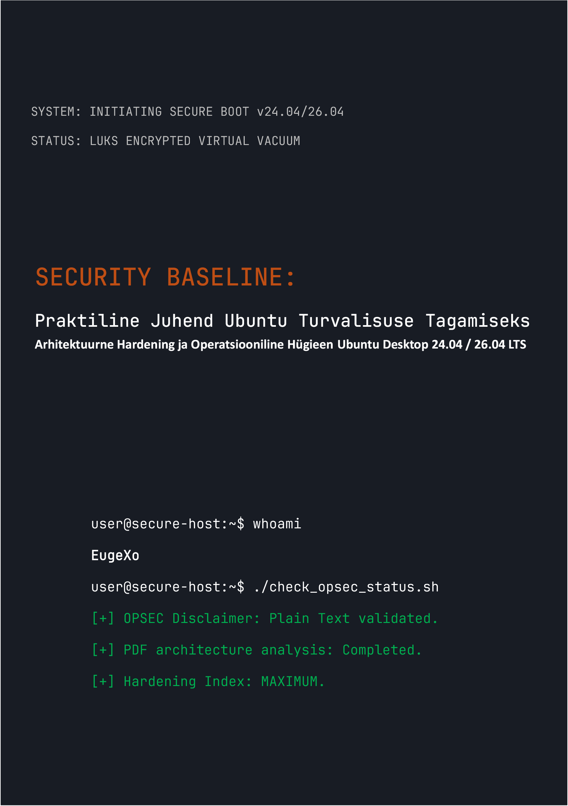

<div align="center">

# Security Baseline: Praktiline juhend Ubuntu turvalisuse tagamiseks

## Arhitektuurne hardening ja operatsiooniline hügieen Ubuntu Desktop 24.04/26.04 LTS

### Written and published by EugeXo

</div>

---

<p align="center">
  
</p>

---

## Raamatu ülesehitus ja lühitutvustused

- [Security Baseline: Praktiline juhend Ubuntu turvalisuse tagamiseks](#security-baseline-praktiline-juhend-ubuntu-turvalisuse-tagamiseks)
  - [Arhitektuurne hardening ja operatsiooniline hügieen Ubuntu Desktop 24.04/26.04 LTS](#arhitektuurne-hardening-ja-operatsiooniline-hügieen-ubuntu-desktop-24042604-lts)
    - [Written and published by EugeXo](#written-and-published-by-eugexo)
  - [Raamatu ülesehitus ja lühitutvustused](#raamatu-ülesehitus-ja-lühitutvustused)
  - [Tänusõnad](#tänusõnad)
  - [Formaaditurvalisuse tagamine (OPSEC-lahtiütlus)](#formaaditurvalisuse-tagamine-opsec-lahtiütlus)
  - [Autorilt: Milleks ja kellele see raamat on kirjutatud?](#autorilt-milleks-ja-kellele-see-raamat-on-kirjutatud)
    - [Esitusviisi põhimõttest:](#esitusviisi-põhimõttest)
  - [Baaskaitsetase: 12 operatsioonilise hügieeni reeglit](#baaskaitsetase-12-operatsioonilise-hügieeni-reeglit)
  - [Anonüümsuse, privaatsuse ja turvalisuse mõisted](#anonüümsuse-privaatsuse-ja-turvalisuse-mõisted)
  - [Operatsioonisüsteemi Ubuntu 24.04/26.04 LTS paigaldamine](#operatsioonisüsteemi-ubuntu-24042604-lts-paigaldamine)
    - [Sissejuhatus:](#sissejuhatus)
    - [Riistvara ettevalmistamise reglement:](#riistvara-ettevalmistamise-reglement)
    - [Distributsiooni valik:](#distributsiooni-valik)
    - [Paigaldusprogrammi samm-sammuline läbimine:](#paigaldusprogrammi-samm-sammuline-läbimine)
  - [Esimene käivitus](#esimene-käivitus)
  - [Süsteemi seadistamine](#süsteemi-seadistamine)
  - [Töö alustamine konsooliga](#töö-alustamine-konsooliga)
    - [Esmane seadistamine:](#esmane-seadistamine)
      - [Gnome Terminal Ubuntu 24.04:](#gnome-terminal-ubuntu-2404)
      - [Ptyxis Ubuntu 26.04:](#ptyxis-ubuntu-2604)
    - [Automaatse haakimise keelamine ja valikulised seaded:](#automaatse-haakimise-keelamine-ja-valikulised-seaded)
    - [Käskude ajaloo salvestamine konsoolis:](#käskude-ajaloo-salvestamine-konsoolis)
    - [Turvalise sudo sessiooni aegumise (timeout) seadistamine:](#turvalise-sudo-sessiooni-aegumise-timeout-seadistamine)
    - [Faili loomine Checks Passed kontrollimiseks:](#faili-loomine-checks-passed-kontrollimiseks)
  - [Võrgu ja VPN-i seadistamine](#võrgu-ja-vpn-i-seadistamine)
    - [Juhtmega ühenduse Ethernet (Wired connection) seadistamine:](#juhtmega-ühenduse-ethernet-wired-connection-seadistamine)
    - [Juhtmevaba ühenduse Wi-Fi (Wireless connection) seadistamine:](#juhtmevaba-ühenduse-wi-fi-wireless-connection-seadistamine)
      - [Seadistamine reaalsele laua- või sülearvutile (Täielik randomiseerimine):](#seadistamine-reaalsele-laua--või-sülearvutile-täielik-randomiseerimine)
      - [Seadistamine virtuaalmasinale (Strict-maskeerimine riistvaratootja alla):](#seadistamine-virtuaalmasinale-strict-maskeerimine-riistvaratootja-alla)
    - [NetworkManageri hardening: lokaalsete mDNS-, LLMNR- ja Hostname-lekete tõkestamine ning DNS-i kaitse:](#networkmanageri-hardening-lokaalsete-mdns--llmnr--ja-hostname-lekete-tõkestamine-ning-dns-i-kaitse)
    - [Wi-Fi lülitamine täieliku keelamise režiimi süsteemi käivitumisel:](#wi-fi-lülitamine-täieliku-keelamise-režiimi-süsteemi-käivitumisel)
    - [Kompromiteerivate Bluetoothi komponentide eemaldamine:](#kompromiteerivate-bluetoothi-komponentide-eemaldamine)
    - [VPN-ühenduse seadistamine:](#vpn-ühenduse-seadistamine)
  - [Alglaaduri GRUB turvaseadistus ja hardening](#alglaaduri-grub-turvaseadistus-ja-hardening)
    - [Parooli määramine GRUB-i kaitsmiseks:](#parooli-määramine-grub-i-kaitsmiseks)
    - [Tarkvaraline IOMMU hardening: RAM-i kaitse DMA-rünnakute eest kerneli tasemel:](#tarkvaraline-iommu-hardening-ram-i-kaitse-dma-rünnakute-eest-kerneli-tasemel)
  - [UFW firewall'i seadistamise variandid nii Kill Switchiga kui ka ilma](#ufw-firewalli-seadistamise-variandid-nii-kill-switchiga-kui-ka-ilma)
    - [Seadistame firewall'i koos Kill Switchiga:](#seadistame-firewalli-koos-kill-switchiga)
    - [Oluline täiendus reeglite järjekorra haldamise kohta:](#oluline-täiendus-reeglite-järjekorra-haldamise-kohta)
    - [Alternatiivne seadistusvariant (Ilma VPN-ita / Külalis-OS-ide jaoks):](#alternatiivne-seadistusvariant-ilma-vpn-ita--külalis-os-ide-jaoks)
  - [Süsteemi kerneli seadistamine, ligipääsuõiguste piiramine ja süsteemiteenuste eemaldamine](#süsteemi-kerneli-seadistamine-ligipääsuõiguste-piiramine-ja-süsteemiteenuste-eemaldamine)
    - [Võrgupinu ja kerneli mälu alamsüsteemi kaitse:](#võrgupinu-ja-kerneli-mälu-alamsüsteemi-kaitse)
    - [Madala taseme sysctl hardening: kaitse TCP Timestamp Fingerprinting'u vastu:](#madala-taseme-sysctl-hardening-kaitse-tcp-timestamp-fingerprintingu-vastu)
    - [Haruldaste võrguprotokollide ja vananenud failisüsteemide blokeerimine:](#haruldaste-võrguprotokollide-ja-vananenud-failisüsteemide-blokeerimine)
    - [Ligipääsuõiguste piiramine failisüsteemis:](#ligipääsuõiguste-piiramine-failisüsteemis)
    - [Jagatud mälu (shared memory) turvaline haakimine:](#jagatud-mälu-shared-memory-turvaline-haakimine)
      - [Tasakaalustatud režiim (Soovitatav igapäevaseks Desktop-kasutuseks):](#tasakaalustatud-režiim-soovitatav-igapäevaseks-desktop-kasutuseks)
      - [Paranoiline režiim (Maksimaalne isolatsioon):](#paranoiline-režiim-maksimaalne-isolatsioon)
    - [Isoleeritud RAM-ketta loomine lenduvate logide jaoks:](#isoleeritud-ram-ketta-loomine-lenduvate-logide-jaoks)
    - [Videovoo ja helisalvestuse tõkestamine:](#videovoo-ja-helisalvestuse-tõkestamine)
    - [Süsteemsete printimis- ja kohtvõrgu ressursside tuvastamise teenuste eemaldamine:](#süsteemsete-printimis--ja-kohtvõrgu-ressursside-tuvastamise-teenuste-eemaldamine)
    - [Geolokatsiooni ja ajavööndi maskeerimine:](#geolokatsiooni-ja-ajavööndi-maskeerimine)
  - [Repositooriumide seadistamine ja süsteemi uuendamine](#repositooriumide-seadistamine-ja-süsteemi-uuendamine)
    - [Süsteemi uuendamine:](#süsteemi-uuendamine)
    - [NVIDIA graafikaahela juurutamine isolatsioonirežiimis:](#nvidia-graafikaahela-juurutamine-isolatsioonirežiimis)
  - [Terminalikeskkonnad Ubuntus:](#terminalikeskkonnad-ubuntus)
    - [Asendame Gnome Terminali ja Ptyxise Ghosttyga](#asendame-gnome-terminali-ja-ptyxise-ghosttyga)
      - [Paigaldamine Ubuntu 24.04 LTS Noble Numbat kasutajatele:](#paigaldamine-ubuntu-2404-lts-noble-numbat-kasutajatele)
      - [Paigaldamine Ubuntu 26.04 LTS Resolute Racoon kasutajatele:](#paigaldamine-ubuntu-2604-lts-resolute-racoon-kasutajatele)
      - [Ghostty konfiguratsioonivariant Ubuntu 24.04/26.04 jaoks:](#ghostty-konfiguratsioonivariant-ubuntu-24042604-jaoks)
    - [Valikuline! Ubuntu 26.04 — taastame Gnome Terminali ja eemaldame Ptyxise:](#valikuline-ubuntu-2604--taastame-gnome-terminali-ja-eemaldame-ptyxise)
  - [Snapi ja telemeetria eemaldamine ning keelamine](#snapi-ja-telemeetria-eemaldamine-ning-keelamine)
    - [Eemaldame Snapi:](#eemaldame-snapi)
    - [Lõikame välja Canonicali telemeetria:](#lõikame-välja-canonicali-telemeetria)
    - [Taustal töötava püsivara jälgija fwupd neutraliseerimine:](#taustal-töötava-püsivara-jälgija-fwupd-neutraliseerimine)
  - [Turvatööriistade libpam-tmpdir, debsums ja koormusmonitori Btop paigaldamine](#turvatööriistade-libpam-tmpdir-debsums-ja-koormusmonitori-btop-paigaldamine)
    - [Turvatööriist libpam-tmpdir:](#turvatööriist-libpam-tmpdir)
    - [Tööriist debsums:](#tööriist-debsums)
    - [Mugav tööriist süsteemi koormuse jälgimiseks — Btop:](#mugav-tööriist-süsteemi-koormuse-jälgimiseks--btop)
    - [Võrguportide ja -ühenduste seire:](#võrguportide-ja--ühenduste-seire)
  - [Etalontaastepunktide loomine: tööriista Timeshift juurutamine ja seadistamine](#etalontaastepunktide-loomine-tööriista-timeshift-juurutamine-ja-seadistamine)
    - [Sissejuhatus:](#sissejuhatus-1)
    - [Timeshifti töö eripärad krüpteeritud keskkonnas (LUKS + GRUB):](#timeshifti-töö-eripärad-krüpteeritud-keskkonnas-luks--grub)
    - [Timeshifti turvaline paigaldamine:](#timeshifti-turvaline-paigaldamine)
    - [Esmane konfigureerimine ja Tõmmise nr 1 (Steriilne Etalon) loomine:](#esmane-konfigureerimine-ja-tõmmise-nr-1-steriilne-etalon-loomine)
    - [Edasise kontrolli vektor: Tõmmise nr 2 (Eelkäituslik) loomine:](#edasise-kontrolli-vektor-tõmmise-nr-2-eelkäituslik-loomine)
    - [Erakorralise tagasipöörde reglement (Kui süsteem on kompromiteeritud või rikutud):](#erakorralise-tagasipöörde-reglement-kui-süsteem-on-kompromiteeritud-või-rikutud)
  - [Puhta .deb-versiooni Firefoxi paigaldamine ja Snap-tühiku eemaldamine](#puhta-deb-versiooni-firefoxi-paigaldamine-ja-snap-tühiku-eemaldamine)
  - [Mozilla Firefoxi paigaldamine ja privaatsusparameetrite seadistamine](#mozilla-firefoxi-paigaldamine-ja-privaatsusparameetrite-seadistamine)
    - [Valmistame süsteemi seadistamiseks ette:](#valmistame-süsteemi-seadistamiseks-ette)
    - [Esmane graafiline privaatsusseadistus (Kohustuslik kõigile):](#esmane-graafiline-privaatsusseadistus-kohustuslik-kõigile)
    - [Privaatsete DNS-pakkujate (DNS over HTTPS) seadistamine:](#privaatsete-dns-pakkujate-dns-over-https-seadistamine)
    - [Hardeningu automatiseerimine: konfiguratsioonifaili user.js loomine:](#hardeningu-automatiseerimine-konfiguratsioonifaili-userjs-loomine)
    - [Ultimatiivsete kaitselaienduste juurutamine:](#ultimatiivsete-kaitselaienduste-juurutamine)
  - [Interaktiivse võrgutulemüüri Portmaster paigaldamine ja seadistamine](#interaktiivse-võrgutulemüüri-portmaster-paigaldamine-ja-seadistamine)
    - [Sissejuhatus:](#sissejuhatus-2)
    - [Ettevalmistus, tuuma esmane initsialiseerimine ja üleminek uuele versioonile:](#ettevalmistus-tuuma-esmane-initsialiseerimine-ja-üleminek-uuele-versioonile)
  - [Andmete garanteeritud hävitamine ja digitaalse jalajälje steriliseerimine](#andmete-garanteeritud-hävitamine-ja-digitaalse-jalajälje-steriliseerimine)
    - [Sissejuhatus:](#sissejuhatus-3)
    - [Digitaalse jalajälje anatoomia: miks on andmete kustutamine kasutu ilma metaandmete puhastamiseta?](#digitaalse-jalajälje-anatoomia-miks-on-andmete-kustutamine-kasutu-ilma-metaandmete-puhastamiseta)
    - [Tööriista MAT2 paigaldamine ja metaandmete puhastamine:](#tööriista-mat2-paigaldamine-ja-metaandmete-puhastamine)
    - [Failide ja kataloogide turvaline ja pöördumatu kustutamine:](#failide-ja-kataloogide-turvaline-ja-pöördumatu-kustutamine)
    - [Tööriista shred tööparameetrid:](#tööriista-shred-tööparameetrid)
    - [Ketta vaba ruumi globaalne puhastamine:](#ketta-vaba-ruumi-globaalne-puhastamine)
  - [Steganograafia, obfuskatsioon ja jälgede peitmine Ubuntus](#steganograafia-obfuskatsioon-ja-jälgede-peitmine-ubuntus)
    - [Sissejuhatus:](#sissejuhatus-4)
    - [Steganograafia Linuxis. Peidame failid meediasisu sisse:](#steganograafia-linuxis-peidame-failid-meediasisu-sisse)
    - [Konsoolitööriist steghide:](#konsoolitööriist-steghide)
    - [Maskeerimine täiustatud tööriista StegoForge abil:](#maskeerimine-täiustatud-tööriista-stegoforge-abil)
    - [Arhiivide kokkukleepimine (Kiire nipp ilma kõrvalise tarkvarata):](#arhiivide-kokkukleepimine-kiire-nipp-ilma-kõrvalise-tarkvarata)
    - [Teksti obfuskatsioon: automaatsete analüüsisüsteemide (DPI) vältimine:](#teksti-obfuskatsioon-automaatsete-analüüsisüsteemide-dpi-vältimine)
    - [Varjatud ohtude analüüs. Faililaiendite maskeerimine (BiDi-rünnakud):](#varjatud-ohtude-analüüs-faililaiendite-maskeerimine-bidi-rünnakud)
  - [Krüptograafilise paketi VeraCrypt paigaldamine ja seadistamine](#krüptograafilise-paketi-veracrypt-paigaldamine-ja-seadistamine)
    - [Sissejuhatus VeraCrypti ja selle paigaldamine:](#sissejuhatus-veracrypti-ja-selle-paigaldamine)
      - [Paigaldamine kogukonna PPA-repositooriumi kaudu:](#paigaldamine-kogukonna-ppa-repositooriumi-kaudu)
      - [Ametliku distributsiooni paigaldamine (Natiivne meetod):](#ametliku-distributsiooni-paigaldamine-natiivne-meetod)
    - [Sügav turvahäälestus: võtmete kaitse RAM-is (Paranoiline režiim):](#sügav-turvahäälestus-võtmete-kaitse-ram-is-paranoiline-režiim)
    - [Fundamentaalne infoturbe tööriist: Peidetud köidete (Hidden Volume) loomine:](#fundamentaalne-infoturbe-tööriist-peidetud-köidete-hidden-volume-loomine)
    - [Ultimatiivne hardening: PIM-i seadistamine ja riistvaralised võtmefailid:](#ultimatiivne-hardening-pim-i-seadistamine-ja-riistvaralised-võtmefailid)
    - [Ohumudel reaalses maailmas: miks peab paranoia olema süsteemne:](#ohumudel-reaalses-maailmas-miks-peab-paranoia-olema-süsteemne)
  - [Yubico turvavõtmete kasutamine](#yubico-turvavõtmete-kasutamine)
    - [Sissejuhatus:](#sissejuhatus-5)
    - [Paigaldamine:](#paigaldamine)
    - [Riistvaralise Log Out / Kill Switchi realiseerimine kerneli udev-reeglite kaudu:](#riistvaralise-log-out--kill-switchi-realiseerimine-kerneli-udev-reeglite-kaudu)
  - [USBGuardi paigaldamine ja seadistamine](#usbguardi-paigaldamine-ja-seadistamine)
    - [Sissejuhatus:](#sissejuhatus-6)
    - [Paigaldamine ja seadistamine:](#paigaldamine-ja-seadistamine)
  - [Emergency Panic Buttoni realiseerimine töö koheseks lõpetamiseks](#emergency-panic-buttoni-realiseerimine-töö-koheseks-lõpetamiseks)
    - [Erakorraline riistvaraline Kill Switch mis tahes USB-seadme kaudu:](#erakorraline-riistvaraline-kill-switch-mis-tahes-usb-seadme-kaudu)
  - [Kohaliku paroolihalduri KeePassXC paigaldamine](#kohaliku-paroolihalduri-keepassxc-paigaldamine)
    - [Sissejuhatus:](#sissejuhatus-7)
    - [Andmehoidla kaitsmise stsenaariumide variandid:](#andmehoidla-kaitsmise-stsenaariumide-variandid)
    - [Tarkvarakomplekti paigaldamine:](#tarkvarakomplekti-paigaldamine)
    - [Andmebaasi loomine ja riistvaraline kaitsmine:](#andmebaasi-loomine-ja-riistvaraline-kaitsmine)
    - [Sisemiste turvaseadete sügav hardening:](#sisemiste-turvaseadete-sügav-hardening)
    - [Andmete turvaline sisestamine läbi kaitstud lõikelaua:](#andmete-turvaline-sisestamine-läbi-kaitstud-lõikelaua)
  - [Võrguanalüsaatori Wireshark paigaldamine ja käivitamine](#võrguanalüsaatori-wireshark-paigaldamine-ja-käivitamine)
    - [Sissejuhatus:](#sissejuhatus-8)
    - [Wiresharki paigaldamine ja käivitamine:](#wiresharki-paigaldamine-ja-käivitamine)
    - [Pakettide püüdmise alamsüsteemi kriitiline turvakontseptsioon:](#pakettide-püüdmise-alamsüsteemi-kriitiline-turvakontseptsioon)
    - [Liiklustõmmiste varjatud kogumine (Konsoolirežiim):](#liiklustõmmiste-varjatud-kogumine-konsoolirežiim)
    - [Praktiline Wiresharki teejuht:](#praktiline-wiresharki-teejuht)
  - [Kaitsesüsteemi AppArmor paigaldamine ja haldamine](#kaitsesüsteemi-apparmor-paigaldamine-ja-haldamine)
    - [Sissejuhatus:](#sissejuhatus-9)
    - [Uus turvapardigma: kerneli automatiseerimine:](#uus-turvapardigma-kerneli-automatiseerimine)
    - [AppArmori alamsüsteemi praktiline hardening:](#apparmori-alamsüsteemi-praktiline-hardening)
  - [Isoleeritud sandbox'ide Firejail ja Bubblewrap paigaldamine ja seadistamine](#isoleeritud-sandboxide-firejail-ja-bubblewrap-paigaldamine-ja-seadistamine)
    - [Sissejuhatus:](#sissejuhatus-10)
    - [Firejaili paigaldamine ja sandbox'i ettevalmistamine:](#firejaili-paigaldamine-ja-sandboxi-ettevalmistamine)
    - [Firejaili põhilised filtreerimisparameetrid (Teatmik):](#firejaili-põhilised-filtreerimisparameetrid-teatmik)
    - [Valikuline! Firejaili kaitseahela automatiseerimine (Tööriist Firecfg):](#valikuline-firejaili-kaitseahela-automatiseerimine-tööriist-firecfg)
    - [Bubblewrapi paigaldamine:](#bubblewrapi-paigaldamine)
    - [Bubblewrapi lippude spikker (Teatmik):](#bubblewrapi-lippude-spikker-teatmik)
    - [Kohandatud otseteede ettevalmistamine sandbox'ide jaoks:](#kohandatud-otseteede-ettevalmistamine-sandboxide-jaoks)
      - [Eraldi Firefox hardened profiili loomine Firejaili jaoks:](#eraldi-firefox-hardened-profiili-loomine-firejaili-jaoks)
      - [Firefox hardened profiili loomine Bubblewrapis:](#firefox-hardened-profiili-loomine-bubblewrapis)
      - [PDF-dokumentide hermeetiline kamber: failide turvaline käivitamine Firejailis:](#pdf-dokumentide-hermeetiline-kamber-failide-turvaline-käivitamine-firejailis)
      - [Pitseerime Document Vieweri PDF-ide lugemiseks Bubblewrapis:](#pitseerime-document-vieweri-pdf-ide-lugemiseks-bubblewrapis)
      - [Image Viewer graafikafailide vaatamiseks Firejailis:](#image-viewer-graafikafailide-vaatamiseks-firejailis)
      - [Pakime pildivaaturi Image Viewer Bubblewrapi:](#pakime-pildivaaturi-image-viewer-bubblewrapi)
      - [KeePassXC isoleerimise stsenaarium Firejaili jaoks:](#keepassxc-isoleerimise-stsenaarium-firejaili-jaoks)
      - [Isoleerime KeePassXC Bubblewrapi kaudu:](#isoleerime-keepassxc-bubblewrapi-kaudu)
    - [Kontoritarkvara paketi LibreOffice paigaldamine ja isoleerimine:](#kontoritarkvara-paketi-libreoffice-paigaldamine-ja-isoleerimine)
      - [Seadistame töö läbi Firejaili:](#seadistame-töö-läbi-firejaili)
      - [Pakime LibreOffice'i Bubblewrapi:](#pakime-libreofficei-bubblewrapi)
    - [GNU Image Manipulation Program (GIMP) paigaldamine ja isoleerimine:](#gnu-image-manipulation-program-gimp-paigaldamine-ja-isoleerimine)
      - [Seadistame GIMP-i töö läbi Firejaili:](#seadistame-gimp-i-töö-läbi-firejaili)
      - [Seadistame GIMP-i Bubblewrapi kaudu:](#seadistame-gimp-i-bubblewrapi-kaudu)
    - [Koodiredaktori VS Codium (IDE programmide kirjutamiseks) paigaldamine ja isoleerimine:](#koodiredaktori-vs-codium-ide-programmide-kirjutamiseks-paigaldamine-ja-isoleerimine)
      - [VS Codiumi isoleerimine Firejailis:](#vs-codiumi-isoleerimine-firejailis)
      - [VS Codiumi isoleerimine Bubblewrapis:](#vs-codiumi-isoleerimine-bubblewrapis)
    - [Kohaliku tehisintellekti LM Studio Bionic paigaldamine ja isoleerimine:](#kohaliku-tehisintellekti-lm-studio-bionic-paigaldamine-ja-isoleerimine)
      - [Seadistame LM Studio töö läbi Firejaili:](#seadistame-lm-studio-töö-läbi-firejaili)
      - [Pakime LM Studio Bubblewrapi:](#pakime-lm-studio-bubblewrapi)
    - [Turvalise side seadistamine: sõnumirakenduste ja krüptokontuuri kohustuslik isoleerimine (autori OPSEC-kontuur):](#turvalise-side-seadistamine-sõnumirakenduste-ja-krüptokontuuri-kohustuslik-isoleerimine-autori-opsec-kontuur)
    - [Telegram Desktopi paigaldamine ja isoleerimine:](#telegram-desktopi-paigaldamine-ja-isoleerimine)
      - [Kaitseme Telegrami kontuuri Firejaili kaudu:](#kaitseme-telegrami-kontuuri-firejaili-kaudu)
      - [Isoleerime Telegrami Bubblewrapi kaudu:](#isoleerime-telegrami-bubblewrapi-kaudu)
    - [Signali paigaldamine ja isoleerimine Bubblewrapi kaudu:](#signali-paigaldamine-ja-isoleerimine-bubblewrapi-kaudu)
    - [Hosti krüptograafiline vundament: GnuPG võtmete genereerimine ja OPSEC-kaitse:](#hosti-krüptograafiline-vundament-gnupg-võtmete-genereerimine-ja-opsec-kaitse)
    - [Jabber-kliendi Psi+ paigaldamine ja isoleerimine:](#jabber-kliendi-psi-paigaldamine-ja-isoleerimine)
      - [Kaitseme Psi+ kontuuri Firejailis:](#kaitseme-psi-kontuuri-firejailis)
      - [Kaitseme Psi+ kontuuri Bubblewrapis:](#kaitseme-psi-kontuuri-bubblewrapis)
      - [OpenPGP ja OMEMO aktiveerimine ja sidumine Psi+ liideses:](#openpgp-ja-omemo-aktiveerimine-ja-sidumine-psi-liideses)
    - [E-posti kliendi Thunderbird paigaldamine ja isoleerimine (Krüpteeritud e-kirjavahetuse kontuur):](#e-posti-kliendi-thunderbird-paigaldamine-ja-isoleerimine-krüpteeritud-e-kirjavahetuse-kontuur)
      - [Thunderbirdi isoleerimine Firejaili abil:](#thunderbirdi-isoleerimine-firejaili-abil)
      - [Thunderbirdi isoleerimine Bubblewrapi abil:](#thunderbirdi-isoleerimine-bubblewrapi-abil)
      - [OpenPGP ja kaugjälitamise kaitse seadistamine Thunderbirdis:](#openpgp-ja-kaugjälitamise-kaitse-seadistamine-thunderbirdis)
    - [Ühekordsed «Amnesia» sessioonid Firejailis (Overlay režiim):](#ühekordsed-amnesia-sessioonid-firejailis-overlay-režiim)
  - [Rkhunteri paigaldamine ja juurkomplektide (rootkits) otsing](#rkhunteri-paigaldamine-ja-juurkomplektide-rootkits-otsing)
    - [Chkrootkiti paigaldamine lisaks Rkhunterile:](#chkrootkiti-paigaldamine-lisaks-rkhunterile)
  - [Viirusetõrjeskanneri ClamAV paigaldamine ja seadistamine](#viirusetõrjeskanneri-clamav-paigaldamine-ja-seadistamine)
    - [Sissejuhatus:](#sissejuhatus-11)
    - [ClamAV-i paigaldamine:](#clamav-i-paigaldamine)
    - [Signatuuribaaside uuendamine ja võrgublokeeringute vältimine:](#signatuuribaaside-uuendamine-ja-võrgublokeeringute-vältimine)
    - [Süsteemse skaneerimise korraldamine:](#süsteemse-skaneerimise-korraldamine)
    - [Mitmelõimeline skaneerimine (Hardening):](#mitmelõimeline-skaneerimine-hardening)
  - [Virtualiseerimiskeskkonna VirtualBox paigaldamine ja seadistamine](#virtualiseerimiskeskkonna-virtualbox-paigaldamine-ja-seadistamine)
    - [Kaitse kriminalistika eest: VirtualBoxi logide isoleerimine RAM-is (`tmpfs`):](#kaitse-kriminalistika-eest-virtualboxi-logide-isoleerimine-ram-is-tmpfs)
  - [Virtuaalketaste VDI tihendamine ja optimeerimine](#virtuaalketaste-vdi-tihendamine-ja-optimeerimine)
    - [Sissejuhatus:](#sissejuhatus-12)
    - [Windowsi virtuaalmasina puhastamine:](#windowsi-virtuaalmasina-puhastamine)
    - [Linuxi virtuaalmasina (Ubuntu/Kali Linux) puhastamine:](#linuxi-virtuaalmasina-ubuntukali-linux-puhastamine)
    - [Virtuaalketta lõplik tihendamine hostmasinas:](#virtuaalketta-lõplik-tihendamine-hostmasinas)
  - [Konteineriseerimissüsteemi Docker paigaldamine ja seadistamine](#konteineriseerimissüsteemi-docker-paigaldamine-ja-seadistamine)
    - [Sissejuhatus:](#sissejuhatus-13)
    - [Milles seisneb vaikimisi Dockeri varjatud oht?](#milles-seisneb-vaikimisi-dockeri-varjatud-oht)
    - [Dockeri juurutamine Rootless-režiimis:](#dockeri-juurutamine-rootless-režiimis)
    - [Võrgu taltsutamine ja sidumine UFW-ga:](#võrgu-taltsutamine-ja-sidumine-ufw-ga)
    - [Konteinerite turvalise käivitamise praktiline näide:](#konteinerite-turvalise-käivitamise-praktiline-näide)
    - [Turvalisuse eksperimentaalne tõestus (Root-õiguste puudumise kontroll):](#turvalisuse-eksperimentaalne-tõestus-root-õiguste-puudumise-kontroll)
  - [Tervikluse kontrollisüsteemi AIDE paigaldamine ja seadistamine](#tervikluse-kontrollisüsteemi-aide-paigaldamine-ja-seadistamine)
    - [Sissejuhatus:](#sissejuhatus-14)
    - [AIDE paigaldamine ja seadistamine:](#aide-paigaldamine-ja-seadistamine)
    - [Läbistustesti tegemine (Kaitse valideerimine):](#läbistustesti-tegemine-kaitse-valideerimine)
  - [Süsteemi automatiseeritud turvaaudit tööriistaga Lynis](#süsteemi-automatiseeritud-turvaaudit-tööriistaga-lynis)
  - [Haavatavuste ja paroolilekete skanneri Trivy paigaldamine ja seadistamine](#haavatavuste-ja-paroolilekete-skanneri-trivy-paigaldamine-ja-seadistamine)
  - [Külalissüsteemide Ubuntu/Xubuntu/Lubuntu seadistamine VirtualBoxis](#külalissüsteemide-ubuntuxubuntulubuntu-seadistamine-virtualboxis)
    - [Guest Additionsi paigaldamine:](#guest-additionsi-paigaldamine)
    - [Mozilla Firefoxi paigaldamine:](#mozilla-firefoxi-paigaldamine)
    - [Ühiskaustade (Shared Folders) seadistamine VirtualBoxis:](#ühiskaustade-shared-folders-seadistamine-virtualboxis)
    - [Ledger Live'i paigaldamine VirtualBoxi koos Ubuntu/Xubuntu/Lubuntuga](#ledger-livei-paigaldamine-virtualboxi-koos-ubuntuxubuntulubuntuga)
    - [Ledger Live'i käivitamine põhilises Ubuntu hostsüsteemis](#ledger-livei-käivitamine-põhilises-ubuntu-hostsüsteemis)
  - [Autori ja õigusalane teave](#autori-ja-õigusalane-teave)
    - [Kontaktid ja kogukonna ressursid:](#kontaktid-ja-kogukonna-ressursid)

<br>
<br>
<br>
<br>
<br>
<br>
<br>

## Tänusõnad

Lihtsalt ja ilma liigsete sõnadeta tahaksin avaldada sügavat tänu inimestele, kes innustasid mind seda raamatut kirjutama ja toetasid mind kogu selle teekonna vältel.

Tänan meie väikese, kuid tehnoloogiliselt arenenud Eesti politsei küberkuritegevuse osakonna lihtsaid ja asjalikke poisse, kes andsid tõuke selle raamatu sünniks.

Samuti avaldan erilist tänu USA Salateenistuse (U.S. Secret Service) Miami osakonna infoturbe spetsialistidele, kes andsid märkimisväärse praktilise panuse mitme peatüki verifitseerimisse. Nagu selgus, töötavad siin kirjeldatud meetodid ja lähenemised reaalsetes välistingimustes suurepäraselt.

Loomulikult kuulub suurim tänu minu lähedastele nende fenomenaalse kannatlikkuse ja moraalse toe eest. Eriti emale, kes suhtus minu töösse täieliku mõistmisega ja võttis enda kanda suure osa igapäevasest rutiinist, vabastades mulle aega uurimistööks.

**Eraldi tahan tänada toetuse eest oma head sõpra Suurbritanniast. Suhtlesime tihedalt ajal, mil viibisin Miamis, kuid hiljem katkes kontakt kahjuks ära. Loodan siiralt, et leiame üksteist taas. Sõber, kui sina või su infoturbe valdkonnas töötav poeg neid ridu loete, võtke palun ühendust — minu kontaktandmed on toodud raamatu lõpus. Usun, et sa said aru, *who is who!* ;)**

Kirjeldamatu tänu kuulub minu virtuaalsele abilisele — **Google'i loodud Gemini'le**. Kogu raamatu kirjutamise vältel jäi ta asendamatuks digitaalseks kaaslaseks, pakkudes hindamatut tuge selle karmi tehnilise materjali struktureerimisel ja tõlkimisel.

Tänan ka lõbusat ja nutikat abilist **OpenAI ChatGPT-d** abi eest tehniliste lahenduste arutamisel, konfiguratsioonide kontrollimisel ning üksikute tekstilõikude tähelepanelikul toimetamisel ja täpsemate sõnastuste leidmisel.

Loomulikult kuuluvad esimesed tänusõnad Google'i ja OpenAI inseneridele ning arendajatele esmaklassiliselt tehtud töö eest!

Kirjutada võiks veel pikalt, kuid kõik asjaosalised mõistavad niigi kõike suurepäraselt. Mul on väga hea meel, et see raamat lõpuks ilmavalgust näeb. Sõbrad, ma armastan, hindan ja austan teid kõiki siiralt!

<br>

## Formaaditurvalisuse tagamine (OPSEC-lahtiütlus)

Infoturbe ja terve mõistuse kaalutlustel tarnitakse kogu selle juhendi materjal esialgu lihttekstina (Plain Text koos Markdown-märgistusega). Plaan anda raamat välja PDF-formaadis lükati teadlikult tagasi. PDF-il on liiga kohmakas arhitektuur ja seda kompromiteeritakse perioodiliselt. Kaitstava hosti turvalisus peab algama selle seadistamisjuhendi turvalisest lugemisest.

Tekstifail kujutab endast puhtaid andmeid ilma käivitatava koodita, samas kui PDF-formaat toetab vaikimisi sisseehitatud JavaScript-skripte, dünaamilisi elemente, interaktiivseid vorme ja keerukaid fonte, mis nõuavad süsteemilt sügavat parsimist. Kriitilised RCE-klassi (*Remote Code Execution*) haavatavused Linuxi PDF-parserites (näiteks vaikimisi vaaturis Evince või Poppleri teekides) on tõestatud ajalooline fakt. Plain Text formaat ei sisalda sisseehitatud koodikäivitusmehhanisme ja vähendab oluliselt ründepinda materjali lugemisel. See tagab turvalise lugemise igas keskkonnas.

Sel põhjusel on kõik graafilised materjalid ja illustratsioonid viidud põhitekstist välja eraldi kataloogi. Graafika on struktureeritud kaustadesse ja alamkaustadesse, mis välistab selle automaatse mällu renderdamise raamatu lugemise ajal.

> [!NOTE]
> Raamatu peamine lähtevorming on Markdown. Kõik tuletatud formaadid (HTML, EPUB ja teised) genereeritakse kontrollitud tekstilisest lähtekoodist.
> 
> Lugeja saab projekti kasutada ühel kolmest viisist:
> 
> * Lugeda algset Markdown-faili otse.
> * Kasutada valmis HTML/EPUB-pakette (teostatakse edaspidi).
> * Kompileerida raamat lähtekoodist ise ning muuta vajadusel kujundust, struktuuri, fonte, stiile või kaasatud peatükkide komplekti.
> 
> Selline lähenemine tagab teksti läbipaistvuse, muudatuste auditeerimise lihtsuse ja sõltumatuse konkreetsest lugemistarkvarast.

<br>

## Autorilt: Milleks ja kellele see raamat on kirjutatud?

Kaasaegne digikeskkond muutub üha keerulisemaks: küberohtude arv kasvab, kogutavate andmete maht suureneb ning kasutaja seisab üha sagedamini silmitsi vajadusega kaitsta oma privaatsust ja turvalisust iseseisvalt.

See raamat on loodud praktilise juhendina kontrollitud Linuxi tööjaama ülesehitamiseks, kus turvalisust ei käsitleta üksikute programmide kogumina, vaid ühtse omavahel seotud lahenduste süsteemina. Minu eesmärk on näidata, kuidas luua kättesaadavate Linuxi tööriistade abil selge ohumudeliga töökeskkond: rakenduste isoleerimise, võrguliikluse kontrolli, andmekaitse ja digitaalse keskkonna teadliku haldamisega.

**Raamatu eesmärk on ehitada tööjaam, kus igal tegevusel on kontrollitud turvaperimeeter.**

Materjal on koostatud hariduslikel eesmärkidel ning mõeldud tehniliselt ettevalmistatud kasutajatele, Linuxi entusiastidele ja praktilisest infoturbest huvitatud spetsialistidele. Juhend ei ole sissejuhatav Linuxi algkursus ning eeldab terminali, failisüsteemi ja operatsioonisüsteemi tööpõhimõtete baasteadmisi. Samas suudab tähelepanelik ja motiveeritud lugeja vajalikud tööriistad järk-järgult omandada.

Kõiki kirjeldatud tehnoloogiaid tohib kasutada eranditult seaduslikel eesmärkidel: enda andmete kaitsmiseks, turvalisuse tõstmiseks ja infoturbe põhimõtete tundmaõppimiseks.

Teadlik infokaitse ja tehnoloogiate vastutundlik kasutamine muudavad digikeskkonna turvalisemaks kõigi jaoks.

### Esitusviisi põhimõttest:

Selle raamatu eesmärk ei ole luua entsüklopeediat iga kasutatava tööriista kohta, vaid näidata nende rolli ühtses kaitsemudelis. Seetõttu käsitletakse komponentide siseehitust ja võimalusi ainult sellises mahus, mis on vajalik tööpõhimõtete mõistmiseks ja turvaliseks rakendamiseks.

Laiendatud funktsioonid, täielik süntaks ja spetsiifilised kasutusstsenaariumid jäävad selle juhendi raamidest välja ning nendega saab tutvuda eraldi ametlikus dokumentatsioonis.

## Baaskaitsetase: 12 operatsioonilise hügieeni reeglit

*Hello World, kamraad!*

Enne kui asume süsteemi karmi tehnilise häälestamise juurde, paneme paika vundamendi. Allpool on toodud 12 raudset operatsioonilise hügieeni reeglit, mis tuleb pähe õppida ja mida peab järgima vastuvaidlematult. Ilma nende mõistmiseta osutuvad isegi kõige arenenumad kaitsetööriistad aja jooksul täiesti kasutuks:

1. **Kaitstud perimeetris välistame võimalusel juhtmevabad välisseadmed:** Bluetooth ja Wi-Fi (sealhulgas peakomplektid, kõrvaklapid, juhtmevabad klaviatuurid ja hiired). Igasugused juhtmevabad liidesed suurendavad ründepinda ning nõuavad usaldust protokollipinu, püsivara ja seadmete turvalahenduste vastu.
2. **Tagame süsteemiketta kohustusliku täieliku krüpteerimise** operatsioonisüsteemi paigaldamise etapis. Krüptoparooli pikkuseks määrame vähemalt 24 juhuslikku märki (sealhulgas erimärgid)!
3. **Teostame plaanipärast ja regulaarset operatsioonisüsteemi sisselogimisparooli vahetust.** Kasutajaparooli teeme unikaalse ja piisavalt pika (soovitatavalt vähemalt 16 märki). Riistvaraliste turvavõtmete kasutamisel parooli ei asendata, vaid täiendatakse teise autentimisfaktoriga.
4. **Aktiveerime süsteemi alglaaduri GRUB paroolikaitse**, et välistada täielikult volitamata ligipääs kerneli parameetritele ja konfiguratsiooni muutmisele arvutile füüsilise ligipääsu korral.
5. **Võtame kasutusele riistvaralise turvavõtme** (YubiKey või selle legitiimsed analoogid) kohustusliku teise autentimisfaktorina (2FA) süsteemi sisselogimisel ja superkasutaja käskude kinnitamisel.
6. **Puhastame süsteemi igasugusest liigsest tarkvarast.** Eriti puudutab see suletud lähtekoodiga kommertstarkvara. Peame meeles põhireeglit: mida vähem on süsteemis kõrvalisi teenuseid, deemoneid ja programme, seda väiksem on potentsiaalne ründepind ja kriitiliste haavatavuste arv.
7. **Hoiame operatsioonisüsteemi alati ajakohasena.** Võtame raudseks reegliks regulaarselt kontrollida ja paigaldada süsteemi turvavärskendusi, tehes seda läbi käsurea tööriistade.
8. **Jälgime pidevalt võrgu ja võrguliideste olekut.** Pöörame erilist tähelepanu sellele, milliste kaugserveritega luuakse taustaühendusi ja kuhu suundub meie võrguliiklus.
9. **Viime regulaarselt läbi hosti siseauditi.** Kontrollime süsteemi perioodiliselt (soovitatavalt 2–3 korda nädalas) juurkomplektide (*rootkits*) ja viiruste suhtes ning verifitseerime süsteemifailide terviklust.
10. **Ära kunagi käivita kahtlasi käivitatavaid faile põhisüsteemis.** Nende turvaliseks testimiseks kasutame alati isoleeritud `Firejail` või `Bubblewrap` sandbox'i või virtuaalmasinaid.
11. **Tagame range kaitse ohtlike DMA-rünnakute (*Direct Memory Access*) vastu ja paneme BIOS/UEFI parooli alla:** BIOS/UEFI seadetes lülitame Thunderbolt/USB4 pordid maksimaalse autoriseerimise režiimi (*Kernel DMA Protection*), et vähendada välisseadmete kaudu toimuva DMA-ligipääsu riski. Paneme BIOS/UEFI-le parooli. Lisaks lülitame täielikult välja puhkerežiimi (*Sleep Mode*), kuna selles olekus jäävad ketta krüpteerimisvõtmed operatiivmällu (RAM) avatud kujul.
12. **Töökohalt kasvõi hetkeks lahkudes lukustame sessiooni koheselt ning pikemaks ajaks lahkudes lülitame arvuti täielikult välja.**

> [!NOTE]
> Iga turvasüsteemi kõige nõrgemaks lüliks jääb sageli mitte tarkvara, vaid kasutaja enda tegevus.
>
> Professionaalses ringkonnas levib naljatlev ütlus: «peamine haavatavus asub tooli ja klaviatuuri vahel».
>
> Just seetõttu peab tehnilise hardening'uga kaasnema operatsiooniline distsipliin: failide kontrollimine enne avamist, metaandmete eemaldamine enne avaldamist, võrguliikluse jälgimine ja pidev arusaam omaenda ohumudelist.

## Anonüümsuse, privaatsuse ja turvalisuse mõisted

Igapäevakõnes aetakse need mõisted sageli segamini, kuigi need kirjeldavad täiesti erinevaid ülesandeid.

**Anonüümsus** vastab küsimusele: «Kas minu tegevusi on võimalik siduda minu reaalse isikuga?»
Kui süsteem on ideaalne, näeb vastane tegevust ennast, kuid ei suuda seda kuidagi seostada konkreetse inimesega reaalses maailmas.

**Privaatsus** vastab küsimusele: «Kas mina kontrollin, millist teavet minu kohta kogutakse ja kellele see kättesaadavaks saab?»
Vastane teab, et inimene on olemas, kuid see inimene kontrollib, milline osa teabest võib väljapoole liikuda.

**Turvalisus** vastab küsimusele: «Kas ma suudan kaitsta oma süsteemi, andmeid ja seadet volitamata ligipääsu eest?»
Inimene on oma digitaalse perimeetri sees pidevas lahinguvalmiduses. Vastane võib seista otse värava taga, kuid tal ei pruugi olla piisavalt võimalusi süsteemi sissemurdmiseks ja andmete kättesaamiseks.

Krüpteeritud sülearvuti koos tugeva parooliga tõstab turvalisust. Kuid kui kasutaja avaldab vabatahtlikult kõik oma isikuandmed internetis, ei tõsta see privaatsust. Anonüümimisvahendite kasutamine võib raskendada kasutaja tuvastamist, kuid ei kaitse süsteemi pahavara eest. Hästi kaitstud süsteem ei pruugi olla anonüümne ja anonüümne süsteem ei pruugi olla turvaline.

**Selle juhendi eesmärk ei ole luua illusiooni absoluutsest kaitsest või täielikust nähtamatusest võrgus. Eesmärk on näidata võimalusi sellise süsteemi ülesehitamiseks, kus kasutaja mõistab, milliseid riske ta vähendab ja millised piirangud jäävad alles.**

## Operatsioonisüsteemi Ubuntu 24.04/26.04 LTS paigaldamine

### Sissejuhatus:

Selles peatükis vaatleme operatsioonisüsteemi Ubuntu paigaldamist turvanõudeid arvestades. Samuti on siin ette nähtud võimalus süsteemi paigaldamiseks välistele USB- ja Thunderbolt-andmekandjatele.

Enne paigaldamise alustamist tuleb arvestada mitme olulise teguriga. Üks levinumaid riske on vale ketta valimine alglaaduri paigaldamiseks.

Linuxis vastutab süsteemi käivitamise eest tavaliselt GRUB (*GRand Unified Bootloader*). Paigaldamise käigus võib see sattuda mitte sellele andmekandjale, mida kasutaja plaanis, vaid näiteks mõne teise ketta EFI-partitsioonile. Selle tulemusena võib olemasolev operatsioonisüsteem lakata korrektselt käivitumast kuni alglaaduri taastamiseni.

Sellise stsenaariumi täielikuks välistamiseks on kõige kindlam viis ühendada Linuxi paigaldamise ajaks füüsiliselt lahti kõik sisemised HDD- ja SSD-kettad, mis ei ole seotud paigaldatava süsteemiga.

Lauaarvuti puhul nõuab see tavaliselt vaid ligipääsu sisemistele komponentidele ja tavalist kruvikeerajat. Sülearvutites sõltub protseduur seadme konstruktsioonist ja võib olla keerulisem.

Apple'i seadmed (eriti kaasaegsed T2-kiibiga ja Apple Silicon protsessoriga MacBookid) ei ole selle stsenaariumi jaoks soovitatavad riistvaraplatvormi, alglaadimisahela ja Linuxiga ühilduvuse eripärade tõttu.

> [!NOTE]
> Juhend on täielikult testitud süsteemidel **Ubuntu 24.04 LTS Noble Numbat (24.04.4)** ja **Ubuntu 26.04 LTS Resolute Racoon (26.04.0)**.
>
> Testimine viidi läbi keskkondades **VirtualBox 7.2.x**, **VMware Workstation Pro 26H1**, samuti füüsilistel masinatel integreeritud Inteli graafika ja eraldiseisva NVIDIA graafikakaardiga.

### Riistvara ettevalmistamise reglement:

* **Lauaarvutis:** eemaldame korpuse külgkaane, ühendame arvuti vooluvõrgust täielikult lahti ning ühendame lahti kõik andmekandjad peale selle ketta, kuhu hakkame Linuxit paigaldama. Kui kasutusel on M.2 NVMe-kettad, läheb nende eemaldamiseks vaja kruvikeerajat.

* **Sülearvutis:** lülitame seadme täielikult välja, ühendame lahti toitekaabli ja võimalusel ka aku. Pärast põhjakaane eemaldamist ühendame lahti või eemaldame kõik andmekandjad peale sihtketta.

Kui paigaldus toimub välisele USB- või Thunderbolt-andmekandjale, jätame ühendatuks ainult selle. Just seda kasutatakse süsteemi paigaldamise sihtkandjana.

> [!WARNING]
> Enne operatsioonisüsteemi paigaldamist tuleb siseneda BIOS/UEFI seadetesse ja kontrollida graafika alamsüsteemi sätteid. Hübriidgraafikaga sülearvutites on soovitatav lubada režiim **Hybrid Mode / Optimus**, mille puhul kasutajaliidese põhitöö tehakse protsessori integreeritud graafikatuuma kaudu. See võimaldab kasutada Linuxi kerneli avatud lähtekoodiga draivereid (`i915`, `xe`, `amdgpu` sõltuvalt riistvarast) ja vältida liigseid sõltuvusi suletud komponentidest.
>
> Võimalusel määrame BIOS/UEFI parooli ja aktiveerime andmekandjate riistvaralise kaitse (kui konkreetne SSD/HDD mudel seda toetab). See vähendab alglaadimisseadete volitamata muutmise riski ja muudab seadmele füüsilise ligipääsuga rünnakud keerulisemaks.
>
> Kontrollime **Secure Boot** olekut. Kui platvorm ja kasutatav paigaldusstsenaarium toetavad selle korrektset tööd, soovitan selle funktsiooni sisselülitatuks jätta.
>
> **Jätame arvutisse või sülearvutisse ühendatuks ainult selle ketta, kuhu paigaldus toimub.**
>
> Teostame Linuxi paigaldamise **ilma internetiühenduseta** — ühendame lahti LAN-võrgukaabli ega ühenda seadet Wi-Fi võrkudega. Kõik vajalikud paketid ja uuendused paigaldatakse alles pärast süsteemi baasseadistuse lõpetamist.

Miks teostatakse paigaldus ilma internetiühenduseta?

Offline-paigaldus võimaldab maksimaalselt vähendada väliste tegurite hulka süsteemi esmase ülesseadmise hetkel:

* paigaldamise ajal puuduvad aktiivsed välised võrguühendused;
* välistatakse kolmandate osapoolte komponentide ja uuenduste automaatne allalaadimine enne baasseadistuse lõppu;
* väheneb taustal töötavate võrguteenuste ja protsesside hulk, mis võivad paigaldamise etapis käivituda;
* lihtsam on kontrollida operatsioonisüsteemi algolekut ja mõista, millised komponendid olid algselt paigaldatud;
* minimeeritakse potentsiaalsete väliste mõjutuspunktide arvu enne süsteemi baasturvalisuse tugevdamise lõpetamist.

Pärast esmast häälestamist ja kaitsemehhanismide rakendamist taastatakse võrguühendus juba kontrollitud keskkonnas.

### Distributsiooni valik:

Teeme kõik läbi aktuaalsete distributsioonide **Ubuntu 24.04 LTS Noble Numbat** ja **Ubuntu 26.04 LTS Resolute Racoon** näitel. Neid on üsna lihtne omandada, need ei ole liiga ressursinõudlikud ja töötavad stabiilselt isegi 2 GB muutmäluga arvutites (eriti kui valime kergemad harud Xubuntu või Lubuntu). Lisaks on neil tugev tugi globaalselt Linuxi kogukonnalt ja mis kõige tähtsam — üsna hea baasturvalisus otse «karbist välja võttes».

Paigaldamise on parem teha inglise keeles. Ootamatute vigade ilmnemisel on meil palju lihtsam otsida ja leida tehnilist teavet erialastest ingliskeelsetest allikatest. Kuid jällegi — see ei ole rangelt kohustuslik ja süsteemi keele lõplik valik jääb sinu enda teha. Mina kasutan selles juhendis ingliskeelset lokaliseeringut — English (US).

### Paigaldusprogrammi samm-sammuline läbimine:

**1.** Pärast keele valimist liigume klaviatuuri seadistamise menüüsse **«Select your keyboard»** ja valime **English (US)** või muu sobiva variandi.

**2.** Internetiühenduste aknas valime rangelt punkti **«Do not connect to the internet»**.

**3.** Järgmisena valime parameetrid **«Interactive Installation»** ja **«Default selection»** — see tagab minimaalse tarkvarakomplekti paigaldamise süsteemi. Kui meil läheb vaja lisapakette kontoritarkvara või muu näol, laadime need hiljem ise ametlikust repositooriumist juurde. Üldiselt vähendame algsete rakenduste arvu minimeerides oluliselt potentsiaalsete ründevektorite hulka.

**4.** Järgmises sammus ei paigalda me loomulikult kommertstarkvara (*proprietary software*).

**6.** **Ubuntu 24.04:** menüüs **«Disk Setup»** vajutame nuppu **«Advanced features...»**, valime seal punkti **«Use LVM and encryption»**, kinnitame valiku nupuga **«OK»** ja vajutame **«Next»**.

**Ubuntu 26.04:** jätame vaikimisi valiku **«Erase disk and install Ubuntu»** ja vajutame **«Next»**.

**7.** **Ubuntu 24.04:** järgmine menüü palub sisestada ketta krüpteerimise peaparooli (*passphrase*). Mõtleme välja (ja jätame kindlasti meelde) keerulise parooli pikkusega vähemalt 24 märki (soovitavalt rohkem), kasutades kõiki klaviatuuri võimalusi: suur- ja väiketähti (A-Z, a-z), numbreid (0-9), erimärke ja tühikuklahvi. Vajutame **«Next»**.

**Ubuntu 26.04:** valime **«Encryption with passphrase»**, vajutame **«Next»** ning järgmises menüüs sisestame ketta krüpteerimise peaparooli. Mõtleme välja (ja jätame kindlasti meelde) keerulise parooli pikkusega vähemalt 24 märki (soovitavalt rohkem), kasutades suur- ja väiketähti (A-Z, a-z), numbreid (0-9), erimärke ja tühikuklahvi. Vajutame **«Next»**.

**8.** Järgmisena ilmub menüü **«Create your account.»** Väljale **«Your name»** kirjutame eelnevalt väljamõeldud nime (valime neutraalse nime, mis ei reeda meie tegelikku isikut, näiteks `user`). Reale **«Computer name»** kirjutame suvalise hostinime (näiteks `host-node`) ning kasutajanime väljal **«Pick a username»** valime oma äranägemise järgi. Väljal **«Choose password»** loome keerulise parooli pikkusega vähemalt 16 märki, kasutades suur- ja väiketähti (A-Z, a-z), numbreid (0-9), erimärke ja tühikuklahvi. Jätame aktiivseks valiku **«Require password to login»** ja vajutame **Next**.

**9.** Järgmises menüüs ilmub ajavööndi valiku kaart. Valime suvalise väärtuse (hiljem muudetakse ajavöönd UTC-ks) ja vajutame **«Next»**.

**10.** Lõpuaknas kontrollime konfiguratsiooni üle, et midagi ei oleks ununenud lisada või eemaldada, ja vajutame nuppu **«Install»**.

Seejärel algab operatsioonisüsteemi automaatne paigaldamine ja seadistamine. Protsess toimub üsna kiiresti ega vaja meie sekkumist. Paigaldamise lõppedes palub programm eemaldada USB-paigalduskandja ja teha taaskäivituse. Sellega on paigaldus lõppenud ning võime kõik varem lahti ühendatud andmekandjad oma kohtadele tagasi ühendada.

> [!IMPORTANT]
> Ubuntu 24.04/26.04 keskkonnas on saadaval kaks põhimõtteliselt erinevat lähenemist kettaandmete kaitsmiseks: klassikaline krüpteerimine kasutaja määratud *passphrase*'iga ja riistvarapõhine krüpteerimine automaatse avamisega TPM-i kaudu. Mõlemad lähenemised kasutavad kettakrüpteerimise alusena LUKS-i; erineb eelkõige avamisvõtme kättesaamise mehhanism.
> 
> Selles juhendis kasutatakse teadlikult klassikalist skeemi **LVM + LUKS + pikk kasutaja passphrase**. See vastab valitud ohumudelile, mille kohaselt peab seadme omanik end enne krüpteeritud andmehoidla avamist selgesõnaliselt autentima.
> 
> See ei tähenda, et TPM/FDE oleks «ebaturvaline» variant. See on mõeldud teistsuguse kasutusmudeli jaoks ja omab oma eeliseid, sealhulgas platvormi oleku automaatset kontrolli ja kaitset teatud alglaadimisahela rünnakute vastu. Siiski ei kasutata selles juhendis põhimõtteliselt ketta automaatset avamist: eelistatakse kasutaja autentimist pika LUKS *passphrase*'i abil.
> 
> Seega on klassikalise LUKS-i valik selles raamatus teadlik otsus väljakuulutatud ohumudeli raames, mitte väide, et TPM/FDE oleks tervikuna ebaturvaline.
>
> Minu lähenemine klassikalise keerulise parooli käsitsi loomisega läbi LVM-i on infoturbe seisukohalt ainus tehniliselt õige viis andmete kaitsmiseks väljalülitatud masinale füüsilise ligipääsu vastu. Automaatse TPM-avamise kasutamisel lakkab kasutaja *passphrase* olemast peamine kaitsetegur. Sel juhul sõltub turvalisus usaldusväärse platvormi korrektsest tööst, alglaaduri olekust ja süsteemi riistvaralisest teostusest. Pika LUKS-parooli käsitsi sisestamine likvideerib selle ohtliku kompromiteerimisvektori täielikult.

**Peatüki lisa:** *_assets\images\1_os_install*

## Esimene käivitus

Logime süsteemi sisse, kasutades krüptoketta parooli ja oma kasutajakonto parooli. Edaspidi kasutatakse seda parooli ka administratiivsete toimingute kinnitamiseks `sudo` kaudu. Meid tervitab tervitusmenüü, vajutame **«Next»**.

Ubuntu 26.04 keskkonnas on järgmiseks menüüks **«Location Services»** — vaikimisi on lüliti väljalülitatud asendis, seega klõpsame nuppu **«Next»**. Ubuntu 24.04.4 puhul see menüü puudub.

Ubuntu 24.04 keskkonnas pakub süsteem järgmises menüüs ühendada *Ubuntu Pro* tellimuse — vajutame paremas ülanurgas nuppu **«Skip»**. Ubuntu 26.04.0 puhul see menüü puudub.

Ilmuvas menüüs **Help improve Ubuntu** valime/jätame kindlasti punkti **«No, don't send system data»** (26.04 versioonis on samuti väljalülitatud punkt *Share error reports with the Ubuntu team*, jätame selle väljalülitatuks), vajutame **«Next»** kuni lõpuakna ilmumiseni ning lõpetame seadistamise klõpsuga nupul **«Finish»**. Selles etapis lülitame välja diagnostika- ja telemeetriaandmete saatmise Canonicalile.

> [!NOTE]
> Vaatamata sellele, et vajutasime **«Skip»**, jätab Canonical operatsioonisüsteemi taustale ikkagi aktiivsed tellimuse kontrollimise teenused. Kõik on korras — edaspidi eemaldame need komponendid käsitsi terminali kaudu.

**Peatüki lisa:** *_assets\images\2_first_boot*

<br>

## Süsteemi seadistamine

Töölaual asub vaikimisi vasakul tegumiriba — seda nimetatakse **«Dock»**. Vajutame paneeli nurgas asuvale ümmargusele süsteemi logole (**«Show Apps»**) ja valime punkti **«Settings»** (seadetesse pääseb ka ülemise paneeli kaudu: klõpsame paremas ülanurgas olekumenüül, vajutame hammasratta ikoonile ja avame **«Settings»**).

Siin lülitame süsteemiseadete menüüs lülitid **«Bluetooth»** ja **«Wi-Fi»** väljalülitatud olekusse. See viib arvuti lennurežiimi (*Airplane Mode*) ja keelab ajutiselt juhtmevabad liidesed kuni hetkeni, mil seadistame nende lõpliku blokeerimise.

Järgmisena kohandame paneeli **«Dock»** menüü **«Ubuntu Desktop»** kaudu enda järgi. Näiteks võime nihutada selle alla, valides real **«Position on screen»** variandi **«Bottom»**, ning korrigeerida paneeli suurust **«Icon size»**. Kui lülitada välja režiim ***«Panel Mode»***, muutub **«Dock»** korrektseks ja kompaktsemaks, sarnanedes macOS-i paneeliga. Lisaks puhastame paneeli mittevajalikest vaikimisi rakenduste otseteedest.

Liigume jaotisse **«Privacy & Security»** ja seejärel alamjaotisse **«Diagnostics»** / **«Telemetry»**. Real **«Problem Reporting»** määrame valikule **«Send error reports to Canonical»** rangelt väärtuse **«Never»**.

Suundume kõrvalolevasse punkti **«File History & Trash»**. Siin on kriitiliselt oluline lülitada täielikult välja funktsioon **«File History»**. Valikud **«Automatically Delete Trash Content»** ja **«Automatically Delete Temporary Files»** lülitame aktiivsesse režiimi perioodiga **«1 day»**.

> [!IMPORTANT]
> Prügikasti ja vahemälu automaatne puhastamine on vaid esmane pindmine hügieen. Konfidentsiaalsed failid, paroolid ja logid tuleb turvalisuse huvides alati käsitsi terminali kaudu eemaldada madala taseme tööriistaga `shred` (millest räägime üksikasjalikult hiljem), mis raskendab oluliselt nende taastamist andmekandja pinnalt kriminalistika tarkvara abil (arvestada tuleb andmete kustutamise eripäradega konkreetsel andmekandja tüübil: mehaaniliste HDD-de puhul saab kasutada `shred`-i, kuid kaasaegsete SSD/NVMe-ketaste puhul on kindlamaks lahenduseks ketta täielik krüpteerimine ja krüptovõtmete korrektne hävitamine).

Kõrvalasuvas alamjaotises **«Location»** kontrollime, et liugur oleks asendis **«Off»** — operatsioonisüsteemil pole vaja teada, kus me füüsiliselt asume.

Punktis **«Screen Lock»** seadistame ekraani funktsiooni **«Blank Screen Delay»** — vaikimisi on seal intervall 5 minutit, kuid turvalisuse huvides on parem määrata 1–2 minutit. Sealsamas lülitame liuguri **«Automatic Screen Lock»** aktiivsesse asendisse. Samas jaotises avame punkti **«Automatic Screen Lock Delay»** ja määrame väärtuse **«Screen Turns off»** või 30 sekundit, maksimaalselt 1 minut (siis tumeneb ekraan enne väljalülitumist täpselt 30 sekundiks või 1 minutiks). Sealsamas lülitame aktiivsesse asendisse **«Lock Screen Notifications»** ja **«Lock Screen on Suspend»**.

Järgmisena lülitame punktis **«Connectivity»** välja valiku **«Connectivity Checking»** — see vähendab süsteemi taustal tehtavate automaatsete võrgukontrollide arvu.

Punkt **«Thunderbolt»**: kui me ei kasuta selle liidese jaoks ühtegi seadet, lülitame selle välja.

Ubuntu 26.04 keskkonnas ilmus jaotisse **«Privacy & Security»** punkt **«Cameras»** — avame selle ja lülitame liuguri väljalülitatud asendisse.

Jaotises **«System»** avame alamjaotise **«Date & Time»** süsteemiaja korrigeerimiseks. Kui süsteemi valmistatakse ette tööks kõrgendatud anonüümsuse tingimustes läbi kaitstud VPN-tunnelite või Tor-võrgu, lülitame välja valiku **«Automatic Date & Time»**. Kui süsteemi kasutatakse kõrgendatud privaatsuse stsenaariumides, võib automaatse ajasünkroonimise välja lülitada ja seadistada ajavööndi käsitsi. Edaspidi kasutatakse raamatus ühtse ajastandardina UTC-d.

Jaotises **«Keyboard»** lisame vajalikud klaviatuuripaigutused. Ülejäänud süsteemimenüü vahekaardid on peamiselt visuaalsed ja puhtalt kasutajamugavust puudutavad lisad, millel me pikemalt ei peatu.

Jaotises **«Sound»** on soovitatav mikrofon välja lülitada, klõpsates ikoonil real **Input Volume**.

> [!NOTE]
> Ubuntu 24.04/26.04 menüüs **«Privacy & Security»** asub oluline alamjaotis — **«Device Security»** (Seadme turvalisus). Seal kuvatakse selgelt turvalise alglaadimise olekut **«Secure Boot»**. Kui see põleb roheliselt, on turvaline alglaadimine aktiivne. Secure Boot on loodud alglaadimisahela komponentide digitaalallkirjade kontrollimiseks. See võimaldab veenduda, et käivitamise ajal kasutatakse ainult usaldusväärseid või allkirjastatud komponente, mis vastavad UEFI turvapoliitikale.
>
> Kui seal põlevad hoiatused kaitsmata kerneli kohta, on see otsene signaal, et meie emaplaadi BIOS/UEFI seadetes ei ole aktiveeritud hosti riistvaralise kaitse põhifunktsioonid. Ilma nendeta langeb sisselülitatud või puhkerežiimi läinud masinal olevate andmete turvalisus järsult, kuna ründaja võib üritada saada ligipääsu operatiivmälus asuvatele andmetele, sealhulgas potentsiaalselt kättesaadavatele krüptovõtmetele.
>
> Kõrval asub **«Checks Passed»** / **«Protected»**. Veidi hiljem loome tekstifaili, et vaadata kirjeid selles menüüs.

**Peatüki lisa:** *_assets\images\3_system_settings*

## Töö alustamine konsooliga

### Esmane seadistamine:

Terminali käivitamine tööks toimub rakenduste menüü kaudu (**«Show Apps»**). Kiireks ja mugavaks ligipääsuks käsureale võib terminali ikooni kinnitada paneelile **«Dock»**.

Ubuntu põhineb Debianil ja kasutab sama `.deb` paketivormingut. Tarkvara paigaldamine toimub paketihalduri APT kaudu Ubuntu repositooriumitest. Selliste pakettide paigaldamine ja haldamine tehakse APT abil ning administratiivsed toimingud käivitatakse vajadusel `sudo` kaudu.

Vaikimisi salvestab `sudo` pärast edukat autentimist selle tulemuse 15 minutiks. Selle aja jooksul ei nõua järgnevad `sudo` käsud tavaliselt parooli uuesti sisestamist. Kõrgendatud turvanõuetega süsteemi jaoks peame sellist intervalli liiga pikaks ja vähendame selle peatüki lõpus 0–2 minutini.

Terminaliakna avamisel kuvatakse rida, mis sisaldab aktiivse kasutaja nime, arvuti võrgunime ja aktiivset töökataloogi ning lõpeb dollarimärgiga **`$`**. See märk näitab selgelt, et sessioon töötab tavakasutaja režiimis. Enamiku konfiguratsioonitoimingute tegemiseks tuleb käskudele lisada eesliide `sudo` (näiteks `sudo apt update`).

Täisväärtuslikku interaktiivsesse superkasutaja `root` režiimi sisenemiseks kasutatakse käske `sudo -i` või `sudo -s`. Käsk `sudo -i` imiteerib täielikult puhast `root`-sisselogimist koos tema enda keskkonnamuutujate laadimisega, samas kui `sudo -s` käivitab `root`-kesta (*shell*), kuid säilitab tavakasutaja praegused keskkonnamuutujad. Lühiajaliseks täisväärtusliku `root`-sessiooni saamiseks on parem kasutada käsku `sudo -i`. Erinevalt käsust `sudo -s` käivitab see režiim *login shell*'i koos `root`-keskkonnaga, mistõttu on seda mugav kasutada pikemate administratiivsete toimingute tegemiseks. Tavapärases töös on siiski eelistatud käivitada üksikuid käske `sudo` kaudu, minemata ilma vajaduseta püsivasse `root`-sessiooni.

Pärast parooli edukat sisestamist muutub sisestusreal olev sümbol **`$`** trellide märgiks **`#`**. See tähendab, et süsteem on lülitunud maksimaalsete administratiivsete õigustega superkasutaja režiimi. Siin on lubatud mis tahes failide muutmine, sealhulgas kerneli parameetrid, mistõttu tuleb tegutseda äärmise ettevaatlikkusega.

> [!IMPORTANT]
> Linuxi terminali põhikäskude meeldejätmine muudab töö süsteemiga kiireks ja mugavaks.

#### Gnome Terminal Ubuntu 24.04:

Ubuntu 24.04 Terminal on mugav visuaalsete sätete kohandamiseks «enda järgi» otse menüüst. Siin on olemas läbipaistvus (*Transparency*) ja võimalus määrata sobiv värvigamma koos toonide valikuga kuni *Custom* režiimini välja, mis muudab edasise töö terminalis esteetilisest küljest väga mugavaks.

Enne põhitöö alustamist seadistame terminali välimuse. Akna paremas ülanurgas, luubi ikooni kõrval, vajutame **«burger-menüü»** nupule (kolm horisontaalset joont) ja avame jaotise **«Preferences»**. Avanenud vahekaardil **«Profiles»** valime vaikimisi profiili **«Unnamed»**. Siin saab kohandada värve, fonte, tööala mõõtmeid ja akna läbipaistvust oma maitse järgi.

Puuduseks on vanem GTK3 pinu ja mõningate kaasaegsete isolatsiooni- ning turvamehhanismide puudumine, mis on saadaval GTK4 rakendustes.

#### Ptyxis Ubuntu 26.04:

Enne kui asume Ptyxist püsivalt kasutama, seadistame selle suurema mugavuse tagamiseks. Akna paremas ülanurgas vajutame **«burger-menüü»** nupule (kolm horisontaalset joont) ja avame jaotise **«Preferences»**. Siin satume kohe menüüsse **«Appearance»**, kus meile pakutakse valmis eelseadistusi edasiseks tööks. Esimese asjana soovitan kerida menüüd veidi allapoole ja lülitada välja liuguri **«Use System Font»**, et seejärel valida sobiv fondi suurus. Värvipaletid on eelpaigaldatud: klõpsame jaotise **«Appearance»** ülaosas rippmenüül **«Show All Palettes»** ja valime kõige «hingelähedasema» värvilahenduse. Värvide ja fontide sügavamaks häälestamiseks tuleb pöörduda konfiguratsioonifailide poole.

**Kohandatud profiili variant Ptyxise jaoks**

**1.** Avame konsooli ja loome kausta koos kohandatud profiilifailiga:
```bash
mkdir -p ~/.local/share/org.gnome.Ptyxis/palettes && nano ~/.local/share/org.gnome.Ptyxis/palettes/my-homebrew.palette
```

**2.** Sisestame muudetud heledama tumehalli / sügavsinise taustaga profiili:
```ini
[Palette]
Name=My Homebrew

Foreground=#00ff00
Background=#171717 või #0b1020
Color0=#000000
Color1=#990000
Color2=#00a600
Color3=#999900
Color4=#0d0dbf
Color5=#b200b2
Color6=#00a6b2
Color7=#bfbfbf
Color8=#666666
Color9=#e50000
Color10=#00d900
Color11=#e5e500
Color12=#0000ff
Color13=#e500e5
Color14=#00e5e5
Color15=#e5e5e5

BellForeground=#00ff00
BellBackground=#171717 või #0b1020
RemoteForeground=#00ff00
RemoteBackground=#171717 või #0b1020
SuperuserForeground=#00ff00
SuperuserBackground=#171717 või #0b1020
```

Konfiguratsiooni salvestamiseks redaktoris `nano` vajutame klahvikombinatsiooni **«Ctrl + O»** → **«Enter»** ning väljumiseks **«Ctrl + X»**.

**3.** Lisame aknale kerge läbipaistvuse. Väärtus `0.00` tähendab täielikku läbipaistvust ja `1.00` täielikku läbipaistmatust. Valime endale sobivaima variandi:
```bash
gsettings set org.gnome.Ptyxis.Profile:/org/gnome/Ptyxis/Profiles/$PTYXIS_PROFILE/ opacity 0.95
```

Seejärel sulgeme konsooli ja käivitame selle uuesti. Loodud profiil peaks ilmuma jaotisse **«Palettes»**. Avame **«burger-menüü»** (kolm horisontaalset joont) kaudu **«Preferences»** → **«Appearance»** → **«Show All Palettes»**, leiame profiili **«My Homebrew»** ja valime selle.

> [!IMPORTANT]
> Oluline on mõista, et Ptyxise ja GNOME Terminali võrdluses vastab esimene paremini selles raamatus valitud turvamudelile tänu töökeskkondade täiendavatele isolatsioonivõimalustele. Seetõttu tähendab Ptyxise asendamine harjumuspärasema GNOME Terminaliga osast neist võimalustest loobumist ja on meie stsenaariumis pigem kompromiss.
> 
> Ghosttyt käsitleme samuti edaspidi alternatiivse terminaliemulaatorina. Vaatame eraldi üle selle paigaldamise ja baashäälestuse, et lugeja saaks seda iseseisvalt Ptyxise ja GNOME Terminaliga võrrelda ning valida oma süsteemi jaoks sobivaima variandi.

### Automaatse haakimise keelamine ja valikulised seaded:

**1.** Esimese asjana lülitame välja andmekandjate automaatse haakimise (*automount* — keelab automaatse ühendamise, kuid ei keela kasutajal ega rakendusel andmekandjat käsitsi haakida):
```bash
gsettings set org.gnome.desktop.media-handling automount false && gsettings set org.gnome.desktop.media-handling automount-open false
```

**2.** Paigutame käivitatavate programmide aknad rangelt ekraani keskele. Minu hinnangul on nii palju mugavam töötada, eriti virtuaalmasinates:
```bash
gsettings set org.gnome.mutter center-new-windows true
```

Kui mingil põhjusel selline akende paigutus sulle ei sobi, käivita sama käsk, asendades väärtuse `true` väärtusega `false`.

**3.** Et mitte raisata aega graafilistes menüüdes ekslemisele, taastame paljudele harjumuspärase klaviatuuripaigutuse vahetamise klassikalise kombinatsiooniga `Shift + Alt` kahe kiire süsteemikäsuga:
```bash
gsettings set org.gnome.desktop.input-sources xkb-options "['grp:alt_shift_toggle']" && gsettings set org.gnome.desktop.wm.keybindings switch-input-source "['<Shift>Alt_L', '<Alt>Shift_L']"
```

### Käskude ajaloo salvestamine konsoolis:

Vaikimisi salvestab Bash käskude ajalugu piiratud mahuga: vanemad kirjed tõrjutakse aja jooksul välja ning mitu samaaegselt avatud terminali võivad põhjustada ajaloo salvestamisel konflikte. Lisaks kirjutatakse ajalugu faili tavaliselt alles kesta (*shell*) sulgemisel, mitte pärast iga käsku. Süsteemi avariilise seiskumise korral võivad viimased käivitatud käsud ajalukku mitte jõuda, mis on meie auditi stsenaariumi puhul ebasoovitav.

Seadistame Bashi käskude ajalugu maksimaalselt operatiivselt salvestama ja suurendame selle mahtu, et teostatud tegevuste andmed ei läheks kaduma.

**1.** Avame kodukataloogis konfiguratsioonifaili `.bashrc`:
```bash
nano ~/.bashrc
```

**2.** Liigume faili lõppu klahvikombinatsiooniga **«Alt + /»** ja lisame järgmised read:

```bash
# Lõpmatu suurus
export HISTSIZE=-1
export HISTFILESIZE=-1

# Käsu kohene salvestamine pärast Enteri vajutamist
export PROMPT_COMMAND="history -a; $PROMPT_COMMAND"

# Ainult järjestikuste duplikaatide ignoreerimine
export HISTCONTROL=ignoredups

# Täpse kuupäeva ja kellaaja logimine
export HISTTIMEFORMAT="%F %T "

# Käskude lisamine faili lõppu ülekirjutamise asemel
shopt -s histappend
```

Salvestame faili **«Ctrl + O»** → **«Enter»** ja seejärel väljume **«Ctrl + X»**.

* `HISTSIZE=-1` ja `HISTFILESIZE=-1` — eemaldavad täielikult ridade arvu piirangud.
* `history -a` — salvestab käsu sunniviisiliselt kettale kohe pärast selle sisestamist.
* `ignoredups` — eemaldab järjestikused sama käsu kordused, kuid ei peida tühikuga algavaid käske.
* `HISTTIMEFORMAT` — fikseerib ajatemplid, mis on kriitilise tähtsusega intsidentide uurimisel.
* `shopt -s histappend` — ühendab logid erinevatest paralleelselt avatud terminaliakendest.

**3.** Rakendame seaded aktiivsele sessioonile ilma terminali taaskäivitamata:
```bash
source ~/.bashrc
```

**4.** Kontrollime uuendatud logimise tööd:
```bash
history
```

Nüüd saame katkematu ja andmekao eest kaitstud kronoloogia koos iga käsu täpse täitmisajaga.

**5.** Puhastame konsooli ridade kuhjumisest:
```bash
clear
```

**6.** Juhtub olukordi, kus sisestame töö käigus kogemata konsooli tundlikke andmeid (näiteks parooli või tokeni). Neid ei tohi logidesse jätta. Viimase eksliku käsu täpseks kustutamiseks käivitame:
```bash
history -d $(history | tail -n 1 | awk '{print $1}')
```

**7.** Kui aga on vaja aktiivse sessiooni ajalugu täielikult tühjendada ja kettal olev fail uuendada, kasutame puhastamise ja ülekirjutamise käskude kombinatsiooni:
```bash
history -c && history -w
```
Lipp `-c` tühjendab täielikult aktiivse terminali operatiivmälus oleva ajaloo ning lipp `-w` kirjutab selle tühja oleku sunniviisiliselt ajalofaili, kustutades kõik varasemad logid.

Isegi kui oleme seadistanud ajaloo kohese ja lõpmatu salvestamise, saab tavakasutaja (või sessioonile ligipääsu saanud ründaja) siiski ajalofaili käsitsi tühjendada käsuga `history -c && history -w` või selle lihtsalt kustutada käsuga `rm ~/.bash_history`.

Tavapärane ligipääsuõiguste muutmine käsuga `chmod -w` siin ei aita: kui keelame faili kirjutamise, ei suuda Bash enam üldse uusi käske salvestada. Peame tegema nii, et faili saaks ainult *juurde kirjutada*, kuid seda oleks kategooriliselt keelatud *üle kirjutada või kustutada*.

Selle ülesande lahendamiseks on Linuxis olemas spetsiaalsed failisüsteemi atribuudid (`chattr`).

**8.** Lülitume superkasutaja režiimi, kuna süsteemseid failiatribuute saab muuta ainult `root`:
```bash
sudo -i
```

**9.** Määrame ajalofailile spetsiaalse atribuudi `+a` (*append-only*). Et mitte sisestada kasutajanime käsitsi, kasutame süsteemimuutujat `$SUDO_USER`, mis asendab automaatselt meie põhikasutaja nime isegi siis, kui viibime `root`-sessioonis:
```bash
chattr +a /home/$SUDO_USER/.bash_history
```

**10.** Kui meil on tulevikus süsteemiadministraatorina siiski vaja seda faili sunniviisiliselt puhastada või redigeerida, eemaldame kaitseatribuudi käsuga:
```bash
chattr -a /home/$SUDO_USER/.bash_history
```

Pärast hooldustööde lõpetamist paneme atribuudi `+a` kindlasti oma kohale tagasi.

> [!IMPORTANT]
> Atribuut `append-only` ei ole täielik kaitse. Kasutaja, kellel on `root`-ligipääs, saab selle igal hetkel eemaldada ning ajalofaili muuta või kustutada. Seetõttu käsitleme seda seadistust just täiendava kaitsekihina, mitte purunematu logikaitsena.

### Turvalise sudo sessiooni aegumise (timeout) seadistamine:

Et parooli kehtivusaega terminalis sunniviisiliselt muuta, loome eraldiseisva konfiguratsioonifaili. Põhilist süsteemifaili `/etc/sudoers` ei ole soovitatav otse muuta, et mitte rikkuda kogemata `sudo` konfiguratsiooni süntaksit ja kaotada administratiivset ligipääsu.

**1.** Avame tekstiredaktori `nano`, luues uue eraldiseisva konfiguratsioonifaili:
```bash
nano /etc/sudoers.d/99_sudo_timeout
```

**2.** Avanenud tühja faili tuleb kirjutada järgmine rida:
```ini
Defaults timestamp_timeout=2
```

Väärtus `2` määrab, et `sudo` hoiab eduka autentimise tulemust meeles kaks minutit. Pärast selle aja möödumist küsib järgmine `sudo` käsk uuesti parooli. Soovi korral võib siia määrata väärtuse `0` — siis hakkab süsteem küsima parooli iga `sudo` väljakutse puhul, mis on range turvaseadistus kaitstud hostide jaoks.

Konfiguratsiooni salvestamiseks redaktoris `nano` vajutame klahvikombinatsiooni **«Ctrl + O»** → **«Enter»** ning seejärel **«Ctrl + X»**, et naasta `root`-konsooli.

**3.** Määrame konfiguratsioonifailile õigused:
```bash
chmod 0440 /etc/sudoers.d/99_sudo_timeout
```

> [!WARNING]
> Enne terminali sulgemist või `root`-režiimist väljumist on kriitiliselt oluline kontrollida loodud reegli süntaksi õigsust käsuga:
> ```bash
> visudo -c
> ```
> Kui süsteem tagastab teate `...parsed OK`, siis vigu pole ja konfiguratsioon on turvaline. Kui tööriist näitab süntaksiviga, avame faili koheselt uuesti `nano` abil ja parandame vea. Vastasel juhul kaotame pärast terminali sulgemist administratiivse ligipääsu käsule `sudo`!

**Autori märkus:** Tööriist `visudo` kontrollib eranditult `sudo` õiguste piiramise alamsüsteemi konfiguratsioonifailide süntaksit (st faili `/etc/sudoers` ennast ja kõiki kataloogis `/etc/sudoers.d/` asuvaid alamreegleid). Mis tahes muude süsteemifailide (võrguseaded, Firefoxi `user.js`, firewall'i reeglid või GRUB-i parameetrid) muutmisel ei ole `visudo -c` käivitamine vajalik ega mõttekas — see lihtsalt ei kontrolli neid.

**4.** Väljume superkasutaja režiimist tagasi tavakasutaja sessiooni:
```bash
exit
```

**5.** Samuti väike kasulik nipp tulevikuks. Kui oleme töö terminalis lõpetanud ja soovime aktiivse `sudo` tokeni koheselt tühistada, ootamata kahe minuti automaatset möödumist, käivitame käsu:
```bash
sudo -k
```

Käsk `sudo -k` tühistab koheselt aktiivse `sudo` autentimismärgise, mistõttu järgmine `sudo` väljakutse küsib uuesti parooli.

### Faili loomine Checks Passed kontrollimiseks:

**1.** Loome faili menüü **«Privacy & Security»** → **«Device Security»** → **Checks Passed** kontrollimiseks:
```bash
touch ~/Downloads/checks_passed.txt
```

**2.** Avame loodud faili redaktori `nano` kaudu:
```bash
nano ~/Downloads/checks_passed.txt
```

**3.** Kopeerime lõikelauale (*clipboard*) salvestatud teabe faili `checks_passed.txt`:
```ini
MEIE LÕIKELAUALE (CLIPBOARD) KOPEERITUD VÄÄRTUSED
```

Konfiguratsiooni salvestamiseks redaktoris `nano` vajutame klahvikombinatsiooni **«Ctrl + O»** → **«Enter»** ning väljumiseks **«Ctrl + X»**.

> [!NOTE]
> Konkreetsete kontrolli mitteläbinud parameetrite häälestamine sõltub arvuti kasutusotstarbest. Näiteks **Intel GDS Mitigation: !Fail (Not Enabled)** tähendab, et *Gather Data Sampling* (GDS) haavatavuse vastane kaitsemehhanism ei ole hetkel aktiveeritud. Põhjuseks võib olla mikrokoodi, kerneli või süsteemiseadete olek. Kaitse sisselülitamine võib mõnes stsenaariumis vähendada jõudlust, mistõttu tasub siin lähtuda konkreetsest protsessorimudelist, koormuse iseloomust ja omaenda ohumudelist.
> 
> Seevastu rida `Linux Swap: !Fail (Not Encrypted)` võib esmapilgul tunduda murettekitav. Kui *swap* asub LUKS-krüpteeritud köite sees, on ka selle andmed kettal krüpteerimisega kaitstud. Seega ei tähenda see olek iseenesest, et *swap*'i sisu hoitaks füüsilisel andmekandjal avatud kujul.
> 
> Igaks juhuks kontrollime *swap*'i asukohta käsuga:
> ```bash
> swapon --show
> ```
> 
> Kui väljundis on näidatud `/swap.img`, on *swap* esitatud tavalise failina juurfailisüsteemi sees. Meie puhul asub juurfailisüsteem LUKS-krüpteeritud köite sees, mistõttu on ka selle faili sisu krüpteerimisega kaitstud.

**Peatüki lisa:** *_assets\images\4_start_terminal*

## Võrgu ja VPN-i seadistamine

### Juhtmega ühenduse Ethernet (Wired connection) seadistamine:

Ilma võrgukaablit ühendamata avame süsteemiseaded **«Settings»** ja valime jaotise **«Network»**. Leiame punkti **«Wired»** ja klõpsame hammasratta ikoonil **«Network Options»**. Avanenud aknas eemaldame vahekaardil **«Details»** kohe linnukesed punktidelt **«Make available to other users»** ja **«Connect automatically»**.

Järgmisena liigume vahekaardile **«Identity»**. Väljal **«MAC Address»** valime aktiivse võrguliidese. Kõrval kuvatakse võrguliidese nimi (näiteks `enp0s1`, `ens33` või muu) — see tuleb kindlasti meelde jätta või üles kirjutada, kuna on kriitilise tähtsusega edasiste võrgu ja tulemüüri (firewall'i) seadistuste jaoks.

Liigume vahekaardile **«IPv4»**. Siin määrame sunniviisiliselt oma DNS-serveri, et mitte kasutada internetipakkuja pakutavaid DNS-servereid. Lülitame liuguri **«DNS»** režiimist **«Automatic»** asendisse **«Off»** ja kasutame näitena Quad9 servereid: `9.9.9.9` (alternatiivne: `149.112.112.112`). Kirjutame komaga eraldatult: `9.9.9.9, 149.112.112.112`. See võimaldab viia DNS-päringute lahendamise internetipakkuja infrastruktuurist välja.

Vahekaardil **«IPv6»** valime väljal **«IPv6 Method»** rangelt väärtuse **«Disable»**. Pärast kõigi toimingute tegemist vajutame nuppu **«Apply»**.

> [!IMPORTANT]
> Peame meeles, et IPv6 väljalülitamine graafilises liideses kaitseb ainult seda konkreetset valitud võrguprofiili. Et vähendada reaalse IP-aadressi lekkimise riski läbi IPv6-protokolli (*IPv6 Leak*) mis tahes VPN-i kasutamisel, lülitame veidi hiljem kerneli peenhäälestuse peatükis (`sysctl.conf`) selle protokolli sunniviisiliselt välja globaalselt kogu süsteemi tasemel.

> [!NOTE]
> **Märkus:** Võrgukaardi täpset nime saab vaadata käsuga `ip a`.

Väljal **«Cloned Address»** saab seadistada füüsilise aadressi asendamise. Näiteks kui määrata `08:00:27:E5:CA:C1`, jäljendab see võrgusõlm täielikult VirtualBoxi virtuaalmasinat. Kuid palju kindlam variant igapäevase privaatsuse tagamiseks on valida väärtus **«Random»**. Väärtus **«Random»** genereerib profiili igal ühendamisel uue MAC-aadressi. Kui paigaldame Ubuntu virtuaalmasinasse, jätame välja **«Cloned Address»** tühjaks!

Ubuntu 24.04/26.04 keskkonnas salvestatakse NetworkManageri võrguprofiilid läbi Netplani *backend*'i, mistõttu määrame MAC-aadressi garanteeritud seadistamiseks parameetri vajadusel otse NetworkManageri ja selle konfiguratsiooni kaudu.

### Juhtmevaba ühenduse Wi-Fi (Wireless connection) seadistamine:

**1.** Esimese asjana vaatame võrguliidese nime ja jätame selle meelde või kirjutame üles (kuna seda läheb edaspidistes seadistustes vaja):
```bash
ip a
```

Pärast selle toimingu tegemist liigume peatüki jaotisse **Seadistamine reaalsele laua- või sülearvutile (Täielik randomiseerimine)**, täidame juhise samm-sammult ja naaseme tagasi siia jaotisse.

Avame (**«Show Apps»**) kaudu **«Settings»** ja lülitame jaotises **«Wi-Fi»** samanimelise liuguri aktiivsesse asendisse. Seejärel näeme allpool aktiivseid Wi-Fi võrke või ainult seda, mis on meie jaoks seadistatud. Klõpsame sellel hiirega. Ilmuvas autentimisaknas vajutame **Cancel**, misjärel ilmub võrgu nime kõrvale hammasratta ikoon. Esimese asjana eemaldame vahekaardil **«Details»** linnukesed punktidelt **«Make available to other users»** ja **«Connect automatically»**.

Järgmisena liigume vahekaardile **«Identity»**. Väljal **«MAC Address»** valime aktiivse võrguliidese ja määrame väljal **«Cloned Address»** väärtuseks **«Random»**.

Liigume vahekaardile **«IPv4»**. Siin määrame sunniviisiliselt oma DNS-serveri, et mitte kasutada internetipakkuja pakutavaid DNS-servereid. Lülitame liuguri **«DNS»** režiimist **«Automatic»** asendisse **«Off»** ja kirjutame sisestusväljale usaldusväärsed, logisid mittesäilitavad Quad9 serverid: `9.9.9.9` (alternatiivne: `149.112.112.112`).

Vahekaardil **«IPv6»** valime väljal **«IPv6 Method»** rangelt väärtuse **«Disable»**.

Avame vahekaardi **«Security»**, sisestame väljale kaheksa juhuslikku märki, misjärel muutub nupp **«Apply»** aktiivseks — vajutame seda ja rakendame kõik seaded korraga. Põhimõtteliselt võib sisestada ka õige parooli: ühendust võrguga niikuinii ei looda. Kuid meie oleme paranoikud, seega kindlustame end üle ja sisestame õige parooli vahetult enne esimest internetti minekut uuenduste allalaadimiseks.

Lülitame Wi-Fi välja, viies liuguri mitteaktiivsesse asendisse.

#### Seadistamine reaalsele laua- või sülearvutile (Täielik randomiseerimine):

Reaalse «raua» jaoks on optimaalne valik täiesti uue juhusliku MAC-aadressi genereerimine igal võrguga ühendumisel. Kataloogis `conf.d` asuvaid konfiguratsioonifaile töödeldakse leksikograafilises järjekorras, mistõttu nimi `99-...` võimaldab paigutada meie parameetrid pärast standardseid konfiguratsioonifaile ja seeläbi tõsta nende prioriteeti.

**1.** Siseneme terminali superkasutaja õigustes:
```bash
sudo -i
```

**2.** Loome prioriteetsete reeglite konfiguratsioonifaili:
```bash
nano /etc/NetworkManager/conf.d/99-macrandom.conf
```

**3.** Sisestame avanenud redaktorisse järgmise parameetrite ploki, mis aktiveerib aadresside automaatse vahetamise:
```ini
[device]
wifi.scan-rand-mac-address = yes

[connection]
ethernet.cloned-mac-address = random
wifi.cloned-mac-address = random
```

Konfiguratsiooni salvestamiseks redaktoris `nano` vajutame klahvikombinatsiooni **«Ctrl + O»** → **«Enter»** ning väljumiseks **«Ctrl + X»**.

**4.** Taaskäivitame võrguteenuse seadete koheseks rakendamiseks:
```bash
systemctl restart NetworkManager
```
Nüüd genereerib süsteem igal uuel ühendumisel mis tahes võrguga uue juhusliku MAC-aadressi.

**5.** Pärast võrguteenuse taaskäivitamist teostame lõpliku verifitseerimise, kus `enp0s1` asendame oma liidese nimega:
```bash
ip link show enp0s1
```

> [!TIP]
> Et mitte sisestada liidese täisnime käsitsi, saab kasutada väikest nippi: sisestades terminali käsu ja liidese esimese tähe (juhtmega ühenduste puhul `e` ja juhtmevabade puhul `w`), pakub süsteem **Tab**-klahvi vajutamisel ise õige nime.

Kui kõik töötas nii nagu peab, näeme väljundi viimasel real: `link/ether "genereeritud MAC" brd ff:ff:ff:ff:ff:ff permaddr "tegelik MAC"`.

Tuletan meelde, et Wi-Fi ühenduse seadistamisel naaseme nüüd tagasi järgmise sammu juurde jaotises **Juhtmevaba ühenduse Wi-Fi (Wireless connection) seadistamine**.

#### Seadistamine virtuaalmasinale (Strict-maskeerimine riistvaratootja alla):

Virtuaalkeskkondades Ubuntu 24.04/26.04 peal blokeerib Netplani ja NetworkManageri kooslus MAC-aadressi automaatse muutmise graafilise liidese kaudu, lähtestades selle igal hosti taaskäivitamisel hüperviisori tehaseprefiksile (näiteks `00:0c:29:...` VMware puhul). See deanonümiseerib koheselt virtuaalmasina kasutamise.

Et maskeerida süsteem jäädavalt reaalse lauaarvuti riistvara alla ja säilitada graafilise keskkonna täielik töövõime, paneme Linuxi kerneli enda MAC-aadressi sunniviisiliselt üle kirjutama operatsioonisüsteemi alglaadimise kõige varasemas etapis süsteemse automatiseerimisskripti `rc.local` kaudu.

**1.** Siseneme terminali superkasutaja õigustes:
```bash
sudo -i
```

**2.** Loome riistvara madala taseme konfigureerimise süsteemiskripti:
```bash
nano /etc/rc.local
```

**3.** Sisestame avanenud redaktorisse järgmise käsuploki:
```bash
#!/bin/bash
# MAC-aadressi sujuv Strict-maskeerimine kerneli tasemel OS-i käivitumisel (asenda enp0s1 oma liidese nimega)
ip link set dev enp0s1 down
ip link set dev enp0s1 address 28:80:8A:8F:32:7D # näidis MAC-aadress
ip link set dev enp0s1 up
exit 0
```
Faili salvestamiseks redaktoris `nano` vajutame klahvikombinatsiooni **«Ctrl + O»** → **«Enter»** ning väljumiseks **«Ctrl + X»**.

> [!NOTE]
> Linuxi kernel keelab aktiivse võrgukaardi MAC-aadressi muutmise. Seetõttu lülitab skript liidese esmalt murdosa sekundiks välja, asendab aadressi «ausaks» Inteli aadressiks ja viib kaardi seejärel koheselt tagasi aktiivsesse olekusse graafilise halduri jaoks.
>
> Inteli aadressi asemele võime kirjutada mis tahes muu kehtiva reaalse füüsilise riistvara MAC-aadressi:
>
> * Näidis MAC-aadress: `00:E0:4C:A1:22:33` — Maskeerimine Realteki kiibistiku alla (prefiksid `00:E0:4C`; `FC:93:4E`; `50:3E:AA`; `00:13:70`; `00:23:CD` jne)
> * Näidis MAC-aadress: `04:92:26:BC:55:66` — Maskeerimine ASUSe sülearvuti alla (prefiksid `04:92:26`; `04:D4:C4`; `04:D9:F5`; `08:60:6E`; `08:BF:B8` jne)
> * Näidis MAC-aadress: `28:80:8A:8F:32:7D` — Maskeerimine Inteli kiibistiku alla (prefiksid `28:80:8A`; `28:7F:CF`; `28:C5:D2`; `14:85:7F` jne)
> * Näidis MAC-aadress: `3C:50:02:DC:1E:55` — Maskeerimine Apple'i sülearvuti alla (prefiksid `3C:50:02`; `60:81:10`; `A4:83:E7`; `00:1C:B3`; `00:17:F2` jne)
> * Näidis MAC-aadress: `00:14:22:F1:A8:D3` — Maskeerimine Delli kiibistiku alla (prefiksid `00:14:22`; `00:15:C5`; `00:21:70`; `74:86:7A`; `D0:94:66` jne)
>
> Täpsemat teavet MAC-aadresside vahemike kohta leiab internetist!

**4.** Keerame turvamutrid kinni **(Kriitiline!)**. Muudame loodud skripti operatsioonisüsteemi tasemel käivitatavaks, vastasel juhul ignoreerib kernel seda alglaadimisel:
```bash
chmod +x /etc/rc.local
```

**5.** Saadame virtuaalmasina puhtale taaskäivitusele, et kontrollida automatiseerimist töös:
```bash
reboot
```

**6.** Pärast käivitumist avame terminali ja teostame lõpliku verifitseerimise (kus `enp0s1` asendame oma liidese nimega):
```bash
ip link show enp0s1
```

Käsu väljundis peab real `link/ether` kuvatama täielikult meie uus kõvasti määratud Inteli/Realteki maskeeriv MAC-aadress, samas kui virtuaalmasina tegelik tehaseprefiks on jäädavalt peidetud parameetrisse `permaddr`. Graafilised võrguseaded ja VPN-i importimise nupp jäävad seejuures täielikult aktiivseks.

### NetworkManageri hardening: lokaalsete mDNS-, LLMNR- ja Hostname-lekete tõkestamine ning DNS-i kaitse:

Vaikimisi võib `NetworkManager` kasutada kohaliku nimelahenduse mehhanisme mDNS (*Multicast DNS*) ja LLMNR (*Link-Local Multicast Name Resolution*), mis on mõeldud seadmete tuvastamiseks ja nimede lahendamiseks kohtvõrgus.

Avalikes võrkudes — näiteks kohvikutes, ühistöökontorites või hotellides — võivad sellised protokollid paljastada teistele võrgus viibijatele arvuti võrgunime ja muud teavet seadme kohalolu kohta. Eriti ebasoovitavad on sellised päringud olukordades, kus VPN-tunnel pole veel loodud või on ajutiselt katkenud: kohalik võrguliiklus liigub sel hetkel otse läbi põhiliidese.

Lisaks võidakse automaatse võrguseadistuse korral edastada DNS-serverid DHCP kaudu kohalikust ruuterist. Sõltuvalt võrgu konfiguratsioonist võimaldab see kasutada internetipakkuja või pääsupunkti operaatori DNS-taristut. Kohalike võrgupäringute vähendamiseks ja automaatsetele parameetritele lootmise vältimiseks määrame oma DNS-serverid ning lülitame mittevajalikud kohaliku nimelahenduse mehhanismid välja.

Selleks loome eraldi `NetworkManager` konfiguratsioonifaili, kuhu fikseerime vajalikud parameetrid.

**1.** Avame terminali ja loome privaatsusfaili:
```bash
sudo nano /etc/NetworkManager/conf.d/99-privacy-hardening.conf
```

**2.** Lisame sinna järgmise konfiguratsiooniploki, mis on seotud meie võrguliidestega:
```ini
[device-privacy]
match-device=file:/sys/class/net/e*,file:/sys/class/net/w*
# mDNS-i täielik keelamine võrguühenduste tasemel
mdns = 0
# LLMNR-protokolli täielik mahasurumine
llmnr = 0

[connection-privacy]
match-device=file:/sys/class/net/e*, file:/sys/class/net/w*
# Kaitse DHCP-põhise deanonümiseerimise eest (ei saada hostinime ruuterile)
ipv4.dhcp-send-hostname = false
ipv6.dhcp-send-hostname = false
ipv4.dhcp-fqdn = none
ipv6.dhcp-fqdn = none
# Kohaliku ruuteri DNS-seadete sunniviisiline ignoreerimine
# (Kaitse DNS-liikluse ülevõtmise eest pahatahtliku DHCP-serveri kaudu)
ipv4.ignore-auto-dns = yes
ipv6.ignore-auto-dns = yes
```
Faili salvestamiseks redaktoris `nano` vajutame klahvikombinatsiooni **«Ctrl + O»** → **«Enter»** ning väljumiseks **«Ctrl + X»**.

**3.** Taaskäivitame teenuse privaatsuspoliitikate koheseks rakendamiseks:
```bash
sudo systemctl restart NetworkManager
```

**4.** Netplani jaoks sisestame käsu, kus märgime oma ühenduse nime (`Wired connection 1` või Wi-Fi võrgu nimi):
```bash
sudo nmcli connection modify ÜHENDUSE-NIMI ipv4.ignore-auto-dns yes
```

**5.** Määrame vajalikud staatilised DNS-serverid (asendades ühenduse nime enda omaga):
```bash
sudo nmcli connection modify ÜHENDUSE-NIMI ipv4.dns 9.9.9.9
```

**6.** Määrame õigused `yaml`-failile koos NetworkManageri reeglitega:
```bash
sudo chmod 0600 /etc/netplan/01-network-manager-all.yaml
```

**7.** Rakendame seaded, et kõik hakkaks tööle ilma taaskäivituseta:
```bash
sudo netplan apply
```

**8.** Kontrollime oma seadete toimimist (`-LLMNR -mDNS -DNSOverTLS DNSSEC=no/unsupported` on meie jaoks positiivne näitaja):
```bash
resolvectl status
```

### Wi-Fi lülitamine täieliku keelamise režiimi süsteemi käivitumisel:

Et juhtmevabad võrgumoodulid ei saadaks süsteemi käivitumisel eetrisse varjatud võrgupäringuid, blokeerime need süsteemideemoni tasemel. See välistab täielikult *Probe*-päringute lekke ja tehase MAC-aadressi juhusliku paljastamise avalikes kohtades:

**1.** Avame konfiguratsioonifaili tekstiredaktoris:
```bash
sudo nano /etc/systemd/system/rfkill-block-early.service
```

**2.** Kirjutame sinna blokeerimisparameetrid:
```ini
[Unit]
Description=Block WiFi radio at kernel level before NetworkManager starts
DefaultDependencies=no
Before=NetworkManager.service network-pre.target
Wants=network-pre.target

[Service]
Type=oneshot
ExecStart=/usr/sbin/rfkill block wifi
ExecStart=/usr/sbin/rfkill block wwan
RemainAfterExit=yes

[Install]
WantedBy=sysinit.target
```

Konfiguratsiooni salvestamiseks redaktoris `nano` vajutame **«Ctrl + O»** → **«Enter»** ning väljumiseks **«Ctrl + X»**.

**3.** Loome faili kooskõlastamiseks NetworkManageri reeglitega:
```bash
sudo nano /etc/systemd/system/wifi-off.service
```

**4.** Kirjutame sinna järgmised read:
```ini
[Unit]
Description=Keep NM WiFi/WWAN state disabled after it starts
After=NetworkManager.service
Wants=NetworkManager.service

[Service]
Type=oneshot
ExecStart=/usr/bin/nmcli radio wifi off
ExecStart=/usr/bin/nmcli radio wwan off
RemainAfterExit=yes

[Install]
WantedBy=multi-user.target
```

Konfiguratsiooni salvestamiseks redaktoris `nano` vajutame **«Ctrl + O»** → **«Enter»** ning väljumiseks **«Ctrl + X»**.

**5.** Laadime deemoni konfiguratsiooni uuesti:
```bash
sudo systemctl daemon-reload
```

**6.** Lubame reeglite rakendamise varajaseks `rfkill`-käivituseks ja Wi-Fi keelamiseks:
```bash
sudo systemctl enable rfkill-block-early.service && sudo systemctl enable wifi-off.service
```

**7.** Taaskäivitame süsteemi:
```bash
sudo systemctl reboot -i
```

Süsteem salvestab selle oleku kerneli konfiguratsiooni ning järgmistel käivitustel on raadiomoodulid vaikimisi `rfkill`-olekus.

> [!WARNING]
> Tehtud toiming katab 99,9% praktilistest stsenaariumitest — ajaaken on mikroskoopiline ega ole tavatarkvara poolt ärakasutatav.
> Ainus nullilähedase lekkevõimalusega variant on see, kui raadiomoodul ei saa üldse toidet. See saavutatakse blokeerimisega BIOS/UEFI-s (*Hardware Disable*) või vanemate sülearvutite füüsilise lülitiga. Populaarsed klaviatuuriklahvid nagu `Fn+F2`, `Fn+F5` või `Fn+F8` (antenni või lennuki ikooniga) on vaid tarkvaraline päästik. Vajutus genereerib ACPI-sündmuse, mille püüab kinni süsteemi kernel (mida on lihtne jälgida käsuga `sudo journalctl -f`), misjärel OS summutab saatja tarkvaraliselt. Kui aga süsteem on kompromiteeritud juurkomplekti (*rootkit*) tasemel, saab sellest keelust mööda minna.

### Kompromiteerivate Bluetoothi komponentide eemaldamine:

Juhtmevaba Bluetoothi protokolli kasutatakse üliharva, mistõttu on turvalisuse huvides palju tõhusam see täielikult deaktiveerida ja isoleerida, kui pidevalt selle olekut eetris jälgida. Sellel protokollil on hulgaliselt teadaolevaid ja potentsiaalseid nullpäeva (*0-day*) haavatavusi, mis loovad ohtlikke lisavektoreid kaugjuhtimisega rünnakuteks oma leviala piires. Kui arvuti asub kohvikus, ühistöökontoris või muus avalikus kohas, pole ründajatel keeruline rünnata kerneli Bluetoothi pinu ja haarata seadme üle kaugkontroll.

**1.** Blokeerime Bluetoothi saatja operatsioonisüsteemi kerneli tasemel (*soft-block*), keelates kiibil raadiosignaali genereerimise:
```bash
sudo rfkill block bluetooth
```

**2.** Isoleerime Bluetoothi pinu täielikult kasutajaruumis, keelates süsteemiteenuse automaatse käivitamise OS-i stardil, ning lipp `--now` peatab selle töö koheselt hosti operatiivmälus:
```bash
sudo systemctl disable --now bluetooth
```

**3.** Avame kerneli moodulite musta nimekirja konfiguratsioonifaili:
```bash
sudo nano /etc/modprobe.d/blacklist-hardening.conf
```

**4.** Lisame sinna järgmised read Bluetoothi täielikuks isoleerimiseks kerneli tasemel:
```ini
blacklist bluetooth
blacklist btusb
blacklist btrtl
blacklist btbcm
blacklist btintel
install bluetooth /bin/true
install btusb /bin/true
install btintel /bin/true
```

Konfiguratsiooni salvestamiseks redaktoris `nano` vajutame **«Ctrl + O»** → **«Enter»** ning väljumiseks **«Ctrl + X»**.

**5.** Kinnitame muudatused ja kirjutame uue konfiguratsiooni kerneli alglaadimistõmmisesse (*initramfs*):
```bash
sudo update-initramfs -u -k all
```

Pärast käivitamist ei suuda Linuxi kernel seadme tuvastamisel sellele füüsiliselt draiverit laadida. Süsteemi jaoks muutub see kiip «surnud ränitükiks» — see välistab täielikult blokeeringu taustal möödahiilimise pahavara või peidetud juurkomplektide poolt.

> [!IMPORTANT]
> See sulgeb 99,9% ründevektoritest, kuid kiip on endiselt pinge all. Absoluutse garantii arenenud juurkomplektide vastu annab ainult mooduli eemaldamine pesast või selle füüsiline lahtijootmine.

### VPN-ühenduse seadistamine:

VPN-ühenduse kasutamisel täidame allpool toodud sammud; kui VPN puudub, jätame selle osa vahele.

Samas menüüs **«Network»**, kohe punkti **«Wired»** all, asub VPN-i seadistamise jaotis. Vaikimisi kuvatakse seal olekut *«Not set up»*. Vajutame paremal asuvale plussmärgile ja valime punkti **«Import from file...»**. Valime eelnevalt ettevalmistatud `.ovpn` konfiguratsioonifaili (näiteks krüpteeritud USB-andmekandjalt) ja impordime selle. Sellega on profiili baasseadistus lõpetatud.

> [!WARNING]
> **Tähelepanu!** OpenVPN-i käivitamine otse terminali kaudu vaikerežiimis ei kaitse liikluse väljapoole lekkimise eest ootamatu ühenduse katkemise või kaugserveri rikke korral. Range andmelekke keelu (*Kill Switch*) seadistame järgmises peatükis hosti sisseehitatud tulemüüri (firewall'i) abil.
> 
> Pärast VPN-i edukat importimist ja testimist on soovitatav VPN-ühenduse enda seadetes vahekaardil **«IPv4»** määrata privaatsed DNS-serverid, mis kuuluvad sinu konkreetsele VPN-pakkujale (tavaliselt sisemine lüüs nagu `10.8.0.1`), või kasutada sõltumatuid turvalisi aadresse, mis garanteeritult ei pea logisid:
> 
> * *Mullvad DNS:* `194.242.2.2` (baas) või `194.242.2.3` (koos automaatse reklaamide ja jälitajate blokeerimisega). Ühe maailma privaatseima ja autoriteetseima VPN-pakkuja projekt.
> * *Quad9:* `9.9.9.9`. Serverid asuvad Šveitsis, järgivad rangeid Euroopa privaatsusseadusi ja filtreerivad automaatselt andmepüügi- ning pahavarasaite DNS-päringute tasemel.
> * *Control D (Uncensored):* `76.76.2.0`. Täiesti sõltumatu ja kiire DNS-lahendaja ilma tsensuuri, logide ja piiranguteta.
> 
> **Võrguprotokollide isoleerimine (IPv6 lekete blokeerimine):**
> Isegi kui lülitame UFW tulemüüri globaalsetes seadetes IPv6-liikluse töötlemise sunniviisiliselt välja (käsuga `sudo sed -i 's/IPV6=yes/IPV6=no/' /etc/default/ufw`), võib virtuaalne tunneliliides (`tun0`) initsialiseerimisel seda reeglit eirata. Kui kaug-VPN-server toetab IPv6-t, üritab operatsioonisüsteem suunata osa liiklusest selle kaudu mööda meie IPv4 *Kill Switch* reeglitest.
> 
> Selle kriitilise andmelekke vektori täielikuks välistamiseks ava kohe pärast konfiguratsiooni importimist loodud VPN-ühenduse seaded, liigu vahekaardile **«IPv6»** ja lülita lüliti **«IPv6 Method»** sunniviisiliselt režiimi **«Disable»** (Keelatud).
> 
> **NetworkManageri arhitektuurne turvalisus:**
> Edukal importimisel graafilise liidese kaudu eraldab süsteem automaatselt kõik krüptovõtmed ja peidab need isoleeritud süsteemikataloogidesse. Algse `.ovpn` faili võib pärast seda USB-andmekandjalt turvaliselt kustutada.

Kaasaegsetes Ubuntu versioonides võib keerukate ja spetsiifiliste marsruutidega konfiguratsioonifailide importimine standardse GUI kaudu lõppeda veaga sisseehitatud plugina `network-manager-openvpn` rangete turvapoliitikate tõttu. **Kui graafiline liides annab vea, on palju kindlam käivitada sessioon otse terminali kaudu.**

> [!IMPORTANT]
> OpenVPN-i käivitamine otse kasutaja kodukataloogidest (näiteks kaustast `Downloads`) on kategooriliselt keelatud. Võtmed ja konfiguratsioonifailid peavad asuma seal, kus neid kaitsevad kerneli `root`-õigused; vastasel juhul viib kasutajasessiooni kompromiteerimine (näiteks brauseri kaudu) meie VPN-ligipääsude varguseni.

**Peatüki lisa:** *_assets\images\5_network_vpn*

## Alglaaduri GRUB turvaseadistus ja hardening

### Parooli määramine GRUB-i kaitsmiseks:

Linuxi kerneli parameetrite volitamata muutmise (*Evil Maid* klassi rünnakud) välistamiseks arvutile füüsilise ligipääsu korral tuleb alglaadurile GRUB määrata administraatori parool. Ilma selle kaitseta saab igaüks, kes arvuti sisse lülitab, muuta alglaadimise ridu, anda kernelile ette parameetri `init=/bin/bash` ja minna tavapärasest autentimisest mööda juba süsteemi käivitamise etapis.

Avame terminali ja teostame järjestikku järgmised sammud:

**1.** Käivitame turvalise räsi genereerimise tööriista. Süsteem palub sisestada ja korrata parooli (soovitatav on kasutada keerulist parooli pikkusega vähemalt 16 märki):
```bash
grub-mkpasswd-pbkdf2
```

Tööriist väljastab pika räsistringi, mis algab kujul `grub.pbkdf2.sha512...`. Märgistame ja kopeerime selle rea tervikuna.

> [!NOTE]
> Ubuntu distributsioonides genereeritakse GRUB-i konfiguratsioon tavaliselt automaatselt faili `/etc/default/grub` seadete ja kataloogi `/etc/grub.d/` skriptide põhjal. Viga ühes neist failidest võib põhjustada tõrke faili `grub.cfg` genereerimisel käsu `update-grub` täitmisel.
> 
> Et mitte muuta standardseid genereerimisskripte, kasutame eraldi faili `/boot/grub/custom.cfg`. GRUB oskab selle faili laadida otse alglaadimise ajal, mistõttu saab kohandatud seadeid hoida automaatselt loodavast konfiguratsioonist eraldi.

**2.** Loome eraldiseisva autentimise konfiguratsioonifaili alglaaduri kõige madalamal tasemel:
```bash
sudo nano /boot/grub/custom.cfg
```

**3.** Sisestame avanenud faili kaks puhast rida, mis määravad superkasutaja ja seovad temaga loodud räsi (ilma jutumärkide või Bashi süntaksita):
```text
set superusers="root"
password_pbkdf2 root MEIE_KOPEERITUD_RÄSI_SAMMUST_1
```

Muudatuste salvestamiseks redaktoris `nano` vajutame klahvikombinatsiooni **«Ctrl + O»** → **«Enter»** ning väljumiseks **«Ctrl + X»**.

Vaikimisi lukustab superkasutaja määramine GRUB-is kogu alglaaduri — süsteem hakkab küsima parooli igal tavalisel taaskäivitamisel. Et operatsioonisüsteem käivituks automaatselt ning parooli küsitaks *ainult* menüü volitamata muutmise (klahv `e`) või konsooli avamise (klahv `c`) katsel, tuleb lubada kernelite vaba käivitamine.

**4.** Selleks avame generaatori süsteemse malli:
```bash
sudo nano /etc/grub.d/10_linux
```

**5.** Leiame rea, mis algab kujul `CLASS=` (tavaliselt `CLASS="--class gnu-linux --class gnu --class os"`), ja lisame sinna parameetri `--unrestricted`, et see näeks välja järgmine:
```ini
CLASS="--class gnu-linux --class gnu --class os --unrestricted"
```
Salvestame faili **«Ctrl + O»** → **«Enter»** ning väljume **«Ctrl + X»**.

**6.** Rakendame GRUB-i seaded OS-i tasemel:
```bash
sudo update-grub
```

**7.** Ärme unusta määrata loodud failile `custom.cfg` rangeid ligipääsuõigusi, peites parooliräsi täielikult tavakasutajate eest:
```bash
sudo chmod 0600 /boot/grub/custom.cfg
```

> [!WARNING]
> Pärast nende muudatuste tegemist ei nõuta GRUB-i parooli Ubuntu tavapärasel käivitamisel, mistõttu on seda harva kasutamise tõttu väga lihtne unustada. Kuid eriolukordades (näiteks failisüsteemi tõrgete või ligipääsu taastamise vajaduse korral) nõuab alglaadur selle sisestamist. Et välistada täielikult administratiivse ligipääsu kaotamise risk, kirjuta see parool kindlasti paberile ja peida turvalisse kohta (näiteks seifi) või salvesta see krüpteeritud offline-paroolihalduri andmebaasi (näiteks KeePassXC). Edasistes peatükkides vaatame selle tarkvara paigaldamist ja seadistamist üksikasjalikult.

### Tarkvaraline IOMMU hardening: RAM-i kaitse DMA-rünnakute eest kerneli tasemel:

Kuna raamatu sissejuhatavas osas fikseerisime vajaduse kaitsta süsteemi ohtlike DMA-rünnakute (*Direct Memory Access*) eest, ei piisa üksnes puhkerežiimi väljalülitamisest ja lootmisest BIOS/UEFI seadetele. Paljudes tavakasutaja sülearvutites ja emaplaatidel peidavad või eemaldavad tootjad teadlikult Thunderbolt- ja USB4-portide riistvaralise autoriseerimise funktsioonid.

Kompromissitu kaitse tagamiseks oleme kohustatud sundkorras aktiveerima ja seadistama **IOMMU** alamsüsteemi Linuxi kerneli alglaaduri GRUB tasemel. See sunnib keskprotsessorit isoleerima riistvaraliselt operatiivmälu aadressiruumid, blokeerides täielikult mis tahes välisseadmetele otseligipääsu hosti RAM-ile operatsioonisüsteemist mööda minnes.

> [!NOTE]
> Operatsioonilise hügieeni säilitamiseks viime Linuxi kerneli riistvara initsialiseerimise parameetrid eraldiseisvasse süsteemsesse laienduskataloogi. See kaitseb madala taseme lippe paketihalduri poolt juhusliku ülekirjutamise eest plaanipäraste süsteemivärskenduste käigus.

Avame põhihosti terminali ja teostame järjestikku järgmised sammud:

**1.** Loome laienduskataloogis oma iseseisva kerneli turbekonfiguratsiooni faili:
```bash
sudo nano /etc/default/grub.d/99_security_baseline.cfg
```

**2.** Sisestame avanenud faili rangelt ühe töötava rea, mis sisaldab mälu riistvaralise isoleerimise lippe vastavalt meie füüsilise protsessori arhitektuurile.

* **Inteli protsessorite jaoks:**
```ini
GRUB_CMDLINE_LINUX_DEFAULT="${GRUB_CMDLINE_LINUX_DEFAULT} intel_iommu=on iommu=pt"
```

* **AMD protsessorite jaoks:**
```ini
GRUB_CMDLINE_LINUX_DEFAULT="${GRUB_CMDLINE_LINUX_DEFAULT} amd_iommu=on iommu=pt"
```

Konfiguratsiooni salvestamiseks redaktoris `nano` vajutame klahvikombinatsiooni **«Ctrl + O»** → **«Enter»** ning väljumiseks **«Ctrl + X»**.

* **`intel_iommu=on` / `amd_iommu=on`** — initsialiseerib sunniviisiliselt IOMMU haldusdraiveri töö protsessori arhitektuuri tasemel süsteemi käivitumisel.
* **`iommu=pt`** (*Pass-Through*) — lubab läbipääsurežiimi hosti sisemistele seadmetele (näiteks integreeritud videokaardile), rakendades otsest aadresside tõlkimist ainult legitiimsetele sisemistele siinidele. See tagab vaikimisi maksimaalse jõudluse ja stabiilsuse.

> [!WARNING]
> Kui kannad selle raamatu seadistused üle oma reaalsesse tööarvutisse (mitte virtuaalmasinasse), on parameeter `iommu=pt` (usaldusväärse läbipääsu režiim) parem asendada parameetriga `iommu=force`.
> See range lipp keelab Linuxi kernelil viia uusi dünaamiliselt ühendatavaid välisseadmeid (eriti Thunderbolt/USB4/PCIe protokollide kaudu) automaatselt usaldusväärsesse režiimi. Kernel rakendab aadresside tõlkimise tabeleid (*DMA Translation*) sunniviisiliselt eranditult kõigile liidestele.
> **Eelnevalt tuleb arvutis teha turvaline test:** teeme taaskäivituse ja vajutame GRUB-i menüüs klahvi **E** (sisestame GRUB-is kasutajanime `root` ja eelmises sammus määratud parooli). Kerneli real muudame `iommu=pt` väärtuseks `iommu=force`. Vajutame käivitamiseks **«Ctrl + X»**. Kui süsteem jõuab edukalt töölauale, graafika ei hangu ning Wi-Fi ja heli töötavad, on konkreetne riistvara range hardening'uga täielikult ühilduv. Alles pärast seda võib parameetri püsivalt kirja panna!
> VirtualBoxi ja VMware virtuaalmasinates võib range isolatsiooni lipp `force` põhjustada GNOME graafilise keskkonna kinnikiilumise virtuaalse videoadapteri (VMSVGA) blokeerimise tõttu.

Salvestame muudatused redaktoris `nano` **«Ctrl + O»** → **«Enter»**, seejärel **«Ctrl + X»**.

**3.** Uuendame operatsioonisüsteemis alglaaduri konfiguratsiooni, et kernel kompileeriks ja fikseeriks uued madala taseme juhised:
```bash
sudo update-grub
```

**4.** Saadame arvuti sundtaaskäivitusele mälu riistvaralise isoleerimise rakendamiseks:
```bash
sudo systemctl reboot -i
```

**5.** Pärast taaskäivitamist avame terminali ja teostame verifitseerimise. Kontrollime kerneli ringpuhvri logisid `dmesg` abil `sudo` õigustes, veendumaks, et kaitse on edukalt aktiveeritud ja valvab RAM-i:
```bash
sudo dmesg | grep -E "iommu|IOMMU|dmar"
```

> [!IMPORTANT]
> Enne süsteemi käivitamist siseneme BIOS/UEFI seadetesse ja lülitame režiimi **Enabled** parameetrid: **Intel VT-d** (Inteli protsessorite puhul) või **AMD-Vi / IOMMU** (AMD protsessorite puhul). Kui seda ei tehta, ignoreerib kernel lihtsalt alglaadimise parameetreid ja väljastab logisse vea.

> [!TIP]
> Kui terminali väljundisse ilmuvad read kujul *«DMAR: IOMMU enabled»*, *«DMAR: Intel-IOMMU»* või teated protsessori riistvaraliste aadressitõlkekaartide eduka initsialiseerimise kohta — on meie arvuti nüüd riistvaraliselt kaitstud operatiivmälu otsese lugemise eest häkkerite DMA-kaartide abil!

> [!NOTE]
> **Valikuline seadistus Ubuntu 26.04 jaoks:** kui `unattended-upgrades` tekitab süsteemi väljalülitamisel või taaskäivitamisel pika viivituse (mis takistab tavalise `sudo reboot` käsu täitmist), saab selle `TimeoutStopSec` väärtuse üle kirjutada *systemd drop-in* failiga, ilma originaalset paketi *unit*-faili muutmata.
> 
> Loome kataloogi ja konfiguratsioonifaili:
> ```bash
> sudo mkdir -p /etc/systemd/system/unattended-upgrades.service.d && sudo nano /etc/systemd/system/unattended-upgrades.service.d/override.conf
> ```
> 
> Kirjutame sinna üheminutilise viivituse:
> ```ini
> [Service]
> TimeoutStopSec=60
> ```
> 
> Laadime teenusedeemoni uuesti:
> ```bash
> sudo systemctl daemon-reload
> ```
> 
> Kontrollime muudatusi (peab näitama `TimeoutStopUSec=1min`):
> ```bash
> systemctl show unattended-upgrades.service -p TimeoutStopUSec
> ```

## UFW firewall'i seadistamise variandid nii Kill Switchiga kui ka ilma

### Seadistame firewall'i koos Kill Switchiga:

Ubuntus, endiselt internetiga ühendamata, tuleb terminali kaudu seadistada tulemüür (firewall). Selleks teeme järjestikku järgmised sammud:

Esimese asjana keelame firewall'i süsteemiseadetes igasuguse IPv6-liikluse töötlemise, et välistada täielikult varjatud andmelekked.

**1.** Lülitame firewall'i aktiivsesse režiimi. Nüüd käivitub see automaatselt igal operatsioonisüsteemi alglaadimisel:
```bash
sudo ufw enable
```

**2.** Keelame IPv6-protokolli toe UFW alamsüsteemi konfiguratsioonifaili tasemel:
```bash
sudo sed -i 's/IPV6=yes/IPV6=no/' /etc/default/ufw
```

**3.** Kontrollime tööolekut. Firewall on käivitatud, kuid töötab veel vaikereeglite alusel:
```bash
sudo ufw status verbose
```

**4.** Keelame täielikult kogu sissetuleva liikluse ja kõik välised ühenduskatsed meie arvutisse:
```bash
sudo ufw default deny incoming
```

**5.** Blokeerime kogu väljamineva liikluse. See toiming muudab firewall'i rangeks *Kill Switch*'iks: see tõkestab täielikult andmelekke mis tahes portide kaudu, kuid internetimasinas lakkab ajutiselt töötamast:
```bash
sudo ufw default deny outgoing
```

**6.** Keelame igasuguse pakettide edastamise (*forwarding*) läbi meie süsteemi:
```bash
sudo ufw default deny forward
```

**7.** Lubame väljamineva liikluse rangelt ainult konkreetse VPN-serveri IP-aadressile ja pordile (protokolli `udp` või `tcp` valime vastavalt meie `.ovpn` failis olevatele andmetele). Mallide `VPN_IP` ja `PORT` asemele sisestame tegelikud tehnilised andmed:
```bash
sudo ufw allow out to VPN_IP port PORT proto udp
```

> [!IMPORTANT]
> Kui VPN-pakkuja kasutab konfiguratsioonis domeeninime (näiteks `server.mullvad.net`), uuri kindlasti välja selle numbriline IP-aadress ja sisesta just see — vastasel juhul blokeerib firewall nime lahendamise katse ja VPN-tunnel ei loo ühendust.

**8.** Lubame väljamineva DNS-liikluse (port 53) rangelt läbi kaitstud VPN-liidese, mille nimi on süsteemis tavaliselt `tun0`. Kui VPN kasutab muud liidese nime, määrame selle:
```bash
sudo ufw allow out on tun0 to any port 53 proto udp
```

**9.** Avame väljamineva HTTP-pordi (80), suunates liikluse eranditult VPN-tunnelisse:
```bash
sudo ufw allow out on tun0 to any port 80 proto tcp
```

**10.** Avame turvalise HTTPS-pordi (443) väljaminevaks liikluseks läbi VPN-liidese:
```bash
sudo ufw allow out on tun0 to any port 443 proto tcp
```

**11.** Kuvame kõigi loodud reeglite loendi koos nende unikaalsete ID-numbritega. See võimaldab neid hõlpsalt hallata:
```bash
sudo ufw status numbered
```

**12.** Lülitame sisse võrgutegevuse logimise. Saadaval on režiimid `low`, `medium`, `high` ja `full`. Väärtus `medium` on ideaalne tasakaal anomaaliate jälgimiseks ilma ketast logidega ummistamata:
```bash
sudo ufw logging medium
```

Kohalike teenuste ja isoleeritud arenduskeskkondade (näiteks VSCodium, Portmaster või LM Studio) korrektse töö lubamiseks tuleb lisada reeglid tagasisideliidese (*localhost*) jaoks:

**13.** Lubame kõik sissetulevad kohalikud ühendused hosti sees:
```bash
sudo ufw allow in on lo to any
```

**14.** Lubame kõik väljaminevad kohalikud ühendused hosti sees:
```bash
sudo ufw allow out on lo to any
```

**15.** Avame pordi 853 läbi füüsilise ja virtuaalse liidese turvalise *DNS-over-TLS* protokolli jaoks (aktuaalne Portmasteri kasutamisel):
```bash
sudo ufw allow out to any port 853 proto tcp
```

**16.** Lubame kiired tunnelühendused (QUIC/UDP) liikluse filtreerimissüsteemidele VPN-i sees:
```bash
sudo ufw allow out on tun0 from any to any proto udp
```

**17.** Teostame firewall'i oleku lõppkontrolli. Võrguseina baasseadistus on edukalt lõpetatud:
```bash
sudo ufw status verbose
```

**18.** Avame UFW reeglite konfiguratsiooni redaktoris `nano`:
```bash
sudo nano /etc/ufw/sysctl.conf
```

**19.** Leiame faili lõpuosast *martian*-logide read ja muudame väärtused nullist üheks:
```ini
net/ipv4/conf/all/log_martians=1
net/ipv4/conf/default/log_martians=1
```

Konfiguratsiooni salvestamiseks redaktoris `nano` vajutame klahvikombinatsiooni **«Ctrl + O»** → **«Enter»** ning väljumiseks **«Ctrl + X»**.

**20.** Laadime UFW uuesti, et rakendada uuendatud firewall'i reeglid:
```bash
sudo ufw reload
```

**21.** Tööriista sisseehitatud kasutusjuhendi avamine (tungivalt soovitatav lugemiseks):
```bash
man ufw
```

### Oluline täiendus reeglite järjekorra haldamise kohta:

Vahel tekib vajadus blokeerida konkreetne pahatahtlik IP-aadress või terve alamvõrk. Näiteks analüüsides liiklust võrgumonitoris Wireshark, märkasime, et süsteem üritab pidevalt ühenduda aadressidega `84.17.56.74` ja `84.17.56.91` pordil 80. Meil on valik: blokeerida need ükshaaval või sulgeda kogu alamvõrk korraga.

Kriitiliselt oluline on mõista UFW loogikat: reegleid töödeldakse rangelt ülevalt alla. Kui lisame keelu lihtsalt nimekirja lõppu, satub see allapoole pordi 80 üldist lubavat reeglit (reegel nr 9) ja firewall ignoreerib seda — pakett lastakse läbi. Et keeld töötaks, tuleb see sundkorras lisada nimekirja kõige algusesse käsuga `insert N`, kus `N` on järjekorranumber tabeli alguses:

**1.** Range keeld ühendusele konkreetse IP-ga pordil 80. Reegel asetub esimesele kohale ja süsteem töötleb seda eelisjärjekorras:
```bash
sudo ufw insert 1 deny out to 84.17.56.74 port 80
```

**2.** Väljamineva liikluse blokeerimine tervele alamvõrgule `84.17.56.*` pordil 80:
```bash
sudo ufw insert 1 deny out to 84.17.56.0/24 port 80
```

**3.** Firewall'i taaskäivitamine ja uuendatud reeglite rakendamine:
```bash
sudo ufw reload
```

Kui tekib vajadus ekslik reegel kustutada, kasutame selle unikaalset ID-numbrit. Tuleb arvestada, et reegli kustutamisel nihkub kogu tabel automaatselt ülespoole ja allesjäänud reeglite numbrid muutuvad. Seetõttu käivitame enne iga järgmist kustutamist kindlasti uuesti nummerdatud loendi kuvamise käsu:

**4.** Kuvame aktuaalse reeglite loendi koos kehtivate järjekorranumbritega:
```bash
sudo ufw status numbered
```

**5.** Näide reegli kustutamisest, mis asub hetkel numbril 5:
```bash
sudo ufw delete 5
```

### Alternatiivne seadistusvariant (Ilma VPN-ita / Külalis-OS-ide jaoks):

Kui süsteemi seadistatakse ilma VPN-tunnelita (näiteks VirtualBoxi isoleeritud külalis-OS-is, kus liiklus on juba usaldusväärselt kaitstud hostmasinas), kasutavad portide avamise käsud parameetrit `any`. Sellise seadistuse täistsükkel näeb välja järgmine:

**1.** Lülitame firewall'i aktiivsesse režiimi:
```bash
sudo ufw enable
```

**2.** Keelame IPv6-protokolli toe UFW alamsüsteemi konfiguratsioonifaili tasemel:
```bash
sudo sed -i 's/IPV6=yes/IPV6=no/' /etc/default/ufw
```

**3.** Keelame täielikult kogu sissetuleva liikluse:
```bash
sudo ufw default deny incoming
```

**4.** Blokeerime kogu väljamineva liikluse:
```bash
sudo ufw default deny outgoing
```

**5.** Keelame igasuguse pakettide edastamise:
```bash
sudo ufw default deny forward
```

**6.** Lubame väljamineva DNS-liikluse (port 53) kõigisse serveritesse UDP-protokolli kaudu:
```bash
sudo ufw allow out to any port 53 proto udp
```

**7.** Avame standardse HTTP-pordi (80) väljaminevaks liikluseks kõigisse serveritesse:
```bash
sudo ufw allow out to any port 80 proto tcp
```

**8.** Avame turvalise HTTPS-pordi (443) väljaminevaks liikluseks kõigisse serveritesse:
```bash
sudo ufw allow out to any port 443 proto tcp
```

**9.** Lubame kõik sissetulevad kohalikud ühendused tagasisideliidese `lo` sees:
```bash
sudo ufw allow in on lo to any
```

**10.** Lubame kõik väljaminevad kohalikud ühendused tagasisideliidese `lo` sees:
```bash
sudo ufw allow out on lo to any
```

**11.** Avame pordi 853 väljaminevaks liikluseks kõigisse serveritesse turvalise *DNS-over-TLS* protokolli jaoks:
```bash
sudo ufw allow out to any port 853 proto tcp
```

**12.** Lülitame sisse võrgutegevuse keskmise taseme logimise:
```bash
sudo ufw logging medium
```

**13.** Kontrollime seadistatud firewall'i lõppolekut:
```bash
sudo ufw status verbose
```

**14.** Avame UFW reeglite konfiguratsiooni redaktoris `nano`:
```bash
sudo nano /etc/ufw/sysctl.conf
```

**15.** Leiame faili lõpuosast *martian*-logide read ja muudame väärtused nullist üheks:
```ini
net/ipv4/conf/all/log_martians=1
net/ipv4/conf/default/log_martians=1
```

Konfiguratsiooni salvestamiseks redaktoris `nano` vajutame **«Ctrl + O»** → **«Enter»** ning väljumiseks **«Ctrl + X»**.

**16.** Laadime UFW uuesti, et rakendada uuendatud firewall'i reeglid:
```bash
sudo ufw reload
```

> [!IMPORTANT]
> Alates Ubuntu 22.04 versioonist on klassikaline `iptables` alamsüsteem tunnistatud vananenuks ja asendatud kaasaegse jõudsa mootoriga `nftables`. UFW tööriist toimib nüüd vaid mugava kõrgema taseme kasutajaliidesena (*frontend*) `nftables`'i peal. Kui soovime uurida võrgukerneli «tooreid» madala taseme reegleid, tuleb vana käsu `sudo iptables -L` asemel kasutada ajakohast käsku:
> ```bash
> sudo nft list ruleset
> ```

**17.** Testime kohalikku porti:
```bash
ssh localhost
```

Ekraanile peab ilmuma selge teade: *«Connection refused»*. See tähendab, et kaugjuurdepääsu teenus on välja lülitatud, pordid on suletud ja süsteem töötab ootuspäraselt.

## Süsteemi kerneli seadistamine, ligipääsuõiguste piiramine ja süsteemiteenuste eemaldamine

### Võrgupinu ja kerneli mälu alamsüsteemi kaitse:

Enne globaalsesse võrku väljumist tuleb teha rida kriitilise tähtsusega toiminguid operatsioonisüsteemi kerneliga, failide baasõigustega ning kaugjuurdepääsu teenuse SSH oleku kontrollimisega.

Kaitseme võrgupinu ja kerneli mälu alamsüsteemi. Selleks loome eraldiseisva konfiguratsioonifaili kataloogis `sysctl.d`. Kõik seadistused tehakse rangelt superkasutaja õigustes:

**1.** Lülitume superkasutaja (`root`) interaktiivsesse režiimi:
```bash
sudo -i
```

**2.** Loome ja avame uue konfiguratsioonifaili tekstiredaktoris `nano`:
```bash
nano /etc/sysctl.d/99-security-hardening.conf
```

Sisestame avanenud tühja faili järgmised kerneli madala taseme turbeparameetrid:
```ini
# Kaitse puhvri ületäitumise haavatavuste vastu (ASLR-i aktiveerimine)
kernel.randomize_va_space = 2

# Kaitse IP-aadresside võltsimise (IP Spoofing) vastu pöördtee filtreerimise kaudu (Reverse Path Filtering)
net.ipv4.conf.all.rp_filter = 1
net.ipv4.conf.default.rp_filter = 1

# Allikapõhise marsruutimise keeld (Source Routing)
net.ipv4.conf.all.accept_source_route = 0
net.ipv4.conf.default.accept_source_route = 0

# Pahatahtlike levi-ICMP-päringute ja võltsitud veateadete ignoreerimine
net.ipv4.icmp_echo_ignore_broadcasts = 1
net.ipv4.icmp_ignore_bogus_error_messages = 1

# Kehtetute (võltsitud) saatja-aadressidega pakettide logimine (Martian Packets)
net.ipv4.conf.all.log_martians = 1
net.ipv4.conf.default.log_martians = 1

# IPv6-protokolli täielik väljalülitamine kerneli tasemel ründevektorite vähendamiseks
net.ipv6.conf.all.disable_ipv6 = 1
net.ipv6.conf.default.disable_ipv6 = 1
net.ipv6.conf.lo.disable_ipv6 = 1

# Kaitse SYN-Flood klassi DoS-rünnakute vastu
net.ipv4.tcp_syncookies = 1
net.ipv4.tcp_synack_retries = 3

# ICMP-ümbersuunamiste saatmise keeld (süsteem ei ole ruuter)
net.ipv4.conf.all.send_redirects = 0
net.ipv4.conf.default.send_redirects = 0

# Ebaturvalistesse FIFO-failidesse kirjutamise keeld jagatud kaustades
fs.protected_fifos = 2

# Võõrastesse tavapärastesse failidesse kirjutamise keeld jagatud sticky-kataloogides
fs.protected_regular = 2

# Protsessi PID lisamine krahhi-tõmmistele (core dumps), et pahavara ei saaks teiste logisid üle kirjutada
kernel.core_uses_pid = 1

# Kerneli viitade aadresside peitmine failis /proc/kallsyms isegi root-kasutaja eest
kernel.kptr_restrict = 2

# Kerneli logipuhvri (dmesg) lugemise piiramine tavakasutajatele
kernel.dmesg_restrict = 1

# Tavakasutajatel kerneli jõudluse alamsüsteemi (perf) kasutamise keeld külgkanalirünnakuteks
kernel.perf_event_paranoid = 3

# Maagiliste SysRq-klahvikombinatsioonide väljalülitamine (kaitse füüsilise ründaja eest)
kernel.sysrq = 0

# ptrace piirangute karmistamine protsesside kaitsmiseks volitamata jälgimise eest
kernel.yama.ptrace_scope = 2

# Tavakasutajatel toorete BPF-programmide saatmise keeld kernelisse ja JIT-pimestamise (Blinding) aktiveerimine
kernel.unprivileged_bpf_disabled = 1
net.core.bpf_jit_harden = 2
```

Konfiguratsiooni salvestamiseks redaktoris `nano` vajutame klahvikombinatsiooni **«Ctrl + O»** → **«Enter»** ning väljumiseks **«Ctrl + X»**.

**3.** Väljume superkasutaja režiimist tagasi tavakasutaja õigustesse:
```bash
exit
```

**4.** Kuna me ei kasuta kaugtöölauda, keelame vastava teenuse:
```bash
sudo systemctl disable --now gnome-remote-desktop.service
```

**5.** Sulgeme teenuse, mis vastutab modemiside ja mobiilivõrkude eest:
```bash
sudo systemctl disable --now ModemManager.service
```

### Madala taseme sysctl hardening: kaitse TCP Timestamp Fingerprinting'u vastu:

Isegi kui meie süsteemis töötab range UFW firewall ja kõik OS-i markerid on peidetud, reedab Linuxi kernel end võrgutasemel TCP-pakettide parameetrite kaudu. Üks ohtlikumaid passiivseid deanonümiseerimistehnoloogiaid on **TCP Timestamp Fingerprinting (RFC 1323)**.

Võrguühenduse loomisel (SYN-pakett) lisab Linuxi kernel vaikimisi TCP-päisesse ajatempli (`TSval`). See loendur suureneb kindla sagedusega (sageli kerneli süsteemsete *jiffies*-ühikute põhjal).

Seda parameetrit analüüsides (näiteks passiivse liikluse pealtkuulamise või Nmap-klassi skannerite abil) saab kaugserver või internetipakkuja:

* arvutada välja meie operatsioonisüsteemi täpse **tööaja (*uptime*)** alates viimasest käivitamisest;
* teostada sessioonide korrelatsiooni: kui vahetasime VPN-i või IP-aadressi, kuid TCP-paketi *uptime* ja tiksumissagedus langevad kokku, saab vastaspool kohe aru, et tegemist on sama füüsilise arvutiga;
* tuvastada NAT-ruuteri taga peituvad seadmed.

Selle vektori likvideerimiseks tuleb ajatemplite genereerimine kerneli võrgupinus sunniviisiliselt välja lülitada.

**1.** Avame varem loodud kerneli kaitse konfiguratsioonifaili:
```bash
sudo nano /etc/sysctl.d/99-security-hardening.conf
```

**2.** Liigume faili lõppu ja lisame järgmised parameetrid:
```ini
# TCP ajatemplite väljalülitamine kaitseks Fingerprinting'u ja uptime-jälgimise eest
net.ipv4.tcp_timestamps = 0

# Kaitse taasesitusrünnakute vastu (RFC 1323) väljalülitatud ajatemplite korral
net.ipv4.tcp_tw_reuse = 0
```
Konfiguratsiooni salvestamiseks redaktoris `nano` vajutame **«Ctrl + O»** → **«Enter»** ning väljumiseks **«Ctrl + X»**.

> [!IMPORTANT]
> **Autori märkus:** Parameetri `tcp_timestamps` väljalülitamine maskeerib süsteemi suurepäraselt, eemaldades unikaalse ajajälje. Kuid gigabitistel sidekanalitel ja äärmiselt suure võrgukoormuse korral võib see teoreetiliselt läbilaskevõimet minimaalselt vähendada, kuna kernel kaotab ligipääsu PAWS-algoritmile (*Protect Against Wrapped Sequence numbers*). Kaitstud ja isoleeritud hosti jaoks on see kompromiss täielikult õigustatud ja vajalik.

Et rakendada kõik lisatud võrgupinu ja kerneli parameetrid koheselt ilma arvutit taaskäivitamata, käivitame järgmise käsu:

**3.** Laadime uuesti kõik kerneli konfiguratsioonifailid süsteemis ilma arvutit taaskäivitamata:
```bash
sudo sysctl --system
```

> [!TIP]
> **Valideerimise kontroll:** Uuri tähelepanelikult käsu väljundit. Parameetrite rakendamise loendi kõige lõpus peame nägema oma loodud konfiguratsioonifaili `99-security-hardening.conf` ridu, mis on edukalt üle kirjutanud eelnevate failide vaikeväärtused.

### Haruldaste võrguprotokollide ja vananenud failisüsteemide blokeerimine:

Blokeerime kerneli tasemel haruldaste võrguprotokollide ja mittekasutatavate vananenud failisüsteemide laadimise, et likvideerida täielikult potentsiaalsed ründevektorid nende binaarsete tarkvaramoodulite haavatavuste kaudu:

**1.** Avame varem loodud kerneli moodulite musta nimekirja konfiguratsioonifaili:
```bash
sudo nano /etc/modprobe.d/blacklist-hardening.conf
```

**2.** Lisame sinna järgmised konfiguratsiooniread:
```ini
blacklist dccp
blacklist sctp
blacklist rds
blacklist tipc
blacklist hfs
blacklist hfsplus
blacklist jffs2
blacklist freevxfs
blacklist cramfs
```

Konfiguratsiooni salvestamiseks redaktoris `nano` vajutame **«Ctrl + O»** → **«Enter»** ning väljumiseks **«Ctrl + X»**.

**3.** Uuendame muudatused ja kirjutame uue konfiguratsiooni kerneli alglaadimistõmmisesse (*initramfs*):
```bash
sudo update-initramfs -u -k all
```

### Ligipääsuõiguste piiramine failisüsteemis:

Vaikimisi on Ubuntu operatsioonisüsteemides loodavatel failidel mask `UMASK 022`. See võimaldab teistel süsteemi tavakasutajatel (ja ka potentsiaalselt kompromiteeritud taustateenustel) uusi faile takistamatult lugeda. Muudame selle globaalse poliitika maksimaalselt rangeks:

**1.** Avame kasutajakontode parameetrite globaalse konfiguratsioonifaili:
```bash
sudo nano /etc/login.defs
```

Avanenud failis leiame read `UMASK 022` ja `USERGROUPS_ENAB yes` ning muudame nende väärtused sunniviisiliselt kujule `UMASK 077` ja `USERGROUPS_ENAB no`. Kui rida `UMASK 022` puudub, lisame faili lõppu `UMASK 077`.

Muudatuste salvestamiseks redaktoris `nano` vajutame klahvikombinatsiooni **«Ctrl + O»** → **«Enter»** ning väljumiseks **«Ctrl + X»**.

See tagab, et kõik uued failid või kataloogid, mille programmid või kasutaja tulevikus loovad, on vaikimisi ligipääsetavad eranditult omanikule (õigused `600` failidele ja `700` kaustadele).

Nüüd sulgeme võõraste pilkude eest ligipääsu aktiivsele kodukataloogile:

**2.** Määrame isiklikule kodukaustale ranged ligipääsuõigused:
```bash
chmod 0700 /home/$USER
```

**3.** Parandame kohandatud `sudoers` reeglite kataloogi õigused:
```bash
sudo chmod 750 /etc/sudoers.d && sudo chmod 640 /etc/sudoers.d/* 2>/dev/null || true
```

### Jagatud mälu (shared memory) turvaline haakimine:

Nüüd seadistame virtuaalse jagatud mälu (*shared memory*) turvalise haakimise, mida ründajad kasutavad sageli failivaba pahavara (*fileless malware*) varjatud käivitamiseks:

**1.** Avame hosti failisüsteemide haakimistabeli:
```bash
sudo nano /etc/fstab
```

> [!WARNING]
> Valik `noexec` jagatud mälu partitsiooni `/dev/shm` jaoks on klassikaline soovitus pahavara käivitamise tõkestamiseks otse RAM-ist. Kaasaegsetes distributsioonides on see mälusektor aga kriitilise tähtsusega veebibrauserite (Firefox, Chromium) jaoks, kes kasutavad seda protsessidevaheliseks suhtluseks (IPC) ja liidese kiireks joonistamiseks.
> 
> Lipu `noexec` lisamine kataloogile `/dev/shm` põhjustab Chromium-põhiste brauserite kohese krahhi veateatega *«Aw, Snap!»* juba käivitamisel. Firefox käivitub ja võimaldab mugavalt sirvida enamikku lihtsaid veebilehti, kuid selle sisemised vahekaartide *sandbox*'id lülituvad piiratud režiimi. Raske veebisisu — riistvaralise kiirendusega voogvideo, WebAssembly (WASM) või WebGL-graafika — põhjustab avatud vahekaartide krahhi.
> 
> Seda probleemi ei ole soovitatav lahendada süsteemi tagasiviimisega vananenud graafikaserverile **Xorg (X11)**. Kuigi Xorg jätkab tööd lipuga `noexec`, puudub selle 1980. aastate arhitektuuril täielikult akende isolatsioon. Mis tahes tavakasutaja rakendus Xorgis saab pealt kuulata klahvivajutusi (*keylogging*) teistes akendes, teha ekraanipilte ja simuleerida sisendit, mis nullib täielikult hosti üldise turvalisuse.

Kui sihtarvutis on plaanis täisväärtuslik töö meediasisu või kohalike LLM-mudelitega, kasuta **Varianti 2A** parameetritega `rw,nosuid,nodev`. Koodi käivitamise turvalisus tuleb sel juhul tagada kõrgemal tasemel: sisseehitatud AppArmori profiilide, konteinerite isolatsiooni ja rakenduste käivitamise range kontrolliga.

Liigume faili kõige lõppu ja lisame sinna ühe kahest konfiguratsioonireast vastavalt valikule.

#### Tasakaalustatud režiim (Soovitatav igapäevaseks Desktop-kasutuseks):

**2A.** See variant säilitab kaasaegsete veebibrauserite täieliku stabiilsuse voogvideo vaatamisel ja keerukate WebAssembly-skriptide töötlemisel, blokeerimata nende sisemisi protsessidevahelise andmevahetuse mehhanisme (IPC). Samal ajal jääb süsteem kaitstuks plokkseadmete loomise ja UID/GID-identifikaatorite võltsimise eest:
```ini
tmpfs /dev/shm tmpfs rw,nosuid,nodev 0 0
```

#### Paranoiline režiim (Maksimaalne isolatsioon):

**2B.** Sobib CLI-serveritele ning Desktop-süsteemidele, mis täidavad rangelt piiritletud ülesandeid (töö eranditult terminalis, tekstiredaktorid, kohalik administreerimine, Docker/VMware keskkonnad), kus puudub täielikult vajadus raske dünaamilise veebisisu vaatamiseks. Lipp `noexec` blokeerib mis tahes kõrvalise koodi käivitamise operatiivmälust, tõkestades *Fileless Malware* tüüpi rünnakud:
```ini
tmpfs /dev/shm tmpfs defaults,noexec,nosuid,nodev 0 0
```

Konfiguratsiooni salvestamiseks redaktoris `nano` vajutame **«Ctrl + O»** → **«Enter»** ning väljumiseks **«Ctrl + X»**.

> [!NOTE]
> Erinevalt Chromiumi mootoril põhinevatest brauseritest, mis kukuvad lipu `noexec` korral kokku kohe käivitamisel, käivitub Firefox ja töötab enamikul lihtsatel veebisaitidel. Probleemid algavad aga raske sisu töötlemisel: vahekaardid sulguvad avariiliselt WebAssembly (WASM) või WebGL-graafika käivitamisel ning brauseri sisemise *sandbox*'i isolatsioonimehhanismid on sunnitud töötama piiratud, vähem turvalises režiimis.

### Isoleeritud RAM-ketta loomine lenduvate logide jaoks:

Põhimõtte «Zero Persistence» (null-jääkteave) tagamiseks loome operatiivmällu eraldi ruumi tundlike rakenduste logide salvestamiseks. Selleks määrame maksimaalse RAM-i limiidi teatud süsteemiteenuste ja rakendusprogrammide logide mahutamiseks.

**1.** Valmistame eelnevalt ette haakimispunkti:
```bash
sudo mkdir -p /mnt/ramlog && sudo chmod 0755 /mnt/ramlog
```

**2.** Avame uuesti haakimistabeli:
```bash
sudo nano /etc/fstab
```

**3.** Kirjutame järgmise rea kohe eelmise `/dev/shm` kirje järele:
```ini
tmpfs /mnt/ramlog tmpfs rw,nosuid,nodev,noexec,size=256M,mode=0755 0 0
```
Väärtus `size=256M` määrab failide mahu maksimaalse kasvupiiri (*Safety Interlock*). Seda saab nii vähendada (näiteks `128M`-ni) kui ka suurendada `512M`-ni spetsiifiliste vajaduste korral. Tekstilogid võtavad aga tavaliselt vaid mõne megabaidi, mistõttu pole enamikul juhtudel mõtet määrata suuremat limiiti.

**4.** Rakendame seaded ja haagime ketta süsteemi:
```bash
sudo systemctl daemon-reload && sudo mount -a && df -h /mnt/ramlog
```

**5.** Suuname UFW tulemüüri logid loodud RAM-kettale:
```bash
sudo touch /mnt/ramlog/ufw.log && sudo rm -f /var/log/ufw.log && sudo ln -s /mnt/ramlog/ufw.log /var/log/ufw.log && sudo systemctl restart rsyslog
```

> [!TIP]
> Haakimispunkti, ketta suurust ja sellel hõivatud ruumi saab kontrollida käsuga `df -h /mnt/ramlog` ning logisid ja failide suurust saab vaadata käsuga `ls -la /mnt/ramlog`.

### Videovoo ja helisalvestuse tõkestamine:

Füüsilise kaamerakatte olemasolu või objektiivi kinniteipimine kaitseb visuaalse luuramise eest, kuid mikrofon võib endiselt taustal ümbritseva keskkonna heli salvestada.

**1.** Avame oma konfiguratsioonifaili:
```bash
sudo nano /etc/modprobe.d/blacklist-hardening.conf
```

**2.** Lööme viimased naelad kerneli multimeediapinu kirstu, blokeerides veebikaamerate (UVC) ja Inteli helisüsteemide draiverid:
```ini
blacklist uvcvideo
install uvcvideo /bin/true
blacklist snd_hda_intel
blacklist snd_hda_codec_realtek
install snd_hda_intel /bin/true
install snd_hda_codec_realtek /bin/true
```
Konfiguratsiooni salvestamiseks redaktoris `nano` vajutame **«Ctrl + O»** → **«Enter»** ning väljumiseks **«Ctrl + X»**.

**3.** Rakendame muudatused, kirjutades uuendatud konfiguratsiooni kerneli alglaadimistõmmisesse:
```bash
sudo update-initramfs -u -k all
```

> [!NOTE]
> Moodul `uvcvideo` vastutab sisseehitatud veebikaamera töö eest ning `snd_hda_intel` ja `snd_hda_codec_realtek` helikaardi ja mikrofonide initsialiseerimise eest. Nüüd on sülearvuti muutunud kurttummaks terminaliks. Ruumis toimuvaid vestlusi salaja pealt kuulata ega pilti operatsioonisüsteemi seest üle võtta on võimatu.

**4.** Kui kõlarite heli ja mikrofon on meile vajalikud häälmärkmete salvestamiseks, helifailidega töötamiseks või videote vaatamiseks, näeb meie konfiguratsioonifail välja järgmine. Jätame kaamera rangelt blokeerituks ning kommenteerime helikiibi read välja trellide märgiga `#` (mille järel peab kindlasti olema tühik), et Linuxi kernel neid ignoreeriks ning jätaks kõlarid ja mikrofoni sisselülitatuks:
```ini
blacklist uvcvideo
install uvcvideo /bin/true
# blacklist snd_hda_intel
# blacklist snd_hda_codec_realtek
# install snd_hda_intel /bin/true
# install snd_hda_codec_realtek /bin/true
```
Konfiguratsiooni salvestamiseks redaktoris `nano` vajutame **«Ctrl + O»** → **«Enter»** ning väljumiseks **«Ctrl + X»**.

**5.** Uuendame taas alglaadimistõmmist, et sulgeda see digitaalne perimeeter:
```bash
sudo update-initramfs -u -k all
```

> [!IMPORTANT]
> Mikrofon ei tohiks töötada pidevalt. Selle kiireks sisse- või väljalülitamiseks on enamikul sülearvutitel riistvaraline klahvikombinatsioon (tavaliselt `Fn+F4` läbikriipsutatud mikrofoni ikooniga). Kui selline klahv seadmel puudub, kasutame operatsioonisüsteemi enda vahendeid: avame **«Settings»**, liigume vahekaardile **«Sound»**, kus vajutame alamjaotises **«Input»** liuguri **«Input Volume»** kõrval asuvale mikrofoni ikoonile, et see koheselt vaigistada (*Mute*). Korduv vajutus taastab seadme tööoleku (*Unmute*).

### Süsteemsete printimis- ja kohtvõrgu ressursside tuvastamise teenuste eemaldamine:

Järgmisena deaktiveerime kohustuslikus korras teenuse `avahi-daemon`. See taustadeemon vastutab võrguressursside automaatse tuvastamise eest kohtvõrgus mDNS-protokolli kaudu, edastades väljapoole meie hosti nime kujul `arvuti_nimi.local`. Seejuures hoiab tööriist avatuna võrgupordid `5353` (UDP) ja `32768` (TCP). Aktiivsete avatud portide olemasolu avalikes kohtvõrkudes võimaldab ründajatel meie seadme kiiresti tuvastada ja kompromiteerida, mis on täiesti lubamatu:

**1.** Eemaldame teenuse Avahi süsteemist täielikult koos selle jääkkonfiguratsioonifailidega:
```bash
sudo apt purge avahi-daemon -y && sudo apt autoremove -y
```

Järgmise sammuna keelame ja desinstallime teenuse `cups`, mis vastutab võrguprinterite taustal tuvastamise ja printimise korraldamise eest. Kui me ei plaani selles seadmes printerit kasutada, tuleb see struktuur täielikult likvideerida:

**2.** Peatame koheselt ja keelame võrguprinterite skaneerimise teenuse automaatse käivitamise:
```bash
sudo systemctl disable --now cups-browsed
```

**3.** Lõikame CUPS-i deemonid ja printimispaketid süsteemist täielikult välja ilma kaskaaduuendusteta:
```bash
sudo apt purge cups cups-daemon cups-browsed hplip hplip-data -y
```

**4.** Puhastame allesjäänud orvuks jäänud sõltuvused:
```bash
sudo apt autoremove --purge -y
```

**5.** Aktiveerime sunniviisiliselt printimisahela range karantiini GNOME graafilise keskkonna tuuma tasemel (*Desktop Lockdown*). See keelab töölaual käivitada mis tahes taustal töötavaid seadmeotsingu lõimi, vabastab RAM-i fantoomsetest teavitusprotsessidest ja blokeerib jäädavalt luuravad *multicast*-päringud ruuterile (`239.255.255.250:3702`):
```bash
gsettings set org.gnome.desktop.lockdown disable-printing true
```

**6.** Keelame *multicast*-toe hosti võrgukaardi enda füüsilisel tasemel. See lülitab täielikult välja teenindava IGMP-prügi saatmise operatsioonisüsteemi kerneli poolt aadressile `224.0.0.22` (asenda `enp0s1` oma Netplani liidese nimega):
```bash
sudo ip link set dev enp0s1 multicast off
```

### Geolokatsiooni ja ajavööndi maskeerimine:

Lõikame operatsioonisüsteemist täielikult välja geolokatsiooniteenuse `Geoclue`, et välistada seadme geograafiliste koordinaatide varjatud taustal jälgimine:

**1.** Peatame koheselt ja maskeerime täielikult geolokatsiooniteenuse, blokeerides selle käivitamise süsteemse D-Bus siini kaudu:
```bash
sudo systemctl stop geoclue.service && sudo systemctl mask geoclue.service
```

Lõpetuseks viime süsteemikella sunniviisiliselt neutraalsele ajale, et kustutada täielikult operatsioonisüsteemi piirkondlik digitaalne jalajälg:

**2.** Määrame koordineeritud maailmaaja (UTC):
```bash
sudo timedatectl set-timezone UTC
```

Kontrollime uute ajaseadete korrektset rakendumist:

**3.** Kuvame süsteemi ajaoleku:
```bash
timedatectl
```
Kuvatud süsteemiteabes peab real `Time zone:` olema selgelt kirjas: `UTC (UTC, +0000)`.

## Repositooriumide seadistamine ja süsteemi uuendamine

Alates versioonist 24.04 on `/etc/apt/sources.list` täielikult kolinud faili `/etc/apt/sources.list.d/ubuntu.sources`. Ubuntu 26.04 keskkonnas puudub graafiline liides «Software & Updates», mistõttu kasutame kontrollimiseks käsurea meetodit.

**1.** Avame süsteemi uuenduste repositooriumide konfiguratsioonifaili redaktoris `nano`:
```bash
sudo nano /etc/apt/sources.list.d/ubuntu.sources
```

**2.** Muudame seadeid, eemaldades harud `multiverse` ja `restricted`:
```ini
Types: deb
URIs: http://archive.ubuntu.com/ubuntu/
Suites: resolute resolute-updates resolute-backports
Components: main universe
Signed-By: /usr/share/keyrings/ubuntu-archive-keyring.gpg

Types: deb
URIs: http://security.ubuntu.com/ubuntu/
Suites: resolute-security
Components: main universe
Signed-By: /usr/share/keyrings/ubuntu-archive-keyring.gpg
```

Muudatuste salvestamiseks redaktoris `nano` vajutame klahvikombinatsiooni **«Ctrl + O»** → **«Enter»** ning väljumiseks **«Ctrl + X»**.

Ubuntu 24.04 keskkonnas on endiselt võimalik kasutada graafilist liidest (GUI). Seetõttu ei ole keelatud repositooriume seadistada ka graafilise menüü kaudu.

Avame rakenduste menüü **«Show Apps»**, leiame jaotise **«Software & Updates»** ning eemaldame vahekaardil **«Ubuntu Software»** (*Downloadable from the Internet*) linnukese realt **«Software restricted by copyright or legal issues (multiverse)»** ning juhul, kui **me ei kasuta** NVIDIA/AMD graafikakaarti, ka realt **«Proprietary drivers for devices (restricted)»**. Infoturbe seisukohalt ei ole need repositooriumid avatud lähtekoodiga ning ainult nende arendajad teavad, mida nad oma suletud koodi sisse peita võivad.

Samuti on hosti privaatsuse oluliseks tõstmiseks soovitatav jätta väljal **«Download from:»** väärtuseks **«Main server»** (Peaserver). See välistab täielikult meie tegeliku geograafilise piirkonna potentsiaalse deanonümiseerimise uuendusserveritele tehtavate võrgupäringute põhjal ning kaitseb liikluse analüüsi eest kohalike internetipakkujate poolt.

Vajutame nuppu **«Close»** ja seejärel valime ilmuvas dialoogiaknas **«Reload»**, et operatsioonisüsteem uuendaks täielikult kohaliku repositooriumide vahemälu. Sellega on turvaseadete baas-GUI optimeerimine edukalt lõpetatud!

**Peatüki lisa:** *_assets\images\6_software_updater*

<br>

### Süsteemi uuendamine:

Nüüd, kui operatsioonisüsteemi esmane turvaseadistus on tehtud, on aeg teostada selle täielik uuendamine. On aeg ühenduda füüsilise võrguga: ühendame võrgukaabli või lülitame sisse Wi-Fi-adapteri (kuigi tungivalt soovitatav on loobuda juhtmevabadest võrkudest kõikjal, kus see on tehniliselt võimalik, klassikalise juhtmega ühenduse kasuks).

> [!WARNING]
> **Kui kasutad VPN-i!** Kuna eelmises peatükis seadistasime UFW tulemüüris range *Kill Switch*'i, ei tööta pärast kaabli või Wi-Fi ühendamist internet hostis koheselt. Tuleb sunniviisiliselt käivitada krüpteeritud VPN-ühendus, vastasel juhul blokeerib firewall eranditult kõik väljaminevad paketid.
> 
> Tunneli saab aktiveerida kahel viisil:
> 
> * **Graafiline meetod (kõige lihtsam):** klõpsame ekraani paremas ülanurgas süsteemi olekumenüül (GNOME paneel, kus asuvad aku, heli ja võrgu ikoonid). Avanenud menüüs valime **«Wired»** ja loome võrguühenduse ning seejärel valime **«VPN»** ja ühendame ka selle.
> * **Terminali kaudu (kui GUI annab vea):** avame konsooli ja käivitame tunneli sunniviisiliselt otse OpenVPN-i binaarfaili kaudu käsuga:
> ```bash
> sudo openvpn --config /tee_failini/profile.ovpn
> ```

**1.** Uuendame repositooriumide kohaliku indeksi ning laadime alla ja paigaldame värsked turvapaigad ja süsteemimoodulite uuendused:
```bash
sudo apt update && sudo apt upgrade --with-new-pkgs -y
```

> [!NOTE]
> Teade `Summary: Upgrading: 0, Installing: 0, Removing: 0, Not Upgrading: paigaldamata pakettide arv (näiteks 5)`
> 
> Tõenäoliselt väljastab terminal käsu `apt list --upgradable` täitmisel teate `Not upgrading yet due to phasing`, mis tähendab, et uuendust levitatakse järk-järgult (*phased update*). See on Ubuntu tavapärane mehhanism, mitte paketihalduri viga. **Testsüsteemide jaoks** saab uuenduse paigaldada sunniviisiliselt:
> 
> ```bash
> sudo apt -o APT::Get::Always-Include-Phased-Updates=true full-upgrade
> ```

**2.** Puhastame operatsioonisüsteemi täielikult vanadest mittekasutatavatest pakettidest ja jääksõltuvustest ning kustutame kettalt kogu allalaaditud tarkvara vahemälu ruumi säästmiseks:
```bash
sudo apt autoremove --purge -y && sudo apt clean
```

**3.** Taaskäivitame arvuti kõigi kerneli ja taustateenuste uuenduste lõplikuks rakendamiseks:
```bash
sudo systemctl reboot -i
```

### NVIDIA graafikaahela juurutamine isolatsioonirežiimis:

See alamjaotis on vajalik eranditult kahel juhul: kui on vaja luua kohalik AI-labor tehisintellekti mudelitega töötamiseks (LM Studio) või kui tööks on kriitiliselt vajalik raske graafika riistvaraline kiirendus. Kui süsteem ehitatakse ainult tekstipõhise OPSEC-i jaoks (konfidentsiaalne e-post, kaitstud sõnumirakendused, baas-sirvimine), jätame selle sammu vahele.

Kui videokaardi riistvaraline võimsus on tõepoolest vajalik, rakendame ajutise lüüsi taktikat: aktiveerime repositooriumi, võtame komponendid, lukustame nende versioonid kernelis ja eemaldame seejärel selle haru süsteemist täielikult. Tulemuseks töötab graafikapinu täisvõimsusel, operatsioonisüsteem aga naaseb täieliku «pakettivaikuse» režiimi.

**1.** Aktiveerime ajutiselt ametliku kommertskomponentide repositooriumi `restricted` ja uuendame pakettide indeksid:
```bash
sudo add-apt-repository restricted -y && sudo apt update
```

**2.** Käivitame tööriista, mis paigaldab automaatselt meie kernelile sobiva aktuaalse stabiilse draiveriharu:
```bash
sudo ubuntu-drivers install
```
Kui Ubuntu 24.04 keskkonnas väljastab konsool teate, et kõik draiverid on justkui juba paigaldatud (`All the available drivers are already installed.`), avame **«Software & Updates»** ja liigume vahekaardile **«Additional Drivers»**, kus valime hetkel aktuaalse draiveri (näiteks *Using NVIDIA driver metapackage from nvidia-driver-580 (proprietary)*). Seejärel vajutame **«Apply Changes»** ning pärast draiverite paigaldamise lõppu **«Restart...»**.

Ubuntu 24.04 taaskäivitamisel teostame kasutaja parooli sisestamise lehel kindlasti kontrolli: vaatame paremas alanurgas hammasratta ikooni alt olekut — kui seal ei ole *Wayland*, vaid *Ubuntu on Xorg*, lülitame selle tagasi turvalisele **Waylandile**. Seejärel sisestame parooli ja logime süsteemi sisse.

**3.** Külmutame kõigi süsteemi paigaldatud NVIDIA pakettide praegused versioonid. See keelab paketihalduril `apt` neid muuta, välistades täielikult graafilise sessiooni purunemise riski pärast repositooriumi eemaldamist:
```bash
dpkg -l | grep nvidia | cut -d' ' -f3 | xargs -r sudo apt-mark hold
```

**4.** Nüüd eemaldame haru `restricted` süsteemist täielikult:
```bash
sudo add-apt-repository --remove restricted -y && sudo apt update
```

Kui tulevikus tekib vajadus draivereid uuendada, asendame käsus `hold` parameetriga `unhold` ja ühendame `restricted` repositooriumi uuesti.

> [!NOTE]
> Kasutades käsku `apt-mark hold`, pitseerisime draiveri tema praeguses stabiilses olekus. Nüüd võib rahulik olla: distributsiooni plaanipärased uuendused ei saa enam meie graafikapinu mõjutada ega rikkuda ning `restricted` repositooriumi täielik eemaldamine tagab, et süsteem ei võta enam kunagi ühendust kõrvaliste kommertsserveritega!

**5.** Saadame hostmasina kohustuslikule taaskäivitusele, et fikseeritud draiverimoodulid initsialiseeruksid Linuxi kerneli tasemel:
```bash
sudo systemctl reboot -i
```

> [!IMPORTANT]
> **Ainult Ubuntu 24.04 jaoks.** Graafikaserver Wayland tagab akende isolatsiooni kuvamiserverite tasemel, blokeerides täielikult viiruste ja pahavara võimaluse klahvivajutusi pealt kuulata (*Keylogging*) ja lõikelauda jälgida. Siiski on Ubuntu kuvahalduril (`gdm3`) vähimagi kahtluse korral värskete NVIDIA draiverite või Ubuntu 24.04 kerneli ebastabiilsuse suhtes peidetud päästik, mis lülitab süsteemi sunniviisiliselt ja vaikselt tagasi ebaturvalisele X11 (Xorg) protokollile.
> 
> Kui pärast järjekordset taaskäivitamist näitab alljärgnev kontroll, et sessioon on kukkunud X11 peale, kasutame alternatiivset lahendust GRUB-i ja tühja reeglifaili kaudu.
> 
> **Ilma internetti sisse lülitamata** avame kohe pärast järjekordset taaskäivitamist hosti terminali ja kontrollime graafilise keskkonna hetkeolekut:
> ```bash
> echo $XDG_SESSION_TYPE
> ```
> * Kui käsk tagastas kuulekalt väärtuse `wayland` — perimeeter on suhteliselt turvaline ja võime peatükiga edasi liikuda.
> * Kui konsooli ilmus kiri `x11` — kuvamiserver on süsteemi poolt blokeeritud. Seadistamist on kategooriliselt keelatud jätkata enne, kui Waylandi ahel on sunniviisiliselt taastatud!
>
> **Algoritm Waylandi sunniviisiliseks taastamiseks Ubuntu 24.04 keskkonnas NVIDIA videokaartide puhul:**
> 
> **1.** Avame süsteemi alglaaduri konfiguratsioonifaili tekstiredaktoris:
> ```bash
> sudo nano /etc/default/grub
> ```
> **2.** Liigume reale `GRUB_CMDLINE_LINUX_DEFAULT="quiet splash"` ja lisame jutumärkide sisse kerneli KMS-režiimi sundaktiveerimise lipu `nvidia-drm.modeset=1`:
> ```ini
> GRUB_CMDLINE_LINUX_DEFAULT="quiet splash nvidia-drm.modeset=1"
> ```
> Salvestame konfiguratsioonifaili klahvikombinatsiooniga **«Ctrl + O»** → **«Enter»** ning väljumiseks **«Ctrl + X»**.
> 
> **3.** Kirjutame muudatused hostmasina alglaadimissektorisse:
> ```bash
> sudo update-grub
> ```
> **4.** Pimestame Ubuntu süsteemse *udev*-blokeerija, mis lülitab kommertsdraiverite tuvastamisel Waylandi sunniviisiliselt välja. Selleks katame selle reeglid tühja viitega:
> ```bash
> sudo ln -sf /dev/null /etc/udev/rules.d/61-gdm.rules
> ```
> **5.** Saadame hostmasina kohustuslikule taaskäivitusele:
> ```bash
> sudo reboot
> ```

**Peatüki lisa:** *_assets\images\6_software_updater*

## Terminalikeskkonnad Ubuntus:

### Asendame Gnome Terminali ja Ptyxise Ghosttyga

Populaarse, Zig-keeles kirjutatud Ghostty terminali paigaldamine. Projekti autor on IT-ringkondades tuntud Mitchell Hashimoto.

#### Paigaldamine Ubuntu 24.04 LTS Noble Numbat kasutajatele:

**1.** Igaks juhuks kontrollime eemaldamist simulatsioonirežiimis, et mitte puudutada vajalikke süsteemipakette:
```bash
apt -s purge gnome-terminal
```

**2.** Paigaldame Ghostty:
```bash
sudo add-apt-repository ppa:maksberg/ghostty-ubuntu && sudo apt update && sudo apt install ghostty
```

**3.** Eemaldame Gnome Terminali:
```bash
sudo apt purge gnome-terminal
```

**4.** Teostame jääkpakettide eemaldamise simulatsiooni:
```bash
apt -s autoremove
```

Kui liigseid süsteemipakette ei leitud, teeme lõpliku puhastuse.

**5.** Eemaldame Terminali jäägid:
```bash
sudo apt autoremove
```

#### Paigaldamine Ubuntu 26.04 LTS Resolute Racoon kasutajatele:

**1.** Igaks juhuks kontrollime eemaldamist simulatsioonirežiimis, et mitte puudutada vajalikke süsteemipakette:
```bash
apt -s purge ptyxis
```

Tõenäoliselt pakub käsk eemaldamiseks paketid `apport-gtk*` ja `ptyxis*`, mis sobib meile täielikult. Tööriist `apport-gtk*` vastutab krahhiaruannete saatmise eest Ubuntus. Kui programm kokku jookseb, ilmub aken teatega rakenduse avariilisest sulgumisest ja ettepanekuga saata aruanne — seega eemaldame selle ilma igasuguse kahetsuseta.

**2.** Paigaldame Ghostty:
```bash
sudo apt update && sudo apt install ghostty
```

Kõik edasised toimingud tehakse juba Ghostty aknas.

**3.** Eemaldame Ptyxise:
```bash
sudo apt purge ptyxis
```

**4.** Teostame jääkpakettide eemaldamise simulatsiooni:
```bash
apt -s autoremove
```

Kui liigseid süsteemipakette ei leitud, teeme lõpliku puhastuse.

**5.** Eemaldame Ptyxise jäägid:
```bash
sudo apt autoremove
```

#### Ghostty konfiguratsioonivariant Ubuntu 24.04/26.04 jaoks:

Konfiguratsiooni saab muuta Ghostty seadetes **burger-menüü** kaudu, valides **Open Configuration**, ning sisestades avanenud faili `config.ghostty` järgmised read:

```ini
# Font ja selle suurus
font-family = "Ubuntu Mono Semi-Bold"
font-size = 16

# Fondi värv (põhitekst häkkeriroheline)
foreground = #00ff00

# Akna enda taustavärv (sügav tumesinine)
background = #0a1128

# Akna läbipaistvus (0.0 täielikult läbipaistev, 1.0 läbipaistmatu)
background-opacity = 0.95

# Akna taga oleva tausta hägustamine (0 välja lülitatud)
background-blur-radius = 20

# Akna suurus märkides ja ridades
window-width = 96
window-height = 24
```

### Valikuline! Ubuntu 26.04 — taastame Gnome Terminali ja eemaldame Ptyxise:

Kordan veel kord, et ma **ei soovita** seda varianti, kuna see kätkeb endas teatud riske ja on vaid alternatiivne valik. Kui käivitada selles kogemata kahtlane kood, mis osutub pahatahtlikuks, kannatab peaaegu 100% tõenäosusega kogu süsteem. Seetõttu on sellistel juhtudel tungivalt soovitatav kasutada `firejail` või `bubblewrap` *sandbox*'i.

**1.** Igaks juhuks kontrollime eemaldamist simulatsioonirežiimis, et mitte puudutada vajalikke süsteemipakette:
```bash
apt -s purge ptyxis
```

Tõenäoliselt pakub käsk eemaldamiseks paketid `apport-gtk*` ja `ptyxis*`, mis sobib meile täielikult. Tööriist `apport-gtk*` vastutab krahhiaruannete saatmise eest Ubuntus. Kui programm kokku jookseb, ilmub aken teatega rakenduse avariilisest sulgumisest ja ettepanekuga saata aruanne — seega eemaldame selle ilma igasuguse kahetsuseta.

**2.** Paigaldame Gnome Terminali:
```bash
sudo apt install gnome-terminal
```

Kõik edasised toimingud tehakse juba Terminali aknas.

**3.** Eemaldame Ptyxise:
```bash
sudo apt purge ptyxis
```

**4.** Teostame jääkpakettide eemaldamise simulatsiooni:
```bash
apt -s autoremove
```

Kui liigseid süsteemipakette ei leitud, teeme lõpliku puhastuse.

**5.** Eemaldame Ptyxise jäägid:
```bash
sudo apt autoremove
```

<br>

## Snapi ja telemeetria eemaldamine ning keelamine

### Eemaldame Snapi:

Nüüd liigume operatsioonisüsteemi täieliku puhastamise juurde alamsüsteemist `snapd`, mis on võimeline varjatult alla laadima ja uuendama kommertspakette, minnes mööda hosti privaatsusseadetest:

**1.** Lõikame deemoni `snapd` ja sellega seotud struktuurid operatsioonisüsteemist täielikult välja:
```bash
sudo apt purge snapd -y
```

Et paketihaldur ei paigaldaks seda deemonit tulevikus kogemata sõltuvuste kaudu tagasi mõne rakendustarkvara uuendamisel, blokeerime selle paigaldamise range APT Pinning prioriteedimehhanismi abil:

**2.** Loome püsiva blokeerimise eraldiseisva konfiguratsioonifaili:
```bash
sudo nano /etc/apt/preferences.d/nosnap.pref
```

**3.** Avanenud tühja faili tuleb sisestada järgmised read:
```ini
Package: snapd
Pin: release a=*
Pin-Priority: -10
```

Konfiguratsiooni salvestamiseks redaktoris `nano` vajutame klahvikombinatsiooni **«Ctrl + O»** → **«Enter»** ning väljumiseks **«Ctrl + X»**.

> [!IMPORTANT]
> Esiteks on uuemates Ubuntu versioonides vaikimisi graafiline rakenduste pood *App Center* täielikult seotud Snapi *backend*'iga. Pärast deemoni eemaldamist lakkab see füüsiliselt käivitumast. Meie süsteemi jaoks on see suur pluss, kuna likvideerime täielikult liigse ründevektori ning kogu vajaliku legitiimse tarkvara paigaldame puhta käsurea paketihalduri `apt` kaudu. Kui kunagi peaks tekkima terav vajadus graafilise halduri järele `.deb` pakettide käsitsi paigaldamiseks, võtame kasutusele klassikalise tööriista Synaptic käsuga: `sudo apt install synaptic`.
> 
> Teiseks tarnib Canonical tänapäeva Ubuntus vaikimisi brauserit Firefox rangelt Snap-konteinerina. Käsk `purge snapd` eemaldab Firefoxi operatsioonisüsteemist täielikult! Et mitte jääda ilma ühenduseta välismaailmaga, paigaldame kohe pärast esmast kerneli isolatsiooni ja esimeste süsteemivärskenduste pealelaadimist puhta ametliku `.deb` versiooni Firefoxist otse arendajate repositooriumist (Mozilla PPA).

### Lõikame välja Canonicali telemeetria:

On aeg käivitada meie terviklik automatiseeritud Bash-skript sisseehitatud telemeetria täielikuks eemaldamiseks ja tehniliste mõõdikute varjatud saatmise tõkestamiseks Canonicali serveritesse. Loome selle skripti aktiivse kasutaja allalaadimiste kausta:

**1.** Liigume aktiivse kasutaja allalaadimiste kausta:
```bash
cd ~/Downloads
```

**2.** Loome tühja skriptifaili:
```bash
touch telemetryoff.sh
```

**3.** Avame skripti redaktoris `nano`:
```bash
nano telemetryoff.sh
```

> [!WARNING]
> Automatiseeritud skriptide koodi kopeerimine otse e-raamatute liidestest (PDF/EPUB/FB2) on kategooriliselt ebasoovitatav varjatud kodeeringuvigade, tühikute asendamise ja nähtamatute vormindusmärkide juhusliku lisandumise tõttu! Sisesta read või kanna need üle puhaste tekstiredaktorite kaudu. Kontrolli koodi alati tähelepanelikult!

**4.** Sisestame loodud faili järgmise monoliitse skriptikoodi telemeetria puhastamiseks:
```bash
#!/bin/bash
# ==========================================================================
# Skript telemeetria ja reklaami keelamiseks Ubuntu 24.04 / 26.04 jaoks
# Loodud Ubuntu Desktopi ja selle harude (Xubuntu, Lubuntu jt) jaoks
# ==========================================================================

CYAN='\033[1;36m'
NC='\033[0m'

# Superkasutaja (root) õiguste kontroll
if [ "$EUID" -ne 0 ]; then
 echo "[-] Viga: palun käivita skript root-õigustes: sudo $0"
 exit 1
fi

echo "[+] Telemeetriateenuste agressiivne peatamine ja maskeerimine..."
systemctl stop apport.service whoopsie.service ubuntu-advantage.service pro-client.service 2>/dev/null
systemctl disable apport.service whoopsie.service ubuntu-advantage.service pro-client.service 2>/dev/null
systemctl mask apport.service whoopsie.service ubuntu-advantage.service pro-client.service 2>/dev/null

echo "[+] Kerneli krahhiaruannete (apport) keelamine..."
if [ -f /etc/default/apport ]; then
 sed -i 's/enabled=1/enabled=0/g' /etc/default/apport
fi

echo "[+] Telemeetria- ja reklaamipakettide turvaline eemaldamine (GUI säilitamisega)..."
# Fikseerime graafilise keskkonna olekusse "käsitsi paigaldatud", et apt ei eemaldaks kogemata töölauda
apt-mark manual ubuntu-desktop xubuntu-desktop lubuntu-desktop gdm3 lightdm 2>/dev/null

# Eemaldame klassikalise nuhkvara ja pealetükkiva Ubuntu Pro/ESM kliendi
apt purge ubuntu-report whoopsie popularity-contest ubuntu-pro-client ubuntu-advantage-tools -y

# Apporti turvaline eemaldamine ilma GUI kaskaadkustutamiseta
apt purge apport -y --allow-remove-essential 2>/dev/null || apt remove apport -y

# Puhastame süsteemsed ESM-värskenduste vahemälu päästikud, mis saatsid päringuid Canonicalile
rm -f /etc/apt/apt.conf.d/20ubuntu-pro-esm 2>/dev/null

# Puhastame automaatselt orvuks jäänud sõltuvused, säilitades GUI tervikluse
apt autoremove -y

echo "[+] APT Pinning reeglite seadistamine (pakettide igavene blokeerimine)..."
cat << 'EOF' > /etc/apt/preferences.d/no-telemetry.pref
Package: ubuntu-report
Pin: release a=*
Pin-Priority: -10

Package: whoopsie
Pin: release a=*
Pin-Priority: -10

Package: apport
Pin: release a=*
Pin-Priority: -10

Package: popularity-contest
Pin: release a=*
Pin-Priority: -10

Package: ubuntu-pro-client
Pin: release a=*
Pin-Priority: -10

Package: ubuntu-advantage-tools
Pin: release a=*
Pin-Priority: -10
EOF

echo -e "${CYAN}[+] Kaitse telemeetria vastu ja Ubuntu Pro päringute eemaldamine on edukalt lõpule viidud!${NC}"
```

Faili salvestamiseks redaktoris `nano` vajutame klahvikombinatsiooni **«Ctrl + O»** → **«Enter»** ning väljumiseks **«Ctrl + X»**.

**5.** Määrame failile ranged ligipääsuõigused: skripti saab lugeda, muuta ja käivitada eranditult selle otsene omanik:
```bash
chmod 0700 telemetryoff.sh
```

**6.** Käivitame skripti superkasutaja nimel ja ootame hosti automaatse optimeerimise eduka lõpuni. Pärast käivitamist võib skripti kustutada:
```bash
sudo ./telemetryoff.sh
```

**7.** Taaskäivitame süsteemi:
```bash
sudo reboot
```

> [!TIP]
> Kui soovime käivitada skripti koheselt, ilma faili õigusi eelnevalt käsuga `chmod +x` muutmata, saame kutsuda Bashi interpretaatori välja otse:
> ```bash
> sudo bash telemetryoff.sh
> ```
> *Märkus: kui faili redigeeriti Windowsis, tuleb see enne puhastada käsuga `sed -i 's/\r$//' telemetryoff.sh`.*

Pärast täitmist võib skripti `telemetryoff.sh` kaustast `Downloads` kustutada prügikasti kaudu või käsuga `rm ~/Downloads/telemetryoff.sh`.

**8.** Puhastame kerneli krahhiaruannete kogumise ja saatmise tööriista jäägid:
```bash
sudo systemctl stop apport.service && sudo systemctl disable --now kerneloops.service
```

### Taustal töötava püsivara jälgija fwupd neutraliseerimine:

Isegi pärast Canonicali süsteemse telemeetria täielikku puhastamist jääb operatsioonisüsteemis vaikimisi aktiivseks varjatud deemon `fwupd` (*Firmware Updater*). Igal võrku ühendumisel saadab see taustal päringuid globaalsele CDN-serverile `cdn.fwupd.org`, edastades sinna emaplaadi, protsessori ja NVMe-ketaste unikaalsed UUID-identifikaatorid ettekäändel otsida BIOS/UEFI uuendusi.

Me keeldume hosti riistvararäside kontrollimatust taustalekkest. Kõik kriitilised riistvara madala taseme püsivara uuendused teeme eranditult käsitsi ja *offline*-režiimis ning deemoni võrgutegevuse lülitame operatsioonisüsteemi kernelis täielikult välja.

**1.** Peatame aktiivsed teenused ja automaatse uuendamise taimerid:
```bash
sudo systemctl stop fwupd fwupd-refresh.service fwupd-refresh.timer
```

**2.** Maskeerime (külmutame) sunniviisiliselt vastavate *unit*-failide konfiguratsioonid `systemd` süsteemis. See blokeerib rangelt võimaluse, et operatsioonisüsteem käivitaks neid juhuslikult, taustal või sunniviisiliselt teiste pakettide paigaldamisel:
```bash
sudo systemctl mask fwupd fwupd-refresh.service fwupd-refresh.timer
```

> [!NOTE]
> Pärast maskeerimise rakendamist eemaldatakse taustaprotsess `fwupd` täielikult operatiivmälust ja see kaotab võime iseseisvalt võrgupesi luua. Varjatud ühendused väliste serveritega `cdn.fwupd.org` lakkavad igaveseks.

**Peatüki lisa:** *_assets\images\7_systemcut_telemetry*

## Turvatööriistade libpam-tmpdir, debsums ja koormusmonitori Btop paigaldamine

### Turvatööriist libpam-tmpdir:

Ühe vanima Linuxi arhitektuurse haavatavuse likvideerimiseks peame isoleerima ühised ajutised kataloogid, millele on vaikimisi ligipääs kõigil süsteemi protsessidel. Integreerime autentimistuuma spetsiaalse mooduli, mis loob igale rakendusele mälus isikliku kaitstud tasku.

**1.** Paigaldame rakenduste ajutiste kataloogide isoleerimise madala taseme mooduli (`libpam-tmpdir`):
```bash
sudo apt install libpam-tmpdir -y
```

> [!NOTE]
> Vaikimisi kasutavad Linuxis eranditult kõik käivitatud programmid, sõnumirakendused, süsteemideemonid ja skriptid oma ajutiste andmete salvestamiseks ühist süsteemikausta `/tmp`. Turvalisuse seisukohalt on see tohutu läbikäiguhoov. Mis tahes pahavara, varjatud jälitaja või tavakasutaja protsess süsteemis saab vaadata `/tmp` sisu, nuhkida naaberprogrammide ajutiste failide järele, üritada neid asendada või korraldada *Symlink Attack* tüüpi rünnaku (asendamine sümbollinkide kaudu).

### Tööriist debsums:

Tööriist `debsums` on mõeldud neile, kes armastavad hoida kätt süsteemi pulsil ja kontrollida iga kruvi. Nimi laieneb kui *Debian checksums* (pakettide kontrollsummad).

Kui paigaldame mis tahes programmi paketihalduri (`apt`) kaudu, laaditakse süsteemi koos programmiga alla spetsiaalne fail etalonkontrollsummadega (tavaliselt MD5 või SHA) iga faili kohta, mille see pakett süsteemi toob. Seejärel võtab `debsums` need etalonid ja võrdleb neid kõvakettal asuvate tegelike failidega. Kui keegi (või mõni viirus/juurkomplekt) on varjatult muutnud süsteemifaili (näiteks asendanud süsteemitööriista `/bin/ls` või `/usr/bin/ssh` nakatunud versiooniga), siis kontrollsumma ei klapi. Tööriist väljastab koheselt staatuse `FAILED`.

**1.** Paigaldame kontrollsummade (*checksums*) kontrollimise tööriista:
```bash
sudo apt install debsums -y
```

**2.** Käivitame kõigi süsteemipakettide üldkontrolli:
```bash
sudo debsums -s
```

### Mugav tööriist süsteemi koormuse jälgimiseks — Btop:

Kaasaegne konsoolipõhine tegumihaldur, mis on loodud standardse süsteemimonitori `top` asendamiseks. Tööriistal on palju mugavam, informatiivsem ja interaktiivsem graafiline liides, mis avaneb otse terminali sees.

**1.** Paigaldame tööriista ametlikust repositooriumist:
```bash
sudo apt install btop -y
```

**2.** Käivitame ressursimonitori:
```bash
btop
```

Kiirklahvide spikrimenüü avaneb tööriista sees vajutades klahvile **H** (*Help*). Kiire väljumine programmist toimub klahvi **Q** (*Quit*) vajutamisega.

<br>

### Võrguportide ja -ühenduste seire:

Võrgutegevuse pidev jälgimine on operatsioonilise hügieeni põhioskus. Tuleb selgelt mõista, millised sisemised protsessid avavad võrgupesi (*sockets*) ja kuhu suundub võrguliiklus antud hetkel.

**1.** Käivitame avatud võrguportide auditi. Käsk näitab selgelt, millised taustateenused ja -programmid «kuulavad» hetkel masinas porte väliste ühenduste ootel:
```bash
sudo ss -tupnl
```

**2.** Kuvame aktiivse võrgutegevuse laiendatud tabeli. Käsk näitab eranditult kõiki aktiivseid võrgusessioone, sealhulgas loodud väljaminevaid ühendusi (*ESTABLISHED*). Selle abil saab koheselt kindlaks teha, millistele kaug-IP-aadressidele liiklus praegu suundub:
```bash
sudo ss -tupna
```

Tööriist `ss` annab hetkelise staatilise ülesvõtte võrgutegevusest. Arenenud pahavara või varjatud tagauksed (*backdoors*) võivad aga tegutseda kavalamalt: nad avavad võrguühenduse murdosa sekundiks, saadavad välja krüpteeritud portsu konfidentsiaalseid andmeid ja sulgevad pordi koheselt. Seetõttu on nende tabamine käsu käsitsi ja regulaarse sisestamisega konsoolis praktiliselt võimatu.

Võrgupesade pidevaks infoturbeseireks reaalajas on soovitatav ühendada `ss` võimalused sisseehitatud süsteemse automatiseerimistööriistaga `watch`, lisades muudatuste esiletõstmise lipu `-d`:

**3.** Käivitame võrgupesade pideva reaalajas jälgimise:
```bash
sudo watch -n 1 -d 'ss -tupna'
```

See kombinatsioon värskendab terminali ekraani automaatselt iga sekundi järel (`-n 1`) ning lipp `-d` hakkab ekraanil füüsiliselt esile tõstma kõiki uusi, ootamatult avanevaid väljaminevaid või sissetulevaid võrguühendusi, võimaldades visuaalselt fikseerida ka kõige lühema taustal toimuva võrgutegevuse.

Tagasi konsooli naasmiseks vajutame **«Ctrl + Z»** (või **«Ctrl + C»**).

<br>

## Etalontaastepunktide loomine: tööriista Timeshift juurutamine ja seadistamine

### Sissejuhatus:

Kerneli esmase hardening'u, õiguste isoleerimise ja tulemüüri range blokeerimisega saime suurepäraselt hakkama. Meie süsteem kujutab endast nüüd puhast, kaitstud, kuid veel välismaailmast täielikult isoleeritud hosti. Enne kui teeme esimese suurema ühenduse võrguga ja laadime peale süsteemivärskendused, on meil eluliselt vajalik see «steriilne» olek fikseerida.

Miks see vajalik on? Inseneritöö turvalisuses õpetab meid arvestama halvima stsenaariumiga: suurte uuenduspakettide paigaldamisel, kerneli uuendamisel või hilisemal raskete virtuaalkonteinerite kokkupanemisel võib midagi viltu minna. Et vääramatu jõu korral mitte kulutada tunde operatsioonisüsteemi nullist uuesti paigaldamisele ja kogu meie käsitsi tehtud hardening'u uuesti seadistamisele, loome süsteemist hetketõmmised (*snapshots*) koos võimalusega teha tagasipööre vaid mõne klõpsuga.

Selles aitab meid võimas süsteemitööriist `Timeshift`. See töötab kontrollpunktide varundamise põhimõttel, kaitstes eranditult süsteemifaile ja -seadeid, kuid puutumata isiklikke andmeid kodukataloogis (mis välistab täielikult töödokumentide kaotsimineku tagasipöörde ajal).

### Timeshifti töö eripärad krüpteeritud keskkonnas (LUKS + GRUB):

Kuna paigaldamise etapis lõime süsteemi krüpteeritud LVM-kogumi peale ja kaitsesime alglaaduri `GRUB` parooliga, peame arvestama kahe raudse turvareegliga:

1. **Ei mingit kõrvalist tarkvara Live-USB pealt:** Seadistame `Timeshift`'i ja teostame tagasipöördeid taastepunktidesse rangelt ainult meie käivitatud ja dekrüpteeritud operatsioonisüsteemi seest. Väliste hädaabimälupulkade kasutamine on meie OPSEC-kontseptsioonis lubamatu, kuna need töötavad mööda meie autentimismehhanismidest.
2. **Alglaadimissektorite kontroll:** Meie krüpteeritud ketas ja parooliga kaitstud `GRUB` jäävad täielikult turvaliseks, kuna `Timeshift`'i tõmmised kopeerivad failide olekut loogiliste köidete sees, puutumata LUKS-krüpteerimise madala taseme struktuuri. Taastamise käigus võib süsteem aga üle kirjutada `GRUB`-i menüü konfiguratsiooni, kuid meie parool kerneli redigeerimiseks jääb aktiivseks ega lähtestu.

### Timeshifti turvaline paigaldamine:

Käivitame käsud järjestikku terminalis superkasutaja nimel. Tõstame püsti oma krüpteeritud tunneli ja initsialiseerime seejärel paigalduse Ubuntu ametlikust repositooriumist:

**1.** Lülitume superkasutaja (`root`) interaktiivsesse režiimi:
```bash
sudo -i
```

**2.** Uuendame koheselt pakettide kohaliku indeksi ja paigaldame puhta `.deb` versiooni Timeshiftist otse läbi kaitstud ühenduse:
```bash
apt update && apt install timeshift -y
```

**3.** Väljume superkasutaja režiimist tagasi tavakasutaja sessiooni:
```bash
exit
```

Tööriist on edukalt hosti pardale paigaldatud ning meie kaitsev võrguperimeeter ei jäänud seejuures hetkekski välismaailmale avatuks.

### Esmane konfigureerimine ja Tõmmise nr 1 (Steriilne Etalon) loomine:

`Timeshift`'i käivitamine nõuab superkasutaja õigusi.

**1.** Käivitame programmi:
```bash
sudo timeshift-gtk
```

Võime kasutada programmi graafilist liidest, käivitades selle rakenduste menüüst **«Show Apps»** (süsteem palub sisestada administraatori parooli), kuid kui edaspidi võtame kasutusele YubiKey, tuleb sellest variandist loobuda käsurea kasuks.

Esimesel käivitamisel avaneb häälestusviisard (*Setup Wizard*). Vajutame kohe **«Finish»**, midagi muutmata.

Liigume programmi jaotisse **«Settings»** ja valime seal:

* **Tõmmiste tüüp («Type»):** Valime rangelt režiimi **«RSYNC»**. Kuna kasutame standardset failisüsteemi LVM-krüpteerimise peal, loob see režiim usaldusväärsed koopiad süsteemsete püsiviitade (*hard links*) abil, kulutamata liigset kettaruumi muutumatute failide alla.
* **Salvestuskoht («Location»):** Süsteem tõstab automaatselt esile meie süsteemse krüpteeritud LVM-partitsiooni (näiteks `dm-1` või `dm-0` meie juurgrupi nime all). Valime selle. Koopiad salvestatakse samale kettale isoleeritud süsteemikataloogi `/timeshift`, mida kaitsevad meie `root`-õigused.
* **Ajastuse tasemed («Schedule»):** Eemaldame kõik linnukesed automaatsetelt taimeritelt **(Daily, Boot, Weekly, Monthly)**. Meie operatsioonilise hügieeni paradigmas ei tohi taustadeemonid teha iseseisvalt kettaoperatsioone, tekitada varjatud protsessorikoormust ega kulutada andmekandja ressurssi. Kõik tõmmised teeme eranditult käsitsi, kontrollides protsessi täielikult.
* **Kasutajakaustad («Users»):** Sellel vahekaardil seadistatakse kodukataloogide käitumine süsteemi tagasipööramisel. Vaikimisi on tavakasutaja (`user /home/user`) jaoks määratud parameeter **«Exclude All Files»** (Välista kõik failid) — esimese tõmmise jaoks lülitame parameetri väärtusele **«Include All Files»**. Järgmiste tõmmiste jaoks lülitame selle soovi korral tagasi väärtusele **«Exclude All Files»**, et tööriist ei kirjutaks üle meie isiklikke andmebaase ja paroole. Kausta (`root /root`) lülitame kindlasti parameetrile **«Include All Files»**.
* **Kataloogifiltrid («Filters»):** Liigume kõrvalolevale vahekaardile. Pärast seda, kui lülitasime eelmises sammus administraatori kausta varukoopiasse, veendume, et globaalsete filtrite loendis on rida `/root/**` nüüd esile tõstetud rohelise markeriga (*Include*). Kui seal on endiselt alles duplikaatrida välistamismärgiga (punane marker), märgistame selle hiirega ja vajutame akna allosas nuppu **«Remove»**. Administraatori kaust peab varunduma ja taastuma koos OS-i kerneliga. Kaust `/home/$USER/**` kopeeritakse vastavalt soovile.
* **«Misc:»** Määrame meile sobiva kuupäeva ja kellaaja vormingu.
* Vajutame nuppu **«OK»**. Esmane sidumine on edukalt lõpetatud.

Nüüd vajutame programmi peaaknas nuppu **«Create»** (Loo). Programm käivitab skaneerimisprotsessi ja loob meie esimese tõmmise. Tõmmise kommentaaride väljale *Comments (click to edit)* kirjutame kindlasti: `BUILD_01_STERILE_HARDENING`.

> [!WARNING]
> Jaotises **«Settings»** pöörame kindlasti tähelepanu reale **«root /root»**. Vaikimisi on ka selle jaoks aktiivne välistamisrežiim. Meie turvapardigmas on see haavatavus: hosti kompromiteerimisel jäävad ründaja poolt administraatori kataloogi paigaldatud pahatahtlikud skriptid või tagauksed pärast tagasipööret süsteemi edasi elama.
> Lülitame rea **«root /root»** raadionupu sunniviisiliselt äärmisesse parempoolsesse asendisse — **«Include All Files»** (Kaasa kõik failid).

> [!IMPORTANT]
> See on meie peamine päästepunkt («Steriilne Etalon»). Siia on fikseeritud kogu kerneli madala taseme hardening, ideaalsed `sysctl` parameetrid, muudetud mask `UMASK 077` ning Canonicali tehasetelemeetria range eemaldamine. Ja kõik see enne, kui süsteemi paigaldatakse rakendusprogrammid, kõrvalised repositooriumid, brauserid ja kasutajatarkvara. Kui edasise kohandamise või tarkvaraga eksperimenteerimise käigus peaks midagi viltu minema, naaseme hetkega selle baaskaitstud konfiguratsiooni juurde.

### Edasise kontrolli vektor: Tõmmise nr 2 (Eelkäituslik) loomine:

Nüüd, kui meil on esimese tõmmise näol olemas kindel tagala, võime liikuda edasi: paigaldada igapäevaselt süsteemivärskendusi käsuga `apt upgrade`, eemaldada telemeetria jääk-metapaketid ja tuua süsteemi tagasi brauseri Firefox puhas `.deb` versioon.

Kuid enne kui liigume edasi peatüki juurde, mis käsitleb hosti süvaauditit tööriistaga `Lynis`, ning alustame isoleeritud *sandbox*'ide või kergete Xubuntu/Lubuntu virtuaalmasinate juurutamist VirtualBoxis, oleme kohustatud tegema **Tõmmise nr 2**.

Protseduur on identne: enne raske virtualiseerimistarkvara käivitamist või süvakontrollide tegemist avame `Timeshift`'i ja loome käsitsi teise kontrollpunkti. Kommentaariks märgime: `BUILD_02_BEFORE_LYNIS`.

### Erakorralise tagasipöörde reglement (Kui süsteem on kompromiteeritud või rikutud):

Kui isoleeritud konteineritega eksperimenteerimise käigus või madala taseme konfiguratsioonides tehtud juhusliku süntaksivea tõttu kaotasime süsteemi stabiilsuse, teostame turvalise tagasipöörde otse töötava operatsioonisüsteemi seest:

* Avame Timeshifti graafilise liidese menüü kaudu (**«Show Apps»**).
* Valime loendist vajaliku tõmmise (näiteks etalontõmmise `BUILD_01_STERILE_HARDENING`).
* Vajutame nuppu **«Restore»** (Taasta).
* Sihtpartitsioonide valiku aknas **«Target Devices»** küsib programm kinnitust juurkataloogi (`/`) ja alglaadimispartitsiooni (`/boot/efi`) haakimisteede kohta. Jätame rangelt vaikeväärtused: **«Keep on Root Device»** (Säilita juurseadmel).
* Vajutame **«Next»**. Tööriist teostab muudatuste kiiranalüüsi, kuvab ülekirjutatavate või kustutatavate failide loendi ja saadab hosti automaatsele taaskäivitusele.

Taaskäivitamise käigus kirjutab Timeshift interaktiivses tekstirežiimis muudetud süsteemifailid täielikult üle, taastades need meie etalonolekusse.

> [!NOTE]
> Pane tähele, et tänu riistvaralisele ja tarkvaralisele LUKS-krüpteerimisele nõuab süsteem pärast tagasipööret arvuti käivitamisel endiselt meie krüptoketta peaparooli. Alglaadur GRUB jääb kindlalt lukustatuks varem loodud räsiga, kuna Timeshift töötab eranditult dekrüpteeritud loogilise köite sees ega ole füüsiliselt võimeline ketta väliseid kaitseliine lähtestama, üle kirjutama ega muutma.

Oleme kaitstud igast küljest. Liigume edasi operatsioonilise hügieeni järgmise etapi juurde!

**Peatüki lisa:** *_assets\images\8_timeshift*

## Puhta .deb-versiooni Firefoxi paigaldamine ja Snap-tühiku eemaldamine

Kuna eelmises etapis uuendasime süsteemi edukalt läbi kaitstud VPN-ühenduse, on aeg tuua süsteemi tagasi meie peamine töövahend — veebibrauser Firefox. Nagu me juba teame, kustutati alamsüsteemi `snapd` täielikul eemaldamisel ka standardne brauser, jättes endast maha varjatud konfiguratsioonijäägid. Pakett `firefox` Ubuntu tavarepositooriumis on tavaline tühik (transiitskript), mis toob süsteemi sunniviisiliselt tagasi telemeetria ja `snapd` deemoni.

Enne puhtatõulise ja sõltumatu brauseriversiooni paigaldamist otse Mozilla Teami arendajatelt peame kodukataloogist täielikult eemaldama jääkprügi ning blokeerima rangelt pakettide automaatse asendamise mehhanismid.

Teostame järjestikku järgmised sammud terminalis tavakasutaja nimel:

**1.** Hävita täielikult varjatud jääkkataloogid, vahemälu ja vanad Snapi profiilid kodukaustast:
```bash
rm -rf ~/snap ~/.mozilla/firefox
```

**2.** Impordime operatsioonisüsteemi Mozilla arendusmeeskonna ametliku PPA-repositooriumi:
```bash
sudo add-apt-repository ppa:mozillateam/ppa -y
```

**3.** Pakett `firefox` on Ubuntu repositooriumides vaikimisi Snap-suunaja. Selle piirangu vältimiseks ja paketihalduri sundimiseks alla laadima puhas binaarfail otse Mozilla Team PPA-st loome range prioriteetide konfiguratsioonifaili:
```bash
sudo tee /etc/apt/preferences.d/mozilla-firefox <<EOF
Package: firefox*
Pin: release o=LP-PPA-mozillateam
Pin-Priority: 1001

Package: firefox*
Pin: release o=Ubuntu
Pin-Priority: -10
EOF
```

**4.** Uuendame süsteemipakettide kohalikku indeksit, arvestades äsja loodud prioriteedireegleid:
```bash
sudo apt update
```

**5.** Käivitame puhta, Snapist sõltumatu töölauaversiooni Firefoxi paigaldamise:
```bash
sudo apt install firefox -y
```

> [!IMPORTANT]
> Järgmine seadistussamm on jagatud kaheks variandiks sõltuvalt operatsioonisüsteemi versioonist: **Ubuntu 24.04 LTS Noble Numbat** või uuem **Ubuntu 26.04 LTS Resolute Racoon**. Vali ja käivita ainult üks käsk, mis vastab täpselt sinu kasutatavale distributsioonile.

**6.** Aktiveerime varjatud süsteemireegli, mis lubab Ubuntu automaatsete uuenduste taustateenusel laadida Firefoxi kriitilisi turvapaiku otse Mozilla Teami repositooriumist:

* **Ubuntu 24.04 LTS Noble Numbat kasutajatele:**
```bash
echo 'Unattended-Upgrade::Allowed-Origins:: "LP-PPA-mozillateam:noble";' | sudo tee /etc/apt/apt.conf.d/51unattended-upgrades-firefox
```

* **Ubuntu 26.04 LTS Resolute Racoon kasutajatele:**
```bash
echo 'Unattended-Upgrade::Allowed-Origins:: "LP-PPA-mozillateam:resolute";' | sudo tee /etc/apt/apt.conf.d/51unattended-upgrades-firefox
```

> [!WARNING]
> Ilma eelmist sammu täitmata uuendatakse brauserit ainult käsu `apt upgrade` käsitsi käivitamisel, mis suurendab oluliselt riski jääda kaitseta värskete nullpäeva (*0-day*) haavatavuste ees.

**7.** Teostame lõppkontrolli. Kui käsk väljastas brauseri versiooni ilma Snapi mainimata, on paigaldus edukalt lõpule viidud:
```bash
firefox --version
```

> [!IMPORTANT]
> Brauseri paigaldamine läbi Mozilla Teami ametliku PPA annab meile kaks olulist eelist:
>
> **Täielik ühilduvus väliste sandbox'idega:** Nüüd asub brauseri käivitatav fail füüsiliselt klassikalisel süsteemsel teel `/usr/bin/firefox`. See võimaldab ilma vähimate konfliktideta pakkida selle `AppArmor` kohustusliku ligipääsukontrolli raamidesse ja isoleerida `Firejail` või `Bubblewrap` konteinerisse, mis oleks Snap-versiooni puhul (mis on lukustatud Canonicali enda isoleeritud *backend*'i) tehniliselt võimatu.
> **Paigaldaja varjatud telemeetria puudumine:** Kompileering on koostatud otse Mozilla avatud lähtekoodist, ei sisalda Canonicali transiitskripte ega ürita aktiveerida taustal töötavaid aruandlusteenuseid.

<br>

## Mozilla Firefoxi paigaldamine ja privaatsusparameetrite seadistamine

### Valmistame süsteemi seadistamiseks ette:

Operatsioonisüsteemi paigaldatud veebibrauser Firefox nõuab ranget konfigureerimist. Paigaldasime selle eranditult puhta `.deb`-paketina. Lülitame sunniviisiliselt välja Mozilla varjatud sisetelemeetria, blokeerime saitidevahelise jälgimise ja nullime täielikult hosti deanonümiseerimise vektorid.

> [!WARNING]
> **Brauseri esimene käivitamine ja kõik selle seadistamise etapid toimuvad rangelt täieliku raadiovaikuse režiimis — ILMA internetiühenduseta!**
> Kriitilise OPSEX-olukorra vältimiseks on kategooriliselt keelatud klõpsata Firefoxi ikoonil seni, kuni süsteem on võrgus. Kohe esimesel käivitamisel saadab «paljas» rebane võrku esmase telemeetria paketid, kontrollib meie IP-aadressi piirkonda ja võtab ühendust Mozilla serveritega. Andmelekete täielikuks välistamiseks peame süsteemi ajutiselt isoleerima.

Seda saab teha maksimaalselt lihtsalt. Lülitame võrgu välja mis tahes meile sobival viisil:

* **Graafiline meetod (kõige lihtsam):** klõpsame süsteemisalves võrguühenduste ikoonil ja lülitame juhtmega ühenduse (või Wi-Fi) liuguri režiimi **«Väljas»** (**«Off»**).
* **Konsoolimeetod (terminali jaoks):** lülitame operatsioonisüsteemi võrgupinu täielikult välja ühe universaalse käsuga:
```bash
nmcli networking off
```

Nüüd viibib host täielikus steriilses vaakumis. Käivitame rahulikult Firefoxi ja liigume selle samm-sammulise häälestamise juurde.

> [!TIP]
> Selles juhendis ei ole «OPSEX» kirjaviga, vaid irooniline autoritermin.
> See kirjeldab olukorda, kus keerukas kaitsesüsteem kaotab oma tõhususe lihtsa inimliku eksimuse tõttu.
>
> Näiteks võib anonüümse keskkonna hoolikalt üles ehitada, kuid minna kogemata internetti ettevalmistamata brauseriga või saata faili ilma varjatud metaandmeid eemaldamata.
>
> OPSEX tuletab meelde, et turvalisust ei määra ainult tehnilised vahendid, vaid ka kasutaja igapäevased harjumused.
> Seetõttu on oluline analüüsida lisaks kaitsetööriistadele ka omaenda käitumist andmetega töötamisel.
>
> *Termini OPSEX sõnastas esmakordselt selle juhendi autor (EugeXo) isikuandmete lekkevektorite analüüsimisel, mille põhjustasid kasutaja tähelepanematus ja madal digitaalne kirjaoskus.*

### Esmane graafiline privaatsusseadistus (Kohustuslik kõigile):

Avame brauseri ja sisestame aadressiribale otsese tee: `about:preferences#privacy`. Muudame järjestikku järgmisi parameetreid:

* Plokk **«Enhanced Tracking Protection»:** avame alamjaotise **«Custom»** / **«Advanced settings»** ja lülitame režiimi rangele tasemele **«Strict»**. Vajutame ilmuvat nuppu **«Reload All Tabs»**. See toiming aktiveerib automaatselt küpsiste dünaamilise isoleerimise mehhanismi (*dFPI*), mis keelab reklaamijälitajatel meie liikumist võrgus jälgida.
* Plokk **«Browsing Data»:** märgime kindlasti linnukese valiku **«Clear cookies and site data every time you close Firefox»** ette.
* Plokk **«DNS over HTTPS»:** kaasaegsed brauserid suudavad teha varjatud taustal DNS-päringuid. Selle tõkestamiseks kerime allapoole, avame **«Advanced settings»**, valime pakkuja rippmenüüst **«Custom»** ja sisestame käsitsi turvalise, logisid mittesäilitava DoH-serveri URL-aadressi.
* Plokk **«Connection and software security»:** kerime samal lehel kõige alla, leiame jaotise **«HTTPS-Only Mode»** ja lülitame sisse valiku **«Enable HTTPS-Only Mode in all windows»**. See tagab kogu krüpteerimata HTTP-liikluse sunniviisilise krüpteerimise.
* Jaotis **«Search»:** liigume vasakus menüüs sellesse jaotisse ja muudame vaikeotsingumootorit, asendades luurava Google'i privaatse ja logisid mittekoguva **DuckDuckGo** vastu.
* Jaotis **«Permissions and data»:** kerime lehte alla plokini **«Firefox Data Collection and Use»** ja eemaldame sunniviisiliselt kõik telemeetria linnukesed. Brauser ei saada enam Mozillale tehnilisi aruandeid ega stabiilsusmõõdikuid.

### Privaatsete DNS-pakkujate (DNS over HTTPS) seadistamine:

Saame valida mis tahes turvalise, logisid mittesäilitava DoH-serveri allolevast loendist:

> [!NOTE]
> **1. Mullvad DNS (Privaatse VPN-i loojatelt)**
> Rootsi teenus, mis on orienteeritud radikaalsele anonüümsusele. Nad ei kogu logisid ega küsi registreerimisel e-posti. Nende DNS-taristu kuulub täielikult neile ja töötab ilma vahendajateta.
> * Puhas DNS (ilma blokeeringuteta): `https://dns.mullvad.net/dns-query`
> * Reklaamide ja jälitajate blokeerimine (Adblock + Trackers): `https://adblock.dns.mullvad.net/dns-query`
> * Maksimaalne kaitse (Reklaam + Jälitajad + Pahavarasaidid): `https://base.dns.mullvad.net/dns-query`
>
> **2. Quad9 (Mittetulunduslik küberturbe allianss)**
> Projekt on loodud IBM Security toetusel ja kaasatud on maailma juhtivad andmekaitseeksperdid. Teenus asub Šveitsis, allub rangetele privaatsusseadustele ja kasutab kohese vastuse tagamiseks Anycast-tehnoloogiat.
> * Kaitstud (Põhiline, sisaldab DNSSEC valideerimist): `https://dns.quad9.net/dns-query`
> * Filtreerimata (Puhas DNS): `https://dns10.quad9.net/dns-query`
>
> **3. Control D (Windscribe VPN-i loojatelt)**
> Üks parimaid kaasaegseid teenuseid. Nad ei pea põhimõtteliselt logisid ja kasutavad Anycast-tehnoloogiat, suunates päringu lähimasse serverisse.
> * Puhas DNS (ilma blokeeringuteta): `https://freedns.controld.com/p0`
> * Reklaamide, jälitajate ja andmepüügi blokeerimine: `https://freedns.controld.com/p1`
> * Maksimaalne blokeering (Reklaam + Viirused + Uued domeenid): `https://freedns.controld.com/p2`
>
> **4. NextDNS (Pi-hole'i pilveanaloog)**
> Maksimaalselt privaatsusele suunatud teenus, mis töötab vaikimisi võimsa kaitsekilbina ning võimaldab tasuta konto loomisel paindlikult blokeerimisloendeid kohandada.
> * Standardne kaitse (Reklaam + Jälitajad + Viirused): `https://dns.nextdns.io`
> * Puhas DNS (ainult privaatsus, ilma filtriteta): `https://unfiltered.nextdns.io`
>
> **5. AdGuard DNS (Rõhuga reklaamide blokeerimisel)**
> Populaarne ja usaldusväärne teenus tuntud reklaamiblokeerijate arendajatelt, mis lõikab bännerid, jälitajad ja analüütikaskriptid välja juba DNS-päringu etapis.
> * Baaskaitse (Reklaam + Jälitajad): `https://dns.adguard-dns.com/dns-query`
> * Filtreerimata (Puhas DNS ilma logimiseta): `https://unfiltered.adguard-dns.com/dns-query`
>
> **6. Cloudflare (1.1.1.1 — Maailma kiireim)**
> Omab tohutut serverivõrku, mis tagab minimaalse viivituse veebisaitide avamisel. Privaatsuse osas lubab ettevõte kustutada kõik päringulogid 24 tunni jooksul.
> * Puhas DNS (ülikiire): `https://cloudflare-dns.com/dns-query`
> * Kaitse pahavara vastu (Safe Browsingu asemel): `https://security.cloudflare-dns.com/dns-query`

### Hardeningu automatiseerimine: konfiguratsioonifaili user.js loomine:

Et mitte sisestada arvukaid radikaalseid parameetreid käsitsi läbi liidese `about:config`, saame luua ühtse automatiseeritud tekstifaili nimega `user.js`. Kõik seaded sisestatakse sinna süsteemses vormingus `user_pref("parameeter", väärtus);`.

Peame paigutama selle faili otse aktiivse Firefoxi profiili peidetud kausta Ubuntus. Igal brauseri käivitamisel loeb see automaatselt antud faili ja rakendab kõik meie ranged seaded. Insenerimenüüs `about:config` tõstetakse need parameetrid esile paksu kirjaga, blokeerides juhuslikud käsitsi tehtavad muudatused.

Täpse profiilitee leidmiseks, sinna faili `user.js` loomiseks, selle täitmiseks sisuga ja ligipääsuõiguste rangeks piiramiseks teeme terminalis tavakasutaja nimel järgmised sammud:

**1.** Liigume profiili kataloogi (puhtas ja viimases `.deb`-versioonis lõpeb vaikeprofiil peaaegu alati laiendiga `.default-release`) ja loome tühja konfiguratsioonifaili:
```bash
cd ~/.config/mozilla/firefox/*-release/ && touch user.js
```

> [!NOTE]
> Kui otsustame kirjutada automatiseerimisskripti erinevate masinate jaoks ja soovime, et `user.js` loodaks garanteeritult aktiivses tööprofiilis (sõltumata selle nimest ja kaustade arvust), on parem kasutada just allolevat varianti muutujaga `PROFILE_DIR`:
> ```bash
> PROFILE_DIR=$(awk -F= '/^\[Install/ {p=1} p && /^Default=/ {print $2; exit}' ~/.config/mozilla/firefox/profiles.ini) && cd "$HOME/.config/mozilla/firefox/$PROFILE_DIR" && touch user.js
> ```

**2.** Avame loodud faili `user.js` redaktoris `nano`:
```bash
nano user.js
```

**3.** Kopeerime järgmise turbeseadete massiivi ja kleebime selle tervikuna faili:
```javascript
// ============================================================================
// HARDENING CONFIG FOR MOZILLA FIREFOX (USER.JS)
// KOMPROMISSITU PRIVAATSUSE JA TURVALISUSE SEADISTUS
// ============================================================================

// 1. PÕHIPRIVAATSUS JA ISOLATSIOON
// Lülitame sisse globaalse kaitse reklaamikorporatsioonide jälgimise vastu. Lisaks sunnime brauserit laadima ajutisi faile mitte kodukausta, vaid rangelt ajutisse süsteemikataloogi `/tmp` operatiivmälus (et pärast sessiooni sulgemist ei jääks kettale jälgi), ning lõikame täielikult välja *Private Attribution*'i — Mozilla varjatud kommertsmehhanismi reklaamiklõpsude jälgimiseks
user_pref("privacy.trackingprotection.enabled", true);
user_pref("privacy.trackingprotection.socialtracking.enabled", true);
user_pref("privacy.partition.network_state.ocsp_cache", true);
user_pref("privacy.providers.fingerprinting", true);
user_pref("privacy.providers.trackingprotection", true);
user_pref("dom.private-attribution.submission.enabled", false); // Eemaldame Mozilla varjatud klõpsude kogumise
user_pref("browser.download.start_downloads_in_tmp_dir", true); // Laadime failid ainult operatiivmällu (/tmp)
user_pref("browser.helperApps.deleteTempFileOnExit", true); // Puhastame allalaadimiste vahemälu väljumisel
user_pref("security.sandbox.content.level", 4); // Sisu sandboxi fikseerimine Linuxis (protsesside maksimaalne isolatsioonitase)
user_pref("browser.startup.page", 0);
user_pref("browser.newtabpage.enabled", false);
user_pref("browser.startup.homepage", "about:blank");

// 2. POCKETI TEENUSE EEMALDAMINE JA BLOKEERIMINE
// Mozilla integreeris kommertsliku sisuteenuse Pocket otse Firefoxi lähtekoodi. Lülitame selle tuuma tasemel täielikult välja, et lõigata ära liigsed varjatud taustapäringud selle serveritesse
user_pref("extensions.pocket.enabled", false);
user_pref("extensions.pocket.api", "");
user_pref("extensions.pocket.oAuthConsumerKey", "");
user_pref("extensions.pocket.site", "");

// 3. IP-LEKKE BLOKEERIMINE WEBRTC KAUDU
// WebRTC protokoll on vaikimisi sisse lülitatud brauserisiseste kõnede jaoks (Telegram, Discord). Sellel on aga kriitiline arhitektuurne haavatavus: küsides nn ICE-kandidaate otseühenduseks klientide vahel, võib see paljastada meie tegeliku füüsilise IP-aadressi väljapoole, minnes mööda aktiivsest VPN-tunnelist. Lülitame selle vektori välja
user_pref("media.peerconnection.enabled", false);
user_pref("media.peerconnection.use_document_iceservers", false);
user_pref("media.peerconnection.video", false);
user_pref("media.peerconnection.identity.timeout", 1);

// 4. WEBGL-I VÄLJALÜLITAMINE (KAITSE GRAAFILISE FINGERPRINTING'U VASTU)
// WebGL-tehnoloogia võimaldab saitidel kasutada meie videokaardi arvutusvõimsust keeruka 3D-graafika renderdamiseks. Selle mooduli kaudu võtavad jälitajad meie videokaardist unikaalse digitaalse sõrmejälje (*WebGL Fingerprint*), tuvastades arvuti konkreetse riistvara 100% täpsusega. Lülitame riistvaralise renderdamise välja
user_pref("webgl.disabled", true);
user_pref("webgl.enable-debug-renderer-info", false);

// 5. GEOLOKATSIOONI KOGUMISE JA EDASTAMISE KEELD
// Blokeerime brauseri ja väliste veebisaitide igasugused katsed määrata meie tegelikku füüsilist asukohta geograafiliste koordinaatide, ümbritsevate Wi-Fi võrkude või hostmasina süsteemiteenuste põhjal
user_pref("geo.enabled", false);
user_pref("geo.provider.use_geoclue", false);
user_pref("geo.provider.network.url", "");
user_pref("geo.provider.msgeolocate", false);

// 6. ASÜNKROONSETE PÄRINGUTE (BEACONS/PINGS) BLOKEERIMINE
// Paljud kommertssaidid kasutavad varjatud taustamajakaid analüütikapakettide saatmiseks meie klõpsude ja hiireliigutuste kohta ning neid andmeid edastatakse taustal edasi isegi pärast saidi vahekaardi sulgemist. Tõkestame selle luuramise
user_pref("beacon.enabled", false);
user_pref("browser.send_pings", false);
user_pref("browser.send_pings.require_same_host", true);

// 7. JÕUDLUSMÕÕDIKUTE JA TAIMERITE VÄLJALÜLITAMINE
// Pettusevastaste süsteemide skriptid võivad kasutada meie keskprotsessori ülitäpseid jõudlustaimereid telemeetrilisteks külgkanalirünnakuteks (*Side-Channel Attacks*), et seadet varjatult ja unikaalselt tuvastada. Piirame taimerite täpsust
user_pref("dom.enable_performance_navigation_timing", false);

// 8. TAUSTAL TOIMUVA VÕRGUTEGEVUSE JA EELLAADIMISE (PREDICTION) KEELD
// Firefox üritab ära arvata, millisele lingile lehel võime klõpsata, ja avab taustal ette varjatud paralleelseid spekulatiivseid ühendusi. See põhjustab volitamata DNS-päringute lekkeid ja liigset võrgutegevust eetris. Blokeerime eellaadimise täielikult
user_pref("network.predictor.enabled", false);
user_pref("network.predictor.enable-hover", false);
user_pref("network.prefetch-next", false);
user_pref("network.dns.disablePrefetch", true);
user_pref("network.dns.disablePrefetchFromHTTPS", true);
user_pref("network.http.speculative-parallel-limit", 0);

// 9. LISADE SOOVITUSTE JA VAHEMÄLU PUHASTAMINE
// Blokeerime kõik varjatud taustapäringud Mozilla serveritesse, mis skaneerivad kaugjuhtimisega meie paigaldatud pluginaid, kontrollivad ostuajalugu ja üritavad lisade halduspaneelis peale suruda «soovitatud» sponsortarkvara
user_pref("extensions.getAddons.cache.enabled", false);
user_pref("extensions.htmlaboutaddons.recommendations.enabled", false);
user_pref("browser.discovery.enabled", false);
user_pref("browser.shopping.experience2023.enabled", false);

// 10. LIGIPÄÄSU KEELAMINE SEADME FÜÜSILISTELE ANDURITELE
// Veebisaitidel puudub legitiimne õigus küsida meie laua- või sülearvuti füüsilise oleku parameetreid, nagu valgusandurid, güroskoobid, kiirendusmõõturid või lähedusandurid
user_pref("device.sensors.enabled", false);
user_pref("device.sensors.ambientLight.enabled", false);
user_pref("device.sensors.motion.enabled", false);
user_pref("device.sensors.orientation.enabled", false);
user_pref("device.sensors.proximity.enabled", false);

// 11. ULTIMATIIVNE FINGERPRINTING'U VASTANE KAITSE JA VÕRGUOLEKU PEITMINE (TOR MECHANISM)
// Muudame oma brauseri parameetrid täiesti näotuks, kasutades Tor-projekti rangeid kaitselahendusi. Brauser peidab sunniviisiliselt kohaliku võrguühenduse tegeliku oleku ja blokeerib laienduste ligipääsu süsteemihalduritele
user_pref("privacy.resistFingerprinting", true);
user_pref("privacy.resistFingerprinting.block_mozAddonManager", true);
user_pref("dom.netinfo.enabled", false);

// 12. VÄLISSEADMETE, VIRTUAALREAALSUSE JA KÕNE-API-DE VÄLJALÜLITAMINE
// Keelame saitidel küsitleda ühendatud välisseadmeid (näiteks mängupulte), teha varjatud ekraanipilte meedialiideste kaudu, püüda kinni töölaua ülekannet ja aktiveerida kõnetuvastusmooduleid
user_pref("dom.gamepad.enabled", false);
user_pref("dom.imagecapture.enabled", false);
user_pref("dom.presentation.enabled", false);
user_pref("media.getusermedia.screensharing.enabled", false);
user_pref("media.navigator.enabled", false);
user_pref("media.navigator.permission.disabled", true);
user_pref("media.video_stats.enabled", false);
user_pref("dom.vr.enabled", false);
user_pref("dom.xr.enabled", false);
user_pref("media.webspeech.recognition.enable", false);
user_pref("media.webspeech.synth.enabled", false);

// 13. SÜSTEEMSE TELEMEETRIA JA KRAHHIARUANNETE (BREAKPAD) TÄIELIK VÄLJALÕIKAMINE
// Lõikame brauseril täielikult ära igasuguse arhitektuurse võimaluse saata varjatud taustaruandeid, tehnilisi mõõdikuid, vealoge ja stabiilsusloge Mozilla serveritesse ning kolmandate osapoolte silumisteenustesse (Breakpad)
user_pref("toolkit.telemetry.unified", false);
user_pref("toolkit.telemetry.enabled", false);
user_pref("toolkit.telemetry.archive.enabled", false);
user_pref("toolkit.telemetry.server", "");
user_pref("datareporting.healthreport.uploadEnabled", false);
user_pref("datareporting.policy.dataSubmissionEnabled", false);
user_pref("browser.tabs.crashReporting.sendReport", false);
user_pref("toolkit.crashreporter.enabled", false);
user_pref("breakpad.reportURL", "");
user_pref("security.ssl.errorReporting.automatic", false);
user_pref("network.allow-experiments", false);
user_pref("toolkit.telemetry.cachedClientID", "");
user_pref("toolkit.telemetry.cachedProfileGroupID", "");
user_pref("browser.newtabpage.activity-stream.feeds.telemetry", false);
user_pref("browser.newtabpage.activity-stream.telemetry", false);
user_pref("browser.newtabpage.activity-stream.telemetry.privatePing.enabled", false);
user_pref("browser.search.serpEventTelemetryCategorization.enabled", false);
user_pref("identity.fxaccounts.telemetry.clientAssociationPing.enabled", false);
user_pref("nimbus.telemetry.targetingContextEnabled", false);
user_pref("toolkit.coverage.endpoint.base", "");
user_pref("toolkit.telemetry.shutdownPingSender.enabled", false);
user_pref("toolkit.telemetry.newProfilePing.enabled", false);
user_pref("network.captive-portal-service.enabled", false);
user_pref("captivedetect.canonicalURL", "");

// 14. PIIRKONDLIKU JÄLJE KUSTUTAMINE JA OTSINGU ISOLEERIMINE
// Keelame otsingualgoritmidel kohandada otsingutulemusi meie aktiivse IP-aadressi või hostmasina asukoha järgi, määrates sunniviisiliselt neutraalse piirkonna ja lülitades välja taustal toimuvad geo-tuvastuspäringud
user_pref("browser.search.geoSpecificDefaults", false);
user_pref("browser.search.geoSpecificDefaults.url", "");
user_pref("browser.search.geoip.url", "");
user_pref("browser.search.region", "US");
user_pref("browser.search.suggest.enabled", false);
user_pref("browser.search.update", false);

// 15. TÕUKETEAVITUSTE JA CAPTIVE-PORTAALIDE VÄLJALÜLITAMINE
// Blokeerime veebisaitide tõuketeavitused (aktuaalne vektor suunatud andmepüügirünnakuteks) ja lülitame täielikult välja varjatud taustapingid internetiühenduse kontrollimiseks, mida genereerib avalike võrkude autentimisteenus
user_pref("dom.push.enabled", false);
user_pref("dom.push.connection.enabled", false);
user_pref("dom.push.serverURL", "");
user_pref("network.captive-portal-service.enabled", false);

// 16. DNS-I KAITSE, NIMEDE KRÜPTEERIMINE JA KRIITILINE DOH-REŽIIM (MODE 3)
// Krüpteerime täielikult kogu võrguliikluse ja päritavate saitide nimed. Kohalik internetipakkuja või sidejälgimissüsteemid ei näe, milliseid veebisaite me külastame, tänu SNI-päiste krüpteerimise (*Encrypted Client Hello — ECH*) ja range isoleeritud DNS-over-HTTPS režiimi sundaktiveerimisele
user_pref("network.dns.disableIPv6", true);
user_pref("network.dns.echconfig.enabled", true);
user_pref("network.trr.mode", 3);
user_pref("network.trr.custom_uri", "https://dns10.quad9.net/dns-query"); // Või mis tahes muu DoH loendist!
user_pref("network.proxy.socks_remote_dns", true);

// 17. RÄSIDE LEKKE VÄLJALÕIKAMINE GOOGLE SAFE BROWSINGUSSE JA DRM-MOODULITE KEELAMINE
// Sisseehitatud andmepüügivastane teenus *Safe Browsing* saadab pidevalt teavet külastatavate saitide ja allalaaditavate failide kohta Google'i andmebaasidesse. Lülitame selle varjatud luuramise välja, blokeerides paralleelselt Firefoxi süsteemse tõkke, mis keelab tavapärased allalaadimised väljalülitatud Google'i mooduli korral. Lisaks deaktiveerime suletud binaarsed DRM-kaitsemoodulid
user_pref("browser.safebrowsing.malware.enabled", false);
user_pref("browser.safebrowsing.phishing.enabled", false);
user_pref("browser.safebrowsing.downloads.enabled", false);
user_pref("browser.safebrowsing.downloads.remote.enabled", false);
user_pref("browser.safebrowsing.downloads.remote.block_as_unencrypted", false);
user_pref("browser.safebrowsing.downloads.remote.url", "");
user_pref("media.eme.enabled", false);
user_pref("browser.eme.ui.enabled", false);
user_pref("browser.safebrowsing.provider.google4.dataSharing.enabled", false);
user_pref("browser.safebrowsing.provider.google4.updateURL", "");
user_pref("browser.safebrowsing.provider.google4.gethashURL", "");
user_pref("browser.safebrowsing.provider.mozilla.updateURL", "");
user_pref("browser.safebrowsing.provider.mozilla.gethashURL", "");

// 18. VAHEMÄLU TÄIELIK ÜLEVIIMINE OPERATIIVMÄLLU (SSD ELUEA KAITSE)
// Vaikimisi kirjutab Firefox pidevalt gigabaite ajutist vahemälu (pilte, saitide skripte) füüsilisele kettale. Isegi krüpteeritud LUKS-partitsiooni korral kulutab see meie NVMe/SSD mälurakke ja jätab arvuti väljalülitamiseni kettale aktiivse sessiooni füüsilisi jälgi. Sunnime brauserit hoidma kogu vahemälu mahus kuni 512 MB rangelt operatiivmälus (RAM), kust see programmi sulgemisel jäljetult haihtub
user_pref("browser.cache.disk.enabled", false);
user_pref("browser.cache.memory.enabled", true);
user_pref("browser.cache.memory.capacity", 524288);

// 19. PROTSESSIDE PARANOILINE ISOLATSIOON KERNELI TASEMEL (FISSION)
// Lülitame sunniviisiliselt sisse kaasaegse *Site Isolation* tehnoloogia. See isoleerib iga avatud vahekaardi ja iga kõrvalise raami (näiteks reklaamibänneri) eraldi sõltumatusse operatsioonisüsteemi protsessi. See kaitseb riistvaraliselt ohtlike *Spectre/Meltdown* klassi rünnakute eest, takistades kompromiteeritud saidil varastamast paroole või küpsiseid kõrvalolevalt vahekaardilt
user_pref("fission.autostart", true);
user_pref("dom.ipc.processCount", 8);

// 20. ANDMETE MIKROLEKETE SULGEMINE (LÕIKELAUD, URL-IDE PUHASTAMINE, FONDID)
// Blokeerime metaandmete varjatud edastamise kolmandatele saitidele. Keelame täielikult veebisaitidel meie lõikelaua (*clipboard*) sisu pealtkuulamise või muutmise, aktiveerime jälitussabade range puhastamise veebilinkidest ja keelame saitidel pärida meie operatsioonisüsteemi paigaldatud fontide loendit (*Font Fingerprinting*)
user_pref("privacy.query_stripping.enabled", true);
user_pref("privacy.query_stripping.enabled.pbmode", true);
user_pref("layout.css.font-visibility", 1);
user_pref("network.http.referer.XOriginPolicy", 2);

// 21. VÕRGU STRUKTUURSETE AUKUDE SULGEMINE (OCSP-LUURAMISE VÄLJALÜLITAMINE)
// Lülitame välja varjatud taustal toimuvad turvasertifikaatide kontrolli- ja verifitseerimispäringud, mida brauser saadab taustal kolmandate osapoolte serveritesse ilma kasutaja otsese teadmise ja nõusolekuta
user_pref("security.tls.enable_post_handshake_auth", false);
user_pref("security.OCSP.enabled", 0);
user_pref("security.OCSP.require", false);

// 22. VARJATUD UURINGUTE VÄLJALÜLITAMINE (MOZILLA STUDIES/EXPERIMENTS)
// Keelame brauseril osaleda salajastes eksperimentides ja taustauuringutes, mis võimaldavad konfiguratsiooni kaugjuhtimisega muuta ilma kasutaja teadmata. Likvideerime täielikult telemeetriakanalid, mis edastavad süsteemi käitumisandmeid statistikaserveritesse
user_pref("app.shield.optoutstudies.enabled", false);
user_pref("app.normandy.enabled", false);
user_pref("app.normandy.api_url", "");

// 23. SUJUVAM LEHEKÜLGEDE KERIMINE
// Korrigeerime baasrenderduse parameetreid, et kõrvaldada tõmblemine mahukate veebidokumentide lugemisel. Aktiveerime lehekülgede riistvaralise sujuva kerimise ja fikseerime hiireratta minimaalse kerimissammu teksti loetavuse parandamiseks dünaamikas
user_pref("general.smoothScroll", true);
user_pref("mousewheel.min_line_scroll_amount", 20);

// 24. WEBRENDERI TARKVARALINE / GPU KIIRENDUS
// Seadistame veebilehtede renderdamise parameetrid stabiilseks tööks, vähendades hangumise riski keerukate skriptide ja raske graafika töötlemisel
user_pref("gfx.webrender.all", false);
user_pref("gfx.webrender.software", true);

// 25. REKLAAMI JA SPONSORSISU VÄLJALÜLITAMINE AVALEHEL
// Lõikame brauseri avalehelt täielikult välja kõik reklaamiplokid, sponsoreeritud saidid ja uudisvood. Ühtlasi nullime telemeetria kogumise lõpp-punkti aadressi, et vältida otsingutegevuse leket
user_pref("browser.newtabpage.activity-stream.telemetry.structuredIngestion.endpoint", "");
user_pref("browser.newtabpage.activity-stream.showSponsored", false);
user_pref("browser.newtabpage.activity-stream.showSponsoredTopSites", false);
user_pref("browser.newtabpage.activity-stream.feeds.discoverystreamfeed", false);
user_pref("browser.newtabpage.activity-stream.feeds.section.topstories", false);

// 26. KAITSE DIGITAALSETE SÕRMEJÄLGEDE EEST (CANVAS JA FINGERPRINTING PROTECTION)
// Aktiveerime sisseehitatud kaasaegse digitaalse jalajälje maskeerimise mehhanismi. Brauser segab sunniviisiliselt juhuslikku müra sisse saitide katsetele lugeda varjatult graafikalõuendit (Canvas) ja asendab süsteemimärgised, hoides ära riistvara pikaajalise tuvastamise ilma lehekülgede paigutust lõhkuva Tor-režiimita
user_pref("privacy.fingerprintingProtection", true);
user_pref("privacy.fingerprintingProtection.pbmode", true);
user_pref("privacy.trackingprotection.fingerprinting.enabled", true);

// 27. KÜPSISTE TÄIELIK ISOLATSIOON (TOTAL COOKIE PROTECTION / dFPI)
// Likvideerime saitidevahelise jälgimise (Cross-Site Tracking), isoleerides iga veebisaidi küpsised eraldi konteinerisse. Kolmandate osapoolte reklaamiskriptid ja jälitajad kaotavad tehnilise võimaluse lugeda võõraid küpsiseidentifikaatoreid, samas kui usaldusväärsetes teenustes säilib korrektne sisselogimine
user_pref("privacy.firstparty.isolate", false); // Vana range Tor-režiimi lülitame välja, et mitte lõhkuda saitide kujundust
user_pref("network.cookie.cookieBehavior", 5);  // Lülitame sisse kolmandate osapoolte küpsiste dünaamilise isolatsiooni (Total Cookie Protection)
user_pref("network.cookie.cookieBehavior.pbmode", 5); // Dubleerime küpsiste range isolatsiooni privaatrežiimi jaoks

// 28. LISAKS DRM-I VÄLJALÜLITAMISELE BLOKEERIME KA WIDEVINE'I PLUGINA ALLALAADIMISE
user_pref("media.gmp-widevinecdm.enabled", false);
user_pref("media.gmp-widevinecdm.visible", false);
user_pref("media.gmp-provider.enabled", false); // Keelab GMP pakkuja tervikuna
user_pref("media.gmp.storage.version.observed", 0);

// 29. ET BRAUSER EI MÕTLEKSKI KÜSIDA MOZILLA SERVERITELT KOODEKITE UUENDUSI
user_pref("media.gmp-manager.url", "");
user_pref("media.gmp-manager.buildID", "");
user_pref("media.gmp-manager.updateEnabled", false);
```

Konfiguratsiooni salvestamiseks redaktoris `nano` vajutame klahvikombinatsiooni **«Ctrl + O»** → **«Enter»** ning väljumiseks **«Ctrl + X»**.

Kui ründaja, varjatud pahatahtlik skript või Firefoxi sisemised uuenduspäästikud tungivad süsteemi, võivad nad üritada muuta faili `user.js`, et taastada salaja WebRTC või aktiveerida telemeetria. Kaitseme konfiguratsioonifaili, määrates sellele kohe pärast täitmist Linuxi kerneli tasemel «ainult lugemiseks» õigused:

**4.** Määrame aktiivses profiilikaustas õigused «ainult lugemiseks omanikule»:
```bash
chmod 0400 user.js
```

Sulgesime täielikult igasuguste protsesside kirjutamisõiguse sellesse konfiguratsioonifaili. Isegi kui kasutaja muudab kogemata mõnda parameetrit brauseri graafilises liideses, loeb kerneli mootor järgmisel Firefoxi käivitamisel lukustatud faili `user.js` uuesti sisse ja taastab sunniviisiliselt meie kohandatud seaded.

> [!NOTE]
> Kui tulevikus tekib vajadus fail `user.js` seadete lähtestamiseks sunniviisiliselt kustutada, taastame esmalt kirjutamisõiguse ja seejärel kustutame faili:
> ```bash
> chmod 600 ~/.config/mozilla/firefox/*-release/user.js && rm ~/.config/mozilla/firefox/*-release/user.js
> ```

Oleme nüüd üksikasjalikult üle vaadanud Mozilla Firefoxi tugevdatud seaded, mis tagavad, et me ei jaga oma isikuandmeid globaalses võrgus mitte kellegagi. Ilma nende toiminguteta peab iga kaasaegne brauser tegelikult pidevat varjatud jälgimist kasutaja iga sammu üle ja kogub tohutul hulgal digitaalset telemeetriat.

**5.** Kui kõik nuhkmoodulid, jälitajad ja struktuursed augud on brauseri tuumast välja põletatud, sulgeme programmi ja toome oma süsteemi tagasi *online*-režiimi. Lülitame võrguliuguri süsteemisalves uuesti sisse või sisestame konsooli lõpetava käsu (asenda `enp0s1` oma liidese nimega):
```bash
nmcli networking on && nmcli connection up netplan-enp0s1
```

Nüüd on meie käes mitte nuhkvara, vaid täielikult näotu, krüpteeritud ja soomustatud terminal. Selle abil saame turvaliselt, ranget OPSEC-it järgides minna globaalsesse võrku ja asuda laienduste allalaadimise juurde!

> [!IMPORTANT]
> Kui pärast `about:config` seadete rakendamist märkame, et testressursid (Browserleaks / CreepJS) näitavad endiselt muutumatut fondijälje räsi — ära satu paanikasse. See on peamine märk sellest, et kaitse töötas ideaalselt. Piirates fontide nähtavuse tasemele `1`, peitsime ära oma unikaalsed kohalikud fondid ja sundisime brauserit edastama fikseeritud baasveebipaketi. Kuna mõõdikute sisendandmed muutusid staatiliseks ja ühesuguseks, tardus saidi genereeritav räsi paigale, võttes pettusevastastelt süsteemidelt igaveseks võimaluse jälitada meie süsteemi unikaalseid eripärasid. Sulandusime edukalt anonüümsete kasutajate üldmassi.
> 
> Mõnes vananenud juhendis soovitatakse dokumendifondid täielikult välja lülitada parameetriga `browser.display.use_document_fonts = 0`. Me loobume sellest sammust. See direktiiv keelab sunniviisiliselt igasuguste CSS-fontide laadimise, mis lõhub kaasaegsete liideste kuvamise ja muudab veebisaitide fondiikoonid tühjadeks katkisteks ruutudeks. Veelgi enam — täielik keeldumine dokumendifontidest märgistaks meie profiili pettusevastastes serverites koheselt kriitilise anomaaliana. Meie valik on parameeter `layout.css.font-visibility = 1`, mis säilitab veebilehtede töövõime, kuid isoleerib hosti kohalikud fondid täielikult jälitajate signatuuriskanneritest.
> 
> Privaatsustestide läbimisel märkame arhitektuurset anomaaliat: süsteemsete fontide räsi tardub paigale, kuid graafikalõuendi sõrmejälg (*Canvas Fingerprint*) hakkab muutuma igal lehe värskendamisel. See on Firefoxi sisseehitatud turvatuuma `privacy.resistFingerprinting` etalonkäitumine. Gecko mootor rakendab kombineeritud taktikat: see pimestab jälitajad kohalike fontide suhtes, taandades need hallile standardile, kuid segab lennult krüptograafilist pikslimüra Canvas-voogudesse. See müra genereeritakse otse brauseri lähtekoodis, mis muudab meie käitumise võrgus matemaatiliselt eristamatuks miljonitest professionaalsete anonüümsussüsteemide (Tor Browser) kasutajatest.
> 
> **Tasub arvestada, et versioonist versiooni Firefoxi seaded muutuvad ja see, mis töötab täna, ei pruugi töötada pärast järgmise uuenduse ilmumist!**

### Ultimatiivsete kaitselaienduste juurutamine:

Kuna varem aktiveeritud parameeter `privacy.resistFingerprinting` (RFP) jäljendab ja asendab juba laitmatult kõik peamised sõrmejäljed otse Gecko mootori lähtekoodi tasemel, jääb meil integreerida vaid kaks fundamentaalset laiendust Mozilla ametlikust lisade poest:

* **uBlock Origin** (arendaja Raymond Hill) — `https://mozilla.org`. Valdkonna parim reklaamide, varjatud krüptokaevurite skriptide, jälgimisskriptide ja pahatahtlike andmepüügidomeenide blokeerija. Äärmiselt kiire ja peaaegu olematu mälukasutusega.
* **NoScript Security Suite** (arendaja Giorgio Maone) — `https://mozilla.org`. Ultimatiivne JavaScript-koodi käivitamise kohustusliku kontrolli süsteem. Võimaldab kasutajal reaalajas lubada või blokeerida mis tahes skriptide käivitamise veebilehtedel, tagades absoluutse kaitse varjatud brauseriekspoitide eest. **Käivitada rangelt režiimis STRICT!**

> [!IMPORTANT]
> Parameetri `privacy.resistFingerprinting = true` aktiveerimine fikseerib sunniviisiliselt brauserisisese ajavööndi neutraalsele väärtusele UTC (et varjata meie tegelikku piirkondlikku asukohta), ümardab brauseriakna rangelt standardsete fikseeritud mõõtmeteni (lisades täisekraanil servadesse iseloomulikud hallid tühjad ribad — *Letterboxing*) ning teatab kõigile veebiressurssidele, et meil on paigaldatud standardne vaikevideokaart.
> 
> Kui aga avataval saidil on JavaScript täielikult aktiivne, suudavad pettusevastaste süsteemide täiustatud skriptid siiski fikseerida kaudseid mikroviivitusi liidese renderdamisel.
> 
> Laiendus **NoScript** likvideerib selle tagaukse täielikult: kui JavaScript on konkreetse domeeni jaoks blokeeritud, ei ole sait füüsiliselt võimeline käivitama ühtegi digitaalse sõrmejälje võtmise skripti. Maksimaalse anonüümsuse tagamiseks lülitame JS-i NoScripti liidese kaudu välja kõikjal, kus see on tehniliselt võimalik, ning aktiveerime selle täpselt ja ajutiselt ainult kontrollitud, usaldusväärsetel ja eluliselt vajalikel veebilehtedel.
> 
> JavaScripti blokeerimine toob kaasa selle, et paljud kaasaegsed ülekoormatud saidid võivad kuvada ebakorrektselt või kaotada osa interaktiivsetest funktsioonidest — see on loomulik ja õigustatud hind ultimatiivse privaatsuse tagamise eest.

**Peatüki lisa:** *_assets\images\9_firefox*

<br>

## Interaktiivse võrgutulemüüri Portmaster paigaldamine ja seadistamine

### Sissejuhatus:

Portmaster on uue põlvkonna võimas interaktiivne tulemüür (*firewall*). See pakub tööriistu võrguühenduste sügavaks reaalajas jälgimiseks ning omab tohutul hulgal madala taseme filtreid ja paindlikke seadistusi.

Erinevalt sarnasest tööriistast OpenSnitch kasutab Portmaster vaikimisi poliitikat «Kõik on lubatud» (*Allow*). See laseb võrku takistamatult kõik hosti rakendused. Paketid blokeeritakse alles pärast seda, kui kasutaja lisab programmi käsitsi musta nimekirja või muudab alamsüsteemi globaalseid reegleid.

### Ettevalmistus, tuuma esmane initsialiseerimine ja üleminek uuele versioonile:

Et paigaldada Portmasteri aktuaalne versioon ilma kerneli kaskaadtõrgete, UFW-ga tekkivate konfliktide ja lõputu protsessorikoormuseta, rakendame minu autoritaktikat — kaheetapilist *offline*-uuendamist.

**1.** Avame oma seadistatud Firefoxi, liigume arendajate ametlikule veebisaidile `https://safing.io` ja laadime alla täieliku *offline*-paigaldaja Portmaster v2 `.deb` vormingus (Debian/Ubuntu süsteemidele). Pärast allalaadimise lõppu sulgeme Firefoxi täielikult.
```text
https://updates.safing.io/latest/linux_amd64/packages/Portmaster_2.2.8_amd64.deb \\ Otselink seisuga 15. november 2026 (väljalase november 2026).
```

**2.** Avame hosti terminali ja laadime alla ametliku stabiilse vanema versiooni `.deb`-paigaldaja Safingu uuendusserveritest esmaste struktuuride loomiseks:
```bash
wget https://updates.safing.io/latest/linux_amd64/packages/portmaster-installer.deb
```

**3.** Paigaldame allalaaditud paketi tööriista `apt` kaudu. Paketihaldur lisab Linuxi kernelisse automaatselt kriitilise madala taseme sõltuvuse `libnetfilter-queue1`:
```bash
sudo apt install ./portmaster-installer.deb -y
```

**4.** Kohe pärast paigaldamise lõppu lülitame operatsioonisüsteemi võrgupinu sunniviisiliselt välja. See on vajalik sisemiste võrgupesade turvaliseks seadistamiseks:
```bash
nmcli networking off
```

Käivitame Portmasteri graafilise liidese süsteemimenüü kaudu (**«Show Apps»**). Esimesel käivitamisel väljastab liides kriitilise teate: **The Portmaster Core is not running**. Vajutame julgelt nuppu **«START CORE SERVICE»** ja sisestame ilmuvasse autentimisaknasse superkasutaja `root` parooli.

Tervitusekraanil **Portmaster Protects Your Privacy** vajutame sinist nuppu **«Quick Setup»**. Järgmises jälitajate blokeerimise aknas **Trackers Are Blocked System-Wide** vajutame **«Next»**.

Väljal **Secure DNS For All Connections** leiame rippmenüü **Customize** ja valime sisseehitatud loendist usaldusväärse Šveitsi DNS-pakkuja, näiteks **Set Quad9**. Sulgeme rippmenüü ja vajutame **«Next»**. Lõpuekraanil **Learn More As You Explore** vajutame nuppu **«Finish»**.

Vasakpoolsel vertikaalsel navigeerimisribal klõpsame hammasratta ikoonil **Settings**. Liigume jaotisse **Privacy Filter** ja leiame alamjaotise **Default Network Action**. Muudame rippmenüü väärtuse vaikevalikult **Allow** (Luba) valikule **Prompt** (Küsi). Nüüd blokeerib tulemüür igasuguse võrgutegevuse ja küsib kinnitust iga väljamineva paketi kohta.

**5.** Lülitame võrgu lühiajaliselt tagasi sisse, et tulemüür saaks alla laadida ülejäänud teegid ja filtrid (ära unusta asendada võrguliidese nime enda omaga):
```bash
nmcli networking on && nmcli connection up netplan-enp0s1
```

**6.** Kohe kui paigaldus on lõppenud ja tulemüür põleb roheliselt, lülitame operatsioonisüsteemi võrgupinu uuesti välja:
```bash
nmcli networking off
```

> [!IMPORTANT]
> Kogu selle skeemi võlu ja elegants peitub Safingu Go-*runtime*'i initsialiseerimiskonveieri ülekavaldamises. Kui üritada paigaldada Portmaster v2 otse süsteemi, kus töötab range UFW *Kill Switch*, satub selle mootor täiesti tühja kohaliku andmebaaside vahemälu tõttu segadusse. See hakkab lõputult genereerima eBPF-haake (*hooks*), põrkab vastu UFW blokeerivaid tabeleid, jääb tsüklisse ja kütab protsessorituumad pidevate sünkroonimisvigade tõttu 100% peale.
>
> Meie kaheetapiline *offline*-lahtipakkimine murrab selle vea täielikult:
> * Vana baasversioon (1.6.10) loob *offline*-režiimis rahulikult ja valutult kataloogide, konfiguratsioonifailide ja kohalike andmebaaside «skeleti» kataloogis `/opt/safing/portmaster/`, konflikteerimata üldse UFW-ga.
> * Kui laadime selle peale autonoomse v2 paketi (2.2.1 / 2.2.3), näeb uus tulemüüri tuum juba valmis initsialiseeritud andmebaasistruktuuri. See võtab valmis vundamendi üle ja uinub rahulikult ühises võrgupinus koos UFW-ga, tarbides vaid 0–2% CPU ressursist. Mõlemad kaitsebarjäärid töötavad paralleelselt, teineteist segamata ja säilitades meie *Kill Switch*'i monoliitsuse!

**7.** Jäädes täieliku raadiovaikuse režiimi väljalülitatud võrguga, avame terminali ja liigume kataloogi, kuhu laadisime varem alla täieliku *offline*-paketi:
```bash
cd ~/Downloads/
```

**8.** Paigaldame Portmaster v2 *offline*-paketi vana versiooni peale. Paketihaldur APT peatab automaatselt taustaprotsessid, uuendab käivitatavad failid ja kirjutab üle `systemd` *unit*-failid, üritamata internetti pöörduda:
```bash
sudo apt install ./Portmaster_*.deb -y
```

**9.** Valmistame ette puhtad Portmasteri süsteemsed logikataloogid:
```bash
sudo rm -rf /var/log/portmaster /var/lib/portmaster/log /var/lib/portmaster/logs && sudo mkdir -p /var/log/portmaster /var/lib/portmaster/log
```

**10.** Kirjutame faili `/etc/fstab` automaatse `tmpfs` haakimise:
```bash
sudo bash -c 'cat <<EOF >> /etc/fstab
tmpfs /var/lib/portmaster/log tmpfs defaults,noatime,mode=0755,size=32M 0 0
tmpfs /var/log/portmaster tmpfs defaults,noatime,mode=0755,size=32M 0 0
EOF'
```

**11.** Seadistame `systemd` range sõltuvuse (tagab RAM-ketta haakimise ENNE teenuse käivitumist):
```bash
sudo mkdir -p /etc/systemd/system/portmaster.service.d/
```

**12.** Kirjutame sinna sunniviisilised väärtused:
```bash
sudo bash -c 'cat <<EOF > /etc/systemd/system/portmaster.service.d/override.conf
[Unit]
RequiresMountsFor=/var/lib/portmaster/log /var/log/portmaster
EOF'
```

**13.** Laadime deemoni uuesti:
```bash
sudo systemctl daemon-reload
```

**14.** Rakendame haakimise ja käivitame teenuse:
```bash
sudo mount -a && sudo systemctl start portmaster
```

**15.** eBPF-draiveri uue versiooni korrektseks initsialiseerimiseks Linuxi kernelis teostame taaskäivituse:
```bash
sudo reboot now
```

**16.** Kontrollime logide kirjutamist `tmpfs`-i:
```bash
df -T /var/lib/portmaster/log
```

> [!NOTE]
> **Oluline märkus:** Töölaual esmakordsel ilmumisel küsib tulemüüri graafiline liides luba sisemiseks ühenduseks kohaliku hosti tagasisideliidesega (`localhost 127.0.0.1`). Loomulikult kinnitame selle tegevuse, vajutades nuppu **Allow**.

**17.** Firefoxi täisväärtuslikuks tööks peame ajutiselt eemaldama «raudluku» selle konfiguratsioonifaililt, et korrigeerida DNS-lahendaja töörežiimi:
```bash
chmod 600 ~/.config/mozilla/firefox/*-release/user.js
```

**18.** Avame faili `user.js` konsooli tekstiredaktoris `nano`:
```bash
nano ~/.config/mozilla/firefox/*-release/user.js
```

**19.** Leiame ploki number **16. DNS-I KAITSE, NIMEDE KRÜPTEERIMINE JA KRIITILINE DOH-REŽIIM**. Muudame madala taseme parameetri `network.trr.mode` väärtuse isoleeritud «kolmelt» vaikeväärtusele **`0`**:
```javascript
user_pref("network.trr.mode", 0);
```

> [!NOTE]
> **Autori infoturbe analüüs:** Lülitades parameetri režiimi `0`, lülitame täielikult välja Firefoxi autonoomse DoH-mootori. Brauser lõpetab katsed võrku läbida oma sõltumatute krüpteeritud päringutega, mida Portmaster v2 peab liikluse lekkekatseks ja blokeerib eos. Nüüd annab Firefox DNS-päringu ausalt üle operatsioonisüsteemile, kus selle püüavad koheselt kinni Portmasteri eBPF-haagid, lasevad läbi filtrite ja krüpteerivad turvaliselt kogu hosti tasemel.

Muudatuste salvestamiseks redaktoris `nano` vajutame klahvikombinatsiooni **«Ctrl + O»** → **«Enter»** ning väljumiseks **«Ctrl + X»**.

**20.** Blokeerime faili `user.js` täielikult igasuguste volitamata muudatuste eest brauseri, uuenduste või pahavara poolt:
```bash
chmod 0400 ~/.config/mozilla/firefox/*-release/user.js
```

**21.** Et süsteemi ei jääks liigset digitaalset prügi, kustutame paigalduspaketi `.deb` kohalikust kaustast täielikult:
```bash
rm ~/Downloads/Portmaster_*.deb && rm ~/portmaster-installer.deb
```

**22.** Taastame operatsioonisüsteemi võrgupinu töörežiimi. Et link tõuseks garanteeritult (kuna Ubuntu seadetes on linnuke «Connect automatically» eemaldatud), käivitame NetworkManageri ja aktiveerime oma nimega liidese ühe käsuahelaga (asenda `enp0s1` oma liidese nimega):
```bash
nmcli networking on && nmcli connection up netplan-enp0s1
```

> [!TIP]
> Igapäevastele ja usaldusväärsetele rakendustele (nagu meie lukustatud Firefox) saab määrata püsiva loa takistamatuks võrku pääsuks.
> 
> Selleks käivitame Firefoxi, vaatame GNOME ülemisele süsteemiribale (kus kuvatakse kellaaeg, klaviatuuripaigutus ja võrguindikaator) ning klõpsame sinna ilmunud Portmasteri logol. Avanenud kompaktses olekumenüüs vajutame nuppu **Open App**.
> 
> Meie ees avaneb interaktiivne võrgutegevuse monitor, kus vasakus vertikaalses rakenduste veerus kuvatakse käivitatud brauseri Firefox ikoon. Klõpsame sellel, liigume sisemisele vahekaardile **Settings**, kerime parameetrid plokini **Privacy Filter** → alamjaotis **Default Network Action** ja muudame range vaikeväärtuse **Prompt** püsivaks väärtuseks **Allow**.
> 
> Seda algoritmi kasutades saame ühe klõpsuga otse tegumiribalt anda püsivaid lubasid, lülitada rakendusi režiimi «Valik päringu alusel» või blokeerida mis tahes süsteemiteenuseid, Docker-konteinereid ja kasutajatööriistu meie operatsioonisüsteemis.

**Peatüki lisa:** *_assets\images\10_portmaster*

<br>

## Andmete garanteeritud hävitamine ja digitaalse jalajälje steriliseerimine

### Sissejuhatus:

Vaatame üksikasjalikult üle, kuidas tööriistad `shred` ja `wipe` kirjutavad baidid andmekandjal füüsiliselt üle, kaitstes meie hosti kriminalistika analüüsi eest seadme kaotsimineku korral. Kuid inseneritöö turvalisus ei lõpe sinu ketta perimeetriga. Peame juurutama raudse operatsioonilise hügieeni reegli: **iga fail, mis lahkub sinu süsteemist ja liigub võrku, peab olema täiesti steriilne**.

> [!WARNING]
> **KRIITILINE OPSEC-REEGEL:** Enne failide käsitsi puhastamise ja maskeerimise käskude (`shred`, `wipe`, `mat2`, `steghide`, `stegoforge`) täitmist tuleb kindlasti sisestada käsk `set +o history`, et lülitada välja terminali logimine.
> 
> **KATEGOORILISELT ON KEELATUD** ühendada käske ühele reale operaatoritega `&&` või `;` (näiteks: `set +o history && shred ...`). Vastasel juhul salvestab Bash esmalt terve rea ajaloopuhvrisse ja pärast terminali sulgemist kirjutatakse see kettale faili `~/.bash_history`, reetes meie tegevused ajaloos!
> 
> Pärast kõigi toimingute lõpetamist lülitame logimise tagasi sisse: `set -o history`.

### Digitaalse jalajälje anatoomia: miks on andmete kustutamine kasutu ilma metaandmete puhastamiseta?

Enamik kasutajaid teeb saatusliku vea. Nad arvavad, et kui nad lõid tekstidokumendi, tegid ekraanipildi tulemüüri seadetest või töötlesid pilti graafikaredaktoris, siis sisaldab see fail ainult seda, mis on silmaga nähtav. See on ohtlik eksiarvamus.

Iga fail on «Trooja hobune», mis kannab endas varjatud teenuseteabe massiivi, mida nimetatakse **metaandmeteks** (piltide EXIF-sildid, PDF- ja Office-dokumentide atribuudid). Kui avaldad sellise faili võrgus, saadad sõnumirakendusse või laadid üles GitHubi, annad vabatahtlikult jälitajatele ja potentsiaalsele vastasele üle järgmised andmed:

* **Ajamarkerid:** Faili loomise ja viimase muutmise täpsed sekundid. Nende põhjal saavad analüütikud hõlpsalt välja arvutada sinu tegeliku ajavööndi ja koostada sinu ööpäevase aktiivsuse graafiku.
* **Tarkvarakeskkonna jälg:** Programmide unikaalsed identifikaatorid (UUID), graafika- või tekstiredaktorite versioonid. See võimaldab ründajal koheselt mõista, milliste tarkvarahaavatavuste alusel sind profileerida saab.
* **Hosti tuvastamine:** Metaandmetesse salvestub sageli sinu kasutajakonto nimi süsteemis, arvuti nimi ja isegi OS-i kerneli versioon.
* **Geolokatsioon:** Kui lisad aruandele nutitelefoni või GPS-mooduliga kaameraga tehtud foto, on faili sisse kirjutatud pildistamiskoha täpsed geograafilised koordinaadid meetrise täpsusega.

OSINT-spetsialistide või ründava poole jaoks on metaandmete kogumine esimene ja kõige lihtsam samm sinu deanonümiseerimiseks. Võid ehitada oma Ubuntu ümber vallutamatu kindluse koos *Kill Switch*'i ja krüpteeritud VPN-iga, kuid üksainus ekraanipilt sinu «edukatest seadistustest», mis saadetakse sõbrale ilma eelneva desinfitseerimiseta, seob sinu võrguidentiteedi koheselt sinu tegeliku digitaalse profiiliga.

> [!IMPORTANT]
> Mehhanismid `shred` ja `wipe`, mida vaatame edaspidi, lahendavad faili **hävitamise** ülesande sinu kohalikul andmekandjal. Kuid need on täiesti jõuetud, kui fail on juba võõrasse serverisse lennanud!
> 
> Enne kui vajutad nuppu «Saada» või «Laadi üles», peab fail läbima täieliku puhastusprotseduuri. Linuxi keskkonnas on selle ülesande standardiks tööriist `mat2` (*Metadata Anonymisation Toolkit 2*). See ei kirjuta silte lihtsalt üle, vaid ehitab faili struktuuri täielikult nullist üles, luues täiesti puhta koopia ilma ajaloota.

### Tööriista MAT2 paigaldamine ja metaandmete puhastamine:

Tööriist on kirjutatud Pythonis, töötab täielikult lokaalselt ega nõua failide saatmist välistesse veebiteenustesse (mis oleks iseenesest ränk turvarikkumine).

**1.** Paigaldame puhta käsureaversiooni `mat2` Ubuntu ametlikust repositooriumist:
```bash
sudo apt install mat2 -y
```

**2.** Enne faili puhastamist saame teha selle ülevaatuse ja vaadata, milline «prügi» sinna peidetud on. Paneme tööriista näitama kõiki faili varjatud metaandmeid (näiteks meie ekraanipildi puhul):
```bash
mat2 --show screenshot.png
```
Terminalis kuvatakse üksikasjalik logi: alates graafikaredaktori versioonist kuni ekraanipildi tegemise kuupäeva ja täpse kellaajani.

Liigume andmete puhastamise juurde. Vaikimisi töötab `mat2` maksimaalselt turvalises režiimis — see ei muuda algset faili, vaid loob selle kõrvale steriilse koopia järelliitega `.cleaned`.

**3.** Lülitame ajaloo välja edasiste tegevuste varjamiseks:
```bash
set +o history
```

**4.** Puhastame üksiku dokumendi või pildi:
```bash
mat2 screenshot.png
```
Kõrvale tekib fail `screenshot.cleaned.png`. Just selle saadamegi võrku. Originaali, kui seda enam vaja pole, põletame koheselt `shred`-i abil (käsud on toodud allpool).

**5.** Kui enne saatmist tuleb kiiresti «nullida» terve kaust aruannete, ekraanipiltide või logidega, kasutame pakktöötlust. Puhastame kõik failid konkreetses kataloogis:
```bash
mat2 /TEE-KAUSTANI/*
```

**6.** Paranoilise režiimi jaoks, kus algseid faile ei tohi kettale jätta isegi sekundiks, saame panna tööriista algfaili või kaustas olevad failid kohapeal üle kirjutama lipuga `--inplace`:
```bash
mat2 --inplace screenshot.png
```

**7.** Kataloogides asuvate failide metaandmete kohapealne puhastamine:
```bash
mat2 --inplace /TEE-KAUSTANI/*
```

**8.** Pärast katsetuste lõpetamist lülitame ajaloo tagasi sisse:
```bash
set -o history
```

> [!IMPORTANT]
> Kasutades lippu `--inplace`, peame selgelt teadvustama, et algsed metaandmed kustutatakse sellest failist jäädavalt. Kui isikliku arhiivi jaoks on kriitiliselt oluline säilitada dokumendi algne loomiskuupäev, töötame alati vaikerežiimis, mis loob `.cleaned` koopiad.

Nüüd, kui meie failid on täielikult anonümiseeritud ja digitaalsetest markeritest puhastatud, võime rahulikult magada. Kuid mida teha töömaterjalide, mustandite ja ajutiste failidega, mis jäid meie krüpteeritud LVM-kettale? Nüüd liigume tööriistade juurde, mis põletavad need failisüsteemist füüsiliselt välja.

### Failide ja kataloogide turvaline ja pöördumatu kustutamine:

Privaatsete andmete, kataloogide ja failide pöördumatuks kustutamiseks on soovitatav kasutada spetsiaalset käsureatööriista `wipe`, mis kirjutab teabe üle keerukate mitmekäiguliste algoritmidega. Samuti on operatsioonisüsteemis vaikimisi olemas standardne tööriist `shred`, mis kustutab kindlalt faile, kuid arhitektuurselt ei oska töötada kataloogidega (kaustadega).

> [!IMPORTANT]
> **Autori ülioluline märkus töö kohta pooljuhtketastega (SSD):**
> Kaasaegsetel pooljuhtketastel (SSD) ei garanteeri tööriistad nagu `shred` ja `wipe` andmete 100% füüsilist kustutamist mälurakkude tasemel. See on seotud sisseehitatud kulumise ühtlustamise kontrolleriga (*Wear Leveling*), mis jaotab kirjutamisoperatsioonid dünaamiliselt välkmälu erinevate füüsiliste aadresside vahel ketta eluea pikendamiseks. Lisaks kulutab klassikaline suur ülekirjutamiskordade arv (näiteks 35 läbimist Gutmanni meetodil) tänapäeval mõttetult SSD-ketta kirjutamisressurssi (TBW).
> 
> Kuna Ubuntu baassüsteem on juba kerneli tasemel täielikult krüpteeritud LUKS-i abil, piisab faili garanteeritud hävitamiseks SSD-l vaid 1–3 ülekirjutamiskorrast. Niipea kui faili metaandmed krüpteeritud köite sees on üle kirjutatud, muutub nende taastamine «väljastpoolt» LUKS-partitsiooni füüsiliselt võimatuks, kuna SSD ujuvatesse rakkudesse jäänud plokkide koopiad muutuvad täiesti loetamatuks juhuslikuks digitaalseks müraks.

Avame terminali ja teostame järjestikku järgmised sammud:

**1.** Andmete hävitava kustutamise tööriista `wipe` paigaldamine:
```bash
sudo apt install wipe -y
```

**2.** Taas peame meeles ajaloo väljalülitamist:
```bash
set +o history
```

**3.** Sihtkausta rekursiivne kustutamine koos kogu selle sisuga (malli `FOLDERNAME` asemele sisesta vajaliku kataloogi nimi, unustamata ajalugu enne välja ja pärast tagasi sisse lülitada):
```bash
wipe -rfi FOLDERNAME
```

Lipp `-r` vastutab rekursiooni eest, `-f` keelab sunniviisiliselt kinnitusküsimused ning lipp `-i` aktiveerib interaktiivse režiimi, kuvades selgelt sektorite ülekirjutamise hetkeseisu.

**4.** Kõigi failide hävitamine aktiivses kataloogis, kus terminal on avatud (**Kasutada ettevaatusega!**):
```bash
sudo shred -v -u -z -n 3 *
```

> [!WARNING]
> **Tähelepanu!** Tärni `*` kasutamine Linuxis peidab endas varjatud ohtu. Märgi `*` laiendab käsuinterpretaator (*shell*) ise. Kui aktiivses kaustas leidub alamkatalooge, komistab `shred` nende otsa, väljastab süsteemivea *«shred: failed to open for writing: Is a directory»* ja võib kogu ahela täitmise avariiliselt katkestada.
> 
> Turvalisuse tagamiseks kasutatakse kombinatsiooni sisseehitatud täppisotsingu tööriistaga `find`:

**5.** Kõigi failide täiesti turvaline hävitamine eranditult aktiivse kataloogi tasemel, kus terminal on käivitatud, puutumata alamkaustade struktuuri:
```bash
find . -maxdepth 1 -type f -exec shred -v -u -z -n 3 {} \;
```

**6.** Konkreetse üksiku faili garanteeritud hävitamine (malli `FILENAME` asemele sisesta faili täpne nimi koos laiendi ja tõstutundlikkusega):
```bash
shred -v -u -z -n 3 FILENAME
```

**7.** Lülitame ajaloo tagasi sisse, justkui poleks midagi juhtunud:
```bash
set -o history
```

### Tööriista shred tööparameetrid:

* **`-v`** (*verbose*) — kuvada konsoolis operatsiooni täitmise interaktiivset edenemist.
* **`-u`** (*unlink*) — kustutada fail sunniviisiliselt kettalt ja puhastada selle nimi pärast sektorite ülekirjutamise edukat lõppu.
* **`-z`** (*zero*) — viimane läbimine puhaste nullidega, et täielikult maskeerida andmete ülekirjutamise fakti ennast.
* **`-n 3`** — ülekirjutamiskordade täpne arv (SSD-ketaste jaoks määrame turvalise ja piisava väärtuse kolm).

> [!IMPORTANT]
> Vaikimisi töötab Ubuntu failisüsteemil Ext4 aktiivse pakettide žurnaalimisrežiimiga (`data=ordered`). See tähendab, et enne faili füüsilist muutmist kettal kirjutatakse selle metaandmed ja struktuuri osad esmalt peidetud süsteemižurnaali (*journal*). Tööriistad `shred` ja `wipe` kirjutavad faili üle selle praegusel füüsilisel aadressil kettal, kuid ei suuda arhitektuurselt ulatuda andmekoopiateni, mis on jäänud Ext4 žurnaali — mille eest hoiatab otseselt ka ametlik süsteemijuhend `man shred`.
> 
> Täielik kettakrüpteerimine LUKS-iga nullib selle probleemi täielikult (kuna ka Ext4 žurnaal ise on LUKS-i sees krüpteeritud). Kui aga kustutad faile väliselt krüpteerimata mälupulgalt Ext4-vormingus, pea meeles: kustutatavate failide fragmendid võivad jääda selle süsteemižurnaali!

### Ketta vaba ruumi globaalne puhastamine:

Kui operatsioonisüsteemi on pikka aega kasutatud ja konfidentsiaalseid faile on kustutatud tavapäraste graafiliste meetoditega (klahviga **Delete** prügikasti), on andmekandjale jäänud tohutul hulgal üle kirjutamata «sabasid». Et hävitada korraga kõik varem kustutatud failid SSD-lt, ootamata nende juhuslikku ülekirjutamist süsteemi poolt, paigaldame spetsiaalse paketi `secure-delete`:

**1.** Turvalise kustutamise tööriistakomplekti paigaldamine:
```bash
sudo apt install secure-delete -y
```

**2.** Lülitame välja aktiivsete käskude salvestamise kõvakettale (ajalofaili):
```bash
set +o history
```

**3.** Hosti aktiivse süsteemipartitsiooni vaba ruumi täielik puhastamine:
```bash
sudo sfill -v -z -l /
```

**4.** Pärast katsetuste lõpetamist lülitame ajaloo salvestamise tagasi sisse:
```bash
set -o history
```

> [!NOTE]
> Parameeter `-l` (*low security*) lühendab ülekirjutamisprotseduuri kahe optimaalse läbimiseni, mis säästab oluliselt SSD-ketta ressurssi, kuid täidab seejuures garanteeritult juhuslike andmete ja lõppnullidega eranditult kogu vaba kettaruumi, sealhulgas jääkfragmendid peidetud süsteemižurnaalides, ajutistes kataloogides ja logides.

<br>

## Steganograafia, obfuskatsioon ja jälgede peitmine Ubuntus

### Sissejuhatus:

Pärast seda, kui metaandmed on tööriistaga `mat2` puhastatud ja ajutised failid tööriistadega `shred` või `wipe` garanteeritult hävitatud, tekib meie ette järgmine ülesanne: kuidas edastada või säilitada kriitilise tähtsusega teavet nii, et selle olemasolu fakt ise jääks sügavasse saladusse.

Karmi riikliku tsensuuri ja täieliku võrguluure tingimustes tõmbab andmete lihtne krüpteerimine sageli seiresüsteemide liigset tähelepanu, kuna krüpteeritud fail näeb välja nagu kahtlane «digitaalne müra». Selle probleemi lahendamiseks kasutame steganograafia (andmete peitmine teiste objektide sisse) ja obfuskatsiooni (teabe hägustamine) meetodeid.

### Steganograafia Linuxis. Peidame failid meediasisu sisse:

Steganograafia võimaldab tungida sügavale süütu konteinerfaili (näiteks foto või helisalvestise) sisse. Seejuures säilitab kattefail täielikult oma töövõime, avaneb tavapärastes pleierites ega erine visuaalselt originaalist.

> [!IMPORTANT]
> Meie kattefail peab olema reaalne, kvaliteetne ja mitte liiga väike. Vastasel juhul tekitab salajaste andmete lisamine kahtlusi pildi füüsilise mahu ja selle visuaalse eraldusvõime ebanormaalse mittevastavuse tõttu.

### Konsoolitööriist steghide:

Alustame klassikast. `steghide` on täielikult käsureapõhine tööriist, mis asub Ubuntu ametlikes repositooriumides. See sobib ideaalselt automatiseerimiseks meie bash-skriptides (näiteks turvalogide varjatud kopeerimiseks). Tööriist võimaldab peita andmeid JPEG, BMP, WAV ja AU vormingus failidesse, kasutades vaikimisi tugevat AES-256 krüpteerimist.

**1.** Paigaldame paketi ühe käsuga:
```bash
sudo apt update && sudo apt install steghide -y
```

**2.** Lülitame ajaloo välja:
```bash
set +o history
```

**3.** Peidame oma salajase faili `secret.txt` tavalise pildi `photo.jpg` sisse:
```bash
steghide embed -cf photo.jpg -ef secret.txt
```

**4.** Kustutame oma salajase faili `secret.txt`, mis jäi väljapoole steganograafilist konteinerit:
```bash
shred -v -u -z -n 3 secret.txt
```

Süsteem palub sisestada ja kinnitada tugeva parooli. Saadud fail `photo.jpg` jääb väliselt täpselt samasuguseks nagu enne protseduuri.

**5.** Peidetud teabe konteinerist väljavõtmiseks sisestame käsu:
```bash
steghide extract -sf photo.jpg
```

Sisestame salajase parooli, mille määrasime loomisel, misjärel pakib tööriist algfaili koheselt kettale lahti.

**6.** Lülitame ajaloo uuesti sisse:
```bash
set -o history
```

> [!IMPORTANT]
> Tööriist `steghide` töötab eranditult vanemate vormingutega **JPEG, BMP, WAV ja AU**. Katse kasutada kaasaegseid vorminguid nagu **PNG** või **MP3** lõpeb veaga. See on seotud andmete tihendamise eripäradega:
> * PNG-s kasutatakse kadudeta tihendust. `steghide`'i andmete sisestamise meetod lõhub PNG optimeerimisalgoritmi, mis viib faili mahu ebanormaalse kasvuni ja paljastab peidetud kanali.
> * MP3-s kasutatakse kadudega tihendust. MP3-algoritm peab helivoo bittidesse peidetud andmeid «liigseks digitaalseks müraks» ja kirjutab need igal esitamisel või teisendamisel lihtsalt üle.

### Maskeerimine täiustatud tööriista StegoForge abil:

StegoForge on universaalne kaheotstarbeline tööriist (*Red/Blue Team*). See võimaldab nii andmeid varjatult erinevatesse meediafailidesse peita kui ka peidetud konteinereid sisseehitatud analüüsialgoritmide abil tuvastada.

Erinevalt klassikalistest tööriistadest, mis töötavad ainult piltidega, toetab see raamistik multikonteinerlust:

* Pildid: peitmine klassikalise LSB-meetodi, adaptiivse LSB ja JPEG DCT-koefitsientide muutmise kaudu. Toetab PNG, JPG/JPEG, BMP jt vorminguid.
* Heli: andmete salvestamine spektrogrammidesse või psühhoakustilise maskeerimise kasutamine PCM-vormingus (helid, mis on inimkõrvale eristamatud). Toetab WAV, FLAC, MP3 jt vorminguid.
* Video: liikumisvektorite (*motion vectors*) muutmine MP4 ja WebM voogudes. Toetab ka AVI, MKV, MOV jt vorminguid.
* Dokumendid: andmete peitmine XML-struktuuri, inkrementaalsete uuenduste ja dokumenteerimata objektide kasutamine PDF-is, manipulatsioonid reavahede ja nähtamatute fontidega. Toetab DOCX, PDF, PPTX jt vorminguid.
* Võrgupaketid: andmete peitmine võrguprotokollide päiste kasutamata väljadele (näiteks TCP/IP) liiklustõmmiste failides (PCAP).

Raamistik on loodud nii, et see suudaks vastu pidada 11 täiustatud stegoanalüüsi moodulile, mis on sellesse integreeritud vastupidavuse kontrollimiseks. Siia kuuluvad statistilised testid (Hii-ruut test, RS-analüüs), signatuuriskannerid ning närvivõrgud (ONNX-vormingus CNN-mudelid), mis on treenitud otsima failidest ruumilisi anomaaliaid. Et jääda märkamatuks kõigile 11 mootorile, kasutab raamistik adaptiivse sisestamise algoritme: järjestikuse bittide asendamise asemel «määritakse» andmed üle konteineri laiali ainult neisse failiosadesse (näiteks foto mürarikkad alad või video dünaamilised stseenid), mille muutmine mõjutab faili üldist statistilist struktuuri minimaalselt. Kui faili histogramm ei muutu, väljastavad matemaatilised ja närvivõrgumootorid staatuse «Kasulikku koormust (*payload*) ei tuvastatud».

Peidetud andmete turvalisus ei sõltu steganograafia-algoritmi enda «salajasusest». Kui konteiner siiski avastatakse, põrkab ründaja vastu krüptograafilist kaitset:

* Krüpteerimine: kõik *payload*-failid krüpteeritakse enne sisestamist sümmeetrilise algoritmiga AES-256 GCM-režiimis, mis tagab nii konfidentsiaalsuse kui ka andmete autentimise.
* Võtmete tuletamine: kasutaja parool teisendatakse krüptovõtmeks raske funktsiooni Argon2 abil, mis muudab toore jõuga (*brute-force*) rünnakud ebaefektiivseks.
* Usutav eitamine (*Plausible Deniability*): tööriist toetab kahe erineva võtme genereerimist ühe konteineri jaoks. Esimene (*false*) võti pakib lahti ohutu peibutusteksti, teine (*true*) võti aga avab tegeliku peidetud faili.

**1.** Laadime rakenduse alla `github.com` repositooriumist:
```bash
wget https://github.com/Nour833/StegoForge/releases/download/v1.5.0/stegoforge-linux-x86_64
```

**2.** Loome kataloogi kohalike programmide jaoks, teisaldame binaarfaili sinna, muudame selle käivitatavaks ja lisame `PATH`-i:
```bash
mkdir -p ~/.local/bin && mv ~/stegoforge-linux-x86_64 ~/.local/bin/stegoforge && chmod +x ~/.local/bin/stegoforge && grep -qxF 'export PATH="$HOME/.local/bin:$PATH"' ~/.bashrc || echo 'export PATH="$HOME/.local/bin:$PATH"' >> ~/.bashrc && source ~/.bashrc
```

**3.** Lülitame välja aktiivsete käskude salvestamise kõvakettale (ajalofaili):
```bash
set +o history
```

**4.** Pärast ajaloo väljalülitamist käivitame tööriista käsuga:
```bash
stegoforge
```

Pärast `stegoforge` käivitamist ilmub konsoolimenüü:

* `1 — Encode` ........ Peida krüpteeritud *payload* valitud konteinerfaili sisse.
* `2 — Decode` ........ Paki peidetud *payload* lahti ja dekrüpteeri see.
* `3 — Detect` ........ Kontrolli faili peidetud andmete olemasolu suhtes.
* `4 — CTF Mode` ...... Käivita kõik saadaolevad detektorid ja saa põhjalik kriminalistikaaruanne.
* `5 — Capacity` ...... Määra, kui suure mahu andmeid saab valitud konteinerisse peita.
* `6 — Web UI` ........ Käivita kohalik veebiliides brauseris töötamiseks.
* `7 — Survival` ...... Kontrolli, kui hästi peidetud andmed elavad üle platvormi/konteineri erinevad teisendused.
* `8 — Dead Drop` ..... Tööriistad *dead drop*'i ja võtmete vahetamise jaoks.
* `9 — Update` ........ Kontrolli GitHubist uue versiooni olemasolu ja teosta uuendus.
* `d — Diff` .......... Võrdle algset ja töödeldud faili, sealhulgas erinevuste visualiseerimine *pixel heatmap*'ina.
* `b — Batch` ......... Teosta *payload*'i sisestamine korraga mitmesse kataloogis asuvasse konteinerisse.
* `q — Quit` .......... Välju StegoForge'ist.

Kui töötame selle programmiga esimest korda, on selgeks orientiiriks järgmine skeem:

* Vaja fail peita → `1 Encode`
* Vaja peidetud fail kätte saada → `2 Decode`
* Vaja kontrollida kahtlast faili → `3 Detect`
* Vaja teha täielik analüüs → `4 CTF Mode`
* Vaja teada konteineri mahutavust → `5 Capacity`
* Ei taha töötada terminalis → `6 Web UI`
* Vaja võrrelda originaali ja muudetud faili → `d Diff`
* Vaja töödelda palju faile → `b Batch`

> [!TIP]
> StegoForge'iga töötamise lihtsustamiseks soovitan kasutada Web UI-d. See pakub programmi põhifunktsioonide jaoks graafilist liidest ja vabastab vajadusest käsuparameetreid meelde jätta. Web UI käivitub lokaalselt ja on ligipääsetav ainult kohalikust masinast aadressil `http://127.0.0.1:5000/`.
> 
> Käivitamiseks avame terminali ja täidame:
> ```bash
> stegoforge
> ```
> 
> Ilmuvas menüüs vajutame klaviatuuril numbrit kuus (`6 — Web UI`). Pärast liidese käivitumist avame brauseris: `http://127.0.0.1:5000/`

**5.** Lülitame ajaloo salvestamise tagasi sisse:
```bash
set -o history
```

### Arhiivide kokkukleepimine (Kiire nipp ilma kõrvalise tarkvarata):

See meetod kasutab ära binaarfailide struktuuri eripärasid. Enamik pildivaatureid loeb faili algusest, arhiveerijad aga rangelt lõpust. Saame need hosti terminali abil füüsiliselt üheks failiks ühendada — unustamata ajalugu enne välja ja pärast tagasi sisse lülitada.

**1.** Lülitame aktiivse terminali inkognitorežiimi:
```bash
set +o history
```

**2.** Pakime salajased dokumendid krüpteeritud ZIP-arhiivi:
```bash
zip -e secret.zip secret.txt
```

**3.** Kleebime pildi ja arhiivi tööriista `cat` abil üheks uueks failiks:
```bash
cat cat.jpg secret.zip > final_photo.jpg
```

**4.** Pärast lõpetamist taastame terminali logimise:
```bash
set -o history
```

* **Hardeningu tulemus:** Tavalisel klõpsul failil `final_photo.jpg` avaneb graafilises liideses tavaline kassipilt.
* **Kuidas saladus uuesti kätte saada:** Klõpsame failil parema hiireklahviga ➔ *Ava rakendusega «Arhiivihaldur»* (või käivitame terminalis lihtsalt käsu `unzip final_photo.jpg`). Arhiveerija ignoreerib pildi baite ja pakib faili lõpust salajase struktuuri rahulikult lahti!

### Teksti obfuskatsioon: automaatsete analüüsisüsteemide (DPI) vältimine:

Automatiseeritud seire- ja süvapakettide analüüsi süsteemid (DPI) skaneerivad pidevalt võrguliiklust, kirjavahetust ja faile keelatud märksõnade või markerite leidmiseks. Teksti struktuuri muutmine võimaldab meil mööda minna automaatsetest signatuuriotsingu filtritest.

* **Sümbolite asendamine (Homoglyph-rünnak):** Mõne tähe asendamine visuaalselt identsete sümbolitega teistest tähestikest lõhub täielikult robotite signatuuriotsingu. Näiteks kirillitsa täht `С` ja ladina täht `C` näevad välja ühesugused, kuid neil on erinevad baitkoodid. Roboti jaoks on sõna `Секрет` (ladina C-ga) ja `Секрет` (kirillitsa С-ga) täiesti erinevad üksused ning filter laseb läbi rea, mida inimene ekraanil probleemideta loeb.
* **Nähtamatute sümbolite kasutamine (Zero-Width Characters):** Nulllaiusega sümboli (`U+200B`) sisestamine tükeldab sõna otsinguroboti jaoks osadeks, kuid jätab selle lõppkasutaja ekraanil ühtseks ja kokkukirjutatuks.

### Varjatud ohtude analüüs. Faililaiendite maskeerimine (BiDi-rünnakud):

Kaitsval poolel ja kõrgendatud riskitingimustes töötavatel kasutajatel on kriitiliselt oluline mõista, kuidas ründajad saavad Unicode'i manipulatsioone kasutada nende valvsuse uinutamiseks.

Üks selliseid meetodeid põhineb spetsiaalse nähtamatu Unicode'i juhtmärgi — *U+202E (RLO — Right-to-Left Override)* kasutamisel. See sümbol sunnib kuvamissüsteemi kogu järgnevat teksti kuvama tagurpidi (paremalt vasakule).

Kui käivitatava faili nimesse lisada see varjatud sümbol, pöörab graafiline kest selle lõpu visuaalselt ümber, maskeerides ohu täielikult:
* **Faili tegelik nimi süsteemis (nagu kernel seda näeb):** `document_[U+202E]fdp.exe`
* **See, mida kuvab graafiline liides (ja näeb kasutaja):** `document_exe.pdf`

Operatsioonisüsteemi jaoks jääb see fail sajaprotsendiliselt käivitatavaks binaarfailiks (`.exe`), kuid inimene on veendunud, et tema ees on ohutu dokument (`.pdf`).

**1.** Modelleerime varjatud ümberpööramissümboliga stringi väljundit:
```bash
echo -e "Faili_nimi_\u202Efdp.exe"
```
Näeme oma silmaga, et terminal pöörab stringi saba kuulekalt ümber ja kuvab pettuse: `Faili_nimi_exe.pdf`.

**2.** Pettuse tuvastamiseks kasutame tööriista `cat` lipuga `-v` (mitteprinditavate ja varjatud juhtmärkide kuvamine):
```bash
echo -e "Faili_nimi_\u202Efdp.exe" | env LANG=C cat -v
```
*Väljundis näeme ilusa pettuse asemel tekstiprügi otse failinime sees:* `Faili_nimi_M-bM-^@M-^Nfdp.exe`

> [!WARNING]
> Kui fail on saabunud välisest või ebausaldusväärsest allikast, ei tohi kunagi uskuda selle laiendit graafilises aknahalduris. Avame terminali ja kontrollime seda oma süsteemse käsuga `file`:
> ```bash
> file faili_nimi
> ```
> Tööriist `file` analüüsib dokumendi sisemist struktuuri (päiseid ja signatuure), mida pole võimalik võltsida lihtsa nime muutmisega. Kui pildi varjus peitub Linuxi (ELF) või Windowsi (PE) käivitatav fail, teatab tööriist sellest otse.

<br>

## Krüptograafilise paketi VeraCrypt paigaldamine ja seadistamine

### Sissejuhatus VeraCrypti ja selle paigaldamine:

Võimsaim tööriist isoleeritud krüpteeritud konteinerite loomiseks ning väliste USB-andmekandjate ja kõvaketaste täielikuks krüpteerimiseks on VeraCrypt. Programm pakub absoluutset vastupidavust krüptoanalüüsile ja on loodud spetsiaalselt infoturbe paranoikutele.

#### Paigaldamine kogukonna PPA-repositooriumi kaudu:

Kui eelistad programmi automaatset uuendamist koos operatsioonisüsteemiga, saab kasutada populaarset kolmanda osapoole turvarepositooriumi:

**1.** Lisame operatsioonisüsteemi krüpteerimisrepositooriumi:
```bash
sudo add-apt-repository ppa:unit193/encryption -y
```

> [!IMPORTANT]
> Seda PPA-repositooriumi hooldavad kogukonna sõltumatud arendajad. Värskete Ubuntu versioonide ilmumise hetkel võib sealt füüsiliselt puududa aktuaalsele distributsiooniversioonile kompileeritud pakett, mistõttu lõpeb paigalduskäsk veateatega *«Package not found»*.
> 
> Kui see juhtub, eemalda see PPA süsteemist täielikult käsuga `sudo add-apt-repository --remove ppa:unit193/encryption -y` ja kasuta rangelt **(Natiivset meetodit)**.

**2.** Paigaldame `VeraCrypt`'i lisatud repositooriumist:
```bash
sudo apt install veracrypt -y
```

**3.** Käivitame programmi:
```bash
veracrypt
```

#### Ametliku distributsiooni paigaldamine (Natiivne meetod):

Et välistada täielikult vananenud sõltuvuste konfliktid kaasaegsetes distributsioonides Ubuntu 24.04 ja 26.04 LTS, on soovitatav paigaldada ametlik stabiilne versioon otse IDRIX-i arendusmeeskonnalt:

* Avame brauseri ja liigume projekti ametlikule veebisaidile: `https://veracrypt.io/en/Downloads.html`.
* Laadime alla Ubuntu jaoks mõeldud aktuaalse paigalduspaketi (laiendiga `.deb` fail `amd64` arhitektuurile, näiteks: `veracrypt-x.x.x-Ubuntu-amd64.deb`).
* Avame terminali otse allalaadimiste kaustas `~/Downloads` ja käivitame paigalduse järgmiste järjestikuste käskudega:

**1.** Uuendame süsteemipakettide kohalikku indeksit:
```bash
sudo apt update
```

**2.** Käivitame allalaaditud `.deb`-paketi paigaldamise (kõik kaasnevad süsteemsed sõltuvused tõmbab tööriist `apt` automaatselt):
```bash
sudo apt install ./veracrypt-*.deb -y
```

**3.** Käivitame krüpteerimisplatvormi graafilise liidese:
```bash
veracrypt
```

### Sügav turvahäälestus: võtmete kaitse RAM-is (Paranoiline režiim):

Vaikimisi hoiab VeraCrypt krüpteeritud ketaste haakimisel krüpteerimis- ja dekrüpteerimisvõtmeid operatiivmälus (RAM) avatud kujul. Kui ründaja saab füüsilise ligipääsu sisselülitatud hostmasinale, võib ta üritada neid võtmeid kätte saada madala taseme *Cold Boot* klassi rünnakuga (mälukiipide külmutamine ja lugemine) või riistvaraliste DMA-liideste kaudu.

Selle kompromiteerimisvektori täielikuks likvideerimiseks liigume VeraCrypti graafilises liideses teele: **Settings** ➔ **Preferences** (vahekaart **Security**) ja aktiveerime sunniviisiliselt ainsa saadaoleva kaitsevaliku:

* **«Wipe cached passwords on exit»** *(Puhasta vahemällu salvestatud paroolid ja võtmefailid operatiivmälust programmi sulgemisel)*.

> [!NOTE]
> Erinevalt ülekoormatud Windowsi versioonidest puuduvad Linuxi natiivses VeraCryptis liigsed RAM-i krüpteerimise (*RAM Encryption*) ja laiendatud vahemälu punktid. See tuleneb Linuxi kerneli fundamentaalsest ülesehitusest: operatsioonisüsteem isoleerib virtuaalmälu kohustusliku kontrolli tasemel riistvaraliselt õigusteta kasutaja `user` käitusaja mälu, välistades volitamata mälutõmmiste võtmise ilma `root`-õigusteta. Ainsa vahemälu puhastamise valiku aktiveerimisest väljumisel piisab täielikult meie peavõtmete sajaprotsendiliseks *offline*-turvalisuseks.

### Fundamentaalne infoturbe tööriist: Peidetud köidete (Hidden Volume) loomine:

Töötamiseks kõrgendatud ohutaseme, range tsensuuri või piiril seadmete sunniviisilise läbivaatuse riski tingimustes on eluliselt vajalik andmete olemasolu usutava eitamise mehhanism (*Plausible Deniability*). VeraCrypt võimaldab luua nn Peidetud köite (*Hidden Volume*).

Tööpõhimõte seisneb järgmises: luuakse üks tavaline krüpteeritud konteinerfail, kuid sellele määratakse kaks erinevat sõltumatut parooli:
* **Väline köide (Outer Volume):** kaitstakse esimese parooliga. Siia laaditakse neutraalsed failid, mille olemasolu arvutis tundub täiesti legaalne ja loomulik (perearhiivid, avalikud dokumendid, süütu kirjandus).
* **Peidetud köide (Hidden Volume):** paikneb välise köite vaba ruumi sees ja kaitstakse teise, salajase parooliga. See on matemaatiliselt krüpteeritud nii, et selle plokid on eristamatud tavalisest juhuslikust digitaalsest mürast (tühjast ruumist). Ükski kriminalistikatarkvara maailmas ei suuda tõestada, et selles failis asub teine peidetud partitsioon.

Kui parooli sunniviisilise avaldamise ähvardusel või läbivaatusel sunnitakse ketta sisu näitama, sisestatakse esimene (peibutus-) parool. VeraCrypt avab tavapäraselt välise köite ja näitab kontrollijatele neutraalseid faile. Peidetud köite olemasolu tõestamine on tehniliselt võimatu, kuna väliselt näib konteiner täielikult täidetud legitiimsete failide ja kustutatud plokkide juhuslike jääkidega. Tegelikud konfidentsiaalsed andmed, võtmed ja privaatsed tekstid avatakse ainult teise parooli sisestamisega turvalises keskkonnas.

> [!IMPORTANT]
> Vaikimisi uuendab operatsioonisüsteem mis tahes andmete muutmisel konteineri sees faili viimase muutmise ajatemplit kettal. Kui sisenesime salaja peidetud köitesse ja uuendasime seal faile, muutuvad konteineri päised, samas kui välise peibutusfaili kuupäev jääb vanaks, mis reedab ekspertidele koheselt «topeltpõhja» kasutamise.
> 
> Selle niidiotsa täielikuks likvideerimiseks liigume VeraCrypti peamenüüs teele **Settings → Preferences** ja aktiveerime üldseadete aknas sunniviisiliselt linnukese **«Preserve modification timestamp of file containers»** (Säilita failikonteinerite muutmise ajatempel). See sunnib tööriista külmutama faili loomiskuupäeva, muutes peidetud köite eristamatuks tavalisest juhuslikust krüpteeritud prügist.

### Ultimatiivne hardening: PIM-i seadistamine ja riistvaralised võtmefailid:

Kriitilise tähtsusega konteinerite kaitsmiseks täiustatud krüptoanalüüsi meetodite ja suunatud *brute-force*'i (paroolide läbiproovimine videokaartide farmides) vastu tavalisest tekstiparoolist ei piisa. Rakendame VeraCrypti sisemisi mehhanisme maksimaalse kaitsetaseme loomiseks.

Vaikimisi kasutab VeraCrypt ketta loomisel fikseeritud, hiiglaslikku arvu krüptograafilise räsimise iteratsioone köite päise kaitsmiseks. See muudab paroolide murdmise häkkerite jaoks uskumatult aeglaseks, kuid pikendab ka ketta haakimisaega kasutaja jaoks.

Parameeter **PIM** (*Personal Iterations Multiplier*) on isiklik iteratsioonide kordaja. Konteineri loomisel saab käsitsi määrata unikaalse arvu.

> [!TIP]
> **Infoturbe strateegia:** Kui määrata kõrge PIM, langeb ründajate paroolimurdmise kiirus nullini — arvutusfarmidel kuluks aastatuhandeid, et kontrollida isegi lihtsat parooli. Teine külg: sinu enda arvuti avab konteineri mõne sekundi võrra kauem.
> 
> Kui aga köite turvalisus põhineb äärmiselt pikal ja keerulisel paroolil (üle 30–40 juhusliku märgi), võib PIM-i väärtust teadlikult vähendada (alla neljakohalise arvu), et ketas haagitaks koheselt, panemata kasutajat ootama.

Konteineriga saab siduda ühe või mitu võtmefaili (mis tahes pildi, helisalvestise, dokumendi või juhuslikult genereeritud binaarfaili). Ketta avamiseks tuleb sisestada õige tekstiparool ja ühtlasi näidata täpne tee nende failideni. Ilma võtmefailita on ketta dekrüpteerimine võimatu isegi siis, kui ründaja saab parooli teada.

> [!WARNING]
> **Kriitiliselt oluline reegel võtmefailide kaitsmiseks arvutikriminalistika (Computer Forensics) eest:**
> Ära hoia võtmefaile kunagi hostmasina sisemisel kettal. Neid tuleb hoida eranditult välisel kaasaskantaval andmekandjal — näiteks tavalisel SD-kaardil, mis on varustatud mehaanilise kirjutuskaitse lülitiga (**Lock / Write-Protect**).

Enne SD-kaardi sisestamist arvuti kaardilugejasse konteineri haakimiseks lükka liugur **Lock** kindlasti kirjutamise blokeerimise asendisse.

Miks see vajalik on? Kaasaegne kriminalistikatarkvara skaneerib äravõetud mälupulkade analüüsimisel hoolikalt failide ajatempleid (viimase pöördumise atribuuti — `atime`). Kui andmekandja töötab tavalises lugemis-kirjutamisrežiimis, kirjutab operatsioonisüsteem konteineri avamisel võtmefaili metaandmed automaatselt üle, jättes sellele värske varjatud ajatempli.

Avastades analüüsimisel mälukaardi, kus tuhandete failide hulgast langeb vaid mõnel üksikul metaandmete muutumise täpne aeg kokku kasutaja eeldatava aktiivsuse hetkega, arvutab kriminalistikaekspert koheselt välja, milliseid faile kasutati VeraCrypti võtmetena. Füüsiline kirjutuskaitse SD-kaardil tagab, et mälukontroller ei muuda ühtegi metaandmete bitti, peites täielikult võtmefaili poole pöördumise fakti ja ajaloo.

### Ohumudel reaalses maailmas: miks peab paranoia olema süsteemne:

Et kinnistada lõplikult materjal jälgede puhastamise, steganograafia, krüpteerimise ja `VeraCrypt`'i peidetud konteinerite kohta, vaatame läbi klassikalise stsenaariumi sõltumatute uurijate ja aktivistide reaalsest praktikast, kes töötavad karmide totalitaarsete ja sõjaliste režiimide tingimustes.

Kujutame ette tinglikku ajakirjanikku, kes on kohalike eriteenistuste tiheda jälgimise all. Ta luges läbi meie juhendi ja tegi kõik tehniliselt laitmatult: paigaldas Ubuntu krüpteeritud LUKS-kogumi peale, peitis oma tööarhiivid topeltpõhjaga kaitstud VeraCrypt konteinerisse, lukustas võrgupinu tulemüüri Kill Switch'i ja väljub võrku rangelt läbi krüpteeritud VPN-tunnelite ahelate. Tema hosti kaitse seisukohalt on tegemist vallutamatu digitaalse kindlusega. Kui tema juurde tungitakse läbiotsimisega, ei reeda äravõetud raud ühtegi baiti teavet.
Kuid seejärel teeb meie ajakirjanik üheainsa saatusliku vea. Ta haagib peidetud konteineri, võtab sealt paljastava tekstidokumendi või värske ekraanipildi salajasest objektist ja avaldab selle avalikult, saadab sõnumirakendusse või avaldab sõltumatu meedia peegelsaidil. Seejuures arvab ta, et on oma VPN-i ja krüpteerimisega täielikult kaitstud.
Mõne tunni pärast koputab tema uksele operatiivgrupp.

**Kuidas see juhtus ja miks kindlus kokku varises?**

Vastane ei pidanud üldse tema LUKS-partitsiooni lahti murdma ega üritama VeraCrypti parooli ära arvata. Nad laadisid lihtsalt tema avaldatud faili alla ja tegid banaalse metaandmete OSINT-analüüsi. Faili sisse jäid alles:

* Rakenduse varjatud andmed: kasutajanimi, tööjaama nimi, kohalike failide teed, muudatuste ajalugu ja muud dokumendivormingu teenuseväljad.
* Faili salvestamise täpsed varjatud EXIF-ajasildid, mille eriteenistused kõrvutasid koheselt internetipakkuja logide ja konkreetse internetilüüsi võrgutegevuse ajastusega.
* Sisseehitatud GPS-koordinaadid ja kaamerasensori seerianumber (foto puhul).

See traagiline näide tõestab: ketta kohalik kaitse ja võrguanonüümsus nullitakse täielikult, kui edastatav objekt ise «kiirgab» välismaailma sinu hosti digitaalseid markereid. Just seetõttu oleme kohustatud turvaperimeetri sulgema terviklikult.

Operatsiooniline hügieen ei salli kompromisse. Olge valvsad ja kontrollige iga baiti!

**Peatüki lisa:** *_assets\images\11_veracrypt*

<br>

## Yubico turvavõtmete kasutamine

### Sissejuhatus:

Privaatsuse ja kohaliku turvalisuse tagamise oluline aspekt on riistvaraliste autentimisfaktorite integreerimine — füüsilised turvavõtmed, mis ühendatakse arvuti USB-portidesse (nii Type-A kui ka Type-C vormingus). Võrgurünnakute vastu kaitsmiseks on riistvaralise võtme käsitlemine kaitseliinina meie jaoks pigem liiasus kui hädavajadus, kuna SSH on Ubuntu Desktopis vaikimisi välja lülitatud ning eemaldasime hardeningu käigus mõned kompromiteerivad võrguteenused. Kuid ründe võimaluse välistamine ei võrdu kunagi absoluutse nulliga, mistõttu ei ole selline paranoia mõnes stsenaariumis liiast, eriti kohalike ohumudelite puhul.

Infoturbe valdkonnas on kõige levinumad ja kontrollitumad ettevõtte Yubico võtmed. Käesolevate ülesannete jaoks sobib mis tahes mudel, millel on riistvaraline FIDO U2F standardi tugi (tegelikult on see kogu seadmete seeria). Kõige soodsam variant on baasmudel *Yubico Security Key*. Täiustatud modifikatsioonid on *YubiKey 5* seeria (sealhulgas FIPS-versioonid). PAM-alamsüsteemi seadistamise loogika seisukohalt ei oma konkreetne mudel tähtsust.

### Paigaldamine:

Esimese asjana paigaldame süsteemi vajalikud teegid ja tööriistad U2F-standardiga töötamiseks:

**1.** Laadime alla ja paigaldame PAM-mooduli ning aktuaalsed võtmete genereerimise tööriistad:
```bash
sudo apt update && sudo apt install libpam-u2f pamu2fcfg -y
```

**2.** Siseneme superkasutaja interaktiivsesse režiimi (*root-shell*) süsteemsete seadistuste tegemiseks:
```bash
sudo -i
```

**3.** Loome süsteemikataloogis isoleeritud kausta riistvaraliste identifikaatorite turvaliseks hoidmiseks:
```bash
mkdir -p /etc/Yubico
```

**4.** Seome riistvaralise võtme aktiivse kasutajakontoga, kasutades muutujat `$SUDO_USER`:
```bash
pamu2fcfg -u $SUDO_USER > /etc/Yubico/u2f_keys
```
*Pärast käsu nr 4 sisestamist ootab tööriist 15 sekundi jooksul vastust riistvarasiinilt. Kui võti pole veel sisestatud, võib terminali ilmuda teade: «No U2F device available, please insert one now...». Sel hetkel sisesta koheselt YubiKey USB-porti ja hoia sõrme võtmel vilkuval kuldsel indikaatoril.*

**5.** Määrame loodud võtmefailile ligipääsuõigused, mis lubavad süsteemil faili lugeda, kuid keelavad mis tahes muudatused:
```bash
chmod 644 /etc/Yubico/u2f_keys
```

Nüüd seadistame juur-alamsüsteemi PAM nii, et füüsilist võtit küsitaks mis tahes administratiivsete käskude täitmisel terminalis, sessioonide vahetamisel, samuti süsteemi sisselogimisel ja graafiliste päringute korral:

**6.** Avame operatsioonisüsteemi üldise autentimise konfiguratsioonifaili:
```bash
nano /etc/pam.d/common-auth
```

**7.** Avanenud failis, kõige ülaosas **rangelt esimese kommenteeritud tekstirea kohal**, lisame järgmise turvareegli:
```ini
auth required pam_u2f.so authfile=/etc/Yubico/u2f_keys originuser cue
```

Konfiguratsiooni salvestamiseks redaktoris `nano` vajutame klahvikombinatsiooni **«Ctrl + O»** → **«Enter»** ning väljumiseks **«Ctrl + X»**.

Enne aktiivse konsooli sulgemist kontrollime kindlasti kogu skeemi toimimist uues aknas, et mitte süsteemi kogemata lukustada!

**8.** Sulgemata aktiivset terminaliakent, avame uue paralleelse akna ja kontrollime tulemust käsuga:
```bash
sudo -i
```

Kui tegime kõik õigesti, väljastab süsteem viisakalt rea *Please touch the authenticator* ning meie YubiKey hakkab vilkuma, nõudes füüsilist puudutust *root-shell*'i sisenemiseks.

Pärast edukat kontrolli võib rahuliku südamega kõik aknad sulgeda — meie turvaperimeeter on nüüd ametlikult igast küljest suletud!

> [!WARNING]
> Üheainsa füüsilise turvavõtme kasutamine koos PAM-i range poliitikaga `required` on suur risk. Kui ainus YubiKey eksemplar kaob, saab füüsiliselt kahjustada või kulub selle pistik, kaob täielikult ja pöördumatult ligipääs operatsioonisüsteemile. Tungivalt on soovitatav siduda profiiliga koheselt ka teine (varu-) turvavõti, mida hoitakse kindlas seifis.
> 
> Selleks tõmbame registreeritud seadme välja ja sisestame USB-porti varuvõtme, lülitume uuesti superkasutaja režiimi:
> ```bash
> sudo -i
> ```
> 
> ja lisame varuvõtme räsi oma konfiguratsioonifaili lõppu:
> ```bash
> pamu2fcfg -u $SUDO_USER >> /etc/Yubico/u2f_keys
> ```
> Topelt-ümbersuunamisoperaatori `>>` kasutamine on kriitilise tähtsusega! See kirjutab varuseadme konfiguratsiooniidentifikaatori korralikult uue reana olemasoleva faili kõige lõppu, kirjutamata seejuures üle põhivõtme kehtivaid andmeid.

### Riistvaralise Log Out / Kill Switchi realiseerimine kerneli udev-reeglite kaudu:

Hosti ultimatiivseks kindlustamiseks loome Linuxi kerneli tasemel riistvaralise kaitsme alamsüsteemi `udev` abil. Turvavõtme USB-pordist väljatõmbamisel lukustab süsteem koheselt aktiivse sessiooni või lülitab masina täielikult vooluvõrgust välja, kustutades kõik krüpteerimise peavõtmed operatiivmälust.

**1.** Loome Yubico seadmete jaoks kohandatud reeglite konfiguratsioonifaili:
```bash
sudo nano /etc/udev/rules.d/80-yubico-kill.rules
```

**2.** Sisestame sinna vajaliku juhise vastavalt valikule. Et riistvaraline *Kill Switch* rakenduks koheselt mis tahes tüüpi turvavõtme puhul (lipulaevad YubiKey 5 ja tavalised Yubico Security Key võtmed), kuid ignoreeriks täielikult liidese valesid tarkvaralisi lähtestusi, seome madala taseme HID-tee eemaldamise päästiku (`0003:1050`) USB-siini dünaamilise kontrolliga tööriista `lsusb` abil. Valitud käsk käivitub eranditult siis, kui seade kaob füüsiliselt hosti portidest.

**Log Out kasutamine (pehme variant tavapärasteks töötingimusteks):**
```udev
ACTION=="remove", DEVPATH=="*/0003:1050:*", RUN+="/bin/sh -c '/usr/bin/lsusb -d 1050: || /usr/bin/loginctl lock-sessions'"
```

**Süsteemi kohene väljalülitamine (hädaabivariant kõrgendatud riskitingimusteks):**
```udev
ACTION=="remove", DEVPATH=="*/0003:1050:*", RUN+="/bin/sh -c '/usr/bin/lsusb -d 1050: || (echo u > /proc/sysrq-trigger && echo o > /proc/sysrq-trigger)'"
```

Salvestame faili redaktoris `nano` **«Ctrl + O»** ➔ **«Enter»** ning väljumiseks **«Ctrl + X»**.

**3.** Laadime `udev`-reeglid käitusajal uuesti, et Linuxi kernel võtaks uue päästiku koheselt kasutusse:
```bash
sudo udevadm control --reload-rules && sudo udevadm trigger
```

> [!NOTE]
> Nüüd, kui lahkume arvuti juurest või satume olukorda, kus näiteks üritatakse sisselülitatud sülearvutit käest rebida või ruumi tungivad ootamatult kõrvalised isikud, piisab ühest järsust liigutusest, et tõmmata Yubico võti USB-pesast välja. Kerneli alamsüsteem `udev` püüab katkestuse millisekundi jooksul kinni ja annab tööriistale `loginctl` käsu aktiivne sessioon lukustada või teisel juhul `sysrq` kaudu arvuti koheselt välja lülitada.

> [!WARNING]
> Kuna meie süsteemis on seadistatud kahefaktoriline autentimine PAM-i kaudu, võib graafiline õiguste küsimine lõppeda veaga. Sel juhul käivitame tööriistad käsitsi konsoolist (näiteks: `sudo timeshift-gtk`).

<br>

## USBGuardi paigaldamine ja seadistamine

### Sissejuhatus:

USB-seadmete volitamata ühendamise tõkestamiseks töötava Ubuntu hostiga on üheks ennetavaks meetmeks USBGuardi kasutamine.

Kujutame ette tinglikku inimõiguslast, kes töötab totalitaarses riigis. Ta mõistab digitaalse turvalisuse riske ja on tööarvuti ette valmistanud: paigaldanud Ubuntu krüpteeritud LUKS-partitsioonile, seadistanud VPN-i, tulemüüri, YubiKey ja muud kaitsemehhanismid. Ta on kindel, et peamine oht lähtub võrgust ja kaugjuhtimisega sissemurdmise katsetest.

Ühel päeval tuleb talle külla tuttav, keda ta usaldab. Kuni inimõiguslane lahkub vaid mõneks sekundiks arvuti juurest kohvi valama, ühendab tuttav hetke ära kasutades arvutisse eelnevalt ettevalmistatud USB-mälupulga. Operatsioonisüsteem võtab uue USB-seadme automaatselt vastu, misjärel paigaldatakse arvutisse pahavara.

Mõne aja pärast osutuvad konfidentsiaalsed dokumendid ja andmed kompromiteerituks.

**Miks kaitse ei toiminud?**

Sest vaadeldavas ohumudelis jäi tähelepanuta füüsiline ligipääs töötavale süsteemile. Kettakrüpteerimine kaitseb andmeid eelkõige väljalülitatud arvuti puhul, VPN kaitseb võrgukanalit ja YubiKey lahendab riistvaralise autentimise ülesandeid. Ükski neist mehhanismidest iseenesest ei vasta küsimusele: **milliseid USB-seadmeid peab operatsioonisüsteem üldse usaldusväärseks pidama?**

Kui tundmatu USB-seadme ühendamine on lubatud automaatselt, piisab ründajale lühiajalisest füüsilisest ligipääsust juba avatud süsteemile.

Just sellise stsenaariumi jaoks saab rakendada USBGuardi. Selle ülesanne on koostada lubatud USB-seadmete selge nimekiri ja keelata kogu ülejäänud riistvara ühendamine põhimõttel **«keelatud on kõik, mis pole selgesõnaliselt lubatud»**.

Seejuures peab püsipoliitika muutmine jääma administratiivseks toiminguks. Arvuti taga istuval kasutajal ei tohi olla võimalust lihtsalt tundmatu seade ühendada ja iseseisvalt vajutada tinglikku nuppu «luba».

See ei muuda süsteemi haavamatuks ega kaitse kõigi füüsilise ligipääsu stsenaariumide eest. Kuid see sulgeb ühe kõige lihtsama ründetee: järelevalveta jäetud töötava arvuti kasutamise tundmatu USB-riistvara ühendamiseks.

Järgmisena vaatleme USBGuardi paigaldamist ja seadistamist ning loome minimaalse poliitika, kus usaldusväärsed on ainult selgesõnaliselt lubatud seadmed.

### Paigaldamine ja seadistamine:

**1.** Paigaldame USBGuardi:
```bash
sudo apt update && sudo apt install usbguard -y
```

**2.** Kontrollime paigaldatud tööriista versiooni ja paketi teavet:
```bash
apt policy usbguard
```

> [!WARNING]
> Pärast USBGuardi käivitamist blokeeritakse uued USB-seadmed, mille jaoks puudub lubav reegel. Enne käivitamist hoia kindlasti ühendatuna varem seadistatud YubiKey (kui ei kasutata riistvaralist *Kill Switch*'i). Pärast käivitamist kontrolli poliitika toimimist täiendava mälupulga või muu mittekriitilise seadmega.

**3.** Lülitame sisse USBGuardi käivitamise süsteemi alglaadimisel ja kontrollime kohe teenuse olekut:
```bash
sudo systemctl enable --now usbguard && systemctl status usbguard --no-pager
```

**4.** Avame USBGuardi konfiguratsiooni, mis määrab, kuidas deemon käsitleb juba ühendatud ja uusi USB-seadmeid:
```bash
sudo nano /etc/usbguard/usbguard-daemon.conf
```

**5.** Kustutame faili sisu klahvikombinatsiooniga **«Ctrl + K»** ja sisestame sinna järgmised read:
```ini
RuleFile=/etc/usbguard/rules.conf
RuleFolder=/etc/usbguard/rules.d/
ImplicitPolicyTarget=block
PresentDevicePolicy=apply-policy
PresentControllerPolicy=keep
InsertedDevicePolicy=apply-policy
AuthorizedDefault=none
RestoreControllerDeviceState=false
DeviceManagerBackend=uevent
IPCAllowedUsers=root
IPCAllowedGroups=root
IPCAccessControlFiles=/etc/usbguard/IPCAccessControl.d/
DeviceRulesWithPort=false
AuditBackend=FileAudit
AuditFilePath=/var/log/usbguard/usbguard-audit.log
HidePII=false
```

Salvestame faili redaktoris `nano` **«Ctrl + O»** ➔ **«Enter»** ning väljumiseks **«Ctrl + X»**.

**6.** Reeglite haldamiseks ja uute seadmete lisamiseks tuleb avada konfiguratsioonifail `rules.conf`:
```bash
sudo nano /etc/usbguard/rules.conf
```

Uurime tähelepanelikult, milline riistvara on praeguse poliitikaga lubatud. Vajadusel kustutame nimekirjast need seadmed, millele ligipääsu pole vaja. Näiteks saab sülearvuti sisseehitatud veebikaamera blokeerida vastava rea lihtsa kustutamisega.

**7.** Kontrollime, et tavakasutajal puudub ligipääs IPC-liidesele:
```bash
usbguard list-devices
```

Peame nägema ligipääsu keeldu: `ERROR: IPC connect: service=usbguard: Operation not permitted`.

Järgmisena vaatleme lihtsat näidet seadme lisamisest ja kontrollime ühtlasi USBGuardi töövõimet. Selleks sisestame USB-porti mälupulga või täiendava YubiKey, mida pole veel meie konfiguratsiooni kirjutatud.

**8.** Avame redigeerimiseks konfiguratsiooni `rules.conf`:
```bash
sudo nano /etc/usbguard/rules.conf
```

Leiame nimekirjast uue seadme, mille USBGuard blokeeris lubava reegli puudumise tõttu, ja muudame selle staatuse `block` väärtuseks `allow`.

**9.** Teostame teenuse taaskäivitamise muudatuste rakendamiseks:
```bash
sudo systemctl restart usbguard
```

Pärast seda läheb uus seade edukalt lubatud olekusse ja muutub süsteemis kättesaadavaks.

## Emergency Panic Buttoni realiseerimine töö koheseks lõpetamiseks

Rindel oli vaikne. Taevast lõhestanud suurtükitule mürin oli ammu vaibunud. Sõjakorrespondent istus staabis, nautis vaikuseminuteid ja jõi oma armastatud musta kohvi. Kuuldes koridoris sõjaväesaabaste tumedat müdinat ja laske, mõistis ta, et toimub midagi halba. «Kuradi pihta,» mõtles ajakirjanik ja tormas kiiresti sisselülitatud arvuti poole. Just sel ebasobival hetkel tungisid sisse kuulivestides ja kamuflaažis mehed, relvastatud ründevintpüssidega. Käel jäi puudu vaid paarist sekundist, et vajutada toitenuppu ja näha kustunud ekraani. Ta kaotas lõualöögist tasakaalu, tema aju tõmbus hetkega kokku ja justkui plahvatas seestpoolt: kõrvus kohises, orienteerumisvõime kadus... Alles minuti pärast hakkas ta mõistma, et süsteem ei jõudnud tööd lõpetada ja andmed sattusid vaenlase kätte.

**1.** Loome shell-skripti `panic.sh`:
```bash
sudo touch /usr/local/bin/panic.sh
```

**2.** Liigume kataloogi ja avame loodud skripti:
```bash
cd /usr/local/bin/ && sudo nano panic.sh
```

Järgmisena pakun kahte varianti: režiim **Paranoic**, kus pärast ikoonil klõpsamist või kiirklahvide (*hotkeys*) sisestamist järgneb arvuti kohene väljalülitamine toite täieliku katkestamise teel, ning režiim **Safemode**, mille puhul eelneb väljalülitamisele kaitsemehhanism kahekordse Enter-klahvi vajutuse näol (mis tahes muu klahvi vajutamisel tegevus tühistatakse).

Režiim **Paranoic** lülitab süsteemi välja ilma liigsete küsimusteta esimesel väljakutsel. Selline variant on eluliselt vajalik inimestele, kes on sunnitud töötama rasketes ja kohati ohtlikes tingimustes (näiteks sõjaväelased, sõjakorrespondendid, eriteenistuste töötajad, inimõiguslased), kus töökohta võivad ootamatult, ilma koputamise ja ettevalmistuseta sisse tungida jõustruktuurid või vastane.

Režiim **Safemode** sobib enamikule kasutajatele, kelle jaoks ülalmainitud stsenaariumi oht on praktiliselt nullilähedane. See on turvalisem meetod, kuna hoiab ära arvuti väljalülitamise kogemata otseteele vajutamisel. See töötab täpselt samamoodi nagu eelmine, lihtsalt algfaasi on lisatud kaitse juhusliku käivitamise vastu.

> [!TIP]
> Mõlemat varianti on võimalik kasutada koos. Näiteks võib otsetee alla panna režiimi **Safemode**, kiirklahvidega aga kutsuda välja **Paranoic** režiimi. Selleks tuleb lihtsalt luua erinevate nimedega skriptifailid: ühe `panic.sh` asemel luua näiteks `panic-paranoic.sh` ja `panic-safemode.sh`.

**3.** Valime oma äsja loodud faili jaoks ühe kahest variandist:

**Režiim Paranoic (kohene väljalülitamine):**

```bash
#!/bin/bash
# =========================================
# EMERGENCY PANIC BUTTON («Režiim Paranoic»)
# =========================================

# 1. Kustutame koheselt kõigi LUKS-seadmete peavõtmed RAM-ist
for dev in $(dmsetup ls --target crypt | awk '{print $1}'); do
    cryptsetup luksSuspend "$dev" 2>/dev/null || dmsetup suspend "$dev" --noblock 2>/dev/null
done

# 2. Viime failisüsteemi Read-Only olekusse (võtab mikrosekundeid)
echo u > /proc/sysrq-trigger

# 3. Emaplaadi kohene vooluvõrgust väljalülitamine
echo o > /proc/sysrq-trigger
```

**Režiim Safemode (väljalülitamine pärast topeltkinnitust):**

```bash
#!/bin/bash
# =========================================
# EMERGENCY PANIC BUTTON («Režiim Safemode»)
# =========================================

echo -e "\033[1;31m"
echo "===================================================================="
echo "[!!!] AKTIVEERITUD ARVUTI TÄIELIKU VÄLJALÜLITAMISE HÄDAPROTOKOLL [!!!]"
echo "===================================================================="
echo "TÄHELEPANU: JÄRGMINE SAMM KUSTUTAB JÄÄDAVALT LUKS PEAVÕTMED RAM-IST JA LÜLITAB TOITE VÄLJA."
echo "===================================================================="
echo -e " \033[1;97;41m VAJUTA KINNITAMISEKS KAKS KORDA [ENTER] \033[0;31m"
echo "===================================================================="
echo "!!!TÜHISTAMISEKS VAJUTA MIS TAHES MUUD KLAHVI JA SEEJÄREL VÄLJUMISEKS [ENTER]!!!"

# Esimese [ENTER] vajutuse kontroll
read -r -s -p "KINNITUS 1/2 [ENTER]: " key1
if [ -n "$key1" ]; then
    echo -e "\n\n[TÜHISTATUD] Tuvastati kõrvaline sisend. Hädarežiim lähtestatud.\033[0m"
    exit 1
fi

echo -e "\n"
echo "===================================================================="
echo -e "\033[1;5;31m VIIMANE HOIATUS! VAJUTA KOHESEKS VÄLJALÜLITAMISEKS [ENTER]! \033[0;31m"
echo "===================================================================="
echo "!!!TÜHISTAMISEKS VAJUTA MIS TAHES MUUD KLAHVI JA SEEJÄREL VÄLJUMISEKS [ENTER]!!!"

# Teise [ENTER] vajutuse kontroll
read -r -s -p "KINNITUS 2/2 [ENTER]: " key2
if [ -n "$key2" ]; then
    echo -e "\n\n[TÜHISTATUD] Tuvastati kõrvaline sisend. Hädarežiim lähtestatud.\033[0m"
    exit 1
fi

echo -e "\033[0m"

# --- PÕHILOOGIKA ---
# 1. Kustutame koheselt kõigi LUKS-seadmete peavõtmed RAM-ist
for dev in $(dmsetup ls --target crypt | awk '{print $1}'); do
    cryptsetup luksSuspend "$dev" 2>/dev/null || dmsetup suspend "$dev" --noblock 2>/dev/null
done

# 2. Viime failisüsteemi Read-Only olekusse (võtab mikrosekundeid)
echo u > /proc/sysrq-trigger

# 3. Emaplaadi kohene vooluvõrgust väljalülitamine
echo o > /proc/sysrq-trigger
```

**4.** Määrame korrektse omaniku ja käivitamisõigused:
```bash
sudo chown root:root /usr/local/bin/panic.sh && sudo chmod 700 /usr/local/bin/panic.sh
```

**5.** Muudame skripti käivitamise paroolivabaks:
```bash
sudo visudo -f /etc/sudoers.d/panic-button
```

**6.** Lisame sinna rea, kus `USERNAME` on sinu kasutajanimi:
```text
USERNAME ALL=(ALL) NOPASSWD: /usr/local/bin/panic.sh, /usr/local/bin/panic-paranoic.sh, /usr/local/bin/panic-safemode.sh
```

**7.** Loome mugava otsetee koheseks käivitamiseks Dockist või rakenduste menüüst (asenda `KASUTAJANIMI` enda omaga):
```bash
sudo tee /usr/share/applications/panic.desktop > /dev/null << 'EOF'
[Desktop Entry]
Version=1.0
Type=Application
Name=Emergency Panic Button
Comment=Arvuti kohene väljalülitamine ja LUKS-võtmete hävitamine RAM-is
Exec=sudo /usr/local/bin/panic.sh
Icon=/home/KASUTAJANIMI/.local/share/icons/256x256@2x/panic.png
Terminal=true
Categories=Utility;
X-GNOME-Autostart-enabled=true
EOF
```

**8.** Määrame otsetee failile lugemisõigused:
```bash
sudo chmod 644 /usr/share/applications/panic.desktop
```

> [!NOTE]
> Loome kohandatud ikoonide kataloogistruktuuri ja kopeerime allalaaditud PNG-ressursid suurusega 256px (`256x256`) ja 512px (`256x256@2x`) vastavatesse kaustadesse (asenda `TEE-FAILIDENI` enda teega):
> ```bash
> mkdir -p ~/.local/share/icons/{256x256,256x256@2x} && cp "$HOME/TEE-FAILIDENI/icons/256x256/"*.png ~/.local/share/icons/256x256/ && cp "$HOME/TEE-FAILIDENI/icons/256x256@2x/"*.png ~/.local/share/icons/256x256@2x/
> ```

Järgmisena vaatleme hädaolukorra väljakutse kiirklahvide määramist mõlema variandi jaoks, kuna need erinevad. Selleks avame **Settings**, liigume jaotisse **Keyboard**, vajutame kõige all **View and Customize Shortcuts**, kerime lõpuni ja vajutame punktis **Custom Shortcuts** nupule **+**.

Kiirklahvide seadistused režiimide **Paranoic** ja **Safemode** jaoks erinevad:

**Režiim Paranoic (kohene väljalülitamine):**
* **Nimi:** `Emergency Panic (Paranoic)`
* **Käsk:** `sudo /usr/local/bin/panic-paranoic.sh`
* **Kombinatsioon:** Näiteks `Ctrl` + `Shift` + `End` või `Ctrl` + `Pause`.

**Režiim Safemode (väljalülitamine pärast topeltkinnitust):**
* **Nimi:** `Emergency Panic (Safemode)`
* **Käsk Terminali jaoks:** `gnome-terminal -- sudo /usr/local/bin/panic-safemode.sh`
* **Käsk Ptyxise jaoks:** `ptyxis -e "sudo /usr/local/bin/panic-safemode.sh"`
* **Käsk Ghostty jaoks:** `ghostty -e "sudo /usr/local/bin/panic-safemode.sh"`
* **Kombinatsioon:** `Ctrl` + `End` (või mis tahes sobiv kombinatsioon).

**9.** Seejärel testime skripti tööd:
```bash
sudo /usr/local/bin/panic.sh
```

> [!IMPORTANT]
> Kui test ebaõnnestub (süsteem lukustub, kuid ei lülitu vooluvõrgust välja), võib põhjuseks olla varem tehtud kerneli hardening, kus määrati väärtus `kernel.sysrq = 0`. Lahenduseks on maski `176` (*Read-Only + Poweroff*) aktiveerimine käsuga:
> ```bash
> echo "kernel.sysrq = 176" | sudo tee /etc/sysctl.d/99-zx-panic-sysrq.conf && sudo sysctl --system
> ```

Pärast skripti `panic.sh` edukat testimist soovitan kontrollida ka otsetee ja kiirklahvide kaudu käivitamise tööd!

### Erakorraline riistvaraline Kill Switch mis tahes USB-seadme kaudu:

See variant on edasiarendus sessiooni sulgemise meetodist, mida vaatlesime varem Yubico peatükis, kus realiseerisime selle Yubico YubiKey või Yubico Security Key eemaldamisel USB-pordist.

Sügavamalt vaadates on selles peatükis esitatud konstruktsioon rakendatav mis tahes tüüpi USB-seadmetele.

Kasutades eelmise USBGuardi peatüki teadmisi, oskame juba leida oma seadme identifikaatoreid (`VendorID:ProductID`). Seetõttu pole meil raske kanda käsku vajalikud andmed, mis on võetud sellest andmebaasist.

Selleks järgime täpselt alltoodud algoritmi:

**1.** Sisestame terminali käsu kõigi ühendatud seadmete kuvamiseks või ühendame selle seadme, mida hakkame kasutama *Kill Switch*'ina:
```bash
usbguard list-devices
```

Vaatame väljundi üle ja valime seadme, millele reegel rakendatakse (seadmeid võib olla ka mitu). Kui ühendasime selle seadme pärast USBGuardi reeglite loomist ja rakendamist, on see blokeeritud, seega lubame selle.

**2.** Loome ja avame `udev`-reeglite konfiguratsioonifaili:
```bash
sudo nano /etc/udev/rules.d/80-usb-kill.rules
```

**3.** Kirjutame sinna rea, sidudes selle seadme identifikaatoritega `VENDOR:PRODUCT`:
```udev
ACTION=="remove", DEVPATH=="*/VENDOR:PRODUCT*", RUN+="/bin/sh -c '/usr/bin/lsusb -d VENDOR:PRODUCT || (echo u > /proc/sysrq-trigger && echo o > /proc/sysrq-trigger)'"
```
Konfiguratsiooni salvestamiseks redaktoris `nano` vajutame klahvikombinatsiooni **«Ctrl + O»** → **«Enter»** ning väljumiseks **«Ctrl + X»**.

> [!NOTE]
> Kui meie andmebaasis on koodid `0951:1666`, peab rida välja nägema rangelt selline:
> ```udev
> ACTION=="remove", DEVPATH=="*/0951:1666*", RUN+="/bin/sh -c '/usr/bin/lsusb -d 0951:1666 || (echo u > /proc/sysrq-trigger && echo o > /proc/sysrq-trigger)'"
> ```

**4.** Rakendame reeglid reaalajas:
```bash
sudo udevadm control --reload-rules && sudo udevadm trigger
```

Sellega on konfiguratsiooni muutmine ja reeglite rakendamine lõpetatud.

Järgmisena kontrollime, kuidas meie uuendus praktikas toimib, et veenduda selle töökindluses.

> [!TIP]
> Samuti saame oma riistvara erakorraliseks väljalülitamiseks nii kombineerida kui ka ülesandeid jagada — näiteks määrata YubiKey jaoks sessioonist väljumise (*Log Out*), mida vaatlesime varem, ning mõne teise USB-seadme jaoks arvuti kohese väljalülitamise (*Kill Switch*) või vastupidi!

<br>

## Kohaliku paroolihalduri KeePassXC paigaldamine

### Sissejuhatus:

Kõigi loodavate süsteemiparoolide, krüptovõtmete, GRUB-i paroolide ja kasutajakontode usaldusväärseks ning tsentraliseeritud hoidmiseks seadistame kohaliku *offline*-paroolihalduri KeePassXC. Selle tööriista andmebaas kujutab endast krüpteeritud konteinerfaili, mis kasutab kindlat AES-256 krüpteerimisalgoritmi. Sõltuvalt olemasolevast riistvarast ja turvanõuetest saab valida ühe kolmest krüptokonteineri kaitsmise stsenaariumist.

### Andmehoidla kaitsmise stsenaariumide variandid:

* **Stsenaarium «Baas»:** Andmebaasi kaitsmine ainult peaparooli abil. Peamine risk — kui ründaja saab ligipääsu meie andmebaasifailile `.kdbx` ja püüab salaja kinni meie parooli (näiteks varjatud *keylogger*'i kaudu), on hoidla täielikult kompromiteeritud.
* **Stsenaarium «Edasijõudnud / Kahefaktoriline»:** Peaparooli tugevdamine unikaalse võtmefailiga (*Keyfile*). Võtmefaili rollis saab kasutada peaaegu mis tahes olemasolevat faili (pilti, helisalvestist, dokumenti) või genereerida selle juhuslikult otse programmis.

> [!WARNING]
> Ideaalne variant on hoida võtmefaili eraldiseisval välisel füüsilisel andmekandjal (näiteks krüpteeritud mälupulgal või SD-kaardil) ja ühendada see arvutiga rangelt andmebaasi avamise hetkel. Kategooriliselt on keelatud hoida seda nähtaval kohal samas kataloogis, kus asub paroolifail `.kdbx` ise! Kui välist andmekandjat pole, on lubatud võtmefailina kasutada mis tahes kõrvalist, sügavale süsteemi peidetud faili, mida garanteeritult kunagi ei muudeta (näiteks konkreetset isiklikku fotot, PDF-juhendit või MP3-lugu). Kasvõi üheainsa baidi või metaandmete muutumine selles failis lukustab krüptokonteineri igaveseks. Selle meetodi kasutamisel oleme kohustatud tegema sellest failist varukoopia (*backup*) sõltumatule andmekandjale juhuks, kui see kogemata kustutatakse või rikutakse.

* **Stsenaarium «Ultimatiivne»:** Peaparooli tugevdamine riistvaralise turvavõtmega YubiKey, kasutades madala taseme algoritmi *Challenge-Response* (Väljakutse-Vastus). Selle ülesande jaoks tuleb kasutada eranditult täisväärtuslikku riistvaravõtmete seeriat *YubiKey 5 Series* (või YubiKey 4). Noorem ja soodsam seeria *Yubico Security Key* (tavaliselt sinist värvi seadmed) ei sobi üldse, kuna sel puudub krüptograafilise vastuse HMAC-SHA1 funktsioon.

### Tarkvarakomplekti paigaldamine:

Pärast seda, kui võrguliidesed, kaitstud VPN-lüüsid ja pakettide kohalikud indeksid on edukalt seadistatud ja uuendatud, avame terminali ja teostame paigalduse.

**1.** Lisame arendajate ametliku PPA-repositooriumi, et saada KeePassXC kõige ajakohasem ja turvalisem versioon:
```bash
sudo add-apt-repository ppa:phoerious/keepassxc -y
```

**2.** Laadime alla ja paigaldame paroolihalduri, turvavõtme käsureatööriista ning süsteemi lõikelaua turvalise puhastamise teegi ühe puhta käsuga (pakettide indeks uueneb PPA lisamisel automaatselt):
```bash
sudo apt install keepassxc yubikey-manager xclip -y
```
> *(Paketi `xclip` lisame ennetavalt selleks, et KeePassXC saaks pärast paroolide kopeerimist süsteemi lõikelaua taimeri alusel täielikult puhastada, välistades nende varguse varjatud *stealer*-skriptide poolt).*

### Andmebaasi loomine ja riistvaraline kaitsmine:

**1.** Käivitame programmi GNOME graafilise keskkonna rakenduste menüüst (või sisestades terminali käsu `keepassxc`).

**2.** Graafilise liidese tervitusaknas vajutame nuppu **Create new database (Loo uus andmebaas)**.

**3.** Sisestame andmebaasifailile suvalise nime (näiteks `vault`) ja vajutame **Continue**.

**4.** Krüpteerimisparameetrite seadistamise etapis jätame vaikesätted muutmata. Vajutame **Continue**.

**5.** Avanenud aknas **«Peaparool» (Master Password)** sisestame andmebaasile ligipääsu peaparooli pikkusega vähemalt 16–20 märki (riistvaralise turvavõtme YubiKey kasutamisel võib stringi pikkus olla oluliselt lühem), mille jätame kindlasti meelde.

* Kui seadistame **Stsenaariumi «Baas»:** ignoreerime lisaparameetreid, ei vajuta rohkem midagi ja liigume kohe punkti 11 juurde.
* Kui seadistame **Stsenaariumi «Edasijõudnud / Kahefaktoriline»:** liigume punkti 6 juurde.
* Kui seadistame **Stsenaariumi «Ultimatiivne»:** liigume punkti 9 juurde.

**6.** Märgime linnukese valiku **Key file** ette, vajutame nuppu **Add Key File (Lisa võtmefail)** ja valime rippmenüüst **Create (Loo)** uue juhusliku krüptograafilise jada genereerimiseks (või näitame tee juba süsteemis olemasoleva muutumatu maskeerimisfailini).

**7.** Uue võtme loomisel üritab programm seda salvestada. Ühendame välise mälupulga või SD-kaardi ja salvestame faili sinna neutraalse nime all.

**8.** Vajutame **Continue** ja liigume punkti 11 juurde.

**9.** Vajutame nupule **Add YubiKey Challenge-Response (Lisa YubiKey väljakutse-vastus)**.

**10.** Programmeerime pesa nr 2 (*Slot 2*) *offline*-matemaatika jaoks (või kontrollime selle olekut). Kui turvavõti on täiesti uus, initsialiseerime pesa nr 2 eelnevalt terminalis käsuga `ykman otp chalresp --generate 2`. Kui võtit juba kasutatakse olemasolevas KeePassXC andmebaasis autentimiseks pesa nr 2 kaudu, on genereerimise uuesti käivitamine **KATEGOORILISELT KEELATUD**, vastasel juhul kirjutame vana saladuse täielikult üle! Programm tuvastab meie võtme USB-pordis koheselt. Vajutame **Continue**.

**11.** Programm pakub salvestada lõpliku andmebaasifaili laiendiga `.kdbx`. Valime salvestustee (näiteks kodukataloogi juure `~/vault.kdbx`).

> [!NOTE]
> Riistvaraline faktor YubiKey (HMAC-SHA1) muudab mängureegleid täielikult. Isegi kui meie peaparool koosneb vaid 8 märgist, muutub selle *offline*-läbiproovimine videokaartidel või ASIC-farmidel täiesti mõttetuks. Ilma meie füüsilise võtme ühendamiseta põrkavad ründajad vajaduse vastu murda kiibi varjatud 160-bitist krüptograafilist vastust, mis on matemaatiliselt võimatu enne universumi soojussurma. Sinu ainus ohuvektor sellises stsenaariumis on parooli *online*-pealtkuulamine elava *keylogger*'iga kompromiteeritud hostis — mille vastu me kogu oma süsteemi isolatsiooni ehitamegi.

### Sisemiste turvaseadete sügav hardening:

Avame menüü **«Tööriistad (Tools)»** ➔ **«Seaded (Application Settings)»** ja aktiveerime sunniviisiliselt järgmised kaitsevalikud:

* Vahekaart **«Turvalisus» (Security)** ➔ alamjaotis **«Ajalõpud» (Timeouts):**
* **«Puhasta lõikelaud pärast» (Clear clipboard after)** — määrame rangelt *5–10 sekundile* (sel hetkel rakendub tööriist `xclip`).
* **«Lukusta andmebaasid tegevusetuse korral» (Lock database after inactivity)** — aktiveerime ja määrame ranged 600 sekundit (10 minutit).
* Vahekaart **«Üldine» (General)** ➔ alamjaotis **«Kirjete haldus» (Entry Management):**
* **«Peida aken pärast lõikelauale kopeerimist» (Hide window when copying to clipboard)** — lülitame sisse programmi koheseks minimeerimiseks süsteemisalve klahvikombinatsiooni **«Ctrl + C»** vajutamisel.

> [!WARNING]
> Loobu mis tahes kõrvaliste laienduste (sealhulgas ametliku KeePassXC-Browseri) paigaldamisest oma Firefoxi brauserisse. Esiteks töötavad laiendused ühises WebExtensions API kontekstis, mis loob potentsiaalse ründevektori *Cross-Site Scripting* (XSS) ja paroolide varguseks avatud andmebaasist plugina haavatavuste kaudu. Teiseks blokeerib ja lõhub meie range turvarežiim `privacy.resistFingerprinting = true` Firefoxis täielikult laienduste kohalikud Unix-soklid. Meie valik suveräänse hosti jaoks on turvaline lõikelaua kaudu sisestamine.

### Andmete turvaline sisestamine läbi kaitstud lõikelaua:

Kuna Ubuntu 24.04/26.04 LTS kaasaegne graafiline alamsüsteem töötab protokollil **Wayland**, on natiivne automaatse sisestamise funktsioon (*Auto-Type*) operatsioonisüsteemi turvaarhitektuuri poolt kerneli tasemel täielikult blokeeritud (rakendustel on keelatud imiteerida klaviatuurivajutusi võõrastesse akendesse). Loobudes täielikult auklikest brauseripluginatest, kasutame natiivset meetodit andmete turvaliseks ülekandmiseks läbi tööriistaga `xclip` kaitstud lõikelaua.

**1.** Seadistame kiirkopeerimise: peamenüüs liigume teele **«Tööriistad (Tools)»** ➔ **«Seaded (Settings)»** ➔ vahekaart **«Üldine» (General)**. Plokis **«Kirjete haldus» (Entry Management)** märgime linnukese valiku **«Kopeeri andmed topeltklõpsuga kirjete loendi väljal» (Copy data on double clicking field in entry view)** ette ja vajutame **«OK»**.

**2.** Teostame ülekande: avame Firefoxis vajaliku veebisaidi, lülitume KeePassXC aknasse ja teeme lihtsalt **vasaku hiireklahviga topeltklõpsu** vajaliku parooli real.

**3.** Programm kopeerib saladuse koheselt lõikelauale ja minimeerub automaatselt süsteemisalve, tagastades fookuse brauseriaknale. Meil jääb üle vaid vajutada saidi sisestusväljal **«Ctrl + V»**.

> [!NOTE]
> Tänu varem paigaldatud süsteemitööriistale `xclip` hoitakse kopeeritud parooli lõikelaua mälus rangelt **5–10 sekundit** (vastavalt vahekaardil *Security* määratud ajalõpule), misjärel hosti lõikelaua käitusaja mälu kustutatakse sunniviisiliselt täieliku vaakumi olekusse, likvideerides täielikult andmete pealtkuulamise riski varjatud *stealer*-skriptide poolt.

**Peatüki lisa:** *_assets\images\12_keepassxc*

<br>

## Võrguanalüsaatori Wireshark paigaldamine ja käivitamine

### Sissejuhatus:

Võrgupakettide süvaaudit, logimine ja reaalajas analüüs teostatakse programmi Wireshark abil. See võimaldab täielikult vaadata võrgupakettide sisu kõigil sidepinu tasemetel. Tegemist on äärmiselt võimsa tööriistaga ning selle funktsionaalsuse ja analüüsimeetodite üksikasjalik kirjeldamine nõuaks tervet raamatut. Käesolevas juhendis piirdume aktiivsete ühenduste ülevaatusega mugavas graafilises liideses. Selle abil saab selgelt jälgida, milliseid IP-aadresse ja porte kasutatakse liikluse saatmiseks ja vastuvõtmiseks. Mis tahes kahtlased, dokumenteerimata või ebasoovitavad IP-aadressid tuleb koheselt lisada tulemüüri (firewall'i) musta nimekirja. Täiustatud juhendeid ja pakettide lahkamise näiteid leiab erialastest materjalidest usaldusväärsetes rahvusvahelistes IT-allikates, näiteks ametlikus tugikogukonnas `ask.wireshark.org`.

### Wiresharki paigaldamine ja käivitamine:

> [!WARNING]
> **Tähelepanu!** Enne töö alustamist veendu, et oled väljunud püsivast superkasutaja režiimist (käsuga `exit`) ja käsureal kuvatakse tavapärast sümbolit `$`. Paigaldamine tuleb teostada eranditult tavakasutaja nimel.

**1.** Käivitame võrguanalüsaatori paigaldamise:
```bash
sudo apt install wireshark -y
```

Paketi paigaldamise käigus kuvab paketihaldur APT terminalis interaktiivse dialoogiakna kriitilise tähtsusega küsimusega: *«Should non-superusers be able to capture packets?»* (Kas lubada administraatori õigusteta kasutajatel pakette kinni püüda?). Klaviatuuri nooleklahvidega valime rangelt variandi **«Yes»**.

**2.** Lisame aktiivse kasutajakonto süsteemigruppi `wireshark`:
```bash
sudo usermod -aG wireshark $USER
```

**3.** Uude gruppi kuulumise rakendamiseks ilma aktiivsest sessioonist väljumata läheb meil vaja käsku `newgrp`. Ubuntu 26.04 keskkonnas pakub seda pakett `util-linux-extra`, seega paigaldame selle:
```bash
sudo apt install util-linux-extra
```

Et grupi liikmelisuse muudatused jõustuksid koheselt ilma arvuti taaskäivitamise või kogu kasutaja graafilise sessiooni uuesti käivitamiseta, käivitame uue keskkonna initsialiseerimise käsu:

**4.** Uuendame aktiivse terminaliakna ligipääsuõigused:
```bash
newgrp wireshark
```

> [!NOTE]
> **Autori märkus:** Käsk `newgrp` uuendab ligipääsuõigused ainult aktiivses avatud terminaliaknas. Uutes konsooliakendes jõustuvad muudatused automaatselt alles pärast süsteemi täielikku taaskäivitamist.

**5.** Käivitame analüsaatori graafilise liidese tavakasutaja nimel:
```bash
wireshark
```

### Pakettide püüdmise alamsüsteemi kriitiline turvakontseptsioon:

Kasutaja lisamise mõte süsteemigruppi `wireshark` seisneb selles, et välistada täielikult Wiresharki käivitamine käsu `sudo` kaudu. See analüüsikompleks koosneb miljonitest ridadest keerukast C/C++ koodist, mis sisaldab sadade erinevate võrguprotokollide parsereid. Ajalooliselt avastatakse neis parserites regulaarselt kriitilisi haavatavusi, sealhulgas suvalise koodi kaugkäivitamist (*Remote Code Execution — RCE*). Kui käivitada graafiline liides `root`-õigustes, saab mis tahes häkkerite poolt spetsiaalselt koostatud pakett, mis saabub välisvõrgust võrguliidesele, käivitada koheselt suvalise hävitava koodi süsteemi maksimaalsete õigustega. Programmi käivitamine eranditult tavakasutaja nimel läbi isoleeritud grupi on raudne ülemaailmne turvastandard.

### Liiklustõmmiste varjatud kogumine (Konsoolirežiim):

Kui on vaja kiiresti koguda võrgutegevuse logi ilma rasket graafilist liidest käivitamata (näiteks et mitte reeta oma tööd ekraanil kõrvalistele silmadele või säästa operatiivmälu ressursse), kasutame konsoolianaloogi:

**1.** Paigaldame käsureatööriista võrguliikluse kinnipüüdmiseks ja süvaanalüüsiks `tshark`:
```bash
sudo apt install tshark
```

**2.** Käivitame liikluse varjatud salvestamise kaitstud VPN-liideselt tõmmisefaili (asenda võrguliidese nimi enda omaga, kui see on teistsugune või VPN-i ei kasutata):
```bash
tshark -i tun0 -w ~/Downloads/dump.pcap
```

See käsk salvestab täiesti märkamatult kogu kaitstud VPN-liidest `tun0` läbiva liikluse tõmmisefaili `dump.pcap`, mis asub kasutaja allalaadimiste kaustas. Saadud faili saab seejärel igal hetkel turvaliselt avada ja üksikasjalikult analüüsida Wiresharki graafilises liideses.

### Praktiline Wiresharki teejuht:

Pärast Wiresharki paigaldamist ei tasu üritada kohe mõista iga paketi kõiki välju. Esimeses etapis piisab sellest, kui mõistame võrguvahetuse üldist struktuuri ja õpime leidma meid huvitavaid sündmusi.

Pärast programmi käivitamist valime võrguliidese, mida läbib vajalik liiklus, ja käivitame pakettide püüdmise (*Capture*). Reaalses arvutis on see tavaliselt Ethernet või Wi-Fi ning VPN-i kasutamisel võib lisaks ilmuda virtuaalne liides, näiteks `tun0`.

Pärast püüdmise algust ilmub akna ülaossa pakettide loend. Iga rida vastab üksikule paketile ja põhiveerud aitavad kiiresti mõista selle päritolu:

* **No.** — paketi järjekorranumber aktiivses salvestuses;
* **Time** — paketi ilmumise aeg salvestuse alguse suhtes;
* **Source** — paketi allikas;
* **Destination** — selle sihtkoht;
* **Protocol** — ülemise kihi protokoll, mille Wireshark suutis tuvastada;
* **Length** — paketi suurus baitides;
* **Info** — sisu või toimunud sündmuse lühikirjeldus.

Näiteks võib rida välja näha umbes selline: `70   40.244944613   192.168.1.119   104.18.32.47   TCP   54 56042 → 443 [ACK] Seq=19884 Ack=1062 Win=802 Len=0`

Võtame selle rea osadeks lahti:

* `70` — paketi järjekorranumber aktiivses salvestuses.
* `40.244944613` — paketi ilmumise aeg salvestuse alguse suhtes.
* `192.168.1.119` — allika IP-aadress, st meie arvuti.
* `104.18.32.47` — sihtkoha IP-aadress, kaugsõlm, kellega andmevahetus toimub.
* `TCP` — kasutatav transpordiprotokoll.
* `54` — antud paketi suurus baitides.
* `56042 → 443` — lähte- ja siht-TCP-pordid. Port `56042` on meie arvuti ajutine port, porti `443` kasutatakse tavaliselt HTTPS-i jaoks.
* `[ACK]` — TCP-pakett andmete kättesaamise kinnitamiseks. Siin ei toimu kasutajaandmete edastamist: paketti kasutatakse juba saadud segmendi kinnitamiseks.
* `Seq=19884` — selle segmendi TCP-järjekorranumber.
* `Ack=1062` — järgmise oodatava baidi number kaugpoolelt.
* `Win=802` — hetkel reklaamitav TCP vastuvõtuaken.
* `Len=0` — selles TCP-segmendis puudub kasulik koormus (*payload*). Tegemist on teenindava andmevahetuse paketiga, mitte veebisaidi sisu edastamisega.

**Kuidas lugeda üksikut paketti:**

Paketi valimisel avab akna alumine osa selle sisemise struktuuri. Wireshark kuvab seda tavaliselt mitme pesastatud kihina.

Näiteks võib tavaline TCP-pakett sisaldada järgmisi kihte:

* `Frame`
* `Ethernet II`
* `Internet Protocol Version 4`
* `Transmission Control Protocol`
* `Application Protocol`

Iga kiht vastutab oma osa eest võrguvahetuses.

* **Frame** sisaldab salvestuse enda teenuseteavet: paketi numbrit, aega, suurust ja muid parameetreid.
* **Ethernet II** näitab kanalikihi parameetreid. Siin saab näha allika ja sihtkoha MAC-aadresse.
* **Internet Protocol Version 4 (IPv4)** sisaldab saatja ja saaja IP-aadresse, TTL-väärtust ja muid võrgukihi parameetreid.
* **Transmission Control Protocol (TCP)** sisaldab pordinumbreid, järjekorra- ja kinnitusnumbreid ning TCP-lippe.

Kui analüüsitakse UDP-liiklust, kuvatakse TCP asemel vastav jaotis **User Datagram Protocol**.

**Mida tähendavad TCP-lipud:**

TCP analüüsimisel on eriti kasulik mõista mõnda põhilist lippu:

* **SYN** — TCP-ühenduse loomise algus;
* **SYN, ACK** — vastus ühenduse loomise päringule;
* **ACK** — andmete kättesaamise kinnitus;
* **FIN** — ühenduse normaalne lõpetamine;
* **RST** — ühenduse sunniviisiline lähtestamine/katkestamine;
* **PSH** — andmete edastamine rakendusele puhvri täitumist ootamata.

Seejuures ei tasu iga `RST`-paketti või paketi kordusülekannet pidada ründe tunnuseks. Võrgupinu puutub regulaarselt kokku pakettide kao, ühenduste sulgemise ja muude tavapäraste olukordadega.

**IP-aadressid ja pordid:**

Ühenduste analüüsimisel on kasulik vaadata lisaks IP-aadressile ka porti: `192.168.1.15:41832 → 9.9.9.9:53` tähendab, et kohalik rakendus kasutas väljuvat porti `41832` ning kaugpool võttis ühenduse vastu pordil `53`, mida kasutatakse tavaliselt DNS-i jaoks. Samamoodi näitab `192.168.1.15:52314 → 142.250.x.x:443` ühendust kaugserveriga TCP-pordi `443` kaudu, mida kasutatakse tavaliselt HTTPS-i jaoks.

Port iseenesest ei garanteeri, millist protokolli täpselt kasutatakse. See on vaid osa võrguosapoolte vahelisest kokkuleppest.

**DNS-päringud:**

Esmaseks analüüsiks on eriti mugav alustada DNS-ist. Sisestame Wiresharki filtriribale: `dns`. Pärast seda jäävad ekraanile paketid, mille Wireshark tuvastas DNS-liiklusena. Näha on päringuid kujul *Standard query A example.com* ja vastuses *Standard query response A 93.184.216.34*. Nii on näha, milliseid domeeninimesid süsteem üritab IP-aadressideks lahendada. Konkreetse nime otsimiseks saab kasutada filtrit: `dns.qry.name == "example.com"`. See on eriti kasulik uute programmide käitumise kontrollimisel: käivitame rakenduse, vaatame DNS-päringuid ja võrdleme neid oodatud ühendustega.

**Liikluse filtreerimine:**

Wireshark võimaldab valimit kiiresti kitsendada kuvamisfiltrite (*display filters*) abil: `ip.addr == 9.9.9.9` näitab määratud IP-aadressiga seotud pakette; `ip.src == 192.168.1.15` jätab alles määratud arvutist saadetud paketid; `tcp.port == 443` näitab pordiga `443` seotud TCP-liiklust; `udp.port == 53` näitab UDP-liiklust pordil `53`. Konkreetse liidese või aadressi otsimiseks saab tingimusi kombineerida: `ip.addr == 192.168.1.15 && tcp.port == 443`. Sellised filtrid võimaldavad liikuda järk-järgult üldisest paketivoost konkreetse ühenduseni.

> [!TIP]
> Esimeses etapis ära ürita kogu filtrite süntaksit pähe õppida. Piisab sellest, kui õpid kasutama mõnda põhitingimust: `ip.addr`, `ip.src`, `ip.dst`, `tcp.port`, `udp.port` ja `dns.qry.name`.

**Mis toimub HTTPS-iga:**

Veebisaidi avamisel HTTPS-i kaudu näitab Wireshark tavaliselt ühenduse fakti, kaugserveri IP-aadressi, kasutatavat porti ja TLS-sessiooni parameetreid, kuid HTTP-seansi enda sisu on krüpteeritud.

Näha võib näiteks ridu: `TCP`, `TLS Client Hello`, `TLS Server Hello`, `TLS Application Data`.

Ainuüksi *TLS Application Data* olemasolu ei tähenda, et Wireshark suudaks edastatavate andmete sisu lugeda. Ilma vastavate võtmete ja eritingimusteta jääb TLS-i sisu krüpteerituks. Analüüsimisel tasub meeles pidada: **Wireshark näitab võrguvahetust, kuid tal ei pruugi olla ligipääsu krüpteeritud liikluse sisule.**

**Väike praktiline eksperiment:**

Programmist esmase ülevaate saamiseks võib teha lihtsa eksperimendi:

**1.** Käivitame pakettide püüdmise aktiivsel võrguliidesel.
**2.** Avame brauseri.
**3.** Liigume mis tahes tuntud veebisaidile.
**4.** Ootame mõne sekundi ja peatame püüdmise.
**5.** Sisestame filtri: `dns`
**6.** Uurime, milliseid domeeninimesid lahendati.
**7.** Seejärel puhastame filtri ja sisestame: `tcp.port == 443`
**8.** Vaatame, millised HTTPS-ühendused ilmusid pärast saidi avamist.

Pärast seda saab valida ühe paketi ja avada selle kihid. Nii on selgelt näha, kuidas üks kasutaja toiming läbib võrgupinu mitut kihti.

> [!IMPORTANT]
> Wireshark ei määra automaatselt, kas nähtud ühendus on turvaline või pahatahtlik. See kuvab võrgusündmusi ja pakub tööriista nende analüüsimiseks. Järeldus selle kohta, kas ühendus on normaalne, ebasoovitav või kahtlane, tuleb teha konteksti ja programmi oodatava käitumise põhjal.

Selle raamatu jaoks on antud tase täiesti piisav: lugeja peab õppima iseseisvalt nägema võrguühendust, tuvastama selle osapooled, protokolli, pordid ja paketi põhisisu ning kasutama neid teadmisi seadistatud süsteemi kontrollimiseks.

**Peatüki lisa:** *_assets\images\13_wireshark*

<br>

## Kaitsesüsteemi AppArmor paigaldamine ja haldamine

### Sissejuhatus:

Kohustuslik ligipääsukontroll (*Mandatory Access Control — MAC*) failisüsteemile realiseeritakse sisseehitatud alamsüsteemi AppArmor kaudu. See kontrollib konkreetsete rakenduste riistvararessursse ja võrgupordid. Tegemist on Linuxi kerneli madala taseme laiendusega, mis piirab käivitatud programme rangelt kindlaksmääratud lubade komplektiga (profiiliga).

Vaatleme alamsüsteemi rakendamise praktilist näidet: PDF-failide vaaturile saab täielikult keelata igasuguse võrguligipääsu ning sulgeda ligipääsu isiklikele kasutajakataloogidele.

Sellises stsenaariumis on hosti perimeeter kaitstud. Isegi kui kogemata avatakse pahatahtlik dokument koos *0-day* ekspoidiga, ei suuda ründav kood füüsiliselt lugeda konfidentsiaalseid kaustu ega saata varastatud andmeid varjatult serverisse.

### Uus turvapardigma: kerneli automatiseerimine:

Operatsioonisüsteemides Ubuntu 24.04 ja 26.04 on AppArmori alamsüsteem liikunud sügava automatiseerimise režiimi. Vanemates distributsioonides pidi administraator profiilibaase käsitsi juurde paigaldama ja viima kriitilised tööriistad range blokeerimise režiimi käskudega `aa-enforce`.

Kaasaegses reaalsuses on Canonicali arendajad vananenud tekstipõhised profiilimallid (nagu `usr.sbin.resolved`, `usr.sbin.NetworkManager` või `usr.bin.dumpcap`) põhipaketist täielikult eemaldanud. Hosti turvalisus on viidud sügavamale madala taseme riistvaralisele tasandile:

* **1. Süsteemideemonid (`NetworkManager`, `resolved`):** Linuxi kernel isoleerib need vaikimisi «karbist välja võttes». Kasutatakse sisseehitatud isoleeritud `systemd` konteinereid ja sõltumatuid nimeruume (*Namespaces*).
* **2. Võrgutööriistad (`dumpcap` / Wireshark):** Wiresharki paigaldamise etapis valisime teadlikult ilmuvas sinises aknas punkti **`<Yes>`**. Sel hetkel andis Linuxi kernel binaarfailile `/usr/bin/dumpcap` otse rangelt isoleeritud süsteemsed eriõigused **`CAP_NET_RAW`** ja **`CAP_NET_ADMIN`** (*Linux Capabilities* mehhanism).

> [!NOTE]
> **Autori infoturbe analüüs:** Mehhanism *Linux Capabilities* võimaldab pakettide püüdmise tööriistal `dumpcap` legitiimselt pealt kuulata liiklust süsteemi mis tahes võrguliidestelt. Seejuures jääb protsess ise täielikult tavakasutaja õiguste piiresse. Tööriist ei vaja enam ohtlikke `root`-õigusi ning potentsiaalne eksponaat võrgupaketis ei suuda operatsioonisüsteemi füüsiliselt kompromiteerida. Katse rakendada `dumpcap`'ile käsitsi profiili käsuga `aa-enforce` tagastab vea `Profile not found`.

Meie järgmine strateegiline ülesanne on isoleerida täielikult kogu raske kasutajatarkvara (brauserid, pleierid, dokumendivaaturid), kus väliste failide kaudu toimuva rünnaku oht on maksimaalne. Selle kaitseliini sulgeme ultimatiivselt järgmises spetsiaalses *sandbox*'ide peatükis.

### AppArmori alamsüsteemi praktiline hardening:

Audititööriistade sügavaks seadistamiseks avame terminali ja teostame järjestikku järgmised sammud:

**1.** Paigaldame täiendavalt laiendatud turvaprofiilide ametliku andmebaasi:
```bash
sudo apt install apparmor-utils apparmor-profiles -y
```

**2.** Käsk kuvab laaditud profiilide koguarvu ja isoleeritud protsesside loendid:
```bash
sudo aa-status
```

**3.** Kinnitame sunniviisiliselt kaitseteenuse automaatse aktiveerimise kerneli varajase alglaadimise etapis:
```bash
sudo systemctl enable apparmor
```

**4.** Avame hosti süsteemilogide analüüsimise tööriista (`fusermount3` — `3xDeny`, `Finish`, `Save`, `systemd-detect-virt` — `Allow`, `Finish`, `Save`):
```bash
sudo aa-logprof
```

> [!IMPORTANT]
> Ubuntu 24.04 distributsioonides võib käsk `aa-logprof` lõppeda avariiliselt süsteemireeglite dubleerimise veaga:
> `ERROR: Conflicting profiles for firefox defined in two files...`
> 
> See juhtub Canonicali vananenud tekstiprofiili ja kerneli uute poliitikate konflikti tõttu. Et taastada audititööriista töövõime, isoleerime konfliktse süsteemse duplikaadi varukoopiasse ühe käsuga:
> ```bash
> sudo mkdir -p /etc/apparmor.d/backup_conflict/ && sudo mv /etc/apparmor.d/firefox /etc/apparmor.d/backup_conflict/ 2>/dev/null || true
> ```
> 
> Seejärel käivitame uuesti `sudo aa-logprof`. Parser loeb logid edukalt sisse:
> `Profile: ubuntu_pro_esm_cache_systemd_detect_virt`
> `Capability: perfmon`
> 
> Järgmisena kuvab tööriist selgelt kõik ülejäänud blokeeritud väljakutsed, võimaldades ühe klõpsuga lisada loa või jätta blokeeringu jõusse. Nii brauseri Firefox kui ka teiste programmide täielik kohandamine ja konfliktivaba käivitamine on lahti seletatud järgmises peatükis Firejaili ja Bubblewrapi kohta.

<br>

## Isoleeritud sandbox'ide Firejail ja Bubblewrap paigaldamine ja seadistamine

### Sissejuhatus:

> [!NOTE]
> Pärast raamatu kirjutamist otsustasin ühendada Firejaili ja Bubblewrapi peatükid, et teatud kohtades mitte korrata samu selgitusi.

Allalaaditud failide turvaliseks käivitamiseks võtame kasutusele *sandbox*'id **Firejail** ja **Bubblewrap**. Need võimaldavad isoleerida veebibrauserid ja muud rakendused, piirates nende ligipääsu failisüsteemile, süsteemiressurssidele, võrguvõimalustele ja süsteemikutsetele (*syscalls*) vastavalt kasutatavale profiilile.

Firejail ja Bubblewrap on kerged Linuxi *sandboxing*-tööriistad, mis võimaldavad käivitada rakendusi piiratud ja isoleeritud keskkonnas.

Selles peatükis paigaldame Firejaili ja Bubblewrapi ning viime seejärel *sandbox*'i igapäevase tarkvara. Esmalt käivitame isolatsioonis juba paigaldatud rakendused: Firefox, KeePassXC, Document Viewer ja Image Viewer. Seejärel paigaldame ja isoleerime täiendava programmikomplekti — LibreOffice, GIMP, VSCodium, LM Studio, Telegram, Signal, Psi+ ja Thunderbird, ning Psi+ ja Thunderbirdi jaoks seadistame lisaks töö OpenPGP-ga (GnuPG). Lõpuks loome mugavad otseteed iga rakenduse käivitamiseks ühe klõpsuga.

> [!NOTE]
> Meie raamatu põhimõtete kohaselt on **Firejail** endiselt suurepärane ja mugav tööriist igapäevaste ülesannete jaoks. Kuid infoturbe seisukohalt jääb see mõnes aspektis alla **Bubblewrapile**. Kui öelda otsekoheselt, siis viimastel aastatel on **Firejaili** paisunud koodibaasist leitud üsna tõsiseid haavatavusi, mistõttu paljud turvauurijad soovitavad täielikult üle minna kaasaegsematele alternatiividele. Sellegipoolest pole radikaalne loobumine sellest alati põhjendatud: enamiku tüüpülesannete jaoks piisab **Firejaili** võimalustest kuhjaga. Kui aga põhimõttelised kaalutlused ei luba seda kasutada, on selles peatükis üksikasjalikult lahti seletatud samade rakenduste isoleerimine **Bubblewrapi** kaudu.

Bubblewrapi peamine eelis Firejaili ees on radikaalne minimalism ja väike ründepind. See on tilluke autonoomne tööriist ilma liigsete sõltuvusteta. Vastukaaluks monoliitsele Firejailile — selle kümnetele tuhandetele koodiridadele ja keerulisele profiiliparserile, mis töötab SUID-biti kaudu (mis on minevikus viinud kohalike õiguste ülendamise haavatavusteni) — on `bwrap` loodud lakoonilise ja hõlpsasti auditeeritava tööriistana. See ei sisalda sisseehitatud äriloogikat ega valmisreegleid, tuginedes eranditult Linuxi kerneli õigusteta kasutaja nimeruumidele (*Unprivileged User Namespaces*). Kontseptsioonis *Zero Persistence* toimib Bubblewrap ideaalse madala taseme konstruktorina: see ei loo keerulisi abstraktsioone, vaid sunnib iga lubatud ressurssi selgesõnaliselt deklareerima, tagades range isolatsiooni.

> [!IMPORTANT]
> **Bubblewrap** on isolatsiooni põhivundament, **AppArmor** aga valikuline, kuid loob teise kaitsekihi — seetõttu ära ignoreeri profiilide paigaldamist ega jäta seda pinust välja.

### Firejaili paigaldamine ja sandbox'i ettevalmistamine:

**1.** Laadime alla Firejaili aktuaalse versiooni projekti ametlikust repositooriumist. Esmalt paigaldame vajalikud tööriistad, seejärel leiame automaatselt viimase saadaoleva `.deb`-paketi ja paigaldame selle:
```bash
sudo apt update && sudo apt install -y curl jq ca-certificates

url="$(
    curl -fsSL https://api.github.com/repos/netblue30/firejail/releases/latest |
    jq -r '.assets[] | select(.name | endswith("_amd64.deb")) | .browser_download_url' |
    head -n1
)"

curl -fL "$url" -o /tmp/firejail.deb
sudo apt install -y /tmp/firejail.deb
rm -f /tmp/firejail.deb
```

**2.** Kontrollime paigaldatud Firejaili versiooni. Väljundis huvitab meid rea `AppArmor support is enabled` olemasolu, kuna kaasaegsetes Ubuntu süsteemides saab Firejail täiendavalt kasutada AppArmori profiili:
```bash
/usr/bin/firejail --version
```

> [!IMPORTANT]
> Alates Ubuntu 24.04 LTS versioonist võib AppArmor täiendavalt piirata *unprivileged user namespaces*'ide loomist. See ei ole viga ega *bug*, vaid Linuxi kerneli täiendav kaitsetase, mis vähendab ründepinda.
> 
> Meie puhul ei lülita me süsteemi globaalset kaitset välja ega kirjuta süsteemiprofiile käsitsi ümber. Esmalt kontrollime hetkeolekut ning seejärel kasutame Firejaili ja AppArmori tavapärast mehhanismi.
> 
> Oluline on mõista: *sandbox* peab tugevdama süsteemi turvalisust, mitte muutuma lõputuks käsitsi tehtud erandite ahelaks, mis muutuvad ise potentsiaalseks probleemiks.

**3.** Kontrollime *user namespaces*'ide piirangu hetkeolekut:
```bash
sysctl kernel.apparmor_restrict_unprivileged_userns
```
Kui süsteem tagastab:
```bash
kernel.apparmor_restrict_unprivileged_userns = 1
```

Tähendab see, et AppArmori täiendav kaitse on sisse lülitatud. Jätame selle aktiivseks.

### Firejaili põhilised filtreerimisparameetrid (Teatmik):

* **`--apparmor`** — ühendab AppArmori profiili rakenduse tegevuste täiendavaks piiramiseks Linuxi kerneli tasemel. Firejail loob *namespace*'i, AppArmor aga lisab kohustusliku ligipääsukontrolli.
* **`--blacklist`** — peidab määratud failid või kataloogid sunniviisiliselt rakenduse eest.
* **`--caps.drop all`** — eemaldab kõik täiendavad *Linux capabilities* eriõigused, vähendades kättesaadavate privilegeeritud toimingute hulka.
* **`--deterministic-shutdown`** — tagab *sandbox*'i korrektse sulgemise koos kõigi alamprotsessidega pärast põhirakenduse sulgemist.
* **`--dbus-user=none`** — keelab rakenduse ligipääsu kasutaja D-Bus sessioonile. Kasutatakse rangemaks isoleerimiseks rakenduste puhul, mis ei vaja suhtlust graafilise keskkonnaga.
* **`--dbus-system=none`** — keelab rakenduse ligipääsu süsteemsele D-Bus siinile.
* **`--net=none`** — lülitab konteineri jaoks täielikult välja kerneli võrgupinu. Jätab alles ainult kohaliku hosti sisemise tagasisideliidese (`127.0.0.1`).
* **`--nonewprivs`** — keelab protsessidel riistvaraliselt oma õigusi loodud konteineri sees ülendada. Kaitseb `root`-õiguste saamise eest.
* **`--no-sandbox`** — lülitab välja rakenduse sisseehitatud Chromium/Electron *sandbox*'i välise *sandbox*'i (näiteks Firejaili või Bubblewrapi) kasutamisel, et vältida isolatsioonimehhanismide konflikti.
* **`--private`** — asendab kasutaja tegelikud kodukataloogid puhaste ajutiste kaustadega operatiivmälus (`tmpfs`).
* **`--private-dev`** — loob isoleeritud ja kaitstud virtuaalse süsteemiseadmete kataloogi `/dev`.
* **`--private-etc`** — loob kataloogi `/etc` isoleeritud vaate, võimaldades jätta nähtavaks ainult vajalikud süsteemifailid ja konfiguratsioonid.
* **`--private-tmp`** — isoleerib täielikult ajutise süsteemikataloogi `/tmp` põhi-OS-ist.
* **`--protocol`** — piirab rakenduse ligipääsu teatud tüüpi Unix-pesadele ja võrguprotokollidele *sandbox*'i sees.
* **`--seccomp`** — aktiveerib Linuxi kerneli turvalised arvutused (*Secure Computing*). Blokeerib ohtlikud ja ebatüüpilised süsteemikutsed. Reeglite rikkumisel lõpetab kernel protsessi koheselt.
* **`--whitelist`** — avab ligipääsu rangelt ainult määratud konkreetsele failile või kaustale.

### Valikuline! Firejaili kaitseahela automatiseerimine (Tööriist Firecfg):

Pikkade käskude pidev käsitsi sisestamine terminali väsitab kiiresti. Selle protsessi automatiseerimiseks kasutatakse sisseehitatud tööriista `firecfg`. See skaneerib süsteemi ja pakib klassikaliste rakenduste (brauserid, torrentikliendid, e-posti programmid) käivitamise automaatselt isoleeritud *sandbox*-konteineritesse.

> [!IMPORTANT]
> Firejaili kaasaegsetes versioonides on kohalik paroolivaba automatiseerimisrežiim välistatud. Käsu `firecfg` täitmiseks on vaja superkasutaja õigusi, kuna tööriist loob globaalsed sümbollingid süsteemikataloogis `/usr/local/bin`.
>
> Kuigi `sudo firecfg` on mugav Firejaili massiliseks sisselülitamiseks, ei soovita ma seda kasutada ilma eelnevalt analüüsimata, millised rakendused hakkavad automaatselt läbi *sandbox*'i käivituma. **Eelistatud on täpne ja kontrollitud isolatsioon — eraldi profiilid ja kasutaja `.desktop`-failid ainult tõeliselt vajalike programmide jaoks.**

**1.** Aktiveerime süsteemis otseteede globaalse kaitseahela:
```bash
sudo firecfg
```

**2.** Et välistada täielikult varjatud teekonfliktid, vanade linkide kuhjumine ja kaskaadtõrked koostöös AppArmoriga, kasutame ultimatiivset käsuahelat operaatoriga `&&`. See kustutab vana süsteemse sümbollinkide vahemälu ja paigaldab aktuaalse *sandbox*'ide turvaturvise:
```bash
sudo firecfg --clean && sudo firecfg
```

Käsk lähtestab ja puhastab esmalt täielikult vanad, võimalikud konfliktsed rakenduste sümbollingid ning loob seejärel puhta ja konfliktivaba *sandbox*-struktuuri. Nüüd käivituvad Firefox või dokumendivaatur Evince GNOME graafilisest menüüst tavalisel klõpsamisel otse konteineri sees.

### Bubblewrapi paigaldamine:

**1.** Paigaldame kompileerimiseks vajalikud sõltuvused ja paketid:
```bash
sudo apt update && sudo apt install -y git meson ninja-build cmake pkg-config libcap-dev libselinux1-dev xsltproc docbook-xsl docbook-xml
```

**2.** Liigume kataloogi `/tmp`, leiame GitHubist viimase stabiilse väljalaske (*stable release*), kloonime selle ja siseneme kausta `bubblewrap`:
```bash
cd /tmp && TAG=$(curl -fsSL "https://api.github.com/repos/containers/bubblewrap/releases/latest" | jq -r '.tag_name') && git clone --depth 1 --branch "$TAG" "https://github.com/containers/bubblewrap.git" && cd bubblewrap
```

**3.** Kompileerime ilma SUID-ita (puhas *namespaces* režiim):
```bash
meson setup builddir && ninja -C builddir && sudo ninja -C builddir install
```

**4.** Puhastame jäägid:
```bash
cd /tmp && rm -rf bubblewrap
```

**5.** Kontrollime programmi versiooni:
```bash
bwrap --version
```

**6.** Loome Bubblewrapi jaoks universaalse AppArmori profiili:
```bash
sudo tee /etc/apparmor.d/usr.local.bin.bwrap <<EOF
abi <abi/4.0>,
include <tunables/global>

/usr/local/bin/bwrap flags=(unconfined) {
  userns,
}
EOF
```

Pärast selle universaalse profiili loomist saame pakkida **Bubblewrapi** peaaegu mis tahes rakendused, sealhulgas kõik need, mida vaatleme **Firejailis**. Paljusid rakendusi saab kasutada ka «Amnesia» režiimis, mis võimaldab meil programme käivitada alati puhtal kujul, ilma ajalugu salvestamata ja logisid pidamata, jättes programmi täiesti puutumatuks.

**7.** Laadime AppArmori seadete koheseks rakendamiseks uuesti:
```bash
sudo systemctl reload apparmor
```

### Bubblewrapi lippude spikker (Teatmik):

Erinevalt Firejailist, kus paljud valikud loovad terved isoleeritud keskkonnad automaatselt, tuleb `bubblewrap`'is iga samm kokku panna käsitsi nagu konstruktor. Vaikimisi sulgeb `bwrap` **absoluutselt kõik** ning meil tuleb selgesõnaliselt määrata, millele rakendusel ligipääs lubatakse.

* **`--as-pid-1`** — sunnib käivitatavat rakendust töötama konteineri peaprotsessina (PID 1). Kui see rakendus sulgub või lõpetab avariiliselt, hävitatakse kogu *sandbox* koheselt koos kõigi alamprotsessidega.
* **`--bind <SRC> <DEST>`** — haagib kausta või faili **lugemis- ja kirjutamisõigusega**. Kasutatakse kaustade jaoks, kuhu rakendusel on eluliselt vajalik andmeid salvestada (näiteks allalaadimiste või vahemälu kaust).
* **`--cap-drop ALL`** — lähtestab *sandbox*'i sees kõik *Linux capabilities* eriõigused. Isegi kui protsess saab konteineri sees virtuaalse `root`-staatuse, ei suuda see süsteemis teha ühtegi administratiivset toimingut.
* **`--dev <PATH>`** — genereerib minimaalse turvalise süsteemiseadmete komplekti (`/dev/null`, `/dev/urandom` jt) ilma ligipääsuta hosti tegelikule riistvarale.
* **`--dev-bind <SRC> <DEST>`** — loob süsteemiseadmete virtuaalse kataloogi (analoogne `--private-dev`'iga Firejailis). Võimaldab suunata riistvarafaile otse hostsüsteemist konteinerisse (näiteks `/dev/dri` või `/dev/nvidia*` videokaardi tööks).
* **`--die-with-parent`** — tagab *sandbox*'i automaatse hävitamise, kui ülemprotsess (näiteks käivitusskript või terminal) ootamatult tapetakse. Kaitseb zombiprotsesside tekke eest.
* **`--dir <PATH>`** — loob *sandbox*'i sees tühja kataloogi. Kasutatakse failisüsteemi struktuuri ettevalmistamiseks enne kaustade haakimist.
* **`--hostname <NAME>`** — määrab *sandbox*'i sees virtuaalse hostinime (nõuab lippu `--unshare-uts` või `--unshare-all`).
* **`--proc <PATH>`** — haagib isoleeritud `/proc` failisüsteemi. Vajalik korrektseks tööks protsesside isoleerimisel lipuga `--unshare-pid`.
* **`--ro-bind <SRC> <DEST>`** — haagib kausta või faili reaalsest OS-ist (`SRC`) *sandbox*'i sisse (`DEST`) režiimis **«ainult lugemiseks»**. Turvaline viis näidata rakendusele süsteemiteeke (näiteks `/usr` või `/lib`), garanteerides, et see neid ei muuda.
* **`--seccomp <FD>`** — aktiveerib Linuxi kerneli turvaliste arvutuste režiimi. Blokeerib ohtlikud süsteemikutsed. Erinevalt Firejailist puudub `bwrap`'il sisseehitatud reegliloend — sellele tuleb edastada eelnevalt kompileeritud binaarne filter failideskriptori kaudu.
* **`--setenv <VAR> <VALUE>`** — määrab *sandbox*'i sees selgesõnaliselt keskkonnamuutujad (näiteks `HOME` või `DISPLAY`), peites kasutajaprofiili tegelikud andmed.
* **`--tmpfs <PATH>`** — haagib puhta, tühja ajutise kausta operatiivmällu määratud teele *sandbox*'i sees (analoogne RAM-kaustadega Firejaili lipust `--private`).
* **`--unshare-all`** — infoturbe seisukohalt kõige olulisem lipp. Aktiveerib üheaegselt kõigi võimalike nimeruumide isolatsiooni: kasutajaõigused, võrk, protsessid, IPC, UTS (hostinimi) ja cgroups. Loob maksimaalselt «kurdi» *sandbox*'i.
* **`--unshare-cgroup`** — loob isoleeritud *cgroups* ruumi, keelates rakendusel näha või muuta hosti süsteemiressursside (CPU, RAM) limiite.
* **`--unshare-ipc`** — isoleerib protsessidevahelise suhtluse mehhanismid (*Shared Memory*, Unix-pesad). Kaitseb hosti mälu luuramise eest, kuid võib vähendada GPU jõudlust.
* **`--unshare-net`** — lülitab konteineri jaoks täielikult välja kerneli võrgupinu (analoogne `--net=none`'iga Firejailis). Rakendus kaotab ligipääsu internetile ja kohtvõrgule.
* **`--unshare-pid`** — isoleerib protsessipuu. Konteineri sees olev rakendus ei näe, millised teised programmid sinu süsteemis töötavad (peidab `ps` / `top` väljundi).
* **`--unshare-user`** — loob uue kasutajate nimeruumi. Võimaldab protsessil *sandbox*'i sees omada virtuaalseid `root`-õigusi, jäädes reaalse OS-i jaoks tavaliseks õigusteta kasutajaks.

### Kohandatud otseteede ettevalmistamine sandbox'ide jaoks:

Et täielikult välistada inimfaktor, eristada visuaalselt kaitstud *sandbox*'e avatud süsteemist ja vabaneda GNOME'i standardsetest ilmetutest ikoonidest, loome sõltumatud kohalikud otseteed unikaalse kujundusega brauseri ja kohaliku AI jaoks. Repositooriumi kaustas `_assets/icons` asuvad minu loodud ikoonivariandid.

**1.** Loome kasutaja kohalike ikoonide peidetud kataloogi ja kopeerime sinna allalaaditud PNG-failid suurusega 256px (`256x256`) ja 512px (`512x512`):
```bash
mkdir -p ~/.local/share/icons/{256x256,256x256@2x} && cp "$HOME/TEE-FAILIDENI/icons/256x256/"*.png ~/.local/share/icons/256x256/ && cp "$HOME/TEE-FAILIDENI/icons/256x256@2x/"*.png ~/.local/share/icons/256x256@2x/
```

> [!WARNING]
> Pärast parameetri `Exec=` muutmist selliste programmide nagu LibreOffice, Image Viewer, Document Viewer jt korrektseks tööks Firejaili ja Bubblewrapiga tuleb aktiivne sessioon lõpetada (*Log Out...*). Alternatiivina võib arvuti lihtsalt taaskäivitada. See on vajalik selleks, et `Exec=` muudatused rakenduksid rakendustele.

* **Ubuntu 24.04** jaoks muudame **Terminali (Terminal)** ikooni:
```bash
sudo sed -i "s|^Icon=org.gnome.Terminal|Icon=/home/$USER/.local/share/icons/256x256@2x/terminal.png|" /usr/share/applications/org.gnome.Terminal.desktop
```

* **Ubuntu 26.04** jaoks muudame **Ptyxise (Ptyxis)** ikooni:
```bash
sudo sed -i "s|^Icon=org.gnome.Ptyxis|Icon=/home/$USER/.local/share/icons/256x256@2x/terminal.png|" /usr/share/applications/org.gnome.Ptyxis.desktop
```

* Soovi korral muudame **Prügikasti (Trash)** ikooni kohandatud ikooniks (kus `TEE-FAILIDENI` on tee ikoonikaustadeni kodukataloogis, näiteks `/.local/share/`):
```bash
for s in 16x16 16x16@2x 24x24 24x24@2x 32x32 32x32@2x 48x48 48x48@2x 256x256 256x256@2x; do sudo cp "$HOME/TEE-FAILIDENI/icons/Trash/$s/"user-trash{,-full}.png /usr/share/icons/Yaru/$s/status/; done && for s in 16x16 16x16@2x 24x24 24x24@2x 32x32 32x32@2x 48x48 48x48@2x 256x256 256x256@2x; do sudo cp "$HOME/TEE-FAILIDENI/icons/Trash/$s/"user-trash{,-full}.png /usr/share/icons/Yaru/$s/places/; done
```

Taastame süsteemsete ikoonide standardse lugemisõiguse:
```bash
sudo find /usr/share/icons/Yaru -type f -name 'user-trash*.png' -exec chmod 644 {} \;
```

**2.** Sunnime graafilist keskkonda loodud andmebaasi uuesti indekseerima, et uued infoturbe kontuurid asendaksid süsteemis tavatarkvara koheselt ilma hosti taaskäivitamata:
```bash
update-desktop-database ~/.local/share/applications/
```

**3.** Uuendame ikoonide vahemälu:
```bash
gtk-update-icon-cache -f ~/.local/share/icons/
```

> [!NOTE]
> Rakenduste puhul, mis toetavad paljusid failivorminguid, on soovitatav kontrollida MIME-tüüpide aktuaalset loendit otse terminali kaudu tööriistaga `grep`. See on seotud sellega, et toetatavate vormingute koosseis võib versiooniti muutuda. Kontroll tagab failide korrektse seostamise ja hoiab ära konfliktid süsteemis.
>
> Näide graafikaredaktori GIMP aktuaalse MIME-tüüpide loendi hankimiseks:
> ```bash
> grep '^MimeType=' /usr/share/applications/gimp.desktop
> ```

* Pärast profiilide ja ikoonide loomise ning redigeerimise lõpetamist teostame süsteemi taaskäivituse:
```bash
sudo reboot
```

> [!IMPORTANT]
> Vaatame veidi ettepoole ja käsitleme rakenduste sunniviisilist lisamist ja käivitamist *sandbox*'is kasutaja `.desktop`-failide kaudu.
>
> Teoreetiliselt saab muuta süsteemset otseteed otse kataloogis `/usr/share/applications/`, kuid sellisel viisil on puudus: muudatused lähevad kaotsi pärast paketi uuendamist.
>
> Õigem variant on luua kasutaja ülekirjutus (*override*) kataloogis:
> ```bash
> ~/.local/share/applications/
> ```
>
> Sellel kataloogil on kõrgem prioriteet kui süsteemsetel otseteedel kataloogis:
> ```bash
> /usr/share/applications/
> ```
>
> Rakenduse algse `.desktop`-faili leidmiseks kasutame:
> ```bash
> find /usr/share/applications/ ~/.local/share/applications/ -name "PROGRAMMI-NIMI.desktop" 2>/dev/null
> ```
>
> Või kasutame paigaldatud pakettide andmebaasi `dpkg`:
> ```bash
> dpkg -L PROGRAMMI-NIMI | grep "\.desktop$"
> ```
>
> **Näide:** leiame GIMP-i otsetee:
> ```bash
> dpkg -L gimp | grep "\.desktop$"
> ```
>
> Loome kasutajakoopia:
> ```bash
> cp /usr/share/applications/gimp.desktop ~/.local/share/applications/gimp.desktop
> ```
>
> Avame kasutajafaili:
> ```bash
> nano ~/.local/share/applications/gimp.desktop
> ```
> 
> Leiame rea `Exec=gimp %U` ja asendame selle reaga `Exec=firejail --quiet gimp %U` või `Exec=/usr/local/bin/gimp-bwrap.sh`
> 
> Vajadusel saab muuta kuvatavat nime: `Name=GIMP (Sandbox)`
> 
> Pärast muutmist uuendame rakenduste andmebaasi:
> ```bash
> update-desktop-database ~/.local/share/applications/
> ```
>
> Nüüd toimub rakenduse käivitamine graafilise menüü kaudu Firejaili või Bubblewrapi kaudu.
>
> Kui algne süsteemne otsetee tuleb rakenduste menüüst täielikult peita, saab luua kohaliku `.desktop`-peitja:
> ```ini
> cat <<EOF > ~/.local/share/applications/PROGRAMMI-NIMI.desktop
> [Desktop Entry]
> Type=Application
> Name=Hidden System Link
> NoDisplay=true
> EOF
> ```
>
> Sellist faili kasutatakse rakenduste kuvamise haldamiseks menüüs ja see võimaldab eemaldada liigsed otseteede duplikaadid.

> [!TIP]
> Kui süsteemsed ikoonid tuleb töölaualt täielikult peita või tagasi tuua ilma faile kustutamata, kasutame otseseid GNOME Shelli konfiguratsioonikäske.
> 
> Prügikast töölaual:
> ```bash
> gsettings set org.gnome.shell.extensions.ding show-trash false  # Peida
> gsettings set org.gnome.shell.extensions.ding show-trash true   # Näita
> ```
> 
> Kodukaust töölaual:
> ```bash
> gsettings set org.gnome.shell.extensions.ding show-home false  # Peida
> gsettings set org.gnome.shell.extensions.ding show-home true   # Näita
> ```

> [!IMPORTANT]
> Waylandi kuvamiserveril põhineval graafilisel keskkonnal GNOME 46+ on äärmiselt agressiivne sisemine otseteede vahemälu. Kui varem loodi samade nimedega `.desktop`-failid ja seejärel muudeti nende struktuuri, käivituslippe või teid, võib GNOME vaikselt blokeerida nende käivitamise hiireklõpsuga rakenduste menüüst, pidades konfiguratsiooni rikutuks või ebausaldusväärseks. Seejuures töötab otsene silumine tööriista `gtk-launch` kaudu laitmatult.
> 
> Ainus kindel viis sundida GNOME'i kinnikiilunud metaandmeid lähtestama ja otseteid käivitama on petta selle parserit, kasutades `.desktop`-failide jaoks unikaalseid süsteemseid identifikaatoreid, mis erinevad rakenduse binaarfaili põhinimest.
> 
> Kui pärast juhiste täitmist loodud ikoonid menüüs klõpsule ei reageeri, teostame vahemälu sundlähtestamise failide ümbernimetamise teel:
> 
> Lähtestame GNOME Shelli range sisemise vahemälu otseteede ID-de ümbernimetamisega LM Studio näitel:
> 
> * LM Studio jaoks, mis töötab Firejailis ilma internetiühenduseta (töö LLM-mudelitega):
> ```bash
> mv ~/.local/share/applications/lm-studio.desktop ~/.local/share/applications/lm-offline.desktop 2>/dev/null || true
> ```
> * LM Studio jaoks, mis töötab Firejailis koos internetiühendusega (LLM-mudelite allalaadimine):
> ```bash
> mv ~/.local/share/applications/lm-studio-unsecure.desktop ~/.local/share/applications/lm-online.desktop 2>/dev/null || true
> ```
> * Ehitame rakenduste menüü globaalse indeksi sunniviisiliselt uuesti üles:
> ```bash
> update-desktop-database ~/.local/share/applications/
> ```
> * Uuendame ikoonide vahemälu:
> ```bash
> gtk-update-icon-cache -f ~/.local/share/icons/
> ```
> 
> Seejärel avame rakenduste menüü («Show Apps»). GNOME tuvastab koheselt täiesti uued üksused **LM Studio (Offline AI)** ja **LM Studio (Online Downloader)**, valideerib uuesti käivitamisõigused ning infoturbe kontuuride käivitamine *sandbox*'is hiireklõpsuga hakkab tavapäraselt tööle.

#### Eraldi Firefox hardened profiili loomine Firejaili jaoks:

Pärast Firejaili paigaldamist liigume eraldi Firefoxi profiili ettevalmistamise juurde.

Vaikimisi tarnitakse Firejail juba valmis Firefoxi profiiliga. Süsteemifaili `/etc/firejail/firefox.profile` muutmise asemel loome oma kohandatud kasutajakoopia. Selline lähenemine säilitab Firejaili vaikimisi turvaseaded ja võimaldab meil samal ajal teha oma muudatusi ilma riskita, et need läheksid pärast paketi uuendamist kaotsi.

**1.** Loome Firejaili profiilide kasutajakataloogi ja kopeerime sinna Firefoxi standardprofiili:
```bash
mkdir -p ~/.config/firejail && cp /etc/firejail/firefox.profile ~/.config/firejail/firefox-hardened.profile
```

**2.** Avame oma profiili kontrollimiseks ja edasiseks seadistamiseks:
```bash
nano ~/.config/firejail/firefox-hardened.profile
```

**3.** Asendame rea `include firefox.local` oma kohaliku konfiguratsiooniga `firefox-hardened.local`:
```ini
include firefox-hardened.local
```

Selle sees säilitame Firejaili profiili standardse struktuuri. Me ei pea seda täielikult nullist ümber kirjutama, kuna arendajad on juba lisanud vajalikud piirangud:

* `seccomp`-filtreerimine;
* liigsete *capabilities* eriõiguste keeld;
* ligipääsupiirangud failisüsteemile;
* D-Bus filtreerimine;
* kaitsvad `include`-failid.

Meie täiendavad seaded salvestatakse eraldi kohalikku faili.

**4.** Loome Firefox hardened lisareeglite kohaliku faili:
```bash
nano ~/.config/firejail/firefox-hardened.local
```

**5.** Lisame ainult meile vajalikud load oma Firefoxi profiili jaoks:
```ini
# Firefox hardened lisareeglid

# Lubame riistvaralised turvavõtmed FIDO2/U2F (YubiKey ja analoogid)
ignore nou2f

# Lubame töö eraldi kaitstud Firefoxi profiiliga
noblacklist ${HOME}/.mozilla-hardened
whitelist ${HOME}/.mozilla-hardened

# Lubame allalaaditud failide salvestamise
whitelist ${HOME}/Downloads

# Sandboxi kiire sulgemine rakenduse väljumisel
deterministic-shutdown
```
Muudatuste salvestamiseks redaktoris `nano` vajutame klahvikombinatsiooni **«Ctrl + O»** → **«Enter»** ning väljumiseks **«Ctrl + X»**.

Nüüd on Firejailil oma kasutaja Firefoxi profiil, mis ei sõltu süsteemifailist ja mida uuenduste käigus kogemata üle ei kirjutata.

Me ei kasuta standardset profiilikataloogi otse. Selle asemel loome eraldi kataloogi `~/.mozilla-hardened`, kus asub ainult meie tööprofiil Firefox. Selline lähenemine võimaldab eraldada brauseri seaded ülejäänud kasutaja kodukataloogist ja saada selge struktuuri, mida on *sandbox*'i sees mugav kontrollida.

**6.** Loome eraldi kataloogi ja kopeerime sinna aktiivse Firefoxi profiili:
```bash
mkdir -p ~/.mozilla-hardened && cp -r ~/.config/mozilla/firefox ~/.mozilla-hardened/ 2>/dev/null || true
```

**7.** Kontrollime uue kataloogi sisu:
```bash
ls -la ~/.mozilla-hardened/firefox/
```
Sees peame nägema kataloogi meie Firefoxi profiiliga: `PROFIILI-NIMI.default-release`.

**8.** Loome püsiva lingi `current` oma profiilile:
```bash
cd ~/.mozilla-hardened/firefox/ && rm -f current && ln -s PROFIILI-NIMI.default-release current && cd ~
```

**9.** Kontrollime, et link viitaks olemasolevale profiilile:
```bash
readlink -f ~/.mozilla-hardened/firefox/current
```

Kui käsk väljastab täistee profiilikataloogini, on link loodud korrektselt.

**10.** Määrame kopeeritud profiili omanikuks aktiivse kasutaja:
```bash
chown -R $USER:$USER "$HOME/.mozilla-hardened"
```

Nüüd on meie Firefox ette valmistatud käivitamiseks eraldi Firejaili kontuuris. Selles etapis ei lisa me suurt hulka täiendavaid reegleid ega riku käsitsi standardseid turbemehhanisme. Pärast erinevate käivitusvariantide testimist sai selgeks, et probleem ei olnud Firejailis endas ega AppArmoris, vaid Firefoxi käivitamise viisis.

Töötav skeem kujunes selliseks:

* Firejaili standardprofiil;
* eraldi Firefoxi profiil;
* eraldi kataloog `~/.mozilla-hardened`;
* *sandbox*'i korrektne lõpetamine lipuga `--deterministic-shutdown`.

**11.** Käivitame Firefoxi oma Firejail hardened profiili kaudu:
```bash
firejail --profile=firefox-hardened /usr/bin/firefox --no-remote --profile "$HOME/.mozilla-hardened/firefox/current"
```

**12.** Pärast käivitamist avame uue terminaliakna ja kontrollime aktiivseid *sandbox*'e:
```bash
firejail --list
```

Väljundis peab olema meie Firefoxi sessioon `PID:user::firejail --deterministic-shutdown --profile=firefox-hardened /usr/...`.

Nüüd kontrollime kõige olulisemat hetke. Sulgeme Firefoxi akna tavapärasel viisil ja ootame mõne sekundi.

**13.** Kontrollime aktiivsete *sandbox*'ide loendit:
```bash
firejail --list
```

Kui kõik töötab õigesti, peab loend olema tühi. See tähendab, et Firejail sai Firefoxilt lõpetamissignaali, lõpetas korrektselt alamprotsessid ja hävitas täielikult loodud nimeruumi.

Firefox käivitub koos kõigi meie seadete, laienduste ja `user.js` profiiliga, kuid saab täiendava isolatsioonitaseme. Pärast brauseri sulgemist hävitatakse *sandbox* täielikult ja süsteem naaseb algolekusse.

**14.** Loome peamise isoleeritud otsetee **Mozilla Firefox tööks Firejaili sandbox'is**, sidudes selle rangelt meie kohaliku infoturbeprofiili ja kohandatud ikooni absoluutse teega:
```bash
cat <<EOF > ~/.local/share/applications/firefox-secure.desktop
[Desktop Entry]
Name=Firefox (Secure Sandbox)
Comment=Browse the World Wide Web in Firejail Sandbox
Exec=firejail --profile=firefox-hardened /usr/bin/firefox --no-remote --profile $HOME/.mozilla-hardened/firefox/current --name firefox-secure %u
StartupNotify=true
Terminal=false
Type=Application
Icon=/home/$USER/.local/share/icons/256x256@2x/firefox-secure.png
Categories=Network;WebBrowser;
MimeType=text/html;text/xml;application/xhtml+xml;
EOF
```

**15.** Muudame **Mozilla Firefoxi ilma sandbox'ita töötamise** administratiivset otseteed (suurte failide allalaadimiseks). Sellele määrame oma pronksikarva kohandatud rebaseikooni:
```bash
sudo sed -i -e 's/^Name=.*/Name=Firefox (Unsecured Host)/' -e "s|^Icon=.*|Icon=/home/$USER/.local/share/icons/256x256@2x/firefox-unsecure.png|" /usr/share/applications/firefox.desktop
```

> [!NOTE]
> Varem võis mõne Firefoxi käivitusvariandi puhul jääda *sandbox*'i protsess pärast brauseriakna sulgemist rippuma. Põhjus ei olnud profiilide kahjustuses ega AppArmori vales töös, vaid protsessipuu lõpetamise eripärades nimeruumi (*namespace*) sees.
> 
> Parameetri `deterministic-shutdown` kasutamine lahendab selle probleemi: Firejail kontrollib alamprotsesside sulgemist ega jäta pärast brauseri sulgemist rippuvat *sandbox*-sessiooni.

#### Firefox hardened profiili loomine Bubblewrapis:

**1.** Kui meil pole veel Firejaili jaoks loodud profiili *mozilla-hardened*, loome selle nüüd Bubblewrapi jaoks:
```bash
mkdir -p ~/.mozilla-hardened && cp -r ~/.config/mozilla/firefox ~/.mozilla-hardened/ 2>/dev/null || true
```

**2.** Loome shell-skripti Firefoxi käivitamiseks:
```bash
sudo nano /usr/local/bin/firefox-bwrap.sh
```

**3.** Kirjutame sinna *sandbox*'i käivitamise parameetrid:

```bash
#!/usr/bin/env bash
/usr/local/bin/bwrap \
  --die-with-parent \
  --unshare-all \
  --share-net \
  --dev /dev \
  --proc /proc \
  \
  --ro-bind /usr /usr \
  --ro-bind /lib /lib \
  --ro-bind /usr/lib /usr/lib \
  --ro-bind /lib64 /lib64 \
  --ro-bind /usr/share/fonts /usr/share/fonts \
  --ro-bind /usr/share/icons /usr/share/icons \
  \
  --ro-bind /etc/ssl /etc/ssl \
  --ro-bind /etc/ca-certificates /etc/ca-certificates \
  --ro-bind /etc/fonts /etc/fonts \
  --ro-bind /etc/resolv.conf /etc/resolv.conf \
  --ro-bind-try /run/systemd/resolve /run/systemd/resolve \
  \
  --tmpfs /tmp \
  --tmpfs /run \
  --ro-bind-try /run/user/$UID/wayland-0 /run/user/$UID/wayland-0 \
  --ro-bind-try /run/user/$UID/pulse /run/user/$UID/pulse \
  \
  --bind $HOME/.mozilla-hardened $HOME/.mozilla \
  --tmpfs $HOME/.cache \
  --dir $HOME/Downloads \
  --bind $HOME/Downloads $HOME/Downloads \
  \
  --setenv HOME "$HOME" \
  --setenv DISPLAY "$DISPLAY" \
  --setenv WAYLAND_DISPLAY "${WAYLAND_DISPLAY:-wayland-0}" \
  \
  /usr/lib/firefox/firefox --no-remote "$@"

```

Salvestame faili redaktoris `nano` **«Ctrl + O»** ➔ **«Enter»** ning väljumiseks **«Ctrl + X»**.

**4.** Muudame skripti käivitatavaks:
```bash
sudo chmod +x /usr/local/bin/firefox-bwrap.sh && sudo chmod 755 /usr/local/bin/firefox-bwrap.sh
```

**5.** Loome Firefoxi jaoks otsetee, sidudes selle meie kohandatud ikooniga:
```bash
cat <<EOF > ~/.local/share/applications/firefox-secure.desktop
[Desktop Entry]
Version=1.0
Type=Application
Name=Firefox (Secure Sandbox)
Comment=Amnesic Hardened Firefox inside Bubblewrap
Exec=/usr/local/bin/firefox-bwrap.sh %u
Icon=/home/$USER/.local/share/icons/256x256@2x/firefox-secure.png
Terminal=false
StartupNotify=true
Categories=Network;WebBrowser;
MimeType=text/html;text/xml;application/xhtml+xml;x-scheme-handler/http;x-scheme-handler/https;
EOF
```

**6.** Muudame Mozilla Firefoxi ilma *sandbox*'ita töötamise administratiivset otseteed (suurte failide allalaadimiseks). Sellele määrame oma pronksikarva kohandatud rebaseikooni:
```bash
sudo sed -i -e 's/^Name=.*/Name=Firefox (Unsecured Host)/' -e "s|^Icon=.*|Icon=/home/$USER/.local/share/icons/256x256@2x/firefox-unsecure.png|" /usr/share/applications/firefox.desktop
```

**7.** Määrame `.desktop`-failile õigused (õiguste probleemi tekkimisel):
```bash
sudo chmod 644 ~/.local/share/applications/firefox-secure.desktop
```

> [!TIP]
> Shell-skriptide loomise ja korrektsete ligipääsuõiguste (`755`) määramise automatiseerimiseks range `umask`'i korral saame kasutada ühtset konstruktsiooni `sudo bash -c`. Selleks kopeeri ja käivita terminalis allolev plokk, asendades sinna oma skripti:
> ```bash
> sudo bash -c 'cat << "EOF" > /usr/local/bin/SKRIPTI_NIMI.sh
> #!/bin/bash
> # SKRIPTI_SISU
> EOF' && sudo chmod 755 /usr/local/bin/SKRIPTI_NIMI.sh
> ```

#### PDF-dokumentide hermeetiline kamber: failide turvaline käivitamine Firejailis:

Kuna dokumendivaaturid (PDF- ja DjVu-parserid) langevad regulaarselt varjatud haavatavuste (ekspoitide) kaudu rünnakute ohvriks, on nende isoleerimine põhisüsteemist ja võrgust kriitilise tähtsusega. Loome Evince/Papersi jaoks «hermeetilise kambri» — isoleeritud keskkonna, millel on täielikult ära lõigatud ligipääs internetile.

Enne käsu käivitamist loome või võtame mis tahes PDF-dokumendi. Oletame, et see asub meie kasutajakaustas `Downloads` nimega `unsafe.pdf`.

**1.** Kui meil pole käepärast ühtegi PDF-faili, loome kontrolli käivitamiseks tühja testfaili:
```bash
touch ~/Downloads/unsafe.pdf
```

* **Ubuntu 24.04 LTS Noble Numbat kasutajatele (Evince):**

**2a.** Ubuntu 24.04 keskkonnas on käivituskäsk järgmine:
```bash
firejail evince ~/Downloads/unsafe.pdf
```

**3a.** Sulgemata avanenud dokumendiakent, avame kõrvaloleva terminali vahekaardi ja käivitame käsu kõigi aktiivsete isoleeritud keskkondade loendi vaatamiseks:
```bash
firejail --list
```

**4a.** Ubuntu 24.04 keskkonnas karmistame Evince'i reegleid, lisades need faili `evince.local`:
```bash
mkdir -p ~/.config/firejail && nano ~/.config/firejail/evince.local
```

**5a.** Sisestame Evince'i konfiguratsiooni järgmised read:
```ini
# Täielik internetikeeld
net none
protocol unix

# Lähtestame capabilities eriõigused ja keelame uute õiguste saamise
caps.drop all
nonewprivs

# Isoleerime ajutised ja vahemälukataloogid
private-cache
private-tmp

# Privaatsesse HOME-kataloogi jätame ainult vajalikud kaustad
private-home Downloads,Documents
```

Muudatuste salvestamiseks redaktoris `nano` vajutame klahvikombinatsiooni **«Ctrl + O»** → **«Enter»** ning väljumiseks **«Ctrl + X»**.

**6a.** Teeme Ubuntu 24.04 keskkonnas programmi kontrollkäivituse:
```bash
firejail evince ~/Downloads/unsafe.pdf
```

**7a.** Kirjutame käivitusreeglid otseteesse **Document Viewer Evince**, et programm töötaks Firejaili *sandbox*'is:
```bash
sudo sed -i 's|^Exec=evince.*$|Exec=firejail evince|' /usr/share/applications/org.gnome.Evince.desktop
```

**8a.** Teostame muudatuste kontrolli:
```bash
grep 'Exec=' /usr/share/applications/org.gnome.Evince.desktop
```

* **Ubuntu 26.04 LTS Resolute Racoon kasutajatele (Papers):**

**2b.** Ubuntu 26.04 keskkonnas on käivituskäsk järgmine:
```bash
firejail papers ~/Downloads/unsafe.pdf
```

**3b.** Sulgemata avanenud dokumendiakent, avame kõrvaloleva terminali vahekaardi ja käivitame käsu kõigi aktiivsete isoleeritud keskkondade loendi vaatamiseks:
```bash
firejail --list
```

**4b.** Ubuntu 26.04 keskkonnas karmistame Papersi reegleid, lisades need faili `papers.local`:
```bash
mkdir -p ~/.config/firejail && nano ~/.config/firejail/papers.local
```

**5b.** Sisestame Papersi konfiguratsiooni järgmised read:
```ini
# Täielik internetikeeld
net none
protocol unix

# Lähtestame capabilities eriõigused ja keelame uute õiguste saamise
caps.drop all
nonewprivs

# Isoleerime ajutised ja vahemälukataloogid
private-cache
private-tmp

# Privaatsesse HOME-kataloogi jätame ainult vajalikud kaustad
private-home Downloads,Documents
```

Muudatuste salvestamiseks redaktoris `nano` vajutame klahvikombinatsiooni **«Ctrl + O»** → **«Enter»** ning väljumiseks **«Ctrl + X»**.

**6b.** Teeme Ubuntu 26.04 keskkonnas programmi kontrollkäivituse:
```bash
firejail papers ~/Downloads/unsafe.pdf
```

**7b.** Kirjutame käivitusreeglid otseteesse **Document Viewer Papers**, et programm töötaks Firejaili *sandbox*'is:
```bash
sudo sed -i 's|^Exec=papers.*$|Exec=firejail papers %U|' /usr/share/applications/org.gnome.Papers.desktop
```

**8b.** Teostame muudatuste kontrolli:
```bash
grep 'Exec=' /usr/share/applications/org.gnome.Papers.desktop
```

#### Pitseerime Document Vieweri PDF-ide lugemiseks Bubblewrapis:

**1.** Loome **Document Viewer (Evince/Papers)** jaoks ümbrisskripti:
```bash
sudo bash -c 'cat << "EOF" > /usr/local/bin/pdf-bwrap.sh
#!/usr/bin/env bash
exec /usr/bin/bwrap \
  --die-with-parent \
  --unshare-all \
  --dev /dev \
  --proc /proc \
  --ro-bind /usr /usr \
  --ro-bind /lib /lib \
  --ro-bind /lib64 /lib64 \
  --ro-bind /etc /etc \
  --tmpfs /tmp \
  --tmpfs /run \
  --ro-bind-try /run/user/$UID/wayland-0 /run/user/$UID/wayland-0 \
  --ro-bind-try /run/user/$UID/pulse /run/user/$UID/pulse \
  --ro-bind "$1" "$1" \
  --setenv HOME "$HOME" \
  --setenv DISPLAY "$DISPLAY" \
  --setenv WAYLAND_DISPLAY "${WAYLAND_DISPLAY:-wayland-0}" \
  /usr/bin/papers "$@" 2>/dev/null || /usr/bin/evince "$@"
EOF' && sudo chmod 755 /usr/local/bin/pdf-bwrap.sh
```

**2.** Muudame skripti käivitatavaks:
```bash
sudo chmod +x /usr/local/bin/pdf-bwrap.sh
```

Seome programmi püsivalt käivituma läbi Bubblewrapi:

* **Ubuntu 24.04 LTS Noble Numbat kasutajatele:**

**3a.** Kirjutame käivitusreeglid otseteesse **Document Viewer Evince**, et programm töötaks Bubblewrapi *sandbox*'is:
```bash
sudo sed -i 's|^Exec=evince.*$|Exec=/usr/local/bin/pdf-bwrap.sh %U|' /usr/share/applications/org.gnome.Evince.desktop
```

**4a.** Teostame muudatuste kontrolli:
```bash
grep 'Exec=' /usr/share/applications/org.gnome.Evince.desktop
```

* **Ubuntu 26.04 LTS Resolute Racoon kasutajatele:**

**3b.** Kirjutame käivitusreeglid otseteesse **Document Viewer Papers**, et programm töötaks Bubblewrapi *sandbox*'is:
```bash
sudo sed -i 's|^Exec=papers.*$|Exec=/usr/local/bin/pdf-bwrap.sh %U|' /usr/share/applications/org.gnome.Papers.desktop
```

**4b.** Teostame muudatuste kontrolli:
```bash
grep 'Exec=' /usr/share/applications/org.gnome.Papers.desktop
```

#### Image Viewer graafikafailide vaatamiseks Firejailis:

**1.** Kui meil pole käepärast ühtegi PNG-faili, loome kontrolli käivitamiseks tühja testfaili:
```bash
touch ~/Pictures/unsafe.png
```

* **Ubuntu 24.04 LTS Noble Numbat kasutajatele (Eog):**

**2a.** Käivituskäsk on järgmine:
```bash
firejail eog ~/Pictures/unsafe.png
```

**3a.** Sulgemata avanenud akent, avame kõrvaloleva terminali vahekaardi ja käivitame käsu kõigi aktiivsete isoleeritud keskkondade loendi vaatamiseks:
```bash
firejail --list
```

**4a.** Karmistame Image Vieweri reegleid, lisades need faili `eog.local`:
```bash
mkdir -p ~/.config/firejail && nano ~/.config/firejail/eog.local
```

**5a.** Sisestame Eogi konfiguratsiooni järgmised read:
```ini
# Täielik interneti ja käsurea keeld
net none
protocol unix
caps.drop all
nonewprivs
private-cache
private-tmp
```
Salvestame faili redaktoris `nano` **«Ctrl + O»** ➔ **«Enter»** ning väljumiseks **«Ctrl + X»**.

**6a.** Teeme programmi kontrollkäivituse:
```bash
firejail eog ~/Pictures/unsafe.png
```

**7a.** Kirjutame käivitusreeglid otseteesse **Image Viewer Eog**, et programm töötaks Firejaili *sandbox*'is:
```bash
sudo sed -i 's|^Exec=eog.*$|Exec=firejail eog|' /usr/share/applications/org.gnome.eog.desktop
```

**8a.** Teostame muudatuste kontrolli:
```bash
grep 'Exec=' /usr/share/applications/org.gnome.eog.desktop
```

* **Ubuntu 26.04 LTS Resolute Racoon kasutajatele (Loupe):**

**2b.** Käivituskäsk on järgmine:
```bash
firejail loupe ~/Pictures/unsafe.png
```

**3b.** Sulgemata avanenud akent, avame kõrvaloleva terminali vahekaardi ja käivitame käsu kõigi aktiivsete isoleeritud keskkondade loendi vaatamiseks:
```bash
firejail --list
```

**4b.** Karmistame Image Vieweri reegleid, lisades need faili `loupe.local`:
```bash
mkdir -p ~/.config/firejail && nano ~/.config/firejail/loupe.local
```

**5b.** Sisestame Loupe'i konfiguratsiooni järgmised read:
```ini
# Täielik interneti ja käsurea keeld
net none
protocol unix
caps.drop all
nonewprivs
private-cache
private-tmp
```

Salvestame faili redaktoris `nano` **«Ctrl + O»** ➔ **«Enter»** ning väljumiseks **«Ctrl + X»**.

**6b.** Teeme programmi kontrollkäivituse:
```bash
firejail loupe ~/Pictures/unsafe.png
```

**7b.** Kirjutame käivitusreeglid otseteesse **Image Viewer Loupe**, et programm töötaks Firejaili *sandbox*'is:
```bash
sudo sed -i 's|^Exec=loupe.*$|Exec=firejail loupe %U|; s|^DBusActivatable=true$|DBusActivatable=false|' /usr/share/applications/org.gnome.Loupe.desktop
```

**8b.** Teostame muudatuste kontrolli:
```bash
grep -E '^(Exec|DBusActivatable)=' /usr/share/applications/org.gnome.Loupe.desktop
```

#### Pakime pildivaaturi Image Viewer Bubblewrapi:

**1.** Loome Image Vieweri (Loupe/EOG) jaoks ümbrisskripti:
```bash
sudo bash -c 'cat << "EOF" > /usr/local/bin/image-bwrap.sh
#!/usr/bin/env bash
exec /usr/bin/bwrap \
  --die-with-parent \
  --unshare-all \
  --dev /dev \
  --proc /proc \
  --ro-bind /usr /usr \
  --ro-bind /lib /lib \
  --ro-bind /lib64 /lib64 \
  --ro-bind /etc /etc \
  --tmpfs /tmp \
  --tmpfs /run \
  --ro-bind-try /run/user/$UID/wayland-0 /run/user/$UID/wayland-0 \
  --ro-bind-try /run/user/$UID/pulse /run/user/$UID/pulse \
  --ro-bind "$1" "$1" \
  --setenv HOME "$HOME" \
  --setenv DISPLAY "$DISPLAY" \
  --setenv WAYLAND_DISPLAY "${WAYLAND_DISPLAY:-wayland-0}" \
  /usr/bin/loupe "$@" 2>/dev/null || /usr/bin/eog "$@"
EOF' && sudo chmod 755 /usr/local/bin/image-bwrap.sh
```

**2.** Muudame skripti käivitatavaks:
```bash
sudo chmod +x /usr/local/bin/image-bwrap.sh
```

Seome programmi püsivalt käivituma läbi Bubblewrapi:

* **Ubuntu 24.04 LTS Noble Numbat kasutajatele (Eog):**

**3a.** Kirjutame käivitusreeglid otseteesse **Image Viewer Eog**, et programm töötaks Bubblewrapi *sandbox*'is:
```bash
sudo sed -i 's|^Exec=eog.*$|Exec=/usr/local/bin/image-bwrap.sh %U|' /usr/share/applications/org.gnome.eog.desktop
```

**4a.** Teostame muudatuste kontrolli:
```bash
grep 'Exec=' /usr/share/applications/org.gnome.eog.desktop
```

* **Ubuntu 26.04 LTS Resolute Racoon kasutajatele (Loupe):**

**3b.** Kirjutame käivitusreeglid otseteesse **Image Viewer Loupe**, et programm töötaks Bubblewrapi *sandbox*'is:
```bash
sudo sed -i 's|^Exec=loupe.*$|Exec=/usr/local/bin/image-bwrap.sh %U|; s|^DBusActivatable=true$|DBusActivatable=false|' /usr/share/applications/org.gnome.Loupe.desktop
```

**4b.** Teostame muudatuste kontrolli:
```bash
grep -E '^(Exec|DBusActivatable)=' /usr/share/applications/org.gnome.Loupe.desktop
```

#### KeePassXC isoleerimise stsenaarium Firejaili jaoks:

KeePassXC-d isoleerides muudame selle üldises süsteemis töötavast programmist autonoomseks seifiks. See suhtleb maailmaga ainult läbi Unix-pesa (et näha meie YubiKeyd) ja näeb ainult ühte konkreetset faili — meie paroolide andmebaasi. Kõik muu on tema jaoks kustutatud.

Firejaili profiili sisseehitatud kerneli filtrid (`seccomp`, `caps.drop all` ja `ptrace` keeld) blokeerivad täielikult kõrvaliste programmide võimaluse vaadata KeePassXC mällu ja lugeda selle aadressiruumi.

**1.** Loome puhta konfiguratsioonikataloogi (kui seda veel pole) ja avame kohe paroolihalduri profiili kohaliku ülekirjutuse faili:
```bash
mkdir -p ~/.config/firejail && nano ~/.config/firejail/keepassxc.local
```

**2.** Sisestame konfliktivaba reeglistiku. See tühistab kerneli seadmete varjatud mustad nimekirjad, taastab ligipääsuõigused USB-turvavõtmetele, lülitab sisse `netlink` võrgupinu YubiKey tuvastamiseks *Challenge-Response* protokolli kaudu ning isoleerib kogu kodukausta, jättes nähtavaks ainult seaded ja paroolide andmebaasifailid:
```ini
# Lubame riistvaralised turvavõtmed FIDO2/U2F (YubiKey ja analoogid)
ignore private-dev
ignore protocol unix
ignore nou2f

# Lubame kasutaja tegelike ligipääsugruppide kasutamise
ignore groups
ignore nogroups

# Taastame ligipääsu glycin loaderile GTK jaoks
noblacklist /usr/libexec
whitelist /usr/libexec/glycin-loaders

# Lubame ligipääsu KeePassXC konfiguratsioonile
noblacklist ${HOME}/.config/keepassxc
nowhitelist ${HOME}/.config/keepassxc
whitelist ${HOME}/.config/keepassxc

# TÄHTIS: Lubame ligipääsu paroolide andmebaasile ja eraldi võtmefailile.
# Märgi oma tegelikud teed.
# KeePassXC andmebaas:
# noblacklist ${HOME}/Documents/passwords.kdbx
# whitelist ${HOME}/Documents/passwords.kdbx

# Võtmefaili kasutamisel näiteks välisel andmekandjal:
# noblacklist /media/$USER/KETTA-NIMI/passwords.key
# whitelist /media/$USER/KETTA-NIMI/passwords.key
```

Muudatuste salvestamiseks redaktoris `nano` vajutame klahvikombinatsiooni **«Ctrl + O»** → **«Enter»** ning väljumiseks **«Ctrl + X»**.

**3.** Käivitame KeePassXC Firejaili *sandbox*'is:
```bash
firejail keepassxc
```

**4.** Muudame **KeePassXC** infoturbeotseteed, sidudes selle andmebaasiga, sulgedes välise ligipääsu ja säilitades standardprofiili varukoopia (*backup*):
```bash
sudo cp /usr/share/applications/org.keepassxc.KeePassXC.desktop /usr/share/applications/org.keepassxc.KeePassXC.desktop.bak && sudo sed -i -e 's/^Name=.*/Name=KeePassXC (Secure Sandbox)/' -e 's|^Exec=.*|Exec=firejail --net=none keepassxc %f|' -e "s|^Icon=.*|Icon=$HOME/.local/share/icons/256x256@2x/keepassxc-secure.png|" /usr/share/applications/org.keepassxc.KeePassXC.desktop
```

> [!IMPORTANT]
> D-Busi täielik väljalülitamine võib tõsta isolatsioonitaset, kuid kaasaegsetes Waylandiga Linuxi süsteemides põhjustab see sageli ühilduvusprobleeme graafiliste rakendustega. Paljud programmid kasutavad kasutaja D-Bus siini ja XDG Desktop Portaleid turvaliseks suhtluseks töökeskkonnaga.
>
> Kui rakendus lakkab pärast D-Busi täielikku väljalülitamist käivitumast, on soovitatav kasutada paindlikumat filtreerimisrežiimi:
>
> ```bash
> --dbus-user=filter
> ```
>
> Selline režiim säilitab kontrolli protsessidevahelise suhtluse üle: keelab liigsed pöördumised siini poole, kuid jätab alles vajalikud süsteemsed liidesed kaasaegsete graafiliste rakenduste korrektseks tööks.

> [!NOTE]
> Tööriist `firecfg` loob sümbollingid eranditult klassikalistele programmidele, mis on paigaldatud `.deb`-vormingus või kompileeritud käsitsi. Nagu me raamatu esimestes peatükkides juba tegime, on meie paranoilises OPSEC-kontuuris Canonicali luurav ja aeglane Snap-mootor süsteemist täielikult välja lõigatud. Firejail avab oma kohustusliku turvalisuse potentsiaali ideaalselt just meie puhtal konfiguratsioonil: klassikalistel süsteemse `apt`'i kaudu paigaldatud binaarfailidel ja autonoomsetel isoleeritud AppImage-konteineritel.

#### Isoleerime KeePassXC Bubblewrapi kaudu:

**1.** Isoleerime KeePassXC shell-skripti kaudu (`keepassxc-bwrap.sh`):
```bash
sudo bash -c 'cat << "EOF" > /usr/local/bin/keepassxc-bwrap.sh
#!/bin/bash
mkdir -p "$HOME/.config/keepassxc"

exec /usr/local/bin/bwrap \
  --ro-bind /usr /usr \
  --ro-bind /lib /lib \
  --ro-bind-try /lib64 /lib64 \
  --ro-bind /bin /bin \
  --ro-bind /etc /etc \
  --dev /dev \
  --proc /proc \
  --tmpfs /tmp \
  --bind "HOME/.config/keepassxc" "HOME/.config/keepassxc" \
  --ro-bind-try "\(XDG_RUNTIME_DIR/wayland-0" "\)XDG_RUNTIME_DIR/wayland-0" \
  --ro-bind-try "\(XDG_RUNTIME_DIR/bus" "\)XDG_RUNTIME_DIR/bus" \
  --setenv DBUS_SESSION_BUS_ADDRESS "unix:path=$XDG_RUNTIME_DIR/bus" \
  --unshare-all \
  --die-with-parent \
  -- /usr/bin/keepassxc "$@"
EOF' && sudo chmod 755 /usr/local/bin/keepassxc-bwrap.sh
```

**2.** Tõstame õigusi, et skript oleks käivitatav:
```bash
sudo chmod +x /usr/local/bin/keepassxc-bwrap.sh
```

**3.** Muudame **KeePassXC** otseteed, sidudes selle skriptiga, sulgedes välise ligipääsu ja säilitades standardprofiili varukoopia:
```bash
sudo cp /usr/share/applications/org.keepassxc.KeePassXC.desktop /usr/share/applications/org.keepassxc.KeePassXC.desktop.bak && sudo sed -i -e 's/^Name=.*/Name=KeePassXC (Secure Sandbox)/' -e 's|^Exec=.*|Exec=/usr/local/bin/keepassxc-bwrap.sh %f|' -e "s|^Icon=.*|Icon=$HOME/.local/share/icons/256x256@2x/keepassxc-secure.png|" /usr/share/applications/org.keepassxc.KeePassXC.desktop
```

### Kontoritarkvara paketi LibreOffice paigaldamine ja isoleerimine:

Kontoridokumendid on üks levinumaid viise teabe vahetamiseks organisatsioonide vahel. Seejuures muudab kaasaegsete DOCX/XLSX/ODT vormingute keerukus kontoripaketid täisväärtuslikeks väliste andmete töötlejateks. Seetõttu on soovitatav käivitada LibreOffice isoleeritud *sandbox*-keskkonnas, eriti töötades välistest allikatest saadud dokumentidega.

LibreOffice'i paigaldamise esimene samm on identne nii Firejaili kui ka Bubblewrapi jaoks.

**1.** Paigaldame LibreOffice'i:
```bash
sudo apt update && sudo apt install libreoffice -y
```

#### Seadistame töö läbi Firejaili:

**2.** Avame redaktoris `nano` konfiguratsioonifaili `libreoffice.profile`:
```bash
nano ~/.config/firejail/libreoffice.profile
```

**3.** Kirjutame faili kohustusliku profiili:
```ini
# Sunniviisiliselt GTK3
env SAL_USE_VCLPLUGIN=gtk3
# Failisüsteemi isolatsioon
private-tmp
private-dev

# Lubame programmiga töötamiseks ainult need kataloogid
whitelist ${HOME}/Documents
whitelist ${HOME}/Downloads
whitelist ${HOME}/.config/libreoffice

# Võrgupesade täielik keeld
protocol unix
ignore protocol inet
ignore protocol inet6

blacklist /tmp/.X11-unix
blacklist ${HOME}/.Xauthority

# Ilma DBusi ja liigsete teenusteta
nosound

# Turvalisuse tugevdamine
caps.drop all
nonewprivs
noroot
seccomp

blacklist ${HOME}/.ssh
blacklist ${HOME}/.gnupg
blacklist ${HOME}/.mozilla

# Eemaldatavad andmekandjad
blacklist /media
blacklist /mnt
blacklist /run/media
```

Muudatuste salvestamiseks redaktoris `nano` vajutame klahvikombinatsiooni **«Ctrl + O»** → **«Enter»** ning väljumiseks **«Ctrl + X»**.

**4.** Käivitame *sandbox*'is LibreOffice'i peamenüü:
```bash
firejail libreoffice
```

**5.** Rakenduste writer / calc / impress / draw / math / base käivitamiseks kasutame:
```bash
firejail libreoffice --writer
firejail libreoffice --calc
firejail libreoffice --impress
firejail libreoffice --draw
firejail libreoffice --math
firejail libreoffice --base
```

**6.** Loome **LibreOffice**'i infoturbeotseteed programmi vaikimisi käivitamiseks:

Põhimõte seisneb selles, et muudame rakenduste vaikekäivituse käivitamiseks Firejaili *sandbox*'is. Selleks peame muutma `Exec` väärtused rakenduste loendis:

```bash
sudo sed -i 's|^Exec=libreoffice|Exec=firejail libreoffice|' /usr/share/applications/libreoffice-startcenter.desktop
sudo sed -i 's|^Exec=libreoffice --writer|Exec=firejail libreoffice --writer|' /usr/share/applications/libreoffice-writer.desktop
sudo sed -i 's|^Exec=libreoffice --calc|Exec=firejail libreoffice --calc|' /usr/share/applications/libreoffice-calc.desktop
sudo sed -i 's|^Exec=libreoffice --impress|Exec=firejail libreoffice --impress|' /usr/share/applications/libreoffice-impress.desktop
sudo sed -i 's|^Exec=libreoffice --draw|Exec=firejail libreoffice --draw|' /usr/share/applications/libreoffice-draw.desktop
sudo sed -i 's|^Exec=libreoffice --math|Exec=firejail libreoffice --math|' /usr/share/applications/libreoffice-math.desktop
sudo sed -i 's|^Exec=libreoffice --base|Exec=firejail libreoffice --base|' /usr/share/applications/libreoffice-base.desktop
```
Seejärel käivituvad kõik kontorirakendused kuulekalt vastavalt meie failis `libreoffice.profile` määratud reeglitele.

**7.** Kontrollime iga otseteed käsuga:
```bash
grep 'Exec=' /usr/share/applications/libreoffice-writer.desktop
grep 'Exec=' /usr/share/applications/libreoffice-calc.desktop
grep 'Exec=' /usr/share/applications/libreoffice-impress.desktop
grep 'Exec=' /usr/share/applications/libreoffice-draw.desktop
grep 'Exec=' /usr/share/applications/libreoffice-math.desktop
grep 'Exec=' /usr/share/applications/libreoffice-base.desktop
```

#### Pakime LibreOffice'i Bubblewrapi:

**2.** Ühtse ümbrisskripti `libreoffice-bwrap.sh` loomine:
```bash
sudo bash -c 'cat << "EOF" > /usr/local/bin/libreoffice-bwrap.sh
#!/bin/bash
# Loome dokumentide töökausta, kui seda veel pole
mkdir -p "$HOME/Documents" "$HOME/.config/libreoffice"

# LibreOffice'i käivitamine sandbox'is ilma võrguta puhtal Waylandil
exec bwrap \
  --ro-bind /usr /usr \
  --ro-bind /lib /lib \
  --ro-bind-try /lib64 /lib64 \
  --ro-bind /bin /bin \
  --ro-bind-try /sbin /sbin \
  --ro-bind /etc /etc \
  --dev /dev \
  --proc /proc \
  --tmpfs /tmp \
  --bind "$HOME/Documents" "$HOME/Documents" \
  --bind "$HOME/.config/libreoffice" "$HOME/.config/libreoffice" \
  --ro-bind-try /sys /sys \
  --ro-bind-try /dev/dri /dev/dri \
  --ro-bind-try "$XDG_RUNTIME_DIR/wayland-0" "$XDG_RUNTIME_DIR/wayland-0" \
  --ro-bind-try "$XDG_RUNTIME_DIR/bus" "$XDG_RUNTIME_DIR/bus" \
  --setenv DBUS_SESSION_BUS_ADDRESS "unix:path=$XDG_RUNTIME_DIR/bus" \
  --setenv SAL_USE_VCLPLUGIN "gtk3" \
  --setenv GDK_BACKEND "wayland" \
  --unshare-net \
  --die-with-parent \
  -- /usr/bin/libreoffice "$@"
EOF' && sudo chmod 755 /usr/local/bin/libreoffice-bwrap.sh
```

**3.** Süsteemimenüü käivitusotsetee ülekirjutamine:
```bash
sudo bash -c 'mkdir -p /usr/local/share/applications && for f in /usr/share/applications/libreoffice-*.desktop; do name=$(basename "$f"); sed "s|^Exec=libreoffice|Exec=/usr/local/bin/libreoffice-bwrap.sh|" "$f" > "/usr/local/share/applications/$name"; done && chmod -R 755 /usr/local/share/applications' && grep 'Exec=' /usr/local/share/applications/libreoffice-*.desktop
```

### GNU Image Manipulation Program (GIMP) paigaldamine ja isoleerimine:

Graafikaredaktorid on ühed keerukaimad kasutajarakendused. GIMP töötleb suurt hulka pildivorminguid (PSD, TIFF, PNG, JPEG, SVG jt) ning kasutab väliseid pluginaid, mistõttu võivad vead failiparserites või laiendustes viia pahatahtliku koodi käivitamiseni.

Et vähendada riski tundmatutest allikatest pärit piltide avamisel, loome GIMP-i jaoks isoleeritud keskkonna. Programm töötab ilma internetiühenduseta, ilma *Linux capabilities* eriõigusteta ja piiratud lubatud kataloogide komplektiga.

> [!WARNING]
> **Ubuntu 26.04** keskkonnas kasutatakse versiooni **GIMP 3.2**, kus failide dekodeerimine on vaikimisi isoleeritud teegi **Glycin** ja konteineri **Bubblewrap** kaudu. **Firejaili** kasutamine selle versiooni jaoks ei ole soovitatav: topeltisolatsioon põhjustab perioodilisi tõrkeid, ligipääsu vigu ja jõudluse langust. Stabiilse töö tagamiseks on soovitatav piirduda sisseehitatud **Bubblewrap** *sandbox*'iga.

**1.** Paigaldame GIMP-i:
```bash
sudo apt update && sudo apt install gimp -y
```

Oletame, et laadisime edasiseks töötlemiseks alla kahtlase graafikafaili `~/Downloads/unsafe.png`.

#### Seadistame GIMP-i töö läbi Firejaili:

**2.** Käivitame selle faili *sandbox*'is:
```bash
firejail gimp ~/Downloads/unsafe.png
```

Ubuntu 26.04 keskkonnas ei tööta Gimp 3.x automaatne sulgemine enne kohaliku konfiguratsiooni rakendamist, seega kirjutame kohalikesse reeglitesse parameetri `deterministic-shutdown` programmi sunniviisiliseks lõpetamiseks.

**3.** Järgmisena tugevdame GIMP-i turvareegleid kohaliku profiili kaudu:
```bash
mkdir -p ~/.config/firejail && nano ~/.config/firejail/gimp.local
```

**4.** Lisame järgmised reeglid:
```ini
# Võrguligipääsu täielik keeld
net none

# Protsessi liigsete eriõiguste eemaldamine
caps.drop all

# Lubame dconf-i ja portaalid failide normaalseks avamiseks
ignore nodbus
ignore dbus-user none
ignore dbus-system none

# Vaigistame heliteegid, et eemaldada PulseAudio vead terminalist
env PULSE_SERVER=disabled

# Lubame ligipääsu teele (tühistame globaalse musta nimekirja)
noblacklist ${HOME}/.config/GIMP
whitelist ${HOME}/.config/GIMP

# Lubame ligipääsu ainult töökataloogidele
whitelist ${HOME}/Documents
whitelist ${HOME}/Downloads
whitelist ${HOME}/Pictures

# Sandbox sulgub kohe, kui sulgub GIMP-i peaaken
deterministic-shutdown
```

Muudatuste salvestamiseks redaktoris `nano` vajutame klahvikombinatsiooni **«Ctrl + O»** → **«Enter»** ning väljumiseks **«Ctrl + X»**.

**5.** Teostame programmi kontrollkäivituse:
```bash
firejail gimp ~/Downloads/unsafe.psd
```

Erinevalt dokumendivaaturitest ei kasutata GIMP-i puhul kodukataloogi täielikku isolatsiooni (`private`), kuna programm kasutab aktiivselt oma seadeid, pintsleid, pluginaid, fonte ja kasutajaprofiile.

#### Seadistame GIMP-i Bubblewrapi kaudu:

**2.** Isoleeriva shell-skripti (`gimp-bwrap.sh`) loomine koos võrgu väljalülitamise ja otseligipääsuga videokaardile:
```bash
sudo bash -c 'cat << "EOF" > /usr/local/bin/gimp-bwrap.sh
#!/bin/bash
# Töökataloogide automaatne loomine
mkdir -p "$HOME/Pictures" "$HOME/.config/GIMP"

# GIMP-i käivitamine Bubblewrapi sandbox'is (ilma võrguta, puhas Wayland, GPU kiirendus)
exec bwrap \
  --ro-bind /usr /usr \
  --ro-bind /lib /lib \
  --ro-bind-try /lib64 /lib64 \
  --ro-bind /bin /bin \
  --ro-bind-try /sbin /sbin \
  --ro-bind /etc /etc \
  --dev /dev \
  --proc /proc \
  --tmpfs /tmp \
  --bind "$HOME/Pictures" "$HOME/Pictures" \
  --bind "$HOME/.config/GIMP" "$HOME/.config/GIMP" \
  --ro-bind-try /sys /sys \
  --ro-bind-try /dev/dri /dev/dri \
  --ro-bind-try "$XDG_RUNTIME_DIR/wayland-0" "$XDG_RUNTIME_DIR/wayland-0" \
  --ro-bind-try "$XDG_RUNTIME_DIR/bus" "$XDG_RUNTIME_DIR/bus" \
  --setenv DBUS_SESSION_BUS_ADDRESS "unix:path=$XDG_RUNTIME_DIR/bus" \
  --setenv GDK_BACKEND "wayland" \
  --unshare-net \
  --die-with-parent \
  -- /usr/bin/gimp "$@"
EOF' && sudo chmod 755 /usr/local/bin/gimp-bwrap.sh
```

**3.** Süsteemimenüü käivitusotsetee ülekirjutamine:
```bash
sudo bash -c 'mkdir -p /usr/local/share/applications && sed "s|^Exec=gimp|Exec=/usr/local/bin/gimp-bwrap.sh|" /usr/share/applications/gimp.desktop > /usr/local/share/applications/gimp.desktop && chmod -R 755 /usr/local/share/applications' && grep 'Exec=' /usr/share/applications/gimp.desktop
```

### Koodiredaktori VS Codium (IDE programmide kirjutamiseks) paigaldamine ja isoleerimine:

VS Codium on tuntud koodiredaktori Visual Studio Code (VS Code, Microsoft) vaba lähtekoodiga haru (*fork*), millest on täielikult eemaldatud telemeetria, jälgimisskriptid ja kommertslitsentsid. See on puhas arenduskeskkond, mis austab sinu privaatsust. Kuid nagu iga keerukas IDE, omab see ligipääsu failisüsteemile ja käivitab hulgaliselt alamprotsesse, mistõttu on selle range isoleerimine hädavajalik.

**1.** Paigaldame vajalikud süsteemitööriistad, liigume allalaadimiste kataloogi ja laadime ametlikust repositooriumist alla kõige värskema stabiilse VS Codiumi AppImage-konteineri:
```bash
sudo apt install curl jq -y && cd ~/Downloads && API_HOST="api.github.com" && LATEST_URL=$(curl -s "https://${API_HOST}/repos/VSCodium/vscodium/releases/latest" | jq -r '.assets[].browser_download_url' | grep -E 'x86_64.*\.AppImage$' | head -n 1) && curl -L -o VSCodium.AppImage "$LATEST_URL"
```

**2.** Muudame allalaaditud faili käivitatavaks, pakime AppImage-konteineri lahti, teisaldame saadud binaarfailid süsteemikataloogi `/opt/` ning valmistame kodukataloogis kohe ette peidetud seadete kaustad:
```bash
chmod +x VSCodium.AppImage && ./VSCodium.AppImage --appimage-extract && sudo mv squashfs-root /opt/vscodium && rm VSCodium.AppImage && mkdir -p ~/.config/VSCodium ~/.vscode-oss/extensions && mkdir -p ~/.vscode-oss-shared
```

**3.** Käivitame hostis käsud, et määrata sisseehitatud Chrome-*sandbox*'ile etalonõigused, ning tagastame rekursiivselt aktiivsele kasutajale õigused eranditult kõigile peidetud sisemistele failidele ja konfiguratsioonikataloogidele universaalse muutuja `$USER` abil (see välistab täielikult varjatud ligipääsuvead *EACCES: permission denied*):
```bash
sudo chown root:root /opt/vscodium/usr/share/codium/chrome-sandbox && sudo chmod u+s /opt/vscodium/usr/share/codium/chrome-sandbox && sudo chown -R USER:USER ~/.config/VSCodium ~/.vscode-oss ~/.vscode-oss-shared
```

#### VS Codiumi isoleerimine Firejailis:

**4.** Loome kausta (kui seda veel pole) ja avame konfiguratsiooni redaktoris `nano`:
```bash
mkdir -p ~/.config/firejail && nano ~/.config/firejail/vscodium.profile
```

**5.** Kirjutame avanenud faili baas-isolatsioonireeglid. Lisame selgesõnaliselt valgesse nimekirja alamkataloogi `extensions` (ilma selleta lülitub laienduste pood režiimi *Read-Only*) ning ühendame süsteemsed `include`-failid `runuser` ja `var`, et Node.js sisemised keeleserverid käivitamisel kokku ei jookseks:
```ini
# Põhikaitse
caps.drop all
netfilter
private-cache
private-dev
private-tmp
disable-mnt

dbus-system none

include disable-common.inc
include disable-devel.inc
include disable-exec.inc
include disable-interpreters.inc

# Lubame ainult seaded, pluginad ja jagatud mälu ühise andmebaasi
whitelist ~/.config/VSCodium
whitelist ~/.vscode-oss
whitelist ~/.vscode-oss/extensions
whitelist ~/.vscode-oss-shared

# Lubame pluginate jaoks Node.js sisemiste keeleserverite käivitamise
include whitelist-runuser-common.inc
include whitelist-var-common.inc
include whitelist-common.inc

# Sandboxi kiire sulgemine rakenduse väljumisel (kapriisse Electroni tõttu võib kunagi vaja minna)
#deterministic-shutdown
```

Muudatuste salvestamiseks redaktoris `nano` vajutame klahvikombinatsiooni **«Ctrl + O»** → **«Enter»** ning väljumiseks **«Ctrl + X»**.

**6.** Loome kausta VS Codiumi tööprojektide jaoks (töö kaustaga aktiveerime otseteede loomise kaudu):
```bash
mkdir -p ~/Documents/VSCodium_Projects
```

**7.** Määrame kausta `Documents` omaniku ja ligipääsuõigused:
```bash
sudo chown USER:USER "\(HOME/Documents" && chmod 700 "\)HOME/Documents"
```

**8.** Käivitame koodiredaktori terminali tavapärases interaktiivses režiimis. Keerukate Electronil põhinevate IDE-de isoleerimiseks on see meetod etaloniks:
```bash
firejail --profile=~/.config/firejail/vscodium.profile /opt/vscodium/AppRun --no-sandbox
```

> [!NOTE]
> Pärast graafilise liidese sulgemist võivad Electroni taustateenused (näiteks `fileWatcher`) hoida *sandbox*'i aktiivsena, mistõttu jääb hosti terminal blokeerituks. Tegelikes töötingimustes kaob see probleem täielikult graafiliste `.desktop`-otseteede kasutamisel, mis käivitavad protsessid asünkroonselt.

**9.** Loome infoturbeotsetee **VS Codiumi jaoks ilma internetiühenduseta** (Privaatne režiim):
```bash
cat <<EOF > ~/.local/share/applications/vscodium-offline.desktop
[Desktop Entry]
Name=VS Codium (Offline IDE)
Comment=Code Editing without Network Access
Exec=firejail --net=none --profile=HOME/.config/firejail/vscodium.profile --whitelist={HOME}/Documents /opt/vscodium/AppRun --no-sandbox
Icon=/home/$USER/.local/share/icons/256x256@2x/vscodium-offline.png
Terminal=false
Type=Application
Categories=Development;TextEditor;IDE;
MimeType=text/plain;
EOF
```

**10.** Loome infoturbeotsetee **VS Codiumi jaoks koos internetiühendusega** (Pluginate paigaldamiseks):
```bash
cat <<EOF > ~/.local/share/applications/vscodium-online.desktop
[Desktop Entry]
Name=VS Codium (Online IDE)
Comment=Code Editing with Network Access (Strict Sandbox)
Exec=firejail --profile=${HOME}/.config/firejail/vscodium.profile /opt/vscodium/AppRun --no-sandbox
Icon=/home/$USER/.local/share/icons/256x256@2x/vscodium-online.png
Terminal=false
Type=Application
Categories=Development;TextEditor;IDE;
MimeType=text/plain;
EOF
```

#### VS Codiumi isoleerimine Bubblewrapis:

**4.** Loome skripti **VS Codium (Online)** jaoks pluginate ja programmi hooldamiseks ning uuendamiseks:
```bash
sudo bash -c 'cat << "EOF" > /usr/local/bin/codium-online.sh
#!/bin/bash
mkdir -p "$HOME/.config/VSCodium" "HOME/.vscode-oss" "HOME/.vscode-oss-shared"

exec bwrap \
  --ro-bind /usr /usr \
  --ro-bind /lib /lib \
  --ro-bind-try /lib64 /lib64 \
  --ro-bind /bin /bin \
  --ro-bind-try /sbin /sbin \
  --ro-bind /etc /etc \
  --ro-bind /opt/vscodium /opt/vscodium \
  --dev /dev \
  --proc /proc \
  --tmpfs /tmp \
  --tmpfs "$HOME" \
  --share-net \
  --bind "HOME/.config/VSCodium" "HOME/.config/VSCodium" \
  --bind "HOME/.vscode-oss" "HOME/.vscode-oss" \
  --bind "HOME/.vscode-oss-shared" "HOME/.vscode-oss-shared" \
  --ro-bind-try /sys /sys \
  --ro-bind-try /dev/dri /dev/dri \
  --ro-bind-try "\(XDG_RUNTIME_DIR/wayland-0" "\)XDG_RUNTIME_DIR/wayland-0" \
  --ro-bind-try "\(XDG_RUNTIME_DIR/bus" "\)XDG_RUNTIME_DIR/bus" \
  --setenv DBUS_SESSION_BUS_ADDRESS "unix:path=$XDG_RUNTIME_DIR/bus" \
  --setenv GDK_BACKEND "wayland" \
  -- /opt/vscodium/bin/codium --no-sandbox --ozone-platform=wayland "$@"
EOF' && sudo chmod 755 /usr/local/bin/codium-online.sh
```

**5.** Loome sellele oma kohandatud ikooni ja *online*-ligipääsuga otsetee:
```bash
cat <<EOF > ~/.local/share/applications/codium-online.desktop
[Desktop Entry]
Name=VSCodium (Maintenance / Online)
Comment=Install Extensions and Sync
Exec=/usr/local/bin/codium-online.sh %F
Icon=/home/$USER/.local/share/icons/256x256@2x/vscodium-online.png
Terminal=false
Type=Application
StartupWMClass=vscodium
Categories=Development;
EOF
chmod 644 ~/.local/share/applications/codium-online.desktop
```

**6.** Loome skripti **VS Codium (Offline)** jaoks projektide ja lähtekoodidega turvaliseks töötamiseks:
```bash
sudo bash -c 'cat << "EOF" > /usr/local/bin/codium-offline.sh
#!/bin/bash
mkdir -p "HOME/Documents" "HOME/.config/VSCodium" "HOME/.vscode-oss" "HOME/.vscode-oss-shared"

exec bwrap \
  --ro-bind /usr /usr \
  --ro-bind /lib /lib \
  --ro-bind-try /lib64 /lib64 \
  --ro-bind /bin /bin \
  --ro-bind-try /sbin /sbin \
  --ro-bind /etc /etc \
  --ro-bind /opt/vscodium /opt/vscodium \
  --dev /dev \
  --proc /proc \
  --tmpfs /tmp \
  --tmpfs "$HOME" \
  --unshare-net \
  --bind "HOME/Documents" "HOME/Documents" \
  --bind "HOME/.config/VSCodium" "HOME/.config/VSCodium" \
  --bind "HOME/.vscode-oss" "HOME/.vscode-oss" \
  --bind "HOME/.vscode-oss-shared" "HOME/.vscode-oss-shared" \
  --ro-bind-try /sys /sys \
  --ro-bind-try /dev/dri /dev/dri \
  --ro-bind-try "\(XDG_RUNTIME_DIR/wayland-0" "\)XDG_RUNTIME_DIR/wayland-0" \
  --ro-bind-try "\(XDG_RUNTIME_DIR/bus" "\)XDG_RUNTIME_DIR/bus" \
  --setenv DBUS_SESSION_BUS_ADDRESS "unix:path=$XDG_RUNTIME_DIR/bus" \
  --setenv GDK_BACKEND "wayland" \
  -- /opt/vscodium/bin/codium --no-sandbox --ozone-platform=wayland "$@"
EOF' && sudo chmod 755 /usr/local/bin/codium-offline.sh
```

**7.** Loome sellele oma kohandatud *offline*-ikooniga otsetee:
```bash
cat <<EOF > ~/.local/share/applications/codium-offline.desktop
[Desktop Entry]
Name=VSCodium (Workspace / Offline)
Comment=Secure Sandbox Working Environment
Exec=/usr/local/bin/codium-offline.sh %F
Icon=/home/$USER/.local/share/icons/256x256@2x/vscodium-offline.png
Terminal=false
Type=Application
StartupWMClass=vscodium
Categories=Development;
EOF
chmod 644 ~/.local/share/applications/codium-offline.desktop
```

### Kohaliku tehisintellekti LM Studio Bionic paigaldamine ja isoleerimine:

Me ei saa endale lubada oma päringute (*prompt*'ide), kaitstava süsteemi koodilõikude või konfidentsiaalsete logide saatmist pilvepõhistesse AI-teenustesse andmelekke (*Data Leakage*) riski tõttu.

Infoturbeettevõtete uuringud on näidanud, et ründajad võivad peita pahatahtlikku koodi vestlusmallidesse (*chat templates*) GGUF-vormingus failide sees.

Pitseerime oma kohaliku AI-assistendi hermeetilisse *offline*-perimeetrisse.

Kuna LM Studio aktuaalsed versioonid tarnitakse raske monoliitse AppImage-konteinerina mahuga umbes 1 GB ning Firejaili sisseehitatud haakimismehhanismid Ubuntu 24.04/26.04 keskkonnas põhjustavad failisüsteemide konflikte (`Invalid argument`), kasutame eelneva lahtipakkimise taktikat.

**1.** Liigume allalaadimiste kataloogi ja laadime alla kõige värskema stabiilse kohaliku AI AppImage-konteineri otse arendajate ametlikust salvestusserverist ühe käsuga, sundides tööriista järgima ümbersuunamiste ahelat:
```bash
sudo apt install curl -y && cd ~/Downloads && curl -L -o LM-Studio.AppImage "https://lmstudio.ai/download/latest/linux/x64?format=AppImage"
```

> [!TIP]
> **Autori nõuanne:** Fail kaalub ~1 GB, seega oota ära allalaadimise 100% lõppemine terminalis. Tänu staatilisele URL-aadressile laadib käsk alati alla kõige aktuaalsema versiooni.

**2.** Anname failile käivitamisõigused, pakime selle lahti ajutisse kataloogi ja teisaldame binaarfailid kasutajakataloogi:
```bash
chmod +x LM-Studio.AppImage && ./LM-Studio.AppImage --appimage-extract && rm -rf ~/.lmstudio_gui && cp -rL squashfs-root ~/.lmstudio_gui && rm -rf squashfs-root LM-Studio.AppImage AppDir
```

**3.** Valmistame kodukataloogis ette peidetud konfiguratsiooni- ja mudelite allalaadimise kaustad:
```bash
mkdir -p ~/.config/LMStudio ~/.cache/lm-studio ~/.lmstudio ~/Documents && chmod -R 755 ~/.lmstudio_gui
```

**4.** Kustutame allalaaditud tõmmise kaustast `Downloads`:
```bash
rm ~/Downloads/LM-Studio.AppImage
```

#### Seadistame LM Studio töö läbi Firejaili:

**5.** Loome kausta (kui seda veel pole) ja avame konfiguratsiooni redaktoris `nano`:
```bash
mkdir -p ~/.config/firejail && nano ~/.config/firejail/lmstudio.profile
```

**6.** Kirjutame avanenud faili baas-isolatsioonireeglid:
```ini
# Me ei isoleeri /dev kataloogi — vajalik ligipääs GPU-le ja graafikale
ignore private-dev

# Lubame ligipääsu LM Studio mudelitele ja andmetele
noblacklist ${HOME}/.lmstudio

# Sandboxi kiire sulgemine rakenduse väljumisel
deterministic-shutdown
```

Muudatuste salvestamiseks redaktoris `nano` vajutame klahvikombinatsiooni **«Ctrl + O»** → **«Enter»** ning väljumiseks **«Ctrl + X»**.

**7.** Selles etapis ei lülitata globaalset võrgu *Kill Switch*'i veel sisse, kuna rakendus vajab ligipääsu internetile mudelite kaalude allalaadimiseks:
```bash
firejail --profile=lmstudio ~/.lmstudio_gui/lm-studio --no-sandbox
```

> [!NOTE]
> Niipea kui vajalikud mudelifailid on sisseehitatud Hugging Face'i otsingu kaudu täielikult kettale alla laaditud, sulgeme rakenduse. Edaspidi vajab see tööriist töörežiimis ligipääsu välisvõrgule ainult järgmise LLM-mudeli allalaadimiseks. Kõik allalaaditud mudelite kaalud salvestatakse kindlalt meie kodukataloogi teele `~/.lmstudio/`. Järgmisena liigume lõpliku pitseerimise juurde.

**8.** Et käivitada LM Studio täisväärtuslik graafiline liides sunniviisiliselt Linuxi kerneli hermeetilise *offline*-kapsli sees (rakenduste menüüst mööda minnes), käivita terminalis järgmine universaalne käsk lipuga `--net=none`:
```bash
firejail --net=none --profile=lmstudio ~/.lmstudio_gui/lm-studio --no-sandbox
```

**9.** Kui me ei vaja rasket graafilist liidest ja soovime käivitada ainult kerge kohaliku AI-mootori taustateenusena (*Daemon*) API või konsooli kaudu töötamiseks, lõigates selle internetist ära, kasutame järgmist käsku:
```bash
firejail --net=none --profile=lmstudio $HOME/.lmstudio/bin/lms daemon up
```

> [!NOTE]
> **Režiimi infoturbe analüüs:** Nüüd on kohalik AI täielikult valmis tööks *sandbox*'is nii graafilises (GUI) kui ka serverirežiimis (CLI/Daemon). Parameeter `--net=none` lülitab käivitatud konteineri jaoks täielikult välja Linuxi kerneli võrgu nimeruumid. Meie päringud (*prompt*'id), logid ja kaitstava koodi lõigud töödeldakse rangelt lokaalselt GPU tensorituumades või hosti operatiivmälus, olles internetist füüsiliselt ära lõigatud.

**10.** Loome administratiivse otsetee **LM Studio jaoks koos internetiühendusega** (mudelite esmaseks otsimiseks ja raskete kaalude allalaadimiseks Hugging Face'ist):
```bash
cat <<EOF > ~/.local/share/applications/lm-online.desktop
[Desktop Entry]
Name=LM Studio (Online Downloader)
Comment=Run LM Studio with internet access to download LLM models
Exec=firejail --profile=lmstudio ${HOME}/.lmstudio_gui/lm-studio --no-sandbox
Icon=/home/$USER/.local/share/icons/256x256@2x/lm-unsecure.png
Terminal=false
Type=Application
Categories=Development;Science;
EOF
```

**11.** Kirjutame üle meie kohaliku tehisintellekti **LM Studio .desktop-faili tööks täieliku offline-paranoia režiimis**:
```bash
cat <<EOF > ~/.local/share/applications/lm-offline.desktop
[Desktop Entry]
Name=LM Studio (Offline AI)
Comment=Local LLM Sandbox Agent
Exec=firejail --net=none --profile=lmstudio ${HOME}/.lmstudio_gui/lm-studio --no-sandbox
Icon=/home/$USER/.local/share/icons/256x256@2x/lm-secure.png
Terminal=false
Type=Application
Categories=Development;Science;
EOF
```

> [!WARNING]
> LM Studio taustaprotsess (`node-Main`) jääb pärast akna ristist sulgemist aktiivseks ja minimeerub süsteemisalve. Kui rakendust mälust täielikult ei sulgeta, võtab alternatiivse otsetee korduv käivitamine üle vana sessiooni. Enne *online*- ja *offline*-kontuuride vahel lülitumist sulge ikoon hosti süsteemisalves sunniviisiliselt.

#### Pakime LM Studio Bubblewrapi:

**4.** Loome skripti **LM Studio (Online)** jaoks mudelite allalaadimiseks Hugging Face'ist koos võrguühendusega, kuid ilma ligipääsuta failidele ja GPU-le:
```bash
sudo bash -c 'cat << "EOF" > /usr/local/bin/lmstudio-online.sh
#!/bin/bash
mkdir -p "$HOME/.config/LMStudio" "$HOME/.cache/lm-studio" "$HOME/.lmstudio" "$HOME/.lmstudio_gui"

exec bwrap \
  --ro-bind /usr /usr \
  --ro-bind /lib /lib \
  --ro-bind-try /lib64 /lib64 \
  --ro-bind /bin /bin \
  --ro-bind-try /sbin /sbin \
  --ro-bind /etc /etc \
  --dev /dev \
  --proc /proc \
  --tmpfs /tmp \
  --tmpfs "$HOME" \
  --share-net \
  --ro-bind "$HOME/.lmstudio_gui" "$HOME/.lmstudio_gui" \
  --bind "$HOME/.config/LMStudio" "$HOME/.config/LMStudio" \
  --bind "$HOME/.cache/lm-studio" "$HOME/.cache/lm-studio" \
  --bind "$HOME/.lmstudio" "$HOME/.lmstudio" \
  --ro-bind-try "$XDG_RUNTIME_DIR/wayland-0" "$XDG_RUNTIME_DIR/wayland-0" \
  --ro-bind-try "$XDG_RUNTIME_DIR/bus" "$XDG_RUNTIME_DIR/bus" \
  --setenv DBUS_SESSION_BUS_ADDRESS "unix:path=$XDG_RUNTIME_DIR/bus" \
  --setenv GDK_BACKEND "wayland" \
  -- "$HOME/.lmstudio_gui/lm-studio" --no-sandbox --ozone-platform=wayland "$@"
EOF' && sudo chmod 755 /usr/local/bin/lmstudio-online.sh
```

**5.** Loome sellele *Online*-otsetee:
```bash
cat <<EOF > ~/.local/share/applications/lmstudio-online.desktop
[Desktop Entry]
Name=LM Studio (Downloader / Online)
Comment=Download LLM models safely without GPU access
Exec=/usr/local/bin/lmstudio-online.sh %F
Icon=/home/$USER/.local/share/icons/256x256@2x/lm-unsecure.png
Terminal=false
Type=Application
Categories=Utility;Science;ArtificialIntelligence;
EOF
chmod 644 ~/.local/share/applications/lmstudio-online.desktop
```

**6.** Loome skripti **LM Studio (Offline)** jaoks koos riistvaraliselt läbisuunatud videokaardiga ja ilma ligipääsuta internetile:
```bash
sudo bash -c 'cat << "EOF" > /usr/local/bin/lmstudio-offline.sh
#!/bin/bash
mkdir -p "$HOME/Documents" "$HOME/.config/LMStudio" "$HOME/.cache/lm-studio" "$HOME/.lmstudio" "$HOME/.lmstudio_gui"

exec bwrap \
  --ro-bind /usr /usr \
  --ro-bind /lib /lib \
  --ro-bind-try /lib64 /lib64 \
  --ro-bind /bin /bin \
  --ro-bind-try /sbin /sbin \
  --ro-bind /etc /etc \
  --dev /dev \
  --proc /proc \
  --tmpfs /tmp \
  --tmpfs "$HOME" \
  --unshare-net \
  --bind /dev/dri /dev/dri \
  --ro-bind-try /sys /sys \
  --ro-bind "$HOME/.lmstudio_gui" "$HOME/.lmstudio_gui" \
  --bind "$HOME/Documents" "$HOME/Documents" \
  --bind "$HOME/.config/LMStudio" "$HOME/.config/LMStudio" \
  --bind "$HOME/.cache/lm-studio" "$HOME/.cache/lm-studio" \
  --bind "$HOME/.lmstudio" "$HOME/.lmstudio" \
  --ro-bind-try "$XDG_RUNTIME_DIR/wayland-0" "$XDG_RUNTIME_DIR/wayland-0" \
  --ro-bind-try "$XDG_RUNTIME_DIR/bus" "$XDG_RUNTIME_DIR/bus" \
  --setenv DBUS_SESSION_BUS_ADDRESS "unix:path=$XDG_RUNTIME_DIR/bus" \
  --setenv GDK_BACKEND "wayland" \
  -- "$HOME/.lmstudio_gui/lm-studio" --no-sandbox --ozone-platform=wayland "$@"
EOF' && sudo chmod 755 /usr/local/bin/lmstudio-offline.sh
```

**7.** Loome sellele *Offline*-otsetee:
```bash
cat <<EOF > ~/.local/share/applications/lmstudio-offline.desktop
[Desktop Entry]
Name=LM Studio (Inference / Offline)
Comment=Secure Local LLM Execution with Hardware Acceleration
Exec=/usr/local/bin/lmstudio-offline.sh %F
Icon=/home/$USER/.local/share/icons/256x256@2x/lm-secure.png
Terminal=false
Type=Application
Categories=Utility;Science;ArtificialIntelligence;
EOF
chmod 644 ~/.local/share/applications/lmstudio-offline.desktop
```

### Turvalise side seadistamine: sõnumirakenduste ja krüptokontuuri kohustuslik isoleerimine (autori OPSEC-kontuur):

Igapäevaste tööülesannete jaoks valivad tavakasutajad **Telegrami**. Kuid infoturbe professionaalses keskkonnas jäävad privaatsuse, detsentraliseerimise ja absoluutse digitaalse suveräänsuse standarditeks **XMPP (Jabber)** protokoll ja krüpteeritud e-post koos otspunktkrüpteerimisega **OpenPGP (GnuPG)**.

> [!NOTE]
> Kui kasutad turvalist e-posti teenust ProtonMail, pea meeles, et ökosüsteemi sees («Proton-to-Proton» suhtluses) on otspunktkrüpteerimine OpenPGP vaikimisi veebiliidesesse sisse ehitatud. Täieliku suveräänsuse saavutamiseks (kaitsemudel ka e-posti teenusepakkuja enda kompromiteerimise vastu) saame kasutada **kaskaadkrüpteerimise** taktikat: krüpteerime sõnumi teksti meie kohaliku *offline*-võtmega Curve 25519 otse hostis ja saadame saadud šifferteksti Protoni kaudu. Sellises stsenaariumis on kirjavahetuse pealtkuulamine matemaatiliselt võimatu isegi siis, kui kolmas osapool saab ligipääsu Šveitsis asuvatele serveritele.

Iga sideklient töötleb pidevalt tohutul hulgal keerukaid väliseid andmeid: kirjade HTML-koodi, vestluste XML-vooge, asünkroonseid linke, avatare ja meediafaile ebausaldusväärsetest allikatest. See loob kriitilise ründepinna parsimishaavatavuste ärakasutamiseks (sealhulgas puhvri ületäitumise vead programmide tuumas). Välistame täielikult *0-day* ekspoitide käivitamise ja hosti isikuandmete varguse riski, isoleerides iga suhtlusvahendi Linuxi kerneli tasemel *sandbox*'i abil.

### Telegram Desktopi paigaldamine ja isoleerimine:

Linuxi vaikimisi Telegrami kliendi peamine probleem on see, et tal on täielik ligipääs meie kodukataloogile ning ta salvestab kõik vahemällu salvestatud failid, meedia ja sessioonivõtmed avatud kujul. Kui süsteemis käivitub pahatahtlik *stealer*-skript, saab see sõnumirakenduse aktiivsed sessioonid hõlpsalt «kaaperdada».

Piirame Telegrami rangelt: keelame tal näha mis tahes faile süsteemis peale tema enda konfiguratsioonikataloogi ja ühe konkreetse allalaadimiste kausta. Seejuures peab sõnumirakendus säilitama täieliku liikluse läbipaistvuse Portmasteri tulemüüri eBPF-läätsede jaoks.

> [!IMPORTANT]
> Kuna meie paranoilises OPSEC-kontuuris on Snapi paketibaas täielikult välja lõigatud ning Flatpak-versioonidel on varjatud probleemid D-Busi edastamisega, kasutame rangelt ametlikku, puhast staatilist binaarfaili. See võimaldab Firejaili ja Bubblewrapi *sandbox*'idel saavutada protsesside üle kõrgeima kohustusliku kontrolli.

**1.** Liigume allalaadimiste kataloogi, laadime alla ametliku stabiilse sõnumirakenduse arhiivi ühe käsuga otse ametlikust lüüsist `telegram.org`, pakime selle lahti, teisaldame puhta käivitatava faili standardsesse süsteemikataloogi `/usr/bin/` ja kustutame automaatselt kogu ajutise prügi:
```bash
sudo apt install curl -y && cd ~/Downloads && curl -L -o telegram.tar.xz "https://telegram.org/dl/desktop/linux" && tar -xvf telegram.tar.xz && sudo mv Telegram/Telegram /usr/bin/telegram-desktop && rm -rf Telegram/ telegram.tar.xz
```

Käsk järgib tööriista `curl -L` abil kuulekalt ametliku allalaadimislüüsi HTTP-ümbersuunamist, laadib alla viimase versiooni originaalse arhiivi, pakib selle lahti ja teisaldab puhta staatilise binaarfaili kataloogi `/usr/bin/` nimega `telegram-desktop`. See on legitiimne käivitustee Linuxi kernelis, mis tagab käivitatava faili konfliktivaba avamise graafilise keskkonna kaudu.

**2.** Et vestlustest allalaaditud failid ei lendaks üle kogu ketta laiali, loome nende jaoks kasutajakataloogi eraldi turvalise lüüsi:
```bash
mkdir -p ~/Downloads/Telegram_Downloads
```

**3.** Käivitatava faili tervikluse tagamine (POSIX-kaitse):
```bash
sudo chown root:root /usr/bin/telegram-desktop
```

**4.** Määrame käivitamisõigused (vähimate õiguste põhimõte):
```bash
sudo chmod 755 /usr/bin/telegram-desktop
```

#### Kaitseme Telegrami kontuuri Firejaili kaudu:

**5.** Loome kausta (kui see puudub) ja avame konfiguratsioonifaili redaktoris `nano`:
```bash
mkdir -p ~/.config/firejail && nano ~/.config/firejail/telegram.profile
```

**6.** Kirjutame avanenud faili baas-isolatsioonireeglid:
```ini
# Telegram Desktop
seccomp

# Lubame ainult vajalikud kataloogid
whitelist ${HOME}/.local/share/TelegramDesktop
whitelist ${HOME}/Downloads/Telegram_Downloads
```
Muudatuste salvestamiseks redaktoris `nano` vajutame klahvikombinatsiooni **«Ctrl + O»** → **«Enter»** ning väljumiseks **«Ctrl + X»**.

**7.** Käivitame Telegrami meie loodud profiiliga. Mehhanism `seccomp` aktiveerib süsteemikutsete filtreerimise hosti kerneli tasemel, tõkestades katsed kasutada ära kohalike õiguste ülendamise (LPE) haavatavusi:
```bash
firejail --profile=telegram /usr/bin/telegram-desktop
```

Sõnumirakendus saab koheselt ligipääsu hosti internetivõrgule ning Portmasteri eBPF-läätsed püüavad kohe kinni ja kuvavad võrgumonitori aknas protsessi `telegram-desktop`. Seejuures ei näe sõnumirakenduse sisseehitatud failihaldur meie kodukataloogis füüsiliselt midagi peale meie vanade vestluste ja isoleeritud kataloogi `Telegram_Downloads`. Isegi kui ründaja saadab meile pahatahtliku faili ja me käivitame selle kogemata sõnumirakenduse sees, jääb eksponaat lukustatuks virtuaalsesse mäluvaakumisse ega pääse ligi meie SSH-võtmetele, krüptorahakottidele ega hostmasina varjatud süsteemikonfiguratsioonidele!

**8.** Loome infoturbeotsetee **Telegrami** jaoks, sidudes selle rangelt meie kiire *sandbox*'i ja kerneli `seccomp`-kaitsega:
```bash
cat <<EOF > ~/.local/share/applications/telegramdesktop.desktop
[Desktop Entry]
Version=1.0
Name=Telegram Desktop (Secure Sandbox)
Comment=Official desktop version of Telegram inside Firejail Sandbox
Exec=firejail --profile=telegram /usr/bin/telegram-desktop %u
Icon=/home/$USER/.local/share/icons/256x256@2x/telegram-secure.png
Terminal=false
Type=Application
Categories=Network;InstantMessaging;
MimeType=x-scheme-handler/tg;
EOF
```

#### Isoleerime Telegrami Bubblewrapi kaudu:

**5.** Loome ümbrisskripti `/usr/local/bin/telegram-bwrap.sh`:
```bash
sudo bash -c 'cat << "EOF" > /usr/local/bin/telegram-bwrap.sh
#!/bin/bash
mkdir -p "$HOME/Downloads/Telegram_Downloads" "$HOME/.local/share/TelegramDesktop" "$HOME/.config/TelegramDesktop"

exec bwrap \
  --ro-bind /usr /usr \
  --ro-bind /lib /lib \
  --ro-bind-try /lib64 /lib64 \
  --ro-bind /bin /bin \
  --ro-bind-try /sbin /sbin \
  --ro-bind /etc /etc \
  --dev /dev \
  --proc /proc \
  --tmpfs /tmp \
  --tmpfs "$HOME" \
  --share-net \
  --bind "$HOME/Downloads/Telegram_Downloads" "$HOME/Downloads/Telegram_Downloads" \
  --bind "$HOME/.local/share/TelegramDesktop" "$HOME/.local/share/TelegramDesktop" \
  --bind "$HOME/.config/TelegramDesktop" "$HOME/.config/TelegramDesktop" \
  --ro-bind-try /sys /sys \
  --ro-bind-try /dev/dri /dev/dri \
  --ro-bind-try "$XDG_RUNTIME_DIR/wayland-0" "$XDG_RUNTIME_DIR/wayland-0" \
  --ro-bind-try "$XDG_RUNTIME_DIR/bus" "$XDG_RUNTIME_DIR/bus" \
  --ro-bind-try "$XDG_RUNTIME_DIR/pulse" "$XDG_RUNTIME_DIR/pulse" \
  --ro-bind-try "$XDG_RUNTIME_DIR/pipewire-0" "$XDG_RUNTIME_DIR/pipewire-0" \
  --setenv DBUS_SESSION_BUS_ADDRESS "unix:path=$XDG_RUNTIME_DIR/bus" \
  --setenv QT_QPA_PLATFORM "wayland" \
  --die-with-parent \
  -- /usr/bin/telegram-desktop "$@"
EOF' && sudo chmod 755 /usr/local/bin/telegram-bwrap.sh
```

**6.** Käivitusotsetee `~/.local/share/applications/telegram-bwrap.desktop`:
```bash
cat <<EOF > ~/.local/share/applications/telegram-bwrap.desktop
[Desktop Entry]
Name=Telegram Desktop (Sandbox)
Comment=Official Telegram Desktop client in bwrap sandbox
Exec=/usr/local/bin/telegram-bwrap.sh -- %u
Icon=/home/$USER/.local/share/icons/256x256@2x/telegram-secure.png
Terminal=false
Type=Application
Categories=Network;InstantMessaging;
MimeType=x-scheme-handler/tg;
Keywords=tg;chat;messaging;messenger;sms;telecom;telephony;
StartupWMClass=telegram-desktop
EOF
chmod 644 ~/.local/share/applications/telegram-bwrap.desktop
```

### Signali paigaldamine ja isoleerimine Bubblewrapi kaudu:

Otsustasin selle rakenduse isoleerimiseks mitte piinata Firejaili konfiguratsioone, mistõttu toon Signali seadistamise ja käivitamise ainult Bubblewrapi kaudu.

**1.** Distributsiooni, digitaalallkirja ja avaliku võtme allalaadimine:
```bash
curl -L -O https://updates.signal.org/desktop/signal-desktop.AppImage && curl -s -o signal-appimage.asc https://updates.signal.org/static/desktop/appimage.asc && gpg --import signal-appimage.asc && curl -L -O https://updates.signal.org/desktop/signal-desktop.AppImage.gpg && gpg --verify signal-desktop.AppImage.gpg signal-desktop.AppImage
```

**2.** Lahtipakkimine ja paigutamine kataloogi `/opt/signal`:
```bash
chmod +x signal-desktop.AppImage && ./signal-desktop.AppImage --appimage-extract && sudo rm -rf /opt/signal && sudo mv squashfs-root /opt/signal && sudo chmod -R 755 /opt/signal && rm -rf signal-desktop.AppImage signal-desktop.AppImage.gpg signal-appimage.asc
```

**3.** Signal Messengeri püsiv isoleerimine shell-skripti kaudu (`signal-bwrap.sh`):
```bash
sudo bash -c 'cat << "EOF" > /usr/local/bin/signal-bwrap.sh
#!/bin/bash
# Profiili töökausta automaatne loomine
mkdir -p "$HOME/.config/Signal"

# Signali käivitamine kataloogist /opt/signal Bubblewrapi sandbox'is
exec bwrap \
  --ro-bind /usr /usr \
  --ro-bind /lib /lib \
  --ro-bind-try /lib64 /lib64 \
  --ro-bind /bin /bin \
  --ro-bind-try /sbin /sbin \
  --ro-bind /etc /etc \
  --ro-bind /opt/signal /opt/signal \
  --dev /dev \
  --proc /proc \
  --tmpfs /tmp \
  --bind "$HOME/.config/Signal" "$HOME/.config/Signal" \
  --ro-bind-try /sys /sys \
  --ro-bind-try /dev/dri /dev/dri \
  --ro-bind-try "$XDG_RUNTIME_DIR/wayland-0" "$XDG_RUNTIME_DIR/wayland-0" \
  --ro-bind-try "$XDG_RUNTIME_DIR/pulse" "$XDG_RUNTIME_DIR/pulse" \
  --ro-bind-try "$XDG_RUNTIME_DIR/bus" "$XDG_RUNTIME_DIR/bus" \
  --setenv DBUS_SESSION_BUS_ADDRESS "unix:path=$XDG_RUNTIME_DIR/bus" \
  --share-net \
  --die-with-parent \
  -- /opt/signal/signal-desktop --no-sandbox --enable-features=UseOzonePlatform --ozone-platform=wayland "$@"
EOF' && sudo chmod 755 /usr/local/bin/signal-bwrap.sh
```

**4.** Loome Signali otsetee ja määrame oma kohandatud ikooni:
```bash
cat <<EOF > ~/.local/share/applications/signal-bwrap.desktop
[Desktop Entry]
Name=Signal (Sandbox)
Comment=Private messaging application in Bubblewrap
Exec=/usr/local/bin/signal-bwrap.sh %U
Icon=/home/$USER/.local/share/icons/256x256@2x/signal-secure.png
Terminal=false
Type=Application
Categories=Network;InstantMessaging;
StartupWMClass=Signal
EOF
chmod 644 ~/.local/share/applications/signal-bwrap.desktop
```

### Hosti krüptograafiline vundament: GnuPG võtmete genereerimine ja OPSEC-kaitse:

Enne krüptograafilise tuuma suunamist sõnumirakenduste ja e-posti klientide isoleeritud *sandbox*'idesse oleme kohustatud looma hostis laitmatu, matemaatiliselt purunematu asümmeetrilise krüpteerimise baasi **OpenPGP (GnuPG)**. Vead genereerimisel või hooletus võtmefailide ligipääsuõigustega nullivad kaitse täielikult, võimaldades kohalikul pahavaral sinu digitaalse identiteedi üle võtta.

> [!NOTE]
> Tööriistakomplekt GnuPG on vaikimisi eelpaigaldatud baaskomponent meie Ubuntu Desktopis. Paketihaldur `apt` kasutab sügaval süsteemsel tasemel pidevalt GPG krüptograafilisi algoritme Canonicali repositooriumide digitaalallkirjade kontrollimiseks igal süsteemivärskendusel, mistõttu on tööriist koheselt töövalmis.

**1.** Loobume vananenud ja kohmakatest RSA-algoritmidest ning läheme üle kaasaegsetele, ülikiiretele ja kindlatele **elliptilistele kõveratele (ECC)**. Käivitame GnuPG tuuma interaktiivse generaatori:
```bash
gpg --full-generate-key
```

**Valime dialoogiaknas rangelt järgmised turbeparameetrid:**
> 1. **Võtme tüüp:** valime punkti `(9) ECC and ECC (Sign and Encrypt)` — see tagab eraldi elliptilised võtmed allkirjastamiseks ja krüpteerimiseks.
> 2. **Elliptilise kõvera tüüp:** valime `(1) Curve 25519` (kuulus Edwardsi kõver `Ed25519`/`Cv25519`) — tunnustatud ülemaailmne EdDSA standard, mis on kaitstud eriteenistuste varjatud tagauste eest.
> 3. **Kehtivusaeg:** valime `0` (võti ei aegu) VÕI määrame range rotatsiooniregli (näiteks `1y` — üks aasta).
> 4. **Identifikaator (User ID):** sisestame sinu nime/kasutajanime ja e-posti aadressi.
> 5. **Passphrase (Peaparool):** süsteem palub sisestada parooli salajase võtme kaitsmiseks operatiivmälus. Kasutame genereeritud paroolifraasi (*Passphrase*) pikkusega **vähemalt 20–24 märki** (juhuslike suur- ja väiketähtede, numbrite ning erimärkide komplekt).

> [!IMPORTANT]
> Kui loome täielikult anonüümset sidekontuuri, kasutame rangelt väljamõeldud pseudonüümi ja olematut e-posti aadressi usaldusväärses jurisdiktsioonis (näiteks `dark_agent@proton.me`).

**2.** Vaikimisi luuakse kataloog `~/.gnupg` liiga pehmete õigustega. Kui süsteemi satub tavakasutaja õigustes nuhkskript, saab see lugeda sinu võtmete metaandmeid. Blokeerime selle vektori, määrates peidetud kataloogile ja failidele Linuxi kerneli tasemel kõige rangemad POSIX-õiguste maskid:
```bash
chmod 700 ~/.gnupg && find ~/.gnupg -type f -exec chmod 600 {} + && find ~/.gnupg -type d -exec chmod 700 {} +
```

> **Kaitse füüsika:** nüüd näeb õiguste mask (*Permissions Mask*) välja nagu ideaalne infoturbemonoliit `drwx------`. Mis tahes protsess, mis pole käivitatud meie aktiivse kasutaja nimel, saab võtmekausta vaatamise katsel OS-i kernelilt kurdi riistvaralise keeldumise: `Permission denied`.

> **(OPSEC-soovitused Public ja Private võtmepaaride hoidmiseks):** asümmeetriline krüptograafia jagab andmed kaheks üksuseks ja nende hoidmise reeglid erinevad põhimõtteliselt:

> [!IMPORTANT]
> Eksportimiskäskude täitmisel asendame näidise-posti aadressi `YOUR-EMAIL@DOMAIN.COM` rangelt selle e-posti aadressiga, mille sisestasime isiklikult Sammus 1 võtme genereerimisel. Vastasel juhul väljastab GnuPG tuum vea `WARNING: nothing exported`.

**3.** Public Key (Avalik võti): meie digitaalne visiitkaart. Sellega krüpteerivad vestluskaaslased meile saadetavaid sõnumeid ja kontrollivad meie digitaalallkirja. Selle avalikustamine ei ole salajane — võime selle panna oma GitHubi, saata failina avalikku vestlusse või kinnitada XMPP profiili kirjeldusse. Avaliku visiitkaardi eksport tekstifaili:
```bash
gpg --armor --export YOUR-EMAIL@DOMAIN.COM > ~/Downloads/my_public_key.asc
```

**4.** Ekspordime privaatvõtme allalaadimiste kausta:
```bash
gpg --armor --export-secret-keys YOUR-EMAIL@DOMAIN.COM > ~/Downloads/my_PRIVATE_key.asc
```

**KÄSITSI TEHTAV TOIMING:** kopeerime faili `my_PRIVATE_key.asc` välisele krüpteeritud andmekandjale!

**5.** Hävitame ajutise võtme kaustas `Downloads` turvalise kustutamise tööriistaga `shred`:
```bash
shred -u -v -n 3 ~/Downloads/my_PRIVATE_key.asc
```

> [!WARNING]
> **Private Key (Salajane / Privaatvõti):** meie digitaalne elu, meie suveräänsuse DNA. Sellega dekrüpteerime sissetulevaid sõnumeid ja allkirjastame oma faile. Seda on **KATEGOORILISELT KEELATUD** hoida pilvedes, e-postis või võrguketastel. Privaatse peavõtme originaal peab asuma eranditult *Cold Storage* režiimis — krüpteeritud välisel andmekandjal (või selle krüptokonteineris). LUKS-hostile endale peidetud kataloogi `~/.gnupg` imporditakse ainult kergesti asendatavad tööalased salajased alamvõtmed (*Subkeys*) igapäevaseks kirjavahetuse krüpteerimiseks, mis välistab kogu digitaalse identiteedi kompromiteerimise süsteemi füüsilise kaotsimineku või sissemurdmise korral.

> [!NOTE]
> Jääkandmete turvalise hävitamise tööriistadega `shred`/`wipe`, töö metaandmetega tööriistas `mat2` ning **VeraCrypt** krüptokonteinerite loomise oleme juba üksikasjalikult läbi vaadanud eelmistes peatükkides. Selles etapis peaks meil olema juba valmis krüpteeritud *offline*-andmekandja, kuhu kopeerime privaatvõtme enne selle originaali füüsilist väljapõletamist allalaadimiste kaustast.

### Jabber-kliendi Psi+ paigaldamine ja isoleerimine:

Igapäevaste tööülesannete jaoks valivad tavakasutajad Telegrami. Kuid infoturbe professionaalses keskkonnas jäävad privaatsuse, detsentraliseerimise ja absoluutse digitaalse suveräänsuse standardiks **XMPP (Jabber)** ja otspunktkrüpteerimise kooslus.

Etalonkliendina kasutame **Psi+**'i. Erinevalt raskest Gajimist (mis on kirjutatud Pythonis koos tohutu hulga kõrvaliste sõltuvustega) on Psi+ natiivne Qt/C++-klient minimalistliku arhitektuuri ja sisseehitatud XMPP diagnostikatööriistadega, sealhulgas XML-konsooliga.

Siiski töötleb mis tahes XMPP-klient pidevalt tonne väliseid XML-andmeid, asünkroonseid linke, avatare ja meediafaile ebausaldusväärsetelt vestluskaaslastelt. See avab teoreetiliselt ohtliku ründevektori parsimishaavatavuste ärakasutamiseks (sealhulgas kriitilised puhvri ületäitumise vead programmi tuumas). Piirame oluliselt võimaliku haavatavuse ärakasutamise tagajärgi Psi+'is, isoleerides kliendi Firejaili või Bubblewrapi abil.

Pakun kolme legitiimset vestluste krüpteerimise vektorit sõltuvalt meie ohumudelist:

* **OMEMO (Kaasaegne standard):** põhineb krüptograafilisel protokollil *Double Ratchet* (nagu Signal), toetab *Forward Secrecy*'t ja edastatavate failide krüpteerimist. Ideaalne igapäevaseks infoturbe-suhtluseks.
* **OpenPGP/GnuPG (Vanakooli etalon):** asümmeetriline krüpteerimine kindlate võtmepaaride alusel. Psi+ OpenPGP-plugin kasutab OpenPGP-võtmetega töötamiseks GnuPG taristut.
* **OTR / Off-the-Record Messaging:** absoluutne sümmeetriline matemaatiline vastupidavus, mis ei allu füüsiliselt kvantkrüptoanalüüsile (iga võti genereeritakse käsitsi ja seda kasutatakse rangelt ühe korra ühe sõnumi jaoks).

Meie ülesanne on luua universaalne tõrkekindel *sandbox*-profiil, mis isoleerib failisüsteemi, kuid laseb takistamatult läbi mis tahes valitud krüptokontuuri.

Kuna meil on UFW tulemüüris määratud ranged reeglid, tuleb lisada järgmised load:

**1.** Avame XMPP-pordid (5222 ja 5223) väljaminevaks liikluseks kõigisse serveritesse Psi+ baasühenduse jaoks:
```bash
sudo ufw allow out to any port 5222 proto tcp && sudo ufw allow out to any port 5223 proto tcp
```

* **Ubuntu 24.04 LTS Noble Numbat kasutajatele:**

**1.** Ubuntu 24.04 repositooriumides olev vaikimisi natiivne pakett kannatab Qt-teekide ja Waylandi kuvamiserveri linkimise kriitiliste vigade all (mis viib avariilise krahhi *Segmentation fault* tekkimiseni). Selle süsteemse vea vältimiseks ühendame sunniviisiliselt Psi+ arendajate ametliku PPA-repositooriumi ning laadime alla kohandatud stabiilse versiooni Psi+ v1.5.2068, pluginate paketi (sealhulgas OMEMO) ja GnuPG süsteemibaasi ühe käsuga:
```bash
sudo add-apt-repository ppa:psi-plus/ppa -y && sudo apt update && sudo apt install psi-plus psi-plus-plugins gnupg -y
```

* **Ubuntu 26.04 LTS Resolute Racoon kasutajatele:**

Ubuntu 26.04 keskkonnas on vaikimisi Psi+ esindatud haruga 1.4.1456. Nõutud versiooni 1.5.2068 ei olnud võimalik lihtsalt Noble'ist üle kanda: valmis Noble-pluginad olid kompileeritud vananenud ABI-de vastu. Seetõttu kompileeriti Psi+ 1.5.2068 uuesti otse Ubuntu 26.04 Resolute keskkonnas versiooni 1.5.2068 lähtearhiivist. Klient ja pluginad ühendati seejärel ühtseks paketiks `psi-plus-resolute-client-and-plugins_1.5.2068-1~resolute1_amd64.deb`. Tulemusena kasutavad OMEMO, OTR ja OpenPGP teeke, mis on saadaval otse Resolute'is, ilma vanade Noble-teekide ülekandmiseta.

Meil on kaks paigaldusviisi. Esimene variant on paigaldada vaikimisi repositooriumist vanem, kuid üldiselt töötav kliendi versioon Psi+ v1.4.1456. Teine variant eeldab raamatu autori GitHubi repositooriumist minu poolt `noble` versiooni põhjal kokku pandud versiooni paigaldamist.

**Variant 1.**

**1.** Psi+ versioon 1.4.1456 paigaldatakse standardrepositooriumist probleemideta ühe käsuga:
```bash
sudo apt update && sudo apt install psi-plus psi-plus-plugins -y
```

**Variant 2.**

**2.** Laadime `.deb`-paketi alla autori repositooriumist `://github.com`:
```bash
wget https://raw.githubusercontent.com/EugeXo/security-baseline-ubuntu/main/_assets/psi-plus/psi-plus-client-and-plugins-1.5.2068-resolute1-amd64.deb
```

> [!IMPORTANT]
> Enne valmis `.deb`-paketi paigaldamist ei usalda me saadud faili pimesi. Esmalt kontrollime selle kontrollsummat ja sisu. See ei tõesta pahatahtliku koodi puudumist, kuid võimaldab veenduda faili tervikluses ja mõista, mida täpselt kavatseme paigaldada. **Seda protseduuri tuleb rakendada mis tahes ebausaldusväärsete allikate (eriti mitteametlike) puhul.**
> 
> Kontrollime paketi SHA-256 kontrollsummat:
> ```bash
> sha256sum psi-plus-client-and-plugins-1.5.2068-resolute1-amd64.deb
> ```
> 
> Vaatame `.deb`-paketi metaandmeid enne paigaldamist:
> ```bash
> dpkg-deb -I psi-plus-client-and-plugins-1.5.2068-resolute1-amd64.deb
> ```
> 
> Kontrollime paketi sisu:
> ```bash
> dpkg-deb -c psi-plus-client-and-plugins-1.5.2068-resolute1-amd64.deb
> ```
> SHA-256 kattumine teadaoleva kontrollsummaga kinnitab saadud faili terviklust kontrollitud etaloni suhtes, kuid ei tõesta iseenesest programmi turvalisust. Seetõttu on kontrollsumma vaid üks kontrollitasand, mitte absoluutne usaldusgarantii paketi suhtes.

**3.** Pärast kontrollsumma verifitseerimist käivitame Psi+ paigaldamise. Paigaldamisel tõmbab Ubuntu kliendi korrektseks tööks süsteemi puuduvad teegid:
```bash
sudo apt install ./psi-plus-client-and-plugins-1.5.2068-resolute1-amd64.deb -y
```


#### Kaitseme Psi+ kontuuri Firejailis:

**2.** Loome Psi+ jaoks kohaliku konfiguratsioonifaili:
```bash
mkdir -p ~/.config/firejail && nano ~/.config/firejail/psi-plus.profile
```

**3.** Kirjutame avanenud faili rangete piirangutega reeglid. Eraldame programmi isiklikest dokumentidest, kuid jätame läbipääsu krüptokontuuri `~/.gnupg`:
```ini
# Põhikaitse
caps.drop all
nonewprivs
noroot
seccomp
private-dev
private-tmp
disable-mnt
dbus-system none

# Võrguprotokollid ja lubatud kataloogid
protocol unix,inet,inet6
whitelist ${HOME}/.config/psi+
whitelist ${HOME}/.local/share/psi+
whitelist ${HOME}/.cache/psi+
whitelist ${HOME}/.gnupg

# Isoleeritud kaust failide vastuvõtmiseks
mkdir ${HOME}/Downloads/Psi_Downloads
whitelist ${HOME}/Downloads/Psi_Downloads
```

Muudatuste salvestamiseks redaktoris `nano` vajutame klahvikombinatsiooni **«Ctrl + O»** → **«Enter»** ning väljumiseks **«Ctrl + X»**.

**4.** Loome programmi jaoks otsetee, et saaksime Psi+ mugavalt käivitada rakenduste menüüst:
```bash
cat <<EOF > ~/.local/share/applications/psi-plus-secure.desktop
[Desktop Entry]
Name=Psi+ (Secure Sandbox)
Comment=XMPP Client inside Firejail Sandbox
Exec=firejail --profile=psi-plus /usr/bin/psi-plus
Icon=/home/$USER/.local/share/icons/256x256@2x/psi-secure.png
Terminal=false
Type=Application
Categories=Network;InstantMessaging;
EOF
```

**5.** Peidame süsteemi algse ebaturvalise otsetee:
```bash
cp /usr/share/applications/psi-plus.desktop ~/.local/share/applications/psi-plus.desktop && echo "NoDisplay=true" >> ~/.local/share/applications/psi-plus.desktop
```

#### Kaitseme Psi+ kontuuri Bubblewrapis:

**2.** Loome ümbrisskripti `/usr/local/bin/psi-bwrap.sh`:
```bash
sudo bash -c 'cat << "EOF" > /usr/local/bin/psi-bwrap.sh
#!/bin/bash
mkdir -p "$HOME/.config/psi+" "$HOME/.local/share/psi+" "$HOME/.cache/psi+" "$HOME/Downloads/Psi_Downloads"

exec /usr/bin/bwrap \
  --die-with-parent \
  --unshare-all \
  --share-net \
  --dev /dev \
  --proc /proc \
  --ro-bind /usr /usr \
  --ro-bind /lib /lib \
  --ro-bind-try /lib64 /lib64 \
  --ro-bind /bin /bin \
  --ro-bind /etc /etc \
  --tmpfs /tmp \
  --tmpfs /run \
  --tmpfs "$HOME" \
  --bind "$HOME/.config/psi+" "$HOME/.config/psi+" \
  --bind "$HOME/.local/share/psi+" "$HOME/.local/share/psi+" \
  --bind "$HOME/.cache/psi+" "$HOME/.cache/psi+" \
  --bind "$HOME/Downloads/Psi_Downloads" "$HOME/Downloads/Psi_Downloads" \
  --bind-try "$HOME/.gnupg" "$HOME/.gnupg" \
  --ro-bind-try /dev/dri /dev/dri \
  --ro-bind-try "$XDG_RUNTIME_DIR/wayland-0" "$XDG_RUNTIME_DIR/wayland-0" \
  --ro-bind-try "$XDG_RUNTIME_DIR/pulse" "$XDG_RUNTIME_DIR/pulse" \
  --ro-bind-try "$XDG_RUNTIME_DIR/pipewire-0" "$XDG_RUNTIME_DIR/pipewire-0" \
  --ro-bind-try "$XDG_RUNTIME_DIR/bus" "$XDG_RUNTIME_DIR/bus" \
  --setenv DBUS_SESSION_BUS_ADDRESS "unix:path=$XDG_RUNTIME_DIR/bus" \
  --setenv QT_QPA_PLATFORM "wayland" \
  -- /usr/bin/psi-plus "$@"
EOF' && sudo chmod 755 /usr/local/bin/psi-bwrap.sh
```

**3.** Loome programmi jaoks otsetee, et saaksime Psi+ mugavalt käivitada rakenduste menüüst:
```bash
cat <<EOF > ~/.local/share/applications/psi-plus-secure.desktop
[Desktop Entry]
Name=Psi+ (Secure Sandbox)
Comment=XMPP Client inside Bubblewrap Sandbox
Exec=/usr/local/bin/psi-bwrap.sh
Icon=/home/$USER/.local/share/icons/256x256@2x/psi-secure.png
Terminal=false
Type=Application
Categories=Network;InstantMessaging;
EOF
```

**4.** Peidame süsteemi algse ebaturvalise otsetee:
```bash
cp /usr/share/applications/psi-plus.desktop ~/.local/share/applications/psi-plus.desktop && echo "NoDisplay=true" >> ~/.local/share/applications/psi-plus.desktop
```

#### OpenPGP ja OMEMO aktiveerimine ja sidumine Psi+ liideses:

* Käivitame isoleeritud **Psi+ (Secure Sandbox)** otseteest.
* Peamenüüs liigume teele **«Seaded (Options)»** ➔ **«Pluginad (Plugins)»**.
* Lülitame sisse pistikprogrammi **OpenPGP** (samuti saab aktiveerida **OMEMO** kaasaegseks mitme seadme krüpteerimiseks).
* Liigume oma konto seadetesse (**«Konto muutmine (Account Setup)»** ➔ vahekaart **«Andmed (Details)»**), vajutame real **«OpenPGP võti (OpenPGP Key)»** nuppu **«Vali (Select)»** — programm näeb koheselt meie isoleeritud võtmehoidlat `~/.gnupg` ja pakub meie varem loodud võtme sidumiseks.
* Nüüd saab mis tahes vestlusaknas vajutada tabaluku ikoonile (OpenPGP / OMEMO) — kogu liiklus krüpteeritakse lokaalselt *sandbox*'is enne võrku saatmist.

### E-posti kliendi Thunderbird paigaldamine ja isoleerimine (Krüpteeritud e-kirjavahetuse kontuur):

Elektrooniline post on hosti kriitiliselt haavatav tsoon. Kaasaegne andmepüük ja suunatud rünnakud kasutavad sissetulevatesse kirjadesse pakitud pahatahtlikke manuseid ja varjatud JS-skripte. E-posti kliendi käivitamine ilma isolatsioonita on otsene oht süsteemi kompromiteerimiseks. Juurutame etalonkliendi **Thunderbird**, pitseerime selle kirjade andmebaasi isoleeritud keskkonda ja seome täielikult oma krüptograafilise tuumaga OpenPGP.

**1.** Vaikimisi pakett `thunderbird` Ubuntu repositooriumides on transiittühik, mis nõuab sunniviisiliselt meie poolt välja lõigatud paketibaasi `snapd` olemasolu. Selle süsteemse ummikseisu ületamiseks ja paketihalduri sundimiseks alla laadima puhas binaarfail otse Mozilla Team PPA repositooriumist loome range prioriteetide konfiguratsioonifaili:
```bash
sudo tee /etc/apt/preferences.d/mozilla-thunderbird <<EOF
Package: thunderbird*
Pin: release o=LP-PPA-mozillateam
Pin-Priority: 1001
Package: thunderbird*
Pin: release o=Ubuntu
Pin-Priority: -10
EOF
```

**2.** Kaitseme oma tulevast natiivset paketti juhusliku eemaldamise, tagasipööramise või Snap-tühikuga asendamise eest operatsioonisüsteemi taustauuenduste ajal:

* **Ubuntu 24.04 LTS Noble Numbat kasutajatele:**
```bash
echo 'Unattended-Upgrade::Allowed-Origins:: "LP-PPA-mozillateam:noble";' | sudo tee /etc/apt/apt.conf.d/51unattended-upgrades-mozilla
```
* **Ubuntu 26.04 LTS Resolute Racoon kasutajatele:**
```bash
echo 'Unattended-Upgrade::Allowed-Origins:: "LP-PPA-mozillateam:resolute";' | sudo tee /etc/apt/apt.conf.d/51unattended-upgrades-mozilla
```

**3.** Uuendame paketibaasi ja paigaldame natiivse Thunderbirdi:
```bash
sudo apt update && sudo apt install thunderbird -y
```

#### Thunderbirdi isoleerimine Firejaili abil:

**1.** Loome Thunderbirdi jaoks profiili:
```bash
mkdir -p ~/.config/firejail && nano ~/.config/firejail/thunderbird.profile
```

**2.** Kirjutame avanenud faili baas-isolatsioonireeglid:
```ini
caps.drop all
nonewprivs

whitelist ~/.thunderbird
whitelist ~/Downloads/Mail_Attachments

# Sandboxi kiire sulgemine rakenduse väljumisel
deterministic-shutdown
```

Muudatuste salvestamiseks redaktoris `nano` vajutame klahvikombinatsiooni **«Ctrl + O»** → **«Enter»** ning väljumiseks **«Ctrl + X»**.

> [!WARNING]
> **Allpool toodud punkte 3–9** korratakse nii **Firejaili** kui ka **Bubblewrapi** puhul. **Kategooriliselt on keelatud** klõpsata Thunderbirdi ikoonil seni, kuni süsteem on võrgus! Kohe esimesel käivitamisel saadab «linnuke» võrku esmase telemeetria paketid.

**3.** Lülitame interneti täielikult välja, et e-posti klient ei jõuaks initsialiseerimisel «koju helistada», ja käivitame Thunderbirdi profiili esmase sisestruktuuri loomiseks:
```bash
nmcli networking off
```
**Pärast käsu täitmist käivitame Thunderbirdi käsitsi rakenduste menüüst.** Ootame 2–3 sekundit, kuni programm genereerib kaustad, ja sulgeme selle seejärel täielikult.

**4.** Liigume loodud UUID-profiilikataloogi ja loome puhta konfiguratsioonifaili:
```bash
cd ~/.thunderbird/*default-release && touch user.js
```

**5.** Avame loodud faili `user.js` terminali tekstiredaktoris `nano`:
```bash
nano user.js
```

**6.** Kopeerime oma ultimatiivse OPSEC-turbeseadete massiivi, mis pimestab täielikult Gecko tuuma jälgimismoodulid, ja kleebime selle tervikuna redaktori aknasse:
```javascript
// ============================================================================
// HARDENING CONFIG FOR MOZILLA THUNDERBIRD (USER.JS)
// OPTIMEERITUD OPSEC-VAIKUSE JA E-POSTI PRIVAATSUSE KONTUUR
// ============================================================================

// 1. SÜSTEEMSE TELEMEETRIA JA KRAHHIARUANNETE (BREAKPAD) TÄIELIK VÄLJALÕIKAMINE
user_pref("toolkit.telemetry.unified", false);
user_pref("toolkit.telemetry.enabled", false);
user_pref("toolkit.telemetry.archive.enabled", false);
user_pref("toolkit.telemetry.rejected", true);
user_pref("toolkit.telemetry.server", "data:text/plain,");
user_pref("datareporting.healthreport.uploadEnabled", false);
user_pref("datareporting.policy.dataSubmissionEnabled", false);
user_pref("datareporting.healthreport.service.enabled", false);
user_pref("browser.tabs.crashReporting.sendReport", false);
user_pref("toolkit.crashreporter.enabled", false);
user_pref("breakpad.reportURL", "data:text/plain,");
user_pref("security.ssl.errorReporting.automatic", false);
user_pref("network.allow-experiments", false);
// Versiooniajaloo ja profiili unikaalsete UUID-identifikaatorite (DAU) puhastamine
user_pref("toolkit.telemetry.cachedClientID", "");
user_pref("toolkit.telemetry.cachedProfileGroupID", "");
user_pref("toolkit.telemetry.previousBuildID", "");
user_pref("datareporting.dau.cachedUsageProfileGroupID", "");
user_pref("datareporting.dau.cachedUsageProfileID", "");

// 2. VARJATUD UURINGUTE VÄLJALÜLITAMINE (MOZILLA STUDIES/EXPERIMENTS/NIMBUS)
user_pref("app.shield.optoutstudies.enabled", false);
user_pref("app.normandy.enabled", false);
user_pref("app.normandy.api_url", "");
user_pref("nimbus.telemetry.targetingContextEnabled", false);

// 3. PÕHIPRIVAATSUS JA JÄLITAJATE BLOKEERIMINE KIRJADES
user_pref("privacy.trackingprotection.enabled", true);
user_pref("privacy.trackingprotection.socialtracking.enabled", true);
user_pref("privacy.trackingprotection.fingerprinting.enabled", true);
user_pref("dom.private-attribution.submission.enabled", false);
user_pref("dom.netinfo.enabled", false);
user_pref("beacon.enabled", false);

// 4. TAUSTAL TOIMUVA VÕRGUTEGEVUSE JA EELLAADIMISE (PREDICTION/PREFETCH) KEELD
user_pref("network.predictor.enabled", false);
user_pref("network.predictor.enable-hover", false);
user_pref("network.prefetch-next", false);
user_pref("network.dns.disablePrefetch", true);
user_pref("network.dns.disablePrefetchFromHTTPS", true);
user_pref("network.http.speculative-parallel-limit", 0);

// 5. LISADE SOOVITUSTE JA VAHEMÄLU PUHASTAMINE
user_pref("extensions.getAddons.cache.enabled", false);
user_pref("extensions.htmlaboutaddons.recommendations.enabled", false);
user_pref("browser.discovery.enabled", false);

// 6. VAHEMÄLU TÄIELIK ÜLEVIIMINE OPERATIIVMÄLLU (SSD ELUEA KAITSE)
user_pref("browser.cache.disk.enabled", false);
user_pref("browser.cache.memory.enabled", true);
user_pref("browser.cache.memory.capacity", 262144);

// 7. VÄLISSEADMETE, AVALEHE JA KOJU HELISTAMISE ISOLEERIMINE
user_pref("mailnews.start_page.enabled", false);
user_pref("mailnews.start_page.url", "about:blank");
user_pref("mail.shell.checkDefaultClient", false);
user_pref("media.peerconnection.enabled", false);
user_pref("media.peerconnection.use_document_iceservers", false);
user_pref("dom.gamepad.enabled", false);
user_pref("device.sensors.enabled", false);

// 8. ANDMETE MIKROLEKETE SULGEMINE JA LINKIDE PUHASTAMINE (QUERY STRIPPING)
user_pref("privacy.query_stripping.enabled", true);
user_pref("privacy.query_stripping.enabled.pbmode", true);
user_pref("layout.css.font-visibility", 1);
user_pref("network.http.referer.XOriginPolicy", 2);

// 9. LIIDESE OPTIMEERIMINE JA WEBRENDERI RIISTVARALINE KIIRENDUS (KOORMUS GPU-LE)
user_pref("general.smoothScroll", true);
user_pref("mousewheel.min_line_scroll_amount", 20);
user_pref("gfx.webrender.all", true);
user_pref("dom.ipc.processCount", 8);

// 10. VÕRGUJÄLJE MASKEERIMINE JA TEENINDUSPÄRINGUTE ISOLEERIMINE
user_pref("browser.search.region", "US");
user_pref("geo.enabled", false);
user_pref("webgl.disabled", true);
```

Konfiguratsiooni salvestamiseks redaktoris `nano` vajutame klahvikombinatsiooni **«Ctrl + O»** → **«Enter»** ning väljumiseks **«Ctrl + X»**.

**7.** Pitseerime ligipääsuõigused, määrates range POSIX-maski «ainult lugemiseks omanikule», et ükski hosti taustaprotsess ei saaks meie infoturbekontuuri salaja muuta:
```bash
chmod 0400 user.js
```

**8.** Et sissetulevatest kirjadest alla laaditud failid ei hajuks üle kogu süsteemi laiali ega saaks varjatult muuta hosti süsteemifaile, loome nende jaoks rangelt eraldatud lüüsi:
```bash
mkdir -p ~/Downloads/Mail_Attachments
```

**9.** Taastame internetiühenduse (asenda `enp0s1` oma liidese nimega):
```bash
nmcli networking on && nmcli connection up netplan-enp0s1
```

**10.** Käivitame isoleeritud Thunderbirdi eksemplari:
```bash
firejail --profile=thunderbird /usr/bin/thunderbird
```

**11.** Loome **Thunderbirdi** infoturbeotsetee, mis käivitab meie viimistletud, ülikiire kontuuri koos valgete nimekirjade ja LPE-rünnakute kaitsega:
```bash
cat <<EOF > ~/.local/share/applications/thunderbird.desktop
[Desktop Entry]
Version=1.0
Name=Thunderbird (Secure Sandbox)
Comment=Send and receive mail safely inside Firejail Sandbox
Exec=firejail --profile=thunderbird /usr/bin/thunderbird
Icon=/home/$USER/.local/share/icons/256x256@2x/thunderbird-secure.png
Terminal=false
Type=Application
Categories=Network;Email;
MimeType=message/rfc822;x-scheme-handler/mailto;
EOF
```

#### Thunderbirdi isoleerimine Bubblewrapi abil:

**1.** Koostame Thunderbirdi jaoks lõpliku *sandbox*-skripti:
```bash
sudo bash -c 'cat << "EOF" > /usr/local/bin/thunderbird-bwrap.sh
#!/bin/bash
mkdir -p "\(HOME/Downloads/Mail_Attachments" "\)HOME/.thunderbird"

exec bwrap \
  --ro-bind /usr /usr \
  --ro-bind /lib /lib \
  --ro-bind-try /lib64 /lib64 \
  --ro-bind /bin /bin \
  --ro-bind-try /sbin /sbin \
  --ro-bind /etc /etc \
  --ro-bind-try /var /var \
  --dev /dev \
  --proc /proc \
  --tmpfs /tmp \
  --tmpfs "\$HOME" \
  --share-net \
  --bind "\(HOME/Downloads/Mail_Attachments" "\)HOME/Downloads/Mail_Attachments" \
  --bind "HOME/.thunderbird" "HOME/.thunderbird" \
  --bind-try "HOME/.gnupg" "HOME/.gnupg" \
  --ro-bind-try /sys /sys \
  --ro-bind-try /dev/dri /dev/dri \
  --ro-bind-try "\(XDG_RUNTIME_DIR/wayland-0" "\)XDG_RUNTIME_DIR/wayland-0" \
  --ro-bind-try "\(XDG_RUNTIME_DIR/bus" "\)XDG_RUNTIME_DIR/bus" \
  --ro-bind-try "\(XDG_RUNTIME_DIR/pulse" "\)XDG_RUNTIME_DIR/pulse" \
  --ro-bind-try "\(XDG_RUNTIME_DIR/pipewire-0" "\)XDG_RUNTIME_DIR/pipewire-0" \
  --ro-bind-try /tmp/.X11-unix /tmp/.X11-unix \
  --ro-bind-try "XAUTHORITY:-HOME/.Xauthority}" "XAUTHORITY:-HOME/.Xauthority}" \
  --setenv DISPLAY "\${DISPLAY:-:0}" \
  --setenv XAUTHORITY "XAUTHORITY:-HOME/.Xauthority}" \
  --setenv DBUS_SESSION_BUS_ADDRESS "unix:path=\$XDG_RUNTIME_DIR/bus" \
  --setenv MOZ_ENABLE_WAYLAND "1" \
  --die-with-parent \
  -- /usr/bin/thunderbird "\$@"
EOF' && sudo chmod 755 /usr/local/bin/thunderbird-bwrap.sh
```

**2.** Loome `.desktop`-faili, et käivitada Thunderbird kohe *sandbox*'is:
```bash
cat <<EOF > ~/.local/share/applications/thunderbird-bwrap.desktop
[Desktop Entry]
Name=Thunderbird (Hardened Sandbox)
Comment=Hardened Mail Client inside Bubblewrap
Exec=/usr/local/bin/thunderbird-bwrap.sh %u
Icon=/home/\$USER/.local/share/icons/256x256@2x/thunderbird-secure.png
Terminal=false
Type=Application
Categories=Network;Email;
StartupWMClass=thunderbird
EOF
chmod 644 ~/.local/share/applications/thunderbird-bwrap.desktop
```

> [!WARNING]
> Ära unusta rakendada punkte 3–9 ka Bubblewrapi puhul!

> [!IMPORTANT]
> *Krüpteeritud e-posti turvalise lugemise algoritm Firejaili ja Bubblewrapi sandbox'ide jaoks* **(Air-Gapped kontuur)**: kuna privaatvõtme püsiv hoidmine hostis või *sandbox*'is on kriitiline infoturbehaavatavus, kasutame ajutise isoleeritud importimise taktikat täielikus *offline*-režiimis:
> 
> **1.** Käivitame Thunderbirdi Firejaili või Bubblewrapi *sandbox*'is sissetulevate krüpteeritud kirjade eelnevaks kogumiseks ja serveritest allalaadimiseks.
> **2.** Lülitame hosti võrguliidese täielikult välja, viies kogu süsteemi ja Thunderbirdi isoleeritud autonoomsesse režiimi:
> ```bash
> nmcli networking off
> ```
> **3.** Ühendame kaitstud välise USB-andmekandja ja kopeerime võtmefailid eranditult meie ainsasse avatud vahetuslüüsi: `~/Downloads/Mail_Attachments`.
> **4.** Thunderbirdi paremas ülanurgas vajutame **burger-menüü** nupule, liigume teele **Tools (Tööriistad)** → **OpenPGP Key Manager (OpenPGP võtmehaldur)** → **File (Fail)** ja valime kordamööda **Import Public Key(s) From File** (Impordi avalikud võtmed failist) ja **Import Secret Key(s) From File** (Impordi salajased võtmed failist).
> **5.** Impordime võtmed vahetuslüüsist, dekrüpteerime ja tutvume vajalike konfidentsiaalsete kirjadega.
> **6.** Pärast lugemist kustutame privaatvõtme täielikult Thunderbirdi enda liidesest.
> **7.** Hävitame võtmefailid vahetuskataloogis täielikult, käivitades hosti terminalis kerneli turvalise kustutamise tööriista 3 läbimisega (täielikuks kaitseks andmete jääktaastamise eest):
> ```bash
> shred -u -n 3 ~/Downloads/Mail_Attachments/PRIVATE_key.asc
> ```
> **8.** Alles pärast krüptograafiliste jälgede garanteeritud kustutamist taastame hosti võrguühenduse. Ubuntu 24.04/26.04 distributsioonides läheb lingi automaatne taastamine pärast võrgupinu väljalülitamist sageli katki. Interneti taastamiseks kasutame otsest käsku (asenda `netplan-enp0s1` oma füüsilise liidese nimega):
> ```bash
> nmcli networking on && nmcli connection up netplan-enp0s1
> ```
> 
> E-posti liiklus on Portmasteri eBPF-läätsedele täielikult läbipaistev, kuid hosti failisüsteem on praktiliselt täieliku kaitse all: isegi kui sissetulev krüpteeritud kiri sisaldas varjatud nullpäeva eksploiti, lämbub rünnak täielikult isoleeritud konteineri sees, omamata võrgukanalit andmete väljasaatmiseks ega võimalust läbi murda kerneli *Strict Read-Only* perimeetrist!

#### OpenPGP ja kaugjälitamise kaitse seadistamine Thunderbirdis:

* Käivitame **Thunderbird (Secure Sandbox)** ja lisame oma postkasti.
* **Kaugsisu blokeerimine (*Tracking Pixels*):** avame **«Seaded (Settings)»** ➔ **«Privaatsus ja turvalisus (Privacy & Security)»** ning veendume, et punkt **«Luba kaugkoormusega sisu sõnumites (Allow remote content in messages)»** on **välja lülitatud**. See kaitseb IP-aadressi ja kirja avamise fakti avalikustamise eest.
* **OpenPGP võtme sidumine:** avame **«Konto seaded (Account Settings)»** ➔ vahekaart **«Otspunktkrüpteerimine (End-To-End Encryption)»** ➔ vajutame nuppu **«Lisa võti... (Add Key...)»**.
* Valime **«Impordi olemasolev salajane OpenPGP võti (Import an existing OpenPGP Key)»** ja näitame tee oma salajase võtme ekspordifailile (või seome välise GnuPG). Pärast edukat importimist hävitame ajutise võtmefaili kettalt käsuga `shred`!
* Nüüd on iga kiri kaitstud matemaatiliselt purunematu krüptograafiaga ning klient ise on suletud isoleeritud *sandbox*'i.

> [!NOTE]
> Kui töölauale luuakse mitu kohandatud `.desktop`-otseteed, märgib GNOME Shell need turvalisuse huvides vaikimisi ebausaldusväärseteks (punase keelava märgi või halli hammasrattana) kuni käsitsi kinnitamiseni. Et muuta otseteed aktiivseks ja ilusaks otse terminalist, käivitame tsükli, mis lisab igale failile töölaua kataloogis metaatribuudi `trusted`:
> ```bash
> for f in ~/Desktop/*.desktop; do [ -f "$f" ] && chmod +x "$f" && gio set "$f" metadata::trusted true; done
> ```

### Ühekordsed «Amnesia» sessioonid Firejailis (Overlay režiim):

Tundmatu koodi või kahtlaste failide analüüsimiseks ilma riskita muuta tegelikku failisüsteemi on **Firejailil** sisseehitatud režiim **OverlayFS** (`--overlay-tmpfs`).

**Tööpõhimõte:** rakendus näeb kõiki sinu faile nii nagu varem, kuid mis tahes katsed luua, kustutada või muuta faile (isegi krüpteerida andmeid lunavaraga) suunatakse ümber virtuaalsesse kihti operatiivmälus (`tmpfs`). Pärast programmi sulgemist haihtuvad kõik muudatused koheselt ning sinu ketas jääb täiesti puutumatuks.

**Näide kahtlase dokumendi turvalisest käivitamisest:**

**1.** Käivitame dokumendivaaturi Overlay režiimis (Ubuntu 24.04 — `evince`, Ubuntu 26.04 — `papers`):
```bash
firejail --overlay-tmpfs --net=none papers ~/Downloads/suspicious.pdf
```

**2.** Käivitame Firefoxi ühekordses *amnesia*-sessioonis (pärast akna sulgemist kaob kogu ajalugu ja vahemälu):
```bash
firejail --overlay-tmpfs firefox --no-remote
```

> [!IMPORTANT]
> Režiim `--overlay-tmpfs` on ideaalne kiireks «ühekordseks» tööks ilma pikkade profiilide seadistamiseta. Siiski on kriitilise tähtsusega rakenduste (brauser, paroolihaldur, sõnumirakendused) püsivaks igapäevatööks eelistatud varem kirjeldatud **Bubblewrap** konteinerid või ranged kohalikud Firejaili profiilid, kuna need pakuvad läbipaistvamat ja usaldusväärsemat süsteemiressursside eraldamist.

**Peatüki lisa:** *_assets\images\14_sandboxes*

<br>

## Rkhunteri paigaldamine ja juurkomplektide (rootkits) otsing

Järgmisena tegeleme operatsioonisüsteemi sisemise turvalisusega, st kaitseme ja kontrollime seda varjatud pahavara ja juurkomplektide (*rootkits*) suhtes. Juurkomplektid on ohtlik pahavaraklass, mis tungib sügavale operatsioonisüsteemi kernelisse ja maskeerib oma kohalolu, asendades standardseid süsteemitööriistu.

Juurkomplektide skaneerimiseks ja failide tervikluse kontrollimiseks kasutame tööriista `Rkhunter`. Viiruste ja klassikaliste ohtude otsimiseks juurutame `ClamAV`-i — usaldusväärse avatud lähtekoodiga viirusetõrjemootori, mis ei saada kasutaja privaatseid faile kolmandate osapoolte korporatsioonide serveritesse. Turvalisuse huvides kasutame mõlemat tööriista ilma graafiliste liidesteta, käivitades need otse konsoolist.

**1.** Paigaldame juurkomplektide skaneerimise tööriista:
```bash
sudo apt install rkhunter -y
```

**2.** Ilmuvas sinises pseudograafilises `debconf` paigaldaja menüüs valime sunniviisiliselt punkti **«No configuration»** ja vajutame **«Enter»**. See blokeerib täielikult taustal töötavate e-posti teenuste käivitamise aruannete automaatseks saatmiseks, välistades hosti võrgumaatriksi varjatud paljastamise.

**3.** Avame programmi peamise konfiguratsioonifaili:
```bash
sudo nano /etc/rkhunter.conf
```

Faili seest tuleb leida ja muuta järgmised parameetrid, et seadistada andmebaaside korrektne uuendamine turvaliste peeglite kaudu:
```ini
UPDATE_MIRRORS=1
MIRRORS_MODE=0
AUTO_X_DETECT=0
WEB_CMD=""
```

Et skanner ei väljastaks valehoiatusi (*Warnings*) meie sunniviisiliselt eemaldatud süsteemiprügi (`snapd`) ja meie loodud kohandatud turvareeglite (YubiKey *Kill Switch*) peale, liigume faili kõige lõppu ja kirjutame sinna ranged infoturbe-erandid:
```ini
# Lisame valgesse nimekirja eemaldatud Snapi kataloogid, et tööriist ei otsiks neid tühjusest
EXISTWHITELIST="/var/lib/snapd/*"
EXISTWHITELIST="/snap"

# Legitimeerime oma kohandatud udev-reegli sessiooni erakorraliseks lukustamiseks
FILEWHITELIST="/etc/udev/rules.d/80-yubikey-kill.rules"

# Lülitame välja valetestid Ubuntu graafilise keskkonna spetsiifiliste peidetud failide suhtes
SCRIPTWHITELIST="/usr/bin/egrep"
SCRIPTWHITELIST="/usr/bin/fgrep"
```

Salvestame konfiguratsiooni redaktoris `nano`, vajutades selleks klahvikombinatsiooni **«Ctrl + O»** → **«Enter»** ning väljumiseks **«Ctrl + X»**.

**4.** Kontrollime programmi enda versiooni ajakohasust:
```bash
sudo rkhunter --versioncheck
```

**5.** Laadime alla ja paigaldame värsked signatuuribaasid ning aktuaalsed kontrollireeglid:
```bash
sudo rkhunter --update
```

**6.** Teeme puhaste süsteemifailide omadustest esmase hetketõmmise:
```bash
sudo rkhunter --propupd
```
See samm loob praeguse süsteemi kontrollräsisummade etalonandmebaasi.

**7.** Käivitame operatsioonisüsteemi interaktiivse auditi:
```bash
sudo rkhunter --check --sk
```
Lipp `--sk` (*skip-keypress*) jätab automaatselt vahele nõuded vajutada pärast iga testimisjaotise lõppu klahvi **«Enter»**, võimaldades viia kontrolli läbi ühe läbimisega.

Et tööriist ei tekitaks liigset koormust ega käivituks varjatult ilma kasutaja teadmata, on vaikimisi automaatsed taustakontrollid süsteemis parem täielikult välja lülitada.

**8.** Avame igapäevaste ülesannete konfiguratsioonifaili:
```bash
sudo nano /etc/default/rkhunter
```

**9.** Leiame seest rea `CRON_DAILY_RUN` ja viime selle sunniviisiliselt mitteaktiivsesse olekusse:
```ini
CRON_DAILY_RUN="false"
```

Konfiguratsiooni salvestamiseks redaktoris `nano` vajutame klahvikombinatsiooni **«Ctrl + O»** → **«Enter»** ning väljumiseks **«Ctrl + X»**.

> [!IMPORTANT]
> Tuleb arvestada, et `Rkhunter` kasutab heuristilist analüüsi, mistõttu on sel teatud protsent valepositiivseid tulemusi (*False Positives*). Kui tööriist teavitab kahtlase faili olemasolust (*Possible rootkit*), siis värskelt paigaldatud süsteemis on see 99% tõenäosusega valehäire.
> 
> Eelmistes peatükkides tehtud range AppArmori hardening, telemeetria väljalõikamine ja `snapd` eemaldamine muutsid oluliselt mõningate süsteemikonfiguratsioonide struktuuri kataloogis `/etc`. Esimene skaneerimine fikseerib need jäljed ja väljastab mitu hoiatust (*Warnings*) — see on programmi täiesti legitiimne käitumine, mida ei tasu karta.
> 
> Selle esimese «puhta» skaneerimise tulemused tuleb kindlasti fikseerida. Kui edaspidi plaanipäraste kontrollide käigus ilmuvad tabelisse uued, varem tundmatud räsisummade muutused, on see põhjus viia läbi põhjalik käsitsi audit. Peame meeles, et `Rkhunter` on eranditult skanner — see ei tegele pahavara eemaldamisega. Reaalse nakatumise korral tuleb pahatahtlikud moodulid kernelist käsitsi likvideerida, pöördudes erialase infoturbedokumentatsiooni poole.
> 
> Äärmiselt oluline on rõhutada sammu `sudo rkhunter --propupd`. See käsk moodustab kõigi operatsioonisüsteemi põhiliste binaarfailide etalonräsisummade tõmmise (andmebaas `/var/lib/rkhunter/db/rkhunter.dat`). Jätame meelde raudse turvareegli: käsk `sudo rkhunter --propupd` tuleb käivitada iga kord rangelt pärast seda, kui süsteemi on legitiimselt uuendatud käsuga `sudo apt upgrade`.
> 
> Kui see unustada, väljastab `Rkhunter` järgmisel skaneerimisel tohutu laviini kriitilisi hoiatusi baassüsteemitööriistade (nagu `ls`, `ps`, `top`) kohta, kuna nende räsisummad muutusid ametliku pakettide uuendamise käigus seaduspäraselt. Seega näeb õige töötsükkel välja järgmine: uuendasime süsteemi → kontrollisime, et kõik töötab stabiilselt → käivitame sunniviisiliselt `sudo rkhunter --propupd`, et uuendada andmebaasis süsteemi etalontõmmist.

### Chkrootkiti paigaldamine lisaks Rkhunterile:

Samal ajal kui **Rkhunter** kasutab muudatuste tuvastamiseks kohalikku andmebaasi ja süsteemifailide SHA-256 räsisid, töötab **Chkrootkit** teisiti: see kontrollib tuntud LKM-tuumamoodulite signatuure, skaneerib `/proc` kataloogi peidetud protsesside suhtes ja võrdleb käsu `ps` väljundit tegeliku protsessipuuga. Nende kahe tööriista ühine kasutamine tagab rist-auditi põhimõtte (*Defense-in-Depth*).

**1.** Paigaldame paketi Ubuntu ametlikust repositooriumist (paigaldamisel valime `Postfix Configuration` menüüs `No configuration`):
```bash
sudo apt update && sudo apt install chkrootkit -y
```

**2.** Kontrollime paigaldatud versiooni:
```bash
chkrootkit -V
```

**3.** Käivitame esimese süsteemiauditi vaikses režiimis (*silent-mode* — väljastab ainult hoiatused ja kahtlased kokkulangevused):
```bash
sudo chkrootkit -q
```

Chkrootkiti käivitamisel kaasaegsetes Ubuntu Desktopi versioonides väljastab tööriist sageli hoiatusi, mis ei ole nakatumise tunnused:

* `Possible Linux.Xor.DDoS installed`: tööriista regulaaravaldised reageerivad ekslikult ajutistes kataloogides `/tmp` asuvatele binaarfailidele (näiteks allalaaditud käivitatav fail või tarkvara paigaldamise ajutised failid).
* `PACKET SNIFFER(/usr/sbin/NetworkManager)`: võrgupakettide pealtkuulamine fikseeritakse seetõttu, et deemon NetworkManager viib võrguliidese Wi-Fi ja DHCP haldamiseks tavapäraselt *promiscuous mode* režiimi.
* `RTNETLINK answers: Invalid argument`: ühilduvusviga chkrootkiti vananenud väljakutsete ja kaasaegsete Linuxi kernelite uuendatud `netlink` süntaksi vahel.
* `/usr/lib/modules/.../vdso/.build-id`: skanneri ekslik reaktsioon kerneli virtuaalsetele dünaamilistele süsteemikutsetele (*vDSO*).

**4.** Lisame erandid konfiguratsioonifaili `/etc/chkrootkit/chkrootkit.conf`:
```bash
sudo bash -c 'cat << EOF > /etc/chkrootkit/chkrootkit.conf
RUN_DAILY="false"
RUN_DAILY_OPTS="-q"
DIFF_MODE="false"
BACKEND="chroot"
IGNORE_PACKET_SNIFFER="/usr/sbin/NetworkManager"
EOF'
```

**5.** Käivitame täieliku üksikasjaliku skaneerimise kõigi kontrollietappide visuaalseks jälgimiseks:
```bash
sudo chkrootkit
```

> [!TIP]
> Erinevalt Rkhunterist ei vaja `chkrootkit` räside andmebaasi initsialiseerimist (`propupd`). Siiski on enne iga plaanipärast skaneerimist soovitatav puhastada kataloog `/tmp` (`sudo rm -rf /tmp/tmp.*`), et välistada detektori `Linux.Xor.DDoS` valehäired.

<br>

## Viirusetõrjeskanneri ClamAV paigaldamine ja seadistamine

### Sissejuhatus:

ClamAV on täisväärtuslik avatud lähtekoodiga viirusetõrjeskanner. Linuxipõhistes operatsioonisüsteemides kasutatakse seda peamiselt sissetuleva e-posti kontrollimiseks, väliste USB-andmekandjate või võrgust allalaaditud failide ülevaatamiseks Windowsi operatsioonisüsteemidele suunatud varjatud pahavara suhtes, et välistada tuntud pahatahtliku koodi juhuslik levitamine teistele tööjaamadele.

> [!IMPORTANT]
> ClamAV ei ole universaalne kaitse ja on jõuetu nullpäeva (*Zero-day*) rünnakute või suunatud pahatahtliku koodi vastu. Siiski toimib see digitaalse hügieeni baasfiltrina ajakirjanikele, juristidele ja inimõiguslastele, kes töötavad pidevalt tundmatute failide vooga.

### ClamAV-i paigaldamine:

**1.** Paigaldame viirusetõrje tuuma ClamAV ja selle taustal töötava süsteemiteenuse:
```bash
sudo apt install clamav clamav-daemon -y
```

**2.** Kontrollime paigalduse korrektsust ja skanneri praeguse versiooni ajakohasust:
```bash
clamscan --version
```

**3.** Ametliku graafilise liidese (GUI) paigaldamine — valikuline samm kasutajatele, kes eelistavad töötada graafilises aknas:
```bash
sudo apt install clamtk clamtk-gnome -y
```

**4.** Käivitame viirusetõrjeskanneri graafilise liidese:
```bash
clamtk
```

### Signatuuribaaside uuendamine ja võrgublokeeringute vältimine:

Viirusetõrje automaatsete uuenduste taustamoodul võib kokku puutuda võrguvigade või serverite piirkondlike blokeeringutega (süsteemiviga *403 Forbidden*). Värskete signatuuribaaside garanteeritud ja turvaliseks hankimiseks blokeerime automaatse deemoni ja kontrollime käsitsi sünkroonimist:

**1.** Peatame ajutiselt automaatse uuendamise taustateenuse enne käsitsi toiminguid andmebaasidega:
```bash
sudo systemctl stop clamav-freshclam
```

**2.** Käivitame tavapärase konsoolipõhise andmebaaside uuendamise:
```bash
sudo freshclam
```

> [!NOTE]
> **Autori märkus:** Kui tööriist tagastab ligipääsuvea, tähendab see, et Cisco Talose arendajate serverid blokeerivad sissetulevaid päringuid sunniviisiliselt. Sellises stsenaariumis tuleb aktuaalsed signatuuribaaside failid (`main.cvd`, `daily.cvd`, `bytecode.cvd`) laadida käsitsi läbi kaitstud puhverserveri tunneli ametlikust peeglist `database.clamav.net` või kasutada usaldusväärseid alternatiivseid kogukonna infoturbepeegleid. Etalonse, kiire ja täielikult avatud alternatiivse allikana on soovitatav kasutada Microsofti ametlikku tehnoloogilist repositooriumi: `https://packages.microsoft.com/clamav/`.

Pärast allalaadimise lõppu avame terminali kaustas `~/Downloads` ja teisaldame failid sunniviisiliselt viirusetõrje süsteemikataloogi järgmiste käskudega:

**3.** Kopeerime kõik kolm allalaaditud signatuuribaasi faili ühe käsuga:
```bash
sudo cp main.cvd daily.cvd bytecode.cvd /var/lib/clamav/
```

**4.** Anname failide õigused sunniviisiliselt üle süsteemikasutajale `clamav`, vastasel juhul ei suuda viirusetõrje mootor neid füüsiliselt lugeda:
```bash
sudo chown clamav:clamav /var/lib/clamav/*
```

**5.** Käivitame automaatse uuendamise taustateenuse süsteemis uuesti:
```bash
sudo systemctl enable clamav-freshclam --now
```

### Süsteemse skaneerimise korraldamine:

**1.** Kogu juurpartitsiooni täieliku skaneerimise käivitamine superkasutaja nimel:
```bash
sudo clamscan -r -i --max-filesize=100M --max-scansize=100M --exclude-dir="^/sys" --exclude-dir="^/proc" --exclude-dir="^/dev" --exclude-dir="^/snap" --exclude-dir="^/run" /
```

Vaatame üle selle raske käsu filtreerimisparameetrid:
* **`-r`** (*recursive*) — kaustade süvaskaneerimine kaustade sees.
* **`--bell`** — anda süsteemi kõlari kaudu helisignaal mis tahes ohu tuvastamisel.
* **`-i`** (*infected*) — kuvada terminali ekraanil rangelt ainult teavet nakatunud failide kohta, et konsool ei ummistuks miljonite puhaste logiridadega.
* **`--exclude-dir`** — välistab kontrollist sunniviisiliselt kerneli ja failisüsteemi virtuaalsed kaustad (`/sys`, `/proc`, `/dev`) ning konteinerite kataloogi `/snap` (kui seda eelmistes peatükkides ei eemaldatud), et skaneerimisprotsess ei jääks süsteemiliideste lõpututesse tsüklitesse kinni.

**2.** Aktiivse kasutaja isikliku kodukataloogi kiirkontroll (isiklikud dokumendid ja failid):
```bash
clamscan -r /home/$USER
```

**3.** Lühikese interaktiivse spikri kuvamine tööriista saadaolevate valikute kohta:
```bash
clamscan --help
```

**4.** Täieliku ametliku süsteemijuhendi avamine kõigi skanneri seadistuspeensuste ja lippude kohta:
```bash
man clamscan
```

Kui viirusetõrjet enam vaja ei lähe, saab selle operatsioonisüsteemist koos kõigi jääkkonfiguratsioonifailidega täielikult ja jäljetult eemaldada ühe käsuga:

**5.** ClamAV-i ja graafilise liidese täielik eemaldamine:
```bash
sudo apt purge clamav clamav-base clamav-daemon clamav-freshclam clamtk -y && sudo apt autoremove --purge -y
```

### Mitmelõimeline skaneerimine (Hardening):

Vaikimisi töötab standardne käsk `clamscan` rangelt ühes lõimes, mistõttu võib kogu suure mahuga süsteemiketta kontrollimine võtta 5–8 tundi, koormates ühte protsessorituuma 100% peale. Tõhususe mitmekordseks suurendamiseks võtame kasutusele mitmelõimelise deemoni `clamdscan`, mis töötab käivitatud teenuse `clamav-daemon` baasil. See jaotab ülesande paralleelselt kõigi saadaolevate protsessorituumade vahel, kiirendades kontrolli 4–6 korda!

**1.** Kogu failisüsteemi mitmelõimelise auditi käivitamine:
```bash
sudo clamdscan -m --fdpass --stream --config-file=/etc/clamav/clamd.conf /
```
Lipp `-m` (*multiscan*) vastutab paralleelarvutuste eest.

> [!WARNING]
> Agressiivset lippu `--remove` tuvastatud pahavara koheseks füüsiliseks hävitamiseks tuleb kasutada äärmise ettevaatusega. Valehäire korral võib viirusetõrje pöördumatult kustutada kriitilise tähtsusega süsteemifaili, mis rikub koheselt OS-i stabiilsuse.

Kui on vaja potentsiaalseid ohte mitte hävitada, vaid isoleerida need sunniviisiliselt turvalisse suletud karantiini, loome esmalt spetsiaalse kataloogi ja anname selle omanikuõigused üle viirusetõrje deemonile:

**2.** Loome karantiinikataloogi:
```bash
sudo mkdir -p /var/lib/clamav/quarantine
```

**3.** Anname loodud kausta õigused üle viirusetõrje deemonile:
```bash
sudo chown clamav:clamav /var/lib/clamav/quarantine
```

Ja alles pärast seda käivitame kiire mitmelõimelise skaneerimise koos kahtlaste objektide automaatse teisaldamisega loodud isolatsioonitsooni:

**4.** Ketta mitmelõimeline skaneerimine ohtude teisaldamisega karantiini:
```bash
sudo clamdscan -m --fdpass --move=/var/lib/clamav/quarantine --stream /
```

> [!NOTE]
> Parameeter `--fdpass` (*file descriptor passing*) on mitmelõimelise skaneerimise käskudes rangelt kohustuslik. See sunnib terminali edastama kontrollitavate failide deskriptorid taustadeemonile, mis võimaldab takistamatult analüüsida ka neid kaitstud kettaalasid, millele tavapärasel süsteemikasutajal `clamav` turvakaalutlustel algselt otseligipääs puudub.

<br>

## Virtualiseerimiskeskkonna VirtualBox paigaldamine ja seadistamine

Kõige ideaalsem tööriist isoleeritud virtuaalmasinate loomiseks ja kolmandate osapoolte operatsioonisüsteemide (nagu Kali Linux, Parrot OS, Windows jt) turvaliseks testimiseks on VirtualBox. Maksimaalse stabiilsuse tagamiseks juurutame platvormi ametliku versiooni otse Oracle'i korporatsiooni repositooriumitest.

**1.** Hoiame ära paketihalduri kriitilise sünkroonimisvea. Kuna eelmistes peatükkides viisime läbi PAM-pinu range hardening'u ja blokeerisime biomeetrilise autentimise, põhjustaks sõrmejäljeskanneri teekide plaanipärane uuendamine käitusaja igavese kinnikiilumise 78% peal. Avame sunniviisiliselt, lõikame süsteemist täielikult välja ja puhastame biomeetriadeemoni ning taustal töötavate automaatsete uuenduste konfiguratsioonijäägid:
```bash
sudo apt-get purge fprintd libfprint-2-2 libfprint-2-tod1 libpam-fprintd unattended-upgrades --allow-change-held-packages -y
```

**2.** Teostame praeguse OS-i pakettide indeksi ja süsteemimoodulite puhta uuendamise ILMA terminali interaktiivse hangumise riskita:
```bash
sudo apt update && sudo apt upgrade -y
```

**3.** Paigaldame baaskompilaatorid (`gcc`, `make`) ja tööriista `dkms`, mis on vajalik VirtualBoxi moodulite automaatseks kompileerimiseks Linuxi kerneli plaanipäraste uuenduste korral:
```bash
sudo apt install wget dkms build-essential -y
```

**4.** Integreerime Oracle'i ametliku repositooriumi `apt` allikate konfiguratsiooni. Et välistada täielikult sõltuvus tootjapoolsetest krüptograafilistest sünkroonimisvigadest (lühikeste 32-bitiste PGP-võtmete kollisioonid) ja minna mööda kinnikiilunud allkirjakontrollidest hosti range isolatsiooni tingimustes, lisame sunniviisiliselt kohustusliku lipu `[trusted=yes]`. Paketid laaditakse turvaliselt alla üle kaitstud TLS-kanali HTTPS otse Oracle'i ametlikult domeenilt.

**Ubuntu 24.04 LTS (Noble Numbat)** jaoks lisame haru `noble`:
```bash
echo "deb [arch=amd64 trusted=yes] https://download.virtualbox.org/virtualbox/debian noble contrib" | sudo tee /etc/apt/sources.list.d/virtualbox.list
```

**Ubuntu 26.04 LTS (Resolute Racoon)** jaoks fikseerime sunniviisiliselt stabiilse vanema LTS-baasi `noble` või haru `resolute`, kui see on repositooriumis saadaval:
```bash
echo "deb [arch=amd64 trusted=yes] https://download.virtualbox.org/virtualbox/debian resolute contrib" | sudo tee /etc/apt/sources.list.d/virtualbox.list
```

**5.** Uuendame süsteemi pakettide loendeid. Juhis `[trusted=yes]` sunnib süsteemi ignoreerima tootja allkirja puudumist ja kandma repositooriumi metaandmed takistusteta käitusaja mällu:
```bash
sudo apt update
```

> [!NOTE]
> Kuna loobusime teadlikult Oracle'i vananenud võtmete importimisest, väljastab paketihaldur `apt` indeksite uuendamisel terminali kindlasti hoiatuse kujul `W: GPG error...` või `Signed file isn't valid, got 'NODATA'`. **Meil on sellest täiesti ükskõik.** Kohustuslik lipp `[trusted=yes]` sunnib süsteemi neid hoiatusi eirama, konveierit mitte katkestama ja `contrib` haru pakettide loendid edasiseks paigaldamiseks takistusteta vastu võtma.

**6.** Paigaldame VirtualBoxi aktuaalse stabiilse versiooni, mis on täielikult optimeeritud kaasaegsetele Linuxi kernelitele (süsteem laeb legitiimse paketi sunniviisiliselt alla otse üle kaitstud TLS-kanali HTTPS):
```bash
sudo apt install virtualbox-7.2 -y
```

**7.** Lisame aktiivse kasutajakonto sunniviisiliselt virtualiseerimise haldamise süsteemigruppi, et tagada külalis-OS-idele otsene läbipääs hosti USB-portidele (muutuja `$USER` asendab kasutajanime automaatselt):
```bash
sudo usermod -aG vboxusers $USER
```

> [!NOTE]
> VirtualBoxi esmakordsel paigaldamisel reaalsele riistvarale koos aktiivse Secure Bootiga kompileerib sisseehitatud koostaja moodulid tihendamata `.ko`-vormingus ja paigutab need isoleeritud kataloogi `/lib/modules/$(uname -r)/misc/`.
> 
> Kerneli sõltuvuste kaardi uuendamise eripärade tõttu võib standardne kontrollkäsk `modinfo -n vboxdrv` anda valepositiivse vea `ERROR: Module vboxdrv not found`. Paanikaks pole põhjust — tööriist ei jõudnud lihtsalt uusi teid uuesti indekseerida.
> 
> Ainus ja absoluutne näitaja selle kohta, et Secure Boot võttis MOK-võtme edukalt vastu ja moodulid tungisid legaalselt kerneli kaitserõngasse (Ring 0), on operatiivmälu küsitlemine:
> ```bash
> lsmod | grep vbox
> ```
> Kui väljundis on read `vboxdrv`, `vboxnetflt` ja `vboxnetadp` — on hüperviisor täielikult autonoomne, riistvaraliselt isoleeritud ja valmis turvaliseks tööks külalis-OS-idega.

Arvuti taaskäivitamisel süttib sinakashall ekraan **Perform MOK management**. Vajutame kiiresti mis tahes klahvi ja aktiveerime võtme järgmiste sammudega: **Enroll MOK** ➔ **Continue** ➔ **Yes** ➔ sisestame parooli (mille määrasime `mokutil`-is) ➔ **Reboot**.

**8.** Taaskäivitame arvuti ja ärme unusta teha **Enroll MOK**:
```bash
systemctl reboot -i
```

**9.** Käivitame madala taseme virtualiseerimisdraiverite kompileerimise ja initsialiseerimise Linuxi kerneli sees:
```bash
sudo /sbin/vboxconfig
```

**10.** Keelame koos süsteemiga käivitumise virtuaalmasinate automaatse käivitamise teenusel ja veebi-API haldusteenusel:
```bash
sudo systemctl disable --now vboxautostart-service && sudo systemctl disable --now vboxweb-service
```

> [!WARNING]
> Virtuaalmasina võrguseadetes on kategooriliselt keelatud valida režiim «Võrgusild» (*Bridged Adapter*), välja arvatud juhul, kui vajame virtuaalmasinas teadlikult internetiühendust ilma VPN-ita. Selles režiimis saab külalis-OS (olgu selleks kahtlane Windowsi versioon või Kali Linuxi testdistributsioon) täisväärtusliku otsese IP-aadressi hosti reaalses füüsilises kohtvõrgus. See hakkab otse nägema füüsilist koduruuterit, võrguprintereid ja teisi koduseadmeid, mis loob kohalikku turvalisusesse tohutu kriitilise augu.
> 
> Kontrollime alati seadeid: virtuaalmasina võrguadapter peab olema määratud režiimi **NAT** või **Isoleeritud võrk** (*Host-only*). Režiim **NAT** isoleerib turvaliselt kogu külalis-OS-i liikluse aktiivse hosti sees, suunates selle automaatselt läbi UFW tulemüüri range *Kill Switch*'i ja kaitstud VPN-tunneli `tun0`, mille seadistasime üksikasjalikult eelmistes peatükkides.
>
> **Ainsaks erandiks** üldreeglist on spetsialiseeritud anonüümse distributsiooni *Whonix* juurutamine. Selle arhitektuur koosneb kahest isoleeritud virtuaalmasinast, kus võrguliidesed seadistatakse erilisel viisil:
> 
> * **Whonix-Gateway (lüüsis):** esimene võrguadapter vaatab välismaailma läbi turvalise **NAT**-režiimi (mähkudes automaatselt hosti VPN-i ja UFW tulemüüri reeglite alla), teine adapter aga viiakse sunniviisiliselt režiimi **Internal Network** (Sisevõrk) unikaalse nimega `whonix`.
> * **Whonix-Workstation (tööjaamas):** ainus võrguadapter seadistatakse samamoodi režiimi **Internal Network** sellesama isoleeritud virtuaalvõrgu `whonix` sees.
> 
> Selline professionaalne skeem tagab, et tööjaamal puudub füüsiliselt igasugune ligipääs reaalsele ruuterile või hostmasinale ning kogu selle väljaminev liiklus suunatakse sunniviisiliselt ja kompromissitult anonüümsesse Tor-võrku läbi isoleeritud Gateway-lüüsi.

### Kaitse kriminalistika eest: VirtualBoxi logide isoleerimine RAM-is (`tmpfs`):

Vaikimisi peab VirtualBox väga agressiivselt logisid (`VBoxSVC.log`, `selector.log` ja `VBox.log` konkreetse VM-i kaustas). Neisse logidesse fikseeritakse avatud kujul: hosti metaandmed, teed kettatõmmiseni, sessioonide ajastused, CPU/RAM parameetrid ja veatõmmised. Täieliku hardening'u teostamiseks on nende andmete settimine andmekandjale lubamatu.

**1.** Valmistame varem loodud RAM-kettal `/mnt/ramlog` ette eraldi kataloogi, määrates ranged ligipääsuõigused (ainult omanikule) grupi muutujate abil (arvestades poliitikat `USERGROUPS_ENAB no`):
```bash
sudo mkdir -p /mnt/ramlog/virtualbox && sudo chown -R $USER:$(id -gn) /mnt/ramlog/virtualbox && chmod 700 /mnt/ramlog/virtualbox
```

**2.** Initsialiseerime süsteemse keskkonnaprofiili VirtualBoxi teenuste logivoogude ümbersuunamiseks operatiivmällu:
```bash
cat << "EOF" >> ~/.profile

# VirtualBox Anti-Forensics RAM Logging Overrides
export VBOX_LOG_DEST="/mnt/ramlog/virtualbox/vbox.log"
export VBOX_RELEASE_LOG_DEST="/mnt/ramlog/virtualbox/vbox-release.log"
export VBOX_SVC_LOG_DEST="/mnt/ramlog/virtualbox/vbox-svc.log"
EOF
source ~/.profile
```

**3.** Asendame kõigi süsteemis registreeritud virtuaalmasinate vaikimisi logimiskataloogi, sundides neid salvestama sessioonide logifailid RAM-i:
```bash
VBoxManage list vms | awk -F '"' '{print $2}' | while read -r vm; do
    VBoxManage modifyvm "$vm" --log-folder="/mnt/ramlog/virtualbox"
done
```

> [!WARNING]
> Tulevikus mis tahes uute virtuaalmasinate loomisel üritab VirtualBox vaikimisi luua kausta `Logs/` andmekandjal `.vdi`-ketta kõrvale. Uute VM-ide puhul tuleb kas korrata **Sammu 3** käsku või suunata logid selgesõnaliselt ümber CLI-parameetrite kaudu (`VBoxManage modifyvm "VM_Nimi" --log-folder="/mnt/ramlog/virtualbox"`).

<br>

## Virtuaalketaste VDI tihendamine ja optimeerimine

### Sissejuhatus:

Aktiivse kasutamise käigus kipuvad virtuaalmasinate failid pidevalt kasvama. Tarkvara paigaldamisel või failide allalaadimisel külalis-OS-i sees suureneb dünaamilise virtuaalketta `*.vdi` maht reaalses füüsilises arvutis seaduspäraselt. Kuid nende andmete hilisemal kustutamisel virtuaalmasina sees ei vähene faili `*.vdi` suurus hostmasinas automaatselt.

See juhtub seetõttu, et külalis-OS-i failisüsteem märgib kettasektorid lihtsalt «vabadeks», kuid ei puhasta neid füüsiliselt, ning VirtualBoxi hüperviisori jaoks on need plokid endiselt vanade andmetega täidetud. Vabade gigabaitide tagastamiseks reaalsele SSD-kettale tuleb ketaste optimeerimise ja nullimise protseduur läbi viia käsitsi.

### Windowsi virtuaalmasina puhastamine:

**1.** Käivitame siht-virtuaalmasina Windowsiga.
**2.** Laadime Microsofti ametlikult lehelt `https://learn.microsoft.com/en-us/sysinternals/downloads/sdelete` alla ametliku konsoolitööriista `SDelete`.
**3.** Pakime lahti käivitatava faili `sdelete64.exe` (64-bitiste süsteemide jaoks) ja teisaldame selle otse ketta `C:\` juurkataloogi.
**4.** Avame käsurea (`cmd.exe`) kindlasti administraatori õigustes ja täidame järgmise käsu:
```cmd
C:\sdelete64.exe -z C:
```

**5.** Ootame protsessi lõppu (tööriist täidab kogu ketta jaotamata ruumi sunniviisiliselt puhaste nullidega) ja lülitame Windowsi virtuaalmasina täielikult välja.

> [!IMPORTANT]
> Tööriista `SDelete` lipp `-z` täidab vaba ruumi rangelt nullidega, mis on VirtualBoxis ketta hilisema tihendamise kohustuslik tingimus. Kui aga eesmärk ei ole mahu optimeerimine, vaid konfidentsiaalsete andmete garanteeritud hävitamine ilma nende taastamise võimaluseta kriminalistikatarkvara abil, kasutatakse lipu `-z` asemel lippu `-c`.
> 
> See kirjutab vaba ruumi üle juhuslike mustritega USA kaitseministeeriumi standardi *DoD 5220.22-M* järgi. Pea meeles: pärast lipu `-c` rakendamist ei suuda VirtualBoxi tihendusalgoritm faili `*.vdi` mahtu vähendada, kuna juhuslikke bitte tõlgendatakse kasuliku koormusena. Ruumi säästmiseks kasutame eranditult lippu `-z`.

### Linuxi virtuaalmasina (Ubuntu/Kali Linux) puhastamine:

Selle asemel, et täita ketas nullidega pika ja agressiivse meetodiga tööriista `dd` kaudu (mis kulutab hosti füüsilise SSD-ketta ressurssi, kirjutades sellest läbi sadu gigabaite tühje andmeid), on Linuxi virtuaalmasinates palju tõhusam kasutada spetsiaalset tööriista `zerofree`. See leiab täpselt ainult reaalselt muudetud plokid, millest failid kustutati, ja nullib need mõne sekundiga ilma ketast liigselt koormamata.

Tööriista käivitamiseks peab külalis-OS-i failisüsteem olema lahti haagitud või viidud režiimi «ainult lugemiseks» (*Read-Only*). Kõige lihtsam on seda teha taasterežiimi (*Recovery Mode*) kaudu. Seadistame alglaaduri GRUB menüü otse töötavast süsteemist:

**1.** Külalis-Linux-süsteemi sees avame alglaaduri konfiguratsioonifaili:
```bash
sudo nano /etc/default/grub
```

**2.** Leiame rea `GRUB_TIMEOUT=0` ja muudame väärtuseks `5` (see annab arvuti käivitamisel 5 sekundit aega menüü esilekutsumiseks). Samuti, kui on olemas aktiivne rida `GRUB_TIMEOUT_STYLE=hidden`, kommenteerime selle kindlasti välja, pannes rea algusesse märgi `#`. Salvestame konfiguratsiooni redaktoris `nano` klahvikombinatsiooniga **«Ctrl + O»** → **«Enter»** ja väljume **«Ctrl + X»**.

**3.** Uuendame operatsioonisüsteemis alglaaduri konfiguratsiooni:
```bash
sudo update-grub
```

**4.** Saadame virtuaalmasina taaskäivitusele. Käivitumisel ilmub ekraanile GRUB-i tekstimenüü. Klaviatuuri nooltega valime teise rea: **«Advanced options for Ubuntu»** (Täpsemad valikud), vajutame **«Enter»** ja järgmises loendis valime rea, mille lõpus on märge **«(recovery mode)»**.

**5.** Süsteem laeb graafilise taastemenüü. Nooltega valime punkti **«drop to root shell prompt»** (Sisene root-konsooli) ja vajutame **«Enter»**.

**6.** Ekraani allossa avaneb süsteemikonsool. Täidame käsu juurpartitsiooni viimiseks režiimi «ainult lugemiseks»:
```bash
mount -o remount,ro /
```

**7.** Käivitame failisüsteemi vabade plokkide kohese nullimise:
```bash
zerofree -v /dev/sda1
```

> [!TIP]
> **Autori märkus:** Süsteemipartitsiooni täpse nime (näiteks `/dev/sda1` või `/dev/nvme0n1p2`) saab töötavas süsteemis eelnevalt järele vaadata standardse käsuga `df -h`. Pärast protsessi lõppu lülitame virtuaalmasina täielikult välja.

### Virtuaalketta lõplik tihendamine hostmasinas:

Nüüd, kui virtuaalketaste vaba ruum on edukalt ette valmistatud ja nullitud, avame terminali põhilises, töötavas Ubuntu hostsüsteemis. Liigume kataloogi, kus asuvad füüsiliselt virtuaalmasinate failid (näiteks `~/VirtualBox VMs/`), ja käivitame lõpliku tihendamise protsessi.

> [!IMPORTANT]
> **Tähelepanu!** Linuxi operatsioonisüsteemides on terminal tõstutundlik. VirtualBoxi haldustööriista nimi kirjutatakse rangelt kujul `VBoxManage`.

**1.** Kuvame üksikasjaliku loendi kõigist süsteemis registreeritud virtuaalsetest andmekandjatest ja nende unikaalsetest UUID-identifikaatoritest:
```bash
VBoxManage list hdds
```

**2a.** Tihendamine ketta UUID-d kasutades. Kui meie masina ketta UUID on `21e5b710-6ed1-412f-6313-ac7e6251b3f3`, näeb tihendamiskäsk välja järgmine:
```bash
VBoxManage modifymedium --compact 21e5b710-6ed1-412f-6313-ac7e6251b3f3
```

**2b.** Tihendamine otse failitee kaudu:
```bash
VBoxManage modifymedium --compact "MASINA_NIMI.vdi"
```

Pärast optimeerimise lõppu kaotavad virtuaalketaste failid koheselt mahus mõnest gigabaidist kuni kümnete gigabaitideni (sõltuvalt varem kustutatud tarkvara mahust), vabastades täielikult reaalse füüsilise ruumi põhilisel SSD-kettal!

<br>

## Konteineriseerimissüsteemi Docker paigaldamine ja seadistamine

### Sissejuhatus:

Virtualiseerimiskeskkond VirtualBox, mille seadistasime üksikasjalikult eelmises peatükis, sobib ideaalselt raskete külalis-operatsioonisüsteemide käivitamiseks. Kaasaegses infoturbe praktikas kasutatakse aga isoleeritud tööriistade, haavatavate treeningstendide (DVWA, WebGoat) või OSINT-skriptide juurutamiseks palju sagedamini konteineriseerimistehnoloogiat Docker.

Äärmiselt oluline on mõista: standardne Docker otse «karbist välja võttes» on paranoiku töölaua turvalisuses tohutu arhitektuurne auk. Ilma karmi tuunimiseta on selle kasutamine kaitstud süsteemis surmav.

> [!NOTE]
> Mina ise eelistan endiselt operatsioonisüsteemide virtualiseerimist virtuaalmasinate kaudu, mistõttu viidi Dockeri testimine läbi Ubuntu 26.04 keskkonnas üsna pealiskaudselt! Konteinerite käivitamist teostati ainult versioonis Ubuntu 24.04.4.

### Milles seisneb vaikimisi Dockeri varjatud oht?

* **Kõikvõimas Root-deemon:** Vaikimisi töötab Dockeri taustateenus (`dockerd`) süsteemis maksimaalsete `root`-õigustega. Konteinerid käivitatakse superkasutaja nimel. Kui konteineri sees olevas tarkvaras avastatakse kriitiline haavatavus, saab häkker sooritada põgenemise *sandbox*'ist (*Container Escape*) ja haarab koheselt täieliku kontrolli meie külalissüsteemi kerneli üle.
* **Võrguomavoli UFW-st mööda minnes:** See on kõige ohtlikum nüanss. Käivitumisel loob Docker omaenda võrgusilla ja süstib oma marsruutimisreeglid otse Linuxi kerneli `iptables/nftables` tabelitesse kõige ülemisele tasemele, ignoreerides täielikult tööriista UFW. Kui käivitame Dockeris mis tahes teenuse ja suuname pordi läbi (näiteks `-p 80:80`), avab Docker selle pordi väljapoole kogu internetti, sülitades meie *Kill Switch*'ile ja UFW reeglitele. Liiklus liigub konteinerisse otse läbi füüsilise liidese, minnes täielikult mööda aktiivsest VPN-tunnelist `tun0`. See on klassikaline, puhtatõuline OPSEC-läbikukkumine.

Nende ohtude likvideerimiseks rakendame kaheetapilist kaitsestrateegiat: viime Dockeri turvalisse režiimi ilma `root`-õigusteta (*Rootless Mode*) ja keelame tal rangelt hosti võrgupinu iseseisva muutmise.

Maksimaalse steriilsuse säilitamiseks kasutame standardset paketihaldurit APT, kuid fikseerime rangelt Canonicali ametlikud ja turvalised uuenduspeeglid, et süsteem ei tõmbaks garanteeritult sisse kõrvalist tarkvara kolmandate osapoolte PPA-repositooriumitest. Pöörame tähelepanu distributsioonide koodnimedele: versiooni **24.04 LTS** jaoks on see **Noble Numbat** (`noble`), versiooni **26.04 LTS** jaoks aga **Resolute Racoon** (`resolute`).

### Dockeri juurutamine Rootless-režiimis:

Režiim *Rootless* sunnib Dockeri deemonit ja kõiki selle konteinereid töötama isoleeritud kasutaja nimeruumi (*User Namespaces*) sees. Deemon käivitatakse tavakasutaja nimel. Isegi kui ründaja kompromiteerib konteineri ja saab selle sees «root-õigused», jääb ta operatsioonisüsteemi jaoks tavaliseks õigusteta kasutajaks, kel puudub ligipääs süsteemifailidele.

**1.** Ametlike peeglite fikseerimiseks kaasaegsetes Ubuntu versioonides avame uues DEB822-vormingus repositooriumide konfiguratsioonifaili tekstiredaktoris superkasutaja õigustes:
```bash
sudo nano /etc/apt/sources.list.d/ubuntu.sources
```

**2.** Veendume, et väljal `URIs` on kirjas eranditult ametlikud aadressid (`http://ubuntu.com` ja `http://ubuntu.com`), mis vastavad meie süsteemi koodnimele (`noble` 24.04 jaoks või `resolute` 26.04 jaoks), kaitstes süsteemi täielikult kõrvaliste ründevektorite eest.

**3.** Uuendame APT kohalikku pakettide indeksit ja paigaldame originaalse Dockeri mootori koos kõigi vajalike kasutaja võrgupinu komponentide, võrgu kapseldamistööriistade ja võrgulaadijaga `curl` Canonicali usaldusväärsest peeglist:
```bash
sudo apt update && sudo apt install docker.io docker-buildx docker-compose-v2 docker-doc uidmap dbus-user-session slirp4netns fuse-overlayfs curl -y
```

**4.** Keelame sunniviisiliselt ja eemaldame süsteemse `root`-teenuse Docker automaatsest käivitamisest, et see ei käivituks kunagi iseseisvalt hostmasina kerneli tasemel:
```bash
sudo systemctl disable --now docker.service docker.socket
```

**5.** Rakendame `root`-teenusele ja selle pesale ranget maskeerimist, sidudes need käsist ja jalust sümbollinkidega digitaalsele mustale augule, et kõrvalised süsteemipäästikud ei saaks `root`-deemonit juhuslikult aktiveerida:
```bash
sudo systemctl mask docker.service docker.socket
```

**6.** Ületame Ubuntu 24.04/26.04 LTS uue blokeeringu, lülitades välja kerneli globaalse keelu õigusteta kasutaja nimeruumide loomiseks, ja fikseerime selle reegli täielikult hosti süsteemses `sysctl` konfiguratsioonis, et seaded säiliksid pärast süsteemi taaskäivitamist:
```bash
sudo sysctl -w kernel.apparmor_restrict_unprivileged_userns=0 && echo 'kernel.apparmor_restrict_unprivileged_userns=0' | sudo tee /etc/sysctl.d/99-rootless-docker.conf
```

**7.** Käivitame ametliku sõltumatu *rootless*-keskkonna initsialiseerimisskripti otse algallikast (täidame käsu rangelt meie tavakasutaja nimel ilma `sudo`-t kasutamata):
```bash
curl -fsSL https://get.docker.com/rootless | sh
```

**8.** Kirjutame oma kesta (*shell*) konfiguratsioonifaili teed isoleeritud *rootless*-binaarfailideni ja tee meie uue kasutaja Dockeri pesani, asendades dünaamiliselt praeguse kasutaja ID muutuja `$UID` kaudu, misjärel uuendame aktiivse terminali keskkonda:
```bash
echo 'export PATH=$HOME/bin:$PATH' >> ~/.bashrc && echo 'export DOCKER_HOST=unix:///run/user/$UID/docker.sock' >> ~/.bashrc && source ~/.bashrc
```

**9.** Lubame operatsioonisüsteemil jooksutada meie kasutajaprotsesse taustal ka pärast terminalisessiooni sulgemist:
```bash
loginctl enable-linger $USER
```

**10.** Laadime uuesti kasutaja `systemd`-failide konfiguratsiooni ja paneme oma isoleeritud *rootless*-teenuse Docker automaatsesse käivitusse:
```bash
systemctl --user daemon-reload && systemctl --user enable --now docker.service
```

**11.** Teostame juurutatud konteineriseerimismootori oleku kontrolli, veendumaks, et Docker on ametlikult tunnistanud meie *rootless*-staatust:
```bash
docker info | grep -i rootless
```

### Võrgu taltsutamine ja sidumine UFW-ga:

Nüüd teeme võtmetähtsusega infoturbeseadistuse: keelame Dockeril täielikult kerneli marsruutimistabelites iseseisva tuhnimise ja sunnime selle liikluse vastuvaidlematult alluma meie UFW tulemüürile. Selles etapis saame võrguliidese NetworkManageris uuesti sisse lülitada.

**1.** Loome peidetud kataloogi ja avame Dockeri deemoni konfiguratsioonifaili oma kasutajaprofiilis:
```bash
mkdir -p ~/.config/docker/ && nano ~/.config/docker/daemon.json
```

**2.** Sisestame avanenud tühja faili JSON-konfiguratsiooni, mis võtab Dockerilt täielikult õiguse tungida `iptables/nftables` tabelitesse ja fikseerib sunniviisiliselt turvalised, logisid mittesäilitavad Quad9 DNS-serverid, misjärel salvestame faili **«Ctrl + O»** → **«Enter»** ja väljume **«Ctrl + X»**:
```json
{
  "iptables": false,
  "dns": ["9.9.9.9", "149.112.112.112"]
}
```

**3.** Taaskäivitame oma kasutaja Dockeri deemoni rangete võrgupiirangute lõplikuks rakendamiseks:
```bash
systemctl --user restart docker.service
```

**4.** Lubame UFW tulemüüril täpselt pakettide edastamise (*FORWARD*) eranditult Dockeri isoleeritud alamvõrgule vastavalt meie praeguse ühenduse arhitektuurile:

* **Kui kontuur töötab KOOS käivitatud VPN-iga läbi `tun0`:**
```bash
sudo ufw route allow in on lo out on tun0 from 172.17.0.0/16
```
* **Kui kontuur töötab OTSE läbi füüsilise võrgukaardi (asenda `enp0s1` oma liidese nimega):**
```bash
sudo ufw route allow in on lo out on enp0s1 from 172.17.0.0/16
```

**5.** Avame UFW järelmarsruutimise ja filtreerimise reeglite madala taseme konfiguratsioonifaili:
```bash
sudo nano /etc/ufw/before.rules
```

**6.** Kerime faili kõige alla, jätame ühe tühja rea rangelt pärast kõige viimast vaikimisi sõna `COMMIT` (mis sulgeb filtritabeli) ja sisestame isoleeritud NAT-reeglite ploki, mis maskeerib Dockeri alamvõrgu ja suunab selle liikluse sunniviisiliselt valitud võrguliidesesse, misjärel salvestame ja sulgeme faili:

* **Kui suuname liikluse RANGELT läbi VPN-liidese `tun0`, et kaitsta reaalse IP lekkimise eest:**
```ini
# Rootless Dockeri liikluse marsruutimine ja maskeerimine RANGELT läbi VPN-i (tun0)
*nat
:POSTROUTING ACCEPT [0:0]
-A POSTROUTING -s 172.17.0.0/16 -o tun0 -j MASQUERADE
COMMIT
```
* **Kui testime süsteemi OTSE ilma VPN-ita läbi hosti füüsilise võrgukaardi:**
```ini
# Rootless Dockeri liikluse marsruutimine ja maskeerimine OTSE läbi füüsilise kaardi (asenda enp0s1 oma liidese nimega)
*nat
:POSTROUTING ACCEPT [0:0]
-A POSTROUTING -s 172.17.0.0/16 -o enp0s1 -j MASQUERADE
COMMIT
```

**7.** Laadime UFW tulemüüri sunniviisiliselt uuesti, et see rakendaks kõik meie madala taseme muudatused, isoleeriks alamvõrgu ja loeks uuesti sisse marsruutimistabelid:
```bash
sudo ufw reload
```

**8.** Sunnime uuendatud Ubuntu võrguhaldurit uuesti sisse lugema meie reaalse võrgukaardi seaded, et taastada ühendus hüperviisori lüüsiga pärast tulemüüri aktiveerimist (asenda `enp0s1` oma liidese nimega):
```bash
sudo nmcli device reapply enp0s1
```

**9.** Kontrollime välise magistraalkanali stabiilsust, saates testiks rakenduskihi TCP-päringu läbi käivitatud tulemüüri ja Portmasteri eBPF-filtrite (palja ICMP/ping kasutamine on selles etapis teadlikult välistatud, kuna paranoilised võrgudraiverid blokeerivad selle CLI-tööriistade jaoks):
```bash
curl -I https://google.com
```

**10.** Taaskäivitame Portmasteri teenuse võrgupesade pealtkuulamise eBPF-reeglite koheseks rakendamiseks ja õigusteta deemoni võrgutegevuse täielikuks kontrollimiseks hostmasina kerneli tasemel:
```bash
sudo systemctl restart portmaster
```

**11.** Käivitame Portmasteri graafilise liidese sunniviisiliselt käsitsi peamisest rakenduste menüüst (**«Show Apps»**), vastasel juhul jääb kerneli eBPF-filter kurdi blokeerimise režiimi ja sulgeb täielikult kogu süsteemi väljamineva liikluse kuni GUI-sessiooni initsialiseerimiseni.

Nüüd vajutame Portmasteri hüpikaknas (*Prompt*) rahulikult nupule **«Allow»**. Nüüd on meil absoluutne kontroll: UFW maskeerib ja suunab Dockeri liikluse rangelt läbi valitud liidese (koos kohustusliku sidumisega VPN-i külge lahingurežiimis), Portmaster kontrollib lennult ja lõikab ära võrgusessioonide varjatud telemeetria ning Docker on füüsiliselt suletud hosti reeglite sisse ega saa iseseisvalt avada välismaailmale ühtegi porti.

### Konteinerite turvalise käivitamise praktiline näide:

`root`-õiguste nullimisest ja võrgu taltsutamisest piisab baasturvalisuse tagamiseks. Konkreetsete konteinerite vahetul käivitamisel oleme aga kohustatud rakendama täiendavaid «paranoialippe», mis suruvad protsessi õigused *sandbox*'i sees maksimaalselt kokku.

**1.** Käivitame veebiserveri Nginx etalonkonteineri ultimatiivse isolatsiooni režiimis. Pane tähele: eesliide `127.0.0.1:` pordinumbri ees on meie peamine võrgukilp, mis seob pesa täielikult kohaliku tagasisideliidesega (*localhost*). Ühtlasi viime konteineri failisüsteemi režiimi «ainult lugemiseks» (`--read-only`), keelame protsessidel riistvaraliselt oma õigusi ülendada ja haagime isoleeritud ajutised kataloogid:
```bash
docker run -d --name secure_web -p 127.0.0.1:8080:80 --read-only --security-opt=no-new-privileges --tmpfs /tmp --tmpfs /var/cache/nginx --tmpfs /run nginx
```

**2.** Kontrollime hostmasinas aktiivseid võrguühendusi, veendumaks, et meie võrgukolmnurk töötas laitmatult, pesa kleepus *localhost*'i külge ja selle omanikuna on kirjas eranditult `rootlesskit`:
```bash
ss -tulpn | grep 8080
```

### Turvalisuse eksperimentaalne tõestus (Root-õiguste puudumise kontroll):

Et lõplikult veenduda konteineri isoleerituses ja superkasutaja õiguste puudumises hostsüsteemis, viime läbi praktilise infoturbe-eksperimendi. Matkime ründaja tegevust, kes üritab rünnata põhisüsteemi, luues faile «näilise» `root`-kasutaja alt.

**1.** Loome hostmasinas puhta kohaliku kataloogi meie eksperimendi tulemuste fikseerimiseks:
```bash
mkdir -p ~/host_share
```

**2.** Käivitame isoleeritud Alpine Linuxi konteineri, haagime loodud kausta *sandbox*'i sisse köitelipu `-v` kaudu ja loome testfaili konteineri «root»-kasutaja alt:
```bash
docker run --rm -v ~/host_share:/tmp/container_share alpine touch /tmp/container_share/evil_payload.txt
```

**3.** Kontrollime loodud faili tegelikke õigusi otse hostmasina kõvakettal:
```bash
ls -l ~/host_share/evil_payload.txt
```
*Ja siin see on — User Namespaces'i fundamentaalne infoturbefüüsika tegevuses! Käsu väljund näitab omanikuna `user user`. Linuxi kernel vahetas identifikaatorid ära: konteineri sees olev «näiline root» on reaalse operatsioonisüsteemi jaoks täiesti õigusteta protsess, mis ei suuda luua hostis faili superkasutaja õigustega! Põgenemine sellisest sandbox'ist on tehniliselt võimatu.*

**4.** Puhastame kettalt täielikult meie infoturbe-testimise jäljed:
```bash
rm -rf ~/host_share
```

> [!NOTE]
> **Oluline märkus orkestreerimise kohta:** Erinevalt isoleeritud veebiserverist Nginx vajab graafiline halduspaneel Portainer pidevat logide ja andmebaasi kirjutamist kettale, mistõttu lipp `--read-only` sellele ei rakendu. Selle asemel ehitatakse Portaineri turvalisus üles rangele sidumisele kohaliku tagasisideliidesega (*localhost*), õiguste ülendamise blokeerimisele ja tööle praeguse kasutaja õigusteta *rootless*-pesa kaudu.

**5.** Juurutame graafilise veebipõhise halduspaneeli Portainer kõrgendatud turvalisuse režiimis, surudes selle täielikult *localhost*'i (`127.0.0.1:`) sisse, blokeerides riistvaraliselt mis tahes katsed õigusi ülendada ja edastades sellele dünaamiliselt praeguse kasutaja pesa süsteemimuutuja `$UID` kaudu:
```bash
docker run -d --name portainer --restart always -p 127.0.0.1:9443:9443 --security-opt=no-new-privileges -v /run/user/$UID/docker.sock:/var/run/docker.sock -v portainer_data:/data portainer/portainer-ce:latest
```

**6.** Kontrollime uuesti hostmasina porte, veendumaks, et Portaineri administratiivne veebiliides (port 9443) on täpselt samamoodi isoleeritud `127.0.0.1` sisse ja täielikult suletud välisele skaneerimisele kohtvõrgust:
```bash
ss -tulpn | grep 9443
```

> [!WARNING]
> Kui otsustame selle konfiguratsiooni isoleeritud külalis-virtuaalmasinast üle kanda oma põhisüsteemi (hosti), muutub ohumudel kardinaalselt. Et mitte muuta «paranoiku töölauda» sõelapõhjaks, tuleb vankumatult järgida kolme reeglit:
> 
> 1. **Unustame hostis `sysctl=0`:** Põhimasinas on täielikult keelatud lülitada kerneli kaitset globaalselt välja käsuga `sudo sysctl -w kernel.apparmor_restrict_unprivileged_userns=0`. See avab augu mis tahes pahavarale süsteemis. Hostis peab *rootless*-keskkond käivituma *eranditult* täpse AppArmori profiili kaudu tööriistale `rootlesskit`.
> 2. **Kataloogide haakimise hügieen (lipp `-v`):** Me ei haagi kunagi süsteemi juurkataloogi (`/`) ega oma kodukausta juurt (`~`) konteinerite sisse. *Sandbox*'ist põgenemise (*Container Escape*) korral saaks ründaja — isegi olles piiratud *Rootless*-režiimi õigustega — kohese ligipääsu kõigi meie isiklike dokumentide, SSH-võtmete ja paroolide lugemisele, muutmisele ja kustutamisele reaalses arvutis.
> 3. **Kasutaja isoleerimine:** Parim infoturbe praktika hosti jaoks on luua eraldi süsteemikasutaja (näiteks `isolated-docker`) ilma administraatori õigusteta ja käivitada Rootless Docker rangelt tema keskkonnas. See lõikab konteinerid täielikult ära meie põhilisest töökontost.

<br>

## Tervikluse kontrollisüsteemi AIDE paigaldamine ja seadistamine

### Sissejuhatus:

Hosti sisemise turvalisuse kontrolli võimsaim tööriist on AIDE (*Advanced Intrusion Detection Environment*) — täiustatud hostipõhine sissetungituvastussüsteem (HIDS). See teostab pidevat järelevalvet mis tahes muudatuste üle Linuxi failisüsteemis ning seda kasutatakse kaitsmiseks varjatud pahavara ja juurkomplektide (*rootkits*) eest, samuti ründajate volitamata tegevuste koheseks avastamiseks.

AIDE arhitektuur põhineb puhta operatsioonisüsteemi digitaalse jäljendi (krüptograafilise räsibaasi) loomisel, millega hiljem võrreldakse failide hetkeolekut. See võimaldab koheselt fikseerida, millised binaarfailid või konfiguratsioonid on muudetud, kustutatud või lisatud. Jäljendite genereerimiseks kasutab süsteem kindlaid räsialgoritme: SHA-256, SHA-512 jt.

> [!IMPORTANT]
> AIDE andmebaasi juurutamine ja esmane initsialiseerimine tuleb teha kõige viimasel hetkel — rangelt pärast seda, kui süsteemi on paigaldatud ja täielikult seadistatud kogu vajalik tarkvara (VPN, Portmaster, VeraCrypt, Firejail). See tagab, et legitiimsed käivitatavad failid ja konfiguratsioonid lähevad etalonsesse «puhtasse» süsteemitõmmisesse, välistades täielikult valehoiatuste laviini hilisematel plaanipärastel kontrollidel.

### AIDE paigaldamine ja seadistamine:

Avame terminali tavakasutaja nimel ja alustame paigaldamist.

**1.** Failide tervikluse kontrollisüsteemi paigaldamine:
```bash
sudo apt update && sudo apt install aide -y
```

**2.** Isikliku konfiguratsioonilõigu (*snippet*) loomine mürarikaste käitusaja kataloogide täpseks välistamiseks üldisest süsteemikontrollist:
```bash
sudo nano /etc/aide/aide.conf.d/99_custom
```

**3.** Avanenud tühja faili kirjutame oma natiivsed infoturbe-erandid. Keelame AIDE-l sunniviisiliselt skaneerida pidevalt muutuvaid ajutisi katalooge, vahemälu, süsteemilogisid ja eBPF-tulemüüri Portmaster andmebaase, et välistada täielikult valepositiivsed tulemused (*False Positives*):
```ini
!/var/log/.*
!/var/log/portmaster/.*
!/var/lib/aide/.*
!/var/lib/apt/.*
!/var/lib/dpkg/.*
!/var/lib/portmaster/.*
!/var/cache/.*
!/run/.*
!/tmp/.*
!/proc/.*
!/sys/.*
!/var/tmp/.*
!/var/run/.*
!/var/log/journal/.*
!/var/lib/NetworkManager/.*
!/var/lib/systemd/.*
!/var/lib/upower/.*
```

Konfiguratsiooni salvestamiseks redaktoris `nano` vajutame klahvikombinatsiooni **«Ctrl + O»** → **«Enter»** ning väljumiseks **«Ctrl + X»**.

AIDE natiivses konfiguratsioonis kirjutatakse eitamisreeglid (erandid) rangelt kokku! Hüüumärgi `!` ja tee esimese kaldkriipsu `/` vahele on keelatud tühikut panna, vastasel juhul lõpetab tööriista tuuma parser töö avariitõmmise ja süntaksiveaga.

**4.** Koostame süsteemi globaalse konfiguratsioonifaili loodud lõikudest uuesti ja käivitame süsteemi etalonjäljendi esmase genereerimise (suure mahuga ketastel võib krüptograafiliste SHA512 räside arvutamise protsess võtta kaua aega):
```bash
sudo aideinit
```

**5.** Kopeerime värskelt genereeritud andmebaasi peamise tööandmebaasi staatusesse (lipp `-p` säilitab algsed ligipääsuõigused):
```bash
sudo cp /var/lib/aide/aide.db.new /var/lib/aide/aide.db
```

Ubuntus peavad AIDE andmebaasifailid olema kindlasti arhiveerijaga tihendatud ja kandma laiendit `.gz`.

**6.** Käivitame süsteemi testkontrolli:
```bash
sudo aide -c /etc/aide/aide.conf --check
```

Ekraanile oleks pidanud ilmuma lõputeade selle kohta, et tervikluse rikkumisi ei tuvastatud, st loodud andmebaas on failide hetkeolekuga täielikult identne, kuid meie puhul seda paljude sõltuvuste tõttu kahjuks ei juhtu. Muudatused puudutavad kausta `/home/$USER/` ja selle alamkaustu koos failidega: `/.config/dconf/*`, `/.config/tiling-assistant/*`, `/.local/share/`, `.bash_history`...

### Läbistustesti tegemine (Kaitse valideerimine):

Veendume, et sissetungituvastussüsteem töötab korrektselt. Matkime kahjuliku faili varjatud sisestamist superkasutaja kaitstud süsteemikataloogi:

**1.** Loome suletud kataloogis `/root` võlts-tagauksefaili:
```bash
sudo touch /root/test_virus.txt
```

**2.** Käivitame süsteemi ülevaatuse uuesti:
```bash
sudo aide -c /etc/aide/aide.conf --check
```

AIDE tuvastab koheselt kataloogistruktuuri volitamata muutmise, fikseerib peidetud faili, tõstab hoiatusrea värviga esile ja väljastab logisse selle loomise täpse aja.

Kui tulevikus tehti operatsioonisüsteemis muudatusi legitiimselt (näiteks uuendati või paigaldati teadlikult uus tööriist paketihalduri kaudu), tuleb räsibaasi ajakohastada:

**3.** Käivitame räsisummade ümberarvutamise ja uuendatud andmebaasi genereerimise:
```bash
sudo aideinit
```

**4.** Fikseerime süsteemi uuendatud etalontõmmise peamise tööjäljendina:
```bash
sudo cp /var/lib/aide/aide.db.new /var/lib/aide/aide.db
```

**5.** Külmutame andmebaasi (keelame mis tahes muutmise/kustutamise isegi `root`-kasutajale):
```bash
sudo chattr +i /var/lib/aide/aide.db
```

**6.** Külmutamise eemaldamine (kui meil on vaja andmebaasi pärast `apt upgrade`'i uuendada):
```bash
sudo chattr -i /var/lib/aide/aide.db
```

> [!WARNING]
> Tuleb meeles pidada mis tahes kohaliku tervikluse kontrollisüsteemi fundamentaalset loogilist haavatavust. Kui ründajal õnnestub siiski ületada kõik üles ehitatud kaitseliinid (UFW, AppArmor, Firejail) ja saada operatsioonisüsteemis kõrgeimad `root`-õigused, saab ta AIDE kaitse hõlpsalt neutraliseerida. Häkker käivitab lihtsalt käsu `sudo aide --update` kohe pärast pahatahtliku tagaukse sisestamist, seadustades sellega hävitavad muudatused andmebaasis.
> 
> Andmebaasifaili suhtelise ja kompromissitu turvalisuse tagamiseks kopeeri kohe pärast sammu nr 4 edukat täitmist tööfail `/var/lib/aide/aide.db.gz` füüsiliselt isoleeritud USB-mälupulgale, mis on varustatud riistvaralise kirjutuskaitse lülitiga (**Write-Protect**).

Perioodiliste kontrollide tegemisel saab selle mälupulga haakida lugemisrežiimis ja käivitada ülevaatuse, andes kaitstud välise konfiguratsioonifaili tee ette käsuga:

**7.** Tervikluse kontrolli käivitamine välist kaitstud andmebaasi kasutades:
```bash
sudo aide --config=/media/user/secure_flash/aide.conf --check
```

Malli `/media/user/secure_flash/` asemele sisestame kaitstud mälupulga tegeliku haakimistee süsteemis. Selline lähenemine muudab ründaja mis tahes katsed jälgi kettal peita või seadustada täiesti kasutuks.

> [!NOTE]
> Vaikimisi on AIDE tuvastusreeglid Ubuntus seadistatud maksimaalselt rangelt (makrod `Hbrps` ja `High`). Programm ei verifitseeri mitte ainult faili suuruse muutumist, vaid ka selle `inode`'i, püsiviitade arvu, laiendatud ligipääsuõiguste atribuute (`Mtime`/`Ctime`) ja mis kõige tähtsam — SHA-256/SHA-512 kontrollräsisummasid. See välistab täielikult kriitilised «Trooja hobuse» klassi rünnakud, mille puhul oluline süsteemne binaarfail (näiteks `/usr/bin/sudo` või `/bin/ls`) asendatakse häkkerite versiooniga, säilitades filigraanselt faili algse suuruse.

<br>

## Süsteemi automatiseeritud turvaaudit tööriistaga Lynis

Et panna baas-operatsioonisüsteemi sügava tuunimise loole lõplik punkt, tuleb läbi viia praeguse keskkonna terviklik sõltumatu turvaaudit. Selleks võtame kasutusele professionaalse automatiseeritud skaneerimistööriista Lynis. Paketti `lynis` ei ole soovitatav paigaldada standardse paketihalduri `apt` kaudu — distributsiooni andmebaasid vananevad lootusetult, mis põhjustab valehäireid ja värskete ründevektorite vahelejäämist. Juurutame skanneri otse arendajate ametlikust Git-repositooriumist, tagades signatuuride maksimaalse teravuse ja OS-i absoluutse «pakettpuhtuse».

Kuna ülevaatuse käigus pakib programm oma binaarmoodulid lahti ajutisse kataloogi, tuleb see kohe pärast testi lõppu täielikult eemaldada ning kohalike aruannete failid garanteeritult hävitada tööriistaga `shred`.

**1.** Esmalt loome kodukataloogi peidetud kausta ja kirjutame sinna ühe monoliitse käsuga meie autoripoolse, rangelt töölaua ohumudelile optimeeritud erandite profiili. See pimestab tööriista serveriprügi, valede GRUB-i testide ja paroolide rotatsiooni suhtes, suunates käitusaja masina tegelikele haavatavustele:

```bash
mkdir -p ~/.config/lynis && nano ~/.config/lynis/custom.prf
```

**2.** Kirjutame faili serverikontrollide erandid:
```ini
# --- Erandid YubiKey ja krüpteerimisega töölaua jaoks ---

# Lülitame välja paroolide kehtivusaja kontrolli (rotatsiooni kontroll iga 90 päeva tagant pole töölaual vajalik)
skip-test=AUTH-9222
skip-test=AUTH-9226
skip-test=AUTH-9282
skip-test=AUTH-9286

# Lülitame välja kasutajakonto lukustamise nõuded brute-force'i korral (faillock/tally)
skip-test=AUTH-9230

# Valehäire GRUB-i kohta (see on seadistatud failis custom.cfg)
skip-test=BOOT-5122

# Serveri blokeerimis-, piirangute- ja PAM-tööriistad (riistvaralise võtmega mittevajalikud)
skip-test=DEB-0880
skip-test=AUTH-9229
skip-test=KRNL-5820

# Kettapartitsioonid (LUKS-töölaua puhul ebaoluline)
skip-test=FILE-6310

# USB-portide väljalülitamine (milline töölaud töötab ilma mälupulkadeta?)
skip-test=USB-1000

# Haruldased võrguprotokollid
skip-test=NETW-3200

# Juriidilised bännerid konsooli sisselogimisel (milleks neid kodus vaja?)
skip-test=BANN-7126
skip-test=BANN-7130

# Logide kaugkogumine (SIEM)
skip-test=LOGG-2154

# Protsesside täieliku auditi süsteemid (koormavad tugevalt sülearvuti CPU-d ja akut)
skip-test=ACCT-9622
skip-test=ACCT-9626
skip-test=ACCT-9628

# DNS-domeeni kontroll
skip-test=NAME-4028

# Halduse automatiseerimissüsteemid (Ansible/Puppet — ühe arvuti jaoks mittevajalikud)
skip-test=TOOL-5002

# Kompilaatorite piiramine (keelab kasutajal tarkvara kompileerida)
skip-test=HRDN-7222

# Teavitused APT-vigade kohta enne paigaldamist (tekitavad sageli spämmi)
skip-test=DEB-0810
skip-test=TIME-3104
skip-test=PKGS-7394
skip-test=PKGS-7396

# Lülitame välja kerneli moodulite laadimise sunniviisilise keelu testi (muidu jäävad Ledger/YubiKey pimedaks)
skip-test=KRNL-5788
skip-test=KRNL-5622

# Välistame iptables reeglite kontrolli, kõik vajalik on juba seadistatud
skip-test=FIRE-4513

# Reegel rakendub failide ja kaustade õigustele töölaual, mis pole kuigi kasulik ega vajalik, kõik sai meie seadistuse käigus vajalikud õigused
skip-test=FILE-7524

# Vaikimisi on AIDE-s määratud parameeter H, mis annab niigi maksimaalse kontrollsummade katvuse
skip-test=FINT-4402

# Lülitame välja systemd süsteemiteenuste süvaauditi ja konfiguratsioonikontrolli (töölaua jaoks liigne koormus)
skip-test=SRV-2300

# Lülitame välja serveripõhised uuenduste ja teenuste taaskäivitamise kontrollid (töölaua spämm)
skip-test=PKGS-7394
skip-test=PKGS-7396

# Lülitame välja ettepaneku seadistada debsumsi käivitamine ajakava järgi cronis
skip-test=PKGS-7370

> [!NOTE]
> Esitatud Lynise erandite konfiguratsioonifail on asjatundlikult kohandatud töölauasüsteemile, mis kasutab YubiKeyd ja LUKS-krüpteerimist. Serverinõuete (paroolide rotatsioon, USB blokeerimine) ja audititeenuste kontrollide väljalülitamine võimaldab keskenduda kohaliku masina tegelikele haavatavustele.

**3.** Kloonime Lynise kõige uuema väljalaske ametlikust repositooriumist hosti ajutisse isoleeritud kataloogi `/tmp/`:
```bash
sudo apt update && sudo apt install git && git clone https://github.com/CISOfy/lynis.git /tmp/lynis
```

**4.** Kerneli ja süsteemilogide täisväärtuslik süvaaudit nõuab superkasutaja õigusi. Lülitume interaktiivsesse `root`-sessiooni:
```bash
sudo -i
```

**5.** **Kriitiline infoturbesamm:** Kuna repositoorium laaditi alla tavakasutaja nimel, annab Lynise paranoiline *Strict*-turvamehhanism `root`-õigustes käivitamisel andmebaaside omanikuõiguste rikkumise vea (*Fatal error*). Anname ajutise kausta õigused sunniviisiliselt üle superkasutajale:
```bash
chown -R root:root /tmp/lynis
```

**6.** Liigume tööriista kataloogi ja käivitame operatsioonisüsteemi tervikliku skaneerimise standardse interaktiivse režiimina, andes mootorile selgesõnaliselt ette oma kohandatud kohaliku profiili:
```bash
sh -c "cd /tmp/lynis && ./lynis audit system --profile /home/$SUDO_USER/.config/lynis/custom.prf"
```

*(Konstruktsioon `$(logname)` või `$SUDO_USER` asendab automaatselt tegeliku kasutaja nime, näidates õige tee konfiguratsioonifailini).*

Kontrolli käigus kuvab tööriist tulemused ekraanil. Neis orienteerumine on väga lihtne:
* **Rohelised markerid** (*OK/Success*) — parameetrid on õigesti seadistatud, haavatavusi ei tuvastatud.
* **Kollased markerid** (*Warnings/Suggestions*) — hoiatused või vaieldavad konfiguratsioonid, mis vajavad tähelepanu.
* **Punased markerid** (*Critical/Danger*) — kriitilised turvaprobleemid, mis tuleb viivitamatult kõrvaldada.

Koostatud aruande kõige lõpus kuvab Lynis süsteemi individuaalse kaitstuse indeksi (*Hardening Index*) protsentides ning näitab konkreetsete soovituste (*Suggestions*) korrastatud loendit, mis on varustatud unikaalsete numbrikoodidega. Sisestades selle koodi projekti ametliku portaali `https://cisofy.com` otsinguribale, saab valmis samm-sammulise juhise konkreetse haavatavuse kõrvaldamiseks.

Pärast tulemustega tutvumist likvideerime skanneri ja kõik selle aruandefailid operatsioonisüsteemist täielikult, et hosti ei jääks ühtegi digitaalset jälge läbiviidud infoturbeauditist.

> [!WARNING]
> Logi- ja skaneerimisaruannete failide jätmine kettale avatud kujul on kategooriliselt keelatud. Kasutajakonto kompromiteerimise korral saab ründaja kasutada seda üksikasjalikku tehnilist logi valmis kaardina, mis sisaldab kõigi meie üles ehitatud kaitsemehhanismide nõrku kohti ja nüansse.

**7.** Väljume superkasutaja `root` sessioonist tagasi oma tavakasutaja juurde:
```bash
exit
```

**8.** Hävitame kohalike aruannete, logide failid ja skanneri kataloogi enda kolme läbimisega tööriista `shred` abil, misjärel puhastame täielikult hosti ajutise kataloogi:
```bash
find /tmp/lynis/ -type f -exec shred -v -u -z -n 3 {} \; && rm -rf /tmp/lynis
```

> [!IMPORTANT]
> Tuleb meeles pidada, et isegi pärast kõigi rangete kerneli, ligipääsuõiguste ja võrgu hardeningu toimingute tegemist väljastab Lynis lõpus ikkagi mitu kollast või isegi punast hoiatust (*Suggestions*). See on programmi täiesti normaalne ja legitiimne käitumine. Platvorm Lynis loodi algselt kõrgendatud tugevusega suure koormusega ettevõtte Linuxi serverite auditeerimiseks.
> 
> Seetõttu nuriseb skanner koduses töölaua-operatsioonisüsteemis vaikimisi näiteks seadistatud kohaliku meiliserveri (*Postfix/Sendmail*) või spetsiaalse tsentraliseeritud süsteemilogide kogumisteenuse (*Syslog-ng*) puudumise üle. Infoturbespetsialisti isikliku tööjaama jaoks ei ole need taustateenused mitte lihtsalt kasutud, vaid ohtlikud, kuna avavad täiendavaid võrgupordid ja loovad liigseid ründevektoreid. Just seetõttu jäeti need süsteemist teadlikult välja.
> 
> Peamine eesmärk on tõsta töölaua *Hardening Index* umbes 80% tasemele, mis on isikliku tööjaama jaoks suurepärane tulemus.

## Haavatavuste ja paroolilekete skanneri Trivy paigaldamine ja seadistamine

Samal ajal kui tööriist **Lynis** kontrollib operatsioonisüsteemi enda üldist konfiguratsiooni ja turvaseadeid, lahendab Aqua Security tööriist **Trivy** teist üliolulist ülesannet. Kasutame seda teadaolevate haavatavuste (**CVE**) otsimiseks paigaldatud programmidest, samuti süsteemi tekstifailide kontrollimiseks sinu isiklike paroolide, autentimistokenite ja privaatsete ligipääsuvõtmete juhusliku lekke suhtes.

**1.** Paigaldame vajalikud süsteemsed sõltuvused:
```bash
sudo apt update && sudo apt install curl
```

**2.** Laadime alla ja paigaldame Trivy ametliku käivitatava faili otse arendajate repositooriumist:
```bash
curl -sfL https://raw.githubusercontent.com/aquasecurity/trivy/main/contrib/install.sh | sudo sh -s -- -b /usr/local/bin
```

**3.** Kontrollime Trivy versiooni:
```bash
trivy --version
```

**4.** Et tööriist ei ujutaks meid kontrollimisel üle mittevajalike süsteemihoiatustega, seadistame globaalse `yaml`-konfiguratsioonifaili:

```yaml
cat << 'EOF' > ~/trivy.yaml
scan:
  vuln-type:
    - 'os'
    - 'library'

report:
  severity:
    - 'UNKNOWN'
    - 'LOW'
    - 'MEDIUM'
    - 'HIGH'
    - 'CRITICAL'
  format: 'table'
EOF
```

> [!WARNING]
> Konfiguratsioonifailid `.yaml` on taandestruktuuride suhtes äärmiselt tundlikud. Ei mingeid tabeldusmärke (*Tab*), kasutame ainult tühikuid (kaks tühikut iga pesastustaseme kohta). Seetõttu kontrollime konfiguratsiooni enne kopeerimist tähelepanelikult üle.

Kui meil on vaja täpselt peita konkreetne teadaolev haavatavus (näiteks selline, mille ründevektori oleme juba kerneli tasemel `sysctl` parameetrite kaudu blokeerinud), loome kodukataloogi faili `.trivyignore` ja kirjutame sinna konkreetsed kirjed:
```text
# CVE-2024-12345: Kaitstud läbi isolatsiooni Bubblewrapis
CVE-2024-12345

# CVE-2024-67890: Kompenseeritud UFW tulemüüri seadetega
CVE-2024-67890
```

> [!NOTE]
> Haavatavuse ignoreerimise põhjuse kommentaarina lisamine on infoturbe kuldstandard. Selline lähenemine säästab tulevikus oletamisest, miks täpselt otsustati see CVE ajutiselt vahele jätta ja milliste meetmetega see kõrvaldati.

**5.** Käivitame kogu failisüsteemi täieliku skaneerimise; seadete rakendamiseks näitame tee konfiguratsioonifailini:
```bash
trivy rootfs --config ~/trivy.yaml /
```

**6.** Käivitame kodukataloogide skaneerimise süsteemi juhuslikult unustatud paroolide ja võtmete leidmiseks:
```bash
trivy fs --scanners secret ~/
```

Tööriistadel **Lynis** ja **Trivy** on pärast kõigi turvaseadistuste lõpetamist põhimõtteliselt erinev kasutusloogika. Trivy ei loo püsivaid aruandeid, mis paljastaksid sinu turvakonfiguratsiooni. Selle kohalik andmebaas on lihtsalt maailma haavatavuste (CVE) teatmik. Seejuures on Trivy töölaual pidevalt vajalik: OS-i uuenduste regulaarseks kontrollimiseks, uute programmide testimiseks enne paigaldamist või Dockeri konteinerite auditeerimiseks.

Selles etapis on Ubuntu Desktopi operatsioonisüsteemi enda globaalne turvaseadistus ja hardening täielikult lõpule viidud. Raamatu järgmises osas liigume edasi isoleeritud keskkondade juurutamise, külalis-OS-ide paigaldamise VirtualBoxis ning riistvaraliste krüptorahakottide turvalise läbisuunamise juurde Ledgeri näitel.

<br>

## Külalissüsteemide Ubuntu/Xubuntu/Lubuntu seadistamine VirtualBoxis

### Guest Additionsi paigaldamine:

Pärast külalis-operatsioonisüsteemi Ubuntu või selle kergete harude (Xubuntu/Lubuntu) edukat juurutamist ja esimest käivitamist virtuaalmasina sees tuleb esimese asjana paigaldada ametlik külalislisade pakett (*VirtualBox Guest Additions*). See võimaldab aktiveerida video-alamsüsteemi riistvaralise kiirenduse, graafilise liidese sujuva töö, kahesuunalise ühise lõikelaua ja ekraani eraldusvõime dünaamilise automaatse muutmise akna venitamisel.

VirtualBoxi juhtakna ülemises menüüs liigu teele: **«Devices» (Seadmed)** → **«Insert Guest Additions CD image...» (Sisesta külalislisade CD-tõmmis)**. Seejärel ava külalis-OS-i sees süsteemiterminal ja täida järjestikku järgmised sammud:

**1.** Uuendame repositooriumide kohalikku indeksit ja paigaldame baaskompileerimistööriistad ning arhiveerija `bzip2` (uuendades sunniviisiliselt selle sõltuvusi):
```bash
sudo apt update && sudo apt install -y gcc make perl dkms tar build-essential libbz2-1.0 bzip2
```

**2.** Laadime dünaamiliselt juurde praeguse aktiivse Linuxi kerneli päised (kasutades standardset asendust keskkonnamuutujate kaudu, mis tagab ühilduvuse kopeerimisel):
```bash
sudo apt install -y linux-headers-$(env uname -r)
```

> [!WARNING]
> Kaasaegsed distributsioonid haagivad infoturbe kaalutlustel virtuaalse draivi ja kodukataloogid range lipuga `noexec` (binaarfailide käivitamise keeld) või blokeerivad skriptide täitmise superkasutaja nimel. Kui käivitada paigaldaja otse, tagastab Linuxi kernel vale ja äärmiselt segadusse ajava vea *«failed to open/No such file or directory»*, isegi kui fail asub otse meie ees. Selle süsteemse bloki garanteeritud ületamiseks oleme kohustatud kopeerima paigaldaja operatiivmälus asuvasse ajutisse kataloogi `/tmp` ja initsialiseerima selle sunniviisiliselt sealt interpretaatori `sh` kaudu:

**3.** Määrame oma draivi nime, kuhu külalislisad on haagitud (tavaliselt `sr0`):
```bash
lsblk
```

**4.** Haagime lahti vanad punktid (nende olemasolul), haagime draivi sunniviisiliselt kataloogi `/mnt`, kopeerime lisade paigaldaja süsteemsesse *sandbox*'i `sudo` kaudu, liigume sinna ja käivitame draiverite kompileerimise:
```bash
sudo umount /mnt 2>/dev/null; sudo mount /dev/sr0 /mnt && sudo cp /mnt/VBoxLinuxAdditions.run /tmp/ && cd /tmp/ && sudo sh ./VBoxLinuxAdditions.run
```
*(Märkus: selgesõnaline `sudo` kasutamine kopeerimisel on vajalik ligipääsuks haagitud draivi sisule, mis kuulub vaikimisi `root`-kasutajale, ning käivitamine kataloogist `/tmp` tagab möödamineku lipust `noexec`).*

**5.** Saadame virtuaalmasina kohustuslikule taaskäivitusele kompileeritud VirtualBoxi tuumadraiverite täielikuks kohalikuks initsialiseerimiseks:
```bash
sudo reboot now
```

### Mozilla Firefoxi paigaldamine:

Mõnes minimalistlikus Linuxi töölauaversioonis (näiteks Lubuntu) võib eelpaigaldatud veebibrauser vaikimisi täielikult puududa. Juurutame veebibrauseri Mozilla Firefox ametliku klassikalise versiooni, minnes mööda standardsetest Snap-pakettidest ja PPA-repositooriumitest otsese isoleeritud käivitamise meetodil:

**1.** Laadime brauseri stabiilse versiooni aktuaalse binaararhiivi alla otse kodukataloogi juurde:
```bash
wget -O ~/FirefoxSetup.tar.bz2 "https://download.mozilla.org/?product=firefox-latest-ssl&os=linux64&lang=en-US"
```

**2.** Pakime allalaaditud arhiivi lahti otse aktiivse kasutaja kodukausta (rangelt ilma `sudo` õigusi kasutamata), säilitades täielikult failisüsteemi algsed ligipääsuõigused ja turvapiirangud:
```bash
tar xjf ~/FirefoxSetup.tar.bz2 -C ~/
```

Nüüd ilmub meie isiklikku kodukataloogi puhas kataloog `firefox`, mille sees asub valmis käivitatav fail `firefox`. Brauser on täielikult valmis esimeseks autonoomseks käivitamiseks ning edasiseks sügavaks ja kompromissituks privaatsusparameetrite ja hardening'u seadistamiseks insenerimenüü `about:config` kaudu, mille oleme oma raamatu eelmistes osades üksikasjalikult läbi vaadanud.

### Ühiskaustade (Shared Folders) seadistamine VirtualBoxis:

Konfiguratsioonifailide, skriptide ja auditiaruannete turvaliseks vahetamiseks isoleeritud külalisstendi ja põhihosti vahel kasutatakse mehhanismi *Shared Folders*. Vaikimisi blokeerib Ubuntu turva-alamsüsteem ligipääsu hüperviisori haagitud kataloogidele.

Lugemis- ja kirjutamisõiguste andmiseks teeme **külalismasina sees** terminalis järgmised sammud:

**1.** Lisame universaalse käsuga aktiivse kasutaja VirtualBoxi usaldusväärsesse süsteemigruppi:
```bash
sudo usermod -aG vboxsf $USER
```
*(Märkus: Windowsi põhihosti poolel konfigureerib hüperviisori paigaldaja õigused automaatselt, mistõttu õiguste piiramine tehakse rangelt külalis-OS-is Linux).*

**2.** Et operatsioonisüsteem loeks gruppide õigused uuesti sisse ilma täieliku taaskäivitamiseta, värskendame sunniviisiliselt aktiivset sessiooni:
```bash
su - $USER
```

> [!NOTE]
> Kausta lisamisel VirtualBoxi seadetes märgi kindlasti lipud **«Auto-mount»** (Automaatne haakimine) ja **«Make Permanent»** (Muuda püsivaks). Sel juhul on ühiskaust igal süsteemi käivitamisel automaatselt ligipääsetav kataloogis `/media/sf_KAUSTA_NIMI/`.

<br>

### Ledger Live'i paigaldamine VirtualBoxi koos Ubuntu/Xubuntu/Lubuntuga

Meie krüptovaluutavarade ultimatiivseks ja turvaliseks haldamiseks juurutame ametliku tarkvara Ledger Live. Avame veebibrauseri ja laadime alla Linuxi jaoks mõeldud paketi aktuaalse stabiilse versiooni otseselt ametlikult lingilt arendajate serveritest: `https://download.live.ledger.com/latest/linux`.

Pärast allalaadimise lõppu avame külalis-OS-i süsteemiterminali ja täidame järjestikku järgmised sammud:

**1.** Loome kodukataloogis eraldatud isoleeritud kataloogi krüptograafilise tarkvara hoidmiseks:
```bash
mkdir ~/ledger_live
```

**2.** Liigume süsteemsesse allalaadimiste kausta, kuhu allalaaditud käivitatav fail vaikimisi salvestati:
```bash
cd ~/Downloads
```

**3.** Teisaldame allalaaditud faili loodud sihtkausta (tärni `*` mask tuvastab automaatselt mis tahes aktuaalse versiooni):
```bash
mv ledger-live-desktop-*-linux-x86_64.AppImage ~/ledger_live/
```

**4.** Liigume töökataloogi ja anname binaarpaketile sunniviisiliselt käivitamisõigused:
```bash
cd ~/ledger_live && chmod +x ledger-live-desktop-*-linux-x86_64.AppImage
```

**5.** Laadime alla ja kirjutame sunniviisiliselt Linuxi kernelisse Ledgeri seadmete riistvaralised `udev`-reeglid:
```bash
wget -q -O - https://raw.githubusercontent.com/LedgerHQ/udev-rules/master/add_udev_rules.sh | sudo bash
```

> [!IMPORTANT]
> Ilma selle käsu täitmiseta ei suuda operatsioonisüsteem ja hüperviisor VirtualBox riistvaralist rahakotti USB kaudu ühendamisel füüsiliselt tuvastada.

**6.** Paigaldame failisüsteemide kasutajaruumis riistvaralise haakimise aktuaalse süsteemiteegi (kohustuslik toiming kaasaegsete Ubuntu 24.04/26.04 LTS süsteemide jaoks):
```bash
sudo apt install libfuse2t64 && sudo apt install fuse3 -y
```

> [!NOTE]
> Ilma selle paketita ei suuda `AppImage`-vormingus binaarkonteinerid süsteemis füüsiliselt initsialiseeruda ega käivituda.

**7.** Ledger Live'i lõplik käivitamine täielikult isoleeritud ja puhtas külalissüsteemis:
```bash
./ledger-live-desktop-*-linux-x86_64.AppImage
```

> [!WARNING]
> Et rakendus Ledger Live külalis-OS-i sees tuvastaks edukalt füüsilise riistvaralise rahakoti, ei piisa ainult `udev`-reeglite kirjutamisest. Peame Ledgeri füüsiliselt USB-kaabliga arvuti külge ühendama, sisestama seadmel endal oma salajase PIN-koodi ja sisenema vajalikku rakendusse (näiteks *Bitcoin* või *Ethereum*).
> 
> Alles pärast seda klõpsame käivitatud VirtualBoxi virtuaalmasina akna paremas alanurgas parema hiireklahviga USB-kaabli ikoonil ja valime ilmuvast loendist seadme Ledger. Hüperviisor ühendab rahakoti riistvaraliselt põhiarvutist lahti ja suunab selle turvaliselt läbi otsese tunneli isoleeritud virtuaalmasinasse.

<br>

### Ledger Live'i käivitamine põhilises Ubuntu hostsüsteemis

Kui meil on vaja käivitada Ledger Live otse hosti põhilises operatsioonisüsteemis, mitte virtuaalmasina sees. Laadime brauseri kaudu alla Linuxi jaoks mõeldud Ledger Live'i aadressilt `https://download.live.ledger.com/latest/linux` kodukataloogi kausta `Downloads`.

**1.** Paigaldame täiendavad Fuse'i teegid:
```bash
sudo apt install libfuse2t64
```

**2.** Käivitame Ledger Live'i AppImage-konteineri:
```bash
./ledger-live-desktop-*-linux-x86_64.AppImage --no-sandbox
```

Selle võimsa krüptograafilise noodiga tasubki panna rasvane punkt meie isikliku ja turvalise süsteemi ülesehitamisele.

**Stay tuned and Hack the Planet!!!** 🚀

<br>
<br>
<br>

## Autori ja õigusalane teave

**Juhendi autor:** EugeXo
**Spetsialiseerumine:** Infoturve, Linux Hardening, OPSEC.

### Kontaktid ja kogukonna ressursid:

* **GitHub:** `https://github.com/EugeXo/`
* **Telegram:** `@EugeXoSecurity`
* **Jabber:** `eugexo@paranoici.org`
* **E-post:** `eugexo@proton.me`

> [!NOTE]
> See teos on täielikult sõltumatu mitteäriline projekt (*Open-Source*). Raamatut ei loodud rahalistel kaalutlustel, vaid eesmärgiga süstematiseerida isiklikku praktilist kogemust ja pakkuda infoturbekogukonnale usaldusväärset, kontrollitud algoritmi usaldusväärse digitaalse keskkonna loomiseks.
> 
> Kõik materjalid levivad vabalt ja avatult. Kui see juhend säästis sinu aega, hoidis ära unetuid öid ja aitas kaitsta sinu isikuandmeid, siis ei ole see raamat kirjutatud asjata!


