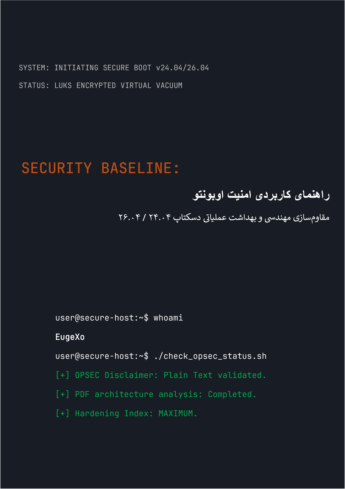

<div align="center">

# Security Baseline: راهنمای کاربردی امنیت اوبونتو

## مقاوم‌سازی مهندسی و بهداشت عملیاتی دسکتاپ ۲۴.۰۴ / ۲۶.۰۴ LTS

### Written and published by EugeXo

</div>

---

<p align="center">
  
</p>

---

## ساختار کتاب و چکیده‌های کوتاه

- [Security Baseline: راهنمای کاربردی امنیت اوبونتو](#security-baseline-راهنمای-کاربردی-امنیت-اوبونتو)
  - [مقاوم‌سازی مهندسی و بهداشت عملیاتی دسکتاپ ۲۴.۰۴ / ۲۶.۰۴ LTS](#مقاومسازی-مهندسی-و-بهداشت-عملیاتی-دسکتاپ-۲۴۰۴--۲۶۰۴-lts)
    - [Written and published by EugeXo](#written-and-published-by-eugexo)
  - [ساختار کتاب و چکیده‌های کوتاه](#ساختار-کتاب-و-چکیدههای-کوتاه)
  - [قدردانی و تشکر](#قدردانی-و-تشکر)
  - [تضمین امنیت قالب فایل (سلب مسئولیت OPSEC)](#تضمین-امنیت-قالب-فایل-سلب-مسئولیت-opsec)
  - [سخن نویسنده: این کتاب چرا و برای چه کسانی نوشته شده است؟](#سخن-نویسنده-این-کتاب-چرا-و-برای-چه-کسانی-نوشته-شده-است)
    - [درباره اصول ارائه مطالب:](#درباره-اصول-ارائه-مطالب)
  - [سطح پایه حفاظت: ۱۲ قانون بهداشت عملیاتی](#سطح-پایه-حفاظت-۱۲-قانون-بهداشت-عملیاتی)
  - [مفاهیم ناشناس‌بودن، حریم خصوصی و امنیت](#مفاهیم-ناشناسبودن-حریم-خصوصی-و-امنیت)
  - [نصب سیستم‌عامل Ubuntu 24.04/26.04 LTS](#نصب-سیستمعامل-ubuntu-24042604-lts)
    - [مقدمه:](#مقدمه)
    - [دستورالعمل آماده‌سازی سخت‌افزار:](#دستورالعمل-آمادهسازی-سختافزار)
    - [انتخاب توزیع:](#انتخاب-توزیع)
    - [مراحل گام‌به‌گام نصب‌کننده:](#مراحل-گامبهگام-نصبکننده)
  - [نخستین راه‌اندازی](#نخستین-راهاندازی)
  - [پیکربندی سیستم](#پیکربندی-سیستم)
  - [شروع کار با کنسول](#شروع-کار-با-کنسول)
    - [تنظیمات اولیه:](#تنظیمات-اولیه)
      - [Gnome Terminal Ubuntu 24.04:](#gnome-terminal-ubuntu-2404)
      - [Ptyxis Ubuntu 26.04:](#ptyxis-ubuntu-2604)
    - [غیرفعال‌سازی اتصال خودکار (Automount) و تنظیمات اختیاری:](#غیرفعالسازی-اتصال-خودکار-automount-و-تنظیمات-اختیاری)
    - [نگهداری تاریخچه در کنسول:](#نگهداری-تاریخچه-در-کنسول)
    - [پیکربندی زمان انقضای ایمن نشست sudo:](#پیکربندی-زمان-انقضای-ایمن-نشست-sudo)
    - [ایجاد فایل برای بررسی Checks Passed:](#ایجاد-فایل-برای-بررسی-checks-passed)
  - [پیکربندی شبکه و VPN](#پیکربندی-شبکه-و-vpn)
    - [برای اتصال سیمی Ethernet (Wired connection):](#برای-اتصال-سیمی-ethernet-wired-connection)
    - [برای اتصال بی‌سیم Wi-Fi (Wireless connection):](#برای-اتصال-بیسیم-wi-fi-wireless-connection)
      - [پیکربندی برای رایانه یا لپ‌تاپ واقعی (تصادفی‌سازی کامل):](#پیکربندی-برای-رایانه-یا-لپتاپ-واقعی-تصادفیسازی-کامل)
      - [پیکربندی برای ماشین مجازی (پنهان‌کاری Strict تحت نام تولیدکننده سخت‌افزار):](#پیکربندی-برای-ماشین-مجازی-پنهانکاری-strict-تحت-نام-تولیدکننده-سختافزار)
    - [مقاوم‌سازی NetworkManager: سرکوب نشت‌های محلی mDNS، LLMNR، نام میزبان و حفاظت از DNS:](#مقاومسازی-networkmanager-سرکوب-نشتهای-محلی-mdns-llmnr-نام-میزبان-و-حفاظت-از-dns)
    - [قرار دادن Wi-Fi در حالت خاموشی کامل هنگام راه‌اندازی سیستم:](#قرار-دادن-wi-fi-در-حالت-خاموشی-کامل-هنگام-راهاندازی-سیستم)
    - [حذف اجزای مخاطره‌آمیز بلوتوث (Bluetooth):](#حذف-اجزای-مخاطرهآمیز-بلوتوث-bluetooth)
    - [پیکربندی اتصال VPN:](#پیکربندی-اتصال-vpn)
  - [پیکربندی امنیت و مقاوم‌سازی بوت‌لودر GRUB](#پیکربندی-امنیت-و-مقاومسازی-بوتلودر-grub)
    - [تنظیم رمز عبور برای حفاظت از GRUB:](#تنظیم-رمز-عبور-برای-حفاظت-از-grub)
    - [مقاوم‌سازی نرم‌افزاری IOMMU: حفاظت از RAM در برابر حملات DMA در سطح هسته:](#مقاومسازی-نرمافزاری-iommu-حفاظت-از-ram-در-برابر-حملات-dma-در-سطح-هسته)
  - [گزینه‌های پیکربندی فایروال UFW هم با Kill Switch و هم بدون آن](#گزینههای-پیکربندی-فایروال-ufw-هم-با-kill-switch-و-هم-بدون-آن)
    - [پیکربندی فایروال همراه با Kill Switch:](#پیکربندی-فایروال-همراه-با-kill-switch)
    - [تکمله مهم درباره مدیریت ترتیب اولویت قوانین:](#تکمله-مهم-درباره-مدیریت-ترتیب-اولویت-قوانین)
    - [گزینه جایگزین پیکربندی (بدون استفاده از VPN / برای سیستم‌های مهمان):](#گزینه-جایگزین-پیکربندی-بدون-استفاده-از-vpn--برای-سیستمهای-مهمان)
  - [پیکربندی هسته سیستم، تفکیک مجوزهای دسترسی و حذف سرویس‌های سیستمی](#پیکربندی-هسته-سیستم-تفکیک-مجوزهای-دسترسی-و-حذف-سرویسهای-سیستمی)
    - [حفاظت از پشته شبکه و زیرسیستم حافظه هسته:](#حفاظت-از-پشته-شبکه-و-زیرسیستم-حافظه-هسته)
    - [مقاوم‌سازی سطح پایین sysctl: حفاظت در برابر TCP Timestamp Fingerprinting:](#مقاومسازی-سطح-پایین-sysctl-حفاظت-در-برابر-tcp-timestamp-fingerprinting)
    - [مسدودسازی پروتکل‌های شبکه نادر و سیستم‌های فایل قدیمی:](#مسدودسازی-پروتکلهای-شبکه-نادر-و-سیستمهای-فایل-قدیمی)
    - [تفکیک مجوزهای دسترسی در سیستم فایل:](#تفکیک-مجوزهای-دسترسی-در-سیستم-فایل)
    - [اتصال ایمن حافظه مشترک (Shared Memory):](#اتصال-ایمن-حافظه-مشترک-shared-memory)
      - [حالت متعادل (توصیه‌شده برای دسکتاپ روزمره):](#حالت-متعادل-توصیهشده-برای-دسکتاپ-روزمره)
      - [حالت پارانوئید (حداکثر ایزوله‌سازی):](#حالت-پارانوئید-حداکثر-ایزولهسازی)
    - [ایجاد دیسک رم (RAM-Disk) ایزوله برای لاگ‌های فرّار:](#ایجاد-دیسک-رم-ram-disk-ایزوله-برای-لاگهای-فرّار)
    - [مسدودسازی جریان ویدئو و ضبط صدا:](#مسدودسازی-جریان-ویدئو-و-ضبط-صدا)
    - [حذف سرویس‌های سیستمی چاپ و شناسایی منابع در شبکه محلی:](#حذف-سرویسهای-سیستمی-چاپ-و-شناسایی-منابع-در-شبکه-محلی)
    - [پنهان‌سازی موقعیت جغرافیایی و منطقه زمانی:](#پنهانسازی-موقعیت-جغرافیایی-و-منطقه-زمانی)
  - [پیکربندی مخازن و به‌روزرسانی سیستم](#پیکربندی-مخازن-و-بهروزرسانی-سیستم)
    - [به‌روزرسانی سیستم:](#بهروزرسانی-سیستم)
    - [استقرار محیط گرافیکی NVIDIA در حالت ایزوله:](#استقرار-محیط-گرافیکی-nvidia-در-حالت-ایزوله)
  - [محیط‌های ترمینال در اوبونتو:](#محیطهای-ترمینال-در-اوبونتو)
    - [جایگزینی Gnome Terminal و Ptyxis با Ghostty:](#جایگزینی-gnome-terminal-و-ptyxis-با-ghostty)
      - [نصب برای کاربران Ubuntu 24.04 LTS Noble Numbat:](#نصب-برای-کاربران-ubuntu-2404-lts-noble-numbat)
      - [نصب برای کاربران Ubuntu 26.04 LTS Resolute Racoon:](#نصب-برای-کاربران-ubuntu-2604-lts-resolute-racoon)
      - [نمونه پیکربندی Ghostty برای Ubuntu 24.04/26.04:](#نمونه-پیکربندی-ghostty-برای-ubuntu-24042604)
    - [اختیاری! Ubuntu 26.04 — بازگرداندن Gnome Terminal و حذف Ptyxis:](#اختیاری-ubuntu-2604--بازگرداندن-gnome-terminal-و-حذف-ptyxis)
  - [حذف و ممنوعیت Snap و تله‌متری](#حذف-و-ممنوعیت-snap-و-تلهمتری)
    - [حذف Snap:](#حذف-snap)
    - [حذف کامل تله‌متری Canonical:](#حذف-کامل-تلهمتری-canonical)
    - [خنثی‌سازی ردیاب پس‌زمینه میان‌افزار fwupd:](#خنثیسازی-ردیاب-پسزمینه-میانافزار-fwupd)
  - [نصب ابزارهای امنیتی libpam-tmpdir، debsums و ابزار نظارت بر بار سیستم Btop](#نصب-ابزارهای-امنیتی-libpam-tmpdir-debsums-و-ابزار-نظارت-بر-بار-سیستم-btop)
    - [ابزار امنیتی libpam-tmpdir:](#ابزار-امنیتی-libpam-tmpdir)
    - [ابزار debsums:](#ابزار-debsums)
    - [ابزار کاربردی برای نظارت بر بار سیستم Btop:](#ابزار-کاربردی-برای-نظارت-بر-بار-سیستم-btop)
    - [نظارت بر پورت‌ها و اتصالات شبکه:](#نظارت-بر-پورتها-و-اتصالات-شبکه)
  - [ایجاد نقاط بازگشت مرجع: استقرار و پیکربندی ابزار Timeshift](#ایجاد-نقاط-بازگشت-مرجع-استقرار-و-پیکربندی-ابزار-timeshift)
    - [مقدمه:](#مقدمه-1)
    - [ویژگی‌های عملکرد Timeshift در محیط رمزنگاری‌شده (LUKS + GRUB):](#ویژگیهای-عملکرد-timeshift-در-محیط-رمزنگاریشده-luks--grub)
    - [نصب ایمن Timeshift:](#نصب-ایمن-timeshift)
    - [پیکربندی اولیه و ایجاد اسنپ‌شات شماره ۱ (مرجع استریل):](#پیکربندی-اولیه-و-ایجاد-اسنپشات-شماره-۱-مرجع-استریل)
    - [بردار کنترل بعدی: ایجاد اسنپ‌شات شماره ۲ (پیش از بهره‌برداری):](#بردار-کنترل-بعدی-ایجاد-اسنپشات-شماره-۲-پیش-از-بهرهبرداری)
    - [دستورالعمل بازگشت اضطراری (در صورت آلوده شدن یا خرابی سیستم):](#دستورالعمل-بازگشت-اضطراری-در-صورت-آلوده-شدن-یا-خرابی-سیستم)
  - [نصب نسخه خالص .deb مرورگر Firefox و حذف بسته ساختگی Snap](#نصب-نسخه-خالص-deb-مرورگر-firefox-و-حذف-بسته-ساختگی-snap)
  - [نصب و پیکربندی پارامترهای حریم خصوصی در Mozilla Firefox](#نصب-و-پیکربندی-پارامترهای-حریم-خصوصی-در-mozilla-firefox)
    - [آماده‌سازی سیستم برای پیکربندی:](#آمادهسازی-سیستم-برای-پیکربندی)
    - [پیکربندی گرافیکی اولیه حریم خصوصی (الزامی برای همه):](#پیکربندی-گرافیکی-اولیه-حریم-خصوصی-الزامی-برای-همه)
    - [پیکربندی ارائه‌دهندگان خصوصی DNS (DNS over HTTPS):](#پیکربندی-ارائهدهندگان-خصوصی-dns-dns-over-https)
    - [خودکارسازی مقاوم‌سازی: ایجاد فایل پیکربندی user.js:](#خودکارسازی-مقاومسازی-ایجاد-فایل-پیکربندی-userjs)
    - [استقرار افزونه‌های حفاظتی نهایی:](#استقرار-افزونههای-حفاظتی-نهایی)
  - [نصب و پیکربندی فایروال تعاملی شبکه Portmaster](#نصب-و-پیکربندی-فایروال-تعاملی-شبکه-portmaster)
    - [مقدمه:](#مقدمه-2)
    - [آماده‌سازی، مقداردهی اولیه هسته و ارتقا به نسخه جدید:](#آمادهسازی-مقداردهی-اولیه-هسته-و-ارتقا-به-نسخه-جدید)
  - [امحای تضمینی داده‌ها و استریل‌سازی ردپای دیجیتال](#امحای-تضمینی-دادهها-و-استریلسازی-ردپای-دیجیتال)
    - [مقدمه:](#مقدمه-3)
    - [کالبدشکافی ردپای دیجیتال: چرا حذف داده‌ها بدون پاک‌سازی فراداده‌ها بی‌فایده است؟](#کالبدشکافی-ردپای-دیجیتال-چرا-حذف-دادهها-بدون-پاکسازی-فرادادهها-بیفایده-است)
    - [نصب و پاک‌سازی فراداده‌ها با ابزار MAT2:](#نصب-و-پاکسازی-فرادادهها-با-ابزار-mat2)
    - [حذف ایمن و غیرقابل بازگشت فایل‌ها و دایرکتوری‌ها:](#حذف-ایمن-و-غیرقابل-بازگشت-فایلها-و-دایرکتوریها)
    - [پارامترهای عملکرد ابزار shred:](#پارامترهای-عملکرد-ابزار-shred)
    - [پاک‌سازی سراسری فضای خالی دیسک:](#پاکسازی-سراسری-فضای-خالی-دیسک)
  - [پنهان‌نگاری (Steganography)، مبهم‌سازی و پنهان کردن ردپا در اوبونتو](#پنهاننگاری-steganography-مبهمسازی-و-پنهان-کردن-ردپا-در-اوبونتو)
    - [مقدمه:](#مقدمه-4)
    - [پنهان‌نگاری در لینوکس: پنهان کردن فایل‌ها در محتوای چندرسانه‌ای:](#پنهاننگاری-در-لینوکس-پنهان-کردن-فایلها-در-محتوای-چندرسانهای)
    - [ابزار کنسولی steghide:](#ابزار-کنسولی-steghide)
    - [پنهان‌سازی از طریق ابزار پیشرفته StegoForge:](#پنهانسازی-از-طریق-ابزار-پیشرفته-stegoforge)
    - [چسباندن آرشیوها (ترفند سریع بدون نیاز به نرم‌افزار جانبی):](#چسباندن-آرشیوها-ترفند-سریع-بدون-نیاز-به-نرمافزار-جانبی)
    - [مبهم‌سازی متن: دور زدن سیستم‌های تحلیل خودکار (DPI):](#مبهمسازی-متن-دور-زدن-سیستمهای-تحلیل-خودکار-dpi)
    - [تحلیل تهدیدهای پنهان: پنهان‌سازی پسوند فایل‌ها (حملات BiDi):](#تحلیل-تهدیدهای-پنهان-پنهانسازی-پسوند-فایلها-حملات-bidi)
  - [نصب و پیکربندی بسته رمزنگاری VeraCrypt](#نصب-و-پیکربندی-بسته-رمزنگاری-veracrypt)
    - [مقدمه و نصب VeraCrypt:](#مقدمه-و-نصب-veracrypt)
      - [نصب از طریق مخزن PPA جامعه کاربری:](#نصب-از-طریق-مخزن-ppa-جامعه-کاربری)
      - [نصب نسخه رسمی (روش بومی / Native):](#نصب-نسخه-رسمی-روش-بومی--native)
    - [تنظیمات عمیق امنیتی: حفاظت از کلیدها در حافظه RAM (حالت پارانویا):](#تنظیمات-عمیق-امنیتی-حفاظت-از-کلیدها-در-حافظه-ram-حالت-پارانویا)
    - [ابزار بنیادین امنیت اطلاعات: ایجاد حجم‌های پنهان (Hidden Volume):](#ابزار-بنیادین-امنیت-اطلاعات-ایجاد-حجمهای-پنهان-hidden-volume)
    - [مقاوم‌سازی نهایی (Hardening): پیکربندی PIM و فایل‌های کلید سخت‌افزاری:](#مقاومسازی-نهایی-hardening-پیکربندی-pim-و-فایلهای-کلید-سختافزاری)
    - [مدل تهدید در دنیای واقعی: چرا احتیاط (پارانویا) باید سیستماتیک باشد:](#مدل-تهدید-در-دنیای-واقعی-چرا-احتیاط-پارانویا-باید-سیستماتیک-باشد)
  - [استفاده از کلیدهای امنیتی Yubico](#استفاده-از-کلیدهای-امنیتی-yubico)
    - [مقدمه:](#مقدمه-5)
    - [نصب:](#نصب)
    - [پیاده‌سازی سخت‌افزاری Log Out / Kill Switch از طریق قوانین udev هسته:](#پیادهسازی-سختافزاری-log-out--kill-switch-از-طریق-قوانین-udev-هسته)
  - [نصب و پیکربندی USBGuard](#نصب-و-پیکربندی-usbguard)
    - [مقدمه:](#مقدمه-6)
    - [نصب و پیکربندی:](#نصب-و-پیکربندی)
  - [پیاده‌سازی دکمه اضطراری Emergency Panic Button برای خاموش کردن فوری سیستم](#پیادهسازی-دکمه-اضطراری-emergency-panic-button-برای-خاموش-کردن-فوری-سیستم)
    - [کلید قطع اضطراری سخت‌افزاری (Kill Switch) از طریق هرگونه دستگاه USB:](#کلید-قطع-اضطراری-سختافزاری-kill-switch-از-طریق-هرگونه-دستگاه-usb)
  - [نصب مدیر رمز عبور محلی KeePassXC](#نصب-مدیر-رمز-عبور-محلی-keepassxc)
    - [مقدمه:](#مقدمه-7)
    - [گزینه‌های سناریوهای حفاظت از مخزن:](#گزینههای-سناریوهای-حفاظت-از-مخزن)
    - [نصب مجموعه نرم‌افزاری:](#نصب-مجموعه-نرمافزاری)
    - [ایجاد و حفاظت سخت‌افزاری از پایگاه داده:](#ایجاد-و-حفاظت-سختافزاری-از-پایگاه-داده)
    - [مقاوم‌سازی عمیق تنظیمات داخلی امنیت:](#مقاومسازی-عمیق-تنظیمات-داخلی-امنیت)
    - [ورود ایمن داده‌ها از طریق حافظه موقت محافظت‌شده:](#ورود-ایمن-دادهها-از-طریق-حافظه-موقت-محافظتشده)
  - [نصب و اجرای تحلیل‌گر شبکه Wireshark](#نصب-و-اجرای-تحلیلگر-شبکه-wireshark)
    - [مقدمه:](#مقدمه-8)
    - [نصب و اجرای Wireshark:](#نصب-و-اجرای-wireshark)
    - [مفهوم امنیتی بسیار حیاتی زیرسیستم رهگیری بسته‌ها:](#مفهوم-امنیتی-بسیار-حیاتی-زیرسیستم-رهگیری-بستهها)
    - [جمع‌آوری پنهان دامپ‌های ترافیک (حالت کنسولی):](#جمعآوری-پنهان-دامپهای-ترافیک-حالت-کنسولی)
    - [راهنمای عملی Wireshark:](#راهنمای-عملی-wireshark)
  - [نصب و مدیریت سیستم حفاظتی AppArmor](#نصب-و-مدیریت-سیستم-حفاظتی-apparmor)
    - [مقدمه:](#مقدمه-9)
    - [الگوی نوین امنیت: خودکارسازی هسته:](#الگوی-نوین-امنیت-خودکارسازی-هسته)
    - [مقاوم‌سازی عملی زیرسیستم AppArmor:](#مقاومسازی-عملی-زیرسیستم-apparmor)
  - [نصب و پیکربندی محیط‌های ایزوله (Sandboxes) Firejail و Bubblewrap](#نصب-و-پیکربندی-محیطهای-ایزوله-sandboxes-firejail-و-bubblewrap)
    - [مقدمه:](#مقدمه-10)
    - [نصب Firejail و آماده‌سازی sandbox:](#نصب-firejail-و-آمادهسازی-sandbox)
    - [پارامترهای پایه فیلترینگ Firejail (مرجع):](#پارامترهای-پایه-فیلترینگ-firejail-مرجع)
    - [اختیاری! خودکارسازی محیط حفاظتی Firejail (ابزار Firecfg):](#اختیاری-خودکارسازی-محیط-حفاظتی-firejail-ابزار-firecfg)
    - [نصب Bubblewrap:](#نصب-bubblewrap)
    - [راهنمای سریع پرچم‌های Bubblewrap (مرجع):](#راهنمای-سریع-پرچمهای-bubblewrap-مرجع)
    - [آماده‌سازی میان‌برهای سفارشی برای محیط‌های ایزوله:](#آمادهسازی-میانبرهای-سفارشی-برای-محیطهای-ایزوله)
    - [ایجاد پروفایل مجزای Firefox hardened برای Firejail:](#ایجاد-پروفایل-مجزای-firefox-hardened-برای-firejail)
    - [ایجاد پروفایل Firefox hardened در Bubblewrap:](#ایجاد-پروفایل-firefox-hardened-در-bubblewrap)
    - [محفظه ایزوله اسناد PDF: اجرای ایمن فایل‌ها در Firejail:](#محفظه-ایزوله-اسناد-pdf-اجرای-ایمن-فایلها-در-firejail)
    - [مهروموم کردن Document Viewer برای مطالعه PDF در Bubblewrap:](#مهروموم-کردن-document-viewer-برای-مطالعه-pdf-در-bubblewrap)
    - [Image Viewer برای مشاهده فایل‌های گرافیکی در Firejail:](#image-viewer-برای-مشاهده-فایلهای-گرافیکی-در-firejail)
    - [قرار دادن نمایشگر فایل‌های گرافیکی Image Viewer در Bubblewrap:](#قرار-دادن-نمایشگر-فایلهای-گرافیکی-image-viewer-در-bubblewrap)
    - [سناریوی ایزوله‌سازی KeePassXC برای Firejail:](#سناریوی-ایزولهسازی-keepassxc-برای-firejail)
    - [ایزوله‌سازی KeePassXC از طریق Bubblewrap:](#ایزولهسازی-keepassxc-از-طریق-bubblewrap)
    - [نصب و ایزوله‌سازی مجموعه اداری LibreOffice:](#نصب-و-ایزولهسازی-مجموعه-اداری-libreoffice)
    - [پیکربندی عملکرد LibreOffice از طریق Firejail:](#پیکربندی-عملکرد-libreoffice-از-طریق-firejail)
    - [قرار دادن LibreOffice در Bubblewrap:](#قرار-دادن-libreoffice-در-bubblewrap)
    - [نصب و ایزوله‌سازی GNU Image Manipulation Program (GIMP):](#نصب-و-ایزولهسازی-gnu-image-manipulation-program-gimp)
    - [پیکربندی عملکرد GIMP از طریق Firejail:](#پیکربندی-عملکرد-gimp-از-طریق-firejail)
    - [پیکربندی GIMP از طریق Bubblewrap:](#پیکربندی-gimp-از-طریق-bubblewrap)
    - [نصب و ایزوله‌سازی ویرایشگر کد VS Codium (محیط توسعه IDE برای برنامه‌نویسی):](#نصب-و-ایزولهسازی-ویرایشگر-کد-vs-codium-محیط-توسعه-ide-برای-برنامهنویسی)
    - [ایزوله‌سازی VS Codium در Firejail:](#ایزولهسازی-vs-codium-در-firejail)
    - [ایزوله‌سازی VS Codium در Bubblewrap:](#ایزولهسازی-vs-codium-در-bubblewrap)
    - [نصب و ایزوله‌سازی شبکه عصبی محلی LM Studio Bionic:](#نصب-و-ایزولهسازی-شبکه-عصبی-محلی-lm-studio-bionic)
    - [راه‌اندازی عملکرد LM Studio از طریق Firejail:](#راهاندازی-عملکرد-lm-studio-از-طریق-firejail)
    - [قرار دادن LM Studio در Bubblewrap:](#قرار-دادن-lm-studio-در-bubblewrap)
    - [پیکربندی ارتباطات ایمن: ایزوله‌سازی اجباری پیام‌رسان‌ها و محیط رمزنگاری (چرخه OPSEC نویسنده):](#پیکربندی-ارتباطات-ایمن-ایزولهسازی-اجباری-پیامرسانها-و-محیط-رمزنگاری-چرخه-opsec-نویسنده)
    - [نصب و ایزوله‌سازی Telegram Desktop:](#نصب-و-ایزولهسازی-telegram-desktop)
    - [حفاظت از محیط Telegram از طریق Firejail:](#حفاظت-از-محیط-telegram-از-طریق-firejail)
    - [ایزوله‌سازی Telegram از طریق Bubblewrap:](#ایزولهسازی-telegram-از-طریق-bubblewrap)
    - [نصب و ایزوله‌سازی Signal از طریق Bubblewrap:](#نصب-و-ایزولهسازی-signal-از-طریق-bubblewrap)
    - [شالوده رمزنگاری میزبان: تولید و حفاظت OPSEC از کلیدهای GnuPG:](#شالوده-رمزنگاری-میزبان-تولید-و-حفاظت-opsec-از-کلیدهای-gnupg)
    - [نصب و ایزوله‌سازی کلاینت جبر Psi+:](#نصب-و-ایزولهسازی-کلاینت-جبر-psi)
    - [ایزوله‌سازی PSI+ در Firejail:](#ایزولهسازی-psi-در-firejail)
    - [ایزوله‌سازی کلاینت جبر Psi+ در محیط ایزوله Bubblewrap:](#ایزولهسازی-کلاینت-جبر-psi-در-محیط-ایزوله-bubblewrap)
    - [نصب و ایزوله‌سازی کلاینت ایمیل Thunderbird (محیط مکاتبات ایمیلی رمزنگاری‌شده):](#نصب-و-ایزولهسازی-کلاینت-ایمیل-thunderbird-محیط-مکاتبات-ایمیلی-رمزنگاریشده)
    - [ایزوله‌سازی Thunderbird با کمک Firejail:](#ایزولهسازی-thunderbird-با-کمک-firejail)
    - [ایزوله‌سازی Thunderbird از طریق Bubblewrap:](#ایزولهسازی-thunderbird-از-طریق-bubblewrap)
    - [حالت پیشرفته «پارانویا»: Firejail همراه با ذخیره نشست از طریق Overlay:](#حالت-پیشرفته-پارانویا-firejail-همراه-با-ذخیره-نشست-از-طریق-overlay)
  - [نصب Rkhunter و جست‌وجوی روت‌کیت‌ها](#نصب-rkhunter-و-جستوجوی-روتکیتها)
    - [نصب Chkrootkit در کنار Rkhunter:](#نصب-chkrootkit-در-کنار-rkhunter)
  - [نصب و پیکربندی اسکنر آنتی‌ویروس ClamAV](#نصب-و-پیکربندی-اسکنر-آنتیویروس-clamav)
    - [مقدمه:](#مقدمه-11)
    - [نصب ClamAV:](#نصب-clamav)
    - [به‌روزرسانی پایگاه‌های امضا و دور زدن محدودیت‌های شبکه:](#بهروزرسانی-پایگاههای-امضا-و-دور-زدن-محدودیتهای-شبکه)
    - [سازمان‌دهی اسکن سیستمی:](#سازماندهی-اسکن-سیستمی)
    - [اسکن چندرشته‌ای (Hardening):](#اسکن-چندرشتهای-hardening)
  - [نصب و پیکربندی محیط مجازی‌سازی VirtualBox](#نصب-و-پیکربندی-محیط-مجازیسازی-virtualbox)
    - [حفاظت در برابر جرم‌شناسی دیجیتال: ایزوله‌سازی لاگ‌های VirtualBox در حافظه RAM (`tmpfs`):](#حفاظت-در-برابر-جرمشناسی-دیجیتال-ایزولهسازی-لاگهای-virtualbox-در-حافظه-ram-tmpfs)
  - [فشرده‌سازی و بهینه‌سازی دیسک‌های مجازی VDI](#فشردهسازی-و-بهینهسازی-دیسکهای-مجازی-vdi)
    - [مقدمه:](#مقدمه-12)
    - [پاک‌سازی ماشین مجازی تحت مدیریت ویندوز:](#پاکسازی-ماشین-مجازی-تحت-مدیریت-ویندوز)
    - [پاک‌سازی ماشین مجازی تحت مدیریت لینوکس (Ubuntu / Kali Linux):](#پاکسازی-ماشین-مجازی-تحت-مدیریت-لینوکس-ubuntu--kali-linux)
    - [فشرده‌سازی نهایی دیسک مجازی بر روی دستگاه میزبان:](#فشردهسازی-نهایی-دیسک-مجازی-بر-روی-دستگاه-میزبان)
  - [نصب و پیکربندی سیستم کانتینرسازی Docker](#نصب-و-پیکربندی-سیستم-کانتینرسازی-docker)
    - [مقدمه:](#مقدمه-13)
    - [خطر پنهان Docker پیش‌فرض در چیست؟](#خطر-پنهان-docker-پیشفرض-در-چیست)
    - [استقرار Docker در حالت Rootless:](#استقرار-docker-در-حالت-rootless)
    - [مهار شبکه و اتصال به UFW:](#مهار-شبکه-و-اتصال-به-ufw)
    - [نمونه عملی اجرای ایمن کانتینرها:](#نمونه-عملی-اجرای-ایمن-کانتینرها)
    - [اثبات تجربی امنیت (بررسی نبود دسترسی Root):](#اثبات-تجربی-امنیت-بررسی-نبود-دسترسی-root)
  - [نصب و پیکربندی سیستم کنترل یکپارچگی AIDE](#نصب-و-پیکربندی-سیستم-کنترل-یکپارچگی-aide)
    - [مقدمه:](#مقدمه-14)
    - [نصب و پیکربندی AIDE:](#نصب-و-پیکربندی-aide)
    - [انجام آزمایش نفوذ (اعتبارسنجی حفاظت):](#انجام-آزمایش-نفوذ-اعتبارسنجی-حفاظت)
  - [ممیزی خودکار امنیت سیستم با کمک Lynis](#ممیزی-خودکار-امنیت-سیستم-با-کمک-lynis)
  - [نصب و پیکربندی اسکنر آسیب‌پذیری‌ها و نشت رمزهای عبور Trivy](#نصب-و-پیکربندی-اسکنر-آسیبپذیریها-و-نشت-رمزهای-عبور-trivy)
  - [پیکربندی سیستم‌های مهمان Ubuntu/Xubuntu/Lubuntu در VirtualBox](#پیکربندی-سیستمهای-مهمان-ubuntuxubuntulubuntu-در-virtualbox)
    - [نصب Guest Additions:](#نصب-guest-additions)
    - [نصب Mozilla Firefox:](#نصب-mozilla-firefox)
    - [پیکربندی پوشه‌های مشترک (Shared Folders) در VirtualBox:](#پیکربندی-پوشههای-مشترک-shared-folders-در-virtualbox)
    - [نصب Ledger Live در VirtualBox با Ubuntu/Xubuntu/Lubuntu](#نصب-ledger-live-در-virtualbox-با-ubuntuxubuntulubuntu)
    - [اجرای Ledger Live بر روی سیستم میزبان اصلی Ubuntu](#اجرای-ledger-live-بر-روی-سیستم-میزبان-اصلی-ubuntu)
  - [درباره نویسنده و اطلاعات حقوقی](#درباره-نویسنده-و-اطلاعات-حقوقی)
    - [راه‌های ارتباطی و منابع جامعه کاربری:](#راههای-ارتباطی-و-منابع-جامعه-کاربری)

<br>
<br>
<br>
<br>
<br>
<br>
<br>


## قدردانی و تشکر

بدون هیچ مقدمه اضافی، می‌خواهم صمیمانه‌ترین سپاسگزاری خود را تقدیم کسانی کنم که الهام‌بخش من برای نوشتن این کتاب بودند و در تمام این مسیر در کنارم ایستادند.

از بچه‌های ساده بخش امنیت سایبری پلیس استونی، کشور کوچک اما از نظر فناوری پیشرفته ما، سپاسگزارم که انگیزه و دلگرمی آن‌ها باعث شد به نوشتن این کتاب روی بیاورم.

همچنین قدردانی ویژه دارم از متخصصان امنیت اطلاعات سرویس مخفی ایالات متحده (US Secret Service) در میامی، که سهم عملی ارزشمندی در بررسی برخی از فصل‌ها داشتند. همان‌طور که مشخص شد، روش‌ها و تکنیک‌های شرح‌داده‌شده در اینجا در شرایط واقعی میدانی عملکردی عالی دارند.

و البته سپاس بی‌پایان از اعضای خانواده‌ام بابت صبر شگفت‌انگیز و حمایت روحی‌شان؛ به‌ویژه مادرم که کار مرا کاملاً درک کرد و بخش بزرگی از کارهای روزمره را بر دوش گرفت تا زمان کافی برای پژوهش و تحقیق در اختیارم قرار دهد.

**می‌خواهم به‌طور ویژه از یکی از دوستانم در بریتانیا (UK) بابت حمایت‌هایش تشکر کنم. زمانی که در میامی بودم ارتباط نزدیکی با هم داشتیم، اما متأسفانه پس از آن ارتباطمان قطع شد. صمیمانه امیدوارم دوباره یکدیگر را ببینیم. دوست من، اگر تو یا پسرت که متخصص امنیت اطلاعات است این سطور را می‌خوانید، لطفاً با من تماس بگیرید — اطلاعات تماس من در پایان کتاب آمده است. فکر می‌کنم خودت متوجه شدی *who is who!* ;)**

سپاس بی‌کران از دستیار مجازی‌ام — **Gemini از شرکت Google**. او در تمام طول نگارش این کتاب همراه دیجیتال جدایی‌ناپذیر من بود و کمک ارزشمندی در ساختاردهی و ترجمه این مطالب فنی سنگین ارائه داد.

همچنین از دستیار هوشمند و پیشرفته **ChatGPT از شرکت OpenAI** بابت بحث و تبادل نظر درباره راه‌حل‌های فنی، بررسی تنظیمات، ویرایش دقیق بخش‌هایی از متن و یافتن واژگان دقیق‌تر سپاسگزارم.

و البته اولین و مهم‌ترین قدردانی شایسته مهندسان و توسعه‌دهندگان Google و OpenAI بابت کار درجه‌یک آن‌هاست!

حرف‌های بسیار دیگری هم می‌توان گفت، اما کسانی که در این مسیر همراه بودند خودشان همه‌چیز را به‌خوبی می‌دانند. از اینکه این کتاب سرانجام منتشر می‌شود بی‌نهایت خوشحالم. دوستان، همه شما را صمیمانه دوست دارم، برایتان ارزش قائلم و به شما احترام می‌گذارم!

<br>

## تضمین امنیت قالب فایل (سلب مسئولیت OPSEC)

با در نظر گرفتن اصول امنیت اطلاعات و عقل سلیم، تمامی مطالب این راهنما در ابتدا در قالب متن ساده (Plain Text با نشانه‌گذاری Markdown) ارائه شده است. ایده انتشار کتاب در قالب PDF آگاهانه کنار گذاشته شد. معماری PDF بسیار سنگین است و اغلب مورد نفوذ (هک یا آلوده‌سازی) قرار می‌گیرد. امنیت یک میزبان ایمن باید از همان لحظه مطالعه ایمن دستورالعمل‌های پیکربندی آن آغاز شود.

یک فایل متنی داده‌ای خالص است که هیچ کد اجرایی در خود ندارد؛ در حالی که قالب PDF به‌طور پیش‌فرض از اسکریپت‌های داخلی JavaScript، عناصر پویا، فرم‌های تعاملی و فونت‌های پیچیده پشتیبانی می‌کند که نیازمند پردازش عمیق سیستمی هستند. وجود آسیب‌پذیری‌های بحرانی از نوع RCE (اجرای کد از راه دور) در پردازشگرهای PDF لینوکس (مانند نمایشگر پیش‌فرض `Evince` یا کتابخانه `Poppler`) یک واقعیت تاریخی اثبات‌شده است. قالب Plain Text هیچ سازوکار داخلی برای اجرای کد ندارد و سطح حمله (attack surface) را هنگام مطالعه مطالب به‌شدت کاهش می‌دهد. این ویژگی مطالعه ایمن را در هر محیطی تضمین می‌کند.

به همین دلیل تمامی تصاویر و نمودارها خارج از متن اصلی و در یک پوشه جداگانه قرار گرفته‌اند. فایل‌های گرافیکی در پوشه‌ها و زیرپوشه‌ها دسته‌بندی شده‌اند که از رندر شدن خودکار آن‌ها در حافظه هنگام خواندن کتاب جلوگیری می‌کند.

> [!NOTE]
> قالب منبع اصلی این کتاب Markdown است. تمامی قالب‌های مشتق‌شده (HTML، EPUB و سایر موارد) از همین منبع متنی بررسی‌شده ساخته می‌شوند.

خواننده می‌تواند به یکی از سه روش زیر از این پروژه استفاده کند:

* مطالعه مستقیم فایل اصلی Markdown.
* استفاده از نسخه‌های آماده HTML/EPUB (که در آینده پیاده‌سازی خواهند شد).
* ساخت (Build) مستقیم کتاب از کد منبع و تغییر طراحی، ساختار، فونت، استایل یا فهرست فصل‌های آن بر اساس نیاز خود.

این رویکرد شفافیت متن، امکان ممیزی تغییرات و رهایی از وابستگی به هرگونه ابزار خاص برای مطالعه را تضمین می‌کند.

<br>

## سخن نویسنده: این کتاب چرا و برای چه کسانی نوشته شده است؟

محیط دیجیتال امروزی روزبه‌روز پیچیده‌تر می‌شود: تعداد تهدیدهای سایبری در حال افزایش است، حجم داده‌های جمع‌آوری‌شده بیشتر می‌شود و کاربر بیش از پیش ناچار است مسئولیت حفظ حریم خصوصی و امنیت خود را شخصاً بر عهده بگیرد.

این کتاب به‌عنوان یک راهنمای عملی برای ساخت یک ایستگاه کاری کنترل‌شده لینوکسی تدوین شده است؛ جایی که امنیت نه صرفاً مجموعه‌ای از نرم‌افزارهای پراکنده، بلکه یک سیستم یکپارچه از راهکارهای به‌هم‌پیوسته در نظر گرفته می‌شود. هدف من این است که نشان دهم چگونه می‌توان با استفاده از ابزارهای در دسترس لینوکس، یک محیط کاری با مدل تهدید (Threat Model) شفاف ایجاد کرد: محیطی که شامل ایزوله‌سازی برنامه‌ها، کنترل فعالیت شبکه، حفاظت از داده‌ها و مدیریت آگاهانه فضای دیجیتال باشد.

**هدف این کتاب — ساخت یک ایستگاه کاری است که در آن هر اقدام دارای یک محیط امنیتی کنترل‌شده باشد.**

این مطالب با اهداف آموزشی تهیه شده و برای کاربران مسلط به مسائل فنی، علاقه‌مندان به لینوکس و متخصصانی که به امنیت اطلاعات عملی علاقه دارند تدوین شده است. این راهنما یک دوره مقدماتی لینوکس نیست و فرض را بر این می‌گذارد که خواننده آشنایی پایه‌ای با ترمینال، سیستم فایل و نحوه عملکرد سیستم‌عامل دارد. با این حال، خوانندگان دقیق و علاقه‌مند می‌توانند به‌تدریج ابزارهای مورد نیاز را فرا بگیرند.

تمامی فناوری‌های شرح‌داده‌شده در اینجا باید صرفاً با اهداف قانونی استفاده شوند: برای محافظت از داده‌های شخصی خود، افزایش امنیت و یادگیری اصول بنیادین امنیت اطلاعات.

حفاظت آگاهانه از اطلاعات و استفاده مسئولانه از فناوری، فضای دیجیتال را برای همه امن‌تر می‌سازد.

### درباره اصول ارائه مطالب:

هدف این کتاب ایجاد یک دانشنامه کامل برای تک‌تک ابزارهای استفاده‌شده نیست، بلکه نمایش نقش آن‌ها در چارچوب یک مدل دفاعی واحد است. به همین دلیل ساختار داخلی و قابلیت‌های هر بخش تنها تا حدی بررسی شده‌اند که برای درک اصول عملکرد و استفاده ایمن از آن‌ها ضروری است.

قابلیت‌های پیشرفته، نحو (Syntax) کامل دستورات و کاربردهای تخصصی خارج از چارچوب این راهنما قرار دارند و می‌توان آن‌ها را به‌صورت جداگانه از مستندات رسمی مطالعه کرد.

<br>

## سطح پایه حفاظت: ۱۲ قانون بهداشت عملیاتی

*Hello World رفیق!*

پیش از آنکه به سراغ پیکربندی فنی و سخت‌گیرانه سیستم خود برویم، بیایید شالوده کار را تثبیت کنیم. در ادامه ۱۲ قانون آهنین بهداشت عملیاتی آورده شده است که باید آن‌ها را از بر شویم و بی‌چون‌وچرا رعایت کنیم. بدون درک این اصول، هر ابزار امنیتی — حتی پیشرفته‌ترین آن‌ها — به مرور زمان کاملاً بی‌فایده خواهد شد:

1. **در محیط محافظت‌شده تا حد امکان لوازم جانبی بی‌سیم را حذف می‌کنیم:** بلوتوث و تجهیزات بی‌سیم (از جمله هدست‌ها، هدفون‌ها، صفحه‌کلیدها و ماوس‌های بی‌سیم). هر رابط بی‌سیمی سطح حمله (attack surface) را افزایش می‌دهد و نیازمند اعتماد به پشته پروتکل‌ها، میان‌افزارها (firmware) و پیاده‌سازی امنیتی آن دستگاه‌هاست.
2. **رمزنگاری کامل دیسک (Full-Disk Encryption) را به‌صورت الزامی** برای درایو سیستم در مرحله نصب سیستم‌عامل فعال می‌کنیم. طول رمز عبور رمزنگاری را حداقل ۲۴ کاراکتر تصادفی (شامل کاراکترهای ویژه) قرار می‌دهیم!
3. **تغییر دوره‌ای و برنامه‌ریزی‌شده رمز عبور ورود به سیستم‌عامل را انجام می‌دهیم.** رمز عبور کاربر را منحصربه‌فرد و به اندازه کافی طولانی (ترجیحاً حداقل ۱۶ کاراکتر) انتخاب می‌کنیم. در صورت استفاده از توکن‌های سخت‌افزاری، رمز عبور جایگزین نمی‌شود، بلکه با یک عامل حفاظتی اضافی تقویت می‌گردد.
4. **محافظت با رمز عبور را برای بوت‌لودر سیستم (GRUB) فعال می‌کنیم** تا در صورت دسترسی فیزیکی به رایانه، هرگونه تغییر غیرمجاز در پارامترهای هسته (Kernel) و ویرایش پیکربندی کاملاً ناممکن شود.
5. **توکن سخت‌افزاری** (YubiKey یا نمونه‌های معتبر مشابه) را به‌عنوان عامل دوم احراز هویت اجباری (2FA) برای ورود به سیستم و تأیید دستورات ابرکاربر (root) پیاده‌سازی می‌کنیم.
6. **سیستم را از هرگونه نرم‌افزار اضافی پاک‌سازی می‌کنیم.** این موضوع به‌ویژه شامل نرم‌افزارهای مالکیتی (Proprietary) و متن‌بسته می‌شود. قانون پایه را به خاطر بسپارید: هرچه سرویس‌ها، دیمن‌ها و برنامه‌های جانبی کمتری در سیستم وجود داشته باشد، سطح حمله بالقوه و تعداد آسیب‌پذیری‌های بحرانی نیز کمتر خواهد بود.
7. **سیستم‌عامل را همیشه به‌روز نگه می‌داریم.** بررسی و نصب منظم به‌روزرسانی‌های امنیتی سیستم را با کنترل از طریق ابزارهای خط فرمان (کنسول) به یک قانون آهنین تبدیل می‌کنیم.
8. **وضعیت شبکه و رابط‌های شبکه را به‌طور پیوسته کنترل می‌کنیم.** به این موضوع توجه ویژه داریم که اتصالات پس‌زمینه دقیقاً به چه منابع دوردستی برقرار می‌شوند و ترافیک شبکه ما به کجا می‌رود.
9. **به‌طور منظم ممیزی داخلی میزبان را انجام می‌دهیم.** سیستم را به‌صورت دوره‌ای (ترجیحاً ۲ تا ۳ بار در هفته) از نظر وجود روت‌کیت‌ها، ویروس‌ها و یکپارچگی فایل‌های سیستمی بازرسی می‌کنیم.
10. **هرگز فایل‌های اجرایی مشکوک را در سیستم اصلی اجرا نمی‌کنیم.** برای آزمایش ایمن آن‌ها همیشه از محیط ایزوله `Firejail` یا ماشین‌های مجازی استفاده می‌کنیم.
11. **محافظت سخت‌گیرانه در برابر حملات خطرناک DMA (دسترسی مستقیم به حافظه) و رمزگذاری BIOS/UEFI را فراهم می‌کنیم:** در تنظیمات BIOS/UEFI، پورت‌های Thunderbolt/USB4 را به اجبار در حالت حداکثر احراز هویت (*Kernel DMA Protection*) قرار می‌دهیم تا خطر حملات از طریق دسترسی DMA دستگاه‌های خارجی کاهش یابد. روی BIOS/UEFI رمز عبور می‌گذاریم. علاوه بر این، حالت خواب (*Sleep Mode*) را کاملاً غیرفعال می‌کنیم، زیرا در این وضعیت کلیدهای رمزنگاری دیسک به‌صورت باز در حافظه RAM باقی می‌مانند.
12. **هنگام ترک محل کار حتی برای لحظه‌ای کوتاه، نشست (Session) را به اجبار قفل می‌کنیم و هنگام ترک طولانی‌مدت، رایانه را به‌طور کامل خاموش می‌کنیم.**

> [!NOTE]
> ضعیف‌ترین حلقه در هر سیستم امنیتی اغلب نه نرم‌افزار، بلکه رفتار کاربر است.
>
> در محافل حرفه‌ای یک عبارت طنزآمیز وجود دارد: «اصلی‌ترین آسیب‌پذیری بین صندلی و صفحه‌کلید قرار دارد».
>
> دقیقاً به همین دلیل، ایمن‌سازی فنی (Hardening) باید با انضباط عملیاتی همراه باشد: بررسی فایل‌ها پیش از باز کردن، حذف فراداده‌ها (Metadata) پیش از انتشار، کنترل فعالیت شبکه و درک مداوم از مدل تهدید (Threat Model) شخصی.

## مفاهیم ناشناس‌بودن، حریم خصوصی و امنیت

در گفت‌وگوهای روزمره این مفاهیم اغلب با هم اشتباه گرفته می‌شوند، در حالی که هرکدام اهداف متفاوتی را دنبال می‌کنند.

**ناشناس‌بودن (Anonymity)** به این پرسش پاسخ می‌دهد: «آیا می‌توان فعالیت‌های مرا به هویت واقعی‌ام پیوند داد؟»
اگر سیستم ایده‌آل باشد، دشمن خودِ عمل را می‌بیند، اما به هیچ وجه نمی‌تواند آن را به یک فرد مشخص در دنیای واقعی مرتبط کند.

**حریم خصوصی (Privacy)** به این پرسش پاسخ می‌دهد: «آیا من کنترل می‌کنم که چه اطلاعاتی درباره من جمع‌آوری می‌شود و در اختیار چه کسانی قرار می‌گیرد؟»
دشمن می‌داند که چنین فردی وجود دارد، اما خودِ فرد کنترل می‌کند که چه بخشی از اطلاعات به بیرون منتقل شود.

**امنیت (Security)** به این پرسش پاسخ می‌دهد: «آیا می‌توانم از سیستم، داده‌ها و دستگاه خود در برابر دسترسی غیرمجاز محافظت کنم؟»
فرد در داخل محیط دیجیتال خود در آماده‌باش کامل به سر می‌برد. دشمن ممکن است درست پشت دروازه ایستاده باشد، اما توان کافی برای نفوذ به سیستم و سرقت داده‌ها را ندارد.

یک لپ‌تاپ رمزنگاری‌شده با رمز عبور قوی، سطح امنیت را بالا می‌برد. اما اگر کاربر داوطلبانه تمام اطلاعات شخصی خود را در اینترنت منتشر کند، این کار حریم خصوصی را افزایش نمی‌دهد. استفاده از ابزارهای ناشناس‌سازی می‌تواند شناسایی هویت کاربر را دشوار کند، اما از سیستم در برابر بدافزارها محافظت نمی‌کند. یک سیستم بسیار ایمن می‌تواند ناشناس نباشد، و یک سیستم ناشناس می‌تواند ناامن باشد.

**هدف این راهنما ایجاد توهم حفاظت مطلق یا نامرئی‌بودن کامل در شبکه نیست. هدف، نمایش راهکارهایی برای ساخت سیستمی است که در آن کاربر بداند کدام خطرات را کاهش می‌دهد و چه محدودیت‌هایی همچنان باقی می‌مانند.**

<br>

## نصب سیستم‌عامل Ubuntu 24.04/26.04 LTS

### مقدمه:

در این فصل، نصب سیستم‌عامل اوبونتو را با در نظر گرفتن الزامات امنیتی بررسی می‌کنیم. همچنین امکان استقرار سیستم روی حافظه‌های خارجی USB و Thunderbolt نیز در آن گنجانده شده است.

پیش از آغاز نصب، باید چند عامل مهم را در نظر گرفت. یکی از رایج‌ترین خطرات، انتخاب نادرست درایو برای نصب بوت‌لودر (Bootloader) است.

در لینوکس معمولاً GRUB (GRand Unified Bootloader) مسئولیت بارگذاری سیستم را بر عهده دارد. هنگام نصب، ممکن است GRUB نه روی درایو مورد نظر کاربر، بلکه برای مثال روی پارتیشن EFI یک دیسک دیگر قرار گیرد. در نتیجه، سیستم‌عامل موجود ممکن است تا زمان بازیابی بوت‌لودر به‌درستی بوت نشود.

برای حذف کامل چنین سناریویی، مطمئن‌ترین روش این است که تمام هارددیسک‌ها (HDD) و حافظه‌های SSD داخلی را که به سیستم در حال نصب مربوط نمی‌شوند، در طول فرآیند نصب لینوکس به‌صورت فیزیکی جدا کنید.

در رایانه‌های رومیزی (PC) این کار معمولاً فقط به دسترسی به قطعات داخلی و یک پیچ‌گوشتی معمولی نیاز دارد. در لپ‌تاپ‌ها این روند به ساختار دستگاه بستگی دارد و ممکن است پیچیده‌تر باشد.

دستگاه‌های اپل (به‌ویژه مک‌بوک‌های مدرن دارای تراشه T2 و Apple Silicon) به دلیل ویژگی‌های پلتفرم سخت‌افزاری، زنجیره بوت و سازگاری با لینوکس برای این سناریو توصیه نمی‌شوند.

> [!NOTE]
> این راهنما به‌طور کامل روی **Ubuntu 24.04 LTS Noble Numbat (24.04.4)** و **Ubuntu 26.04 LTS Resolute Racoon (26.04.0)** آزمایش و تأیید شده است.
>
> آزمایش‌ها در **VirtualBox 7.2.x**، **VMware Workstation Pro 26H1** و همچنین روی سیستم‌های فیزیکی با گرافیک یکپارچه Intel و کارت گرافیک مجزای NVIDIA انجام شده است.

### دستورالعمل آماده‌سازی سخت‌افزار:

* **در رایانه رومیزی (PC):** درپوش کناری کیس را باز می‌کنیم، برق رایانه را به‌طور کامل از پریز جدا می‌کنیم و تمامی حافظه‌ها را به جز دیسکی که قرار است لینوکس روی آن نصب شود، جدا می‌کنیم. در صورت استفاده از حافظه‌های M.2 NVMe، برای خارج کردن آن‌ها به پیچ‌گوشتی نیاز خواهد بود.

* **در لپ‌تاپ:** دستگاه را به‌طور کامل خاموش می‌کنیم، آداپتور برق را جدا می‌کنیم و در صورت امکان باتری را نیز خارج یا قطع می‌کنیم. پس از باز کردن قاب زیرین، تمامی حافظه‌ها به جز درایو هدف را جدا یا خارج می‌کنیم.

اگر نصب روی حافظه خارجی USB یا Thunderbolt انجام می‌شود، تنها همان حافظه را متصل نگه می‌داریم. دقیقاً همین درایو به‌عنوان رسانه هدف برای نصب سیستم استفاده خواهد شد.

> [!WARNING]
> پیش از نصب سیستم‌عامل، باید وارد محیط BIOS/UEFI شویم و تنظیمات زیرسیستم گرافیکی را بررسی کنیم. در لپ‌تاپ‌های دارای گرافیک هیبریدی، توصیه می‌شود حالت Hybrid Mode/Optimus را فعال کنید تا پردازش اصلی رابط کاربری از طریق هسته گرافیکی یکپارچه پردازنده انجام شود. این کار امکان استفاده از درایورهای متن‌باز هسته لینوکس (i915، xe یا amdgpu بسته به سخت‌افزار) را فراهم می‌کند و از وابستگی‌های غیرضروری به اجزای متن‌بسته جلوگیری می‌نماید.
>
> در صورت وجود چنین امکانی، رمز عبور BIOS/UEFI را تنظیم می‌کنیم و حفاظت سخت‌افزاری درایوها را (در صورتی که مدل مشخص SSD/HDD از آن پشتیبانی کند) فعال می‌کنیم. این اقدام خطر تغییر غیرمجاز تنظیمات بوت را کاهش می‌دهد و انجام حملات مبتنی بر دسترسی فیزیکی به دستگاه را دشوارتر می‌سازد.
>
> وضعیت Secure Boot را بررسی می‌کنیم. اگر پلتفرم و سناریوی نصب مورد استفاده از عملکرد صحیح آن پشتیبانی می‌کنند، توصیه می‌کنم این قابلیت را فعال نگه دارید.
>
> **در رایانه یا لپ‌تاپ تنها دیسکی را متصل نگه می‌داریم که قرار است سیستم روی آن نصب شود.**
>
> نصب لینوکس را **بدون اتصال به اینترنت** انجام می‌دهیم — کابل شبکه LAN را جدا می‌کنیم و دستگاه را به شبکه‌های بی‌سیم Wi-Fi متصل نمی‌کنیم. تمامی بسته‌ها و به‌روزرسانی‌های ضروری پس از اتمام پیکربندی پایه سیستم نصب خواهند شد.

چرا نصب بدون اتصال به اینترنت انجام می‌شود؟

نصب آفلاین این امکان را فراهم می‌کند که عوامل خارجی در لحظه استقرار اولیه سیستم به حداقل برسند:

* هیچ اتصال شبکه خارجی فعالی در طول فرآیند نصب وجود ندارد؛
* بارگیری خودکار اجزای جانبی و به‌روزرسانی‌ها پیش از اتمام تنظیمات پایه منتفی می‌شود؛
* تعداد سرویس‌ها و فرآیندهای شبکه‌ای پس‌زمینه که ممکن است در مرحله نصب اجرا شوند کاهش می‌یابد؛
* کنترل وضعیت اولیه سیستم‌عامل و تشخیص دقیق اجزای نصب‌شده در ابتدا ساده‌تر است؛
* تعداد نقاط نفوذ و تأثیرپذیری خارجی بالقوه تا لحظه تکمیل ایمن‌سازی پایه سیستم به حداقل می‌رسد.

پس از انجام تنظیمات اولیه و اعمال سازوکارهای حفاظتی، اتصال شبکه در یک محیط کاملاً کنترل‌شده مجدداً برقرار می‌شود.

### انتخاب توزیع:

تمامی مراحل را بر پایه توزیع‌های به‌روز **Ubuntu 24.04 LTS Noble Numbat** و **Ubuntu 26.04 LTS Resolute Racoon** انجام خواهیم داد. یادگیری این سیستم‌ها بسیار ساده است، منابع سخت‌افزاری زیادی مصرف نمی‌کنند و حتی روی رایانه‌هایی با ۲ گیگابایت حافظه رم (به‌ویژه اگر نسخه‌های سبک‌تر مانند Xubuntu یا Lubuntu را انتخاب کنیم) به‌صورت پایدار اجرا می‌شوند. علاوه بر این، این توزیع‌ها از پشتیبانی قدرتمند جامعه جهانی لینوکس برخوردارند و مهم‌تر از همه، سطح امنیت پایه بسیار خوبی را به‌صورت پیش‌فرض («از همان ابتدا») ارائه می‌دهند.

بهتر است نصب سیستم‌عامل را به زبان انگلیسی انجام دهید. در صورت بروز خطاهای پیش‌بینی‌نشده، جست‌وجو و یافتن اطلاعات فنی در منابع تخصصی انگلیسی‌زبان برای ما بسیار آسان‌تر خواهد بود. با این حال، این موضوع کاملاً اجباری نیست و انتخاب نهایی زبان سیستم بر عهده خود شماست. من در این راهنما از بومی‌سازی انگلیسی — English (US، نسخه آمریکایی) استفاده می‌کنم.

### مراحل گام‌به‌گام نصب‌کننده:

**1.** پس از انتخاب زبان، وارد منوی تنظیمات صفحه‌کلید **«Select your keyboard»** می‌شویم و گزینه **English (US)** یا هر چیدمان مناسب دیگری را انتخاب می‌کنیم.

**2.** در پنجره اتصالات اینترنتی، اکیداً گزینه **«Do not connect to the internet»** (عدم اتصال به اینترنت) را انتخاب می‌کنیم.

**3.** در ادامه، گزینه‌های **«Interactive Installation»** (نصب تعاملی) و **«Default selection»** (انتخاب پیش‌فرض) را برمی‌گزینیم — این کار نصب حداقل مجموعه نرم‌افزارهای ضروری در سیستم را تضمین می‌کند. اگر در آینده به بسته‌های اضافی مانند برنامه‌های اداری و غیره نیاز داشته باشیم، آن‌ها را به‌صورت دستی از مخزن رسمی دریافت خواهیم کرد. به‌طور کلی، با به حداقل رساندن تعداد برنامه‌های اولیه، تعداد بردارهای حمله (attack vectors) احتمالی را برای مهاجمان کاهش می‌دهیم.

**4.** در مرحله بعدی، بدیهی است که نرم‌افزارهای مالکیتی (Proprietary) را نصب نمی‌کنیم.

**6.** **Ubuntu 24.04:** در منوی **«Disk Setup»** روی دکمه **«Advanced features...»** کلیک می‌کنیم و در آنجا گزینه **«Use LVM and encryption»** را انتخاب می‌کنیم؛ سپس انتخاب خود را با دکمه **«OK»** تأیید کرده و روی **«Next»** کلیک می‌کنیم.

**Ubuntu 26.04:** گزینه پیش‌فرض **«Erase disk and install Ubuntu»** را بدون تغییر باقی می‌گذاریم و روی **«Next»** کلیک می‌کنیم.

**7.** **Ubuntu 24.04:** منوی بعدی درخواست وارد کردن رمز عبور اصلی (Master Password) برای رمزنگاری دیسک را نمایش می‌دهد. یک رمز عبور پیچیده با طول حداقل ۲۴ کاراکتر (ترجیحاً بیشتر) انتخاب می‌کنیم (و حتماً آن را به خاطر می‌سپاریم)؛ در این رمز از تمام امکانات صفحه‌کلید استفاده می‌کنیم: حروف بزرگ و کوچک لاتین (A-Z, a-z)، اعداد (0-9)، کاراکترهای ویژه و کلید فاصله (Space). روی **«Next»** کلیک می‌کنیم.

**Ubuntu 26.04:** گزینه **«Encryption with passphrase»** را انتخاب می‌کنیم، روی **«Next»** کلیک می‌کنیم و در منوی بعدی رمز عبور اصلی را برای رمزنگاری دیسک وارد می‌کنیم. یک رمز عبور پیچیده با طول حداقل ۲۴ کاراکتر (ترجیحاً بیشتر) انتخاب می‌کنیم (و حتماً آن را به خاطر می‌سپاریم)؛ در این رمز از تمام امکانات صفحه‌کلید استفاده می‌کنیم: حروف بزرگ و کوچک لاتین (A-Z, a-z)، اعداد (0-9)، کاراکترهای ویژه و کلید فاصله (Space). روی **«Next»** کلیک می‌کنیم.

**8.** در ادامه منوی **«Create your account.»** ظاهر می‌شود. در کادر **«Your name»** نامی را که از قبل در نظر گرفته‌ایم می‌نویسیم (نامی خنثی انتخاب می‌کنیم که هویت واقعی ما را فاش نکند، برای مثال `user`). در خط **«Computer name»** یک نام دلخواه برای میزبان وارد می‌کنیم (برای مثال `host-node`) و نام کاربری در فیلد **«Pick a username»** را به دلخواه انتخاب می‌کنیم. در کادر Choose password یک رمز عبور پیچیده با طول حداقل ۱۶ کاراکتر با استفاده از حروف بزرگ و کوچک لاتین (A-Z, a-z)، اعداد (0-9)، کاراکترهای ویژه و کلید فاصله ایجاد می‌کنیم. گزینه **«Require password to login»** را انتخاب‌شده باقی می‌گذاریم و روی Next کلیک می‌کنیم.

**9.** در منوی بعدی نقشه‌ای برای انتخاب منطقه زمانی نمایش داده می‌شود. هر مقداری را انتخاب می‌کنیم (در ادامه منطقه زمانی به UTC تغییر داده خواهد شد) و روی **«Next»** کلیک می‌کنیم.

**10.** در پنجره نهایی، پیکربندی را بررسی می‌کنیم تا مطمئن شویم چیزی را از قلم نینداخته یا اضافه نکرده‌ایم، و روی دکمه **«Install»** کلیک می‌کنیم.

پس از این مرحله، نصب و پیکربندی خودکار سیستم‌عامل آغاز می‌شود. این فرآیند به سرعت انجام می‌شود و نیازی به دخالت ما ندارد. پس از اتمام نصب، برنامه پیشنهاد می‌دهد رسانه نصب USB را جدا کرده و سیستم را راه‌اندازی مجدد (Reboot) کنید. در اینجا نصب به پایان می‌رسد و می‌توان تمام حافظه‌هایی را که پیش‌تر جدا کرده بودیم به جای خود بازگرداند.

> [!IMPORTANT]
> در Ubuntu 24.04/26.04 دو رویکرد اساساً متفاوت برای حفاظت از داده‌های روی دیسک در دسترس است: رمزنگاری کلاسیک با عبارت عبور (passphrase) کاربر و رمزنگاری مبتنی بر سخت‌افزار با بازگشایی خودکار قفل از طریق TPM. هر دو رویکرد از LUKS به‌عنوان پایه رمزنگاری دیسک استفاده می‌کنند؛ تفاوت اصلی در سازوکار دریافت کلید بازگشایی قفل است.
> 
> در این راهنما آگاهانه از طرح کلاسیک LVM + LUKS + عبارت عبور طولانی کاربر استفاده شده است. این رویکرد با مدل تهدید انتخاب‌شده مطابقت دارد که بر اساس آن، مالک دستگاه باید پیش از بازگشایی حافظه رمزنگاری‌شده، هویت خود را به‌طور صریح احراز کند.
> 
> این بدان معنا نیست که TPM/FDE گزینه‌ای «ناامن» است. آن روش برای مدل استفاده دیگری طراحی شده و مزایای خاص خود را دارد، از جمله بررسی خودکار وضعیت پلتفرم و حفاظت در برابر برخی حملات به زنجیره بوت. با این حال، در چارچوب این راهنما، بازگشایی خودکار قفل دیسک اصولاً به کار نمی‌رود و اولویت با احراز هویت کاربر از طریق عبارت عبور طولانی LUKS است.
> 
> بنابراین، انتخاب LUKS کلاسیک در این کتاب یک تصمیم آگاهانه در چارچوب مدل تهدید اعلام‌شده است و به معنای ادعای ناامن بودن کلی TPM/FDE نیست.
>
> رویکرد من مبنی بر ایجاد دستی یک رمز عبور پیچیده کلاسیک از طریق LVM، از نظر امنیت اطلاعات تنها روش فنّی درست برای حفاظت از داده‌ها در برابر دسترسی فیزیکی به دستگاه خاموش است. هنگام استفاده از بازگشایی خودکار از طریق TPM، عبارت عبور کاربر دیگر عامل اصلی حفاظت نیست. در این حالت، امنیت به عملکرد صحیح پلتفرم مورد اعتماد، وضعیت بوت‌لودر و پیاده‌سازی سخت‌افزاری سیستم وابسته می‌شود. وارد کردن دستی رمز عبور طولانی LUKS این بردار خطرناک نفوذ را به‌طور کامل از بین می‌برد.

**پیوست فصل:** *_assets\images\1_os_install*

<br>

## نخستین راه‌اندازی

با استفاده از رمز عبور دیسک رمزنگاری‌شده و رمز عبور حساب کاربری خود وارد سیستم می‌شویم. در ادامه از همین رمز عبور برای تأیید عملیات مدیریتی از طریق `sudo` استفاده خواهد شد. در ابتدا با منوی خوش‌آمدگویی روبه‌رو می‌شویم؛ روی **«Next»** کلیک می‌کنیم.

در Ubuntu 26.04 منوی بعدی **«Location Services»** خواهد بود که به‌صورت پیش‌فرض کلید آن در حالت خاموش قرار دارد، بنابراین روی دکمه **«Next»** کلیک می‌کنیم. در Ubuntu 24.04.4 این منو وجود ندارد.

در Ubuntu 24.04 در منوی بعدی سیستم پیشنهاد فعال‌سازی اشتراک *Ubuntu Pro* را می‌دهد — روی دکمه **«Skip»** در گوشه بالا سمت راست کلیک می‌کنیم. در Ubuntu 26.04.0 این منو وجود ندارد.

در منوی ظاهرشده **Help improve Ubuntu** حتماً گزینه **«No, don't send system data»** را انتخاب می‌کنیم یا در همان حالت باقی می‌گذاریم (در نسخه 26.04 نیز گزینه خاموش Share error reports with the Ubuntu team وجود دارد که آن را خاموش نگه می‌داریم)، سپس روی **«Next»** کلیک می‌کنیم تا پنجره پایانی ظاهر شود و در نهایت با کلیک روی دکمه **«Finish»** پیکربندی را به پایان می‌رسانیم. در این مرحله ارسال داده‌های تشخیصی و تله‌متری به Canonical را غیرفعال می‌کنیم.

> [!NOTE]
> با وجود اینکه روی **«Skip»** کلیک کردیم، Canonical همچنان سرویس‌های بررسی اشتراک را در پس‌زمینه سیستم‌عامل فعال نگه می‌دارد. جای نگرانی نیست؛ در ادامه این اجزا را به‌صورت دستی از طریق ترمینال حذف خواهیم کرد.

**پیوست فصل:** *_assets\images\2_first_boot*

<br>

## پیکربندی سیستم

به‌طور پیش‌فرض در سمت چپ دسکتاپ نوار وظیفه قرار دارد که **«Dock»** نامیده می‌شود. روی لوگوی دایره‌ای سیستم در گوشه این نوار (**«Show Apps»**) کلیک می‌کنیم و گزینه **«Settings»** را انتخاب می‌کنیم (همچنین می‌توان از طریق نوار بالایی وارد تنظیمات شد: روی منوی وضعیت در گوشه بالا سمت راست کلیک کرده و با زدن روی آیکون چرخ‌دنده، **«Settings»** را باز می‌کنیم).

در اینجا در منوی تنظیمات سیستم، کلیدهای **«Bluetooth»** و **«Wi-Fi»** را در وضعیت خاموش قرار می‌دهیم. این کار رایانه را به حالت «Airplane Mode» می‌برد و رابط‌های بی‌سیم را موقتاً غیرفعال می‌کند تا زمانی که مسدودسازی نهایی آن‌ها را پیکربندی کنیم.

سپس نوار **«Dock»** را از طریق منوی **«Ubuntu Desktop»** مطابق سلیقه خود تنظیم می‌کنیم. برای مثال می‌توان آن را با انتخاب گزینه **«Bottom»** در بخش **«Position on screen»** به پایین صفحه منتقل کرد و اندازه آن را در بخش **«Icon size»** تغییر داد. اگر حالت ***«Panel Mode»*** را غیرفعال کنیم، **«Dock»** ظاهری مرتب و جمع‌وجورتر شبیه به نوار سیستم‌عامل macOS پیدا می‌کند. علاوه بر این، میان‌برهای پیش‌فرض و غیرضروری برنامه‌ها را از روی این نوار حذف می‌کنیم.

وارد بخش **«Privacy & Security»** و سپس زیربخش **«Diagnostics»**/**«Telemetry»** می‌شویم. در خط **«Problem Reporting»** برای گزینه **«Send error reports to Canonical»** اکیداً مقدار **«Never»** را انتخاب می‌کنیم.

به گزینه کناری یعنی **«File History & Trash»** می‌رویم. در اینجا بسیار حیاتی است که قابلیت **«File History»** را به‌طور کامل خاموش کنیم. گزینه‌های **«Automatically Delete Trash Content»** و **«Automatically Delete Temporary Files»** را با بازه زمانی **«1 day»** فعال می‌کنیم.

> [!IMPORTANT]
> پاک‌سازی خودکار سطل زباله و حافظه پنهان (کَش) تنها یک بهداشت سطحی و پایه است. فایل‌های محرمانه، رمزهای عبور و لاگ‌ها را به دلایل امنیتی همیشه باید به‌صورت دستی از طریق ترمینال و با ابزار سطح پایین `shred` (که در ادامه به‌تفصیل درباره آن صحبت خواهیم کرد) حذف کرد؛ این کار بازیابی آن‌ها از سطح حافظه توسط نرم‌افزارهای جرم‌شناسی دیجیتال (Forensics) را به‌شدت دشوار می‌سازد (باید ویژگی‌های حذف داده در نوع خاص رسانه ذخیره‌سازی را در نظر گرفت. برای هاردهای مکانیکی HDD می‌توان از shred استفاده کرد، اما برای حافظه‌های مدرن SSD/NVMe رویکرد مطمئن‌تر، رمزنگاری کامل دیسک و امحای صحیح کلیدهای رمزنگاری است).

در زیربخش کناری **«Location»** بررسی می‌کنیم که کلید در وضعیت **«Off»** قرار داشته باشد — نیازی نیست سیستم‌عامل بداند ما از نظر فیزیکی در کجا قرار داریم.

در بخش **«Screen Lock»** قابلیت صفحه نمایش **«Blank Screen Delay»** را تنظیم می‌کنیم؛ به‌طور پیش‌فرض روی ۵ دقیقه تنظیم شده است، اما برای امنیت بیشتر بهتر است آن را روی ۱ تا ۲ دقیقه قرار دهیم. در همین بخش کلید **«Automatic Screen Lock»** را در وضعیت فعال قرار می‌دهیم. همچنین وارد گزینه **«Automatic Screen Lock Delay»** می‌شویم و مقدار **«Screen Turns off»** یا ۳۰ ثانیه و حداکثر ۱ دقیقه را انتخاب می‌کنیم (در این حالت پیش از خاموش شدن صفحه، نور آن دقیقاً به مدت ۳۰ ثانیه یا ۱ دقیقه کم می‌شود). در همان‌جا گزینه‌های **«Lock Screen Notifications»** و **«Lock Screen on Suspend»** را نیز فعال می‌کنیم.

در ادامه در بخش **«Connectivity»** گزینه **«Connectivity Checking»** را خاموش می‌کنیم؛ این کار تعداد بررسی‌های خودکار شبکه را که سیستم در پس‌زمینه انجام می‌دهد کاهش می‌دهد.

بخش **«Thunderbolt»**: اگر از هیچ دستگاهی برای این رابط استفاده نمی‌کنیم، آن را غیرفعال می‌کنیم.

در Ubuntu 26.04 در بخش **«Privacy & Security»** گزینه **«Cameras»** اضافه شده است؛ وارد آن می‌شویم و کلید را در وضعیت خاموش قرار می‌دهیم.

در بخش **«System»** وارد زیربخش **«Date & Time»** می‌شویم تا زمان سیستم را اصلاح کنیم. اگر سیستم برای کار در شرایط ناشناس‌بودن بالا از طریق تونل‌های VPN ایمن یا شبکه Tor آماده می‌شود، گزینه **«Automatic Date & Time»** را خاموش می‌کنیم. اگر سیستم در سناریوهای نیازمند حریم خصوصی بالا استفاده می‌شود، می‌توان همگام‌سازی خودکار زمان را غیرفعال کرد و منطقه زمانی را به‌صورت دستی تنظیم نمود. در ادامه کتاب از UTC به‌عنوان استاندارد یکپارچه زمان استفاده خواهد شد.

در بخش **«Keyboard»** چیدمان‌های صفحه‌کلید مورد نیاز را اضافه می‌کنیم. سایر زبانه‌های منوی سیستم عمدتاً مربوط به تنظیمات ظاهری و سلیقه‌ای کاربر هستند که به‌طور مفصل به آن‌ها نخواهیم پرداخت.

در بخش **«Sound»** توصیه می‌شود با کلیک روی آیکون موجود در گزینه **Input Volume**، میکروفون را خاموش کنید.

> [!NOTE]
> در منوی **«Privacy & Security»** اوبونتو 24.04/26.04 زیربخش مهمی به نام **«Device Security»** (امنیت دستگاه) وجود دارد. در آنجا وضعیت بوت ایمن **«Secure Boot»** به‌صورت شفاف نمایش داده می‌شود. اگر به رنگ سبز باشد، به این معناست که بوت ایمن فعال است. Secure Boot برای بررسی امضاهای دیجیتال اجزای زنجیره بوت طراحی شده است و اطمینان می‌دهد که هنگام راه‌اندازی سیستم تنها از اجزای مورد اعتماد یا امضاشده مطابق با سیاست امنیتی UEFI استفاده شود.
>
> اگر در آنجا هشدارهایی مبنی بر ناامن بودن هسته نمایش داده شود، این یک نشانه مستقیم است که در تنظیمات BIOS/UEFI مادربرد ما قابلیت‌های پایه حفاظت سخت‌افزاری میزبان فعال نشده‌اند. بدون این قابلیت‌ها، ارزش داده‌ها در دستگاه روشن یا دستگاهی که به حالت خواب رفته به‌سرعت کاهش می‌یابد، زیرا مهاجم می‌تواند برای دسترسی به داده‌های موجود در حافظه رم — از جمله مواد کلیدی (key materials) بالقوه در دسترس — تلاش کند.
>
> در کنار آن بخش **«Checks Passed»**/**«Protected»** قرار دارد. کمی جلوتر یک فایل متنی ایجاد خواهیم کرد تا موارد ثبت‌شده در این منو را مشاهده کنیم.

**پیوست فصل:** *_assets\images\3_system_settings*

<br>

## شروع کار با کنسول

### تنظیمات اولیه:

اجرای ترمینال برای شروع کار از طریق منوی برنامه‌ها (**«Show Apps»**) انجام می‌شود. برای دسترسی سریع و راحت به خط فرمان، می‌توان میان‌بر ترمینال را روی نوار **«Dock»** سنجاق (Pin) کرد.

اوبونتو بر پایه دبیان (Debian) ساخته شده است و از همان قالب بسته‌های `.deb` استفاده می‌کند. نصب نرم‌افزارها از طریق مدیر بسته APT و از مخازن رسمی اوبونتو انجام می‌شود. نصب و مدیریت چنین بسته‌هایی با کمک APT صورت می‌گیرد و عملیات مدیریتی در صورت نیاز از طریق `sudo` اجرا می‌شوند.

به‌طور پیش‌فرض، پس از احراز هویت موفق، `sudo` نتیجه آن را به مدت ۱۵ دقیقه ذخیره می‌کند. در طول این مدت، دستورات بعدی که با `sudo` اجرا شوند معمولاً نیازی به وارد کردن مجدد رمز عبور نخواهند داشت. برای سیستمی با الزامات امنیتی بالا، چنین بازه‌ای را بیش از حد طولانی می‌دانیم و در پایان این فصل آن را به ۰ تا ۲ دقیقه کاهش خواهیم داد.

هنگام باز کردن پنجره ترمینال، خطی نمایش داده می‌شود که شامل نام کاربر فعلی، نام شبکه‌ای رایانه و مسیر دایرکتوری کاری فعلی است و به علامت دلار **`$`** ختم می‌شود. این نماد به‌وضوح نشان می‌دهد که نشست (Session) در حالت کاربر عادی اجرا شده است. برای انجام بیشتر عملیات پیکربندی، باید پیشوند `sudo` را به دستورات اضافه کنیم (برای مثال، `sudo apt update`).

برای ورود به حالت تعاملی کامل ابرکاربر `root`، از دستورات `sudo -i` یا `sudo -s` استفاده می‌شود. دستور `sudo -i` ورود خالص `root` را با بارگذاری متغیرهای محیطی اختصاصی خودش به‌طور کامل شبیه‌سازی می‌کند، در حالی که `sudo -s` پوسته (Shell) `root` را اجرا می‌کند اما متغیرهای محیطی فعلی کاربر عادی را حفظ می‌نماید. برای دریافت کوتاه‌مدت یک نشست کامل `root`، بهتر است از `sudo -i` استفاده کنید. برخلاف `sudo -s`، این حالت یک پوسته ورود (login shell) با محیط `root` را راه‌اندازی می‌کند؛ بنابراین برای عملیات مدیریتی طولانی‌تر بسیار مناسب است. در کارهای روزمره، ترجیح بر این است که دستورات مجزا را با `sudo` اجرا کنید و بدون ضرورت وارد نشست دائمی `root` نشوید.

پس از وارد کردن موفق رمز عبور، نماد **`$`** در خط فرمان به علامت هشتگ **`#`** تغییر می‌کند. این بدان معناست که سیستم به حالت ابرکاربر با حداکثر اختیارات مدیریتی منتقل شده است. در این حالت امکان تغییر هر فایلی، از جمله پارامترهای هسته (Kernel)، وجود دارد؛ بنابراین باید با نهایت احتیاط عمل کرد.

> [!IMPORTANT]
> به خاطر سپردن دستورات پایه ترمینال لینوکس، کار با سیستم را سریع و راحت می‌کند.

#### Gnome Terminal Ubuntu 24.04:

ترمینال در Ubuntu 24.04 برای ویرایش تنظیمات ظاهری «مطابق سلیقه شخصی» مستقیماً از داخل منو بسیار راحت است. در اینجا قابلیت شفافیت (Transparency) و امکان تنظیم طیف رنگی دلخواه با انتخاب سایه‌های رنگ تا حد Custom وجود دارد که کار بعدی در ترمینال را از نظر بصری بسیار لذت‌بخش می‌کند.

پیش از آغاز کار اصلی، ظاهر ترمینال را تنظیم می‌کنیم. در قسمت بالا سمت راست پنجره، کنار آیکون ذره‌بین، روی دکمه **«منوی همبرگری»** (سه خط افقی) کلیک می‌کنیم و وارد بخش **«Preferences»** می‌شویم. در تب بازشده **«Profiles»**، پروفایل پیش‌فرض **«Unnamed»** را انتخاب می‌کنیم. در اینجا می‌توان رنگ‌ها، فونت‌ها، اندازه فضای کاری و شفافیت پنجره را به دلخواه تغییر داد.

نقطه ضعف آن، پشته قدیمی‌تر GTK3 و نبود برخی سازوکارهای مدرن ایزوله‌سازی و امنیتی است که در برنامه‌های مبتنی بر GTK4 در دسترس هستند.

#### Ptyxis Ubuntu 26.04:

پیش از آنکه استفاده دائمی از Ptyxis را شروع کنیم، آن را برای راحتی بیشتر تنظیم می‌کنیم. در قسمت بالا سمت راست پنجره، روی دکمه **«منوی همبرگری»** (سه خط افقی) کلیک می‌کنیم و وارد بخش **«Preferences»** می‌شویم. در اینجا بلافاصله وارد منوی **«Appearance»** می‌شویم که در آن یک پیش‌تنظیم (Preset) آماده برای ادامه کار به ما پیشنهاد می‌شود. در ابتدا توصیه می‌کنم منو را کمی به پایین اسکرول کنید و کلید **«Use System Font»** را غیرفعال نمایید و سپس اندازه فونت مورد نظر را انتخاب کنید. انتخاب پالت‌های رنگی از پیش تعریف شده است؛ در بالاترین قسمت **«Appearance»** روی منوی کشویی **«Show All Palettes»** کلیک می‌کنیم و نزدیک‌ترین طیف رنگی «مطابق سلیقه خود» را برمی‌گزینیم. برای تنظیم دقیق‌تر رنگ‌ها و فونت‌ها باید به سراغ فایل‌های پیکربندی برویم.

**نمونه پروفایل سفارشی برای Ptyxis**

**1.** کنسول را باز می‌کنیم و پوشه همراه با فایل پروفایل سفارشی را ایجاد می‌کنیم:
```bash
mkdir -p ~/.local/share/org.gnome.Ptyxis/palettes && nano ~/.local/share/org.gnome.Ptyxis/palettes/my-homebrew.palette
```

**2.** پس‌زمینه خاکستری تیره روشن‌تر یا آبی عمیق تغییریافته را برای پروفایل در آن قرار می‌دهیم:
```ini
[Palette]
Name=My Homebrew

Foreground=#00ff00
Background=#171717 یا #0b1020
Color0=#000000
Color1=#990000
Color2=#00a600
Color3=#999900
Color4=#0d0dbf
Color5=#b200b2
Color6=#00a6b2
Color7=#bfbfbf
Color8=#666666
Color9=#e50000
Color10=#00d900
Color11=#e5e500
Color12=#0000ff
Color13=#e500e5
Color14=#00e5e5
Color15=#e5e5e5

BellForeground=#00ff00
BellBackground=#171717 یا #0b1020
RemoteForeground=#00ff00
RemoteBackground=#171717 یا #0b1020
SuperuserForeground=#00ff00
SuperuserBackground=#171717 یا #0b1020
```

برای ذخیره پیکربندی در ویرایشگر `nano`، ترکیب کلیدهای **«Ctrl + O»** → **«Enter»** را فشار می‌دهیم و سپس برای خروج **«Ctrl + X»** را می‌زنیم.

**3.** کمی شفافیت به پنجره اضافه می‌کنیم. مقدار `0.00` به معنای شفافیت کامل و `1.00` به معنای عدم وجود شفافیت است. مناسب‌ترین گزینه را خودمان انتخاب می‌کنیم:
```bash
gsettings set org.gnome.Ptyxis.Profile:/org/gnome/Ptyxis/Profiles/$PTYXIS_PROFILE/ opacity 0.95
```

سپس کنسول را می‌بندیم و دوباره اجرا می‌کنیم. پروفایل ایجادشده باید در بخش **«Palettes»** ظاهر شود. از طریق **«منوی همبرگری»** (سه خط افقی) به مسیر **«Preferences»** → **«Appearance»** → **«Show All Palettes»** می‌رویم، پروفایل **«My Homebrew»** را پیدا می‌کنیم و آن را انتخاب می‌نماییم.

> [!IMPORTANT]
> درک این نکته مهم است که در مقایسه بین Ptyxis و GNOME Terminal، گزینه اول به دلیل امکانات بیشتر در ایزوله‌سازی محیط‌های کاری، با مدل امنیتی انتخاب‌شده در این کتاب سازگاری بیشتری دارد. بنابراین جایگزینی Ptyxis با GNOME Terminal آشنا‌تر به معنای صرف‌نظر کردن از بخشی از این قابلیت‌هاست و در سناریوی ما بیشتر یک مصالحه محسوب می‌شود.
>
> در ادامه، Ghostty را نیز به‌عنوان یک شبیه‌ساز ترمینال جایگزین بررسی خواهیم کرد. نصب و پیکربندی پایه آن را به‌طور جداگانه مرور می‌کنیم تا خواننده بتواند شخصاً آن را با Ptyxis و GNOME Terminal مقایسه کرده و مناسب‌ترین گزینه را برای سیستم خود انتخاب نماید.

### غیرفعال‌سازی اتصال خودکار (Automount) و تنظیمات اختیاری:

**1.** نخستین کاری که انجام می‌دهیم، غیرفعال کردن اتصال خودکار حافظه‌های جانبی است (اتصال خودکار را غیرفعال می‌کند، اما مانع از اتصال دستی رسانه توسط کاربر یا برنامه نمی‌شود):
```bash
gsettings set org.gnome.desktop.media-handling automount false && gsettings set org.gnome.desktop.media-handling automount-open false
```

**2.** پنجره‌های برنامه‌های در حال اجرا را دقیقاً در مرکز صفحه قرار می‌دهیم. به نظر من، کار کردن به این شکل به‌ویژه در ماشین‌های مجازی بسیار راحت‌تر است:
```bash
gsettings set org.gnome.mutter center-new-windows true
```

اگر به هر دلیلی چنین چیدمانی برای پنجره‌ها برای شما مناسب نبود، همان دستور را با جایگزین کردن مقدار `false` به جای `true` اجرا کنید.

**3.** برای اینکه وقت خود را صرف گشتن در منوهای گرافیکی نکنیم، تغییر چیدمان صفحه‌کلید با کلیدهای ترکیبی کلاسیک و آشنای `Shift + Alt` را با دو دستور سریع سیستمی بازمی‌گردانیم:
```bash
gsettings set org.gnome.desktop.input-sources xkb-options "['grp:alt_shift_toggle']" && gsettings set org.gnome.desktop.wm.keybindings switch-input-source "['<Shift>Alt_L', '<Alt>Shift_L']"
```

### نگهداری تاریخچه در کنسول:

به‌طور پیش‌فرض، Bash تاریخچه دستورات را با اندازه محدود ذخیره می‌کند: رکوردهای قدیمی به مرور زمان حذف می‌شوند و باز بودن هم‌زمان چند ترمینال می‌تواند باعث تداخل هنگام ذخیره تاریخچه شود. علاوه بر این، تاریخچه معمولاً نه پس از هر دستور، بلکه هنگام بسته شدن پوسته (Shell) در فایل نوشته می‌شود. در صورت خاموش شدن ناگهانی سیستم، آخرین دستورات اجراشده ممکن است در تاریخچه ثبت نشوند که برای سناریوی ممیزی ما مطلوب نیست.

بیایید Bash را برای ذخیره هرچه سریع‌تر تاریخچه دستورات تنظیم کنیم و اندازه آن را افزایش دهیم تا داده‌های مربوط به عملیات انجام‌شده از دست نروند.

**1.** فایل پیکربندی `.bashrc` را در دایرکتوری خانگی باز می‌کنیم:
```bash
nano ~/.bashrc
```

**2.** به انتهای فایل می‌رویم (**«Alt + /»**) و خطوط زیر را اضافه می‌کنیم:

```bash
# اندازه نامحدود
export HISTSIZE=-1
export HISTFILESIZE=-1

# ثبت فوری دستور پس از فشردن Enter
export PROMPT_COMMAND="history -a; $PROMPT_COMMAND"

# نادیده گرفتن تنها موارد تکراری متوالی
export HISTCONTROL=ignoredups

# ثبت دقیق تاریخ و زمان اجرا
export HISTTIMEFORMAT="%F %T "

# افزودن دستورات به فایل به جای بازنویسی
shopt -s histappend
```

فایل را با **«Ctrl + O»** → **«Enter»** و سپس **«Ctrl + X»** ذخیره می‌کنیم.

* `HISTSIZE=-1` و `HISTFILESIZE=-1` — محدودیت تعداد خطوط را به‌طور کامل برمی‌دارند.
* `history -a` — دستور را بلافاصله پس از وارد کردن، به اجبار روی دیسک ذخیره می‌کند.
* `ignoredups` — تکرارهای پشت‌سرهم یک دستور یکسان را حذف می‌کند، اما دستوراتی را که با فاصله (Space) شروع می‌شوند پنهان نمی‌کند.
* `HISTTIMEFORMAT` — برچسب‌های زمانی (Timestamps) را ثبت می‌کند که برای بررسی حوادث امنیتی حیاتی است.
* `shopt -s histappend` — لاگ‌های پنجره‌های مختلف را که به‌طور موازی باز شده‌اند، با هم ادغام می‌کند.

**3.** تنظیمات را بدون راه‌اندازی مجدد ترمینال بر روی نشست فعلی اعمال می‌کنیم:
```bash
source ~/.bashrc
```

**4.** عملکرد ثبت لاگ به‌روزشده را بررسی می‌کنیم:
```bash
history
```

اکنون یک گاه‌شمار یکپارچه و مصون از دست رفتن اطلاعات با زمان دقیق اجرای هر دستور در اختیار داریم.

**5.** کنسول خود را از انباشت خطوط پاک می‌کنیم:
```bash
clear
```

**6.** مواقعی پیش می‌آید که در حین کار، به‌طور تصادفی داده‌های حساسی (مانند رمز عبور یا توکن) را در کنسول وارد می‌کنیم. باقی گذاشتن آن‌ها در لاگ‌ها جایز نیست. برای پاک‌سازی نقطه‌ای آخرین دستور اشتباه، دستور زیر را اجرا می‌کنیم:
```bash
history -d $(history | tail -n 1 | awk '{print $1}')
```

**7.** اگر نیاز به پاک‌سازی کامل تاریخچه نشست فعلی و به‌روزرسانی فایل روی دیسک داشته باشیم، از ترکیب دستورات پاک‌سازی و بازنویسی استفاده می‌کنیم:
```bash
history -c && history -w
```
پرچم `-c` تاریخچه موجود در حافظه رم ترمینال فعلی را به‌طور کامل پاک می‌کند و پرچم `-w` این وضعیت خالی را به اجبار در فایل تاریخچه ما می‌نویسد و تمام لاگ‌های قبلی را پاک می‌کند.

حتی اگر ثبت فوری و نامحدود تاریخچه را پیکربندی کرده باشیم، کاربر عادی (یا مهاجمی که به نشست دسترسی پیدا کرده است) همچنان می‌تواند فایل تاریخچه را به‌صورت دستی با دستور `history -c && history -w` پاک کند یا به‌سادگی آن را از طریق `rm ~/.bash_history` حذف نماید.

تغییر استاندارد مجوزهای دسترسی از طریق `chmod -w` در اینجا کمکی نمی‌کند: اگر نوشتن در فایل را ممنوع کنیم، پوسته Bash اصلاً قادر به ثبت دستورات جدید نخواهد بود. ما باید کاری کنیم که فقط بتوان به فایل *اضافه کرد*، اما *بازنویسی یا حذف* آن اکیداً ممنوع باشد.

برای حل این مشکل در لینوکس، ویژگی‌های خاصی در سیستم فایل (`chattr`) وجود دارد.

**8.** وارد حالت ابرکاربر می‌شویم، زیرا تنها `root` می‌تواند ویژگی‌های سیستمی فایل‌ها را تغییر دهد:
```bash
sudo -i
```

**9.** ویژگی ویژه `+a` (فقط افزودن / append-only) را به فایل تاریخچه اختصاص می‌دهیم. برای اینکه نام کاربری را به‌صورت دستی وارد نکنیم، از متغیر سیستمی `$SUDO_USER` استفاده می‌کنیم که حتی در نشست `root` نیز به‌طور خودکار نام کاربر اصلی ما را جایگزین می‌کند:
```bash
chattr +a /home/$SUDO_USER/.bash_history
```

**10.** اگر در آینده به‌عنوان مدیر سیستم نیاز به پاک‌سازی اجباری یا ویرایش این فایل داشتیم، ویژگی حفاظتی را با دستور زیر برمی‌داریم:
```bash
chattr -a /home/$SUDO_USER/.bash_history
```

پس از انجام عملیات نگهداری، حتماً ویژگی `+a` را به جای خود بازمی‌گردانیم.

> [!IMPORTANT]
> ویژگی `append-only` یک محافظت کامل نیست. کاربری که دسترسی `root` دارد در هر لحظه می‌تواند آن را بردارد و فایل تاریخچه را تغییر دهد یا حذف کند. بنابراین این تنظیم را دقیقاً به‌عنوان یک لایه حفاظتی اضافی در نظر می‌گیریم، نه یک محافظت نفوذناپذیر برای لاگ.

### پیکربندی زمان انقضای ایمن نشست sudo:

برای تغییر اجباری مدت اعتبار رمز عبور در ترمینال، یک فایل پیکربندی ایزوله ایجاد می‌کنیم. ویرایش مستقیم فایل اصلی سیستم `/etc/sudoers` توصیه نمی‌شود تا به‌طور تصادفی نحو (Syntax) پیکربندی `sudo` مختل نشود و دسترسی مدیریتی از دست نرود.

**1.** ویرایشگر متن `nano` را باز می‌کنیم و یک فایل پیکربندی اختصاصی جدید می‌سازیم:
```bash
nano /etc/sudoers.d/99_sudo_timeout
```

**2.** در فایل خالی بازشده باید خط زیر را بنویسیم:
```ini
Defaults timestamp_timeout=2
```

مقدار `2` به `sudo` دستور می‌دهد که نتیجه احراز هویت موفق را به مدت دو دقیقه ذخیره کند. پس از سپری شدن این زمان، دستور بعدی `sudo` دوباره رمز عبور را درخواست خواهد کرد. در صورت تمایل می‌توان در اینجا مقدار `0` را قرار داد — در این حالت سیستم با هر بار فراخوانی `sudo` رمز عبور می‌خواهد که یک تنظیم امنیتی سخت‌گیرانه برای میزبان‌های محافظت‌شده محسوب می‌شود.

برای ذخیره پیکربندی در ویرایشگر `nano`، ترکیب کلیدهای **«Ctrl + O»** → **«Enter»** را فشار می‌دهیم و سپس برای بازگشت به کنسول `root` کلیدهای **«Ctrl + X»** را می‌زنیم.

**3.** مجوزهای دسترسی فایل پیکربندی را تنظیم می‌کنیم:
```bash
chmod 0440 /etc/sudoers.d/99_sudo_timeout
```

> [!WARNING]
> پیش از بستن ترمینال یا خروج از حالت `root`، بسیار حیاتی است که صحت نحو قانون ایجادشده را با دستور زیر بررسی کنیم:
> ```bash
> visudo -c
> ```
> اگر سیستم گزارش `...parsed OK` را برگرداند، یعنی خطایی وجود ندارد و پیکربندی ایمن است. اگر ابزار خطای نحوی نشان داد — فوراً فایل را دوباره با `nano` باز کرده و آن را اصلاح می‌کنیم. در غیر این صورت، پس از بستن ترمینال دسترسی مدیریتی به ابزار `sudo` را از دست خواهیم داد!

**یادداشت نویسنده:** ابزار `visudo` منحصراً نحو فایل‌های پیکربندی زیرسیستم تفکیک دسترسی `sudo` (یعنی خود فایل `/etc/sudoers` و هرگونه قانون زیرمجموعه در دایرکتوری `/etc/sudoers.d/`) را بررسی می‌کند. هنگام ویرایش هر فایل دیگری در سیستم (چه تنظیمات شبکه، چه پیکربندی‌های `user.js` در Firefox، چه قوانین فایروال و چه پارامترهای GRUB) فراخوانی `visudo -c` لازم نیست و بی‌معناست — این ابزار اصلاً آن‌ها را بررسی نمی‌کند.

**4.** از حالت ابرکاربر خارج می‌شویم و به نشست کاربر عادی بازمی‌گردیم:
```bash
exit
```

**5.** همچنین یک ترفند کوچک و کاربردی برای آینده: اگر کار در ترمینال را به پایان رساندیم و می‌خواهیم توکن فعال فعلی `sudo` را بدون انتظار برای انقضای خودکار دو دقیقه‌ای فوراً باطل کنیم، دستور زیر را اجرا می‌کنیم:
```bash
sudo -k
```

دستور `sudo -k` برچسب احراز هویت فعلی `sudo` را بلافاصله باطل می‌کند، بنابراین فراخوانی بعدی `sudo` دوباره رمز عبور درخواست خواهد کرد.

### ایجاد فایل برای بررسی Checks Passed:

**1.** یک فایل برای بررسی منوی **«Privacy & Security»** → **«Device Security»** → **Checks Passed** ایجاد می‌کنیم:
```bash
touch ~/Downloads/checks_passed.txt
```

**2.** فایل ایجادشده را از طریق ویرایشگر `nano` باز می‌کنیم:
```bash
nano ~/Downloads/checks_passed.txt
```

**3.** اطلاعات کپی‌شده در حافظه موقت (Clipboard) را به `checks_passed.txt` منتقل می‌کنیم:
```ini
مقادیر کپی‌شده ما در حافظه موقت (CLIPBOARD)
```

برای ذخیره پیکربندی در ویرایشگر `nano`، ترکیب کلیدهای **«Ctrl + O»** → **«Enter»** را فشار می‌دهیم و سپس برای خروج **«Ctrl + X»** را می‌زنیم.

> [!NOTE]
> تنظیم پارامترهای خاصی که بررسی را با موفقیت پشت سر نگذاشته‌اند به اهداف استفاده از رایانه بستگی دارد. برای مثال، **Intel GDS Mitigation: !Fail (Not Enabled)** به این معناست که سازوکار حفاظت در برابر آسیب‌پذیری Gather Data Sampling (GDS) در حال حاضر فعال نیست. علت آن می‌تواند وضعیت ریزکد (Microcode)، هسته یا تنظیمات سیستم باشد. فعال‌سازی این حفاظت در برخی سناریوها ممکن است عملکرد را کاهش دهد؛ بنابراین در اینجا باید بر اساس مدل دقیق پردازنده، ماهیت بار کاری و مدل تهدید شخصی تصمیم گرفت.
>
> اما خط `Linux Swap: !Fail (Not Encrypted)` در نگاه اول ممکن است نگران‌کننده به نظر برسد. اگر فضای Swap در داخل یک حجم رمزنگاری‌شده LUKS قرار داشته باشد، داده‌های آن روی دیسک نیز با رمزنگاری محافظت می‌شوند. بنابراین این وضعیت به‌تنهایی به این معنا نیست که محتوای Swap به‌صورت متن باز روی حافظه فیزیکی ذخیره شده است.
>
> برای اطمینان بیشتر، محل قرارگیری Swap را با دستور زیر بررسی می‌کنیم:
> ```bash
> swapon --show
> ```
>
> اگر در خروجی `/swap.img` نشان داده شد، یعنی Swap به‌صورت یک فایل معمولی در داخل سیستم فایل ریشه قرار دارد. در مورد ما، سیستم فایل ریشه در داخل حجم رمزنگاری‌شده LUKS قرار گرفته است، بنابراین محتوای این فایل نیز با رمزنگاری محافظت می‌شود.

**پیوست فصل:** *_assets\images\4_start_terminal*

<br>

## پیکربندی شبکه و VPN

### برای اتصال سیمی Ethernet (Wired connection):

بدون اتصال کابل، وارد تنظیمات سیستم **«Settings»** می‌شویم و بخش **«Network»** را انتخاب می‌کنیم. گزینه **«Wired»** را پیدا کرده و سپس روی آیکون چرخ‌دنده **«Network Options»** کلیک می‌کنیم. در پنجره بازشده، در تب **«Details»** بلافاصله تیک گزینه‌های **«Make available to other users»** و **«Connect automatically»** را برمی‌داریم.

سپس وارد تب **«Identity»** می‌شویم. در بخش **«MAC Address»** رابط شبکه فعلی را انتخاب می‌کنیم. در کنار آن نام رابط شبکه نمایش داده می‌شود (برای مثال `enp0s1`، `ens33` یا نامی دیگر) — باید آن را به خاطر بسپاریم یا یادداشت کنیم، زیرا برای تنظیمات بعدی شبکه و دیواره آتش (فایروال) بسیار حیاتی است.

وارد تب **«IPv4»** می‌شویم. در اینجا به‌اجبار سرور DNS اختصاصی خود را تنظیم می‌کنیم تا از سرورهای DNS ارائه‌شده توسط سرویس‌دهنده اینترنت (ISP) استفاده نشود. کلید **«DNS»** را از حالت **«Automatic»** به وضعیت **«Off»** تغییر می‌دهیم و به‌عنوان نمونه از Quad9 استفاده می‌کنیم: `9.9.9.9` (جایگزین: `149.112.112.112`). عبارت `9.9.9.9, 149.112.112.112` را با ویرگول وارد می‌کنیم. این کار باعث می‌شود تفکیک نام‌های دامنه (DNS Resolution) به خارج از زیرساخت سرویس‌دهنده اینترنت منتقل شود.

در تب **«IPv6»** و در فیلد **«IPv6 Method»** اکیداً مقدار **«Disable»** را انتخاب می‌کنیم. پس از انجام تمامی این مراحل، روی دکمه **«Apply»** کلیک می‌کنیم.

> [!IMPORTANT]
> به خاطر بسپاریم که غیرفعال کردن IPv6 در رابط گرافیکی تنها از همین پروفایل شبکه انتخاب‌شده محافظت می‌کند. برای کاهش خطر نشت آدرس IP واقعی از طریق پروتکل IPv6 (IPv6 Leak) هنگام کار با هر نوع VPN، کمی جلوتر در فصل مربوط به تنظیمات دقیق هسته (`sysctl.conf`)، این پروتکل را به‌طور سراسری در سطح کل سیستم غیرفعال خواهیم کرد.

> [!NOTE]
> **یادداشت:** نام دقیق کارت شبکه را می‌توان از طریق دستور `ip a` مشاهده کرد.

در بخش **«Cloned Address»** می‌توان جعل آدرس فیزیکی را تنظیم کرد. برای مثال، اگر مقدار `08:00:27:E5:CA:C1` وارد شود، این گره شبکه‌ای کاملاً خود را شبیه به ماشین مجازی VirtualBox جلوه می‌دهد. اما گزینه بسیار مطمئن‌تر برای حریم خصوصی روزمره، انتخاب مقدار **«Random»** است. مقدار **«Random»** هنگام هر بار اتصال پروفایل، یک آدرس MAC تصادفی جدید تولید می‌کند. در صورتی که اوبونتو را روی ماشین مجازی راه‌اندازی می‌کنیم، فیلد **«Cloned Address»** را خالی می‌گذاریم!

در Ubuntu 24.04/26.04 پروفایل‌های شبکه NetworkManager از طریق بک‌اند Netplan ذخیره می‌شوند؛ بنابراین در صورت نیاز به پیکربندی تضمینی آدرس MAC، این پارامتر را مستقیماً از طریق NetworkManager و پیکربندی آن تنظیم خواهیم کرد.

### برای اتصال بی‌سیم Wi-Fi (Wireless connection):

**1.** نخست نام رابط شبکه را مشاهده کرده و آن را به خاطر می‌سپاریم یا یادداشت می‌کنیم (زیرا در ادامه برای تنظیمات به آن نیاز خواهیم داشت):
```bash
ip a
```

پس از انجام این کار، به بخش **پیکربندی برای رایانه یا لپ‌تاپ واقعی (تصادفی‌سازی کامل)** می‌رویم، دستورالعمل را گام‌به‌گام اجرا می‌کنیم و دوباره به همین بخش بازمی‌گردیم.

در (**«Show Apps»**) وارد **«Settings»** می‌شویم و در بخش **«Wi-Fi»** در گزینه هم‌نام، کلید را در وضعیت فعال قرار می‌دهیم. پس از آن در پایین صفحه، نقاط اتصال Wi-Fi فعال یا تنها شبکه تنظیم‌شده خود را مشاهده خواهیم کرد. با ماوس روی آن کلیک می‌کنیم. در پنجره احراز هویت ظاهرشده روی **Cancel** کلیک می‌کنیم تا در مقابل نام شبکه یک آیکون چرخ‌دنده ظاهر شود. نخست در تب **«Details»** تیک گزینه‌های **«Make available to other users»** و **«Connect automatically»** را برمی‌داریم.

سپس وارد تب **«Identity»** می‌شویم. در بخش **«MAC Address»** رابط شبکه فعلی را انتخاب می‌کنیم و در **«Cloned Address»** مقدار **«Random»** را قرار می‌دهیم.

وارد تب **«IPv4»** می‌شویم. در اینجا به‌اجبار سرور DNS اختصاصی خود را تنظیم می‌کنیم تا از سرورهای DNS سرویس‌دهنده اینترنت استفاده نشود. کلید **«DNS»** را از حالت **«Automatic»** به وضعیت **«Off»** تغییر می‌دهیم و در کادر ورودی، سرورهای مطمئن و بدون ثبت لاگ Quad9 را وارد می‌کنیم: `9.9.9.9` (جایگزین: `149.112.112.112`).

در تب **«IPv6»** و در فیلد **«IPv6 Method»** اکیداً مقدار **«Disable»** را انتخاب می‌کنیم.

وارد تب **«Security»** می‌شویم و در کادر رمز عبور هشت کاراکتر تصادفی وارد می‌کنیم تا دکمه **«Apply»** فعال شود؛ سپس روی آن کلیک کرده و تمام تنظیمات را یکجا اعمال می‌کنیم. در کل می‌توان رمز عبور واقعی را نیز وارد کرد: در هر صورت اتصالی به شبکه برقرار نخواهد شد. اما ما محتاط (Paranoid) هستیم، بنابراین جانب احتیاط را نگه می‌داریم و رمز عبور واقعی را دقیقاً پیش از نخستین اتصال به اینترنت برای دریافت به‌روزرسانی‌ها وارد خواهیم کرد.

با قرار دادن کلید در وضعیت غیرفعال، Wi-Fi را خاموش می‌کنیم.

#### پیکربندی برای رایانه یا لپ‌تاپ واقعی (تصادفی‌سازی کامل):

برای سخت‌افزار واقعی، بهترین انتخاب تولید یک آدرس MAC تصادفی کاملاً جدید هنگام هر بار اتصال به شبکه است. فایل‌های پیکربندی در `conf.d` به ترتیب الفبایی پردازش می‌شوند؛ بنابراین نام‌گذاری `99-...` باعث می‌شود پارامترهای ما پس از فایل‌های پیکربندی استاندارد قرار گیرند و در نتیجه اولویت بیشتری پیدا کنند.

**1.** با دسترسی ابرکاربر وارد ترمینال می‌شویم:
```bash
sudo -i
```

**2.** فایل پیکربندی قوانین دارای اولویت را ایجاد می‌کنیم:
```bash
nano /etc/NetworkManager/conf.d/99-macrandom.conf
```

**3.** بلوک پارامترهای زیر را که تغییر خودکار آدرس‌ها را فعال می‌کند در ویرایشگر بازشده وارد می‌نماییم:
```ini
[device]
wifi.scan-rand-mac-address = yes

[connection]
ethernet.cloned-mac-address = random
wifi.cloned-mac-address = random
```

برای ذخیره پیکربندی در ویرایشگر `nano`، ترکیب کلیدهای **«Ctrl + O»** → **«Enter»** را فشار می‌دهیم و سپس برای بازگشت به کنسول **«Ctrl + X»** را می‌زنیم.

**4.** سرویس شبکه را برای اعمال فوری تنظیمات راه‌اندازی مجدد می‌کنیم:
```bash
systemctl restart NetworkManager
```
اکنون هنگام هر اتصال جدید به هر شبکه‌ای، سیستم یک آدرس MAC تصادفی جدید تولید خواهد کرد.

**5.** پس از راه‌اندازی مجدد سرویس شبکه، بررسی نهایی را انجام می‌دهیم؛ در دستور زیر `enp0s1` را با نام رابط شبکه خود جایگزین کنید:
```bash
ip link show enp0s1
```

> [!TIP]
> برای اینکه نام کامل رابط شبکه را به‌صورت دستی تایپ نکنید، می‌توانید از یک ترفند استفاده کنید: هنگام وارد کردن دستور و حرف اول رابط در ترمینال (برای اتصالات سیمی `e` و برای بی‌سیم `w`)، با فشردن کلید Tab سیستم به‌طور خودکار نام مناسب را جایگزین می‌کند.

در صورتی که همه‌چیز به‌درستی کار کرده باشد، در آخرین خط خروجی عبارت `link/ether "آدرس MAC تولیدشده" brd ff:ff:ff:ff:ff:ff permaddr "آدرس MAC واقعی"` را مشاهده خواهیم کرد.

یادآوری می‌کنم که هنگام پیکربندی اتصال Wi-Fi، به مرحله بعدی در بخش **برای اتصال بی‌سیم Wi-Fi (Wireless connection)** بازمی‌گردیم.

#### پیکربندی برای ماشین مجازی (پنهان‌کاری Strict تحت نام تولیدکننده سخت‌افزار):

در محیط‌های مجازی روی Ubuntu 24.04/26.04، ترکیب Netplan و NetworkManager تغییر خودکار آدرس MAC را از طریق رابط گرافیکی مسدود می‌کند و با هر بار راه‌اندازی مجدد میزبان، آن را به پیشوند کارخانه‌ای هایپروایزر (برای مثال `00:0c:29:...` در VMware) بازمی‌گرداند. این موضوع بلافاصله استفاده از ماشین مجازی را فاش می‌سازد.

برای اینکه سیستم را برای همیشه به شکل یک سخت‌افزار رومیزی واقعی پنهان کنیم و عملکرد کامل محیط گرافیکی را حفظ نماییم، خود هسته لینوکس را وادار می‌کنیم تا در ابتدایی‌ترین مرحله بوت سیستم‌عامل، آدرس MAC را از طریق اسکریپت خودکارسازی سیستمی `rc.local` به‌اجبار بازنویسی کند.

**1.** با دسترسی ابرکاربر وارد ترمینال می‌شویم:
```bash
sudo -i
```

**2.** فایل اسکریپت سیستمی پیکربندی سطح پایین سخت‌افزار را ایجاد می‌کنیم:
```bash
nano /etc/rc.local
```

**3.** بلوک دستورات زیر را در ویرایشگر بازشده وارد می‌کنیم:
```bash
#!/bin/bash
# پنهان‌کاری یکپارچه Strict آدرس MAC در سطح هسته هنگام شروع سیستم‌عامل (enp0s1 را با نام رابط خود جایگزین کنید)
ip link set dev enp0s1 down
ip link set dev enp0s1 address 28:80:8A:8F:32:7D # نمونه آدرس MAC
ip link set dev enp0s1 up
exit 0
```
برای ذخیره فایل در ویرایشگر `nano`، ترکیب کلیدهای **«Ctrl + O»** → **«Enter»** را فشار می‌دهیم و سپس برای بازگشت به کنسول **«Ctrl + X»** را می‌زنیم.

> [!NOTE]
> هسته لینوکس تغییر آدرس MAC را روی کارت شبکه فعال ممنوع می‌کند. به همین دلیل اسکریپت ابتدا رابط را برای کسری از ثانیه غیرفعال می‌کند، آدرس را به یک آدرس «واقعی» Intel تغییر می‌دهد و سپس بلافاصله کارت را به وضعیت فعال بازمی‌گرداند تا در اختیار مدیر گرافیکی قرار گیرد.
>
> به جای آدرس Intel می‌توانیم هر آدرس MAC معتبر دیگری مربوط به سخت‌افزار فیزیکی واقعی را وارد کنیم:
>
> * نمونه آدرس MAC: `00:E0:4C:A1:22:33` — پنهان‌کاری به‌عنوان تراشه Realtek (پیشوند 00:E0:4C; FC:93:4E; 50:3E:AA; 00:13:70; 00:23:CD و غیره)
> * نمونه آدرس MAC: `04:92:26:BC:55:66` — پنهان‌کاری به‌عنوان لپ‌تاپ ASUS (پیشوند 04:92:26; 04:D4:C4; 04:D9:F5; 08:60:6E; 08:BF:B8 و غیره)
> * نمونه آدرس MAC: `28:80:8A:8F:32:7D` — پنهان‌کاری به‌عنوان تراشه Intel (پیشوند 28:80:8A; 28:7F:CF; 28:C5:D2; 14:85:7F و غیره)
> * نمونه آدرس MAC: `3C:50:02:DC:1E:55` — پنهان‌کاری به‌عنوان لپ‌تاپ Apple (پیشوند 3C:50:02; 60:81:10; A4:83:E7; 00:1C:B3; 00:17:F2 و غیره)
> * نمونه آدرس MAC: `00:14:22:F1:A8:D3` — پنهان‌کاری به‌عنوان تراشه Dell (پیشوند 00:14:22; 00:15:C5; 00:21:70; 74:86:7A; D0:94:66 و غیره)
>
> اطلاعات بیشتر درباره بازه‌های آدرس‌های MAC را می‌توانید در اینترنت جست‌وجو کنید!

**4.** پیچ‌های امنیتی را سفت می‌کنیم **(بسیار حیاتی!)**. اسکریپت ایجادشده را در سطح سیستم‌عامل قابل اجرا (Executable) می‌کنیم، در غیر این صورت هسته هنگام بوت آن را نادیده خواهد گرفت:
```bash
chmod +x /etc/rc.local
```

**5.** ماشین مجازی را به‌طور کامل راه‌اندازی مجدد می‌کنیم تا عملکرد خودکارسازی را در عمل بررسی نماییم:
```bash
reboot
```

**6.** پس از بارگذاری سیستم، ترمینال را باز کرده و بررسی نهایی را انجام می‌دهیم (`enp0s1` را با نام رابط خود جایگزین کنید):
```bash
ip link show enp0s1
```

در خروجی دستور، در خط `link/ether` باید آدرس MAC پنهان‌کاری جدید ما (Intel/Realtek) که به‌صورت سخت‌کد تعریف شده است به‌طور کامل نمایش داده شود، در حالی که پیشوند کارخانه‌ای واقعی ماشین مجازی برای همیشه در پارامتر `permaddr` پنهان خواهد ماند. در عین حال، تنظیمات گرافیکی شبکه و دکمه وارد کردن VPN کاملاً فعال باقی می‌مانند.

### مقاوم‌سازی NetworkManager: سرکوب نشت‌های محلی mDNS، LLMNR، نام میزبان و حفاظت از DNS:

به‌طور پیش‌فرض، `NetworkManager` ممکن است از سازوکارهای تفکیک نام محلی mDNS (Multicast DNS) و LLMNR (Link-Local Multicast Name Resolution) استفاده کند که برای شناسایی دستگاه‌ها و تفکیک نام‌ها در داخل شبکه محلی طراحی شده‌اند.

در شبکه‌های عمومی — برای مثال در کافه‌ها، فضاهای کار اشتراکی یا هتل‌ها — چنین پروتکل‌هایی می‌توانند نام شبکه‌ای رایانه و سایر اطلاعات مربوط به حضور دستگاه در آن بخش از شبکه را برای سایر کاربران محلی فاش کنند. چنین درخواست‌هایی به‌ویژه در شرایطی که تونل VPN هنوز برقرار نشده یا به‌طور موقت در دسترس نیست بسیار نامطلوب هستند: در این لحظه ترافیک شبکه محلی مستقیماً از طریق رابط اصلی ارسال می‌شود.

علاوه بر این، هنگام پیکربندی خودکار شبکه، سرورهای DNS ممکن است از طریق DHCP توسط روتر محلی ارسال شوند. بسته به پیکربندی شبکه، این امر امکان استفاده از زیرساخت DNS سرویس‌دهنده اینترنت یا اپراتور نقطه اتصال را فراهم می‌کند. برای کاهش حجم درخواست‌های شبکه محلی و عدم اتکا به پارامترهای خودکار، سرورهای DNS اختصاصی خود را تنظیم کرده و سازوکارهای غیرضروری تفکیک نام محلی را غیرفعال می‌کنیم.

برای این کار یک فایل پیکربندی جداگانه برای `NetworkManager` ایجاد می‌کنیم و پارامترهای لازم را در آن ثبت می‌نماییم.

**1.** ترمینال را باز می‌کنیم و فایل حریم خصوصی را ایجاد می‌کنیم:
```bash
sudo nano /etc/NetworkManager/conf.d/99-privacy-hardening.conf
```

**2.** بلوک پیکربندی زیر را که به رابط‌های شبکه ما متصل است در آن وارد می‌کنیم:
```ini
[device-privacy]
match-device=file:/sys/class/net/e*,file:/sys/class/net/w*
# غیرفعال‌سازی کامل mDNS در سطح اتصالات شبکه
mdns = 0
# سرکوب کامل پروتکل LLMNR
llmnr = 0

[connection-privacy]
match-device=file:/sys/class/net/e*, file:/sys/class/net/w*
# حفاظت در برابر شناسایی هویت از طریق DHCP (نام میزبان را به روتر ارسال نمی‌کنیم)
ipv4.dhcp-send-hostname = false
ipv6.dhcp-send-hostname = false
ipv4.dhcp-fqdn = none
ipv6.dhcp-fqdn = none
# نادیده گرفتن اجباری تنظیمات DNS از سوی روتر محلی
# (حفاظت در برابر رهگیری ترافیک DNS از طریق سرور DHCP جعلی)
ipv4.ignore-auto-dns = yes
ipv6.ignore-auto-dns = yes
```
برای ذخیره فایل در ویرایشگر `nano`، ترکیب کلیدهای **«Ctrl + O»** → **«Enter»** را فشار می‌دهیم و سپس برای بازگشت به کنسول **«Ctrl + X»** را می‌زنیم.

**3.** سرویس را برای اعمال فوری سیاست‌های حریم خصوصی راه‌اندازی مجدد می‌کنیم:
```bash
sudo systemctl restart NetworkManager
```

**4.** برای Netplan دستوری را وارد می‌کنیم که در آن نام اتصال خود (مانند Wired connection 1 یا نام شبکه Wi-Fi) و DNSهای مورد نیاز را مشخص می‌کنیم:
```bash
sudo nmcli connection modify نام-اتصال ipv4.ignore-auto-dns yes
```

**5.** سرورهای DNS مورد نیاز را ثبت می‌کنیم (نام اتصال خود را مشخص کرده و DNSهای ایستا را وارد می‌کنیم):
```bash
sudo nmcli connection modify نام-اتصال ipv4.dns 9.9.9.9
```

**6.** مجوزهای دسترسی فایل `yaml` حاوی قوانین NM را تنظیم می‌کنیم:
```bash
sudo chmod 0600 /etc/netplan/01-network-manager-all.yaml
```

**7.** تنظیمات را اعمال می‌کنیم تا همه‌چیز بدون نیاز به راه‌اندازی مجدد به کار بیفتد:
```bash
sudo netplan apply
```

**8.** عملکرد تنظیمات خود را بررسی می‌کنیم (مشاهده `-LLMNR -mDNS -DNSOverTLS DNSSEC=no/unsupported` برای ما نشانه مثبتی است):
```bash
resolvectl status
```

### قرار دادن Wi-Fi در حالت خاموشی کامل هنگام راه‌اندازی سیستم:

برای اینکه هنگام شروع به کار سیستم، ماژول‌های بی‌سیم شبکه به طور تضمینی هیچ درخواست شبکه‌ای پنهانی در فضا ارسال نکنند، آن‌ها را در سطح دیمن سیستمی مسدود می‌کنیم. این کار نشت درخواست‌های Probe و شناسایی تصادفی آدرس MAC کارخانه‌ای در مکان‌های عمومی را به‌طور کامل منتفی می‌سازد:

**1.** فایل پیکربندی را در ویرایشگر متن باز می‌کنیم:
```bash
sudo nano /etc/systemd/system/rfkill-block-early.service
```

**2.** پارامترهای مسدودسازی را در آن می‌نویسیم:
```ini
[Unit]
Description=Block WiFi radio at kernel level before NetworkManager starts
DefaultDependencies=no
Before=NetworkManager.service network-pre.target
Wants=network-pre.target

[Service]
Type=oneshot
ExecStart=/usr/sbin/rfkill block wifi
ExecStart=/usr/sbin/rfkill block wwan
RemainAfterExit=yes

[Install]
WantedBy=sysinit.target
```

برای ذخیره پیکربندی در ویرایشگر `nano`، ترکیب کلیدهای **«Ctrl + O»** → **«Enter»** را فشار می‌دهیم و سپس برای خروج **«Ctrl + X»** را می‌زنیم.

**3.** یک فایل برای هماهنگی با قوانین NetworkManager ایجاد می‌کنیم:
```bash
sudo nano /etc/systemd/system/wifi-off.service
```

**4.** خطوط زیر را در آن وارد می‌کنیم:
```ini
[Unit]
Description=Keep NM WiFi/WWAN state disabled after it starts
After=NetworkManager.service
Wants=NetworkManager.service

[Service]
Type=oneshot
ExecStart=/usr/bin/nmcli radio wifi off
ExecStart=/usr/bin/nmcli radio wwan off
RemainAfterExit=yes

[Install]
WantedBy=multi-user.target
```

برای ذخیره پیکربندی در ویرایشگر `nano`، ترکیب کلیدهای **«Ctrl + O»** → **«Enter»** را فشار می‌دهیم و سپس برای بازگشت به کنسول **«Ctrl + X»** را می‌زنیم.

**5.** دیمن را مجدداً بارگذاری (Reload) می‌کنیم:
```bash
sudo systemctl daemon-reload
```

**6.** اعمال قوانین را برای اجرای زودهنگام RfKill و غیرفعال‌سازی Wi-Fi مجاز می‌کنیم:
```bash
sudo systemctl enable rfkill-block-early.service && sudo systemctl enable wifi-off.service
```

**7.** سیستم را راه‌اندازی مجدد می‌کنیم:
```bash
sudo systemctl reboot -i
```

سیستم این وضعیت را در پیکربندی هسته ذخیره خواهد کرد و در راه‌اندازی‌های بعدی، ماژول‌های رادیویی به‌صورت پیش‌فرض در حالت RFkill قرار خواهند داشت.

> [!WARNING]
> عملیاتی که انجام دادیم ۹۹.۹٪ سناریوهای عملی را پوشش می‌دهد؛ پنجره زمانی بسیار ناچیز است و توسط نرم‌افزارهای استاندارد قابل بهره‌برداری نیست.
> تنها گزینه با شانس صفر برای نشت داده زمانی است که ماژول رادیویی اصلاً برق دریافت نکند. این امر از طریق مسدودسازی در BIOS/UEFI (Hardware Disable) یا کلید فیزیکی در لپ‌تاپ‌های قدیمی به دست می‌آید. کلیدهای رایج روی صفحه‌کلید مانند Fn+F2، Fn+F5 یا Fn+F8 (با تصویر آنتن یا هواپیما) تنها یک محرک نرم‌افزاری (Software Trigger) هستند. فشردن آن‌ها صرفاً یک رویداد ACPI تولید می‌کند که توسط هسته سیستم رهگیری می‌شود (که به‌راحتی از طریق `sudo journalctl -f` قابل ردیابی است) و پس از آن سیستم‌عامل فرستنده را به‌صورت نرم‌افزاری خاموش می‌کند. اما اگر سیستم در سطح روت‌کیت آلوده شده باشد، می‌توان این ممنوعیت را دور زد.

### حذف اجزای مخاطره‌آمیز بلوتوث (Bluetooth):

پروتکل بی‌سیم بلوتوث بسیار به‌ندرت مورد استفاده قرار می‌گیرد؛ بنابراین به دلایل امنیتی، غیرفعال‌سازی و ایزوله‌سازی کامل آن بسیار مؤثرتر از نظارت مداوم بر وضعیت آن در فضای رادیویی است. این پروتکل دارای آسیب‌پذیری‌های شناخته‌شده و بالقوه روز صفر (0-day) فراوانی است و بردارهای اضافی خطرناکی را برای حملات از راه دور در محدوده برد خود ایجاد می‌کند. اگر رایانه در کافه، فضای کار اشتراکی یا هر مکان عمومی دیگری قرار داشته باشد، مهاجمان به‌راحتی می‌توانند به پشته بلوتوث هسته حمله کرده و کنترل از راه دور دستگاه را در دست بگیرند.

**1.** فرستنده بلوتوث را در سطح هسته سیستم‌عامل مسدود می‌کنیم (soft-block) تا تراشه از تولید هرگونه سیگنال رادیویی منع شود:
```bash
sudo rfkill block bluetooth
```

**2.** پشته بلوتوث را در فضای کاربری به‌طور کامل ایزوله می‌کنیم و اجرای خودکار سرویس سیستمی آن را هنگام شروع سیستم‌عامل ممنوع می‌سازیم؛ پرچم `--now` نیز اجرای آن را در حافظه رم میزبان بلافاصله متوقف می‌کند:
```bash
sudo systemctl disable --now bluetooth
```

**3.** فایل پیکربندی لیست سیاه ماژول‌های هسته را باز می‌کنیم:
```bash
sudo nano /etc/modprobe.d/blacklist-hardening.conf
```

**4.** خطوط زیر را برای ایزوله‌سازی کامل بلوتوث در سطح هسته در آن وارد می‌کنیم:
```ini
blacklist bluetooth
blacklist btusb
blacklist btrtl
blacklist btbcm
blacklist btintel
install bluetooth /bin/true
install btusb /bin/true
install btintel /bin/true
```

برای ذخیره پیکربندی در ویرایشگر `nano`، ترکیب کلیدهای **«Ctrl + O»** → **«Enter»** را فشار می‌دهیم و سپس برای بازگشت به کنسول **«Ctrl + X»** را می‌زنیم.

**5.** تغییرات را نهایی می‌کنیم و پیکربندی جدید را در تصویر راه‌اندازی اولیه هسته (initramfs) می‌گنجانیم:
```bash
sudo update-initramfs -u -k all
```

پس از اجرای این دستور، هسته لینوکس هنگام شناسایی دستگاه، از نظر فیزیکی قادر به بارگذاری درایور برای آن نخواهد بود. برای سیستم، این تراشه به «یک تکه سیلیکون مرده» تبدیل می‌شود — این امر دور زدن نرم‌افزاری مسدودسازی را در پس‌زمینه توسط بدافزارها یا روت‌کیت‌های پنهان به‌طور کامل منتفی می‌سازد.

> [!IMPORTANT]
> این کار ۹۹.۹٪ بردارهای حمله را می‌بندد، اما تراشه همچنان دارای جریان برق است. تضمین مطلق در برابر روت‌کیت‌های پیشرفته تنها با خارج کردن کارت از اسلات یا لحیم‌برداری فیزیکی آن به دست می‌آید.

### پیکربندی اتصال VPN:

در صورت استفاده از اتصال VPN، مراحل زیر را انجام می‌دهیم؛ اگر VPN وجود ندارد، این بخش را رد می‌کنیم.

در همان منوی **«Network»**، درست زیر گزینه **«Wired»**، بخش تنظیمات VPN قرار دارد. به‌صورت پیش‌فرض در آنجا وضعیت *«Not set up»* دیده می‌شود. روی علامت به‌علاوه در سمت راست کلیک کرده و گزینه **«Import from file...»** را انتخاب می‌کنیم. فایل پیکربندی `.ovpn` از پیش آماده‌شده (مثلاً از روی حافظه USB رمزنگاری‌شده) را انتخاب و وارد (Import) می‌کنیم. در اینجا پیکربندی پایه پروفایل به پایان می‌رسد.

> [!WARNING]
> **توجه!** اجرای مستقیم OpenVPN از طریق ترمینال در حالت پیش‌فرض، هنگام قطع ناگهانی ارتباط یا از کار افتادن سرور دوردست، از نشت ترافیک به بیرون جلوگیری نمی‌کند. ممنوعیت سخت‌گیرانه نشت داده (Kill Switch) را در ادامه با کمک فایروال داخلی میزبان تنظیم خواهیم کرد.
>
> پس از وارد کردن و بررسی موفق VPN، در داخل تنظیمات خودِ اتصال VPN در تب **«IPv4»** توصیه می‌شود سرورهای DNS خصوصی متعلق به ارائه‌دهنده VPN خود را (معمولاً یک دروازه داخلی مانند `10.8.0.1`) به‌صورت ثابت وارد کنید یا از آدرس‌های ایمن و مستقل که قطعاً لاگ ثبت نمی‌کنند استفاده نمایید:
>
> * *Mullvad DNS:* `194.242.2.2` (پایه) یا `194.242.2.3` (با مسدودسازی خودکار تبلیغات و ردیاب‌ها). پروژه‌ای از یکی از خصوصی‌ترین و معتبرترین ارائه‌دهندگان VPN در جهان.
> * *Quad9:* `9.9.9.9`. سرورها در سوئیس مستقر هستند، از قوانین سخت‌گیرانه حریم خصوصی اروپا پیروی می‌کنند و به‌طور خودکار سایت‌های فیشینگ و مخرب را در سطح درخواست‌های DNS فیلتر می‌نمایند.
> * *Control D (Uncensored):* `76.76.2.0`. یک تفکیک‌گر (Resolver) کاملاً مستقل و سریع بدون هیچ‌گونه سانسور، ثبت لاگ یا محدودیت.
>
> **ایزوله‌سازی پروتکل‌های شبکه (مسدودسازی نشت از طریق IPv6):**
> حتی اگر در تنظیمات سراسری فایروال UFW پردازش ترافیک IPv6 را به اجبار غیرفعال کنیم (با دستور `sudo sed -i 's/IPV6=yes/IPV6=no/' /etc/default/ufw`)، رابط شبکه مجازی تونل (`tun0`) هنگام مقداردهی اولیه ممکن است این قانون را نادیده بگیرد. اگر سرور VPN دوردست از IPv6 پشتیبانی کند، سیستم‌عامل تلاش خواهد کرد بخشی از ترافیک را با دور زدن قوانین IPv4 Kill Switch ما از طریق آن هدایت کند.
>
> برای حذف کامل این بردار بحرانی نشت داده، بلافاصله پس از وارد کردن پیکربندی، وارد تنظیمات اتصال VPN ایجادشده شوید، به تب **«IPv6»** بروید و کلید **«IPv6 Method»** را به اجبار در حالت **«Disable»** (غیرفعال) قرار دهید.
>
> **امنیت معماری NetworkManager:**
> هنگام وارد کردن موفق از طریق رابط گرافیکی، سیستم به‌طور خودکار تمام کلیدهای رمزنگاری را استخراج کرده و در دایرکتوری‌های ایزوله سیستمی پنهان می‌کند. پس از آن می‌توان فایل اصلی `.ovpn` را از روی حافظه USB به‌صورت ایمن حذف کرد.

در نسخه‌های مدرن اوبونتو، وارد کردن فایل‌های پیکربندی پیچیده دارای مسیرهای خاص (routes) از طریق رابط گرافیکی استاندارد ممکن است به دلیل سیاست‌های امنیتی سخت‌گیرانه افزونه داخلی `network-manager-openvpn` با خطا مواجه شود. **اگر رابط گرافیکی خطا داد، بسیار مطمئن‌تر است که نشست را مستقیماً از طریق ترمینال اجرا کنید.**

> [!IMPORTANT]
> اجرای مستقیم OpenVPN از دایرکتوری‌های خانگی کاربر (برای مثال از پوشه `Downloads`) اکیداً ممنوع است. کلیدها و فایل‌های پیکربندی باید در جایی قرار گیرند که با مجوزهای سطح هسته (root) محافظت می‌شوند؛ در غیر این صورت، آلوده شدن نشست کاربر (مثلاً از طریق مرورگر) منجر به سرقت دسترسی‌های VPN ما خواهد شد.

**پیوست فصل:** *_assets\images\5_network_vpn*

<br>

## پیکربندی امنیت و مقاوم‌سازی بوت‌لودر GRUB

### تنظیم رمز عبور برای حفاظت از GRUB:

برای جلوگیری از ویرایش غیرمجاز پارامترهای هسته لینوکس (حملات از نوع *Evil Maid*) در صورت دسترسی فیزیکی به رایانه، باید یک رمز عبور مدیریتی روی بوت‌لودر GRUB تنظیم کنیم. بدون این حفاظت، هر فردی که رایانه را روشن کند می‌تواند خطوط بوت را تغییر دهد و پارامتر `init=/bin/bash` را به هسته ارسال کند و بدین ترتیب همان در مرحله راه‌اندازی سیستم، احراز هویت معمولی را دور بزند.

ترمینال را باز می‌کنیم و مراحل زیر را به ترتیب انجام می‌دهیم:

**1.** ابزار تولید هش (Hash) ایمن را اجرا می‌کنیم. سیستم درخواست وارد کردن و تکرار رمز عبور را می‌دهد (توصیه می‌شود از رمز عبور پیچیده با طول حداقل ۱۶ کاراکتر استفاده کنید):
```bash
grub-mkpasswd-pbkdf2
```

این ابزار یک رشته هش طولانی تولید می‌کند که با `grub.pbkdf2.sha512...` شروع می‌شود. این رشته را به‌طور کامل انتخاب و کپی می‌کنیم.

> [!NOTE]
> در توزیع‌های اوبونتو، پیکربندی GRUB معمولاً به‌طور خودکار از تنظیمات `/etc/default/grub` و اسکریپت‌های دایرکتوری `/etc/grub.d/` تولید می‌شود. بروز خطا در یکی از این فایل‌ها می‌تواند هنگام اجرای `update-grub` باعث شکست در تولید `grub.cfg` شود.
> 
> برای اینکه اسکریپت‌های استاندارد تولید پیکربندی را تغییر ندهیم، از یک فایل مجزا به نام `/boot/grub/custom.cfg` استفاده خواهیم کرد. GRUB می‌تواند این فایل را مستقیماً هنگام بوت متصل کند؛ بنابراین می‌توان تنظیمات سفارشی کاربر را جدا از پیکربندی خودکار نگهداری کرد.

**2.** یک فایل پیکربندی مستقل برای احراز هویت در پایین‌ترین سطح بوت‌لودر ایجاد می‌کنیم:
```bash
sudo nano /boot/grub/custom.cfg
```

**3.** در داخل فایل بازشده، دو خط خالص زیر را وارد می‌کنیم که ابرکاربر را تعریف کرده و هش تولیدشده را به آن متصل می‌کند (بدون استفاده از علامت نقل‌قول یا نحو Bash):
```text
set superusers="root"
password_pbkdf2 root هش_کپی‌شده_ما_از_مرحله_1
```

برای ذخیره تغییرات در ویرایشگر `nano`، ترکیب کلیدهای **«Ctrl + O»** → **«Enter»** را فشار می‌دهیم و سپس برای بازگشت به کنسول **«Ctrl + X»** را می‌زنیم.

به‌طور پیش‌فرض، تعریف ابرکاربر در GRUB کل بوت‌لودر را قفل می‌کند — یعنی سیستم هنگام هر بار راه‌اندازی مجدد معمولی رمز عبور خواهد خواست. برای اینکه سیستم‌عامل به‌طور خودکار راه‌اندازی شود و رمز عبور *فقط* هنگام تلاش برای ویرایش غیرمجاز منو (کلید `e`) یا فراخوانی کنسول (کلید `c`) درخواست گردد، باید اجرای آزاد هسته‌ها را مجاز کنیم.

**4.** برای این کار، الگوی سیستمی تولیدکننده بوت را باز می‌کنیم:
```bash
sudo nano /etc/grub.d/10_linux
```

**5.** خطی را که با `CLASS=` شروع می‌شود پیدا می‌کنیم (معمولاً `CLASS="--class gnu-linux --class gnu --class os"` است) و پارامتر `--unrestricted` را به آن اضافه می‌کنیم تا به شکل زیر درآید:
```ini
CLASS="--class gnu-linux --class gnu --class os --unrestricted"
```
فایل را با **«Ctrl + O»** → **«Enter»** و سپس **«Ctrl + X»** ذخیره می‌کنیم.

**6.** تنظیمات GRUB را در سطح سیستم‌عامل اعمال می‌کنیم:
```bash
sudo update-grub
```

**7.** فراموش نمی‌کنیم که مجوزهای دسترسی سخت‌گیرانه‌ای را برای فایل ایجادشده `custom.cfg` تنظیم کنیم تا هش رمز عبور از دید کاربران عادی سیستم کاملاً پنهان بماند:
```bash
sudo chmod 0600 /boot/grub/custom.cfg
```

> [!WARNING]
> پس از اعمال این تغییرات، هنگام راه‌اندازی عادی اوبونتو نیازی به رمز عبور GRUB نخواهد بود؛ بنابراین به دلیل استفاده بسیار نادر، فراموش کردن آن بسیار محتمل است. با این حال، در شرایط اضطراری (برای مثال هنگام بروز خطا در سیستم فایل یا نیاز به بازیابی دسترسی)، بوت‌لودر وارد کردن آن را درخواست خواهد کرد. برای حذف کامل خطر از دست دادن دسترسی مدیریتی، حتماً این رمز عبور را روی کاغذ یادداشت کرده و در مکانی امن (مانند گاوصندوق) پنهان کنید، یا آن را در پایگاه داده ایمن یک مدیر رمز عبور آفلاین (برای مثال KeePassXC) ذخیره نمایید. در فصل‌های بعدی نصب و پیکربندی این نرم‌افزار را به‌تفصیل بررسی خواهیم کرد.

### مقاوم‌سازی نرم‌افزاری IOMMU: حفاظت از RAM در برابر حملات DMA در سطح هسته:

از آنجا که در بخش مقدمه کتاب بر ضرورت حفاظت در برابر حملات خطرناک DMA (*Direct Memory Access*) تأکید کردیم، صرفاً غیرفعال کردن حالت خواب و اتکا به تنظیمات BIOS/UEFI به هیچ وجه کافی نیست. در بسیاری از لپ‌تاپ‌ها و مادربردهای مصرفی، تولیدکنندگان عمداً قابلیت‌های احراز هویت سخت‌افزاری پورت‌های Thunderbolt و USB4 را پنهان یا به‌طور کامل حذف می‌کنند.

برای تضمین یک حفاظت بی‌چون‌وچرا، موظفیم زیرسیستم **IOMMU** را به‌اجبار در سطح بوت‌لودر هسته GRUB فعال و پیکربندی کنیم. این کار پردازنده مرکزی را وادار می‌کند فضاهای آدرس حافظه رم را به‌صورت سخت‌افزاری ایزوله کند و دسترسی مستقیم هرگونه دستگاه خارجی به RAM میزبان را با دور زدن سیستم‌عامل به‌طور کامل مسدود نماید.

> [!NOTE]
> برای حفظ بهداشت عملیاتی، پارامترهای مقداردهی اولیه سخت‌افزار هسته لینوکس را در یک دایرکتوری توسعه‌دهنده اختصاصی سیستم قرار می‌دهیم. این کار از بازنویسی تصادفی پرچم‌های سطح پایین توسط مدیر بسته هنگام به‌روزرسانی‌های برنامه‌ریزی‌شده سیستم جلوگیری می‌کند.

ترمینال سیستم میزبان اصلی را باز می‌کنیم و مراحل زیر را به ترتیب انجام می‌دهیم:

**1.** فایل پیکربندی امنیت هسته مستقل خود را در دایرکتوری توسعه ایجاد می‌کنیم:
```bash
sudo nano /etc/default/grub.d/99_security_baseline.cfg
```

**2.** در فایل بازشده، دقیقاً یک خط اجرایی وارد می‌کنیم که حاوی پرچم‌های مقداردهی اولیه ایزوله‌سازی سخت‌افزاری حافظه بر اساس معماری پردازنده فیزیکی ماست.

* **برای پردازنده‌های Intel:**
```ini
GRUB_CMDLINE_LINUX_DEFAULT="${GRUB_CMDLINE_LINUX_DEFAULT} intel_iommu=on iommu=pt"
```

* **برای پردازنده‌های AMD:**
```ini
GRUB_CMDLINE_LINUX_DEFAULT="${GRUB_CMDLINE_LINUX_DEFAULT} amd_iommu=on iommu=pt"
```

برای ذخیره پیکربندی در ویرایشگر `nano`، ترکیب کلیدهای **«Ctrl + O»** → **«Enter»** را فشار می‌دهیم و سپس برای خروج **«Ctrl + X»** را می‌زنیم.

* **`intel_iommu=on/amd_iommu=on`** — عملکرد درایور مدیریت IOMMU را در سطح معماری پردازنده هنگام شروع سیستم به‌اجبار فعال می‌کند.
* **`iommu=pt`** (*Pass-Through*) — حالت عبور مستقیم را برای دستگاه‌های داخلی میزبان (مانند کارت گرافیک یکپارچه) فعال می‌کند و ترجمه مستقیم آدرس‌ها را تنها برای گذرگاه‌های داخلی معتبر جایگزین می‌نماید. این امر حداکثر کارایی و پایداری را به‌صورت پیش‌فرض تضمین می‌کند.

> [!WARNING]
> اگر تنظیمات این کتاب را به رایانه کاری واقعی خود (نه ماشین مجازی) منتقل می‌کنیم، بهترین گزینه این است که پارامتر `iommu=pt` (حالت عبور مستقیم مورد اعتماد) را با `iommu=force` جایگزین کنیم.
> این پرچم سخت‌گیرانه هسته لینوکس را از انتقال خودکار دستگاه‌های خارجی جدیدی که به‌صورت پویا متصل می‌شوند (به‌ویژه از طریق پروتکل‌های Thunderbolt/USB4/PCIe) به حالت مورد اعتماد منع می‌کند. هسته به‌اجبار جداول ترجمه آدرس (DMA Translation) را بدون استثنا بر روی تمامی رابط‌ها اعمال خواهد کرد.
> **پیش از اعمال دائمی، انجام یک آزمایش ایمن روی رایانه ضروری است:** سیستم را راه‌اندازی مجدد می‌کنیم و هنگام ورود به منوی GRUB کلید **E** را فشار می‌دهیم (در GRUB نام کاربری `root` و رمز عبوری را که در مرحله قبل تنظیم کردیم وارد می‌کنیم). در خط هسته، `iommu=pt` را به `iommu=force` تغییر می‌دهیم. کلیدهای **«Ctrl + X»** را برای بوت فشار می‌دهیم. اگر سیستم با موفقیت به میزکار رسید، گرافیک قفل نکرد و Wi-Fi و صدا کار کردند — یعنی سخت‌افزار مشخص شما با این مقاوم‌سازی سخت‌گیرانه کاملاً سازگار است. تنها پس از این آزمایش می‌توان این پارامتر را به‌صورت دائمی ثبت کرد!
> در محیط‌های مجازی VirtualBox و VMware، پرچم ایزوله‌سازی سخت `force` ممکن است به دلیل مسدود کردن آداپتور گرافیکی مجازی (VMSVGA) باعث قفل شدن کامل محیط گرافیکی GNOME شود.

تغییرات را در ویرایشگر `nano` با **«Ctrl + O»** → **«Enter»** و سپس **«Ctrl + X»** ذخیره می‌کنیم.

**3.** پیکربندی بوت‌لودر را در سیستم‌عامل به‌روزرسانی می‌کنیم تا هسته دستورالعمل‌های سطح پایین جدید را کامپایل و ثبت کند:
```bash
sudo update-grub
```

**4.** رایانه را به‌اجبار راه‌اندازی مجدد می‌کنیم تا ایزوله‌سازی سخت‌افزاری حافظه اعمال شود:
```bash
sudo systemctl reboot -i
```

**5.** پس از راه‌اندازی مجدد، ترمینال را باز کرده و بررسی نهایی را انجام می‌دهیم. بافر حلقوی لاگ‌های هسته `dmesg` را با دسترسی `sudo` بازرسی می‌کنیم تا مطمئن شویم حفاظت با موفقیت مستقر شده و از RAM محافظت می‌کند:
```bash
sudo dmesg | grep -E "iommu|IOMMU|dmar"
```

> [!IMPORTANT]
> پیش از بارگذاری سیستم، وارد BIOS/UEFI می‌شویم و پارامترهای زیر را در حالت Enabled قرار می‌دهیم: Intel VT-d (برای پردازنده‌های Intel) یا AMD-Vi/IOMMU (برای پردازنده‌های AMD). اگر این کار انجام نشود، هسته به‌سادگی پارامترهای بوت را نادیده می‌گیرد و در لاگ خطا ثبت می‌کند.

> [!TIP]
> اگر در خروجی ترمینال خطوطی مانند *«DMAR: IOMMU enabled»*، *«DMAR: Intel-IOMMU»* یا پیام‌هایی مبنی بر مقداردهی اولیه موفق نقشه‌های سخت‌افزاری ترجمه آدرس پردازنده ظاهر شد — رایانه ما اکنون به‌صورت سخت‌افزاری در برابر خواندن مستقیم محتوای حافظه رم توسط بردهای هکری DMA محافظت شده است!

> [!NOTE]
> **تنظیم اختیاری برای Ubuntu 26.04:** اگر `unattended-upgrades` هنگام خاموش کردن یا راه‌اندازی مجدد سیستم تأخیر طولانی ایجاد می‌کند (که مانع اجرای عادی `sudo reboot` می‌شود)، می‌توان `TimeoutStopSec` آن را از طریق systemd drop-in بدون تغییر فایل unit اصلی بسته بازنویسی کرد.
> 
> دایرکتوری و فایل پیکربندی را ایجاد می‌کنیم:
> ```bash
> sudo mkdir -p /etc/systemd/system/unattended-upgrades.service.d && sudo nano /etc/systemd/system/unattended-upgrades.service.d/override.conf
> ```
> 
> تأخیر یک دقیقه‌ای را در آن می‌نویسیم:
> ```ini
> [Service]
> TimeoutStopSec=60
> ```
> 
> دیمن سرویس را مجدداً بارگذاری می‌کنیم:
> ```bash
> sudo systemctl daemon-reload
> ```
> 
> تغییرات را بررسی می‌کنیم (باید `TimeoutStopUSec=1min` را نشان دهد):
> ```bash
> systemctl show unattended-upgrades.service -p TimeoutStopUSec
> ```

<br>

## گزینه‌های پیکربندی فایروال UFW هم با Kill Switch و هم بدون آن

### پیکربندی فایروال همراه با Kill Switch:

در اوبونتو، در حالی که هنوز به اینترنت متصل نشده‌ایم، باید پیکربندی دیواره آتش (فایروال) را از طریق ترمینال انجام دهیم. برای این کار مراحل زیر را به ترتیب اجرا می‌کنیم:

نخست پردازش هرگونه ترافیک IPv6 را در تنظیمات سیستمی فایروال ممنوع می‌کنیم تا نشت‌های پنهان داده به‌طور کامل منتفی شوند.

**1.** فایروال را در حالت فعال قرار می‌دهیم. اکنون هنگام هر بار راه‌اندازی سیستم‌عامل به‌طور خودکار اجرا خواهد شد:
```bash
sudo ufw enable
```

**2.** پشتیبانی از پروتکل IPv6 را در سطح فایل پیکربندی زیرسیستم UFW غیرفعال می‌کنیم:
```bash
sudo sed -i 's/IPV6=yes/IPV6=no/' /etc/default/ufw
```

**3.** وضعیت عملکرد را بررسی می‌کنیم. فایروال فعال شده است، اما فعلاً بر اساس قوانین پیش‌فرض کار می‌کند:
```bash
sudo ufw status verbose
```

**4.** تمامی ترافیک ورودی و هرگونه تلاش برای اتصال خارجی به رایانه خود را به‌طور کامل ممنوع می‌کنیم:
```bash
sudo ufw default deny incoming
```

**5.** تمامی ترافیک خروجی را مسدود می‌کنیم. این اقدام فایروال را به یک Kill Switch سخت‌گیرانه تبدیل می‌کند: نشت داده از طریق هر پورتی را به‌طور کامل متوقف می‌سازد، اما اینترنت روی دستگاه موقتاً از کار می‌افتد:
```bash
sudo ufw default deny outgoing
```

**6.** هرگونه هدایت مجدد بسته‌ها (Forwarding) را از طریق سیستم خود ممنوع می‌کنیم:
```bash
sudo ufw default deny forward
```

**7.** ترافیک خروجی را اکیداً تنها به آدرس IP و پورت سرور VPN مشخص‌شده مجاز می‌کنیم (پروتکل `udp` یا `tcp` را مطابق با داده‌های موجود در فایل `.ovpn` خود انتخاب می‌کنیم). به جای الگوهای `VPN_IP` و `PORT` داده‌های فنی واقعی خود را قرار می‌دهیم:
```bash
sudo ufw allow out to VPN_IP port PORT proto udp
```

> [!IMPORTANT]
> اگر ارائه‌دهنده VPN در پیکربندی از نام دامنه استفاده می‌کند (برای مثال `server.mullvad.net`)، حتماً آدرس IP عددی آن را پیدا کرده و دقیقاً همان را وارد می‌کنیم؛ در غیر این صورت فایروال تلاش برای تفکیک نام دامنه را مسدود می‌کند و تونل VPN متصل نخواهد شد.

**8.** ترافیک خروجی DNS (پورت 53) را اکیداً از طریق رابط ایمن VPN مجاز می‌کنیم که در سیستم معمولاً `tun0` نامیده می‌شود. اگر VPN از نام رابط دیگری استفاده می‌کند، همان نام را وارد می‌کنیم:
```bash
sudo ufw allow out on tun0 to any port 53 proto udp
```

**9.** پورت HTTP (80) را برای خروجی باز می‌کنیم و ترافیک را منحصراً به داخل تونل VPN هدایت می‌نماییم:
```bash
sudo ufw allow out on tun0 to any port 80 proto tcp
```

**10.** پورت ایمن HTTPS (443) را برای خروجی از طریق رابط VPN باز می‌کنیم:
```bash
sudo ufw allow out on tun0 to any port 443 proto tcp
```

**11.** فهرست تمام قوانین ایجادشده را همراه با شماره‌های شناسه (ID) منحصربه‌فرد آن‌ها نمایش می‌دهیم. این کار مدیریت آن‌ها را بسیار آسان می‌کند:
```bash
sudo ufw status numbered
```

**12.** ثبت گزارش (Logging) فعالیت شبکه را فعال می‌کنیم. حالت‌های `low`، `medium`، `high` و `full` در دسترس هستند. مقدار `medium` تعادلی ایده‌آل برای ردیابی ناهنجاری‌ها بدون پر کردن دیسک با لاگ‌هاست:
```bash
sudo ufw logging medium
```

برای اینکه سرویس‌های محلی و محیط‌های ایزوله توسعه (مانند VS Code، Portmaster یا LM Studio) به‌درستی کار کنند، باید قوانینی برای رابط حلقه‌ای (localhost) اضافه کنیم:

**13.** هرگونه اتصال ورودی محلی را در داخل میزبان مجاز می‌کنیم:
```bash
sudo ufw allow in on lo to any
```

**14.** هرگونه اتصال خروجی محلی را در داخل میزبان مجاز می‌کنیم:
```bash
sudo ufw allow out on lo to any
```

**15.** پورت 853 را از طریق رابط‌های فیزیکی و مجازی برای پروتکل ایمن DNS-over-TLS باز می‌کنیم (هنگام استفاده از Portmaster کاربرد دارد):
```bash
sudo ufw allow out to any port 853 proto tcp
```

**16.** اتصالات سریع تونلی (QUIC/UDP) را برای سیستم‌های فیلترینگ ترافیک در داخل VPN مجاز می‌کنیم:
```bash
sudo ufw allow out on tun0 from any to any proto udp
```

**17.** بررسی نهایی وضعیت فایروال را انجام می‌دهیم. پیکربندی پایه دیواره شبکه با موفقیت به پایان رسید:
```bash
sudo ufw status verbose
```

**18.** از طریق ویرایشگر `nano` وارد پیکربندی قوانین UFW می‌شویم:
```bash
sudo nano /etc/ufw/sysctl.conf
```

**19.** در نزدیکی انتهای فایل، خطوط مربوط به لاگ‌های مریخی (Martian logs) را پیدا کرده و مقادیر را از صفر به یک تغییر می‌دهیم:
```ini
net/ipv4/conf/all/log_martians=1
net/ipv4/conf/default/log_martians=1
```

برای ذخیره پیکربندی در ویرایشگر `nano`، ترکیب کلیدهای **«Ctrl + O»** → **«Enter»** را فشار می‌دهیم و سپس برای خروج **«Ctrl + X»** را می‌زنیم.

**20.** برای اعمال قوانین به‌روزشده فایروال، UFW را مجدداً بارگذاری می‌کنیم:
```bash
sudo ufw reload
```

**21.** فراخوانی راهنمای داخلی نحوه کار با این ابزار (مطالعه آن اکیداً توصیه می‌شود):
```bash
man ufw
```

### تکمله مهم درباره مدیریت ترتیب اولویت قوانین:

مواردی پیش می‌آید که لازم است یک آدرس IP مخرب خاص یا یک زیرشبکه کامل را مسدود کنیم. برای مثال، هنگام تحلیل ترافیک در نمایشگر شبکه Wireshark متوجه می‌شویم که سیستم به‌طور مداوم تلاش می‌کند با آدرس‌های `84.17.56.74` و `84.17.56.91` روی پورت 80 ارتباط برقرار کند. در این حالت دو انتخاب داریم: آن‌ها را یکی‌یکی مسدود کنیم یا کل زیرشبکه را یکجا ببندیم.

درک منطق UFW بسیار حیاتی است: قوانین اکیداً از بالا به پایین پردازش می‌شوند. اگر یک قانون مسدودسازی را به‌سادگی به انتهای فهرست اضافه کنیم، در جایگاهی پایین‌تر از قانون مجاز عمومی پورت 80 (قانون شماره ۹) قرار می‌گیرد و فایروال آن را نادیده می‌گیرد — در نتیجه بسته عبور داده می‌شود. برای اینکه ممنوعیت عمل کند، باید آن را به اجبار با استفاده از دستور `insert N` در ابتدای فهرست قرار دهیم؛ جایی که `N` شماره ردیف در ابتدای جدول است:

**1.** ممنوعیت سخت‌گیرانه اتصال به یک IP مشخص روی پورت 80. این قانون در جایگاه نخست قرار می‌گیرد و سیستم آن را با بالاترین اولویت پردازش می‌کند:
```bash
sudo ufw insert 1 deny out to 84.17.56.74 port 80
```

**2.** مسدودسازی ترافیک خروجی به کل زیرشبکه `84.17.56.*` روی پورت 80:
```bash
sudo ufw insert 1 deny out to 84.17.56.0/24 port 80
```

**3.** راه‌اندازی مجدد و اعمال قوانین به‌روزشده فایروال:
```bash
sudo ufw reload
```

اگر نیاز به حذف یک قانون اشتباه باشد، از شماره شناسه (ID) منحصربه‌فرد آن استفاده می‌کنیم. باید توجه داشت که هنگام حذف یک قانون، کل جدول به‌طور خودکار به سمت بالا جابه‌جا می‌شود و شماره قوانین باقی‌مانده تغییر می‌کند. بنابراین پیش از هر بار حذف بعدی، حتماً دوباره دستور نمایش فهرست شماره‌گذاری‌شده را اجرا می‌کنیم:

**4.** فهرست به‌روز قوانین را همراه با شماره‌های ترتیب فعلی نمایش می‌دهیم:
```bash
sudo ufw status numbered
```

**5.** نمونه حذف قانونی که در حال حاضر در ردیف شماره ۵ قرار دارد:
```bash
sudo ufw delete 5
```

### گزینه جایگزین پیکربندی (بدون استفاده از VPN / برای سیستم‌های مهمان):

اگر سیستم بدون تونل VPN پیکربندی می‌شود (برای مثال در داخل یک سیستم‌عامل مهمان ایزوله در VirtualBox که ترافیک آن از قبل روی دستگاه میزبان به‌خوبی محافظت شده است)، دستورات باز کردن پورت‌ها از پارامتر `any` استفاده خواهند کرد. چرخه کامل چنین پیکربندی به شکل زیر است:

**1.** فایروال را در حالت فعال قرار می‌دهیم:
```bash
sudo ufw enable
```

**2.** پشتیبانی از پروتکل IPv6 را در سطح فایل پیکربندی زیرسیستم UFW غیرفعال می‌کنیم:
```bash
sudo sed -i 's/IPV6=yes/IPV6=no/' /etc/default/ufw
```

**3.** تمامی ترافیک ورودی را به‌طور کامل ممنوع می‌کنیم:
```bash
sudo ufw default deny incoming
```

**4.** تمامی ترافیک خروجی را مسدود می‌کنیم:
```bash
sudo ufw default deny outgoing
```

**5.** هرگونه هدایت مجدد بسته‌ها را ممنوع می‌کنیم:
```bash
sudo ufw default deny forward
```

**6.** ترافیک خروجی DNS (پورت 53) را به سمت تمامی سرورها بر روی پروتکل UDP مجاز می‌کنیم:
```bash
sudo ufw allow out to any port 53 proto udp
```

**7.** پورت استاندارد HTTP (80) را برای خروجی به سمت تمامی سرورها باز می‌کنیم:
```bash
sudo ufw allow out to any port 80 proto tcp
```

**8.** پورت ایمن HTTPS (443) را برای خروجی به سمت تمامی سرورها باز می‌کنیم:
```bash
sudo ufw allow out to any port 443 proto tcp
```

**9.** هرگونه اتصال ورودی محلی را در داخل رابط حلقه‌ای `lo` مجاز می‌کنیم:
```bash
sudo ufw allow in on lo to any
```

**10.** هرگونه اتصال خروجی محلی را در داخل رابط حلقه‌ای `lo` مجاز می‌کنیم:
```bash
sudo ufw allow out on lo to any
```

**11.** پورت 853 را برای خروجی به سمت تمامی سرورها جهت استفاده از پروتکل ایمن DNS-over-TLS باز می‌کنیم:
```bash
sudo ufw allow out to any port 853 proto tcp
```

**12.** سطح متوسط ثبت گزارش (Logging) فعالیت شبکه را فعال می‌کنیم:
```bash
sudo ufw logging medium
```

**13.** وضعیت نهایی عملکرد فایروال پیکربندی‌شده را بررسی می‌کنیم:
```bash
sudo ufw status verbose
```

**14.** از طریق ویرایشگر `nano` وارد پیکربندی قوانین UFW می‌شویم:
```bash
sudo nano /etc/ufw/sysctl.conf
```

**15.** در نزدیکی انتهای فایل، خطوط مربوط به لاگ‌های مریخی را پیدا کرده و مقادیر را از صفر به یک تغییر می‌دهیم:
```ini
net/ipv4/conf/all/log_martians=1
net/ipv4/conf/default/log_martians=1
```

برای ذخیره پیکربندی در ویرایشگر `nano`، ترکیب کلیدهای **«Ctrl + O»** → **«Enter»** را فشار می‌دهیم و سپس برای خروج **«Ctrl + X»** را می‌زنیم.

**16.** برای اعمال قوانین به‌روزشده فایروال، UFW را مجدداً بارگذاری می‌کنیم:
```bash
sudo ufw reload
```

> [!IMPORTANT]
> از نسخه Ubuntu 22.04 به بعد، زیرسیستم کلاسیک `iptables` منسوخ اعلام شده و با موتور مدرن و پرسرعت `nftables` جایگزین گردیده است. ابزار UFW اکنون تنها به‌عنوان یک رابط سطح بالا (Frontend) و کاربردی بر روی `nftables` عمل می‌کند. اگر بخواهیم قوانین «خام» و سطح پایین هسته شبکه را بررسی کنیم، به جای دستور قدیمی `sudo iptables -L` اکنون باید از دستور به‌روز زیر استفاده کنیم:
> ```bash
> sudo nft list ruleset
> ```

**17.** پورت محلی را آزمایش می‌کنیم:
```bash
ssh localhost
```

روی صفحه نمایش باید پیام شفاف *«Connection refused»* ظاهر شود. این بدان معناست که سرویس دسترسی از راه دور غیرفعال است، پورت‌ها بسته هستند و سیستم به‌صورت عادی و ایمن کار می‌کند.

<br>

## پیکربندی هسته سیستم، تفکیک مجوزهای دسترسی و حذف سرویس‌های سیستمی

### حفاظت از پشته شبکه و زیرسیستم حافظه هسته:

پیش از ورود به شبکه جهانی، باید مجموعه‌ای از تنظیمات بسیار حیاتی را روی هسته سیستم‌عامل، مجوزهای پایه دسترسی به فایل‌ها و بررسی فعالیت سرویس دسترسی از راه دور SSH انجام دهیم.

پشته شبکه و زیرسیستم حافظه هسته را ایمن می‌کنیم. برای این کار یک فایل پیکربندی ایزوله و جداگانه در دایرکتوری `sysctl.d` ایجاد می‌نماییم. تمامی تنظیمات اکیداً با دسترسی ابرکاربر انجام می‌شوند:

**1.** وارد حالت تعاملی ابرکاربر (`root`) می‌شویم:
```bash
sudo -i
```

**2.** یک فایل پیکربندی جدید از طریق ویرایشگر متن `nano` ایجاد و باز می‌کنیم:
```bash
nano /etc/sysctl.d/99-security-hardening.conf
```

در فایل خالی بازشده، پارامترهای سطح پایین امنیت هسته زیر را وارد می‌کنیم:
```ini
# حفاظت در برابر آسیب‌پذیری‌های سرریز بافر (فعال‌سازی ASLR)
kernel.randomize_va_space = 2

# حفاظت در برابر جعل آدرس IP (IP Spoofing) از طریق سازوکار مسیر معکوس (Reverse Path Filtering)
net.ipv4.conf.all.rp_filter = 1
net.ipv4.conf.default.rp_filter = 1

# ممنوعیت مسیریابی از مبدأ (Source Routing)
net.ipv4.conf.all.accept_source_route = 0
net.ipv4.conf.default.accept_source_route = 0

# نادیده گرفتن درخواست‌های ICMP همگانی (Broadcast) مخرب و پیام‌های خطای جعلی
net.ipv4.icmp_echo_ignore_broadcasts = 1
net.ipv4.icmp_ignore_bogus_error_messages = 1

# ثبت لاگ بسته‌های دارای آدرس فرستنده نامعتبر یا جعلی (Martian Packets)
net.ipv4.conf.all.log_martians = 1
net.ipv4.conf.default.log_martians = 1

# غیرفعال‌سازی کامل پروتکل IPv6 در سطح هسته برای به حداقل رساندن بردار حمله
net.ipv6.conf.all.disable_ipv6 = 1
net.ipv6.conf.default.disable_ipv6 = 1
net.ipv6.conf.lo.disable_ipv6 = 1

# حفاظت در برابر حملات DoS از نوع SYN-Flood
net.ipv4.tcp_syncookies = 1
net.ipv4.tcp_synack_retries = 3

# ممنوعیت ارسال تغییر مسیرهای ICMP (سیستم نقش روتر ندارد)
net.ipv4.conf.all.send_redirects = 0
net.ipv4.conf.default.send_redirects = 0

# ممنوعیت نوشتن در فایل‌های ناامن FIFO در پوشه‌های اشتراکی
fs.protected_fifos = 2

# ممنوعیت نوشتن در فایل‌های معمولی متعلق به دیگران در دایرکتوری‌های عمومی sticky
fs.protected_regular = 2

# افزودن PID فرآیند به دامیپ‌های خرابی (Crash Dumps) تا بدافزار نتواند لاگ‌های دیگران را بازنویسی کند
kernel.core_uses_pid = 1

# پنهان کردن آدرس اشاره‌گرهای هسته در /proc/kallsyms حتی از دید root؛ هکرها نمی‌توانند افست اکسپلویت‌ها را محاسبه کنند
kernel.kptr_restrict = 2

# محدود کردن خواندن بافر لاگ هسته (kernel log buffer) برای کاربران بدون مجوز ویژه
kernel.dmesg_restrict = 1

# ممنوعیت استفاده کاربران عادی از زیرسیستم عملکرد هسته (perf) برای حملات کانال جانبی
kernel.perf_event_paranoid = 3

# غیرفعال کردن کلیدهای ترکیبی جادویی SysRq که مهاجم فیزیکی می‌تواند از طریق آن‌ها میزبان را ریست کند یا محتوای حافظه را تخلیه نماید
kernel.sysrq = 0

# تشدید محدودیت ptrace برای حفاظت از فرآیندها در برابر ردیابی غیرمجاز
kernel.yama.ptrace_scope = 2

# ممنوعیت ارسال برنامه‌های خام BPF به هسته توسط کاربران عادی و فعال‌سازی کورسازی دائمی JIT (حفاظت در برابر آسیب‌پذیری‌های جدید BPF)
kernel.unprivileged_bpf_disabled = 1
net.core.bpf_jit_harden = 2
```

برای ذخیره پیکربندی در ویرایشگر `nano`، ترکیب کلیدهای **«Ctrl + O»** → **«Enter»** را فشار می‌دهیم و سپس برای خروج **«Ctrl + X»** را می‌زنیم.

**3.** از حالت ابرکاربر خارج می‌شویم و به دسترسی کاربر عادی بازمی‌گردیم:
```bash
exit
```

**4.** از آنجا که از میزکار راه دور (Remote Desktop) استفاده نمی‌کنیم، سرویس آن را غیرفعال و مسدود می‌کنیم:
```bash
sudo systemctl disable --now gnome-remote-desktop.service
```

**5.** سرویس مسئول ارتباطات مودم و شبکه‌های موبایل را مسدود می‌کنیم:
```bash
sudo systemctl disable --now ModemManager.service
```

### مقاوم‌سازی سطح پایین sysctl: حفاظت در برابر TCP Timestamp Fingerprinting:

حتی اگر در سیستم ما فایروال سخت‌گیرانه UFW فعال باشد و تمامی نشانگرهای سیستم‌عامل پنهان شده باشند، هسته لینوکس همچنان هویت خود را در سطح شبکه از طریق پارامترهای بسته‌های TCP فاش می‌کند. یکی از خطرناک‌ترین فناوری‌های غیرفعال شناسایی هویت، **TCP Timestamp Fingerprinting (RFC 1323)** است.

هنگام برقراری اتصال شبکه (بسته SYN)، هسته لینوکس به‌طور پیش‌فرض یک برچسب زمانی (`TSval`) در سرآیند (Header) بسته TCP قرار می‌دهد. این شمارنده با فرکانس ثابتی (اغلب بر اساس jiffies سیستمی هسته) افزایش می‌یابد.

با تحلیل این پارامتر (مثلاً از طریق شنود غیرفعال ترافیک یا اسکنرهایی مانند Nmap)، سرور دوردست یا سرویس‌دهنده اینترنت می‌تواند:

* **زمان روشن بودن دقیق (Uptime)** سیستم‌عامل ما را از لحظه آخرین راه‌اندازی محاسبه کند.
* همبستگی نشست‌ها (Session Correlation) را انجام دهد: اگر ما VPN یا آدرس IP خود را تغییر دهیم، اما زمان روشن بودن و فرکانس تیک‌های بسته TCP مطابقت داشته باشند، طرف مقابل بلافاصله متوجه می‌شود که این همان رایانه فیزیکی قبلی است.
* دستگاه‌های پنهان در پشت روتر NAT را شناسایی کند.

برای از بین بردن این بردار، باید تولید برچسب‌های زمانی را در پشته شبکه هسته به‌اجبار غیرفعال کنیم.

**1.** فایل پیکربندی حفاظت هسته را که پیش‌تر ایجاد کردیم باز می‌کنیم:
```bash
sudo nano /etc/sysctl.d/99-security-hardening.conf
```

**2.** به انتهای فایل می‌رویم و پارامترهای زیر را اضافه می‌کنیم:
```ini
# غیرفعال‌سازی برچسب‌های زمانی TCP برای حفاظت در برابر Fingerprinting و ردیابی Uptime
net.ipv4.tcp_timestamps = 0

# حفاظت در برابر حملات بازپخش (RFC 1323) هنگام غیرفعال بودن برچسب‌های زمانی
net.ipv4.tcp_tw_reuse = 0
```
برای ذخیره پیکربندی در ویرایشگر `nano`، ترکیب کلیدهای **«Ctrl + O»** → **«Enter»** را فشار می‌دهیم و سپس برای خروج **«Ctrl + X»** را می‌زنیم.

> [!IMPORTANT]
> **یادداشت نویسنده:** غیرفعال کردن `tcp_timestamps` سیستم را با حذف اثر انگشت زمانی منحصربه‌فرد به‌طور فوق‌العاده‌ای پنهان می‌کند. با این حال، در کانال‌های ارتباطی گیگابیتی و تحت بار شبکه بسیار سنگین، این کار از نظر تئوری ممکن است توان عملیاتی (Throughput) را اندکی کاهش دهد، زیرا هسته دسترسی به الگوریتم PAWS (Protect Against Wrapped Sequence numbers) را از دست می‌دهد. برای یک میزبان ایزوله و محافظت‌شده، این مصالحه کاملاً توجیه‌پذیر و ضروری است.

برای اعمال فوری تمامی پارامترهای اضافه‌شده پشته شبکه و هسته بدون نیاز به راه‌اندازی مجدد رایانه، دستور زیر را اجرا می‌کنیم:

**3.** تمامی فایل‌های پیکربندی هسته در سیستم را بدون راه‌اندازی مجدد رایانه بازخوانی می‌کنیم:
```bash
sudo sysctl --system
```
> [!TIP]
> **کنترل اعتبارسنجی:** خروجی دستور را با دقت بررسی می‌کنیم. در انتهای فهرست اعمال پارامترها باید خطوط فایل پیکربندی ایجادشده خودمان یعنی `99-security-hardening.conf` را ببینیم که مقادیر پیش‌فرض فایل‌های قبلی را با موفقیت بازنویسی کرده‌اند.

### مسدودسازی پروتکل‌های شبکه نادر و سیستم‌های فایل قدیمی:

بارگذاری پروتکل‌های شبکه نادر و سیستم‌های فایل قدیمی و بلااستفاده را در سطح هسته مسدود می‌کنیم تا بردارهای حمله بالقوه از طریق آسیب‌پذیری‌های موجود در ماژول‌های باینری آن‌ها به‌طور کامل از بین بروند:

**1.** فایل پیکربندی لیست سیاه ماژول‌های هسته را که پیش‌تر ایجاد کردیم باز می‌کنیم:
```bash
sudo nano /etc/modprobe.d/blacklist-hardening.conf
```

**2.** خطوط پیکربندی زیر را در آن وارد می‌کنیم:
```ini
blacklist dccp
blacklist sctp
blacklist rds
blacklist tipc
blacklist hfs
blacklist hfsplus
blacklist jffs2
blacklist freevxfs
blacklist cramfs
```

برای ذخیره پیکربندی در ویرایشگر `nano`، ترکیب کلیدهای **«Ctrl + O»** → **«Enter»** را فشار می‌دهیم و سپس برای خروج **«Ctrl + X»** را می‌زنیم.

**3.** تغییرات را به‌روزرسانی کرده و پیکربندی جدید را در تصویر راه‌اندازی اولیه هسته می‌گنجانیم:
```bash
sudo update-initramfs -u -k all
```

### تفکیک مجوزهای دسترسی در سیستم فایل:

به‌طور پیش‌فرض در سیستم‌عامل‌های اوبونتو، فایل‌های ایجادشده دارای ماسک `UMASK 022` هستند. این امر به سایر کاربران فاقد مجوز ویژه در سیستم (و همچنین دیمن‌های سیستمی پس‌زمینه که به‌طور بالقوه آلوده شده‌اند) اجازه می‌دهد فایل‌های جدید را بدون مانع بخوانند. این سیاست سراسری را به سخت‌گیرانه‌ترین حالت ممکن تغییر می‌دهیم:

**1.** فایل پیکربندی سراسری پارامترهای حساب‌های کاربری را باز می‌کنیم:
```bash
sudo nano /etc/login.defs
```

در داخل فایل بازشده، خطوط `UMASK 022` و `USERGROUPS_ENAB yes` را پیدا کرده و به‌اجبار مقادیر آن‌ها را به `UMASK 077` و `USERGROUPS_ENAB no` تغییر می‌دهیم. اگر خط `UMASK 022` وجود نداشت، در انتهای فایل `UMASK 077` را اضافه می‌کنیم.

برای ذخیره تغییرات در ویرایشگر `nano`، ترکیب کلیدهای **«Ctrl + O»** → **«Enter»** را فشار می‌دهیم و سپس برای خروج **«Ctrl + X»** را می‌زنیم.

این کار تضمین می‌کند که هرگونه فایل یا دایرکتوری جدیدی که در آینده توسط برنامه‌ها یا کاربر ایجاد شود، به‌صورت پیش‌فرض منحصراً در دسترس مالک آن باشد (مجوزهای `600` برای فایل‌ها و `700` برای پوشه‌ها).

اکنون دسترسی به دایرکتوری خانگی فعلی را از دید افراد غیرمجاز می‌بندیم:

**2.** مجوزهای دسترسی سخت‌گیرانه‌ای را روی پوشه خانگی شخصی خود تنظیم می‌کنیم:
```bash
chmod 0700 /home/$USER
```

**3.** مجوزهای دایرکتوری قوانین سفارشی sudoers را اصلاح می‌کنیم:
```bash
sudo chmod 750 /etc/sudoers.d && sudo chmod 640 /etc/sudoers.d/* 2>/dev/null || true
```

### اتصال ایمن حافظه مشترک (Shared Memory):

اکنون اتصال ایمن حافظه مشترک مجازی (*shared memory*) را پیکربندی می‌کنیم که اغلب توسط مهاجمان برای اجرای پنهان بدافزارهای بدون فایل (Fileless Malware) مورد استفاده قرار می‌گیرد:

**1.** جدول اتصال سیستم‌های فایل میزبان را باز می‌کنیم:
```bash
sudo nano /etc/fstab
```

> [!WARNING]
> گزینه `noexec` برای بخش حافظه مشترک `/dev/shm` یک توصیه کلاسیک برای حفاظت در برابر اجرای مستقیم بدافزار از داخل حافظه RAM است. با این حال، در توزیع‌های مدرن، این بخش از حافظه برای مرورگرهای وب (Firefox و Chromium) بسیار حیاتی است. آن‌ها از این فضا برای تعامل بین فرآیندی (IPC) و رندر سریع رابط کاربری استفاده می‌کنند.
> 
> اعمال پرچم `noexec` روی `/dev/shm` باعث سقوط ناگهانی مرورگرهای مبتنی بر Chromium با خطای *«Aw, Snap!»* بلافاصله هنگام شروع به کار می‌شود. مرورگر Firefox در این حالت اجرا می‌شود و امکان وب‌گردی راحت در بیشتر صفحات ساده را فراهم می‌کند، اما محیط‌های ایزوله (Sandboxes) داخلی تب‌های آن به حالت محدود منتقل می‌شوند. محتوای وب سنگین — مانند پخش ویدئو با شتاب‌دهنده سخت‌افزاری، WebAssembly (WASM) یا گرافیک WebGL — منجر به بسته شدن ناگهانی تب‌های باز خواهد شد.
> 
> حل این مشکل از طریق بازگرداندن سیستم به سرور گرافیکی قدیمی **Xorg (X11)** به هیچ وجه توصیه نمی‌شود. اگرچه Xorg با پرچم `noexec` به کار خود ادامه می‌دهد، اما معماری دهه ۱۹۸۰ آن کاملاً فاقد ایزوله‌سازی پنجره‌هاست. هر برنامه بدون مجوز ویژه در Xorg می‌تواند فشردن کلیدها (Keylogging) را در پنجره‌های دیگر رهگیری کند، اسکرین‌شات بگیرد و ورودی کاربر را شبیه‌سازی نماید که این امر امنیت کلی میزبان را به‌طور کامل از بین می‌برد.

اگر در رایانه هدف برنامه‌ریزی برای کار کامل با محتوای چندرسانه‌ای یا مدل‌های زبانی بزرگ (LLM) وجود دارد، از **گزینه 2A** با پارامترهای `rw,nosuid,nodev` استفاده کنید. امنیت اجرای کد در این حالت باید در سطح بالاتری تأمین شود: از طریق پروفایل‌های داخلی AppArmor، ایزوله‌سازی کانتینرها و کنترل سخت‌گیرانه اجرای برنامه‌ها.

به انتهای فایل می‌رویم و یکی از خطوط پیکربندی زیر را به انتخاب خود در آن وارد می‌کنیم.

#### حالت متعادل (توصیه‌شده برای دسکتاپ روزمره):

**2A.** این گزینه پایداری کامل مرورگرهای مدرن وب را هنگام تماشای ویدئوهای آنلاین و پردازش اسکریپت‌های پیچیده WebAssembly حفظ می‌کند، بدون آنکه سازوکارهای داخلی تبادل داده بین فرآیندی (IPC) آن‌ها را مسدود نماید. در عین حال، سیستم در برابر ایجاد دستگاه‌های بلوکی قابل اتصال و جعل شناسه‌های UID/GID محافظت‌شده باقی می‌ماند:
```ini
tmpfs /dev/shm tmpfs rw,nosuid,nodev 0 0
```

#### حالت پارانوئید (حداکثر ایزوله‌سازی):

**2B.** مناسب برای سرورهای CLI و همچنین سیستم‌های دسکتاپی که طیف بسیار مشخص و محدودی از وظایف را انجام می‌دهند (کار منحصراً در ترمینال، ویرایشگرهای متن، مدیریت محلی، محیط‌های Docker/VMware) و در آن‌ها هیچ نیازی به مشاهده محتوای وب پویا و سنگین وجود ندارد. پرچم `noexec` اجرای هرگونه کد جانبی را از داخل حافظه رم مسدود کرده و حملاتی از نوع *Fileless Malware* را متوقف می‌سازد:
```ini
tmpfs /dev/shm tmpfs defaults,noexec,nosuid,nodev 0 0
```

برای ذخیره پیکربندی در ویرایشگر `nano`، ترکیب کلیدهای **«Ctrl + O»** → **«Enter»** را فشار می‌دهیم و سپس برای بازگشت به کنسول **«Ctrl + X»** را می‌زنیم.

> [!NOTE]
> برخلاف مرورگرهای مبتنی بر موتور Chromium که با پرچم `noexec` بلافاصله هنگام اجرا متوقف می‌شوند، Firefox راه‌اندازی شده و روی بیشتر سایت‌های ساده کار خواهد کرد. با این حال، مشکلات هنگام پردازش محتوای سنگین آغاز می‌شوند: تب‌ها هنگام تلاش برای اجرای WebAssembly (WASM) یا گرافیک WebGL به‌طور ناگهانی بسته خواهند شد و سازوکارهای داخلی ایزوله‌سازی محیط امن خود مرورگر به اجبار در حالتی محدودتر و با امنیت کمتر کار خواهند کرد.

### ایجاد دیسک رم (RAM-Disk) ایزوله برای لاگ‌های فرّار:

برای تضمین اصل «Zero Persistence» (اطلاعات باقی‌مانده صفر)، فضای اختصاصی در حافظه رم برای ثبت لاگ‌های برنامه‌های حساس ایجاد می‌کنیم؛ برای این منظور، یک سقف مشخص از حافظه رم را برای اختصاص فضا به لاگ‌های برخی سرویس‌های سیستمی و برنامه‌های کاربردی تعیین خواهیم کرد.

**1.** نقطه اتصال (Mount point) را از پیش آماده می‌کنیم:
```bash
sudo mkdir -p /mnt/ramlog && sudo chmod 0755 /mnt/ramlog
```

**2.** دوباره جدول اتصال فایل‌ها را باز می‌کنیم:
```bash
sudo nano /etc/fstab
```

**3.** خط زیر را بلافاصله پس از رکورد قبلی مربوط به `/dev/shm` می‌نویسیم:
```ini
tmpfs /mnt/ramlog tmpfs rw,nosuid,nodev,noexec,size=256M,mode=0755 0 0
```
مقدار `size=256M` حداکثر آستانه رشد حجم فایل‌ها را تعیین می‌کند (Safety Interlock). می‌توان آن را هم کاهش داد (مثلاً به 128M) و هم برای نیازهای خاص تا 512M افزایش داد. با این حال، لاگ‌های متنی معمولاً تنها چند مگابایت فضا اشغال می‌کنند؛ بنابراین تعیین سقفی بیش از مقدار ذکرشده در بیشتر موارد ضرورتی ندارد.

**4.** تنظیمات را اعمال کرده و دیسک را در سیستم متصل (Mount) می‌کنیم:
```bash
sudo systemctl daemon-reload && sudo mount -a && df -h /mnt/ramlog
```

**5.** لاگ‌های دیواره شبکه UFW را به دیسک رم ایجادشده هدایت می‌کنیم:
```bash
sudo touch /mnt/ramlog/ufw.log && sudo rm -f /var/log/ufw.log && sudo ln -s /mnt/ramlog/ufw.log /var/log/ufw.log && sudo systemctl restart rsyslog
```

> [!TIP]
> نقطه اتصال، اندازه دیسک و فضای اشغال‌شده روی آن را می‌توان از طریق دستور `df -h /mnt/ramlog` بررسی کرد و خود لاگ‌ها و حجم فایل یا فایل‌ها را می‌توان با دستور `ls -la /mnt/ramlog` مشاهده نمود.

### مسدودسازی جریان ویدئو و ضبط صدا:

وجود پوشش فیزیکی روی دوربین یا چسباندن تکه چسب روی لنز از نظر بصری در برابر جاسوسی محافظت می‌کند، اما میکروفون همچنان می‌تواند صدای محیط اطراف را در پس‌زمینه ضبط کند.

**1.** فایل پیکربندی خود را باز می‌کنیم:
```bash
sudo nano /etc/modprobe.d/blacklist-hardening.conf
```

**2.** آخرین میخ‌ها را بر تابوت پشته چندرسانه‌ای هسته می‌کوبیم و درایورهای دوربین (UVC) و زیرسیستم‌های صوتی Intel را مسدود می‌کنیم:
```ini
blacklist uvcvideo
install uvcvideo /bin/true
blacklist snd_hda_intel
blacklist snd_hda_codec_realtek
install snd_hda_intel /bin/true
install snd_hda_codec_realtek /bin/true
```
برای ذخیره پیکربندی در ویرایشگر `nano`، ترکیب کلیدهای **«Ctrl + O»** → **«Enter»** را فشار می‌دهیم و سپس برای بازگشت به کنسول **«Ctrl + X»** را می‌زنیم.

**3.** تغییرات را با مقداردهی اولیه پیکربندی به‌روزشده در بوت هسته اعمال می‌کنیم:
```bash
sudo update-initramfs -u -k all
```

> [!NOTE]
> ماژول `uvcvideo` مسئول عملکرد وب‌کم داخلی است و `snd_hda_intel` و `snd_hda_codec_realtek` مسئول مقداردهی اولیه کارت صدا و میکروفون‌ها هستند. اکنون لپ‌تاپ به یک ترمینال کاملاً کر و لال تبدیل شده است. شنود پنهانی مکالمات داخل اتاق یا رهگیری تصویر از داخل سیستم‌عامل غیرممکن است.

**4.** در صورتی که برای ضبط یادداشت‌های صوتی، کار با فایل‌های صوتی یا تماشای ویدئو به صدای بلندگوها و میکروفون نیاز داشته باشیم، فایل پیکربندی ما به شکل زیر خواهد بود. ما دوربین را به‌صورت سخت‌گیرانه مسدود نگه می‌داریم و خطوط مربوط به تراشه صوتی را با علامت هشتگ `#` (که حتماً پس از آن باید یک فاصله باشد) کامنت می‌کنیم تا هسته لینوکس آن‌ها را نادیده بگیرد و بلندگوها و میکروفون را روشن نگه دارد:
```ini
blacklist uvcvideo
install uvcvideo /bin/true
# blacklist snd_hda_intel
# blacklist snd_hda_codec_realtek
# install snd_hda_intel /bin/true
# install snd_hda_codec_realtek /bin/true
```
برای ذخیره پیکربندی در ویرایشگر `nano`، ترکیب کلیدهای **«Ctrl + O»** → **«Enter»** را فشار می‌دهیم و سپس برای بازگشت به کنسول **«Ctrl + X»** را می‌زنیم.

**5.** دوباره تصویر راه‌اندازی اولیه را به‌روزرسانی می‌کنیم تا این محیط دیجیتال را ببندیم:
```bash
sudo update-initramfs -u -k all
```

> [!IMPORTANT]
> میکروفون نباید به‌طور مداوم روشن بماند. برای روشن یا خاموش کردن سریع آن در بیشتر لپ‌تاپ‌ها یک کلید ترکیبی سخت‌افزاری تعبیه شده است (معمولاً `Fn+F4` با تصویر میکروفون خط‌خورده). در صورتی که چنین کلیدی روی دستگاه وجود نداشته باشد، از ابزارهای داخلی سیستم‌عامل استفاده می‌کنیم. برای این کار تنظیمات سیستم **«Settings»** را باز می‌کنیم، وارد تب **«Sound»** می‌شویم و در زیربخش **«Input»** روی آیکون میکروفون کنار لغزنده **«Input Volume»** کلیک می‌کنیم تا بلافاصله بی‌صدا شود (راهنمای بازشو Mute). کلیک مجدد دستگاه را به وضعیت کاری بازمی‌گرداند (راهنمای بازشو Unmute).

### حذف سرویس‌های سیستمی چاپ و شناسایی منابع در شبکه محلی:

در ادامه به‌صورت الزامی سرویس `avahi-daemon` را غیرفعال می‌کنیم. این دیمن پس‌زمینه مسئول شناسایی خودکار منابع شبکه‌ای در شبکه محلی از طریق پروتکل mDNS است و نام میزبان ما را در قالب `نام_رایانه.local` به بیرون پخش می‌کند. در عین حال این ابزار پورت‌های شبکه 5353 (UDP) و 32768 (TCP) را باز نگه می‌دارد. وجود پورت‌های باز و فعال در شبکه‌های محلی عمومی به مهاجمان اجازه می‌دهد دستگاه ما را به‌سرعت شناسایی و آلوده کنند که این امر مطلقاً غیرقابل قبول است:

**1.** سرویس Avahi را به‌طور کامل از سیستم حذف می‌کنیم و فایل‌های پیکربندی باقی‌مانده آن را پاک می‌نماییم:
```bash
sudo apt purge avahi-daemon -y && sudo apt autoremove -y
```
در گام بعدی سرویس `cups` را که مسئول شناسایی پس‌زمینه چاپگرهای شبکه‌ای و سازمان‌دهی چاپ است غیرفعال و حذف می‌کنیم. اگر قصد استفاده از چاپگر روی این دستگاه را نداریم، این ساختار باید به‌طور کامل از بین برود:

**2.** سرویس اسکن شبکه‌ای چاپگرها را فوراً متوقف کرده و اجرای خودکار آن را ممنوع می‌کنیم:
```bash
sudo systemctl disable --now cups-browsed
```

**3.** دیمن‌های CUPS و بسته‌های چاپ را بدون به‌روزرسانی‌های آبشاری به‌طور کامل حذف می‌کنیم:
```bash
sudo apt purge cups cups-daemon cups-browsed hplip hplip-data -y
```

**4.** بسته‌های یتیم باقی‌مانده را پاک‌سازی می‌کنیم (اکنون بدون به‌روزرسانی):
```bash
sudo apt autoremove --purge -y
```

**5.** قرنطینه سخت‌گیرانه محیط چاپ را به‌اجبار در سطح هسته محیط گرافیکی GNOME (Desktop Lockdown) فعال می‌کنیم. این کار دسکتاپ را از مقداردهی اولیه هرگونه رشته پس‌زمینه جست‌وجوی دستگاه منع می‌کند، حافظه رم را به‌طور کامل از فرآیندهای شبح اعلان‌ها آزاد می‌سازد و درخواست‌های جاسوسی چندپخشی (Multicast) به روتر (`239.255.255.250:3702`) را برای همیشه مسدود می‌نماید:
```bash
gsettings set org.gnome.desktop.lockdown disable-printing true
```

**6.** پشتیبانی از چندپخشی (Multicast) را در سطح فیزیکی خود کارت شبکه میزبان غیرفعال می‌کنیم. این کار ارسال زباله‌های خدماتی IGMP توسط هسته سیستم‌عامل به آدرس `224.0.0.22` را به‌طور کامل قطع می‌کند (`enp0s1` را با نام رابط Netplan خود جایگزین کنید):
```bash
sudo ip link set dev enp0s1 multicast off
```

### پنهان‌سازی موقعیت جغرافیایی و منطقه زمانی:

سرویس موقعیت‌یابی جغرافیایی `Geoclue` را به‌طور کامل از سیستم‌عامل حذف می‌کنیم تا هرگونه ردیابی پنهان مختصات جغرافیایی دستگاه در پس‌زمینه منتفی شود:

**1.** سرویس موقعیت‌یابی جغرافیایی را فوراً متوقف کرده و به‌طور کامل ماسک (قفل) می‌کنیم تا اجرای آن از طریق گذرگاه سیستمی D-Bus کاملاً مسدود شود:
```bash
sudo systemctl stop geoclue.service && sudo systemctl mask geoclue.service
```

در پایان، ساعت سیستم را به‌اجبار روی زمان خنثی تنظیم می‌کنیم تا اثر انگشت دیجیتال منطقه‌ای سیستم‌عامل به‌طور کامل پاک شود:

**2.** زمان هماهنگ جهانی (UTC) را تنظیم می‌کنیم:
```bash
sudo timedatectl set-timezone UTC
```

صحت اعمال تنظیمات جدید زمان را بررسی می‌کنیم:

**3.** وضعیت سیستمی زمان را نمایش می‌دهیم:
```bash
timedatectl
```
در اطلاعات سیستمی نمایش‌داده‌شده، در خط `Time zone:` باید عبارت `UTC (UTC, +0000)` به‌طور دقیق درج شده باشد.

<br>

## پیکربندی مخازن و به‌روزرسانی سیستم

از نسخه 24.04 به بعد، فایل `/etc/apt/sources.list` به‌طور کامل به `/etc/apt/sources.list.d/ubuntu.sources` منتقل شده است. در Ubuntu 26.04 رابط گرافیکی «Software & Updates» وجود ندارد؛ بنابراین از روش بررسی کنسولی استفاده خواهیم کرد.

**1.** فایل پیکربندی مخازن به‌روزرسانی سیستم را در ویرایشگر `nano` باز می‌کنیم:
```bash
sudo nano /etc/apt/sources.list.d/ubuntu.sources
```

**2.** تنظیمات را با حذف `multiverse` و `restricted` ویرایش می‌کنیم:
```ini
Types: deb
URIs: http://archive.ubuntu.com/ubuntu/
Suites: resolute resolute-updates resolute-backports
Components: main universe
Signed-By: /usr/share/keyrings/ubuntu-archive-keyring.gpg

Types: deb
URIs: http://security.ubuntu.com/ubuntu/
Suites: resolute-security
Components: main universe
Signed-By: /usr/share/keyrings/ubuntu-archive-keyring.gpg
```

برای ذخیره تغییرات در `nano`، ترکیب کلیدهای **«Ctrl + O»** → **«Enter»** را فشار می‌دهیم و سپس برای بازگشت به کنسول **«Ctrl + X»** را می‌زنیم.

در Ubuntu 24.04 همچنان امکان استفاده از رابط گرافیکی (GUI) وجود دارد. بنابراین استفاده از تنظیمات مخازن از طریق منوی گرافیکی بلامانع است.

وارد منوی برنامه‌ها **«ShowApps»** می‌شویم، بخش **«Software & Updates»** را باز می‌کنیم و در تب **«Ubuntu Software»** (*Downloadable from the Internet*) تیک گزینه **«Software restricted by copyright or legal issues (multiverse)»** و در صورتی که از کارت گرافیک Nvidia/AMD **استفاده نمی‌کنیم**، تیک گزینه **«Proprietary drivers for devices (restricted)»** را برمی‌داریم. از نظر امنیت اطلاعات، این مخازن متن‌باز نیستند و تنها توسعه‌دهندگان آن‌ها می‌دانند که دقیقاً چه چیزی را ممکن است به‌صورت پنهانی در کدهای مالکیتی و بسته خود گنجانده باشند.

همچنین برای افزایش چشمگیر سطح حریم خصوصی میزبان، در بخش **«Download from:»** توصیه می‌شود مقدار **«Main server»** (سرور اصلی) انتخاب شود. این کار هرگونه شناسایی جغرافیایی احتمالی منطقه واقعی ما را از طریق درخواست‌های شبکه‌ای به سرورهای به‌روزرسانی به‌طور کامل منتفی می‌سازد و در برابر تحلیل ترافیک توسط سرویس‌دهندگان محلی اینترنت محافظت می‌کند.

روی دکمه **«Close»** کلیک می‌کنیم و سپس در پنجره محاوره‌ای ظاهرشده گزینه **«Reload»** را انتخاب می‌نماییم تا سیستم‌عامل حافظه پنهان محلی مخازن را به‌طور کامل به‌روزرسانی کند. با این بهینه‌سازی، پیکربندی گرافیکی پایه پارامترهای امنیتی با موفقیت به پایان می‌رسد!

**پیوست فصل:** *_assets\images\6_software_updater*

<br>

### به‌روزرسانی سیستم:

اکنون که پیکربندی اولیه امنیت سیستم‌عامل انجام شده است، زمان به‌روزرسانی کامل آن فرا رسیده است. وقت آن است که به شبکه فیزیکی متصل شویم: کابل شبکه را متصل می‌کنیم یا آداپتور Wi-Fi را روشن می‌کنیم (هرچند اکیداً توصیه می‌شود در هر جایی که از نظر فنی امکان‌پذیر است، شبکه‌های بی‌سیم را به‌طور کامل کنار گذاشته و از اتصال سیمی کلاسیک استفاده کنید).

> [!WARNING]
> **اگر از VPN استفاده می‌کنیم!** از آنجا که در فصل قبل یک Kill Switch سخت‌گیرانه در فایروال UFW تنظیم شد، بلافاصله پس از اتصال کابل یا Wi-Fi، اینترنت روی میزبان کار نخواهد کرد. باید اتصال رمزنگاری‌شده VPN را به‌اجبار برقرار کنیم، در غیر این صورت فایروال تمام بسته‌های خروجی را مسدود خواهد کرد.
> 
> تونل را می‌توان به دو روش فعال کرد:
> 
> * **روش گرافیکی (ساده‌ترین روش):** روی منوی وضعیت سیستم در گوشه بالا سمت راست صفحه (نوار GNOME، جایی که آیکون‌های باتری، صدا و شبکه قرار دارند) کلیک می‌کنیم. در منوی بازشده گزینه **«Wired»** را انتخاب کرده و به شبکه متصل می‌شویم و سپس **«VPN»** را انتخاب و متصل می‌کنیم.
> * **از طریق ترمینال (اگر رابط گرافیکی خطا داد):** کنسول را باز می‌کنیم و تونل را به‌اجبار مستقیماً از طریق فایل باینری OpenVPN با دستور زیر راه‌اندازی می‌کنیم:
> ```bash
> sudo openvpn --config /مسیر_فایل/profile.ovpn
> ```

**1.** فهرست محلی مخازن را به‌روزرسانی می‌کنیم و سپس وصله‌های امنیتی جدید و به‌روزرسانی‌های ماژول‌های سیستمی را دانلود و نصب می‌نماییم:
```bash
sudo apt update && sudo apt upgrade --with-new-pkgs -y
```

> [!NOTE]
> پیام `Summary: Upgrading: 0, Installing: 0, Removing: 0, Not Upgrading: تعداد بسته‌های نصب‌نشده (مثلاً 5)`
> 
> به احتمال زیاد هنگام اجرای `apt list --upgradable` ترمینال عبارت `Not upgrading yet due to phasing` را نمایش می‌دهد که به معنای انتشار مرحله‌ای به‌روزرسانی (phased update) است. این یک سازوکار عادی در اوبونتو است و خطای مدیر بسته محسوب نمی‌شود. **برای سیستم‌های آزمایشی** می‌توان به‌روزرسانی را به‌اجبار نصب کرد:
> 
> ```bash
> sudo apt -o APT::Get::Always-Include-Phased-Updates=true full-upgrade
> ```

**2.** سیستم‌عامل را به‌طور کامل از بسته‌های قدیمی و بلااستفاده و وابستگی‌های باقی‌مانده پاک‌سازی می‌کنیم و تمام کش دانلودشده برنامه‌ها را برای صرفه‌جویی در فضا از روی دیسک حذف می‌نماییم:
```bash
sudo apt autoremove --purge -y && sudo apt clean
```

**3.** رایانه را برای اعمال نهایی تمامی به‌روزرسانی‌های هسته و سرویس‌های پس‌زمینه سیستم راه‌اندازی مجدد می‌کنیم:
```bash
sudo systemctl reboot -i
```

### استقرار محیط گرافیکی NVIDIA در حالت ایزوله:

این زیربخش منحصراً در دو حالت ضروری است: هنگام نیاز به راه‌اندازی آزمایشگاه محلی هوش مصنوعی برای کار با شبکه‌های عصبی (LM Studio) یا زمانی که شتاب‌دهنده سخت‌افزاری برای پردازش گرافیک سنگین حیاتی باشد. هنگامی که سیستم صرفاً برای OPSEC متنی (ایمیل محرمانه، پیام‌رسان‌های ایمن، وب‌گردی پایه) آماده می‌شود، این مرحله را نادیده می‌گیریم:

در صورتی که توان سخت‌افزاری کارت گرافیک واقعاً ضروری باشد، تاکتیک «دروازه موقت» (Temporary Gateway) را پیاده‌سازی می‌کنیم: مخزن را فعال می‌کنیم، اجزای مورد نیاز را دریافت می‌کنیم، نسخه‌های آن‌ها را در هسته قفل می‌کنیم و سپس این شاخه را به‌طور کامل از سیستم حذف می‌نماییم. در نتیجه پشته گرافیکی با تمام توان به کار می‌افتد و سیستم‌عامل دوباره به حالت «سکوت کامل بسته‌ای» بازمی‌گردد.

**1.** مخزن رسمی اجزای مالکیتی `restricted` را به‌طور موقت فعال کرده و فهرست بسته‌ها را به‌روزرسانی می‌کنیم:
```bash
sudo add-apt-repository restricted -y && sudo apt update
```

**2.** ابزار نصب خودکار جدیدترین شاخه پایدار درایور متناسب با هسته خود را اجرا می‌کنیم:
```bash
sudo ubuntu-drivers install
```
اگر در Ubuntu 24.04 کنسول پیامی مبنی بر اینکه ظاهراً تمام درایورها نصب شده‌اند نمایش داد (`All the available drivers are already installed.`)، وارد **«Software & Updates»** می‌شویم و در آنجا به تب **«Additional Drivers»** می‌رویم؛ در این بخش باید دقیقاً جدیدترین درایور فعلی را انتخاب کنیم، برای مثال *Using NVIDIA driver metapackage from nvidia-driver-580 (proprietary)*. پس از آن روی **«Apply Changes»** و پس از پایان نصب درایورها روی **«Restart...»** کلیک می‌کنیم.

هنگام راه‌اندازی مجدد در Ubuntu 24.04 حتماً در صفحه وارد کردن رمز عبور کاربر یک بررسی انجام می‌دهیم: در گوشه پایین سمت راست روی آیکون چرخ‌دنده وضعیت را نگاه می‌کنیم؛ اگر در آنجا به جای Wayland گزینه Ubuntu on Xorg انتخاب شده بود، آن را دوباره به Wayland ایمن تغییر می‌دهیم. پس از آن رمز عبور را وارد کرده و وارد سیستم می‌شویم.

**3.** نسخه‌های فعلی تمامی بسته‌های نصب‌شده NVIDIA را در سیستم فریز (قفل) می‌کنیم. این کار مدیر بسته `apt` را از تغییر آن‌ها منع می‌کند و خطر خرابی نشست گرافیکی را پس از حذف مخزن به‌طور کامل منتفی می‌سازد:
```bash
dpkg -l | grep nvidia | cut -d' ' -f3 | xargs -r sudo apt-mark hold
```

**4.** اکنون شاخه `restricted` را به‌طور کامل از سیستم حذف می‌کنیم:
```bash
sudo add-apt-repository --remove restricted -y && sudo apt update
```

در آینده اگر نیاز به به‌روزرسانی درایورها داشتیم، `hold` را با `unhold` جایگزین می‌کنیم و دوباره مخزن `restricted` را متصل می‌نماییم.

> [!NOTE]
> با اعمال دستور `apt-mark hold`، درایور را در وضعیت پایدار فعلی آن مهروموم کردیم. اکنون می‌توان آسوده‌خاطر بود: به‌روزرسانی‌های دوره‌ای توزیع دیگر نمی‌توانند پشته گرافیکی ما را دست‌کاری یا خراب کنند و حذف کامل مخزن `restricted` تضمین می‌کند که سیستم هرگز دوباره با سرورهای مالکیتی شخص ثالث ارتباط برقرار نخواهد کرد!

**5.** سیستم میزبان را به‌اجبار راه‌اندازی مجدد می‌کنیم تا ماژول‌های قفل‌شده درایور در سطح هسته لینوکس مقداردهی اولیه شوند:
```bash
sudo systemctl reboot -i
```

> [!IMPORTANT]
> **فقط برای Ubuntu 24.04.** سرور گرافیکی Wayland ایزوله‌سازی پنجره‌ها را در سطح سرور نمایشگر تضمین می‌کند و امکان رهگیری کلیدهای فشرده‌شده (Keylogging) و جاسوسی از حافظه موقت (Clipboard) را برای ویروس‌ها و بدافزارها به‌طور کامل مسدود می‌سازد. با این حال، مدیر نمایشگر اوبونتو (`gdm3`) با کوچک‌ترین شکی درباره ناپایداری درایورهای جدید NVIDIA یا هسته Ubuntu 24.04، یک محرک پنهان برای بازگرداندن اجباری و بی‌سر و صدای سیستم به پروتکل ناامن X11 (Xorg) دارد.
> 
> در صورتی که پس از راه‌اندازی مجدد، در بررسی زیر مشخص شد که سیستم به X11 بازگشته است، از روش جایگزین از طریق GRUB و فایل جایگزین (Stub) استفاده می‌کنیم.
> 
> **بدون روشن کردن اینترنت**، بلافاصله پس از راه‌اندازی مجدد، ترمینال میزبان را باز کرده و وضعیت فعلی محیط گرافیکی را بررسی می‌کنیم:
> ```bash
> echo $XDG_SESSION_TYPE
> ```
> * اگر دستور به‌درستی مقدار `wayland` را برگرداند — محیط در امنیت نسبی است و می‌توان به ادامه فصل رفت.
> * اگر در کنسول عبارت `x11` ظاهر شد — سرور نمایشگر توسط سیستم مسدود شده است. ادامه پیکربندی تا زمانی که محیط Wayland به اجبار بازیابی نشود، اکیداً ممنوع است!
>
> **الگوریتم احیای اجباری Wayland در Ubuntu 24.04 برای کارت‌های گرافیک NVIDIA:**
> 
> **1.** فایل پیکربندی بوت‌لودر سیستم را در ویرایشگر متن باز می‌کنیم:
> ```bash
> sudo nano /etc/default/grub
> ```
> **2.** به خط `GRUB_CMDLINE_LINUX_DEFAULT="quiet splash"` می‌رویم و در داخل علامت‌های نقل‌قول، پرچم فعال‌سازی اجباری مدل‌سازی KMS هسته یعنی `nvidia-drm.modeset=1` را اضافه می‌کنیم:
> ```ini
> GRUB_CMDLINE_LINUX_DEFAULT="quiet splash nvidia-drm.modeset=1"
> ```
> فایل پیکربندی را با ترکیب کلیدهای **«Ctrl + O»** → **«Enter»** و سپس **«Ctrl + X»** برای بازگشت به کنسول ذخیره می‌کنیم.
> 
> **3.** تغییرات را در بخش بوت سیستم میزبان ثبت می‌کنیم:
> ```bash
> sudo update-grub
> ```
> **4.** مسدودکننده سیستمی udev اوبونتو را که هنگام شناسایی درایورهای مالکیتی Wayland را به اجبار غیرفعال می‌کند، از کار می‌اندازیم. برای این منظور قوانین آن را با یک پیوند خالی جایگزین می‌کنیم:
> ```bash
> sudo ln -sf /dev/null /etc/udev/rules.d/61-gdm.rules
> ```
> **5.** سیستم میزبان را به‌اجبار راه‌اندازی مجدد می‌کنیم:
> ```bash
> sudo reboot
> ```

**پیوست فصل:** *_assets\images\6_software_updater*

<br>

## محیط‌های ترمینال در اوبونتو:

### جایگزینی Gnome Terminal و Ptyxis با Ghostty:

نصب ترمینال پرطرفدار و پرسرعت Ghostty که به زبان برنامه‌نویسی Zig نوشته شده است. سازنده این پروژه، میچل هاشیموتو (Mitchell Hashimoto)، چهره سرشناس دنیای فناوری اطلاعات است.

#### نصب برای کاربران Ubuntu 24.04 LTS Noble Numbat:

**1.** برای اطمینان بیشتر، حذف را در حالت شبیه‌سازی (Simulation) بررسی می‌کنیم تا بسته‌های ضروری سیستم به اشتباه حذف نشوند:
```bash
apt -s purge gnome-terminal
```

**2.** ترمینال Ghostty را نصب می‌کنیم:
```bash
sudo add-apt-repository ppa:maksberg/ghostty-ubuntu && sudo apt update && sudo apt install ghostty
```

**3.** برنامه Gnome Terminal را حذف می‌کنیم:
```bash
sudo apt purge gnome-terminal
```

**4.** شبیه‌سازی حذف بسته‌های باقی‌مانده و غیرضروری را اجرا می‌کنیم:
```bash
apt -s autoremove
```

اگر هیچ بسته اضافی و ضروری سیستم در فهرست مشاهده نشد، پاک‌سازی نهایی را انجام می‌دهیم.

**5.** بقایای اضافی Terminal را حذف می‌کنیم:
```bash
sudo apt autoremove
```

#### نصب برای کاربران Ubuntu 26.04 LTS Resolute Racoon:

**1.** برای اطمینان بیشتر، حذف را در حالت شبیه‌سازی بررسی می‌کنیم تا بسته‌های ضروری سیستم حذف نشوند:
```bash
apt -s purge ptyxis
```

به احتمال زیاد دستور موارد `apport-gtk*` و `ptyxis*` را برای حذف نمایش می‌دهد که کاملاً مورد تأیید ماست. ابزار `apport-gtk*` مسئول ارسال گزارش‌های خرابی (Crash Reports) در اوبونتو است. در صورت سقوط یک برنامه، پنجره‌ای مبنی بر بسته شدن ناگهانی برنامه همراه با پیشنهاد ارسال گزارش ظاهر می‌شود؛ بنابراین بدون هیچ تردیدی آن را حذف می‌کنیم.

**2.** ترمینال Ghostty را نصب می‌کنیم:
```bash
sudo apt update && sudo apt install ghostty
```

تمامی مراحل بعدی را در داخل پنجره Ghostty انجام می‌دهیم.

**3.** برنامه ptyxis را حذف می‌کنیم:
```bash
sudo apt purge ptyxis
```

**4.** شبیه‌سازی حذف بسته‌های باقی‌مانده را اجرا می‌کنیم:
```bash
apt -s autoremove
```

اگر هیچ بسته ضروری سیستم در فهرست مشاهده نشد، پاک‌سازی نهایی را انجام می‌دهیم.

**5.** بقایای اضافی Ptyxis را حذف می‌کنیم:
```bash
sudo apt autoremove
```

#### نمونه پیکربندی Ghostty برای Ubuntu 24.04/26.04:

پیکربندی را می‌توان در تنظیمات Ghostty از طریق **منوی همبرگری** و انتخاب **Open Configuration** ویرایش کرد؛ در فایل `config.ghostty` بازشده خطوط زیر را وارد می‌کنیم:

```ini
# فونت و اندازه آن
font-family = "Ubuntu Mono Semi-Bold"
font-size = 16

# رنگ فونت (متن اصلی به رنگ سبز هکری)
foreground = #00ff00

# رنگ پس‌زمینه خود پنجره (آبی تیره عمیق)
background = #0a1128

# شفافیت پنجره (0.0 کاملاً شفاف، 1.0 کاملاً مات)
background-opacity = 0.95

# تاری پس‌زمینه پشت پنجره (0 غیرفعال)
background-blur-radius = 20

# اندازه پنجره بر حسب تعداد کاراکتر و سطر
window-width = 96
window-height = 24
```

### اختیاری! Ubuntu 26.04 — بازگرداندن Gnome Terminal و حذف Ptyxis:

بار دیگر تأکید می‌کنم که این گزینه را **توصیه نمی‌کنم**، زیرا خطرات خاص خود را به همراه دارد و یک انتخاب جایگزین محسوب می‌شود. اگر به‌طور تصادفی کد مشکوکی را در آن اجرا کنید که مخرب از آب درآید، تقریباً با احتمال ۱۰۰٪ کل سیستم آسیب خواهد دید. بنابراین در چنین مواردی استفاده سخت‌گیرانه از محیط ایزوله `firejail` اکیداً توصیه می‌شود.

**1.** برای اطمینان بیشتر، حذف را در حالت شبیه‌سازی بررسی می‌کنیم تا بسته‌های ضروری سیستم حذف نشوند:
```bash
apt -s purge ptyxis
```

به احتمال زیاد دستور موارد `apport-gtk*` و `ptyxis*` را برای حذف نمایش می‌دهد که کاملاً مورد تأیید ماست. ابزار `apport-gtk*` مسئول ارسال گزارش‌های خرابی در اوبونتو است. در صورت سقوط یک برنامه، پنجره‌ای مبنی بر بسته شدن ناگهانی برنامه و پیشنهاد ارسال گزارش ظاهر می‌شود؛ بنابراین بدون هیچ تردیدی آن را حذف می‌کنیم.

**2.** برنامه Gnome Terminal را نصب می‌کنیم:
```bash
sudo apt install gnome-terminal
```

تمامی مراحل بعدی در داخل پنجره Terminal انجام می‌شوند.

**3.** برنامه ptyxis را حذف می‌کنیم:
```bash
sudo apt purge ptyxis
```

**4.** شبیه‌سازی حذف بسته‌های باقی‌مانده را اجرا می‌کنیم:
```bash
apt -s autoremove
```

اگر هیچ بسته ضروری سیستم در فهرست مشاهده نشد، پاک‌سازی نهایی را انجام می‌دهیم.

**5.** بقایای اضافی Ptyxis را حذف می‌کنیم:
```bash
sudo apt autoremove
```

پیش از حذف واقعی، فهرست بسته‌ها را بررسی می‌کنیم. اگر در میان آن‌ها اجزای سیستمی وجود دارند که کاربردشان برای ما نامشخص است، از اجرای دستور صرف‌نظر می‌کنیم؛ در غیر این صورت دستور کامل حذف را در ترمینال اجرا می‌نماییم — `sudo apt autoremove`.

**6.** بقایای اضافی ptyxis را حذف می‌کنیم:
```bash
sudo apt autoremove
```

<br>

## حذف و ممنوعیت Snap و تله‌متری

### حذف Snap:

اکنون به سراغ پاک‌سازی کامل سیستم‌عامل از زیرسیستم Snapd می‌رویم که قادر است بسته‌های مالکیتی را به‌صورت پنهانی و با دور زدن تنظیمات حریم خصوصی میزبان دانلود و به‌روزرسانی کند:

**1.** دیمن `Snapd` و ساختارهای وابسته به آن را به‌طور کامل از سیستم‌عامل حذف می‌کنیم:
```bash
sudo apt purge snapd -y
```

برای اینکه مدیر بسته در آینده هنگام به‌روزرسانی برخی نرم‌افزارهای کاربردی، این دیمن را به‌طور تصادفی بر اساس وابستگی‌ها (Dependencies) دوباره نصب نکند، نصب آن را از طریق سازوکار اولویت‌بندی سخت‌گیرانه APT Pinning مسدود می‌کنیم:

**2.** یک فایل پیکربندی اختصاصی برای مسدودسازی دائمی ایجاد می‌کنیم:
```bash
sudo nano /etc/apt/preferences.d/nosnap.pref
```

**3.** در فایل خالی بازشده باید خطوط زیر را وارد کنیم:
```ini
Package: snapd
Pin: release a=*
Pin-Priority: -10
```

برای ذخیره پیکربندی در ویرایشگر `nano`، ترکیب کلیدهای **«Ctrl + O»** → **«Enter»** را فشار می‌دهیم و سپس برای بازگشت به کنسول **«Ctrl + X»** را می‌زنیم.

> [!IMPORTANT]
> نخست اینکه، در نسخه‌های جدید اوبونتو، فروشگاه گرافیکی پیش‌فرض برنامه‌ها یعنی *App Center* به‌طور کامل به بک‌اند Snap وابسته است. پس از حذف این دیمن، فروشگاه عملاً دیگر اجرا نخواهد شد. برای سیستم ما این یک امتیاز بزرگ محسوب می‌شود، زیرا یک بردار حمله اضافی را به‌طور کامل از بین می‌بریم و تمام نرم‌افزارهای معتبر مورد نیاز را از طریق مدیر بسته خالص و کنسولی `apt` نصب خواهیم کرد. اگر روزی شدیداً به یک مدیر گرافیکی برای نصب دستی بسته‌های `.deb` نیاز پیدا کردیم، ابزار کلاسیک Synaptic را با دستور `sudo apt install synaptic` نصب می‌کنیم.
> 
> دوم اینکه، مرورگر پیش‌فرض Firefox در اوبونتوی مدرن اکنون توسط Canonical منحصراً در قالب کانتینر Snap ارائه می‌شود. دستور `purge snapd` مرورگر Firefox را به‌طور کامل از سیستم‌عامل حذف خواهد کرد! برای اینکه بدون ارتباط با دنیای بیرون نمانیم، پیش از حذف Snap حتماً نسخه رسمی و خالص `.deb` مرورگر Firefox را از مخزن توسعه‌دهندگان (Mozilla PPA) نصب خواهیم کرد. این کار را بلافاصله پس از اتمام ایزوله‌سازی اولیه هسته میزبان و اعمال نخستین به‌روزرسانی‌های سیستم انجام می‌دهیم!

### حذف کامل تله‌متری Canonical:

زمان آن فرا رسیده است که اسکریپت خودکار جامع Bash خود را برای حذف کامل تله‌متری داخلی و جلوگیری از ارسال پنهان معیارهای فنی به سرورهای Canonical به کار بگیریم. این اسکریپت را در پوشه دانلودهای کاربر ایجاد می‌کنیم:

**1.** وارد پوشه دانلودهای کاربر فعال فعلی می‌شویم:
```bash
cd ~/Downloads
```

**2.** ایجاد فایل خالی اسکریپت را آغاز می‌کنیم:
```bash
touch telemetryoff.sh
```

**3.** اسکریپت را از طریق ویرایشگر `nano` باز می‌کنیم:
```bash
nano telemetryoff.sh
```

> [!WARNING]
> کپی کردن مستقیم کد اسکریپت‌های خودکار از رابط کتاب‌های الکترونیکی (PDF/EPUB/FB2) اکیداً توصیه نمی‌شود تا از خطاهای پنهان کدگذاری (Encoding)، جایگزینی فاصله‌ها و تزریق تصادفی کاراکترهای کنترلی نامرئی نشانه‌گذاری جلوگیری شود! خطوط را خودتان تایپ کنید یا از طریق ویرایشگرهای متنی خالص منتقل نمایید. همیشه کد را با دقت بررسی کنید!

**4.** فایل ایجادشده را در ویرایشگر متن `nano` باز کرده و کد یکپارچه اسکریپت پاک‌سازی تله‌متری زیر را در آن قرار می‌دهیم:
```bash
#!/bin/bash
# ==========================================================================
# اسکریپت غیرفعال‌سازی تله‌متری و تبلیغات برای Ubuntu 24.04 / 26.04
# طراحی‌شده برای Ubuntu Desktop و توزیع‌های مشتق‌شده از آن (Xubuntu, Lubuntu و غیره)
# ==========================================================================

CYAN='\033[1;36m'
NC='\033[0m'

# بررسی دسترسی ابرکاربر (root)
if [ "$EUID" -ne 0 ]; then
 echo "[-] خطا: لطفاً اسکریپت را با دسترسی root اجرا کنید: sudo $0"
 exit 1
fi

echo "[+] توقف و ماسک کردن (قفل) سرویس‌های تله‌متری..."
systemctl stop apport.service whoopsie.service ubuntu-advantage.service pro-client.service 2>/dev/null
systemctl disable apport.service whoopsie.service ubuntu-advantage.service pro-client.service 2>/dev/null
systemctl mask apport.service whoopsie.service ubuntu-advantage.service pro-client.service 2>/dev/null

echo "[+] غیرفعال‌سازی گزارش‌های خرابی هسته (apport)..."
if [ -f /etc/default/apport ]; then
 sed -i 's/enabled=1/enabled=0/g' /etc/default/apport
fi

echo "[+] حذف ایمن بسته‌های تله‌متری و تبلیغات (با حفظ محیط گرافیکی)..."
# ثبت محیط گرافیکی در وضعیت «نصب‌شده به‌صورت دستی» تا apt به‌طور تصادفی میزکار را حذف نکند
apt-mark manual ubuntu-desktop xubuntu-desktop lubuntu-desktop gdm3 lightdm 2>/dev/null

# حذف نرم‌افزارهای جاسوسی کلاسیک و کلاینت مزاحم Ubuntu Pro/ESM
apt purge ubuntu-report whoopsie popularity-contest ubuntu-pro-client ubuntu-advantage-tools -y

# حذف ایمن apport بدون حذف آبشاری محیط گرافیکی
apt purge apport -y --allow-remove-essential 2>/dev/null || apt remove apport -y

# پاک‌سازی محرک‌های سیستمی کش به‌روزرسانی ESM که درخواست‌هایی به Canonical ارسال می‌کردند
rm -f /etc/apt/apt.conf.d/20ubuntu-pro-esm 2>/dev/null

# پاک‌سازی خودکار وابستگی‌های یتیم با کنترل یکپارچگی محیط گرافیکی
apt autoremove -y

echo "[+] تنظیم قوانین APT Pinning (مسدودسازی دائمی بسته‌ها)..."
cat << 'EOF' > /etc/apt/preferences.d/no-telemetry.pref
Package: ubuntu-report
Pin: release a=*
Pin-Priority: -10

Package: whoopsie
Pin: release a=*
Pin-Priority: -10

Package: apport
Pin: release a=*
Pin-Priority: -10

Package: popularity-contest
Pin: release a=*
Pin-Priority: -10

Package: ubuntu-pro-client
Pin: release a=*
Pin-Priority: -10

Package: ubuntu-advantage-tools
Pin: release a=*
Pin-Priority: -10
EOF

echo -e "${CYAN}[+] حفاظت در برابر تله‌متری و حذف درخواست‌های Ubuntu Pro با موفقیت انجام شد!${NC}"
```

برای ذخیره فایل در ویرایشگر `nano`، ترکیب کلیدهای **«Ctrl + O»** → **«Enter»** را فشار می‌دهیم و سپس برای بازگشت به کنسول **«Ctrl + X»** را می‌زنیم.

**5.** مجوزهای دسترسی سخت‌گیرانه‌ای را روی فایل تنظیم می‌کنیم: خواندن، ویرایش و اجرای اسکریپت منحصراً برای مالک مستقیم آن امکان‌پذیر خواهد بود:
```bash
chmod 0700 telemetryoff.sh
```

**6.** اسکریپت را از طرف ابرکاربر اجرا کرده و منتظر اتمام موفق بهینه‌سازی خودکار میزبان می‌مانیم. پس از اجرا می‌توان اسکریپت را حذف کرد:
```bash
sudo ./telemetryoff.sh
```

**7.** سیستم را راه‌اندازی مجدد می‌کنیم:
```bash
sudo reboot
```

> [!TIP]
> اگر بخواهیم اسکریپت را فوراً و بدون تغییر قبلی مجوزهای فایل از طریق `chmod +x` اجرا کنیم، می‌توانیم مفسر Bash را مستقیماً فراخوانی نماییم:
> ```bash
> sudo bash telemetryoff.sh
> ```
> *یادداشت: اگر فایل در ویندوز ویرایش شده باشد، پیش از اجرا حتماً باید آن را با دستور `sed -i 's/\r$//' telemetryoff.sh` پاک‌سازی کرد.*

پس از اجرا، می‌توان اسکریپت `telemetryoff.sh` را از پوشه `Downloads` از طریق سطل زباله یا با دستور `rm ~/Downloads/telemetryoff.sh` حذف نمود.

**8.** بقایای ابزار جمع‌آوری و ارسال گزارش‌های خرابی هسته را پاک‌سازی می‌کنیم:
```bash
sudo systemctl stop apport.service && sudo systemctl disable --now kerneloops.service
```

### خنثی‌سازی ردیاب پس‌زمینه میان‌افزار fwupd:

حتی پس از پاک‌سازی کامل تله‌متری سیستمی Canonical، به‌طور پیش‌فرض یک دیمن پنهان به نام `fwupd` (Firmware Updater) در سیستم‌عامل فعال باقی می‌ماند. این سرویس هنگام هر بار اتصال به شبکه، در پس‌زمینه درخواست‌هایی را به سرور جهانی CDN به نشانی `cdn.fwupd.org` ارسال می‌کند و به بهانه جست‌وجوی به‌روزرسانی‌های BIOS/UEFI، شناسه‌های منحصربه‌فرد UUID مادربرد، پردازنده و حافظه‌های NVMe را به آنجا منتقل می‌نماید.

ما از ارسال غیرقابل کنترل هش‌های سخت‌افزاری میزبان در پس‌زمینه خودداری می‌کنیم. تمامی به‌روزرسانی‌های حیاتی میان‌افزارهای سطح پایین سخت‌افزار را منحصراً به‌صورت دستی و آفلاین انجام خواهیم داد و فعالیت شبکه‌ای این دیمن را در هسته سیستم‌عامل به‌طور کامل قطع می‌کنیم.

**1.** سرویس‌های فعال و تایمرهای به‌روزرسانی خودکار را متوقف می‌کنیم:
```bash
sudo systemctl stop fwupd fwupd-refresh.service fwupd-refresh.timer
```

**2.** فایل‌های پیکربندی واحدها (Units) را در سیستم `systemd` به‌اجبار ماسک (قفل) می‌کنیم. این کار امکان راه‌اندازی مجدد تصادفی، پس‌زمینه‌ای یا اجباری آن‌ها توسط سیستم‌عامل هنگام نصب سایر بسته‌ها را به‌طور کامل مسدود می‌سازد:
```bash
sudo systemctl mask fwupd fwupd-refresh.service fwupd-refresh.timer
```

> [!NOTE]
> پس از اعمال ماسک، فرآیند پس‌زمینه `fwupd` به‌طور کامل از حافظه رم تخلیه می‌شود و توانایی ایجاد مستقل سوکت‌های شبکه را از دست می‌دهد. اتصالات پنهان به سرورهای خارجی `cdn.fwupd.org` برای همیشه متوقف خواهند شد.

**پیوست فصل:** *_assets\images\7_systemcut_telemetry*

<br>

## نصب ابزارهای امنیتی libpam-tmpdir، debsums و ابزار نظارت بر بار سیستم Btop

### ابزار امنیتی libpam-tmpdir:

برای از بین بردن یکی از قدیمی‌ترین آسیب‌پذیری‌های معماری لینوکس، باید دایرکتوری‌های موقت مشترک را که به‌طور پیش‌فرض تمامی فرآیندهای سیستم به آن‌ها دسترسی دارند ایزوله کنیم. ما یک ماژول ویژه را در هسته احراز هویت ادغام می‌کنیم که برای هر برنامه یک فضای محافظت‌شده اختصاصی در حافظه ایجاد می‌نماید.

**1.** ماژول سطح پایین ایزوله‌سازی دایرکتوری‌های موقت برنامه‌ها (`libpam-tmpdir`) را نصب می‌کنیم:
```bash
sudo apt install libpam-tmpdir -y
```

> [!NOTE]
> به‌طور پیش‌فرض در لینوکس، مطلقاً تمامی برنامه‌های در حال اجرا، پیام‌رسان‌ها، دیمن‌های سیستمی و اسکریپت‌ها برای ذخیره داده‌های موقت خود از یک پوشه مشترک سیستمی به نام `/tmp` استفاده می‌کنند. از نظر امنیتی، این فضا یک گذرگاه عمومی بزرگ است. هر بدافزار، ردیاب پنهان یا فرآیند فاقد مجوز ویژه در داخل سیستم می‌تواند محتوای `/tmp` را مشاهده کند، از فایل‌های موقت برنامه‌های مجاور جاسوسی نماید، برای جایگزینی آن‌ها تلاش کند یا حمله‌ای از نوع *Symlink Attack* (جایگزینی از طریق پیوندهای نمادین) ترتیب دهد.

### ابزار debsums:

ابزار `debsums` وسیله‌ای است برای کسانی که دوست دارند نبض سیستم را در دست داشته باشند و هر پیچ و مهره آن را بررسی کنند. نام آن مخفف Debian checksums (مجموع‌های کنترلی بسته‌های دبیان) است.

هنگامی که هر برنامه‌ای را از طریق مدیر بسته (`apt`) نصب می‌کنیم، همراه با خود برنامه یک فایل ویژه حاوی مجموع‌های کنترلی مرجع (معمولاً MD5 یا SHA) برای تک‌تک فایل‌هایی که آن بسته به سیستم می‌آورد دانلود می‌شود. در ادامه `debsums` این مقادیر مرجع را برمی‌دارد و آن‌ها را با فایل‌های واقعی موجود روی هارددیسک ما تطبیق می‌دهد. اگر کسی (یا یک ویروس/روت‌کیت) به‌صورت پنهانی یک فایل سیستمی را تغییر داده باشد (مثلاً ابزار سیستمی `/bin/ls` یا `/usr/bin/ssh` را با نسخه آلوده جایگزین کرده باشد)، مجموع کنترلی مطابقت نخواهد داشت و ابزار بلافاصله وضعیت `FAILED` را نمایش می‌دهد.

**1.** ابزار بررسی مجموع‌های کنترلی (checksums) را نصب می‌کنیم:
```bash
sudo apt install debsums -y
```

**2.** بررسی کلی تمامی بسته‌های سیستمی را اجرا می‌کنیم:
```bash
sudo debsums -s
```

### ابزار کاربردی برای نظارت بر بار سیستم Btop:

یک مدیر وظیفه (Task Manager) کنسولی مدرن که برای جایگزینی نمایشگر سیستمی استاندارد `top` طراحی شده است. این ابزار دارای رابط گرافیکی بسیار راحت‌تر، پرمحتواتر و تعاملی‌تری است که مستقیماً در داخل ترمینال باز می‌شود.

**1.** این ابزار را از مخزن رسمی نصب می‌کنیم:
```bash
sudo apt install btop -y
```

**2.** نمایشگر منابع سیستم را اجرا می‌کنیم:
```bash
btop
```

منوی راهنمای کلیدهای میان‌بر در داخل برنامه با فشردن کلید **H** (*Help*) فراخوانی می‌شود. خروج سریع از برنامه نیز با فشردن کلید **Q** (*Quit*) انجام می‌گیرد.

<br>

### نظارت بر پورت‌ها و اتصالات شبکه:

کنترل مداوم فعالیت شبکه یکی از مهارت‌های پایه بهداشت عملیاتی است. باید به‌روشنی بدانیم که دقیقاً کدام فرآیندهای داخلی سوکت‌ها را باز می‌کنند و ترافیک شبکه در لحظه فعلی به کجا ارسال می‌شود.

**1.** ممیزی پورت‌های باز شبکه را اجرا می‌کنیم. این دستور به‌وضوح نشان می‌دهد که کدام سرویس‌ها و خدمات پس‌زمینه در حال حاضر در انتظار اتصالات خارجی، پورت‌ها را روی دستگاه «گوش» می‌دهند (Listen):
```bash
sudo ss -tupnl
```

**2.** جدول جامع فعالیت فعلی شبکه را نمایش می‌دهیم. این دستور مطلقاً تمامی نشست‌های فعال شبکه، از جمله اتصالات خروجی برقرارشده (*ESTABLISHED*) را نشان می‌دهد. با کمک آن می‌توان فوراً تشخیص داد که ترافیک هم‌اکنون به کدام آدرس‌های IP دوردست ارسال می‌شود:
```bash
sudo ss -tupna
```

ابزار `ss` یک تصویر لحظه‌ای و ایستا از فعالیت شبکه ارائه می‌دهد. با این حال، بدافزارهای پیشرفته یا درهای پشتی (Backdoors) پنهان می‌توانند هوشمندانه‌تر عمل کنند: آن‌ها یک اتصال شبکه را برای کسری از ثانیه باز می‌کنند، بخش رمزنگاری‌شده‌ای از داده‌های محرمانه را به بیرون می‌فرستند و بلافاصله پورت را می‌بندند. به همین دلیل، شکار دستی آن‌ها با وارد کردن منظم دستور در کنسول عملاً غیرممکن است.

برای نظارت مداوم و بلادرنگ امنیت اطلاعات بر سوکت‌های شبکه، توصیه می‌شود قابلیت‌های `ss` را با ابزار داخلی خودکارسازی سیستم یعنی `watch` ترکیب کرده و پرچم برجسته‌سازی تغییرات (`-d`) را به آن اضافه کنید:

**3.** نظارت مداوم بر سوکت‌ها را به‌صورت بلادرنگ اجرا می‌کنیم:
```bash
sudo watch -n 1 -d 'ss -tupna'
```

این ترکیب به‌طور خودکار صفحه ترمینال را هر یک ثانیه (`-n 1`) به‌روزرسانی می‌کند و پرچم `-d` هرگونه اتصال شبکه ورودی یا خروجی جدیدی را که ناگهان باز می‌شود به‌صورت فیزیکی روی صفحه نمایش برجسته (Highlight) می‌سازد و امکان ثبت بصری حتی کوتاه‌ترین فعالیت شبکه‌ای پس‌زمینه را فراهم می‌کند.

برای بازگشت به کنسول، ترکیب کلیدهای **«Ctrl + Z»** را فشار می‌دهیم.

<br>

## ایجاد نقاط بازگشت مرجع: استقرار و پیکربندی ابزار Timeshift

### مقدمه:

با مقاوم‌سازی اولیه هسته، ایزوله‌سازی مجوزهای دسترسی و مسدودسازی سخت‌گیرانه فایروال به‌خوبی کنار آمدیم. سیستم ما اکنون یک میزبان تمیز و محافظت‌شده است، اما هنوز به‌طور کامل از دنیای بیرون ایزوله می‌باشد. پیش از آنکه نخستین اتصال گسترده به شبکه را برقرار کنیم و به‌روزرسانی‌های سیستمی را اعمال نماییم، باید این وضعیت «استریل» را به‌طور حیاتی ثبت و تثبیت کنیم.

چرا این کار ضروری است؟ امنیت مهندسی به ما می‌آموزد که بدترین سناریو را در نظر بگیریم: هنگام نصب بسته‌های حجیم به‌روزرسانی، ارتقای هسته (Kernel) یا ساخت کانتینرهای مجازی سنگین بعدی، ممکن است مشکلی پیش بیاید. برای اینکه در صورت بروز شرایط اضطراری ساعت‌ها وقت صرف نصب مجدد سیستم‌عامل از صفر و تنظیم دوباره تمام مراحل مقاوم‌سازی دستی نکنیم، نقاط بازگشت فوری از سیستم (Snapshots) ایجاد می‌کنیم تا با چند کلیک امکان بازگشت وجود داشته باشد.

ابزار قدرتمند سیستمی `Timeshift` در این زمینه به ما کمک خواهد کرد. این برنامه بر اساس اصل پشتیبان‌گیری از نقاط کنترلی کار می‌کند و منحصراً از فایل‌های سیستمی و تنظیمات محافظت می‌نماید، اما کاری به داده‌های شخصی موجود در دایرکتوری خانگی ندارد (که خطر از دست رفتن اسناد کاری هنگام بازگردانی را به‌طور کامل منتفی می‌کند).

### ویژگی‌های عملکرد Timeshift در محیط رمزنگاری‌شده (LUKS + GRUB):

از آنجا که در مرحله نصب، سیستم را بر روی مخزن رمزنگاری‌شده LVM مستقر کردیم و بوت‌لودر `GRUB` را با رمز عبور محافظت نمودیم، باید دو قانون آهنین امنیتی را در نظر بگیریم:

1. **عدم استفاده از نرم‌افزارهای جانبی از طریق Live-USB:** ما `Timeshift` را پیکربندی می‌کنیم و عملیات بازگردانی به نقاط قبلی را اکیداً از داخل سیستم‌عامل در حال اجرا و رمزگشایی‌شده خود انجام می‌دهیم. استفاده از فلش‌های اضطراری جانبی در مفهوم OPSEC ما غیرقابل قبول است، زیرا آن‌ها سازوکارهای احراز هویت ما را دور می‌زنند.
2. **کنترل بخش‌های بوت:** دیسک رمزنگاری‌شده و بوت‌لودر رمزگذاری‌شده `GRUB` ما در امنیت کامل باقی خواهند ماند، زیرا اسنپ‌شات‌های `Timeshift` وضعیت فایل‌ها را در داخل حجم‌های منطقی (Logical Volumes) کپی می‌کنند و به ساختار سطح پایین رمزنگاری LUKS دست نمی‌زنند. با این حال، هنگام بازیابی، سیستم ممکن است پیکربندی منوی `GRUB` را بازنویسی کند، اما رمز عبور ما برای ویرایش هسته همچنان فعال باقی می‌ماند و ریست نخواهد شد.

### نصب ایمن Timeshift:

دستورات را به ترتیب در ترمینال از طرف ابرکاربر اجرا می‌کنیم. تونل رمزنگاری‌شده خود را برقرار می‌کنیم و سپس نصب را از مخزن رسمی اوبونتو آغاز می‌نماییم:

**1.** وارد حالت تعاملی ابرکاربر (`root`) می‌شویم:
```bash
sudo -i
```

**2.** فهرست محلی بسته‌ها را بلافاصله به‌روزرسانی کرده و نسخه خالص `.deb` برنامه Timeshift را مستقیماً از طریق اتصال ایمن نصب می‌کنیم:
```bash
apt update && apt install timeshift -y
```

**3.** از حالت ابرکاربر خارج می‌شویم و به نشست کاربر عادی بازمی‌گردیم:
```bash
exit
```

ابزار با موفقیت روی میزبان مستقر شد، در حالی که محیط امنیتی شبکه ما حتی برای یک ثانیه هم به روی دنیای بیرون باز نماند.

### پیکربندی اولیه و ایجاد اسنپ‌شات شماره ۱ (مرجع استریل):

اجرای `Timeshift` نیازمند دسترسی ابرکاربر است.

**1.** برنامه را اجرا می‌کنیم:
```bash
sudo timeshift-gtk
```

می‌توانیم از رابط گرافیکی برنامه با اجرای آن از طریق منوی برنامه‌ها (**«Show Apps»**) نیز استفاده کنیم (سیستم رمز عبور مدیر را درخواست خواهد کرد)، اما اگر در ادامه استفاده از YubiKey را آغاز کنیم، باید از این روش به نفع روش کنسولی صرف‌نظر کنیم.

در نخستین اجرا، جادوگر تنظیمات (Setup Wizard) باز می‌شود. بدون انجام هیچ کاری بلافاصله روی **«Finish»** کلیک می‌کنیم.

وارد بخش **«Settings»** برنامه می‌شویم و در آن موارد زیر را انتخاب می‌کنیم:

* **نوع اسنپ‌شات‌ها («Type»):** اکیداً حالت **«RSYNC»** را انتخاب می‌کنیم. از آنجا که از سیستم فایل استاندارد روی رمزنگاری LVM استفاده می‌کنیم، این حالت نسخه‌های پشتیبان مطمئنی را از طریق پیوندهای سخت سیستمی (Hard Links) ایجاد می‌کند و فضای اضافی دیسک را برای فایل‌های تغییرناپذیر اشغال نمی‌نماید.
* **محل ذخیره‌سازی («Location»):** سیستم به‌طور خودکار پارتیشن رمزنگاری‌شده سیستمی LVM ما را (برای مثال `dm-1` یا `dm-0` تحت نام گروه ریشه ما) برجسته می‌کند. آن را انتخاب می‌کنیم. نسخه‌های پشتیبان در همین دیسک در دایرکتوری ایزوله سیستمی `/timeshift` ذخیره می‌شوند که با مجوزهای `root` ما محافظت شده است.
* **سطوح زمان‌بندی («Schedule»):** تیک تمامی تایمرهای خودکار **(Daily, Boot, Weekly, Monthly)** را برمی‌داریم. در الگوی بهداشت عملیاتی ما، دیمن‌های پس‌زمینه نباید به‌طور مستقل عملیات دیسک انجام دهند، بار پنهان روی پردازنده ایجاد کنند و عمر حافظه ذخیره‌سازی را مصرف نمایند. تمامی اسنپ‌شات‌ها را منحصراً به‌صورت دستی ایجاد خواهیم کرد تا کنترل کاملی بر فرآیند داشته باشیم.
* **پوشه‌های کاربری («Users»):** در این تب، رفتار دایرکتوری‌های خانگی هنگام بازگردانی سیستم تنظیم می‌شود. به‌طور پیش‌فرض برای کاربر عادی (`user /home/user`) پارامتر **«Exclude All Files»** (نادیده گرفتن تمام فایل‌ها) انتخاب شده است — برای نخستین اسنپ‌شات این پارامتر را به مقدار **«Include All Files»** تغییر می‌دهیم. برای اسنپ‌شات‌های بعدی به دلخواه می‌توانیم آن را به **«Exclude All Files»** برگردانیم تا ابزار پایگاه‌های داده شخصی و رمزهای عبور ما را بازنویسی نکند. پوشه (`root /root`) را حتماً روی پارامتر **«Include All Files»** قرار می‌دهیم.
* **فیلترهای دایرکتوری («Filters»):** به تب کناری می‌رویم. پس از آنکه در مرحله قبل پوشه مدیر را در پشتیبان‌گیری گنجاندیم، مطمئن می‌شویم که در فهرست فیلترهای سراسری، خط `/root/**` اکنون با نشانگر سبز (Include) مشخص شده است. اگر هنوز یک خط تکراری با علامت استثنا (نشانگر قرمز) در آنجا وجود دارد، به‌سادگی با ماوس آن را انتخاب کرده و روی دکمه **«Remove»** در پایین پنجره کلیک می‌کنیم. پوشه مدیر باید همراه با هسته سیستم‌عامل پشتیبان‌گیری و بازیابی شود. پوشه `home/$USER/**` به دلخواه کپی می‌شود.
* **«Misc:»** در این بخش قالب تاریخ و زمان را مطابق میل خود تنظیم می‌کنیم.
* روی دکمه **«OK»** کلیک می‌کنیم. اتصال اولیه با موفقیت به پایان رسید.

اکنون در پنجره اصلی برنامه روی دکمه **«Create»** (ایجاد) کلیک می‌کنیم. برنامه فرآیند اسکن را آغاز کرده و نخستین اسنپ‌شات ما را ایجاد می‌کند. در بخش توضیحات اسنپ‌شات *Comments (click to edit)* حتماً عبارت زیر را می‌نویسیم: `BUILD_01_STERILE_HARDENING`.

> [!WARNING]
> در بخش **«Settings»** حتماً به خط **«root /root»** توجه کنید. به‌طور پیش‌فرض برای این گزینه نیز حالت استثنا (Exclude) فعال است. در الگوی امنیتی ما این یک آسیب‌پذیری محسوب می‌شود: در صورت آلوده شدن میزبان، اسکریپت‌های مخرب یا درهای پشتی که توسط نفوذگر در دایرکتوری مدیر قرار گرفته‌اند، پس از بازگردانی سیستم همچنان زنده خواهند ماند.
> دکمه رادیویی مربوط به خط **«root /root»** را به اجبار در منتهی‌الیه سمت راست — یعنی **«Include All Files»** (شامل تمام فایل‌ها) قرار می‌دهیم.

> [!IMPORTANT]
> این نقطه نجات اصلی ما («مرجع استریل») است. در اینجا تمامی مقاوم‌سازی‌های سطح پایین هسته، پارامترهای ایده‌آل `sysctl`، ماسک تغییریافته `UMASK 077` و حذف سخت‌گیرانه تله‌متری کارخانه‌ای Canonical ثبت شده‌اند؛ و همه این‌ها پیش از آن است که برنامه‌های کاربردی، مخازن جانبی، مرورگرها و نرم‌افزارهای کاربری در سیستم نصب شوند. اگر هنگام شخصی‌سازی‌های بعدی یا آزمایش نرم‌افزارها مشکلی پیش آمد، فوراً به همین پیکربندی پایه و ایمن بازخواهیم گشت.

### بردار کنترل بعدی: ایجاد اسنپ‌شات شماره ۲ (پیش از بهره‌برداری):

اکنون که پشتوانه مطمئنی در قالب نخستین اسنپ‌شات داریم، می‌توانیم به مسیر خود ادامه دهیم: به‌روزرسانی‌های سیستمی را روزانه از طریق `apt upgrade` اعمال کنیم، متاپکیج‌های باقی‌مانده تله‌متری را حذف کنیم و نسخه خالص `.deb` مرورگر Firefox را به سیستم بازگردانیم.

با این حال، پیش از آنکه به فصل مربوط به ممیزی عمیق میزبان با کمک ابزار `Lynis` برویم و استقرار محیط‌های ایزوله یا کانتینرهای مجازی با توزیع‌های سبک Xubuntu/Lubuntu را در داخل VirtualBox آغاز کنیم، موظفیم **اسنپ‌شات شماره ۲** را ایجاد کنیم.

روند کار کاملاً یکسان است: پیش از اجرای نرم‌افزارهای سنگین مجازی‌سازی یا بررسی‌های عمیق، برنامه `Timeshift` را باز کرده و به‌صورت دستی دومین نقطه کنترلی را ایجاد می‌کنیم. در بخش توضیحات می‌نویسیم: `BUILD_02_BEFORE_LYNIS`.

### دستورالعمل بازگشت اضطراری (در صورت آلوده شدن یا خرابی سیستم):

اگر در جریان آزمایش کانتینرهای ایزوله یا به دلیل یک خطای نحوی تصادفی در فایل‌های پیکربندی سطح پایین، پایداری سیستم را از دست دادیم — بازگشت ایمن را از داخل سیستم‌عامل در حال اجرا انجام می‌دهیم:

* رابط گرافیکی Timeshift را از طریق منو (**«Show Apps»**) باز می‌کنیم.
* از فهرست، اسنپ‌شات مورد نظر خود (مثلاً نسخه مرجع `BUILD_01_STERILE_HARDENING`) را انتخاب می‌کنیم.
* روی دکمه **«Restore»** (بازیابی) کلیک می‌کنیم.
* در پنجره انتخاب پارتیشن‌های هدف **«Target Devices»**، برنامه تأیید مسیرهای اتصال ریشه (`/`) و پارتیشن بوت (`/boot/efi`) را درخواست می‌کند. مقادیر پیش‌فرض را بدون تغییر باقی می‌گذاریم: **«Keep on Root Device»** (نگهداری روی دستگاه ریشه).
* روی **«Next»** کلیک می‌کنیم. ابزار یک تحلیل سریع از تغییرات انجام می‌دهد، فهرست فایل‌هایی را که بازنویسی یا حذف خواهند شد نمایش می‌دهد و میزبان را به طور خودکار راه‌اندازی مجدد می‌کند.

در طول فرآیند راه‌اندازی مجدد، Timeshift در حالت متنی تعاملی تمامی فایل‌های سیستمی تغییریافته را به‌طور کامل بازنویسی کرده و آن‌ها را به وضعیت مرجع ما بازمی‌گرداند.

> [!NOTE]
> توجه داشته باشید که به لطف رمزنگاری سخت‌افزاری و نرم‌افزاری LUKS، در لحظه روشن شدن رایانه پس از بازگردانی، سیستم همچنان مانند قبل رمز عبور اصلی دیسک رمزنگاری‌شده را درخواست خواهد کرد. بوت‌لودر GRUB نیز با هش ساخته‌شده قبلی قفل باقی می‌ماند، زیرا Timeshift منحصراً در داخل حجم منطقی رمزگشایی‌شده کار می‌کند و از نظر فیزیکی قادر به بازنشانی، پاک کردن یا تغییر مرزهای حفاظتی خارجی دیسک نیست.

ما از هر طرف محافظت شده‌ایم. به مرحله بعدی بهداشت عملیاتی می‌رویم!

**پیوست فصل:** *_assets\images\8_timeshift*

<br>

## نصب نسخه خالص .deb مرورگر Firefox و حذف بسته ساختگی Snap

از آنجا که در مرحله قبلی سیستم را با موفقیت از طریق اتصال ایمن VPN به‌روزرسانی کردیم، زمان آن فرا رسیده است که ابزار کاری اصلی خود — یعنی مرورگر وب Firefox — را به سیستم بازگردانیم. همان‌طور که می‌دانیم، هنگام حذف کامل زیرسیستم Snapd، مرورگر پیش‌فرض نیز پاک شد و تنها بقایای پیکربندی پنهان خود را بر جای گذاشت. بسته `firefox` در مخزن استاندارد اوبونتو تنها یک بسته ساختگی (اسکریپت انتقالی) است که به‌اجبار تله‌متری و دیمن Snapd را به سیستم بازمی‌گرداند.

پیش از نصب نسخه اصیل و مستقل مرورگر به‌طور مستقیم از سوی توسعه‌دهندگان تیم Mozilla، باید زباله‌های باقی‌مانده را به‌طور کامل از دایرکتوری خانگی پاک‌سازی کرده و سپس سازوکارهای جایگزینی خودکار بسته‌ها را به‌سختی مسدود کنیم.

مراحل زیر را به ترتیب در ترمینال از طرف کاربر عادی انجام می‌دهیم:

**1.** دایرکتوری‌های باقی‌مانده پنهان، حافظه پنهان (کَش) و پروفایل‌های قدیمی Snap را در پوشه خانگی به‌طور کامل نابود می‌کنیم:
```bash
rm -rf ~/snap ~/.mozilla/firefox
```

**2.** مخزن رسمی PPA تیم توسعه‌دهندگان Mozilla را به سیستم‌عامل اضافه می‌کنیم:
```bash
sudo add-apt-repository ppa:mozillateam/ppa -y
```

**3.** بسته `firefox` در مخازن اوبونتو به‌طور پیش‌فرض یک جایگزین Snap است. برای دور زدن این محدودیت و وادار کردن مدیر بسته به دانلود فایل باینری خالص مستقیماً از Mozilla Team PPA، یک فایل پیکربندی اولویت‌بندی سخت‌گیرانه ایجاد می‌کنیم:
```bash
sudo tee /etc/apt/preferences.d/mozilla-firefox <<EOF
Package: firefox*
Pin: release o=LP-PPA-mozillateam
Pin-Priority: 1001

Package: firefox*
Pin: release o=Ubuntu
Pin-Priority: -10
EOF
```

**4.** فهرست محلی بسته‌های سیستم را با در نظر گرفتن قوانین اولویت‌بندی جدید به‌روزرسانی می‌کنیم:
```bash
sudo apt update
```

**5.** نصب نسخه دسکتاپ خالص و مستقل از Snap مرورگر Firefox را آغاز می‌کنیم:
```bash
sudo apt install firefox -y
```

> [!IMPORTANT]
> گام بعدی پیکربندی بسته به نسخه سیستم‌عامل به دو گزینه تقسیم می‌شود: نسخه **Ubuntu 24.04 LTS Noble Numbat** و نسخه جدیدتر **Ubuntu 26.04 LTS Resolute Raccoon**. تنها یک دستور را که دقیقاً با توزیع مورد استفاده شما مطابقت دارد انتخاب و اجرا کنید.

**6.** قانون پنهان سیستمی را فعال می‌کنیم که به سرویس پس‌زمینه به‌روزرسانی خودکار اوبونتو اجازه می‌دهد وصله‌های حیاتی امنیتی Firefox را مستقیماً از مخزن Mozilla Team دریافت کند:

* **برای کاربران Ubuntu 24.04 LTS Noble Numbat.**
```bash
echo 'Unattended-Upgrade::Allowed-Origins:: "LP-PPA-mozillateam:noble";' | sudo tee /etc/apt/apt.conf.d/51unattended-upgrades-firefox
```

* **برای کاربران Ubuntu 26.04 LTS Resolute Racoon.**
```bash
echo 'Unattended-Upgrade::Allowed-Origins:: "LP-PPA-mozillateam:resolute";' | sudo tee /etc/apt/apt.conf.d/51unattended-upgrades-firefox
```

> [!WARNING]
> بدون انجام گام قبلی، مرورگر تنها هنگام فراخوانی دستی `apt upgrade` به‌روزرسانی خواهد شد که خطر بی‌پناه ماندن در برابر آسیب‌پذیری‌های جدید روز صفر (0-day) را به‌شدت افزایش می‌دهد.

**7.** بررسی نهایی را انجام می‌دهیم. اگر دستور نسخه مرورگر را بدون اشاره به Snap نمایش داد — نصب با موفقیت به پایان رسیده است:
```bash
firefox --version
```
> [!IMPORTANT]
> نصب مرورگر از طریق مخزن رسمی PPA تیم Mozilla دو مزیت جدی به ما می‌دهد:
>
> **سازگاری کامل با محیط‌های ایزوله (Sandboxes) جانبی:** اکنون فایل اجرایی مرورگر از نظر فیزیکی در مسیر کلاسیک سیستمی `/usr/bin/firefox` قرار دارد. این امر اجازه می‌دهد بدون کوچک‌ترین تداخلی آن را در چارچوب سخت‌گیرانه کنترل اجباری `AppArmor` قرار دهیم و در داخل کانتینر `Firejail` ایزوله کنیم؛ کاری که انجام آن با نسخه Snap که در داخل بک‌اند ایزوله اختصاصی Canonical محبوس است از نظر فنی غیرممکن بود.
> **نبود تله‌متری پنهان نصب‌کننده:** این نسخه مستقیماً از کد منبع باز Mozilla کامپایل شده است، فاقد اسکریپت‌های انتقالی Canonical است و برای فعال‌سازی سرویس‌های شبکه‌ای پس‌زمینه ارسال گزارش تلاش نمی‌کند.

<br>

## نصب و پیکربندی پارامترهای حریم خصوصی در Mozilla Firefox

### آماده‌سازی سیستم برای پیکربندی:

مرورگر وب Firefox تعبیه‌شده در سیستم‌عامل نیازمند پیکربندی سخت‌گیرانه است. ما آن را منحصراً در قالب بسته خالص `.deb` نصب کردیم. تله‌متری داخلی پنهان Mozilla را به‌اجبار غیرفعال می‌کنیم، ردیابی میان‌سایتی را مسدود می‌نماییم و بردارهای شناسایی هویت میزبان را به‌طور کامل به صفر می‌رسانیم.

> [!WARNING]
> **نخستین اجرای مرورگر و تمامی مراحل پیکربندی آن اکیداً در حالت سکوت کامل رادیویی — بدون دسترسی به اینترنت — انجام می‌شود!**
> برای جلوگیری از بروز یک وضعیت بحرانی OPSEX، کلیک کردن روی آیکون Firefox تا زمانی که سیستم در حالت آنلاین قرار دارد اکیداً ممنوع است. در همان نخستین اجرا، «روباه خام» بلافاصله بسته‌های تله‌متری اولیه را به شبکه پرتاب می‌کند، منطقه آدرس IP ما را بررسی می‌نماید و با سرورهای Mozilla ارتباط برقرار می‌کند. برای حذف کامل نشت داده، موظفیم سیستم را به‌طور موقت ایزوله کنیم.

این کار را می‌توان به ساده‌ترین شکل ممکن انجام داد. شبکه را به هر روشی که برایمان راحت‌تر است قطع می‌کنیم:

* **روش گرافیکی (ساده‌ترین روش):** روی آیکون اتصالات شبکه در سینی سیستم (System Tray) کلیک می‌کنیم و کلید اتصال سیمی (یا Wi-Fi) را در حالت **«خاموش»** (**«Off»**) قرار می‌دهیم.
* **روش کنسولی (برای ترمینال):** پشته شبکه سیستم‌عامل را با یک دستور فراگیر به‌طور کامل قطع می‌کنیم:
```bash
nmcli networking off
```

اکنون میزبان در یک خلأ کاملاً استریل قرار دارد. با آرامش Firefox را اجرا می‌کنیم و به سراغ تنظیم گام‌به‌گام آن می‌رویم.

> [!TIP]
> در چارچوب این راهنما، «OPSEX» یک غلط املایی نیست، بلکه یک اصطلاح طنزآمیز از سوی نویسنده است.
> این واژه وضعیتی را توصیف می‌کند که در آن یک سیستم حفاظتی پیچیده به دلیل یک خطای ساده انسانی کارایی خود را از دست می‌دهد.
>
> برای مثال، می‌توان یک محیط ناشناس را با دقت فراوان پیکربندی کرد، اما به‌طور تصادفی با یک مرورگر آماده‌نشده وارد اینترنت شد یا فایلی را بدون حذف فراداده‌های (Metadata) پنهان ارسال نمود.
>
> OPSEX به ما یادآوری می‌کند که امنیت تنها با ابزارهای فنی تعیین نمی‌شود، بلکه به اقدامات روزمره کاربر نیز بستگی دارد.
> بنابراین مهم است که نه تنها ابزارهای حفاظتی، بلکه عادت‌های شخصی خود هنگام کار با داده‌ها را نیز تحلیل کنیم.
>
> *اصطلاح OPSEX نخستین بار توسط نویسنده این راهنما (EugeXo) در جریان تحلیل بردارهای نشت داده‌های شخصی ناشی از بی‌دقتی کاربر و سواد دیجیتال پایین ابداع شد.*

### پیکربندی گرافیکی اولیه حریم خصوصی (الزامی برای همه):

مرورگر را باز می‌کنیم. در نوار آدرس مسیر مستقیم زیر را وارد می‌نماییم: `about:preferences#privacy`. پارامترها را به ترتیب تغییر می‌دهیم:

* بخش **«Enhanced Tracking Protection»:** وارد زیربخش **«Advanced settings»** می‌شویم. کلید را روی حالت سخت‌گیرانه **«Strict»** قرار می‌دهیم و روی دکمه ظاهرشده **«Reload All Tabs»** کلیک می‌کنیم. این کار به‌طور خودکار سازوکار ایزوله‌سازی پویای فایل‌های کوکی (*dFPI*) را فعال می‌سازد. این روش ردیاب‌های تبلیغاتی را از جاسوسی درباره جابه‌جایی‌های ما در شبکه منع می‌کند.
* بخش **«Browsing Data»:** حتماً تیک گزینه **«Clear cookies and site data every time you close Firefox»** را فعال می‌کنیم.
* بخش **«DNS over HTTPS»:** مرورگرهای مدرن قادر به انجام درخواست‌های پنهان DNS در پس‌زمینه هستند. برای جلوگیری از این امر، صفحه را به پایین اسکرول می‌کنیم و وارد **«Advanced settings»** می‌شویم. در بخش انتخاب ارائه‌دهنده، گزینه **«Custom»** را انتخاب کرده و به‌صورت دستی آدرس URL یک سرور DoH ایمن که لاگ ثبت نمی‌کند را وارد می‌نماییم.
* بخش **«Connection and software security»:** در همین صفحه تا انتها به پایین می‌رویم و بخش **«HTTPS-Only Mode»** را پیدا می‌کنیم. وارد تنظیمات اضافی آن می‌شویم و کلید را در وضعیت فعال **«Enable HTTPS-Only Mode in all windows»** قرار می‌دهیم. این کار رمزنگاری اجباری هرگونه ترافیک ناامن HTTP را تضمین می‌کند.
* بخش **«Search»:** در منوی ناوبری سمت چپ وارد این بخش می‌شویم. موتور جست‌وجوی پیش‌فرض را تغییر می‌دهیم و موتور جاسوسی Google را با موتور جست‌وجوی خصوصی و بدون ثبت لاگ **DuckDuckGo** جایگزین می‌کنیم.
* بخش **«Permissions and data»:** صفحه را تا بخش **«Firefox Data Collection and Use»** به پایین اسکرول می‌کنیم. به‌اجبار تیک تمامی گزینه‌های تله‌متری را برمی‌داریم. مرورگر دیگر گزارش‌های فنی و معیارهای پایداری را به Mozilla ارسال نخواهد کرد.

### پیکربندی ارائه‌دهندگان خصوصی DNS (DNS over HTTPS):

می‌توانیم هر یک از سرورهای DoH ایمن و بدون ثبت لاگ را از فهرست زیر انتخاب کنیم:

> [!NOTE]
> **1. Mullvad DNS (از سازندگان VPN خصوصی Mullvad)**
> سرویسی سوئدی که بر ناشناس‌بودن رادیکال تمرکز دارد. آن‌ها لاگ جمع‌آوری نمی‌کنند و هنگام ثبت‌نام ایمیل نمی‌خواهند. زیرساخت DNS آن‌ها به‌طور کامل متعلق به خودشان است و بدون واسطه‌های شخص ثالث کار می‌کند.
> * DNS خالص (بدون مسدودسازی): `https://dns.mullvad.net/dns-query`
> * مسدودسازی تبلیغات و ردیاب‌ها (Adblock + Trackers): `https://adblock.dns.mullvad.net/dns-query`
> * حداکثر حفاظت (تبلیغات + ردیاب‌ها + سایت‌های مخرب): `https://base.dns.mullvad.net/dns-query`
>
> **2. Quad9 (اتحاد غیرانتفاعی امنیت سایبری)**
> پروژه‌ای که با پشتیبانی IBM Security ایجاد شده و کارشناسان برجسته جهانی حفاظت از داده در آن مشارکت دارند. این سرویس در سوئیس مستقر است، تحت حفاظت قوانین سخت‌گیرانه حریم خصوصی قرار دارد و برای پاسخ‌گویی آنی از فناوری Anycast استفاده می‌کند.
> * ایمن (اصلی، شامل اعتبارسنجی DNSSEC): `https://dns.quad9.net/dns-query`
> * فیلترنشده (DNS خالص): `https://dns10.quad9.net/dns-query`
>
> **3. Control D (از سازندگان Windscribe VPN)**
> یکی از بهترین سرویس‌های مدرن که اصولاً هیچ لاگی ثبت نمی‌کند و از فناوری Anycast بهره می‌برد تا درخواست به نزدیک‌ترین سرور ارسال شود.
> * DNS خالص (بدون مسدودسازی): `https://freedns.controld.com/p0`
> * مسدودسازی تبلیغات، ردیاب‌ها و فیشینگ: `https://freedns.controld.com/p1`
> * مسدودسازی حداکثری (تبلیغات + ویروس‌ها + دامنه‌های جدید): `https://freedns.controld.com/p2`
>
> **4. NextDNS (معادل ابری Pi-hole)**
> سرویسی با تمرکز بالا بر حریم خصوصی که به‌طور پیش‌فرض مانند یک سپر حفاظتی قدرتمند عمل می‌کند. با ایجاد یک حساب رایگان در وب‌سایت آن‌ها می‌توان فهرست‌های مسدودسازی را به‌دلخواه تنظیم کرد.
> * حفاظت استاندارد (تبلیغات + ردیاب‌ها + ویروس‌ها): `https://dns.nextdns.io`
> * DNS خالص (فقط حریم خصوصی، بدون فیلتر): `https://unfiltered.nextdns.io`
>
> **5. AdGuard DNS (با تمرکز بر مسدودسازی تبلیغات)**
> سرویسی محبوب و مطمئن از توسعه‌دهندگان شناخته‌شده مسدودکننده‌های تبلیغات که بنرها، ردیاب‌ها و اسکریپت‌های تحلیلی را همان در مرحله درخواست DNS حذف می‌کند.
> * حفاظت پایه (تبلیغات + ردیاب‌ها): `https://dns.adguard-dns.com/dns-query`
> * فیلترنشده (DNS خالص بدون ثبت لاگ): `https://unfiltered.adguard-dns.com/dns-query`
>
> **6. Cloudflare (1.1.1.1 — سریع‌ترین در جهان)**
> دارای شبکه گسترده‌ای از سرورهاست که کمترین تأخیر را هنگام باز کردن سایت‌ها تضمین می‌کند. از نظر حریم خصوصی، این شرکت متعهد می‌شود تمام لاگ‌های درخواست‌ها را ظرف ۲۴ ساعت به‌طور کامل پاک کند.
> * DNS خالص (فوق‌سریع): `https://cloudflare-dns.com/dns-query`
> * حفاظت در برابر بدافزار (به جای Safe Browsing): `https://security.cloudflare-dns.com/dns-query`

### خودکارسازی مقاوم‌سازی: ایجاد فایل پیکربندی user.js:

برای اینکه مجبور نشویم پارامترهای سخت‌گیرانه و متعدد را به‌صورت دستی از طریق رابط `about:config` وارد کنیم، می‌توانیم یک فایل متنی یکپارچه و خودکار به نام `user.js` بسازیم. تمامی تنظیمات در قالب سیستمی `user_pref("параметр", значение);` در آن وارد می‌شوند.

باید این فایل را مستقیماً در پوشه پنهان پروفایل فعال فعلی Firefox در اوبونتو قرار دهیم. هنگام هر بار شروع به کار مرورگر، این فایل به‌طور خودکار خوانده شده و تمامی تنظیمات سخت‌گیرانه ما اعمال خواهند شد. در منوی مهندسی `about:config` این پارامترها با فونت ضخیم (Bold) نمایش داده می‌شوند و از تغییرات تصادفی دستی جلوگیری می‌کنند.

یافتن مسیر دقیق پروفایل، ایجاد فایل `user.js` در آنجا، پر کردن محتوای آن و تفکیک سخت‌گیرانه مجوزهای دسترسی را می‌توان با مراحل زیر در ترمینال از طرف کاربر عادی انجام داد:

**1.** وارد دایرکتوری پروفایل می‌شویم (در نسخه خالص و جدید `.deb` مرورگر Firefox، پروفایل پیش‌فرض تقریباً همیشه با `.default-release` ختم می‌شود) و یک فایل پیکربندی خالی ایجاد می‌کنیم:
```bash
cd ~/.config/mozilla/firefox/*-release/ && touch user.js
```

> [!NOTE]
> اگر تصمیم بگیریم یک اسکریپت خودکارسازی برای دستگاه‌های مختلف بنویسیم و بخواهیم `user.js` به‌طور تضمینی در پروفایل کاری فعلی (صرف‌نظر از نام و تعداد پوشه‌ها) ایجاد شود، بهتر است از گزینه زیر با متغیر `PROFILE_DIR` استفاده کنیم:
> ```bash
> PROFILE_DIR=$(awk -F= '/^\[Install/ {p=1} p && /^Default=/ {print $2; exit}' ~/.config/mozilla/firefox/profiles.ini) && cd "$HOME/.config/mozilla/firefox/$PROFILE_DIR" && touch user.js
> ```

**2.** فایل `user.js` ایجادشده را در ویرایشگر `nano` باز می‌کنیم:
```bash
nano user.js
```

**3.** این مجموعه تنظیمات امنیتی را کپی کرده و به‌طور کامل در آن قرار می‌دهیم:
```javascript
// ============================================================================
// HARDENING CONFIG FOR MOZILLA FIREFOX (USER.JS)
// پیکربندی بی‌چون‌وچرای حریم خصوصی و امنیت
// ============================================================================

// 1. محرمانگی پایه و ایزوله‌سازی
// حفاظت سراسری در برابر ردیابی توسط شرکت‌های تبلیغاتی را فعال می‌کنیم. علاوه بر این، مرورگر را وادار می‌کنیم فایل‌های موقت را نه در پوشه خانگی، بلکه اکیداً در دایرکتوری موقت سیستمی `/tmp` در حافظه رم دانلود کند (تا پس از بسته شدن نشست، هیچ ردی روی دیسک باقی نماند) و مکانیسم تجاری پنهان *Private Attribution* موزیلا را برای ردیابی کلیک‌های تبلیغاتی به‌طور کامل حذف می‌کنیم
user_pref("privacy.trackingprotection.enabled", true);
user_pref("privacy.trackingprotection.socialtracking.enabled", true);
user_pref("privacy.partition.network_state.ocsp_cache", true);
user_pref("privacy.providers.fingerprinting", true);
user_pref("privacy.providers.trackingprotection", true);
user_pref("dom.private-attribution.submission.enabled", false); // حذف جمع‌آوری پنهان کلیک‌ها توسط موزیلا
user_pref("browser.download.start_downloads_in_tmp_dir", true); // دانلود فایل‌ها فقط در حافظه رم (/tmp)
user_pref("browser.helperApps.deleteTempFileOnExit", true); // پاک‌سازی کش دانلودها هنگام خروج
user_pref("security.sandbox.content.level", 4); // تثبیت محیط ایزوله محتوا در لینوکس (حداکثر سطح ایزوله‌سازی فرآیندها)
user_pref("browser.startup.page", 0);
user_pref("browser.newtabpage.enabled", false);
user_pref("browser.startup.homepage", "about:blank");

// 2. حذف و مسدودسازی سرویس POCKET
// شرکت موزیلا سرویس محتوای تجاری Pocket را به‌سختی در کد منبع Firefox ادغام کرده است. آن را در سطح هسته به‌طور کامل غیرفعال می‌کنیم تا درخواست‌های پنهان و اضافی در پس‌زمینه به سرورهای آن حذف شوند
user_pref("extensions.pocket.enabled", false);
user_pref("extensions.pocket.api", "");
user_pref("extensions.pocket.oAuthConsumerKey", "");
user_pref("extensions.pocket.site", "");

// 3. مسدودسازی نشت IP از طریق WebRTC
// پروتکل WebRTC به‌طور پیش‌فرض برای برقراری تماس در داخل مرورگر (Telegram, Discord) فعال است. با این حال، این پروتکل یک آسیب‌پذیری معماری بحرانی دارد: هنگام درخواست به اصطلاح ICE-candidates برای ارتباط مستقیم بین کلاینت‌ها، قادر است آدرس IP فیزیکی واقعی ما را با دور زدن تونل فعال VPN به بیرون فاش کند. این بردار را غیرفعال می‌کنیم
user_pref("media.peerconnection.enabled", false);
user_pref("media.peerconnection.use_document_iceservers", false);
user_pref("media.peerconnection.video", false);
user_pref("media.peerconnection.identity.timeout", 1);

// 4. غیرفعال‌سازی WEBGL (حفاظت در برابر اثر انگشت گرافیکی)
// فناوری WebGL به سایت‌ها اجازه می‌دهد از توان پردازشی کارت گرافیک ما برای رندر گرافیک پیچیده سه‌بعدی استفاده کنند. ردیاب‌ها از طریق این ماژول اثر انگشت دیجیتال منحصربه‌فرد (*WebGL Fingerprint*) کارت گرافیک ما را برداشت کرده و سخت‌افزار دقیق رایانه را با دقت ۱۰۰٪ شناسایی می‌کنند. رندر سخت‌افزاری را غیرفعال می‌کنیم
user_pref("webgl.disabled", true);
user_pref("webgl.enable-debug-renderer-info", false);

// 5. ممنوعیت جمع‌آوری و ارسال موقعیت جغرافیایی (Geolocation)
// هرگونه تلاش مرورگر و وب‌سایت‌های خارجی برای تشخیص موقعیت فیزیکی واقعی ما از طریق مختصات جغرافیایی، شبکه‌های Wi-Fi اطراف یا سرویس‌های سیستمی دستگاه میزبان را مسدود می‌کنیم
user_pref("geo.enabled", false);
user_pref("geo.provider.use_geoclue", false);
user_pref("geo.provider.network.url", "");
user_pref("geo.provider.msgeolocate", false);

// 6. مسدودسازی درخواست‌های ناهمگام (BEACONS/PINGS)
// بسیاری از منابع تجاری از چراغ‌های راهنمای پنهان پس‌زمینه برای ارسال بسته‌های تحلیلی درباره کلیک‌ها و حرکات نشانگر ماوس ما استفاده می‌کنند و این داده‌ها حتی پس از بستن تب سایت نیز در پس‌زمینه ارسال می‌شوند. این جاسوسی را متوقف می‌کنیم
user_pref("beacon.enabled", false);
user_pref("browser.send_pings", false);
user_pref("browser.send_pings.require_same_host", true);

// 7. غیرفعال‌سازی معیارها و تایمرهای عملکرد (Performance Timers)
// اسکریپت‌های سیستم‌های ضد تقلب می‌توانند از تایمرهای با دقت بالای پردازنده مرکزی ما برای انجام حملات تله‌متری کانال جانبی (*Side-Channel Attacks*) با هدف شناسایی منحصربه‌فرد و پنهان دستگاه استفاده کنند. دقت تایمرها را محدود می‌کنیم
user_pref("dom.enable_performance_navigation_timing", false);

// 8. ممنوعیت فعالیت پس‌زمینه شبکه و پیش‌بارگذاری‌ها (PREDICTION)
// مرورگر Firefox تلاش می‌کند حدس بزند که ما احتمالاً روی کدام لینک در صفحه کلیک خواهیم کرد و در پس‌زمینه از قبل اتصالات موازی پنهان باز می‌کند. این امر منجر به نشت غیرمجاز درخواست‌های DNS و فعالیت شبکه‌ای اضافی می‌شود. پیش‌بارگذاری‌ها را به‌طور کامل مسدود می‌کنیم
user_pref("network.predictor.enabled", false);
user_pref("network.predictor.enable-hover", false);
user_pref("network.prefetch-next", false);
user_pref("network.dns.disablePrefetch", true);
user_pref("network.dns.disablePrefetchFromHTTPS", true);
user_pref("network.http.speculative-parallel-limit", 0);

// 9. پاک‌سازی از توصیه‌ها و کش افزونه‌ها
// هرگونه درخواست پنهان در پس‌زمینه به سرورهای موزیلا را که افزونه‌های نصب‌شده ما را از راه دور اسکن می‌کنند، سابقه خرید را بررسی می‌نمایند و تلاش می‌کنند نرم‌افزارهای تبلیغاتی «پیشنهادی» را در پنل مدیریت افزونه‌ها تحمیل کنند مسدود می‌نماییم
user_pref("extensions.getAddons.cache.enabled", false);
user_pref("extensions.htmlaboutaddons.recommendations.enabled", false);
user_pref("browser.discovery.enabled", false);
user_pref("browser.shopping.experience2023.enabled", false);

// 10. غیرفعال‌سازی دسترسی به حسگرهای فیزیکی دستگاه
// وب‌سایت‌ها هیچ حق مشروعی برای درخواست پارامترهای وضعیت فیزیکی رایانه یا لپ‌تاپ ما مانند حسگرهای نور محیط، ژیروسکوپ، شتاب‌سنج یا حسگرهای مجاورت ندارند
user_pref("device.sensors.enabled", false);
user_pref("device.sensors.ambientLight.enabled", false);
user_pref("device.sensors.motion.enabled", false);
user_pref("device.sensors.orientation.enabled", false);
user_pref("device.sensors.proximity.enabled", false);

// 11. اثر انگشت‌زدایی نهایی و پنهان‌سازی وضعیت شبکه (مکانیسم TOR)
// پارامترهای مرورگر خود را با استفاده از دستاوردهای حفاظتی سخت‌گیرانه پروژه Tor کاملاً بی‌هویت می‌کنیم. مرورگر به‌اجبار وضعیت واقعی اتصال شبکه محلی را پنهان کرده و دسترسی افزونه‌ها به مدیران سیستمی را مسدود می‌سازد
user_pref("privacy.resistFingerprinting", true);
user_pref("privacy.resistFingerprinting.block_mozAddonManager", true);
user_pref("dom.netinfo.enabled", false);

// 12. غیرفعال‌سازی تجهیزات جانبی، واقعیت مجازی و APIهای صوتی
// سایت‌ها را از استعلام دستگاه‌های خارجی متصل (مانند دسته‌های بازی)، گرفتن اسکرین‌شات پنهان از طریق رابط‌های رسانه‌ای، رهگیری پخش زنده میزکار و فعال‌سازی ماژول‌های تشخیص گفتار منع می‌کنیم
user_pref("dom.gamepad.enabled", false);
user_pref("dom.imagecapture.enabled", false);
user_pref("dom.presentation.enabled", false);
user_pref("media.getusermedia.screensharing.enabled", false);
user_pref("media.navigator.enabled", false);
user_pref("media.navigator.permission.disabled", true);
user_pref("media.video_stats.enabled", false);
user_pref("dom.vr.enabled", false);
user_pref("dom.xr.enabled", false);
user_pref("media.webspeech.recognition.enable", false);
user_pref("media.webspeech.synth.enabled", false);

// 13. حذف کامل تله‌متری سیستمی و گزارش‌های خرابی (BREAKPAD)
// هرگونه امکان معماری مرورگر برای ارسال گزارش‌های پنهان پس‌زمینه، معیارهای فنی، لاگ‌های خطا و گزارش‌های پایداری به سرورهای موزیلا و سرویس‌های جمع‌آوری اطلاعات اشکال‌زدایی (Breakpad) را به‌طور کامل قطع می‌کنیم
user_pref("toolkit.telemetry.unified", false);
user_pref("toolkit.telemetry.enabled", false);
user_pref("toolkit.telemetry.archive.enabled", false);
user_pref("toolkit.telemetry.server", "");
user_pref("datareporting.healthreport.uploadEnabled", false);
user_pref("datareporting.policy.dataSubmissionEnabled", false);
user_pref("browser.tabs.crashReporting.sendReport", false);
user_pref("toolkit.crashreporter.enabled", false);
user_pref("breakpad.reportURL", "");
user_pref("security.ssl.errorReporting.automatic", false);
user_pref("network.allow-experiments", false);
user_pref("toolkit.telemetry.cachedClientID", "");
user_pref("toolkit.telemetry.cachedProfileGroupID", "");
user_pref("browser.newtabpage.activity-stream.feeds.telemetry", false);
user_pref("browser.newtabpage.activity-stream.telemetry", false);

user_pref("browser.newtabpage.activity-stream.telemetry.privatePing.enabled", false);
user_pref("browser.search.serpEventTelemetryCategorization.enabled", false);
user_pref("identity.fxaccounts.telemetry.clientAssociationPing.enabled", false);
user_pref("nimbus.telemetry.targetingContextEnabled", false);
user_pref("toolkit.coverage.endpoint.base", "");
user_pref("toolkit.telemetry.shutdownPingSender.enabled", false);
user_pref("toolkit.telemetry.newProfilePing.enabled", false);
user_pref("network.captive-portal-service.enabled", false);
user_pref("captivedetect.canonicalURL", "");
// 14. پاک کردن ردپای منطقه‌ای و ایزوله‌سازی جست‌وجو
// الگوریتم‌های جست‌وجو را از تطبیق نتایج بر اساس آدرس IP فعلی یا موقعیت جغرافیایی میزبان منع می‌کنیم و به‌اجبار یک منطقه خنثی تنظیم کرده و درخواست‌های شبکه‌ای پس‌زمینه تشخیص موقعیت جغرافیایی را غیرفعال می‌نماییم
user_pref("browser.search.geoSpecificDefaults", false);
user_pref("browser.search.geoSpecificDefaults.url", "");
user_pref("browser.search.geoip.url", "");
user_pref("browser.search.region", "US");
user_pref("browser.search.suggest.enabled", false);
user_pref("browser.search.update", false);
// 15. غیرفعال‌سازی اعلان‌های فوری (Push) و پورتال‌های احراز هویت (Captive Portals)
// پیام‌های Push از سوی وب‌سایت‌ها (برداری رایج برای حملات فیشینگ هدفمند) را مسدود کرده و پینگ‌های پنهان پس‌زمینه بررسی دسترسی به اینترنت را که توسط سرویس احراز هویت شبکه‌های عمومی تولید می‌شوند به‌طور کامل غیرفعال می‌کنیم
user_pref("dom.push.enabled", false);
user_pref("dom.push.connection.enabled", false);
user_pref("dom.push.serverURL", "");
user_pref("network.captive-portal-service.enabled", false);

// 16. حفاظت از DNS، رمزنگاری نام‌ها و حالت بحرانی DoH (MODE 3)
// تمام ترافیک شبکه و نام سایت‌های درخواستی را به‌طور کامل رمزنگاری می‌کنیم. سرویس‌دهنده محلی اینترنت یا سیستم‌های کنترل ارتباطات به لطف فعال‌سازی اجباری سازوکارهای رمزنگاری سرآیند SNI (*Encrypted Client Hello — ECH*) و حالت سخت‌گیرانه و ایزوله DNS-over-HTTPS نخواهند توانست ببینند به کدام وب‌سایت‌ها مراجعه می‌کنیم
user_pref("network.dns.disableIPv6", true);
user_pref("network.dns.echconfig.enabled", true);
user_pref("network.trr.mode", 3);
user_pref("network.trr.custom_uri", "https://dns10.quad9.net/dns-query"); // یا هر DoH دیگری از فهرست!
user_pref("network.proxy.socks_remote_dns", true);

// 17. حذف ارسال هش‌ها به GOOGLE SAFE BROWSING و ماژول‌های DRM
// سرویس ضد فیشینگ داخلی *Safe Browsing* به‌طور مداوم اطلاعات مربوط به سایت‌های بازدیدشده و فایل‌های دانلودشده را از طریق پایگاه‌های داده شرکت گوگل ارسال می‌کند. این جاسوسی پنهان را غیرفعال می‌کنیم و هم‌زمان مانع سیستمی Firefox را که هنگام غیرفعال بودن ماژول گوگل مانع دانلودهای عادی می‌شود مسدود می‌نماییم. علاوه بر این، ماژول‌های باینری بسته حفاظت دیجیتال DRM را نیز غیرفعال می‌کنیم
user_pref("browser.safebrowsing.malware.enabled", false);
user_pref("browser.safebrowsing.phishing.enabled", false);
user_pref("browser.safebrowsing.downloads.enabled", false);
user_pref("browser.safebrowsing.downloads.remote.enabled", false);
user_pref("browser.safebrowsing.downloads.remote.block_as_unencrypted", false);
user_pref("browser.safebrowsing.downloads.remote.url", "");
user_pref("media.eme.enabled", false);
user_pref("browser.eme.ui.enabled", false);
user_pref("browser.safebrowsing.provider.google4.dataSharing.enabled", false);
user_pref("browser.safebrowsing.provider.google4.updateURL", "");
user_pref("browser.safebrowsing.provider.google4.gethashURL", "");
user_pref("browser.safebrowsing.provider.mozilla.updateURL", "");
user_pref("browser.safebrowsing.provider.mozilla.gethashURL", "");

// 18. انتقال کامل کش به حافظه رم (حفاظت از طول عمر SSD)
// به‌طور پیش‌فرض Firefox گیگابایت‌ها کش موقت (تصاویر و اسکریپت‌های سایت‌ها) را به‌طور مداوم روی دیسک فیزیکی می‌نویسد. حتی با وجود پارتیشن رمزنگاری‌شده LUKS، این کار سلول‌های حافظه NVMe/SSD ما را فرسوده می‌کند و تا زمان خاموش شدن رایانه ردپای فیزیکی نشست فعلی را بر جای می‌گذارد. مرورگر را وادار می‌کنیم تمام حجم کش را اکیداً در حافظه رم (RAM) تا حجم ۵۱۲ مگابایت نگه دارد تا با بسته شدن برنامه بدون هیچ ردی ناپدید شود
user_pref("browser.cache.disk.enabled", false);
user_pref("browser.cache.memory.enabled", true);
user_pref("browser.cache.memory.capacity", 524288);

// 19. ایزوله‌سازی پارانوئید فرآیندها در سطح هسته (FISSION)
// فناوری مدرن *Site Isolation* را به‌اجبار فعال می‌کنیم. این فناوری هر تب باز و هر فریم جانبی (مانند بنر تبلیغاتی) را در یک فرآیند مستقل و ایزوله در سیستم‌عامل قرار می‌دهد. این کار به‌صورت سخت‌افزاری در برابر حملات خطرناک *Spectre/Meltdown* محافظت می‌کند و به یک سایت آلوده اجازه نمی‌دهد رمزهای عبور یا کوکی‌های تب مجاور را سرقت کند
user_pref("fission.autostart", true);
user_pref("dom.ipc.processCount", 8);

// 20. مسدودسازی نشت‌های خرد داده (حافظه موقت، پاک‌سازی URL، فونت‌ها)
// انتقال پنهان فراداده‌ها به سایت‌های شخص ثالث را مسدود می‌کنیم. وب‌سایت‌ها را از رهگیری یا تغییر محتوای حافظه موقت (Clipboard) به‌طور کامل منع می‌نماییم، پاک‌سازی سخت‌گیرانه دنباله‌های ردیابی در لینک‌های وب را فعال می‌کنیم و سایت‌ها را از استعلام فهرست فونت‌های نصب‌شده در سیستم‌عامل خود (*Font Fingerprinting*) بازمی‌داریم
user_pref("privacy.query_stripping.enabled", true);
user_pref("privacy.query_stripping.enabled.pbmode", true);
user_pref("layout.css.font-visibility", 1);
user_pref("network.http.referer.XOriginPolicy", 2);

// 21. بستن حفره‌های ساختاری شبکه (غیرفعال‌سازی جاسوسی OCSP)
// درخواست‌های شبکه‌ای پنهان در پس‌زمینه را برای اعتبارسنجی و بررسی گواهی‌های امنیتی که مرورگر بدون اطلاع و رضایت مستقیم کاربر به سرورهای شخص ثالث ارسال می‌کند غیرفعال می‌نماییم
user_pref("security.tls.enable_post_handshake_auth", false);
user_pref("security.OCSP.enabled", 0);
user_pref("security.OCSP.require", false);

// 22. غیرفعال‌سازی پژوهش‌های پنهان (MOZILLA STUDIES/EXPERIMENTS)
// مرورگر را از شرکت در آزمایش‌های محرمانه و پژوهش‌های پس‌زمینه که اجازه تغییر از راه دور پیکربندی را بدون اطلاع کاربر می‌دهند منع می‌کنیم. کانال‌های تله‌متری را که داده‌های مربوط به رفتار سیستم را به سرورهای جمع‌آوری آمار ارسال می‌کنند به‌طور کامل از بین می‌بریم
user_pref("app.shield.optoutstudies.enabled", false);
user_pref("app.normandy.enabled", false);
user_pref("app.normandy.api_url", "");

// 23. اسکرول روان‌تر صفحات
// پارامترهای پایه رندرینگ را برای رفع پرش‌ها هنگام مطالعه اسناد وب حجیم اصلاح می‌کنیم. روان بودن سخت‌افزاری اسکرول صفحات را فعال کرده و حداقل گام اسکرول با چرخ ماوس را برای افزایش خوانایی متن در حالت پویا ثابت نگه می‌داریم
user_pref("general.smoothScroll", true);
user_pref("mousewheel.min_line_scroll_amount", 20);

// 24. فعال‌سازی شتاب‌دهنده سخت‌افزاری WEBRENDER (بارگذاری روی GPU)
// فرآیند رندر صفحات وب را از پردازنده مرکزی استاندارد به منابع شتاب‌دهنده گرافیکی (کارت گرافیک) منتقل می‌کنیم. این کار هنگام پردازش اسکریپت‌های پیچیده و گرافیک سنگین بار سیستم را به‌شدت کاهش داده و خطر هنگ کردن را کم می‌کند
user_pref("gfx.webrender.all", false);
user_pref("gfx.webrender.software", true);

// 25. غیرفعال‌سازی تبلیغات و محتوای حمایتی در صفحه خانه
// هرگونه بلوک تبلیغاتی، سایت‌های حمایتی و فیدهای خبری را به‌طور کامل از صفحه شروع مرورگر حذف می‌کنیم. هم‌زمان آدرس نقطه پایانی جمع‌آوری تله‌متری را برای جلوگیری از نشت فعالیت جست‌وجو باطل می‌نماییم
user_pref("browser.newtabpage.activity-stream.telemetry.structuredIngestion.endpoint", "");
user_pref("browser.newtabpage.activity-stream.showSponsored", false);
user_pref("browser.newtabpage.activity-stream.showSponsoredTopSites", false);
user_pref("browser.newtabpage.activity-stream.feeds.discoverystreamfeed", false);
user_pref("browser.newtabpage.activity-stream.feeds.section.topstories", false);

// 26. حفاظت در برابر اثر انگشت دیجیتال (مسدودسازی CANVAS و FINGERPRINTING PROTECTION)
// سازوکار مدرن و داخلی پنهان‌سازی ردپای دیجیتال را فعال می‌کنیم. مرورگر هنگام تلاش سایت‌ها برای خواندن پنهان بوم گرافیکی (Canvas) به‌اجبار نویز تصادفی اضافه می‌کند و برچسب‌های سیستمی را جایگزین می‌نماید تا از شناسایی بلندمدت سخت‌افزار بدون استفاده از حالت شکننده Tor جلوگیری شود
user_pref("privacy.fingerprintingProtection", true);
user_pref("privacy.fingerprintingProtection.pbmode", true);
user_pref("privacy.trackingprotection.fingerprinting.enabled", true);

// 27. ایزوله‌سازی کامل فایل‌های کوکی (TOTAL COOKIE PROTECTION/dFPI)
// ردیابی میان‌سایتی (Cross-Site Tracking) را با ایزوله کردن فایل‌های کوکی هر وب‌سایت در یک کانتینر مجزا از بین می‌بریم. اسکریپت‌های تبلیغاتی و ردیاب‌های شخص ثالث توانایی فنی خواندن شناسه‌های کوکی دیگران را از دست می‌دهند، در حالی که عملکرد صحیح احراز هویت یکپارچه در سرویس‌های مورد اعتماد حفظ می‌شود
user_pref("privacy.firstparty.isolate", false); // حالت سخت‌گیرانه قدیمی Tor را غیرفعال می‌کنیم تا چیدمان سایت‌ها به هم نریزد
user_pref("network.cookie.cookieBehavior", 5);  // فعال‌سازی ایزوله‌سازی پویای کوکی‌های شخص ثالث (Total Cookie Protection)
user_pref("network.cookie.cookieBehavior.pbmode", 5); // تکرار ایزوله‌سازی سخت‌گیرانه کوکی‌ها برای حالت ناشناس (Incognito)

// 28. علاوه بر غیرفعال‌سازی DRM، دانلود خود افزونه Widevine را نیز مسدود می‌کنیم
user_pref("media.gmp-widevinecdm.enabled", false);
user_pref("media.gmp-widevinecdm.visible", false);
user_pref("media.gmp-provider.enabled", false); // غیرفعال‌سازی کلی ارائه‌دهنده GMP
user_pref("media.gmp.storage.version.observed", 0);

// 29. برای اینکه مرورگر حتی به فکر استعلام از سرورهای موزیلا برای به‌روزرسانی کدک‌ها نیفتد
user_pref("media.gmp-manager.url", "");
user_pref("media.gmp-manager.buildID", "");
user_pref("media.gmp-manager.updateEnabled", false);
```

برای ذخیره پیکربندی در ویرایشگر `nano`، ترکیب کلیدهای **«Ctrl + O»** → **«Enter»** را فشار می‌دهیم و سپس برای بازگشت به کنسول **«Ctrl + X»** را می‌زنیم.

اگر مهاجم، یک اسکریپت مخرب پنهان یا محرک‌های داخلی به‌روزرسانی Firefox به سیستم نفوذ کنند، ممکن است تلاش کنند فایل `user.js` را ویرایش کرده و WebRTC را به‌طور پنهانی بازگردانند یا تله‌متری را فعال کنند. بلافاصله پس از پر کردن فایل پیکربندی، با تنظیم مجوز «فقط خواندنی» در سطح هسته لینوکس از آن محافظت می‌کنیم:

**4.** مجوز «فقط خواندنی برای مالک» را در داخل پوشه پروفایل فعلی تنظیم می‌کنیم:
```bash
chmod 0400 user.js
```

ما نوشتن در این فایل پیکربندی را برای هرگونه فرآیندی به‌طور کامل می‌بندیم. اکنون حتی اگر کاربر به‌طور تصادفی پارامتری را در رابط گرافیکی مرورگر تغییر دهد، هنگام راه‌اندازی مجدد بعدی Firefox، موتور هسته فایل قفل‌شده `user.js` را بازخوانی کرده و تنظیمات سفارشی ما را به‌اجبار به جای خود بازمی‌گرداند.

> [!NOTE]
> اگر در آینده نیاز به حذف اجباری فایل `user.js` برای بازنشانی تنظیمات داشتید، ابتدا مجوز نوشتن را بازگردانید و سپس آن را حذف کنید:
> ```bash
> chmod 600 ~/.config/mozilla/firefox/*-release/user.js && rm ~/.config/mozilla/firefox/*-release/user.js
> ```

بدین ترتیب تنظیمات تقویت‌شده مرورگر Firefox را به‌تفصیل بررسی کردیم که تضمین می‌کنند داده‌های شخصی خود را با هیچ‌کس در شبکه جهانی به اشتراک نگذاریم. بدون انجام این اقدامات، هر مرورگر مدرنی عملاً نظارت پنهان و مداومی بر تک‌تک گام‌های کاربر انجام می‌دهد و حجم عظیمی از تله‌متری دیجیتال را جمع‌آوری می‌کند.

**5.** پس از آنکه تمامی ماژول‌های جاسوسی، ردیاب‌ها و حفره‌های ساختاری از هسته مرورگر پاک‌سازی شدند، برنامه را می‌بندیم و سیستم خود را به حالت آنلاین بازمی‌گردانیم. کلید شبکه را در سینی سیستم دوباره روشن می‌کنیم یا دستور پایانی را در کنسول وارد می‌نماییم (`enp0s1` را با نام رابط خود جایگزین کنید):
```bash
nmcli networking on && nmcli connection up netplan-enp0s1
```

اکنون در دستان ما نه یک نرم‌افزار جاسوسی، بلکه یک ترمینال کاملاً بی‌هویت، رمزنگاری‌شده و زره‌پوش قرار دارد. با کمک آن می‌توانیم به‌صورت ایمن و با رعایت سخت‌گیرانه‌ترین اصول OPSEC وارد شبکه جهانی شویم و به سراغ دانلود افزونه‌ها برویم!

> [!IMPORTANT]
> اگر پس از اعمال تنظیمات `about:config` متوجه شدیم که منابع آزمایشی (Browserleaks/CreepJS) همچنان هش ثابتی از اثر انگشت فونت ما نمایش می‌دهند — نگران نشوید. این نشانه اصلی آن است که حفاظت به‌طور ایده‌آل عمل کرده است. با محدود کردن دید فونت‌ها به سطح `1`، فونت‌های محلی منحصربه‌فرد میزبان خود را پنهان کردیم و مرورگر را وادار ساختیم یک بسته فونت وب پایه و ثابت را ارائه دهد. از آنجا که داده‌های ورودی معیارها ایستا و یکسان شده‌اند، هش تولیدشده توسط سایت در جای خود منجمد شده و سیستم‌های ضد تقلب را برای همیشه از ردیابی ویژگی‌های منحصربه‌فرد سیستم ما محروم کرده است. ما با موفقیت در میان انبوه کاربران ناشناس ادغام شده‌ایم.
> 
> در برخی راهنماهای قدیمی توصیه می‌شود فونت‌های اسناد از طریق پارامتر `browser.display.use_document_fonts = 0` به‌طور کامل غیرفعال شوند. ما از این کار خودداری می‌کنیم. این دستور بارگذاری هرگونه فونت CSS را به‌اجبار ممنوع می‌کند که باعث به هم ریختن نمایش رابط‌های مدرن شده و آیکون‌های متنی وب‌سایت‌ها را به مربع‌های خالی و شکسته تبدیل می‌کند. علاوه بر این، امتناع کامل از فونت‌های اسناد بلافاصله پروفایل ما را به‌عنوان یک ناهنجاری بحرانی در سرورهای ضد تقلب برجسته می‌سازد. انتخاب ما پارامتر `layout.css.font-visibility = 1` است که عملکرد صفحات وب را حفظ می‌کند، اما فونت‌های محلی میزبان را از اسکنرهای امضای ردیاب‌ها به‌طور کامل ایزوله می‌نماید.
> 
> هنگام انجام تست‌های حریم خصوصی متوجه یک ناهنجاری معماری خواهیم شد: هش فونت‌های سیستمی ثابت می‌ماند، اما اثر انگشت بوم گرافیکی (Canvas Fingerprint) با هر بار تازه‌سازی صفحه تغییر می‌کند. این رفتار مرجع هسته امنیت اطلاعات داخلی Firefox یعنی `privacy.resistFingerprinting` است. موتور Gecko یک تاکتیک ترکیبی به کار می‌گیرد: ردیاب‌ها را نسبت به فونت‌های محلی میزبان کور می‌کند و آن‌ها را به یک استاندارد خاکستری تقلیل می‌دهد، اما به‌صورت در لحظه نویز پیکسلی رمزنگاری‌شده را در جریان‌های Canvas تزریق می‌نماید. این نویز به‌صورت بومی در داخل کد منبع مرورگر تولید می‌شود که رفتار ما در شبکه را از نظر ریاضی از میلیون‌ها کاربر سیستم‌های حرفه‌ای ناشناس‌سازی (Tor Browser) غیرقابل تشخیص می‌سازد.
> 
> **باید توجه داشت که از نسخه‌ای به نسخه دیگر تنظیمات Firefox تغییر می‌کنند و آنچه امروز کار می‌کند ممکن است پس از انتشار به‌روزرسانی بعدی کار نکند!**

### استقرار افزونه‌های حفاظتی نهایی:

از آنجا که پارامتر فعال‌شده قبلی یعنی `privacy.resistFingerprinting` (RFP) از قبل تمام اثر انگشت‌های کلیدی را در سطح کد منبع موتور Gecko به‌طور بی‌نقص شبیه‌سازی و جایگزین می‌کند، تنها کافی است دو افزونه بنیادین را از فروشگاه رسمی افزونه‌های Mozilla ادغام کنیم:

* **uBlock Origin** (توسعه‌دهنده: Raymond Hill) — `https://addons.mozilla.org/en-US/firefox/addon/ublock-origin/`. بهترین مسدودکننده تبلیغات، اسکریپت‌های پنهان استخراج ارز دیجیتال (ماینرها)، ردیاب‌های جاسوسی و دامنه‌های مخرب فیشینگ در صنعت. دارای بالاترین سرعت عملکرد است و تقریباً هیچ حافظه رمی مصرف نمی‌کند.
* **NoScript Security Suite** (توسعه‌دهنده: Giorgio Maone) — `https://addons.mozilla.org/en-US/firefox/addon/noscript/`. سیستم نهایی کنترل اجباری اجرای کد جاوااسکریپت (JavaScript). به کاربر اجازه می‌دهد به‌صورت بلادرنگ اجرای هرگونه اسکریپت را در صفحات وب مجاز یا مسدود کند و حفاظت مطلق در برابر اکسپلویت‌های پنهان مرورگر را فراهم می‌نماید. **اکیداً در حالت STRICT اجرا شود!**

> [!IMPORTANT]
> فعال‌سازی پارامتر `privacy.resistFingerprinting = true` منطقه زمانی فعلی داخل مرورگر را به‌اجبار روی مقدار خنثی UTC ثابت می‌کند (تا موقعیت منطقه‌ای واقعی ما پنهان بماند)، پنجره مرورگر را به‌سختی به اندازه‌های ثابت استاندارد گرد می‌کند (که هنگام تمام‌صفحه کردن، حاشیه‌های خالی خاکستری مشخصی — *Letterboxing* — در لبه‌ها اضافه می‌نماید) و به تمامی منابع وب گزارش می‌دهد که یک کارت گرافیک پیش‌فرض استاندارد روی سیستم نصب است.
> 
> با این حال، اگر در سایت بازشده جاوااسکریپت به‌طور کامل فعال باشد، اسکریپت‌های پیشرفته سیستم‌های ضد تقلب همچنان قادرند تأخیرهای خرد غیرمستقیم را هنگام رندر رابط کاربری ثبت کنند.
> 
> افزونه **NoScript** این راه گریز را به‌طور کامل از بین می‌برد: اگر جاوااسکریپت برای یک دامنه مشخص مسدود شده باشد، سایت از نظر فیزیکی قادر به اجرای هیچ اسکریپتی برای برداشت اثر انگشت دیجیتال نیست. برای تأمین حداکثر سطح ناشناس‌بودن، JS را از طریق رابط NoScript در هر جایی که از نظر فنی ممکن است غیرفعال می‌کنیم و آن را به‌صورت نقطه‌ای و موقت تنها در منابع وب معتبر، مورد اعتماد و ضروری فعال می‌نماییم.
> 
> مسدودسازی جاوااسکریپت باعث می‌شود بسیاری از سایت‌های مدرن و سنگین به‌درستی نمایش داده نشوند یا بخشی از قابلیت‌های تعاملی خود را از دست بدهند — این بهای طبیعی و توجیه‌پذیر برای دستیابی به حریم خصوصی نهایی است.

**پیوست فصل:** *_assets\images\9_firefox*

<br>

## نصب و پیکربندی فایروال تعاملی شبکه Portmaster

### مقدمه:

Portmaster یک فایروال تعاملی نسل جدید و قدرتمند است که ابزارهای نظارت عمیق بر اتصالات شبکه را به‌صورت بلادرنگ ارائه می‌دهد. این ابزار دارای تعداد بسیار زیادی فیلتر سطح پایین و تنظیمات انعطاف‌پذیر است.

برخلاف ابزار مشابه یعنی OpenSnitch، برنامه Portmaster به‌صورت پیش‌فرض از سیاست «همه‌چیز مجاز است» (*Allow*) استفاده می‌کند و اجازه می‌دهد تمامی برنامه‌های میزبان بدون مانع وارد شبکه شوند. بسته‌ها تنها زمانی مسدود می‌شوند که کاربر به‌صورت دستی برنامه‌ای را در فهرست سیاه قرار دهد یا قوانین سراسری زیرسیستم را تغییر دهد.

### آماده‌سازی، مقداردهی اولیه هسته و ارتقا به نسخه جدید:

برای استقرار نسخه به‌روز Portmaster بدون بروز خطاهای آبشاری هسته، تداخل با UFW و مصرف بی‌وقفه پردازنده، تاکتیک اختصاصی دو مرحله‌ای ارتقای آفلاین خود را به کار می‌گیریم.

**1.** مرورگر تنظیم‌شده Firefox خود را باز می‌کنیم، به وب‌سایت رسمی توسعه‌دهندگان `https://safing.io` می‌رویم و نصب‌کننده آفلاین کامل Portmaster v2 را در قالب `.deb` (برای سیستم‌های Debian/Ubuntu) دانلود می‌کنیم. پس از اتمام موفق دانلود، Firefox را به‌طور کامل می‌بندیم.
```text
https://updates.safing.io/latest/linux_amd64/packages/Portmaster_2.2.9_amd64.deb \\ لینک مستقیم معتبر در ۱۶ نوامبر ۲۰۲۶ (نسخه منتشرشده در نوامبر ۲۰۲۶).
```

**2.** ترمینال میزبان را باز می‌کنیم. نصب‌کننده `.deb` رسمی و پایدار نسخه قدیمی‌تر را از سرورهای به‌روزرسانی Safing برای ایجاد ساختارهای اولیه دانلود می‌کنیم:
```bash
wget https://updates.safing.io/latest/linux_amd64/packages/portmaster-installer.deb
```

**3.** بسته دانلودشده را از طریق ابزار `apt` نصب می‌کنیم. مدیر بسته به‌طور خودکار وابستگی حیاتی و سطح پایین `libnetfilter-queue1` را در هسته لینوکس نصب خواهد کرد:
```bash
sudo apt install ./portmaster-installer.deb -y
```

**4.** بلافاصله پس از اتمام نصب، پشته شبکه سیستم‌عامل را به‌اجبار قطع می‌کنیم. این کار برای پیکربندی ایمن سوکت‌های داخلی ضروری است:
```bash
nmcli networking off
```

رابط گرافیکی Portmaster را از طریق منوی سیستم (**«Show Apps»**) اجرا می‌کنیم. در نخستین اجرا، پوسته برنامه هشدار بحرانی **The Portmaster Core is not running** را نمایش می‌دهد. با اطمینان روی دکمه **«START CORE SERVICE»** کلیک کرده و در پنجره احراز هویت بازشده، رمز عبور ابرکاربر `root` را وارد می‌کنیم.

در صفحه خوش‌آمدگویی **Portmaster Protects Your Privacy** روی دکمه آبی **«Quick Setup»** کلیک می‌کنیم. در پنجره بعدی مسدودسازی ردیاب‌ها یعنی **Trackers Are Blocked System-Wide** روی **«Next»** کلیک می‌کنیم.

در کادر **Secure DNS For All Connections** منوی کشویی **Customize** را پیدا می‌کنیم و یک ارائه‌دهنده DNS مطمئن سوئیسی را از فهرست داخلی انتخاب می‌نماییم؛ برای مثال **Set Quad9** را برمی‌گزینیم. منوی کشویی را می‌بندیم و روی **«Next»** کلیک می‌کنیم. در صفحه پایانی **Learn More As You Explore** روی دکمه **«Finish»** کلیک می‌نماییم.

در نوار ناوبری عمودی سمت چپ روی آیکون چرخ‌دنده **Settings** کلیک می‌کنیم. وارد بخش **Privacy Filter** می‌شویم و زیربخش **Default Network Action** را پیدا می‌کنیم. مقدار موجود در منوی کشویی را از حالت پیش‌فرض **Allow** (مجاز) به **Prompt** (پرسیدن) تغییر می‌دهیم. اکنون فایروال هرگونه فعالیت شبکه‌ای را مسدود کرده و برای هر بسته خروجی درخواست تأیید خواهد کرد.

**5.** برای مدت کوتاهی شبکه را دوباره متصل می‌کنیم تا فایروال بقیه کتابخانه‌ها و فیلترها را دانلود کند (تغییر نام رابط شبکه را فراموش نکنید):
```bash
nmcli networking on && nmcli connection up netplan-enp0s1
```

**6.** بلافاصله پس از اتمام نصب و سبز شدن وضعیت فایروال، دوباره پشته شبکه سیستم‌عامل را قطع می‌کنیم:
```bash
nmcli networking off
```

> [!IMPORTANT]
> تمام زیبایی و ظرافت این روش در فریب دادن خط لوله مقداردهی اولیه زمان اجرای Go در Safing نهفته است. اگر تلاش کنید Portmaster v2 را به‌صورت مستقیم روی سیستمی با Kill Switch سخت‌گیرانه UFW نصب کنید، موتور آن به دلیل خالی بودن کامل حافظه پنهان محلی پایگاه‌های داده دچار سردرگمی می‌شود؛ به‌طور بی‌پایان هوک‌های eBPF تولید می‌کند، به جداول مسدودکننده UFW برخورد می‌نماید، در یک حلقه بی‌پایان گیر می‌افتد و به دلیل خطاهای دائمی همگام‌سازی، هسته‌های پردازنده را تا ۱۰۰٪ داغ می‌کند.
>
> استخراج آفلاین دو مرحله‌ای ما این باگ را به‌طور کامل از بین می‌برد:
> * نسخه پایه قدیمی (1.6.10) در حالت آفلاین به‌آرامی و بدون هیچ مشکلی ساختار دایرکتوری‌های معتبر، فایل‌های پیکربندی و «اسکلت» پایگاه‌های داده محلی را در مسیر `/opt/safing/portmaster/` ایجاد می‌کند، بدون آنکه هیچ تداخلی با UFW داشته باشد.
> * هنگامی که بسته مستقل v2 (2.2.1) را روی آن نصب می‌کنیم، هسته جدید فایروال ساختار آماده و مقداردهی‌شده پایگاه داده را مشاهده می‌کند؛ همان شالوده آماده را به کار می‌گیرد و به‌آرامی در کنار UFW در پشته شبکه قرار می‌گیرد و تنها ۰ تا ۲ درصد از منابع پردازنده را مصرف می‌کند. هر دو سد حفاظتی به‌صورت موازی کار می‌کنند، مزاحمتی برای یکدیگر ایجاد نمی‌نمایند و یکپارچگی Kill Switch ما را حفظ می‌کنند!

**7.** در حالی که همچنان در حالت سکوت کامل رادیویی و با شبکه قطع‌شده قرار داریم، ترمینال را باز کرده و وارد دایرکتوری حاوی بسته کامل آفلاین دانلودشده قبلی می‌شویم:
```bash
cd ~/Downloads/
```

**8.** نسخه آفلاین Portmaster v2 را بر روی نسخه قدیمی نصب می‌کنیم. مدیر بسته APT به‌طور خودکار فرآیندهای پس‌زمینه را متوقف می‌کند، فایل‌های اجرایی را به‌روز می‌نماید و واحدهای `systemd` را بازنویسی می‌کند، بدون آنکه برای اتصال به اینترنت تلاش کند:
```bash
sudo apt install ./Portmaster_*.deb -y
```

**9.** دایرکتوری‌های سیستمی تمیز برای لاگ‌های Portmaster آماده می‌کنیم:
```bash
sudo rm -rf /var/log/portmaster /var/lib/portmaster/log /var/lib/portmaster/logs && sudo mkdir -p /var/log/portmaster /var/lib/portmaster/log
```

**10.** اتصال خودکار `tmpfs` را در `/etc/fstab` ثبت می‌کنیم:
```bash
sudo bash -c 'cat <<EOF >> /etc/fstab
tmpfs /var/lib/portmaster/log tmpfs defaults,noatime,mode=0755,size=32M 0 0
tmpfs /var/log/portmaster tmpfs defaults,noatime,mode=0755,size=32M 0 0
EOF'
```

**11.** وابستگی سخت‌گیرانه systemd را تنظیم می‌کنیم (اتصال دیسک رم پیش از شروع سرویس را تضمین می‌کند):
```bash
sudo mkdir -p /etc/systemd/system/portmaster.service.d/
```

**12.** مقادیر اجباری را در آن می‌نویسیم:
```bash
sudo bash -c 'cat <<EOF > /etc/systemd/system/portmaster.service.d/override.conf
[Unit]
RequiresMountsFor=/var/lib/portmaster/log /var/log/portmaster
EOF'
```

**13.** دیمن را مجدداً بارگذاری (Reload) می‌کنیم:
```bash
sudo systemctl daemon-reload
```

**14.** اتصال دیسک رم را اعمال کرده و سرویس را راه‌اندازی می‌کنیم:
```bash
sudo mount -a && sudo systemctl start portmaster
```

**15.** برای مقداردهی اولیه صحیح نسخه جدید درایور eBPF در هسته لینوکس، سیستم را راه‌اندازی مجدد می‌کنیم:
```bash
sudo reboot now
```

**16.** ثبت لاگ‌ها در `tmpfs` را بررسی می‌کنیم:
```bash
df -T /var/lib/portmaster/log
```

> [!NOTE]
> **یادداشت مهم:** هنگام نخستین نمایش میزکار، رابط گرافیکی فایروال درخواست اجازه برای اتصال داخلی به رابط حلقه‌ای میزبان محلی (`localhost 127.0.0.1`) را نمایش خواهد داد. بدیهی است که با زدن دکمه **Allow** این کار را تأیید می‌کنیم.

**17.** برای عملکرد کامل Firefox، باید «قفل آهنین» فایل پیکربندی آن را موقتاً برداریم تا حالت عملکرد تفکیک‌گر DNS را اصلاح کنیم:
```bash
chmod 600 ~/.config/mozilla/firefox/*-release/user.js
```

**18.** فایل `user.js` را از طریق ویرایشگر متن کنسولی `nano` باز می‌کنیم:
```bash
nano ~/.config/mozilla/firefox/*-release/user.js
```

**19.** بخش شماره **16. حفاظت از DNS، رمزنگاری نام‌ها و حالت بحرانی DoH** را پیدا می‌کنیم و مقدار پارامتر سطح پایین `network.trr.mode` را از عدد ایزوله «۳» به مقدار پیش‌فرض **`0`** تغییر می‌دهیم:
```javascript
user_pref("network.trr.mode", 0);
```
> [!NOTE]
> **تحلیل امنیت اطلاعات از سوی نویسنده:** با تغییر پارامتر به حالت `0`، موتور مستقل DoH مرورگر Firefox را به‌طور کامل غیرفعال می‌کنیم. مرورگر دیگر تلاش نمی‌کند با درخواست‌های رمزنگاری‌شده مستقل خود شبکه را دور بزند؛ درخواست‌هایی که Portmaster v2 آن‌ها را تلاشی برای نشت ترافیک تلقی کرده و از ریشه مسدود می‌نماید. اکنون Firefox درخواست DNS را صادقانه به سیستم‌عامل تحویل می‌دهد؛ جایی که هوک‌های eBPF برنامه Portmaster بلافاصله آن را رهگیری کرده، از فیلترها عبور می‌دهند و در سطح کل میزبان به‌طور ایمن رمزنگاری می‌کنند.

برای ذخیره تغییرات اعمال‌شده در ویرایشگر `nano`، ترکیب کلیدهای **«Ctrl + O»** → **«Enter»** را فشار می‌دهیم و سپس برای بازگشت به کنسول **«Ctrl + X»** را می‌زنیم.

**20.** فایل `user.js` را در برابر هرگونه تغییر غیرمجاز از سوی مرورگر، به‌روزرسانی‌ها یا بدافزارها به‌طور کامل قفل می‌کنیم:
```bash
chmod 0400 ~/.config/mozilla/firefox/*-release/user.js
```

**21.** برای اینکه زباله دیجیتال اضافی در سیستم باقی نماند، بسته نصبی `.deb` را به‌طور کامل از پوشه محلی حذف می‌کنیم:
```bash
rm ~/Downloads/Portmaster_*.deb && rm ~/portmaster-installer.deb
```

**22.** پشته شبکه سیستم‌عامل را به وضعیت کاری بازمی‌گردانیم. برای اینکه اتصال به‌طور تضمینی برقرار شود (زیرا در تنظیمات اوبونتو تیک «Connect automatically» برداشته شده است)، NetworkManager را اجرا کرده و رابط دارای نام خودمان را با یک زنجیره دستور به اجبار فعال می‌کنیم (`enp0s1` را با نام رابط خود جایگزین کنید):
```bash
nmcli networking on && nmcli connection up netplan-enp0s1
```

> [!TIP]
> به برنامه‌های روزمره و مورد اعتماد (مانند مرورگر قفل‌شده Firefox ما) می‌توان اجازه دائمی برای خروج بی‌مانع به شبکه داد.
> 
> برای این کار Firefox را اجرا می‌کنیم. به نوار ابزار بالایی سیستم GNOME (جایی که ساعت، چیدمان صفحه‌کلید و نشانگر شبکه نمایش داده می‌شوند) نگاه کرده و روی لوگوی ظاهرشده Portmaster کلیک می‌کنیم. در منوی وضعیت جمع‌وجور بازشده روی دکمه **Open App** کلیک می‌نماییم.
> 
> در برابر ما نمایشگر تعاملی فعالیت شبکه باز می‌شود که در ستون عمودی سمت چپ برنامه‌ها، آیکون مرورگر در حال اجرای Firefox نمایش داده شده است. روی آن کلیک می‌کنیم، وارد تب داخلی **Settings** می‌شویم، پارامترها را تا بخش **Privacy Filter** ← زیربخش **Default Network Action** به پایین اسکرول می‌کنیم و مقدار پیش‌فرض سخت‌گیرانه **Prompt** را به مقدار دائمی **Allow** تغییر می‌دهیم.
> 
> با استفاده از این الگوریتم می‌توانیم تنها با یک کلیک مستقیماً از نوار وظیفه، مجوزهای دائمی صادر کنیم، برنامه‌ها را در حالت «انتخاب بر اساس درخواست» قرار دهیم یا هرگونه سرویس سیستمی، کانتینر داکر و ابزار کاربری را در سیستم‌عامل خود مسدود نماییم.

**پیوست فصل:** *_assets\images\10_portmaster*

<br>

## امحای تضمینی داده‌ها و استریل‌سازی ردپای دیجیتال

### مقدمه:

به‌تفصیل بررسی خواهیم کرد که ابزارهای `shred` و `wipe` چگونه بایت‌ها را به‌صورت فیزیکی روی حافظه ذخیره‌سازی بازنویسی می‌کنند و در صورت مفقود شدن دستگاه، از میزبان ما در برابر تحلیل‌های جرم‌شناسی دیجیتال (Forensics) محافظت می‌نمایند. با این حال، امنیت مهندسی به مرزهای دیسک شما ختم نمی‌شود. باید یک قانون آهنین بهداشت عملیاتی را پیاده‌سازی کنیم: **هر فایلی که سیستم شما را ترک می‌کند و به شبکه وارد می‌شود، باید کاملاً استریل باشد.**

> [!WARNING]
> **قانون حیاتی OPSEC:** پیش از اجرای دستورات پاک‌سازی دستی و پنهان‌کاری فایل‌ها (`shred`، `wipe`، `mat2`، `steghide`، `stegoforge`) موظفیم دستور `set +o history` را وارد کنیم تا ثبت گزارش ترمینال غیرفعال شود.
> 
> **اکیداً ممنوع است** که دستورات را با عملگرهای `&&` یا `;` در یک خط ترکیب کنید (برای مثال: `set +o history && shred ...`). در غیر این صورت، Bash ابتدا کل خط را در بافر تاریخچه ثبت می‌کند و پس از بستن ترمینال، آن را در فایل `~/.bash_history` روی دیسک می‌نویسد که باعث لو رفتن اقدامات ما در تاریخچه می‌شود!
> 
> پس از اتمام تمامی مراحل، ثبت تاریخچه را دوباره فعال می‌کنیم: `set -o history`.

### کالبدشکافی ردپای دیجیتال: چرا حذف داده‌ها بدون پاک‌سازی فراداده‌ها بی‌فایده است؟

بیشتر کاربران مرتکب یک اشتباه مرگبار می‌شوند. آن‌ها تصور می‌کنند اگر یک سند متنی ایجاد کنند، از تنظیمات فایروال اسکرین‌شات بگیرند یا عکسی را در ویرایشگر گرافیکی اصلاح کنند، آن فایل تنها حاوی همان چیزی است که با چشم دیده می‌شود. این یک تصور غلط و خطرناک است.

هر فایل یک «اسب تروا» است که در درون خود مجموعه پنهانی از اطلاعات خدماتی به نام **فراداده (Metadata)** (برچسب‌های EXIF برای تصاویر، و ویژگی‌های سند برای PDF و Office) را حمل می‌کند. اگر چنین فایلی را در شبکه منتشر کنید، در پیام‌رسان بفرستید یا در GitHub قرار دهید، داوطلبانه داده‌های زیر را در اختیار ردیاب‌ها و دشمن بالقوه قرار می‌دهید:

* **نشانگرهای زمانی:** ثانیه‌های دقیق ایجاد و آخرین تغییر فایل. تحلیل‌گران از روی آن‌ها می‌توانند به‌راحتی منطقه زمانی واقعی شما را محاسبه کرده و نمودار فعالیت روزانه شما را ترسیم کنند.
* **ردپای محیط نرم‌افزاری:** شناسه‌های منحصربه‌فرد برنامه‌ها (UUID) و نسخه‌های دقیق ویرایشگرهای گرافیکی یا متنی. این اطلاعات به مهاجم اجازه می‌دهد فوراً تشخیص دهد بر اساس آسیب‌پذیری‌های کدام نرم‌افزار می‌توان شما را پروفایل‌سازی کرد.
* **شناسایی میزبان:** در فراداده‌ها اغلب نام حساب کاربری شما در سیستم، نام رایانه و حتی نسخه هسته سیستم‌عامل ذخیره می‌شود.
* **موقعیت جغرافیایی:** اگر عکسی را که با گوشی هوشمند یا دوربین دارای ماژول GPS گرفته شده به گزارش خود پیوست کنید، مختصات جغرافیایی دقیق محل عکاسی با دقت یک متر در داخل فایل حک شده است.

برای متخصصان OSINT یا طرف مهاجم، جمع‌آوری فراداده‌ها نخستین و ساده‌ترین گام برای شناسایی هویت شماست. شما می‌توانید پیرامون اوبونتوی خود یک قلعه نفوذناپذیر با Kill Switch و VPN رمزنگاری‌شده بسازید، اما تنها یک اسکرین‌شات از «تنظیمات موفق» شما که بدون ضدعفونی قبلی برای یک دوست ارسال می‌شود، هویت شبکه‌ای شما را بلافاصله به پروفایل دیجیتال واقعی‌تان پیوند می‌دهد.

> [!IMPORTANT]
> سازوکارهای `shred` و `wipe` که در ادامه بررسی خواهیم کرد، وظیفه **امحای** فایل را روی حافظه محلی شما بر عهده دارند؛ اما اگر فایل از قبل به سرور دیگری ارسال شده باشد، این ابزارها کاملاً ناتوان هستند!
> 
> پیش از فشردن دکمه «ارسال» یا «بارگذاری»، فایل باید فرآیند پاک‌سازی کامل را طی کند. در محیط لینوکس، استاندارد طلایی برای این کار ابزار `mat2` (Metadata Anonymisation Toolkit 2) است. این ابزار نه تنها برچسب‌ها را پاک می‌کند، بلکه ساختار فایل را از صفر بازسازی کرده و یک نسخه کپی کاملاً تمیز و بدون سابقه ایجاد می‌نماید.

### نصب و پاک‌سازی فراداده‌ها با ابزار MAT2:

این ابزار به زبان Python نوشته شده است، کاملاً به‌صورت محلی کار می‌کند و نیازی به ارسال فایل‌ها به سرویس‌های آنلاین جانبی ندارد (که خودِ آن نقض فاحش امنیت محسوب می‌شود).

**1.** نسخه خالص و کنسولی `mat2` را از مخزن رسمی اوبونتو نصب می‌کنیم:
```bash
sudo apt install mat2 -y
```

**2.** پیش از پاک‌سازی فایل، می‌توانیم آن را بازرسی کرده و ببینیم دقیقاً چه «زباله‌هایی» در آن پنهان شده است. ابزار را وادار می‌کنیم تمام فراداده‌های پنهان فایل (برای مثال اسکرین‌شات ما) را نمایش دهد:
```bash
mat2 --show screenshot.png
```
در ترمینال گزارش جامعی نمایش داده می‌شود: از نسخه ویرایشگر گرافیکی گرفته تا تاریخ و زمان دقیق ثبت اسکرین‌شات.

به سراغ پاک‌سازی داده‌ها می‌رویم. به‌صورت پیش‌فرض، `mat2` در ایمن‌ترین حالت ممکن کار می‌کند — یعنی فایل اصلی را تغییر نمی‌دهد، بلکه در کنار آن یک نسخه استریل با پسوند `.cleaned` ایجاد می‌نماید.

**3.** تاریخچه را برای پنهان کردن اقدامات بعدی غیرفعال می‌کنیم:
```bash
set +o history
```

**4.** یک سند یا تصویر تکی را پاک‌سازی می‌کنیم:
```bash
mat2 screenshot.png
```
در کنار آن فایلی با نام `screenshot.cleaned.png` ظاهر می‌شود. دقیقاً همین فایل را در شبکه ارسال می‌کنیم. فایل اصلی را — اگر دیگر نیازی به آن نیست — بلافاصله از طریق `shred` می‌سوزانیم (دستورات آن در ادامه آمده است).

**5.** اگر پیش از ارسال نیاز داشته باشیم یک پوشه کامل حاوی گزارش‌ها، اسکرین‌شات‌ها یا لاگ‌ها را به‌طور اضطراری «صفر» کنیم، از پردازش دسته‌ای استفاده می‌کنیم. تمامی فایل‌های داخل یک دایرکتوری مشخص را پاک‌سازی می‌نماییم:
```bash
mat2 /مسیر-پوشه/*
```

**6.** برای حالت پارانوئید، زمانی که اکیداً نباید فایل‌های اصلی حتی برای یک ثانیه روی دیسک باقی بمانند، می‌توانیم ابزار را وادار کنیم فایل اصلی یا پوشه حاوی فایل‌ها را با اعمال پرچم `--inplace` در همان محل بازنویسی کند (همراه با پاک‌سازی فایل‌های موقت):
```bash
mat2 --inplace screenshot.png
```

**7.** پاک‌سازی فراداده‌های فایل‌های موجود در دایرکتوری‌ها:
```bash
mat2 --inplace /مسیر-پوشه/*
```

**8.** پس از انجام آزمایش‌ها، تاریخچه را به جای خود بازمی‌گردانیم:
```bash
set -o history
```

> [!IMPORTANT]
> هنگام استفاده از پرچم `--inplace` باید به‌روشنی آگاه باشیم که فراداده‌های اصلی برای همیشه از این فایل پاک خواهند شد. اگر حفظ تاریخ ایجاد اولیه سند برای بایگانی شخصی ما حیاتی است، همیشه از حالت پیش‌فرض یعنی ایجاد نسخه‌های `.cleaned` استفاده می‌کنیم.

اکنون که فایل‌های ما کاملاً ناشناس‌سازی شده و از نشانگرهای دیجیتال پاک شده‌اند، می‌توانیم با خیال راحت بخوابیم. اما با فایل‌های منبع کاری، پیش‌نویس‌ها و فایل‌های موقتی که روی دیسک رمزنگاری‌شده LVM ما باقی مانده‌اند چه کنیم؟ اکنون به سراغ ابزارهای سوزاندن فیزیکی کامل آن‌ها از سیستم فایل می‌رویم.

### حذف ایمن و غیرقابل بازگشت فایل‌ها و دایرکتوری‌ها:

برای حذف غیرقابل بازگشت داده‌های خصوصی، دایرکتوری‌ها و فایل‌ها، توصیه می‌شود از ابزار کنسولی تخصصی `wipe` استفاده کنید که اطلاعات را بر اساس الگوریتم‌های پیچیده چندمرحله‌ای بازنویسی و پاک می‌کند. همچنین به‌صورت پیش‌فرض در سیستم‌عامل، ابزار استاندارد `shred` وجود دارد که فایل‌ها را به‌طور مطمئن پاک می‌کند، اما از نظر معماری توانایی کار با دایرکتوری‌ها (پوشه‌ها) را ندارد.

> [!IMPORTANT]
> **یادداشت بسیار مهم نویسنده درباره کار با حافظه‌های حالت جامد (SSD):**
> در حافظه‌های مدرن حالت جامد (SSD)، ابزارهایی مانند `shred` و `wipe` حذف فیزیکی ۱۰۰٪ داده‌ها را در سطح سلول‌های حافظه تضمین نمی‌کنند. این امر به دلیل عملکرد کنترلر داخلی تراز فرسودگی (*Wear Leveling*) است که عملیات نوشتن را برای افزایش طول عمر حافظه، به‌صورت پویا در آدرس‌های فیزیکی مختلف حافظه فلش توزیع می‌کند. علاوه بر این، تعداد زیاد مراحل بازنویسی کلاسیک (برای مثال ۳۵ مرحله بر اساس روش گوتمن) در دنیای امروز بی‌معناست و تنها عمر بازنویسی (TBW) حافظه SSD را هدر می‌دهد.
> 
> از آنجا که سیستم پایه اوبونتو از قبل به‌طور کامل در سطح هسته با کمک LUKS رمزنگاری شده است، برای امحای تضمینی یک فایل روی SSD تنها ۱ تا ۳ مرحله بازنویسی کافی است. به محض اینکه فراداده‌های فایل در داخل حجم رمزنگاری‌شده بازنویسی شوند، بازیابی آن‌ها از «بیرون» پارتیشن LUKS از نظر فیزیکی غیرممکن می‌شود، زیرا کپی‌های باقی‌مانده بلوک‌ها در سلول‌های شناور SSD به نویز دیجیتال تصادفی و کاملاً ناخوانا تبدیل می‌شوند.

ترمینال را باز می‌کنیم و مراحل زیر را به ترتیب انجام می‌دهیم:

**1.** نصب ابزار حذف تخریبی داده‌ها یعنی `wipe`:
```bash
sudo apt install wipe -y
```

**2.** باز هم غیرفعال کردن ثبت تاریخچه را به خاطر می‌سپاریم:
```bash
set +o history
```

**3.** حذف بازگشتی پوشه هدف همراه با تمام محتویات آن (به جای الگوی `FOLDERNAME` نام دایرکتوری مورد نظر را قرار دهید و غیرفعال کردن تاریخچه و فعال‌سازی مجدد آن را پس از اجرا فراموش نکنید):
```bash
wipe -rfi FOLDERNAME
```

پرچم `-r` مسئول بازگشت (Recursion) است، `-f` درخواست‌های تأیید را به اجبار غیرفعال می‌کند و پرچم `-i` حالت تعاملی را فعال می‌نماید که وضعیت فعلی بازنویسی سکتورها را به‌وضوح نمایش می‌دهد.

**4.** اجرای امحای تمامی فایل‌های موجود در دایرکتوری فعلی که ترمینال در آن باز است (**با احتیاط به کار ببرید!**):
```bash
sudo shred -v -u -z -n 3 *
```

> [!WARNING]
> **توجه!** استفاده از ساختار دارای علامت ستاره `*` در لینوکس خطری پنهان به همراه دارد. علامت `*` توسط خود مفسر خط فرمان (Shell) بسط داده می‌شود. اگر در پوشه فعلی زیرشاخه‌هایی (دایرکتوری‌های تودرتو) وجود داشته باشند، ابزار `shred` به آن‌ها برخورد کرده، خطای سیستمی *«shred: failed to open for writing: Is a directory»* را صادر می‌کند و ممکن است کل زنجیره اجرا را به‌طور ناگهانی متوقف سازد.
> 
> برای تضمین امنیت، از ترکیب آن با ابزار داخلی جست‌وجوی نقطه‌ای `find` استفاده می‌شود:

**5.** امحای کاملاً ایمن تمامی فایل‌ها منحصراً در سطح فعلی دایرکتوری که ترمینال در آن اجرا شده است، بدون دست زدن به ساختار پوشه‌های تودرتو:
```bash
find . -maxdepth 1 -type f -exec shred -v -u -z -n 3 {} \;
```

**6.** امحای تضمینی یک فایل مشخص و ایزوله (به جای الگوی `FILENAME` نام دقیق فایل را با احتساب پسوند و بزرگی و کوچکی حروف وارد کنید):
```bash
shred -v -u -z -n 3 FILENAME
```

**7.** تاریخچه را طوری فعال می‌کنیم که انگار هیچ اتفاقی نیفتاده است:
```bash
set -o history
```

### پارامترهای عملکرد ابزار shred:

* **`-v`** (*verbose*) — نمایش پیشرفت تعاملی انجام عملیات در کنسول.
* **`-u`** (*unlink*) — حذف اجباری فایل از روی دیسک و پاک کردن نام آن پس از اتمام موفق بازنویسی سکتورها.
* **`-z`** (*zero*) — مرحله نهایی با صفرهای خالص برای پنهان‌سازی کامل خودِ عمل بازنویسی داده‌ها.
* **`-n 3`** — تعداد دقیق مراحل بازنویسی (برای حافظه‌های SSD مقدار ایمن و کافی برابر با ۳ را تنظیم می‌کنیم).

> [!IMPORTANT]
> به‌طور پیش‌فرض، اوبونتو روی سیستم فایل Ext4 با حالت فعال ثبت وقایع بسته‌ها (`data=ordered`) کار می‌کند. این بدان معناست که پیش از تغییر فیزیکی فایل روی دیسک، فراداده‌ها و بخش‌هایی از ساختار آن ابتدا در یک مجله سیستمی پنهان (*journal*) نوشته می‌شوند. ابزارهای `shred` و `wipe` فایل را در آدرس فیزیکی فعلی آن روی دیسک بازنویسی می‌کنند، اما از نظر معماری قادر به دسترسی به کپی‌های داده‌ای که در مجله Ext4 گیر افتاده‌اند نیستند؛ موضوعی که دفترچه راهنمای رسمی سیستم (`man shred`) نیز صراحتاً درباره آن هشدار می‌دهد.
> 
> رمزنگاری کامل دیسک LUKS این مشکل را به‌طور کامل خنثی می‌کند (زیرا خودِ مجله Ext4 نیز در داخل LUKS رمزنگاری شده است). با این حال، اگر فایل‌ها را روی یک فلش خارجی رمزنگاری‌نشده با فرمت Ext4 پاک می‌کنید، به خاطر داشته باشید که بخش‌هایی از فایل‌های حذف‌شده ممکن است در مجله سیستمی آن باقی بمانند!

### پاک‌سازی سراسری فضای خالی دیسک:

اگر سیستم‌عامل برای مدت طولانی مورد استفاده قرار گرفته و فایل‌های محرمانه با روش‌های گرافیکی استاندارد (کلید **Delete** و انتقال به سطل زباله) حذف شده باشند، تعداد زیادی «دنباله» بازنویسی‌نشده روی حافظه باقی مانده است. برای امحای یکجای تمامی فایل‌های حذف‌شده قبلی روی SSD، بدون انتظار برای بازنویسی تصادفی آن‌ها توسط سیستم، مجموعه ابزار تخصصی `secure-delete` را مستقر می‌کنیم:

**1.** نصب مجموعه ابزارهای پاک‌سازی ایمن:
```bash
sudo apt install secure-delete -y
```

**2.** ثبت دستورات فعلی روی هارددیسک (در فایل تاریخچه) را غیرفعال می‌کنیم:
```bash
set +o history
```

**3.** پاک‌سازی کامل فضای خالی پارتیشن سیستمی فعلی میزبان:
```bash
sudo sfill -v -z -l /
```

**4.** پس از انجام آزمایش‌ها، ثبت تاریخچه را دوباره فعال می‌کنیم:
```bash
set -o history
```

> [!NOTE]
> پارامتر `-l` (*low security*) فرآیند بازنویسی را به دو مرحله بهینه کاهش می‌دهد که عمر حافظه SSD را به‌طور چشمگیری حفظ می‌کند، اما در عین حال به‌طور تضمینی مطلقاً تمامی فضای خالی دیسک — از جمله بخش‌های باقی‌مانده در مجله‌های سیستمی پنهان، دایرکتوری‌های موقت و لاگ‌ها — را با داده‌های تصادفی و صفرهای نهایی پر می‌نماید.

<br>

## پنهان‌نگاری (Steganography)، مبهم‌سازی و پنهان کردن ردپا در اوبونتو

### مقدمه:

پس از آنکه فراداده‌ها با کمک `mat2` پاک‌سازی شدند و فایل‌های موقت از طریق `shred` یا `wipe` به‌طور تضمینی امحا گردیدند، با پرسش بعدی روبه‌رو می‌شویم: چگونه اطلاعات حیاتی و مهم را به گونه‌ای منتقل یا ذخیره کنیم که خودِ وجود آن‌ها نیز در پرده‌ای از راز باقی بماند.

در شرایط سانسور شدید دولتی و جاسوسی فراگیر شبکه، رمزنگاری ساده داده‌ها اغلب توجه اضافی سیستم‌های نظارتی را جلب می‌کند، زیرا یک فایل رمزنگاری‌شده شبیه یک «نویز دیجیتال» مشکوک به نظر می‌رسد. برای حل این مشکل، از روش‌های پنهان‌نگاری (پنهان کردن داده‌ها در درون اشیای دیگر) و مبهم‌سازی (درهم‌ریختن ساختار اطلاعات) استفاده خواهیم کرد.

### پنهان‌نگاری در لینوکس: پنهان کردن فایل‌ها در محتوای چندرسانه‌ای:

پنهان‌نگاری امکان نفوذ به عمق یک فایل حامل بی‌خطر (برای مثال یک عکس یا فایل صوتی) را فراهم می‌کند. در این حالت فایل پوشش (Cover file) عملکرد کامل خود را حفظ می‌کند، در پخش‌کننده‌های استاندارد باز می‌شود و از نظر بصری هیچ تفاوتی با نسخه اصلی ندارد.

> [!IMPORTANT]
> فایل پوشش ما باید واقعی، باکیفیت و نه بیش از حد کوچک باشد؛ در غیر این صورت افزودن داده‌های محرمانه به دلیل ناهماهنگی غیرعادی بین حجم فیزیکی تصویر و وضوح بصری آن، شک‌برانگیز خواهد شد.

### ابزار کنسولی steghide:

با کلاسیک‌ها شروع می‌کنیم. `steghide` یک ابزار کاملاً کنسولی است که در مخازن رسمی اوبونتو قرار دارد. این ابزار برای خودکارسازی در داخل اسکریپت‌های bash ما (برای مثال جهت کپی پنهانی لاگ‌های امنیتی) ایده‌آل است و امکان جاسازی داده‌ها در فایل‌هایی با فرمت JPEG، BMP، WAV و AU را با استفاده پیش‌فرض از رمزنگاری قدرتمند AES-256 فراهم می‌کند.

**1.** بسته را با یک دستور نصب می‌کنیم:
```bash
sudo apt update && sudo apt install steghide -y
```

**2.** تاریخچه را غیرفعال می‌کنیم:
```bash
set +o history
```

**3.** فایل محرمانه خود یعنی `secret.txt` را در داخل تصویر معمولی `photo.jpg` پنهان می‌کنیم:
```bash
steghide embed -cf photo.jpg -ef secret.txt
```

**4.** فایل محرمانه `secret.txt` را که در بیرون کانتینر پنهان‌نگاری باقی مانده است حذف می‌کنیم:
```bash
shred -v -u -z -n 3 secret.txt
```

سیستم درخواست وارد کردن و تأیید یک رمز عبور مطمئن را نمایش می‌دهد. فایل به‌دست‌آمده `photo.jpg` از نظر ظاهری دقیقاً مانند قبل از این فرآیند باقی خواهد ماند.

**5.** برای استخراج اطلاعات پنهان‌شده از داخل کانتینر، دستور زیر را وارد می‌کنیم:
```bash
steghide extract -sf photo.jpg
```

عبارت محرمانه‌ای را که هنگام ایجاد تعیین کرده بودیم وارد می‌کنیم و پس از آن ابزار بلافاصله فایل اصلی را روی دیسک استخراج می‌کند.

**6.** دوباره تاریخچه را فعال می‌کنیم:
```bash
set -o history
```

> [!IMPORTANT]
> ابزار `steghide` منحصراً با فرمت‌های قدیمی **JPEG، BMP، WAV و AU** کار می‌کند. تلاش برای استفاده از فرمت‌های مدرن مانند **PNG** یا **MP3** با خطا مواجه خواهد شد. این امر به ماهیت فشرده‌سازی داده‌ها مربوط می‌شود:
> * در PNG از فشرده‌سازی بدون اتلاف (Lossless) استفاده می‌شود. روش جاسازی داده در `steghide` الگوریتم بهینه‌سازی PNG را مختل می‌کند که منجر به افزایش غیرعادی حجم فایل و لو رفتن کانال پنهان می‌شود.
> * در MP3 از فشرده‌سازی با اتلاف (Lossy) استفاده می‌شود. الگوریتم MP3 داده‌های پنهان‌شده در بیت‌های جریان صوتی را به‌عنوان «نویز دیجیتال اضافی» تلقی کرده و هنگام هر بار پخش یا تبدیل، آن‌ها را پاک می‌کند.

### پنهان‌سازی از طریق ابزار پیشرفته StegoForge:

StegoForge یک ابزار همه‌کاره با کاربرد دوگانه (Red/Blue Team) است که هم امکان جاسازی پنهان داده‌ها در فایل‌های چندرسانه‌ای مختلف و هم امکان شناسایی کانتینرهای پنهان را با کمک الگوریتم‌های تحلیل داخلی فراهم می‌کند.

برخلاف ابزارهای کلاسیک که تنها با تصاویر کار می‌کنند، این چارچوب از چندکانتینری (Multi-container) پشتیبانی می‌نماید:

* تصاویر: جاسازی از طریق روش کلاسیک LSB، روش تطبیقی LSB و تغییر ضرایب DCT در JPEG. پشتیبانی از PNG، JPG/JPEG، BMP و سایر فرمت‌ها.
* صوت: ثبت داده‌ها در طیف‌نگاره‌ها (Spectrograms) یا استفاده از پنهان‌سازی روان‌شنوایی در قالب PCM (صداهایی که برای گوش انسان قابل تشخیص نیستند). پشتیبانی از WAV، FLAC، MP3 و سایر موارد.
* ویدئو: تغییر بردارهای حرکت (Motion Vectors) در جریان‌های MP4 و WebM. همچنین پشتیبانی از AVI، MKV، MOV و غیره.
* اسناد: جاسازی داده‌ها در ساختار XML، استفاده از به‌روزرسانی‌های افزایشی و اشیای مستندنشده در PDF، دست‌کاری فاصله خطوط و فونت‌های نامرئی. پشتیبانی از DOCX، PDF، PPTX و موارد مشابه.
* بسته‌های شبکه: پنهان کردن داده‌ها در فیلدهای بلااستفاده سرآیند پروتکل‌های شبکه (برای مثال TCP/IP) در داخل فایل‌های دامپ ترافیک (PCAP).

این چارچوب به گونه‌ای طراحی شده است که در برابر ۱۱ ماژول پیشرفته پنهان‌کاوی (Steganalysis) که برای آزمایش مقاومت در آن ادغام شده‌اند ایستادگی کند. این ماژول‌ها شامل آزمون‌های آماری (آزمون کای-دو، تحلیل RS)، اسکنرهای امضا و همچنین شبکه‌های عصبی (مدل‌های CNN در قالب ONNX) هستند که برای یافتن ناهنجاری‌های فضایی در فایل‌ها آموزش دیده‌اند. برای اینکه از دید هر ۱۱ موتور پنهان بماند، این چارچوب از الگوریتم‌های جاسازی تطبیقی استفاده می‌کند: به جای جایگزینی متوالی بیت‌ها، داده‌ها در سراسر کانتینر «پخش» می‌شوند و تنها در بخش‌هایی از فایل (مثلاً نواحی پرنویز عکس یا صحنه‌های پویای ویدئو) نوشته می‌شوند که تغییر آن‌ها کمترین تأثیر را بر ساختار آماری کلی فایل دارد. اگر هیستوگرام فایل تغییر نکند، موتورهای ریاضی و شبکه‌های عصبی وضعیت «هیچ بار مفیدی (Payload) شناسایی نشد» را گزارش می‌دهند.

امنیت داده‌های پنهان‌شده به «محرمانه بودن» خودِ الگوریتم پنهان‌نگاری وابسته نیست. حتی اگر کانتینر شناسایی شود، مهاجم با حفاظت رمزنگاری روبه‌رو خواهد شد:

* رمزنگاری: تمامی فایل‌های payload پیش از جاسازی با الگوریتم متقارن AES-256 در حالت GCM رمزنگاری می‌شوند که نه تنها محرمانگی، بلکه اصالت داده‌ها را نیز تضمین می‌کند.
* اشتقاق کلید: رمز عبور کاربر با کمک تابع سنگین Argon2 به کلید رمزنگاری تبدیل می‌شود که حمله جست‌وجوی فراگیر (Brute-force) را بی‌اثر می‌سازد.
* انکارپذیری موجه (Plausible Deniability): این ابزار از تولید دو کلید متفاوت برای یک کانتینر پشتیبانی می‌کند. کلید اول (false) یک متن فریبنده و بی‌ضرر را استخراج می‌کند و کلید دوم (true) فایل پنهان واقعی را باز می‌نماید.

**1.** برنامه را از مخزن `github.com` دانلود می‌کنیم:
```bash
wget https://github.com/Nour833/StegoForge/releases/download/v1.5.0/stegoforge-linux-x86_64
```

**2.** دایرکتوری برنامه‌های محلی را ایجاد می‌کنیم، فایل باینری را به آنجا منتقل می‌نماییم، آن را قابل اجرا می‌کنیم و به PATH اضافه می‌کنیم:
```bash
mkdir -p ~/.local/bin && mv ~/stegoforge-linux-x86_64 ~/.local/bin/stegoforge && chmod +x ~/.local/bin/stegoforge && grep -qxF 'export PATH="$HOME/.local/bin:$PATH"' ~/.bashrc || echo 'export PATH="$HOME/.local/bin:$PATH"' >> ~/.bashrc && source ~/.bashrc
```

**3.** ثبت دستورات فعلی روی هارددیسک (در فایل تاریخچه) را غیرفعال می‌کنیم:
```bash
set +o history
```

**4.** پس از غیرفعال کردن تاریخچه، ابزار را با دستور زیر اجرا می‌کنیم:
```bash
stegoforge
```

پس از اجرای `stegoforge`، منوی کنسولی زیر ظاهر می‌شود:

* `1 — Encode` ........ پنهان کردن payload رمزنگاری‌شده در داخل فایل کانتینر انتخابی.
* `2 — Decode` ........ استخراج payload پنهان‌شده و رمزگشایی آن.
* `3 — Detect` ........ بررسی فایل از نظر وجود داده‌های پنهان.
* `4 — CTF Mode` ...... اجرای تمامی آشکارسازهای موجود و دریافت گزارش جامع جرم‌شناسی دیجیتال.
* `5 — Capacity` ...... تعیین میزان داده‌ای که می‌توان در کانتینر انتخابی جاسازی کرد.
* `6 — Web UI` ........ اجرای رابط وب محلی برای کار از طریق مرورگر.
* `7 — Survival` ...... بررسی میزان ماندگاری داده‌های پنهان در برابر تبدیل‌های مختلف پلتفرم/کانتینر.
* `8 — Dead Drop` ..... ابزارهایی برای تبادل غیرمستقیم (Dead Drop) و تبادل کلیدها.
* `9 — Update` ........ بررسی GitHub برای یافتن نسخه جدید و انجام به‌روزرسانی.
* `d — Diff` .......... مقایسه فایل اصلی و فایل پردازش‌شده، شامل نمایش بصری تفاوت‌ها به‌صورت نقشه حرارتی پیکسل (Pixel Heatmap).
* `b — Batch` ......... انجام جاسازی payload به‌صورت هم‌زمان در چندین کانتینر از یک دایرکتوری.
* `q — Quit` .......... خروج از StegoForge.

اگر برای نخستین بار با این برنامه کار می‌کنید، طرح زیر راهنمای روشنی خواهد بود:

* نیاز به پنهان کردن فایل دارید ← `1 Encode`
* نیاز به استخراج فایل پنهان‌شده دارید ← `2 Decode`
* نیاز به بررسی یک فایل مشکوک دارید ← `3 Detect`
* نیاز به انجام تحلیل کامل دارید ← `4 CTF Mode`
* نیاز به دانستن ظرفیت کانتینر دارید ← `5 Capacity`
* تمایلی به کار در ترمینال ندارید ← `6 Web UI`
* نیاز به مقایسه فایل اصلی و تغییریافته دارید ← `d Diff`
* نیاز به پردازش تعداد زیادی فایل دارید ← `b Batch`

> [!TIP]
> برای ساده‌سازی کار با StegoForge توصیه می‌کنم از Web UI استفاده کنید. این بخش یک رابط گرافیکی برای عملکردهای اصلی برنامه ارائه می‌دهد و نیاز به به خاطر سپردن پارامترهای دستورات را برطرف می‌کند. Web UI به‌صورت محلی اجرا می‌شود و تنها به‌صورت محلی در نشانی `http://127.0.0.1:5000/` در دسترس است.
> 
> برای اجرا، ترمینال را باز کرده و دستور زیر را وارد می‌کنیم:
> ```bash
> stegoforge
> ```
> 
> در منوی ظاهرشده عدد شش (`6 — Web UI`) را روی صفحه‌کلید فشار می‌دهیم. پس از راه‌اندازی رابط، نشانی `http://127.0.0.1:5000/` را در مرورگر باز می‌کنیم.

**5.** ذخیره تاریخچه را به حالت قبل بازمی‌گردانیم:
```bash
set -o history
```

### چسباندن آرشیوها (ترفند سریع بدون نیاز به نرم‌افزار جانبی):

این روش از ویژگی‌های ساختار فایل‌های باینری بهره می‌برد. بیشتر نمایشگرهای تصویر فایل را از ابتدا می‌خوانند، در حالی که برنامه‌های آرشیوساز فایل را اکیداً از انتها پردازش می‌کنند. ما می‌توانیم آن‌ها را با کمک ترمینال میزبان به‌صورت فیزیکی به یکدیگر متصل کنیم؛ البته فراموش نمی‌کنیم که ابتدا ثبت تاریخچه را غیرفعال و سپس دوباره فعال نماییم.

**1.** ترمینال فعلی را به حالت ناشناس (Incognito) می‌بریم:
```bash
set +o history
```

**2.** اسناد محرمانه را در یک آرشیو ZIP رمزنگاری‌شده بسته‌بندی می‌کنیم:
```bash
zip -e secret.zip secret.txt
```

**3.** تصویر و آرشیو را با کمک ابزار `cat` در یک فایل جدید به هم می‌چسبانیم:
```bash
cat cat.jpg secret.zip > final_photo.jpg
```

**4.** پس از اتمام کار، ثبت لاگ ترمینال را بازمی‌گردانیم:
```bash
set -o history
```

* **نتیجه مقاوم‌سازی:** با کلیک معمولی روی `final_photo.jpg` در رابط گرافیکی، یک تصویر استاندارد و عادی باز می‌شود.
* **نحوه استخراج مجدد راز:** روی فایل راست‌کلیک کرده و گزینه *باز کردن با «مدیر آرشیو» (Archive Manager)* را انتخاب می‌کنیم (یا به‌سادگی در ترمینال دستور `unzip final_photo.jpg` را اجرا می‌نماییم). آرشیوساز بایت‌های تصویر را نادیده می‌گیرد و ساختار محرمانه را به‌راحتی از انتهای فایل استخراج می‌کند!

### مبهم‌سازی متن: دور زدن سیستم‌های تحلیل خودکار (DPI):

سیستم‌های خودکار نظارت و بازرسی عمیق بسته‌ها (DPI) به‌طور مداوم ترافیک شبکه، مکاتبات و فایل‌ها را برای یافتن کلمات ممنوعه یا نشانگرهای مسدودشده اسکن می‌کنند. تغییر ساختار متن به ما اجازه می‌دهد فیلترهای خودکار جست‌وجوی امضا را دور بزنیم.

* **جایگزینی کاراکترها (حمله Homoglyph):** جایگزین کردن برخی حروف با نمادهای از نظر بصری یکسان از الفباهای دیگر، جست‌وجوی مبتنی بر امضای ربات‌ها را به‌طور کامل مختل می‌کند. برای مثال، حرف سیریلیک `С` و حرف لاتین `C` ظاهر یکسانی دارند، اما بایت‌کدهای متفاوتی دارند. برای ربات، کلمه `Секрет` (با C لاتین) و `Секрет` (با С سیریلیک) دو موجودیت کاملاً متفاوت هستند و فیلتر متنی را عبور می‌دهد که انسان روی صفحه نمایش بدون هیچ مشکلی می‌خواند.
* **استفاده از کاراکترهای نامرئی (Zero-Width Characters):** درج کاراکتر با عرض صفر (`U+200B`) کلمه را برای ربات جست‌وجوگر به بخش‌های جداگانه تقسیم می‌کند، اما هنگام نمایش در صفحه کاربر نهایی آن را یکپارچه و پیوسته نشان می‌دهد.

### تحلیل تهدیدهای پنهان: پنهان‌سازی پسوند فایل‌ها (حملات BiDi):

برای طرف مدافع و کاربرانی که در شرایط پرخطر فعالیت می‌کنند بسیار حیاتی است که بدانند مهاجمان چگونه می‌توانند از دست‌کاری‌های یونیکد (Unicode) برای دور زدن هوشیاری آن‌ها استفاده کنند.

یکی از این روش‌ها بر استفاده از یک کاراکتر کنترلی نامرئی ویژه در یونیکد مبتنی است — *U+202E (RLO — Right-to-Left Override)*. این کاراکتر سیستم نمایشگر را وادار می‌کند تمام متن بعدی را برعکس (از راست به چپ) نمایش دهد.

اگر این کاراکتر پنهان در نام یک فایل اجرایی تزریق شود، رابط گرافیکی انتهای نام آن را از نظر بصری برعکس می‌کند و خطر را به‌طور کامل پنهان می‌سازد:
* **نام واقعی فایل در سیستم (آن‌گونه که هسته آن را می‌بیند):** `document_[U+202E]fdp.exe`
* **آنچه رابط گرافیکی نمایش می‌دهد (و کاربر می‌بیند):** `document_exe.pdf`

برای سیستم‌عامل، این فایل همچنان یک فایل باینری صددرصد اجرایی (`.exe`) باقی می‌ماند، اما کاربر مطمئن است که یک سند بی‌خطر (`.pdf`) در برابر خود دارد.

**1.** نمایش یک رشته همراه با کاراکتر پنهان وارونه‌سازی را شبیه‌سازی می‌کنیم:
```bash
echo -e "نام_فایل_\u202Efdp.exe"
```
با چشمان خود خواهیم دید که ترمینال به‌سادگی انتهای رشته را برعکس کرده و نام فریبنده زیر را نمایش می‌دهد: `نام_فایل_exe.pdf`.

**2.** برای کشف این ترفند، از ابزار `cat` با پرچم `-v` (نمایش کاراکترهای غیرقابل چاپ و کنترلی پنهان) استفاده می‌کنیم:
```bash
echo -e "نام_فایل_\u202Efdp.exe" | env LANG=C cat -v
```
*در خروجی، به جای فریب ظاهری، زباله متنی را مستقیماً در داخل نام فایل خواهیم دید:* `نام_فایل_M-bM-^@M-^Nfdp.exe`

> [!WARNING]
> اگر فایلی از یک منبع خارجی یا نامعتبر دریافت شده است، هرگز به پسوند آن در مدیر پنجره‌های گرافیکی اعتماد نکنید. ترمینال را باز کرده و آن را با دستور سیستمی `file` بررسی می‌کنیم:
> ```bash
> file name_of_file
> ```
> ابزار `file` ساختار داخلی سند (سرآیندها و امضاها) را تحلیل می‌کند که با تغییر ساده نام فایل قابل جعل نیست. اگر در پشت ظاهر یک تصویر، یک فایل اجرایی لینوکس (ELF) یا ویندوز (PE) پنهان شده باشد، این ابزار مستقیماً آن را گزارش خواهد داد.

<br>

## نصب و پیکربندی بسته رمزنگاری VeraCrypt

### مقدمه و نصب VeraCrypt:

قدرتمندترین ابزار برای ایجاد کانتینرهای رمزنگاری‌شده ایزوله و همچنین رمزنگاری کامل فلش‌های USB خارجی و هارددیسک‌ها، برنامه VeraCrypt است. این برنامه مقاومت مطلق در برابر تحلیل رمز (Cryptanalysis) را ارائه می‌دهد و به‌طور ویژه برای افراد بسیار محتاط در حوزه امنیت اطلاعات طراحی شده است.

#### نصب از طریق مخزن PPA جامعه کاربری:

اگر ترجیح می‌دهید به‌روزرسانی خودکار برنامه همراه با سیستم‌عامل انجام شود، می‌توان از یک مخزن امنیتی شخص ثالث و محبوب استفاده کرد:

**1.** مخزن رمزنگاری شخص ثالث را در سیستم‌عامل ادغام می‌کنیم:
```bash
sudo add-apt-repository ppa:unit193/encryption -y
```

> [!IMPORTANT]
> این مخزن PPA توسط توسعه‌دهندگان مستقل جامعه کاربری به‌روزرسانی می‌شود. در زمان انتشار نسخه‌های جدید اوبونتو، ممکن است بسته کامپایل‌شده متناسب با نسخه دقیق توزیع فعلی به‌صورت فیزیکی در آن وجود نداشته باشد و دستور نصب با خطای *«Package not found»* متوقف شود.
> 
> اگر این اتفاق افتاد، این مخزن PPA را با دستور `sudo add-apt-repository --remove ppa:unit193/encryption -y` به‌طور کامل از سیستم حذف کنید و منحصراً از **(روش بومی / Native)** استفاده نمایید.

**2.** برنامه `VeraCrypt` را از مخزن متصل‌شده نصب می‌کنیم:
```bash
sudo apt install veracrypt -y
```

**3.** برنامه را اجرا می‌کنیم:
```bash
veracrypt
```

#### نصب نسخه رسمی (روش بومی / Native):

برای حذف کامل تداخل‌های وابستگی‌های قدیمی در توزیع‌های مدرن Ubuntu 24.04 و 26.04 LTS، توصیه می‌شود نسخه پایدار رسمی را مستقیماً از سوی توسعه‌دهندگان تیم IDRIX نصب کنید:

* مرورگر را باز کرده و به وب‌سایت رسمی پروژه می‌رویم: `https://veracrypt.io/en/Downloads.html`.
* بسته نصبی به‌روز ویژه اوبونتو را دانلود می‌کنیم (فایلی با پسوند `.deb` برای معماری amd64، برای مثال: `veracrypt-x.x.x-Ubuntu-amd64.deb`).
* ترمینال را مستقیماً در پوشه دانلودها (`~/Downloads`) باز می‌کنیم و نصب را با دستورات متوالی زیر آغاز می‌نماییم:

**1.** فهرست محلی بسته‌های سیستم را به‌روزرسانی می‌کنیم:
```bash
sudo apt update
```

**2.** نصب بسته `.deb` دانلودشده را آغاز می‌کنیم (ابزار `apt` تمامی وابستگی‌های سیستمی مرتبط را به‌طور خودکار دریافت خواهد کرد):
```bash
sudo apt install ./veracrypt-*.deb -y
```

**3.** رابط گرافیکی پلتفرم رمزنگاری را اجرا می‌کنیم:
```bash
veracrypt
```

### تنظیمات عمیق امنیتی: حفاظت از کلیدها در حافظه RAM (حالت پارانویا):

به‌طور پیش‌فرض هنگام اتصال (Mount) دیسک‌های رمزنگاری‌شده، VeraCrypt کلیدهای اصلی رمزنگاری و رمزگشایی را به‌صورت باز در حافظه رم نگه می‌دارد. اگر مهاجم دسترسی فیزیکی به میزبان روشن پیدا کند، می‌تواند تلاش کند این کلیدها را با استفاده از حمله سطح پایین *Cold Boot* (سرد کردن و خواندن تراشه‌های حافظه) یا از طریق رابط‌های سخت‌افزاری DMA استخراج نماید.

برای حذف کامل این بردار نفوذ، در داخل رابط گرافیکی VeraCrypt به مسیر زیر می‌رویم: **Settings** ➔ **Preferences** (تب **Security**) و تنها گزینه حفاظتی موجود را به اجبار فعال می‌کنیم:

* **«Wipe cached passwords on exit»** *(پاک‌سازی اجباری حافظه پنهان رمزهای عبور و فایل‌های کلید از حافظه رم هنگام بستن برنامه)*.

> [!NOTE]
> برخلاف نسخه‌های سنگین و شلوغ ویندوز، نسخه بومی VeraCrypt در لینوکس فاقد گزینه‌های اضافی رمزنگاری حافظه رم (RAM Encryption) و کش پیشرفته است. این امر ناشی از ماهیت بنیادین هسته لینوکس است: سیستم‌عامل در سطح کنترل اجباری حافظه مجازی، حافظه زمان اجرای کاربر فاقد مجوز ویژه (`user`) را به‌صورت سخت‌افزاری ایزوله می‌کند و از گرفتن دامیپ (Dump) غیرمجاز بدون دسترسی `root` جلوگیری می‌نماید. فعال‌سازی همان یک گزینه پاک‌سازی حافظه پنهان هنگام خروج، برای امنیت صددرصدی آفلاین کلیدهای اصلی ما کاملاً کافی است.

### ابزار بنیادین امنیت اطلاعات: ایجاد حجم‌های پنهان (Hidden Volume):

برای کار در شرایط پرخطر، سانسور شدید یا خطر بازرسی اجباری دستگاه‌ها در مرزها، وجود سازوکار انکارپذیری موجه (*Plausible Deniability*) برای وجود داده‌ها حیاتی است. برنامه VeraCrypt امکان ایجاد به اصطلاح حجم پنهان (*Hidden Volume*) را فراهم می‌کند.

مفهوم عملکرد به این صورت است: یک فایل کانتینر رمزنگاری‌شده استاندارد ایجاد می‌شود، اما دو رمز عبور مستقل و متفاوت برای آن تعیین می‌گردد:
* **حجم بیرونی (Outer Volume):** با رمز عبور اول محافظت می‌شود. فایل‌های خنثی و بی‌خطری در اینجا بارگذاری می‌شوند که وجود آن‌ها روی رایانه کاملاً قانونی و طبیعی به نظر می‌رسد (بایگانی‌های خانوادگی، اسناد عمومی، ادبیات بی‌ضرر).
* **حجم پنهان (Hidden Volume):** در داخل فضای خالی حجم بیرونی قرار می‌گیرد و با رمز عبور دوم و محرمانه محافظت می‌شود. این بخش از نظر ریاضی به گونه‌ای رمزنگاری شده است که بلوک‌های آن از نویز دیجیتال تصادفی معمولی (فضای خالی) قابل تشخیص نیستند. هیچ نرم‌افزار جرم‌شناسی دیجیتالی در جهان قادر به اثبات وجود بخش پنهان دوم در داخل این فایل نیست.

اگر تحت تهدید افشای اجباری رمز عبور یا هنگام بازرسی مجبور به نشان دادن محتوای دیسک شوید، رمز عبور اول (جعلی) وارد می‌شود. VeraCrypt به‌طور عادی حجم بیرونی را باز کرده و فایل‌های خنثی را به بازرسان نشان می‌دهد. اثبات وجود حجم پنهان از نظر فنی غیرممکن است، زیرا کانتینر در ظاهر کاملاً با فایل‌های معتبر و بقایای تصادفی بلوک‌های حذف‌شده پر شده به نظر می‌رسد. داده‌های محرمانه واقعی، کلیدها و متون خصوصی تنها با وارد کردن رمز عبور دوم در یک محیط امن باز می‌شوند.

> [!IMPORTANT]
> به‌طور پیش‌فرض هنگام هرگونه تغییر داده در داخل کانتینر، سیستم‌عامل برچسب زمانی آخرین تغییر فایل را روی دیسک به‌روزرسانی می‌کند. اگر به‌صورت پنهانی وارد حجم پنهان شویم و فایل‌های آنجا را به‌روز کنیم، سرآیندهای کانتینر تغییر می‌کنند در حالی که تاریخ فایل جعلی بیرونی قدیمی باقی می‌ماند؛ این امر بلافاصله استفاده از «کف کاذب» را برای کارشناسان فاش می‌سازد.
> 
> برای حذف کامل این سرنخ، در منوی اصلی VeraCrypt به مسیر **Settings → Preferences** می‌رویم و در پنجره تنظیمات عمومی به اجبار تیک گزینه **«Preserve modification timestamp of file containers»** (حفظ زمان تغییر فایل کانتینرها) را فعال می‌کنیم. این کار ابزار را وادار می‌کند تاریخ ایجاد فایل را منجمد کند و حجم پنهان را از زباله‌های رمزنگاری‌شده تصادفی و معمولی غیرقابل تشخیص سازد.

### مقاوم‌سازی نهایی (Hardening): پیکربندی PIM و فایل‌های کلید سخت‌افزاری:

برای حفاظت از کانتینرهای حیاتی در برابر روش‌های پیشرفته تحلیل رمز و حملات هدفمند جست‌وجوی فراگیر (بروت‌فورس روی مزارع کارت گرافیک)، یک رمز عبور متنی استاندارد کافی نیست. سازوکارهای داخلی VeraCrypt را برای ایجاد حداکثر سطح حفاظت به کار می‌گیریم.

به‌طور پیش‌فرض هنگام ایجاد دیسک، VeraCrypt از تعداد ثابتی اما بسیار زیاد از تکرارهای درهم‌سازی رمزنگاری (Cryptographic Hashing Iterations) برای حفاظت از سرآیند حجم استفاده می‌کند. این امر سرعت حدس رمز عبور توسط هکرها را به‌شدت کند می‌کند، اما زمان اتصال (Mount) دیسک را نیز برای کاربر افزایش می‌دهد.

پارامتر **PIM** ضریب تکرار شخصی (Personal Iterations Multiplier) است. می‌توان هنگام ایجاد کانتینر یک عدد منحصربه‌فرد را به‌صورت دستی وارد کرد.

> [!TIP]
> **استراتژی امنیت اطلاعات:** اگر مقدار PIM بالایی را وارد کنید، سرعت حدس رمز عبور توسط مهاجمان به صفر می‌رسد — مزارع محاسباتی به هزاران سال زمان نیاز خواهند داشت تا حتی یک رمز عبور ساده را بررسی کنند. روی دیگر سکه این است که رایانه خودتان چند ثانیه بیشتر برای باز کردن کانتینر زمان صرف خواهد کرد.
> 
> اما اگر امنیت حجم بر پایه یک رمز عبور بسیار طولانی و پیچیده (بیش از ۳۰ تا ۴۰ کاراکتر تصادفی) بنا شده باشد، می‌توان مقدار PIM را آگاهانه کاهش داد (کمتر از یک عدد ۴ رقمی) تا دیسک بلافاصله متصل شود و کاربر را منتظر نگذارد.

می‌توان یک یا چند فایل کلید (Keyfile) — شامل هر تصویر، فایل صوتی، سند یا فایل باینری تولیدشده به‌صورت تصادفی — را به کانتینر متصل کرد. برای باز کردن دیسک، وارد کردن رمز عبور متنی صحیح و هم‌زمان مشخص کردن مسیر دقیق این فایل‌ها ضروری خواهد بود. بدون فایل کلید، رمزگشایی دیسک غیرممکن است، حتی اگر مهاجم رمز عبور را به دست آورد.

> [!WARNING]
> **قانون بسیار مهم برای حفاظت از فایل‌های کلید در برابر جرم‌شناسی دیجیتال (Computer Forensics):**
> هرگز فایل‌های کلید را روی دیسک داخلی دستگاه میزبان نگهداری نکنید. آن‌ها را باید منحصراً روی یک رسانه قابل حمل خارجی قرار دهید — برای مثال، روی یک کارت حافظه استاندارد SD که به کلید مکانیکی قفل نوشتن (**Lock/Write-Protect**) مجهز است.

پیش از آنکه کارت SD را برای اتصال کانتینر وارد کارت‌خوان رایانه کنید، حتماً کلید کشویی **Lock** را در وضعیت مسدودسازی نوشتن قرار دهید.

چرا این کار ضروری است؟ نرم‌افزارهای مدرن جرم‌شناسی دیجیتال هنگام تحلیل فلش‌های ضبط‌شده، برچسب‌های زمانی فایل‌ها (ویژگی آخرین دسترسی — `atime`) را با دقت اسکن می‌کنند. اگر حافظه در حالت عادی خواندن-نوشتن کار کند، هنگام باز کردن کانتینر، سیستم‌عامل به‌طور خودکار فراداده فایل کلید را بازنویسی کرده و یک برچسب زمانی جدید و پنهان روی آن بر جای می‌گذارد.

با بررسی کارت حافظه در فرآیند تحلیل، کارشناس جرم‌شناسی با مشاهده اینکه در میان هزاران فایل، تنها زمان تغییر فراداده چند فایل معدود با لحظه فعالیت احتمالی کاربر مطابقت دارد، بلافاصله تشخیص می‌دهد که دقیقاً کدام فایل‌ها به‌عنوان کلید برای VeraCrypt استفاده شده‌اند. مسدودسازی فیزیکی نوشتن روی کارت SD تضمین می‌کند که کنترلر حافظه حتی یک بیت از فراداده‌ها را تغییر ندهد و واقعیت و سابقه دسترسی به فایل کلید را به‌طور کامل پنهان سازد.

### مدل تهدید در دنیای واقعی: چرا احتیاط (پارانویا) باید سیستماتیک باشد:

برای اینکه مطالب مربوط به پاک‌سازی ردپا، پنهان‌نگاری، رمزنگاری و کانتینرهای پنهان `VeraCrypt` را به‌طور کامل در ذهن تثبیت کنیم، بیایید یک سناریوی کلاسیک از تجربه واقعی روزنامه‌نگاران تحقیقی مستقل و فعالانی را که در شرایط رژیم‌های تمامیت‌خواه و نظامی شدید کار می‌کنند بررسی کنیم.

یک روزنامه‌نگار فرضی را تصور کنید که تحت نظارت شدید سرویس‌های امنیتی محلی قرار دارد. او راهنمای ما را مطالعه کرده و تمام کارهای فنی را بی‌نقص انجام داده است: اوبونتو را بر روی مخزن رمزنگاری‌شده LUKS نصب کرده، بایگانی‌های کاری خود را در داخل کانتینر پنهان و دارای کف کاذب `VeraCrypt` مخفی ساخته، پشته شبکه را در Kill Switch فایروال محبوس کرده و اکیداً از طریق زنجیره‌ای از تونل‌های رمزنگاری‌شده VPN وارد شبکه می‌شود. از نظر حفاظت از میزبان، سیستم او یک قلعه دیجیتال نفوذناپذیر است. اگر برای بازرسی به محل او یورش ببرند، سخت‌افزار ضبط‌شده حتی یک بایت اطلاعات هم لو نخواهد داد.

اما سپس این روزنامه‌نگار مرتکب یک اشتباه مرگبار می‌شود. او کانتینر پنهان را متصل می‌کند، یک سند متنی افشاگرانه یا یک اسکرین‌شات جدید از یک مکان محرمانه را از آنجا برمی‌دارد و در فضای عمومی منتشر می‌کند، در پیام‌رسان می‌فرستد یا در آینه (Mirror) یک رسانه مستقل قرار می‌دهد؛ در حالی که تصور می‌کند با VPN و رمزنگاری خود کاملاً محافظت شده است.

چند ساعت بعد، تیم عملیاتی درِ خانه او را می‌زند.

**این اتفاق چگونه افتاد و چرا قلعه فرو ریخت؟**

دشمن اصلاً نیازی به شکستن پارتیشن LUKS یا تلاش برای حدس زدن رمز عبور VeraCrypt نداشت. آن‌ها به‌سادگی فایل منتشرشده توسط او را دانلود کردند و یک تحلیل ساده OSINT روی فراداده‌های آن انجام دادند. در داخل فایل موارد زیر باقی مانده بود:

* داده‌های پنهان برنامه: نام کاربری، نام ایستگاه کاری، مسیرهای فایل‌های محلی، تاریخچه تغییرات و سایر فیلدهای خدماتی قالب سند.
* برچسب‌های دقیق و پنهان EXIF مربوط به زمان ذخیره فایل، که سرویس‌های امنیتی بلافاصله آن‌ها را با لاگ‌های ارائه‌دهنده اینترنت و زمان‌بندی فعالیت شبکه‌ای روی یک دروازه اینترنتی مشخص تطبیق دادند.
* مختصات GPS داخلی و شماره سریال حسگر دوربین (در صورت وجود عکس).

این مثال تلخ ثابت می‌کند: حفاظت محلی دیسک و ناشناس‌بودن شبکه، در صورتی که خودِ شیء ارسالی نشانگرهای دیجیتال میزبان شما را به دنیای بیرون پخش کند، به‌طور کامل بی‌اثر می‌شوند. دقیقاً به همین دلیل موظفیم محیط امنیتی را به‌صورت جامع ببندیم.

بهداشت عملیاتی هیچ مصالحه‌ای را نمی‌پذیرد. هوشیار باشید و تک‌تک بایت‌ها را کنترل کنید!

**پیوست فصل:** *_assets\images\11_veracrypt*

<br>

## استفاده از کلیدهای امنیتی Yubico

### مقدمه:

یکی از جنبه‌های مهم تأمین حریم خصوصی و امنیت محلی، ادغام عوامل احراز هویت سخت‌افزاری است — یعنی کلیدهای امنیتی فیزیکی که به پورت‌های USB رایانه (چه در قالب Type-A و چه Type-C) متصل می‌شوند. برای حفاظت در برابر حملات شبکه‌ای، در نظر گرفتن کلید سخت‌افزاری به‌عنوان یک لایه حفاظتی برای ما بیشتر یک اقدام مازاد است تا ضروری؛ زیرا SSH در Ubuntu Desktop به‌صورت پیش‌فرض خاموش است و ما نیز برخی سرویس‌های شبکه‌ای مخاطره‌آمیز را در فرآیند مقاوم‌سازی حذف کرده‌ایم. با این حال، احتمال حمله هرگز به صفر مطلق نمی‌رسد؛ بنابراین چنین احتیاطی در برخی سناریوها، به‌ویژه برای مدل‌های تهدید محلی، بی‌فایده نخواهد بود.

رایج‌ترین و معتبرترین کلیدها در صنعت امنیت اطلاعات، محصولات شرکت Yubico هستند. برای وظایف فعلی، هر مدلی که از استاندارد FIDO U2F به‌صورت سخت‌افزاری پشتیبانی کند مناسب است (در واقع تقریباً تمام محصولات این شرکت). مقرون‌به‌صرفه‌ترین گزینه، کلید پایه *Yubico Security Key* است. مدل‌های پیشرفته‌تر نیز سری *YubiKey 5* (شامل نسخه‌های FIPS) هستند. از نظر منطق پیکربندی زیرسیستم PAM، مدل دقیق دستگاه تفاوتی ایجاد نمی‌کند.

### نصب:

نخست کتابخانه‌ها و ابزارهای ضروری برای کار با استاندارد U2F را در سیستم نصب می‌کنیم:

**1.** ماژول PAM و ابزارهای به‌روز تولید کلید را دانلود و مستقر می‌کنیم:
```bash
sudo apt update && sudo apt install libpam-u2f pamu2fcfg -y
```

**2.** وارد حالت تعاملی ابرکاربر (پوسته root) می‌شویم تا تنظیمات سیستمی را انجام دهیم:
```bash
sudo -i
```

**3.** یک دایرکتوری ایزوله در پوشه سیستمی ایجاد می‌کنیم تا شناسه‌های سخت‌افزاری به‌صورت ایمن در آن نگهداری شوند:
```bash
mkdir -p /etc/Yubico
```

**4.** کلید سخت‌افزاری را با استفاده از متغیر `$SUDO_USER` به حساب کاربری فعلی متصل می‌کنیم:
```bash
pamu2fcfg -u $SUDO_USER > /etc/Yubico/u2f_keys
```
*پس از وارد کردن دستور شماره ۴، ابزار به مدت ۱۵ ثانیه منتظر پاسخ از گذرگاه سخت‌افزاری می‌ماند. اگر کلید هنوز متصل نشده باشد، ممکن است در ترمینال پیام «No U2F device available, please insert one now...» ظاهر شود. در این لحظه فوراً YubiKey را وارد پورت USB کنید و نشانگر طلایی چشمک‌زن روی خود کلید را با انگشت لمس نمایید.*

**5.** مجوزهای دسترسی فایل کلید ایجادشده را به‌گونه‌ای تنظیم می‌کنیم که خواندن آن برای سیستم مجاز باشد، اما هرگونه تغییری در آن ممنوع گردد:
```bash
chmod 644 /etc/Yubico/u2f_keys
```
اکنون زیرسیستم اصلی PAM را به گونه‌ای پیکربندی می‌کنیم که هنگام اجرای هرگونه دستور مدیریتی در ترمینال، تغییر نشست‌ها و همچنین هنگام ورود به سیستم و درخواست‌های گرافیکی، وجود کلید فیزیکی درخواست شود:

**6.** فایل پیکربندی احراز هویت عمومی سیستم‌عامل را باز می‌کنیم:
```bash
nano /etc/pam.d/common-auth
```

**7.** در فایل بازشده، در بالاترین قسمت — **دقیقاً بالای نخستین خط شروع متن کامنت‌شده** — قانون امنیتی زیر را اضافه می‌کنیم:
```ini
auth required pam_u2f.so authfile=/etc/Yubico/u2f_keys originuser cue
```

برای ذخیره پیکربندی در ویرایشگر `nano`، ترکیب کلیدهای **«Ctrl + O»** → **«Enter»** را فشار می‌دهیم و سپس برای بازگشت به کنسول **«Ctrl + X»** را می‌زنیم.

پیش از بستن کنسول فعلی، حتماً عملکرد کل این ساختار را در یک پنجره جدید آزمایش می‌کنیم تا به‌طور تصادفی دسترسی به سیستم را مسدود نکنیم!

**8.** بدون بستن پنجره ترمینال فعلی، یک پنجره موازی جدید باز کرده و نتیجه را با دستور زیر بررسی می‌کنیم:
```bash
sudo -i
```

اگر تمام مراحل را درست انجام داده باشیم، سیستم عبارت *Please touch the authenticator* را نمایش می‌دهد و YubiKey ما شروع به چشمک زدن می‌کند و برای ورود به پوسته root درخواست لمس فیزیکی دارد.

پس از بررسی موفق، می‌توانیم با خیال راحت تمام پنجره‌ها را ببندیم — اکنون محیط امنیتی ما رسماً از هر سو کاملاً بسته شده است!

> [!WARNING]
> استفاده از تنها یک توکن فیزیکی همراه با سیاست سخت‌گیرانه `required` در PAM یک ریسک بزرگ است. اگر تنها نسخه YubiKey مفقود شود، آسیب فیزیکی ببیند یا درگاه آن فرسوده شود، دسترسی به سیستم‌عامل به‌طور کامل و غیرقابل بازگشت از دست خواهد رفت. اکیداً توصیه می‌شود بلافاصله یک کلید امنیتی دوم (پشتیبان) را نیز به پروفایل متصل کنید و آن را در یک گاوصندوق مطمئن نگهداری نمایید.
> 
> برای این کار، دستگاه ثبت‌شده را خارج کرده و توکن پشتیبان را وارد پورت USB می‌کنیم، دوباره وارد حالت ابرکاربر می‌شویم:
> ```bash
> sudo -i
> ```
> 
> و هش کلید پشتیبان را به فایل پیکربندی خود اضافه می‌کنیم:
> ```bash
> pamu2fcfg -u $SUDO_USER >> /etc/Yubico/u2f_keys
> ```
> استفاده از عملگر دوگانه تغییر مسیر خروجی (`>>`) بسیار حیاتی است! این عملگر شناسه پیکربندی دستگاه پشتیبان را به‌عنوان یک خط جدید در انتهای فایل موجود اضافه می‌کند، بدون آنکه داده‌های معتبر کلید اصلی را بازنویسی و پاک نماید.

### پیاده‌سازی سخت‌افزاری Log Out / Kill Switch از طریق قوانین udev هسته:

برای استحکام‌بخشی نهایی میزبان، یک فیوز سخت‌افزاری در سطح هسته لینوکس با کمک زیرسیستم `udev` ایجاد می‌کنیم. هنگام خارج کردن توکن از پورت USB، سیستم بلافاصله نشست فعلی را قفل می‌کند یا دستگاه را به‌طور کامل خاموش می‌نماید و هرگونه کلید اصلی رمزنگاری را از حافظه رم پاک می‌کند.

**1.** یک فایل پیکربندی سفارشی برای قوانین دستگاه‌های Yubico ایجاد می‌کنیم:
```bash
sudo nano /etc/udev/rules.d/80-yubico-kill.rules
```

**2.** دستورالعمل مورد نظر خود را به انتخاب در آن قرار می‌دهیم. برای اینکه کلید قطع اضطراری (Kill Switch) سخت‌افزاری بلافاصله روی هر نوع توکنی (پرچم‌داران YubiKey 5 و کلیدهای معمولی Yubico Security Key) عمل کند، اما بازنشانی‌های نرم‌افزاری کاذب رابط را نادیده بگیرد، محرک سطح پایین حذف مسیر HID (`0003:1050`) را به بررسی پویای گذرگاه USB از طریق ابزار `lsusb` پیوند می‌دهیم. دستور انتخاب‌شده منحصراً زمانی اجرا می‌شود که دستگاه به‌صورت فیزیکی از پورت‌های میزبان ناپدید شود.

**استفاده از Log Out (گزینه ملایم برای شرایط کاری عادی):**
```udev
ACTION=="remove", DEVPATH=="*/0003:1050:*", RUN+="/bin/sh -c '/usr/bin/lsusb -d 1050: || /usr/bin/loginctl lock-sessions'"
```

**خاموش کردن آنی سیستم (گزینه اضطراری برای شرایط پرخطر):**
```udev
ACTION=="remove", DEVPATH=="*/0003:1050:*", RUN+="/bin/sh -c '/usr/bin/lsusb -d 1050: || (echo u > /proc/sysrq-trigger && echo o > /proc/sysrq-trigger)'"
```

فایل را در `nano` با **«Ctrl + O»** ➔ **«Enter»** ذخیره کرده و سپس برای خروج **«Ctrl + X»** را می‌زنیم.

**3.** قوانین udev را در زمان اجرا مجدداً بارگذاری می‌کنیم تا هسته لینوکس بلافاصله محرک جدید را به کار گیرد:
```bash
sudo udevadm control --reload-rules && sudo udevadm trigger
```

> [!NOTE]
> اکنون اگر از رایانه فاصله بگیریم یا در شرایطی قرار گیریم که برای مثال کسی قصد قاپیدن لپ‌تاپ روشن از دستان ما را داشته باشد یا افراد غیرمجاز به‌طور ناگهانی وارد اتاق شوند، کافی است با یک حرکت سریع توکن Yubico را از درگاه USB بیرون بکشیم. زیرسیستم هسته `udev` ظرف یک میلی‌ثانیه این وقفه را رهگیری کرده و به ابزار `loginctl` دستور قفل کردن نشست فعلی را می‌دهد، یا در حالت دوم از طریق `sysrq` رایانه را خاموش می‌کند.

> [!WARNING]
> از آنجا که در سیستم ما احراز هویت دو مرحله‌ای از طریق PAM پیکربندی شده است، درخواست دسترسی گرافیکی ممکن است با خطا مواجه شود. در این حالت ابزارها را به‌صورت دستی از طریق کنسول اجرا می‌کنیم (برای مثال: `sudo timeshift-gtk`).

<br>

## نصب و پیکربندی USBGuard

### مقدمه:

برای جلوگیری از اتصال غیرمجاز دستگاه‌های USB به میزبان فعال اوبونتو، یکی از اقدامات پیشگیرانه استفاده از USBGuard است.

یک مدافع حقوق بشر فرضی را تصور کنید که در یک کشور تمامیت‌خواه فعالیت می‌کند. او خطرات امنیت دیجیتال را درک می‌کند و از پیش رایانه کاری خود را آماده کرده است: اوبونتو را روی پارتیشن رمزنگاری‌شده LUKS نصب کرده، VPN، فایروال، YubiKey و سایر سازوکارهای حفاظتی را پیکربندی نموده است. او مطمئن است که تهدید اصلی از شبکه و تلاش‌های هک از راه دور ناشی می‌شود.

یک روز آشنایی که به او اعتماد دارد به دیدنش می‌آید. در حالی که این مدافع حقوق بشر تنها برای چند ثانیه از کنار رایانه بلند می‌شود تا برای هر دو قهوه بریزد، آن آشنا از فرصت استفاده کرده و یک فلش USB از پیش آماده‌شده را به رایانه متصل می‌کند. سیستم‌عامل به‌طور خودکار دستگاه USB جدید را می‌پذیرد و پس از آن نرم‌افزار مخرب روی رایانه نصب می‌شود.

پس از مدتی، اسناد و داده‌های محرمانه فاش می‌شوند.

**چرا حفاظت عمل نکرد؟**

زیرا در مدل تهدید بررسی‌شده، دسترسی فیزیکی به سیستم در حال کار نادیده گرفته شده بود. رمزنگاری دیسک بیش از هر چیز هنگام خاموش بودن رایانه از داده‌ها محافظت می‌کند، VPN از کانال شبکه محافظت می‌نماید و YubiKey وظیفه احراز هویت سخت‌افزاری را حل می‌کند. هیچ‌یک از این سازوکارها به‌تنهایی به این پرسش پاسخ نمی‌دهد: **سیستم‌عامل اصلاً کدام دستگاه‌های USB را باید مورد اعتماد بداند؟**

اگر اتصال یک دستگاه USB ناشناس به‌طور خودکار مجاز باشد، برای مهاجم کافی است دسترسی فیزیکی کوتاه‌مدتی به سیستم قفل‌گشایی‌شده به دست آورد.

دقیقاً برای چنین سناریویی می‌توان از USBGuard استفاده کرد. وظیفه آن تشکیل یک فهرست صریح از دستگاه‌های USB مجاز و مسدود کردن اتصال سایر تجهیزات بر اساس اصل **«همه‌چیز ممنوع است، مگر آنچه صراحتاً مجاز شده باشد»** است.

در عین حال، تغییر سیاست دائمی باید یک عملیات مدیریتی باقی بماند. کاربری که پشت رایانه نشسته است نباید بتواند به‌سادگی یک دستگاه ناشناس را متصل کند و شخصاً روی یک دکمه فرضی «مجاز» کلیک نماید.

این امر سیستم را آسیب‌ناپذیر نمی‌کند و در برابر تمامی سناریوهای دسترسی فیزیکی محافظت نمی‌نماید؛ با این حال، یکی از ساده‌ترین مسیرهای حمله را می‌بندد: یعنی استفاده از رایانه روشن و رهاشده بدون مراقبت برای اتصال تجهیزات USB ناشناس.

در ادامه نصب و پیکربندی USBGuard را بررسی می‌کنیم و یک سیاست حداقلی ایجاد می‌نماییم که در آن تنها دستگاه‌های صراحتاً مجازشده مورد اعتماد باشند.

### نصب و پیکربندی:

**1.** ابزار USBGuard را نصب می‌کنیم:
```bash
sudo apt update && sudo apt install usbguard -y
```

**2.** نسخه ابزار نصب‌شده و اطلاعات بسته را بررسی می‌کنیم:
```bash
apt policy usbguard
```

> [!WARNING]
> پس از راه‌اندازی USBGuard، دستگاه‌های USB جدیدی که قانون مجوز برای آن‌ها وجود ندارد مسدود خواهند شد. پیش از راه‌اندازی، حتماً کلید YubiKey پیکربندی‌شده قبلی را متصل نگه دارید (اگر از Kill Switch سخت‌افزاری استفاده نمی‌کنید). پس از راه‌اندازی، عملکرد سیاست را روی یک فلش اضافی یا دستگاه غیرضروری دیگری آزمایش کنید.

**3.** اجرای USBGuard را هنگام راه‌اندازی سیستم فعال کرده و بلافاصله وضعیت سرویس را بررسی می‌کنیم:
```bash
sudo systemctl enable --now usbguard && systemctl status usbguard --no-pager
```

**4.** پیکربندی USBGuard را که نحوه برخورد دیمن با دستگاه‌های USB متصل‌شده فعلی و جدید را تعیین می‌کند باز می‌کنیم:
```bash
sudo nano /etc/usbguard/usbguard-daemon.conf
```

**5.** محتوای فایل را با **«Ctrl + K»** پاک کرده و خطوط زیر را در آن وارد می‌کنیم:
```ini
RuleFile=/etc/usbguard/rules.conf
RuleFolder=/etc/usbguard/rules.d/
ImplicitPolicyTarget=block
PresentDevicePolicy=apply-policy
PresentControllerPolicy=keep
InsertedDevicePolicy=apply-policy
AuthorizedDefault=none
RestoreControllerDeviceState=false
DeviceManagerBackend=uevent
IPCAllowedUsers=root
IPCAllowedGroups=root
IPCAccessControlFiles=/etc/usbguard/IPCAccessControl.d/
DeviceRulesWithPort=false
AuditBackend=FileAudit
AuditFilePath=/var/log/usbguard/usbguard-audit.log
HidePII=false
```

فایل را در `nano` با **«Ctrl + O»** ➔ **«Enter»** ذخیره کرده و سپس برای خروج **«Ctrl + X»** را می‌زنیم.

**6.** برای مدیریت قوانین و افزودن دستگاه‌های جدید، باید فایل پیکربندی `rules.conf` را باز کنیم:
```bash
sudo nano /etc/usbguard/rules.conf
```

با دقت بررسی می‌کنیم که کدام تجهیزات در سیاست فعلی مجاز هستند. در صورت نیاز، دستگاه‌هایی را که به دسترسی نیاز ندارند از فهرست حذف می‌کنیم. برای مثال، وب‌کم داخلی لپ‌تاپ را می‌توان با حذف ساده خط مربوط به آن مسدود کرد.

**7.** بررسی می‌کنیم که کاربر عادی به رابط IPC دسترسی نداشته باشد:
```bash
usbguard list-devices
```

باید پیام عدم دسترسی زیر را مشاهده کنیم: `ERROR: IPC connect: service=usbguard: Operation not permitted`

در ادامه یک نمونه ساده از افزودن دستگاه را بررسی می‌کنیم و هم‌زمان عملکرد USBGuard را آزمایش می‌نماییم. برای این کار یک فلش یا یک YubiKey اضافی را که هنوز در پیکربندی ما ثبت نشده است به پورت USB متصل می‌کنیم.

**8.** پیکربندی `rules.conf` را برای ویرایش باز می‌کنیم:
```bash
sudo nano /etc/usbguard/rules.conf
```

در فهرست، دستگاه جدیدی را که USBGuard به دلیل نبود قانون مجوز مسدود کرده است پیدا می‌کنیم و وضعیت آن را از `block` به `allow` تغییر می‌دهیم.

**9.** سرویس را مجدداً راه‌اندازی می‌کنیم تا تغییرات اعمال شوند:
```bash
sudo systemctl restart usbguard
```

پس از این کار، دستگاه جدید با موفقیت به وضعیت مجاز منتقل شده و در سیستم در دسترس قرار می‌گیرد.

<br>

## پیاده‌سازی دکمه اضطراری Emergency Panic Button برای خاموش کردن فوری سیستم

در خط مقدم آرامش برقرار بود. غرش توپخانه‌ای که آسمان را می‌شکافت، مدت‌ها بود که خاموش شده بود. خبرنگار جنگی در ستاد نشسته بود، از دقایق آرامش لذت می‌برد و قهوه سیاه محبوبش را می‌نوشید. با شنیدن صدای کوبنده پوتین‌ها و شلیک گلوله در راهرو، فهمید که اتفاق ناگواری در حال رخ دادن است. روزنامه‌نگار با خود گفت «لعنتی» و به‌سرعت به سمت رایانه روشن خود دوید. دقیقاً در همین لحظه نامناسب، مردانی با جلیقه‌های ضدگلوله، لباس استتار و تفنگ‌های تهاجمی به داخل هجوم آوردند. دست او تنها چند ثانیه کم آورد تا دکمه پاور را تا انتها فشار دهد و خاموش شدن صفحه را ببیند. با ضربه‌ای به فک تعادلش را از دست داد و مغزش در یک لحظه منقبض شد و گویی از درون منفجر گشت: زنگ زدن گوش‌ها، از دست دادن جهت‌یابی... تنها پس از یک دقیقه متوجه شد که سیستم فرصت نکرده کار خود را به پایان برساند و داده‌ها به دست دشمن افتاده است.

**1.** اسکریپت شل `panic.sh` را ایجاد می‌کنیم:
```bash
sudo touch /usr/local/bin/panic.sh
```

**2.** وارد دایرکتوری شده و اسکریپت ایجادشده را باز می‌کنیم:
```bash
cd /usr/local/bin/ && sudo nano panic.sh
```

در ادامه دو گزینه را پیشنهاد می‌کنم: حالت **Paranoic**، که در آن پس از کلیک روی آیکون یا وارد کردن ترکیب کلیدهای میان‌بر (Hotkeys)، رایانه بلافاصله از طریق قطع کامل جریان برق پشته خاموش می‌شود؛ و حالت **Safemode**، که در آن پیش از خاموش شدن، یک ضامن ایمنی در قالب دو بار فشردن کلید Enter قرار دارد (در صورت فشردن هر کلید دیگری، عملیات لغو خواهد شد).

حالت **Paranoic** سیستم را بدون هیچ پرسش اضافه‌ای با نخستین فراخوانی خاموش می‌کند. این گزینه برای افرادی که ناچارند در شرایط دشوار و گاه خطرناک کار کنند (برای مثال: نظامیان، خبرنگاران جنگی، مأموران نهادهای ویژه، مدافعان حقوق بشر) — جایی که ممکن است نیروهای امنیتی یا دشمن به‌طور ناگهانی، بدون در زدن و بدون آمادگی قبلی به محل کار یورش ببرند — حیاتی است.

حالت **Safemode** برای بیشتر کاربرانی مناسب است که خطر وقوع سناریوی بالا برایشان تقریباً صفر است. این روش ایمن‌تر است، زیرا از خاموش شدن سیستم در اثر کلیک تصادفی روی میان‌بر جلوگیری می‌کند. این حالت دقیقاً مانند حالت قبلی عمل می‌کند، با این تفاوت که در مرحله آغازین یک ضامن ایمنی برای جلوگیری از اجرای ناخواسته به آن اضافه شده است.

> [!TIP]
> می‌توان از هر دوی این گزینه‌ها به‌طور هم‌زمان استفاده کرد. برای مثال، حالت **Safemode** را روی میان‌بر قرار داد و حالت **Paranoic** را با کلیدهای میان‌بر فراخوانی کرد. برای این کار کافی است فایل‌های اسکریپت را با نام‌های متفاوت بسازید: به جای یک فایل `panic.sh`، برای مثال فایل‌های `panic-paranoic.sh` و `panic-safemode.sh` را ایجاد کنید.

**3.** یکی از گزینه‌های زیر را برای فایل تازه‌ساخته‌شده خود انتخاب می‌کنیم:

**حالت Paranoic (خاموش کردن آنی).**

```bash
#!/bin/bash
# =========================================
# EMERGENCY PANIC BUTTON («حالت Paranoic»)
# =========================================

# 1. پاک‌سازی فوری کلیدهای اصلی تمامی دستگاه‌های LUKS در RAM
for dev in $(dmsetup ls --target crypt | awk '{print $1}'); do
    cryptsetup luksSuspend "$dev" 2>/dev/null || dmsetup suspend "$dev" --noblock 2>/dev/null
done

# 2. انتقال سیستم فایل به حالت فقط خواندنی (Read-Only) (چند میکروثانیه زمان می‌برد)
echo u > /proc/sysrq-trigger

# 3. قطع فوری جریان برق مادربرد
echo o > /proc/sysrq-trigger
```

**حالت Safemode (خاموش کردن پس از دو بار تأیید).**

```bash
#!/bin/bash
# =========================================
# EMERGENCY PANIC BUTTON («حالت Safemode»)
# =========================================

echo -e "\033[1;31m"
echo "===================================================================="
echo "[!!!] پروتکل اضطراری قطع کامل برق رایانه فعال شد [!!!]"
echo "===================================================================="
echo "توجه: مرحله بعدی کلیدهای اصلی LUKS را به‌طور کامل از حافظه رم پاک کرده و برق را قطع می‌کند."
echo "===================================================================="
echo -e " \033[1;97;41m برای تأیید کلید [ENTER] را دو بار فشار دهید \033[0;31m"
echo "===================================================================="
echo "!!!برای لغو هر کلید دیگری را فشار دهید و سپس برای خروج [ENTER] بزنید!!!"

# بررسی نخستین فشردن [ENTER]
read -r -s -p "تأیید ۱/۲ [ENTER]: " key1
if [ -n "$key1" ]; then
    echo -e "\n\n[لغو شد] ورودی دیگری شناسایی شد. حالت اضطراری متوقف گردید.\033[0m"
    exit 1
fi

echo -e "\n"
echo "===================================================================="
echo -e "\033[1;5;31m آخرین هشدار! برای خاموش کردن فوری کلید [ENTER] را فشار دهید! \033[0;31m"
echo "===================================================================="
echo "!!!برای لغو هر کلید دیگری را فشار دهید و سپس برای خروج [ENTER] بزنید!!!"

# بررسی دومین فشردن [ENTER]
read -r -s -p "تأیید ۲/۲ [ENTER]: " key2
if [ -n "$key2" ]; then
    echo -e "\n\n[لغو شد] ورودی دیگری شناسایی شد. حالت اضطراری متوقف گردید.\033[0m"
    exit 1
fi

echo -e "\033[0m"

# --- منطق عملیاتی ---
# 1. پاک‌سازی فوری کلیدهای اصلی تمامی دستگاه‌های LUKS در RAM
for dev in $(dmsetup ls --target crypt | awk '{print $1}'); do
    cryptsetup luksSuspend "$dev" 2>/dev/null || dmsetup suspend "$dev" --noblock 2>/dev/null
done

# 2. انتقال سیستم فایل به حالت فقط خواندنی (Read-Only) (چند میکروثانیه زمان می‌برد)
echo u > /proc/sysrq-trigger

# 3. قطع فوری جریان برق مادربرد
echo o > /proc/sysrq-trigger
```

**4.** مالک صحیح و مجوزهای اجرا را تنظیم می‌کنیم:
```bash
sudo chown root:root /usr/local/bin/panic.sh && sudo chmod 700 /usr/local/bin/panic.sh
```

**5.** اجرای اسکریپت را بدون نیاز به رمز عبور تنظیم می‌کنیم:
```bash
sudo visudo -f /etc/sudoers.d/panic-button
```

**6.** خط زیر را در آن وارد می‌کنیم؛ جایی که `USERNAME` نام کاربری شماست:
```text
USERNAME ALL=(ALL) NOPASSWD: /usr/local/bin/panic.sh, /usr/local/bin/panic-paranoic.sh, /usr/local/bin/panic-safemode.sh
```

**7.** یک میان‌بر کاربردی برای اجرای فوری از طریق Dock یا منوی برنامه‌ها ایجاد می‌کنیم (مقدار `نام-کاربر` را با نام خود جایگزین کنید):
```bash
sudo tee /usr/share/applications/panic.desktop > /dev/null << 'EOF'
[Desktop Entry]
Version=1.0
Type=Application
Name=Emergency Panic Button
Comment=خاموش کردن فوری رایانه و نابودی کلیدهای LUKS در حافظه رم
Exec=sudo /usr/local/bin/panic.sh
Icon=/home/نام-کاربر/.local/share/icons/256x256@2x/panic.png
Terminal=true
Categories=Utility;
X-GNOME-Autostart-enabled=true
EOF
```

**8.** فایل میان‌بر را قابل اجرا می‌کنیم:
```bash
sudo chmod 644 /usr/share/applications/panic.desktop
```

> [!NOTE]
> ساختار دایرکتوری‌های آیکون‌های سفارشی کاربر را ایجاد کرده و فایل‌های PNG دانلودشده در اندازه‌های 256px (256x256) و 512px (256x256@2x) را در پوشه‌های مربوطه کپی می‌کنیم (`مسیر-فایل‌ها` را با مسیر خود جایگزین کنید):
> ```bash
> mkdir -p ~/.local/share/icons/{256x256,256x256@2x} && cp "$HOME/مسیر-فایل‌ها/icons/256x256/"*.png ~/.local/share/icons/256x256/ && cp "$HOME/مسیر-فایل‌ها/icons/256x256@2x/"*.png ~/.local/share/icons/256x256@2x/
> ```

در ادامه نحوه اختصاص کلیدهای میان‌بر فراخوانی اضطراری را برای هر دو گزینه بررسی می‌کنیم، زیرا با هم تفاوت دارند. برای این کار وارد **Settings** می‌شویم، به بخش **Keyboard** می‌رویم، در پایین‌ترین قسمت روی **View and Customize Shortcuts** کلیک می‌کنیم، تا انتها اسکرول کرده و در بخش **Custom Shortcuts** روی **+** کلیک می‌نماییم.

تنظیمات کلیدهای میان‌بر برای حالت‌های **Paranoic** و **Safemode** متفاوت خواهد بود.

**حالت Paranoic (خاموش کردن آنی):**
* **نام:** `Emergency Panic (Paranoic)`
* **دستور:** `sudo /usr/local/bin/panic-paranoic.sh`
* **ترکیب کلید:** برای مثال `Ctrl` + `Shift` + `End` یا `Ctrl` + `Pause`.

**حالت Safemode (خاموش کردن پس از دو بار تأیید):**
* **نام:** `Emergency Panic (Safemode)`
* **دستور برای Terminal:** `gnome-terminal -- sudo /usr/local/bin/panic-safemode.sh`
* **دستور برای Ptyxis:** `ptyxis -e "sudo /usr/local/bin/panic-safemode.sh"`
* **دستور برای Ghostty:** `ghostty -e "sudo /usr/local/bin/panic-safemode.sh"`
* **ترکیب کلید:** `Ctrl` + `End` (یا هر ترکیب دلخواه دیگری).

**9.** پس از این مرحله، عملکرد اسکریپت را آزمایش می‌کنیم:
```bash
sudo /usr/local/bin/panic.sh
```

> [!IMPORTANT]
> در صورتی که آزمایش با شکست مواجه شد (سیستم قفل شد اما برق آن قطع نگردید)، علت آن می‌تواند مقاوم‌سازی قبلی هسته باشد که در آن مقدار `kernel.sysrq = 0` تنظیم شده بود. راه‌حل این مشکل فعال‌سازی ماسک `176` (Read-Only + Poweroff) با دستور زیر است:
> ```bash
> echo "kernel.sysrq = 176" | sudo tee /etc/sysctl.d/99-zx-panic-sysrq.conf && sudo sysctl --system
> ```

پس از آزمایش موفق اسکریپت `panic.sh`، توصیه می‌کنم عملکرد میان‌بر و فراخوانی از طریق کلیدهای میان‌بر را نیز بررسی کنید!

### کلید قطع اضطراری سخت‌افزاری (Kill Switch) از طریق هرگونه دستگاه USB:

این گزینه شاخه‌ای از روش بستن نشست است که پیش‌تر در فصل مربوط به Yubico بررسی کردیم؛ جایی که این روش را هنگام جدا کردن Yubico YubiKey یا Yubico Security Key از پورت USB پیاده‌سازی نمودیم.

اگر عمیق‌تر نگاه کنیم، ساختاری که در آن فصل ارائه شد برای هر نوع دستگاه USB قابل اعمال است.

با استفاده از اطلاعات فصل قبلی درباره USBGuard، اکنون می‌دانیم چگونه شناسه‌های (`VendorID:ProductID`) تجهیزات خود را پیدا کنیم. بنابراین ثبت داده‌های مورد نیاز از این پایگاه داده در دستور مربوطه، بر اساس قوانین مشخص، کار دشواری نخواهد بود.

برای این کار، الگوریتم زیر را به‌دقت دنبال می‌کنیم:

**1.** در ترمینال دستور نمایش تمامی دستگاه‌های متصل را وارد می‌کنیم، یا دستگاهی را که قرار است برای Kill Switch استفاده شود متصل می‌نماییم:
```bash
usbguard list-devices
```

خروجی را بررسی کرده و دستگاهی را که قانون روی آن اعمال خواهد شد انتخاب می‌کنیم (تعداد دستگاه‌ها می‌تواند بیش از یکی باشد). در صورتی که این دستگاه پس از ایجاد و اعمال قوانین در USBGuard متصل شده باشد، مسدود خواهد شد؛ بنابراین آن را مجاز (Allow) می‌کنیم.

**2.** فایل پیکربندی قوانین udev را ایجاد و باز می‌کنیم:
```bash
sudo nano /etc/udev/rules.d/80-usb-kill.rules
```

**3.** خط زیر را با اتصال آن به شناسه‌های `VENDOR:PRODUCT` دستگاه در آن می‌نویسیم:
```udev
ACTION=="remove", DEVPATH=="*/VENDOR:PRODUCT*", RUN+="/bin/sh -c '/usr/bin/lsusb -d VENDOR:PRODUCT || (echo u > /proc/sysrq-trigger && echo o > /proc/sysrq-trigger)'"
```
برای ذخیره پیکربندی در ویرایشگر `nano`، ترکیب کلیدهای **«Ctrl + O»** → **«Enter»** را فشار می‌دهیم و سپس برای خروج **«Ctrl + X»** را می‌زنیم.

> [!NOTE]
> اگر کدهای موجود در پایگاه داده ما `0951:1666` باشند، خط باید دقیقاً به شکل زیر نوشته شود:
> ```udev
> ACTION=="remove", DEVPATH=="*/0951:1666*", RUN+="/bin/sh -c '/usr/bin/lsusb -d 0951:1666 || (echo u > /proc/sysrq-trigger && echo o > /proc/sysrq-trigger)'"
> ```

**4.** قوانین را به‌صورت بلادرنگ اعمال می‌کنیم:
```bash
sudo udevadm control --reload-rules && sudo udevadm trigger
```

در اینجا ویرایش فایل پیکربندی و اعمال قوانین به پایان می‌رسد.

در ادامه بررسی می‌کنیم که این قابلیت جدید چگونه عمل می‌کند تا از کارایی آن در عمل مطمئن شویم.

> [!TIP]
> همچنین می‌توانیم تجهیزات خود را هم برای خاموش کردن اضطراری ترکیب کنیم و هم کاربرد آن‌ها را تفکیک نماییم؛ برای مثال: برای YubiKey گزینه خروج از نشست (Log Out) را که پیش‌تر بررسی کردیم به کار ببریم و برای یک یا چند دستگاه USB دیگر، خاموش کردن اضطراری رایانه (Kill Switch) را تنظیم کنیم یا برعکس!

<br>

## نصب مدیر رمز عبور محلی KeePassXC

### مقدمه:

برای ذخیره‌سازی مطمئن و متمرکز تمامی رمزهای عبور سیستمی ایجادشده، کلیدهای رمزنگاری، رمزهای عبور GRUB و حساب‌های کاربری، مدیر رمز عبور محلی و آفلاین KeePassXC را پیکربندی می‌کنیم. پایگاه داده این ابزار یک فایل کانتینر رمزنگاری‌شده است که از الگوریتم رمزنگاری مطمئن AES-256 استفاده می‌کند. بسته به تجهیزات موجود و الزامات امنیتی، می‌توان یکی از سه گزینه زیر را برای حفاظت از کریپتوکانتینر انتخاب کرد.

### گزینه‌های سناریوهای حفاظت از مخزن:

* **سناریوی «پایه» (Basic):** حفاظت از پایگاه داده تنها با استفاده از رمز عبور اصلی (Master Password). خطر اصلی این است که اگر مهاجم به فایل پایگاه داده `.kdbx` ما دسترسی پیدا کند و به‌صورت پنهانی رمز عبور ما را رهگیری نماید (مثلاً از طریق یک کی‌لاگر پنهان)، مخزن به‌طور کامل در معرض خطر قرار می‌گیرد.
* **سناریوی «پیشرفته / دو مرحله‌ای»:** تقویت رمز عبور اصلی با یک فایل کلید منحصربه‌فرد (*Keyfile*). به‌عنوان فایل کلید می‌توان تقریباً از هر فایل موجودی (تصویر، فایل صوتی، سند) استفاده کرد یا آن را به‌صورت تصادفی در داخل خود برنامه تولید نمود.

> [!WARNING]
> حالت ایده‌آل این است که فایل کلید را روی یک رسانه فیزیکی خارجی مجزا (مانند فلش یا کارت حافظه SD رمزنگاری‌شده) نگهداری کنید و اکیداً در لحظه باز کردن پایگاه داده به رایانه متصل نمایید. قرار دادن آن در معرض دید در همان دایرکتوری که خود فایل رمزهای عبور `.kdbx` قرار دارد اکیداً ممنوع است! اگر رسانه خارجی در دسترس نیست، می‌توان از هر فایل جانبی و عمیقاً پنهان‌شده در سیستم که تضمینی وجود دارد هرگز تغییر نخواهد کرد (برای مثال یک عکس شخصی خاص، راهنمای PDF یا فایل صوتی MP3) به‌عنوان فایل کلید استفاده نمود. تغییر حتی یک بایت یا فراداده در این فایل، کریپتوکانتینر را برای همیشه قفل خواهد کرد. هنگام استفاده از این روش، موظفیم یک نسخه پشتیبان (Backup) از این فایل روی یک حافظه مستقل تهیه کنیم تا در صورت حذف یا آسیب تصادفی، دسترسی از دست نرود.

* **سناریوی «نهایی» (Ultimate):** تقویت رمز عبور اصلی با توکن سخت‌افزاری YubiKey با استفاده از الگوریتم سطح پایین Challenge-Response (چالش-پاسخ). برای این منظور باید منحصراً از سری کامل کلیدهای سخت‌افزاری *YubiKey 5 Series* (یا YubiKey 4) استفاده کرد. سری ارزان‌تر و پایه توکن‌های *Yubico Security Key* (معمولاً دستگاه‌های آبی‌رنگ) به هیچ وجه مناسب نیست، زیرا به‌طور کامل فاقد قابلیت پاسخ رمزنگاری HMAC-SHA1 است.

### نصب مجموعه نرم‌افزاری:

پس از آنکه رابط‌های شبکه و دروازه‌های ایمن VPN با موفقیت پیکربندی شدند و فهرست محلی بسته‌ها به‌روزرسانی شد، ترمینال را باز کرده و نصب را انجام می‌دهیم.

**1.** مخزن رسمی PPA توسعه‌دهندگان را برای دریافت به‌روزترین و ایمن‌ترین نسخه KeePassXC اضافه می‌کنیم:
```bash
sudo add-apt-repository ppa:phoerious/keepassxc -y
```

**2.** مدیر رمز عبور، ابزار کنسولی توکن و کتابخانه پاک‌سازی ایمن حافظه موقت سیستم را با یک دستور تمیز دانلود و نصب می‌کنیم (فهرست بسته‌ها هنگام افزودن PPA به‌طور خودکار به‌روزرسانی می‌شود):
```bash
sudo apt install keepassxc yubikey-manager xclip -y
```
> *(بسته `xclip` را پیشگیرانه اضافه می‌کنیم تا KeePassXC بتواند پس از کپی کردن رمزهای عبور، حافظه موقت سیستم را بر اساس تایمر به‌طور کامل پاک‌سازی کند و از سرقت آن‌ها توسط اسکریپت‌های سارق پنهان جلوگیری نماید).*

### ایجاد و حفاظت سخت‌افزاری از پایگاه داده:

**1.** برنامه را از طریق منوی استاندارد برنامه‌های محیط گرافیکی GNOME (یا با وارد کردن دستور `keepassxc` در ترمینال) اجرا می‌کنیم.

**2.** در پنجره خوش‌آمدگویی رابط گرافیکی روی دکمه **Create new database (ایجاد پایگاه داده جدید)** کلیک می‌کنیم.

**3.** یک نام دلخواه برای فایل پایگاه داده وارد می‌کنیم (برای مثال `vault`) و روی **Continue** کلیک می‌کنیم.

**4.** در مرحله تنظیم پارامترهای رمزنگاری، تنظیمات پیش‌فرض را بدون تغییر باقی می‌گذاریم و روی **Continue** کلیک می‌کنیم.

**5.** در پنجره بازشده **«رمز عبور اصلی» (Master Password)**، رمز عبور اصلی را برای دسترسی به پایگاه داده با طول حداقل ۱۶ تا ۲۰ کاراکتر وارد می‌کنیم (در صورت استفاده از توکن سخت‌افزاری YubiKey طول این رشته می‌تواند به‌طور قابل توجهی کمتر باشد) و حتماً آن را به خاطر می‌سپاریم.

* اگر **سناریوی «پایه» (Basic)** را تنظیم می‌کنیم: پارامترهای اضافی را نادیده می‌گیریم، روی هیچ گزینه دیگری کلیک نمی‌کنیم و بلافاصله به بند ۱۱ می‌رویم.
* اگر **سناریوی «پیشرفته / دو مرحله‌ای»** را تنظیم می‌کنیم: به بند ۶ می‌رویم.
* اگر **سناریوی «نهایی» (Ultimate)** را تنظیم می‌کنیم: به بند ۹ می‌رویم.

**6.** تیک گزینه **Key file** را فعال می‌کنیم و روی دکمه **Add Key File (افزودن فایل کلید)** کلیک می‌نماییم؛ سپس در منوی بازشده گزینه **Create (ایجاد)** را برای تولید یک دنباله رمزنگاری تصادفی جدید انتخاب می‌کنیم (یا مسیر یک فایل تغییرناپذیر و پنهان از پیش موجود در سیستم را مشخص می‌نماییم).

**7.** هنگام ایجاد کلید جدید، برنامه تلاش می‌کند آن را ذخیره کند. فلش یا کارت حافظه SD خارجی را متصل کرده و فایل را با یک نام خنثی در آنجا ذخیره می‌کنیم.

**8.** روی **Continue** کلیک می‌کنیم و به بند ۱۱ می‌رویم.

**9.** روی دکمه **Add YubiKey Challenge-Response (افزودن چالش-پاسخ YubiKey)** کلیک می‌کنیم.

**10.** اسلات شماره ۲ را برای محاسبات آفلاین برنامه‌ریزی می‌کنیم (یا وضعیت آن را بررسی می‌نماییم). اگر توکن کاملاً نو است، ابتدا اسلات شماره ۲ را در ترمینال با دستور `ykman otp chalresp --generate 2` مقداردهی اولیه می‌کنیم. اگر کلید از قبل برای احراز هویت در یک پایگاه داده موجود KeePassXC از طریق اسلات شماره ۲ استفاده می‌شود، **اکیداً ممنوع است** که تولید را دوباره انجام دهید، در غیر این صورت راز قبلی را به‌طور کامل بازنویسی و نابود خواهید کرد! برنامه بلافاصله توکن ما را در پورت USB شناسایی می‌کند. روی **Continue** کلیک می‌کنیم.

**11.** برنامه پیشنهاد می‌دهد خود فایل نهایی پایگاه داده با پسوند `.kdbx` ذخیره شود. مسیر ذخیره‌سازی را انتخاب می‌کنیم (برای مثال، ریشه دایرکتوری خانگی `~/vault.kdbx`).

> [!NOTE]
> عامل سخت‌افزاری YubiKey (HMAC-SHA1) قواعد بازی را به‌طور کامل تغییر می‌دهد. حتی اگر رمز عبور اصلی ما تنها از ۸ کاراکتر تشکیل شده باشد، حدس زدن آفلاین آن روی کارت‌های گرافیک یا مزارع ASIC کاملاً بی‌معنا می‌شود. بدون اتصال فیزیکی توکن ما، مهاجمان با ضرورت شکستن پاسخ رمزنگاری پنهان ۱۶۰ بیتی تراشه روبه‌رو می‌شوند که انجام آن از نظر ریاضی تا پایان عمر جهان امکان‌پذیر نیست. تنها بردار تهدید شما در چنین سناریویی، رهگیری آنلاین رمز عبور توسط یک کی‌لاگر زنده روی یک میزبان آلوده است که ما تمام ایزوله‌سازی سیستم ۴×۴ خود را دقیقاً برای مقابله با آن می‌سازیم.

### مقاوم‌سازی عمیق تنظیمات داخلی امنیت:

منوی **«ابزارها» (Tools)** ➔ **«تنظیمات برنامه» (Application Settings)** را باز می‌کنیم و گزینه‌های حفاظتی زیر را به اجبار فعال می‌نماییم:

* تب **«امنیت» (Security)** ➔ زیربخش **«مهلت‌های زمانی» (Timeouts):**
  * **«پاک‌سازی حافظه موقت پس از» (Clear clipboard after)** — اکیداً روی *۵ تا ۱۰ ثانیه* تنظیم می‌کنیم (در این لحظه ابزار `xclip` فعال می‌شود).
  * **«قفل کردن پایگاه‌های داده پس از عدم فعالیت» (Lock database after inactivity)** — فعال می‌کنیم و روی ۶۰۰ ثانیه (۱۰ دقیقه) قرار می‌دهیم.
* تب **«عمومی» (General)** ➔ زیربخش **«مدیریت ورودی‌ها» (Entry Management):**
  * **«پنهان کردن پنجره پس از کپی در حافظه موقت» (Hide window when copying to clipboard)** — برای کوچک شدن فوری برنامه در سینی سیستم هنگام فشردن **«Ctrl + C»** فعال می‌کنیم.

> [!WARNING]
> از نصب هرگونه افزونه جانبی (از جمله افزونه رسمی KeePassXC-Browser) در مرورگر Firefox خودداری کنید. نخست اینکه افزونه‌ها در بافت مشترک WebExtensions API کار می‌کنند که بردار حمله بالقوه‌ای از نوع Cross-Site Scripting (XSS) و سرقت رمزهای عبور از پایگاه داده باز از طریق آسیب‌پذیری‌های افزونه ایجاد می‌کند. دوم اینکه حالت سخت‌گیرانه امنیت اطلاعات `privacy.resistFingerprinting = true` در داخل Firefox عملکرد سوکت‌های محلی Unix برای یکپارچه‌سازی افزونه‌ها را به‌طور کامل مسدود و مختل می‌کند. انتخاب ما برای میزبان مستقل ۴×۴، استفاده از قابلیت بومی **تایپ خودکار سراسری (Auto-Type)** است.

### ورود ایمن داده‌ها از طریق حافظه موقت محافظت‌شده:

از آنجا که زیرسیستم گرافیکی مدرن Ubuntu 24.04/26.04 LTS بر پایه پروتکل **Wayland** کار می‌کند، قابلیت بومی تایپ خودکار (Auto-Type) توسط معماری امنیتی سیستم‌عامل در سطح هسته به‌طور کامل مسدود شده است (برنامه‌ها اجازه ندارند فشردن کلیدهای صفحه‌کلید را در پنجره‌های دیگر شبیه‌سازی کنند). با کنار گذاشتن کامل افزونه‌های آسیب‌پذیر مرورگر، ما از روش بومی انتقال ایمن داده‌ها از طریق حافظه موقت محافظت‌شده با ابزار `xclip` استفاده می‌کنیم.

**1.** کپی سریع را تنظیم می‌کنیم: در منوی اصلی به مسیر **«ابزارها» (Tools)** ➔ **«تنظیمات» (Settings)** ➔ تب **«عمومی» (General)** می‌رویم. در بخش **«مدیریت ورودی‌ها» (Entry Management)** تیک گزینه **«کپی کردن داده با دوبار کلیک روی فیلد در نمای ورودی» (Copy data on double clicking field in entry view)** را فعال کرده و روی **«OK»** کلیک می‌کنیم.

**2.** انتقال را انجام می‌دهیم: سایت مورد نظر را در Firefox باز می‌کنیم، به پنجره KeePassXC می‌رویم و به‌سادگی **دوبار کلیک چپ با ماوس** روی خط رمز عبور مورد نظر انجام می‌دهیم.

**3.** برنامه بلافاصله راز را در حافظه موقت کپی کرده و به‌طور خودکار در سینی سیستم کوچک می‌شود و تمرکز (Focus) را به پنجره مرورگر بازمی‌گرداند. تنها کافی است در کادر ورودی سایت کلیدهای **«Ctrl + V»** را فشار دهیم.

> [!NOTE]
> به لطف ابزار سیستمی `xclip` که پیش‌تر نصب کردیم، رمز عبور کپی‌شده اکیداً به مدت **۵ تا ۱۰ ثانیه** (مطابق با زمان تعیین‌شده در تب Security) در حافظه موقت باقی می‌ماند و پس از آن، حافظه موقت میزبان به‌اجبار تا وضعیت خلأ مطلق پاک می‌شود که خطر رهگیری داده‌ها توسط اسکریپت‌های سارق پنهان را به‌طور کامل از بین می‌برد.

**پیوست فصل:** *_assets\images\12_keepassxc*

<br>

## نصب و اجرای تحلیل‌گر شبکه Wireshark

### مقدمه:

ممیزی عمیق، ثبت وقایع و تحلیل بسته‌های شبکه به‌صورت بلادرنگ با کمک برنامه Wireshark انجام می‌شود. این ابزار امکان مشاهده کامل محتوای بسته‌های شبکه را در تمامی سطوح پشته ارتباطی فراهم می‌کند. Wireshark ابزاری بسیار قدرتمند است و برای شرح کامل قابلیت‌ها و روش‌های تحلیل آن به یک کتاب کامل نیاز خواهد بود. در چارچوب این راهنما، به بازرسی اتصالات فعال در یک رابط گرافیکی کاربردی بسنده می‌کنیم. با کمک آن می‌توان به‌وضوح ردیابی کرد که دقیقاً کدام آدرس‌های IP و پورت‌ها برای ارسال و دریافت ترافیک استفاده می‌شوند. هرگونه آدرس IP مشکوک، مستندنشده یا غیرتوصیه‌شده را باید فوراً در فهرست سیاه فایروال قرار داد. دستورالعمل‌های پیشرفته و نمونه‌های تحلیل بسته‌ها را می‌توان در مطالب تخصصی منابع معتبر داخلی و بین‌المللی فناوری اطلاعات مانند `losst.pro` یا انجمن رسمی پرسش و پاسخ `ask.wireshark.org` یافت.

### نصب و اجرای Wireshark:

> [!WARNING]
> **توجه!** پیش از شروع کار مطمئن شوید که از حالت دائمی ابرکاربر خارج شده‌اید (با دستور `exit`) و در خط فرمان نماد استاندارد `$` نمایش داده می‌شود. نصب باید منحصراً از طرف کاربر عادی انجام شود.

**1.** نصب تحلیل‌گر شبکه را آغاز می‌کنیم:
```bash
sudo apt install wireshark -y
```

در طول فرآیند نصب بسته، مدیر بسته APT در ترمینال یک پنجره محاوره‌ای تعاملی با پرسش بسیار حیاتی زیر نمایش می‌دهد: *«Should non-superusers be able to capture packets?»* (آیا به کاربران فاقد دسترسی مدیر اجازه رهگیری بسته‌ها داده شود؟). با کلیدهای جهت‌نما روی صفحه‌کلید اکیداً گزینه **«Yes»** را انتخاب می‌کنیم.

**2.** حساب کاربری فعلی را به گروه سیستمی `wireshark` اضافه می‌کنیم:
```bash
sudo usermod -aG wireshark $USER
```

**3.** برای اعمال عضویت در گروه جدید بدون خروج از نشست فعلی، به دستور `newgrp` نیاز داریم. در Ubuntu 26.04 این دستور توسط بسته `util-linux-extra` ارائه می‌شود؛ بنابراین آن را نصب می‌کنیم:
```bash
sudo apt install util-linux-extra
```

برای اینکه تغییرات عضویت در گروه بدون راه‌اندازی مجدد رایانه یا راه‌اندازی مجدد کل نشست گرافیکی کاربر فوراً اجرایی شوند، دستور مقداردهی اولیه محیط جدید را اجرا می‌کنیم:

**4.** مجوزهای دسترسی را برای پنجره ترمینال فعلی به‌روزرسانی می‌کنیم:
```bash
newgrp wireshark
```

> [!NOTE]
> **یادداشت نویسنده:** دستور `newgrp` مجوزهای دسترسی را تنها در داخل پنجره ترمینال باز فعلی به‌روزرسانی می‌کند. در پنجره‌های جدید کنسول، تغییرات تنها پس از راه‌اندازی مجدد کامل سیستم به‌طور خودکار اعمال خواهند شد.

**5.** رابط گرافیکی تحلیل‌گر را از طرف کاربر عادی اجرا می‌کنیم:
```bash
wireshark
```

### مفهوم امنیتی بسیار حیاتی زیرسیستم رهگیری بسته‌ها:

هدف از افزودن کاربر به گروه سیستمی `wireshark` این است که اجرای Wireshark از طریق ابزار `sudo` به‌طور کامل منتفی شود. این مجموعه تحلیلی از میلیون‌ها خط کد پیچیده C/C++ تشکیل شده است که شامل تجزیه‌گرهای (Parsers) صدها پروتکل مختلف شبکه است. از نظر تاریخی، در این تجزیه‌گرها به‌طور مداوم آسیب‌پذیری‌های بحرانی، از جمله اجرای کد دلخواه از راه دور (RCE)، کشف می‌شود. اگر رابط گرافیکی با دسترسی `root` اجرا شود، هر بسته به‌طور ویژه طراحی‌شده توسط هکرها که از شبکه خارجی به رابط شبکه برسد، می‌تواند بلافاصله کد مخرب دلخواه را با بالاترین مجوزها در سیستم اجرا کند. اجرای برنامه منحصراً از طرف کاربر عادی از طریق یک گروه ایزوله، یک استاندارد آهنین و جهانی در امنیت است.

### جمع‌آوری پنهان دامپ‌های ترافیک (حالت کنسولی):

اگر لازم باشد به‌سرعت گزارش فعالیت شبکه را بدون اجرای رابط گرافیکی سنگین جمع‌آوری کنید (برای مثال، برای اینکه کار خود را با نمایشگر برنامه در برابر چشمان افراد غیرمجاز لو ندهید یا در منابع حافظه رم صرفه‌جویی کنید)، از معادل کنسولی آن استفاده می‌کنیم:

**1.** ابزار کنسولی برای رهگیری و تحلیل عمیق ترافیک شبکه یعنی `tshark` را نصب می‌کنیم:
```bash
sudo apt install tshark
```

**2.** رهگیری پنهان ترافیک را از رابط ایمن VPN در یک فایل دامپ آغاز می‌کنیم (اگر نام رابط شبکه شما متفاوت است یا از VPN استفاده نمی‌شود، نام آن را جایگزین کنید):
```bash
tshark -i tun0 -w ~/Downloads/dump.pcap
```

این دستور به‌صورت کاملاً نامحسوس تمامی ترافیک عبوری از رابط ایمن VPN یعنی `tun0` را در فایل دامپ `dump.pcap` واقع در پوشه دانلودهای کاربر ثبت خواهد کرد. فایل به‌دست‌آمده را می‌توان در هر زمانی به‌صورت ایمن در رابط گرافیکی Wireshark باز کرد و به‌تفصیل تحلیل نمود.

### راهنمای عملی Wireshark:

پس از نصب Wireshark، نباید بلافاصله تلاش کنید تمام فیلدهای تک‌تک بسته‌ها را رمزگشایی کنید. در مرحله نخست، همین که ساختار کلی تبادل شبکه را درک کنید و یاد بگیرید چگونه رویدادهای مورد نظر خود را پیدا کنید، کاملاً کافی است.

پس از اجرای برنامه، رابط شبکه‌ای را که ترافیک مورد نظر از آن عبور می‌کند انتخاب کرده و ضبط (Capture) را آغاز می‌کنیم. در یک رایانه واقعی، این رابط معمولاً Ethernet یا Wi-Fi است و هنگام استفاده از VPN ممکن است یک رابط مجازی اضافی مانند `tun0` نیز ظاهر شود.

پس از شروع ضبط، در بخش بالایی پنجره فهرستی از بسته‌ها ظاهر می‌شود. هر سطر مربوط به یک بسته مجزاست و ستون‌های اصلی به ما کمک می‌کنند تا به‌سرعت منشأ آن را تشخیص دهیم:

* **No.** — شماره ترتیب بسته در ضبط فعلی؛
* **Time** — زمان ظاهر شدن بسته نسبت به لحظه شروع ضبط؛
* **Source** — مبدأ بسته؛
* **Destination** — مقصد بسته؛
* **Protocol** — پروتکل لایه بالایی که Wireshark توانسته است تشخیص دهد؛
* **Length** — اندازه بسته بر حسب بایت؛
* **Info** — شرح کوتاهی از محتوا یا عملی که رخ داده است.

برای مثال، یک سطر ممکن است شبیه به این باشد: *70   40.244944613   192.168.1.119   104.18.32.47   TCP   54 56042 → 443 [ACK] Seq=19884 Ack=1062 Win=802 Len=0*

این سطر را بخش‌به‌بخش بررسی می‌کنیم:

* `70` — شماره ترتیب بسته در ضبط فعلی.
* `40.244944613` — زمان ظاهر شدن بسته نسبت به شروع ضبط.
* `192.168.1.119` — آدرس IP مبدأ، یعنی رایانه ما.
* `104.18.32.47` — آدرس IP مقصد، گره دوردستی که تبادل داده با آن انجام می‌شود.
* `TCP` — پروتکل انتقال مورد استفاده.
* `54` — اندازه این بسته بر حسب بایت.
* `56042 → 443` — پورت‌های TCP مبدأ و مقصد. پورت 56042 پورت موقت رایانه ماست و پورت 443 معمولاً برای HTTPS استفاده می‌شود.
* `[ACK]` — بسته TCP برای تأیید دریافت داده. در اینجا انتقال داده کاربری انجام نمی‌شود: این بسته برای تأیید قطعه (Segment) دریافت‌شده قبلی به کار می‌رود.
* `Seq=19884` — شماره توالی TCP برای این قطعه.
* `Ack=1062` — شماره بایت بعدی مورد انتظار از طرف مقابل.
* `Win=802` — پنجره دریافت TCP اعلام‌شده فعلی.
* `Len=0` — در این قطعه TCP هیچ بار مفیدی (Payload) وجود ندارد. این بسته مربوط به تبادل خدماتی است و نه انتقال محتوای وب‌سایت.

**نحوه خواندن یک بسته مجزا:**

با انتخاب یک بسته، بخش پایینی پنجره ساختار داخلی آن را باز می‌کند. Wireshark معمولاً آن را در قالب چند لایه تودرتو نمایش می‌دهد.

برای مثال، یک بسته معمولی TCP ممکن است شامل موارد زیر باشد:

* Frame
* Ethernet II
* Internet Protocol Version 4
* Transmission Control Protocol
* Application Protocol

هر لایه مسئول بخش خاصی از تبادل شبکه است:

* **Frame** حاوی اطلاعات خدماتی خودِ ضبط است: شماره بسته، زمان، اندازه و سایر پارامترها.
* **Ethernet II** پارامترهای لایه پیوند داده (Data Link) را نمایش می‌دهد. در اینجا می‌توان آدرس MAC مبدأ و مقصد را مشاهده کرد.
* **Internet Protocol Version 4 (IPv4)** حاوی آدرس‌های IP فرستنده و گیرنده، مقدار TTL و سایر پارامترهای لایه شبکه است.
* **Transmission Control Protocol (TCP)** شامل شماره پورت‌ها، شماره توالی و تأیید، و همچنین پرچم‌های (Flags) TCP است.

اگر ترافیک UDP تحلیل شود، به جای TCP بخش مربوط به **User Datagram Protocol** نمایش داده خواهد شد.

**معنای پرچم‌های TCP (TCP Flags):**

هنگام تحلیل TCP، درک چند پرچم اصلی بسیار مفید است:

* **SYN** — آغاز برقراری اتصال TCP؛
* **SYN, ACK** — پاسخ به درخواست برقراری اتصال؛
* **ACK** — تأیید دریافت داده؛
* **FIN** — پایان عادی اتصال؛
* **RST** — قطع اجباری (Reset) اتصال؛
* **PSH** — تحویل فوری داده به برنامه بدون انتظار برای پر شدن بافر.

در عین حال، نباید هر بسته `RST` یا ارسال مجدد بسته را به‌عنوان نشانه حمله تلقی کرد. پشته شبکه به‌طور مداوم با از دست رفتن بسته‌ها، بسته شدن اتصالات و سایر وضعیت‌های عادی روبه‌رو می‌شود.

**آدرس‌های IP و پورت‌ها**

هنگام تحلیل اتصالات، توجه نه تنها به آدرس IP بلکه به پورت نیز مفید است: عبارت *192.168.1.15:41832 → 9.9.9.9:53* به این معناست که برنامه محلی از پورت خروجی `41832` استفاده کرده و طرف مقابل اتصال را روی پورت `53` که معمولاً برای DNS به کار می‌رود پذیرفته است. به همین ترتیب، *192.168.1.15:52314 → 142.250.x.x:443* نشان‌دهنده اتصال به یک سرور دوردست از طریق پورت TCP `443` است که معمولاً برای HTTPS استفاده می‌شود.

پورت به‌تنهایی تضمین نمی‌کند که دقیقاً از چه پروتکلی استفاده می‌شود؛ بلکه تنها بخشی از توافق شبکه‌ای بین طرفین اتصال است.

**درخواست‌های DNS**

برای تحلیل اولیه، شروع کردن از DNS بسیار راحت است. در نوار فیلتر Wireshark عبارت **dns** را وارد می‌کنیم. پس از آن، روی صفحه تنها بسته‌هایی باقی می‌مانند که Wireshark آن‌ها را به‌عنوان ترافیک DNS شناسایی کرده است. می‌توان درخواست‌هایی شبیه به *Standard query A example.com* و در پاسخ *Standard query response A 93.184.216.34* را مشاهده کرد. بدین ترتیب می‌توان دید سیستم تلاش می‌کند کدام نام‌های دامنه را به آدرس IP تبدیل کند. برای جست‌وجوی یک نام مشخص می‌توان از عبارت **dns.qry.name == "example.com"** استفاده کرد. این کار به‌ویژه هنگام بررسی رفتار برنامه‌های جدید بسیار مفید است: برنامه را اجرا می‌کنیم، درخواست‌های DNS را مشاهده می‌نماییم و آن‌ها را با اتصالاتی که انتظار داشتیم مقایسه می‌کنیم.

**فیلتر کردن ترافیک**

Wireshark اجازه می‌دهد با کمک فیلترهای نمایش (display filters) دامنه جست‌وجو را به‌سرعت محدود کنیم: عبارت *ip.addr == 9.9.9.9* بسته‌های مرتبط با آدرس IP مشخص‌شده را نشان می‌دهد. عبارت *ip.src == 192.168.1.15* بسته‌های ارسال‌شده از رایانه مشخص‌شده را باقی می‌گذارد. عبارت *tcp.port == 443* ترافیک TCP مرتبط با پورت `443` را نمایش می‌دهد و *udp.port == 53* ترافیک UDP روی پورت `53` را نشان می‌دهد. برای یافتن یک رابط یا آدرس مشخص می‌توان شرایط را ترکیب کرد: **ip.addr == 192.168.1.15 && tcp.port == 443**. چنین فیلترهایی امکان می‌دهند به‌تدریج از جریان کلی بسته‌ها به یک اتصال خاص برسیم.

> [!TIP]
> در مرحله نخست تلاش نکنید تمام نحو (Syntax) فیلترها را حفظ کنید. همین که یاد بگیرید با چند شرط پایه مانند `ip.addr`، `ip.src`، `ip.dst`، `tcp.port`، `udp.port` و `dns.qry.name` کار کنید کافی است.

**در مورد HTTPS چه اتفاقی می‌افتد**

هنگام باز کردن یک وب‌سایت از طریق HTTPS، برنامه Wireshark معمولاً خودِ رخداد اتصال، آدرس IP سرور دوردست، پورت استفاده‌شده و پارامترهای نشست TLS را نشان می‌دهد، اما محتوای خودِ نشست HTTP رمزنگاری‌شده باقی می‌ماند.

برای مثال می‌توان مواردی مانند *TCP*، *TLS Client Hello*، *TLS Server Hello* و *TLS Application Data* را مشاهده کرد.

وجود *TLS Application Data* به این معنا نیست که Wireshark می‌تواند محتوای داده‌های ارسالی را بخواند. بدون کلیدهای مربوطه و شرایط خاص، محتوای TLS رمزنگاری‌شده باقی می‌ماند. به خاطر سپردن این نکته هنگام تحلیل بسیار مفید است: **Wireshark تبادل شبکه را نمایش می‌دهد، اما لزوماً به محتوای ترافیک رمزنگاری‌شده دسترسی ندارد.**

**یک آزمایش عملی کوتاه**

برای به دست آوردن نخستین درک عملی از برنامه، می‌توان یک آزمایش ساده انجام داد:

**1.** ضبط را روی رابط شبکه فعال آغاز می‌کنیم.
**2.** مرورگر را باز می‌کنیم.
**3.** به هر وب‌سایت شناخته‌شده‌ای مراجعه می‌کنیم.
**4.** چند ثانیه صبر کرده و ضبط را متوقف می‌کنیم.
**5.** فیلتر **dns** را وارد می‌کنیم.
**6.** بررسی می‌کنیم که کدام نام‌های دامنه تفکیک (Resolve) شده‌اند.
**7.** سپس فیلتر را پاک کرده و عبارت **tcp.port == 443** را وارد می‌کنیم.
**8.** مشاهده می‌کنیم که پس از باز کردن سایت، چه اتصالات HTTPS ایجاد شده‌اند.

پس از آن می‌توان یکی از بسته‌ها را انتخاب کرد و لایه‌های آن را باز نمود. بدین ترتیب به‌وضوح دیده می‌شود که چگونه یک اقدام ساده کاربر از چندین لایه پشته شبکه عبور می‌کند.

> [!IMPORTANT]
> برنامه Wireshark به‌طور خودکار تشخیص نمی‌دهد که آیا اتصال مشاهده‌شده ایمن است یا مخرب؛ بلکه رویدادهای شبکه را نمایش می‌دهد و ابزاری برای تحلیل آن‌ها فراهم می‌کند. نتیجه‌گیری درباره اینکه آیا یک اتصال عادی، ناخواسته یا مشکوک است، باید بر اساس بافت (Context) و رفتار مورد انتظار برنامه انجام شود.

برای کتاب ما همین سطح کافی است: خواننده باید یاد بگیرد چگونه شخصاً یک اتصال شبکه را ببیند، طرفین آن، پروتکل، پورت‌ها و محتوای پایه بسته را تشخیص دهد و سپس از این دانش برای بررسی سیستم پیکربندی‌شده استفاده کند.

**پیوست فصل:** *_assets\images\13_wireshark*

<br>

## نصب و مدیریت سیستم حفاظتی AppArmor

### مقدمه:

کنترل دسترسی اجباری (MAC) به سیستم فایل از طریق زیرسیستم داخلی AppArmor پیاده‌سازی می‌شود. این زیرسیستم منابع سخت‌افزاری و پورت‌های شبکه برنامه‌های مشخص را کنترل می‌کند و یک افزونه سطح پایین در هسته لینوکس است که برنامه‌های در حال اجرا را به‌سختی به مجموعه‌ای کاملاً مشخص از مجوزها (پروفایل) محدود می‌سازد.

یک نمونه عملی از کاربرد این زیرسیستم را در نظر می‌گیریم: می‌توان دسترسی برنامه نمایشگر فایل‌های PDF را به شبکه به‌طور کامل مسدود کرد و هم‌زمان دسترسی آن به دایرکتوری‌های شخصی کاربر را نیز بست.

در چنین سناریویی، محیط میزبان محافظت می‌شود؛ حتی اگر به‌طور تصادفی یک سند مخرب دارای اکسپلویت روز صفر (0-day) باز شود، کد مهاجم از نظر فیزیکی قادر به خواندن پوشه‌های محرمانه نخواهد بود و نمی‌تواند داده‌های سرقت‌شده را به‌صورت پنهانی به سرور ارسال کند.

### الگوی نوین امنیت: خودکارسازی هسته:

در سیستم‌عامل‌های Ubuntu 24.04 و 26.04، زیرسیستم AppArmor وارد حالت خودکارسازی عمیق شده است. در توزیع‌های قدیمی‌تر، مدیر سیستم مجبور بود پایگاه‌های پروفایل را به‌صورت دستی اضافه کند و ابزارهای حیاتی را از طریق دستورات `aa-enforce` در حالت مسدودسازی سخت‌گیرانه قرار دهد.

در دنیای مدرن، توسعه‌دهندگان Canonical الگوهای متنی قدیمی پروفایل‌ها (مانند `usr.sbin.resolved`، `usr.sbin.NetworkManager` یا `usr.bin.dumpcap`) را به‌طور کامل از بسته پایه حذف کرده‌اند و امنیت میزبان به یک سطح سخت‌افزاری و سطح پایین‌تر منتقل شده است:

* **1. دیمن‌های سیستمی (`NetworkManager`، `resolved`):** هسته لینوکس به‌صورت پیش‌فرض و از همان ابتدا آن‌ها را ایزوله می‌کند؛ برای این منظور از کانتینرهای ایزوله داخلی `systemd` و فضاهای نام مستقل (*Namespaces*) استفاده می‌شود.
* **2. ابزارهای شبکه (`dumpcap`/Wireshark):** در مرحله نصب Wireshark، ما آگاهانه گزینه **`<Yes>`** را در پنجره آبی بازشده انتخاب کردیم. در همان لحظه، هسته لینوکس به‌طور مستقیم به فایل باینری `/usr/bin/dumpcap` مجوزهای سیستمی به‌شدت ایزوله‌شده **`CAP_NET_RAW`** و **`CAP_NET_ADMIN`** (سازوکار *Linux Capabilities*) را اعطا کرد.

> [!NOTE]
> **تحلیل امنیت اطلاعات از سوی نویسنده:** سازوکار Linux Capabilities به ابزار ضبط بسته `dumpcap` اجازه می‌دهد به‌صورت قانونی ترافیک را از هر رابط شبکه سیستم رهگیری کند؛ اما در عین حال خودِ فرآیند کاملاً در داخل مجوزهای کاربر عادی ایزوله باقی می‌ماند. این ابزار دیگر به دسترسی‌های خطرناک ابرکاربر `root` نیازی ندارد و یک اکسپلویت احتمالی در بسته شبکه از نظر فیزیکی قادر به آلوده کردن سیستم‌عامل نخواهد بود. تلاش برای اعمال پروفایل دستی روی `dumpcap` از طریق `aa-enforce` با خطای `Profile not found` مواجه می‌شود.

وظیفه استراتژیک بعدی ما، ایزوله‌سازی کامل تمامی نرم‌افزارهای کاربری سنگین (مرورگرها، پخش‌کننده‌ها، کتاب‌خوان‌ها) است که در آن‌ها خطر حمله از طریق فایل‌های خارجی به حداکثر می‌رسد. این مرز حفاظتی را در فصل تخصصی بعدی درباره محیط‌های ایزوله (Sandboxes) به‌طور کامل خواهیم بست.

### مقاوم‌سازی عملی زیرسیستم AppArmor:

برای پیکربندی عمیق ابزارهای ممیزی، ترمینال را باز کرده و مراحل زیر را به ترتیب اجرا می‌کنیم:

**1.** پایگاه رسمی پروفایل‌های توسعه یافته امنیتی را به‌صورت تکمیلی نصب می‌کنیم:
```bash
sudo apt install apparmor-utils apparmor-profiles -y
```

**2.** دستور زیر تعداد کل پروفایل‌های بارگذاری‌شده و فهرست فرآیندهای ایزوله‌شده را نمایش می‌دهد:
```bash
sudo aa-status
```

**3.** فعال‌سازی خودکار سرویس حفاظتی را در مرحله بارگذاری اولیه هسته به اجبار تأیید می‌کنیم:
```bash
sudo systemctl enable apparmor
```

**4.** ابزار تحلیل لاگ‌های سیستمی میزبان را باز می‌کنیم (`fusermount3` — سه بار Deny، سپس Finish و Save؛ و برای `systemd-detect-virt` — گزینه Allow، سپس Finish و Save):
```bash
sudo aa-logprof
```

> [!IMPORTANT]
> در توزیع‌های Ubuntu 24.04، دستور `aa-logprof` ممکن است با خطای تکراری بودن قوانین سیستمی به‌طور ناگهانی متوقف شود:
> `ERROR: Conflicting profiles for firefox defined in two files...`
> 
> این امر به دلیل تداخل بین پروفایل متنی قدیمی Canonical و سیاست‌های جدید هسته رخ می‌دهد. برای بازگرداندن ابزار ممیزی به چرخه کار، نسخه تکراری متداخل را با یک دستور در یک پوشه پشتیبان ایزوله می‌کنیم:
> ```bash
> sudo mkdir -p /etc/apparmor.d/backup_conflict/ && sudo mv /etc/apparmor.d/firefox /etc/apparmor.d/backup_conflict/ 2>/dev/null || true
> ```
> 
> پس از آن دوباره `sudo aa-logprof` را اجرا می‌کنیم. تجزیه‌گر (Parser) لاگ‌ها را با موفقیت می‌خواند:
> `Profile: ubuntu_pro_esm_cache_systemd_detect_virt`
> `Capability: perfmon`
> 
> در ادامه ابزار به‌وضوح تمامی فراخوانی‌های مسدودشده دیگر را نمایش می‌دهد و امکان می‌دهد تنها با یک کلیک مجوز اضافه کنید یا مسدودسازی را پابرجا نگه دارید. سازگاری کامل و اجرای بدون تداخل همِ خود مرورگر Firefox و هم سایر برنامه‌ها در ادامه، در فصل‌های مربوط به Firejail و Bubblewrap بررسی خواهد شد.

<br>

## نصب و پیکربندی محیط‌های ایزوله (Sandboxes) Firejail و Bubblewrap

### مقدمه:

> [!NOTE]
> پس از نگارش کتاب، تصمیم گرفتم فصل مربوط به Firejail و Bubblewrap را ادغام کنم تا در برخی بخش‌ها از تکرار مطالب جلوگیری شود.

برای اجرای ایمن فایل‌های دانلودشده، محیط‌های ایزوله (Sandboxes) Firejail و Bubblewrap را مستقر می‌کنیم. این ابزارها امکان ایزوله‌سازی مرورگرهای وب و سایر برنامه‌ها را فراهم می‌کنند و دسترسی آن‌ها به سیستم فایل، منابع سیستمی، قابلیت‌های شبکه و فراخوانی‌های سیستمی (System Calls) را مطابق با پروفایل مورد استفاده محدود می‌سازند.

Firejail و Bubblewrap ابزارهای سبک sandboxing برای لینوکس هستند که اجازه می‌دهند برنامه‌ها در یک محیط ایزوله و محدود اجرا شوند.

در این فصل، Firejail و Bubblewrap را نصب می‌کنیم و سپس نرم‌افزارهای روزمره را به محیط ایزوله منتقل خواهیم کرد. ابتدا برنامه‌های از پیش نصب‌شده یعنی Firefox، KeePassXC، Document Viewer و Image Viewer را در حالت ایزوله اجرا می‌کنیم. سپس مجموعه برنامه‌های تکمیلی — شامل LibreOffice، GIMP، VSCodium، LM Studio، Telegram، Psi+ و Thunderbird — را نصب و ایزوله می‌نماییم و برای Psi+ و Thunderbird کار با OpenPGP (GnuPG) را نیز پیکربندی خواهیم کرد. در پایان، میان‌برهای کاربردی برای اجرای هر برنامه تنها با یک کلیک می‌سازیم.

> [!NOTE]
> مطابق اصول این کتاب، **Firejail** همچنان ابزاری عالی و کاربردی برای وظایف روزمره است؛ با این حال از نظر امنیت اطلاعات در برخی جنبه‌ها نسبت به **Bubblewrap** در جایگاه پایین‌تری قرار می‌گیرد. اگر بخواهیم صریح صحبت کنیم، طی سال‌های اخیر در کد منبع گسترده **Firejail** آسیب‌پذیری‌های نسبتاً جدی کشف شده است و به همین دلیل بسیاری از پژوهشگران توصیه می‌کنند به‌طور کامل به گزینه‌های مدرن‌تر مهاجرت شود. با وجود این، کنار گذاشتن رادیکال آن همیشه توجیه‌پذیر نیست: برای بیشتر کارهای معمول، امکانات **Firejail** بیش از حد کافی است. اما اگر ملاحظات اصولی اجازه استفاده از آن را ندهد، در این فصل ایزوله‌سازی دقیقاً همان برنامه‌ها را از طریق **Bubblewrap** نیز به‌تفصیل بررسی کرده‌ایم.

مزیت اصلی Bubblewrap نسبت به Firejail، ساده‌گرایی رادیکال و سطح حمله بسیار کوچک آن است. این ابزار یک برنامه مستقل و کوچک بدون وابستگی‌های اضافی است. در مقابل Firejail یکپارچه — با ده‌ها هزار خط کد و تجزیه‌گر پیچیده پروفایل‌ها که از طریق بیت SUID کار می‌کند (و در گذشته منجر به آسیب‌پذیری‌های ارتقای سطح دسترسی محلی شده است) — ابزار `bwrap` به‌عنوان یک وسیله مختصر و به‌راحتی قابل ممیزی طراحی شده است. این ابزار فاقد منطق تجاری داخلی یا قوانین آماده است و منحصراً بر فضاهای نام بدون مجوز ویژه هسته لینوکس (Unprivileged User Namespaces) تکیه دارد. در مفهوم Zero Persistence، ابزار `bubblewrap` نقش یک سازنده سطح پایین ایده‌آل را ایفا می‌کند: انتزاع‌های پیچیده نمی‌سازد، بلکه کاربر را وادار می‌کند هر منبع مجاز را صراحتاً اعلام کند و بدین ترتیب ایزوله‌سازی سخت‌گیرانه‌ای را تضمین می‌نماید.

> [!IMPORTANT]
> **Bubblewrap** شالوده اصلی ایزوله‌سازی است و **AppArmor** اختیاری است، اما لایه دوم را ایجاد می‌کند؛ بنابراین نصب پروفایل‌ها را نادیده نمی‌گیریم و آن را از پشته خارج نمی‌سازیم.

### نصب Firejail و آماده‌سازی sandbox:

**1.** جدیدترین نسخه Firejail را از مخزن رسمی پروژه دریافت می‌کنیم. ابتدا ابزارهای مورد نیاز را نصب کرده، سپس به‌طور خودکار آخرین بسته `.deb` موجود را پیدا و نصب می‌کنیم:
```bash
sudo apt update && sudo apt install -y curl jq ca-certificates

url="$(
    curl -fsSL https://api.github.com/repos/netblue30/firejail/releases/latest |
    jq -r '.assets[] | select(.name | endswith("_amd64.deb")) | .browser_download_url' |
    head -n1
)"

curl -fL "$url" -o /tmp/firejail.deb
sudo apt install -y /tmp/firejail.deb
rm -f /tmp/firejail.deb
```

**2.** نسخه نصب‌شده Firejail را بررسی می‌کنیم. در خروجی، وجود عبارت `AppArmor support is enabled` برای ما مهم است، زیرا در سیستم‌های مدرن اوبونتو، Firejail می‌تواند به‌طور تکمیلی از پروفایل AppArmor نیز استفاده کند:
```bash
/usr/bin/firejail --version
```

> [!IMPORTANT]
> از نسخه Ubuntu 24.04 LTS به بعد، AppArmor می‌تواند ایجاد فضاهای نام کاربری فاقد مجوز ویژه (unprivileged user namespaces) را به‌طور مضاعف محدود کند. این یک خطا یا باگ نیست، بلکه یک لایه حفاظتی اضافی در هسته لینوکس است که سطح حمله را کاهش می‌دهد.
> 
> در مورد ما، حفاظت سراسری سیستم را غیرفعال نمی‌کنیم و پروفایل‌های سیستمی را به‌صورت دستی بازنویسی نمی‌نماییم. ابتدا وضعیت فعلی را بررسی می‌کنیم و سپس از سازوکار استاندارد Firejail و AppArmor استفاده خواهیم کرد.
> 
> درک این نکته مهم است: محیط ایزوله (Sandbox) باید امنیت سیستم را تقویت کند، نه اینکه به زنجیره‌ای بی‌پایان از استثناهای دستی تبدیل شود که خودشان به یک مشکل بالقوه بدل می‌گردند.

**3.** وضعیت فعلی محدودیت user namespaces را بررسی می‌کنیم:
```bash
sysctl kernel.apparmor_restrict_unprivileged_userns
```
اگر سیستم مقدار زیر را برگرداند:
```bash
kernel.apparmor_restrict_unprivileged_userns = 1
```

این بدان معناست که حفاظت اضافی AppArmor فعال است. ما آن را فعال نگه می‌داریم.

### پارامترهای پایه فیلترینگ Firejail (مرجع):

* **`--apparmor`** — پروفایل AppArmor را برای محدودسازی مضاعف عملکرد برنامه در سطح هسته لینوکس متصل می‌کند. Firejail فضای نام را ایجاد می‌کند و AppArmor کنترل دسترسی اجباری را به آن می‌افزاید.
* **`--blacklist`** — فایل‌ها یا دایرکتوری‌های مشخص‌شده را به‌اجبار از دید برنامه پنهان می‌کند.
* **`--caps.drop all`** — تمامی قابلیت‌های اضافی لینوکس (Linux capabilities) را حذف کرده و مجموعه عملیات دارای مجوز ویژه در دسترس را کاهش می‌دهد.
* **`--deterministic-shutdown`** — بسته شدن صحیح sandbox همراه با فرآیندهای فرزند را پس از خروج از برنامه اصلی تضمین می‌کند.
* **`--dbus-user=none`** — دسترسی برنامه به نشست کاربری D-Bus را قطع می‌کند. برای ایزوله‌سازی سخت‌گیرانه‌تر برنامه‌هایی که نیازی به تعامل با محیط گرافیکی ندارند استفاده می‌شود.
* **`--dbus-system=none`** — دسترسی برنامه به گذرگاه سیستمی D-Bus را قطع می‌کند.
* **`--net=none`** — پشته شبکه هسته را برای کانتینر به‌طور کامل غیرفعال می‌کند و تنها حلقه داخلی میزبان محلی (`127.0.0.1`) را باقی می‌گذارد.
* **`--nonewprivs`** — فرآیندها را به‌صورت سخت‌افزاری از افزایش مجوزهای خود در داخل کانتینر ایجادشده منع می‌کند و در برابر دستیابی به دسترسی `root` محافظت می‌نماید.
* **`--no-sandbox`** — محیط ایزوله داخلی Chromium/Electron برنامه را هنگام استفاده از یک sandbox خارجی (مانند Firejail) غیرفعال می‌کند تا از تداخل سازوکارهای ایزوله‌سازی جلوگیری شود.
* **`--private`** — دایرکتوری‌های خانگی واقعی کاربر را با پوشه‌های موقت و تمیز در حافظه رم (`tmpfs`) جایگزین می‌کند.
* **`--private-dev`** — یک دایرکتوری مجازی ایزوله و محافظت‌شده برای دستگاه‌های سیستمی (`/dev`) ایجاد می‌کند.
* **`--private-etc`** — یک نمای ایزوله از دایرکتوری `/etc` می‌سازد و اجازه می‌دهد تنها فایل‌ها و پیکربندی‌های سیستمی ضروری باقی بمانند.
* **`--private-tmp`** — دایرکتوری موقت سیستمی `/tmp` را به‌طور کامل از سیستم‌عامل اصلی ایزوله می‌کند.
* **`--protocol`** — دسترسی برنامه به انواع خاصی از سوکت‌های Unix و پروتکل‌های شبکه را در داخل sandbox محدود می‌کند.
* **`--seccomp`** — محاسبات ایمن هسته لینوکس را فعال می‌کند و فراخوانی‌های سیستمی خطرناک و غیرمعمول را مسدود می‌سازد. در صورت نقض قوانین، هسته بلافاصله فرآیند را متوقف خواهد کرد.
* **`--whitelist`** — دسترسی را اکیداً تنها به فایل یا پوشه مشخص‌شده باز می‌کند.

### اختیاری! خودکارسازی محیط حفاظتی Firejail (ابزار Firecfg):

وارد کردن مداوم دستورات طولانی به‌صورت دستی در ترمینال به‌سرعت خسته‌کننده می‌شود. برای خودکارسازی این فرآیند از ابزار داخلی `firecfg` استفاده می‌شود که سیستم را اسکن کرده و اجرای برنامه‌های کلاسیک (مرورگرها، کلاینت‌های تورنت، برنامه‌های ایمیل) را به‌طور خودکار در کانتینرهای ایزوله sandbox قرار می‌دهد.

> [!IMPORTANT]
> در نسخه‌های مدرن Firejail، حالت خودکارسازی محلی بدون رمز عبور حذف شده است. برای اجرای `firecfg` دسترسی ابرکاربر مورد نیاز است، زیرا این ابزار پیوندهای نمادین سراسری را در دایرکتوری سیستمی `/usr/local/bin` ایجاد می‌کند.
>
> اگرچه `sudo firecfg` برای فعال‌سازی همگانی Firejail راحت است، اما استفاده از آن را بدون تحلیل قبلی درباره اینکه دقیقاً کدام برنامه‌ها به‌طور خودکار از طریق sandbox اجرا خواهند شد توصیه نمی‌کنم. **ایزوله‌سازی نقطه‌ای و کنترل‌شده — یعنی پروفایل‌های مجزا و فایل‌های `.desktop` اختصاصی کاربر تنها برای برنامه‌های واقعاً ضروری — ترجیح داده می‌شود.**

**1.** محیط حفاظتی سراسری میان‌برها را در سیستم فعال می‌کنیم:
```bash
sudo firecfg
```

**2.** برای حذف کامل تداخل‌های پنهان مسیرها، انباشت پیوندهای قدیمی و خطاهای آبشاری هنگام کار هم‌زمان با AppArmor، از ترکیب نهایی دستورات با عملگر `&&` استفاده می‌کنیم که حافظه پنهان قدیمی پیوندهای نمادین را حذف کرده و ساختار به‌روز محیط‌های ایزوله را مستقر می‌سازد:
```bash
sudo firecfg --clean && sudo firecfg
```

این دستور ابتدا پیوندهای نمادین قدیمی و احتمالاً متداخل برنامه‌ها را به‌طور کامل بازنشانی و پاک‌سازی می‌کند و سپس یک ساختار تمیز و بدون تداخل از محیط‌های ایزوله را مستقر می‌سازد. اکنون با کلیک معمولی روی آیکون Firefox یا نمایشگر اسناد Evince از منوی گرافیکی GNOME، آن‌ها در داخل کانتینر اجرا خواهند شد.

### نصب Bubblewrap:

**1.** وابستگی‌ها و بسته‌های ضروری برای کامپایل را نصب می‌کنیم:
```bash
sudo apt update && sudo apt install -y git meson ninja-build cmake pkg-config libcap-dev libselinux1-dev xsltproc docbook-xsl docbook-xml
```

**2.** وارد `/tmp` می‌شویم، آخرین نسخه پایدار را در GitHub شناسایی کرده، آن را کلون می‌کنیم و وارد پوشه `bubblewrap` می‌شویم:
```bash
cd /tmp && TAG=$(curl -fsSL "https://api.github.com/repos/containers/bubblewrap/releases/latest" | jq -r '.tag_name') && git clone --depth 1 --branch "$TAG" "https://github.com/containers/bubblewrap.git" && cd bubblewrap
```

**3.** بدون بیت SUID (در حالت خالص namespaces) کامپایل و نصب می‌کنیم:
```bash
meson setup builddir && ninja -C builddir && sudo ninja -C builddir install
```

**4.** زباله‌های اضافی را پاک‌سازی می‌کنیم:
```bash
cd /tmp && rm -rf bubblewrap
```

**5.** نسخه برنامه را بررسی می‌کنیم:
```bash
bwrap --version
```

**6.** یک پروفایل سراسری AppArmor برای Bubblewrap ایجاد می‌کنیم:
```bash
sudo tee /etc/apparmor.d/usr.local.bin.bwrap <<EOF
abi <abi/4.0>,
include <tunables/global>

/usr/local/bin/bwrap flags=(unconfined) {
  userns,
}
EOF
```

پس از ایجاد این پروفایل سراسری، می‌توانیم تقریباً هر برنامه‌ای، از جمله تمام مواردی را که در **Firejail** بررسی کردیم، در **Bubblewrap** بپیچیم. بسیاری از برنامه‌ها را می‌توان همچنین در حالت «Amnesia» (فراموشی) به کار برد که به ما اجازه می‌دهد همیشه از برنامه‌ها در وضعیت اولیه و بکر، بدون ذخیره تاریخچه و بدون ثبت لاگ استفاده کنیم و برنامه را کاملاً تمیز نگه داریم.

**7.** سرویس AppArmor را برای اعمال فوری تنظیمات مجدداً بارگذاری (Reload) می‌کنیم:
```bash
sudo systemctl reload apparmor
```

### راهنمای سریع پرچم‌های Bubblewrap (مرجع):

برخلاف Firejail که بسیاری از گزینه‌ها به‌طور خودکار محیط‌های ایزوله کامل ایجاد می‌کنند، در `bubblewrap` باید تک‌تک مراحل را مانند قطعات خانه‌سازی به‌صورت دستی سر هم کرد. به‌طور پیش‌فرض `bwrap` **مطلقاً همه‌چیز** را می‌بندد و ما باید مشخص کنیم که برنامه اجازه اجرای چه چیزهایی را دارد.

* **`--as-pid-1`** — برنامه در حال اجرا را وادار می‌کند به‌عنوان فرآیند اصلی کانتینر (PID 1) کار کند. اگر این برنامه بسته شود یا به‌طور ناگهانی سقوط کند، کل محیط ایزوله بلافاصله همراه با تمامی فرآیندهای فرزند نابود خواهد شد.
* **`--bind <SRC> <DEST>`** — پوشه یا فایل را با مجوز **خواندن و نوشتن** متصل (Mount) می‌کند. برای پوشه‌هایی استفاده می‌شود که برنامه برای ذخیره داده‌ها به‌شدت به آن‌ها نیاز دارد (مانند پوشه دانلودها یا کش).
* **`--cap-drop ALL`** — تمامی Linux capabilities را در داخل محیط ایزوله حذف می‌کند. حتی اگر فرآیندی در داخل کانتینر دسترسی مجازی `root` به دست آورد، قادر به انجام هیچ عملیات مدیریتی در سیستم نخواهد بود.
* **`--dev <PATH>`** — حداقل مجموعه ایمن از دستگاه‌های سیستمی (`/dev/null`، `/dev/urandom` و غیره) را بدون دسترسی به سخت‌افزار واقعی میزبان تولید می‌کند.
* **`--dev-bind <SRC> <DEST>`** — یک دایرکتوری مجازی از دستگاه‌های سیستمی ایجاد می‌کند (معادل `--private-dev` در Firejail) و اجازه می‌دهد فایل‌های سخت‌افزاری مستقیماً از سیستم میزبان عبور داده شوند (مثلاً `/dev/dri` یا `/dev/nvidia*` برای عملکرد کارت گرافیک).
* **`--die-with-parent`** — نابودی خودکار محیط ایزوله را در صورت کشته شدن ناگهانی فرآیند والد (مثلاً اسکریپت اجرا یا ترمینال) تضمین می‌کند و از ایجاد فرآیندهای زامبی جلوگیری می‌نماید.
* **`--dir <PATH>`** — یک دایرکتوری خالی در داخل محیط ایزوله می‌سازد. برای آماده‌سازی ساختار سیستم فایل پیش از اتصال دایرکتوری‌ها به کار می‌رود.
* **`--hostname <NAME>`** — یک نام میزبان مجازی در داخل محیط ایزوله تنظیم می‌کند (نیازمند `--unshare-uts` یا `--unshare-all` است).
* **`--proc <PATH>`** — سیستم فایل ایزوله `/proc` را متصل می‌کند. برای عملکرد صحیح هنگام ایزوله‌سازی فرآیندها از طریق `--unshare-pid` ضروری است.
* **`--ro-bind <SRC> <DEST>`** — پوشه یا فایل را از سیستم‌عامل واقعی (`SRC`) در داخل محیط ایزوله (`DEST`) در حالت **«فقط خواندنی»** متصل می‌کند. روشی ایمن برای در دسترس قرار دادن کتابخانه‌های سیستمی (مانند `/usr` یا `/lib`) برای برنامه، با این تضمین که برنامه نمی‌تواند آن‌ها را تغییر دهد.
* **`--seccomp <FD>`** — حالت محاسبات ایمن هسته لینوکس را فعال کرده و فراخوانی‌های سیستمی خطرناک را مسدود می‌کند. برخلاف Firejail، ابزار `bwrap` فهرست قوانین داخلی ندارد و باید یک فیلتر باینری از پیش کامپایل‌شده را از طریق توصیف‌گر فایل (File Descriptor) به آن تحویل داد.
* **`--setenv <VAR> <VALUE>`** — متغیرهای محیطی را به‌صراحت در داخل محیط ایزوله تنظیم می‌کند (مثلاً `HOME` یا `DISPLAY`) و داده‌های واقعی پروفایل کاربر را پنهان می‌سازد.
* **`--tmpfs <PATH>`** — یک پوشه موقت، تمیز و خالی در حافظه رم در مسیر مشخص‌شده داخل محیط ایزوله ایجاد می‌کند (معادل پوشه‌های داخل RAM در `--private` در Firejail).
* **`--unshare-all`** — مهم‌ترین پرچم برای امنیت اطلاعات. به‌طور هم‌زمان ایزوله‌سازی تمامی فضاهای نام ممکن شامل مجوزهای کاربری، شبکه، فرآیندها، IPC، UTS (نام میزبان) و cgroups را فعال می‌کند و یک محیط ایزوله کاملاً «بسته» می‌سازد.
* **`--unshare-cgroup`** — یک فضای ایزوله cgroups ایجاد می‌کند و برنامه را از مشاهده یا تغییر محدودیت‌های منابع سیستمی (CPU، RAM) میزبان منع می‌نماید.
* **`--unshare-ipc`** — سازوکارهای ارتباط بین فرآیندی (Shared Memory، سوکت‌های Unix) را ایزوله می‌کند. از حافظه میزبان در برابر جاسوسی محافظت می‌نماید، اما ممکن است سرعت عملکرد GPU را کاهش دهد (همان‌طور که پیش‌تر اشاره شد).
* **`--unshare-net`** — پشته شبکه هسته را برای کانتینر به‌طور کامل قطع می‌کند (معادل `--net=none` در Firejail) و دسترسی برنامه به اینترنت و شبکه محلی را می‌بندد.
* **`--unshare-pid`** — درخت فرآیندها را ایزوله می‌کند. برنامه در داخل کانتینر نمی‌تواند ببیند چه برنامه‌های دیگری در سیستم شما در حال اجرا هستند (خروجی `ps` / `top` را پنهان می‌کند).
* **`--unshare-user`** — یک فضای نام کاربری جدید ایجاد می‌کند و به فرآیند داخل محیط ایزوله اجازه می‌دهد مجوزهای مجازی `root` داشته باشد، در حالی که برای سیستم‌عامل واقعی همچنان یک کاربر عادی بدون مجوز ویژه باقی می‌ماند.

### آماده‌سازی میان‌برهای سفارشی برای محیط‌های ایزوله:

برای حذف کامل عامل خطای انسانی، تشخیص بصری محیط‌های ایزوله محافظت‌شده از سیستم باز و رهایی از آیکون‌های استاندارد و بی‌روح GNOME، میان‌برهای محلی مستقل با طراحی منحصربه‌فرد برای مرورگر و هوش مصنوعی محلی مستقر می‌کنیم. در پوشه `_assets/icons` مخزن، گزینه‌های آیکونی که توسط من طراحی شده‌اند قرار دارند.

**1.** دایرکتوری محلی پنهان آیکون‌های کاربر را ایجاد کرده و فایل‌های PNG دانلودشده را در اندازه‌های 256px (256x256) و 512px (512x512) به اجبار در آن‌ها قرار می‌دهیم:
```bash
mkdir -p ~/.local/share/icons/{256x256,256x256@2x} && cp "$HOME/مسیر-فایل‌ها/icons/256x256/"*.png ~/.local/share/icons/256x256/ && cp "$HOME/مسیر-فایل‌ها/icons/256x256@2x/"*.png ~/.local/share/icons/256x256@2x/
```

> [!WARNING]
> پس از ویرایش خط `Exec=` برای عملکرد صحیح برنامه‌هایی مانند LibreOffice، Image Viewer، Document Viewer و تعدادی دیگر با Firejail و Bubblewrap، باید نشست فعلی را ببندید (Log Out...). به‌عنوان جایگزین می‌توانید رایانه را به‌سادگی راه‌اندازی مجدد کنید. این کار برای اعمال تغییرات `Exec=` بر روی برنامه‌ها ضروری است.

**2a.** برای **Ubuntu 24.04** آیکون **ترمینال (Terminal)** را تغییر می‌دهیم:
```bash
sudo sed -i "s|^Icon=org.gnome.Terminal|Icon=/home/$USER/.local/share/icons/256x256@2x/terminal.png|" /usr/share/applications/org.gnome.Terminal.desktop
```

**2b.** برای **Ubuntu 26.04** آیکون **Ptyxis (Ptyxis)** را تغییر می‌دهیم:
```bash
sudo sed -i "s|^Icon=org.gnome.Ptyxis|Icon=/home/$USER/.local/share/icons/256x256@2x/terminal.png|" /usr/share/applications/org.gnome.Ptyxis.desktop
```

**3.** در صورت تمایل آیکون **سطل زباله (Trash)** را به نسخه سفارشی تغییر می‌دهیم (که در آن `مسیر-فایل‌ها` مسیر پوشه آیکون‌ها در دایرکتوری خانگی است، برای مثال `/.local/share/`):
```bash
for s in 16x16 16x16@2x 24x24 24x24@2x 32x32 32x32@2x 48x48 48x48@2x 256x256 256x256@2x; do sudo cp "$HOME/مسیر-فایل‌ها/icons/Trash/$s/"user-trash,-full.png /usr/share/icons/Yaru/$s/status/; done && for s in 16x16 16x16@2x 24x24 24x24@2x 32x32 32x32@2x 48x48 48x48@2x 256x256 256x256@2x; do sudo cp "$HOME/مسیر-فایل‌ها/icons/Trash/$s/"user-trash,-full.png /usr/share/icons/Yaru/$s/places/; done
```

**4.** مجوزهای استاندارد خواندن را برای آیکون‌های سیستمی بازیابی می‌کنیم:
```bash
sudo find /usr/share/icons/Yaru -type f -name 'user-trash*.png' -exec chmod 644 {} \;
```

**5.** رابط گرافیکی را وادار می‌کنیم پایگاه داده ایجادشده را مجدداً فهرست‌بندی کند تا محیط‌های امنیتی جدید بلافاصله جایگزین نرم‌افزارهای استاندارد در سیستم شوند، بدون آنکه نیازی به راه‌اندازی مجدد میزبان باشد:
```bash
update-desktop-database ~/.local/share/applications/
```

**6.** حافظه پنهان (کش) آیکون‌ها را به‌روزرسانی می‌کنیم:
```bash
gtk-update-icon-cache -f ~/.local/share/icons/
```

> [!NOTE]
> برای برنامه‌هایی که از فرمت‌های فایل متعددی پشتیبانی می‌کنند، توصیه می‌شود فهرست به‌روز انواع MIME را مستقیماً از طریق ترمینال با کمک ابزار `grep` بررسی کنید. این کار به این دلیل است که ترکیب فرمت‌های پشتیبانی‌شده ممکن است از نسخه‌ای به نسخه دیگر تغییر کند. این بررسی ارتباط صحیح فایل‌ها را تضمین کرده و از تداخل در سیستم جلوگیری می‌نماید.
>
> نمونه دریافت فهرست به‌روز انواع MIME برای ویرایشگر گرافیکی GIMP:
> ```bash
> grep '^MimeType=' /usr/share/applications/gimp.desktop
> ```

**7.** پس از پایان ایجاد و ویرایش پروفایل‌ها و آیکون‌ها، سیستم را راه‌اندازی مجدد می‌کنیم:
```bash
sudo reboot
```

> [!IMPORTANT]
> کمی جلوتر می‌رویم و روش افزودن و اجرای اجباری برنامه‌ها در محیط ایزوله را از طریق فایل‌های `.desktop` اختصاصی کاربر بررسی می‌کنیم.
>
> از نظر تئوری می‌توان میان‌بر سیستمی را مستقیماً در `/usr/share/applications/` تغییر داد، اما این روش یک عیب دارد: تغییرات پس از به‌روزرسانی بسته از بین خواهند رفت.
>
> روش درست‌تر، ایجاد یک فایل بازنویسی (Override) کاربر در مسیر زیر است:
> ```bash
> ~/.local/share/applications/
> ```
>
> این دایرکتوری نسبت به میان‌برهای سیستمی موجود در مسیر زیر اولویت بالاتری دارد:
> ```bash
> /usr/share/applications/
> ```
>
> برای یافتن فایل `.desktop` اصلی یک برنامه از دستور زیر استفاده می‌کنیم:
> ```bash
> find /usr/share/applications/ ~/.local/share/applications/ -name "نام-برنامه.desktop" 2>/dev/null
> ```
>
> یا از پایگاه داده بسته‌های نصب‌شده `dpkg` استفاده می‌کنیم:
> ```bash
> dpkg -L نام-برنامه | grep "\.desktop$"
> ```
>
> **مثال:** میان‌بر GIMP را پیدا می‌کنیم:
> ```bash
> dpkg -L gimp | grep "\.desktop$"
> ```
>
> یک نسخه کپی کاربری ایجاد می‌کنیم:
> ```bash
> cp /usr/share/applications/gimp.desktop ~/.local/share/applications/gimp.desktop
> ```
>
> فایل کاربری را باز می‌کنیم:
> ```bash
> nano ~/.local/share/applications/gimp.desktop
> ```
> 
> خط `Exec=gimp %U` را پیدا کرده و آن را با `Exec=firejail --quiet gimp %U` یا `Exec=/usr/local/bin/gimp-bwrap.sh` جایگزین می‌کنیم.
> 
> در صورت نیاز می‌توان نام نمایشی را نیز تغییر داد: `Name=GIMP (Sandbox)`
> 
> پس از تغییر، پایگاه داده برنامه‌ها را به‌روزرسانی می‌کنیم:
> ```bash
> update-desktop-database ~/.local/share/applications/
> ```
>
> اکنون اجرای برنامه از طریق منوی گرافیکی از راه Firejail یا Bubblewrap انجام خواهد شد.
>
> اگر لازم باشد میان‌بر اصلی سیستم را به‌طور کامل از منوی برنامه‌ها پنهان کنیم، می‌توان یک فایل بازنویسی محلی `.desktop` ایجاد کرد:
> ```ini
> cat <<EOF > ~/.local/share/applications/نام-برنامه.desktop
> [Desktop Entry]
> Type=Application
> Name=Hidden System Link
> NoDisplay=true
> EOF
> ```
>
> این فایل برای مدیریت نمایش برنامه‌ها در منو استفاده می‌شود و امکان حذف میان‌برهای تکراری و اضافی را فراهم می‌سازد.

> [!TIP]
> اگر نیاز باشد آیکون‌های سیستمی را بدون حذف فایل‌ها به‌طور کامل پنهان کرده یا به جای خود بازگردانیم، از دستورات مستقیم پیکربندی GNOME Shell استفاده می‌کنیم.
> 
> سطل زباله روی میزکار:
> ```bash
> gsettings set org.gnome.shell.extensions.ding show-trash false  # پنهان کردن
> gsettings set org.gnome.shell.extensions.ding show-trash true   # نمایش دادن
> ```
> 
> پوشه خانگی روی میزکار:
> ```bash
> gsettings set org.gnome.shell.extensions.ding show-home false  # پنهان کردن
> gsettings set org.gnome.shell.extensions.ding show-home true   # نمایش دادن
> ```

> [!IMPORTANT]
> محیط گرافیکی GNOME 46+ مبتنی بر سرور نمایشگر Wayland دارای یک حافظه پنهان داخلی بسیار سخت‌گیرانه برای میان‌برهاست. اگر پیش‌تر فایل‌های دسکتاپی با نام‌های مشابه ایجاد شده باشند و سپس ساختار، پرچم‌های اجرا یا مسیرهای آن‌ها تغییر کرده باشد، GNOME ممکن است اجرای آن‌ها را هنگام کلیک ماوس از منوی برنامه‌ها به‌صورت بی‌سر و صدا مسدود کند، زیرا پیکربندی را آسیب‌دیده یا نامعتبر تلقی می‌نماید؛ در حالی که اشکال‌زدایی مستقیم از طریق ابزار `gtk-launch` بی‌نقص عمل خواهد کرد.
> 
> تنها راه قطعی برای وادار کردن GNOME به بازنشانی فراداده‌های گیرکرده و اجرای میان‌برها، فریب دادن تجزیه‌گر آن از طریق به کار بردن شناسه‌های سیستمی منحصربه‌فرد برای فایل‌های دسکتاپ است که با نام پایه فایل باینری برنامه متفاوت باشند.
> 
> اگر پس از اجرای دستورالعمل‌ها، آیکون‌های ایجادشده در منو به کلیک واکنش نشان ندادند، با تغییر نام فایل‌ها حافظه پنهان را به اجبار بازنشانی می‌کنیم:
> 
> بازنشانی حافظه پنهان داخلی GNOME Shell با تغییر نام شناسه میان‌برها بر روی نمونه LM Studio:
> 
> * برای LM Studio که در firejail بدون دسترسی به اینترنت کار می‌کند (کار با مدل‌های LLM):
> ```bash
> mv ~/.local/share/applications/lm-studio.desktop ~/.local/share/applications/lm-offline.desktop 2>/dev/null || true
> ```
> * برای LM Studio که در firejail با دسترسی به اینترنت کار می‌کند (دانلود مدل‌های LLM):
> ```bash
> mv ~/.local/share/applications/lm-studio-unsecure.desktop ~/.local/share/applications/lm-online.desktop 2>/dev/null || true
> ```
> * بازسازی اجباری فهرست سراسری منوی برنامه‌ها:
> ```bash
> update-desktop-database ~/.local/share/applications/
> ```
> * به‌روزرسانی حافظه پنهان آیکون‌ها:
> ```bash
> gtk-update-icon-cache -f ~/.local/share/icons/
> ```
> 
> پس از این کار، منوی برنامه‌ها («Show Apps») را باز می‌کنیم. محیط GNOME بلافاصله موجودیت‌های کاملاً جدید **LM Studio (Offline AI)** و **LM Studio (Online Downloader)** را شناسایی می‌کند، مجوزهای اجرا را دوباره اعتبارسنجی می‌نماید و اجرای محیط‌های امنیتی در sandbox با کلیک ماوس به‌صورت عادی به کار می‌افتد.


### ایجاد پروفایل مجزای Firefox hardened برای Firejail:

پس از نصب Firejail، به سراغ آماده‌سازی یک پروفایل مجزا برای Firefox می‌رویم.

به‌طور پیش‌فرض، Firejail از قبل همراه با یک پروفایل آماده برای Firefox عرضه می‌شود. به جای تغییر فایل سیستمی `/etc/firejail/firefox.profile`، یک نسخه کپی اختصاصی برای کاربر خود ایجاد می‌کنیم. این رویکرد تنظیمات امنیتی استاندارد Firejail را حفظ کرده و هم‌زمان به ما اجازه می‌دهد تغییرات خود را بدون خطر از دست رفتن آن‌ها پس از به‌روزرسانی بسته اعمال کنیم.

**1.** دایرکتوری پروفایل‌های کاربری Firejail را ایجاد کرده و پروفایل استاندارد Firefox را در آنجا کپی می‌کنیم:
```bash
mkdir -p ~/.config/firejail && cp /etc/firejail/firefox.profile ~/.config/firejail/firefox-hardened.profile
```

**2.** پروفایل خود را برای بررسی و پیکربندی بعدی باز می‌کنیم:
```bash
nano ~/.config/firejail/firefox-hardened.profile
```

**3.** خط `include firefox.local` را با پیکربندی محلی خودمان یعنی `firefox-hardened.local` جایگزین می‌کنیم:
```ini
include firefox-hardened.local
```

در داخل آن، ساختار استاندارد پروفایل Firejail را حفظ می‌کنیم. نیازی به بازنویسی کامل آن از صفر نیست، زیرا توسعه‌دهندگان از قبل محدودیت‌های ضروری را اضافه کرده‌اند:

* فیلترینگ seccomp؛
* ممنوعیت دسترسی‌های اضافی؛
* محدودیت دسترسی به سیستم فایل؛
* فیلترینگ D-Bus؛
* فایل‌های include حفاظتی.

تنظیمات اضافی ما به‌صورت مجزا در فایل محلی ذخیره خواهند شد.

**4.** فایل محلی قوانین اضافی Firefox hardened را ایجاد می‌کنیم:
```bash
nano ~/.config/firejail/firefox-hardened.local
```

**5.** تنها مجوزهای ضروری برای پروفایل اختصاصی Firefox خود را اضافه می‌کنیم:
```ini
# قوانین اضافی Firefox hardened

# مجاز کردن کلیدهای سخت‌افزاری FIDO2/U2F (YubiKey و موارد مشابه)
ignore nou2f

# مجاز کردن کار با پروفایل محافظت‌شده مجزای Firefox
noblacklist ${HOME}/.mozilla-hardened
whitelist ${HOME}/.mozilla-hardened

# مجاز کردن ذخیره فایل‌های دانلودشده
whitelist ${HOME}/Downloads

# بسته شدن سریع محیط ایزوله هنگام خروج از برنامه
deterministic-shutdown
```
برای ذخیره تغییرات در `nano`، ترکیب کلیدهای **«Ctrl + O»** → **«Enter»** را فشار می‌دهیم و سپس برای خروج **«Ctrl + X»** را می‌زنیم.

اکنون Firejail دارای پروفایل کاربری اختصاصی Firefox است که به فایل سیستمی وابسته نیست و هنگام به‌روزرسانی‌ها به‌طور تصادفی بازنویسی نخواهد شد.

ما به‌طور مستقیم از دایرکتوری استاندارد پروفایل‌ها استفاده نخواهیم کرد؛ در عوض یک دایرکتوری مجزا به نام `~/.mozilla-hardened` ایجاد می‌کنیم که تنها پروفایل کاری Firefox ما در آن قرار خواهد گرفت. این رویکرد اجازه می‌دهد تنظیمات مرورگر از بقیه دایرکتوری خانگی کاربر جدا شود و ساختاری شفاف به دست آید که کنترل آن در داخل محیط ایزوله آسان باشد.

**6.** دایرکتوری مجزا را ایجاد کرده و پروفایل فعلی Firefox را در آن کپی می‌کنیم:
```bash
mkdir -p ~/.mozilla-hardened && cp -r ~/.config/mozilla/firefox ~/.mozilla-hardened/ 2>/dev/null || true
```

**7.** محتوای دایرکتوری جدید را بررسی می‌کنیم:
```bash
ls -la ~/.mozilla-hardened/firefox/
```
در داخل آن باید دایرکتوری مربوط به پروفایل Firefox خود را مشاهده کنیم: `نام-پروفایل.default-release`.

**8.** یک پیوند دائمی به نام `current` به پروفایل خود ایجاد می‌کنیم:
```bash
cd ~/.mozilla-hardened/firefox/ && rm -f current && ln -s نام-پروفایل.default-release current && cd ~
```

**9.** بررسی می‌کنیم که پیوند به یک پروفایل موجود اشاره داشته باشد:
```bash
readlink -f ~/.mozilla-hardened/firefox/current
```

اگر دستور مسیر کامل دایرکتوری پروفایل را نمایش دهد، یعنی پیوند به‌درستی ایجاد شده است.

**10.** مالکیت پروفایل کپی‌شده را به کاربر فعلی اختصاص می‌دهیم:
```bash
chown -R $USER:$USER "$HOME/.mozilla-hardened"
```

اکنون Firefox ما برای اجرا در داخل یک محیط مجزای Firejail آماده شده است. در این مرحله تعداد زیادی قانون اضافی اضافه نمی‌کنیم و سازوکارهای امنیتی استاندارد را به‌صورت دستی نمی‌شکنیم. پس از بررسی روش‌های مختلف اجرا مشخص شد که مشکل نه از خود Firejail و نه از AppArmor، بلکه از نحوه اجرای Firefox بوده است.

طرح عملیاتی به شکل زیر به دست آمد:

* پروفایل استاندارد Firejail؛
* پروفایل مجزای Firefox؛
* دایرکتوری مجزای `~/.mozilla-hardened`؛
* پایان صحیح نشست sandbox از طریق `--deterministic-shutdown`.

**11.** مرورگر Firefox را از طریق پروفایل `firefox-hardened` خود در Firejail اجرا می‌کنیم:
```bash
firejail --profile=firefox-hardened /usr/bin/firefox --no-remote --profile "$HOME/.mozilla-hardened/firefox/current"
```

**12.** پس از اجرا، یک پنجره جدید ترمینال باز کرده و محیط‌های ایزوله فعال را بررسی می‌کنیم:
```bash
firejail --list
```

در خروجی باید نشست Firefox ما نمایش داده شود: `PID:user::firejail --deterministic-shutdown --profile=firefox-hardened /usr/...`.

اکنون مهم‌ترین بخش را آزمایش می‌کنیم: پنجره Firefox را به روش معمول می‌بندیم و چند ثانیه صبر می‌کنیم.

**13.** فهرست محیط‌های ایزوله فعال را دوباره بررسی می‌کنیم:
```bash
firejail --list
```

اگر همه‌چیز به‌درستی کار کند، فهرست باید خالی باشد. این بدان معناست که Firejail سیگنال پایان کار را از Firefox دریافت کرده، فرآیندهای فرزند را به‌درستی بسته و فضای نام ایجادشده را به‌طور کامل نابود کرده است.

مرورگر Firefox با تمامی تنظیمات، افزونه‌ها و پروفایل `user.js` ما اجرا می‌شود، اما در عین حال یک لایه ایزوله‌سازی اضافی نیز دریافت می‌کند. پس از بستن مرورگر، محیط ایزوله به‌طور کامل نابود می‌شود و خود سیستم به وضعیت اولیه بازمی‌گردد.

**14.** میان‌بر ایزوله اصلی **Mozilla Firefox برای کار در محیط ایزوله firejail** را ایجاد می‌کنیم و آن را به‌سختی به پروفایل محلی امنیت اطلاعات و مسیر مطلق آیکون سفارشی خود متصل می‌نماییم:
```bash
cat <<EOF > ~/.local/share/applications/firefox-secure.desktop
[Desktop Entry]
Name=Firefox (Secure Sandbox)
Comment=Browse the World Wide Web in Firejail Sandbox
Exec=firejail --profile=firefox-hardened /usr/bin/firefox --no-remote --profile $HOME/.mozilla-hardened/firefox/current --name firefox-secure %u
StartupNotify=true
Terminal=false
Type=Application
Icon=/home/$USER/.local/share/icons/256x256@2x/firefox-secure.png
Categories=Network;WebBrowser;
MimeType=text/html;text/xml;application/xhtml+xml;
EOF
```

**15.** میان‌بر مدیریتی **Mozilla Firefox برای کار بدون محیط ایزوله** (جهت دانلود فایل‌های حجیم) را ویرایش می‌کنیم و آیکون سفارشی برنزی روباه را به آن اختصاص می‌دهیم:
```bash
sudo sed -i -e 's/^Name=.*/Name=Firefox (Unsecured Host)/' -e "s|^Icon=.*|Icon=/home/$USER/.local/share/icons/256x256@2x/firefox-unsecure.png|" /usr/share/applications/firefox.desktop
```

> [!NOTE]
> پیش‌تر در برخی روش‌های اجرای Firefox، فرآیند محیط ایزوله پس از بستن پنجره مرورگر همچنان فعال باقی می‌ماند. مشخص شد علت آن نه آسیب دیدن پروفایل‌ها و نه عملکرد نادرست AppArmor، بلکه ویژگی‌های پایان دادن به درخت فرآیندها در داخل namespace بوده است.
> 
> استفاده از `deterministic-shutdown` این مشکل را حل می‌کند: Firejail پایان کار فرآیندهای فرزند را کنترل کرده و پس از بستن مرورگر، هیچ نشست معلق sandbox را باقی نمی‌گذارد.

### ایجاد پروفایل Firefox hardened در Bubblewrap:

**1.** اگر پروفایل ایجادشده *mozilla-hardened* را برای Firejail نداریم، آن را این بار برای Bubblewrap ایجاد می‌کنیم:
```bash
mkdir -p ~/.mozilla-hardened && cp -r ~/.config/mozilla/firefox ~/.mozilla-hardened/ 2>/dev/null || true
```

**2.** یک اسکریپت شل برای اجرای Firefox ایجاد می‌کنیم:
```bash
sudo nano /usr/local/bin/firefox-bwrap.sh
```

**3.** پارامترهای اجرای محیط ایزوله را در آن وارد می‌کنیم:
```bash
#!/usr/bin/env bash
/usr/local/bin/bwrap \
  --die-with-parent \
  --unshare-all \
  --share-net \
  --dev /dev \
  --proc /proc \
  \
  --ro-bind /usr /usr \
  --ro-bind /lib /lib \
  --ro-bind /usr/lib /usr/lib \
  --ro-bind /lib64 /lib64 \
  --ro-bind /usr/share/fonts /usr/share/fonts \
  --ro-bind /usr/share/icons /usr/share/icons \
  \
  --ro-bind /etc/ssl /etc/ssl \
  --ro-bind /etc/ca-certificates /etc/ca-certificates \
  --ro-bind /etc/fonts /etc/fonts \
  --ro-bind /etc/resolv.conf /etc/resolv.conf \
  --ro-bind-try /run/systemd/resolve /run/systemd/resolve \
  \
  --tmpfs /tmp \
  --tmpfs /run \
  --ro-bind-try /run/user/$UID/wayland-0 /run/user/$UID/wayland-0 \
  --ro-bind-try /run/user/$UID/pulse /run/user/$UID/pulse \
  \
  --bind $HOME/.mozilla-hardened $HOME/.mozilla \
  --tmpfs $HOME/.cache \
  --dir $HOME/Downloads \
  --bind $HOME/Downloads $HOME/Downloads \
  \
  --setenv HOME "$HOME" \
  --setenv DISPLAY "$DISPLAY" \
  --setenv WAYLAND_DISPLAY "${WAYLAND_DISPLAY:-wayland-0}" \
  \
  /usr/lib/firefox/firefox --no-remote "$@"
```

فایل را در `nano` با **«Ctrl + O»** ➔ **«Enter»** ذخیره کرده و سپس برای خروج **«Ctrl + X»** را می‌زنیم.

**4.** اسکریپت را قابل اجرا می‌کنیم:
```bash
sudo chmod +x /usr/local/bin/firefox-bwrap.sh && sudo chmod 755 /usr/local/bin/firefox-bwrap.sh
```

**5.** یک میان‌بر برای Firefox با اتصال به آیکون سفارشی خود ایجاد می‌کنیم:
```bash
cat <<EOF > ~/.local/share/applications/firefox-secure.desktop
[Desktop Entry]
Version=1.0
Type=Application
Name=Firefox (Secure Sandbox)
Comment=Amnesic Hardened Firefox inside Bubblewrap
Exec=/usr/local/bin/firefox-bwrap.sh %u
Icon=/home/$USER/.local/share/icons/256x256@2x/firefox-secure.png
Terminal=false
StartupNotify=true
Categories=Network;WebBrowser;
MimeType=text/html;text/xml;application/xhtml+xml;x-scheme-handler/http;x-scheme-handler/https;
EOF
```

**6.** میان‌بر مدیریتی Mozilla Firefox را برای کار بدون محیط ایزوله (جهت دانلود فایل‌های حجیم) ویرایش کرده و آیکون سفارشی برنزی روباه را به آن اختصاص می‌دهیم:
```bash
sudo sed -i -e 's/^Name=.*/Name=Firefox (Unsecured Host)/' -e "s|^Icon=.*|Icon=/home/$USER/.local/share/icons/256x256@2x/firefox-unsecure.png|" /usr/share/applications/firefox.desktop
```

**7.** مجوزهای فایل desktop را تنظیم می‌کنیم (در صورت بروز مشکل دسترسی):
```bash
sudo chmod 644 ~/.local/share/applications/firefox-secure.desktop
```

> [!TIP]
> برای خودکارسازی ایجاد شل‌های پوششی (Wrapper scripts) و تنظیم مجوزهای دسترسی صحیح (`755`) هنگام فعال بودن `umask` سخت‌گیرانه، می‌توانیم از ساختار یکپارچه `sudo bash -c` استفاده کنیم. برای این کار، بلوک زیر را کپی کرده و با جایگزین کردن اسکریپت خود در ترمینال اجرا نمایید:
> ```bash
> sudo bash -c 'cat << "EOF" > /usr/local/bin/نام_اسکریپت.sh
> #!/bin/bash
> # بدنه_اسکریپت
> EOF' && sudo chmod 755 /usr/local/bin/نام_اسکریپت.sh
> ```

### محفظه ایزوله اسناد PDF: اجرای ایمن فایل‌ها در Firejail:

از آنجا که نمایشگرهای اسناد (تجزیه‌گرهای PDF و DjVu) به‌طور مداوم در معرض حملات از طریق آسیب‌پذیری‌های پنهان (اکسپلویت‌ها) قرار دارند، ایزوله‌سازی آن‌ها از سیستم اصلی و شبکه بسیار حیاتی است. ما برای Evince/Papers یک «محفظه ایزوله» (اتاقک مهروموم‌شده) ایجاد خواهیم کرد — محیطی کاملاً ایزوله که دسترسی آن به اینترنت به‌طور کامل قطع شده است.

پیش از اجرای دستور، یک سند PDF ایجاد می‌کنیم یا در دسترس قرار می‌دهیم. فرض می‌کنیم این فایل در پوشه دانلودهای کاربر با نام `unsafe.pdf` قرار دارد.

**1.** اگر فایل PDF در دسترس نداریم، یک فایل نمونه خالی برای آزمایش ایجاد می‌کنیم:
```bash
touch ~/Downloads/unsafe.pdf
```

* **برای کاربران Ubuntu 24.04 LTS Noble Numbat (Evince).**

**2a.** برای Ubuntu 24.04 در این حالت دستور اجرا به شکل زیر خواهد بود:
```bash
firejail evince ~/Downloads/unsafe.pdf
```

**3a.** بدون بستن پنجره بازشده سند، یک زبانه (Tab) دیگر باز کرده و دستور زیر را برای مشاهده فهرست تمامی محیط‌های ایزوله فعال اجرا می‌کنیم:
```bash
firejail --list
```

**4a.** در Ubuntu 24.04 قوانین Evince را از طریق افزودن تنظیمات به `evince.local` تشدید می‌کنیم:
```bash
mkdir -p ~/.config/firejail && nano ~/.config/firejail/evince.local
```

**5a.** خطوط زیر را در فایل پیکربندی Evince وارد می‌کنیم:
```ini
# ممنوعیت کامل اینترنت
net none
protocol unix

# حذف capabilities و ممنوعیت دریافت مجوزهای جدید
caps.drop all
nonewprivs

# ایزوله‌سازی دایرکتوری‌های موقت و کش
private-cache
private-tmp

# در HOME خصوصی تنها پوشه‌های ضروری را باقی می‌گذاریم
private-home Downloads,Documents
```

برای ذخیره تغییرات در `nano`، ترکیب کلیدهای **«Ctrl + O»** → **«Enter»** را فشار می‌دهیم و سپس برای بازگشت به کنسول **«Ctrl + X»** را می‌زنیم.

**6a.** در Ubuntu 24.04 اجرای کنترلی برنامه را انجام می‌دهیم:
```bash
firejail evince ~/Downloads/unsafe.pdf
```

**7a.** قوانین اجرا را در میان‌بر **Document Viewer Evince** برای کار کردن برنامه در محیط ایزوله firejail ثبت می‌کنیم:
```bash
sudo sed -i 's|^Exec=evince.*$|Exec=firejail evince|' /usr/share/applications/org.gnome.Evince.desktop
```

**8a.** تغییرات اعمال‌شده را بررسی می‌کنیم:
```bash
grep 'Exec=' /usr/share/applications/org.gnome.Evince.desktop
```

* **برای کاربران Ubuntu 26.04 LTS Resolute Racoon (Papers).**

**2b.** برای Ubuntu 26.04 در این حالت دستور اجرا به شکل زیر خواهد بود:
```bash
firejail papers ~/Downloads/unsafe.pdf
```

**3b.** بدون بستن پنجره بازشده سند، یک زبانه دیگر باز کرده و دستور زیر را برای مشاهده فهرست تمامی محیط‌های ایزوله فعال اجرا می‌کنیم:
```bash
firejail --list
```

**4b.** در Ubuntu 26.04 قوانین Papers را از طریق افزودن تنظیمات به `papers.local` تشدید می‌کنیم:
```bash
mkdir -p ~/.config/firejail && nano ~/.config/firejail/papers.local
```

**5b.** خطوط زیر را در فایل پیکربندی Papers وارد می‌کنیم:
```ini
# ممنوعیت کامل اینترنت
net none
protocol unix

# حذف capabilities و ممنوعیت دریافت مجوزهای جدید
caps.drop all
nonewprivs

# ایزوله‌سازی دایرکتوری‌های موقت و کش
private-cache
private-tmp

# در HOME خصوصی تنها پوشه‌های ضروری را باقی می‌گذاریم
private-home Downloads,Documents
```

برای ذخیره تغییرات در `nano`، ترکیب کلیدهای **«Ctrl + O»** → **«Enter»** را فشار می‌دهیم و سپس برای بازگشت به کنسول **«Ctrl + X»** را می‌زنیم.

**6b.** در Ubuntu 26.04 اجرای کنترلی برنامه را انجام می‌دهیم:
```bash
firejail papers ~/Downloads/unsafe.pdf
```

**7b.** قوانین اجرا را در میان‌بر **Document Viewer Papers** برای کار کردن برنامه در محیط ایزوله firejail ثبت می‌کنیم:
```bash
sudo sed -i 's|^Exec=papers.*$|Exec=firejail papers %U|' /usr/share/applications/org.gnome.Papers.desktop
```

**8b.** تغییرات اعمال‌شده را بررسی می‌کنیم:
```bash
grep 'Exec=' /usr/share/applications/org.gnome.Papers.desktop
```

### مهروموم کردن Document Viewer برای مطالعه PDF در Bubblewrap:

**1.** یک اسکریپت پوششی (Wrapper) برای **Document Viewer (Evince/Papers)** ایجاد می‌کنیم:
```bash
sudo bash -c 'cat << "EOF" > /usr/local/bin/pdf-bwrap.sh
#!/usr/bin/env bash
exec /usr/bin/bwrap \
  --die-with-parent \
  --unshare-all \
  --dev /dev \
  --proc /proc \
  --ro-bind /usr /usr \
  --ro-bind /lib /lib \
  --ro-bind /lib64 /lib64 \
  --ro-bind /etc /etc \
  --tmpfs /tmp \
  --tmpfs /run \
  --ro-bind-try /run/user/$UID/wayland-0 /run/user/$UID/wayland-0 \
  --ro-bind-try /run/user/$UID/pulse /run/user/$UID/pulse \
  --ro-bind "$1" "$1" \
  --setenv HOME "$HOME" \
  --setenv DISPLAY "$DISPLAY" \
  --setenv WAYLAND_DISPLAY "${WAYLAND_DISPLAY:-wayland-0}" \
  /usr/bin/papers "$@" 2>/dev/null || /usr/bin/evince "$@"
EOF' && sudo chmod 755 /usr/local/bin/pdf-bwrap.sh
```

**2.** اسکریپت را قابل اجرا می‌کنیم:
```bash
sudo chmod +x /usr/local/bin/pdf-bwrap.sh
```

برنامه را به اجرای دائمی از طریق Bubblewrap متصل می‌کنیم:

* **برای کاربران Ubuntu 24.04 LTS Noble Numbat.**

**3a.** قوانین اجرا را در میان‌بر **Document Viewer Evince** برای کار کردن برنامه در محیط ایزوله bubblewrap ثبت می‌کنیم:
```bash
sudo sed -i 's|^Exec=evince.*$|Exec=/usr/local/bin/pdf-bwrap.sh %U|' /usr/share/applications/org.gnome.Evince.desktop
```

**4a.** تغییرات اعمال‌شده را بررسی می‌کنیم:
```bash
grep 'Exec=' /usr/share/applications/org.gnome.Evince.desktop
```

* **برای کاربران Ubuntu 26.04 LTS Resolute Racoon.**

**3b.** قوانین اجرا را در میان‌بر **Document Viewer Papers** برای کار کردن برنامه در محیط ایزوله bubblewrap ثبت می‌کنیم:
```bash
sudo sed -i 's|^Exec=papers.*$|Exec=/usr/local/bin/pdf-bwrap.sh %U|' /usr/share/applications/org.gnome.Papers.desktop
```

**4b.** تغییرات اعمال‌شده را بررسی می‌کنیم:
```bash
grep 'Exec=' /usr/share/applications/org.gnome.Papers.desktop
```

### Image Viewer برای مشاهده فایل‌های گرافیکی در Firejail:

**1.** اگر فایل PNG در دسترس نداریم، یک فایل نمونه خالی برای آزمایش ایجاد می‌کنیم:
```bash
touch ~/Pictures/unsafe.png
```

* **برای کاربران Ubuntu 24.04 LTS Noble Numbat (Eog).**

**2a.** دستور اجرا به شکل زیر خواهد بود:
```bash
firejail eog ~/Pictures/unsafe.png
```

**3a.** بدون بستن پنجره بازشده تصویر، یک زبانه دیگر در ترمینال باز کرده و دستور زیر را برای مشاهده فهرست تمامی محیط‌های ایزوله فعال اجرا می‌کنیم:
```bash
firejail --list
```

**4a.** قوانین Image Viewer را از طریق افزودن تنظیمات به `eog.local` تشدید می‌کنیم:
```bash
mkdir -p ~/.config/firejail && nano ~/.config/firejail/eog.local
```

**5a.** خطوط زیر را در فایل پیکربندی Eog وارد می‌کنیم:
```ini
# ممنوعیت کامل اینترنت و پوسته خط فرمان
net none
protocol unix
caps.drop all
nonewprivs
private-cache
private-tmp
```
فایل را در `nano` با **«Ctrl + O»** ➔ **«Enter»** ذخیره کرده و سپس برای خروج **«Ctrl + X»** را می‌زنیم.

**6a.** اجرای کنترلی برنامه را انجام می‌دهیم:
```bash
firejail eog ~/Pictures/unsafe.png
```

**7a.** قوانین اجرا را در میان‌بر **Image Viewer Eog** برای کار کردن برنامه در محیط ایزوله firejail ثبت می‌کنیم:
```bash
sudo sed -i 's|^Exec=eog.*$|Exec=firejail eog|' /usr/share/applications/org.gnome.eog.desktop
```

**8a.** تغییرات اعمال‌شده را بررسی می‌کنیم:
```bash
grep 'Exec=' /usr/share/applications/org.gnome.eog.desktop
```

* **برای کاربران Ubuntu 26.04 LTS Resolute Racoon (Loupe).**

**2b.** دستور اجرا به شکل زیر خواهد بود:
```bash
firejail loupe ~/Pictures/unsafe.png
```

**3b.** بدون بستن پنجره بازشده تصویر، یک زبانه دیگر در ترمینال باز کرده و دستور زیر را برای مشاهده فهرست تمامی محیط‌های ایزوله فعال اجرا می‌کنیم:
```bash
firejail --list
```

**4b.** قوانین Image Viewer را از طریق افزودن تنظیمات به `loupe.local` تشدید می‌کنیم:
```bash
mkdir -p ~/.config/firejail && nano ~/.config/firejail/loupe.local
```

**5b.** خطوط زیر را در فایل پیکربندی Loupe وارد می‌کنیم:
```ini
# ممنوعیت کامل اینترنت و پوسته خط فرمان
net none
protocol unix
caps.drop all
nonewprivs
private-cache
private-tmp
```

فایل را در `nano` با **«Ctrl + O»** ➔ **«Enter»** ذخیره کرده و سپس برای خروج **«Ctrl + X»** را می‌زنیم.

**6b.** اجرای کنترلی برنامه را انجام می‌دهیم:
```bash
firejail loupe ~/Pictures/unsafe.png
```

**7b.** قوانین اجرا را در میان‌بر **Image Viewer Loupe** برای کار کردن برنامه در محیط ایزوله firejail ثبت می‌کنیم:
```bash
sudo sed -i 's|^Exec=loupe.*$|Exec=firejail loupe %U|; s|^DBusActivatable=true$|DBusActivatable=false|' /usr/share/applications/org.gnome.Loupe.desktop
```

**8b.** تغییرات اعمال‌شده را بررسی می‌کنیم:
```bash
grep -E '^(Exec|DBusActivatable)=' /usr/share/applications/org.gnome.Loupe.desktop
```

### قرار دادن نمایشگر فایل‌های گرافیکی Image Viewer در Bubblewrap:

**1.** یک اسکریپت پوششی برای Image Viewer (Loupe/EOG) ایجاد می‌کنیم:
```bash
sudo bash -c 'cat << "EOF" > /usr/local/bin/image-bwrap.sh
#!/usr/bin/env bash
exec /usr/bin/bwrap \
  --die-with-parent \
  --unshare-all \
  --dev /dev \
  --proc /proc \
  --ro-bind /usr /usr \
  --ro-bind /lib /lib \
  --ro-bind /lib64 /lib64 \
  --ro-bind /etc /etc \
  --tmpfs /tmp \
  --tmpfs /run \
  --ro-bind-try /run/user/$UID/wayland-0 /run/user/$UID/wayland-0 \
  --ro-bind-try /run/user/$UID/pulse /run/user/$UID/pulse \
  --ro-bind "$1" "$1" \
  --setenv HOME "$HOME" \
  --setenv DISPLAY "$DISPLAY" \
  --setenv WAYLAND_DISPLAY "${WAYLAND_DISPLAY:-wayland-0}" \
  /usr/bin/loupe "$@" 2>/dev/null || /usr/bin/eog "$@"
EOF' && sudo chmod 755 /usr/local/bin/image-bwrap.sh
```

**2.** اسکریپت را قابل اجرا می‌کنیم:
```bash
sudo chmod +x /usr/local/bin/image-bwrap.sh
```

برنامه را به اجرای دائمی از طریق Bubblewrap متصل می‌کنیم:

* **برای کاربران Ubuntu 24.04 LTS Noble Numbat (Eog).**

**3a.** قوانین اجرا را در میان‌بر **Image Viewer Eog** برای کار کردن برنامه در محیط ایزوله bubblewrap ثبت می‌کنیم:
```bash
sudo sed -i 's|^Exec=eog.*$|Exec=/usr/local/bin/image-bwrap.sh %U|' /usr/share/applications/org.gnome.eog.desktop
```

**4a.** تغییرات اعمال‌شده را بررسی می‌کنیم:
```bash
grep 'Exec=' /usr/share/applications/org.gnome.eog.desktop
```

* **برای کاربران Ubuntu 26.04 LTS Resolute Racoon (Loupe).**

**3b.** قوانین اجرا را در میان‌بر **Image Viewer Loupe** برای کار کردن برنامه در محیط ایزوله bubblewrap ثبت می‌کنیم:
```bash
sudo sed -i 's|^Exec=loupe.*$|Exec=/usr/local/bin/image-bwrap.sh %U|; s|^DBusActivatable=true$|DBusActivatable=false|' /usr/share/applications/org.gnome.Loupe.desktop
```

**4b.** تغییرات اعمال‌شده را بررسی می‌کنیم:
```bash
grep -E '^(Exec|DBusActivatable)=' /usr/share/applications/org.gnome.Loupe.desktop
```

### سناریوی ایزوله‌سازی KeePassXC برای Firejail:

با ایزوله کردن KeePassXC، آن را از برنامه‌ای که در سیستم عمومی اجرا می‌شود به یک گاوصندوق مستقل تبدیل می‌کنیم. این برنامه تنها از طریق سوکت Unix با دنیای بیرون ارتباط برقرار می‌کند (تا YubiKey ما را ببیند) و تنها یک فایل مشخص — یعنی پایگاه داده رمزهای عبور ما — را مشاهده می‌نماید؛ سایر بخش‌های سیستم برای آن کاملاً محو شده‌اند.

فیلترهای هسته تعبیه‌شده در پروفایل Firejail (`seccomp`، `caps.drop all` و ممنوعیت `ptrace`) امکان سرک کشیدن برنامه‌های جانبی به حافظه KeePassXC و خواندن فضای آدرس آن را به‌طور کامل مسدود می‌کنند.

**1.** یک دایرکتوری تمیز برای پیکربندی‌ها ایجاد می‌کنیم (اگر از قبل وجود ندارد) و بلافاصله فایل محلی بازنویسی پروفایل مدیر رمز عبور را باز می‌نماییم:
```bash
mkdir -p ~/.config/firejail && nano ~/.config/firejail/keepassxc.local
```

**2.** بلوک یکپارچه و بدون تداخل زیر را وارد می‌کنیم. این تنظیمات فهرست‌های سیاه پنهان دستگاه‌های هسته را لغو می‌کند، مجوزهای دسترسی به توکن‌های USB را بازمی‌گرداند، پشته شبکه netlink را برای شناسایی YubiKey از طریق پروتکل Challenge-Response فعال می‌سازد و کل پوشه خانگی را ایزوله می‌کند، به‌طوری که تنها تنظیمات و فایل‌های پایگاه داده رمزهای عبور قابل مشاهده باشند:
```ini
# مجاز کردن عملکرد کلیدهای سخت‌افزاری FIDO2/U2F (YubiKey و نمونه‌های مشابه)
ignore private-dev
ignore protocol unix
ignore nou2f

# مجاز کردن استفاده از گروه‌های دسترسی واقعی کاربر
ignore groups
ignore nogroups

# بازگرداندن دسترسی به glycin loader برای GTK
noblacklist /usr/libexec
whitelist /usr/libexec/glycin-loaders

# مجاز کردن دسترسی به پیکربندی KeePassXC
noblacklist ${HOME}/.config/keepassxc
nowhitelist ${HOME}/.config/keepassxc
whitelist ${HOME}/.config/keepassxc

# مهم: دسترسی به پایگاه داده رمزهای عبور و فایل کلید مجزا را مجاز می‌کنیم.
# مسیرهای واقعی خود را وارد کنید.
# پایگاه داده KeePassXC:
# noblacklist ${HOME}/Documents/passwords.kdbx
# whitelist ${HOME}/Documents/passwords.kdbx

# در صورت استفاده از فایل کلید (Key-file) برای مثال روی حافظه خارجی:
# noblacklist /media/$USER/نام-دیسک/passwords.key
# whitelist /media/$USER/نام-دیسک/passwords.key
```

برای ذخیره تغییرات در `nano`، ترکیب کلیدهای **«Ctrl + O»** → **«Enter»** را فشار می‌دهیم و سپس برای بازگشت به کنسول **«Ctrl + X»** را می‌زنیم.

**3.** برنامه KeePassXC را در محیط ایزوله firejail اجرا می‌کنیم:
```bash
firejail keepassxc
```

**4.** میان‌بر امنیتی **KeePassXC** را با اتصال آن به پایگاه داده و بستن دسترسی از بیرون، همراه با ذخیره نسخه پشتیبان از پروفایل استاندارد تغییر می‌دهیم:
```bash
sudo cp /usr/share/applications/org.keepassxc.KeePassXC.desktop /usr/share/applications/org.keepassxc.KeePassXC.desktop.bak && sudo sed -i -e 's/^Name=.*/Name=KeePassXC (Secure Sandbox)/' -e 's|^Exec=.*|Exec=firejail --net=none keepassxc %f|' -e "s|^Icon=.*|Icon=$HOME/.local/share/icons/256x256@2x/keepassxc-secure.png|" /usr/share/applications/org.keepassxc.KeePassXC.desktop
```

> [!IMPORTANT]
> غیرفعال‌سازی کامل D-Bus می‌تواند سطح ایزوله‌سازی را افزایش دهد، اما در سیستم‌های مدرن لینوکس با Wayland این کار اغلب منجر به ناسازگاری با برنامه‌های گرافیکی می‌شود. بسیاری از برنامه‌ها از گذرگاه کاربری D-Bus و XDG Desktop Portals برای تعامل ایمن با محیط میزکار استفاده می‌کنند.
>
> اگر برنامه‌ای پس از اعمال غیرفعال‌سازی کامل D-Bus دیگر اجرا نشد، توصیه می‌شود از حالت فیلترینگ انعطاف‌پذیرتر زیر استفاده کنید:
>
> ```bash
> --dbus-user=filter
> ```
>
> این حالت کنترل بر تعامل بین فرآیندی را حفظ می‌کند: درخواست‌های اضافی به گذرگاه را ممنوع می‌سازد، اما رابط‌های سیستمی ضروری را برای عملکرد صحیح برنامه‌های گرافیکی مدرن باقی می‌گذارد.

> [!NOTE]
> ابزار `firecfg` پیوندهای نمادین را منحصراً برای برنامه‌های کلاسیکی ایجاد می‌کند که در قالب `.deb` نصب شده یا به‌صورت دستی کامپایل شده‌اند. همان‌طور که در فصل‌های نخست کتاب پیاده‌سازی کردیم، در محیط پارانوئید OPSEC ما، موتور جاسوسی و کند Snap از شرکت Canonical به‌طور کامل از سیستم حذف شده است. Firejail پتانسیل امنیت اجباری خود را دقیقاً بر روی پیکربندی خالص ما — یعنی فایل‌های باینری کلاسیک نصب‌شده از طریق `apt` سیستمی و کانتینرهای مستقل و ایزوله AppImage — به‌طور ایده‌آل به نمایش می‌گذارد.

### ایزوله‌سازی KeePassXC از طریق Bubblewrap:

**1.** برنامه KeePassXC را از طریق اسکریپت شل (`keepassxc-bwrap.sh`) ایزوله می‌کنیم:
```bash
sudo bash -c 'cat << "EOF" > /usr/local/bin/keepassxc-bwrap.sh
#!/bin/bash
mkdir -p "$HOME/.config/keepassxc"

exec /usr/local/bin/bwrap \
  --ro-bind /usr /usr \
  --ro-bind /lib /lib \
  --ro-bind-try /lib64 /lib64 \
  --ro-bind /bin /bin \
  --ro-bind /etc /etc \
  --dev /dev \
  --proc /proc \
  --tmpfs /tmp \
  --bind "$HOME/.config/keepassxc" "$HOME/.config/keepassxc" \
  --ro-bind-try "$XDG_RUNTIME_DIR/wayland-0" "$XDG_RUNTIME_DIR/wayland-0" \
  --ro-bind-try "$XDG_RUNTIME_DIR/bus" "$XDG_RUNTIME_DIR/bus" \
  --setenv DBUS_SESSION_BUS_ADDRESS "unix:path=$XDG_RUNTIME_DIR/bus" \
  --unshare-all \
  --die-with-parent \
  -- /usr/bin/keepassxc "$@"
EOF' && sudo chmod 755 /usr/local/bin/keepassxc-bwrap.sh
```

**2.** مجوز اجرا را افزایش می‌دهیم تا اسکریپت قابل اجرا شود:
```bash
sudo chmod +x /usr/local/bin/keepassxc-bwrap.sh
```

**3.** میان‌بر **KeePassXC** را با اتصال آن به پایگاه داده و بستن دسترسی از بیرون، همراه با ذخیره نسخه پشتیبان از پروفایل استاندارد تغییر می‌دهیم:
```bash
sudo cp /usr/share/applications/org.keepassxc.KeePassXC.desktop /usr/share/applications/org.keepassxc.KeePassXC.desktop.bak && sudo sed -i -e 's/^Name=.*/Name=KeePassXC (Secure Sandbox)/' -e 's|^Exec=.*|Exec=/usr/local/bin/keepassxc-bwrap.sh %f|' -e "s|^Icon=.*|Icon=$HOME/.local/share/icons/256x256@2x/keepassxc-secure.png|" /usr/share/applications/org.keepassxc.KeePassXC.desktop
```

### نصب و ایزوله‌سازی مجموعه اداری LibreOffice:

اسناد اداری یکی از رایج‌ترین روش‌های تبادل اطلاعات بین سازمان‌ها هستند. در عین حال، پیچیدگی فرمت‌های مدرن DOCX/XLSX/ODT باعث می‌شود مجموعه‌های اداری به پردازشگرهای کامل داده‌های خارجی تبدیل شوند. بنابراین توصیه می‌شود LibreOffice را در داخل محیط ایزوله Firejail اجرا کنید، به‌ویژه هنگام کار با اسنادی که از منابع خارجی دریافت شده‌اند.

نخستین گام نصب LibreOffice هم برای Firejail و هم برای Bubblewrap کاملاً یکسان است.

**1.** مجموعه LibreOffice را نصب می‌کنیم:
```bash
sudo apt update && sudo apt install libreoffice -y
```

### پیکربندی عملکرد LibreOffice از طریق Firejail:

**1.** فایل پیکربندی `libreoffice.profile` را در ویرایشگر `nano` باز می‌کنیم:
```bash
nano ~/.config/firejail/libreoffice.profile
```

**2.** پروفایل اجباری زیر را در فایل وارد می‌کنیم:
```ini
# اجبار به استفاده از GTK3
env SAL_USE_VCLPLUGIN=gtk3
# ایزوله‌سازی سیستم فایل
private-tmp
private-dev

# مجاز کردن تنها این دایرکتوری‌ها برای کار با برنامه
whitelist ${HOME}/Documents
whitelist ${HOME}/Downloads
whitelist ${HOME}/.config/libreoffice

# ممنوعیت کامل سوکت‌های شبکه
protocol unix
ignore protocol inet
ignore protocol inet6

blacklist /tmp/.X11-unix
blacklist ${HOME}/.Xauthority

# بدون DBus و سرویس‌های اضافی
nosound

# تشدید امنیت
caps.drop all
nonewprivs
noroot
seccomp

blacklist ${HOME}/.ssh
blacklist ${HOME}/.gnupg
blacklist ${HOME}/.mozilla

# حافظه‌های قابل جابه‌جایی
blacklist /media
blacklist /mnt
blacklist /run/media
```

برای ذخیره تغییرات در `nano`، ترکیب کلیدهای **«Ctrl + O»** → **«Enter»** را فشار می‌دهیم و سپس برای بازگشت به کنسول **«Ctrl + X»** را می‌زنیم.

**3.** منوی اصلی LibreOffice را در محیط ایزوله اجرا می‌کنیم:
```bash
firejail libreoffice
```

**4.** برای اجرای برنامه‌های writer/calc/impress/draw/math/base از دستورات زیر استفاده می‌کنیم:
```bash
firejail libreoffice --writer
firejail libreoffice --calc
firejail libreoffice --impress
firejail libreoffice --draw
firejail libreoffice --math
firejail libreoffice --base
```

**5.** میان‌برهای امنیتی **LibreOffice** را برای اجرای پیش‌فرض برنامه‌ها ایجاد می‌کنیم:

اصل کار به این صورت است که اجرای پیش‌فرض برنامه‌ها را به اجرای آن‌ها در محیط ایزوله firejail تغییر می‌دهیم. برای این منظور باید مقادیر `Exec` را در ابتدا و انتهای فهرست برنامه‌ها تغییر دهیم:

```bash
sudo sed -i 's|^Exec=libreoffice|Exec=firejail libreoffice|' /usr/share/applications/libreoffice-startcenter.desktop
sudo sed -i 's|^Exec=libreoffice --writer|Exec=firejail libreoffice --writer|' /usr/share/applications/libreoffice-writer.desktop
sudo sed -i 's|^Exec=libreoffice --calc|Exec=firejail libreoffice --calc|' /usr/share/applications/libreoffice-calc.desktop
sudo sed -i 's|^Exec=libreoffice --impress|Exec=firejail libreoffice --impress|' /usr/share/applications/libreoffice-impress.desktop
sudo sed -i 's|^Exec=libreoffice --draw|Exec=firejail libreoffice --draw|' /usr/share/applications/libreoffice-draw.desktop
sudo sed -i 's|^Exec=libreoffice --math|Exec=firejail libreoffice --math|' /usr/share/applications/libreoffice-math.desktop
sudo sed -i 's|^Exec=libreoffice --base|Exec=firejail libreoffice --base|' /usr/share/applications/libreoffice-base.desktop
```
پس از این کار، تمامی برنامه‌های اداری مطابق با قوانین `libreoffice.profile` ما به‌درستی اجرا خواهند شد.

**6.** تک‌تک میان‌برها را با دستور زیر بررسی می‌کنیم:
```bash
grep 'Exec=' /usr/share/applications/libreoffice-writer.desktop
grep 'Exec=' /usr/share/applications/libreoffice-calc.desktop
grep 'Exec=' /usr/share/applications/libreoffice-impress.desktop
grep 'Exec=' /usr/share/applications/libreoffice-draw.desktop
grep 'Exec=' /usr/share/applications/libreoffice-math.desktop
grep 'Exec=' /usr/share/applications/libreoffice-base.desktop
```

### قرار دادن LibreOffice در Bubblewrap:

**1.** ایجاد اسکریپت پوششی یکپارچه `libreoffice-bwrap.sh`:
```bash
sudo bash -c 'cat << "EOF" > /usr/local/bin/libreoffice-bwrap.sh
#!/bin/bash
# ایجاد پوشه کاری برای اسناد در صورت نبود آن
mkdir -p "$HOME/Documents" "$HOME/.config/libreoffice"

# اجرای LibreOffice در محیط ایزوله بدون شبکه بر روی Wayland خالص
exec bwrap \
  --ro-bind /usr /usr \
  --ro-bind /lib /lib \
  --ro-bind-try /lib64 /lib64 \
  --ro-bind /bin /bin \
  --ro-bind-try /sbin /sbin \
  --ro-bind /etc /etc \
  --dev /dev \
  --proc /proc \
  --tmpfs /tmp \
  --bind "$HOME/Documents" "$HOME/Documents" \
  --bind "$HOME/.config/libreoffice" "$HOME/.config/libreoffice" \
  --ro-bind-try /sys /sys \
  --ro-bind-try /dev/dri /dev/dri \
  --ro-bind-try "$XDG_RUNTIME_DIR/wayland-0" "$XDG_RUNTIME_DIR/wayland-0" \
  --ro-bind-try "$XDG_RUNTIME_DIR/bus" "$XDG_RUNTIME_DIR/bus" \
  --setenv DBUS_SESSION_BUS_ADDRESS "unix:path=$XDG_RUNTIME_DIR/bus" \
  --setenv SAL_USE_VCLPLUGIN "gtk3" \
  --setenv GDK_BACKEND "wayland" \
  --unshare-net \
  --die-with-parent \
  -- /usr/bin/libreoffice "$@"
EOF' && sudo chmod 755 /usr/local/bin/libreoffice-bwrap.sh
```

**2.** بازنویسی میان‌بر اجرا در منوی سیستم:
```bash
sudo bash -c 'mkdir -p /usr/local/share/applications && for f in /usr/share/applications/libreoffice-*.desktop; do name=$(basename "$f"); sed "s|^Exec=libreoffice|Exec=/usr/local/bin/libreoffice-bwrap.sh|" "$f" > "/usr/local/share/applications/$name"; done && chmod -R 755 /usr/local/share/applications' && grep 'Exec=' /usr/local/share/applications/libreoffice-*.desktop
```

### نصب و ایزوله‌سازی GNU Image Manipulation Program (GIMP):

ویرایشگرهای گرافیکی یکی از پیچیده‌ترین برنامه‌های کاربردی هستند. GIMP فرمت‌های بسیار زیادی از تصاویر (PSD، TIFF، PNG، JPEG، SVG و غیره) را پردازش می‌کند و همچنین از افزونه‌های خارجی بهره می‌برد؛ بنابراین خطا در تجزیه‌گرهای فایل یا افزونه‌ها می‌تواند به‌طور بالقوه منجر به اجرای کد مخرب شود.

برای کاهش خطر هنگام باز کردن تصاویر از منابع ناشناس، یک محیط ایزوله برای GIMP ایجاد می‌کنیم. برنامه بدون دسترسی به اینترنت، بدون قابلیت‌های سطح هسته (Linux capabilities) و با مجموعه‌ای محدود از دایرکتوری‌های مجاز اجرا خواهد شد.

> [!WARNING]
> در **Ubuntu 26.04** از **GIMP 3.2** استفاده می‌شود که در آن رمزگشایی فایل‌ها به‌صورت پیش‌فرض از طریق کتابخانه **Glycin** و کانتینر **Bubblewrap** ایزوله شده است. استفاده از **Firejail** برای این نسخه توصیه نمی‌شود: ایزوله‌سازی دوگانه منجر به خرابی‌های دوره‌ای، خطاهای دسترسی و افت کارایی می‌گردد. برای عملکرد پایدار توصیه می‌شود محیط ایزوله داخلی **Bubblewrap** را انتخاب کنید.

**1.** برنامه GIMP را نصب می‌کنیم:
```bash
sudo apt update && sudo apt install gimp -y
```

فرض می‌کنیم یک فایل گرافیکی مشکوک را برای ویرایش بعدی در مسیر `~/Downloads/unsafe.png` دانلود کرده‌ایم.

### پیکربندی عملکرد GIMP از طریق Firejail:

**1.** این فایل را در محیط ایزوله اجرا می‌کنیم:
```bash
firejail gimp ~/Downloads/unsafe.png
```

در Ubuntu 26.04، پیش از اعمال فایل پیکربندی محلی، بسته شدن خودکار Gimp 3.x در حال حاضر کار نمی‌کند؛ بنابراین در قوانین محلی پارامتر `deterministic-shutdown` را برای بستن اجباری برنامه ثبت می‌کنیم.

**2.** در ادامه قوانین امنیتی GIMP را از طریق پروفایل محلی تشدید می‌کنیم:
```bash
mkdir -p ~/.config/firejail && nano ~/.config/firejail/gimp.local
```

**3.** قوانین زیر را اضافه می‌کنیم:
```ini
# ممنوعیت کامل دسترسی شبکه
net none

# حذف قابلیت‌های اضافی فرآیند
caps.drop all

# مجاز کردن dconf و پورتال‌ها برای باز کردن عادی فایل‌ها
ignore nodbus
ignore dbus-user none
ignore dbus-system none

# بی‌صدا کردن کتابخانه‌های صوتی برای حذف خطاهای PulseAudio از ترمینال
env PULSE_SERVER=disabled

# مجاز کردن دسترسی به مسیر (لغو فهرست سیاه سراسری)
noblacklist ${HOME}/.config/GIMP
whitelist ${HOME}/.config/GIMP

# مجاز کردن دسترسی تنها به دایرکتوری‌های کاری
whitelist ${HOME}/Documents
whitelist ${HOME}/Downloads
whitelist ${HOME}/Pictures

# محیط ایزوله بلافاصله پس از بسته شدن پنجره اصلی GIMP بسته می‌شود
deterministic-shutdown
```

برای ذخیره تغییرات در `nano`، ترکیب کلیدهای **«Ctrl + O»** → **«Enter»** را فشار می‌دهیم و سپس برای بازگشت به کنسول **«Ctrl + X»** را می‌زنیم.

**4.** اجرای کنترلی برنامه را انجام می‌دهیم:
```bash
firejail gimp ~/Downloads/unsafe.psd
```

برخلاف نمایشگرهای اسناد، برای GIMP از ایزوله‌سازی کامل دایرکتوری خانگی (`private`) استفاده نمی‌شود، زیرا برنامه به‌طور گسترده از تنظیمات، قلم‌موها، افزونه‌ها، فونت‌ها و پروفایل‌های سفارشی کاربر استفاده می‌کند.

### پیکربندی GIMP از طریق Bubblewrap:

**1.** ایجاد اسکریپت پوششی ایزوله‌کننده (`gimp-bwrap.sh`) با قطع شبکه و دسترسی مستقیم به کارت گرافیک:
```bash
sudo bash -c 'cat << "EOF" > /usr/local/bin/gimp-bwrap.sh
#!/bin/bash
# ایجاد خودکار دایرکتوری‌های کاری
mkdir -p "$HOME/Pictures" "$HOME/.config/GIMP"

# اجرای GIMP در محیط ایزوله Bubblewrap (بدون شبکه، Wayland خالص، شتاب‌دهنده GPU)
exec bwrap \
  --ro-bind /usr /usr \
  --ro-bind /lib /lib \
  --ro-bind-try /lib64 /lib64 \
  --ro-bind /bin /bin \
  --ro-bind-try /sbin /sbin \
  --ro-bind /etc /etc \
  --dev /dev \
  --proc /proc \
  --tmpfs /tmp \
  --bind "$HOME/Pictures" "$HOME/Pictures" \
  --bind "$HOME/.config/GIMP" "$HOME/.config/GIMP" \
  --ro-bind-try /sys /sys \
  --ro-bind-try /dev/dri /dev/dri \
  --ro-bind-try "$XDG_RUNTIME_DIR/wayland-0" "$XDG_RUNTIME_DIR/wayland-0" \
  --ro-bind-try "$XDG_RUNTIME_DIR/bus" "$XDG_RUNTIME_DIR/bus" \
  --setenv DBUS_SESSION_BUS_ADDRESS "unix:path=$XDG_RUNTIME_DIR/bus" \
  --setenv GDK_BACKEND "wayland" \
  --unshare-net \
  --die-with-parent \
  -- /usr/bin/gimp "$@"
EOF' && sudo chmod 755 /usr/local/bin/gimp-bwrap.sh
```

**2.** بازنویسی میان‌بر اجرا در منوی سیستم:
```bash
sudo bash -c 'mkdir -p /usr/local/share/applications && sed "s|^Exec=gimp|Exec=/usr/local/bin/gimp-bwrap.sh|" /usr/share/applications/gimp.desktop > /usr/local/share/applications/gimp.desktop && chmod -R 755 /usr/local/share/applications' && grep 'Exec=' /usr/share/applications/gimp.desktop
```

### نصب و ایزوله‌سازی ویرایشگر کد VS Codium (محیط توسعه IDE برای برنامه‌نویسی):

برنامه VS Codium یک نسخه آزاد (Fork) از ویرایشگر کد معروف Visual Studio Code (VS Code) شرکت مایکروسافت است، اما تمامی تله‌متری‌ها، ردیاب‌های جاسوسی و مجوزهای مالکیتی از آن به‌طور کامل حذف شده‌اند. این برنامه یک محیط توسعه خالص است که به حریم خصوصی شما احترام می‌گذارد. با این حال، مانند هر محیط توسعه (IDE) پیچیده دیگری، به سیستم فایل شما دسترسی دارد و فرآیندهای فرزند متعددی را اجرا می‌کند؛ بنابراین ایزوله‌سازی سخت‌گیرانه آن ضروری است.

**1.** ابزارهای سیستمی مورد نیاز را نصب می‌کنیم، وارد دایرکتوری دانلودها می‌شویم و جدیدترین کانتینر پایدار AppImage برنامه VS Codium را از مخزن رسمی دانلود می‌نماییم:
```bash
sudo apt install curl jq -y && cd ~/Downloads && API_HOST="api.github.com" && LATEST_URL=$(curl -s "https://${API_HOST}/repos/VSCodium/vscodium/releases/latest" | jq -r '.assets[].browser_download_url' | grep -E 'x86_64.*\.AppImage$' | head -n 1) && curl -L -o VSCodium.AppImage "$LATEST_URL"
```

**2.** فایل دانلودشده را قابل اجرا می‌کنیم، کانتینر AppImage را استخراج (Extract) می‌نماییم، فایل‌های باینری به‌دست‌آمده را به دایرکتوری سیستمی `/opt/` منتقل می‌کنیم و بلافاصله پوشه‌های پنهان تنظیمات را در دایرکتوری خانگی آماده می‌سازیم:
```bash
chmod +x VSCodium.AppImage && ./VSCodium.AppImage --appimage-extract && sudo mv squashfs-root /opt/vscodium && rm VSCodium.AppImage && mkdir -p ~/.config/VSCodium ~/.vscode-oss/extensions && mkdir -p ~/.vscode-oss-shared
```

**3.** دستورات زیر را روی میزبان اجرا می‌کنیم تا مجوزهای استاندارد را برای محیط ایزوله داخلی کروم تنظیم کنیم و همچنین مالکیت مطلقاً تمامی فایل‌ها و دایرکتوری‌های پیکربندی پنهان داخلی را با کمک متغیر فراگیر `$USER` به‌صورت بازگشتی به کاربر فعلی بازگردانیم (این کار هرگونه خطای پنهان دسترسی *EACCES: permission denied* را به‌طور کامل منتفی می‌کند):
```bash
sudo chown root:root /opt/vscodium/usr/share/codium/chrome-sandbox && sudo chmod u+s /opt/vscodium/usr/share/codium/chrome-sandbox && sudo chown -R $USER:$USER ~/.config/VSCodium ~/.vscode-oss ~/.vscode-oss-shared
```

### ایزوله‌سازی VS Codium در Firejail:

**1.** در صورت نبود پوشه، آن را ایجاد کرده و فایل پیکربندی را در ویرایشگر `nano` باز می‌کنیم:
```bash
mkdir -p ~/.config/firejail && nano ~/.config/firejail/vscodium.profile
```

**2.** قوانین پایه ایزوله‌سازی را در فایل بازشده وارد می‌کنیم. ما زیرشاخه `extensions` را صراحتاً به فهرست سفید اضافه می‌کنیم (بدون این کار، فروشگاه افزونه‌ها به حالت *فقط خواندنی / Read-Only* می‌رود) و همچنین فایل‌های سیستمی `runuser` و `var` را متصل می‌کنیم تا سرورهای زبانی داخلی Node.js هنگام اجرا دچار خطا نشوند:
```ini
# حفاظت پایه
caps.drop all
netfilter
private-cache
private-dev
private-tmp
disable-mnt

dbus-system none

include disable-common.inc
include disable-devel.inc
include disable-exec.inc
include disable-interpreters.inc

# مجاز کردن تنها تنظیمات، افزونه‌ها و پایگاه داده مشترک حافظه تقسیم‌شده
whitelist ~/.config/VSCodium
whitelist ~/.vscode-oss
whitelist ~/.vscode-oss/extensions
whitelist ~/.vscode-oss-shared

# مجاز کردن اجرای سرورهای زبانی داخلی Node.js برای افزونه‌ها
include whitelist-runuser-common.inc
include whitelist-var-common.inc
include whitelist-common.inc

# بسته شدن سریع محیط ایزوله هنگام خروج از برنامه (به دلیل حساسیت Electron، ممکن است روزی لازم شود)
#deterministic-shutdown
```

برای ذخیره تغییرات در `nano`، ترکیب کلیدهای **«Ctrl + O»** → **«Enter»** را فشار می‌دهیم و سپس برای خروج **«Ctrl + X»** را می‌زنیم.

**3.** یک پوشه برای پروژه‌های کاری VS Codium ایجاد می‌کنیم (کار با این پوشه را از طریق ایجاد میان‌برها فعال خواهیم کرد):
```bash
mkdir -p ~/Documents/VSCodium_Projects
```

**4.** مالکیت پوشه `Documents` را اصلاح کرده و مجوزهای دسترسی را تنظیم می‌کنیم:
```bash
sudo chown $USER:$USER "$HOME/Documents" && chmod 700 "$HOME/Documents"
```

**5.** ویرایشگر کد را در حالت تعاملی عادی ترمینال اجرا می‌کنیم. برای ایزوله‌سازی محیط‌های توسعه پیچیده مبتنی بر Electron، این روش استاندارد مرجع محسوب می‌شود:
```bash
firejail --profile=~/.config/firejail/vscodium.profile /opt/vscodium/AppRun --no-sandbox
```

> [!NOTE]
> پس از بستن رابط گرافیکی برنامه، سرویس‌های پس‌زمینه Electron (مانند `fileWatcher`) ممکن است محیط ایزوله را همچنان فعال نگه دارند و در نتیجه ترمینال میزبان قفل بماند. در شرایط بهره‌برداری واقعی، این مشکل با استفاده از میان‌برهای گرافیکی `.desktop` که فرآیندها را به‌صورت غیرهمزمان اجرا می‌کنند به‌طور کامل برطرف می‌شود.

**6.** میان‌بر امنیتی برای **VS Codium بدون اتصال به اینترنت** (حالت خصوصی) ایجاد می‌کنیم:
```bash
cat <<EOF > ~/.local/share/applications/vscodium-offline.desktop
[Desktop Entry]
Name=VS Codium (Offline IDE)
Comment=Code Editing without Network Access
Exec=firejail --net=none --profile=${HOME}/.config/firejail/vscodium.profile --whitelist=${HOME}/Documents /opt/vscodium/AppRun --no-sandbox
Icon=/home/$USER/.local/share/icons/256x256@2x/vscodium-offline.png
Terminal=false
Type=Application
Categories=Development;TextEditor;IDE;
MimeType=text/plain;
EOF
```

**7.** میان‌بر امنیتی برای **VS Codium با اتصال به اینترنت** (جهت نصب افزونه‌ها) ایجاد می‌کنیم:
```bash
cat <<EOF > ~/.local/share/applications/vscodium-online.desktop
[Desktop Entry]
Name=VS Codium (Online IDE)
Comment=Code Editing with Network Access (Strict Sandbox)
Exec=firejail --profile=${HOME}/.config/firejail/vscodium.profile /opt/vscodium/AppRun --no-sandbox
Icon=/home/$USER/.local/share/icons/256x256@2x/vscodium-online.png
Terminal=false
Type=Application
Categories=Development;TextEditor;IDE;
MimeType=text/plain;
EOF
```

### ایزوله‌سازی VS Codium در Bubblewrap:

**1.** اسکریپت **VS Codium (Online)** را برای نگهداری و به‌روزرسانی افزونه‌ها و برنامه ایجاد می‌کنیم:
```bash
sudo bash -c 'cat << "EOF" > /usr/local/bin/codium-online.sh
#!/bin/bash
mkdir -p "$HOME/.config/VSCodium" "$HOME/.vscode-oss" "$HOME/.vscode-oss-shared"

exec bwrap \
  --ro-bind /usr /usr \
  --ro-bind /lib /lib \
  --ro-bind-try /lib64 /lib64 \
  --ro-bind /bin /bin \
  --ro-bind-try /sbin /sbin \
  --ro-bind /etc /etc \
  --ro-bind /opt/vscodium /opt/vscodium \
  --dev /dev \
  --proc /proc \
  --tmpfs /tmp \
  --tmpfs "$HOME" \
  --share-net \
  --bind "$HOME/.config/VSCodium" "$HOME/.config/VSCodium" \
  --bind "$HOME/.vscode-oss" "$HOME/.vscode-oss" \
  --bind "$HOME/.vscode-oss-shared" "$HOME/.vscode-oss-shared" \
  --ro-bind-try /sys /sys \
  --ro-bind-try /dev/dri /dev/dri \
  --ro-bind-try "$XDG_RUNTIME_DIR/wayland-0" "$XDG_RUNTIME_DIR/wayland-0" \
  --ro-bind-try "$XDG_RUNTIME_DIR/bus" "$XDG_RUNTIME_DIR/bus" \
  --setenv DBUS_SESSION_BUS_ADDRESS "unix:path=$XDG_RUNTIME_DIR/bus" \
  --setenv GDK_BACKEND "wayland" \
  -- /opt/vscodium/bin/codium --no-sandbox --ozone-platform=wayland "$@"
EOF' && sudo chmod 755 /usr/local/bin/codium-online.sh
```

**2.** میان‌بر آن را همراه با آیکون سفارشی و دسترسی آنلاین ثبت می‌کنیم:
```bash
cat <<EOF > ~/.local/share/applications/codium-online.desktop
[Desktop Entry]
Name=VSCodium (Maintenance / Online)
Comment=Install Extensions and Sync
Exec=/usr/local/bin/codium-online.sh %F
Icon=/home/$USER/.local/share/icons/256x256@2x/vscodium-online.png
Terminal=false
Type=Application
StartupWMClass=vscodium
Categories=Development;
EOF
chmod 644 ~/.local/share/applications/codium-online.desktop
```

**3.** اسکریپت **VS Codium (Offline)** را برای کار ایمن با پروژه‌ها و کدهای منبع ایجاد می‌کنیم:
```bash
sudo bash -c 'cat << "EOF" > /usr/local/bin/codium-offline.sh
#!/bin/bash
mkdir -p "$HOME/Documents" "$HOME/.config/VSCodium" "$HOME/.vscode-oss" "$HOME/.vscode-oss-shared"

exec bwrap \
  --ro-bind /usr /usr \
  --ro-bind /lib /lib \
  --ro-bind-try /lib64 /lib64 \
  --ro-bind /bin /bin \
  --ro-bind-try /sbin /sbin \
  --ro-bind /etc /etc \
  --ro-bind /opt/vscodium /opt/vscodium \
  --dev /dev \
  --proc /proc \
  --tmpfs /tmp \
  --tmpfs "$HOME" \
  --unshare-net \
  --bind "$HOME/Documents" "$HOME/Documents" \
  --bind "$HOME/.config/VSCodium" "$HOME/.config/VSCodium" \
  --bind "$HOME/.vscode-oss" "$HOME/.vscode-oss" \
  --bind "$HOME/.vscode-oss-shared" "$HOME/.vscode-oss-shared" \
  --ro-bind-try /sys /sys \
  --ro-bind-try /dev/dri /dev/dri \
  --ro-bind-try "$XDG_RUNTIME_DIR/wayland-0" "$XDG_RUNTIME_DIR/wayland-0" \
  --ro-bind-try "$XDG_RUNTIME_DIR/bus" "$XDG_RUNTIME_DIR/bus" \
  --setenv DBUS_SESSION_BUS_ADDRESS "unix:path=$XDG_RUNTIME_DIR/bus" \
  --setenv GDK_BACKEND "wayland" \
  -- /opt/vscodium/bin/codium --no-sandbox --ozone-platform=wayland "$@"
EOF' && sudo chmod 755 /usr/local/bin/codium-offline.sh
```

**4.** میان‌بر آن را همراه با آیکون سفارشی آفلاین ثبت می‌کنیم:
```bash
cat <<EOF > ~/.local/share/applications/codium-offline.desktop
[Desktop Entry]
Name=VSCodium (Workspace / Offline)
Comment=Secure Sandbox Working Environment
Exec=/usr/local/bin/codium-offline.sh %F
Icon=/home/$USER/.local/share/icons/256x256@2x/vscodium-offline.png
Terminal=false
Type=Application
StartupWMClass=vscodium
Categories=Development;
EOF
chmod 644 ~/.local/share/applications/codium-offline.desktop
```

### نصب و ایزوله‌سازی شبکه عصبی محلی LM Studio Bionic:

ما نمی‌توانیم اجازه دهیم پرامپت‌ها، بخش‌هایی از کد سیستم تحت حفاظت یا لاگ‌های محرمانه ما به دلیل خطر نشت داده (Data Leakage) به سرویس‌های ابری هوش مصنوعی ارسال شوند.

تحقیقات شرکت‌های امنیت اطلاعات نشان داده است که مهاجمان می‌توانند کدهای مخرب را در الگوهای گفتگو (chat templates) در داخل فایل‌های با فرمت GGUF جاسازی کنند.

دستیار هوش مصنوعی محلی خود را در یک محیط آفلاین و کاملاً مهروموم‌شده روی میزبان حبس می‌کنیم.

از آنجا که نسخه‌های جدید LM Studio در قالب یک کانتینر یکپارچه و حجیم AppImage با حجم حدود ۱ گیگابایت عرضه می‌شوند و سازوکارهای داخلی اتصال (Mount) برنامه Firejail در Ubuntu 24.04/26.04 منجر به تداخل در سیستم فایل (`Invalid argument`) می‌گردند، از تاکتیک استخراج پیش‌دستانه (Pre-extraction) استفاده خواهیم کرد.

**1.** وارد دایرکتوری دانلودها می‌شویم و جدیدترین کانتینر پایدار AppImage هوش مصنوعی محلی را مستقیماً از سرور رسمی ذخیره‌سازی توسعه‌دهندگان با یک دستور دانلود می‌کنیم، به‌طوری که ابزار به اجبار زنجیره تغییر مسیرها (Redirects) را دنبال کند:
```bash
sudo apt install curl -y && cd ~/Downloads && curl -L -o LM-Studio.AppImage "https://lmstudio.ai/download/latest/linux/x64?format=AppImage"
```

> [!TIP]
> **توصیه نویسنده:** حجم فایل حدود ۱ گیگابایت است، بنابراین منتظر بمانید تا نوار دانلود در ترمینال به ۱۰۰٪ برسد. به لطف نشانی URL ایستا، این دستور همیشه جدیدترین نسخه شبکه عصبی را دریافت خواهد کرد.

**2.** مجوز اجرا را به فایل می‌دهیم، آن را در یک دایرکتوری موقت استخراج (Extract) می‌کنیم و فایل‌های باینری را به دایرکتوری کاربری منتقل می‌نماییم:
```bash
chmod +x LM-Studio.AppImage && ./LM-Studio.AppImage --appimage-extract && rm -rf ~/.lmstudio_gui && cp -rL squashfs-root ~/.lmstudio_gui && rm -rf squashfs-root LM-Studio.AppImage AppDir
```

**3.** پوشه‌های پنهان پیکربندی و دانلود مدل‌ها را در دایرکتوری خانگی آماده می‌کنیم:
```bash
mkdir -p ~/.config/LMStudio ~/.cache/lm-studio ~/.lmstudio ~/Documents && chmod -R 755 ~/.lmstudio_gui
```

**4.** فایل ایمیج دانلودشده را از پوشه `Downloads` حذف می‌کنیم:
```bash
rm ~/Downloads/LM-Studio.AppImage
```

### راه‌اندازی عملکرد LM Studio از طریق Firejail:

**1.** در صورت نبود پوشه، آن را ایجاد کرده و فایل پیکربندی را در ویرایشگر `nano` باز می‌کنیم:
```bash
mkdir -p ~/.config/firejail && nano ~/.config/firejail/lmstudio.profile
```

**2.** قوانین پایه ایزوله‌سازی را در فایل بازشده وارد می‌کنیم:
```ini
# دایرکتوری /dev را ایزوله نمی‌کنیم — دسترسی به GPU و گرافیک ضروری است
ignore private-dev

# مجاز کردن دسترسی به مدل‌ها و داده‌های LM Studio
noblacklist ${HOME}/.lmstudio

# بسته شدن سریع محیط ایزوله هنگام خروج از برنامه
deterministic-shutdown
```

برای ذخیره تغییرات در `nano`، ترکیب کلیدهای **«Ctrl + O»** → **«Enter»** را فشار می‌دهیم و سپس برای بازگشت به کنسول **«Ctrl + X»** را می‌زنیم.

**3.** در این مرحله کلید قطع سراسری شبکه (Kill Switch) هنوز فعال نمی‌شود، زیرا برنامه برای دانلود وزن‌های مدل‌ها به اینترنت نیاز دارد. برای اینکه مدل‌های سنگین LLM روی پردازنده مرکزی به یک برنامه کند و بی‌مصرف تبدیل نشوند، اجرا را در یک دستور تک‌خطی فراگیر کنسولی می‌پیچیم. اسکریپت بلافاصله وجود درایورهای NVIDIA را روی میزبان بررسی می‌کند: اگر سیستم از NVIDIA استفاده کند — دسترسی به دستگاه‌های GPU از طریق برداشتن محدودیت `/dev/nvidia*` حفظ می‌شود، و روی Intel/AMD از پشته گرافیکی موجود در سیستم استفاده می‌گردد:
```bash
firejail --profile=lmstudio ~/.lmstudio_gui/lm-studio --no-sandbox
```

> [!NOTE]
> به محض آنکه فایل‌های مدل مورد نظر از طریق جست‌وجوگر داخلی Hugging Face به‌طور کامل روی دیسک دانلود شدند، برنامه را ببندید. در حالت کاری عادی، این ابزار دیگر تنها زمانی به شبکه خارجی نیاز خواهد داشت که قصد دانلود یک مدل LLM جدید را داشته باشید. تمامی وزن‌های دانلودشده مدل‌ها به‌طور مطمئن در دایرکتوری خانگی ما در مسیر `~/.lmstudio/` ذخیره خواهند شد. در ادامه به سراغ مهروموم کردن نهایی می‌رویم.

تنظیمات دقیق اجرای خودکار محیط‌های تفکیک‌شده (*Secure Sandbox* بدون شبکه و *Online Downloader* با شبکه) برای LM Studio همراه با اتصال آیکون‌های سفارشی با وضوح بالای 512px و 256px **در ادامه متن** شرح داده شده است. اسکریپت خودکار پیشنهادی، آیکون‌های کاربردی را در منوی برنامه‌های GNOME («Apps») ایجاد خواهد کرد.

**4.** برای اجرای اجباری پنجره گرافیکی کامل رابط کاربری LM Studio در داخل کپسول آفلاین و مهروموم‌شده هسته لینوکس (بدون استفاده از منوی برنامه‌ها)، دستور فراگیر زیر را با پرچم `--net=none` در ترمینال اجرا کنید که خود به‌طور هوشمند عبور GPU روی NVIDIA یا اجرا روی هسته‌های یکپارچه Intel/AMD را مدیریت می‌کند:
```bash
firejail --net=none --profile=lmstudio ~/.lmstudio_gui/lm-studio --no-sandbox
```

**5.** اگر به رابط گرافیکی سنگین نیازی نداریم و می‌خواهیم تنها موتور سبک هوش مصنوعی محلی را به‌عنوان یک سرویس پس‌زمینه (Daemon) برای کار از طریق API یا کنسول در حالی که از اینترنت قطع است اجرا کنیم، از ترکیب فراگیر مشابهی استفاده می‌کنیم. این کار تضمین می‌کند که موتور خط فرمان `lms` از هسته‌های تانسور کارت گرافیک NVIDIA برای استنتاج (Inference) فوق‌سریع استفاده کند، اما روی میزبان‌های Intel/AMD نیز پایدار بماند:
```bash
firejail --net=none --profile=lmstudio $HOME/.lmstudio/bin/lms daemon up
```

> [!NOTE]
> **تحلیل امنیتی این حالت:** اکنون هوش مصنوعی محلی هم در حالت گرافیکی (GUI) و هم در حالت سروری (CLI/Daemon) کاملاً آماده کار در محیط ایزوله است. پارامتر `--net=none` فضاهای نام شبکه هسته لینوکس را برای کانتینر در حال اجرا به‌طور کامل غیرفعال می‌کند. عبور خودکار ما تضمین می‌نماید که موتور CUDA بدون کاهش سطح کلی ایزوله‌سازی سیستم فایل میزبان به کارت گرافیک دسترسی پیدا کند. پرامپت‌ها، لاگ‌ها و بخش‌های کد تحت حفاظت ما اکیداً به‌صورت محلی در هسته‌های تانسور GPU یا حافظه رم میزبان پردازش می‌شوند، در حالی که به‌طور فیزیکی از اینترنت قطع هستند.

**6.** یک میان‌بر مدیریتی برای **LM Studio با دسترسی به اینترنت** (جهت جست‌وجوی اولیه و دانلود وزن‌های سنگین مدل‌ها از Hugging Face) ایجاد می‌کنیم که به‌صورت در لحظه با GPU NVIDIA یا حالت کلاسیک CPU سازگار می‌شود:
```bash
cat <<EOF > ~/.local/share/applications/lm-online.desktop
[Desktop Entry]
Name=LM Studio (Online Downloader)
Comment=Run LM Studio with internet access to download LLM models
Exec=firejail --profile=lmstudio ${HOME}/.lmstudio_gui/lm-studio --no-sandbox
Icon=/home/$USER/.local/share/icons/256x256@2x/lm-unsecure.png
Terminal=false
Type=Application
Categories=Development;Science;
EOF
```

**7.** فایل دسکتاپ شبکه عصبی محلی خود یعنی **LM Studio را برای کار در حالت پارانویای کامل آفلاین** بازنویسی می‌کنیم. اسکریپت اجرای داخلی به‌طور خودکار وجود کارت گرافیک NVIDIA را بررسی کرده، استنتاج CUDA را به‌درستی عبور می‌دهد، گرافیک را به اجبار در پشت Kill Switch شبکه هسته لینوکس قرار می‌دهد و آیکون HiDPI را متصل می‌نماید:
```bash
cat <<EOF > ~/.local/share/applications/lm-offline.desktop
[Desktop Entry]
Name=LM Studio (Offline AI)
Comment=Local LLM Sandbox Agent
Exec=firejail --net=none --profile=lmstudio ${HOME}/.lmstudio_gui/lm-studio --no-sandbox
Icon=/home/$USER/.local/share/icons/256x256@2x/lm-secure.png
Terminal=false
Type=Application
Categories=Development;Science;
EOF
```

> [!WARNING]
> فرآیند پس‌زمینه LM Studio (`node-Main`) پس از بستن پنجره با ضربدر همچنان فعال باقی می‌ماند و در سینی سیستم (System Tray) کوچک می‌شود. اگر برنامه را به‌طور کامل از حافظه خارج نکنید، اجرای مجدد میان‌بر جایگزین به نشست قبلی متصل خواهد شد. پیش از جابه‌جایی بین محیط‌های آنلاین و آفلاین، آیکون موجود در سینی سیستم میزبان را به‌اجبار ببندید.

### قرار دادن LM Studio در Bubblewrap:

**1.** اسکریپت LM Studio (Online) را برای دانلود مدل‌ها از Hugging Face با دسترسی به شبکه اما بدون دسترسی به فایل‌ها و GPU ایجاد می‌کنیم:
```bash
sudo bash -c 'cat << "EOF" > /usr/local/bin/lmstudio-online.sh
#!/bin/bash
mkdir -p "$HOME/.config/LMStudio" "$HOME/.cache/lm-studio" "$HOME/.lmstudio" "$HOME/.lmstudio_gui"

exec bwrap \
  --ro-bind /usr /usr \
  --ro-bind /lib /lib \
  --ro-bind-try /lib64 /lib64 \
  --ro-bind /bin /bin \
  --ro-bind-try /sbin /sbin \
  --ro-bind /etc /etc \
  --dev /dev \
  --proc /proc \
  --tmpfs /tmp \
  --tmpfs "$HOME" \
  --share-net \
  --ro-bind "$HOME/.lmstudio_gui" "$HOME/.lmstudio_gui" \
  --bind "$HOME/.config/LMStudio" "$HOME/.config/LMStudio" \
  --bind "$HOME/.cache/lm-studio" "$HOME/.cache/lm-studio" \
  --bind "$HOME/.lmstudio" "$HOME/.lmstudio" \
  --ro-bind-try "$XDG_RUNTIME_DIR/wayland-0" "$XDG_RUNTIME_DIR/wayland-0" \
  --ro-bind-try "$XDG_RUNTIME_DIR/bus" "$XDG_RUNTIME_DIR/bus" \
  --setenv DBUS_SESSION_BUS_ADDRESS "unix:path=$XDG_RUNTIME_DIR/bus" \
  --setenv GDK_BACKEND "wayland" \
  -- "$HOME/.lmstudio_gui/lm-studio" --no-sandbox --ozone-platform=wayland "$@"
EOF' && sudo chmod 755 /usr/local/bin/lmstudio-online.sh
```

**2.** میان‌بر Online را برای آن ثبت می‌کنیم:
```bash
cat <<EOF > ~/.local/share/applications/lmstudio-online.desktop
[Desktop Entry]
Name=LM Studio (Downloader / Online)
Comment=Download LLM models safely without GPU access
Exec=/usr/local/bin/lmstudio-online.sh %F
Icon=/home/$USER/.local/share/icons/256x256@2x/lm-unsecure.png
Terminal=false
Type=Application
Categories=Utility;Science;ArtificialIntelligence;
EOF
chmod 644 ~/.local/share/applications/lmstudio-online.desktop
```

**3.** اسکریپت LM Studio (Offline) را با کارت گرافیک عبور داده‌شده به‌صورت سخت‌افزاری و بدون دسترسی به اینترنت ایجاد می‌کنیم:
```bash
sudo bash -c 'cat << "EOF" > /usr/local/bin/lmstudio-offline.sh
#!/bin/bash
mkdir -p "$HOME/Documents" "$HOME/.config/LMStudio" "$HOME/.cache/lm-studio" "$HOME/.lmstudio" "$HOME/.lmstudio_gui"

exec bwrap \
  --ro-bind /usr /usr \
  --ro-bind /lib /lib \
  --ro-bind-try /lib64 /lib64 \
  --ro-bind /bin /bin \
  --ro-bind-try /sbin /sbin \
  --ro-bind /etc /etc \
  --dev /dev \
  --proc /proc \
  --tmpfs /tmp \
  --tmpfs "$HOME" \
  --unshare-net \
  --bind /dev/dri /dev/dri \
  --ro-bind-try /sys /sys \
  --ro-bind "$HOME/.lmstudio_gui" "$HOME/.lmstudio_gui" \
  --bind "$HOME/Documents" "$HOME/Documents" \
  --bind "$HOME/.config/LMStudio" "$HOME/.config/LMStudio" \
  --bind "$HOME/.cache/lm-studio" "$HOME/.cache/lm-studio" \
  --bind "$HOME/.lmstudio" "$HOME/.lmstudio" \
  --ro-bind-try "$XDG_RUNTIME_DIR/wayland-0" "$XDG_RUNTIME_DIR/wayland-0" \
  --ro-bind-try "$XDG_RUNTIME_DIR/bus" "$XDG_RUNTIME_DIR/bus" \
  --setenv DBUS_SESSION_BUS_ADDRESS "unix:path=$XDG_RUNTIME_DIR/bus" \
  --setenv GDK_BACKEND "wayland" \
  -- "$HOME/.lmstudio_gui/lm-studio" --no-sandbox --ozone-platform=wayland "$@"
EOF' && sudo chmod 755 /usr/local/bin/lmstudio-offline.sh
```

**4.** میان‌بر Offline را برای آن ثبت می‌کنیم:
```bash
cat <<EOF > ~/.local/share/applications/lmstudio-offline.desktop
[Desktop Entry]
Name=LM Studio (Inference / Offline)
Comment=Secure Local LLM Execution with Hardware Acceleration
Exec=/usr/local/bin/lmstudio-offline.sh %F
Icon=/home/$USER/.local/share/icons/256x256@2x/lm-secure.png
Terminal=false
Type=Application
Categories=Utility;Science;ArtificialIntelligence;
EOF
chmod 644 ~/.local/share/applications/lmstudio-offline.desktop
```

### پیکربندی ارتباطات ایمن: ایزوله‌سازی اجباری پیام‌رسان‌ها و محیط رمزنگاری (چرخه OPSEC نویسنده):

برای کارهای روزمره، کاربران عادی **Telegram** را انتخاب می‌کنند. اما در محافل حرفه‌ای امنیت اطلاعات، استانداردهای حریم خصوصی، تمرکززدایی و حاکمیت مطلق دیجیتال همچنان پروتکل **XMPP (Jabber)** و ایمیل رمزنگاری‌شده در ترکیب با رمزنگاری سرتاسری **OpenPGP (GnuPG)** باقی مانده‌اند.

> [!NOTE]
> اگر از سرویس ایمیل ایمن ProtonMail استفاده می‌کنیم، به خاطر بسپاریم که در داخل اکوسیستم «Proton-to-Proton» رمزنگاری سرتاسری OpenPGP به‌صورت پیش‌فرض در رابط وب تعبیه شده است. با این حال، برای دستیابی به حاکمیت کامل (مدل حفاظت در برابر نفوذ به خودِ ارائه‌دهنده ایمیل) می‌توانیم از تاکتیک **رمزنگاری آبشاری (Cascade Encryption)** استفاده کنیم: متن پیام را با کلید آفلاین محلی Curve 25519 خود مستقیماً روی میزبان رمزنگاری کرده و سپس متن رمزنگاری‌شده حاصل را از طریق Proton ارسال کنیم. در چنین سناریویی، شنود مکاتبات از نظر ریاضی غیرممکن است، حتی اگر شخص ثالث به سرورهای سوئیس دسترسی پیدا کند.

هر کلاینت ارتباطی به‌طور مداوم حجم عظیمی از داده‌های پیچیده خارجی را پردازش می‌کند: کد HTML ایمیل‌ها، جریان‌های XML گفتگوها، پیوندهای ناهمگام، آواتارها و فایل‌های چندرسانه‌ای از منابع نامعتبر. این موضوع یک سطح حمله بحرانی را برای بهره‌برداری از آسیب‌پذیری‌های تجزیه داده (از جمله خطاهای سرریز بافر در هسته برنامه‌ها) ایجاد می‌کند. ما خطر اجرای اکسپلویت‌های روز صفر (0-day) و سرقت داده‌های شخصی میزبان را با ایزوله‌سازی تک‌تک ابزارهای ارتباطی در سطح هسته لینوکس از طریق محیط ایزوله Firejail به‌طور کامل از بین خواهیم برد.

### نصب و ایزوله‌سازی Telegram Desktop:

مشکل اصلی کلاینت پیش‌فرض Telegram در لینوکس این است که دسترسی کاملی به دایرکتوری خانگی ما دارد و تمامی فایل‌های کش‌شده، رسانه‌ها و کلیدهای نشست را به‌صورت باز ذخیره می‌کند. اگر یک اسکریپت سارق (Stealer) مخرب در داخل سیستم اجرا شود، به‌راحتی می‌تواند نشست‌های فعال پیام‌رسان را «برباید».

بیایید Telegram را به‌سختی محدود کنیم: دسترسی آن را به هر فایلی در سیستم، به جز دایرکتوری پیکربندی خودش و یک پوشه مشخص برای دانلودها، ممنوع نماییم. در عین حال، پیام‌رسان باید شفافیت کامل ترافیک خود را برای لنزهای eBPF فایروال Portmaster حفظ کند.

> [!IMPORTANT]
> از آنجا که در محیط پارانوئید OPSEC ما پایگاه بسته Snap به‌طور کامل حذف شده و نسخه‌های Flatpak مشکلات پنهانی در عبور D-Bus دارند، منحصراً از فایل باینری رسمی، خالص و ایستای پیام‌رسان استفاده خواهیم کرد. این کار به محیط ایزوله Firejail اجازه می‌دهد بالاترین سطح کنترل اجباری را بر روی فرآیندها اعمال کند.

**1.** وارد دایرکتوری دانلودها می‌شویم، آرشیو رسمی و پایدار پیام‌رسان را با یک دستور مستقیماً از دروازه رسمی `telegram.org` دانلود می‌کنیم، ساختار آن را استخراج می‌نماییم، فایل اجرایی خالص را به دایرکتوری استاندارد مسیرهای سیستمی `/usr/bin/` منتقل می‌کنیم و به‌طور خودکار تمامی زباله‌های موقت را پاک می‌سازیم:
```bash
sudo apt install curl -y && cd ~/Downloads && curl -L -o telegram.tar.xz "https://telegram.org/dl/desktop/linux" && tar -xvf telegram.tar.xz && sudo mv Telegram/Telegram /usr/bin/telegram-desktop && rm -rf Telegram/ telegram.tar.xz
```

این دستور از طریق ابزار `curl -L` تغییر مسیر HTTP دروازه رسمی دانلود را دنبال می‌کند، نسخه اصلی و جدید Tarball را دریافت می‌نماید، آن را استخراج کرده و فایل باینری ایستای خالص را با نام `telegram-desktop` به دایرکتوری `/usr/bin/` منتقل می‌کند. این یک مسیر اجرای معتبر در هسته لینوکس است که اجرای بی‌تداخل فایل اجرایی را توسط محیط گرافیکی تضمین می‌نماید.

**2.** برای اینکه فایل‌های دانلودشده از گفتگوها در سراسر دیسک پراکنده نشوند، یک دروازه ایمن اختصاصی برای آن‌ها در دایرکتوری کاربر ایجاد می‌کنیم:
```bash
mkdir -p ~/Downloads/Telegram_Downloads
```

**3.** تضمین یکپارچگی فایل اجرایی (حفاظت POSIX):
```bash
sudo chown root:root /usr/bin/telegram-desktop
```

**4.** مجوزهای اجرا را تنظیم می‌کنیم (اصل حداقل دسترسی):
```bash
sudo chmod 755 /usr/bin/telegram-desktop
```

### حفاظت از محیط Telegram از طریق Firejail:

**1.** در صورت نبود پوشه، آن را ایجاد کرده و فایل پیکربندی را در ویرایشگر `nano` باز می‌کنیم:
```bash
mkdir -p ~/.config/firejail && nano ~/.config/firejail/telegram.profile
```

**2.** قوانین پایه ایزوله‌سازی را در فایل بازشده وارد می‌کنیم:
```ini
# Telegram Desktop
seccomp

# مجاز کردن تنها دایرکتوری‌های ضروری
whitelist ${HOME}/.local/share/TelegramDesktop
whitelist ${HOME}/Downloads/Telegram_Downloads
```
برای ذخیره تغییرات در `nano`، ترکیب کلیدهای **«Ctrl + O»** → **«Enter»** را فشار می‌دهیم و سپس برای خروج **«Ctrl + X»** را می‌زنیم.

**3.** در توزیع‌های Ubuntu 24.04/26.04، پروفایل‌های سیستمی پیش‌فرض پیام‌رسان‌ها با فیلترهای اضافی AppArmor بیش از حد سنگین شده‌اند که باعث می‌شود برنامه مبتنی بر Qt سوکت‌های شبکه خود را از دست بدهد و در برابر درایور eBPF برنامه Portmaster کور شود. برای دور زدن کامل این مشکل، Telegram را با یک دستور مستقیم اجرا می‌کنیم: مکانیزم `--seccomp` فیلترینگ فراخوانی‌های سیستمی را در سطح هسته میزبان فعال می‌کند و از تلاش‌ها برای بهره‌برداری از آسیب‌پذیری‌های ارتقای سطح دسترسی محلی (LPE) جلوگیری می‌نماید:
```bash
firejail --profile=telegram /usr/bin/telegram-desktop
```

پیام‌رسان بلافاصله به شبکه اینترنت میزبان دسترسی پیدا می‌کند و لنزهای eBPF برنامه Portmaster بلافاصله فرآیند `telegram-desktop` را رهگیری کرده و در پنجره نمایشگر شبکه نشان می‌دهند. در عین حال، مرورگر فایل داخلی پیام‌رسان از نظر فیزیکی در دایرکتوری خانگی ما چیزی جز گفتگوهای قدیمی و دایرکتوری ایزوله `Telegram_Downloads` نخواهد دید. حتی اگر مهاجم یک فایل مخرب برای ما ارسال کند و ما به‌طور تصادفی آن را در داخل پیام‌رسان اجرا کنیم، اکسپلویت در خلأ مجازی حافظه حبس می‌شود و نمی‌تواند به کلیدهای SSH، کیف پول‌های ارز دیجیتال یا فایل‌های پیکربندی پنهان سیستم میزبان دسترسی پیدا کند!

**4.** میان‌بر امنیتی برای **Telegram** را ایجاد کرده و آن را به‌سختی به محیط ایزوله سریع خود و حفاظت هسته `seccomp` متصل می‌کنیم:
```bash
cat <<EOF > ~/.local/share/applications/telegramdesktop.desktop
[Desktop Entry]
Version=1.0
Name=Telegram Desktop (Secure Sandbox)
Comment=Official desktop version of Telegram inside Firejail Sandbox
Exec=firejail --profile=telegram /usr/bin/telegram-desktop %u
Icon=/home/$USER/.local/share/icons/256x256@2x/telegram-secure.png
Terminal=false
Type=Application
Categories=Network;InstantMessaging;
MimeType=x-scheme-handler/tg;
EOF
```

### ایزوله‌سازی Telegram از طریق Bubblewrap:

**1.** اسکریپت پوششی `/usr/local/bin/telegram-bwrap.sh` را ایجاد می‌کنیم:
```bash
sudo bash -c 'cat << "EOF" > /usr/local/bin/telegram-bwrap.sh
#!/bin/bash
mkdir -p "$HOME/Downloads/Telegram_Downloads" "$HOME/.local/share/TelegramDesktop" "$HOME/.config/TelegramDesktop"

exec bwrap \
  --ro-bind /usr /usr \
  --ro-bind /lib /lib \
  --ro-bind-try /lib64 /lib64 \
  --ro-bind /bin /bin \
  --ro-bind-try /sbin /sbin \
  --ro-bind /etc /etc \
  --dev /dev \
  --proc /proc \
  --tmpfs /tmp \
  --tmpfs "$HOME" \
  --share-net \
  --bind "$HOME/Downloads/Telegram_Downloads" "$HOME/Downloads/Telegram_Downloads" \
  --bind "$HOME/.local/share/TelegramDesktop" "$HOME/.local/share/TelegramDesktop" \
  --bind "$HOME/.config/TelegramDesktop" "$HOME/.config/TelegramDesktop" \
  --ro-bind-try /sys /sys \
  --ro-bind-try /dev/dri /dev/dri \
  --ro-bind-try "$XDG_RUNTIME_DIR/wayland-0" "$XDG_RUNTIME_DIR/wayland-0" \
  --ro-bind-try "$XDG_RUNTIME_DIR/bus" "$XDG_RUNTIME_DIR/bus" \
  --ro-bind-try "$XDG_RUNTIME_DIR/pulse" "$XDG_RUNTIME_DIR/pulse" \
  --ro-bind-try "$XDG_RUNTIME_DIR/pipewire-0" "$XDG_RUNTIME_DIR/pipewire-0" \
  --setenv DBUS_SESSION_BUS_ADDRESS "unix:path=$XDG_RUNTIME_DIR/bus" \
  --setenv QT_QPA_PLATFORM "wayland" \
  --die-with-parent \
  -- /usr/bin/telegram-desktop "$@"
EOF' && sudo chmod 755 /usr/local/bin/telegram-bwrap.sh
```

**2.** میان‌بر اجرا را در `~/.local/share/applications/telegram-bwrap.desktop` ایجاد می‌کنیم:
```bash
cat <<EOF > ~/.local/share/applications/telegram-bwrap.desktop
[Desktop Entry]
Name=Telegram Desktop (Sandbox)
Comment=Official Telegram Desktop client in bwrap sandbox
Exec=/usr/local/bin/telegram-bwrap.sh -- %u
Icon=/home/$USER/.local/share/icons/256x256@2x/telegram-secure.png
Terminal=false
Type=Application
Categories=Network;InstantMessaging;
MimeType=x-scheme-handler/tg;
Keywords=tg;chat;messaging;messenger;sms;telecom;telephony;
StartupWMClass=telegram-desktop
EOF
chmod 644 ~/.local/share/applications/telegram-bwrap.desktop
```

### نصب و ایزوله‌سازی Signal از طریق Bubblewrap:

من تصمیم گرفتم فایل‌های پیکربندی Firejail را برای ایزوله‌سازی این برنامه درگیر نکنم؛ بنابراین پیکربندی و اجرای Signal را تنها از طریق Bubblewrap ارائه می‌دهم.

**1.** دانلود بسته توزیع، امضای دیجیتال و کلید عمومی:
```bash
curl -L -O https://updates.signal.org/desktop/signal-desktop.AppImage && curl -s -o signal-appimage.asc https://updates.signal.org/static/desktop/appimage.asc && gpg --import signal-appimage.asc && curl -L -O https://updates.signal.org/desktop/signal-desktop.AppImage.gpg && gpg --verify signal-desktop.AppImage.gpg signal-desktop.AppImage
```

**2.** استخراج و قرار دادن در مسیر `/opt/signal`:
```bash
chmod +x signal-desktop.AppImage && ./signal-desktop.AppImage --appimage-extract && sudo rm -rf /opt/signal && sudo mv squashfs-root /opt/signal && sudo chmod -R 755 /opt/signal && rm -rf signal-desktop.AppImage signal-desktop.AppImage.gpg signal-appimage.asc
```

**3.** ایزوله‌سازی دائمی Signal Messenger از طریق اسکریپت شل (`signal-bwrap.sh`):
```bash
sudo bash -c 'cat << "EOF" > /usr/local/bin/signal-bwrap.sh
#!/bin/bash
# ایجاد خودکار پوشه کاری پروفایل
mkdir -p "$HOME/.config/Signal"

# اجرای Signal از /opt/signal در محیط ایزوله Bubblewrap
exec bwrap \
  --ro-bind /usr /usr \
  --ro-bind /lib /lib \
  --ro-bind-try /lib64 /lib64 \
  --ro-bind /bin /bin \
  --ro-bind-try /sbin /sbin \
  --ro-bind /etc /etc \
  --ro-bind /opt/signal /opt/signal \
  --dev /dev \
  --proc /proc \
  --tmpfs /tmp \
  --bind "$HOME/.config/Signal" "$HOME/.config/Signal" \
  --ro-bind-try /sys /sys \
  --ro-bind-try /dev/dri /dev/dri \
  --ro-bind-try "$XDG_RUNTIME_DIR/wayland-0" "$XDG_RUNTIME_DIR/wayland-0" \
  --ro-bind-try "$XDG_RUNTIME_DIR/pulse" "$XDG_RUNTIME_DIR/pulse" \
  --ro-bind-try "$XDG_RUNTIME_DIR/bus" "$XDG_RUNTIME_DIR/bus" \
  --setenv DBUS_SESSION_BUS_ADDRESS "unix:path=$XDG_RUNTIME_DIR/bus" \
  --share-net \
  --die-with-parent \
  -- /opt/signal/signal-desktop --no-sandbox --enable-features=UseOzonePlatform --ozone-platform=wayland "$@"
EOF' && sudo chmod 755 /usr/local/bin/signal-bwrap.sh
```

**4.** میان‌بر Signal را ایجاد کرده و آیکون سفارشی خود را روی آن قرار می‌دهیم:
```bash
cat <<EOF > ~/.local/share/applications/signal-bwrap.desktop
[Desktop Entry]
Name=Signal (Sandbox)
Comment=Private messaging application in Bubblewrap
Exec=/usr/local/bin/signal-bwrap.sh %U
Icon=/home/$USER/.local/share/icons/256x256@2x/signal-secure.png
Terminal=false
Type=Application
Categories=Network;InstantMessaging;
StartupWMClass=Signal
EOF
chmod 644 ~/.local/share/applications/signal-bwrap.desktop
```

### شالوده رمزنگاری میزبان: تولید و حفاظت OPSEC از کلیدهای GnuPG:

پیش از آنکه هسته رمزنگاری را به درون محیط‌های ایزوله پیام‌رسان‌ها و کلاینت‌های ایمیل هدایت کنیم، موظفیم یک پایگاه بی‌نقص و از نظر ریاضی نفوذناپذیر برای رمزنگاری نامتقارن **OpenPGP (GnuPG)** بر روی میزبان مستقر سازیم. خطا هنگام تولید یا بی‌دقتی در تنظیم مجوزهای دسترسی به فایل‌های کلید، حفاظت را به‌طور کامل خنثی کرده و به بدافزارهای محلی اجازه می‌دهد هویت دیجیتال شما را بربایند.

> [!NOTE]
> ابزارهای GnuPG به‌صورت پیش‌فرض جزو اجزای پایه و از پیش نصب‌شده در Ubuntu Desktop ما هستند. مدیر بسته `apt` در سطح عمیق سیستمی به‌طور مداوم از الگوریتم‌های رمزنگاری GPG برای بررسی امضاهای دیجیتال مخازن Canonical هنگام هر بار به‌روزرسانی سیستم استفاده می‌کند؛ بنابراین این ابزار از همان ابتدا کاملاً آماده به کار است.

**1.** ما الگوریتم‌های قدیمی و سنگین RSA را کنار می‌گذاریم و به سراغ **منحنی‌های بیضوی (ECC)** مدرن، فوق‌سریع و مقاوم می‌رویم. مولد تعاملی هسته GnuPG را اجرا می‌کنیم:
```bash
gpg --full-generate-key
```
**در پنجره محاوره‌ای، اکیداً پارامترهای امنیتی زیر را انتخاب می‌کنیم:**
> 1. **نوع کلید:** گزینه `(9) ECC and ECC (Sign and Encrypt)` را انتخاب می‌کنیم — این کار کلیدهای بیضوی مجزایی را برای امضا و رمزنگاری فراهم می‌کند.
> 2. **نوع منحنی بیضوی:** گزینه `(1) Curve 25519` (منحنی مشهور ادواردز `Ed25519`/`Cv25519`) را انتخاب می‌کنیم — استاندارد شناخته‌شده جهانی EdDSA که در برابر درهای پشتی پنهان سرویس‌های اطلاعاتی مصون است.
> 3. **مدت اعتبار:** مقدار `0` (کلید بدون تاریخ انقضا) را انتخاب می‌کنیم یا یک بازه چرخش سخت‌گیرانه تعیین می‌نماییم (برای مثال `1y` — یک سال).
> 4. **شناسه کاربری (User ID):** نام یا نام مستعار و نشانی ایمیل خود را وارد می‌کنیم.
> 5. **عبارت عبور (Passphrase):** سیستم درخواست وارد کردن رمز عبور برای حفاظت از کلید خصوصی در حافظه رم را نمایش می‌دهد. از یک عبارت عبور تولیدشده با طول **حداقل ۲۰ تا ۲۴ کاراکتر** (ترکیبی از حروف تصادفی بزرگ و کوچک، اعداد و کاراکترهای ویژه) استفاده می‌کنیم.

> [!IMPORTANT]
> اگر در حال ساخت یک محیط ارتباطی کاملاً ناشناس هستیم، اکیداً از یک نام مستعار ساختگی و یک صندوق پستی غیرواقعی در یک حوزه قضایی مورد اعتماد (برای مثال `dark_agent@proton.me`) استفاده می‌کنیم.

**2.** به‌طور پیش‌فرض، دایرکتوری `~/.gnupg` با مجوزهای بیش از حد ملایم ایجاد می‌شود. اگر یک اسکریپت جاسوس فاقد مجوز ویژه در سیستم فعال شود، می‌تواند فراداده‌های کلیدهای شما را بخواند. ما این بردار را با اعمال سخت‌گیرانه‌ترین ماسک‌های مجوز POSIX در سطح هسته لینوکس بر روی دایرکتوری پنهان و فایل‌ها مسدود می‌کنیم:
```bash
chmod 700 ~/.gnupg && find ~/.gnupg -type f -exec chmod 600 {} + && find ~/.gnupg -type d -exec chmod 700 {} +
```

> **فیزیک حفاظت:** اکنون ماسک مجوزها (Permissions Mask) مانند یک یکپارچه‌ساز امنیتی بی‌نقص به شکل `drwx------` درآمده است. هر فرآیندی که از طرف کاربر فعلی ما اجرا نشده باشد، هنگام تلاش برای سرک کشیدن به پوشه کلیدها با پاسخ رد سخت‌افزاری هسته سیستم‌عامل روبه‌رو می‌شود: `Permission denied`.

> **(توصیه‌های OPSEC برای نگهداری جفت کلیدهای عمومی و خصوصی):** رمزنگاری نامتقارن داده‌ها را به دو موجودیت تقسیم می‌کند و قوانین نگهداری آن‌ها اساساً با هم متفاوت است:

> [!IMPORTANT]
> هنگام اجرای دستورات خروجی گرفتن (Export)، نشانی ایمیل نمونه `YOUR-EMAIL@DOMAIN.COM` را اکیداً با همان ایمیلی که شخصاً در گام ۱ هنگام تولید کلید وارد کردید جایگزین نمایید؛ در غیر این صورت هسته GnuPG خطای `WARNING: nothing exported` را نمایش خواهد داد.

**3.** کلید عمومی (Public Key): کارت ویزیت دیجیتال ماست. مخاطبان با آن پیام‌ها را برای ما رمزنگاری می‌کنند و با همین کلید امضای دیجیتال ما را تأیید می‌نمایند. نگهداری آن محرمانه نیست؛ می‌توانیم آن را در GitHub خود قرار دهیم، به‌صورت فایل در گفتگوی عمومی بفرستیم یا در توضیحات پروفایل XMPP سنجاق کنیم. خروجی گرفتن از کارت ویزیت عمومی در یک فایل متنی:
```bash
gpg --armor --export YOUR-EMAIL@DOMAIN.COM > ~/Downloads/my_public_key.asc
```

**4.** کلید خصوصی (Private Key) را در پوشه دانلودها خروجی می‌گیریم:
```bash
gpg --armor --export-secret-keys YOUR-EMAIL@DOMAIN.COM > ~/Downloads/my_PRIVATE_key.asc
```

**اقدام دستی:** فایل `my_PRIVATE_key.asc` را روی یک رسانه رمزنگاری‌شده خارجی کپی کنید!

**5.** کلید موقت موجود در پوشه `Downloads` را با استفاده از ابزار حذف ایمن `shred` نابود می‌کنیم:
```bash
shred -u -v -n 3 ~/Downloads/my_PRIVATE_key.asc
```

> [!WARNING]
> **کلید خصوصی (Private Key):** زندگی دیجیتال ما و DNA حاکمیت فردی ماست. ما با آن پیام‌های دریافتی را رمزگشایی و فایل‌های خود را امضا می‌کنیم. نگهداری آن در فضای ابری، ایمیل یا درایوهای شبکه‌ای **اکیداً ممنوع** است. نسخه اصلی کلید خصوصی مادر (Master Key) باید منحصراً در حالت ذخیره‌سازی سرد (Cold Storage) — یعنی بر روی یک رسانه خارجی رمزنگاری‌شده (یا در کانتینر رمزنگاری‌شده آن) — نگهداری شود. بر روی خود میزبان LUKS در دایرکتوری پنهان `~/.gnupg` تنها زیرکلیدهای محرمانه کاری و قابل جایگزینی (Subkeys) برای رمزنگاری روزمره ایمیل وارد می‌شوند تا در صورت سرقت فیزیکی یا هک شدن سیستم، کل هویت دیجیتال به خطر نیفتد.

> [!NOTE]
> سازوکار امحای ایمن داده‌های باقی‌مانده با ابزارهای `shred`/`wipe`، کار با فراداده‌ها در `mat2` و همچنین استقرار کانتینرهای رمزنگاری‌شده **VeraCrypt** را پیش‌تر در فصل‌های قبلی به‌تفصیل بررسی کرده‌ایم. در این مرحله باید از قبل یک رسانه آفلاین رمزنگاری‌شده آماده داشته باشید تا کلید خصوصی را پیش از سوزاندن فیزیکی نسخه اصلی آن از پوشه دانلودها، در آنجا کپی کنید.

### نصب و ایزوله‌سازی کلاینت جبر Psi+:

برای کارهای روزمره، کاربران عادی Telegram را انتخاب می‌کنند. اما در محافل حرفه‌ای امنیت اطلاعات، استانداردهای حریم خصوصی، تمرکززدایی و حاکمیت مطلق دیجیتال همچنان ترکیب **XMPP (Jabber)** و رمزنگاری سرتاسری باقی مانده است.

به‌عنوان کلاینت مرجع، از **Psi+** استفاده خواهیم کرد. برخلاف برنامه سنگین Gajim (که به زبان Python با مجموعه‌ای عظیم از وابستگی‌های جانبی نوشته شده است)، Psi+ یک کلاینت بومی Qt/C++ با معماری مینیمالیستی و ابزارهای داخلی عیب‌یابی XMPP از جمله کنسول XML است.

با این حال، هر کلاینت XMPP به‌طور مداوم حجم زیادی از داده‌های خارجی XML، پیوندهای ناهمگام، آواتارها و فایل‌های چندرسانه‌ای را از مخاطبان نامعتبر پردازش می‌کند. این موضوع از نظر تئوری یک بردار خطرناک برای بهره‌برداری از آسیب‌پذیری‌های تجزیه داده (از جمله خطاهای بحرانی سرریز بافر در هسته برنامه) باز می‌کند. ما پیامدهای بهره‌برداری احتمالی از آسیب‌پذیری در Psi+ را با ایزوله‌سازی کلاینت از طریق Firejail به‌طور چشمگیری محدود می‌کنیم.

بسته به مدل تهدید خود، سه بردار معتبر رمزنگاری مکاتبات را پیشنهاد می‌کنم:

* **OMEMO (استاندارد مدرن):** بر پایه پروتکل رمزنگاری Double Ratchet (مانند Signal)، با پشتیبانی از محرمانگی پیشرو (Forward Secrecy) و رمزنگاری فایل‌های ارسالی. ایده‌آل برای تعاملات روزمره امنیت اطلاعات.
* **OpenPGP/GnuPG (استاندارد کلاسیک):** رمزنگاری نامتقارن بر پایه جفت کلیدهای مقاوم. افزونه OpenPGP در Psi+ از زیرساخت GnuPG برای کار با کلیدهای OpenPGP استفاده می‌کند.
* **OTR / Off-the-Record Messaging:** مقاومت ریاضی متقارن مطلق که از نظر فیزیکی در برابر تحلیل رمز کوانتومی آسیب‌پذیر نیست (هر کلید به‌صورت دستی تولید می‌شود و اکیداً تنها یک بار برای یک پیام استفاده می‌گردد).

وظیفه ما ایجاد یک پروفایل محیط ایزوله همه‌کاره و مقاوم در برابر خطاست که سیستم فایل را ایزوله کند، اما اجازه عبور بی‌مانع را به هر محیط رمزنگاری انتخابی بدهد.

از آنجا که تنظیمات سخت‌گیرانه‌ای را در UFW ثبت کرده‌ایم، باید قوانین زیر را اضافه کنیم:

**1.** پورت‌های XMPP (5222 و 5223) را برای خروجی به سمت تمامی سرورها جهت اتصال پایه Psi+ باز می‌کنیم:
```bash
sudo ufw allow out to any port 5222 proto tcp && sudo ufw allow out to any port 5223 proto tcp
```

* **برای کاربران Ubuntu 24.04 LTS Noble Numbat.**

**1.** بسته بومی پیش‌فرض در مخازن Ubuntu 24.04 از خطاهای بحرانی پیوند کتابخانه‌های Qt به سرور نمایشگر Wayland رنج می‌برد (که منجر به سقوط ناگهانی برنامه با خطای *Segmentation fault* می‌شود). برای دور زدن این باگ سیستمی، مخزن رسمی PPA توسعه‌دهندگان Psi+ را به اجبار متصل می‌کنیم و نسخه پایدار و سازگارشده پیام‌رسان یعنی Psi+ v1.5.2068، بسته افزونه‌ها (شامل OMEMO) و پایگاه سیستمی GnuPG را با یک دستور دانلود و نصب می‌نماییم:
```bash
sudo add-apt-repository ppa:psi-plus/ppa -y && sudo apt update && sudo apt install psi-plus psi-plus-plugins gnupg -y
```

* **برای کاربران Ubuntu 26.04 LTS Resolute Racoon.**

در Ubuntu 26.04 نسخه استاندارد Psi+ مربوط به شاخه 1.4.1456 است. نسخه مورد نیاز 1.5.2068 را نمی‌شد به‌سادگی از Noble منتقل کرد، زیرا افزونه‌های آماده Noble بر اساس ABIهای قدیمی‌تر کامپایل شده بودند. به همین دلیل Psi+ 1.5.2068 مستقیماً بر روی Ubuntu 26.04 Resolute از آرشیو کد منبع نسخه 1.5.2068 بازسازی (Rebuild) شد و سپس کلاینت و افزونه‌ها در یک بسته واحد به نام `psi-plus-resolute-client-and-plugins_1.5.2068-1~resolute1_amd64.deb` ادغام گردیدند. در نتیجه، OMEMO، OTR و OpenPGP بدون انتقال کتابخانه‌های قدیمی Noble، از کتابخانه‌هایی که مستقیماً در Resolute در دسترس هستند استفاده می‌کنند.

دو مسیر برای نصب پیش روی ماست: گزینه اول نصب نسخه قدیمی‌تر اما در کل قابل استفاده کلاینت یعنی Psi+ v1.4.1456 از مخزن استاندارد است. در حالی که گزینه دوم شامل نصب نسخه‌ای از مخزن اختصاصی GitHub کتاب است که توسط من بر پایه نسخه `noble` ساخته شده است.

**گزینه ۱.**

**1.** برنامه Psi+ نسخه 1.4.1456 بدون هیچ مشکلی از مخزن استاندارد با یک دستور نصب می‌شود:
```bash
sudo apt update && sudo apt install psi-plus psi-plus-plugins -y
```

**گزینه ۲.**

**2.** بسته `.deb` را از مخزن اختصاصی نویسنده یعنی `github.com/eugexo` دانلود می‌کنیم:
```bash
wget https://raw.githubusercontent.com/EugeXo/security-baseline-ubuntu/main/_assets/psi-plus/psi-plus-client-and-plugins-1.5.2068-resolute1-amd64.deb
```

> [!IMPORTANT]
> پیش از نصب فایل آماده `.deb`، نباید به‌سادگی و بدون بررسی به فایل دریافت‌شده اعتماد کنیم. ابتدا مجموع کنترلی (Checksum) و محتوای آن را بررسی می‌کنیم. این کار نبود کد مخرب را اثبات نمی‌کند، اما اجازه می‌دهد از یکپارچگی فایل مطمئن شویم و بفهمیم دقیقاً چه چیزی را قصد داریم نصب کنیم. **این رویه باید برای هرگونه منبع نامعتبر (به‌ویژه منابع غیررسمی) اعمال شود.**
> 
> مجموع کنترلی SHA-256 بسته را بررسی می‌کنیم:
> ```bash
> sha256sum psi-plus-client-and-plugins-1.5.2068-resolute1-amd64.deb
> ```
> 
> فراداده‌های فایل `.deb` را پیش از نصب مشاهده می‌کنیم:
> ```bash
> dpkg-deb -I psi-plus-client-and-plugins-1.5.2068-resolute1-amd64.deb
> ```
> 
> محتوای بسته را بررسی می‌کنیم:
> ```bash
> dpkg-deb -c psi-plus-client-and-plugins-1.5.2068-resolute1-amd64.deb
> ```
> مطابقت SHA-256 با مجموع کنترلی شناخته‌شده، یکپارچگی فایل دریافت‌شده را نسبت به مرجع تأییدشده اثبات می‌کند، اما به‌تنهایی امنیت برنامه را ثابت نمی‌نماید. بنابراین مجموع کنترلی یکی از لایه‌های بررسی است و نه تضمین مطلق برای اعتماد به بسته.

**3.** پس از بررسی مجموع کنترلی، نصب Psi+ را آغاز می‌کنیم. هنگام نصب، اوبونتو کتابخانه‌های مورد نیاز را برای عملکرد صحیح کلاینت در سیستم دریافت خواهد کرد:
```bash
sudo apt install ./psi-plus-client-and-plugins-1.5.2068-resolute1-amd64.deb -y
```

### ایزوله‌سازی PSI+ در Firejail:

**1.** برنامه Psi+ را با دستور استاندارد سیستمی آن اجرا می‌کنیم. محیط ایزوله Firejail به‌طور خودکار ماسک حفاظتی پایه سیستم را می‌خواند، پروفایل امنیتی داخلی را اعمال می‌کند و رابط گرافیکی را روی صفحه نمایش می‌دهد:
```bash
firejail psi-plus
```

پیام‌رسان Psi+ امکان استفاده از OMEMO، OTR یا OpenPGP را برای رمزنگاری مکاتبات فراهم می‌کند. در عین حال، محدوده کنترل اجباری محیط ایزوله Firejail دسترسی کلاینت به سیستم فایل میزبان را محدود کرده و پیامدهای بهره‌برداری احتمالی از آسیب‌پذیری در خود برنامه را به‌طور چشمگیری کاهش می‌دهد.

من آگاهانه WebKit/WebEngine و سایر اجزای غیرضروری را در بسته اختصاصی خود نگنجاندم. در نتیجه یک نسخه بسیار مینیمالیستی از Psi+ 1.5.2068 همراه با مجموعه کامل افزونه‌های استاندارد شامل OMEMO، OTR و OpenPGP بدون موتورهای اضافی و قابلیت‌های جانبی که برای چرخه اصلی OPSEC ضروری نیستند به دست آمد.

> [!IMPORTANT]
> برای انتقال فایل‌ها، مسیرهای شبکه‌ای اضافی مورد نیاز به سرور XMPP مورد استفاده و سرویس‌های HTTP Upload یا پروکسی آن بستگی دارد.

**2.** میان‌بر امنیتی برای کلاینت جبر **Psi+** ایجاد می‌کنیم. این دستور برنامه را به اجبار در منوی GNOME ثبت می‌کند، دسترسی آن را به کل دایرکتوری خانگی میزبان (از جمله پوشه دانلودها) به‌طور کامل می‌بندد، اما به‌صورت نقطه‌ای مسیرهایی را برای ذخیره کلیدهای OMEMO و تاریخچه گفتگوها مجاز می‌سازد و یک پل ارتباطی ایمن به هسته رمزنگاری GnuPG میزبان برقرار می‌کند:
```bash
cat <<EOF > ~/.local/share/applications/psi-plus.desktop
[Desktop Entry]
Version=1.0
Name=Psi+ (Secure Sandbox)
Comment=XMPP client with OMEMO/GPG safely inside Firejail Sandbox
Exec=firejail psi-plus
Icon=/home/$USER/.local/share/icons/256x256@2x/psi-secure.png
Terminal=false
Type=Application
Categories=Network;InstantMessaging;
EOF
```

> [!WARNING]
> فرآیند پس‌زمینه Psi+ (`psi-plus`) پس از بستن پنجره با ضربدر همچنان فعال باقی می‌ماند و در سینی سیستم (System Tray) کوچک می‌شود. اگر برنامه را به‌طور کامل از حافظه خارج نکنید، اجرای مجدد میان‌بر جایگزین به نشست قبلی متصل خواهد شد.

### ایزوله‌سازی کلاینت جبر Psi+ در محیط ایزوله Bubblewrap:

**1.** اسکریپت ایزوله‌کننده `/usr/local/bin/psi-bwrap.sh` را ایجاد می‌کنیم:
```bash
sudo bash -c 'cat << "EOF" > /usr/local/bin/psi-bwrap.sh
#!/bin/bash
mkdir -p "$HOME/Downloads/Psi_Downloads" \
         "$HOME/.config/psi-plus" \
         "$HOME/.local/share/psi-plus" \
         "$HOME/.gnupg"

XAUTH="${XAUTHORITY:-$HOME/.Xauthority}"

exec bwrap \
  --ro-bind /usr /usr \
  --ro-bind /lib /lib \
  --ro-bind-try /lib64 /lib64 \
  --ro-bind /bin /bin \
  --ro-bind-try /sbin /sbin \
  --ro-bind /etc /etc \
  --ro-bind-try /var /var \
  --dev /dev \
  --proc /proc \
  --tmpfs /tmp \
  --tmpfs "$HOME" \
  --share-net \
  --bind "$HOME/Downloads/Psi_Downloads" "$HOME/Downloads/Psi_Downloads" \
  --bind "$HOME/.config/psi-plus" "$HOME/.config/psi-plus" \
  --bind "$HOME/.local/share/psi-plus" "$HOME/.local/share/psi-plus" \
  --bind-try "$HOME/.gnupg" "$HOME/.gnupg" \
  --ro-bind-try /sys /sys \
  --ro-bind-try /dev/dri /dev/dri \
  --ro-bind-try "$XDG_RUNTIME_DIR/wayland-0" "$XDG_RUNTIME_DIR/wayland-0" \
  --ro-bind-try "$XDG_RUNTIME_DIR/bus" "$XDG_RUNTIME_DIR/bus" \
  --ro-bind-try "$XDG_RUNTIME_DIR/at-spi" "$XDG_RUNTIME_DIR/at-spi" \
  --ro-bind-try "$XDG_RUNTIME_DIR/pulse" "$XDG_RUNTIME_DIR/pulse" \
  --ro-bind-try "$XDG_RUNTIME_DIR/pipewire-0" "$XDG_RUNTIME_DIR/pipewire-0" \
  --ro-bind-try /tmp/.X11-unix /tmp/.X11-unix \
  --ro-bind-try "$XAUTH" "$XAUTH" \
  --setenv DISPLAY "${DISPLAY:-:0}" \
  --setenv XAUTHORITY "$XAUTH" \
  --setenv DBUS_SESSION_BUS_ADDRESS "unix:path=$XDG_RUNTIME_DIR/bus" \
  --setenv QT_QPA_PLATFORM "xcb" \
  --die-with-parent \
  -- /usr/bin/psi-plus "$@"
EOF' && sudo chmod 755 /usr/local/bin/psi-bwrap.sh
```

**2.** میان‌بر `~/.local/share/applications/psi-bwrap.desktop` را ایجاد می‌کنیم:
```bash
cat <<EOF > ~/.local/share/applications/psi-bwrap.desktop
[Desktop Entry]
Name=Psi+ (Sandbox)
Comment=Jabber/XMPP Client in bwrap sandbox
Exec=/usr/local/bin/psi-bwrap.sh %u
Icon=/home/$USER/.local/share/icons/256x256@2x/psi-secure.png
Terminal=false
Type=Application
Categories=Network;InstantMessaging;
StartupWMClass=psi-plus
EOF
chmod 644 ~/.local/share/applications/psi-bwrap.desktop
```

### نصب و ایزوله‌سازی کلاینت ایمیل Thunderbird (محیط مکاتبات ایمیلی رمزنگاری‌شده):

پست الکترونیکی یکی از آسیب‌پذیرترین بخش‌های میزبان است. فیشینگ مدرن و حملات هدفمند از پیوست‌های مخرب و اسکریپت‌های پنهان جاوااسکریپت که در داخل ایمیل‌های دریافتی بسته‌بندی شده‌اند استفاده می‌کنند. اجرای کلاینت ایمیل بدون ایزوله‌سازی، تهدیدی مستقیم برای نفوذ به سیستم است. ما کلاینت مرجع **Thunderbird** را مستقر می‌کنیم، پایگاه ایمیل‌های آن را در یک محیط ایزوله مهروموم می‌نماییم، اما آن را به‌طور کامل به هسته رمزنگاری OpenPGP خود متصل خواهیم کرد.

**1.** بسته پیش‌فرض `thunderbird` در مخازن اوبونتو یک بسته انتقالی ساختگی است که به‌اجبار نیازمند وجود پایگاه بسته حذف‌شده `snapd` است. برای دور زدن این بن‌بست سیستمی و وادار کردن مدیر بسته به دانلود فایل باینری خالص مستقیماً از مخزن Mozilla Team PPA، یک فایل پیکربندی اولویت‌بندی سخت‌گیرانه ایجاد می‌کنیم:
```bash
sudo tee /etc/apt/preferences.d/mozilla-thunderbird <<EOF
Package: thunderbird*
Pin: release o=LP-PPA-mozillateam
Pin-Priority: 1001
Package: thunderbird*
Pin: release o=Ubuntu
Pin-Priority: -10
EOF
```

**2.** بسته بومی آینده خود را در برابر حذف تصادفی، بازگشت به نسخه قبل یا جایگزینی اجباری با بسته ساختگی Snap هنگام به‌روزرسانی‌های پس‌زمینه سیستم‌عامل محافظت می‌کنیم:

* **برای کاربران Ubuntu 24.04 LTS Noble Numbat.**
```bash
echo 'Unattended-Upgrade::Allowed-Origins:: "LP-PPA-mozillateam:noble";' | sudo tee /etc/apt/apt.conf.d/51unattended-upgrades-mozilla
```
* **برای کاربران Ubuntu 26.04 LTS Resolute Racoon.**
```bash
echo 'Unattended-Upgrade::Allowed-Origins:: "LP-PPA-mozillateam:resolute";' | sudo tee /etc/apt/apt.conf.d/51unattended-upgrades-mozilla
```

**3.** فهرست بسته‌ها را به‌روزرسانی کرده و نسخه بومی Thunderbird را نصب می‌کنیم:
```bash
sudo apt update && sudo apt install thunderbird -y
```

### ایزوله‌سازی Thunderbird با کمک Firejail:

**1.** پروفایلی برای Thunderbird ایجاد می‌کنیم:
```bash
mkdir -p ~/.config/firejail && nano ~/.config/firejail/thunderbird.profile
```

**2.** قوانین پایه ایزوله‌سازی را در فایل بازشده وارد می‌کنیم:
```ini
caps.drop all
nonewprivs

whitelist ~/.thunderbird
whitelist ~/Downloads/Mail_Attachments

# بسته شدن سریع محیط ایزوله هنگام خروج از برنامه
deterministic-shutdown
```

برای ذخیره تغییرات در `nano`، ترکیب کلیدهای **«Ctrl + O»** → **«Enter»** را فشار می‌دهیم و سپس برای خروج **«Ctrl + X»** را می‌زنیم.

> [!WARNING]
> **گام‌های ۶ تا ۱۲ زیر** هم برای **Firejail** و هم برای **Bubblewrap** تکرار می‌شوند. **اکیداً ممنوع است** که تا زمانی که سیستم در حالت آنلاین قرار دارد روی آیکون Thunderbird کلیک کنید! در همان نخستین اجرا، «پرنده» بلافاصله بسته‌های تله‌متری اولیه را به شبکه ارسال خواهد کرد.

**3.** اینترنت را به‌طور کامل قطع می‌کنیم تا کلاینت ایمیل هنگام مقداردهی اولیه فرصت «تماس با خانه» (ارسال تله‌متری) را نداشته باشد، و Thunderbird را برای ایجاد اولیه ساختار داخلی پروفایل اجرا می‌کنیم:
```bash
nmcli networking off
```
**پس از اجرای دستور، Thunderbird را به‌صورت دستی از منوی برنامه‌ها اجرا می‌کنیم.** ۲ تا ۳ ثانیه صبر می‌کنیم تا پوشه‌ها را بسازد و سپس برنامه را به‌طور کامل می‌بندیم.

**4.** وارد دایرکتوری UUID ایجادشده پروفایل می‌شویم و یک فایل پیکربندی تمیز ایجاد می‌کنیم:
```bash
cd ~/.thunderbird/*default-release && touch user.js
```

**5.** فایل `user.js` ایجادشده را در ویرایشگر ترمینالی `nano` باز می‌کنیم:
```bash
nano user.js
```

**6.** مجموعه نهایی تنظیمات امنیتی OPSEC خود را که ماژول‌های ردیابی هسته Gecko را به‌طور کامل کور می‌کند کپی کرده و به‌طور کامل در پنجره ویرایشگر قرار می‌دهیم:
```javascript
// ============================================================================
// HARDENING CONFIG FOR MOZILLA THUNDERBIRD (USER.JS)
// چرخه بهینه‌شده OPSEC سکوت و محرمانگی ایمیل
// ============================================================================

// 1. حذف کامل تله‌متری سیستمی و گزارش‌های خرابی (BREAKPAD)
user_pref("toolkit.telemetry.unified", false);
user_pref("toolkit.telemetry.enabled", false);
user_pref("toolkit.telemetry.archive.enabled", false);
user_pref("toolkit.telemetry.rejected", true);
user_pref("toolkit.telemetry.server", "data:text/plain,");
user_pref("datareporting.healthreport.uploadEnabled", false);
user_pref("datareporting.policy.dataSubmissionEnabled", false);
user_pref("datareporting.healthreport.service.enabled", false);
user_pref("browser.tabs.crashReporting.sendReport", false);
user_pref("toolkit.crashreporter.enabled", false);
user_pref("breakpad.reportURL", "data:text/plain,");
user_pref("security.ssl.errorReporting.automatic", false);
user_pref("network.allow-experiments", false);
// پاک‌سازی تاریخچه ساخت‌ها و شناسه‌های منحصربه‌فرد UUID پروفایل (DAU)
user_pref("toolkit.telemetry.cachedClientID", "");
user_pref("toolkit.telemetry.cachedProfileGroupID", "");
user_pref("toolkit.telemetry.previousBuildID", "");
user_pref("datareporting.dau.cachedUsageProfileGroupID", "");
user_pref("datareporting.dau.cachedUsageProfileID", "");

// 2. غیرفعال‌سازی پژوهش‌های پنهان (MOZILLA STUDIES/EXPERIMENTS/NIMBUS)
user_pref("app.shield.optoutstudies.enabled", false);
user_pref("app.normandy.enabled", false);
user_pref("app.normandy.api_url", "");
user_pref("nimbus.telemetry.targetingContextEnabled", false);

// 3. محرمانگی پایه و مسدودسازی ردیاب‌ها در ایمیل‌ها
user_pref("privacy.trackingprotection.enabled", true);
user_pref("privacy.trackingprotection.socialtracking.enabled", true);
user_pref("privacy.trackingprotection.fingerprinting.enabled", true);
user_pref("dom.private-attribution.submission.enabled", false);
user_pref("dom.netinfo.enabled", false);
user_pref("beacon.enabled", false);

// 4. ممنوعیت فعالیت پس‌زمینه شبکه و پیش‌بارگذاری‌ها (PREDICTION/PREFETCH)
user_pref("network.predictor.enabled", false);
user_pref("network.predictor.enable-hover", false);
user_pref("network.prefetch-next", false);
user_pref("network.dns.disablePrefetch", true);
user_pref("network.dns.disablePrefetchFromHTTPS", true);
user_pref("network.http.speculative-parallel-limit", 0);

// 5. پاک‌سازی از توصیه‌ها و کش افزونه‌ها
user_pref("extensions.getAddons.cache.enabled", false);
user_pref("extensions.htmlaboutaddons.recommendations.enabled", false);
user_pref("browser.discovery.enabled", false);

// 6. انتقال کامل کش به حافظه رم (حفاظت از طول عمر SSD)
user_pref("browser.cache.disk.enabled", false);
user_pref("browser.cache.memory.enabled", true);
user_pref("browser.cache.memory.capacity", 262144);

// 7. ایزوله‌سازی تجهیزات جانبی، صفحه شروع و تماس با خانه
user_pref("mailnews.start_page.enabled", false);
user_pref("mailnews.start_page.url", "about:blank");
user_pref("mail.shell.checkDefaultClient", false);
user_pref("media.peerconnection.enabled", false);
user_pref("media.peerconnection.use_document_iceservers", false);
user_pref("dom.gamepad.enabled", false);
user_pref("device.sensors.enabled", false);

// 8. مسدودسازی نشت‌های خرد داده و پاک‌سازی لینک‌ها (QUERY STRIPPING)
user_pref("privacy.query_stripping.enabled", true);
user_pref("privacy.query_stripping.enabled.pbmode", true);
user_pref("layout.css.font-visibility", 1);
user_pref("network.http.referer.XOriginPolicy", 2);

// 9. بهینه‌سازی رابط کاربری و شتاب‌دهنده سخت‌افزاری WEBRENDER (بارگذاری روی GPU)
user_pref("general.smoothScroll", true);
user_pref("mousewheel.min_line_scroll_amount", 20);
user_pref("gfx.webrender.all", true);
user_pref("dom.ipc.processCount", 8);

// 10. پنهان‌سازی ردپای شبکه و ایزوله‌سازی درخواست‌های خدماتی
// سازوکار داخلی پنهان بررسی اتصال شبکه Gecko را از سرورهای تجاری Cloudflare به محیط امن Quad9 منتقل می‌کنیم. علاوه بر این، ردپای منطقه‌ای (Locale) را پاک کرده و سیستم را به اجبار تحت منطقه خنثی US پنهان می‌سازیم
user_pref("browser.search.region", "US");
user_pref("geo.enabled", false);
user_pref("webgl.disabled", true);
```

برای ذخیره پیکربندی در ویرایشگر `nano`، ترکیب کلیدهای **«Ctrl + O»** → **«Enter»** را فشار می‌دهیم و سپس برای بازگشت به کنسول **«Ctrl + X»** را می‌زنیم.

**7.** مجوزهای دسترسی را مهروموم می‌کنیم و ماسک سخت‌گیرانه POSIX «فقط خواندنی برای مالک» را اعمال می‌نماییم تا هیچ فرآیند پس‌زمینه‌ای در میزبان نتواند به‌طور پنهانی محیط امنیت اطلاعات ما را تغییر دهد:
```bash
chmod 0400 user.js
```

**8.** برای اینکه فایل‌های دانلودشده از ایمیل‌های دریافتی در سراسر سیستم پراکنده نشوند و نتوانند به‌طور پنهانی فایل‌های سیستمی میزبان را تغییر دهند، یک دروازه اختصاصی و ایزوله برای آن‌ها ایجاد می‌کنیم:
```bash
mkdir -p ~/Downloads/Mail_Attachments
```

**9.** اتصال به اینترنت را بازیابی می‌کنیم (`enp0s1` را با نام رابط خود جایگزین کنید):
```bash
nmcli networking on && nmcli connection up netplan-enp0s1
```

**10.** نمونه ایزوله‌شده Thunderbird را بدون استفاده از پروفایل‌های استاندارد و پرخطا اجرا می‌کنیم. مکانیزم ما ترافیک را با حفظ محیط سفید فایلی کاملاً ایزوله عبور می‌دهد:
```bash
firejail --profile=thunderbird /usr/bin/thunderbird
```

**11.** میان‌بر امنیتی برای **Thunderbird** ایجاد می‌کنیم که محیط فوق‌سریع و بهینه‌شده ما را با فهرست‌های سفید و حفاظت در برابر حملات LPE راه‌اندازی می‌نماید:
```bash
cat <<EOF > ~/.local/share/applications/thunderbird.desktop
[Desktop Entry]
Version=1.0
Name=Thunderbird (Secure Sandbox)
Comment=Send and receive mail safely inside Firejail Sandbox
Exec=firejail --profile=thunderbird /usr/bin/thunderbird
Icon=/home/$USER/.local/share/icons/256x256@2x/thunderbird-secure.png
Terminal=false
Type=Application
Categories=Network;Email;
MimeType=message/rfc822;x-scheme-handler/mailto;
EOF
```

### ایزوله‌سازی Thunderbird از طریق Bubblewrap:

**1.** اسکریپت نهایی محیط ایزوله را برای Thunderbird می‌سازیم:
```bash
sudo bash -c 'cat << "EOF" > /usr/local/bin/thunderbird-bwrap.sh
#!/bin/bash
mkdir -p "$HOME/Downloads/Mail_Attachments" "$HOME/.thunderbird"

exec bwrap \
  --ro-bind /usr /usr \
  --ro-bind /lib /lib \
  --ro-bind-try /lib64 /lib64 \
  --ro-bind /bin /bin \
  --ro-bind-try /sbin /sbin \
  --ro-bind /etc /etc \
  --ro-bind-try /var /var \
  --dev /dev \
  --proc /proc \
  --tmpfs /tmp \
  --tmpfs "$HOME" \
  --share-net \
  --bind "$HOME/Downloads/Mail_Attachments" "$HOME/Downloads/Mail_Attachments" \
  --bind "$HOME/.thunderbird" "$HOME/.thunderbird" \
  --bind-try "$HOME/.gnupg" "$HOME/.gnupg" \
  --ro-bind-try /sys /sys \
  --ro-bind-try /dev/dri /dev/dri \
  --ro-bind-try "$XDG_RUNTIME_DIR/wayland-0" "$XDG_RUNTIME_DIR/wayland-0" \
  --ro-bind-try "$XDG_RUNTIME_DIR/bus" "$XDG_RUNTIME_DIR/bus" \
  --ro-bind-try "$XDG_RUNTIME_DIR/pulse" "$XDG_RUNTIME_DIR/pulse" \
  --ro-bind-try "$XDG_RUNTIME_DIR/pipewire-0" "$XDG_RUNTIME_DIR/pipewire-0" \
  --ro-bind-try /tmp/.X11-unix /tmp/.X11-unix \
  --ro-bind-try "${XAUTHORITY:-$HOME/.Xauthority}" "${XAUTHORITY:-$HOME/.Xauthority}" \
  --setenv DISPLAY "${DISPLAY:-:0}" \
  --setenv XAUTHORITY "${XAUTHORITY:-$HOME/.Xauthority}" \
  --setenv DBUS_SESSION_BUS_ADDRESS "unix:path=$XDG_RUNTIME_DIR/bus" \
  --setenv MOZ_ENABLE_WAYLAND "1" \
  --die-with-parent \
  -- /usr/bin/thunderbird "$@"
EOF' && sudo chmod 755 /usr/local/bin/thunderbird-bwrap.sh
```

**2.** فایل `.desktop` را ایجاد می‌کنیم تا Thunderbird بلافاصله در محیط ایزوله اجرا شود:
```bash
cat <<EOF > ~/.local/share/applications/thunderbird-bwrap.desktop
[Desktop Entry]
Name=Thunderbird (Hardened Sandbox)
Comment=Hardened Mail Client inside Bubblewrap
Exec=/usr/local/bin/thunderbird-bwrap.sh %u
Icon=/home/$USER/.local/share/icons/256x256@2x/thunderbird-secure.png
Terminal=false
Type=Application
Categories=Network;Email;
StartupWMClass=thunderbird
EOF
chmod 644 ~/.local/share/applications/thunderbird-bwrap.desktop
```
> [!WARNING]
> اعمال گام‌های ۶ تا ۱۲ را برای Bubblewrap نیز فراموش نکنید!

> [!IMPORTANT]
> *الگوریتم مطالعه ایمن ایمیل‌های رمزنگاری‌شده برای محیط‌های ایزوله Firejail و Bubblewrap* **(محیط Air-Gapped)**: از آنجا که نگهداری دائمی کلید خصوصی بر روی میزبان یا در داخل محیط ایزوله یک آسیب‌پذیری بحرانی امنیت اطلاعات است، تاکتیک وارد کردن موقت و ایزوله در حالت کاملاً آفلاین را به کار می‌گیریم:
> 
> **1.** برنامه Thunderbird را در محیط ایزوله Firejail اجرا می‌کنیم تا ایمیل‌های رمزنگاری‌شده ورودی را از سرورها جمع‌آوری و دانلود نماید.
> **2.** رابط شبکه میزبان را به‌طور کامل قطع می‌کنیم و کل سیستم و Thunderbird را به حالت مستقل و ایزوله می‌بریم:
> ```bash
> nmcli networking off
> ```
> **3.** رسانه USB خارجی محافظت‌شده را متصل کرده و فایل‌های کلید را منحصراً در تنها دروازه تبادل باز خود کپی می‌کنیم: `~/Downloads/Mail_Attachments`.
> **4.** در گوشه بالا سمت راست Thunderbird روی دکمه **منوی همبرگری** کلیک می‌کنیم، وارد مسیر **Tools (ابزارها)** → **OpenPGP Key Manager (مدیر کلیدهای OpenPGP)** → **File (فایل)** می‌شویم و به ترتیب گزینه‌های **Import Public Key(s) From File** (وارد کردن کلیدهای عمومی از فایل) و **Import Secret Key(s) From File** (وارد کردن کلیدهای خصوصی از فایل) را انتخاب می‌نماییم.
> **5.** کلیدها را از دروازه وارد کرده، ایمیل‌های محرمانه مورد نظر را رمزگشایی و مطالعه می‌کنیم.
> **6.** پس از مطالعه، کلید خصوصی را به‌طور کامل از رابط خودِ Thunderbird حذف می‌کنیم.
> **7.** فایل‌های کلید موجود در دایرکتوری تبادل را با اجرای ابزار پاک‌سازی ایمن هسته در ۳ مرحله در ترمینال میزبان به‌طور کامل نابود می‌کنیم (برای حفاظت کامل در برابر بازیابی داده‌های باقی‌مانده):
> ```bash
> shred -u -n 3 ~/Downloads/Mail_Attachments/PRIVATE_key.asc
> ```
> **8.** تنها پس از پاک‌سازی تضمینی ردپاهای رمزنگاری، اتصال شبکه میزبان را بازیابی می‌کنیم. در توزیع‌های Ubuntu 24.04/26.04، برقراری خودکار اتصال پس از قطع پشته شبکه اغلب با اختلال مواجه می‌شود. برای بازیابی اینترنت از دستور صریح زیر استفاده می‌کنیم (`netplan-enp0s1` را با نام رابط فیزیکی خود جایگزین کنید):
> ```bash
> nmcli networking on && nmcli connection up netplan-enp0s1
> ```
> 
> ترافیک ایمیل برای لنزهای eBPF برنامه Portmaster کاملاً شفاف است، اما سیستم فایل میزبان تحت حفاظت تقریباً کامل قرار دارد: حتی اگر ایمیل رمزنگاری‌شده ورودی حاوی یک اکسپلویت پنهان روز صفر باشد، حمله به‌طور کامل در داخل کانتینر ایزوله خنثی می‌شود و نه کانال شبکه‌ای برای خروج داده‌ها دارد و نه امکانی برای نفوذ به محیط «فقط خواندنی» هسته!

### حالت پیشرفته «پارانویا»: Firejail همراه با ذخیره نشست از طریق Overlay:

استفاده از پرچم `--private` برای نشست‌های یک‌بار مصرف ایده‌آل است. اما اگر لازم باشد رفتار یک ابزار مشکوک را به‌تفصیل بررسی کنیم، فایل‌های پیکربندی یا افزونه‌ها را در آن ذخیره نماییم، اما در عین حال سیستم‌عامل واقعی را به‌طور تضمینی در برابر آلودگی محافظت کنیم، چه باید کرد؟

برای این کار، قابلیت پنهان و قدرتمند Firejail یعنی حالت **Overlay (روکش)** را به کار می‌گیریم. این حالت یک «لایه» مجازی موقت بر روی سیستم فایل واقعی ما ایجاد می‌کند. برنامه تمامی فایل‌های ما را می‌بیند، اما از نظر فیزیکی قادر به تغییر حتی یک بایت بر روی دیسک واقعی نیست: هرگونه تلاش برای نوشتن، ایجاد فایل پیکربندی یا تزریق پنهان بدافزار به یک پوشه-محیط ایزوله پنهان هدایت خواهد شد.

**1.** برنامه را در حالت ذخیره تغییرات بر روی لایه overlay اجرا می‌کنیم:
```bash
firejail --overlay-dir=~/.sandbox_overlay --seccomp --nonewprivs telegram-desktop
```
*(پارامتر `--overlay-dir=` مسیر پوشه‌ای را مشخص می‌کند که منحصراً تمامی تغییرات ایجادشده توسط برنامه در طول نشست در آنجا ثبت خواهند شد).*

**2.** پس از بستن برنامه، می‌توانیم دایرکتوری ایجادشده را باز کرده و ساختار آن را به‌صورت دستی بررسی کنیم:
```bash
ls -la ~/.sandbox_overlay
```
به‌وضوح خواهیم دید که ابزار اجراشده دقیقاً چه فایل‌های پنهانی را در دایرکتوری‌های `/etc`، `/var` یا پروفایل خانگی ما ایجاد کرده یا تغییر داده است!

**3.** اگر مطمئن شدیم که نرم‌افزار رفتار ایمنی داشته است، می‌توانیم لایه overlay را برای اجراهای بعدی نگه داریم. اما اگر ابزار رفتار مشکوکی داشت، تمامی ردپاهای فعالیت آن در سیستم‌عامل را با یک دستور ساده به‌طور کامل نابود می‌کنیم:
```bash
rm -rf ~/.sandbox_overlay
```

<br>

## نصب Rkhunter و جست‌وجوی روت‌کیت‌ها

در ادامه به سراغ امنیت داخلی سیستم‌عامل می‌رویم؛ یعنی از آن محافظت کرده و وجود بدافزارهای پنهان و روت‌کیت‌ها را بررسی می‌کنیم. روت‌کیت‌ها (Rootkits) دسته‌ای خطرناک از بدافزارها هستند که عمیقاً در هسته سیستم‌عامل نفوذ می‌کنند و با جایگزین کردن ابزارهای استاندارد سیستمی، حضور خود را پنهان می‌سازند.

برای اسکن سیستم از نظر وجود روت‌کیت‌ها و کنترل یکپارچگی فایل‌ها، از ابزار `Rkhunter` استفاده خواهیم کرد. برای جست‌وجوی ویروس‌ها و تهدیدهای کلاسیک نیز موتور آنتی‌ویروس متن‌باز و معتبر `ClamAV` را مستقر می‌کنیم که فایل‌های خصوصی کاربر را به سرورهای شرکت‌های شخص ثالث ارسال نمی‌کند. به دلایل امنیتی، هر دو ابزار را بدون رابط گرافیکی و مستقیماً از طریق کنسول اجرا خواهیم کرد.

**1.** ابزار اسکن روت‌کیت‌ها را نصب می‌کنیم:
```bash
sudo apt install rkhunter -y
```

**2.** در منوی شبه‌گرافیکی آبی‌رنگ نصب‌کننده `debconf` که ظاهر می‌شود، به اجبار گزینه **«No configuration»** را انتخاب کرده و کلید **«Enter»** را فشار می‌دهیم. این کار راه‌اندازی سرویس‌های ایمیل پس‌زمینه برای ارسال خودکار گزارش‌ها را به‌طور کامل مسدود می‌کند و از لو رفتن پنهان ماتریس شبکه میزبان جلوگیری می‌نماید.

**3.** فایل پیکربندی اصلی برنامه را باز می‌کنیم:
```bash
sudo nano /etc/rkhunter.conf
```

در داخل فایل باید پارامترهای زیر را پیدا کرده و تغییر دهیم تا به‌روزرسانی صحیح پایگاه‌های داده از طریق آینه‌های (Mirrors) ایمن تنظیم شود:
```ini
UPDATE_MIRRORS=1
MIRRORS_MODE=0
AUTO_X_DETECT=0
WEB_CMD=""
```

برای اینکه اسکنر در مورد زباله‌های سیستمی حذف‌شده ما (`snapd`) و قوانین امنیتی سفارشی ایجادشده (Kill Switch برای YubiKey) هشدارهای کاذب (Warnings) صادر نکند، به انتهای فایل می‌رویم و استثناهای سخت‌گیرانه امنیت اطلاعات زیر را ثبت می‌کنیم:
```ini
# دایرکتوری‌های حذف‌شده Snap را در فهرست سفید قرار می‌دهیم تا ابزار در خلأ به دنبال آن‌ها نگردد
EXISTWHITELIST="/var/lib/snapd/*"
EXISTWHITELIST="/snap"

# قانون udev سفارشی خود برای قفل اضطراری نشست را معتبر اعلام می‌کنیم
FILEWHITELIST="/etc/udev/rules.d/80-yubikey-kill.rules"

# تست‌های کاذب روی فایل‌های پنهان خاص محیط گرافیکی اوبونتو را غیرفعال می‌کنیم
SCRIPTWHITELIST="/usr/bin/egrep"
SCRIPTWHITELIST="/usr/bin/fgrep"
```

پیکربندی را در ویرایشگر `nano` ذخیره می‌کنیم؛ برای این کار ترکیب کلیدهای **«Ctrl + O»** → **«Enter»** را فشار می‌دهیم و سپس برای بازگشت به کنسول **«Ctrl + X»** را می‌زنیم.

**4.** به‌روز بودن نسخه خودِ برنامه را بررسی می‌کنیم:
```bash
sudo rkhunter --versioncheck
```

**5.** پایگاه‌های امضا و قوانین بررسی به‌روز را دانلود و نصب می‌کنیم:
```bash
sudo rkhunter --update
```

**6.** یک تصویر اولیه از ویژگی‌های فایل‌های تمیز سیستمی ثبت می‌کنیم:
```bash
sudo rkhunter --propupd
```
این گام یک پایگاه داده مرجع از مجموع‌های هش کنترلی سیستم فعلی ایجاد می‌کند.

**7.** ممیزی تعاملی سیستم‌عامل را آغاز می‌کنیم:
```bash
sudo rkhunter --check --sk
```
پرچم `--sk` (*skip-keypress*) درخواست فشردن کلید **«Enter»** پس از اتمام هر بخش از آزمایش را به‌طور خودکار رد می‌کند و اجازه می‌دهد بررسی در یک مرحله انجام شود.

برای اینکه این ابزار بار اضافی ایجاد نکند و بدون اطلاع کاربر به‌صورت پنهانی در پس‌زمینه اجرا نشود، بهتر است بررسی‌های خودکار پیش‌فرض در سیستم را به‌طور کامل غیرفعال کنیم.

**8.** فایل پیکربندی وظایف روزانه را باز می‌کنیم:
```bash
sudo nano /etc/default/rkhunter
```

**9.** در داخل آن خط `CRON_DAILY_RUN` را پیدا کرده و به اجبار در وضعیت غیرفعال قرار می‌دهیم:
```ini
CRON_DAILY_RUN="false"
```

برای ذخیره پیکربندی در ویرایشگر `nano`، ترکیب کلیدهای **«Ctrl + O»** → **«Enter»** را فشار می‌دهیم و سپس برای خروج **«Ctrl + X»** را می‌زنیم.

> [!IMPORTANT]
> باید توجه داشت که `Rkhunter` از تحلیل اکتشافی (Heuristic) استفاده می‌کند؛ بنابراین درصد مشخصی از هشدارهای کاذب (*False Positives*) دارد. اگر این ابزار وجود یک فایل مشکوک (*Possible rootkit*) را گزارش دهد، بر روی یک سیستم تازه‌نصب‌شده با احتمال ۹۹٪ یک هشدار کاذب است.
> 
> مقاوم‌سازی سخت‌گیرانه AppArmor، حذف تله‌متری و پاک‌سازی Snapd که در فصل‌های گذشته انجام شدند، ساختار برخی پیکربندی‌های سیستمی را در دایرکتوری `/etc` به‌طور قابل توجهی تغییر داده‌اند. نخستین اسکن این ردپاها را ثبت کرده و چندین هشدار (*Warnings*) صادر خواهد کرد — این رفتار کاملاً طبیعی برنامه است و جای نگرانی ندارد.
> 
> حتماً نتایج این نخستین اسکن «تمیز» را ثبت و نگهداری کنید. اگر در آینده هنگام بررسی‌های دوره‌ای تغییرات جدید و ناشناخته‌ای در مجموع‌های هش جدول ظاهر شود، این امر دلیلی برای انجام یک ممیزی دستی دقیق خواهد بود. به خاطر بسپاریم که `Rkhunter` منحصراً یک اسکنر است — و کار حذف بدافزارها را انجام نمی‌دهد. در صورت آلودگی واقعی، باید ماژول‌های مخرب را به‌صورت دستی و با مراجعه به مستندات تخصصی امنیت اطلاعات از هسته پاک‌سازی کرد.
> 
> تأکید بر مرحله `sudo rkhunter --propupd` بسیار حیاتی است. این دستور یک تصویر مرجع از مجموع‌های هش تمامی فایل‌های باینری کلیدی سیستم‌عامل (پایگاه داده `/var/lib/rkhunter/db/rkhunter.dat`) می‌سازد. این قانون آهنین امنیتی را به خاطر بسپارید: اجرای دستور `sudo rkhunter --propupd` هر بار اکیداً پس از آن ضروری است که سیستم به‌صورت قانونی از طریق دستور `sudo apt upgrade` به‌روزرسانی شده باشد.
> 
> اگر این کار را فراموش کنید، در اسکن بعدی `Rkhunter` سیل عظیمی از هشدارهای بحرانی را برای ابزارهای پایه سیستمی (مانند `ls`، `ps`، `top`) صادر خواهد کرد، زیرا مجموع‌های هش آن‌ها در جریان به‌روزرسانی رسمی بسته‌ها به‌طور طبیعی تغییر کرده است. بنابراین، چرخه صحیح کار به این شکل است: سیستم را به‌روزرسانی کردیم ← مطمئن شدیم همه‌چیز پایدار کار می‌کند ← به اجبار `sudo rkhunter --propupd` را اجرا می‌کنیم تا تصویر مرجع سیستم در پایگاه داده به‌روز شود.

### نصب Chkrootkit در کنار Rkhunter:

در حالی که **Rkhunter** از پایگاه داده محلی و هش‌های SHA-256 فایل‌های سیستمی برای کشف تغییرات استفاده می‌کند، **Chkrootkit** به شیوه‌ای متفاوت عمل می‌نماید: امضاهای ماژول‌های شناخته‌شده LKM هسته را بررسی می‌کند، مسیر `/proc` را برای یافتن فرآیندهای پنهان اسکن می‌نماید و خروجی دستور `ps` را با درخت واقعی فرآیندها تطبیق می‌دهد. استفاده هم‌زمان از این دو ابزار، اصل ممیزی متقاطع (Defense-in-Depth) را تأمین می‌کند.

**1.** بسته را از مخزن رسمی اوبونتو نصب می‌کنیم (هنگام نصب در پنجره `Postfix Configuration` گزینه `No configuration` را انتخاب می‌کنیم):
```bash
sudo apt update && sudo apt install chkrootkit -y
```

**2.** نسخه نصب‌شده را بررسی می‌کنیم:
```bash
chkrootkit -V
```

**3.** نخستین ممیزی سیستم را در حالت بی‌صدا (نمایش تنها هشدارها و موارد مشکوک) اجرا می‌کنیم:
```bash
sudo chkrootkit -q
```

هنگام اجرای `chkrootkit` بر روی نسخه‌های مدرن Ubuntu Desktop، این ابزار اغلب هشدارهایی صادر می‌کند که نشانه آلودگی نیستند:

* `Possible Linux.Xor.DDoS installed`: عبارات باقاعده این ابزار به‌اشتباه به فایل‌های باینری موجود در دایرکتوری‌های موقت `/tmp` (برای مثال فایل اجرایی دانلودشده یا فایل‌های موقت نصب نرم‌افزار) واکنش نشان می‌دهند.
* `PACKET SNIFFER(/usr/sbin/NetworkManager)`: رهگیری بسته‌های شبکه به دلیل تغییر عادی رابط شبکه به حالت `promiscuous mode` توسط دیمن NetworkManager برای مدیریت Wi-Fi و DHCP ثبت می‌شود.
* `RTNETLINK answers: Invalid argument`: خطای سازگاری فراخوانی‌های قدیمی `chkrootkit` با نحو به‌روزشده `netlink` در هسته‌های مدرن لینوکس.
* `/usr/lib/modules/.../vdso/.build-id`: واکنش اشتباه اسکنر به فراخوانی‌های سیستمی پویای مجازی (vDSO) هسته.

**4.** استثناها را در فایل پیکربندی `/etc/chkrootkit/chkrootkit.conf` ثبت می‌کنیم:
```bash
sudo bash -c 'cat << EOF > /etc/chkrootkit/chkrootkit.conf
RUN_DAILY="false"
RUN_DAILY_OPTS="-q"
DIFF_MODE="false"
BACKEND="chroot"
IGNORE_PACKET_SNIFFER="/usr/sbin/NetworkManager"
EOF'
```

**5.** یک اسکن کامل و جامع را برای کنترل بصری تمامی مراحل بررسی اجرا می‌کنیم:
```bash
sudo chkrootkit
```

> [!TIP]
> برخلاف Rkhunter، ابزار `chkrootkit` نیازی به مقداردهی اولیه پایگاه داده هش‌ها (`propupd`) ندارد. با این حال، پیش از هر اسکن دوره‌ای توصیه می‌شود دایرکتوری `/tmp` را پاک‌سازی کنید (`sudo rm -rf /tmp/tmp.*`) تا هشدارهای کاذب آشکارساز `Linux.Xor.DDoS` منتفی شوند.

<br>

## نصب و پیکربندی اسکنر آنتی‌ویروس ClamAV

### مقدمه:

ClamAV یک اسکنر آنتی‌ویروس کامل و متن‌باز (Open-Source) است. در سیستم‌عامل‌های مبتنی بر لینوکس، از آن عمدتاً برای بازرسی ایمیل‌های دریافتی، بررسی حافظه‌های USB خارجی یا دانلودهای شبکه‌ای از نظر وجود بدافزارهای پنهان مرتبط با سیستم‌عامل ویندوز استفاده می‌شود تا از انتشار تصادفی کدهای مخرب شناخته‌شده به سایر ایستگاه‌های کاری جلوگیری گردد.

> [!IMPORTANT]
> ClamAV یک محافظت همه‌جانبه نیست و در برابر حملات روز صفر (Zero-day) یا کدهای مخرب هدفمند ناتوان است. با این حال، به‌عنوان یک فیلتر پایه بهداشت دیجیتال برای روزنامه‌نگاران، وکلا و مدافعان حقوق بشر که به‌طور مداوم با جریان فایل‌های ناشناس سر و کار دارند عمل می‌کند.

### نصب ClamAV:

**1.** هسته آنتی‌ویروس ClamAV و سرویس سیستمی پس‌زمینه آن را نصب می‌کنیم:
```bash
sudo apt install clamav clamav-daemon -y
```

**2.** صحت نصب و به‌روز بودن نسخه فعلی اسکنر را بررسی می‌کنیم:
```bash
clamscan --version
```

**3.** نصب رابط گرافیکی رسمی (GUI) — یک گام اختیاری برای کاربرانی که کار در پنجره گرافیکی را ترجیح می‌دهند:
```bash
sudo apt install clamtk clamtk-gnome -y
```

**4.** پوسته گرافیکی اسکنر آنتی‌ویروس را اجرا می‌کنیم:
```bash
clamtk
```

### به‌روزرسانی پایگاه‌های امضا و دور زدن محدودیت‌های شبکه:

ماژول پس‌زمینه به‌روزرسانی خودکار آنتی‌ویروس ممکن است با خطاهای شبکه‌ای یا مسدودسازی سرورها بر اساس موقعیت منطقه‌ای (خطای سیستمی *403 Forbidden*) مواجه شود. برای دریافت تضمینی و ایمن پایگاه‌های امضای جدید، دیمن خودکار را مسدود کرده و همگام‌سازی دستی را بررسی می‌کنیم:

**1.** پیش از دست‌کاری دستی پایگاه‌های داده، سرویس پس‌زمینه به‌روزرسانی خودکار را موقتاً متوقف می‌کنیم:
```bash
sudo systemctl stop clamav-freshclam
```

**2.** به‌روزرسانی کنسولی استاندارد پایگاه‌ها را اجرا می‌کنیم:
```bash
sudo freshclam
```

> [!NOTE]
> **یادداشت نویسنده:** اگر ابزار خطای عدم دسترسی برگرداند، یعنی سرورهای توسعه‌دهندگان Cisco Talos درخواست‌های ورودی را به اجبار مسدود کرده‌اند. در چنین سناریویی، فایل‌های به‌روز پایگاه داده امضاها (`main.cvd`، `daily.cvd`، `bytecode.cvd`) را باید به‌صورت دستی از طریق یک تونل پروکسی ایمن از آینه رسمی `database.clamav.net` دانلود کنید یا از آینه‌های جایگزین و مورد اعتماد جامعه امنیت اطلاعات بهره ببرید. به‌عنوان یک منبع جایگزین مرجع، سریع و کاملاً باز، توصیه می‌شود از مخزن فناوری رسمی مایکروسافت استفاده کنید: `https://packages.microsoft.com/clamav/`.

پس از اتمام دانلود، ترمینال را در پوشه `~/Downloads` باز کرده و آن‌ها را با دستورات زیر به اجبار به دایرکتوری سیستمی آنتی‌ویروس منتقل می‌کنیم:

**3.** هر سه فایل دانلودشده پایگاه امضا را با یک دستور کپی می‌کنیم:
```bash
sudo cp main.cvd daily.cvd bytecode.cvd /var/lib/clamav/
```

**4.** مالکیت فایل‌ها را به اجبار به کاربر سیستمی `clamav` واگذار می‌کنیم، در غیر این صورت موتور آنتی‌ویروس از نظر فیزیکی قادر به خواندن آن‌ها نخواهد بود:
```bash
sudo chown clamav:clamav /var/lib/clamav/*
```

**5.** سرویس پس‌زمینه به‌روزرسانی خودکار را دوباره در سیستم فعال می‌کنیم:
```bash
sudo systemctl enable clamav-freshclam --now
```

### سازمان‌دهی اسکن سیستمی:

**1.** اجرای اسکن کامل کل پارتیشن ریشه از طرف ابرکاربر:
```bash
sudo clamscan -r -i --max-filesize=100M --max-scansize=100M --exclude-dir="^/sys" --exclude-dir="^/proc" --exclude-dir="^/dev" --exclude-dir="^/snap" --exclude-dir="^/run" /
```

پارامترهای فیلترینگ این دستور سنگین را بررسی می‌کنیم:
* **`-r`** (*recursive*) — اسکن عمیق پوشه‌های تودرتو.
* **`--bell`** — پخش صدای هشدار از طریق بلندگوی سیستم هنگام شناسایی هرگونه تهدید.
* **`-i`** (*infected*) — نمایش اطلاعات در صفحه ترمینال اکیداً تنها برای فایل‌های آلوده، تا کنسول با میلیون‌ها خط لاگ تمیز پر نشود.
* **`--exclude-dir`** — پوشه‌های مجازی هسته و سیستم فایل (`/sys`، `/proc`، `/dev`) و همچنین دایرکتوری کانتینرهای `/snap` (در صورتی که در فصل‌های گذشته حذف نشده باشد) را به اجبار از بررسی مستثنی می‌کند تا فرآیند اسکن در حلقه‌های بی‌پایان رابط‌های سیستمی گیر نکند.

**2.** بررسی سریع دایرکتوری خانگی شخصی کاربر فعلی (اسناد و فایل‌های شخصی):
```bash
clamscan -r /home/$USER
```

**3.** نمایش راهنمای تعاملی کوتاه درباره گزینه‌های در دسترس ابزار:
```bash
clamscan --help
```

**4.** فراخوانی دفترچه راهنمای کامل و رسمی سیستم درباره تمامی جزئیات پیکربندی و پرچم‌های اسکنر:
```bash
man clamscan
```

در صورتی که دیگر نیازی به آنتی‌ویروس نباشد، می‌توان آن را به‌طور کامل و بدون ردپا همراه با تمامی فایل‌های پیکربندی باقی‌مانده با یک دستور از سیستم‌عامل حذف کرد:

**5.** حذف کامل ClamAV و رابط گرافیکی:
```bash
sudo apt purge clamav clamav-base clamav-daemon clamav-freshclam clamtk -y && sudo apt autoremove --purge -y
```

### اسکن چندرشته‌ای (Hardening):

به‌طور پیش‌فرض، دستور استاندارد `clamscan` اکیداً به‌صورت تک‌رشته‌ای (Single-threaded) کار می‌کند و به همین دلیل بررسی کل یک دیسک سیستمی حجیم ممکن است ۵ تا ۸ ساعت زمان ببرد و یک هسته پردازنده را به میزان ۱۰۰٪ اشغال کند. برای افزایش چندبرابری کارایی، دیمن چندرشته‌ای `clamdscan` را که بر پایه سرویس فعال `clamav-daemon` کار می‌کند به کار می‌گیریم. این ابزار وظیفه را بین تمامی هسته‌های در دسترس پردازنده تقسیم کرده و سرعت بررسی را ۴ تا ۶ برابر افزایش می‌دهد!

**1.** اجرای ممیزی چندرشته‌ای کل سیستم فایل:
```bash
sudo clamdscan -m --fdpass --stream --config-file=/etc/clamav/clamd.conf /
```
پرچم `-m` (*multiscan*) مسئول محاسبات موازی است.

> [!WARNING]
> استفاده از پرچم تهاجمی `--remove` برای امحای فیزیکی آنی بدافزارهای شناسایی‌شده باید با نهایت احتیاط انجام شود. در صورت بروز هشدار کاذب، آنتی‌ویروس ممکن است یک فایل سیستمی حیاتی را به‌طور غیرقابل بازگشت حذف کند که بلافاصله پایداری سیستم‌عامل را مختل خواهد ساخت.

اگر لازم باشد تهدیدهای بالقوه به جای نابودی، به اجبار در یک قرنطینه بسته و ایمن ایزوله شوند، ابتدا یک دایرکتوری ویژه ایجاد کرده و مالکیت آن را به دیمن آنتی‌ویروس واگذار می‌کنیم:

**2.** دایرکتوری قرنطینه را ایجاد می‌کنیم:
```bash
sudo mkdir -p /var/lib/clamav/quarantine
```

**3.** مالکیت پوشه ایجادشده را به دیمن آنتی‌ویروس واگذار می‌کنیم:
```bash
sudo chown clamav:clamav /var/lib/clamav/quarantine
```

و تنها پس از آن، اسکن سریع چندرشته‌ای را همراه با انتقال خودکار اشیای مشکوک به منطقه ایزوله‌سازی ایجادشده اجرا می‌کنیم:

**4.** اجرای چندرشته‌ای اسکن دیسک همراه با انتقال تهدیدها به قرنطینه:
```bash
sudo clamdscan -m --fdpass --move=/var/lib/clamav/quarantine --stream /
```

> [!NOTE]
> پارامتر `--fdpass` (*file descriptor passing*) در دستورات اسکن چندرشته‌ای اکیداً الزامی است. این پارامتر ترمینال را وادار می‌کند توصیف‌گرهای فایل‌های در حال بررسی را به دیمن پس‌زمینه تحویل دهد که اجازه می‌دهد حتی نواحی محافظت‌شده دیسک نیز که کاربر استاندارد سیستمی `clamav` به دلایل امنیتی از ابتدا به آن‌ها دسترسی مستقیم ندارد، بدون مانع تحلیل شوند.

<br>

## نصب و پیکربندی محیط مجازی‌سازی VirtualBox

ایده‌آل‌ترین ابزار برای ایجاد ماشین‌های مجازی ایزوله و آزمایش ایمن سیستم‌عامل‌های جانبی (مانند Kali Linux، Parrot OS، ویندوز و غیره) برنامه VirtualBox است. برای تضمین حداکثر پایداری، نسخه رسمی این پلتفرم را مستقیماً از مخازن شرکت Oracle مستقر می‌کنیم.

**1.** از بروز ناهماهنگی بحرانی در مدیر بسته جلوگیری می‌کنیم. از آنجا که در فصل‌های گذشته مقاوم‌سازی سخت‌گیرانه‌ای روی پشته PAM انجام دادیم و احراز هویت بیومتریک را مسدود کردیم، به‌روزرسانی برنامه‌ریزی‌شده کتابخانه‌های حسگر اثر انگشت باعث قفل شدن دائمی زمان اجرا در ۷۸٪ می‌شود. دیمن بیومتریک و به‌روزرسانی‌های خودکار پس‌زمینه را به‌اجبار بازگشایی، به‌طور کامل از سیستم حذف و بقایای پیکربندی آن‌ها را پاک‌سازی می‌کنیم:
```bash
sudo apt-get purge fprintd libfprint-2-2 libfprint-2-tod1 libpam-fprintd unattended-upgrades --allow-change-held-packages -y
```

**2.** به‌روزرسانی تمیز فهرست بسته‌ها و ماژول‌های سیستمی سیستم‌عامل فعلی را بدون خطر قفل شدن تعاملی ترمینال انجام می‌دهیم:
```bash
sudo apt update && sudo apt upgrade -y
```

**3.** کامپایلرهای پایه (`gcc`، `make`) و ابزار `dkms` را که برای ساخت خودکار ماژول‌های VirtualBox هنگام به‌روزرسانی‌های دوره‌ای هسته لینوکس ضروری است نصب می‌کنیم:
```bash
sudo apt install wget dkms build-essential -y
```

**4.** مخزن رسمی Oracle را در پیکربندی منابع `apt` ادغام می‌کنیم. برای حذف کامل وابستگی به ناهماهنگی‌های رمزنگاری در سمت ارائه‌دهنده (تداخل کلیدهای کوتاه ۳۲ بیتی PGP) و دور زدن بررسی‌های معلق امضا در شرایط ایزوله‌سازی سخت‌گیرانه میزبان ۴×۴، ما پرچم اجباری `[trusted=yes]` را اعمال می‌کنیم. بسته‌ها به‌طور ایمن از طریق کانال رمزنگاری‌شده TLS (پروتکل HTTPS) مستقیماً از دامنه رسمی Oracle دریافت خواهند شد.

برای **Ubuntu 24.04 LTS (Noble Numbat)** شاخه `noble` را ثبت می‌کنیم:
```bash
echo "deb [arch=amd64 trusted=yes] https://download.virtualbox.org/virtualbox/debian noble contrib" | sudo tee /etc/apt/sources.list.d/virtualbox.list
```

برای **Ubuntu 26.04 LTS (Resolute Racoon)** به اجبار پایه پایدار مادر یعنی `resolute` را تثبیت می‌کنیم، زیرا دایرکتوری مجزایی برای نسخه سال ۲۰۲۶ در سرورهای Oracle وجود ندارد:
```bash
echo "deb [arch=amd64 trusted=yes] https://download.virtualbox.org/virtualbox/debian resolute contrib" | sudo tee /etc/apt/sources.list.d/virtualbox.list
```

**5.** فهرست بسته‌های سیستم را به‌روزرسانی می‌کنیم. دستورالعمل `[trusted=yes]` سیستم را وادار می‌کند نبود امضای تولیدکننده را نادیده بگیرد و فراداده‌های مخزن را بدون مانع در زمان اجرا ثبت نماید:
```bash
sudo apt update
```

> [!NOTE]
> از آنجا که ما آگاهانه از وارد کردن کلیدهای قدیمی Oracle خودداری کردیم، مدیر بسته `apt` هنگام به‌روزرسانی فهرست‌ها به‌طور قطع هشداری شبیه به `W: GPG error...` یا `Signed file isn't valid, got 'NODATA'` در ترمینال نمایش خواهد داد. **این موضوع برای ما هیچ اهمیتی ندارد.** پرچم اجباری `[trusted=yes]` سیستم را وادار می‌کند این هشدارها را نادیده بگیرد، خط لوله را متوقف نکند و فهرست بسته‌های شاخه `contrib` را برای نصب بعدی به‌راحتی بپذیرد.

**6.** جدیدترین نسخه پایدار VirtualBox را که کاملاً برای هسته‌های مدرن لینوکس بهینه‌سازی شده است نصب می‌کنیم (سیستم به‌اجبار بسته معتبر را مستقیماً از طریق کانال امن TLS/HTTPS دریافت خواهد کرد):
```bash
sudo apt install virtualbox-7.2 -y
```

**7.** حساب کاربری فعلی را به اجبار به گروه سیستمی مدیریت مجازی‌سازی اضافه می‌کنیم تا دسترسی مستقیم و عبوری سیستم‌های مهمان به پورت‌های USB میزبان فراهم شود (متغیر `$USER` نام کاربری را به‌طور خودکار جایگزین می‌کند):
```bash
sudo usermod -aG vboxusers $USER
```

> [!NOTE]
> هنگام نخستین نصب VirtualBox بر روی سخت‌افزار واقعی با Secure Boot فعال، سازنده داخلی ماژول‌ها را در قالب فشرده‌نشده `.ko` کامپایل کرده و در دایرکتوری ایزوله `/lib/modules/$(uname -r)/misc/` قرار می‌دهد.
> 
> به دلیل ویژگی‌های به‌روزرسانی نقشه وابستگی‌های هسته، دستور بررسی استاندارد `modinfo -n vboxdrv` ممکن است خطای کاذب `ERROR: Module vboxdrv not found` را نمایش دهد. جای هیچ نگرانی نیست — ابزار هنوز فرصت نکرده مسیرهای جدید را فهرست‌بندی کند.
> 
> تنها شاخص قطعی و مطلق مبنی بر اینکه Secure Boot کلید MOK را با موفقیت پذیرفته و ماژول‌ها به‌طور قانونی وارد حلقه حفاظتی هسته (Ring 0) شده‌اند، استعلام از حافظه رم است:
> ```bash
> lsmod | grep vbox
> ```
> اگر در خروجی خطوط `vboxdrv`، `vboxnetflt` و `vboxnetadp` وجود داشته باشند — هایپروایزر کاملاً مستقل، از نظر سخت‌افزاری ایزوله و آماده کار ایمن با سیستم‌های مهمان است.

هنگام راه‌اندازی مجدد رایانه، صفحه آبی-خاکستری **Perform MOK management** ظاهر می‌شود. به‌سرعت هر کلیدی را فشار داده و کلید را طبق مراحل زیر فعال کنید: **Enroll MOK** ➔ **Continue** ➔ **Yes** ➔ رمز عبور را وارد کنید (که در `mokutil` تنظیم کرده‌اید) ➔ **Reboot**.

**8.** رایانه را راه‌اندازی مجدد می‌کنیم و انجام **Enroll MOK** را فراموش نمی‌کنیم:
```bash
systemctl reboot -i
```

**9.** ساخت و مقداردهی اولیه درایورهای سطح پایین مجازی‌سازی را در داخل هسته لینوکس آغاز می‌کنیم:
```bash
sudo /sbin/vboxconfig
```

**10.** اجرای خودکار سرویس راه‌اندازی خودکار ماشین‌های مجازی و سرویس مدیریت Web API را همراه با سیستم ممنوع می‌کنیم:
```bash
sudo systemctl disable --now vboxautostart-service && sudo systemctl disable --now vboxweb-service
```

> [!WARNING]
> تنظیم حالت «پل شبکه» (*Bridged Adapter*) در تنظیمات شبکه ماشین مجازی اکیداً ممنوع است، مگر آنکه عمداً به دسترسی شبکه در ماشین مجازی بدون VPN نیاز داشته باشیم. در این حالت، سیستم‌عامل مهمان (چه یک نسخه مشکوک ویندوز باشد و چه توزیع آزمایشی Kali Linux) یک آدرس IP مستقیم و کامل در شبکه محلی فیزیکی واقعی میزبان دریافت می‌کند و مستقیماً روتر فیزیکی خانگی، چاپگرهای شبکه و سایر دستگاه‌های خانه را می‌بیند که این امر یک شکاف امنیتی محلی بسیار بزرگ و بحرانی ایجاد می‌کند.
> 
> همیشه تنظیمات را بررسی کنید؛ آداپتور شبکه ماشین مجازی باید در حالت **NAT** یا **شبکه ایزوله** (*Host-only*) تنظیم شده باشد. حالت **NAT** تمامی ترافیک سیستم مهمان را به‌طور ایمن در داخل میزبان فعلی ایزوله کرده و به‌طور خودکار آن را از طریق Kill Switch سخت‌گیرانه فایروال UFW و تونل رمزنگاری‌شده VPN (`tun0`) که در فصل‌های گذشته به‌تفصیل پیکربندی شد عبور می‌دهد.
> 
> **تنها استثنا** بر این قانون کلی، استقرار توزیع تخصصی ناشناس‌سازی *Whonix* است. معماری آن از دو ماشین مجازی ایزوله تشکیل شده که رابط‌های شبکه در آن‌ها به شکل خاصی تنظیم می‌شوند:
> 
> * **در Whonix-Gateway (دروازه):** نخستین آداپتور شبکه از طریق حالت ایمن **NAT** به دنیای بیرون متصل است (و به‌طور خودکار در پشت VPN میزبان و قوانین فایروال UFW قرار می‌گیرد)، در حالی که آداپتور دوم به اجبار به حالت **Internal Network** (شبکه داخلی) با نام منحصربه‌فرد `whonix` منتقل می‌شود.
> * **در Whonix-Workstation (ایستگاه کاری):** تنها آداپتور شبکه به همین ترتیب در حالت **Internal Network** در داخل همان شبکه مجازی ایزوله `whonix` تنظیم می‌شود.
> 
> این طرح حرفه‌ای تضمین می‌کند که ایستگاه کاری از نظر فیزیکی هیچ دسترسی به روتر واقعی یا دستگاه میزبان ندارد و مطلقاً تمام ترافیک خروجی آن به اجبار و بی‌چون‌وچرا از طریق دروازه ایزوله Gateway به شبکه ناشناس Tor هدایت می‌شود.

### حفاظت در برابر جرم‌شناسی دیجیتال: ایزوله‌سازی لاگ‌های VirtualBox در حافظه RAM (`tmpfs`):

به‌طور پیش‌فرض، VirtualBox بسیار تهاجمی لاگ ثبت می‌کند (`VBoxSVC.log`، `selector.log` و `VBox.log` در داخل پوشه هر ماشین مجازی). در این گزارش‌ها فراداده‌های میزبان، مسیرهای فایل ایمیج دیسک، زمان‌بندی نشست‌ها، پارامترهای CPU/RAM و دامپ‌های خطا به‌صورت متن باز ثبت می‌شوند. برای تحقق مقاوم‌سازی کامل، باقی ماندن این داده‌ها بر روی حافظه ذخیره‌سازی غیرقابل قبول است.

**1.** یک دایرکتوری اختصاصی بر روی دیسک رم ایجادشده قبلی یعنی `/mnt/ramlog` آماده می‌کنیم و مجوزهای دسترسی سخت‌گیرانه‌ای (فقط برای مالک) را با استفاده از متغیرهای گروه (با در نظر گرفتن سیاست `USERGROUPS_ENAB no`) تنظیم می‌نماییم:
```bash
sudo mkdir -p /mnt/ramlog/virtualbox && sudo chown -R $USER:$(id -gn) /mnt/ramlog/virtualbox && chmod 700 /mnt/ramlog/virtualbox
```

**2.** پروفایل محیطی سیستم را برای هدایت جریان‌های ثبت لاگ سرویس‌های VirtualBox به حافظه رم مقداردهی اولیه می‌کنیم:
```bash
cat << "EOF" >> ~/.profile

# بازنویسی ثبت لاگ‌های VirtualBox در RAM برای مقابله با جرم‌شناسی دیجیتال
export VBOX_LOG_DEST="/mnt/ramlog/virtualbox/vbox.log"
export VBOX_RELEASE_LOG_DEST="/mnt/ramlog/virtualbox/vbox-release.log"
export VBOX_SVC_LOG_DEST="/mnt/ramlog/virtualbox/vbox-svc.log"
EOF
source ~/.profile
```

**3.** دایرکتوری پیش‌فرض ثبت گزارش را برای تمامی ماشین‌های مجازی ثبت‌شده در سیستم جایگزین می‌کنیم و آن‌ها را وادار می‌سازیم فایل‌های لاگ نشست‌ها را در RAM ذخیره کنند:
```bash
VBoxManage list vms | awk -F '"' '{print $2}' | while read -r vm; do
    VBoxManage modifyvm "$vm" --log-folder="/mnt/ramlog/virtualbox"
done
```

> [!WARNING]
> هنگام ایجاد هرگونه ماشین مجازی جدید در آینده، VirtualBox به‌طور پیش‌فرض تلاش می‌کند پوشه `Logs/` را در کنار دیسک `.vdi` بر روی حافظه ذخیره‌سازی ایجاد کند. برای ماشین‌های مجازی جدید باید یا دستور **گام ۳** را دوباره اجرا کنید یا مسیر لاگ‌ها را صراحتاً از طریق پارامترهای خط فرمان هدایت نمایید (`VBoxManage modifyvm "نام_ماشین_مجازی" --log-folder="/mnt/ramlog/virtualbox"`).

<br>

## فشرده‌سازی و بهینه‌سازی دیسک‌های مجازی VDI

### مقدمه:

در طول استفاده فعال، فایل‌های ماشین‌های مجازی به‌طور مداوم تمایل به افزایش حجم دارند. هنگام نصب نرم‌افزارها یا دانلود فایل‌ها در داخل سیستم‌عامل مهمان، اندازه دیسک مجازی پویا (`*.vdi`) بر روی رایانه فیزیکی واقعی به‌طور طبیعی افزایش می‌یابد. با این حال، هنگام حذف بعدی این داده‌ها در داخل ماشین مجازی، اندازه فایل `*.vdi` بر روی دستگاه میزبان به‌طور خودکار کاهش نمی‌یابد.

این امر به این دلیل رخ می‌دهد که سیستم فایل سیستم‌عامل مهمان به‌سادگی سکتورهای دیسک را به‌عنوان «آزاد» علامت‌گذاری می‌کند، اما آن‌ها را به‌صورت فیزیکی پاک نمی‌نماید؛ در نتیجه برای هایپروایزر VirtualBox این بلوک‌ها همچنان با داده‌های قدیمی پر به نظر می‌رسند. برای بازگرداندن گیگابایت‌های آزاد به حافظه SSD واقعی، فرآیند بهینه‌سازی و صفر کردن (Zeroing) دیسک‌ها باید به‌صورت دستی انجام شود.

### پاک‌سازی ماشین مجازی تحت مدیریت ویندوز:

**1.** ماشین مجازی هدف دارای ویندوز را اجرا می‌کنیم.
**2.** ابزار کنسولی رسمی `SDelete` را از منبع معتبر مایکروسافت به نشانی `https://learn.microsoft.com/en-us/sysinternals/downloads/sdelete` دانلود می‌کنیم.
**3.** فایل اجرایی `sdelete64.exe` (برای سیستم‌های ۶۴ بیتی) را استخراج کرده و مستقیماً به دایرکتوری ریشه درایو `C:\` منتقل می‌کنیم.
**4.** خط فرمان (`cmd.exe`) را حتماً با دسترسی مدیر (Administrator) باز کرده و دستور زیر را اجرا می‌کنیم:
```cmd
C:\sdelete64.exe -z C:
```

**5.** منتظر پایان فرآیند می‌مانیم (این ابزار تمامی فضای تخصیص‌نیافته دیسک را به اجبار با صفرهای خالص پر می‌کند) و ماشین مجازی ویندوز را به‌طور کامل خاموش می‌نماییم.

> [!IMPORTANT]
> پرچم `-z` ابزار `SDelete` فضای خالی را اکیداً با صفر پر می‌کند که شرط الزامی برای فشرده‌سازی بعدی دیسک در VirtualBox است. با این حال، اگر هدف نه بهینه‌سازی حجم، بلکه امحای تضمینی داده‌های محرمانه بدون امکان بازیابی آن‌ها توسط نرم‌افزارهای جرم‌شناسی دیجیتال باشد، به جای `-z` از پرچم `-c` استفاده می‌شود.
> 
> این پرچم فضای خالی را با الگوهای تصادفی بر اساس استاندارد وزارت دفاع ایالات متحده (*DoD 5220.22-M*) بازنویسی می‌کند. به خاطر داشته باشید: پس از اعمال پرچم `-c`، الگوریتم فشرده‌سازی VirtualBox قادر به کاهش حجم فایل `*.vdi` نخواهد بود، زیرا بیت‌های تصادفی به‌عنوان بار مفید (Payload) تلقی می‌شوند. برای صرفه‌جویی در فضا منحصراً از `-z` استفاده می‌کنیم.

### پاک‌سازی ماشین مجازی تحت مدیریت لینوکس (Ubuntu / Kali Linux):

به جای روش طولانی و تهاجمی پر کردن دیسک با صفر از طریق ابزار `dd` (که با عبور دادن صدها گیگابایت داده خالی، عمر حافظه SSD فیزیکی میزبان را فرسوده می‌کند)، در ماشین‌های مجازی لینوکسی بسیار کارآمدتر است که از ابزار تخصصی `zerofree` استفاده کنیم. این ابزار به‌صورت نقطه‌ای تنها بلوک‌های واقعاً تغییریافته‌ای را که فایل‌ها از آن‌ها حذف شده‌اند پیدا کرده و ظرف چند ثانیه بدون فشار اضافی بر حافظه، آن‌ها را صفر می‌کند.

برای اجرای این ابزار، سیستم فایل سیستم‌عامل مهمان باید جدا (Unmount) شود یا به حالت «فقط خواندنی» (*Read-Only*) برود. ساده‌ترین راه برای انجام این کار، استفاده از حالت بازیابی (*Recovery Mode*) است. منوی بوت‌لودر GRUB را مستقیماً از داخل سیستم در حال کار پیکربندی می‌کنیم:

**1.** در داخل سیستم لینوکس مهمان، فایل پیکربندی بوت‌لودر را باز می‌کنیم:
```bash
sudo nano /etc/default/grub
```

**2.** خط `GRUB_TIMEOUT=0` را پیدا کرده و مقدار آن را به `5` تغییر می‌دهیم (این کار هنگام روشن شدن رایانه ۵ ثانیه فرصت برای فراخوانی منو می‌دهد). همچنین اگر خط فعال `GRUB_TIMEOUT_STYLE=hidden` وجود دارد، حتماً با قرار دادن نماد `#` در ابتدای خط آن را کامنت کنید. پیکربندی را در ویرایشگر `nano` با ترکیب کلیدهای **«Ctrl + O»** → **«Enter»** ذخیره کرده و با **«Ctrl + X»** خارج شوید.

**3.** پیکربندی بوت‌لودر را در سیستم‌عامل به‌روزرسانی می‌کنیم:
```bash
sudo update-grub
```

**4.** ماشین مجازی را راه‌اندازی مجدد می‌کنیم. هنگام شروع به کار، منوی متنی GRUB روی صفحه ظاهر می‌شود. با کلیدهای جهت‌نما روی صفحه‌کلید خط دوم را انتخاب می‌کنیم: **«Advanced options for Ubuntu»** (گزینه‌های پیشرفته)، کلید **«Enter»** را فشار می‌دهیم و در فهرست بعدی خطی را انتخاب می‌کنیم که در انتهای آن عبارت **«(recovery mode)»** وجود دارد.

**5.** سیستم وارد منوی گرافیکی بازیابی می‌شود. با کلیدهای جهت‌نما گزینه **«drop to root shell prompt»** (ورود به کنسول root) را انتخاب کرده و **«Enter»** را می‌زنیم.

**6.** در پایین صفحه کنسول سیستم باز می‌شود. دستور انتقال پارتیشن ریشه به حالت «فقط خواندنی» را اجرا می‌کنیم:
```bash
mount -o remount,ro /
```

**7.** صفر کردن فوری بلوک‌های آزاد سیستم فایل را آغاز می‌کنیم:
```bash
zerofree -v /dev/sda1
```

> [!TIP]
> **یادداشت نویسنده:** نام دقیق پارتیشن سیستمی (برای مثال `/dev/sda1` یا `/dev/nvme0n1p2`) را می‌توان از پیش در سیستم در حال کار با کمک دستور استاندارد `df -h` مشاهده کرد. پس از پایان فرآیند، ماشین مجازی را به‌طور کامل خاموش می‌کنیم.

### فشرده‌سازی نهایی دیسک مجازی بر روی دستگاه میزبان:

اکنون که فضای خالی در داخل دیسک‌های مجازی با موفقیت آماده و صفر شده است، ترمینال را در داخل سیستم‌عامل میزبان اصلی و در حال اجرای اوبونتو باز می‌کنیم. وارد دایرکتوری‌ای می‌شویم که فایل‌های ماشین‌های مجازی به‌صورت فیزیکی در آنجا قرار دارند (برای مثال `~/VirtualBox VMs/`) و فرآیند فشرده‌سازی نهایی را آغاز می‌نماییم.

> [!IMPORTANT]
> **توجه!** در سیستم‌عامل‌های لینوکس، ترمینال به بزرگی و کوچکی حروف حساس است. نام ابزار مدیریت VirtualBox اکیداً به صورت `VBoxManage` نوشته می‌شود.

**1.** فهرست جامع تمامی حافظه‌های مجازی ثبت‌شده در سیستم و شناسه‌های منحصربه‌فرد UUID آن‌ها را نمایش می‌دهیم:
```bash
VBoxManage list hdds
```

**2a.** فشرده‌سازی با استفاده از UUID دیسک. اگر UUID دیسک ماشین ما `21e5b710-6ed1-412f-6313-ac7e6251b3f3` باشد، دستور فشرده‌سازی به شکل زیر خواهد بود:
```bash
VBoxManage modifymedium --compact 21e5b710-6ed1-412f-6313-ac7e6251b3f3
```

**2b.** فشرده‌سازی مستقیم از طریق مسیر فایل:
```bash
VBoxManage modifymedium --compact "نام_ماشین_مجازی.vdi"
```

پس از اتمام بهینه‌سازی، حجم فایل‌های دیسک مجازی بلافاصله از چند گیگابایت تا ده‌ها گیگابایت کاهش می‌یابد (بسته به حجم نرم‌افزارهای حذف‌شده قبلی) و فضای فیزیکی واقعی بر روی حافظه SSD اصلی به‌طور کامل آزاد می‌شود!

<br>

## نصب و پیکربندی سیستم کانتینرسازی Docker

### مقدمه:

محیط مجازی‌سازی VirtualBox که در فصل قبل به‌تفصیل پیکربندی کردیم، برای اجرای سیستم‌عامل‌های مهمان سنگین ایده‌آل است. با این حال، در تجربه عملی مدرن امنیت اطلاعات، برای استقرار ابزارهای ایزوله، محیط‌های تمرینی آسیب‌پذیر (DVWA، WebGoat) یا اسکریپت‌های OSINT، فناوری کانتینرسازی Docker بسیار بیشتر به کار می‌رود.

درک این نکته بسیار حیاتی است: Docker استاندارد و پیش‌فرض («از همان ابتدا») یک شکاف معماری عظیم در امنیت میزکار افراد محتاط محسوب می‌شود. استفاده از آن در یک سیستم محافظت‌شده بدون تنظیمات سخت‌گیرانه، اقدامی مرگبار است.

> [!NOTE]
> من خودم همچنان مجازی‌سازی سیستم‌عامل را از طریق ماشین‌های مجازی ترجیح می‌دهم؛ بنابراین آزمایش Docker بر روی Ubuntu 26.04 بسیار سطحی انجام شد! اجرای کانتینرها تنها بر روی Ubuntu 24.04.4 صورت گرفت.

### خطر پنهان Docker پیش‌فرض در چیست؟

* **دیمن همه‌کاره Root:** به‌طور پیش‌فرض، سرویس پس‌زمینه Docker (`dockerd`) در سیستم با حداکثر مجوزهای `root` کار می‌کند و کانتینرها از طرف ابرکاربر اجرا می‌شوند. اگر در نرم‌افزار داخل کانتینر یک آسیب‌پذیری بحرانی کشف شود، هکر می‌تواند از محیط ایزوله فرار کند (Container Escape) و بلافاصله کنترل کامل هسته سیستم مهمان ما را در دست بگیرد.
* **هرج‌ومرج شبکه‌ای با دور زدن UFW:** این خطرناک‌ترین نکته است. هنگام شروع به کار، Docker یک پل شبکه اختصاصی ایجاد کرده و قوانین مسیریابی خود را مستقیماً در بالاترین سطح جداول `iptables/nftables` هسته لینوکس تزریق می‌کند و ابزار UFW را به‌طور کامل نادیده می‌گیرد. اگر در داکر هر سرویسی را اجرا کنیم و یک پورت را باز کنیم (برای مثال `-p 80:80`)، داکر آن پورت را بی‌توجه به Kill Switch و قوانین UFW ما به روی کل اینترنت باز خواهد کرد. ترافیک مستقیماً از طریق رابط فیزیکی وارد کانتینر می‌شود و تونل فعال VPN (`tun0`) را به‌طور کامل دور می‌زند. این یک شکست کلاسیک و خالص OPSEC در عمل است.

برای از بین بردن این تهدیدها، یک استراتژی حفاظتی دو مرحله‌ای را به کار می‌گیریم: Docker را به حالت ایمن بدون مجوزهای root (Rootless Mode) منتقل می‌کنیم و تغییر مستقل پشته شبکه میزبان توسط آن را به اجبار ممنوع می‌سازیم.

برای حفظ حداکثر خلوص سیستم، از مدیر بسته استاندارد APT استفاده می‌کنیم، اما آینه‌های رسمی و ایمن به‌روزرسانی Canonical را به‌سختی تثبیت می‌نماییم تا سیستم به‌طور تضمینی نرم‌افزارهای نامعتبر را از مخازن جانبی PPA دریافت نکند. به نام‌های رمز توزیع‌ها توجه کنید: برای نسخه **24.04 LTS این نام Noble Numbat** (`noble`) و برای **26.04 LTS نام Resolute Raccoon** (`resolute`) است.

### استقرار Docker در حالت Rootless:

حالت Rootless دیمن Docker و تمامی کانتینرهای آن را وادار می‌کند در داخل یک فضای نام کاربری ایزوله (User Namespaces) اجرا شوند. دیمن از طرف کاربر عادی راه‌اندازی خواهد شد. حتی اگر مهاجم به کانتینر نفوذ کند و در داخل آن به دسترسی «root» برسد، برای سیستم‌عامل همچنان یک کاربر عادی فاقد مجوز ویژه باقی می‌ماند و به فایل‌های سیستمی دسترسی نخواهد داشت.

**1.** برای تثبیت آینه‌های رسمی در نسخه‌های مدرن اوبونتو، فایل پیکربندی مخازن با قالب جدید DEB822 را از طریق ویرایشگر متن با دسترسی ابرکاربر باز می‌کنیم:
```bash
sudo nano /etc/apt/sources.list.d/ubuntu.sources
```

**2.** اطمینان حاصل می‌کنیم که در فیلد `URIs` منحصراً نشانی‌های رسمی (`http://archive.ubuntu.com/ubuntu/` و `http://security.ubuntu.com/ubuntu/`) متناسب با نام رمز سیستم ما (`noble` برای 24.04 یا `resolute` برای 26.04) ثبت شده باشند تا سیستم به‌طور کامل در برابر بردارهای حمله خارجی محافظت شود.

**3.** فهرست محلی بسته‌های APT را به‌روزرسانی کرده و موتور اصلی Docker را همراه با تمامی اجزای ضروری پشته شبکه کاربری، ابزارهای کپسوله‌سازی شبکه و دانلودر شبکه‌ای `curl` از آینه مورد اعتماد Canonical نصب می‌کنیم:
```bash
sudo apt update && sudo apt install docker.io docker-buildx docker-compose-v2 docker-doc uidmap dbus-user-session slirp4netns fuse-overlayfs curl -y
```

**4.** سرویس سیستمی root برنامه Docker را به اجبار غیرفعال و از راه‌اندازی خودکار حذف می‌کنیم تا هرگز به‌طور مستقل در سطح هسته دستگاه میزبان اجرا نشود:
```bash
sudo systemctl disable --now docker.service docker.socket
```

**5.** ماسک سخت‌گیرانه‌ای را برای سرویس root و سوکت آن اعمال می‌کنیم و آن‌ها را با پیوندهای نمادین به سیاه‌چاله دیجیتال (`/dev/null`) قفل می‌نماییم تا محرک‌های سیستمی جانبی نتوانند به‌طور تصادفی دیمن دارای دسترسی root را فعال کنند:
```bash
sudo systemctl mask docker.service docker.socket
```

**6.** مسدودسازی جدید Ubuntu 24.04/26.04 LTS را با غیرفعال کردن ممنوعیت سراسری هسته برای ایجاد فضاهای نام کاربری فاقد مجوز ویژه پشت سر می‌گذاریم و این قانون را به‌طور کامل در پیکربندی سیستمی `sysctl` میزبان ثبت می‌کنیم تا تنظیمات پس از راه‌اندازی مجدد سیستم حفظ شوند:
```bash
sudo sysctl -w kernel.apparmor_restrict_unprivileged_userns=0 && echo 'kernel.apparmor_restrict_unprivileged_userns=0' | sudo tee /etc/sysctl.d/99-rootless-docker.conf
```

**7.** اسکریپت رسمی و مستقل مقداردهی اولیه محیط rootless را مستقیماً از منبع اصلی اجرا می‌کنیم (این دستور را اکیداً از طرف کاربر عادی خود و بدون استفاده از `sudo` اجرا نمایید):
```bash
curl -fsSL https://get.docker.com/rootless | sh
```

**8.** مسیر فایل‌های باینری ایزوله rootless و مسیر سوکت کاربری جدید Docker خود را با جایگزینی پویای شناسه کاربر فعلی از طریق متغیر `$UID` در فایل پیکربندی پوسته خود ثبت می‌کنیم و سپس محیط ترمینال فعلی را به‌روز می‌نماییم:
```bash
echo 'export PATH=$HOME/bin:$PATH' >> ~/.bashrc && echo 'export DOCKER_HOST=unix:///run/user/$UID/docker.sock' >> ~/.bashrc && source ~/.bashrc
```

**9.** به سیستم‌عامل اجازه می‌دهیم فرآیندهای کاربری ما را حتی پس از بستن نشست ترمینال در پس‌زمینه فعال نگه دارد:
```bash
loginctl enable-linger $USER
```

**10.** پیکربندی فایل‌های کاربری systemd را بازخوانی کرده و سرویس ایزوله rootless برنامه Docker را برای شروع خودکار فعال و راه‌اندازی می‌کنیم:
```bash
systemctl --user daemon-reload && systemctl --user enable --now docker.service
```

**11.** بررسی کنترلی وضعیت موتور کانتینرسازی مستقرشده را انجام می‌دهیم تا مطمئن شویم Docker رسماً وضعیت rootless ما را شناسایی کرده است:
```bash
docker info | grep -i rootless
```

### مهار شبکه و اتصال به UFW:

اکنون تنظیم کلیدی امنیت اطلاعات را انجام می‌دهیم: به داکر به‌طور کامل اجازه نمی‌دهیم جداول مسیریابی هسته را به‌صورت مستقل دست‌کاری کند و ترافیک آن را وادار می‌سازیم بی‌چون‌وچرا از فایروال UFW ما پیروی نماید. در این مرحله می‌توانیم رابط شبکه را در NetworkManager دوباره فعال کنیم.

**1.** یک دایرکتوری پنهان ایجاد کرده و فایل پیکربندی دیمن Docker را در پروفایل کاربری خود باز می‌کنیم:
```bash
mkdir -p ~/.config/docker/ && nano ~/.config/docker/daemon.json
```

**2.** پیکربندی JSON زیر را که دسترسی داکر به `iptables/nftables` را به‌طور کامل می‌بندد و سرورهای DNS ایمن و بدون ثبت لاگ Quad9 را به اجبار تثبیت می‌کند در فایل خالی بازشده قرار می‌دهیم، سپس فایل را با **«Ctrl + O»** → **«Enter»** ذخیره کرده و با **«Ctrl + X»** خارج می‌شویم:
```json
{
  "iptables": false,
  "dns": ["9.9.9.9", "149.112.112.112"]
}
```

**3.** دیمن کاربری Docker خود را برای اعمال نهایی محدودیت‌های سخت‌گیرانه شبکه مجدداً راه‌اندازی می‌کنیم:
```bash
systemctl --user restart docker.service
```

**4.** به‌صورت نقطه‌ای به فایروال UFW اجازه می‌دهیم بسته‌ها را (FORWARD) منحصراً برای زیرشبکه ایزوله Docker بسته به معماری فعلی اتصال ما هدایت کند:

* **اگر محیط با VPN فعال از طریق `tun0` کار می‌کند:**
```bash
sudo ufw route allow in on lo out on tun0 from 172.17.0.0/16
```
* **اگر محیط به‌صورت مستقیم از طریق کارت فیزیکی کار می‌کند (`enp0s1` را با نام رابط خود جایگزین کنید):**
```bash
sudo ufw route allow in on lo out on enp0s1 from 172.17.0.0/16
```

**5.** فایل پیکربندی سطح پایین قوانین پسا-مسیریابی و فیلترینگ UFW را باز می‌کنیم:
```bash
sudo nano /etc/ufw/before.rules
```

**6.** به انتهای فایل می‌رویم، یک خط خالی دقیقاً پس از آخرین کلمه پیش‌فرض `COMMIT` (که جدول فیلتر را می‌بندد) فاصله می‌گذاریم و بلوک ایزوله قوانین NAT زیر را که زیرشبکه Docker را پنهان کرده و ترافیک آن را به اجبار به رابط شبکه انتخابی هدایت می‌کند وارد می‌نماییم، سپس فایل را ذخیره کرده و می‌بندیم:

* **اگر ترافیک را اکیداً از طریق رابط VPN (`tun0`) برای حفاظت در برابر نشت IP واقعی عبور می‌دهیم:**
```ini
# مسیریابی و پنهان‌سازی ترافیک Rootless Docker اکیداً از طریق VPN (tun0)
*nat
:POSTROUTING ACCEPT [0:0]
-A POSTROUTING -s 172.17.0.0/16 -o tun0 -j MASQUERADE
COMMIT
```
* **اگر سیستم را به‌صورت مستقیم و بدون VPN از طریق کارت فیزیکی میزبان آزمایش می‌کنیم:**
```ini
# مسیریابی و پنهان‌سازی ترافیک Rootless Docker به‌صورت مستقیم از طریق کارت فیزیکی (enp0s1 را با نام رابط خود جایگزین کنید)
*nat
:POSTROUTING ACCEPT [0:0]
-A POSTROUTING -s 172.17.0.0/16 -o enp0s1 -j MASQUERADE
COMMIT
```

**7.** فایروال UFW را به‌اجبار مجدداً بارگذاری می‌کنیم تا تمامی تغییرات سطح پایین ما را اعمال کرده، زیرشبکه را ایزوله نماید و جداول مسیریابی را بازخوانی کند:
```bash
sudo ufw reload
```

**8.** مدیر شبکه به‌روزشده اوبونتو را وادار می‌کنیم تنظیمات کارت شبکه واقعی ما را به اجبار بازخوانی کند تا ارتباط با دروازه هایپروایزر پس از فعال‌سازی فایروال بازیابی شود (`enp0s1` را با نام رابط خود جایگزین کنید):
```bash
sudo nmcli device reapply enp0s1
```

**9.** پایداری کانال اصلی خارجی را با ارسال یک درخواست آزمایشی کاربردی TCP از میان فایروال فعال و فیلترهای eBPF برنامه Portmaster بررسی می‌کنیم (استفاده از ICMP/ping خام در این مرحله عمداً کنار گذاشته شده است، زیرا درایورهای شبکه‌ای سخت‌گیرانه آن را برای ابزارهای خط فرمان مسدود می‌کنند):
```bash
curl -I https://google.com
```

**10.** سرویس Portmaster را برای اعمال آنی قوانین eBPF رهگیری سوکت‌ها و نظارت کامل بر فعالیت شبکه‌ای دیمن فاقد مجوز ویژه در سطح هسته دستگاه میزبان مجدداً راه‌اندازی می‌کنیم:
```bash
sudo systemctl restart portmaster
```

**11.** رابط گرافیکی Portmaster را به اجبار به‌صورت دستی از منوی اصلی برنامه‌ها (**«Show Apps»**) اجرا می‌کنیم، در غیر این صورت فیلتر eBPF هسته در حالت مسدودسازی کامل باقی می‌ماند و تا لحظه مقداردهی اولیه نشست گرافیکی، کل ترافیک خروجی سیستم را قطع خواهد کرد.

اکنون در پنجره درخواست بازشده Portmaster (Prompt) با آرامش روی دکمه **Allow** کلیک می‌کنیم. اکنون کنترل مطلق در دستان ماست: UFW ترافیک داکر را پنهان کرده و اکیداً از طریق رابط انتخابی عبور می‌دهد (با قفل اجباری روی VPN در حالت عملیاتی)، Portmaster در لحظه تله‌متری پنهان نشست‌های شبکه را کنترل و قطع می‌کند و Docker از نظر فیزیکی در داخل قوانین میزبان محبوس شده و نمی‌تواند به‌طور مستقل حتی یک پورت را به روی دنیای بیرون باز کند.

### نمونه عملی اجرای ایمن کانتینرها:

صفر کردن مجوزهای root و مهار شبکه برای امنیت پایه کافی است. با این حال، هنگام اجرای مستقیم کانتینرهای مشخص، موظفیم «پرچم‌های پارانویا»ی اضافی را اعمال کنیم که مجوزهای فرآیند را در داخل محیط ایزوله به حداکثر میزان ممکن محدود می‌سازند.

**1.** کانتینر مرجع وب‌سرور Nginx را در حالت ایزوله‌سازی نهایی اجرا می‌کنیم. توجه کنید: پیشوند `127.0.0.1:` پیش از شماره پورت، سپر شبکه‌ای اصلی ماست که سوکت را به‌طور کامل به حلقه محلی (localhost) متصل می‌کند. همچنین سیستم فایل کانتینر را به حالت «فقط خواندنی» (`--read-only`) می‌بریم، افزایش مجوزها را به‌صورت سخت‌افزاری برای فرآیندها ممنوع می‌سازیم و دایرکتوری‌های موقت ایزوله را متصل می‌نماییم:
```bash
docker run -d --name secure_web -p 127.0.0.1:8080:80 --read-only --security-opt=no-new-privileges --tmpfs /tmp --tmpfs /var/cache/nginx --tmpfs /run nginx
```

**2.** اتصالات فعال شبکه را بر روی دستگاه میزبان بررسی می‌کنیم تا مطمئن شویم مثلث شبکه‌ای ما بی‌نقص کار کرده، سوکت به localhost چسبیده و مالک آن منحصراً `rootlesskit` است:
```bash
ss -tulpn | grep 8080
```

### اثبات تجربی امنیت (بررسی نبود دسترسی Root):

برای اینکه به‌طور قطعی مطمئن شویم کانتینر ایزوله است و دسترسی ابرکاربر بر روی سیستم میزبان ندارد، یک آزمایش عملی امنیت اطلاعات انجام می‌دهیم. ما اقدامات مهاجمی را که تلاش می‌کند از طریق ایجاد فایل با دسترسی «root ساختگی» به سیستم اصلی حمله کند شبیه‌سازی خواهیم کرد.

**1.** یک دایرکتوری محلی تمیز بر روی دستگاه میزبان برای ثبت نتایج آزمایش خود ایجاد می‌کنیم:
```bash
mkdir -p ~/host_share
```

**2.** کانتینر ایزوله Alpine Linux را اجرا می‌کنیم، پوشه ایجادشده را از طریق پرچم حجم `-v` به داخل محیط ایزوله متصل می‌نماییم و یک فایل آزمایشی از طرف «root» کانتینر می‌سازیم:
```bash
docker run --rm -v ~/host_share:/tmp/container_share alpine touch /tmp/container_share/evil_payload.txt
```

**3.** مجوزهای واقعی فایل ایجادشده را مستقیماً بر روی هارددیسک دستگاه میزبان بررسی می‌کنیم:
```bash
ls -l ~/host_share/evil_payload.txt
```
*و این همان فیزیک بنیادین امنیت اطلاعات User Namespaces در عمل است! خروجی دستور مالک را `user user` نشان خواهد داد. هسته لینوکس شناسه‌ها را جایگزین کرده است: «root ساختگی» در داخل کانتینر برای سیستم‌عامل واقعی یک فرآیند کاملاً فاقد مجوز ویژه و عادی است که قادر به ایجاد فایل با دسترسی ابرکاربر بر روی میزبان نیست! فرار از چنین محیط ایزوله‌ای از نظر فنی غیرممکن است.*

**4.** ردپاهای آزمایش امنیت اطلاعات خود را به‌طور کامل از روی دیسک پاک‌سازی می‌کنیم:
```bash
rm -rf ~/host_share
```

> [!NOTE]
> **یادداشت مهم درباره ارکستراسیون:** برخلاف وب‌سرور ایزوله Nginx، پنل گرافیکی Portainer نیازمند نوشتن مداوم لاگ‌ها و پایگاه داده بر روی دیسک است؛ بنابراین پرچم `--read-only` برای آن کاربرد ندارد. در عوض، امنیت Portainer از طریق اتصال سخت‌گیرانه به حلقه محلی (localhost)، مسدودسازی ارتقای سطح دسترسی و عملکرد از طریق سوکت rootless فاقد مجوز ویژه کاربر فعلی تأمین می‌شود.

**5.** پنل مدیریت گرافیکی وب Portainer را در حالت امنیت بالا مستقر می‌کنیم، آن را به‌طور کامل در داخل localhost (`127.0.0.1:`) محبوس می‌نماییم، هرگونه تلاش برای افزایش مجوزها را به‌صورت سخت‌افزاری مسدود می‌کنیم و سوکت کاربر فعلی را به‌صورت پویا از طریق متغیر سیستمی `$UID` به آن تحویل می‌دهیم:
```bash
docker run -d --name portainer --restart always -p 127.0.0.1:9443:9443 --security-opt=no-new-privileges -v /run/user/$UID/docker.sock:/var/run/docker.sock -v portainer_data:/data portainer/portainer-ce:latest
```

**6.** پورت‌ها را بر روی دستگاه میزبان دوباره بررسی می‌کنیم تا مطمئن شویم رابط وب مدیریتی Portainer (پورت 9443) دقیقاً به همان شکل در داخل `127.0.0.1` ایزوله شده و به‌طور کامل در برابر اسکن خارجی از شبکه محلی بسته است:
```bash
ss -tulpn | grep 9443
```

> [!WARNING]
> اگر تصمیم بگیریم این پیکربندی را از ماشین مجازی مهمان ایزوله به سیستم اصلی (میزبان) خود منتقل کنیم، مدل تهدید به‌طور اساسی تغییر می‌کند. برای اینکه «میزکار افراد محتاط» را به یک آبکش تبدیل نکنیم، باید سه قانون را بی‌چون‌وچرا رعایت نماییم:
> 
> 1. **فراموش کردن `sysctl=0` بر روی میزبان:** بر روی دستگاه اصلی، غیرفعال کردن سراسری حفاظت هسته با دستور `sudo sysctl -w kernel.apparmor_restrict_unprivileged_userns=0` اکیداً ممنوع است. این کار یک شکاف برای هر بدافزاری در سیستم باز می‌کند. بر روی میزبان، محیط rootless باید *منحصراً* از طریق پروفایل نقطه‌ای AppArmor برای ابزار `rootlesskit` اجرا شود.
> 2. **بهداشت اتصال دایرکتوری‌ها (پرچم `-v`):** هرگز ریشه سیستم (`/`) یا ریشه پوشه خانگی خود (`~`) را در داخل کانتینرها متصل نکنید. در صورت فرار از محیط ایزوله (Container Escape)، مهاجم حتی با وجود محدودیت مجوزهای حالت Rootless، بلافاصله به خواندن، تغییر و حذف تمامی اسناد شخصی، کلیدهای SSH و رمزهای عبور ما بر روی رایانه واقعی دسترسی پیدا خواهد کرد.
> 3. **ایزوله‌سازی کاربر:** بهترین رویه امنیت اطلاعات برای میزبان این است که یک کاربر سیستمی مجزا (برای مثال `isolated-docker`) بدون مجوزهای مدیریتی ایجاد کنید و Rootless Docker را اکیداً در داخل محیط او اجرا نمایید. این کار کانتینرها را به‌طور کامل از حساب کاربری اصلی ما جدا می‌کند.

<br>

## نصب و پیکربندی سیستم کنترل یکپارچگی AIDE

### مقدمه:

قدرتمندترین ابزار کنترل امنیت داخلی میزبان، برنامه AIDE (*Advanced Intrusion Detection Environment*) است که یک سامانه پیشرفته تشخیص نفوذ در سطح میزبان (HIDS) محسوب می‌شود. این ابزار نظارت مداوم بر هرگونه تغییر در سیستم فایل لینوکس را انجام می‌دهد و برای حفاظت در برابر بدافزارهای پنهان، روت‌کیت‌ها و همچنین کشف فوری اقدامات غیرمجاز مهاجمان به کار می‌رود.

معماری AIDE بر پایه ایجاد یک تصویر دیجیتال (پایگاه داده هش‌های رمزنگاری) از سیستم‌عامل پاک بنا شده است که در ادامه وضعیت فعلی فایل‌ها با آن مقایسه می‌شود. این کار امکان می‌دهد به‌سرعت مشخص شود که دقیقاً کدام فایل‌های باینری یا پیکربندی‌ها تغییر یافته، حذف شده یا اضافه شده‌اند. سیستم برای تولید این تصاویر از الگوریتم‌های مقاوم درهم‌سازی (Hashing) مانند SHA-256 و SHA-512 استفاده می‌کند.

> [!IMPORTANT]
> استقرار و مقداردهی اولیه پایگاه داده AIDE باید در آخرین لحظه انجام شود — یعنی اکیداً پس از آنکه تمامی نرم‌افزارهای مورد نیاز (VPN، Portmaster، VeraCrypt، Firejail) در سیستم نصب و به‌طور کامل پیکربندی شده باشند. این کار تضمین می‌کند که فایل‌های اجرایی و پیکربندی‌های معتبر در تصویر مرجع «پاک» سیستم گنجانده شوند و از بروز سیل هشدارهای کاذب هنگام بررسی‌های دوره‌ای بعدی به‌طور کامل جلوگیری گردد.

### نصب و پیکربندی AIDE:

ترمینال را از طرف کاربر عادی باز کرده و نصب را آغاز می‌کنیم.

**1.** نصب سیستم کنترل یکپارچگی فایل‌ها:
```bash
sudo apt update && sudo apt install aide -y
```

**2.** ایجاد یک قطعه پیکربندی شخصی (Snippet) برای مستثنی کردن نقطه‌ای دایرکتوری‌های پرسرعت و موقت زمان اجرا از کنترل عمومی سیستم:
```bash
sudo nano /etc/aide/aide.conf.d/99_custom
```

**3.** در فایل خالی بازشده، استثناهای بومی امنیت اطلاعات خود را می‌نویسیم. ما AIDE را به‌اجبار از اسکن دایرکتوری‌های موقت که دائماً در حال تغییر هستند، حافظه پنهان، لاگ‌های سیستمی و پایگاه‌های داده فایروال eBPF برنامه Portmaster منع می‌کنیم تا هشدارهای کاذب (False Positives) به‌طور کامل حذف شوند:
```ini
!/var/log/.*
!/var/log/portmaster/.*
!/var/lib/aide/.*
!/var/lib/apt/.*
!/var/lib/dpkg/.*
!/var/lib/portmaster/.*
!/var/cache/.*
!/run/.*
!/tmp/.*
!/proc/.*
!/sys/.*
!/var/tmp/.*
!/var/run/.*
!/var/log/journal/.*
!/var/lib/NetworkManager/.*
!/var/lib/systemd/.*
!/var/lib/upower/.*
```

برای ذخیره پیکربندی در ویرایشگر `nano`، ترکیب کلیدهای **«Ctrl + O»** → **«Enter»** را فشار می‌دهیم و سپس برای بازگشت به کنسول **«Ctrl + X»** را می‌زنیم.

در پیکربندی بومی AIDE، قوانین نفی (استثنا) اکیداً به‌صورت پیوسته نوشته می‌شوند! بین علامت تعجب `!` و نخستین اسلش مسیر `/` قرار دادن فاصله ممنوع است، در غیر این صورت تجزیه‌گر هسته ابزار با خطای نحوی متوقف خواهد شد.

**4.** پیکربندی سراسری سیستم را از قطعات ایجادشده بازسازی می‌کنیم و تولید اولیه تصویر مرجع سیستم را آغاز می‌نماییم (بر روی دیسک‌های حجیم، این فرآیند محاسبه هش‌های رمزنگاری SHA512 ممکن است زمان طولانی‌تری ببرد):
```bash
sudo aideinit
```

**5.** پایگاه داده تازه‌تولیدشده را در وضعیت پایگاه داده اصلی و فعال سیستم کپی می‌کنیم (پرچم `-p` مجوزهای دسترسی اولیه را حفظ خواهد کرد):
```bash
sudo cp /var/lib/aide/aide.db.new /var/lib/aide/aide.db
```

در اوبونتو فایل‌های پایگاه داده AIDE حتماً باید توسط آرشیوساز فشرده شده و پسوند `.gz` داشته باشند.

**6.** بررسی آزمایشی سیستم را اجرا می‌کنیم:
```bash
sudo aide -c /etc/aide/aide.conf --check
```

روی صفحه باید پیام نهایی مبنی بر اینکه هیچ نقض یکپارچگی یافت نشده و پایگاه داده ایجادشده کاملاً با وضعیت فعلی فایل‌ها مطابقت دارد ظاهر می‌شد؛ اما در مورد ما به دلیل وجود وابستگی‌های متعدد، متأسفانه چنین اتفاقی نمی‌افتد و تغییرات شامل پوشه `/home/$USER/` و زیرپوشه‌ها و فایل‌های داخل آن از جمله `/.config/dconf/*`، `/.config/tiling-assistant/*`، `/.local/share/` و `.bash_history` خواهد شد.

### انجام آزمایش نفوذ (اعتبارسنجی حفاظت):

مطمئن می‌شویم که سامانه تشخیص نفوذ به‌درستی کار می‌کند. تزریق پنهان یک فایل مخرب را در دایرکتوری محافظت‌شده ابرکاربر شبیه‌سازی می‌کنیم:

**1.** یک فایل درِ پشتی (Backdoor) جعلی در دایرکتوری بسته `/root` ایجاد می‌کنیم:
```bash
sudo touch /root/test_virus.txt
```

**2.** بازرسی سیستم را مجدداً اجرا می‌کنیم:
```bash
sudo aide -c /etc/aide/aide.conf --check
```

ابزار AIDE بلافاصله تغییر غیرمجاز ساختار دایرکتوری را کشف می‌کند، فایل پنهان را ثبت می‌نماید، خط هشدار را با رنگ برجسته می‌کند و زمان دقیق ایجاد آن را در لاگ نمایش می‌دهد.

اگر در آینده تغییرات در سیستم‌عامل به‌صورت قانونی انجام شوند (برای مثال، به‌روزرسانی آگاهانه یا نصب یک ابزار جدید از طریق مدیر بسته)، پایگاه داده هش باید به‌روزرسانی شود:

**3.** محاسبه مجدد مجموع‌های هش و تولید پایگاه داده به‌روزشده را آغاز می‌کنیم:
```bash
sudo aideinit
```

**4.** تصویر مرجع به‌روزشده سیستم را به‌عنوان تصویر کاری اصلی تثبیت می‌کنیم:
```bash
sudo cp /var/lib/aide/aide.db.new /var/lib/aide/aide.db
```

**5.** پایگاه داده را منجمد می‌کنیم (هرگونه تغییر یا حذف حتی برای `root` ممنوع می‌شود):
```bash
sudo chattr +i /var/lib/aide/aide.db
```

**6.** رفع انجماد (زمانی که پس از `apt upgrade` نیاز به به‌روزرسانی پایگاه داده داریم):
```bash
sudo chattr -i /var/lib/aide/aide.db
```

> [!WARNING]
> باید آسیب‌پذیری منطقی بنیادین هر سامانه محلی کنترل یکپارچگی را به خاطر داشت. اگر مهاجم با وجود تمامی سدهای دفاعی ایجادشده (UFW، AppArmor، Firejail) به سیستم نفوذ کند و بالاترین مجوزهای `root` را در سیستم‌عامل به دست آورد، می‌تواند به‌راحتی حفاظت AIDE را خنثی نماید. هکر بلافاصله پس از تزریق درِ پشتی مخرب دستور `sudo aide --update` را اجرا می‌کند و بدین ترتیب تغییرات مخرب را در پایگاه داده قانونی جلوه می‌دهد.
> 
> برای تأمین امنیت نسبی و بی‌چون‌وچرای فایل پایگاه داده، بلافاصله پس از اجرای موفق گام شماره ۴، فایل کاری `/var/lib/aide/aide.db.gz` را بر روی یک فلش USB ایزوله فیزیکی که به کلید سخت‌افزاری قفل نوشتن (**Write-Protect**) مجهز است کپی کنید.

هنگام انجام بررسی‌های دوره‌ای می‌توان این فلش را در حالت «فقط خواندنی» متصل کرد و بازرسی را با ارسال مسیر فایل پیکربندی خارجی محافظت‌شده از طریق دستور زیر اجرا نمود:

**7.** اجرای بررسی یکپارچگی با استفاده از پایگاه داده محافظت‌شده خارجی:
```bash
sudo aide --config=/media/user/secure_flash/aide.conf --check
```

به جای الگوی `/media/user/secure_flash/` مسیر واقعی اتصال فلش محافظت‌شده در سیستم را قرار می‌دهیم. این رویکرد هرگونه تلاش مهاجم برای پنهان کردن یا قانونی جلوه دادن ردپاها بر روی دیسک را کاملاً بی‌اثر می‌سازد.

> [!NOTE]
> به‌طور پیش‌فرض، قوانین تشخیص AIDE در اوبونتو با حداکثر سخت‌گیری (ماکروهای `Hbrps` و `High`) تنظیم شده‌اند. این برنامه نه تنها تغییر حجم فایل، بلکه `inode` آن، تعداد پیوندهای سخت، ویژگی‌های توسعه‌یافته مجوزهای دسترسی (`Mtime`/`Ctime`) و مهم‌تر از همه مجموع‌های کنترلی هش SHA-256 و SHA-512 را اعتبارسنجی می‌کند. این امر حملات بحرانی از نوع «اسب تروا» را که در آن‌ها یک فایل باینری مهم سیستمی (مانند `/usr/bin/sudo` یا `/bin/ls`) با یک نسخه هکری با حفظ دقیق حجم اولیه فایل جایگزین می‌شود، به‌طور کامل منتفی می‌سازد.

<br>

## ممیزی خودکار امنیت سیستم با کمک Lynis

برای گذاشتن نقطه پایان بر تنظیمات عمیق سیستم‌عامل پایه، باید یک ممیزی جامع و مستقل از امنیت نسخه فعلی انجام دهیم. برای این منظور، ابزار حرفه‌ای اسکن خودکار Lynis را به کار می‌گیریم. نصب بسته `lynis` از طریق مدیر بسته استاندارد `apt` توصیه نمی‌شود — پایگاه‌های داده توزیع به‌شدت قدیمی می‌شوند که منجر به هشدارهای کاذب و نادیده گرفتن بردارهای حمله جدید می‌گردد. ما این اسکنر را مستقیماً از مخزن رسمی Git توسعه‌دهندگان مستقر می‌کنیم تا حداکثر دقت امضاها و «خلوص مطلق بسته‌ای» سیستم‌عامل تضمین شود.

از آنجا که برنامه در طول فرآیند بازرسی، ماژول‌های باینری خود را در دایرکتوری موقت مستقر می‌کند، بلافاصله پس از پایان آزمایش باید آن را به‌طور کامل حذف کرده و فایل‌های گزارش‌های محلی را از طریق ابزار `shred` به‌طور تضمینی امحا نماییم.

**1.** ابتدا در دایرکتوری خانگی یک پوشه پنهان ایجاد می‌کنیم و با یک دستور یکپارچه، پروفایل استثناهای اختصاصی نویسنده را که به‌سختی برای مدل تهدید دسکتاپ بهینه‌سازی شده است در آن قرار می‌دهیم. این کار ابزار را نسبت به زباله‌های سروری، آزمایش‌های کاذب GRUB و چرخش رمزهای عبور کور کرده و زمان اجرا را بر روی آسیب‌پذیری‌های واقعی دستگاه متمرکز می‌سازد:

```bash
mkdir -p ~/.config/lynis && nano ~/.config/lynis/custom.prf
```

**2.** استثناهای مربوط به بررسی‌های سروری را در فایل می‌نویسیم:
```ini
# --- استثناها برای دسکتاپ مجهز به YubiKey و رمزنگاری ---

# غیرفعال‌سازی بررسی مدت اعتبار رمزهای عبور (بررسی چرخش هر ۹۰ روز یک‌بار بر روی دسکتاپ ضروری نیست)
skip-test=AUTH-9222
skip-test=AUTH-9226
skip-test=AUTH-9282
skip-test=AUTH-9286

# غیرفعال‌سازی الزامات قفل کردن حساب کاربری هنگام حمله جست‌وجوی فراگیر (faillock/tally)
skip-test=AUTH-9230

# هشدار کاذب درباره GRUB (در custom.cfg پیکربندی شده است)
skip-test=BOOT-5122

# ابزارهای سروری مسدودسازی، محدودیت و PAM (با وجود کلید سخت‌افزاری ضروری نیستند)
skip-test=DEB-0880
skip-test=AUTH-9229
skip-test=KRNL-5820

# پارتیشن‌های دیسک (برای دسکتاپ LUKS موضوعیت ندارد)
skip-test=FILE-6310

# غیرفعال‌سازی پورت‌های USB (چه دسکتاپی بدون فلش کار می‌کند؟)
skip-test=USB-1000

# پروتکل‌های شبکه نادر
skip-test=NETW-3200

# بنرهای حقوقی هنگام ورود به کنسول (در خانه چه نیازی به آن‌هاست؟)
skip-test=BANN-7126
skip-test=BANN-7130

# جمع‌آوری لاگ از راه دور (SIEM)
skip-test=LOGG-2154

# سیستم‌های ممیزی جامع فرآیندها (بار سنگینی روی CPU و باتری لپ‌تاپ ایجاد می‌کنند)
skip-test=ACCT-9622
skip-test=ACCT-9626
skip-test=ACCT-9628

# بررسی نام دامنه DNS
skip-test=NAME-4028

# سیستم‌های خودکارسازی مدیریت (Ansible/Puppet — برای یک رایانه شخصی ضروری نیستند)
skip-test=TOOL-5002

# محدود کردن کامپایلرها (اجازه کامپایل نرم‌افزار را از کاربر می‌گیرد)
skip-test=HRDN-7222

# اعلان‌های مربوط به باگ‌های APT پیش از نصب (اغلب اسپم ایجاد می‌کنند)
skip-test=DEB-0810
skip-test=TIME-3104
skip-test=PKGS-7394
skip-test=PKGS-7396

# غیرفعال‌سازی آزمایش ممنوعیت اجباری بارگذاری ماژول‌های هسته (در غیر این صورت Ledger/YubiKey کور می‌شوند)
skip-test=KRNL-5788
skip-test=KRNL-5622

# قوانین iptables را از بررسی مستثنی می‌کنیم؛ هر آنچه لازم بوده از قبل پیکربندی شده است
skip-test=FIRE-4513

# این قانون روی مجوزهای فایل‌ها و پوشه‌ها در دسکتاپ فعال می‌شود که چندان مفید و ضروری نیست؛ همه‌چیز در طول پیکربندی ما مجوزهای لازم را دریافت کرده است
skip-test=FILE-7524

# به‌طور پیش‌فرض در AIDE پارامتر H تنظیم شده که خود حداکثر پوشش مجموع‌های کنترلی را فراهم می‌کند
skip-test=FINT-4402

# غیرفعال‌سازی ممیزی عمیق و بررسی پیکربندی سرویس‌های سیستمی systemd (سربار اضافی برای دسکتاپ)
skip-test=SRV-2300

# غیرفعال‌سازی بررسی‌های سروری به‌روزرسانی و راه‌اندازی مجدد سرویس‌ها (اسپم روی دسکتاپ)
skip-test=PKGS-7394
skip-test=PKGS-7396

# غیرفعال‌سازی بررسی پیشنهاد زمان‌بندی اجرای debsums در cron
skip-test=PKGS-7370
```

> [!NOTE]
> فایل پیکربندی استثناهای ارائه‌شده برای Lynis به‌خوبی برای یک سیستم دسکتاپ که از YubiKey و رمزنگاری LUKS استفاده می‌کند بهینه‌سازی شده است. غیرفعال کردن الزامات سروری (چرخش رمزهای عبور، مسدودسازی USB) و بررسی‌های سیستم‌های ممیزی اجازه می‌دهد بر روی آسیب‌پذیری‌های واقعی دستگاه محلی تمرکز شود.

**3.** جدیدترین نسخه Lynis را از مخزن رسمی در دایرکتوری موقت و ایزوله `/tmp/` میزبان کلون می‌کنیم:
```bash
sudo apt update && sudo apt install git && git clone https://github.com/CISOfy/lynis.git /tmp/lynis
```

**4.** ممیزی عمیق و کامل هسته و لاگ‌های سیستمی نیازمند دسترسی ابرکاربر است. وارد نشست تعاملی `root` می‌شویم:
```bash
sudo -i
```

**5.** **گام بحرانی امنیت اطلاعات:** از آنجا که مخزن از طرف کاربر عادی دانلود شده است، سازوکار سخت‌گیرانه امنیت Lynis هنگام اجرا از طرف `root` خطای نقض مالکیت پایگاه‌های داده (Fatal error) صادر خواهد کرد. مالکیت پوشه موقت را به اجبار به ابرکاربر واگذار می‌کنیم:
```bash
chown -R root:root /tmp/lynis
```

**6.** وارد دایرکتوری ابزار می‌شویم و اسکن جامع سیستم‌عامل را در حالت تعاملی استاندارد با معرفی صریح پروفایل محلی سفارشی خود اجرا می‌کنیم:
```bash
sh -c "cd /tmp/lynis && ./lynis audit system --profile /home/$SUDO_USER/.config/lynis/custom.prf"
```

*(ساختار `$SUDO_USER` به‌طور خودکار نام کاربر واقعی را جایگزین کرده و مسیر صحیح فایل پیکربندی را مشخص می‌کند).*

در طول بررسی، ابزار نتایج را روی صفحه نمایش می‌دهد. درک آن‌ها بسیار ساده است:
* **نشانگرهای سبز** (*OK/Success*) — پارامترها به‌درستی تنظیم شده‌اند و هیچ آسیب‌پذیری یافت نشده است.
* **نشانگرهای زرد** (*Warnings/Suggestions*) — هشدارها یا پیکربندی‌های بحث‌برانگیز که نیازمند توجه هستند.
* **نشانگرهای قرمز** (*Critical/Danger*) — مشکلات بحرانی امنیتی که باید فوراً برطرف شوند.

در انتهای گزارش تولیدشده، Lynis شاخص فردی امنیت سیستم (*Hardening Index*) را به صورت درصد نمایش می‌دهد و همچنین فهرستی مرتب از توصیه‌های مشخص (*Suggestions*) همراه با کدهای عددی منحصربه‌فرد ارائه می‌نماید. با قرار دادن این کد در نوار جست‌وجوی پورتال رسمی پروژه به نشانی `https://cisofy.com`، می‌توان دستورالعمل گام‌به‌گام آماده برای رفع آن آسیب‌پذیری خاص را دریافت کرد.

پس از مطالعه نتایج، اسکنر و تمامی فایل‌های گزارش آن را به‌طور کامل از سیستم‌عامل حذف می‌کنیم تا هیچ ردپای دیجیتالی از ممیزی امنیت اطلاعات انجام‌شده بر روی میزبان باقی نماند.

> [!WARNING]
> باقی گذاشتن فایل‌های گزارش و نتایج اسکن به‌صورت متن باز بر روی دیسک اکیداً ممنوع است. در صورت نفوذ به حساب کاربری، مهاجم می‌تواند از این لاگ فنی جامع به‌عنوان یک نقشه آماده حاوی فهرست تمامی نقاط ضعف و جزئیات دفاعی ایجادشده توسط ما استفاده کند.

**7.** از نشست ابرکاربر `root` خارج شده و به کاربر عادی خود بازمی‌گردیم:
```bash
exit
```

**8.** فایل‌های گزارش‌های محلی، لاگ‌ها و خود دایرکتوری اسکنر را در سه مرحله با استفاده از ابزار `shred` نابود کرده و سپس دایرکتوری موقت میزبان را به‌طور کامل پاک‌سازی می‌کنیم:
```bash
find /tmp/lynis/ -type f -exec shred -v -u -z -n 3 {} \; && rm -rf /tmp/lynis
```

> [!IMPORTANT]
> باید به خاطر داشت که حتی پس از انجام تمامی اقدامات سخت‌گیرانه برای مقاوم‌سازی هسته، مجوزهای دسترسی و شبکه، Lynis همچنان در پایان چندین هشدار زرد یا حتی قرمز (*Suggestions*) نمایش خواهد داد. این یک رفتار کاملاً عادی و طبیعی از سوی برنامه است. پلتفرم Lynis در اصل برای ممیزی سرورهای سازمانی پربار لینوکس با استحکام بالا طراحی شده است.
> 
> به همین دلیل، بر روی یک سیستم‌عامل دسکتاپ خانگی، اسکنر به‌طور پیش‌فرض به مواردی مانند نبود سرور ایمیل محلی پیکربندی‌شده (*Postfix/Sendmail*) یا سرویس اختصاصی جمع‌آوری متمرکز لاگ‌های سیستمی (*Syslog-ng*) ایراد می‌گیرد. برای ایستگاه کاری شخصی یک متخصص امنیت اطلاعات، این سرویس‌های پس‌زمینه نه تنها بی‌فایده بلکه خطرناک هستند، زیرا پورت‌های شبکه اضافی باز می‌کنند و بردارهای حمله جدیدی می‌سازند. دقیقاً به همین دلیل آن‌ها آگاهانه از سیستم حذف شده‌اند.
> 
> هدف کلیدی، رساندن *Hardening Index* دسکتاپ به مرز ~۸۰٪ است که برای یک ایستگاه کاری شخصی نتیجه‌ای فوق‌العاده محسوب می‌شود.

## نصب و پیکربندی اسکنر آسیب‌پذیری‌ها و نشت رمزهای عبور Trivy

در حالی که ابزار **Lynis** پیکربندی کلی و تنظیمات امنیتی خودِ سیستم‌عامل را بررسی می‌کند، ابزار **Trivy** از شرکت Aqua Security وظیفه مهم دیگری را بر عهده دارد. ما از آن برای جست‌وجوی آسیب‌پذیری‌های شناخته‌شده (**CVE**) در برنامه‌های نصب‌شده و همچنین بررسی فایل‌های متنی سیستم از نظر نشت تصادفی رمزهای عبور شخصی، توکن‌های احراز هویت و کلیدهای خصوصی دسترسی استفاده می‌کنیم.

**1.** وابستگی‌های سیستمی مورد نیاز را نصب می‌کنیم:
```bash
sudo apt update && sudo apt install curl
```

**2.** فایل اجرایی رسمی Trivy را مستقیماً از مخزن توسعه‌دهندگان دانلود و نصب می‌کنیم:
```bash
curl -sfL https://raw.githubusercontent.com/aquasecurity/trivy/main/contrib/install.sh | sudo sh -s -- -b /usr/local/bin
```

**3.** نسخه Trivy را بررسی می‌کنیم:
```bash
trivy --version
```

**4.** برای اینکه ابزار هنگام بررسی ما را با هشدارهای غیرضروری سیستمی بمباران نکند، فایل پیکربندی سراسری `yaml` را تنظیم می‌کنیم:

```yaml
cat << 'EOF' > ~/trivy.yaml
scan:
  vuln-type:
    - 'os'
    - 'library'

report:
  severity:
    - 'UNKNOWN'
    - 'LOW'
    - 'MEDIUM'
    - 'HIGH'
    - 'CRITICAL'
  format: 'table'
EOF
```

> [!WARNING]
> فایل‌های پیکربندی `.yaml` به‌شدت به ساختار تورفتگی (Indentation) حساس هستند. هیچ‌گونه کلید Tab مجاز نیست؛ منحصراً از فاصله (Space) استفاده کنید (دو فاصله برای هر سطح تودرتو). بنابراین پیش از کپی کردن، پیکربندی را با دقت بررسی نمایید.

اگر لازم باشد به‌صورت نقطه‌ای یک آسیب‌پذیری شناخته‌شده خاص را پنهان کنیم (برای مثال آسیب‌پذیری‌ای که بردار حمله آن را از قبل در سطح هسته از طریق تنظیمات پارامترهای `sysctl` مسدود کرده‌ایم)، فایل `.trivyignore` را در دایرکتوری خانگی ایجاد کرده و پارامترهای مشخص را در آن وارد می‌کنیم:
```text
# CVE-2024-12345: محافظت‌شده از طریق ایزوله‌سازی در Bubblewrap
CVE-2024-12345

# CVE-2024-67890: جبران‌شده با تنظیمات فایروال UFW
CVE-2024-67890
```

> [!NOTE]
> ثبت توضیح همراه با دلیل نادیده گرفتن آسیب‌پذیری، استاندارد طلایی امنیت اطلاعات است. این رویکرد از حدس و گمان در آینده درباره اینکه چرا دقیقاً این CVE به‌طور موقت نادیده گرفته شده و با چه اقداماتی برطرف گردیده است جلوگیری می‌کند.

**5.** اسکن کامل سیستم فایل را اجرا می‌کنیم و برای اعمال تنظیمات، مسیر فایل پیکربندی را مشخص می‌نماییم:
```bash
trivy rootfs --config ~/trivy.yaml /
```

**6.** اسکن دایرکتوری‌های خانگی را برای یافتن رمزهای عبور و کلیدهای فراموش‌شده تصادفی در سیستم اجرا می‌کنیم:
```bash
trivy fs --scanners secret ~/
```

ابزارهای **Lynis** و **Trivy** پس از اتمام تمامی تنظیمات امنیتی، منطق استفاده کاملاً متفاوتی دارند. Trivy گزارش‌های دائمی که پیکربندی امنیتی شما را فاش کنند ایجاد نمی‌کند. پایگاه داده محلی آن صرفاً یک مرجع از آسیب‌پذیری‌های جهانی (CVE) است. در عین حال، وجود Trivy بر روی دسکتاپ به‌طور دائمی ضروری است: برای بررسی‌های دوره‌ای به‌روزرسانی‌های سیستم‌عامل، آزمایش برنامه‌های جدید پیش از نصب یا ممیزی کانتینرهای Docker.

در این مرحله، پیکربندی جامع امنیت و مقاوم‌سازی خودِ سیستم‌عامل Ubuntu Desktop به‌طور کامل به پایان رسیده است. در بخش بعدی کتاب به سراغ استقرار محیط‌های ایزوله، نصب سیستم‌های عامل مهمان در VirtualBox و سپس عبور ایمن کیف پول‌های سخت‌افزاری ارز دیجیتال بر روی نمونه Ledger می‌رویم.

<br>

## پیکربندی سیستم‌های مهمان Ubuntu/Xubuntu/Lubuntu در VirtualBox

### نصب Guest Additions:

پس از استقرار موفق و نخستین راه‌اندازی سیستم‌عامل مهمان اوبونتو یا نسخه‌های سبک آن (Xubuntu/Lubuntu) در داخل ماشین مجازی، در گام نخست باید بسته رسمی افزونه‌های مهمان (*VirtualBox Guest Additions*) را نصب کنید. این کار امکان فعال‌سازی شتاب‌دهنده سخت‌افزاری زیرسیستم گرافیکی، عملکرد روان رابط کاربری، حافظه موقت مشترک دوطرفه و تغییر خودکار پویای وضوح صفحه هنگام تغییر اندازه پنجره را فراهم می‌آورد.

در منوی بالایی پنجره مدیریت VirtualBox به مسیر **«Devices»** (دستگاه‌ها) → **«Insert Guest Additions CD image...»** (درج تصویر دیسک افزونه‌های مهمان) بروید. پس از آن ترمینال سیستم را در داخل سیستم‌عامل مهمان باز کرده و مراحل زیر را به ترتیب اجرا نمایید:

**1.** فهرست محلی مخازن را به‌روزرسانی کرده و ابزارهای پایه کامپایل و همچنین آرشیوساز `bzip2` را (با به‌روزرسانی اجباری وابستگی‌های آن) نصب می‌کنیم:
```bash
sudo apt update && sudo apt install -y gcc make perl dkms tar build-essential libbz2-1.0 bzip2
```

**2.** سرآیندهای (Headers) هسته فعال فعلی لینوکس را به‌صورت پویا دانلود می‌کنیم (با استفاده از جایگزینی استاندارد از طریق متغیرهای محیطی که سازگاری هنگام کپی کردن را تضمین می‌کند):
```bash
sudo apt install -y linux-headers-$(env uname -r)
```

> [!WARNING]
> توزیع‌های مدرن به دلایل امنیت اطلاعات، درایو مجازی و دایرکتوری‌های خانگی را با پرچم سخت‌گیرانه `noexec` (ممنوعیت اجرای فایل‌های باینری) متصل می‌کنند یا اجرای اسکریپت‌ها را از طرف ابرکاربر مسدود می‌سازند. اگر نصب‌کننده را مستقیماً اجرا کنید، هسته لینوکس خطای کاذب و بسیار گمراه‌کننده *«failed to open/No such file or directory»* را برمی‌گرداند، حتی اگر فایل دقیقاً در مقابل ما قرار داشته باشد. برای دور زدن تضمینی این مانع سیستمی، موظفیم نصب‌کننده را در دایرکتوری موقت حافظه رم `/tmp` کپی کرده و به‌اجبار از آنجا از طریق مفسر `sh` مقداردهی اولیه کنیم:

**3.** نام درایو خود را که افزونه‌های مهمان در آن متصل شده‌اند مشخص می‌کنیم (معمولاً `sr0`):
```bash
lsblk
```

**4.** نقاط اتصال قدیمی (در صورت وجود) را جدا کرده، درایو را به اجبار در دایرکتوری `/mnt` متصل می‌کنیم، نصب‌کننده افزونه‌ها را از طریق `sudo` در محیط ایزوله سیستمی کپی می‌نماییم، به آنجا می‌رویم و ساخت درایورها را آغاز می‌کنیم:
```bash
sudo umount /mnt 2>/dev/null; sudo mount /dev/sr0 /mnt && sudo cp /mnt/VBoxLinuxAdditions.run /tmp/ && cd /tmp/ && sudo sh ./VBoxLinuxAdditions.run
```
*(یادداشت: استفاده صریح از `sudo` هنگام کپی کردن برای دسترسی به محتوای درایو متصل‌شده که به‌طور پیش‌فرض متعلق به `root` است ضروری است و اجرا از `/tmp` دور زدن پرچم `noexec` را تضمین می‌کند).*

**5.** ماشین مجازی را برای مقداردهی اولیه کامل و محلی درایورهای هسته ساخته‌شده VirtualBox به‌اجبار راه‌اندازی مجدد می‌کنیم:
```bash
sudo reboot now
```

### نصب Mozilla Firefox:

در برخی ویرایش‌های دسکتاپی مینیمالیستی لینوکس (برای مثال Lubuntu) ممکن است به‌طور پیش‌فرض هیچ مرورگر وبی از پیش نصب نشده باشد. نسخه کلاسیک و رسمی مرورگر وب Mozilla Firefox را با دور زدن بسته‌های استاندارد Snap و مخازن PPA از طریق روش اجرای مستقیم و ایزوله مستقر می‌کنیم:

**1.** آرشیو باینری به‌روز نسخه پایدار مرورگر را مستقیماً در ریشه دایرکتوری خانگی دانلود می‌کنیم:
```bash
wget -O ~/FirefoxSetup.tar.bz2 "https://download.mozilla.org/?product=firefox-latest-ssl&os=linux64&lang=en-US"
```

**2.** آرشیو دانلودشده را مستقیماً در پوشه خانگی کاربر فعلی استخراج می‌کنیم (اکیداً بدون استفاده از مجوزهای `sudo`) و مجوزهای دسترسی اولیه و محدودیت‌های امنیتی سیستم فایل را به‌طور کامل حفظ می‌نماییم:
```bash
tar xjf ~/FirefoxSetup.tar.bz2 -C ~/
```

اکنون در دایرکتوری خانگی شخصی ما پوشه تمیز `firefox` ظاهر می‌شود که در داخل آن فایل اجرایی آماده `firefox` قرار دارد. مرورگر برای نخستین اجرای مستقل و سپس پیکربندی عمیق و بی‌چون‌وچرای پارامترهای حریم خصوصی و مقاوم‌سازی از طریق منوی مهندسی `about:config` که در بخش‌های قبلی کتاب به‌تفصیل بررسی کردیم کاملاً آماده است.

### پیکربندی پوشه‌های مشترک (Shared Folders) در VirtualBox:

برای تبادل ایمن فایل‌های پیکربندی، اسکریپت‌ها و گزارش‌های ممیزی بین محیط آزمایشی مهمان ایزوله و میزبان اصلی، از سازوکار Shared Folders استفاده می‌شود. به‌طور پیش‌فرض، زیرسیستم امنیتی اوبونتو دسترسی به دایرکتوری‌های متصل‌شده هایپروایزر را مسدود می‌کند.

برای اعطای مجوز خواندن و نوشتن، **در داخل ماشین مجازی مهمان** مراحل زیر را در ترمینال اجرا می‌کنیم:

**1.** با یک دستور فراگیر، کاربر فعال فعلی را به گروه سیستمی مورد اعتماد VirtualBox اضافه می‌کنیم:
```bash
sudo usermod -aG vboxsf $USER
```
*(یادداشت: در سمت میزبان اصلی ویندوز، مجوزها به‌طور خودکار توسط نصب‌کننده هایپروایزر پیکربندی می‌شوند؛ بنابراین تفکیک دسترسی اکیداً در داخل سیستم‌عامل مهمان لینوکس انجام می‌گیرد).*

**2.** برای اینکه سیستم‌عامل مجوزهای گروه‌ها را بدون نیاز به راه‌اندازی مجدد کامل بازخوانی کند، نشست فعلی را به‌اجبار به‌روزرسانی می‌کنیم:
```bash
su - $USER
```

> [!NOTE]
> هنگام افزودن پوشه در تنظیمات VirtualBox حتماً تیک گزینه‌های **«Auto-mount»** (اتصال خودکار) و **«Make Permanent»** (دائمی کردن) را فعال کنید. در این حالت پوشه مشترک هنگام هر بار راه‌اندازی سیستم به‌طور خودکار در دایرکتوری `/media/sf_نام_پوشه/` در دسترس خواهد بود.

<br>

### نصب Ledger Live در VirtualBox با Ubuntu/Xubuntu/Lubuntu

برای مدیریت نهایی و ایمن دارایی‌های ارز دیجیتال خود، نرم‌افزار رسمی Ledger Live را مستقر می‌کنیم. مرورگر وب را باز کرده و نسخه پایدار و به‌روز بسته ویژه لینوکس را از پیوند رسمی و مستقیم سرورهای توسعه‌دهندگان دانلود می‌کنیم: `https://download.live.ledger.com/latest/linux`.

پس از اتمام دانلود، ترمینال سیستم‌عامل مهمان را باز کرده و مراحل زیر را به ترتیب اجرا می‌کنیم:

**1.** یک دایرکتوری ایزوله و اختصاصی برای نگهداری نرم‌افزارهای رمزنگاری در پوشه خانگی ایجاد می‌کنیم:
```bash
mkdir ~/ledger_live
```

**2.** وارد پوشه سیستمی دانلودها می‌شویم که فایل اجرایی دانلودشده به‌طور پیش‌فرض در آنجا ذخیره شده است:
```bash
cd ~/Downloads
```

**3.** فایل دانلودشده را به پوشه هدف ایجادشده منتقل می‌کنیم (ماسک علامت ستاره `*` به‌طور خودکار هر نسخه به‌روزی را شناسایی خواهد کرد):
```bash
mv ledger-live-desktop-*-linux-x86_64.AppImage ~/ledger_live/
```

**4.** وارد دایرکتوری کاری می‌شویم و مجوز اجرا را به اجبار به بسته باینری اعطا می‌کنیم:
```bash
cd ~/ledger_live && chmod +x ledger-live-desktop-*-linux-x86_64.AppImage
```

**5.** قوانین سخت‌افزاری `udev` ویژه دستگاه‌های Ledger را دانلود کرده و به‌اجبار در هسته لینوکس تزریق می‌کنیم:
```bash
wget -q -O - https://raw.githubusercontent.com/LedgerHQ/udev-rules/master/add_udev_rules.sh | sudo bash
```

> [!IMPORTANT]
> بدون اجرای این دستور، سیستم‌عامل و هایپروایزر VirtualBox از نظر فیزیکی قادر به شناسایی کیف پول سخت‌افزاری هنگام اتصال از طریق USB نخواهند بود.

**6.** کتابخانه سیستمی به‌روز برای اتصال سخت‌افزاری سیستم‌های فایل در فضای کاربری را نصب می‌کنیم (یک اقدام الزامی برای نسخه‌های مدرن Ubuntu 24.04/26.04 LTS):
```bash
sudo apt install libfuse2t64 && sudo apt install fuse3 -y
```

> [!NOTE]
> بدون این بسته، کانتینرهای باینری با قالب `AppImage` از نظر فیزیکی قادر به مقداردهی اولیه و اجرا در سیستم نخواهند بود.

**7.** اجرای نهایی Ledger Live در یک سیستم مهمان کاملاً ایزوله و پاک:
```bash
./ledger-live-desktop-*-linux-x86_64.AppImage
```

> [!WARNING]
> برای اینکه برنامه Ledger Live در داخل سیستم‌عامل مهمان کیف پول سخت‌افزاری فیزیکی را با موفقیت ببیند، تنها ثبت قوانین `udev` کافی نیست. باید Ledger را از طریق کابل USB به‌صورت فیزیکی به رایانه متصل کنیم، کد پین محرمانه خود را روی خودِ دستگاه وارد نماییم و وارد برنامه مورد نظر (برای مثال *Bitcoin* یا *Ethereum*) شویم.
> 
> تنها پس از این کار، در گوشه پایین سمت راست پنجره ماشین مجازی در حال اجرای VirtualBox روی آیکون کابل USB راست‌کلیک کرده و دستگاه Ledger را از فهرست ظاهرشده انتخاب می‌کنیم. هایپروایزر کیف پول را به‌صورت سخت‌افزاری از رایانه اصلی جدا کرده و تونل عبوری آن را به‌طور ایمن به داخل ماشین مجازی ایزوله هدایت می‌کند.

<br>

### اجرای Ledger Live بر روی سیستم میزبان اصلی Ubuntu

در صورتی که نیاز باشد Ledger Live را مستقیماً بر روی سیستم‌عامل اصلی میزبان و نه در داخل ماشین مجازی اجرا کنیم، برنامه Ledger Live ویژه لینوکس را از طریق مرورگر به نشانی `https://download.live.ledger.com/latest/linux` در دایرکتوری خانگی `Downloads` دانلود می‌کنیم.

**1.** کتابخانه‌های اضافی Fuse را نصب می‌کنیم:
```bash
sudo apt install libfuse2t64
```

**2.** کانتینر AppImage برنامه Ledger Live را اجرا می‌کنیم:
```bash
./ledger-live-desktop-*-linux-x86_64.AppImage --no-sandbox
```

شاید بهتر باشد در همین نقطه قدرتمند رمزنگاری، نقطه پایانی محکمی بر ساخت سیستم شخصی و ایمن خود بگذاریم.

**Stay tuned and Hack the Planet!!!** 🚀

<br>
<br>
<br>

## درباره نویسنده و اطلاعات حقوقی

**نویسنده راهنما:** EugeXo
**تخصص:** امنیت اطلاعات، مقاوم‌سازی لینوکس (Linux Hardening)، امنیت عملیاتی (OPSEC).

### راه‌های ارتباطی و منابع جامعه کاربری:

* **GitHub:** `https://github.com/EugeXo/`
* **Telegram:** `@EugeXoSecurity`
* **Jabber:** `eugexo@paranoici.org`
* **Email:** `eugexo@proton.me`

> [!NOTE]
> این اثر یک پروژه کاملاً مستقل و غیرتجاری (*Open-Source*) است. این کتاب نه با انگیزه‌های مالی، بلکه با هدف نظام‌مند کردن تجربیات عملی شخصی و ارائه یک الگوریتم مطمئن و آزموده‌شده به جامعه امنیت اطلاعات برای ساخت یک محیط دیجیتال مورد اعتماد نوشته شده است.
> 
> تمامی مطالب به‌صورت آزاد و متن‌باز منتشر می‌شوند. اگر این راهنما در وقت شما صرفه‌جویی کرده، شما را از شب‌های بی‌خوابی نجات داده و به حفاظت از داده‌های شخصی‌تان کمک کرده است، یعنی این کتاب بیهوده نوشته نشده است!


