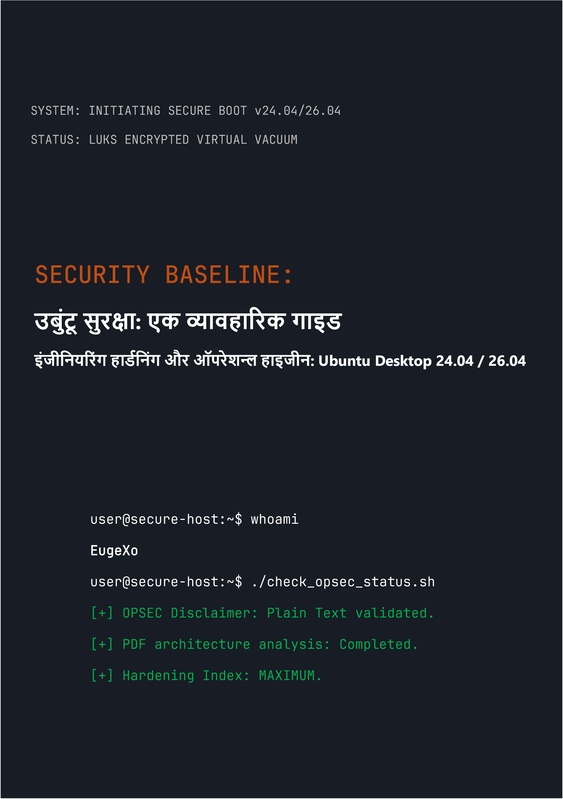

<div align="center">

# Security Baseline: उबंटू सुरक्षा: एक व्यावहारिक गाइड

## इंजीनियरिंग हार्डनिंग और ऑपरेशनल हाइजीन: Ubuntu Desktop 24.04/26.04 LTS

### Written and published by EugeXo

</div>

---

<p align="center">
  
</p>

---

## पुस्तक की संरचना और संक्षिप्त सारांश (Book Structure & Brief Annotations)

- [Security Baseline: उबंटू सुरक्षा: एक व्यावहारिक गाइड](#security-baseline-उबंटू-सुरक्षा-एक-व्यावहारिक-गाइड)
  - [इंजीनियरिंग हार्डनिंग और ऑपरेशनल हाइजीन: Ubuntu Desktop 24.04/26.04 LTS](#इंजीनियरिंग-हार्डनिंग-और-ऑपरेशनल-हाइजीन-ubuntu-desktop-24042604-lts)
    - [Written and published by EugeXo](#written-and-published-by-eugexo)
  - [पुस्तक की संरचना और संक्षिप्त सारांश (Book Structure \& Brief Annotations)](#पुस्तक-की-संरचना-और-संक्षिप्त-सारांश-book-structure--brief-annotations)
  - [आभार (Acknowledgments)](#आभार-acknowledgments)
  - [फ़ॉर्मेट सुरक्षा सुनिश्चित करना (OPSEC डिस्क्लेमर)](#फ़ॉर्मेट-सुरक्षा-सुनिश्चित-करना-opsec-डिस्क्लेमर)
  - [लेखक की ओर से: यह पुस्तक क्यों और किसके लिए लिखी गई है?](#लेखक-की-ओर-से-यह-पुस्तक-क्यों-और-किसके-लिए-लिखी-गई-है)
    - [प्रस्तुति के सिद्धांत के बारे में:](#प्रस्तुति-के-सिद्धांत-के-बारे-में)
  - [सुरक्षा का आधारभूत स्तर: ऑपरेशनल हाइजीन के 12 नियम](#सुरक्षा-का-आधारभूत-स्तर-ऑपरेशनल-हाइजीन-के-12-नियम)
  - [गुमनामी (Anonymity), गोपनीयता (Privacy) और सुरक्षा (Security) की अवधारणा](#गुमनामी-anonymity-गोपनीयता-privacy-और-सुरक्षा-security-की-अवधारणा)
  - [ऑपरेटिंग सिस्टम Ubuntu 24.04/26.04 LTS की स्थापना (Installation)](#ऑपरेटिंग-सिस्टम-ubuntu-24042604-lts-की-स्थापना-installation)
    - [परिचय (Introduction):](#परिचय-introduction)
    - [हार्डवेयर तैयारी नियम (Hardware Preparation Protocol):](#हार्डवेयर-तैयारी-नियम-hardware-preparation-protocol)
    - [डिस्ट्रीब्यूशन का चयन (Choosing a Distribution):](#डिस्ट्रीब्यूशन-का-चयन-choosing-a-distribution)
    - [इंस्टॉलर के चरण-दर-चरण निर्देश (Step-by-Step Installer Walkthrough):](#इंस्टॉलर-के-चरण-दर-चरण-निर्देश-step-by-step-installer-walkthrough)
  - [पहला बूट (First Boot)](#पहला-बूट-first-boot)
  - [सिस्टम सेटिंग्स (System Settings)](#सिस्टम-सेटिंग्स-system-settings)
  - [कंसोल के साथ काम की शुरुआत (Getting Started with the Console)](#कंसोल-के-साथ-काम-की-शुरुआत-getting-started-with-the-console)
    - [प्रारंभिक सेटिंग्स (Initial Settings):](#प्रारंभिक-सेटिंग्स-initial-settings)
      - [Gnome Terminal Ubuntu 24.04:](#gnome-terminal-ubuntu-2404)
      - [Ptyxis Ubuntu 26.04:](#ptyxis-ubuntu-2604)
    - [ऑटोमाउंटिंग को अक्षम करना और वैकल्पिक सेटिंग्स (Disabling Automount \& Optional Settings):](#ऑटोमाउंटिंग-को-अक्षम-करना-और-वैकल्पिक-सेटिंग्स-disabling-automount--optional-settings)
    - [कंसोल में कमांड हिस्ट्री का भंडारण (Storing Command History in the Console):](#कंसोल-में-कमांड-हिस्ट्री-का-भंडारण-storing-command-history-in-the-console)
    - [सुरक्षित sudo सेशन टाइमआउट की सेटिंग (Configuring a Secure sudo Session Timeout):](#सुरक्षित-sudo-सेशन-टाइमआउट-की-सेटिंग-configuring-a-secure-sudo-session-timeout)
    - [Checks Passed की जाँच के लिए फ़ाइल बनाना (Creating a File to Verify Checks Passed):](#checks-passed-की-जाँच-के-लिए-फ़ाइल-बनाना-creating-a-file-to-verify-checks-passed)
  - [नेटवर्क और VPN सेटअप (Network \& VPN Configuration)](#नेटवर्क-और-vpn-सेटअप-network--vpn-configuration)
    - [वायर्ड ईथरनेट कनेक्शन के लिए (For Wired Ethernet Connection):](#वायर्ड-ईथरनेट-कनेक्शन-के-लिए-for-wired-ethernet-connection)
    - [वायरलेस Wi-Fi कनेक्शन के लिए (For Wireless Wi-Fi Connection):](#वायरलेस-wi-fi-कनेक्शन-के-लिए-for-wireless-wi-fi-connection)
      - [वास्तविक पीसी या लैपटॉप के लिए सेटिंग (पूर्ण रैंडमाइज़ेशन / Full Randomization):](#वास्तविक-पीसी-या-लैपटॉप-के-लिए-सेटिंग-पूर्ण-रैंडमाइज़ेशन--full-randomization)
      - [वर्चुअल मशीन के लिए सेटिंग (वेंडर के रूप में Strict-मास्किंग / Strict Vendor Spoofing):](#वर्चुअल-मशीन-के-लिए-सेटिंग-वेंडर-के-रूप-में-strict-मास्किंग--strict-vendor-spoofing)
    - [NetworkManager हार्डनिंग: स्थानीय लीक mDNS, LLMNR, Hostname को दबाना और DNS सुरक्षा:](#networkmanager-हार्डनिंग-स्थानीय-लीक-mdns-llmnr-hostname-को-दबाना-और-dns-सुरक्षा)
    - [बूट होने पर Wi-Fi को पूर्ण रूप से बंद मोड में डालना (Disabling Wi-Fi Completely at Boot):](#बूट-होने-पर-wi-fi-को-पूर्ण-रूप-से-बंद-मोड-में-डालना-disabling-wi-fi-completely-at-boot)
    - [संवेदनशील Bluetooth घटकों को हटाना (Removing Compromising Bluetooth Components):](#संवेदनशील-bluetooth-घटकों-को-हटाना-removing-compromising-bluetooth-components)
    - [VPN कनेक्शन सेटअप (VPN Connection Setup):](#vpn-कनेक्शन-सेटअप-vpn-connection-setup)
  - [बूटलोडर GRUB की सुरक्षा सेटिंग्स और हार्डनिंग (GRUB Bootloader Hardening)](#बूटलोडर-grub-की-सुरक्षा-सेटिंग्स-और-हार्डनिंग-grub-bootloader-hardening)
    - [GRUB की सुरक्षा के लिए पासवर्ड सेट करना (Setting a Password to Protect GRUB):](#grub-की-सुरक्षा-के-लिए-पासवर्ड-सेट-करना-setting-a-password-to-protect-grub)
    - [IOMMU की सॉफ़्टवेयर हार्डनिंग: कर्नेल स्तर पर DMA हमलों से RAM की सुरक्षा:](#iommu-की-सॉफ़्टवेयर-हार्डनिंग-कर्नेल-स्तर-पर-dma-हमलों-से-ram-की-सुरक्षा)
  - [VPN Kill Switch के साथ और उसके बिना UFW फ़ायरवॉल कॉन्फ़िगरेशन के विकल्प](#vpn-kill-switch-के-साथ-और-उसके-बिना-ufw-फ़ायरवॉल-कॉन्फ़िगरेशन-के-विकल्प)
    - [Kill Switch के साथ फ़ायरवॉल कॉन्फ़िगर करना (Configuring Firewall with Kill Switch):](#kill-switch-के-साथ-फ़ायरवॉल-कॉन्फ़िगर-करना-configuring-firewall-with-kill-switch)
    - [नियमों के क्रम को प्रबंधित करने पर महत्वपूर्ण अतिरिक्त जानकारी (Important Note on Rule Ordering):](#नियमों-के-क्रम-को-प्रबंधित-करने-पर-महत्वपूर्ण-अतिरिक्त-जानकारी-important-note-on-rule-ordering)
    - [वैकल्पिक कॉन्फ़िगरेशन विकल्प (VPN के बिना / गेस्ट OS के लिए / Alternative Setup without VPN):](#वैकल्पिक-कॉन्फ़िगरेशन-विकल्प-vpn-के-बिना--गेस्ट-os-के-लिए--alternative-setup-without-vpn)
  - [सिस्टम कर्नेल की सेटिंग्स, एक्सेस अधिकारों का विभाजन और सिस्टम सेवाओं को हटाना](#सिस्टम-कर्नेल-की-सेटिंग्स-एक्सेस-अधिकारों-का-विभाजन-और-सिस्टम-सेवाओं-को-हटाना)
    - [नेटवर्क स्टैक और कर्नेल मेमोरी सबसिस्टम की सुरक्षा (Protecting Network Stack \& Kernel Memory):](#नेटवर्क-स्टैक-और-कर्नेल-मेमोरी-सबसिस्टम-की-सुरक्षा-protecting-network-stack--kernel-memory)
    - [लो-लेवल sysctl हार्डनिंग: TCP Timestamp Fingerprinting से सुरक्षा:](#लो-लेवल-sysctl-हार्डनिंग-tcp-timestamp-fingerprinting-से-सुरक्षा)
    - [दुर्लभ नेटवर्क प्रोटोकॉल और पुराने फ़ाइल सिस्टम की ब्लॉकिंग (Blocking Rare Protocols \& Legacy Filesystems):](#दुर्लभ-नेटवर्क-प्रोटोकॉल-और-पुराने-फ़ाइल-सिस्टम-की-ब्लॉकिंग-blocking-rare-protocols--legacy-filesystems)
    - [फ़ाइल सिस्टम में एक्सेस अधिकारों का विभाजन (Filesystem Access Permissions Hardening):](#फ़ाइल-सिस्टम-में-एक्सेस-अधिकारों-का-विभाजन-filesystem-access-permissions-hardening)
    - [शेयरड मेमोरी की सुरक्षित माउंटिंग (Secure Mounting of Shared Memory):](#शेयरड-मेमोरी-की-सुरक्षित-माउंटिंग-secure-mounting-of-shared-memory)
      - [संतुलित मोड (रोज़मर्रा के Desktop के लिए अनुशंसित / Balanced Mode):](#संतुलित-मोड-रोज़मर्रा-के-desktop-के-लिए-अनुशंसित--balanced-mode)
      - [पैरानॉयड मोड (अधिकतम आइसोलेशन / Paranoid Mode):](#पैरानॉयड-मोड-अधिकतम-आइसोलेशन--paranoid-mode)
    - [अस्थायी लॉग्स के लिए आइसोलेटेड RAM-डिस्क बनाना (Creating an Isolated RAM Disk for Volatile Logs):](#अस्थायी-लॉग्स-के-लिए-आइसोलेटेड-ram-डिस्क-बनाना-creating-an-isolated-ram-disk-for-volatile-logs)
    - [वीडियो स्ट्रीम और ऑडियो रिकॉर्डिंग को बंद करना (Blocking Video Stream \& Audio Recording):](#वीडियो-स्ट्रीम-और-ऑडियो-रिकॉर्डिंग-को-बंद-करना-blocking-video-stream--audio-recording)
    - [प्रिंटिंग और लोकल नेटवर्क रिसोर्स डिस्कवरी सेवाओं को हटाना (Removing Printing \& Network Discovery Services):](#प्रिंटिंग-और-लोकल-नेटवर्क-रिसोर्स-डिस्कवरी-सेवाओं-को-हटाना-removing-printing--network-discovery-services)
    - [जियोलोकेशन और टाइम ज़ोन की मास्किंग (Masking Geolocation \& Timezone):](#जियोलोकेशन-और-टाइम-ज़ोन-की-मास्किंग-masking-geolocation--timezone)
  - [रिपॉजिटरी सेटअप और सिस्टम अपडेट (Repository Setup \& System Update)](#रिपॉजिटरी-सेटअप-और-सिस्टम-अपडेट-repository-setup--system-update)
    - [सिस्टम अपडेट (System Update):](#सिस्टम-अपडेट-system-update)
    - [आइसोलेशन मोड में NVIDIA ग्राफ़िक्स सर्किट की तैनाती (Deploying NVIDIA Graphics in Isolation Mode):](#आइसोलेशन-मोड-में-nvidia-ग्राफ़िक्स-सर्किट-की-तैनाती-deploying-nvidia-graphics-in-isolation-mode)
  - [Ubuntu में टर्मिनल वातावरण (Terminal Environments in Ubuntu):](#ubuntu-में-टर्मिनल-वातावरण-terminal-environments-in-ubuntu)
    - [Gnome Terminal और Ptyxis को Ghostty से बदलना (Replacing Gnome Terminal \& Ptyxis with Ghostty):](#gnome-terminal-और-ptyxis-को-ghostty-से-बदलना-replacing-gnome-terminal--ptyxis-with-ghostty)
      - [Ubuntu 24.04 LTS Noble Numbat उपयोगकर्ताओं के लिए स्थापना:](#ubuntu-2404-lts-noble-numbat-उपयोगकर्ताओं-के-लिए-स्थापना)
      - [Ubuntu 26.04 LTS Resolute Racoon उपयोगकर्ताओं के लिए स्थापना:](#ubuntu-2604-lts-resolute-racoon-उपयोगकर्ताओं-के-लिए-स्थापना)
      - [Ubuntu 24.04/26.04 के लिए Ghostty कॉन्फ़िगरेशन का विकल्प:](#ubuntu-24042604-के-लिए-ghostty-कॉन्फ़िगरेशन-का-विकल्प)
    - [वैकल्पिक! Ubuntu 26.04 — Gnome Terminal वापस लाना और Ptyxis हटाना:](#वैकल्पिक-ubuntu-2604--gnome-terminal-वापस-लाना-और-ptyxis-हटाना)
  - [Snap और टेलीमेट्री को हटाना और प्रतिबंधित करना (Removing \& Blocking Snap and Telemetry)](#snap-और-टेलीमेट्री-को-हटाना-और-प्रतिबंधित-करना-removing--blocking-snap-and-telemetry)
    - [Snap को हटाना (Removing Snap):](#snap-को-हटाना-removing-snap)
    - [Canonical टेलीमेट्री को जड़ से हटाना (Purging Canonical Telemetry):](#canonical-टेलीमेट्री-को-जड़-से-हटाना-purging-canonical-telemetry)
    - [बैकग्राउंड फ़र्मवेयर ट्रैकर fwupd को निष्क्रिय करना (Neutralizing Background Firmware Tracker fwupd):](#बैकग्राउंड-फ़र्मवेयर-ट्रैकर-fwupd-को-निष्क्रिय-करना-neutralizing-background-firmware-tracker-fwupd)
  - [सुरक्षा यूटिलिटी libpam-tmpdir, debsums और लोड देखने के लिए Btop यूटिलिटी की स्थापना](#सुरक्षा-यूटिलिटी-libpam-tmpdir-debsums-और-लोड-देखने-के-लिए-btop-यूटिलिटी-की-स्थापना)
    - [सुरक्षा यूटिलिटी libpam-tmpdir (Security Utility libpam-tmpdir):](#सुरक्षा-यूटिलिटी-libpam-tmpdir-security-utility-libpam-tmpdir)
    - [यूटिलिटी debsums (Utility debsums):](#यूटिलिटी-debsums-utility-debsums)
    - [लोड देखने के लिए सुविधाजनक यूटिलिटी Btop (Convenient Load Monitoring Utility Btop):](#लोड-देखने-के-लिए-सुविधाजनक-यूटिलिटी-btop-convenient-load-monitoring-utility-btop)
    - [नेटवर्क पोर्ट्स और कनेक्शनों की निगरानी (Monitoring Network Ports \& Connections):](#नेटवर्क-पोर्ट्स-और-कनेक्शनों-की-निगरानी-monitoring-network-ports--connections)
  - [मानक रिकवरी पॉइंट्स बनाना: Timeshift यूटिलिटी की तैनाती और सेटअप](#मानक-रिकवरी-पॉइंट्स-बनाना-timeshift-यूटिलिटी-की-तैनाती-और-सेटअप)
    - [परिचय (Introduction):](#परिचय-introduction-1)
    - [एन्क्रिप्टेड वातावरण (LUKS + GRUB) में Timeshift के काम करने की विशेषताएँ:](#एन्क्रिप्टेड-वातावरण-luks--grub-में-timeshift-के-काम-करने-की-विशेषताएँ)
    - [Timeshift की सुरक्षित स्थापना (Safe Installation of Timeshift):](#timeshift-की-सुरक्षित-स्थापना-safe-installation-of-timeshift)
    - [प्राथमिक कॉन्फ़िगरेशन और स्नैपशॉट संख्या 1 (स्टेराइल मानक / Sterile Baseline) बनाना:](#प्राथमिक-कॉन्फ़िगरेशन-और-स्नैपशॉट-संख्या-1-स्टेराइल-मानक--sterile-baseline-बनाना)
    - [आगे के नियंत्रण का वेक्टर: स्नैपशॉट संख्या 2 (प्री-ऑपरेशनल / Pre-Operational) बनाना:](#आगे-के-नियंत्रण-का-वेक्टर-स्नैपशॉट-संख्या-2-प्री-ऑपरेशनल--pre-operational-बनाना)
    - [आपातकालीन रोलबैक नियम (यदि सिस्टम कॉम्प्रोमाइज़ हो गया है या टूट गया है):](#आपातकालीन-रोलबैक-नियम-यदि-सिस्टम-कॉम्प्रोमाइज़-हो-गया-है-या-टूट-गया-है)
  - [Firefox के स्वच्छ .deb-संस्करण की स्थापना और Snap-डमी पैकेज को हटाना](#firefox-के-स्वच्छ-deb-संस्करण-की-स्थापना-और-snap-डमी-पैकेज-को-हटाना)
  - [Mozilla Firefox में गोपनीयता पैरामीटरों की स्थापना और कॉन्फ़िगरेशन](#mozilla-firefox-में-गोपनीयता-पैरामीटरों-की-स्थापना-और-कॉन्फ़िगरेशन)
    - [सेटअप के लिए सिस्टम तैयार करना (Preparing the System for Configuration):](#सेटअप-के-लिए-सिस्टम-तैयार-करना-preparing-the-system-for-configuration)
    - [प्राथमिक ग्राफ़िकल गोपनीयता सेटअप (सभी के लिए अनिवार्य):](#प्राथमिक-ग्राफ़िकल-गोपनीयता-सेटअप-सभी-के-लिए-अनिवार्य)
    - [निजी DNS प्रदाताओं की सेटिंग (DNS over HTTPS):](#निजी-dns-प्रदाताओं-की-सेटिंग-dns-over-https)
    - [हार्डनिंग का स्वचालन: user.js कॉन्फ़िगरेशन फ़ाइल बनाना:](#हार्डनिंग-का-स्वचालन-userjs-कॉन्फ़िगरेशन-फ़ाइल-बनाना)
    - [अंतिम सुरक्षात्मक एक्सटेंशन की तैनाती (Deploying Ultimate Security Extensions):](#अंतिम-सुरक्षात्मक-एक्सटेंशन-की-तैनाती-deploying-ultimate-security-extensions)
  - [इंटरैक्टिव नेटवर्क फ़ायरवॉल Portmaster की स्थापना और कॉन्फ़िगरेशन](#इंटरैक्टिव-नेटवर्क-फ़ायरवॉल-portmaster-की-स्थापना-और-कॉन्फ़िगरेशन)
    - [परिचय (Introduction):](#परिचय-introduction-2)
    - [तैयारी, कर्नेल का प्राथमिक इनिशियलाइज़ेशन और नए संस्करण में अपग्रेड:](#तैयारी-कर्नेल-का-प्राथमिक-इनिशियलाइज़ेशन-और-नए-संस्करण-में-अपग्रेड)
  - [डेटा का गारंटीशुदा विनाश और डिजिटल पदचिह्न का निर्जीवीकरण](#डेटा-का-गारंटीशुदा-विनाश-और-डिजिटल-पदचिह्न-का-निर्जीवीकरण)
    - [परिचय (Introduction):](#परिचय-introduction-3)
    - [डिजिटल पदचिह्न की संरचना: मेटाडेटा साफ़ किए बिना डेटा हटाना बेकार क्यों है?](#डिजिटल-पदचिह्न-की-संरचना-मेटाडेटा-साफ़-किए-बिना-डेटा-हटाना-बेकार-क्यों-है)
    - [MAT2 यूटिलिटी की स्थापना और मेटाडेटा की सफ़ाई:](#mat2-यूटिलिटी-की-स्थापना-और-मेटाडेटा-की-सफ़ाई)
    - [फ़ाइलों और डायरेक्टरी का सुरक्षित और अपरिवर्तनीय निष्कासन (Safe \& Irreversible Deletion):](#फ़ाइलों-और-डायरेक्टरी-का-सुरक्षित-और-अपरिवर्तनीय-निष्कासन-safe--irreversible-deletion)
    - [shred यूटिलिटी के कार्य पैरामीटर (Parameters of shred):](#shred-यूटिलिटी-के-कार्य-पैरामीटर-parameters-of-shred)
    - [डिस्क के खाली स्थान की वैश्विक सफ़ाई (Global Disk Free Space Wiping):](#डिस्क-के-खाली-स्थान-की-वैश्विक-सफ़ाई-global-disk-free-space-wiping)
  - [Ubuntu में स्टेगनोग्राफ़ी, ऑब्फ़स्केशन और निशान छिपाना](#ubuntu-में-स्टेगनोग्राफ़ी-ऑब्फ़स्केशन-और-निशान-छिपाना)
    - [परिचय (Introduction):](#परिचय-introduction-4)
    - [Linux के अंतर्गत स्टेगनोग्राफ़ी: मीडिया सामग्री में फ़ाइलें छिपाना:](#linux-के-अंतर्गत-स्टेगनोग्राफ़ी-मीडिया-सामग्री-में-फ़ाइलें-छिपाना)
    - [कंसोल यूटिलिटी steghide (Console Utility steghide):](#कंसोल-यूटिलिटी-steghide-console-utility-steghide)
    - [उन्नत टूल StegoForge के माध्यम से मास्किंग (Masking via StegoForge):](#उन्नत-टूल-stegoforge-के-माध्यम-से-मास्किंग-masking-via-stegoforge)
    - [आर्काइव जोड़ना (बिना थर्ड-पार्टी सॉफ़्टवेयर के त्वरित लाइफहैक):](#आर्काइव-जोड़ना-बिना-थर्ड-पार्टी-सॉफ़्टवेयर-के-त्वरित-लाइफहैक)
    - [टेक्स्ट ऑब्फ़स्केशन: स्वचालित विश्लेषण प्रणालियों (DPI) को बायपास करना:](#टेक्स्ट-ऑब्फ़स्केशन-स्वचालित-विश्लेषण-प्रणालियों-dpi-को-बायपास-करना)
    - [छिपे हुए खतरों का विश्लेषण: फ़ाइल एक्सटेंशन मास्किंग (BiDi-हमले):](#छिपे-हुए-खतरों-का-विश्लेषण-फ़ाइल-एक्सटेंशन-मास्किंग-bidi-हमले)
  - [क्रिप्टोग्राफ़िक पैकेज VeraCrypt की स्थापना और कॉन्फ़िगरेशन](#क्रिप्टोग्राफ़िक-पैकेज-veracrypt-की-स्थापना-और-कॉन्फ़िगरेशन)
    - [VeraCrypt का परिचय और इसकी स्थापना (Introduction \& Installation):](#veracrypt-का-परिचय-और-इसकी-स्थापना-introduction--installation)
      - [कम्युनिटी PPA-रिपॉजिटरी के माध्यम से स्थापना:](#कम्युनिटी-ppa-रिपॉजिटरी-के-माध्यम-से-स्थापना)
      - [आधिकारिक डिस्ट्रीब्यूशन की स्थापना (नेटिव विधि / Native Method):](#आधिकारिक-डिस्ट्रीब्यूशन-की-स्थापना-नेटिव-विधि--native-method)
    - [सुरक्षा की गहरी ट्यूनिंग: RAM में कुंजियों की सुरक्षा (पैरानॉयड मोड):](#सुरक्षा-की-गहरी-ट्यूनिंग-ram-में-कुंजियों-की-सुरक्षा-पैरानॉयड-मोड)
    - [मौलिक InfoSec टूल: हिडन वॉल्यूम (Hidden Volume) बनाना:](#मौलिक-infosec-टूल-हिडन-वॉल्यूम-hidden-volume-बनाना)
    - [अल्टीमेट हार्डनिंग: PIM सेटिंग और हार्डवेयर कुंजी फ़ाइलें (Keyfiles):](#अल्टीमेट-हार्डनिंग-pim-सेटिंग-और-हार्डवेयर-कुंजी-फ़ाइलें-keyfiles)
    - [वास्तविक दुनिया में थ्रेट मॉडल: पैरानॉयड दृष्टिकोण का व्यवस्थित होना क्यों ज़रूरी है:](#वास्तविक-दुनिया-में-थ्रेट-मॉडल-पैरानॉयड-दृष्टिकोण-का-व्यवस्थित-होना-क्यों-ज़रूरी-है)
  - [Yubico सुरक्षा कुंजियों का उपयोग (Using Yubico Security Keys)](#yubico-सुरक्षा-कुंजियों-का-उपयोग-using-yubico-security-keys)
    - [परिचय (Introduction):](#परिचय-introduction-5)
    - [स्थापना (Installation):](#स्थापना-installation)
    - [कर्नेल udev नियमों के माध्यम से हार्डवेयर Log Out/Kill Switch का कार्यान्वयन:](#कर्नेल-udev-नियमों-के-माध्यम-से-हार्डवेयर-log-outkill-switch-का-कार्यान्वयन)
  - [USBGuard की स्थापना और कॉन्फ़िगरेशन (Installing \& Configuring USBGuard)](#usbguard-की-स्थापना-और-कॉन्फ़िगरेशन-installing--configuring-usbguard)
    - [परिचय (Introduction):](#परिचय-introduction-6)
    - [स्थापना और कॉन्फ़िगरेशन (Installation \& Configuration):](#स्थापना-और-कॉन्फ़िगरेशन-installation--configuration)
  - [आपातकालीन शटडाउन के लिए Emergency Panic Button का कार्यान्वयन](#आपातकालीन-शटडाउन-के-लिए-emergency-panic-button-का-कार्यान्वयन)
    - [किसी भी USB डिवाइस के माध्यम से आपातकालीन हार्डवेयर Kill Switch:](#किसी-भी-usb-डिवाइस-के-माध्यम-से-आपातकालीन-हार्डवेयर-kill-switch)
  - [लोकल पासवर्ड मैनेजर KeePassXC की स्थापना (Installing Local Password Manager KeePassXC)](#लोकल-पासवर्ड-मैनेजर-keepassxc-की-स्थापना-installing-local-password-manager-keepassxc)
    - [परिचय (Introduction):](#परिचय-introduction-7)
    - [वॉल्ट सुरक्षा परिदृश्यों के विकल्प (Vault Protection Scenarios):](#वॉल्ट-सुरक्षा-परिदृश्यों-के-विकल्प-vault-protection-scenarios)
    - [सॉफ़्टवेयर सूट की स्थापना (Installing the Software Suite):](#सॉफ़्टवेयर-सूट-की-स्थापना-installing-the-software-suite)
    - [डेटाबेस का निर्माण और हार्डवेयर सुरक्षा (Creating \& Protecting the Database):](#डेटाबेस-का-निर्माण-और-हार्डवेयर-सुरक्षा-creating--protecting-the-database)
    - [आंतरिक सुरक्षा सेटिंग्स की गहरी हार्डनिंग (Deep Hardening of Internal Security Settings):](#आंतरिक-सुरक्षा-सेटिंग्स-की-गहरी-हार्डनिंग-deep-hardening-of-internal-security-settings)
    - [सुरक्षित क्लिपबोर्ड के माध्यम से डेटा का सुरक्षित इनपुट (Secure Data Input via Protected Clipboard):](#सुरक्षित-क्लिपबोर्ड-के-माध्यम-से-डेटा-का-सुरक्षित-इनपुट-secure-data-input-via-protected-clipboard)
  - [नेटवर्क एनालाइज़र Wireshark की स्थापना और लॉन्च (Installing \& Launching Wireshark)](#नेटवर्क-एनालाइज़र-wireshark-की-स्थापना-और-लॉन्च-installing--launching-wireshark)
    - [परिचय (Introduction):](#परिचय-introduction-8)
    - [Wireshark की स्थापना और लॉन्च (Installing \& Launching Wireshark):](#wireshark-की-स्थापना-और-लॉन्च-installing--launching-wireshark)
    - [पैकेट कैप्चर सबसिस्टम की सुरक्षा की अत्यंत महत्वपूर्ण अवधारणा:](#पैकेट-कैप्चर-सबसिस्टम-की-सुरक्षा-की-अत्यंत-महत्वपूर्ण-अवधारणा)
    - [ट्रैफ़िक डंप का गुप्त संग्रह (कंसोल मोड / Stealth Traffic Capture):](#ट्रैफ़िक-डंप-का-गुप्त-संग्रह-कंसोल-मोड--stealth-traffic-capture)
    - [Wireshark पर व्यावहारिक गाइड (Practical Guide to Wireshark):](#wireshark-पर-व्यावहारिक-गाइड-practical-guide-to-wireshark)
  - [सुरक्षा प्रणाली AppArmor की स्थापना और प्रबंधन (Installing \& Managing AppArmor)](#सुरक्षा-प्रणाली-apparmor-की-स्थापना-और-प्रबंधन-installing--managing-apparmor)
    - [परिचय (Introduction):](#परिचय-introduction-9)
    - [सुरक्षा का नया प्रतिमान: कर्नेल ऑटोमेशन (New Security Paradigm: Kernel Automation):](#सुरक्षा-का-नया-प्रतिमान-कर्नेल-ऑटोमेशन-new-security-paradigm-kernel-automation)
    - [AppArmor सबसिस्टम की व्यावहारिक हार्डनिंग (Practical Hardening of AppArmor):](#apparmor-सबसिस्टम-की-व्यावहारिक-हार्डनिंग-practical-hardening-of-apparmor)
  - [आइसोलेटेड सैंडबॉक्स Firejail और Bubblewrap की स्थापना और कॉन्फ़िगरेशन](#आइसोलेटेड-सैंडबॉक्स-firejail-और-bubblewrap-की-स्थापना-और-कॉन्फ़िगरेशन)
    - [परिचय (Introduction):](#परिचय-introduction-10)
    - [Firejail की स्थापना और सैंडबॉक्स की तैयारी:](#firejail-की-स्थापना-और-सैंडबॉक्स-की-तैयारी)
    - [Firejail के बुनियादी फ़िल्टरिंग पैरामीटर (संदर्भ / Reference):](#firejail-के-बुनियादी-फ़िल्टरिंग-पैरामीटर-संदर्भ--reference)
    - [वैकल्पिक! Firejail सुरक्षात्मक परिधि का स्वचालन (यूटिलिटी Firecfg):](#वैकल्पिक-firejail-सुरक्षात्मक-परिधि-का-स्वचालन-यूटिलिटी-firecfg)
    - [Bubblewrap की स्थापना (Installing Bubblewrap):](#bubblewrap-की-स्थापना-installing-bubblewrap)
    - [Bubblewrap फ़्लैग्स की चीट शीट (संदर्भ / Reference):](#bubblewrap-फ़्लैग्स-की-चीट-शीट-संदर्भ--reference)
    - [सैंडबॉक्स के लिए कस्टम शॉर्टकट तैयार करना (Preparing Custom Shortcuts for Sandboxes):](#सैंडबॉक्स-के-लिए-कस्टम-शॉर्टकट-तैयार-करना-preparing-custom-shortcuts-for-sandboxes)
    - [Firejail के लिए अलग Firefox hardened प्रोफ़ाइल बनाना:](#firejail-के-लिए-अलग-firefox-hardened-प्रोफ़ाइल-बनाना)
    - [Bubblewrap में Firefox hardened प्रोफ़ाइल बनाना:](#bubblewrap-में-firefox-hardened-प्रोफ़ाइल-बनाना)
    - [PDF-दस्तावेज़ों का वायुरोधी कक्ष: Firejail में फ़ाइलों का सुरक्षित लॉन्च:](#pdf-दस्तावेज़ों-का-वायुरोधी-कक्ष-firejail-में-फ़ाइलों-का-सुरक्षित-लॉन्च)
    - [Bubblewrap में PDF पढ़ने के लिए Document Viewer को सील करना:](#bubblewrap-में-pdf-पढ़ने-के-लिए-document-viewer-को-सील-करना)
    - [Firejail में ग्राफ़िक्स फ़ाइलें देखने के लिए Image Viewer:](#firejail-में-ग्राफ़िक्स-फ़ाइलें-देखने-के-लिए-image-viewer)
    - [ग्राफ़िक्स फ़ाइल व्यूअर Image Viewer को Bubblewrap में लपेटना:](#ग्राफ़िक्स-फ़ाइल-व्यूअर-image-viewer-को-bubblewrap-में-लपेटना)
    - [Firejail के लिए KeePassXC आइसोलेशन परिदृश्य:](#firejail-के-लिए-keepassxc-आइसोलेशन-परिदृश्य)
    - [Bubblewrap के माध्यम से KeePassXC को आइसोलेट करना:](#bubblewrap-के-माध्यम-से-keepassxc-को-आइसोलेट-करना)
    - [ऑफ़िस सुइट LibreOffice की स्थापना और आइसोलेशन:](#ऑफ़िस-सुइट-libreoffice-की-स्थापना-और-आइसोलेशन)
    - [Firejail के माध्यम से LibreOffice का संचालन कॉन्फ़िगर करना:](#firejail-के-माध्यम-से-libreoffice-का-संचालन-कॉन्फ़िगर-करना)
    - [LibreOffice को Bubblewrap में लपेटना:](#libreoffice-को-bubblewrap-में-लपेटना)
    - [GNU Image Manipulation Program (GIMP) की स्थापना और आइसोलेशन:](#gnu-image-manipulation-program-gimp-की-स्थापना-और-आइसोलेशन)
    - [Firejail के माध्यम से GIMP का संचालन कॉन्फ़िगर करना:](#firejail-के-माध्यम-से-gimp-का-संचालन-कॉन्फ़िगर-करना)
    - [Bubblewrap के माध्यम से GIMP कॉन्फ़िगर करना:](#bubblewrap-के-माध्यम-से-gimp-कॉन्फ़िगर-करना)
    - [कोड एडिटर VS Codium (प्रोग्राम लिखने के लिए IDE) की स्थापना और आइसोलेशन:](#कोड-एडिटर-vs-codium-प्रोग्राम-लिखने-के-लिए-ide-की-स्थापना-और-आइसोलेशन)
    - [Firejail में VS Codium का आइसोलेशन:](#firejail-में-vs-codium-का-आइसोलेशन)
    - [Bubblewrap में VS Codium का आइसोलेशन:](#bubblewrap-में-vs-codium-का-आइसोलेशन)
    - [लोकल न्यूरल नेटवर्क LM Studio Bionic की स्थापना और आइसोलेशन:](#लोकल-न्यूरल-नेटवर्क-lm-studio-bionic-की-स्थापना-और-आइसोलेशन)
    - [Firejail के माध्यम से LM Studio का संचालन शुरू करना:](#firejail-के-माध्यम-से-lm-studio-का-संचालन-शुरू-करना)
    - [LM Studio को Bubblewrap में लपेटना:](#lm-studio-को-bubblewrap-में-लपेटना)
    - [सुरक्षित संचार की सेटिंग: मैसेंजर और क्रिप्टो-सर्किट का अनिवार्य आइसोलेशन (लेखक का OPSEC-सर्किट):](#सुरक्षित-संचार-की-सेटिंग-मैसेंजर-और-क्रिप्टो-सर्किट-का-अनिवार्य-आइसोलेशन-लेखक-का-opsec-सर्किट)
    - [Telegram Desktop की स्थापना और आइसोलेशन:](#telegram-desktop-की-स्थापना-और-आइसोलेशन)
    - [Firejail के माध्यम से Telegram सर्किट की सुरक्षा करना:](#firejail-के-माध्यम-से-telegram-सर्किट-की-सुरक्षा-करना)
    - [Bubblewrap के माध्यम से Telegram को आइसोलेट करना:](#bubblewrap-के-माध्यम-से-telegram-को-आइसोलेट-करना)
    - [Bubblewrap के माध्यम से Signal की स्थापना और आइसोलेशन:](#bubblewrap-के-माध्यम-से-signal-की-स्थापना-और-आइसोलेशन)
    - [होस्ट की क्रिप्टोग्राफ़िक नींव: GnuPG कुंजियों का जेनरेशन और OPSEC-सुरक्षा:](#होस्ट-की-क्रिप्टोग्राफ़िक-नींव-gnupg-कुंजियों-का-जेनरेशन-और-opsec-सुरक्षा)
    - [Jabber-क्लाइंट Psi+ की स्थापना और आइसोलेशन:](#jabber-क्लाइंट-psi-की-स्थापना-और-आइसोलेशन)
    - [Firejail में PSI+ को आइसोलेट करना:](#firejail-में-psi-को-आइसोलेट-करना)
    - [Bubblewrap सैंडबॉक्स में Psi+ Jabber-क्लाइंट का आइसोलेशन:](#bubblewrap-सैंडबॉक्स-में-psi-jabber-क्लाइंट-का-आइसोलेशन)
    - [ईमेल क्लाइंट Thunderbird की स्थापना और आइसोलेशन (एन्क्रिप्टेड ईमेल पत्राचार का सर्किट):](#ईमेल-क्लाइंट-thunderbird-की-स्थापना-और-आइसोलेशन-एन्क्रिप्टेड-ईमेल-पत्राचार-का-सर्किट)
    - [Firejail की मदद से Thunderbird का आइसोलेशन:](#firejail-की-मदद-से-thunderbird-का-आइसोलेशन)
    - [Bubblewrap के माध्यम से Thunderbird का आइसोलेशन:](#bubblewrap-के-माध्यम-से-thunderbird-का-आइसोलेशन)
    - [उन्नत «पैरानॉयड» मोड: Overlay के माध्यम से सेशन सेव करने के साथ Firejail:](#उन्नत-पैरानॉयड-मोड-overlay-के-माध्यम-से-सेशन-सेव-करने-के-साथ-firejail)
  - [Rkhunter की स्थापना और रूटकिट्स की खोज (Installing Rkhunter \& Rootkit Detection)](#rkhunter-की-स्थापना-और-रूटकिट्स-की-खोज-installing-rkhunter--rootkit-detection)
    - [Rkhunter के अतिरिक्त Chkrootkit की स्थापना (Installing Chkrootkit in Addition to Rkhunter):](#rkhunter-के-अतिरिक्त-chkrootkit-की-स्थापना-installing-chkrootkit-in-addition-to-rkhunter)
  - [एंटीवायरस स्कैनर ClamAV की स्थापना और कॉन्फ़िगरेशन (Installing \& Configuring ClamAV)](#एंटीवायरस-स्कैनर-clamav-की-स्थापना-और-कॉन्फ़िगरेशन-installing--configuring-clamav)
    - [परिचय (Introduction):](#परिचय-introduction-11)
    - [ClamAV की स्थापना (Installing ClamAV):](#clamav-की-स्थापना-installing-clamav)
    - [सिग्नेचर डेटाबेस को अपडेट करना और नेटवर्क ब्लॉकिंग को बायपास करना:](#सिग्नेचर-डेटाबेस-को-अपडेट-करना-और-नेटवर्क-ब्लॉकिंग-को-बायपास-करना)
    - [सिस्टम स्कैनिंग का आयोजन (Organizing System Scanning):](#सिस्टम-स्कैनिंग-का-आयोजन-organizing-system-scanning)
    - [मल्टी-थ्रेडेड स्कैनिंग (Hardening / Multi-threaded Scanning):](#मल्टी-थ्रेडेड-स्कैनिंग-hardening--multi-threaded-scanning)
  - [वर्चुअलाइज़ेशन वातावरण VirtualBox की स्थापना और कॉन्फ़िगरेशन](#वर्चुअलाइज़ेशन-वातावरण-virtualbox-की-स्थापना-और-कॉन्फ़िगरेशन)
    - [फ़ोरेंसिक से सुरक्षा: RAM (`tmpfs`) में VirtualBox लॉग्स का आइसोलेशन:](#फ़ोरेंसिक-से-सुरक्षा-ram-tmpfs-में-virtualbox-लॉग्स-का-आइसोलेशन)
  - [वर्चुअल डिस्क VDI का संपीड़न और अनुकूलन (Compressing \& Optimizing Virtual Disks VDI)](#वर्चुअल-डिस्क-vdi-का-संपीड़न-और-अनुकूलन-compressing--optimizing-virtual-disks-vdi)
    - [परिचय (Introduction):](#परिचय-introduction-12)
    - [Windows के अंतर्गत वर्चुअल मशीन की सफ़ाई (Cleaning a Windows Virtual Machine):](#windows-के-अंतर्गत-वर्चुअल-मशीन-की-सफ़ाई-cleaning-a-windows-virtual-machine)
    - [Linux के अंतर्गत वर्चुअल मशीन की सफ़ाई (Ubuntu/Kali Linux):](#linux-के-अंतर्गत-वर्चुअल-मशीन-की-सफ़ाई-ubuntukali-linux)
    - [होस्ट मशीन पर वर्चुअल डिस्क का अंतिम संपीड़न (Final Disk Compaction on Host):](#होस्ट-मशीन-पर-वर्चुअल-डिस्क-का-अंतिम-संपीड़न-final-disk-compaction-on-host)
  - [कंटेनराइज़ेशन सिस्टम Docker की स्थापना और कॉन्फ़िगरेशन](#कंटेनराइज़ेशन-सिस्टम-docker-की-स्थापना-और-कॉन्फ़िगरेशन)
    - [परिचय (Introduction):](#परिचय-introduction-13)
    - [डिफ़ॉल्ट Docker का छिपा हुआ खतरा क्या है?](#डिफ़ॉल्ट-docker-का-छिपा-हुआ-खतरा-क्या-है)
    - [Rootless मोड में Docker की तैनाती (Deploying Docker in Rootless Mode):](#rootless-मोड-में-docker-की-तैनाती-deploying-docker-in-rootless-mode)
    - [नेटवर्क को नियंत्रित करना और UFW से जोड़ना (Taming the Network \& Binding to UFW):](#नेटवर्क-को-नियंत्रित-करना-और-ufw-से-जोड़ना-taming-the-network--binding-to-ufw)
    - [कंटेनरों के सुरक्षित लॉन्च का व्यावहारिक उदाहरण (Practical Example of Safe Container Launch):](#कंटेनरों-के-सुरक्षित-लॉन्च-का-व्यावहारिक-उदाहरण-practical-example-of-safe-container-launch)
    - [सुरक्षा का प्रायोगिक प्रमाण (Root की अनुपस्थिति की जाँच):](#सुरक्षा-का-प्रायोगिक-प्रमाण-root-की-अनुपस्थिति-की-जाँच)
  - [अखंडता नियंत्रण प्रणाली AIDE की स्थापना और कॉन्फ़िगरेशन (Installing \& Configuring AIDE)](#अखंडता-नियंत्रण-प्रणाली-aide-की-स्थापना-और-कॉन्फ़िगरेशन-installing--configuring-aide)
    - [परिचय (Introduction):](#परिचय-introduction-14)
    - [AIDE की स्थापना और कॉन्फ़िगरेशन (Installing \& Configuring AIDE):](#aide-की-स्थापना-और-कॉन्फ़िगरेशन-installing--configuring-aide)
    - [पेनिट्रेशन टेस्ट करना (सुरक्षा का सत्यापन / Validation of Protection):](#पेनिट्रेशन-टेस्ट-करना-सुरक्षा-का-सत्यापन--validation-of-protection)
  - [Lynis की मदद से सिस्टम का स्वचालित सुरक्षा ऑडिट (Automated Security Audit with Lynis)](#lynis-की-मदद-से-सिस्टम-का-स्वचालित-सुरक्षा-ऑडिट-automated-security-audit-with-lynis)
  - [कमजोरियों और पासवर्ड लीक स्कैनर Trivy की स्थापना और कॉन्फ़िगरेशन](#कमजोरियों-और-पासवर्ड-लीक-स्कैनर-trivy-की-स्थापना-और-कॉन्फ़िगरेशन)
  - [VirtualBox में गेस्ट सिस्टम Ubuntu/Xubuntu/Lubuntu की सेटिंग](#virtualbox-में-गेस्ट-सिस्टम-ubuntuxubuntulubuntu-की-सेटिंग)
    - [Guest Additions की स्थापना (Installing Guest Additions):](#guest-additions-की-स्थापना-installing-guest-additions)
    - [Mozilla Firefox की स्थापना (Installing Mozilla Firefox):](#mozilla-firefox-की-स्थापना-installing-mozilla-firefox)
    - [VirtualBox में साझा फ़ोल्डरों की सेटिंग (Shared Folders):](#virtualbox-में-साझा-फ़ोल्डरों-की-सेटिंग-shared-folders)
    - [Ubuntu/Xubuntu/Lubuntu वाले VirtualBox में Ledger Live की स्थापना](#ubuntuxubuntulubuntu-वाले-virtualbox-में-ledger-live-की-स्थापना)
    - [मुख्य होस्ट-सिस्टम Ubuntu पर Ledger Live चलाना](#मुख्य-होस्ट-सिस्टम-ubuntu-पर-ledger-live-चलाना)
  - [लेखक के बारे में और कानूनी जानकारी (About the Author \& Legal Information)](#लेखक-के-बारे-में-और-कानूनी-जानकारी-about-the-author--legal-information)
    - [संपर्क और समुदाय के संसाधन:](#संपर्क-और-समुदाय-के-संसाधन)


<br>
<br>
<br>
<br>
<br>
<br>
<br>

## आभार (Acknowledgments)

सीधे और बिना किसी अनावश्यक औपचारिकता के, मैं उन सभी लोगों के प्रति अपना गहरा आभार व्यक्त करना चाहता हूँ जिन्होंने मुझे यह पुस्तक लिखने के लिए प्रेरित किया और इस पूरे सफ़र में मेरा साथ दिया।

मैं हमारे छोटे लेकिन तकनीकी रूप से उन्नत देश एस्टोनिया (Estonia) के पुलिस साइबर सुरक्षा विभाग के उन साधारण और समर्पित साथियों का धन्यवाद करता हूँ, जिन्होंने मुझे इस पुस्तक को लिखने के लिए प्रोत्साहित किया।

साथ ही, मैं मियामी (Miami) स्थित यू.एस. सीक्रेट सर्विस (U.S. Secret Service) के इन्फोसेक (InfoSec) विशेषज्ञों का विशेष आभार व्यक्त करता हूँ, जिन्होंने कुछ अध्यायों के सत्यापन (verification) में महत्वपूर्ण व्यावहारिक योगदान दिया। जैसा कि साबित हुआ, यहाँ वर्णित विधियाँ और दृष्टिकोण वास्तविक फील्ड परिस्थितियों में बेहतरीन काम करते हैं।

निःसंदेह, मेरे परिवार के सदस्यों का उनके अद्भुत धैर्य और नैतिक समर्थन के लिए बहुत-बहुत धन्यवाद। विशेष रूप से मेरी माँ का, जिन्होंने मेरे काम को पूरी तरह समझा और रोज़मर्रा के ढेर सारे कामों की ज़िम्मेदारी खुद संभाली, जिससे मुझे शोध (research) के लिए पर्याप्त समय मिल सका।

**मैं यूनाइटेड किंगडम (UK) के अपने मित्र के समर्थन के लिए अलग से धन्यवाद देना चाहता हूँ। जब मैं मियामी में था, तब हमारी काफी गहरी बातचीत होती थी, लेकिन दुर्भाग्य से बाद में हमारा संपर्क टूट गया। मुझे पूरी उम्मीद है कि हम फिर से एक-दूसरे को ढूँढ लेंगे। मेरे दोस्त, यदि तुम या तुम्हारा इन्फोसेक (InfoSec) इंजीनियर बेटा ये पंक्तियाँ पढ़ रहे हो, तो कृपया संपर्क ज़रूर करना — मेरी संपर्क जानकारी पुस्तक के अंत में दी गई है। मुझे लगता है तुम समझ गए होगे *who is who!* ;)**

मेरे वर्चुअल सहायक — **Google के Gemini** के प्रति अवर्णनीय आभार व्यक्त किया जाता है। इस पूरी पुस्तक पर काम के दौरान वह एक अटूट डिजिटल साथी बना रहा, जिसने इस हार्डकोर तकनीकी सामग्री की संरचना (structuring) और अनुवाद में अमूल्य सहायता प्रदान की।

मैं अपने ऊर्जावान और उन्नत सहायक **OpenAI के ChatGPT** का भी धन्यवाद करता हूँ, जिसने तकनीकी समाधानों पर चर्चा करने, कॉन्फ़िगरेशन की जाँच करने, साथ ही पाठ के कुछ हिस्सों के सावधानीपूर्वक संपादन और सटीक शब्दावली खोजने में मदद की।

निःसंदेह, सबसे पहला आभार Google और OpenAI के इंजीनियरों और डेवलपर्स को उनके प्रथम श्रेणी के उत्कृष्ट कार्य के लिए जाता है!

लिखने को अभी बहुत कुछ है, लेकिन जो भी इस सफ़र से जुड़े थे, वे सब कुछ अच्छी तरह समझते हैं। मुझे बेहद खुशी है कि यह पुस्तक आखिरकार प्रकाशित हो रही है। दोस्तों, मैं आप सभी से दिल से प्यार करता हूँ, आपकी कद्र करता हूँ और आपका सम्मान करता हूँ!

<br>

## फ़ॉर्मेट सुरक्षा सुनिश्चित करना (OPSEC डिस्क्लेमर)

सूचना सुरक्षा (Information Security) और व्यावहारिक समझ (common sense) के दृष्टिकोण से, इस गाइड की संपूर्ण सामग्री मूल रूप से सादे पाठ (Markdown मार्कअप के साथ Plain Text) के रूप में उपलब्ध कराई गई है। पुस्तक को PDF फ़ॉर्मेट में जारी करने की योजना को जानबूझकर अस्वीकार कर दिया गया। PDF की संरचना (architecture) अत्यधिक जटिल होती है और इसे समय-समय पर हैक या कॉम्प्रोमाइज़ (compromise) किया जाता रहता है। जिस होस्ट (host) को आप सुरक्षित कर रहे हैं, उसकी सुरक्षा उसके कॉन्फ़िगरेशन निर्देशों को सुरक्षित रूप से पढ़ने के साथ ही शुरू होनी चाहिए।

एक टेक्स्ट फ़ाइल बिना किसी निष्पादन योग्य कोड (executable code) के शुद्ध डेटा होती है, जबकि PDF फ़ॉर्मेट डिफ़ॉल्ट रूप से एम्बेडेड JavaScript स्क्रिप्ट, डायनामिक एलिमेंट्स, इंटरैक्टिव फ़ॉर्म और जटिल फ़ॉन्ट्स का समर्थन करता है, जिनके लिए गहरी सिस्टम पार्सिंग (deep system parsing) की आवश्यकता होती है। Linux में PDF पार्सर (उदाहरण के लिए, डिफ़ॉल्ट व्यूअर `Evince` या `Poppler` लाइब्रेरी) के माध्यम से होने वाली RCE (Remote Code Execution) श्रेणी की गंभीर कमजोरियाँ एक प्रमाणित ऐतिहासिक तथ्य हैं। Plain Text फ़ॉर्मेट में कोड निष्पादन का कोई अंतर्निहित तंत्र नहीं होता है और यह सामग्री पढ़ते समय हमले की सतह (attack surface) को काफी कम कर देता है। यह किसी भी वातावरण में सुरक्षित पठन (safe reading) की गारंटी देता है।

इसी कारण से, सभी ग्राफ़िकल सामग्री और चित्रों को मुख्य पाठ से बाहर एक अलग डायरेक्टरी में रखा गया है। ग्राफ़िक्स को फ़ोल्डरों और सब-फ़ोल्डरों में व्यवस्थित किया गया है, जिससे पुस्तक पढ़ते समय मेमोरी में उनकी स्वचालित रेंडरिंग (automatic rendering) नहीं होती है।

> [!NOTE]
पुस्तक का मुख्य स्रोत फ़ॉर्मेट (source format) Markdown है। सभी व्युत्पन्न फ़ॉर्मेट (HTML, EPUB और अन्य) इसी सत्यापित टेक्स्ट सोर्स से तैयार किए जाते हैं।

पाठक इस प्रोजेक्ट का उपयोग तीन तरीकों में से किसी एक से कर सकते हैं:

* मूल Markdown को सीधे पढ़ें।
* तैयार HTML/EPUB बिल्ड का उपयोग करें (जिसे भविष्य में लागू किया जाएगा)।
* सोर्स फ़ाइलों से स्वयं पुस्तक को कंपाइल करें और आवश्यकतानुसार लेआउट, संरचना, फ़ॉन्ट, स्टाइल या शामिल अध्यायों के सेट में बदलाव करें।

यह दृष्टिकोण पाठ की पारदर्शिता (transparency), परिवर्तनों के ऑडिट की सुविधा और किसी विशेष रीडिंग टूल पर निर्भरता से मुक्ति सुनिश्चित करता है।

<br>

## लेखक की ओर से: यह पुस्तक क्यों और किसके लिए लिखी गई है?

आधुनिक डिजिटल वातावरण लगातार जटिल होता जा रहा है: साइबर खतरों की संख्या बढ़ रही है, एकत्र किए जा रहे डेटा की मात्रा में वृद्धि हो रही है, और उपयोगकर्ता को अपनी गोपनीयता (privacy) और सुरक्षा की रक्षा स्वयं करने की आवश्यकता तेज़ी से महसूस हो रही है।

यह पुस्तक एक नियंत्रित Linux वर्कस्टेशन (controlled Linux workstation) बनाने के लिए एक व्यावहारिक गाइड के रूप में तैयार की गई है, जिसमें सुरक्षा को केवल अलग-अलग प्रोग्रामों के समूह के रूप में नहीं, बल्कि आपस में जुड़े समाधानों की एक एकीकृत प्रणाली के रूप में देखा गया है। मेरा उद्देश्य यह दिखाना है कि उपलब्ध Linux टूल्स की मदद से एक स्पष्ट थ्रेट मॉडल (threat model) वाला कार्य वातावरण कैसे तैयार किया जाए — जिसमें एप्लिकेशन आइसोलेशन, नेटवर्क गतिविधि पर नियंत्रण, डेटा सुरक्षा और डिजिटल वातावरण का जागरूक प्रबंधन शामिल हो।

**इस पुस्तक का उद्देश्य एक ऐसा वर्कस्टेशन बनाना है जहाँ प्रत्येक क्रिया का एक नियंत्रित सुरक्षा दायरा (controlled security perimeter) हो।**

यह सामग्री शैक्षिक उद्देश्यों के लिए तैयार की गई है और तकनीकी रूप से सक्षम उपयोगकर्ताओं, Linux उत्साही लोगों और व्यावहारिक सूचना सुरक्षा (practical InfoSec) में रुचि रखने वाले विशेषज्ञों के लिए है। यह गाइड Linux का कोई प्रारंभिक (introductory) कोर्स नहीं है और यह मानकर चलती है कि पाठक को टर्मिनल, फ़ाइल सिस्टम और ऑपरेटिंग सिस्टम के कार्य सिद्धांतों की बुनियादी समझ है। इसके बावजूद, एक सतर्क और प्रेरित पाठक धीरे-धीरे आवश्यक टूल्स में महारत हासिल कर सकता है।

यहाँ वर्णित सभी तकनीकों का उपयोग विशेष रूप से वैध उद्देश्यों के लिए किया जाना चाहिए: अपने स्वयं के डेटा की सुरक्षा के लिए, सुरक्षा स्तर बढ़ाने के लिए और सूचना सुरक्षा के सिद्धांतों का अध्ययन करने के लिए।

सूचना की जागरूक सुरक्षा और तकनीकों का ज़िम्मेदार उपयोग सभी के लिए डिजिटल वातावरण को अधिक सुरक्षित बनाता है।

### प्रस्तुति के सिद्धांत के बारे में:

इस पुस्तक का उद्देश्य उपयोग किए गए प्रत्येक टूल का विश्वकोश (encyclopedia) बनाना नहीं है, बल्कि एक एकीकृत सुरक्षा मॉडल के भीतर उनकी भूमिका को दिखाना है। इसलिए, घटकों (components) की आंतरिक संरचना और क्षमताओं पर केवल उतनी ही चर्चा की गई है जितनी उनके कार्य सिद्धांतों और सुरक्षित उपयोग को समझने के लिए आवश्यक है।

विस्तृत फ़ीचर्स, संपूर्ण सिंटैक्स और विशेष उपयोग के परिदृश्य इस गाइड के दायरे से बाहर रखे गए हैं और उनका अध्ययन आधिकारिक डॉक्यूमेंटेशन (official documentation) से अलग से किया जा सकता है।

<br>

## सुरक्षा का आधारभूत स्तर: ऑपरेशनल हाइजीन के 12 नियम

*Hello World कॉमरेड!*

इससे पहले कि हम अपने सिस्टम की हार्डकोर तकनीकी सेटिंग्स की ओर बढ़ें, आइए हम अपनी नींव मज़बूत करें। नीचे ऑपरेशनल हाइजीन (operational hygiene) के 12 अटल नियम दिए गए हैं, जिन्हें हमें कंठस्थ करना होगा और बिना किसी समझौते के पालन करना होगा। इन्हें समझे बिना, सुरक्षा के सबसे उन्नत टूल्स भी समय के साथ पूरी तरह बेकार साबित होंगे:

1. **सुरक्षित दायरे (secured perimeter) में यथासंभव वायरलेस पेरिफेरल्स को बाहर रखें:** वायरलेस Bluetooth और Wireless उपकरण (हेडसेट, हेडफ़ोन, वायरलेस कीबोर्ड और माउस सहित)। कोई भी वायरलेस इंटरफ़ेस हमले की सतह (attack surface) को बढ़ाता है और प्रोटोकॉल स्टैक, फ़र्मवेयर तथा डिवाइस के सुरक्षा कार्यान्वयन पर भरोसा करने को मजबूर करता है।
2. **OS इंस्टॉलेशन के चरण में ही सिस्टम ड्राइव का अनिवार्य फुल-डिस्क एन्क्रिप्शन (Full-Disk Encryption) सुनिश्चित करें।** क्रिप्टोग्राफ़िक पासवर्ड की लंबाई कम से कम 24 रैंडम कैरेक्टर (विशेष चिह्नों सहित) रखें!
3. **ऑपरेटिंग सिस्टम के लॉगिन पासवर्ड को नियमित अंतराल पर बदलते रहें।** यूज़र पासवर्ड को अद्वितीय (unique) और पर्याप्त लंबा रखें (कम से कम 16 कैरेक्टर अनुशंसित हैं)। हार्डवेयर टोकन का उपयोग करते समय पासवर्ड को हटाया नहीं जाता, बल्कि सुरक्षा के एक अतिरिक्त कारक (factor) के रूप में जोड़ा जाता है।
4. **सिस्टम बूटलोडर `GRUB` के लिए पासवर्ड सुरक्षा सक्रिय करें,** ताकि पीसी तक भौतिक पहुँच (physical access) होने की स्थिति में कर्नेल पैरामीटर और कॉन्फ़िगरेशन में अनधिकृत बदलाव को पूरी तरह रोका जा सके।
5. **सिस्टम में लॉगिन करने और सुपरयूज़र कमांड्स की पुष्टि करने के लिए अनिवार्य द्वितीय कारक प्रमाणीकरण (2FA) के रूप में हार्डवेयर टोकन** (YubiKey या इसके वैध विकल्प) को लागू करें।
6. **सिस्टम से किसी भी अनावश्यक सॉफ़्टवेयर को साफ़ करें।** यह विशेष रूप से क्लोज़्ड प्रोप्राइटरी सॉफ़्टवेयर पर लागू होता है। बुनियादी नियम याद रखें: सिस्टम में जितनी कम थर्ड-पार्टी सेवाएँ, डेमॉन (daemons) और प्रोग्राम होंगे, संभावित हमले की सतह और गंभीर कमजोरियों की संख्या उतनी ही कम होगी।
7. **ऑपरेटिंग सिस्टम को हमेशा अप-टू-डेट रखें।** कंसोल टूल्स के माध्यम से नियमित रूप से सिस्टम सुरक्षा अपडेट्स की जाँच करने और उन्हें इंस्टॉल करने को अपना अटल नियम बना लें।
8. **नेटवर्क और नेटवर्क इंटरफ़ेस की स्थिति की निरंतर निगरानी करें।** इस बात पर कड़ी नज़र रखें कि बैकग्राउंड कनेक्शन किन रिमोट संसाधनों से जुड़ रहे हैं और हमारा नेटवर्क ट्रैफ़िक कहाँ जा रहा है।
9. **नियमित रूप से होस्ट का आंतरिक ऑडिट (internal audit) करें।** रूटकिट्स (rootkits), वायरस और सिस्टम फ़ाइलों की अखंडता (integrity) की जाँच के लिए समय-समय पर (अधिमानतः सप्ताह में 2–3 बार) सिस्टम का निरीक्षण करें।
10. **मुख्य सिस्टम में कभी भी संदिग्ध निष्पादन योग्य फ़ाइलें (executables) न चलाएँ।** उनके सुरक्षित परीक्षण के लिए हमेशा आइसोलेटेड सैंडबॉक्स `Firejail` या वर्चुअल मशीनों का उपयोग करें।
11. **खतरनाक DMA हमलों (Direct Memory Access) से कड़ी सुरक्षा सुनिश्चित करें और BIOS/UEFI पर पासवर्ड लगाएँ:** बाहरी उपकरणों के DMA-एक्सेस के माध्यम से होने वाले हमलों के जोखिम को कम करने के लिए BIOS/UEFI सेटिंग्स में Thunderbolt/USB4 पोर्ट्स को अनिवार्य रूप से अधिकतम प्रमाणीकरण मोड (*Kernel DMA Protection*) में सेट करें। BIOS/UEFI पर पासवर्ड लगाएँ। इसके अतिरिक्त, स्लीप मोड (*Sleep Mode*) को पूरी तरह बंद कर दें, क्योंकि इस अवस्था में डिस्क एन्क्रिप्शन कुंजियाँ (keys) RAM में सादे रूप (plaintext) में मौजूद रहती हैं।
12. **कार्यस्थल से ज़रा सी देर के लिए भी दूर जाने पर सेशन को अनिवार्य रूप से लॉक करें, और लंबे समय के लिए जाने पर कंप्यूटर को पूरी तरह बंद (shut down) कर दें।**

> [!NOTE]
किसी भी सुरक्षा प्रणाली का सबसे कमज़ोर हिस्सा अक्सर सॉफ़्टवेयर नहीं, बल्कि उपयोगकर्ता की अपनी क्रिया (user action) होती है।

पेशेवर समुदाय में एक मज़ाकिया कहावत प्रचलित है: «सबसे बड़ी कमज़ोरी कुर्सी और कीबोर्ड के बीच बैठी होती है»।

यही कारण है कि तकनीकी हार्डनिंग (technical hardening) के साथ-साथ ऑपरेशनल अनुशासन भी आवश्यक है: फ़ाइलों को खोलने से पहले उनकी जाँच करना, साझा करने से पहले मेटाडेटा हटाना, नेटवर्क गतिविधि पर नियंत्रण रखना और अपने थ्रेट मॉडल की निरंतर समझ बनाए रखना।

## गुमनामी (Anonymity), गोपनीयता (Privacy) और सुरक्षा (Security) की अवधारणा

आम बोलचाल में इन अवधारणाओं को अक्सर आपस में मिला दिया जाता है, हालाँकि ये अलग-अलग उद्देश्यों का वर्णन करती हैं।

**गुमनामी (Anonymity)** इस प्रश्न का उत्तर देती है: "क्या मेरी गतिविधियों को मेरी वास्तविक पहचान से जोड़ा जा सकता है?"
यदि प्रणाली आदर्श है, तो विरोधी (adversary) गतिविधि को तो देख सकता है, लेकिन वास्तविक दुनिया में किसी विशिष्ट व्यक्ति से उसका संबंध नहीं जोड़ सकता।

**गोपनीयता (Privacy)** इस प्रश्न का उत्तर देती है: "क्या मेरा इस बात पर नियंत्रण है कि मेरे बारे में कौन सी जानकारी एकत्र की जाती है और यह किसे उपलब्ध होती है?"
विरोधी जानता है कि व्यक्ति मौजूद है, लेकिन वह व्यक्ति नियंत्रित करता है कि जानकारी का कौन सा हिस्सा बाहर साझा किया किया जा सकता है।

**सुरक्षा (Security)** इस प्रश्न का उत्तर देती है: "क्या मैं अपने सिस्टम, डेटा और डिवाइस को अनधिकृत पहुँच (unauthorized access) से बचा सकता हूँ?"
व्यक्ति अपने डिजिटल दायरे (digital perimeter) के भीतर निरंतर युद्ध स्तर की तैयारी में रहता है। विरोधी ठीक दरवाज़े पर खड़ा हो सकता है, लेकिन उसके पास सिस्टम को तोड़ने और डेटा चुराने के पर्याप्त साधन नहीं होते।

एक मज़बूत पासवर्ड वाला एन्क्रिप्टेड लैपटॉप सुरक्षा (Security) को बढ़ाता है। लेकिन यदि उपयोगकर्ता स्वेच्छा से अपना सारा व्यक्तिगत डेटा इंटरनेट पर प्रकाशित करता है, तो इससे गोपनीयता (Privacy) नहीं बढ़ती। एनोनिमाइज़ेशन टूल्स का उपयोग उपयोगकर्ता की पहचान उजागर होने को कठिन बना सकता है, लेकिन यह सिस्टम को मैलवेयर से नहीं बचाता। एक अच्छी तरह से सुरक्षित सिस्टम गैर-गुमनाम (non-anonymous) हो सकता है, और एक गुमनाम सिस्टम असुरक्षित हो सकता है।

**इस गाइड का उद्देश्य पूर्ण सुरक्षा या नेटवर्क में पूरी तरह अदृश्य हो जाने का भ्रम पैदा करना नहीं है। इसका उद्देश्य एक ऐसी प्रणाली बनाने के विकल्प दिखाना है, जिसमें उपयोगकर्ता यह समझता है कि वह किन जोखिमों को कम कर रहा है और कौन सी सीमाएँ अभी भी बनी हुई हैं।**

<br>

## ऑपरेटिंग सिस्टम Ubuntu 24.04/26.04 LTS की स्थापना (Installation)

### परिचय (Introduction):

इस अध्याय में हम सुरक्षा आवश्यकताओं को ध्यान में रखते हुए Ubuntu ऑपरेटिंग सिस्टम की स्थापना (installation) पर विचार करेंगे। इसके साथ ही, इसमें बाहरी USB और Thunderbolt ड्राइव पर सिस्टम को डिप्लॉय करने की संभावना भी शामिल है।

इंस्टॉलेशन शुरू करने से पहले कई महत्वपूर्ण कारकों पर ध्यान देना आवश्यक है। सबसे आम जोखिमों में से एक बूटलोडर (bootloader) को इंस्टॉल करने के लिए गलत डिस्क का चयन करना है।

Linux में सिस्टम को बूट करने के लिए आमतौर पर `GRUB` (GRand Unified Bootloader) जिम्मेदार होता है। इंस्टॉलेशन के दौरान इसे उस ड्राइव के बजाय किसी अन्य डिस्क के EFI-पार्टीशन (EFI partition) पर इंस्टॉल किया जा सकता है, जिसकी उपयोगकर्ता ने योजना बनाई थी। परिणामस्वरूप, बूटलोडर को रिस्टोर किए जाने तक मौजूदा ऑपरेटिंग सिस्टम सही ढंग से बूट होना बंद कर सकता है।

इस तरह के परिदृश्य को पूरी तरह से रोकने के लिए, सबसे विश्वसनीय तरीका यह है कि Linux इंस्टॉल करते समय उन सभी आंतरिक HDD और SSD को भौतिक रूप से डिस्कनेक्ट (physically disconnect) कर दें जो इंस्टॉल किए जा रहे सिस्टम से संबंधित नहीं हैं।

डेस्कटॉप पीसी के लिए इसमें आमतौर पर केवल आंतरिक घटकों तक पहुँचने और एक साधारण स्क्रूड्राइवर की आवश्यकता होती है। लैपटॉप में यह प्रक्रिया डिवाइस की बनावट पर निर्भर करती है और अधिक जटिल हो सकती है।

इस परिदृश्य के लिए Apple उपकरणों (विशेष रूप से T2 चिप और Apple Silicon वाले आधुनिक MacBook) की अनुशंसा नहीं की जाती है, क्योंकि उनके हार्डवेयर प्लेटफ़ॉर्म, बूट चेन (boot chain) और Linux के साथ संगतता (compatibility) की अपनी विशिष्टताएँ होती हैं।

> [!NOTE]
यह गाइड **Ubuntu 24.04 LTS Noble Numbat (24.04.4)** और **Ubuntu 26.04 LTS Resolute Racoon (26.04.0)** पर पूरी तरह से परीक्षित (tested) है।

परीक्षण **VirtualBox 7.2.x**, **VMware Workstation Pro 26H1**, साथ ही इंटीग्रेटेड Intel ग्राफ़िक्स और डिस्क्रीट NVIDIA ग्राफ़िक्स अडैप्टर वाले भौतिक सिस्टम (physical systems) पर किया गया था।

### हार्डवेयर तैयारी नियम (Hardware Preparation Protocol):

* **डेस्कटॉप पीसी (Desktop PC) में:** केस का साइड पैनल हटाएँ, कंप्यूटर की बिजली की आपूर्ति (power supply) को मुख्य सॉकेट से पूरी तरह काट दें और उस डिस्क को छोड़कर सभी ड्राइव डिस्कनेक्ट कर दें जिस पर Linux इंस्टॉल किया जाना है। यदि M.2 NVMe ड्राइव का उपयोग किया जा रहा है, तो उन्हें निकालने के लिए स्क्रूड्राइवर की आवश्यकता होगी।

* **लैपटॉप (Laptop) में:** डिवाइस को पूरी तरह बंद करें, पावर केबल हटाएँ और यदि संभव हो तो बैटरी को डिस्कनेक्ट करें। बैक कवर हटाने के बाद, टारगेट ड्राइव को छोड़कर सभी ड्राइव को डिस्कनेक्ट करें या बाहर निकाल लें।

यदि इंस्टॉलेशन किसी बाहरी USB या Thunderbolt ड्राइव पर किया जा रहा है, तो केवल उसी को कनेक्ट रहने दें। सिस्टम इंस्टॉल करने के लिए इसी का उपयोग टारगेट मीडिया के रूप में किया जाएगा।

> [!WARNING]
ऑपरेटिंग सिस्टम इंस्टॉल करने से पहले BIOS/UEFI में प्रवेश करना और ग्राफ़िक्स सबसिस्टम की सेटिंग्स की जाँच करना आवश्यक है। हाइब्रिड ग्राफ़िक्स (hybrid graphics) वाले लैपटॉप पर Hybrid Mode/Optimus को सक्षम करने की अनुशंसा की जाती है, जिससे इंटरफ़ेस का मुख्य कार्य प्रोसेसर के इंटीग्रेटेड ग्राफ़िक्स कोर के माध्यम से होता है। यह ओपन-सोर्स Linux कर्नेल ड्राइवरों (हार्डवेयर के आधार पर `i915`, `xe`, `amdgpu`) के उपयोग की अनुमति देता है और क्लोज़्ड घटकों पर अनावश्यक निर्भरता से बचाता है।

यदि संभव हो तो BIOS/UEFI पासवर्ड सेट करें और हार्डवेयर ड्राइव प्रोटेक्शन (यदि विशिष्ट SSD/HDD मॉडल द्वारा समर्थित हो) सक्रिय करें। यह बूट सेटिंग्स में अनधिकृत बदलाव के जोखिम को कम करता है और डिवाइस तक भौतिक पहुँच के साथ होने वाले हमलों को कठिन बनाता है।

Secure Boot की स्थिति की जाँच करें। यदि प्लेटफ़ॉर्म और उपयोग किया जा रहा इंस्टॉलेशन परिदृश्य इसके सुचारू संचालन का समर्थन करते हैं, तो मैं इस फ़ीचर को सक्षम (enabled) रखने की सलाह देता हूँ।

**कंप्यूटर या लैपटॉप में केवल उसी डिस्क को कनेक्ट रखें जिस पर इंस्टॉलेशन किया जाना है।**

हम Linux का इंस्टॉलेशन **बिना इंटरनेट का उपयोग किए** करेंगे — LAN नेटवर्क केबल को डिस्कनेक्ट करें और डिवाइस को वायरलेस Wi-Fi नेटवर्क से न जोड़ें। सभी आवश्यक पैकेज और अपडेट्स सिस्टम के बेसिक कॉन्फ़िगरेशन के पूरा होने के बाद ही इंस्टॉल किए जाएँगे।

इंस्टॉलेशन बिना इंटरनेट कनेक्शन के क्यों किया जाता है?

ऑफ़लाइन इंस्टॉलेशन सिस्टम के प्रारंभिक परिनियोजन (initial deployment) के समय बाहरी कारकों की संख्या को अधिकतम रूप से कम करने की अनुमति देता है:

* इंस्टॉलेशन के दौरान कोई भी सक्रिय बाहरी नेटवर्क कनेक्शन मौजूद नहीं होते हैं;
* बेसिक कॉन्फ़िगरेशन पूरा होने से पहले थर्ड-पार्टी घटकों और अपडेट्स की स्वचालित डाउनलोडिंग रुक जाती है;
* इंस्टॉलेशन चरण में शुरू होने वाली बैकग्राउंड नेटवर्क सेवाओं और प्रक्रियाओं की संख्या कम हो जाती है;
* ऑपरेटिंग सिस्टम की प्रारंभिक स्थिति को नियंत्रित करना और यह समझना आसान होता है कि शुरू में कौन से घटक इंस्टॉल किए गए थे;
* सिस्टम की बुनियादी सुरक्षा मज़बूत (hardening) होने तक बाहरी प्रभाव के संभावित बिंदुओं की संख्या न्यूनतम हो जाती है।

प्रारंभिक सेटअप और सुरक्षा तंत्र लागू करने के बाद, नेटवर्क कनेक्शन को एक नियंत्रित वातावरण में वापस चालू किया जाता है।

### डिस्ट्रीब्यूशन का चयन (Choosing a Distribution):

हम यह सब नवीनतम **Ubuntu 24.04 LTS Noble Numbat** और **Ubuntu 26.04 LTS Resolute Racoon** डिस्ट्रीब्यूशन के उदाहरण पर करेंगे। इन्हें सीखना काफी आसान है, ये बहुत अधिक संसाधनों की मांग नहीं करते हैं और 2 GB RAM वाले पीसी पर भी स्थिर रूप से काम करेंगे (विशेषकर यदि हम हल्के फ़ोर्क्स Xubuntu या Lubuntu चुनते हैं)। इसके अलावा, इन्हें वैश्विक Linux समुदाय का मज़बूत समर्थन प्राप्त है और सबसे महत्वपूर्ण बात यह है कि इनमें «आउट ऑफ़ द बॉक्स» (सीधे इंस्टॉलेशन के बाद) सुरक्षा का एक अच्छा आधारभूत स्तर मिलता है।

इंस्टॉलेशन अंग्रेजी भाषा में करना बेहतर है। अप्रत्याशित त्रुटियों (errors) की स्थिति में, हमारे लिए अंग्रेजी भाषा के तकनीकी संसाधनों पर जानकारी खोजना और प्राप्त करना बहुत आसान होगा। लेकिन फिर भी, यह कोई कठोर नियम नहीं है, और सिस्टम की भाषा का अंतिम चुनाव आप पर निर्भर करता है। मैं अपनी गाइड में अंग्रेजी लोकलाइज़ेशन — English (US, अमेरिकी संस्करण) का उपयोग करता हूँ।

### इंस्टॉलर के चरण-दर-चरण निर्देश (Step-by-Step Installer Walkthrough):

**1.** भाषा चुनने के बाद हम कीबोर्ड सेटअप मेनू **«Select your keyboard»** पर जाते हैं और **English (US)** या कोई अन्य सुविधाजनक विकल्प चुनते हैं।

**2.** इंटरनेट कनेक्शन विंडो में सख्ती से **«Do not connect to the internet»** विकल्प चुनें।

**3.** इसके बाद **«Interactive Installation»** और **«Default selection»** पैरामीटर चुनें — यह सिस्टम में सॉफ़्टवेयर का न्यूनतम सेट (minimal set) इंस्टॉल करना सुनिश्चित करेगा। यदि हमें ऑफ़िस एप्लिकेशन या अन्य अतिरिक्त पैकेज की आवश्यकता होगी, तो हम उन्हें बाद में आधिकारिक रिपॉजिटरी (official repository) से स्वयं डाउनलोड कर लेंगे। कुल मिलाकर, शुरुआती एप्लिकेशनों की संख्या को कम करके हम हमलावरों के लिए संभावित अटैक वेक्टर्स (attack vectors) को कम करते हैं।

**4.** अगले चरण में, निश्चित रूप से, हम प्रोप्राइटरी सॉफ़्टवेयर (proprietary software) इंस्टॉल नहीं करेंगे।

**6.** **Ubuntu 24.04:** **«Disk Setup»** मेनू में **«Advanced features...»** बटन पर क्लिक करें और वहाँ **«Use LVM and encryption»** विकल्प चुनें, जिसके बाद **«OK»** बटन से पुष्टि करें और **«Next»** पर क्लिक करें।

**Ubuntu 26.04:** डिफ़ॉल्ट विकल्प **«Erase disk and install Ubuntu»** को ही रहने दें और **«Next»** पर क्लिक करें।

**7.** **Ubuntu 24.04:** अगला मेनू डिस्क एन्क्रिप्शन के लिए मास्टर-पासवर्ड दर्ज करने के लिए कहेगा। कम से कम 24 कैरेक्टर (अधिमानतः इससे अधिक) लंबा एक जटिल पासवर्ड सोचें (और उसे अनिवार्य रूप से याद रखें), जिसमें कीबोर्ड के सभी उपलब्ध विकल्पों का उपयोग हो: बड़े और छोटे लैटिन अक्षर (A-Z, a-z), अंक (0-9), विशेष चिह्न (special characters) और स्पेस बार। **«Next»** पर क्लिक करें।

**Ubuntu 26.04:** **«Encryption with passphrase»** चुनें, **«Next»** पर क्लिक करें और अगले मेनू में डिस्क एन्क्रिप्शन के लिए मास्टर-पासवर्ड दर्ज करें। कम से कम 24 कैरेक्टर (अधिमानतः इससे अधिक) लंबा एक जटिल पासवर्ड सोचें (और उसे अनिवार्य रूप से याद रखें), जिसमें कीबोर्ड के सभी उपलब्ध विकल्पों का उपयोग हो: बड़े और छोटे लैटिन अक्षर (A-Z, a-z), अंक (0-9), विशेष चिह्न और स्पेस बार। **«Next»** पर क्लिक करें।

**8.** इसके बाद **«Create your account»** मेनू दिखाई देता है। **«Your name»** फ़ील्ड में वह नाम लिखें जो आपने पहले से सोचा है (एक तटस्थ नाम चुनें जो आपकी वास्तविक पहचान उजागर न करे, उदाहरण के लिए, `user`)। **«Computer name»** लाइन में कोई भी मनमाना होस्टनेम (hostname) लिखें (उदाहरण के लिए, `host-node`), **«Pick a username»** फ़ील्ड में अपनी पसंद का यूज़रनेम चुनें। **Choose password** फ़ील्ड में बड़े और छोटे लैटिन अक्षर (A-Z, a-z), अंक (0-9), विशेष चिह्न और स्पेस बार का उपयोग करते हुए कम से कम 16 कैरेक्टर लंबा एक जटिल पासवर्ड बनाएँ। **«Require password to login»** विकल्प को चुना रहने दें और **Next** पर क्लिक करें।

**9.** अगले मेनू में टाइम ज़ोन चुनने के लिए एक नक्शा दिखाई देता है। कोई भी मान चुनें (आगे चलकर टाइम ज़ोन को UTC में बदल दिया जाएगा) और **«Next»** पर क्लिक करें।

**10.** अंतिम विंडो में कॉन्फ़िगरेशन की जाँच करें कि कहीं कुछ हटाना या जोड़ना छूट तो नहीं गया है, और **«Install»** बटन पर क्लिक करें।

इसके बाद ऑपरेटिंग सिस्टम का स्वचालित इंस्टॉलेशन और सेटअप शुरू हो जाता है। यह प्रक्रिया काफी तेज़ी से होती है और इसमें हमारे हस्तक्षेप की आवश्यकता नहीं होती। इंस्टॉलेशन पूरा होने पर, प्रोग्राम इंस्टॉलेशन USB ड्राइव को हटाने और रीबूट (reboot) करने के लिए कहेगा। इसके साथ ही इंस्टॉलेशन समाप्त हो गया है, और आप पहले से डिस्कनेक्ट किए गए सभी स्टोरेज ड्राइव को वापस उनकी जगह पर लगा सकते हैं।

> [!IMPORTANT]
Ubuntu 24.04/26.04 में डिस्क पर डेटा सुरक्षा के लिए दो मौलिक रूप से भिन्न दृष्टिकोण उपलब्ध हैं: यूज़र पासफ़्रेज़ (passphrase) के साथ क्लासिक एन्क्रिप्शन और TPM के माध्यम से स्वचालित अनलॉकिंग के साथ हार्डवेयर-मध्यस्थता वाला एन्क्रिप्शन। दोनों ही दृष्टिकोण डिस्क एन्क्रिप्शन के आधार के रूप में LUKS का उपयोग करते हैं; मुख्य अंतर अनलॉकिंग कुंजी (unlocking key) प्राप्त करने के तंत्र में है।

इस गाइड में जानबूझकर क्लासिक स्कीम `LVM + LUKS + लंबा यूज़र पासफ़्रेज़` का उपयोग किया गया है। यह चुने गए थ्रेट मॉडल (threat model) के अनुरूप है, जिसमें एन्क्रिप्टेड स्टोरेज को अनलॉक करने से पहले डिवाइस के मालिक को स्पष्ट रूप से प्रमाणित (authenticate) होना आवश्यक है।

इसका अर्थ यह नहीं है कि TPM/FDE एक «असुरक्षित» विकल्प है। इसे एक अलग उपयोग मॉडल के लिए डिज़ाइन किया गया है और इसके अपने फायदे हैं, जिनमें प्लेटफ़ॉर्म की स्थिति की स्वचालित जाँच और बूट चेन पर होने वाले कुछ विशिष्ट हमलों से सुरक्षा शामिल है। हालाँकि, इस गाइड के दायरे में स्वचालित डिस्क अनलॉकिंग का उपयोग सिद्धांत रूप से नहीं किया जाता है: एक लंबे LUKS पासफ़्रेज़ के माध्यम से यूज़र प्रमाणीकरण को प्राथमिकता दी जाती है।

इस प्रकार, इस पुस्तक में क्लासिक LUKS का चयन घोषित थ्रेट मॉडल के भीतर एक सचेत निर्णय है, न कि यह दावा कि TPM/FDE समग्र रूप से असुरक्षित है।

LVM के माध्यम से मैन्युअल रूप से एक क्लासिक जटिल पासवर्ड बनाने का मेरा दृष्टिकोण बंद मशीन तक भौतिक पहुँच (physical access) के विरुद्ध डेटा सुरक्षा का एकमात्र तकनीकी रूप से सही तरीका है। TPM के माध्यम से स्वचालित अनलॉकिंग का उपयोग करने पर यूज़र पासफ़्रेज़ सुरक्षा का मुख्य कारक नहीं रह जाता है। इस स्थिति में सुरक्षा विश्वसनीय प्लेटफ़ॉर्म के सही संचालन, बूटलोडर की स्थिति और सिस्टम के हार्डवेयर कार्यान्वयन पर निर्भर करती है। एक लंबे LUKS पासवर्ड का मैन्युअल इनपुट इस खतरनाक समझौते के वेक्टर (vector of compromise) को पूरी तरह समाप्त कर देता है।

**अध्याय परिशिष्ट (Chapter Appendix):** *_assets\images\1_os_install*

<br>

## पहला बूट (First Boot)

क्रिप्टो-डिस्क का पासवर्ड और हमारे यूज़र अकाउंट का पासवर्ड दर्ज करके सिस्टम में लॉगिन करें। भविष्य में इस पासवर्ड का उपयोग `sudo` के माध्यम से प्रशासनिक कार्यों (administrative actions) की पुष्टि करने के लिए किया जाएगा। हमारे सामने एक स्वागत मेनू (welcome menu) खुलेगा, **«Next»** पर क्लिक करें।

Ubuntu 26.04 में अगला मेनू **«Location Services»** होगा; डिफ़ॉल्ट रूप से यह स्विच बंद (off) स्थिति में रहता है, इसलिए **«Next»** बटन पर क्लिक करें। Ubuntu 24.04.4 में यह मेनू मौजूद नहीं है।

Ubuntu 24.04 में अगले मेनू में सिस्टम *Ubuntu Pro* सब्सक्रिप्शन कनेक्ट करने का प्रस्ताव देगा — ऊपरी दाएँ कोने में **«Skip»** बटन पर क्लिक करें। Ubuntu 26.04.0 में यह मेनू मौजूद नहीं है।

दिखाई देने वाले **Help improve Ubuntu** मेनू में अनिवार्य रूप से **«No, don't send system data»** विकल्प चुनें/रहने दें (26.04 में *Share error reports with the Ubuntu team* का एक बंद विकल्प भी है, इसे बंद ही रहने दें), अंतिम विंडो आने तक **«Next»** पर क्लिक करें, जिसके बाद **«Finish»** बटन पर क्लिक करके सेटअप पूरा करें। इस चरण पर हम Canonical को डायग्नोस्टिक और टेलीमेट्री डेटा भेजना बंद कर देते हैं।

> [!NOTE]
हालाँकि हमने **«Skip»** पर क्लिक किया है, फिर भी Canonical ऑपरेटिंग सिस्टम के बैकग्राउंड में सब्सक्रिप्शन जाँचने वाली सेवाओं को सक्रिय रखता है। चिंता की कोई बात नहीं है, आगे चलकर हम इन घटकों को टर्मिनल के माध्यम से मैन्युअल रूप से हटा देंगे।

**अध्याय परिशिष्ट (Chapter Appendix):** *_assets\images\2_first_boot*

<br>

## सिस्टम सेटिंग्स (System Settings)

डेस्कटॉप पर डिफ़ॉल्ट रूप से बाईं ओर एक टास्कबार होता है — इसे **«Dock»** कहा जाता है। पैनल के कोने में स्थित गोल सिस्टम लोगो (**«Show Apps»**) पर क्लिक करें और **«Settings»** चुनें (आप टॉप बार के माध्यम से भी सेटिंग्स में जा सकते हैं: ऊपरी दाएँ कोने में स्टेटस मेनू पर क्लिक करें और गियर आइकन दबाकर **«Settings»** खोलें)।

यहाँ सिस्टम सेटिंग्स मेनू में **«Bluetooth»** और **«Wi-Fi»** टॉगल को बंद (off) स्थिति में कर दें। यह कंप्यूटर को «Airplane Mode» में डाल देगा और वायरलेस इंटरफ़ेस को तब तक अस्थायी रूप से बंद रखेगा जब तक हम उन्हें स्थायी रूप से ब्लॉक करने के लिए कॉन्फ़िगर नहीं कर लेते।

इसके बाद, **«Ubuntu Desktop»** मेनू के माध्यम से **«Dock»** पैनल को अपने अनुसार सेट करें। उदाहरण के लिए, आप **«Position on screen»** फ़ील्ड में **«Bottom»** चुनकर इसे नीचे की ओर शिफ्ट कर सकते हैं और **«Icon size»** का आकार समायोजित कर सकते हैं। यदि आप ***«Panel Mode»*** को बंद कर देते हैं, तो **«Dock»** macOS के पैनल की तरह साफ-सुथरा और अधिक कॉम्पैक्ट हो जाएगा। इसके अतिरिक्त, पैनल से अनावश्यक डिफ़ॉल्ट एप्लिकेशन शॉर्टकट हटा दें।

**«Privacy & Security»** सेक्शन में जाएँ, और फिर **«Diagnostics»**/**«Telemetry»** सब-सेक्शन खोलें। **«Problem Reporting»** लाइन में **«Send error reports to Canonical»** विकल्प के लिए सख्ती से **«Never»** सेट करें।

अगले विकल्प **«File History & Trash»** पर जाएँ। यहाँ **«File History»** फ़ंक्शन को पूरी तरह से बंद करना अत्यंत महत्वपूर्ण है। **«Automatically Delete Trash Content»** और **«Automatically Delete Temporary Files»** विकल्पों को **«1 day»** की अवधि के साथ सक्रिय (active) मोड में कर दें।

> [!IMPORTANT]
रीसायकल बिन (Trash) और कैश (cache) की स्वचालित सफाई केवल बुनियादी सतही हाइजीन (superficial hygiene) है। सुरक्षा कारणों से गोपनीय फ़ाइलों, पासवर्ड और लॉग्स को हमेशा टर्मिनल के माध्यम से लो-लेवल यूटिलिटी `shred` (जिसके बारे में हम बाद में विस्तार से बात करेंगे) से मैन्युअल रूप से हटाया जाना चाहिए, जो फ़ोरेंसिक विश्लेषण (forensic analysis) प्रोग्रामों की मदद से स्टोरेज ड्राइव से उनकी रिकवरी को बेहद कठिन बना देता है (विशिष्ट प्रकार के स्टोरेज ड्राइव पर डेटा हटाने की विशेषताओं को ध्यान में रखना आवश्यक है। मैकेनिकल HDD के लिए `shred` का उपयोग किया जा सकता है, लेकिन आधुनिक SSD/NVMe के लिए फुल-डिस्क एन्क्रिप्शन और एन्क्रिप्शन कुंजियों का सही विनाश अधिक विश्वसनीय तरीका है)।

अगले सब-सेक्शन **«Location»** में जाँच लें कि स्लाइडर **«Off»** स्थिति में है — ऑपरेटिंग सिस्टम को यह जानने की कोई आवश्यकता नहीं है कि हम भौतिक रूप से कहाँ स्थित हैं।

**«Screen Lock»** विकल्प में **«Blank Screen Delay»** फ़ंक्शन को कॉन्फ़िगर करें; डिफ़ॉल्ट रूप से वहाँ 5 मिनट का अंतराल सेट होता है, लेकिन सुरक्षा के लिए 1–2 मिनट सेट करना बेहतर है। वहीं पर **«Automatic Screen Lock»** स्लाइडर को सक्रिय (active) स्थिति में लाएँ। इसी सेक्शन में **«Automatic Screen Lock Delay»** पर जाएँ और **«Screen Turns off»** या 30 सेकंड, अधिकतम 1 मिनट का मान सेट करें (तब स्क्रीन बंद होने से ठीक 30 सेकंड या 1 मिनट पहले वह धुंधली/डिम हो जाएगी)। वहीं पर **«Lock Screen Notifications»** और **«Lock Screen on Suspend»** को भी सक्रिय स्थिति में कर दें।

इसके बाद **«Connectivity»** विकल्प में **«Connectivity Checking»** को बंद कर दें; यह बैकग्राउंड में सिस्टम द्वारा की जाने वाली स्वचालित नेटवर्क जाँचों की संख्या को कम करता है।

**«Thunderbolt»** विकल्प: यदि हम इस इंटरफ़ेस के लिए किसी भी डिवाइस का उपयोग नहीं कर रहे हैं — तो इसे बंद कर दें।

Ubuntu 26.04 में **«Privacy & Security»** के अंतर्गत **«Cameras»** विकल्प जोड़ा गया है; इसमें जाएँ और स्लाइडर को बंद (off) स्थिति में कर दें।

**«System»** सेक्शन में सिस्टम समय को समायोजित करने के लिए **«Date & Time»** सब-सेक्शन में जाएँ। यदि सिस्टम को सुरक्षित VPN टनल या Tor नेटवर्क के माध्यम से उच्च गुमनामी (enhanced anonymity) की स्थितियों में काम करने के लिए तैयार किया जा रहा है, तो **«Automatic Date & Time»** को बंद कर दें। यदि सिस्टम का उपयोग उच्च गोपनीयता (enhanced privacy) परिदृश्यों में किया जाता है, तो आप स्वचालित समय सिंक्रोनाइज़ेशन को बंद कर सकते हैं और टाइम ज़ोन को मैन्युअल रूप से सेट कर सकते हैं। आगे इस पुस्तक में समय के एकीकृत मानक के रूप में UTC का उपयोग किया जाएगा।

**«Keyboard»** फ़ील्ड में आवश्यक कीबोर्ड इनपुट लेआउट जोड़ें। सिस्टम मेनू के शेष टैब मुख्य रूप से विज़ुअल और विशुद्ध रूप से यूज़र फ़ीचर्स हैं, जिन पर हम विस्तार से चर्चा नहीं करेंगे।

**«Sound»** फ़ील्ड में **Input Volume** विकल्प के बगल में स्थित आइकन पर क्लिक करके माइक्रोफ़ोन को म्यूट (बंद) करने की अनुशंसा की जाती है।

> [!NOTE]
Ubuntu 24.04/26.04 के **«Privacy & Security»** मेनू में एक महत्वपूर्ण सब-सेक्शन मौजूद है — **«Device Security»** (डिवाइस सुरक्षा)। वहाँ **«Secure Boot»** की सुरक्षित बूट स्थिति स्पष्ट रूप से प्रदर्शित होती है। यदि यह हरे रंग में चमक रहा है, तो इसका मतलब है कि Secure Boot सक्रिय है। Secure Boot को बूट चेन (boot chain) के घटकों के डिजिटल हस्ताक्षरों (digital signatures) को सत्यापित करने के लिए डिज़ाइन किया गया है। यह सुनिश्चित करने की अनुमति देता है कि स्टार्टअप के दौरान केवल विश्वसनीय या हस्ताक्षरित घटकों का ही उपयोग किया जाए जो UEFI सुरक्षा नीति का पालन करते हैं।

यदि वहाँ असुरक्षित कर्नेल (unprotected kernel) के बारे में चेतावनियाँ दिखाई दे रही हैं, तो यह इस बात का सीधा संकेत है कि हमारे मदरबोर्ड के BIOS/UEFI में होस्ट के बुनियादी हार्डवेयर सुरक्षा फ़ीचर्स सक्रिय नहीं हैं। इनके बिना, चालू या स्लीप मोड में गई मशीन पर डेटा का मूल्य तेज़ी से गिर जाता है, क्योंकि हमलावर रैम (RAM) में मौजूद डेटा तक पहुँचने का प्रयास कर सकता है, जिसमें संभावित रूप से उपलब्ध कुंजी सामग्री (key material) भी शामिल है।

इसके बगल में **«Checks Passed»**/**«Protected»** स्थित है। थोड़ी देर बाद हम इस मेनू की प्रविष्टियों को देखने के लिए एक टेक्स्ट फ़ाइल बनाएँगे।

**अध्याय परिशिष्ट (Chapter Appendix):** *_assets\images\3_system_settings*

<br>

## कंसोल के साथ काम की शुरुआत (Getting Started with the Console)

### प्रारंभिक सेटिंग्स (Initial Settings):

काम करने के लिए टर्मिनल को एप्लिकेशन मेनू (**«Show Apps»**) के माध्यम से लॉन्च किया जाता है। कमांड लाइन तक त्वरित और सुविधाजनक पहुँच के लिए, टर्मिनल आइकन को **«Dock»** पैनल पर पिन किया जा सकता है।

Ubuntu, Debian पर आधारित है और उसी `.deb` पैकेज फ़ॉर्मेट का उपयोग करता है। सॉफ़्टवेयर इंस्टॉलेशन Ubuntu रिपॉजिटरी से `APT` पैकेज मैनेजर के माध्यम से किया जाता है। ऐसे पैकेजों का इंस्टॉलेशन और प्रबंधन `APT` की मदद से होता है, और आवश्यकता पड़ने पर प्रशासनिक कार्यों (administrative operations) को `sudo` के माध्यम से चलाया जाता है।

डिफ़ॉल्ट रूप से, सफल प्रमाणीकरण (authentication) के बाद `sudo` इसका परिणाम 15 मिनट के लिए सेव रखता है। इस अवधि के दौरान `sudo` के माध्यम से चलाए गए बाद के कमांड्स के लिए आमतौर पर दोबारा पासवर्ड दर्ज करने की आवश्यकता नहीं होती है। उच्च सुरक्षा आवश्यकताओं वाले सिस्टम के लिए हम इस अंतराल को अनावश्यक मानते हैं और अध्याय के अंत में इसे घटाकर 0–2 मिनट कर देंगे।

टर्मिनल विंडो खुलने पर एक पंक्ति दिखाई देती है, जिसमें वर्तमान उपयोगकर्ता का नाम, कंप्यूटर का नेटवर्क नाम और वर्तमान वर्किंग डायरेक्टरी होती है, जिसके अंत में डॉलर चिह्न **`$`** होता है। यह चिह्न स्पष्ट रूप से दर्शाता है कि सेशन एक सामान्य उपयोगकर्ता (regular user) मोड में चल रहा है। अधिकांश कॉन्फ़िगरेशन कार्यों को करने के लिए कमांड्स के आगे `sudo` उपसर्ग (prefix) जोड़ना होगा (उदाहरण के लिए, `sudo apt update`)।

सुपरयूज़र `root` के पूर्ण इंटरैक्टिव मोड में जाने के लिए `sudo -i` या `sudo -s` कमांड्स का उपयोग किया जाता है। `sudo -i` कमांड `root` के स्वयं के एनवायरनमेंट वेरिएबल्स (environment variables) लोड करते हुए एक स्वच्छ रूट लॉगिन की पूरी नकल करता है, जबकि `sudo -s` रूट शेल लॉन्च करता है लेकिन सामान्य उपयोगकर्ता के वर्तमान एनवायरनमेंट वेरिएबल्स को बनाए रखता है। थोड़े समय के लिए पूर्ण रूट-सेशन प्राप्त करने हेतु `sudo -i` का उपयोग करना बेहतर है। `sudo -s` के विपरीत, यह मोड `root` के वातावरण के साथ लॉगिन शेल चलाता है, इसलिए लंबे प्रशासनिक कार्यों के लिए इसका उपयोग सुविधाजनक होता है। सामान्य कामकाज में, बिना आवश्यकता के स्थायी रूट-सेशन में जाने के बजाय अलग-अलग कमांड्स को `sudo` के माध्यम से चलाना अधिक बेहतर है।

सफलतापूर्वक पासवर्ड दर्ज करने के बाद, इनपुट लाइन में **`$`** चिह्न बदलकर हैश चिह्न **`#`** हो जाएगा। इसका अर्थ है कि सिस्टम अधिकतम प्रशासनिक अधिकारों के साथ सुपरयूज़र मोड में चला गया है। यहाँ कर्नेल पैरामीटर सहित किसी भी फ़ाइल में बदलाव करना उपलब्ध है, इसलिए अत्यधिक सावधानी के साथ काम करना आवश्यक है।

> [!IMPORTANT]
Linux टर्मिनल के बुनियादी कमांड्स को याद रखना सिस्टम के साथ काम को तेज़ और आरामदायक बना देगा।

#### Gnome Terminal Ubuntu 24.04:

Ubuntu 24.04 में Terminal मेनू से ही विज़ुअल सेटिंग्स को «अपने अनुसार» संपादित करने के लिए सुविधाजनक है। इसमें पारदर्शिता (Transparency) और Custom तक रंगों के शेड्स चुनने के साथ मनचाही कलर स्कीम सेट करने की सुविधा है, जो सौंदर्य की दृष्टि से टर्मिनल में आगे के काम को काफी आरामदायक बनाती है।

मुख्य कार्य शुरू करने से पहले, हम टर्मिनल का बाहरी रूप (appearance) सेट करेंगे। विंडो के ऊपरी दाएँ हिस्से में, मैग्निफ़ाइंग ग्लास आइकन के बगल में, **«बर्गर मेनू»** (तीन क्षैतिज रेखाएँ) बटन पर क्लिक करें और **«Preferences»** सेक्शन में जाएँ। खुले हुए **«Profiles»** टैब में डिफ़ॉल्ट प्रोफ़ाइल **«Unnamed»** चुनें। यहाँ आप अपनी पसंद के अनुसार रंग, फ़ॉन्ट, कार्यक्षेत्र का आकार और विंडो की पारदर्शिता समायोजित कर सकते हैं।

कमी — पुराना GTK3 स्टैक और कुछ आधुनिक आइसोलेशन और सुरक्षा तंत्रों का अभाव, जो GTK4 पर आधारित एप्लिकेशनों के लिए उपलब्ध हैं।

#### Ptyxis Ubuntu 26.04:

इससे पहले कि हम स्थायी रूप से Ptyxis का उपयोग शुरू करें, आइए इसे अधिक सुविधा के लिए कॉन्फ़िगर करें। विंडो के ऊपरी दाएँ हिस्से में, **«बर्गर मेनू»** (तीन क्षैतिज रेखाएँ) बटन पर क्लिक करें और **«Preferences»** सेक्शन में जाएँ। यहाँ हम सीधे **«Appearance»** मेनू में पहुँचते हैं, जहाँ हमें आगे के काम के लिए एक तैयार प्रीसेट चुनने का प्रस्ताव मिलेगा। सबसे पहले मैं मेनू को थोड़ा नीचे स्क्रॉल करने और **«Use System Font»** स्लाइडर को निष्क्रिय (deactivate) करने की सलाह देता हूँ, और फिर आवश्यक फ़ॉन्ट आकार चुनें। कलर पैलेट का चयन पहले से इंस्टॉल है; **«Appearance»** के सबसे ऊपर **«Show All Palettes»** ड्रॉप-डाउन मेनू पर क्लिक करें और अपनी पसंद के सबसे करीब की कलर स्कीम चुनें। रंगों और फ़ॉन्ट्स की अधिक गहरी सेटिंग के लिए कॉन्फ़िगरेशन फ़ाइलों का सहारा लेना होगा।

**Ptyxis के लिए कस्टम प्रोफ़ाइल का विकल्प**

**1.** कंसोल खोलें और कस्टम प्रोफ़ाइल फ़ाइल के साथ फ़ोल्डर बनाएँ:
```bash
mkdir -p ~/.local/share/org.gnome.Ptyxis/palettes && nano ~/.local/share/org.gnome.Ptyxis/palettes/my-homebrew.palette
```

**2.** प्रोफ़ाइल के लिए संशोधित हल्का डार्क-ग्रे/गहरा नीला बैकग्राउंड पेस्ट करें:
```ini
[Palette]
Name=My Homebrew

Foreground=#00ff00
Background=#171717 या #0b1020
Color0=#000000
Color1=#990000
Color2=#00a600
Color3=#999900
Color4=#0d0dbf
Color5=#b200b2
Color6=#00a6b2
Color7=#bfbfbf
Color8=#666666
Color9=#e50000
Color10=#00d900
Color11=#e5e500
Color12=#0000ff
Color13=#e500e5
Color14=#00e5e5
Color15=#e5e5e5

BellForeground=#00ff00
BellBackground=#171717 या #0b1020
RemoteForeground=#00ff00
RemoteBackground=#171717 या #0b1020
SuperuserForeground=#00ff00
SuperuserBackground=#171717 या #0b1020
```

`nano` एडिटर में कॉन्फ़िगरेशन सेव करने के लिए, **«Ctrl + O»** → **«Enter»** की-कॉम्बिनेशन दबाएँ, और फिर बाहर निकलने के लिए **«Ctrl + X»** दबाएँ।

**3.** विंडो के लिए हल्की पारदर्शिता (transparency) जोड़ें। 0.00 का अर्थ पूर्ण पारदर्शिता है, और 1.00 का अर्थ पारदर्शिता का पूर्ण अभाव है। सबसे उपयुक्त विकल्प स्वयं चुनें:
```bash
gsettings set org.gnome.Ptyxis.Profile:/org/gnome/Ptyxis/Profiles/$PTYXIS_PROFILE/ opacity 0.95
```

इसके बाद कंसोल बंद करें और इसे फिर से लॉन्च करें। बनाई गई प्रोफ़ाइल **«Palettes»** सेक्शन में दिखाई देनी चाहिए। **«बर्गर मेनू»** (तीन क्षैतिज रेखाएँ) के माध्यम से **«Preferences»** → **«Appearance»** → **«Show All Palettes»** पर जाएँ, **«My Homebrew»** प्रोफ़ाइल ढूँढें और उसे चुनें।

> [!IMPORTANT]
यह समझना महत्वपूर्ण है कि Ptyxis और GNOME Terminal की तुलना करने पर, कार्य वातावरणों (working environments) के आइसोलेशन की अतिरिक्त क्षमताओं के कारण पहला विकल्प इस पुस्तक में चुने गए सुरक्षा मॉडल के अधिक अनुकूल है। इसलिए, Ptyxis को अधिक परिचित GNOME Terminal से बदलने का अर्थ इन क्षमताओं के एक हिस्से को त्यागना है और हमारे परिदृश्य में यह एक समझौते (compromise) जैसा है।

आगे हम एक वैकल्पिक टर्मिनल एमुलेटर के रूप में Ghostty पर भी विचार करेंगे। हम अलग से इसके इंस्टॉलेशन और बेसिक सेटअप का विश्लेषण करेंगे, ताकि पाठक स्वयं इसकी तुलना Ptyxis और GNOME Terminal से कर सकें और अपने सिस्टम के लिए सबसे उपयुक्त विकल्प चुन सकें।

### ऑटोमाउंटिंग को अक्षम करना और वैकल्पिक सेटिंग्स (Disabling Automount & Optional Settings):

**1.** सबसे पहला काम जो हम करेंगे, वह है मीडिया के ऑटोमाउंटिंग (automounting) को बंद करना (यह स्वचालित माउंटिंग को बंद करता है, लेकिन उपयोगकर्ता या एप्लिकेशन को मैन्युअल रूप से ड्राइव माउंट करने से नहीं रोकता है):
```bash
gsettings set org.gnome.desktop.media-handling automount false && gsettings set org.gnome.desktop.media-handling automount-open false
```

**2.** लॉन्च किए गए प्रोग्रामों की विंडो को स्क्रीन के ठीक बीच में रखें। मेरी राय में, इस तरह काम करना बहुत अधिक सुविधाजनक है, विशेषकर वर्चुअल मशीनों में:
```bash
gsettings set org.gnome.mutter center-new-windows true
```

यदि किसी कारणवश विंडो की यह स्थिति आपको उपयुक्त न लगे, तो `true` मान को `false` से बदलकर वही कमांड चलाएँ।

**3.** ग्राफ़िकल मेनू में भटकने में समय बर्बाद न करने के लिए, हम दो त्वरित सिस्टम कमांड्स के माध्यम से क्लासिक संयोजन `Shift + Alt` पर परिचित कीबोर्ड लेआउट स्विचिंग वापस लाते हैं:
```bash
gsettings set org.gnome.desktop.input-sources xkb-options "['grp:alt_shift_toggle']" && gsettings set org.gnome.desktop.wm.keybindings switch-input-source "['<Shift>Alt_L', '<Alt>Shift_L']"
```

### कंसोल में कमांड हिस्ट्री का भंडारण (Storing Command History in the Console):

डिफ़ॉल्ट रूप से Bash सीमित आकार के साथ कमांड हिस्ट्री को स्टोर करता है: समय के साथ पुरानी प्रविष्टियाँ हट जाती हैं, और एक साथ खुले कई टर्मिनल हिस्ट्री सेव करते समय आपसी टकराव (race condition) पैदा कर सकते हैं। इसके अलावा, हिस्ट्री आमतौर पर प्रत्येक कमांड के बाद नहीं, बल्कि शेल बंद होने पर फ़ाइल में लिखी जाती है। सिस्टम के अचानक क्रैश होने या बंद होने पर अंतिम चलाए गए कमांड हिस्ट्री में दर्ज नहीं हो पाते हैं, जो हमारे ऑडिट परिदृश्य के लिए अवांछनीय है।

हम Bash को कमांड हिस्ट्री को अधिकतम तत्परता से सेव करने के लिए कॉन्फ़िगर करेंगे और इसका आकार बढ़ाएँगे, ताकि किए गए कार्यों का डेटा न खोए।

**1.** होम डायरेक्टरी में `.bashrc` कॉन्फ़िगरेशन फ़ाइल खोलें:
```bash
nano ~/.bashrc
```

**2.** **«Alt + /»** दबाकर फ़ाइल के बिल्कुल अंत में जाएँ और निम्नलिखित पंक्तियाँ जोड़ें:

```bash
# असीमित आकार (Infinite size)
export HISTSIZE=-1
export HISTFILESIZE=-1

# Enter दबाते ही कमांड की तत्काल रिकॉर्डिंग
export PROMPT_COMMAND="history -a; $PROMPT_COMMAND"

# केवल लगातार दोहराए गए डुप्लिकेट्स को अनदेखा करना
export HISTCONTROL=ignoredups

# निष्पादन की सटीक तिथि और समय की लॉगिंग
export HISTTIMEFORMAT="%F %T "

# ओवरराइट करने के बजाय फ़ाइल में कमांड जोड़ना (append)
shopt -s histappend
```

**«Ctrl + O»** → **«Enter»** दबाकर फ़ाइल सेव करें, और फिर **«Ctrl + X»** दबाएँ।

* `HISTSIZE=-1` और `HISTFILESIZE=-1` — पंक्तियों की संख्या पर लगी सीमाओं को पूरी तरह हटा देते हैं।
* `history -a` — कमांड दर्ज करते ही उसे तुरंत डिस्क पर सेव करने के लिए बाध्य करता है।
* `ignoredups` — लगातार एक ही कमांड के दोहराव को हटाता है, लेकिन स्पेस से शुरू होने वाले कमांड्स को नहीं छिपाता।
* `HISTTIMEFORMAT` — टाइमस्टैम्प दर्ज करता है, जो सुरक्षा घटनाओं (incidents) की जाँच के लिए अत्यंत महत्वपूर्ण है।
* `shopt -s histappend` — समानांतर रूप से खुली विभिन्न विंडो के लॉग्स को आपस में जोड़ता है।

**3.** टर्मिनल को रीस्टार्ट किए बिना वर्तमान सेशन में सेटिंग्स लागू करें:
```bash
source ~/.bashrc
```

**4.** अपडेटेड लॉगिंग की कार्यप्रणाली की जाँच करें:
```bash
history
```

अब हमें प्रत्येक कमांड के निष्पादन के सटीक समय के साथ एक निरंतर, डेटा हानि से सुरक्षित कालक्रम (chronology) प्राप्त होता है।

**5.** अपने कंसोल को पंक्तियों के जमावड़े से साफ़ करें:
```bash
clear
```

**6.** ऐसी स्थितियाँ आती हैं जब काम के दौरान हम गलती से कंसोल में संवेदनशील डेटा (उदाहरण के लिए, पासवर्ड या टोकन) दर्ज कर देते हैं। उन्हें लॉग्स में छोड़ना मना है। अंतिम गलत कमांड को सटीक रूप से साफ़ करने के लिए यह चलाएँ:
```bash
history -d $(history | tail -n 1 | awk '{print $1}')
```

**7.** यदि हमें वर्तमान सेशन की हिस्ट्री को पूरी तरह साफ़ करने और डिस्क पर फ़ाइल को अपडेट करने की आवश्यकता है, तो हम क्लीयर और ओवरराइट कमांड के संयोजन का उपयोग करते हैं:
```bash
history -c && history -w
```
फ़्लैग `-c` वर्तमान टर्मिनल की रैम (RAM) में मौजूद हिस्ट्री को पूरी तरह साफ़ कर देता है, और फ़्लैग `-w` इस खाली स्थिति को हमारी हिस्ट्री फ़ाइल में जबरन लिख देता है, जिससे पिछले सभी लॉग मिट जाते हैं।

भले ही हमने हिस्ट्री की तत्काल और असीमित रिकॉर्डिंग सेट कर ली हो, फिर भी एक सामान्य उपयोगकर्ता (या सेशन तक पहुँच प्राप्त करने वाला हमलावर) अभी भी `history -c && history -w` कमांड से हिस्ट्री फ़ाइल को मैन्युअल रूप से साफ़ कर सकता है या बस `rm ~/.bash_history` के माध्यम से इसे हटा सकता है।

`chmod -w` के माध्यम से एक्सेस अधिकारों में मानक बदलाव यहाँ मदद नहीं करेगा: यदि हम फ़ाइल में लिखने पर प्रतिबंध लगाते हैं, तो Bash शेल नए कमांड्स को बिल्कुल भी दर्ज नहीं कर पाएगा। हमें ऐसा करना होगा कि फ़ाइल में केवल *नया डेटा जोड़ा (append)* जा सके, लेकिन उसे *ओवरराइट करना या हटाना* सख्त वर्जित हो।

इस कार्य को हल करने के लिए Linux में विशेष फ़ाइल सिस्टम एट्रिब्यूट्स (`chattr`) मौजूद हैं।

**8.** सुपरयूज़र मोड में जाएँ, क्योंकि सिस्टम फ़ाइल एट्रिब्यूट्स को केवल `root` ही बदल सकता है:
```bash
sudo -i
```

**9.** हिस्ट्री फ़ाइल को एक विशेष एट्रिब्यूट `+a` (append-only) प्रदान करें। यूज़रनेम मैन्युअल रूप से दर्ज करने से बचने के लिए हम सिस्टम वेरिएबल `$SUDO_USER` का उपयोग करते हैं, जो हमारे मुख्य उपयोगकर्ता का नाम स्वचालित रूप से डाल देगा, भले ही हम `root` सेशन में हों:
```bash
chattr +a /home/$SUDO_USER/.bash_history
```

**10.** यदि भविष्य में सिस्टम एडमिनिस्ट्रेटर के रूप में हमें इस फ़ाइल को जबरन साफ़ करने या संपादित करने की आवश्यकता पड़ती है, तो इस कमांड से सुरक्षात्मक एट्रिब्यूट हटा दें:
```bash
chattr -a /home/$SUDO_USER/.bash_history
```

रखरखाव (maintenance) पूरा करने के बाद `+a` एट्रिब्यूट को वापस लगाना अनिवार्य है।

> [!IMPORTANT]
`append-only` एट्रिब्यूट कोई पूर्ण सुरक्षा नहीं है। `root` एक्सेस वाला उपयोगकर्ता किसी भी समय इसे हटा सकता है और हिस्ट्री फ़ाइल को बदल या हटा सकता है। इसलिए, हम इस सेटिंग को लॉग की अभेद्य सुरक्षा के बजाय एक अतिरिक्त सुरक्षात्मक परत (additional protective layer) के रूप में देखते हैं।

### सुरक्षित sudo सेशन टाइमआउट की सेटिंग (Configuring a Secure sudo Session Timeout):

टर्मिनल में पासवर्ड की वैधता अवधि को जबरन बदलने के लिए हम एक अलग (isolated) कॉन्फ़िगरेशन फ़ाइल बनाएँगे। मुख्य सिस्टम फ़ाइल `/etc/sudoers` को सीधे संपादित करने की अनुशंसा नहीं की जाती है, ताकि गलती से `sudo` कॉन्फ़िगरेशन का सिंटैक्स खराब न हो जाए और हम प्रशासनिक पहुँच न खो बैठें।

**1.** `nano` टेक्स्ट एडिटर खोलें और एक नई समर्पित कॉन्फ़िगरेशन फ़ाइल बनाएँ:
```bash
nano /etc/sudoers.d/99_sudo_timeout
```

**2.** खुली हुई खाली फ़ाइल में निम्नलिखित पंक्ति लिखनी होगी:
```ini
Defaults timestamp_timeout=2
```

मान `2` यह निर्दिष्ट करता है कि `sudo` सफल प्रमाणीकरण के परिणाम को दो मिनट तक सुरक्षित रखेगा। इस समय के समाप्त होने के बाद अगला `sudo` कमांड फिर से पासवर्ड मांगेगा। यदि चाहें, तो यहाँ मान `0` सेट किया जा सकता है — तब सिस्टम प्रत्येक `sudo` कॉल पर पासवर्ड मांगने लगेगा, जो सुरक्षित होस्ट्स के लिए सुरक्षा सेटिंग का एक कठोर विकल्प है।

`nano` एडिटर में कॉन्फ़िगरेशन सेव करने के लिए **«Ctrl + O»** → **«Enter»** दबाएँ, और फिर वापस `root` कंसोल में जाने के लिए **«Ctrl + X»** दबाएँ।

**3.** कॉन्फ़िगरेशन फ़ाइल पर एक्सेस अधिकार सेट करें:
```bash
chmod 0440 /etc/sudoers.d/99_sudo_timeout
```

> [!WARNING]
टर्मिनल बंद करने या `root` मोड से बाहर निकलने से पहले, इस कमांड द्वारा हमारे द्वारा बनाए गए नियम के सिंटैक्स की सही जाँच करना अनिवार्य रूप से अत्यंत महत्वपूर्ण है:
```bash
visudo -c
```
यदि सिस्टम `...parsed OK` रिपोर्ट लौटाता है, तो इसका मतलब है कि कोई त्रुटि नहीं है और कॉन्फ़िगरेशन सुरक्षित है। यदि यूटिलिटी सिंटैक्स त्रुटि दिखाती है — तो तुरंत `nano` के माध्यम से फ़ाइल को फिर से खोलें और उसे ठीक करें। अन्यथा टर्मिनल बंद करने के बाद हम `sudo` यूटिलिटी तक प्रशासनिक पहुँच खो देंगे!

**लेखक की ओर से टिप्पणी:** `visudo` यूटिलिटी विशेष रूप से `sudo` अधिकार विभाजन सबसिस्टम की कॉन्फ़िगरेशन फ़ाइलों (अर्थात स्वयं `/etc/sudoers` फ़ाइल और `/etc/sudoers.d/` डायरेक्टरी में किसी भी नेस्टेड नियम) के सिंटैक्स की जाँच करती है। सिस्टम में किसी भी अन्य फ़ाइल को संपादित करते समय (चाहे वह नेटवर्क सेटिंग्स हो, Firefox में `user.js` कॉन्फ़िगरेशन हो, फ़ायरवॉल नियम हों या GRUB पैरामीटर) `visudo -c` को कॉल करने की कोई आवश्यकता नहीं है और यह निरर्थक है — यह उनकी जाँच नहीं करती है।

**4.** सुपरयूज़र मोड से बाहर निकलकर सामान्य यूज़र के सेशन में वापस आएँ:
```bash
exit
```

**5.** भविष्य के लिए एक छोटा सा उपयोगी लाइफहैक भी। यदि हमने टर्मिनल में काम पूरा कर लिया है और दो मिनट के स्वचालित रूप से समाप्त होने की प्रतीक्षा किए बिना वर्तमान सक्रिय `sudo` टोकन को तुरंत रद्द (invalidate) करना चाहते हैं, तो यह कमांड चलाएँ:
```bash
sudo -k
```

`sudo -k` कमांड वर्तमान `sudo` प्रमाणीकरण टाइमस्टैम्प को तुरंत रद्द कर देता है, इसलिए अगली बार `sudo` चलाने पर फिर से पासवर्ड मांगा जाएगा।

### Checks Passed की जाँच के लिए फ़ाइल बनाना (Creating a File to Verify Checks Passed):

**1.** **«Privacy & Security»** → **«Device Security»** → **Checks Passed** मेनू की जाँच के लिए एक फ़ाइल बनाएँ:
```bash
touch ~/Downloads/checks_passed.txt
```

**2.** बनाई गई फ़ाइल को `nano` एडिटर के माध्यम से खोलें:
```bash
nano ~/Downloads/checks_passed.txt
```

**3.** क्लिपबोर्ड में कॉपी की गई जानकारी को `checks_passed.txt` में पेस्ट करें:
```ini
क्लिपबोर्ड (CLIPBOARD) में कॉपी किए गए हमारे मान
```

`nano` एडिटर में कॉन्फ़िगरेशन सेव करने के लिए **«Ctrl + O»** → **«Enter»** दबाएँ, और फिर बाहर निकलने के लिए **«Ctrl + X»** दबाएँ।

> [!NOTE]
जाँच में विफल रहे विशिष्ट पैरामीटरों की सेटिंग कंप्यूटर के उपयोग के उद्देश्यों पर निर्भर करती है। उदाहरण के लिए, **Intel GDS Mitigation: !Fail (Not Enabled)** का अर्थ है कि Gather Data Sampling (GDS) कमजोरी से सुरक्षा तंत्र इस समय सक्रिय नहीं है। इसका कारण माइक्रोकोड, कर्नेल या सिस्टम सेटिंग्स की स्थिति हो सकती है। कुछ परिदृश्यों में सुरक्षा सक्षम करने से प्रदर्शन (performance) कम हो सकता है, इसलिए यहाँ प्रोसेसर के विशिष्ट मॉडल, लोड की प्रकृति और अपने थ्रेट मॉडल के आधार पर निर्णय लेना चाहिए।

वहीं दूसरी ओर, `Linux Swap: !Fail (Not Encrypted)` पंक्ति पहली नज़र में चिंताजनक लग सकती है। यदि स्वैप (swap) LUKS-एन्क्रिप्टेड वॉल्यूम के भीतर स्थित है, तो डिस्क पर इसका डेटा भी एन्क्रिप्शन द्वारा सुरक्षित है। इसलिए, केवल यह स्थिति इस बात का संकेत नहीं देती है कि स्वैप की सामग्री भौतिक ड्राइव पर सादे रूप (plaintext) में संग्रहीत है।

एहतियात के तौर पर, इस कमांड से स्वैप के स्थान की जाँच करें:
```bash
swapon --show
```

यदि आउटपुट में `/swap.img` दिखाया गया है, तो इसका मतलब है कि स्वैप रूट फ़ाइल सिस्टम के भीतर एक सामान्य फ़ाइल के रूप में मौजूद है। हमारे मामले में, रूट फ़ाइल सिस्टम एक LUKS-एन्क्रिप्टेड वॉल्यूम के अंदर है, इसलिए इस फ़ाइल की सामग्री भी एन्क्रिप्शन द्वारा सुरक्षित है।

*अध्याय परिशिष्ट (Chapter Appendix):* `_assets\images\4_start_terminal`

## नेटवर्क और VPN सेटअप (Network & VPN Configuration)

### वायर्ड ईथरनेट कनेक्शन के लिए (For Wired Ethernet Connection):

केबल कनेक्ट किए बिना, सिस्टम सेटिंग्स **«Settings»** में जाएँ और **«Network»** सेक्शन चुनें। **«Wired»** विकल्प ढूँढें और फिर **«Network Options»** के गियर आइकन पर क्लिक करें। खुलने वाली विंडो में **«Details»** टैब पर तुरंत **«Make available to other users»** और **«Connect automatically»** विकल्पों से टिक हटा दें।

इसके बाद **«Identity»** टैब पर जाएँ। **«MAC Address»** फ़ील्ड में वर्तमान नेटवर्क इंटरफ़ेस चुनें। इसके बगल में नेटवर्क इंटरफ़ेस का नाम दिखाई देगा (उदाहरण के लिए, `enp0s1`, `ens33` या कोई अन्य) — इसे याद रखना या लिख लेना आवश्यक है, क्योंकि यह नेटवर्क और फ़ायरवॉल की आगे की सेटिंग्स के लिए अत्यंत महत्वपूर्ण है।

**«IPv4»** टैब पर जाएँ। यहाँ हम प्रदाता (ISP) द्वारा दिए गए DNS सर्वरों का उपयोग न करने के लिए जबरन अपना स्वयं का DNS सर्वर सेट करते हैं। **«DNS»** स्लाइडर को **«Automatic»** मोड से **«Off»** स्थिति में लाएँ और उदाहरण के रूप में Quad9 का उपयोग करें: `9.9.9.9` (वैकल्पिक: `149.112.112.112`)। कॉमा लगाकर `9.9.9.9, 149.112.112.112` दर्ज करें। यह DNS रिज़ॉल्यूशन को प्रदाता के बुनियादी ढांचे (infrastructure) से बाहर ले जाने की अनुमति देता है।

**«IPv6»** टैब में और **«IPv6 Method»** फ़ील्ड में सख्ती से **«Disable»** मान चुनें। सभी बदलाव करने के बाद **«Apply»** बटन पर क्लिक करें।

> [!IMPORTANT]
याद रखें कि ग्राफ़िकल इंटरफ़ेस में IPv6 को बंद करना केवल इस विशिष्ट चयनित नेटवर्क प्रोफ़ाइल की सुरक्षा करता है। किसी भी प्रकार के VPN के साथ काम करते समय IPv6 प्रोटोकॉल (IPv6 Leak) के माध्यम से वास्तविक IP एड्रेस लीक होने के जोखिम को कम करने के लिए, थोड़ी देर बाद कर्नेल फाइन-ट्यूनिंग (`sysctl.conf`) वाले अध्याय में हम इस प्रोटोकॉल को सिस्टम स्तर पर वैश्विक रूप से (globally) बंद कर देंगे।

> [!NOTE]
**टिप्पणी:** नेटवर्क कार्ड का सटीक नाम `ip a` कमांड के माध्यम से देखा जा सकता है।

**«Cloned Address»** फ़ील्ड में भौतिक एड्रेस (physical address) को बदलना सेट किया जा सकता है। उदाहरण के लिए, यदि आप `08:00:27:E5:CA:C1` निर्दिष्ट करते हैं, तो यह नेटवर्क नोड पूरी तरह से VirtualBox वर्चुअल मशीन की नकल करेगा। लेकिन रोज़मर्रा की गोपनीयता के लिए कहीं अधिक विश्वसनीय विकल्प **«Random»** मान चुनना है। **«Random»** मान प्रोफ़ाइल के प्रत्येक कनेक्शन पर एक नया MAC एड्रेस जेनरेट करेगा। यदि हम Ubuntu को वर्चुअल मशीन (VM) पर डिप्लॉय कर रहे हैं, तो **«Cloned Address»** को खाली छोड़ दें!

Ubuntu 24.04/26.04 में NetworkManager नेटवर्क प्रोफ़ाइल Netplan बैकएंड के माध्यम से संग्रहीत होते हैं, इसलिए MAC एड्रेस की गारंटीशुदा सेटिंग के लिए हम पैरामीटर को सीधे NetworkManager और उसके कॉन्फ़िगरेशन के माध्यम से निर्धारित करेंगे।

### वायरलेस Wi-Fi कनेक्शन के लिए (For Wireless Wi-Fi Connection):

**1.** सबसे पहले हम नेटवर्क इंटरफ़ेस का नाम देखते हैं और उसे याद रखते हैं या लिख लेते हैं (क्योंकि आगे सेटिंग्स में इसकी आवश्यकता होगी):
```bash
ip a
```

इस क्रिया को करने के बाद, अध्याय के भाग **वास्तविक पीसी या लैपटॉप के लिए सेटिंग (पूर्ण रैंडमाइज़ेशन)** पर जाएँ, निर्देशों का चरण-दर-चरण पालन करें और वापस अध्याय के इस भाग में लौट आएँ।

(**«Show Apps»**) में **«Settings»** पर जाएँ और **«Wi-Fi»** सेक्शन में इसी नाम के विकल्प के स्लाइडर को सक्रिय (active) स्थिति में लाएँ। इसके बाद नीचे हमें सक्रिय Wi-Fi हॉटस्पॉट या केवल वही दिखाई देगा जो हमारे लिए सेट है। उस पर माउस से क्लिक करें। दिखाई देने वाली प्रमाणीकरण (authorization) विंडो में **Cancel** दबाएँ, जिसके बाद नेटवर्क नाम के सामने गियर जैसा आइकन दिखाई देगा। सबसे पहले **«Details»** टैब पर **«Make available to other users»** और **«Connect automatically»** विकल्पों से टिक हटा दें।

इसके बाद **«Identity»** टैब पर जाएँ। **«MAC Address»** फ़ील्ड में वर्तमान नेटवर्क इंटरफ़ेस चुनें और **«Cloned Address»** में **«Random»** मान सेट करें।

**«IPv4»** टैब पर जाएँ। यहाँ हम प्रदाता द्वारा दिए गए DNS सर्वरों का उपयोग न करने के लिए जबरन अपना स्वयं का DNS सर्वर सेट करते हैं। **«DNS»** स्लाइडर को **«Automatic»** मोड से **«Off»** स्थिति में लाएँ और इनपुट फ़ील्ड में विश्वसनीय, नो-लॉग (no-logs) Quad9 सर्वर लिखें: `9.9.9.9` (वैकल्पिक: `149.112.112.112`)।

**«IPv6»** टैब में और **«IPv6 Method»** फ़ील्ड में सख्ती से **«Disable»** मान चुनें।

**«Security»** टैब में जाएँ और फ़ील्ड में कोई भी आठ रैंडम कैरेक्टर दर्ज करें, जिसके बाद **«Apply»** बटन सक्रिय हो जाएगा; उस पर क्लिक करें और एक साथ सभी सेटिंग्स लागू करें। वैसे तो आप असली पासवर्ड भी दर्ज कर सकते हैं: नेटवर्क से कनेक्शन फिर भी नहीं होगा। लेकिन हम पैरानॉयड (paranoid) हैं, इसलिए अतिरिक्त सावधानी बरतेंगे और असली पासवर्ड तभी दर्ज करेंगे जब हम अपडेट्स के लिए पहली बार इंटरनेट से जुड़ेंगे।

स्लाइडर को निष्क्रिय (inactive) स्थिति में लाकर Wi-Fi को बंद कर दें।

#### वास्तविक पीसी या लैपटॉप के लिए सेटिंग (पूर्ण रैंडमाइज़ेशन / Full Randomization):

वास्तविक «हार्डवेयर» के लिए प्रत्येक नेटवर्क कनेक्शन पर एक बिल्कुल नया रैंडम MAC एड्रेस जेनरेट करना सबसे उत्तम विकल्प है। `conf.d` में कॉन्फ़िगरेशन फ़ाइलों को लेक्सिकोग्राफ़िक क्रम (lexicographical order) में प्रोसेस किया जाता है, इसलिए `99-...` नाम हमारे पैरामीटरों को मानक कॉन्फ़िगरेशन फ़ाइलों के बाद रखने और इस प्रकार उनकी प्राथमिकता बढ़ाने की अनुमति देता है।

**1.** सुपरयूज़र अधिकारों के साथ टर्मिनल में जाएँ:
```bash
sudo -i
```

**2.** प्राथमिकता नियमों की कॉन्फ़िगरेशन फ़ाइल बनाएँ:
```bash
nano /etc/NetworkManager/conf.d/99-macrandom.conf
```

**3.** खुले हुए एडिटर में पैरामीटरों का निम्नलिखित ब्लॉक दर्ज करें, जो एड्रेस के स्वचालित परिवर्तन को सक्रिय करता है:
```ini
[device]
wifi.scan-rand-mac-address = yes

[connection]
ethernet.cloned-mac-address = random
wifi.cloned-mac-address = random
```

`nano` एडिटर में कॉन्फ़िगरेशन सेव करने के लिए, **«Ctrl + O»** → **«Enter»** दबाएँ, और फिर वापस कंसोल में जाने के लिए **«Ctrl + X»** दबाएँ।

**4.** सेटिंग्स को तत्काल लागू करने के लिए नेटवर्क सेवा को रीस्टार्ट करें:
```bash
systemctl restart NetworkManager
```
अब किसी भी नेटवर्क से हर नए कनेक्शन पर सिस्टम एक नया रैंडम MAC एड्रेस जेनरेट करेगा।

**5.** नेटवर्क सेवा को रीस्टार्ट करने के बाद अंतिम सत्यापन (verification) करें, जहाँ `enp0s1` को अपने इंटरफ़ेस के नाम से बदलें:
```bash
ip link show enp0s1
```

> [!TIP]
इंटरफ़ेस का पूरा नाम मैन्युअल रूप से टाइप करने से बचने के लिए एक ट्रिक अपनाई जा सकती है: टर्मिनल में कमांड और इंटरफ़ेस का पहला अक्षर (वायर्ड कनेक्शन के लिए यह `e` है, और वायरलेस के लिए `w`) टाइप करने के बाद `Tab` बटन दबाने पर सिस्टम स्वयं पूरा नाम भर देगा।

यदि सब कुछ सही ढंग से काम कर गया है, तो हमें आउटपुट की अंतिम पंक्ति में `link/ether "जेनरेट किया गया MAC" brd ff:ff:ff:ff:ff:ff permaddr "असली MAC"` दिखाई देगा।

याद दिला दें कि Wi-Fi कनेक्शन सेट करते समय **वायरलेस Wi-Fi कनेक्शन के लिए** सेक्शन के अगले चरण पर वापस लौट जाएँ।

#### वर्चुअल मशीन के लिए सेटिंग (वेंडर के रूप में Strict-मास्किंग / Strict Vendor Spoofing):

Ubuntu 24.04/26.04 पर वर्चुअल वातावरण में Netplan और NetworkManager का संयोजन ग्राफ़िकल इंटरफ़ेस के माध्यम से MAC पते के स्वचालित परिवर्तन को ब्लॉक कर देता है, और होस्ट के प्रत्येक रीबूट पर इसे फ़ैक्टरी हाइपरवाइज़र प्रीफ़िक्स (उदाहरण के लिए, VMware के लिए `00:0c:29:...`) पर रीसेट कर देता है। यह वर्चुअल मशीन के उपयोग को तुरंत डी-एनोनिमाइज़ (de-anonymize) कर देता है।

सिस्टम को हमेशा के लिए वास्तविक स्थिर हार्डवेयर के रूप में छिपाने (mask) और ग्राफ़िकल शेल की पूर्ण कार्यक्षमता बनाए रखने के लिए, हम Linux कर्नेल को स्वयं बाध्य करेंगे कि वह OS बूटिंग के सबसे प्रारंभिक चरण में `rc.local` ऑटोमेशन सिस्टम स्क्रिप्ट के माध्यम से MAC पते को जबरन बदल दे।

**1.** सुपरयूज़र अधिकारों के साथ टर्मिनल में प्रवेश करें:
```bash
sudo -i
```

**2.** हार्डवेयर के लो-लेवल कॉन्फ़िगरेशन की सिस्टम स्क्रिप्ट बनाएँ:
```bash
nano /etc/rc.local
```

**3.** खुले हुए एडिटर में कमांड्स का निम्नलिखित ब्लॉक दर्ज करें:
```bash
#!/bin/bash
# OS स्टार्ट होने पर कर्नेल स्तर पर निर्बाध Strict MAC-एड्रेस मास्किंग (जहाँ enp0s1 को अपने इंटरफ़ेस के नाम से बदलें)
ip link set dev enp0s1 down
ip link set dev enp0s1 address 28:80:8A:8F:32:7D # MAC पते का उदाहरण
ip link set dev enp0s1 up
exit 0
```
`nano` एडिटर में फ़ाइल सेव करने के लिए **«Ctrl + O»** → **«Enter»** दबाएँ, और फिर वापस कंसोल में जाने के लिए **«Ctrl + X»** दबाएँ।

> [!NOTE]
Linux कर्नेल सक्रिय (active) नेटवर्क कार्ड का MAC पता बदलने से रोकता है। इसलिए स्क्रिप्ट पहले एक सेकंड के अंश के लिए इंटरफ़ेस को बंद (down) करती है, पते को «असली» Intel पते से बदलती है, और फिर ग्राफ़िकल मैनेजर को सौंपने के लिए कार्ड को तुरंत सक्रिय स्थिति में वापस लाती है।

Intel पते के स्थान पर हम वास्तविक भौतिक उपकरणों का कोई भी अन्य वैध (valid) MAC पता लिख सकते हैं:

* MAC पते का उदाहरण: `00:E0:4C:A1:22:33` — Realtek चिपसेट के रूप में मास्किंग (प्रीफ़िक्स 00:E0:4C; FC:93:4E; 50:3E:AA; 00:13:70; 00:23:CD आदि)
* MAC पते का उदाहरण: `04:92:26:BC:55:66` — ASUS लैपटॉप के रूप में मास्किंग (प्रीफ़िक्स 04:92:26; 04:D4:C4; 04:D9:F5; 08:60:6E; 08:BF:B8 आदि)
* MAC पते का उदाहरण: `28:80:8A:8F:32:7D` — Intel चिपसेट के रूप में मास्किंग (प्रीफ़िक्स 28:80:8A; 28:7F:CF; 28:C5:D2; 14:85:7F आदि)
* MAC पते का उदाहरण: `3C:50:02:DC:1E:55` — Apple लैपटॉप के रूप में मास्किंग (प्रीफ़िक्स 3C:50:02; 60:81:10; A4:83:E7; 00:1C:B3; 00:17:F2 आदि)
* MAC पते का उदाहरण: `00:14:22:F1:A8:D3` — Dell चिपसेट के रूप में मास्किंग (प्रीफ़िक्स 00:14:22; 00:15:C5; 00:21:70; 74:86:7A; D0:94:66 आदि)

MAC पतों के पूल (pools) के बारे में अधिक जानकारी इंटरनेट पर प्राप्त की जा सकती है!

**4.** सुरक्षा के पेंच कसें **(अत्यंत महत्वपूर्ण!)**। बनाई गई स्क्रिप्ट को ऑपरेटिंग सिस्टम स्तर पर निष्पादन योग्य (executable) बनाएँ, अन्यथा कर्नेल बूटिंग के समय इसे अनदेखा कर देगा:
```bash
chmod +x /etc/rc.local
```

**5.** ऑटोमेशन को क्रियाशील देखने के लिए वर्चुअल मशीन को क्लीन रीबूट (clean reboot) पर भेजें:
```bash
reboot
```

**6.** बूट होने के बाद टर्मिनल खोलें और अंतिम सत्यापन (verification) करें (जहाँ `enp0s1` को अपने इंटरफ़ेस के नाम से बदलें):
```bash
ip link show enp0s1
```
कमांड के आउटपुट में `link/ether` पंक्ति में हमारा नया हार्डकोड किया गया मास्किंग Intel/Realtek MAC पता पूरी तरह प्रदर्शित होना चाहिए, और वर्चुअल मशीन का असली फ़ैक्टरी प्रीफ़िक्स हमेशा के लिए `permaddr` पैरामीटर में छिपा रहेगा। इसके साथ ही ग्राफ़िकल नेटवर्क सेटिंग्स और VPN इम्पोर्ट बटन पूरी तरह सक्रिय रहेंगे।

### NetworkManager हार्डनिंग: स्थानीय लीक mDNS, LLMNR, Hostname को दबाना और DNS सुरक्षा:

डिफ़ॉल्ट रूप से `NetworkManager` स्थानीय नेटवर्क के भीतर उपकरणों की खोज करने और नामों को हल (resolve) करने के लिए डिज़ाइन किए गए स्थानीय नेम रेज़ोल्यूशन तंत्र `mDNS` (Multicast DNS) और `LLMNR` (Link-Local Multicast Name Resolution) का उपयोग कर सकता है।

सार्वजनिक नेटवर्क (public networks) में — उदाहरण के लिए, कैफ़े, कोवर्किंग स्पेस या होटलों में — ऐसे प्रोटोकॉल स्थानीय प्रतिभागियों को कंप्यूटर का नेटवर्क नाम और सेगमेंट में डिवाइस की उपस्थिति के बारे में अन्य जानकारी उजागर कर सकते हैं। विशेष रूप से ऐसी स्थितियों में ये अनुरोध अवांछनीय हैं जब VPN टनल अभी तक स्थापित नहीं हुई है या अस्थायी रूप से अनुपलब्ध है: उस क्षण स्थानीय नेटवर्क ट्रैफ़िक सीधे मुख्य इंटरफ़ेस के माध्यम से जाता रहता है।

इसके अलावा, स्वचालित नेटवर्क सेटअप के दौरान स्थानीय राउटर से DHCP के माध्यम से DNS सर्वर पास किए जा सकते हैं। नेटवर्क कॉन्फ़िगरेशन के आधार पर यह प्रदाता (ISP) या एक्सेस पॉइंट ऑपरेटर के DNS बुनियादी ढाँचे के उपयोग की अनुमति देता है। स्थानीय नेटवर्क अनुरोधों की मात्रा को कम करने और स्वचालित पैरामीटरों पर निर्भर न रहने के लिए, हम अपने स्वयं के DNS सर्वर सेट करेंगे और अनावश्यक स्थानीय नेम रेज़ोल्यूशन तंत्रों को बंद कर देंगे।

इसके लिए हम एक अलग `NetworkManager` कॉन्फ़िगरेशन फ़ाइल बनाएँगे, जिसमें आवश्यक पैरामीटर दर्ज करेंगे।

**1.** टर्मिनल खोलें और प्राइवेसी फ़ाइल बनाएँ:
```bash
sudo nano /etc/NetworkManager/conf.d/99-privacy-hardening.conf
```

**2.** इसमें हमारे इंटरफ़ेस से जुड़ा कॉन्फ़िगरेशन का निम्नलिखित ब्लॉक दर्ज करें:
```ini
[device-privacy]
match-device=file:/sys/class/net/e*,file:/sys/class/net/w*
# नेटवर्क कनेक्शन के स्तर पर mDNS को पूरी तरह बंद करना
mdns = 0
# LLMNR प्रोटोकॉल का पूर्ण दमन (suppression)
llmnr = 0

[connection-privacy]
match-device=file:/sys/class/net/e*, file:/sys/class/net/w*
# DHCP के माध्यम से डी-एनोनिमाइज़ेशन से सुरक्षा (राउटर को होस्टनेम नहीं भेजते हैं)
ipv4.dhcp-send-hostname = false
ipv6.dhcp-send-hostname = false
ipv4.dhcp-fqdn = none
ipv6.dhcp-fqdn = none
# स्थानीय राउटर से प्राप्त DNS सेटिंग्स की अनिवार्य अनदेखी
# (दुर्भावनापूर्ण DHCP सर्वर के माध्यम से DNS ट्रैफ़िक इंटरसेप्शन से सुरक्षा)
ipv4.ignore-auto-dns = yes
ipv6.ignore-auto-dns = yes
```
`nano` एडिटर में फ़ाइल सेव करने के लिए **«Ctrl + O»** → **«Enter»** दबाएँ, और फिर वापस कंसोल में जाने के लिए **«Ctrl + X»** दबाएँ।

**3.** गोपनीयता नीतियों को तुरंत लागू करने के लिए सेवा को रीस्टार्ट करें:
```bash
sudo systemctl restart NetworkManager
```

**4.** Netplan के लिए वह कमांड दर्ज करें जहाँ आप अपने कनेक्शन का नाम (Wired connection 1 या Wi-Fi नेटवर्क का नाम) और आवश्यक DNS निर्दिष्ट करते हैं:
```bash
sudo nmcli connection modify कनेक्शन-का-नाम ipv4.ignore-auto-dns yes
```

**5.** आवश्यक DNS लिखें (अपने कनेक्शन का नाम निर्दिष्ट करें और स्टैटिक DNS लिखें):
```bash
sudo nmcli connection modify कनेक्शन-का-नाम ipv4.dns 9.9.9.9
```

**6.** NM नियमों वाली `yaml` फ़ाइल पर एक्सेस अधिकार सेट करें:
```bash
sudo chmod 0600 /etc/netplan/01-network-manager-all.yaml
```

**7.** बिना रीबूट किए सब कुछ चालू करने के लिए सेटिंग्स लागू करें:
```bash
sudo netplan apply
```

**8.** हमारी सेटिंग्स की कार्यप्रणाली की जाँच करें (`-LLMNR -mDNS -DNSOverTLS DNSSEC=no/unsupported` हमारे लिए एक सकारात्मक संकेतक है):
```bash
resolvectl status
```

### बूट होने पर Wi-Fi को पूर्ण रूप से बंद मोड में डालना (Disabling Wi-Fi Completely at Boot):

यह सुनिश्चित करने के लिए कि सिस्टम स्टार्टअप के समय वायरलेस नेटवर्क मॉड्यूल हवा में छिपे हुए नेटवर्क अनुरोध न भेजें, हम उन्हें सिस्टम डेमॉन (system daemon) के स्तर पर ब्लॉक कर देंगे। यह सार्वजनिक स्थानों पर Probe-अनुरोधों के लीक होने और फ़ैक्टरी MAC पते के आकस्मिक डी-एनोनिमाइज़ेशन (de-anonymization) को पूरी तरह रोक देगा:

**1.** टेक्स्ट एडिटर में कॉन्फ़िगरेशन फ़ाइल खोलें:
```bash
sudo nano /etc/systemd/system/rfkill-block-early.service
```

**2.** इसमें ब्लॉकिंग पैरामीटर लिखें:
```ini
[Unit]
Description=Block WiFi radio at kernel level before NetworkManager starts
DefaultDependencies=no
Before=NetworkManager.service network-pre.target
Wants=network-pre.target

[Service]
Type=oneshot
ExecStart=/usr/sbin/rfkill block wifi
ExecStart=/usr/sbin/rfkill block wwan
RemainAfterExit=yes

[Install]
WantedBy=sysinit.target
```

`nano` एडिटर में कॉन्फ़िगरेशन सेव करने के लिए **«Ctrl + O»** → **«Enter»** दबाएँ, और फिर बाहर निकलने के लिए **«Ctrl + X»** दबाएँ।

**3.** NetworkManager नियमों के साथ समन्वय के लिए एक फ़ाइल बनाएँ:
```bash
sudo nano /etc/systemd/system/wifi-off.service
```

**4.** इसमें निम्नलिखित पंक्तियाँ लिखें:
```ini
[Unit]
Description=Keep NM WiFi/WWAN state disabled after it starts
After=NetworkManager.service
Wants=NetworkManager.service

[Service]
Type=oneshot
ExecStart=/usr/bin/nmcli radio wifi off
ExecStart=/usr/bin/nmcli radio wwan off
RemainAfterExit=yes

[Install]
WantedBy=multi-user.target
```

`nano` एडिटर में कॉन्फ़िगरेशन सेव करने के लिए **«Ctrl + O»** → **«Enter»** दबाएँ, और फिर वापस कंसोल में जाने के लिए **«Ctrl + X»** दबाएँ।

**5.** डेमॉन को रीलोड करें:
```bash
sudo systemctl daemon-reload
```

**6.** `rfkill` के अर्ली स्टार्ट (early start) और Wi-Fi को बंद करने के नियमों को लागू करने की अनुमति दें:
```bash
sudo systemctl enable rfkill-block-early.service && sudo systemctl enable wifi-off.service
```

**7.** सिस्टम को रीबूट करें:
```bash
sudo systemctl reboot -i
```

सिस्टम इस स्थिति को कर्नेल कॉन्फ़िगरेशन में सेव रखेगा, और अगले बूट पर रेडियो मॉड्यूल डिफ़ॉल्ट रूप से `RFkill` मोड में रहेंगे।

> [!WARNING]
हमारे द्वारा किया गया यह कार्य 99.9% व्यावहारिक परिदृश्यों को कवर करता है; समय की खिड़की अत्यंत सूक्ष्म है और डिफ़ॉल्ट सॉफ़्टवेयर द्वारा इसका लाभ नहीं उठाया जा सकता।
लीक की शून्य संभावना वाला एकमात्र विकल्प तब होता है जब रेडियो को बिल्कुल भी बिजली (power) न मिले। यह BIOS/UEFI में ब्लॉकिंग (Hardware Disable) या पुराने लैपटॉप पर भौतिक टॉगल स्विच द्वारा प्राप्त किया जाता है। कीबोर्ड पर `Fn+F2`, `Fn+F5` या `Fn+F8` (एंटीना या हवाई जहाज़ के आइकन वाले) लोकप्रिय बटन केवल एक सॉफ़्टवेयर ट्रिगर हैं। इन्हें दबाने से बस एक ACPI-इवेंट जेनरेट होता है, जिसे सिस्टम कर्नेल इंटरसेप्ट करता है (जिसे `sudo journalctl -f` के माध्यम से आसानी से ट्रैक किया जा सकता है), जिसके बाद OS सॉफ़्टवेयर स्तर पर ट्रांसमीटर को बंद कर देता है। लेकिन यदि सिस्टम रूटकिट (rootkit) स्तर पर कॉम्प्रोमाइज़ हो गया है, तो इस प्रतिबंध को बटन को दरकिनार करके बायपास किया जा सकता है।

### संवेदनशील Bluetooth घटकों को हटाना (Removing Compromising Bluetooth Components):

वायरलेस Bluetooth प्रोटोकॉल का उपयोग अत्यंत दुर्लभ होता है, इसलिए सुरक्षा के दृष्टिकोण से हवा में इसकी वर्तमान स्थिति की निरंतर निगरानी करने के बजाय इसे पूरी तरह से निष्क्रिय (deactivate) और आइसोलेट करना कहीं अधिक प्रभावी है। इस प्रोटोकॉल में कई ज्ञात और संभावित ज़ीरो-डे (0-day) कमजोरियाँ हैं, जो इसकी सीमा के भीतर रिमोट हमलों के लिए खतरनाक अतिरिक्त वेक्टर बनाती हैं। यदि कंप्यूटर किसी कैफ़े, कोवर्किंग स्पेस या अन्य सार्वजनिक स्थान पर है, तो हमलावरों के लिए कर्नेल के Bluetooth स्टैक पर हमला करना और डिवाइस का रिमोट कंट्रोल हासिल करना मुश्किल नहीं होगा।

**1.** ऑपरेटिंग सिस्टम के कर्नेल स्तर पर Bluetooth ट्रांसमीटर को ब्लॉक करें (`soft-block`), जिससे चिप को रेडियो सिग्नल जेनरेट करने से रोका जा सके:
```bash
sudo rfkill block bluetooth
```

**2.** यूज़र स्पेस में Bluetooth स्टैक को पूरी तरह से आइसोलेट करें, OS स्टार्टअप पर सिस्टम सेवा के स्वचालित लॉन्च को प्रतिबंधित करें, जबकि `--now` फ़्लैग होस्ट की रैम में इसके निष्पादन को तुरंत रोक देता है:
```bash
sudo systemctl disable --now bluetooth
```

**3.** कर्नेल मॉड्यूल ब्लैकलिस्ट की कॉन्फ़िगरेशन फ़ाइल खोलें:
```bash
sudo nano /etc/modprobe.d/blacklist-hardening.conf
```

**4.** कर्नेल स्तर पर Bluetooth के पूर्ण आइसोलेशन के लिए इसमें निम्नलिखित पंक्तियाँ दर्ज करें:
```ini
blacklist bluetooth
blacklist btusb
blacklist btrtl
blacklist btbcm
blacklist btintel
install bluetooth /bin/true
install btusb /bin/true
install btintel /bin/true
```

`nano` एडिटर में कॉन्फ़िगरेशन सेव करने के लिए **«Ctrl + O»** → **«Enter»** दबाएँ, और फिर वापस कंसोल में जाने के लिए **«Ctrl + X»** दबाएँ।

**5.** परिवर्तनों को अंतिम रूप दें और नए कॉन्फ़िगरेशन को प्रारंभिक कर्नेल बूट इमेज (initramfs) में एम्बेड करें:
```bash
sudo update-initramfs -u -k all
```

इसके निष्पादन के बाद, डिवाइस का पता चलने पर भी Linux कर्नेल भौतिक रूप से इसके लिए ड्राइवर लोड नहीं कर पाएगा। सिस्टम के लिए यह चिप «मृत सिलिकॉन का टुकड़ा» बन जाएगी — यह मैलवेयर या छिपे हुए रूटकिट्स द्वारा ब्लॉकिंग के बैकग्राउंड सॉफ़्टवेयर बायपास को पूरी तरह रोक देता है।

> [!IMPORTANT]
यह हमले के 99.9% वेक्टरों को बंद कर देता है, लेकिन चिप अभी भी बिजली (voltage) के अधीन है। उन्नत रूटकिट्स से पूर्ण गारंटी केवल स्लॉट से कार्ड को निकालने या इसे भौतिक रूप से डीसोल्डर (desolder) करने से ही मिलेगी।

### VPN कनेक्शन सेटअप (VPN Connection Setup):

VPN कनेक्शन का उपयोग करने की स्थिति में नीचे दिए गए चरणों का पालन करें; यदि VPN नहीं है तो इस भाग को छोड़ दें।

उसी **«Network»** मेनू में, ठीक **«Wired»** विकल्प के नीचे, VPN सेटअप सेक्शन स्थित है। डिफ़ॉल्ट रूप से वहाँ *«Not set up»* स्थिति दिखाई देती है। दाईं ओर प्लस (`+`) पर क्लिक करें और **«Import from file...»** विकल्प चुनें। पहले से तैयार की गई `.ovpn` कॉन्फ़िगरेशन फ़ाइल (उदाहरण के लिए, एन्क्रिप्टेड USB ड्राइव से) चुनें और इसे इम्पोर्ट करें। इसके साथ ही प्रोफ़ाइल का बेसिक सेटअप पूरा हो गया है।

> [!WARNING]
**सावधान!** डिफ़ॉल्ट मोड में सीधे टर्मिनल के माध्यम से OpenVPN चलाने से अचानक कनेक्शन टूटने या रिमोट सर्वर के डाउन होने पर बाहर की ओर ट्रैफ़िक लीक होने से सुरक्षा नहीं मिलती है। डेटा लीक पर सख्त प्रतिबंध (`Kill Switch`) हम आगे होस्ट के बिल्ट-इन फ़ायरवॉल की मदद से सेट करेंगे।

VPN के सफल इम्पोर्ट और जाँच के बाद, स्वयं VPN कनेक्शन की सेटिंग्स के अंदर **«IPv4»** टैब में हमारे विशिष्ट VPN प्रदाता के निजी DNS रिज़ॉल्वर (आमतौर पर यह `10.8.0.1` जैसा आंतरिक गेटवे होता है) को हार्डकोड करने की अनुशंसा की जाती है, या फिर ऐसे स्वतंत्र सुरक्षित पतों का उपयोग करें जो गारंटीशुदा रूप से लॉग नहीं रखते हैं:

* *Mullvad DNS:* `194.242.2.2` (बेसिक) या `194.242.2.3` (विज्ञापनों और ट्रैकर्स की स्वचालित ब्लॉकिंग के साथ)। दुनिया के सबसे निजी और प्रतिष्ठित VPN प्रदाताओं में से एक का प्रोजेक्ट।
* *Quad9:* `9.9.9.9`। सर्वर स्विट्जरलैंड में स्थित हैं, जो गोपनीयता के सख्त यूरोपीय कानूनों का पालन करते हैं और DNS अनुरोधों के स्तर पर फ़िशिंग और दुर्भावनापूर्ण साइटों को स्वचालित रूप से फ़िल्टर करते हैं।
* *Control D (Uncensored):* `76.76.2.0`। बिना किसी सेंसरशिप, लॉग और प्रतिबंधों के पूरी तरह स्वतंत्र और तेज़ रिज़ॉल्वर।

**नेटवर्क प्रोटोकॉल का आइसोलेशन (IPv6 के माध्यम से लीक को ब्लॉक करना):**
भले ही हम UFW फ़ायरवॉल की वैश्विक सेटिंग्स में IPv6 ट्रैफ़िक की प्रोसेसिंग को जबरन बंद कर दें (`sudo sed -i 's/IPV6=yes/IPV6=no/' /etc/default/ufw` कमांड द्वारा), इनिशियलाइज़ेशन के समय वर्चुअल टनल नेटवर्क इंटरफ़ेस (`tun0`) इस नियम को अनदेखा कर सकता है। यदि रिमोट VPN सर्वर IPv6 का समर्थन करता है, तो ऑपरेटिंग सिस्टम हमारे IPv4 Kill Switch नियमों को दरकिनार करते हुए ट्रैफ़िक का कुछ हिस्सा इसके माध्यम से भेजने का प्रयास करेगा।

डेटा लीक के इस गंभीर वेक्टर को पूरी तरह समाप्त करने के लिए, कॉन्फ़िगरेशन इम्पोर्ट करने के तुरंत बाद बनाए गए VPN कनेक्शन की सेटिंग्स में जाएँ, **«IPv6»** टैब पर जाएँ और **«IPv6 Method»** स्विच को जबरन **«Disable»** (बंद) मोड में कर दें।

**NetworkManager की आर्किटेक्चरल सुरक्षा:**
ग्राफ़िकल इंटरफ़ेस के माध्यम से सफल इम्पोर्ट पर सिस्टम स्वचालित रूप से सभी क्रिप्टोग्राफ़िक कुंजियों को निकाल लेता है और उन्हें आइसोलेटेड सिस्टम डायरेक्टरी में छिपा देता है। इसके बाद USB ड्राइव से मूल `.ovpn` फ़ाइल को सुरक्षित रूप से हटाया जा सकता है।

Ubuntu के आधुनिक संस्करणों में मानक GUI के माध्यम से विशिष्ट रूट्स वाली जटिल कॉन्फ़िगरेशन फ़ाइलों को इम्पोर्ट करना बिल्ट-इन `network-manager-openvpn` प्लगइन की सख्त सुरक्षा नीतियों के कारण त्रुटि के साथ समाप्त हो सकता है। **यदि ग्राफ़िकल इंटरफ़ेस त्रुटि दिखाता है, तो सीधे टर्मिनल के माध्यम से सेशन चलाना कहीं अधिक विश्वसनीय है।**

> [!IMPORTANT]
उपयोगकर्ता की होम डायरेक्टरी (उदाहरण के लिए, `Downloads` फ़ोल्डर) से सीधे OpenVPN चलाना सख्त वर्जित है। कुंजियाँ और कॉन्फ़िगरेशन वहाँ होने चाहिए जहाँ कर्नेल के रूट अधिकार (root privileges) उनकी रक्षा करते हैं, अन्यथा यूज़र सेशन के कॉम्प्रोमाइज़ होने (उदाहरण के लिए, ब्राउज़र के माध्यम से) पर हमारे VPN एक्सेस की चोरी हो जाएगी।

**अध्याय परिशिष्ट (Chapter Appendix):** *_assets\images\5_network_vpn*

<br>

## बूटलोडर GRUB की सुरक्षा सेटिंग्स और हार्डनिंग (GRUB Bootloader Hardening)

### GRUB की सुरक्षा के लिए पासवर्ड सेट करना (Setting a Password to Protect GRUB):

कंप्यूटर तक भौतिक पहुँच (physical access) होने की स्थिति में Linux कर्नेल पैरामीटरों के अनधिकृत संपादन (*Evil Maid* श्रेणी के हमले) को रोकने के लिए, `GRUB` बूटलोडर पर एक प्रशासनिक पासवर्ड (administrative password) सेट करना आवश्यक है। इस सुरक्षा के बिना, पीसी चालू करने वाला कोई भी व्यक्ति बूट पंक्तियों में बदलाव कर सकता है, कर्नेल को `init=/bin/bash` पास कर सकता है, और सिस्टम बूटिंग के चरण में ही सामान्य प्रमाणीकरण (authentication) को बायपास करने की क्षमता प्राप्त कर सकता है।

टर्मिनल खोलें और क्रमशः निम्नलिखित चरणों का पालन करें:

**1.** सुरक्षित हैश (hash) जेनरेट करने वाली यूटिलिटी चलाएँ। सिस्टम पासवर्ड दर्ज करने और उसकी पुष्टि करने के लिए कहेगा (कम से कम 16 कैरेक्टर लंबा एक जटिल पासवर्ड उपयोग करने की अनुशंसा की जाती है):
```bash
grub-mkpasswd-pbkdf2
```

यूटिलिटी `grub.pbkdf2.sha512...` से शुरू होने वाली एक लंबी हैश स्ट्रिंग आउटपुट देगी। इस पूरी स्ट्रिंग को चुनें और कॉपी करें।

> [!NOTE]
Ubuntu डिस्ट्रीब्यूशन में GRUB कॉन्फ़िगरेशन आमतौर पर `/etc/default/grub` की सेटिंग्स और `/etc/grub.d/` डायरेक्टरी की स्क्रिप्ट्स से स्वचालित रूप से जेनरेट होता है। इनमें से किसी एक फ़ाइल में त्रुटि होने पर `update-grub` चलाते समय `grub.cfg` के जेनरेशन में विफलता हो सकती है।

मानक जेनरेशन स्क्रिप्ट्स में बदलाव न करने के लिए, हम एक अलग फ़ाइल `/boot/grub/custom.cfg` का उपयोग करेंगे। GRUB बूटिंग के समय सीधे इस फ़ाइल को लोड करने में सक्षम है, इसलिए कस्टम सेटिंग्स को स्वचालित रूप से बनने वाले कॉन्फ़िगरेशन से अलग संग्रहीत किया जा सकता है।

**2.** बूटलोडर के सबसे निचले स्तर पर प्रमाणीकरण की एक स्वायत्त (autonomous) कॉन्फ़िगरेशन फ़ाइल बनाएँ:
```bash
sudo nano /boot/grub/custom.cfg
```

**3.** खुली हुई फ़ाइल के अंदर दो साफ़ पंक्तियाँ पेस्ट करें, जो सुपरयूज़र की घोषणा करती हैं और बनाए गए हैश को उससे जोड़ती हैं (बिना किसी कोट्स या Bash सिंटैक्स के):
```text
set superusers="root"
password_pbkdf2 root चरण_1_से_कॉपी_किया_गया_हमारा_हैश
```

`nano` एडिटर में परिवर्तनों को सेव करने के लिए **«Ctrl + O»** → **«Enter»** दबाएँ, और फिर वापस कंसोल में जाने के लिए **«Ctrl + X»** दबाएँ।

डिफ़ॉल्ट रूप से GRUB में सुपरयूज़र की घोषणा पूरे बूटलोडर को लॉक कर देती है — सिस्टम प्रत्येक सामान्य रीबूट पर पासवर्ड मांगेगा। यह सुनिश्चित करने के लिए कि ऑपरेटिंग सिस्टम स्वचालित रूप से बूट हो, और पासवर्ड *केवल* मेनू को अनधिकृत रूप से संपादित करने (`e` कुंजी) या कंसोल (`c` कुंजी) को कॉल करने के प्रयास पर ही मांगा जाए, कर्नेल के मुक्त लॉन्च (unrestricted launch) की अनुमति देना आवश्यक है।

**4.** इसके लिए हम जेनरेटर का सिस्टम टेम्पलेट खोलेंगे:
```bash
sudo nano /etc/grub.d/10_linux
```

**5.** `CLASS=` से शुरू होने वाली पंक्ति ढूँढें (आमतौर पर यह `CLASS="--class gnu-linux --class gnu --class os"` होती है), और इसमें `--unrestricted` पैरामीटर जोड़ें, ताकि यह इस प्रकार दिखे:
```ini
CLASS="--class gnu-linux --class gnu --class os --unrestricted"
```
**«Ctrl + O»** → **«Enter»** दबाकर फ़ाइल सेव करें, और फिर **«Ctrl + X»** दबाएँ।

**6.** OS स्तर पर GRUB के लिए सेटिंग्स लागू करें:
```bash
sudo update-grub
```

**7.** बनाई गई फ़ाइल `custom.cfg` पर कड़े एक्सेस अधिकार (permissions) सेट करना न भूलें, जिससे सिस्टम के सामान्य उपयोगकर्ताओं द्वारा पासवर्ड हैश पढ़े जाने से पूरी तरह छिपा रहे:
```bash
sudo chmod 0600 /boot/grub/custom.cfg
```

> [!WARNING]
इन परिवर्तनों को करने के बाद Ubuntu के सामान्य स्टार्टअप पर GRUB पासवर्ड की आवश्यकता नहीं होगी, इसलिए अत्यंत दुर्लभ उपयोग के कारण इसे भूल जाना बहुत आसान है। हालाँकि, आपातकालीन स्थितियों (उदाहरण के लिए, फ़ाइल सिस्टम में खराबी आने या एक्सेस रीस्टोर करने की आवश्यकता होने) में बूटलोडर इसे दर्ज करने की मांग करेगा। प्रशासनिक पहुँच खोने के जोखिम को पूरी तरह समाप्त करने के लिए, इस पासवर्ड को अनिवार्य रूप से कागज़ पर लिखें और किसी सुरक्षित स्थान (उदाहरण के लिए, तिजोरी/सेफ़) में छिपा दें या इसे किसी ऑफ़लाइन पासवर्ड मैनेजर (उदाहरण के लिए, KeePassXC) के सुरक्षित डेटाबेस में सेव करें। आगे के अध्यायों में हम इस सॉफ़्टवेयर की स्थापना और सेटअप का विस्तार से अध्ययन करेंगे।

### IOMMU की सॉफ़्टवेयर हार्डनिंग: कर्नेल स्तर पर DMA हमलों से RAM की सुरक्षा:

चूँकि पुस्तक के परिचयात्मक भाग में हमने खतरनाक DMA हमलों (*Direct Memory Access*) से सुरक्षा की आवश्यकता निर्धारित की थी, इसलिए केवल स्लीप मोड बंद करना और BIOS/UEFI सेटिंग्स पर निर्भर रहना बिल्कुल भी पर्याप्त नहीं है। कई उपभोक्ता लैपटॉप और मदरबोर्ड पर निर्माता जानबूझकर Thunderbolt और USB4 पोर्ट्स के हार्डवेयर प्रमाणीकरण फ़ंक्शंस को छिपा देते हैं या पूरी तरह हटा देते हैं।

बिना किसी समझौते के सुरक्षा की गारंटी देने के लिए, हम कर्नेल बूटलोडर GRUB के स्तर पर **IOMMU** सबसिस्टम को जबरन सक्रिय और कॉन्फ़िगर करने के लिए बाध्य हैं। यह सेंट्रल प्रोसेसर (CPU) को रैम (RAM) के एड्रेस स्पेस को हार्डवेयर स्तर पर आइसोलेट करने के लिए मजबूर करेगा, जिससे किसी भी बाहरी डिवाइस द्वारा ऑपरेटिंग सिस्टम को दरकिनार करते हुए होस्ट की RAM तक सीधे पहुँचने (direct access) पर पूरी तरह रोक लग जाएगी।

> [!NOTE]
ऑपरेशनल हाइजीन बनाए रखने के लिए हम Linux कर्नेल के हार्डवेयर इनिशियलाइज़ेशन पैरामीटरों को एक समर्पित सिस्टम एक्सटेंशन डायरेक्टरी में रखेंगे। यह नियमित सिस्टम अपडेट्स के दौरान पैकेज मैनेजर द्वारा लो-लेवल फ़्लैग्स के आकस्मिक ओवरराइट होने से बचाएगा।

मुख्य होस्ट सिस्टम का टर्मिनल खोलें और क्रमशः निम्नलिखित चरणों का पालन करें:

**1.** एक्सटेंशन डायरेक्टरी में कर्नेल सुरक्षा की अपनी स्वतंत्र कॉन्फ़िगरेशन फ़ाइल बनाएँ:
```bash
sudo nano /etc/default/grub.d/99_security_baseline.cfg
```

**2.** खुली हुई फ़ाइल में सख्ती से एक कार्यशील पंक्ति पेस्ट करें, जिसमें हमारे भौतिक प्रोसेसर के आर्किटेक्चर के आधार पर हार्डवेयर मेमोरी आइसोलेशन के इनिशियलाइज़ेशन फ़्लैग्स शामिल हों।

* **Intel प्रोसेसर के लिए:**
```ini
GRUB_CMDLINE_LINUX_DEFAULT="${GRUB_CMDLINE_LINUX_DEFAULT} intel_iommu=on iommu=pt"
```

* **AMD प्रोसेसर के लिए:**
```ini
GRUB_CMDLINE_LINUX_DEFAULT="${GRUB_CMDLINE_LINUX_DEFAULT} amd_iommu=on iommu=pt"
```

`nano` एडिटर में कॉन्फ़िगरेशन सेव करने के लिए **«Ctrl + O»** → **«Enter»** दबाएँ, और फिर बाहर निकलने के लिए **«Ctrl + X»** दबाएँ।

* **`intel_iommu=on/amd_iommu=on`** — सिस्टम स्टार्ट होने पर प्रोसेसर आर्किटेक्चर स्तर पर IOMMU प्रबंधन ड्राइवर के कार्य को जबरन इनिशियलाइज़ करता है।
* **`iommu=pt`** (*Pass-Through*) — होस्ट के आंतरिक उपकरणों (उदाहरण के लिए, इंटीग्रेटेड ग्राफ़िक्स कार्ड) के लिए पास-थ्रू मोड सक्षम करता है, और केवल वैध अंतर्निहित बसों (buses) के लिए डायरेक्ट एड्रेस ट्रांसलेशन लागू करता है। यह डिफ़ॉल्ट रूप से अधिकतम प्रदर्शन और स्थिरता सुनिश्चित करता है।

> [!WARNING]
यदि हम इस पुस्तक की सेटिंग्स को अपने वास्तविक वर्किंग कंप्यूटर (न कि वर्चुअल मशीन) पर स्थानांतरित कर रहे हैं, तो `iommu=pt` (विश्वसनीय पास-थ्रू मोड) पैरामीटर को `iommu=force` से बदलना सबसे अच्छा विकल्प होगा।
यह कठोर फ़्लैग Linux कर्नेल को नए गतिशील रूप से जुड़ने वाले बाहरी उपकरणों (विशेष रूप से Thunderbolt/USB4/PCIe प्रोटोकॉल पर) को स्वचालित रूप से विश्वसनीय मोड में डालने से रोकता है। कर्नेल बिना किसी अपवाद के सभी इंटरफ़ेस पर एड्रेस ट्रांसलेशन टेबल (`DMA Translation`) को जबरन लागू करेगा।
**पहले पीसी पर एक सुरक्षित परीक्षण करना आवश्यक है:** रीबूट करें और GRUB मेनू में प्रवेश करते समय **E** दबाएँ (GRUB में लॉगिन `root` और पिछले चरण में सेट किया गया पासवर्ड दर्ज करें)। कर्नेल पंक्ति में `iommu=pt` को बदलकर `iommu=force` करें। बूट करने के लिए **«Ctrl + X»** दबाएँ। यदि सिस्टम सफलतापूर्वक डेस्कटॉप तक पहुँच जाता है, ग्राफ़िक्स हैंग नहीं होता है, और Wi-Fi व साउंड काम कर रहे हैं — तो इसका अर्थ है कि विशिष्ट हार्डवेयर कठोर हार्डनिंग के पूरी तरह अनुकूल है। इसके बाद ही इस पैरामीटर को स्थायी आधार पर लिखा जा सकता है!
VirtualBox और VMware वर्चुअल स्टैंड्स पर कठोर आइसोलेशन फ़्लैग `force` वर्चुअल वीडियो अडैप्टर (`VMSVGA`) के ब्लॉक होने के कारण GNOME ग्राफ़िकल शेल का डेडलॉक पैदा कर सकता है।

`nano` एडिटर में परिवर्तनों को सेव करें **«Ctrl + O»** → **«Enter»**, फिर **«Ctrl + X»** दबाएँ।

**3.** ऑपरेटिंग सिस्टम में बूटलोडर कॉन्फ़िगरेशन को अपडेट करें, ताकि कर्नेल नए लो-लेवल निर्देशों को कंपाइल और फिक्स कर सके:
```bash
sudo update-grub
```

**4.** हार्डवेयर मेमोरी आइसोलेशन लागू करने के लिए कंप्यूटर को अनिवार्य रीबूट पर भेजें:
```bash
sudo systemctl reboot -i
```

**5.** रीबूट के बाद टर्मिनल खोलें और सत्यापन करें। `sudo` अधिकारों के साथ कर्नेल लॉग रिंग बफ़र `dmesg` का निरीक्षण करें, ताकि यह सुनिश्चित हो सके कि सुरक्षा सफलतापूर्वक लागू हो गई है और RAM की रक्षा कर रही है:
```bash
sudo dmesg | grep -E "iommu|IOMMU|dmar"
```

> [!IMPORTANT]
सिस्टम बूट करने से पहले BIOS/UEFI में जाएँ और इन पैरामीटरों को `Enabled` मोड में करें: `Intel VT-d` (Intel प्रोसेसर के लिए) या `AMD-Vi/IOMMU` (AMD प्रोसेसर के लिए)। यदि ऐसा नहीं किया गया, तो कर्नेल लॉग में त्रुटि दिखाते हुए बूट पैरामीटरों को बस अनदेखा कर देगा।

> [!TIP]
यदि टर्मिनल आउटपुट में *«DMAR: IOMMU enabled»*, *«DMAR: Intel-IOMMU»* जैसी पंक्तियाँ या प्रोसेसर के हार्डवेयर एड्रेस ट्रांसलेशन मैप्स के सफल इनिशियलाइज़ेशन के संदेश दिखाई देते हैं — तो हमारा पीसी अब हैकर्स के DMA-बोर्ड्स द्वारा रैम की सामग्री को सीधे पढ़े जाने से हार्डवेयर स्तर पर सुरक्षित है!

> [!NOTE]
> **Ubuntu 26.04 के लिए वैकल्पिक सेटिंग:** यदि सिस्टम बंद करते या रीबूट करते समय `unattended-upgrades` लंबी देरी पैदा करता है (जो सामान्य `sudo reboot` चलाने में बाधा डालता है), तो मूल पैकेज यूनिट फ़ाइल को बदले बिना `systemd drop-in` के माध्यम से इसके `TimeoutStopSec` को ओवरराइड किया जा सकता है।
> 
> डायरेक्टरी और कॉन्फ़िगरेशन फ़ाइल बनाएँ:
> ```bash
> sudo mkdir -p /etc/systemd/system/unattended-upgrades.service.d && sudo nano /etc/systemd/system/unattended-upgrades.service.d/override.conf
> ```
> 
> इसमें एक मिनट की देरी लिखें:
> ```ini
> [Service]
> TimeoutStopSec=60
> ```
> 
> सर्विस डेमॉन को रीलोड करें:
> ```bash
> sudo systemctl daemon-reload
> ```
> 
> परिवर्तनों की जाँच करें (`TimeoutStopUSec=1min` दिखना चाहिए):
> ```bash
> systemctl show unattended-upgrades.service -p TimeoutStopUSec
> ```

<br>

## VPN Kill Switch के साथ और उसके बिना UFW फ़ायरवॉल कॉन्फ़िगरेशन के विकल्प

### Kill Switch के साथ फ़ायरवॉल कॉन्फ़िगर करना (Configuring Firewall with Kill Switch):

Ubuntu में, अभी भी इंटरनेट से जुड़े बिना, टर्मिनल के माध्यम से फ़ायरवॉल को कॉन्फ़िगर करना आवश्यक है। इसके लिए क्रमशः निम्नलिखित चरणों का पालन करें:

सबसे पहले, छिपे हुए डेटा लीक को पूरी तरह रोकने के लिए फ़ायरवॉल की सिस्टम सेटिंग्स में किसी भी IPv6 ट्रैफ़िक की प्रोसेसिंग को प्रतिबंधित करें।

**1.** फ़ायरवॉल को सक्रिय (active) मोड में लाएँ। अब यह ऑपरेटिंग सिस्टम के प्रत्येक बूट पर स्वचालित रूप से चालू होगा:
```bash
sudo ufw enable
```

**2.** UFW सबसिस्टम की कॉन्फ़िगरेशन फ़ाइल के स्तर पर IPv6 प्रोटोकॉल सपोर्ट को बंद करें:
```bash
sudo sed -i 's/IPV6=yes/IPV6=no/' /etc/default/ufw
```

**3.** कार्य स्थिति की जाँच करें। फ़ायरवॉल चालू हो गया है, लेकिन अभी डिफ़ॉल्ट नियमों पर काम कर रहा है:
```bash
sudo ufw status verbose
```

**4.** सभी इनकमिंग ट्रैफ़िक (incoming traffic) और हमारे पीसी से बाहरी कनेक्शन के किसी भी प्रयास को पूरी तरह प्रतिबंधित करें:
```bash
sudo ufw default deny incoming
```

**5.** सभी आउटगोइंग ट्रैफ़िक (outgoing traffic) को ब्लॉक करें। यह क्रिया फ़ायरवॉल को एक कठोर `Kill Switch` में बदल देती है: यह किसी भी पोर्ट के माध्यम से डेटा लीक को पूरी तरह रोक देती है, लेकिन मशीन पर इंटरनेट अस्थायी रूप से काम करना बंद कर देता है:
```bash
sudo ufw default deny outgoing
```

**6.** हमारे सिस्टम के माध्यम से किसी भी पैकेट फ़ॉरवर्डिंग (forwarding) को प्रतिबंधित करें:
```bash
sudo ufw default deny forward
```

**7.** केवल विशिष्ट VPN सर्वर के IP पते और पोर्ट तक आउटगोइंग ट्रैफ़िक की अनुमति दें (हमारी `.ovpn` फ़ाइल के डेटा के अनुसार `udp` या `tcp` प्रोटोकॉल चुनें)। `VPN_IP` और `PORT` टेम्पलेट्स के स्थान पर वास्तविक तकनीकी डेटा डालें:
```bash
sudo ufw allow out to VPN_IP port PORT proto udp
```

> [!IMPORTANT]
यदि VPN प्रदाता कॉन्फ़िगरेशन में डोमेन नाम (उदाहरण के लिए, `server.mullvad.net`) का उपयोग करता है, तो अनिवार्य रूप से इसका डिजिटल IP पता जानें और ठीक वही लिखें, अन्यथा फ़ायरवॉल रिज़ॉल्विंग के प्रयास को ब्लॉक कर देगा और VPN टनल कनेक्ट नहीं हो पाएगी।

**8.** सुरक्षित VPN इंटरफ़ेस के माध्यम से सख्ती से आउटगोइंग DNS ट्रैफ़िक (पोर्ट 53) की अनुमति दें, जिसे सिस्टम में आमतौर पर `tun0` नाम दिया जाता है। यदि VPN किसी अन्य इंटरफ़ेस नाम का उपयोग करता है, तो उसे निर्दिष्ट करें:
```bash
sudo ufw allow out on tun0 to any port 53 proto udp
```

**9.** आउटपुट पर HTTP पोर्ट (80) खोलें, और ट्रैफ़िक को विशेष रूप से VPN टनल के अंदर निर्देशित करें:
```bash
sudo ufw allow out on tun0 to any port 80 proto tcp
```

**10.** VPN इंटरफ़ेस के माध्यम से आउटपुट पर सुरक्षित HTTPS पोर्ट (443) खोलें:
```bash
sudo ufw allow out on tun0 to any port 443 proto tcp
```

**11.** बनाए गए सभी नियमों की सूची उनके अद्वितीय ID नंबरों के साथ प्रदर्शित करें। यह उन्हें आसानी से प्रबंधित करने की अनुमति देता है:
```bash
sudo ufw status numbered
```

**12.** नेटवर्क गतिविधि की लॉगिंग सक्षम करें। `low`, `medium`, `high` और `full` मोड उपलब्ध हैं। लॉग्स से डिस्क को भरे बिना विसंगतियों (anomalies) को ट्रैक करने के लिए `medium` मान एक आदर्श संतुलन है:
```bash
sudo ufw logging medium
```

लोकल सेवाओं और आइसोलेटेड डेवलपमेंट एनवायरनमेंट (उदाहरण के लिए, VS Code, Portmaster या LM Studio) के सही संचालन की अनुमति देने के लिए, लूपबैक इंटरफ़ेस (`localhost`) के लिए नियम जोड़ना आवश्यक है:

**13.** होस्ट के भीतर किसी भी इनकमिंग लोकल कनेक्शन की अनुमति दें:
```bash
sudo ufw allow in on lo to any
```

**14.** होस्ट के भीतर किसी भी आउटगोइंग लोकल कनेक्शन की अनुमति दें:
```bash
sudo ufw allow out on lo to any
```

**15.** सुरक्षित DNS-over-TLS प्रोटोकॉल के लिए भौतिक और वर्चुअल इंटरफ़ेस के माध्यम से पोर्ट 853 खोलें (Portmaster का उपयोग करते समय प्रासंगिक):
```bash
sudo ufw allow out to any port 853 proto tcp
```

**16.** VPN के भीतर ट्रैफ़िक फ़िल्टरिंग सिस्टम के लिए तेज़ टनल कनेक्शन (`QUIC/UDP`) की अनुमति दें:
```bash
sudo ufw allow out on tun0 from any to any proto udp
```

**17.** फ़ायरवॉल की स्थिति की अंतिम जाँच करें। नेटवर्क दीवार (network wall) का बेसिक सेटअप सफलतापूर्वक पूरा हो गया है:
```bash
sudo ufw status verbose
```

**18.** `nano` एडिटर के माध्यम से UFW नियमों के कॉन्फ़िगरेशन में जाएँ:
```bash
sudo nano /etc/ufw/sysctl.conf
```

**19.** फ़ाइल के अंत के पास मार्टियन लॉग्स (`log_martians`) की पंक्तियाँ ढूँढें और मानों को शून्य से बदलकर एक (1) कर दें:
```ini
net/ipv4/conf/all/log_martians=1
net/ipv4/conf/default/log_martians=1
```

`nano` एडिटर में कॉन्फ़िगरेशन सेव करने के लिए **«Ctrl + O»** → **«Enter»** दबाएँ, और फिर बाहर निकलने के लिए **«Ctrl + X»** दबाएँ।

**20.** अपडेटेड फ़ायरवॉल नियमों को लागू करने के लिए UFW को रीस्टार्ट करें:
```bash
sudo ufw reload
```

**21.** यूटिलिटी के कामकाज पर बिल्ट-इन रेफ़रेंस मैनुअल खोलें (पढ़ने की अत्यधिक अनुशंसा की जाती है):
```bash
man ufw
```

### नियमों के क्रम को प्रबंधित करने पर महत्वपूर्ण अतिरिक्त जानकारी (Important Note on Rule Ordering):

ऐसा होता है कि हमें किसी विशिष्ट दुर्भावनापूर्ण IP पते या पूरे सबनेट को ब्लॉक करने की आवश्यकता होती है। उदाहरण के लिए, Wireshark नेटवर्क मॉनिटर में ट्रैफ़िक का विश्लेषण करते समय हमने देखा कि सिस्टम लगातार पोर्ट 80 पर `84.17.56.74` और `84.17.56.91` पतों से संपर्क करने का प्रयास कर रहा है। हमारे पास विकल्प है: उन्हें एक-एक करके ब्लॉक करें या एक साथ पूरे सबनेट को बंद कर दें।

UFW के तर्क (logic) को समझना अत्यंत महत्वपूर्ण है: नियमों को सख्ती से ऊपर से नीचे की ओर प्रोसेस किया जाता है। यदि आप बस सूची के अंत में एक प्रतिबंध जोड़ते हैं, तो यह पोर्ट 80 के सामान्य अनुमति नियम (नियम संख्या 9) के नीचे चला जाएगा, और फ़ायरवॉल इसे अनदेखा कर देगा — पैकेट पास हो जाएगा। प्रतिबंध को प्रभावी बनाने के लिए, इसे `insert N` कमांड का उपयोग करके जबरन सूची के बिल्कुल शुरुआत में डाला जाना चाहिए, जहाँ `N` तालिका के प्रारंभ में क्रम संख्या (sequence number) है:

**1.** पोर्ट 80 पर किसी विशिष्ट IP के साथ कनेक्शन पर कठोर प्रतिबंध। नियम पहले स्थान पर आ जाता है और सिस्टम द्वारा प्राथमिकता के आधार पर प्रोसेस किया जाता है:
```bash
sudo ufw insert 1 deny out to 84.17.56.74 port 80
```

**2.** पोर्ट 80 पर पूरे सबनेट `84.17.56.*` पर आउटगोइंग ट्रैफ़िक को ब्लॉक करना:
```bash
sudo ufw insert 1 deny out to 84.17.56.0/24 port 80
```

**3.** अपडेटेड फ़ायरवॉल नियमों को रीस्टार्ट करना और लागू करना:
```bash
sudo ufw reload
```

यदि किसी गलत नियम को हटाने की आवश्यकता हो, तो उसकी अद्वितीय ID संख्या का उपयोग करें। यह ध्यान रखना ज़रूरी है कि नियम हटाने पर पूरी तालिका स्वचालित रूप से ऊपर खिसक जाती है, और शेष नियमों की संख्याएँ बदल जाती हैं। इसलिए प्रत्येक अगले डिलीट से पहले अनिवार्य रूप से क्रमांकित सूची (numbered list) प्रदर्शित करने वाला कमांड दोबारा चलाएँ:

**4.** वर्तमान क्रम संख्याओं के साथ नियमों की नवीनतम सूची प्रदर्शित करें:
```bash
sudo ufw status numbered
```

**5.** वर्तमान में 5वें नंबर पर मौजूद नियम को हटाने का उदाहरण:
```bash
sudo ufw delete 5
```

### वैकल्पिक कॉन्फ़िगरेशन विकल्प (VPN के बिना / गेस्ट OS के लिए / Alternative Setup without VPN):

यदि सिस्टम को बिना VPN टनल के कॉन्फ़िगर किया जा रहा है (उदाहरण के लिए, VirtualBox में एक आइसोलेटेड गेस्ट OS के अंदर, जहाँ ट्रैफ़िक पहले से ही होस्ट मशीन पर मज़बूती से सुरक्षित है), तो पोर्ट खोलने वाले कमांड `any` पैरामीटर का उपयोग करेंगे। ऐसे सेटअप का पूरा चक्र इस प्रकार दिखता है:

**1.** फ़ायरवॉल को सक्रिय (active) मोड में लाएँ:
```bash
sudo ufw enable
```

**2.** UFW सबसिस्टम की कॉन्फ़िगरेशन फ़ाइल के स्तर पर IPv6 प्रोटोकॉल सपोर्ट को बंद करें:
```bash
sudo sed -i 's/IPV6=yes/IPV6=no/' /etc/default/ufw
```

**3.** सभी इनकमिंग ट्रैफ़िक को पूरी तरह प्रतिबंधित करें:
```bash
sudo ufw default deny incoming
```

**4.** सभी आउटगोइंग ट्रैफ़िक को ब्लॉक करें:
```bash
sudo ufw default deny outgoing
```

**5.** किसी भी पैकेट फ़ॉरवर्डिंग को प्रतिबंधित करें:
```bash
sudo ufw default deny forward
```

**6.** UDP प्रोटोकॉल पर सभी सर्वरों के लिए आउटगोइंग DNS ट्रैफ़िक (पोर्ट 53) की अनुमति दें:
```bash
sudo ufw allow out to any port 53 proto udp
```

**7.** सभी सर्वरों के लिए आउटपुट पर मानक HTTP पोर्ट (80) खोलें:
```bash
sudo ufw allow out to any port 80 proto tcp
```

**8.** सभी सर्वरों के लिए आउटपुट पर सुरक्षित HTTPS पोर्ट (443) खोलें:
```bash
sudo ufw allow out to any port 443 proto tcp
```

**9.** लूपबैक इंटरफ़ेस `lo` के भीतर किसी भी इनकमिंग लोकल कनेक्शन की अनुमति दें:
```bash
sudo ufw allow in on lo to any
```

**10.** लूपबैक इंटरफ़ेस `lo` के भीतर किसी भी आउटगोइंग लोकल कनेक्शन की अनुमति दें:
```bash
sudo ufw allow out on lo to any
```

**11.** सुरक्षित DNS-over-TLS प्रोटोकॉल के लिए सभी सर्वरों के लिए आउटपुट पर पोर्ट 853 खोलें:
```bash
sudo ufw allow out to any port 853 proto tcp
```

**12.** नेटवर्क गतिविधि की मध्यम स्तर की लॉगिंग सक्षम करें:
```bash
sudo ufw logging medium
```

**13.** कॉन्फ़िगर किए गए फ़ायरवॉल की कार्यप्रणाली की अंतिम स्थिति की जाँच करें:
```bash
sudo ufw status verbose
```

**14.** `nano` एडिटर के माध्यम से UFW नियमों के कॉन्फ़िगरेशन में जाएँ:
```bash
sudo nano /etc/ufw/sysctl.conf
```

**15.** फ़ाइल के अंत के पास मार्टियन लॉग्स (`log_martians`) की पंक्तियाँ ढूँढें और मानों को शून्य से बदलकर एक (1) कर दें:
```ini
net/ipv4/conf/all/log_martians=1
net/ipv4/conf/default/log_martians=1
```

`nano` एडिटर में कॉन्फ़िगरेशन सेव करने के लिए **«Ctrl + O»** → **«Enter»** दबाएँ, और फिर बाहर निकलने के लिए **«Ctrl + X»** दबाएँ।

**16.** अपडेटेड फ़ायरवॉल नियमों को लागू करने के लिए UFW को रीस्टार्ट करें:
```bash
sudo ufw reload
```

> [!IMPORTANT]
Ubuntu 22.04 से क्लासिक `iptables` सबसिस्टम को पुराना (deprecated) घोषित कर दिया गया है और इसके स्थान पर आधुनिक उच्च-प्रदर्शन इंजन `nftables` को लाया गया है। UFW यूटिलिटी अब केवल `nftables` के ऊपर एक सुविधाजनक हाई-लेवल इंटरफ़ेस (फ़्रंटएंड) के रूप में कार्य करती है। यदि हम नेटवर्क कर्नेल के «रॉ» (raw) लो-लेवल नियमों का अध्ययन करना चाहते हैं, तो पुराने कमांड `sudo iptables -L` के स्थान पर अब नवीनतम कमांड का उपयोग करना आवश्यक है:
```bash
sudo nft list ruleset
```

**17.** लोकल पोर्ट का परीक्षण करें:
```bash
ssh localhost
```

स्क्रीन पर एक स्पष्ट संदेश दिखाई देना चाहिए: *«Connection refused»*। इसका अर्थ है कि रिमोट एक्सेस सेवा बंद है, पोर्ट बंद हैं और सिस्टम सामान्य रूप से काम कर रहा है।

<br>

## सिस्टम कर्नेल की सेटिंग्स, एक्सेस अधिकारों का विभाजन और सिस्टम सेवाओं को हटाना

### नेटवर्क स्टैक और कर्नेल मेमोरी सबसिस्टम की सुरक्षा (Protecting Network Stack & Kernel Memory):

वैश्विक नेटवर्क (इंटरनेट) से जुड़ने से पहले ऑपरेटिंग सिस्टम के कर्नेल (kernel), फ़ाइलों के बुनियादी एक्सेस अधिकारों और रिमोट एक्सेस सेवा `SSH` की सक्रियता की जाँच से जुड़े कई अत्यंत महत्वपूर्ण कार्य करना आवश्यक है।

आइए नेटवर्क स्टैक और कर्नेल मेमोरी सबसिस्टम को सुरक्षित करें। इसके लिए हम `sysctl.d` डायरेक्टरी में एक अलग आइसोलेटेड कॉन्फ़िगरेशन फ़ाइल बनाएँगे। सभी सेटिंग्स सख्ती से सुपरयूज़र अधिकारों के साथ की जाती हैं:

**1.** सुपरयूज़र (`root`) के इंटरैक्टिव मोड में जाएँ:
```bash
sudo -i
```

**2.** `nano` टेक्स्ट एडिटर के माध्यम से एक नई कॉन्फ़िगरेशन फ़ाइल बनाएँ और खोलें:
```bash
nano /etc/sysctl.d/99-security-hardening.conf
```

खुली हुई खाली फ़ाइल में निम्नलिखित लो-लेवल कर्नेल सुरक्षा पैरामीटर दर्ज करें:
```ini
# बफ़र ओवरफ़्लो कमजोरियों से सुरक्षा (ASLR को सक्षम करना)
kernel.randomize_va_space = 2

# रिवर्स पाथ फ़िल्टरिंग (Reverse Path Filtering) तंत्र के माध्यम से IP स्पूफ़िंग (IP Spoofing) से सुरक्षा
net.ipv4.conf.all.rp_filter = 1
net.ipv4.conf.default.rp_filter = 1

# सोर्स रूटिंग (Source Routing) पर प्रतिबंध
net.ipv4.conf.all.accept_source_route = 0
net.ipv4.conf.default.accept_source_route = 0

# दुर्भावनापूर्ण ब्रॉडकास्ट ICMP अनुरोधों और झूठे त्रुटि संदेशों की अनदेखी
net.ipv4.icmp_echo_ignore_broadcasts = 1
net.ipv4.icmp_ignore_bogus_error_messages = 1

# अमान्य (नकली) प्रेषक पतों वाले पैकेट्स (Martian Packets) की लॉगिंग
net.ipv4.conf.all.log_martians = 1
net.ipv4.conf.default.log_martians = 1

# अटैक वेक्टर को कम करने के लिए कर्नेल स्तर पर IPv6 प्रोटोकॉल को पूरी तरह बंद करना
net.ipv6.conf.all.disable_ipv6 = 1
net.ipv6.conf.default.disable_ipv6 = 1
net.ipv6.conf.lo.disable_ipv6 = 1

# SYN-Flood श्रेणी के DoS हमलों से सुरक्षा
net.ipv4.tcp_syncookies = 1
net.ipv4.tcp_synack_retries = 3

# ICMP रीडायरेक्ट भेजने पर प्रतिबंध (सिस्टम राउटर नहीं है)
net.ipv4.conf.all.send_redirects = 0
net.ipv4.conf.default.send_redirects = 0

# साझा फ़ोल्डरों में असुरक्षित FIFO फ़ाइलों में लिखने पर प्रतिबंध
fs.protected_fifos = 2

# साझा स्टिकी (sticky) डायरेक्टरी में दूसरों की सामान्य फ़ाइलों में लिखने पर प्रतिबंध
fs.protected_regular = 2

# क्रैश डंप (crash dumps) में प्रोसेस का PID जोड़ना, ताकि मैलवेयर दूसरों के लॉग ओवरराइट न कर सके
kernel.core_uses_pid = 1

# रूट से भी /proc/kallsyms में कर्नेल पॉइंटर्स के पते छिपाना, ताकि हैकर्स एक्सप्लॉइट्स के लिए ऑफ़सेट की गणना न कर सकें
kernel.kptr_restrict = 2

# गैर-विशेषाधिकार प्राप्त (unprivileged) उपयोगकर्ताओं द्वारा कर्नेल लॉग बफ़र पढ़ने पर प्रतिबंध
kernel.dmesg_restrict = 1

# साइड-चैनल हमलों के लिए गैर-विशेषाधिकार प्राप्त उपयोगकर्ताओं द्वारा कर्नेल परफ़ॉर्मेंस सबसिस्टम (perf) के उपयोग पर प्रतिबंध
kernel.perf_event_paranoid = 3

# मैजिक SysRq कुंजी संयोजनों को अक्षम करना, जिनके माध्यम से भौतिक हमलावर होस्ट को रीबूट कर सकता है या मेमोरी डंप निकाल सकता है
kernel.sysrq = 0

# अनधिकृत ट्रेसिंग से प्रक्रियाओं की सुरक्षा के लिए ptrace प्रतिबंध को मज़बूत करना
kernel.yama.ptrace_scope = 2

# सामान्य उपयोगकर्ताओं द्वारा कर्नेल में रॉ BPF प्रोग्राम भेजने पर प्रतिबंध और JIT-ब्लैंडिंग को सक्रिय करना (नई BPF कमजोरियों से सुरक्षा)
kernel.unprivileged_bpf_disabled = 1
net.core.bpf_jit_harden = 2
```

`nano` एडिटर में कॉन्फ़िगरेशन सेव करने के लिए **«Ctrl + O»** → **«Enter»** दबाएँ, और फिर बाहर निकलने के लिए **«Ctrl + X»** दबाएँ।

**3.** सुपरयूज़र मोड से बाहर निकलकर सामान्य यूज़र के अधिकारों में वापस आएँ:
```bash
exit
```

**4.** चूँकि हम रिमोट डेस्कटॉप का उपयोग नहीं करते हैं, इसलिए इस सेवा पर प्रतिबंध लगाएँ:
```bash
sudo systemctl disable --now gnome-remote-desktop.service
```

**5.** मॉडेम संचार और मोबाइल नेटवर्क के लिए जिम्मेदार सेवा को बंद करें:
```bash
sudo systemctl disable --now ModemManager.service
```

### लो-लेवल sysctl हार्डनिंग: TCP Timestamp Fingerprinting से सुरक्षा:

भले ही हमारे सिस्टम में कठोर UFW फ़ायरवॉल चालू हो और OS के सभी मार्कर छिपे हुए हों, Linux कर्नेल नेटवर्क स्तर पर TCP पैकेट्स के पैरामीटरों के माध्यम से अपनी पहचान उजागर कर देता है। सबसे खतरनाक पैसिव डी-एनोनिमाइज़ेशन (passive de-anonymization) तकनीकों में से एक है — **TCP Timestamp Fingerprinting (RFC 1323)**।

नेटवर्क कनेक्शन स्थापित करते समय (SYN-पैकेट) Linux कर्नेल डिफ़ॉल्ट रूप से TCP हेडर में टाइमस्टैम्प (`TSval`) शामिल करता है। यह काउंटर एक निश्चित आवृत्ति (अक्सर कर्नेल के सिस्टम jiffies के आधार पर) के साथ बढ़ता है।

इस पैरामीटर का विश्लेषण करके (उदाहरण के लिए, पैसिव ट्रैफ़िक स्निफ़िंग या Nmap श्रेणी के स्कैनर के माध्यम से), रिमोट सर्वर या प्रदाता (ISP) निम्नलिखित कार्य कर सकता है:

* अंतिम बूट के बाद से हमारे ऑपरेटिंग सिस्टम के सटीक **अपटाइम (uptime)** की गणना करना।
* सेशन सहसंबंध (session correlation) करना: यदि हमने VPN या IP पता बदल लिया है, लेकिन TCP पैकेट का अपटाइम और टिक आवृत्ति मेल खाती है, तो रिमोट पक्ष तुरंत समझ जाएगा कि यह वही भौतिक कंप्यूटर है।
* NAT-राउटर के पीछे छिपे हुए उपकरणों का पता लगाना।

इस वेक्टर को समाप्त करने के लिए कर्नेल के नेटवर्क स्टैक में टाइमस्टैम्प जेनरेशन को जबरन बंद करना आवश्यक है।

**1.** पहले बनाई गई कर्नेल सुरक्षा कॉन्फ़िगरेशन फ़ाइल खोलें:
```bash
sudo nano /etc/sysctl.d/99-security-hardening.conf
```

**2.** फ़ाइल के अंत में जाएँ और निम्नलिखित पैरामीटर जोड़ें:
```ini
# Fingerprinting और अपटाइम-ट्रैकिंग से सुरक्षा के लिए TCP टाइमस्टैम्प को बंद करना
net.ipv4.tcp_timestamps = 0

# टाइमस्टैम्प बंद होने पर रीप्ले हमलों (RFC 1323) से सुरक्षा
net.ipv4.tcp_tw_reuse = 0
```
`nano` एडिटर में कॉन्फ़िगरेशन सेव करने के लिए **«Ctrl + O»** → **«Enter»** दबाएँ, और फिर बाहर निकलने के लिए **«Ctrl + X»** दबाएँ।

> [!IMPORTANT]
**लेखक की ओर से टिप्पणी:** `tcp_timestamps` को बंद करने से अद्वितीय टाइमस्टैम्प हट जाता है, जिससे सिस्टम बहुत अच्छी तरह छिप (mask) जाता है। हालाँकि, गीगाबिट चैनलों और अत्यधिक उच्च नेटवर्क लोड पर यह सैद्धांतिक रूप से थ्रूपुट (throughput) को थोड़ा कम कर सकता है, क्योंकि कर्नेल PAWS (Protect Against Wrapped Sequence numbers) एल्गोरिदम तक पहुँच खो देता है। एक सुरक्षित आइसोलेटेड होस्ट के लिए यह समझौता पूरी तरह से उचित और आवश्यक है।

कंप्यूटर को रीबूट किए बिना, जोड़े गए सभी नेटवर्क स्टैक और कर्नेल पैरामीटरों को तुरंत लागू करने के लिए यह कमांड चलाएँ:

**3.** पीसी को रीस्टार्ट किए बिना सिस्टम की सभी कर्नेल कॉन्फ़िगरेशन फ़ाइलों को पुनः पढ़ें (reload):
```bash
sudo sysctl --system
```

> [!TIP]
**सत्यापन नियंत्रण (Validation Control):** कमांड के आउटपुट का ध्यानपूर्वक अध्ययन करें। पैरामीटर लागू होने की सूची के बिल्कुल अंत में हमें हमारी बनाई गई कॉन्फ़िगरेशन फ़ाइल `99-security-hardening.conf` की पंक्तियाँ दिखाई देनी चाहिए, जिन्होंने पिछली फ़ाइलों के डिफ़ॉल्ट मानों को सफलतापूर्वक ओवरराइड कर दिया है।

### दुर्लभ नेटवर्क प्रोटोकॉल और पुराने फ़ाइल सिस्टम की ब्लॉकिंग (Blocking Rare Protocols & Legacy Filesystems):

कर्नेल स्तर पर दुर्लभ नेटवर्क प्रोटोकॉल और अप्रयुक्त पुराने फ़ाइल सिस्टम की लोडिंग को ब्लॉक करें, ताकि उनके बाइनरी सॉफ़्टवेयर मॉड्यूल में मौजूद कमजोरियों के माध्यम से संभावित अटैक वेक्टरों को पूरी तरह समाप्त किया जा सके:

**1.** पहले बनाई गई कर्नेल मॉड्यूल ब्लैकलिस्ट की कॉन्फ़िगरेशन फ़ाइल खोलें:
```bash
sudo nano /etc/modprobe.d/blacklist-hardening.conf
```

**2.** इसमें निम्नलिखित कॉन्फ़िगरेशन पंक्तियाँ पेस्ट करें:
```ini
blacklist dccp
blacklist sctp
blacklist rds
blacklist tipc
blacklist hfs
blacklist hfsplus
blacklist jffs2
blacklist freevxfs
blacklist cramfs
```

`nano` एडिटर में कॉन्फ़िगरेशन सेव करने के लिए **«Ctrl + O»** → **«Enter»** दबाएँ, और फिर बाहर निकलने के लिए **«Ctrl + X»** दबाएँ।

**3.** परिवर्तनों को अपडेट करें और नए कॉन्फ़िगरेशन को कर्नेल की प्रारंभिक बूट इमेज (`initramfs`) में एम्बेड करें:
```bash
sudo update-initramfs -u -k all
```

### फ़ाइल सिस्टम में एक्सेस अधिकारों का विभाजन (Filesystem Access Permissions Hardening):

डिफ़ॉल्ट रूप से Ubuntu ऑपरेटिंग सिस्टम में बनने वाली फ़ाइलों का मास्क `UMASK 022` होता है। यह सिस्टम में मौजूद अन्य गैर-विशेषाधिकार प्राप्त उपयोगकर्ताओं (साथ ही संभावित रूप से कॉम्प्रोमाइज़ हुए बैकग्राउंड सिस्टम डेमॉन) को नई फ़ाइलों को बिना किसी बाधा के पढ़ने की अनुमति देता है। आइए इस वैश्विक नीति को अधिकतम सख्त बनाएँ:

**1.** यूज़र अकाउंट पैरामीटरों की वैश्विक कॉन्फ़िगरेशन फ़ाइल खोलें:
```bash
sudo nano /etc/login.defs
```

खुली हुई फ़ाइल के अंदर `UMASK 022` और `USERGROUPS_ENAB yes` पंक्तियाँ ढूँढें और जबरन मान बदलकर `UMASK 077` और `USERGROUPS_ENAB no` कर दें। यदि `UMASK 022` पंक्ति मौजूद नहीं है, तो अंत में `UMASK 077` जोड़ दें।

`nano` एडिटर में परिवर्तनों को सेव करने के लिए **«Ctrl + O»** → **«Enter»** दबाएँ, और फिर बाहर निकलने के लिए **«Ctrl + X»** दबाएँ।

यह सुनिश्चित करता है कि भविष्य में प्रोग्रामों या उपयोगकर्ता द्वारा बनाई गई कोई भी नई फ़ाइल या डायरेक्टरी डिफ़ॉल्ट रूप से सख्ती से केवल मालिक (owner) के लिए उपलब्ध होगी (फ़ाइलों के लिए अधिकार `600` और फ़ोल्डरों के लिए `700`)।

अब बाहरी लोगों की नज़र से वर्तमान होम डायरेक्टरी तक पहुँच बंद करें:

**2.** व्यक्तिगत होम फ़ोल्डर पर कड़े एक्सेस अधिकार सेट करें:
```bash
chmod 0700 /home/$USER
```

**3.** कस्टम `sudoers` नियमों की डायरेक्टरी पर अधिकार ठीक करें:
```bash
sudo chmod 750 /etc/sudoers.d && sudo chmod 640 /etc/sudoers.d/* 2>/dev/null || true
```

### शेयरड मेमोरी की सुरक्षित माउंटिंग (Secure Mounting of Shared Memory):

अब हम वर्चुअल शेयरड मेमोरी (*shared memory*) की सुरक्षित माउंटिंग कॉन्फ़िगर करेंगे, जिसका उपयोग अक्सर हमलावरों द्वारा फाइललेस मैलवेयर (fileless malware) को गुप्त रूप से चलाने के लिए किया जाता है:

**1.** होस्ट की फ़ाइल सिस्टम माउंटिंग टेबल खोलें:
```bash
sudo nano /etc/fstab
```

> [!WARNING]
शेयरड मेमोरी पार्टीशन `/dev/shm` के लिए `noexec` विकल्प सीधे RAM से मैलवेयर के निष्पादन को रोकने के लिए एक क्लासिक अनुशंसा है। हालाँकि, आधुनिक डिस्ट्रीब्यूशन में मेमोरी का यह सेक्टर वेब ब्राउज़रों (Firefox, Chromium) के लिए अत्यंत महत्वपूर्ण है। वे इसका उपयोग प्रोसेस के बीच IPC-संचार (Inter-Process Communication) और इंटरफ़ेस की तेज़ रेंडरिंग के लिए करते हैं।

`/dev/shm` पर `noexec` फ़्लैग लगाने से Chromium-आधारित ब्राउज़र स्टार्ट होते ही *«Aw, Snap!»* त्रुटि के साथ क्रैश हो जाएँगे। इस स्थिति में Firefox ब्राउज़र लॉन्च हो जाएगा और अधिकांश साधारण वेब पेजों पर आराम से सर्फ़िंग करने देगा, लेकिन इसके आंतरिक टैब आइसोलेशन सैंडबॉक्स सीमित मोड (restricted mode) में चले जाएँगे। भारी वेब सामग्री — हार्डवेयर एक्सेलरेशन के साथ स्ट्रीमिंग वीडियो, WebAssembly (WASM) या WebGL ग्राफ़िक्स — खुले हुए टैब्स के अचानक क्रैश होने का कारण बनेगी।

पुराने ग्राफ़िकल सर्वर **Xorg (X11)** पर वापस लौटकर इस समस्या को हल करने की अनुशंसा नहीं की जाती है। यद्यपि Xorg `noexec` फ़्लैग के साथ काम करना जारी रखेगा, लेकिन 1980 के दशक की इसकी संरचना विंडो आइसोलेशन से पूरी तरह रहित है। Xorg में कोई भी गैर-विशेषाधिकार प्राप्त एप्लिकेशन अन्य विंडो में कीस्ट्रोक्स को इंटरसेप्ट कर सकता है (Keylogging), स्क्रीनशॉट ले सकता है और इनपुट का अनुकरण कर सकता है, जो होस्ट की समग्र सुरक्षा को पूरी तरह शून्य कर देता है।

यदि टारगेट पीसी पर मीडिया सामग्री या LLM के साथ पूर्ण रूप से काम करने की योजना है, तो `rw,nosuid,nodev` पैरामीटर वाले **विकल्प 2A** का उपयोग करें। इस मामले में कोड निष्पादन की सुरक्षा उच्च स्तर पर सुनिश्चित की जानी चाहिए: बिल्ट-इन AppArmor प्रोफ़ाइल, कंटेनर आइसोलेशन और एप्लिकेशन लॉन्च के सख्त नियंत्रण के माध्यम से।

फ़ाइल के बिल्कुल अंत में जाएँ और अपनी पसंद के अनुसार नीचे दी गई कॉन्फ़िगरेशन पंक्तियों में से एक को पेस्ट करें।

#### संतुलित मोड (रोज़मर्रा के Desktop के लिए अनुशंसित / Balanced Mode):

**2A.** यह विकल्प स्ट्रीमिंग वीडियो देखते समय और जटिल WebAssembly स्क्रिप्ट्स को प्रोसेस करते समय आधुनिक वेब ब्राउज़रों की पूर्ण स्थिरता बनाए रखता है, और उनके आंतरिक इंटर-प्रोसेस डेटा एक्सचेंज तंत्र (IPC) को ब्लॉक नहीं करता है। इसके साथ ही सिस्टम माउंट करने योग्य ब्लॉक डिवाइस बनाने और UID/GID पहचानकर्ताओं को बदलने (spoofing) से सुरक्षित रहता है:
```ini
tmpfs /dev/shm tmpfs rw,nosuid,nodev 0 0
```

#### पैरानॉयड मोड (अधिकतम आइसोलेशन / Paranoid Mode):

**2B.** यह CLI-सर्वरों के साथ-साथ ऐसे Desktop सिस्टम के लिए उपयुक्त है जो सख्ती से निर्धारित कार्यों को करते हैं (केवल टर्मिनल में काम, टेक्स्ट एडिटर, लोकल एडमिनिस्ट्रेशन, Docker/VMware वातावरण), जहाँ भारी डायनामिक वेब सामग्री देखने की बिल्कुल आवश्यकता नहीं होती है। `noexec` फ़्लैग *Fileless Malware* श्रेणी के हमलों को रोकते हुए, RAM से किसी भी थर्ड-पार्टी कोड के निष्पादन को ब्लॉक कर देता है:
```ini
tmpfs /dev/shm tmpfs defaults,noexec,nosuid,nodev 0 0
```

`nano` एडिटर में कॉन्फ़िगरेशन सेव करने के लिए **«Ctrl + O»** → **«Enter»** दबाएँ, और फिर वापस कंसोल में जाने के लिए **«Ctrl + X»** दबाएँ।

> [!NOTE]
Chromium इंजन पर आधारित ब्राउज़रों के विपरीत, जो `noexec` फ़्लैग लगाने पर स्टार्ट होते ही क्रैश हो जाते हैं, Firefox लॉन्च हो जाएगा और अधिकांश साधारण साइटों पर काम करेगा। हालाँकि, भारी सामग्री प्रोसेस करते समय समस्याएँ शुरू होंगी: WebAssembly (WASM) या WebGL ग्राफ़िक्स चलाने का प्रयास करने पर टैब अचानक बंद हो जाएँगे, और इसके स्वयं के सैंडबॉक्स के आंतरिक आइसोलेशन तंत्र मजबूरन सीमित, कम सुरक्षित मोड में काम करेंगे।

### अस्थायी लॉग्स के लिए आइसोलेटेड RAM-डिस्क बनाना (Creating an Isolated RAM Disk for Volatile Logs):

«Zero Persistence» (शून्य अवशिष्ट जानकारी) के सिद्धांत को सुनिश्चित करने के लिए हम संवेदनशील एप्लिकेशनों के लॉग रिकॉर्ड करने हेतु रैम (RAM) में एक समर्पित स्थान बनाएँगे; इसके लिए हम कुछ सिस्टम सेवाओं और एप्लिकेशन प्रोग्रामों के लॉग्स के लिए स्थान आवंटित करने हेतु RAM की अधिकतम सीमा निर्धारित करेंगे।

**1.** पहले से माउंट पॉइंट तैयार करें:
```bash
sudo mkdir -p /mnt/ramlog && sudo chmod 0755 /mnt/ramlog
```

**2.** पुनः माउंटिंग टेबल खोलें:
```bash
sudo nano /etc/fstab
```

**3.** `/dev/shm` के लिए पिछली प्रविष्टि के ठीक बाद निम्नलिखित पंक्ति लिखें:
```ini
tmpfs /mnt/ramlog tmpfs rw,nosuid,nodev,noexec,size=256M,mode=0755 0 0
```
`size=256M` मान फ़ाइलों के आकार बढ़ने की अधिकतम सीमा (Safety Interlock) निर्धारित करता है। इसे विशिष्ट आवश्यकताओं के अनुसार कम (उदाहरण के लिए, 128M तक) या बढ़ाकर 512M तक किया जा सकता है। हालाँकि, टेक्स्ट लॉग आमतौर पर कुछ ही मेगाबाइट जगह घेरते हैं, इसलिए अधिकांश मामलों में निर्दिष्ट सीमा से अधिक सेट करने का कोई औचित्य नहीं है।

**4.** सेटिंग्स लागू करें और सिस्टम में डिस्क माउंट करें:
```bash
sudo systemctl daemon-reload && sudo mount -a && df -h /mnt/ramlog
```

**5.** UFW नेटवर्क फ़ायरवॉल के लॉग्स को बनाए गए RAM-डिस्क पर रीडायरेक्ट करें:
```bash
sudo touch /mnt/ramlog/ufw.log && sudo rm -f /var/log/ufw.log && sudo ln -s /mnt/ramlog/ufw.log /var/log/ufw.log && sudo systemctl restart rsyslog
```

> [!TIP]
माउंट पॉइंट, डिस्क का आकार और उस पर भरी हुई जगह की जाँच `df -h /mnt/ramlog` कमांड के माध्यम से की जा सकती है, और स्वयं लॉग्स तथा फ़ाइल या फ़ाइलों का आकार `ls -la /mnt/ramlog` के माध्यम से देखा जा सकता है।

### वीडियो स्ट्रीम और ऑडियो रिकॉर्डिंग को बंद करना (Blocking Video Stream & Audio Recording):

कैमरे पर भौतिक शटर (physical shutter) होना या लेंस पर टेप चिपकाना दृश्य जासूसी (visual espionage) से बचाता है, लेकिन माइक्रोफ़ोन अभी भी बैकग्राउंड में आसपास की आवाज़ रिकॉर्ड कर सकता है।

**1.** हमारी कॉन्फ़िगरेशन फ़ाइल खोलें:
```bash
sudo nano /etc/modprobe.d/blacklist-hardening.conf
```

**2.** कैमरा (`UVC`) और Intel साउंड सबसिस्टम के ड्राइवरों को ब्लॉक करते हुए, कर्नेल के मल्टीमीडिया स्टैक में अंतिम कील ठोक दें:
```ini
blacklist uvcvideo
install uvcvideo /bin/true
blacklist snd_hda_intel
blacklist snd_hda_codec_realtek
install snd_hda_intel /bin/true
install snd_hda_codec_realtek /bin/true
```
`nano` एडिटर में कॉन्फ़िगरेशन सेव करने के लिए **«Ctrl + O»** → **«Enter»** दबाएँ, और फिर वापस कंसोल में जाने के लिए **«Ctrl + X»** दबाएँ।

**3.** कर्नेल बूटिंग में अपडेटेड कॉन्फ़िगरेशन को इनिशियलाइज़ करते हुए परिवर्तन लागू करें:
```bash
sudo update-initramfs -u -k all
```

> [!NOTE]
`uvcvideo` मॉड्यूल बिल्ट-इन वेबकैम के संचालन के लिए ज़िम्मेदार है, जबकि `snd_hda_intel` और `snd_hda_codec_realtek` साउंड कार्ड और माइक्रोफ़ोन के इनिशियलाइज़ेशन के लिए। अब लैपटॉप एक मूक-बधिर टर्मिनल में बदल गया है। ऑपरेटिंग सिस्टम के भीतर से कमरे की बातचीत को गुप्त रूप से सुनना या छवि को इंटरसेप्ट करना असंभव है।

**4.** यदि वॉयस नोट्स रिकॉर्ड करने, ऑडियो फ़ाइलों के साथ काम करने या वीडियो देखने के लिए हमें स्पीकर में आवाज़ और माइक्रोफ़ोन की आवश्यकता है, तो हमारी कॉन्फ़िगरेशन फ़ाइल इस प्रकार दिखेगी। हम कैमरे को सख्ती से ब्लॉक रखते हैं, और ऑडियो चिप की पंक्तियों को हैश चिह्न `#` (जिसके बाद अनिवार्य रूप से एक स्पेस होना चाहिए) से कमेंट (comment) कर देते हैं, ताकि Linux कर्नेल उन्हें अनदेखा कर दे और स्पीकर तथा माइक्रोफ़ोन को चालू रहने दे:
```ini
blacklist uvcvideo
install uvcvideo /bin/true
# blacklist snd_hda_intel
# blacklist snd_hda_codec_realtek
# install snd_hda_intel /bin/true
# install snd_hda_codec_realtek /bin/true
```
`nano` एडिटर में कॉन्फ़िगरेशन सेव करने के लिए **«Ctrl + O»** → **«Enter»** दबाएँ, और फिर वापस कंसोल में जाने के लिए **«Ctrl + X»** दबाएँ।

**5.** इस डिजिटल परिधि को बंद करने के लिए प्रारंभिक बूट इमेज को फिर से अपडेट करें:
```bash
sudo update-initramfs -u -k all
```

> [!IMPORTANT]
माइक्रोफ़ोन को लगातार चालू नहीं रहना चाहिए। इसे तेज़ी से चालू या बंद करने के लिए अधिकांश लैपटॉप पर एक हार्डवेयर की-कॉम्बिनेशन (आमतौर पर क्रॉस किए हुए माइक्रोफ़ोन के आइकन के साथ `Fn+F4`) दिया होता है। यदि डिवाइस पर ऐसी कुंजी नहीं है, तो हम ऑपरेटिंग सिस्टम के मानक टूल का उपयोग करेंगे। इसके लिए सिस्टम सेटिंग्स **«Settings»** खोलें, **«Sound»** टैब पर जाएँ, जहाँ **«Input»** सब-सेक्शन में **«Input Volume»** स्लाइडर के बगल में स्थित माइक्रोफ़ोन आइकन पर क्लिक करें, ताकि इसे तुरंत म्यूट किया जा सके (टूलटिप `Mute`)। दोबारा क्लिक करने पर डिवाइस वापस कार्यशील स्थिति में आ जाएगा (टूलटिप `Unmute`)।

### प्रिंटिंग और लोकल नेटवर्क रिसोर्स डिस्कवरी सेवाओं को हटाना (Removing Printing & Network Discovery Services):

इसके बाद अनिवार्य रूप से `avahi-daemon` सेवा को निष्क्रिय करें। यह बैकग्राउंड डेमॉन `mDNS` प्रोटोकॉल के माध्यम से लोकल नेटवर्क में नेटवर्क संसाधनों की स्वचालित खोज के लिए ज़िम्मेदार है, जो हमारे होस्ट का नाम `कंप्यूटर_का_नाम.local` फ़ॉर्मेट में बाहर प्रसारित करता है। इसके साथ ही यूटिलिटी नेटवर्क पोर्ट 5353 (UDP) और 32768 (TCP) को खुला रखती है। सार्वजनिक लोकल नेटवर्क में सक्रिय खुले पोर्ट्स की उपस्थिति हमलावरों को हमारे डिवाइस की तेज़ी से पहचान करने और उसे कॉम्प्रोमाइज़ करने की अनुमति देती है, जो पूरी तरह अस्वीकार्य है:

**1.** अवशिष्ट कॉन्फ़िगरेशन फ़ाइलों को साफ़ करते हुए सिस्टम से Avahi सेवा को पूरी तरह हटा दें:
```bash
sudo apt purge avahi-daemon -y && sudo apt autoremove -y
```
अगले चरण में `cups` सेवा को बंद और अनइंस्टॉल करें, जो नेटवर्क प्रिंटर की बैकग्राउंड खोज और प्रिंटिंग के आयोजन के लिए ज़िम्मेदार है। यदि हम इस डिवाइस पर प्रिंटर का उपयोग करने की योजना नहीं बना रहे हैं, तो इस संरचना को पूरी तरह समाप्त कर देना चाहिए:

**2.** नेटवर्क प्रिंटर स्कैनिंग सेवा के ऑटोस्टार्ट को तुरंत रोकें और प्रतिबंधित करें:
```bash
sudo systemctl disable --now cups-browsed
```

**3.** बिना कैस्केडिंग अपडेट्स के CUPS डेमॉन और प्रिंटिंग पैकेजों को पूरी तरह हटा दें:
```bash
sudo apt purge cups cups-daemon cups-browsed hplip hplip-data -y
```

**4.** बची हुई अनाथ निर्भरताओं (orphan dependencies) को साफ़ करें (अब बिना अपडेट्स के):
```bash
sudo apt autoremove --purge -y
```

**5.** GNOME ग्राफ़िकल शेल के कर्नेल स्तर पर प्रिंटिंग सर्किट का कठोर क्वारंटाइन (Desktop Lockdown) जबरन सक्रिय करें। यह डेस्कटॉप को किसी भी बैकग्राउंड डिवाइस खोज थ्रेड को इनिशियलाइज़ करने से रोकेगा, RAM को फ़ैंटम नोटिफिकेशन प्रक्रियाओं से पूरी तरह मुक्त करेगा और राउटर (`239.255.255.250:3702`) को भेजे जाने वाले जासूसी मल्टीकास्ट अनुरोधों को हमेशा के लिए ब्लॉक कर देगा:
```bash
gsettings set org.gnome.desktop.lockdown disable-printing true
```

**6.** होस्ट के नेटवर्क कार्ड के भौतिक स्तर पर ही मल्टीकास्ट सपोर्ट को बंद कर दें। यह ऑपरेटिंग सिस्टम कर्नेल द्वारा `224.0.0.22` पते पर भेजे जाने वाले सर्विस IGMP-जंक को पूरी तरह बंद कर देगा (`enp0s1` को अपने Netplan इंटरफ़ेस के नाम से बदलें):
```bash
sudo ip link set dev enp0s1 multicast off
```

### जियोलोकेशन और टाइम ज़ोन की मास्किंग (Masking Geolocation & Timezone):

डिवाइस के भौगोलिक निर्देशांकों की गुप्त बैकग्राउंड ट्रैकिंग को रोकने के लिए ऑपरेटिंग सिस्टम से जियोलोकेशन सेवा `Geoclue` को पूरी तरह हटा दें:

**1.** सिस्टम बस D-Bus के माध्यम से इसके लॉन्च को पूरी तरह ब्लॉक करते हुए जियोलोकेशन सेवा को तुरंत रोकें और पूरी तरह मास्क (mask) करें:
```bash
sudo systemctl stop geoclue.service && sudo systemctl mask geoclue.service
```

अंत में, ऑपरेटिंग सिस्टम के क्षेत्रीय डिजिटल फ़िंगरप्रिंट को पूरी तरह मिटाने के लिए सिस्टम घड़ी को जबरन तटस्थ समय (neutral time) पर सेट करें:

**2.** समन्वित सार्वभौमिक समय (UTC) सेट करें:
```bash
sudo timedatectl set-timezone UTC
```

नई समय सेटिंग्स के सही अनुप्रयोग की जाँच करें:

**3.** सिस्टम समय की स्थिति प्रदर्शित करें:
```bash
timedatectl
```
प्रदर्शित सिस्टम जानकारी में `Time zone:` पंक्ति में स्पष्ट रूप से लिखा होना चाहिए: `UTC (UTC, +0000)`।

<br>

## रिपॉजिटरी सेटअप और सिस्टम अपडेट (Repository Setup & System Update)

संस्करण 24.04 से `/etc/apt/sources.list` पूरी तरह से `/etc/apt/sources.list.d/ubuntu.sources` में स्थानांतरित हो गया है। Ubuntu 26.04 में ग्राफ़िकल शेल «Software & Updates» अनुपस्थित है, इसलिए हम जाँच की कंसोल विधि का उपयोग करेंगे।

**1.** `nano` एडिटर में सिस्टम अपडेट रिपॉजिटरी की कॉन्फ़िगरेशन फ़ाइल खोलें:
```bash
sudo nano /etc/apt/sources.list.d/ubuntu.sources
```

**2.** `multiverse` और `restricted` को हटाते हुए सेटिंग्स को संपादित करें:
```ini
Types: deb
URIs: http://archive.ubuntu.com/ubuntu/
Suites: resolute resolute-updates resolute-backports
Components: main universe
Signed-By: /usr/share/keyrings/ubuntu-archive-keyring.gpg

Types: deb
URIs: http://security.ubuntu.com/ubuntu/
Suites: resolute-security
Components: main universe
Signed-By: /usr/share/keyrings/ubuntu-archive-keyring.gpg
```

`nano` में परिवर्तनों को सेव करने के लिए **«Ctrl + O»** → **«Enter»** दबाएँ, और फिर वापस कंसोल में जाने के लिए **«Ctrl + X»** दबाएँ।

Ubuntu 24.04 में अभी भी GUI का उपयोग करना संभव है। इसलिए ग्राफ़िकल मेनू के माध्यम से रिपॉजिटरी कॉन्फ़िगर करने से कोई परहेज़ नहीं है।

एप्लिकेशन मेनू **«ShowApps»** में जाएँ, **«Software & Updates»** सेक्शन खोलें और **«Ubuntu Software»** (*Downloadable from the Internet*) टैब में **«Software restricted by copyright or legal issues (multiverse)»** विकल्प से टिक हटा दें, और यदि आप Nvidia/AMD ग्राफ़िक्स कार्ड का उपयोग **नहीं कर रहे हैं**, तो **«Proprietary drivers for devices (restricted)»** से भी टिक हटा दें। सूचना सुरक्षा (Information Security) के दृष्टिकोण से ये रिपॉजिटरी ओपन-सोर्स नहीं हैं, और केवल उनके डेवलपर्स को ही पता है कि वे अपने क्लोज़्ड प्रोप्राइटरी कोड में गुप्त रूप से क्या छिपा सकते हैं।

साथ ही, होस्ट की गोपनीयता (privacy) के स्तर को काफी बढ़ाने के लिए **«Download from:»** फ़ील्ड में **«Main server»** (मुख्य सर्वर) मान रखने की अनुशंसा की जाती है। यह अपडेट सर्वरों को भेजे जाने वाले नेटवर्क अनुरोधों के माध्यम से हमारे वास्तविक भौगोलिक क्षेत्र के संभावित डी-एनोनिमाइज़ेशन (de-anonymization) को पूरी तरह रोक देगा और स्थानीय इंटरनेट प्रदाताओं (ISP) द्वारा ट्रैफ़िक विश्लेषण से सुरक्षा प्रदान करेगा।

**«Close»** बटन पर क्लिक करें, और फिर दिखाई देने वाली डायलॉग विंडो में **«Reload»** चुनें, ताकि ऑपरेटिंग सिस्टम रिपॉजिटरी के लोकल कैश को पूरी तरह अपडेट कर ले। इस ऑप्टिमाइज़ेशन के साथ सुरक्षा पैरामीटरों का बेसिक ग्राफ़िकल सेटअप सफलतापूर्वक समाप्त हो गया है!

**अध्याय परिशिष्ट (Chapter Appendix):** *_assets\images\6_software_updater*

<br>

### सिस्टम अपडेट (System Update):

अब, जब ऑपरेटिंग सिस्टम की प्राथमिक सुरक्षा सेटिंग हो चुकी है, तो इसका पूर्ण अपडेट करने का समय आ गया है। भौतिक नेटवर्क से जुड़ने का समय आ गया है: नेटवर्क केबल लगाएँ या Wi-Fi अडैप्टर चालू करें (हालाँकि क्लासिक वायर्ड कनेक्शन के पक्ष में जहाँ भी तकनीकी रूप से संभव हो, वायरलेस नेटवर्क को पूरी तरह त्यागने की सख्त अनुशंसा की जाती है)।

> [!WARNING]
**यदि हमारे पास VPN है!** चूँकि पिछले अध्याय में UFW फ़ायरवॉल में एक कठोर `Kill Switch` सेट किया गया था, इसलिए केबल या Wi-Fi जोड़ने के तुरंत बाद होस्ट पर इंटरनेट काम नहीं करेगा। एन्क्रिप्टेड VPN कनेक्शन को जबरन चालू करना आवश्यक है, अन्यथा फ़ायरवॉल बिल्कुल सभी आउटगोइंग पैकेट्स को ब्लॉक कर देगा।

टनल को दो तरीकों से सक्रिय किया जा सकता है:

* **ग्राफ़िकल विधि (सबसे सरल):** स्क्रीन के ऊपरी दाएँ कोने में सिस्टम स्टेटस मेनू पर क्लिक करें (GNOME पैनल, जहाँ बैटरी, साउंड और नेटवर्क आइकन स्थित हैं)। ड्रॉप-डाउन मेनू में **«Wired»** चुनें और नेटवर्क से कनेक्ट करें, और फिर **«VPN»** पर भी क्लिक करें और कनेक्ट करें।
* **टर्मिनल के माध्यम से (यदि GUI ने त्रुटि दी है):** कंसोल खोलें और सीधे OpenVPN बाइनरी फ़ाइल के माध्यम से इस कमांड से टनल को जबरन चालू करें:
```bash
sudo openvpn --config /फ़ाइल_का_पथ/profile.ovpn
```

**1.** लोकल रिपॉजिटरी इंडेक्स को अपडेट करें, और फिर नवीनतम सुरक्षा पैच (security patches) और सिस्टम मॉड्यूल अपडेट डाउनलोड और इंस्टॉल करें:
```bash
sudo apt update && sudo apt upgrade --with-new-pkgs -y
```

> [!NOTE]
संदेश `Summary: Upgrading: 0, Installing: 0, Removing: 0, Not Upgrading: अनइंस्टॉल किए गए पैकेजों की संख्या (उदाहरण के लिए 5)`

संभवतः `apt list --upgradable` चलाने पर टर्मिनल आउटपुट देगा: `Not upgrading yet due to phasing`, जिसका अर्थ है कि अपडेट चरणबद्ध तरीके से (*phased update*) वितरित किया जा रहा है। यह Ubuntu का एक सामान्य तंत्र है, न कि पैकेज मैनेजर की कोई त्रुटि। **टेस्ट सिस्टम के लिए** अपडेट को जबरन इंस्टॉल किया जा सकता है:

```bash
sudo apt -o APT::Get::Always-Include-Phased-Updates=true full-upgrade
```

**2.** स्थान बचाने के लिए ऑपरेटिंग सिस्टम से पुराने अप्रयुक्त पैकेजों और अवशिष्ट निर्भरताओं (residual dependencies) को पूरी तरह साफ़ करें और डिस्क से सभी डाउनलोड किए गए प्रोग्राम कैश को हटा दें:
```bash
sudo apt autoremove --purge -y && sudo apt clean
```

**3.** सभी कर्नेल अपडेट्स और बैकग्राउंड सिस्टम सेवाओं को अंतिम रूप से लागू करने के लिए कंप्यूटर को रीबूट करें:
```bash
sudo systemctl reboot -i
```

### आइसोलेशन मोड में NVIDIA ग्राफ़िक्स सर्किट की तैनाती (Deploying NVIDIA Graphics in Isolation Mode):

यह सब-सेक्शन केवल दो मामलों में आवश्यक है: न्यूरल नेटवर्क (LM Studio) के साथ काम करने के लिए लोकल AI-लैबोरेटरी तैनात करते समय, या यदि काम के लिए भारी ग्राफ़िक्स का हार्डवेयर एक्सेलरेशन अत्यंत महत्वपूर्ण हो। जब सिस्टम को विशेष रूप से टेक्स्ट OPSEC (गोपनीय ईमेल, सुरक्षित मैसेंजर, बेसिक सर्फ़िंग) के लिए तैयार किया जा रहा हो, तो इस चरण को छोड़ दें:

यदि वीडियो कार्ड की हार्डवेयर शक्ति वास्तव में आवश्यक है, तो हम अस्थायी गेटवे (temporary gateway) की रणनीति लागू करेंगे: रिपॉजिटरी सक्रिय करेंगे, घटक प्राप्त करेंगे, कर्नेल में उनके संस्करणों को लॉक करेंगे, और उसके बाद सिस्टम से इस ब्रांच को पूरी तरह हटा देंगे। परिणामस्वरूप, ग्राफ़िक्स स्टैक पूरी क्षमता से काम करेगा, और ऑपरेटिंग सिस्टम पूर्ण «पैकेज साइलेंस» (package silence) मोड में लौट आएगा।

**1.** प्रोप्राइटरी घटकों की आधिकारिक रिपॉजिटरी `restricted` को अस्थायी रूप से सक्रिय करें और पैकेज इंडेक्स अपडेट करें:
```bash
sudo add-apt-repository restricted -y && sudo apt update
```

**2.** हमारे कर्नेल के लिए ड्राइवर की नवीनतम स्थिर ब्रांच की स्वचालित स्थापना के लिए यूटिलिटी चलाएँ:
```bash
sudo ubuntu-drivers install
```
यदि Ubuntu 24.04 में कंसोल यह संदेश देता है कि सभी ड्राइवर पहले से इंस्टॉल हैं (`All the available drivers are already installed.`), तो **«Software & Updates»** चलाएँ और वहाँ **«Additional Drivers»** टैब पर जाएँ; इसमें हमें उस समय का नवीनतम ड्राइवर चुनना होगा, उदाहरण के लिए *Using NVIDIA driver metapackage from nvidia-driver-580 (proprietary)*। इसके बाद **«Apply Changes»** दबाएँ, और ड्राइवर इंस्टॉलेशन पूरा होने के बाद **«Restart...»** पर क्लिक करें।

Ubuntu 24.04 में रीबूट करते समय यूज़र पासवर्ड दर्ज करने वाले पेज पर अनिवार्य रूप से जाँच करें: निचले दाएँ कोने में गियर जैसे आइकन में स्थिति देखें, यदि वहाँ Wayland नहीं बल्कि Ubuntu on Xorg है, तो उसे वापस सुरक्षित Wayland पर बदलें। इसके बाद पासवर्ड दर्ज करें और सिस्टम में प्रवेश करें।

**3.** सिस्टम में इंस्टॉल किए गए सभी NVIDIA पैकेजों के वर्तमान संस्करणों को फ़्रीज़ (freeze) करें। यह `apt` मैनेजर को उनमें बदलाव करने से रोकेगा, जिससे रिपॉजिटरी हटाने के बाद ग्राफ़िकल सेशन के खराब होने का जोखिम पूरी तरह समाप्त हो जाएगा:
```bash
dpkg -l | grep nvidia | cut -d' ' -f3 | xargs -r sudo apt-mark hold
```

**4.** अब सिस्टम से `restricted` ब्रांच को पूरी तरह हटा दें:
```bash
sudo add-apt-repository --remove restricted -y && sudo apt update
```

भविष्य में यदि हमें ड्राइवर अपडेट करने की आवश्यकता होगी, तो हम `hold` को `unhold` से बदल देंगे और `restricted` रिपॉजिटरी को फिर से जोड़ देंगे।

> [!NOTE]
`apt-mark hold` कमांड लागू करके हमने ड्राइवर को उसकी वर्तमान स्थिर स्थिति में सील कर दिया है। अब आप निश्चिंत रह सकते हैं: डिस्ट्रीब्यूशन के नियमित अपडेट्स अब हमारे ग्राफ़िक्स स्टैक को छू या खराब नहीं कर पाएँगे, और `restricted` रिपॉजिटरी को पूरी तरह हटाना यह सुनिश्चित करता है कि सिस्टम फिर कभी थर्ड-पार्टी प्रोप्राइटरी सर्वरों से संपर्क नहीं करेगा!

**5.** Linux कर्नेल स्तर पर ड्राइवर के फिक्स किए गए मॉड्यूल को इनिशियलाइज़ करने के लिए होस्ट मशीन को अनिवार्य रीबूट पर भेजें:
```bash
sudo systemctl reboot -i
```

> [!IMPORTANT]
**केवल Ubuntu 24.04 के लिए।** ग्राफ़िकल सर्वर Wayland डिस्प्ले सर्वर स्तर पर विंडो आइसोलेशन सुनिश्चित करता है, जिससे वायरस और मैलवेयर के लिए कीस्ट्रोक्स को इंटरसेप्ट करने (Keylogging) और क्लिपबोर्ड की जासूसी करने की संभावना पूरी तरह ब्लॉक हो जाती है। हालाँकि, Ubuntu डिस्प्ले मैनेजर (`gdm3`) नए NVIDIA ड्राइवरों या Ubuntu 24.04 कर्नेल की अस्थिरता के ज़रा से भी संदेह पर सिस्टम को जबरन और चुपचाप असुरक्षित X11 (Xorg) प्रोटोकॉल पर रीसेट करने का एक छिपा हुआ ट्रिगर रखता है।

यदि अगले रीबूट के बाद नीचे दी गई जाँच में यह X11 पर चला जाता है, तो GRUB और डमी स्टब (stub) के माध्यम से वैकल्पिक विधि का उपयोग करें।

**इंटरनेट चालू किए बिना**, अगले रीबूट के तुरंत बाद होस्ट टर्मिनल खोलें और ग्राफ़िकल एनवायरनमेंट की वर्तमान स्थिति की जाँच करें:
```bash
echo $XDG_SESSION_TYPE
```
* यदि कमांड ने आज्ञाकारी रूप से `wayland` मान लौटाया है — तो सुरक्षा दायरा अपेक्षाकृत सुरक्षित है, आप अध्याय में आगे बढ़ सकते हैं।
* यदि कंसोल में `x11` लिखा दिखाई देता है — तो डिस्प्ले सर्वर सिस्टम द्वारा ब्लॉक कर दिया गया है। जब तक Wayland सर्किट को जबरन बहाल नहीं किया जाता, तब तक सेटअप जारी रखना सख्त वर्जित है!

**NVIDIA वीडियो कार्ड के लिए Ubuntu 24.04 में Wayland को जबरन बहाल करने का एल्गोरिदम:**

**1.** टेक्स्ट एडिटर में सिस्टम बूटलोडर की कॉन्फ़िगरेशन फ़ाइल खोलें:
```bash
sudo nano /etc/default/grub
```
**2.** `GRUB_CMDLINE_LINUX_DEFAULT="quiet splash"` पंक्ति पर जाएँ और कोट्स के अंदर कर्नेल KMS-मॉडलिंग को जबरन सक्रिय करने वाला फ़्लैग `nvidia-drm.modeset=1` जोड़ें:
```ini
GRUB_CMDLINE_LINUX_DEFAULT="quiet splash nvidia-drm.modeset=1"
```
**«Ctrl + O»** → **«Enter»** की-कॉम्बिनेशन से कॉन्फ़िगरेशन फ़ाइल सेव करें, फिर वापस कंसोल में जाने के लिए **«Ctrl + X»** दबाएँ।

**3.** होस्ट मशीन के बूट सेक्टर में परिवर्तन दर्ज करें:
```bash
sudo update-grub
```
**4.** Ubuntu के सिस्टम udev-ब्लॉकर को अंधा कर दें, जो प्रोप्राइटरी ड्राइवरों का पता चलने पर Wayland को जबरन बंद कर देता है। इसके लिए हम इसके नियमों को एक खाली स्टब (stub) से ओवरराइड करते हैं:
```bash
sudo ln -sf /dev/null /etc/udev/rules.d/61-gdm.rules
```
**5.** होस्ट मशीन को अनिवार्य रीबूट पर भेजें:
```bash
sudo reboot
```

**अध्याय परिशिष्ट (Chapter Appendix):** *_assets\images\6_software_updater*

<br>

## Ubuntu में टर्मिनल वातावरण (Terminal Environments in Ubuntu):

### Gnome Terminal और Ptyxis को Ghostty से बदलना (Replacing Gnome Terminal & Ptyxis with Ghostty):

Zig भाषा में लिखे गए बहुचर्चित टर्मिनल Ghostty की स्थापना। इस प्रोजेक्ट के लेखक IT जगत में प्रसिद्ध Mitchell Hashimoto हैं।

#### Ubuntu 24.04 LTS Noble Numbat उपयोगकर्ताओं के लिए स्थापना:

**1.** एहतियात के तौर पर सिमुलेशन मोड में रिमूवल की जाँच करें, ताकि आवश्यक पैकेज न हट जाएँ:
```bash
apt -s purge gnome-terminal
```

**2.** Ghostty इंस्टॉल करें:
```bash
sudo add-apt-repository ppa:maksberg/ghostty-ubuntu && sudo apt update && sudo apt install ghostty
```

**3.** Gnome Terminal हटाएँ:
```bash
sudo apt purge gnome-terminal
```

**4.** अवशिष्ट पैकेजों (residual packages) को हटाने का सिमुलेशन चलाएँ:
```bash
apt -s autoremove
```

यदि सिस्टम में कोई अनावश्यक पैकेज नहीं पाया जाता है, तो अंतिम सफाई करें।

**5.** Terminal के अवशिष्ट अवशेषों (residual tails) को हटाएँ:
```bash
sudo apt autoremove
```

#### Ubuntu 26.04 LTS Resolute Racoon उपयोगकर्ताओं के लिए स्थापना:

**1.** एहतियात के तौर पर सिमुलेशन मोड में रिमूवल की जाँच करें, ताकि आवश्यक पैकेज न हट जाएँ:
```bash
apt -s purge ptyxis
```

संभवतः कमांड हटाने के लिए `apport-gtk*` और `ptyxis*` दिखाएगा, जो हमारे लिए पूरी तरह स्वीकार्य है। `apport-gtk*` यूटिलिटी Ubuntu में क्रैश रिपोर्ट भेजने के लिए ज़िम्मेदार है। यदि कोई प्रोग्राम क्रैश होता है, तो एप्लिकेशन के अचानक बंद होने और रिपोर्ट भेजने के प्रस्ताव वाली एक विंडो दिखाई देती है, इसलिए इसे बिना किसी अफ़सोस के हटा दें।

**2.** Ghostty इंस्टॉल करें:
```bash
sudo apt update && sudo apt install ghostty
```

आगे की सभी क्रियाएँ अब Ghostty विंडो में ही की जाएँगी।

**3.** `ptyxis` हटाएँ:
```bash
sudo apt purge ptyxis
```

**4.** अवशिष्ट पैकेजों को हटाने का सिमुलेशन चलाएँ:
```bash
apt -s autoremove
```

यदि सिस्टम में कोई अनावश्यक पैकेज नहीं पाया जाता है, तो अंतिम सफाई करें।

**5.** Ptyxis के अवशिष्ट अवशेषों को हटाएँ:
```bash
sudo apt autoremove
```

#### Ubuntu 24.04/26.04 के लिए Ghostty कॉन्फ़िगरेशन का विकल्प:

Ghostty की सेटिंग्स में **बर्गर मेनू** के माध्यम से **Open Configuration** चुनकर कॉन्फ़िगरेशन संपादित किया जा सकता है; खुलने वाली `config.ghostty` फ़ाइल में निम्नलिखित पंक्तियाँ पेस्ट करें:

```ini
# फ़ॉन्ट और उसका आकार
font-family = "Ubuntu Mono Semi-Bold"
font-size = 16

# फ़ॉन्ट का रंग (मुख्य टेक्स्ट हैकर ग्रीन)
foreground = #00ff00

# विंडो का बैकग्राउंड रंग (गहरा नेवी ब्लू)
background = #0a1128

# विंडो की पारदर्शिता (0.0 पूरी तरह पारदर्शी, 1.0 अपारदर्शी)
background-opacity = 0.95

# विंडो के पीछे बैकग्राउंड ब्लर (0 का अर्थ बंद)
background-blur-radius = 20

# कैरेक्टर और पंक्तियों में विंडो का आकार
window-width = 96
window-height = 24
```

### वैकल्पिक! Ubuntu 26.04 — Gnome Terminal वापस लाना और Ptyxis हटाना:

मैं एक बार फिर दोहराता हूँ कि मैं इस विकल्प की **अनुशंसा नहीं करता**, क्योंकि इसमें कुछ जोखिम शामिल हैं और यह एक वैकल्पिक चुनाव है। यदि गलती से इसमें कोई संदिग्ध कोड चलाया जाता है जो दुर्भावनापूर्ण निकला, तो लगभग 100% संभावना है कि पूरा सिस्टम प्रभावित होगा। इसलिए ऐसे मामलों में `firejail` सैंडबॉक्स के सख्त उपयोग की अनुशंसा की जाती है।

**1.** एहतियात के तौर पर सिमुलेशन मोड में रिमूवल की जाँच करें, ताकि आवश्यक पैकेज न हट जाएँ:
```bash
apt -s purge ptyxis
```

संभवतः कमांड हटाने के लिए `apport-gtk*` और `ptyxis*` दिखाएगा, जो हमारे लिए पूरी तरह स्वीकार्य है। `apport-gtk*` यूटिलिटी Ubuntu में क्रैश रिपोर्ट भेजने के लिए ज़िम्मेदार है। यदि कोई प्रोग्राम क्रैश होता है, तो एप्लिकेशन के अचानक बंद होने और रिपोर्ट भेजने के प्रस्ताव वाली एक विंडो दिखाई देती है, इसलिए इसे बिना किसी अफ़सोस के हटा दें।

**2.** Gnome Terminal इंस्टॉल करें:
```bash
sudo apt install gnome-terminal
```

आगे की सभी क्रियाएँ अब Terminal विंडो में ही की जाएँगी।

**3.** `ptyxis` हटाएँ:
```bash
sudo apt purge ptyxis
```

**4.** अवशिष्ट पैकेजों को हटाने का सिमुलेशन चलाएँ:
```bash
apt -s autoremove
```

यदि सिस्टम में कोई अनावश्यक पैकेज नहीं पाया जाता है, तो अंतिम सफाई करें।

**5.** Ptyxis के अवशिष्ट अवशेषों को हटाएँ:
```bash
sudo apt autoremove
```

वास्तविक रूप से हटाने से पहले पैकेजों की सूची की जाँच करें। यदि उनमें ऐसे सिस्टम घटक मौजूद हैं जिनका उद्देश्य हमें ज्ञात नहीं है, तो निष्पादन से इनकार कर दें, अन्यथा टर्मिनल में हटाने का पूर्ण कमांड चलाएँ — `sudo apt autoremove`।

**6.** `ptyxis` के अवशिष्ट अवशेषों को हटाएँ:
```bash
sudo apt autoremove
```

<br>

## Snap और टेलीमेट्री को हटाना और प्रतिबंधित करना (Removing & Blocking Snap and Telemetry)

### Snap को हटाना (Removing Snap):

अब हम ऑपरेटिंग सिस्टम को `Snapd` सबसिस्टम से पूरी तरह साफ़ करने की ओर बढ़ेंगे, जो होस्ट की स्थापित गोपनीयता सेटिंग्स को दरकिनार करते हुए गुप्त रूप से प्रोप्राइटरी पैकेज डाउनलोड और अपडेट करने में सक्षम है:

**1.** ऑपरेटिंग सिस्टम से `Snapd` डेमॉन और उससे जुड़ी संरचनाओं को पूरी तरह हटा दें:
```bash
sudo apt purge snapd -y
```

ताकि पैकेज मैनेजर भविष्य में किसी एप्लिकेशन सॉफ़्टवेयर को अपडेट करते समय निर्भरताओं (dependencies) के माध्यम से गलती से इस डेमॉन को वापस इंस्टॉल न कर दे, हम कठोर APT Pinning प्राथमिकता तंत्र के माध्यम से इसकी स्थापना को ब्लॉक कर देंगे:

**2.** स्थायी ब्लॉकिंग की एक समर्पित कॉन्फ़िगरेशन फ़ाइल बनाएँ:
```bash
sudo nano /etc/apt/preferences.d/nosnap.pref
```

**3.** खुली हुई खाली फ़ाइल में निम्नलिखित पंक्तियाँ दर्ज करनी होंगी:
```ini
Package: snapd
Pin: release a=*
Pin-Priority: -10
```

`nano` एडिटर में कॉन्फ़िगरेशन सेव करने के लिए **«Ctrl + O»** → **«Enter»** दबाएँ, और फिर वापस कंसोल में जाने के लिए **«Ctrl + X»** दबाएँ।

> [!IMPORTANT]
सबसे पहले, Ubuntu के नए संस्करणों में डिफ़ॉल्ट ग्राफ़िकल ऐप स्टोर *App Center* पूरी तरह से Snap बैकएंड पर निर्भर है। डेमॉन को हटाने के बाद यह भौतिक रूप से लॉन्च होना बंद कर देगा। हमारे सिस्टम के लिए यह एक बहुत बड़ा प्लस है, क्योंकि हम एक अनावश्यक अटैक वेक्टर को पूरी तरह समाप्त कर देते हैं, और सभी आवश्यक वैध सॉफ़्टवेयर स्वच्छ कंसोल पैकेज मैनेजर `apt` के माध्यम से इंस्टॉल करेंगे। यदि हमें कभी `.deb` पैकेजों की मैन्युअल स्थापना के लिए ग्राफ़िकल मैनेजर की सख्त आवश्यकता होगी, तो हम इस कमांड से क्लासिक यूटिलिटी Synaptic तैनात करेंगे: `sudo apt install synaptic`।

दूसरा, आधुनिक Ubuntu में डिफ़ॉल्ट ब्राउज़र Firefox अब Canonical द्वारा सख्ती से Snap कंटेनर के रूप में प्रदान किया जाता है। `purge snapd` कमांड ऑपरेटिंग सिस्टम से Firefox को पूरी तरह हटा देगा! बाहरी दुनिया से संपर्क टूटे बिना रहने के लिए, Snap को हटाने से पहले या तुरंत बाद हम डेवलपर्स की रिपॉजिटरी (Mozilla PPA) से Firefox का स्वच्छ आधिकारिक `.deb` संस्करण इंस्टॉल करेंगे। जैसे ही हम होस्ट कर्नेल का प्राथमिक आइसोलेशन पूरा कर लेंगे और पहले सिस्टम अपडेट्स लागू कर देंगे, हम तुरंत यह करेंगे!

### Canonical टेलीमेट्री को जड़ से हटाना (Purging Canonical Telemetry):

Canonical के सर्वरों पर तकनीकी मेट्रिक्स के गुप्त प्रसारण को रोकने और बिल्ट-इन टेलीमेट्री को पूरी तरह हटाने के लिए हमारी व्यापक स्वचालित Bash स्क्रिप्ट को लागू करने का समय आ गया है। आइए इस स्क्रिप्ट को वर्तमान यूज़र के डाउनलोड फ़ोल्डर में बनाएँ:

**1.** वर्तमान सक्रिय उपयोगकर्ता के डाउनलोड फ़ोल्डर में जाएँ:
```bash
cd ~/Downloads
```

**2.** एक खाली स्क्रिप्ट फ़ाइल के निर्माण को इनिशियलाइज़ करें:
```bash
touch telemetryoff.sh
```

**3.** `nano` एडिटर के माध्यम से स्क्रिप्ट खोलें:
```bash
nano telemetryoff.sh
```

> [!WARNING]
छिपी हुई एन्कोडिंग त्रुटियों, स्पेस के बदलाव और अदृश्य मार्कअप नियंत्रण कैरेक्टरों के आकस्मिक प्रवेश से बचने के लिए ई-पुस्तकों (PDF/EPUB/FB2) के इंटरफ़ेस से सीधे स्वचालित स्क्रिप्ट्स के कोड को कॉपी करने की बिल्कुल अनुशंसा नहीं की जाती है! पंक्तियों को स्वयं टाइप करें या स्वच्छ टेक्स्ट एडिटर के माध्यम से स्थानांतरित करें। हमेशा कोड की सावधानीपूर्वक जाँच करें!

**4.** `nano` टेक्स्ट एडिटर के माध्यम से बनाई गई फ़ाइल खोलें और उसमें टेलीमेट्री सफ़ाई स्क्रिप्ट का निम्नलिखित अखंड कोड पेस्ट करें:
```bash
#!/bin/bash
# ==========================================================================
# Ubuntu 24.04 / 26.04 के लिए टेलीमेट्री और विज्ञापन बंद करने की स्क्रिप्ट
# Ubuntu Desktop और इसके डिस्ट्रीब्यूशन (Xubuntu, Lubuntu आदि) के लिए विकसित
# ==========================================================================

CYAN='\033[1;36m'
NC='\033[0m'

# सुपरयूज़र (root) अधिकारों की जाँच
if [ "$EUID" -ne 0 ]; then
 echo "[-] त्रुटि: कृपया स्क्रिप्ट को root अधिकारों के साथ चलाएँ: sudo $0"
 exit 1
fi

echo "[+] टेलीमेट्री सेवाओं को आक्रामक रूप से रोकना और मास्क करना..."
systemctl stop apport.service whoopsie.service ubuntu-advantage.service pro-client.service 2>/dev/null
systemctl disable apport.service whoopsie.service ubuntu-advantage.service pro-client.service 2>/dev/null
systemctl mask apport.service whoopsie.service ubuntu-advantage.service pro-client.service 2>/dev/null

echo "[+] कर्नेल क्रैश रिपोर्ट (apport) को बंद करना..."
if [ -f /etc/default/apport ]; then
 sed -i 's/enabled=1/enabled=0/g' /etc/default/apport
fi

echo "[+] टेलीमेट्री और विज्ञापन पैकेजों को सुरक्षित रूप से हटाना (GUI को सुरक्षित रखते हुए)..."
# ग्राफ़िकल एनवायरनमेंट को "मैन्युअल रूप से इंस्टॉल" स्थिति में लॉक करें, ताकि apt गलती से डेस्कटॉप न हटा दे
apt-mark manual ubuntu-desktop xubuntu-desktop lubuntu-desktop gdm3 lightdm 2>/dev/null

# क्लासिक जासूसी सॉफ़्टवेयर और दखल देने वाले Ubuntu Pro/ESM क्लाइंट को हटाएँ
apt purge ubuntu-report whoopsie popularity-contest ubuntu-pro-client ubuntu-advantage-tools -y

# GUI के कैस्केडिंग रिमूवल के बिना apport को सुरक्षित रूप से हटाना
apt purge apport -y --allow-remove-essential 2>/dev/null || apt remove apport -y

# ESM अपडेट कैश के सिस्टम ट्रिगर्स को साफ़ करें, जो Canonical को अनुरोध भेजते थे
rm -f /etc/apt/apt.conf.d/20ubuntu-pro-esm 2>/dev/null

# GUI की अखंडता को नियंत्रित करते हुए अनाथ निर्भरताओं (orphan dependencies) को स्वचालित रूप से साफ़ करें
apt autoremove -y

echo "[+] APT Pinning नियमों की सेटिंग (पैकेजों की स्थायी ब्लॉकिंग)..."
cat << 'EOF' > /etc/apt/preferences.d/no-telemetry.pref
Package: ubuntu-report
Pin: release a=*
Pin-Priority: -10

Package: whoopsie
Pin: release a=*
Pin-Priority: -10

Package: apport
Pin: release a=*
Pin-Priority: -10

Package: popularity-contest
Pin: release a=*
Pin-Priority: -10

Package: ubuntu-pro-client
Pin: release a=*
Pin-Priority: -10

Package: ubuntu-advantage-tools
Pin: release a=*
Pin-Priority: -10
EOF

echo -e "${CYAN}[+] टेलीमेट्री से सुरक्षा और Ubuntu Pro अनुरोधों को हटाने की प्रक्रिया सफलतापूर्वक पूरी हुई!${NC}"
```

`nano` एडिटर में फ़ाइल सेव करने के लिए **«Ctrl + O»** → **«Enter»** दबाएँ, और फिर वापस कंसोल में जाने के लिए **«Ctrl + X»** दबाएँ।

**5.** फ़ाइल पर सख्त एक्सेस अधिकार सेट करें: केवल इसका सीधा मालिक ही स्क्रिप्ट को पढ़, संपादित और निष्पादित कर सकेगा:
```bash
chmod 0700 telemetryoff.sh
```

**6.** सुपरयूज़र के नाम से स्क्रिप्ट चलाएँ और होस्ट के स्वचालित अनुकूलन (optimization) के सफल समापन की प्रतीक्षा करें। काम पूरा होने के बाद स्क्रिप्ट को हटाया जा सकता है:
```bash
sudo ./telemetryoff.sh
```

**7.** सिस्टम को रीस्टार्ट करें:
```bash
sudo reboot
```

> [!TIP]
यदि हम `chmod +x` के माध्यम से फ़ाइल के अधिकारों में पूर्व बदलाव किए बिना स्क्रिप्ट को तुरंत चलाना चाहते हैं, तो हम सीधे Bash इंटरप्रेटर को कॉल कर सकते हैं:
```bash
sudo bash telemetryoff.sh
```
*टिप्पणी: यदि फ़ाइल को Windows में संपादित किया गया था, तो इससे पहले इसे `sed -i 's/\r$//' telemetryoff.sh` कमांड से साफ़ करना आवश्यक है।*

निष्पादन के बाद `Downloads` फ़ोल्डर से `telemetryoff.sh` स्क्रिप्ट को रीसायकल बिन या `rm ~/Downloads/telemetryoff.sh` के माध्यम से हटाया जा सकता है।

**8.** कर्नेल क्रैश रिपोर्ट एकत्र करने और भेजने वाले टूल के अवशेषों को साफ़ करें:
```bash
sudo systemctl stop apport.service && sudo systemctl disable --now kerneloops.service
```

### बैकग्राउंड फ़र्मवेयर ट्रैकर fwupd को निष्क्रिय करना (Neutralizing Background Firmware Tracker fwupd):

Canonical की सिस्टम टेलीमेट्री की पूरी सफाई के बाद भी, ऑपरेटिंग सिस्टम में डिफ़ॉल्ट रूप से छिपा हुआ डेमॉन `fwupd` (Firmware Updater) सक्रिय रहता है। प्रत्येक बार नेटवर्क से जुड़ने पर यह बैकग्राउंड में वैश्विक CDN सर्वर `cdn.fwupd.org` को अनुरोध भेजता है, और BIOS/UEFI अपडेट खोजने के बहाने मदरबोर्ड, प्रोसेसर और NVMe ड्राइव के अद्वितीय UUID पहचानकर्ताओं (identifiers) को वहाँ भेजता है।

हम होस्ट के हार्डवेयर हैश के अनियंत्रित बैकग्राउंड लीक को अस्वीकार करते हैं। लो-लेवल हार्डवेयर फ़र्मवेयर के सभी महत्वपूर्ण अपडेट्स हम विशेष रूप से मैन्युअल और ऑफ़लाइन तरीके से करेंगे, और ऑपरेटिंग सिस्टम के कर्नेल में डेमॉन की नेटवर्क गतिविधि को पूरी तरह बंद कर देंगे।

**1.** सक्रिय सेवाओं और स्वचालित अपडेट टाइमरों को रोकें:
```bash
sudo systemctl stop fwupd fwupd-refresh.service fwupd-refresh.timer
```

**2.** `systemd` सिस्टम में यूनिट कॉन्फ़िगरेशन फ़ाइलों को जबरन मास्क (फ़्रीज़) करें। यह अन्य पैकेजों की स्थापना के दौरान ऑपरेटिंग सिस्टम द्वारा उनके आकस्मिक, बैकग्राउंड या जबरन रीस्टार्ट की संभावना को सख्ती से ब्लॉक कर देता है:
```bash
sudo systemctl mask fwupd fwupd-refresh.service fwupd-refresh.timer
```

> [!NOTE]
मास्किंग लागू करने के बाद बैकग्राउंड प्रक्रिया `fwupd` पूरी तरह से RAM से अनलोड हो जाती है और स्वतंत्र रूप से नेटवर्क सॉकेट जेनरेट करने की क्षमता खो देती है। बाहरी सर्वर `cdn.fwupd.org` से होने वाले गुप्त कनेक्शन हमेशा के लिए बंद हो जाएँगे।

**अध्याय परिशिष्ट (Chapter Appendix):** *_assets\images\7_systemcut_telemetry*

<br>

## सुरक्षा यूटिलिटी libpam-tmpdir, debsums और लोड देखने के लिए Btop यूटिलिटी की स्थापना

### सुरक्षा यूटिलिटी libpam-tmpdir (Security Utility libpam-tmpdir):

Linux की सबसे पुरानी आर्किटेक्चरल कमजोरियों में से एक को समाप्त करने के लिए हमें साझा अस्थायी डायरेक्टरी (shared temporary directories) को आइसोलेट करना आवश्यक है, जिन तक डिफ़ॉल्ट रूप से सिस्टम की सभी प्रक्रियाओं की पहुँच होती है। हम प्रमाणीकरण कर्नेल (authentication kernel) में एक विशेष मॉड्यूल एकीकृत करेंगे, जो प्रत्येक एप्लिकेशन के लिए मेमोरी में एक व्यक्तिगत सुरक्षित पॉकेट बनाएगा।

**1.** एप्लिकेशनों की अस्थायी डायरेक्टरी के लो-लेवल आइसोलेशन मॉड्यूल (`libpam-tmpdir`) को इंस्टॉल करें:
```bash
sudo apt install libpam-tmpdir -y
```

> [!NOTE]
डिफ़ॉल्ट रूप से Linux में चल रहे बिल्कुल सभी प्रोग्राम, मैसेंजर, सिस्टम डेमॉन और स्क्रिप्ट अपने अस्थायी डेटा को स्टोर करने के लिए सामान्य सिस्टम फ़ोल्डर `/tmp` का उपयोग करते हैं। सुरक्षा के दृष्टिकोण से — यह एक विशाल सार्वजनिक गलियारा है। सिस्टम के भीतर कोई भी मैलवेयर, छिपा हुआ ट्रैकर या गैर-विशेषाधिकार प्राप्त प्रक्रिया `/tmp` की सामग्री को देख सकती है, पड़ोसी प्रोग्रामों की अस्थायी फ़ाइलों की जासूसी कर सकती है, उन्हें बदलने का प्रयास कर सकती है या *Symlink Attack* (प्रतीकात्मक लिंक के माध्यम से प्रतिस्थापन) श्रेणी का हमला कर सकती है।

### यूटिलिटी debsums (Utility debsums):

`debsums` यूटिलिटी उन लोगों के लिए एक टूल है जो सिस्टम की नब्ज़ पर हाथ रखना और हर पेंच की जाँच करना पसंद करते हैं। इसका पूरा नाम Debian checksums (पैकेजों का चेकसम) है।

जब हम पैकेज मैनेजर (`apt`) के माध्यम से कोई भी प्रोग्राम इंस्टॉल करते हैं, तो प्रोग्राम के साथ ही सिस्टम में एक विशेष फ़ाइल भी डाउनलोड होती है जिसमें उस पैकेज द्वारा लाई गई प्रत्येक फ़ाइल के लिए मानक चेकसम (आमतौर पर MD5 या SHA) होते हैं। इसके बाद `debsums` इन मानकों को लेता है और हार्ड डिस्क पर मौजूद वास्तविक फ़ाइलों के साथ उनका मिलान करना शुरू करता है। यदि किसी ने (या किसी वायरस/रूटकिट ने) गुप्त रूप से सिस्टम फ़ाइल को बदल दिया है (उदाहरण के लिए, सिस्टम यूटिलिटी `/bin/ls` या `/usr/bin/ssh` को संक्रमित संस्करण से बदल दिया है), तो चेकसम मेल नहीं खाएगा। यूटिलिटी तुरंत `FAILED` स्थिति दिखाएगी।

**1.** चेकसम सत्यापन यूटिलिटी इंस्टॉल करें:
```bash
sudo apt install debsums -y
```

**2.** सभी सिस्टम पैकेजों की सामान्य जाँच चलाएँ:
```bash
sudo debsums -s
```

### लोड देखने के लिए सुविधाजनक यूटिलिटी Btop (Convenient Load Monitoring Utility Btop):

मानक सिस्टम मॉनिटर `top` को बदलने के लिए डिज़ाइन किया गया एक आधुनिक कंसोल टास्क मैनेजर। इस यूटिलिटी में कहीं अधिक सुविधाजनक, जानकारीपूर्ण और इंटरैक्टिव ग्राफ़िकल इंटरफ़ेस है, जो सीधे टर्मिनल के अंदर खुलता है।

**1.** आधिकारिक रिपॉजिटरी से यूटिलिटी इंस्टॉल करें:
```bash
sudo apt install btop -y
```

**2.** रिसोर्स मॉनिटर लॉन्च करें:
```bash
btop
```

यूटिलिटी के अंदर शॉर्टकट कुंजियों (hotkeys) का सहायता मेनू **H** (*Help*) बटन दबाकर बुलाया जाता है। प्रोग्राम से तेज़ी से बाहर निकलने के लिए **Q** (*Quit*) कुंजी दबाई जाती है।

<br>

### नेटवर्क पोर्ट्स और कनेक्शनों की निगरानी (Monitoring Network Ports & Connections):

नेटवर्क गतिविधि की निरंतर निगरानी ऑपरेशनल हाइजीन का एक बुनियादी कौशल है। यह स्पष्ट रूप से समझना आवश्यक है कि कौन सी आंतरिक प्रक्रियाएँ सॉकेट खोल रही हैं और वर्तमान में नेटवर्क ट्रैफ़िक कहाँ प्रसारित हो रहा है।

**1.** खुले हुए नेटवर्क पोर्ट्स का ऑडिट चलाएँ। यह कमांड स्पष्ट रूप से दिखाता है कि कौन सी बैकग्राउंड सेवाएँ और सर्विस इस समय बाहरी कनेक्शनों की प्रतीक्षा में मशीन पर पोर्ट «सुन» (listening) रही हैं:
```bash
sudo ss -tupnl
```

**2.** वर्तमान नेटवर्क गतिविधि की विस्तृत तालिका प्रदर्शित करें। यह कमांड स्थापित आउटगोइंग कनेक्शनों (*ESTABLISHED*) सहित बिल्कुल सभी सक्रिय नेटवर्क सेशन दिखाता है। इसकी मदद से आप तुरंत निर्धारित कर सकते हैं कि इस समय किन रिमोट IP पतों पर ट्रैफ़िक जा रहा है:
```bash
sudo ss -tupna
```

`ss` यूटिलिटी नेटवर्क गतिविधि का तत्काल स्थैतिक स्नैपशॉट (static snapshot) देती है। हालाँकि, उन्नत मैलवेयर या छिपे हुए बैकडोर अधिक चालाकी से काम कर सकते हैं: वे एक सेकंड के अंश के लिए नेटवर्क कनेक्शन खोलते हैं, गोपनीय डेटा का एन्क्रिप्टेड हिस्सा लीक करते हैं और तुरंत पोर्ट बंद कर देते हैं। इस कारण से कंसोल में नियमित रूप से कमांड टाइप करके उन्हें मैन्युअल रूप से पकड़ना लगभग असंभव है।

वास्तविक समय (real-time) में नेटवर्क सॉकेट्स की निरंतर InfoSec निगरानी के लिए, `ss` की क्षमताओं को बिल्ट-इन सिस्टम ऑटोमेशन यूटिलिटी `watch` के साथ संयोजित करने और परिवर्तनों को हाइलाइट करने वाला फ़्लैग `-d` जोड़ने की अनुशंसा की जाती है:

**3.** वास्तविक समय में सॉकेट्स की निरंतर निगरानी शुरू करें:
```bash
sudo watch -n 1 -d 'ss -tupna'
```

यह संयोजन हर सेकंड (`-n 1`) टर्मिनल स्क्रीन को स्वचालित रूप से रिफ्रेश करेगा, और `-d` फ़्लैग डिस्प्ले पर किसी भी नए, अचानक खुलने वाले आउटगोइंग या इनकमिंग नेटवर्क कनेक्शन को भौतिक रूप से हाइलाइट करना शुरू कर देगा, जिससे सबसे छोटी बैकग्राउंड नेटवर्क गतिविधि को भी विज़ुअल रूप से पकड़ा जा सकेगा।

कंसोल पर वापस लौटने के लिए **«Ctrl + Z»** दबाएँ।

<br>

## मानक रिकवरी पॉइंट्स बनाना: Timeshift यूटिलिटी की तैनाती और सेटअप

### परिचय (Introduction):

हमने प्राथमिक कर्नेल हार्डनिंग, एक्सेस अधिकारों के आइसोलेशन और फ़ायरवॉल की कठोर ब्लॉकिंग को बेहतरीन ढंग से पूरा कर लिया है। हमारा सिस्टम अब एक स्वच्छ, सुरक्षित, लेकिन अभी तक बाहरी दुनिया से पूरी तरह आइसोलेटेड होस्ट का प्रतिनिधित्व करता है। इससे पहले कि हम नेटवर्क से पहला बड़ा कनेक्शन करें और सिस्टम अपडेट्स लागू करें, हमारे लिए इस «स्टेराइल» (sterile / स्वच्छ) स्थिति को लॉक करना अत्यंत आवश्यक है।

इसकी आवश्यकता क्यों है? इंजीनियरिंग सुरक्षा हमें सबसे खराब स्थिति (worst-case scenario) के लिए तैयार रहना सिखाती है: बड़े अपडेट पैकेज इंस्टॉल करते समय, कर्नेल अपडेट करते समय या बाद में भारी वर्चुअल कंटेनरों को असेंबल करते समय कुछ गड़बड़ हो सकती है। ताकि आपात स्थिति (force majeure) में शुरू से OS को फिर से इंस्टॉल करने और हमारी सारी मैन्युअल हार्डनिंग को दोबारा सेट करने में घंटों बर्बाद न हों, हम कुछ ही क्लिक में रोलबैक (rollback) की क्षमता के साथ सिस्टम के तत्काल स्नैपशॉट (snapshots) बनाएँगे।

इसमें शक्तिशाली सिस्टम यूटिलिटी `Timeshift` हमारी मदद करेगी। यह कंट्रोल पॉइंट्स के बैकअप सिद्धांत पर काम करती है, जो विशेष रूप से सिस्टम फ़ाइलों और सेटिंग्स की सुरक्षा करती है, लेकिन होम डायरेक्टरी में व्यक्तिगत डेटा को नहीं छूती है (जो रोलबैक के दौरान कार्य दस्तावेज़ों के नुकसान को पूरी तरह रोकता है)।

### एन्क्रिप्टेड वातावरण (LUKS + GRUB) में Timeshift के काम करने की विशेषताएँ:

चूँकि इंस्टॉलेशन के चरण में हमने सिस्टम को एन्क्रिप्टेड LVM पूल के ऊपर तैनात किया था और `GRUB` बूटलोडर को पासवर्ड से सुरक्षित किया था, इसलिए हमें सुरक्षा के दो अटल नियमों को ध्यान में रखना होगा:

1. **Live-USB से कोई थर्ड-पार्टी सॉफ़्टवेयर नहीं:** हम `Timeshift` को कॉन्फ़िगर करेंगे और रिकवरी पॉइंट्स पर रोलबैक सख्ती से हमारे चल रहे, डिक्रिप्टेड ऑपरेटिंग सिस्टम के अंदर से ही करेंगे। हमारी OPSEC अवधारणा में थर्ड-पार्टी इमरजेंसी फ़्लैश ड्राइव का उपयोग अस्वीकार्य है, क्योंकि वे हमारे प्रमाणीकरण तंत्र (authorization mechanisms) को दरकिनार करके काम करते हैं।
2. **बूट सेक्टर्स पर नियंत्रण:** हमारी एन्क्रिप्टेड डिस्क और पासवर्ड-प्रोटेक्टेड `GRUB` पूरी तरह सुरक्षित रहेंगे, क्योंकि `Timeshift` स्नैपशॉट लो-लेवल LUKS एन्क्रिप्शन संरचना को छुए बिना लॉजिकल वॉल्यूम के अंदर फ़ाइलों की स्थिति की कॉपी बनाते हैं। हालाँकि, रिस्टोर करते समय सिस्टम `GRUB` मेनू कॉन्फ़िगरेशन को ओवरराइट कर सकता है, इसलिए कर्नेल संपादन पर हमारा पासवर्ड सक्रिय रहेगा और रीसेट नहीं होगा।

### Timeshift की सुरक्षित स्थापना (Safe Installation of Timeshift):

सुपरयूज़र के नाम से टर्मिनल में क्रमशः कमांड्स चलाएँ। अपनी एन्क्रिप्टेड टनल चालू करें, जिसके बाद आधिकारिक Ubuntu रिपॉजिटरी से इंस्टॉलेशन शुरू करें:

**1.** सुपरयूज़र (`root`) के इंटरैक्टिव मोड में जाएँ:
```bash
sudo -i
```

**2.** लोकल पैकेज इंडेक्स को तुरंत अपडेट करें और सुरक्षित कनेक्शन के माध्यम से सीधे Timeshift का स्वच्छ `.deb` संस्करण इंस्टॉल करें:
```bash
apt update && apt install timeshift -y
```

**3.** सुपरयूज़र मोड से बाहर निकलकर सामान्य यूज़र के सेशन में वापस आएँ:
```bash
exit
```

यूटिलिटी होस्ट पर सफलतापूर्वक तैनात हो गई है, जबकि हमारा सुरक्षात्मक नेटवर्क दायरा एक सेकंड के लिए भी बाहरी दुनिया के लिए खुला नहीं रहा।

### प्राथमिक कॉन्फ़िगरेशन और स्नैपशॉट संख्या 1 (स्टेराइल मानक / Sterile Baseline) बनाना:

`Timeshift` लॉन्च करने के लिए सुपरयूज़र अधिकारों की आवश्यकता होती है।

**1.** प्रोग्राम लॉन्च करें:
```bash
sudo timeshift-gtk
```

हम प्रोग्राम के ग्राफ़िकल इंटरफ़ेस का उपयोग एप्लिकेशन मेनू **«Show Apps»** के माध्यम से लॉन्च करके कर सकते हैं (सिस्टम एडमिनिस्ट्रेटर पासवर्ड दर्ज करने के लिए कहेगा), हालाँकि यदि भविष्य में हम YubiKey का उपयोग शुरू करते हैं, तो कंसोल विकल्प के पक्ष में इस तरीके को छोड़ना होगा।

पहली बार स्टार्ट करने पर सेटअप विज़ार्ड (Setup Wizard) खुलेगा। कुछ भी किए बिना तुरंत **«Finish»** पर क्लिक करें।

प्रोग्राम के **«Settings»** विकल्प पर जाएँ और उसमें चुनें:

* **स्नैपशॉट प्रकार («Type»):** सख्ती से **«RSYNC»** मोड चुनें। चूँकि हम LVM एन्क्रिप्शन के ऊपर मानक फ़ाइल सिस्टम का उपयोग कर रहे हैं, इसलिए यह मोड अपरिवर्तनीय फ़ाइलों (unchanged files) के लिए अतिरिक्त डिस्क स्थान खर्च किए बिना सिस्टम हार्ड लिंक्स (hard links) के माध्यम से विश्वसनीय कॉपी बनाएगा।
* **भंडारण स्थान («Location»):** सिस्टम स्वचालित रूप से हमारे सिस्टम एन्क्रिप्टेड LVM पार्टीशन को हाइलाइट करेगा (उदाहरण के लिए, हमारे रूट ग्रुप के नाम के तहत `dm-1` या `dm-0`)। इसे चुनें। कॉपियाँ इसी डिस्क पर हमारे `root` अधिकारों द्वारा सुरक्षित आइसोलेटेड सिस्टम डायरेक्टरी `/timeshift` में संग्रहीत की जाएँगी।
* **शेड्यूल स्तर («Schedule»):** स्वचालित टाइमरों **(Daily, Boot, Weekly, Monthly)** से सभी टिक हटा दें। हमारे ऑपरेशनल हाइजीन सिद्धांत में बैकग्राउंड डेमॉन को स्वयं डिस्क ऑपरेशन नहीं करने चाहिए, छिपा हुआ CPU लोड नहीं बनाना चाहिए और ड्राइव के संसाधन खर्च नहीं करने चाहिए। हम सभी स्नैपशॉट पूरी तरह से प्रक्रिया को नियंत्रित करते हुए विशेष रूप से मैन्युअल रूप से लेंगे।
* **यूज़र फ़ोल्डर («Users»):** इस टैब में सिस्टम रोलबैक के दौरान होम डायरेक्टरी के व्यवहार को कॉन्फ़िगर किया जाता है। डिफ़ॉल्ट रूप से सामान्य उपयोगकर्ता (`user /home/user`) के लिए **«Exclude All Files»** (सभी फ़ाइलों को बाहर रखें) पैरामीटर सेट होता है — पहले स्नैपशॉट के लिए इस पैरामीटर को **«Include All Files»** मान पर सेट करें। बाद के स्नैपशॉट्स के लिए इच्छानुसार इसे **«Exclude All Files»** पर कर दें, ताकि यूटिलिटी हमारे व्यक्तिगत डेटाबेस और पासवर्ड को ओवरराइट न करे। फ़ोल्डर (`root /root`) को अनिवार्य रूप से **«Include All Files»** पैरामीटर में करें।
* **डायरेक्टरी फ़िल्टर («Filters»):** अगले टैब पर जाएँ। पिछले चरण में एडमिनिस्ट्रेटर फ़ोल्डर को बैकअप में शामिल करने के बाद, सुनिश्चित करें कि वैश्विक फ़िल्टर की सूची में `/root/**` पंक्ति अब हरे मार्कर (Include) के साथ हाइलाइट की गई है। यदि वहाँ अभी भी बहिष्करण चिह्न (लाल मार्कर) वाली कोई डुप्लिकेट पंक्ति मौजूद है, तो बस उसे माउस से चुनें और विंडो के नीचे **«Remove»** बटन पर क्लिक करें। एडमिनिस्ट्रेटर फ़ोल्डर का बैकअप लिया जाना चाहिए और इसे OS कर्नेल के साथ रिस्टोर किया जाना चाहिए। `home/$USER/**` फ़ोल्डर इच्छानुसार कॉपी किया जाता है।
* **«Misc:»** इसमें हमारे लिए सुविधाजनक तिथि और समय का फ़ॉर्मेट सेट करें।
* **«OK»** बटन पर क्लिक करें। प्राथमिक लिंकिंग सफलतापूर्वक पूरी हो गई है।

अब प्रोग्राम की मुख्य विंडो में **«Create»** (बनाएँ) बटन पर क्लिक करें। प्रोग्राम स्कैनिंग प्रक्रिया शुरू करेगा और हमारा पहला स्नैपशॉट बनाएगा। स्नैपशॉट के कमेंट फ़ील्ड *Comments (click to edit)* में अनिवार्य रूप से लिखें: `BUILD_01_STERILE_HARDENING`।

> [!WARNING]
**«Settings»** विकल्प में **«root /root»** पंक्ति पर अनिवार्य रूप से ध्यान दें। डिफ़ॉल्ट रूप से इसके लिए भी बहिष्करण मोड (exclusion mode) सक्रिय रहता है। हमारे सुरक्षा सिद्धांत में यह एक कमजोरी है: होस्ट के कॉम्प्रोमाइज़ होने की स्थिति में हमलावर द्वारा एडमिनिस्ट्रेटर डायरेक्टरी में डाली गई दुर्भावनापूर्ण स्क्रिप्ट्स या बैकडोर रोलबैक के बाद भी सिस्टम में जीवित रहेंगे।
**«root /root»** पंक्ति के लिए रेडियो बटन को जबरन सबसे दाईं ओर की स्थिति — **«Include All Files»** (सभी फ़ाइलें शामिल करें) पर लाएँ।

> [!IMPORTANT]
यह हमारा मुख्य बचाव बिंदु («स्टेराइल मानक / Sterile Baseline») है। यहाँ कर्नेल की संपूर्ण लो-लेवल हार्डनिंग, आदर्श `sysctl` पैरामीटर, बदला हुआ `UMASK 077` मास्क, और Canonical की फ़ैक्टरी टेलीमेट्री का कठोर निष्कासन लॉक है। और यह सब — सिस्टम में एप्लिकेशन प्रोग्राम, थर्ड-पार्टी रिपॉजिटरी, ब्राउज़र और यूज़र सॉफ़्टवेयर इंस्टॉल होने से पहले का है। यदि आगे के कस्टमाइज़ेशन या सॉफ़्टवेयर के साथ प्रयोगों के दौरान कुछ गलत हो जाता है — तो हम तुरंत इस बुनियादी सुरक्षित कॉन्फ़िगरेशन पर वापस लौट सकते हैं।

### आगे के नियंत्रण का वेक्टर: स्नैपशॉट संख्या 2 (प्री-ऑपरेशनल / Pre-Operational) बनाना:

अब, जब हमारे पास पहले स्नैपशॉट के रूप में एक गारंटीशुदा बैकअप है, तो हम आगे बढ़ सकते हैं: `apt upgrade` के माध्यम से प्रतिदिन सिस्टम अपडेट्स लागू कर सकते हैं, अवशिष्ट टेलीमेट्री मेटा-पैकेजों को हटा सकते हैं और सिस्टम में Firefox ब्राउज़र का स्वच्छ `.deb` संस्करण वापस ला सकते हैं।

हालाँकि, इससे पहले कि हम `Lynis` यूटिलिटी की मदद से होस्ट के गहन ऑडिट वाले अध्याय पर जाएँ और VirtualBox के अंदर आइसोलेटेड सैंडबॉक्स या हल्के Xubuntu/Lubuntu वाले वर्चुअल कंटेनर तैनात करना शुरू करें, हमें अनिवार्य रूप से **स्नैपशॉट संख्या 2** बनाना होगा।

प्रक्रिया बिल्कुल समान है: भारी वर्चुअलाइज़ेशन सॉफ़्टवेयर लॉन्च करने या गहन जाँच से पहले हम `Timeshift` खोलते हैं और मैन्युअल रूप से दूसरा कंट्रोल पॉइंट बनाते हैं। कमेंट में हम निर्दिष्ट करते हैं: `BUILD_02_BEFORE_LYNIS`।

### आपातकालीन रोलबैक नियम (यदि सिस्टम कॉम्प्रोमाइज़ हो गया है या टूट गया है):

यदि आइसोलेटेड कंटेनरों के साथ प्रयोगों के दौरान या लो-लेवल कॉन्फ़िगरेशन में आकस्मिक सिंटैक्स त्रुटि के कारण हमने सिस्टम की स्थिरता खो दी है — तो चल रहे ऑपरेटिंग सिस्टम के अंदर से सुरक्षित रोलबैक करें:

* मेनू (**«Show Apps»**) के माध्यम से Timeshift का ग्राफ़िकल इंटरफ़ेस खोलें।
* सूची से हमारा आवश्यक स्नैपशॉट चुनें (उदाहरण के लिए, मानक `BUILD_01_STERILE_HARDENING`)।
* **«Restore»** (रिस्टोर करें) बटन पर क्लिक करें।
* टारगेट पार्टीशन चुनने वाली विंडो **«Target Devices»** में प्रोग्राम रूट (`/`) और बूट पार्टीशन (`/boot/efi`) के माउंटिंग पथ की पुष्टि मांगेगा। सख्ती से डिफ़ॉल्ट मान ही रहने दें: **«Keep on Root Device»** (रूट डिवाइस पर रखें)।
* **«Next»** पर क्लिक करें। यूटिलिटी परिवर्तनों का त्वरित विश्लेषण करेगी, उन फ़ाइलों की सूची दिखाएगी जिन्हें ओवरराइट या डिलीट किया जाएगा, और होस्ट को स्वचालित रीबूट पर भेज देगी।

रीबूट के दौरान Timeshift इंटरैक्टिव टेक्स्ट मोड में संशोधित सिस्टम फ़ाइलों को पूरी तरह से ओवरराइट कर देगा, और उन्हें हमारी मानक स्थिति (baseline state) में वापस ला देगा।

> [!NOTE]
ध्यान दें कि LUKS के हार्डवेयर और सॉफ़्टवेयर एन्क्रिप्शन के कारण, रोलबैक के बाद पीसी स्टार्ट होने के क्षण सिस्टम पहले की तरह ही क्रिप्टो-डिस्क से हमारा मास्टर-पासवर्ड मांगेगा। GRUB बूटलोडर हमारे द्वारा पहले बनाए गए हैश से मज़बूती से लॉक रहेगा, क्योंकि Timeshift विशेष रूप से डिक्रिप्टेड लॉजिकल वॉल्यूम के अंदर काम करता है और भौतिक रूप से डिस्क की बाहरी सुरक्षा सीमाओं को रीसेट, मिटा या संशोधित करने में असमर्थ है।

हम हर तरफ़ से सुरक्षित हैं। आइए ऑपरेशनल हाइजीन के अगले चरण की ओर बढ़ते हैं!

**अध्याय परिशिष्ट (Chapter Appendix):** *_assets\images\8_timeshift*

<br>

## Firefox के स्वच्छ .deb-संस्करण की स्थापना और Snap-डमी पैकेज को हटाना

चूँकि पिछले चरण में हमने सुरक्षित VPN कनेक्शन के माध्यम से सिस्टम को सफलतापूर्वक अपडेट कर लिया है, इसलिए अब सिस्टम में हमारे मुख्य वर्किंग टूल — वेब ब्राउज़र Firefox को वापस लाने का समय आ गया है। जैसा कि हम पहले से जानते हैं, Snapd सबसिस्टम को पूरी तरह हटाने के दौरान मानक ब्राउज़र मिट गया था, और अपने पीछे छिपे हुए कॉन्फ़िगरेशन अवशेष छोड़ गया था। मानक Ubuntu रिपॉजिटरी में `firefox` पैकेज एक सामान्य डमी (ट्रांज़िट स्क्रिप्ट) है, जो जबरन सिस्टम में टेलीमेट्री और Snapd डेमॉन को वापस ले आती है।

सीधे Mozilla Team के डेवलपर्स से ब्राउज़र का शुद्ध, स्वतंत्र संस्करण इंस्टॉल करने से पहले, हमें होम डायरेक्टरी से अवशिष्ट कचरे (residual junk) को पूरी तरह साफ़ करना होगा, और फिर पैकेजों के स्वचालित प्रतिस्थापन तंत्र को सख्ती से ब्लॉक करना होगा।

सामान्य उपयोगकर्ता के नाम से टर्मिनल में क्रमशः निम्नलिखित चरणों का पालन करें:

**1.** होम फ़ोल्डर में छिपी हुई अवशिष्ट डायरेक्टरी, कैश और पुरानी Snap प्रोफ़ाइल को पूरी तरह नष्ट कर दें:
```bash
rm -rf ~/snap ~/.mozilla/firefox
```

**2.** ऑपरेटिंग सिस्टम में Mozilla डेवलपर टीम की आधिकारिक PPA-रिपॉजिटरी इम्पोर्ट करें:
```bash
sudo add-apt-repository ppa:mozillateam/ppa -y
```

**3.** डिफ़ॉल्ट रूप से Ubuntu रिपॉजिटरी में `firefox` पैकेज एक Snap-स्टब (stub) है। इस सीमा को बायपास करने और पैकेज मैनेजर को सीधे Mozilla Team PPA से स्वच्छ बाइनरी डाउनलोड करने के लिए बाध्य करने हेतु, हम प्राथमिकताओं की एक कठोर कॉन्फ़िगरेशन फ़ाइल बनाते हैं:
```bash
sudo tee /etc/apt/preferences.d/mozilla-firefox <<EOF
Package: firefox*
Pin: release o=LP-PPA-mozillateam
Pin-Priority: 1001

Package: firefox*
Pin: release o=Ubuntu
Pin-Priority: -10
EOF
```

**4.** नए बनाए गए प्राथमिकता नियमों को ध्यान में रखते हुए सिस्टम पैकेजों के लोकल इंडेक्स को अपडेट करें:
```bash
sudo apt update
```

**5.** Snap से स्वतंत्र, Firefox के स्वच्छ डेस्कटॉप संस्करण की स्थापना शुरू करें:
```bash
sudo apt install firefox -y
```

> [!IMPORTANT]
ऑपरेटिंग सिस्टम के संस्करण के आधार पर सेटअप का अगला चरण दो विकल्पों में विभाजित है। एक संस्करण **Ubuntu 24.04 LTS Noble Numbat** है, और दूसरा अधिक नया **Ubuntu 26.04 LTS Resolute Raccoon**। उपयोग किए जा रहे डिस्ट्रीब्यूशन के सख्ती से अनुरूप केवल एक ही कमांड चुनें और चलाएँ।

**6.** एक छिपे हुए सिस्टम नियम को सक्रिय करें, जो Ubuntu की बैकग्राउंड स्वचालित अपडेट सेवा को सीधे Mozilla Team रिपॉजिटरी से Firefox के लिए महत्वपूर्ण सुरक्षा पैच (security patches) डाउनलोड करने की अनुमति देता है:

* **Ubuntu 24.04 LTS Noble Numbat उपयोगकर्ताओं के लिए:**
```bash
echo 'Unattended-Upgrade::Allowed-Origins:: "LP-PPA-mozillateam:noble";' | sudo tee /etc/apt/apt.conf.d/51unattended-upgrades-firefox
```

* **Ubuntu 26.04 LTS Resolute Racoon उपयोगकर्ताओं के लिए:**
```bash
echo 'Unattended-Upgrade::Allowed-Origins:: "LP-PPA-mozillateam:resolute";' | sudo tee /etc/apt/apt.conf.d/51unattended-upgrades-firefox
```

> [!WARNING]
पिछला चरण किए बिना ब्राउज़र केवल `apt upgrade` को मैन्युअल रूप से कॉल करने पर ही अपडेट होगा, जिससे नवीनतम ज़ीरो-डे (0-day) कमजोरियों के सामने बिना सुरक्षा के रह जाने का जोखिम काफी बढ़ जाता है।

**7.** अंतिम सत्यापन (verification) करें। यदि कमांड ने बिना Snap के उल्लेख के ब्राउज़र का संस्करण आउटपुट दिया है — तो स्थापना सफलतापूर्वक पूरी हो गई है:
```bash
firefox --version
```

> [!IMPORTANT]
Mozilla Team के आधिकारिक PPA के माध्यम से ब्राउज़र इंस्टॉल करने से हमें दो बड़े लाभ मिलते हैं:

**थर्ड-पार्टी सैंडबॉक्स के साथ पूर्ण संगतता:** अब ब्राउज़र की निष्पादन योग्य फ़ाइल (executable file) भौतिक रूप से क्लासिक सिस्टम पथ `/usr/bin/firefox` पर स्थित है। यह बिना किसी टकराव के इसे `AppArmor` के अनिवार्य नियंत्रण (mandatory access control) के कड़े दायरे में पैक करने और `Firejail` कंटेनर के अंदर आइसोलेट करने की अनुमति देता है, जो Canonical के स्वयं के आइसोलेटेड बैकएंड के भीतर बंद Snap संस्करण के साथ तकनीकी रूप से असंभव होता।
**इंस्टॉलर की छिपी हुई टेलीमेट्री का अभाव:** यह बिल्ड सीधे Mozilla के ओपन-सोर्स कोड से कंपाइल की गई है, इसमें Canonical की ट्रांज़िट स्क्रिप्ट्स नहीं हैं और यह रिपोर्ट भेजने वाली बैकग्राउंड नेटवर्क सेवाओं को सक्रिय करने का प्रयास नहीं करती है।

<br>

## Mozilla Firefox में गोपनीयता पैरामीटरों की स्थापना और कॉन्फ़िगरेशन

### सेटअप के लिए सिस्टम तैयार करना (Preparing the System for Configuration):

ऑपरेटिंग सिस्टम में बिल्ट-इन वेब ब्राउज़र Firefox को कठोर कॉन्फ़िगरेशन की आवश्यकता होती है। हमने इसे विशेष रूप से स्वच्छ `.deb`-पैकेज फ़ॉर्मेट में इंस्टॉल किया है। हम Mozilla की छिपी हुई आंतरिक टेलीमेट्री को जबरन बंद कर देंगे। क्रॉस-साइट ट्रैकिंग (cross-site tracking) को ब्लॉक करेंगे। होस्ट के डी-एनोनिमाइज़ेशन (de-anonymization) वेक्टरों को पूरी तरह शून्य कर देंगे।

> [!WARNING]
**ब्राउज़र का पहला लॉन्च और इसके सेटअप के सभी चरण सख्ती से पूर्ण रेडियो साइलेंस (radio silence) मोड में होते हैं — बिना इंटरनेट एक्सेस के!**
गंभीर OPSEX स्थिति से बचने के लिए, जब तक सिस्टम ऑनलाइन है, Firefox आइकन पर क्लिक करना सख्त वर्जित है। पहले ही स्टार्ट पर «अनप्रोटेक्टेड» ब्राउज़र तुरंत नेटवर्क में प्राथमिक टेलीमेट्री पैकेट फेंक देगा। ब्राउज़र हमारे IP के क्षेत्र की जाँच करेगा। यह Mozilla के सर्वरों से संपर्क करेगा। डेटा लीक को पूरी तरह रोकने के लिए, हम सिस्टम को अस्थायी रूप से आइसोलेट करने के लिए बाध्य हैं।

यह बेहद आसानी से किया जा सकता है। हम अपने लिए सुविधाजनक किसी भी तरीके से नेटवर्क को बंद कर देंगे:

* **ग्राफ़िकल विधि (सबसे सरल):** सिस्टम ट्रे में नेटवर्क कनेक्शन आइकन पर क्लिक करें। वायर्ड कनेक्शन (या Wi-Fi) स्लाइडर को **«बंद»** (**«Off»**) मोड में कर दें।
* **कंसोल विधि (टर्मिनल के लिए):** एक सार्वभौमिक कमांड से ऑपरेटिंग सिस्टम के नेटवर्क स्टैक को पूरी तरह बंद कर दें:
```bash
nmcli networking off
```

अब होस्ट पूर्ण स्टेराइल वैक्यूम (sterile vacuum) में है। हम शांति से Firefox लॉन्च करते हैं। इसकी चरण-दर-चरण ट्यूनिंग की ओर बढ़ते हैं।

> [!TIP]
इस गाइड के दायरे में «OPSEX» कोई टाइपिंग त्रुटि नहीं है, बल्कि एक व्यंग्यात्मक लेखक का शब्द (ironic author's term) है।
यह उस स्थिति का वर्णन करता है जब एक जटिल सुरक्षा प्रणाली एक साधारण मानवीय भूल के कारण अपनी प्रभावशीलता खो देती है।

उदाहरण के लिए, आप सावधानीपूर्वक एक गुमनाम वातावरण (anonymous environment) सेट कर सकते हैं, लेकिन गलती से एक बिना तैयार किए गए ब्राउज़र के माध्यम से इंटरनेट पर जा सकते हैं, या छिपे हुए मेटाडेटा को हटाए बिना फ़ाइल भेज सकते हैं।

OPSEX हमें याद दिलाता है कि सुरक्षा केवल तकनीकी साधनों से ही नहीं, बल्कि उपयोगकर्ता की रोज़मर्रा की क्रियाओं से भी निर्धारित होती है।
इसलिए न केवल सुरक्षा टूल्स का, बल्कि डेटा के साथ काम करते समय अपनी आदतों का भी विश्लेषण करना महत्वपूर्ण है।

*«OPSEX» शब्द पहली बार इस गाइड के लेखक (EugeXo) द्वारा उपयोगकर्ता की लापरवाही और कम डिजिटल साक्षरता के कारण होने वाले व्यक्तिगत डेटा लीक वेक्टरों के विश्लेषण के दौरान गढ़ा गया था।*

### प्राथमिक ग्राफ़िकल गोपनीयता सेटअप (सभी के लिए अनिवार्य):

ब्राउज़र खोलें। एड्रेस बार में निम्नलिखित सीधा पथ दर्ज करें: `about:preferences#privacy`। क्रमशः पैरामीटरों में बदलाव करें:

* **«Enhanced Tracking Protection» ब्लॉक:** **«Advanced settings»** सब-सेक्शन में जाएँ। स्विच को कठोर **«Strict»** मोड में लाएँ। दिखाई देने वाले **«Reload All Tabs»** बटन पर क्लिक करें। यह क्रिया स्वचालित रूप से डायनामिक कुकी आइसोलेशन तंत्र (*dFPI*) को सक्रिय कर देगी। यह विधि विज्ञापन ट्रैकर्स को नेटवर्क पर हमारी गतिविधियों की जासूसी करने से रोकती है।
* **«Browsing Data» ब्लॉक:** अनिवार्य रूप से **«Clear cookies and site data every time you close Firefox»** चेकबॉक्स को सक्रिय करें।
* **«DNS over HTTPS» ब्लॉक:** आधुनिक ब्राउज़र छिपे हुए बैकग्राउंड DNS अनुरोध करने में सक्षम हैं। इसे रोकने के लिए नीचे स्क्रॉल करें। **«Advanced settings»** में जाएँ। प्रदाता चयन फ़ील्ड में **«Custom»** सेट करें। सुरक्षित, नो-लॉग DoH-सर्वर का URL-पता मैन्युअल रूप से दर्ज करें।
* **«Connection and software security» ब्लॉक:** इसी पेज पर बिल्कुल नीचे स्क्रॉल करें। **«HTTPS-Only Mode»** सेक्शन ढूँढें। इसकी अतिरिक्त सेटिंग्स में जाएँ। टॉगल को सक्रिय स्थिति **«Enable HTTPS-Only Mode in all windows»** पर लाएँ। यह किसी भी असुरक्षित HTTP ट्रैफ़िक का अनिवार्य एन्क्रिप्शन सुनिश्चित करेगा।
* **«Search» सेक्शन:** बाएँ नेविगेशन मेनू में इस सेक्शन पर जाएँ। डिफ़ॉल्ट सर्च इंजन बदलें। जासूसी Google इंजन को बदलकर निजी, लॉग एकत्र न करने वाला **DuckDuckGo** सेट करें।
* **«Permissions and data» सेक्शन:** पेज को नीचे स्क्रॉल करके **«Firefox Data Collection and Use»** ब्लॉक तक जाएँ। टेलीमेट्री के सभी लगे हुए चेकबॉक्स को जबरन हटा दें। ब्राउज़र अब Mozilla को तकनीकी रिपोर्ट और स्थिरता मेट्रिक्स नहीं भेजेगा।

### निजी DNS प्रदाताओं की सेटिंग (DNS over HTTPS):

हम नीचे दी गई सूची में से कोई भी सुरक्षित, लॉग न रखने वाला DoH-सर्वर चुन सकते हैं:

> [!NOTE]
**1. Mullvad DNS (निजी VPN के निर्माताओं की ओर से)**
कट्टर गुमनामी पर केंद्रित स्वीडिश सेवा। वे लॉग एकत्र नहीं करते। पंजीकरण के समय ईमेल नहीं मांगते। उनका DNS बुनियादी ढाँचा पूरी तरह से उनका अपना है। यह बिना किसी थर्ड-पार्टी मध्यस्थ के काम करता है।
* स्वच्छ DNS (बिना ब्लॉकिंग के): `https://dns.mullvad.net/dns-query`
* विज्ञापन और ट्रैकर्स की ब्लॉकिंग (Adblock + Trackers): `https://adblock.dns.mullvad.net/dns-query`
* अधिकतम सुरक्षा (विज्ञापन + ट्रैकर्स + दुर्भावनापूर्ण साइटें): `https://base.dns.mullvad.net/dns-query`

**2. Quad9 (गैर-लाभकारी साइबर सुरक्षा गठबंधन)**
यह प्रोजेक्ट IBM Security के सहयोग से बनाया गया है। डेटा सुरक्षा के प्रमुख वैश्विक विशेषज्ञ इससे जुड़े हैं। सेवा स्विट्जरलैंड में स्थित है। यह गोपनीयता के सख्त कानूनों के संरक्षण में है। तत्काल प्रतिक्रिया के लिए Anycast तकनीक का उपयोग करता है।
* सुरक्षित (मुख्य, इसमें DNSSEC सत्यापन शामिल है): `https://dns.quad9.net/dns-query`
* अनफ़िल्टर्ड (स्वच्छ DNS): `https://dns10.quad9.net/dns-query`

**3. Control D (Windscribe VPN के निर्माताओं की ओर से)**
सर्वश्रेष्ठ आधुनिक सेवाओं में से एक। वे सिद्धांत रूप से लॉग नहीं रखते हैं। Anycast तकनीक का उपयोग करते हैं। अनुरोध निकटतम सर्वर पर जाता है।
* स्वच्छ DNS (बिना ब्लॉकिंग के): `https://freedns.controld.com/p0`
* विज्ञापन, ट्रैकर्स और फ़िशिंग की ब्लॉकिंग: `https://freedns.controld.com/p1`
* अधिकतम ब्लॉक (विज्ञापन + वायरस + नए डोमेन): `https://freedns.controld.com/p2`

**4. NextDNS (Pi-hole का क्लाउड एनालॉग)**
अधिकतम गोपनीयता पर केंद्रित सेवा। डिफ़ॉल्ट रूप से एक शक्तिशाली सुरक्षा कवच के रूप में काम करती है। उनकी वेबसाइट पर निःशुल्क खाता बनाने पर अपने अनुसार ब्लॉकिंग सूचियों को लचीले ढंग से सेट करने की सुविधा देती है।
* मानक सुरक्षा (विज्ञापन + ट्रैकर्स + वायरस): `https://dns.nextdns.io`
* स्वच्छ DNS (केवल गोपनीयता, बिना फ़िल्टर के): `https://unfiltered.nextdns.io`

**5. AdGuard DNS (विज्ञापन ब्लॉकिंग पर विशेष ध्यान के साथ)**
प्रसिद्ध विज्ञापन अवरोधक डेवलपर्स की लोकप्रिय और विश्वसनीय सेवा। DNS अनुरोध के चरण में ही बैनर, ट्रैकर्स और एनालिटिकल स्क्रिप्ट्स को बखूबी काट देता है।
* बुनियादी सुरक्षा (विज्ञापन + ट्रैकर्स): `https://dns.adguard-dns.com/dns-query`
* अनफ़िल्टर्ड (बिना लॉगिंग के स्वच्छ DNS): `https://unfiltered.adguard-dns.com/dns-query`

**6. Cloudflare (1.1.1.1 — दुनिया का सबसे तेज़)**
सर्वरों का विशाल नेटवर्क रखता है। यह साइटों के खुलने में न्यूनतम देरी सुनिश्चित करता है। गोपनीयता के दृष्टिकोण से कंपनी 24 घंटे के भीतर सभी अनुरोध लॉग पूरी तरह से हटाने का वादा करती है।
* स्वच्छ DNS (अल्ट्रा-फ़ास्ट): `https://cloudflare-dns.com/dns-query`
* मैलवेयर से सुरक्षा (Safe Browsing के स्थान पर): `https://security.cloudflare-dns.com/dns-query`


### हार्डनिंग का स्वचालन: user.js कॉन्फ़िगरेशन फ़ाइल बनाना:

`about:config` इंटरफ़ेस के माध्यम से मैन्युअल रूप से कई कठोर पैरामीटर दर्ज करने से बचने के लिए, हम `user.js` नाम की एक एकीकृत स्वचालित टेक्स्ट फ़ाइल बना सकते हैं। सभी सेटिंग्स वहाँ सिस्टम फ़ॉर्मेट `user_pref("पैरामीटर", मान);` में दर्ज की जाती हैं।

हमें इस फ़ाइल को सीधे Ubuntu में Firefox की वर्तमान सक्रिय प्रोफ़ाइल के छिपे हुए फ़ोल्डर में रखना होगा। प्रत्येक स्टार्ट पर ब्राउज़र स्वचालित रूप से इस फ़ाइल को पढ़ेगा और हमारी सभी कठोर सेटिंग्स लागू करेगा। इंजीनियरिंग मेनू `about:config` में ये पैरामीटर मोटे अक्षरों (bold font) में हाइलाइट किए जाएँगे, जिससे आकस्मिक मैन्युअल बदलाव ब्लॉक हो जाएँगे।

सामान्य उपयोगकर्ता के नाम से टर्मिनल में निम्नलिखित चरणों की मदद से प्रोफ़ाइल का सटीक पथ ढूँढा जा सकता है, वहाँ `user.js` फ़ाइल बनाई जा सकती है, उसमें सामग्री भरी जा सकती है और एक्सेस अधिकारों को सख्ती से विभाजित किया जा सकता है:

**1.** प्रोफ़ाइल डायरेक्टरी में जाएँ (Firefox के स्वच्छ और नवीनतम `.deb`-संस्करण में डिफ़ॉल्ट प्रोफ़ाइल के अंत में लगभग हमेशा `.default-release` होता है) और एक खाली कॉन्फ़िगरेशन फ़ाइल बनाएँ:
```bash
cd ~/.config/mozilla/firefox/*-release/ && touch user.js
```

> [!NOTE]
यदि हम विभिन्न मशीनों के लिए ऑटोमेशन स्क्रिप्ट लिखने का निर्णय लेते हैं और चाहते हैं कि `user.js` गारंटीशुदा रूप से वर्तमान वर्किंग प्रोफ़ाइल में बने (भले ही उसका नाम और फ़ोल्डरों की संख्या कुछ भी हो), तो `PROFILE_DIR` वेरिएबल वाले नीचे दिए गए विकल्प का उपयोग करना बेहतर है।
```bash
PROFILE_DIR=$(awk -F= '/^\[Install/ {p=1} p && /^Default=/ {print $2; exit}' ~/.config/mozilla/firefox/profiles.ini) && cd "$HOME/.config/mozilla/firefox/$PROFILE_DIR" && touch user.js
```

**2.** `nano` एडिटर में बनाई गई `user.js` फ़ाइल खोलें:
```bash
nano user.js
```

**3.** सुरक्षा सेटिंग्स के इस सरणी (array) को कॉपी करें और इसे पूरा पेस्ट करें:
```javascript
// ============================================================================
// HARDENING CONFIG FOR MOZILLA FIREFOX (USER.JS)
// गोपनीयता और सुरक्षा की समझौताहीन सेटिंग (UNCOMPROMISING PRIVACY & SECURITY)
// ============================================================================

// 1. बुनियादी गोपनीयता और आइसोलेशन
// विज्ञापन कंपनियों द्वारा ट्रैकिंग से वैश्विक सुरक्षा सक्षम करें। इसके अतिरिक्त, ब्राउज़र को अस्थायी फ़ाइलें होम फ़ोल्डर में नहीं बल्कि सख्ती से रैम (RAM) में स्थित अस्थायी सिस्टम डायरेक्टरी `/tmp` में डाउनलोड करने के लिए बाध्य करें (ताकि सेशन बंद होने के बाद डिस्क पर कोई निशान न बचे), और *Private Attribution* — विज्ञापन क्लिक ट्रैक करने वाले Mozilla के छिपे हुए व्यावसायिक तंत्र को पूरी तरह काट दें
user_pref("privacy.trackingprotection.enabled", true);
user_pref("privacy.trackingprotection.socialtracking.enabled", true);
user_pref("privacy.partition.network_state.ocsp_cache", true);
user_pref("privacy.providers.fingerprinting", true);
user_pref("privacy.providers.trackingprotection", true);
user_pref("dom.private-attribution.submission.enabled", false); // Mozilla के छिपे हुए क्लिक संग्रह को हटाना
user_pref("browser.download.start_downloads_in_tmp_dir", true); // फ़ाइलें केवल RAM (/tmp) में डाउनलोड करना
user_pref("browser.helperApps.deleteTempFileOnExit", true); // बाहर निकलते समय डाउनलोड कैश साफ़ करना
user_pref("security.sandbox.content.level", 4); // Linux पर कंटेंट सैंडबॉक्स लॉक करना (प्रोसेस आइसोलेशन का अधिकतम स्तर)
user_pref("browser.startup.page", 0);
user_pref("browser.newtabpage.enabled", false);
user_pref("browser.startup.homepage", "about:blank");

// 2. POCKET सेवा को हटाना और ब्लॉक करना
// Mozilla कंपनी ने व्यावसायिक कंटेंट सेवा Pocket को Firefox के सोर्स कोड में सख्ती से एकीकृत किया है। इसके सर्वरों पर जाने वाले अनावश्यक छिपे बैकग्राउंड अनुरोधों को काटने के लिए इसे कर्नेल स्तर पर पूरी तरह बंद कर दें
user_pref("extensions.pocket.enabled", false);
user_pref("extensions.pocket.api", "");
user_pref("extensions.pocket.oAuthConsumerKey", "");
user_pref("extensions.pocket.site", "");

// 3. WebRTC के माध्यम से IP लीक को ब्लॉक करना
// ब्राउज़र के अंदर कॉल (Telegram, Discord) आयोजित करने के लिए WebRTC प्रोटोकॉल डिफ़ॉल्ट रूप से सक्षम होता है। हालाँकि, इसमें एक गंभीर आर्किटेक्चरल कमजोरी है: क्लाइंट्स के बीच सीधे संचार के लिए तथाकथित ICE-कैंडिडेट्स का अनुरोध करते समय, यह सक्रिय VPN टनल को दरकिनार करते हुए हमारा वास्तविक भौतिक IP पता बाहर उजागर करने में सक्षम है। इस वेक्टर को बंद करें
user_pref("media.peerconnection.enabled", false);
user_pref("media.peerconnection.use_document_iceservers", false);
user_pref("media.peerconnection.video", false);
user_pref("media.peerconnection.identity.timeout", 1);

// 4. WEBGL को बंद करना (ग्राफ़िकल फ़िंगरप्रिंटिंग से सुरक्षा)
// WebGL तकनीक वेबसाइटों को जटिल 3D-ग्राफ़िक्स रेंडर करने के लिए हमारे वीडियो कार्ड की कंप्यूटिंग शक्ति का उपयोग करने की अनुमति देती है। इस मॉड्यूल के माध्यम से ट्रैकर्स हमारे वीडियो कार्ड का अद्वितीय डिजिटल फ़िंगरप्रिंट (*WebGL Fingerprint*) लेते हैं, जिससे कंप्यूटर के विशिष्ट हार्डवेयर की 100% सटीकता के साथ पहचान हो जाती है। हार्डवेयर रेंडरिंग बंद करें
user_pref("webgl.disabled", true);
user_pref("webgl.enable-debug-renderer-info", false);

// 5. जियोलोकेशन के संग्रह और प्रसारण पर प्रतिबंध
// ब्राउज़र और बाहरी वेबसाइटों द्वारा भौगोलिक निर्देशांकों, आसपास के Wi-Fi नेटवर्क या होस्ट मशीन की सिस्टम सेवाओं के माध्यम से हमारे वास्तविक भौतिक स्थान का पता लगाने के किसी भी प्रयास को ब्लॉक करें
user_pref("geo.enabled", false);
user_pref("geo.provider.use_geoclue", false);
user_pref("geo.provider.network.url", "");
user_pref("geo.provider.msgeolocate", false);

// 6. एसिंक्रोनस अनुरोधों (BEACONS/PINGS) की ब्लॉकिंग
// कई व्यावसायिक संसाधन हमारे क्लिक और माउस कर्सर की गतिविधियों के बारे में एनालिटिकल पैकेट भेजने के लिए छिपे हुए बैकग्राउंड बीकन का उपयोग करते हैं, और यह डेटा तब भी बैकग्राउंड में प्रसारित होता रहता है जब हम साइट का टैब बंद कर चुके होते हैं। इस जासूसी को रोकें
user_pref("beacon.enabled", false);
user_pref("browser.send_pings", false);
user_pref("browser.send_pings.require_same_host", true);

// 7. परफ़ॉर्मेंस मेट्रिक्स और टाइमर को बंद करना
// एंटी-फ़्रॉड सिस्टम की स्क्रिप्ट्स डिवाइस की गुप्त अद्वितीय पहचान करने के उद्देश्य से साइड-चैनल टेलीमेट्री हमले (*Side-Channel Attacks*) करने के लिए हमारे सेंट्रल प्रोसेसर के उच्च-सटीकता वाले परफ़ॉर्मेंस टाइमर का उपयोग कर सकती हैं। टाइमर की सटीकता को सीमित करें
user_pref("dom.enable_performance_navigation_timing", false);

// 8. बैकग्राउंड नेटवर्क गतिविधि और प्रीफ़ेचिंग (PREDICTION) पर प्रतिबंध
// Firefox यह अनुमान लगाने की कोशिश करता है कि हम पेज पर किस लिंक पर क्लिक कर सकते हैं, और बैकग्राउंड में पहले से ही छिपे हुए समानांतर सट्टा कनेक्शन (speculative connections) खोल देता है। इससे DNS अनुरोधों का अनधिकृत लीक होता है और नेटवर्क में अनावश्यक गतिविधि बढ़ती है। प्रीलोडिंग को पूरी तरह ब्लॉक करें
user_pref("network.predictor.enabled", false);
user_pref("network.predictor.enable-hover", false);
user_pref("network.prefetch-next", false);
user_pref("network.dns.disablePrefetch", true);
user_pref("network.dns.disablePrefetchFromHTTPS", true);
user_pref("network.http.speculative-parallel-limit", 0);

// 9. सुझावों और ऐड-ऑन कैश की सफ़ाई
// Mozilla सर्वरों पर जाने वाले किसी भी छिपे हुए बैकग्राउंड अनुरोध को ब्लॉक करें, जो रिमोट रूप से हमारे इंस्टॉल किए गए प्लगइन्स को स्कैन करते हैं, खरीदारी के इतिहास की जाँच करते हैं और ऐड-ऑन प्रबंधन पैनल में «अनुशंसित» प्रायोजित सॉफ़्टवेयर थोपने का प्रयास करते हैं
user_pref("extensions.getAddons.cache.enabled", false);
user_pref("extensions.htmlaboutaddons.recommendations.enabled", false);
user_pref("browser.discovery.enabled", false);
user_pref("browser.shopping.experience2023.enabled", false);

// 10. डिवाइस के भौतिक सेंसर तक पहुँच को बंद करना
// वेबसाइटों को हमारे पीसी या लैपटॉप की भौतिक स्थिति के पैरामीटर, जैसे एम्बिएंट लाइट सेंसर, जाइरोस्कोप, एक्सेलेरोमीटर या प्रॉक्सिमिटी सेंसर से पूछताछ करने का कोई वैध अधिकार नहीं है
user_pref("device.sensors.enabled", false);
user_pref("device.sensors.ambientLight.enabled", false);
user_pref("device.sensors.motion.enabled", false);
user_pref("device.sensors.orientation.enabled", false);
user_pref("device.sensors.proximity.enabled", false);

// 11. अल्टीमेट फ़िंगरप्रिंटिंग और नेटवर्क स्थिति को छिपाना (TOR MECHANISM)
// Tor प्रोजेक्ट के कठोर सुरक्षात्मक विकास का उपयोग करके हमारे ब्राउज़र के पैरामीटरों को पूरी तरह पहचान-रहित बनाएँ। ब्राउज़र जबरन लोकल नेटवर्क कनेक्शन की वास्तविक स्थिति को छिपाएगा और एक्सटेंशन को सिस्टम मैनेजर तक पहुँचने से रोकेगा
user_pref("privacy.resistFingerprinting", true);
user_pref("privacy.resistFingerprinting.block_mozAddonManager", true);
user_pref("dom.netinfo.enabled", false);

// 12. पेरिफेरल्स, वर्चुअल रियलिटी और स्पीच API को बंद करना
// साइटों को कनेक्टेड बाहरी उपकरणों (उदाहरण के लिए, गेमपैड) से पूछताछ करने, मीडिया इंटरफ़ेस के माध्यम से छिपे हुए स्क्रीनशॉट लेने, डेस्कटॉप प्रसारण को इंटरसेप्ट करने और स्पीच रिकग्निशन मॉड्यूल सक्रिय करने से प्रतिबंधित करें
user_pref("dom.gamepad.enabled", false);
user_pref("dom.imagecapture.enabled", false);
user_pref("dom.presentation.enabled", false);
user_pref("media.getusermedia.screensharing.enabled", false);
user_pref("media.navigator.enabled", false);
user_pref("media.navigator.permission.disabled", true);
user_pref("media.video_stats.enabled", false);
user_pref("dom.vr.enabled", false);
user_pref("dom.xr.enabled", false);
user_pref("media.webspeech.recognition.enable", false);
user_pref("media.webspeech.synth.enabled", false);

// 13. सिस्टम टेलीमेट्री और क्रैश रिपोर्ट्स (BREAKPAD) को पूरी तरह हटाना
// Mozilla सर्वरों और डीबगिंग जानकारी एकत्र करने वाली थर्ड-पार्टी सेवाओं (Breakpad) पर छिपी हुई बैकग्राउंड रिपोर्ट, तकनीकी मेट्रिक्स, त्रुटि लॉग और स्थिरता लॉग भेजने की ब्राउज़र की किसी भी आर्किटेक्चरल क्षमता को पूरी तरह काट दें
user_pref("toolkit.telemetry.unified", false);
user_pref("toolkit.telemetry.enabled", false);
user_pref("toolkit.telemetry.archive.enabled", false);
user_pref("toolkit.telemetry.server", "");
user_pref("datareporting.healthreport.uploadEnabled", false);
user_pref("datareporting.policy.dataSubmissionEnabled", false);
user_pref("browser.tabs.crashReporting.sendReport", false);
user_pref("toolkit.crashreporter.enabled", false);
user_pref("breakpad.reportURL", "");
user_pref("security.ssl.errorReporting.automatic", false);
user_pref("network.allow-experiments", false);
user_pref("toolkit.telemetry.cachedClientID", "");
user_pref("toolkit.telemetry.cachedProfileGroupID", "");
user_pref("browser.newtabpage.activity-stream.feeds.telemetry", false);
user_pref("browser.newtabpage.activity-stream.telemetry", false);
user_pref("browser.newtabpage.activity-stream.telemetry.privatePing.enabled", false);
user_pref("browser.search.serpEventTelemetryCategorization.enabled", false);
user_pref("identity.fxaccounts.telemetry.clientAssociationPing.enabled", false);
user_pref("nimbus.telemetry.targetingContextEnabled", false);
user_pref("toolkit.coverage.endpoint.base", "");
user_pref("toolkit.telemetry.shutdownPingSender.enabled", false);
user_pref("toolkit.telemetry.newProfilePing.enabled", false);
user_pref("network.captive-portal-service.enabled", false);
user_pref("captivedetect.canonicalURL", "");
// 14. क्षेत्रीय निशान मिटाना और खोज को आइसोलेट करना
// सर्च एल्गोरिदम को हमारे वर्तमान IP पते या होस्ट मशीन की जियोलोकेशन के अनुसार खोज परिणामों को समायोजित करने से रोकें, जबरन तटस्थ क्षेत्र सेट करें और जियो-डिटेक्शन के बैकग्राउंड नेटवर्क अनुरोधों को बंद करें
user_pref("browser.search.geoSpecificDefaults", false);
user_pref("browser.search.geoSpecificDefaults.url", "");
user_pref("browser.search.geoip.url", "");
user_pref("browser.search.region", "US");
user_pref("browser.search.suggest.enabled", false);
user_pref("browser.search.update", false);
// 15. पुश नोटिफिकेशन और कैप्टिव पोर्टल को बंद करना
// वेब संसाधनों से पुश संदेशों (लक्षित फ़िशिंग हमलों के लिए एक प्रासंगिक वेक्टर) को ब्लॉक करें और सार्वजनिक नेटवर्क में प्रमाणीकरण सेवा द्वारा जेनरेट किए गए इंटरनेट उपलब्धता जाँच के छिपे बैकग्राउंड पिंग को पूरी तरह बंद करें
user_pref("dom.push.enabled", false);
user_pref("dom.push.connection.enabled", false);
user_pref("dom.push.serverURL", "");
user_pref("network.captive-portal-service.enabled", false);

// 16. DNS सुरक्षा, नामों का एन्क्रिप्शन और गंभीर DoH मोड (MODE 3)
// सभी नेटवर्क ट्रैफ़िक और अनुरोधित साइटों के नामों को पूरी तरह से एन्क्रिप्ट करें। SNI हेडर एन्क्रिप्शन तंत्र (*Encrypted Client Hello — ECH*) और सख्त आइसोलेटेड DNS-over-HTTPS मोड के अनिवार्य सक्रियण के कारण स्थानीय प्रदाता (ISP) या संचार नियंत्रण प्रणाली यह नहीं देख पाएगी कि हम किन वेब संसाधनों पर जा रहे हैं
user_pref("network.dns.disableIPv6", true);
user_pref("network.dns.echconfig.enabled", true);
user_pref("network.trr.mode", 3);
user_pref("network.trr.custom_uri", "https://dns10.quad9.net/dns-query"); // या सूची से कोई भी अन्य DoH!
user_pref("network.proxy.socks_remote_dns", true);

// 17. GOOGLE SAFE BROWSING और DRM मॉड्यूल में हैश लीक को काटना
// बिल्ट-इन एंटी-फ़िशिंग सेवा *Safe Browsing* Google कॉर्पोरेशन के डेटाबेस के माध्यम से देखी गई साइटों और डाउनलोड की गई फ़ाइलों के बारे में लगातार जानकारी भेजती है। इस छिपी जासूसी को बंद करें, साथ ही Firefox के सिस्टम स्टब को ब्लॉक करें जो Google मॉड्यूल बंद होने पर मानक डाउनलोड को प्रतिबंधित करता है। इसके अतिरिक्त, डिजिटल सामग्री सुरक्षा के क्लोज़्ड बाइनरी DRM मॉड्यूल को निष्क्रिय करें
user_pref("browser.safebrowsing.malware.enabled", false);
user_pref("browser.safebrowsing.phishing.enabled", false);
user_pref("browser.safebrowsing.downloads.enabled", false);
user_pref("browser.safebrowsing.downloads.remote.enabled", false);
user_pref("browser.safebrowsing.downloads.remote.block_as_unencrypted", false);
user_pref("browser.safebrowsing.downloads.remote.url", "");
user_pref("media.eme.enabled", false);
user_pref("browser.eme.ui.enabled", false);
user_pref("browser.safebrowsing.provider.google4.dataSharing.enabled", false);
user_pref("browser.safebrowsing.provider.google4.updateURL", "");
user_pref("browser.safebrowsing.provider.google4.gethashURL", "");
user_pref("browser.safebrowsing.provider.mozilla.updateURL", "");
user_pref("browser.safebrowsing.provider.mozilla.gethashURL", "");

// 18. कैश को पूरी तरह रैम (RAM) में स्थानांतरित करना (SSD की उम्र की सुरक्षा)
// डिफ़ॉल्ट रूप से Firefox भौतिक डिस्क पर लगातार गीगाबाइट्स अस्थायी कैश (चित्र, साइट स्क्रिप्ट्स) लिखता है। एन्क्रिप्टेड LUKS पार्टीशन के बावजूद यह हमारे NVMe/SSD की मेमोरी सेल्स को घिसता है और पीसी बंद होने तक वर्तमान सेशन के भौतिक निशान छोड़ता है। ब्राउज़र को बाध्य करें कि वह संपूर्ण कैश वॉल्यूम को सख्ती से रैम (RAM) में 512 MB तक ही रखे, जहाँ से प्रोग्राम बंद करने पर यह बिना किसी निशान के गायब हो जाएगा
user_pref("browser.cache.disk.enabled", false);
user_pref("browser.cache.memory.enabled", true);
user_pref("browser.cache.memory.capacity", 524288);

// 19. कर्नेल स्तर पर पैरानॉयड प्रोसेस आइसोलेशन (FISSION)
// आधुनिक *Site Isolation* तकनीक को जबरन सक्षम करें। यह प्रत्येक खुले टैब और प्रत्येक थर्ड-पार्टी फ़्रेम (उदाहरण के लिए, विज्ञापन बैनर) को ऑपरेटिंग सिस्टम की एक अलग स्वतंत्र प्रक्रिया में आइसोलेट करती है। यह खतरनाक *Spectre/Meltdown* श्रेणी के हैकर हमलों से हार्डवेयर सुरक्षा प्रदान करती है, जिससे कॉम्प्रोमाइज़ हुई साइट पड़ोसी टैब से पासवर्ड या कुकी फ़ाइलें नहीं चुरा पाती
user_pref("fission.autostart", true);
user_pref("dom.ipc.processCount", 8);

// 20. डेटा के माइक्रो-लीक को बंद करना (क्लिपबोर्ड, URL स्ट्रिपिंग, फ़ॉन्ट्स)
// थर्ड-पार्टी साइटों को मेटाडेटा के छिपे प्रसारण को ब्लॉक करें। वेब संसाधनों को हमारे क्लिपबोर्ड की सामग्री को इंटरसेप्ट या संशोधित करने से पूरी तरह प्रतिबंधित करें, वेब लिंक्स में ट्रैकिंग-टेल्स की कठोर सफ़ाई सक्रिय करें और साइटों को हमारे ऑपरेटिंग सिस्टम में इंस्टॉल किए गए फ़ॉन्ट्स की सूची से पूछताछ करने (*Font Fingerprinting*) से रोकें
user_pref("privacy.query_stripping.enabled", true);
user_pref("privacy.query_stripping.enabled.pbmode", true);
user_pref("layout.css.font-visibility", 1);
user_pref("network.http.referer.XOriginPolicy", 2);

// 21. नेटवर्क संरचनात्मक छिद्रों को बंद करना (OCSP जासूसी बंद करना)
// सुरक्षा प्रमाणपत्रों (certificates) के सत्यापन और जाँच के छिपे हुए बैकग्राउंड नेटवर्क अनुरोधों को बंद करें, जिन्हें ब्राउज़र उपयोगकर्ता की सीधी जानकारी और सहमति के बिना बैकग्राउंड में थर्ड-पार्टी सर्वरों पर प्रसारित करता है
user_pref("security.tls.enable_post_handshake_auth", false);
user_pref("security.OCSP.enabled", 0);
user_pref("security.OCSP.require", false);

// 22. छिपे हुए अध्ययनों को बंद करना (MOZILLA STUDIES/EXPERIMENTS)
// ब्राउज़र को गुप्त प्रयोगों और बैकग्राउंड अध्ययनों में भाग लेने से प्रतिबंधित करें, जो उपयोगकर्ता की जानकारी के बिना रिमोट रूप से कॉन्फ़िगरेशन बदलने की अनुमति देते हैं। आँकड़े एकत्र करने वाले सर्वरों पर सिस्टम के व्यवहार का डेटा भेजने वाले टेलीमेट्री चैनलों को पूरी तरह समाप्त करें
user_pref("app.shield.optoutstudies.enabled", false);
user_pref("app.normandy.enabled", false);
user_pref("app.normandy.api_url", "");

// 23. पेजों की अधिक स्मूद स्क्रॉलिंग
// भारी वेब दस्तावेज़ों को पढ़ते समय झटकों को दूर करने के लिए बुनियादी रेंडरिंग पैरामीटरों को समायोजित करें। गतिशीलता में पाठ की पठनीयता बढ़ाने के लिए पेजों की हार्डवेयर स्मूद स्क्रॉलिंग सक्रिय करें और माउस व्हील स्क्रॉलिंग के न्यूनतम चरण को सख्ती से लॉक करें
user_pref("general.smoothScroll", true);
user_pref("mousewheel.min_line_scroll_amount", 20);

// 24. WEBRENDER हार्डवेयर एक्सेलरेशन को सक्षम करना (GPU पर लोड)
// वेब पेजों की रेंडरिंग प्रक्रिया को मानक सेंट्रल प्रोसेसर से ग्राफ़िक्स एक्सेलेरेटर (वीडियो कार्ड) के संसाधनों पर स्थानांतरित करें। यह जटिल स्क्रिप्ट्स और भारी ग्राफ़िक्स को प्रोसेस करते समय सिस्टम पर लोड को काफी कम करता है, जिससे हैंग होने का जोखिम घटता है
user_pref("gfx.webrender.all", false);
user_pref("gfx.webrender.software", true);

// 25. होम पेज पर विज्ञापन और प्रायोजित सामग्री को बंद करना
// ब्राउज़र के स्टार्ट पेज से किसी भी विज्ञापन ब्लॉक, प्रायोजित साइटों और न्यूज़ फ़ीड को पूरी तरह हटा दें। साथ ही खोज गतिविधि के लीक को रोकने के लिए टेलीमेट्री संग्रह के एंडपॉइंट पते को शून्य कर दें
user_pref("browser.newtabpage.activity-stream.telemetry.structuredIngestion.endpoint", "");
user_pref("browser.newtabpage.activity-stream.showSponsored", false);
user_pref("browser.newtabpage.activity-stream.showSponsoredTopSites", false);
user_pref("browser.newtabpage.activity-stream.feeds.discoverystreamfeed", false);
user_pref("browser.newtabpage.activity-stream.feeds.section.topstories", false);

// 26. डिजिटल फ़िंगरप्रिंट से सुरक्षा (CANVAS ब्लॉकिंग और FINGERPRINTING PROTECTION)
// डिजिटल पदचिह्न (digital footprint) को छिपाने के आधुनिक बिल्ट-इन तंत्र को सक्रिय करें। जब साइटें गुप्त रूप से ग्राफ़िक्स कैनवास (Canvas) को पढ़ने का प्रयास करती हैं तो ब्राउज़र जबरन रैंडम शोर (random noise) मिलाता है और सिस्टम टैग बदलता है, जिससे लेआउट तोड़ने वाले मोड का उपयोग किए बिना हार्डवेयर की दीर्घकालिक पहचान रोकी जा सकती है
user_pref("privacy.fingerprintingProtection", true);
user_pref("privacy.fingerprintingProtection.pbmode", true);
user_pref("privacy.trackingprotection.fingerprinting.enabled", true);

// 27. कुकी फ़ाइलों का पूर्ण आइसोलेशन (TOTAL COOKIE PROTECTION/dFPI)
// प्रत्येक वेब संसाधन की कुकी फ़ाइलों को एक अलग आइसोलेटेड कंटेनर में बंद करके क्रॉस-साइट ट्रैकिंग (Cross-Site Tracking) को समाप्त करें। थर्ड-पार्टी विज्ञापन स्क्रिप्ट्स और ट्रैकर्स दूसरों की कुकी पहचानकर्ताओं को पढ़ने की तकनीकी क्षमता खो देते हैं, जबकि विश्वसनीय सेवाओं पर सिंगल साइन-ऑन का सही संचालन बना रहता है
user_pref("privacy.firstparty.isolate", false); // साइटों का लेआउट न बिगड़े इसके लिए पुराना कठोर Tor मोड बंद रखते हैं
user_pref("network.cookie.cookieBehavior", 5);  // थर्ड-पार्टी कुकीज़ का डायनामिक आइसोलेशन (Total Cookie Protection) सक्षम करें
user_pref("network.cookie.cookieBehavior.pbmode", 5); // गुप्त (Incognito) मोड के लिए कठोर कुकी आइसोलेशन दोहराएँ

// 28. DRM को बंद करने के अतिरिक्त, स्वयं Widevine प्लगइन की डाउनलोडिंग को रोकें
user_pref("media.gmp-widevinecdm.enabled", false);
user_pref("media.gmp-widevinecdm.visible", false);
user_pref("media.gmp-provider.enabled", false); // समग्र रूप से GMP प्रदाता को बंद करता है
user_pref("media.gmp.storage.version.observed", 0);

// 29. ताकि ब्राउज़र कोडेक्स अपडेट करने के लिए Mozilla सर्वरों से पूछताछ करने के बारे में सोचे भी नहीं
user_pref("media.gmp-manager.url", "");
user_pref("media.gmp-manager.buildID", "");
user_pref("media.gmp-manager.updateEnabled", false);
```

`nano` एडिटर में कॉन्फ़िगरेशन सेव करने के लिए **«Ctrl + O»** → **«Enter»** दबाएँ, और फिर वापस कंसोल में जाने के लिए **«Ctrl + X»** दबाएँ।

यदि कोई हमलावर, छिपी हुई दुर्भावनापूर्ण स्क्रिप्ट या Firefox के आंतरिक अपडेट ट्रिगर सिस्टम में घुसपैठ करते हैं, तो वे गुप्त रूप से WebRTC को वापस लाने या टेलीमेट्री सक्रिय करने के लिए `user.js` फ़ाइल को संपादित करने का प्रयास कर सकते हैं। आइए फ़ाइल भरने के तुरंत बाद Linux कर्नेल स्तर पर इस पर «केवल पढ़ने के लिए» (read-only) अधिकार सेट करके कॉन्फ़िगरेशन फ़ाइल की सुरक्षा करें:

**4.** वर्तमान प्रोफ़ाइल फ़ोल्डर के अंदर «केवल मालिक के लिए पढ़ने योग्य» (read-only for owner) अधिकार सेट करें:
```bash
chmod 0400 user.js
```

हम किसी भी प्रक्रिया के लिए इस कॉन्फ़िगरेशन फ़ाइल में लिखने पर पूरी तरह रोक लगा देते हैं। अब, भले ही उपयोगकर्ता गलती से ब्राउज़र के ग्राफ़िकल इंटरफ़ेस में किसी पैरामीटर को बदल दे, अगले रीस्टार्ट पर Firefox कर्नेल इंजन लॉक किए गए `user.js` को फिर से पढ़ेगा और जबरन हमारी कस्टम सेटिंग्स को वापस अपनी जगह पर लागू कर देगा।

> [!NOTE]
यदि भविष्य में सेटिंग्स रीसेट करने के लिए `user.js` फ़ाइल को जबरन हटाने की आवश्यकता हो, तो पहले लिखने के अधिकार वापस दें, और फिर इसे हटाएँ:
```bash
chmod 600 ~/.config/mozilla/firefox/*-release/user.js && rm ~/.config/mozilla/firefox/*-release/user.js
```

इस प्रकार, हमने Firefox ब्राउज़र की उन्नत सेटिंग्स का विस्तार से अध्ययन किया है, जो गारंटी देती हैं कि हम वैश्विक नेटवर्क में किसी के साथ भी अपना व्यक्तिगत डेटा साझा नहीं करेंगे। इन क्रियाओं को किए बिना कोई भी आधुनिक ब्राउज़र वास्तव में उपयोगकर्ता के हर कदम की निरंतर छिपी हुई निगरानी करता है और डिजिटल टेलीमेट्री का एक विशाल संग्रह एकत्र करता है।

**5.** ब्राउज़र के कर्नेल से सभी जासूसी मॉड्यूल, ट्रैकर्स और संरचनात्मक छिद्रों को जलाने के बाद, हम प्रोग्राम बंद करते हैं और अपने सिस्टम को वापस ऑनलाइन लाते हैं। सिस्टम ट्रे में नेटवर्क स्लाइडर को वापस चालू करें, या कंसोल में यह अंतिम कमांड दर्ज करें (जहाँ `enp0s1` को अपने इंटरफ़ेस के नाम से बदलें):
```bash
nmcli networking on && nmcli connection up netplan-enp0s1
```

अब हमारे हाथों में कोई जासूसी सॉफ़्टवेयर नहीं, बल्कि एक पूरी तरह पहचान-रहित, एन्क्रिप्टेड और बख्तरबंद टर्मिनल है। इसकी मदद से हम सख्त OPSEC का पालन करते हुए सुरक्षित रूप से वैश्विक नेटवर्क में जा सकते हैं और एक्सटेंशन डाउनलोड करने की ओर बढ़ सकते हैं!

> [!IMPORTANT]
यदि `about:config` सेटिंग्स लागू करने के बाद हम देखते हैं कि टेस्ट संसाधन (Browserleaks/CreepJS) हमारे फ़ॉन्ट फ़िंगरप्रिंट का एक अपरिवर्तनीय हैश दिखाना जारी रखते हैं — तो घबराएँ नहीं। यह इस बात का मुख्य संकेतक है कि सुरक्षा ने आदर्श रूप से काम किया है। फ़ॉन्ट दृश्यता को स्तर `1` तक सीमित करके, हमने होस्ट के अपने अद्वितीय 1xx लोकल फ़ॉन्ट्स को छिपा दिया है, और ब्राउज़र को एक निश्चित बेसिक वेब पैकेज देने के लिए बाध्य किया है। चूँकि मेट्रिक्स का इनपुट डेटा स्थिर और समान हो गया है, साइट द्वारा जेनरेट किया गया हैश एक जगह जम गया है, जिससे एंटी-फ़्रॉड सिस्टम हमारे सिस्टम की विशिष्ट विशेषताओं को ट्रैक करने की क्षमता हमेशा के लिए खो बैठते हैं। हम गुमनाम उपयोगकर्ताओं की सामान्य भीड़ में सफलतापूर्वक घुल-मिल गए हैं।

कुछ पुराने गाइड्स में `browser.display.use_document_fonts = 0` पैरामीटर के माध्यम से दस्तावेज़ फ़ॉन्ट्स को पूरी तरह बंद करने की अनुशंसा की जाती है। हम इस कदम को अस्वीकार करते हैं। यह निर्देश जबरन किसी भी CSS फ़ॉन्ट्स की लोडिंग को प्रतिबंधित कर देगा, जिससे आधुनिक इंटरफ़ेस का डिस्प्ले टूट जाएगा और साइटों के फ़ॉन्ट वेब आइकन खाली टूटे हुए चौकोर डिब्बों में बदल जाएंगे। इसके अलावा, दस्तावेज़ फ़ॉन्ट्स का पूर्ण त्याग तुरंत एंटी-फ़्रॉड सिस्टम के सर्वरों पर हमारी प्रोफ़ाइल को एक गंभीर विसंगति के रूप में चिह्नित कर देगा। हमारी पसंद `layout.css.font-visibility = 1` पैरामीटर है, जो वेब पेजों की कार्यक्षमता को बनाए रखता है, लेकिन ट्रैकर्स के सिग्नेचर स्कैनर से होस्ट के लोकल फ़ॉन्ट्स को पूरी तरह आइसोलेट करता है।

गोपनीयता परीक्षण पास करते समय हमें एक आर्किटेक्चरल विसंगति दिखाई देगी: सिस्टम फ़ॉन्ट्स का हैश स्थिर हो जाएगा, जबकि ग्राफ़िक्स कैनवास फ़िंगरप्रिंट (Canvas Fingerprint) पेज के प्रत्येक रिफ्रेश पर बदलना शुरू हो जाएगा। यह Firefox के बिल्ट-इन InfoSec कर्नेल `privacy.resistFingerprinting` का मानक व्यवहार है। Gecko इंजन एक संयुक्त रणनीति अपनाता है: यह ट्रैकर्स को होस्ट के लोकल फ़ॉन्ट्स के प्रति जबरन अंधा कर देता है, उन्हें एक सामान्य मानक तक सीमित कर देता है, लेकिन चलते-फिरते Canvas स्ट्रीम में क्रिप्टोग्राफ़िक पिक्सेल शोर (pixel noise) मिलाता है। यह शोर मूल रूप से ब्राउज़र के सोर्स कोड के भीतर जेनरेट होता है, जो नेटवर्क पर हमारे व्यवहार को पेशेवर गुमनामी प्रणालियों (Tor Browser) के लाखों उपयोगकर्ताओं से गणितीय रूप से अविभाज्य बना देता है।

**यह ध्यान रखना ज़रूरी है कि संस्करण दर संस्करण Firefox की सेटिंग्स बदलती रहती हैं और जो आज काम कर रहा है वह अगले अपडेट के आने के बाद काम न भी करे!**

### अंतिम सुरक्षात्मक एक्सटेंशन की तैनाती (Deploying Ultimate Security Extensions):

चूँकि हमारे द्वारा पहले सक्रिय किया गया `privacy.resistFingerprinting` (RFP) पैरामीटर पहले से ही Gecko इंजन के सोर्स कोड स्तर पर सभी प्रमुख फ़िंगरप्रिंट्स की त्रुटिहीन नकल और प्रतिस्थापन करता है, इसलिए हमारे पास आधिकारिक Mozilla ऐड-ऑन स्टोर से केवल दो मौलिक एक्सटेंशन एकीकृत करने का काम शेष रह जाता है:

* **uBlock Origin** (डेवलपर Raymond Hill) — `https://addons.mozilla.org/en-US/firefox/addon/ublock-origin/`। विज्ञापनों, छिपी हुई माइनर स्क्रिप्ट्स, ट्रैकिंग ट्रैकर्स और दुर्भावनापूर्ण फ़िशिंग डोमेन का उद्योग का सर्वश्रेष्ठ अवरोधक। इसमें अत्यधिक तेज़ गति है और यह लगभग कोई RAM खर्च नहीं करता है।
* **NoScript Security Suite** (डेवलपर Giorgio Maone) — `https://addons.mozilla.org/en-US/firefox/addon/noscript/`। JavaScript कोड निष्पादन के अनिवार्य नियंत्रण (mandatory control) की अल्टीमेट प्रणाली। उपयोगकर्ता को वास्तविक समय में वेब पेजों पर किसी भी स्क्रिप्ट के निष्पादन की अनुमति देने या ब्लॉक करने की सुविधा देता है, जिससे छिपे हुए ब्राउज़र एक्सप्लॉइट्स से पूर्ण सुरक्षा सुनिश्चित होती है। **सख्ती से STRICT मोड में चलाएँ!**

> [!IMPORTANT]
`privacy.resistFingerprinting = true` पैरामीटर का सक्रियण जबरन ब्राउज़र के भीतर वर्तमान टाइम ज़ोन को तटस्थ मान UTC पर लॉक कर देता है (ताकि हमारे वास्तविक क्षेत्रीय स्थान को छिपाया जा सके), ब्राउज़र विंडो को मानक निश्चित आकारों में गोल कर देता है (पूर्ण स्क्रीन पर फैलाने पर किनारों पर विशिष्ट ग्रे खाली मार्जिन — *Letterboxing* — जोड़ते हुए) और सभी वेब संसाधनों को सूचित करता है कि हमारे पास एक मानक डिफ़ॉल्ट वीडियो कार्ड इंस्टॉल है।

हालाँकि, यदि खोली गई साइट पर JavaScript पूरी तरह सक्रिय है, तो उन्नत एंटी-फ़्रॉड सिस्टम की स्क्रिप्ट्स अभी भी इंटरफ़ेस रेंडरिंग के दौरान अप्रत्यक्ष सूक्ष्म देरी (micro-delays) को पकड़ने में सक्षम हैं।

**NoScript** एक्सटेंशन इस खामी को पूरी तरह समाप्त कर देता है: यदि किसी विशिष्ट डोमेन के लिए JavaScript ब्लॉक है, तो साइट भौतिक रूप से डिजिटल फ़िंगरप्रिंट लेने वाली एक भी स्क्रिप्ट चलाने में असमर्थ है। अधिकतम स्तर की गुमनामी सुनिश्चित करने के लिए NoScript इंटरफ़ेस के माध्यम से जहाँ भी तकनीकी रूप से संभव हो JS को बंद कर दें, और इसे केवल सत्यापित, विश्वसनीय और अत्यंत आवश्यक वेब संसाधनों पर ही सटीक और अस्थायी रूप से सक्रिय करें।

JavaScript को ब्लॉक करने से कई आधुनिक ओवरलोडेड साइटें गलत तरीके से प्रदर्शित हो सकती हैं या कुछ इंटरैक्टिव फ़ंक्शन खो सकती हैं — यह अल्टीमेट गोपनीयता सुनिश्चित करने की एक स्वाभाविक और उचित कीमत है।

**अध्याय परिशिष्ट (Chapter Appendix):** *_assets\images\9_firefox*

<br>

## इंटरैक्टिव नेटवर्क फ़ायरवॉल Portmaster की स्थापना और कॉन्फ़िगरेशन

### परिचय (Introduction):

Portmaster एक शक्तिशाली अगली पीढ़ी का इंटरैक्टिव फ़ायरवॉल है। यह वास्तविक समय (real-time) में नेटवर्क कनेक्शनों की गहरी निगरानी के लिए टूल्स प्रदान करता है। इस यूटिलिटी में लो-लेवल फ़िल्टर और लचीली सेटिंग्स की एक विशाल श्रृंखला मौजूद है।

समान यूटिलिटी OpenSnitch के विपरीत, Portmaster डिफ़ॉल्ट रूप से «सब कुछ अनुमत है» (*Allow*) नीति का उपयोग करता है। यह होस्ट के किसी भी एप्लिकेशन को बिना किसी बाधा के नेटवर्क में जाने देता है। पैकेट्स को केवल तभी ब्लॉक किया जाता है जब उपयोगकर्ता मैन्युअल रूप से प्रोग्राम को ब्लैकलिस्ट में डालता है या सबसिस्टम के वैश्विक नियमों में बदलाव करता है।

### तैयारी, कर्नेल का प्राथमिक इनिशियलाइज़ेशन और नए संस्करण में अपग्रेड:

UFW के साथ टकराव, कर्नेल की कैस्केडिंग विफलताओं और प्रोसेसर की अनंत खपत (100% CPU load) के बिना Portmaster का नवीनतम संस्करण तैनात करने के लिए, हम मेरी अपनी, लेखक की दो-चरणीय ऑफ़लाइन-अपग्रेड रणनीति (two-stage offline upgrade tactic) लागू करेंगे।

**1.** अपना कॉन्फ़िगर किया हुआ Firefox खोलें। डेवलपर्स की आधिकारिक वेबसाइट `https://safing.io` पर जाएँ। `.deb` फ़ॉर्मेट में Portmaster v2 का पूर्ण ऑफ़लाइन-इंस्टॉलर डाउनलोड करें (Debian/Ubuntu सिस्टम के लिए)। डाउनलोड सफलतापूर्वक पूरा होने के बाद Firefox को पूरी तरह बंद कर दें।
```text
https://updates.safing.io/latest/linux_amd64/packages/Portmaster_2.2.9_amd64.deb \\ 20 नवंबर 2026 तक का नवीनतम सीधा लिंक (नवंबर 2026 की रिलीज़)।
```

**2.** होस्ट टर्मिनल खोलें। प्राथमिक संरचनाओं को तैनात करने के लिए Safing अपडेट सर्वरों से पुराने संस्करण का आधिकारिक स्थिर `.deb` इंस्टॉलर डाउनलोड करें:
```bash
wget https://updates.safing.io/latest/linux_amd64/packages/portmaster-installer.deb
```

**3.** `apt` यूटिलिटी के माध्यम से डाउनलोड किए गए पैकेज को इंस्टॉल करें। पैकेज मैनेजर स्वचालित रूप से Linux कर्नेल में महत्वपूर्ण लो-लेवल निर्भरता (dependency) `libnetfilter-queue1` को जोड़ देगा:
```bash
sudo apt install ./portmaster-installer.deb -y
```

**4.** जैसे ही इंस्टॉलेशन पूरा हो जाए, ऑपरेटिंग सिस्टम के नेटवर्क स्टैक को जबरन बंद कर दें। यह आंतरिक सॉकेट्स की सुरक्षित सेटिंग के लिए आवश्यक है:
```bash
nmcli networking off
```

सिस्टम मेनू *(**«Show Apps»**)* (एप्लिकेशन दिखाएँ) के माध्यम से Portmaster का ग्राफ़िकल इंटरफ़ेस लॉन्च करें। पहले लॉन्च पर शेल एक गंभीर चेतावनी देगा: **The Portmaster Core is not running**। बेझिझक **«START CORE SERVICE»** बटन पर क्लिक करें और पॉप-अप प्रमाणीकरण विंडो में सुपरयूज़र `root` का पासवर्ड दर्ज करें।

स्वागत स्क्रीन **Portmaster Protects Your Privacy** पर नीले बटन **«Quick Setup»** पर क्लिक करें। ट्रैकर्स को ब्लॉक करने वाली अगली विंडो **Trackers Are Blocked System-Wide** में **«Next»** पर क्लिक करें।

**Secure DNS For All Connections** फ़ील्ड में **Customize** ड्रॉप-डाउन मेनू ढूँढें। बिल्ट-इन सूची में से एक विश्वसनीय स्विस DNS-प्रदाता चुनें। उदाहरण के लिए **Set Quad9** चुनें। ड्रॉप-डाउन मेनू को बंद करें और **«Next»** पर क्लिक करें। अंतिम स्क्रीन **Learn More As You Explore** पर **«Finish»** बटन पर क्लिक करें।

बाएँ वर्टिकल नेविगेशन बार में गियर आइकन **Settings** पर क्लिक करें। **Privacy Filter** सेक्शन में जाएँ और **Default Network Action** सब-सेक्शन ढूँढें। ड्रॉप-डाउन मेनू में मानक **Allow** (अनुमति दें) से मान बदलकर **Prompt** (पूछें) कर दें। अब फ़ायरवॉल किसी भी नेटवर्क गतिविधि को ब्लॉक कर देगा और प्रत्येक आउटगोइंग पैकेट के लिए स्वीकृति मांगेगा।

**5.** थोड़ी देर के लिए नेटवर्क को वापस चालू करें, ताकि फ़ायरवॉल शेष लाइब्रेरी और फ़िल्टर डाउनलोड कर ले (नेटवर्क इंटरफ़ेस का नाम बदलना न भूलें):
```bash
nmcli networking on && nmcli connection up netplan-enp0s1
```

**6.** जैसे ही इंस्टॉलेशन पूरा हो जाए और फ़ायरवॉल हरा (green) हो जाए, ऑपरेटिंग सिस्टम के नेटवर्क स्टैक को फिर से बंद कर दें:
```bash
nmcli networking off
```

> [!IMPORTANT]
इस योजना का सारा जादू और सुंदरता Safing के Go-रनटाइम इनिशियलाइज़ेशन पाइपलाइन को चकमा देने में निहित है। यदि UFW में कठोर Kill Switch वाले सिस्टम पर सीधे Portmaster v2 को तैनात करने का प्रयास किया जाता है, तो डेटाबेस के बिल्कुल खाली लोकल कैश के कारण इसका इंजन स्तब्ध (freeze) हो जाता है। यह अनंत रूप से eBPF-हुक्स जेनरेट करना शुरू कर देता है, UFW की ब्लॉकिंग तालिकाओं से टकराता है, एक लूप में फंस जाता है और स्थायी सिंक्रोनाइज़ेशन त्रुटियों के कारण प्रोसेसर कोर को 100% तक गर्म करते हुए एक डेड लूप में चला जाता है।

हमारी दो-चरणीय ऑफ़लाइन अनपैकिंग इस बग को पूरी तरह तोड़ देती है:
* पुराना बेसिक संस्करण (1.6.10) ऑफ़लाइन मोड में शांतिपूर्वक और बिना किसी परेशानी के `/opt/safing/portmaster/` डायरेक्टरी में फ़ोल्डरों, कॉन्फ़िगरेशन फ़ाइलों की वैध संरचना और लोकल डेटाबेस का «ढाँचा» (skeleton) तैयार कर देता है, और UFW के साथ बिल्कुल भी टकराता नहीं है।
* जब हम इसके ऊपर स्वायत्त पैकेज v2 (2.2.1) इंस्टॉल करते हैं, तो नया फ़ायरवॉल कर्नेल पहले से तैयार इनिशियलाइज़्ड DB संरचना को देखता है। यह तैयार नींव को पकड़ लेता है और UFW के साथ सामान्य नेटवर्क स्टैक में शांति से काम करने लगता है, और CPU संसाधनों का केवल 0–2% ही उपभोग करता है। दोनों सुरक्षात्मक अवरोध एक-दूसरे को परेशान किए बिना और हमारे Kill Switch की अखंडता को बनाए रखते हुए समानांतर रूप से काम करते हैं!

**7.** बंद नेटवर्क के साथ पूर्ण रेडियो साइलेंस (radio silence) मोड में रहते हुए, टर्मिनल खोलें और पहले डाउनलोड किए गए पूर्ण ऑफ़लाइन पैकेज वाले फ़ोल्डर में जाएँ:
```bash
cd ~/Downloads/
```

**8.** पुराने संस्करण के ऊपर Portmaster v2 की ऑफ़लाइन बिल्ड इंस्टॉल करें। APT पैकेज मैनेजर इंटरनेट से जुड़ने का प्रयास किए बिना स्वचालित रूप से बैकग्राउंड प्रक्रियाओं को रोक देगा, निष्पादन योग्य फ़ाइलों को अपडेट करेगा और `systemd` यूनिट्स को ओवरराइट कर देगा:
```bash
sudo apt install ./Portmaster_*.deb -y
```

**9.** Portmaster की स्वच्छ सिस्टम लॉग डायरेक्टरी तैयार करें:
```bash
sudo rm -rf /var/log/portmaster /var/lib/portmaster/log /var/lib/portmaster/logs && sudo mkdir -p /var/log/portmaster /var/lib/portmaster/log
```

**10.** `/etc/fstab` में `tmpfs` की स्वचालित माउंटिंग दर्ज करें:
```bash
sudo bash -c 'cat <<EOF >> /etc/fstab
tmpfs /var/lib/portmaster/log tmpfs defaults,noatime,mode=0755,size=32M 0 0
tmpfs /var/log/portmaster tmpfs defaults,noatime,mode=0755,size=32M 0 0
EOF'
```

**11.** कठोर `systemd` निर्भरता (dependency) सेट करें (यह सेवा शुरू होने से पहले RAM-डिस्क की माउंटिंग सुनिश्चित करता है):
```bash
sudo mkdir -p /etc/systemd/system/portmaster.service.d/
```

**12.** इसमें अनिवार्य मान लिखें:
```bash
sudo bash -c 'cat <<EOF > /etc/systemd/system/portmaster.service.d/override.conf
[Unit]
RequiresMountsFor=/var/lib/portmaster/log /var/log/portmaster
EOF'
```

**13.** डेमॉन को रीलोड करें:
```bash
sudo systemctl daemon-reload
```

**14.** माउंटिंग लागू करें और सेवा शुरू करें:
```bash
sudo mount -a && sudo systemctl start portmaster
```

**15.** Linux कर्नेल में eBPF-ड्राइवर के नए संस्करण के सही इनिशियलाइज़ेशन के लिए रीबूट करें:
```bash
sudo reboot now
```

**16.** `tmpfs` में लॉग्स की रिकॉर्डिंग की जाँच करें:
```bash
df -T /var/lib/portmaster/log
```

> [!NOTE]
**महत्वपूर्ण टिप्पणी:** डेस्कटॉप पहली बार दिखाई देने पर फ़ायरवॉल का ग्राफ़िकल शेल लोकल होस्ट के लूपबैक इंटरफ़ेस (`localhost 127.0.0.1`) से आंतरिक कनेक्शन की अनुमति मांगेगा। निःसंदेह, **Allow** बटन पर क्लिक करके इस क्रिया को स्वीकृति दें।

**17.** Firefox के पूर्ण संचालन के लिए हमें इसकी कॉन्फ़िगरेशन फ़ाइल से अस्थायी रूप से «लोहे का ताला» हटाना होगा, ताकि DNS-रिज़ॉल्वर के संचालन मोड को समायोजित किया जा सके:
```bash
chmod 600 ~/.config/mozilla/firefox/*-release/user.js
```

**18.** कंसोल टेक्स्ट एडिटर `nano` के माध्यम से `user.js` खोलें:
```bash
nano ~/.config/mozilla/firefox/*-release/user.js
```

**19.** क्रमांक **16. DNS सुरक्षा, नामों का एन्क्रिप्शन और गंभीर DoH मोड** वाला ब्लॉक ढूँढें। लो-लेवल पैरामीटर `network.trr.mode` का मान आइसोलेटेड «तीन» से बदलकर डिफ़ॉल्ट **`0`** कर दें:
```javascript
user_pref("network.trr.mode", 0);
```

> [!NOTE]
**लेखक की ओर से InfoSec विश्लेषण:** पैरामीटर को मोड `0` पर स्विच करके, हम Firefox के स्वायत्त DoH-इंजन को पूरी तरह बंद कर देते हैं। ब्राउज़र अपने स्वतंत्र एन्क्रिप्टेड अनुरोधों के माध्यम से नेटवर्क में सेंध लगाने का प्रयास बंद कर देता है, जिन्हें Portmaster v2 ट्रैफ़िक लीक का प्रयास मानता है और जड़ से ब्लॉक कर देता है। अब Firefox ईमानदारी से DNS अनुरोध ऑपरेटिंग सिस्टम को सौंप देता है, जहाँ Portmaster के eBPF-हुक्स इसे तुरंत इंटरसेप्ट करते हैं, फ़िल्टरों से गुज़ारते हैं और पूरे होस्ट के स्तर पर सुरक्षित रूप से एन्क्रिप्ट करते हैं।

`nano` एडिटर में किए गए परिवर्तनों को सेव करने के लिए **«Ctrl + O»** → **«Enter»** दबाएँ, और फिर वापस कंसोल में जाने के लिए **«Ctrl + X»** दबाएँ।

**20.** ब्राउज़र, अपडेट्स या मैलवेयर द्वारा किसी भी अनधिकृत बदलाव से `user.js` फ़ाइल को पूरी तरह लॉक कर दें:
```bash
chmod 0400 ~/.config/mozilla/firefox/*-release/user.js
```

**21.** ताकि सिस्टम में अनावश्यक डिजिटल कचरा न बचे, लोकल फ़ोल्डर से इंस्टॉलेशन `.deb` पैकेज को पूरी तरह हटा दें:
```bash
rm ~/Downloads/Portmaster_*.deb && rm ~/portmaster-installer.deb
```

**22.** ऑपरेटिंग सिस्टम के नेटवर्क स्टैक को वापस कार्यशील मोड में लाएँ। यह सुनिश्चित करने के लिए कि लिंक गारंटीशुदा रूप से चालू हो जाए (चूँकि Ubuntu सेटिंग्स में «Connect automatically» से टिक हटा दिया गया है), NetworkManager लॉन्च करें और कमांड के एक ही संयोजन से हमारे नाम वाले इंटरफ़ेस को जबरन सक्रिय करें (जहाँ `enp0s1` को अपने इंटरफ़ेस के नाम से बदलें):
```bash
nmcli networking on && nmcli connection up netplan-enp0s1
```

> [!TIP]
रोज़मर्रा के और विश्वसनीय एप्लिकेशनों (जैसे हमारा लॉक किया हुआ Firefox) को नेटवर्क में निर्बाध रूप से जाने की स्थायी अनुमति (permanent permission) दी जा सकती है।

इसके लिए Firefox लॉन्च करें। GNOME के टॉप सिस्टम टूलबार (जहाँ घड़ी, कीबोर्ड लेआउट और नेटवर्क संकेतक प्रदर्शित होते हैं) पर नज़र डालें और वहाँ दिखाई देने वाले Portmaster लोगो पर क्लिक करें। खुलने वाले कॉम्पैक्ट स्टेटस मेनू में **Open App** बटन पर क्लिक करें।

हमारे सामने नेटवर्क गतिविधि का एक इंटरैक्टिव मॉनिटर खुलेगा, जहाँ एप्लिकेशनों के बाएँ वर्टिकल कॉलम में चल रहे Firefox ब्राउज़र का आइकन दिखाई देगा। उस पर क्लिक करें, आंतरिक टैब **Settings** पर जाएँ, पैरामीटरों को नीचे स्क्रॉल करके **Privacy Filter** ब्लॉक → **Default Network Action** सब-सेक्शन तक जाएँ और कठोर डिफ़ॉल्ट मान **Prompt** को बदलकर स्थायी **Allow** कर दें।

इस एल्गोरिदम का उपयोग करके, हम सीधे टास्कबार से एक क्लिक में हमारे OS में किसी भी सिस्टम सेवा, डॉकर कंटेनर और यूज़र यूटिलिटी को स्थायी अनुमति दे सकते हैं, «अनुरोध पर चयन» मोड में डाल सकते हैं या ब्लॉक कर सकते हैं।

**अध्याय परिशिष्ट (Chapter Appendix):** *_assets\images\10_portmaster*

<br>

## डेटा का गारंटीशुदा विनाश और डिजिटल पदचिह्न का निर्जीवीकरण

### परिचय (Introduction):

हम विस्तार से विश्लेषण करेंगे कि `shred` और `wipe` यूटिलिटी ड्राइव पर बाइट्स को भौतिक रूप से कैसे मिटाती हैं, और डिवाइस खो जाने की स्थिति में हमारे होस्ट को फ़ोरेंसिक विश्लेषण (forensic analysis) से कैसे बचाती हैं। हालाँकि, इंजीनियरिंग सुरक्षा आपकी डिस्क की सीमाओं पर समाप्त नहीं होती है। हमें ऑपरेशनल हाइजीन का एक अटल नियम लागू करना होगा: **आपके सिस्टम को छोड़कर नेटवर्क में जाने वाली कोई भी फ़ाइल पूरी तरह से स्टेराइल (sterile / स्वच्छ) होनी चाहिए।**

> [!WARNING]
**गंभीर OPSEC नियम:** फ़ाइलों की मैन्युअल सफ़ाई और मास्किंग के कमांड (`shred`, `wipe`, `mat2`, `steghide`, `stegoforge`) चलाने से पहले हमें अनिवार्य रूप से `set +o history` कमांड दर्ज करना होगा, ताकि टर्मिनल की लॉगिंग बंद की जा सके।

`&&` या `;` ऑपरेटरों के माध्यम से कमांड्स को एक ही पंक्ति में जोड़ना **सख्त वर्जित है** (उदाहरण के लिए: `set +o history && shred ...`)। अन्यथा Bash पहले पूरी पंक्ति को हिस्ट्री बफ़र में रिकॉर्ड कर लेगा, और टर्मिनल बंद करने के बाद यह डिस्क पर `~/.bash_history` में सेव हो जाएगी, जिससे हिस्ट्री में हमारी गतिविधियाँ उजागर हो जाएँगी!

सभी कार्य पूरे होने के बाद लॉगिंग को वापस चालू करें: `set -o history`।

### डिजिटल पदचिह्न की संरचना: मेटाडेटा साफ़ किए बिना डेटा हटाना बेकार क्यों है?

अधिकांश उपयोगकर्ता एक घातक भूल करते हैं। वे सोचते हैं कि यदि उन्होंने एक टेक्स्ट दस्तावेज़ बनाया है, फ़ायरवॉल सेटिंग्स का स्क्रीनशॉट लिया है या ग्राफ़िक्स एडिटर में किसी चित्र को संपादित किया है, तो उस फ़ाइल में केवल वही शामिल है जो आँखों से दिखाई देता है। यह एक खतरनाक भ्रम है।

प्रत्येक फ़ाइल एक «ट्रोजन हॉर्स» है, जो अपने भीतर सेवा जानकारी का एक छिपा हुआ भंडार रखती है, जिसे **मेटाडेटा** (छवियों के लिए EXIF-टैग, PDF और Office दस्तावेज़ों के गुण) कहा जाता है। यदि आप ऐसी फ़ाइल को नेटवर्क पर प्रकाशित करते हैं, मैसेंजर में भेजते हैं या GitHub पर अपलोड करते हैं, तो आप स्वेच्छा से ट्रैकर्स और संभावित विरोधी को निम्नलिखित डेटा सौंप देते हैं:

* **समय मार्कर (Timestamps):** फ़ाइल के निर्माण और अंतिम संशोधन के सटीक सेकंड। इनके आधार पर विश्लेषक आसानी से आपके वास्तविक टाइम ज़ोन की गणना कर सकते हैं और आपकी दैनिक गतिविधि का शेड्यूल तैयार कर सकते हैं।
* **सॉफ़्टवेयर वातावरण का निशान:** प्रोग्रामों के अद्वितीय पहचानकर्ता (UUID), ग्राफ़िक्स या टेक्स्ट एडिटर के संस्करण। यह हमलावर को तुरंत यह समझने की अनुमति देता है कि सॉफ़्टवेयर की किन कमजोरियों के तहत आपकी प्रोफ़ाइलिंग की जा सकती है।
* **होस्ट की पहचान:** मेटाडेटा में अक्सर सिस्टम में आपके यूज़र अकाउंट का नाम, कंप्यूटर का नाम और यहाँ तक कि OS कर्नेल का संस्करण भी सेव रहता है।
* **जियोलोकेशन:** यदि आप रिपोर्ट के साथ कोई ऐसी फ़ोटो संलग्न करते हैं जो GPS-मॉड्यूल वाले स्मार्टफ़ोन या कैमरे से ली गई है, तो फ़ाइल के अंदर एक मीटर की सटीकता के साथ शूटिंग स्थान के सटीक भौगोलिक निर्देशांक एम्बेड होंगे।

OSINT विशेषज्ञों या हमलावर पक्ष के लिए मेटाडेटा एकत्र करना आपके डी-एनोनिमाइज़ेशन (de-anonymization) की ओर पहला और सबसे आसान कदम है। आप अपने Ubuntu के चारों ओर Kill Switch और एन्क्रिप्टेड VPN टनल के साथ एक अभेद्य किला बना सकते हैं, लेकिन बिना पूर्व कीटाणुशोधन (disinfection) के मित्र को भेजा गया आपकी «सफल सेटिंग्स» का एकमात्र स्क्रीनशॉट तुरंत आपकी नेटवर्क पहचान को आपकी वास्तविक डिजिटल प्रोफ़ाइल से जोड़ देगा।

> [!IMPORTANT]
`shred` और `wipe` तंत्र, जिनका हम आगे विश्लेषण करेंगे, आपके लोकल ड्राइव पर फ़ाइल को **नष्ट करने** का कार्य हल करते हैं। लेकिन यदि फ़ाइल पहले ही किसी दूसरे सर्वर पर जा चुकी है, तो वे पूरी तरह बेबस हैं!

«भेजें» (Send) या «अपलोड करें» (Upload) बटन दबाने से पहले, फ़ाइल को पूर्ण सफ़ाई प्रक्रिया से गुज़रना अनिवार्य है। Linux वातावरण में इस कार्य के लिए मानक टूल `mat2` (Metadata Anonymisation Toolkit 2) है। यह केवल टैग्स को मिटाता नहीं है, बल्कि फ़ाइल की संरचना को शुरू से पूरी तरह पुनः निर्मित करता है, और बिना किसी इतिहास के एक पूरी तरह स्वच्छ डुप्लिकेट बनाता है।

### MAT2 यूटिलिटी की स्थापना और मेटाडेटा की सफ़ाई:

यह यूटिलिटी Python में लिखी गई है, पूरी तरह लोकल रूप से काम करती है और थर्ड-पार्टी ऑनलाइन सेवाओं पर फ़ाइलें भेजने की आवश्यकता नहीं रखती है (जो अपने आप में सुरक्षा का घोर उल्लंघन होगा)।

**1.** आधिकारिक Ubuntu रिपॉजिटरी से `mat2` का स्वच्छ कंसोल संस्करण इंस्टॉल करें:
```bash
sudo apt install mat2 -y
```

**2.** फ़ाइल को साफ़ करने से पहले, हम इसका निरीक्षण कर सकते हैं और देख सकते हैं कि इसमें ठीक कौन सा «कचरा» छिपा है। यूटिलिटी को बाध्य करें कि वह हमें फ़ाइल (उदाहरण के लिए, हमारे स्क्रीनशॉट) का सारा छिपा हुआ मेटाडेटा दिखाए:
```bash
mat2 --show screenshot.png
```
टर्मिनल में एक विस्तृत लॉग प्रदर्शित होगा: ग्राफ़िक्स एडिटर के संस्करण से लेकर स्क्रीनशॉट लेने की तिथि और सटीक समय तक।

डेटा की सफ़ाई की ओर बढ़ते हैं। डिफ़ॉल्ट रूप से `mat2` अधिकतम सुरक्षित मोड में काम करती है — यह मूल फ़ाइल में बदलाव नहीं करती है, बल्कि इसके बगल में `.cleaned` प्रत्यय (suffix) के साथ इसकी एक स्टेराइल कॉपी बनाती है।

**3.** आगे की गतिविधियों को छिपाने के लिए हिस्ट्री बंद करें:
```bash
set +o history
```

**4.** एकल दस्तावेज़ या छवि को साफ़ करें:
```bash
mat2 screenshot.png
```
बगल में `screenshot.cleaned.png` फ़ाइल दिखाई देगी। हम ठीक इसी फ़ाइल को नेटवर्क पर भेजते हैं। यदि मूल फ़ाइल की अब आवश्यकता नहीं है, तो हम इसे तुरंत `shred` के माध्यम से नष्ट कर देते हैं (कमांड्स नीचे दिए जाएँगे)।

**5.** यदि भेजने से पहले हमें रिपोर्ट, स्क्रीनशॉट या लॉग्स वाले पूरे फ़ोल्डर को आपातकालीन रूप से «शून्य» (clean) करना है, तो हम बैच प्रोसेसिंग लागू करते हैं। किसी विशिष्ट डायरेक्टरी के अंदर की सभी फ़ाइलों को साफ़ करें:
```bash
mat2 /फ़ोल्डर-का-पथ/*
```

**6.** पैरानॉयड मोड के लिए, जब डिस्क पर एक सेकंड के लिए भी मूल फ़ाइलें छोड़ना सख्त वर्जित हो, तो हम अस्थायी फ़ाइलों की सफ़ाई के साथ `--inplace` फ़्लैग लागू करके यूटिलिटी को उसी स्थान पर मूल फ़ाइल या फ़ाइलों वाले फ़ोल्डर को ओवरराइट करने के लिए बाध्य कर सकते हैं:
```bash
mat2 --inplace screenshot.png
```

**7.** डायरेक्टरी में मौजूद फ़ाइलों के मेटाडेटा की सफ़ाई:
```bash
mat2 --inplace /फ़ोल्डर-का-पथ/*
```

**8.** प्रयोग करने के बाद हिस्ट्री को वापस चालू करें:
```bash
set -o history
```

> [!IMPORTANT]
`--inplace` फ़्लैग का उपयोग करते समय हमें स्पष्ट रूप से समझना चाहिए कि इस फ़ाइल से मूल मेटाडेटा स्थायी रूप से मिट जाएगा। यदि व्यक्तिगत संग्रह (archive) के लिए दस्तावेज़ के निर्माण की प्रारंभिक तिथि को सुरक्षित रखना हमारे लिए अत्यंत महत्वपूर्ण है — तो हमेशा `.cleaned` कॉपियाँ बनाने वाले डिफ़ॉल्ट मोड के माध्यम से काम करें।

अब, जब हमारी फ़ाइलें पूरी तरह से गुमनाम (anonymized) हो चुकी हैं और डिजिटल मार्करों से साफ़ हो गई हैं, तो हम निश्चिंत होकर सो सकते हैं। लेकिन उन वर्किंग सोर्स फ़ाइलों, ड्राफ़्ट्स और अस्थायी फ़ाइलों का क्या करें जो हमारी एन्क्रिप्टेड LVM डिस्क पर पड़ी रह गई हैं? अब हम फ़ाइल सिस्टम से उन्हें भौतिक रूप से पूरी तरह मिटाने वाले टूल्स की ओर बढ़ते हैं।

### फ़ाइलों और डायरेक्टरी का सुरक्षित और अपरिवर्तनीय निष्कासन (Safe & Irreversible Deletion):

निजी डेटा, डायरेक्टरी और फ़ाइलों को हमेशा के लिए हटाने हेतु विशेष कंसोल यूटिलिटी `wipe` का उपयोग करने की अनुशंसा की जाती है, जो जटिल मल्टी-पास एल्गोरिदम का उपयोग करके जानकारी को मिटाती है। इसके अलावा, ऑपरेटिंग सिस्टम में डिफ़ॉल्ट रूप से मानक यूटिलिटी `shred` मौजूद होती है, जो फ़ाइलों को विश्वसनीय रूप से मिटाती है, लेकिन आर्किटेक्चरल रूप से डायरेक्टरी (फ़ोल्डरों) के साथ काम करने में सक्षम नहीं है।

> [!IMPORTANT]
**सॉलिड-स्टेट ड्राइव (SSD) के साथ काम करने पर लेखक की ओर से अत्यंत महत्वपूर्ण टिप्पणी:**
आधुनिक सॉलिड-स्टेट ड्राइव (SSD) पर `shred` और `wipe` जैसी यूटिलिटी सेल्स (cells) के स्तर पर डेटा के 100% भौतिक विनाश की गारंटी नहीं देती हैं। यह बिल्ट-इन वेयर लेवलिंग नियंत्रक (*Wear Leveling*) के काम के कारण होता है, जो ड्राइव की उम्र बढ़ाने के लिए फ़्लैश मेमोरी के विभिन्न भौतिक पतों पर राइट ऑपरेशंस को गतिशील रूप से वितरित करता है। इसके अलावा, आधुनिक परिस्थितियों में ओवरराइटिंग के क्लासिक बड़े पास (उदाहरण के लिए, गुटमैन विधि के अनुसार 35 पास) बेवजह SSD ड्राइव के रीराइट संसाधन (TBW) को खर्च करते हैं।

चूँकि बेस Ubuntu सिस्टम पहले से ही LUKS की मदद से कर्नेल स्तर पर पूरी तरह से एन्क्रिप्टेड है, इसलिए SSD पर फ़ाइल के गारंटीशुदा विनाश के लिए ओवरराइटिंग के केवल 1–3 पास ही पर्याप्त हैं। जैसे ही एन्क्रिप्टेड वॉल्यूम के अंदर फ़ाइल का मेटाडेटा ओवरराइट हो जाएगा, LUKS पार्टीशन के «बाहर» से उन्हें पुनर्प्राप्त करना भौतिक रूप से असंभव हो जाएगा, क्योंकि SSD की फ़्लोटिंग सेल्स में ब्लॉकों की अवशिष्ट कॉपियाँ पूरी तरह से अपठनीय रैंडम डिजिटल शोर (digital noise) में बदल जाएँगी।

टर्मिनल खोलें और क्रमशः निम्नलिखित चरणों का पालन करें:

**1.** विनाशकारी डेटा रिमूवल यूटिलिटी `wipe` की स्थापना:
```bash
sudo apt install wipe -y
```

**2.** फिर से हिस्ट्री बंद करने की बात याद रखें:
```bash
set +o history
```

**3.** टारगेट फ़ोल्डर को उसकी पूरी सामग्री सहित रिकर्सिव रूप से हटाना (`FOLDERNAME` टेम्पलेट के स्थान पर आवश्यक डायरेक्टरी का नाम डालें, और निष्पादन से पहले हिस्ट्री बंद करना और बाद में उसे वापस चालू करना न भूलें):
```bash
wipe -rfi FOLDERNAME
```

फ़्लैग `-r` रिकर्शन के लिए ज़िम्मेदार है, `-f` जबरन पुष्टिकरण अनुरोधों को बंद करता है, और `-i` फ़्लैग इंटरैक्टिव मोड को सक्रिय करता है, जो सेक्टर्स के ओवरराइटिंग की वर्तमान स्थिति को स्पष्ट रूप से दर्शाता है।

**4.** जहाँ टर्मिनल खुला है, उस वर्तमान डायरेक्टरी में सभी फ़ाइलों का विनाश शुरू करना (**सावधानी से उपयोग करें!**):
```bash
sudo shred -v -u -z -n 3 *
```

> [!WARNING]
**सावधान!** Linux में एस्टरिस्क चिह्न `*` वाली संरचना का उपयोग अपने भीतर एक छिपा हुआ खतरा रखता है। `*` चिह्न स्वयं कमांड इंटरप्रेटर (शेल) द्वारा विस्तारित किया जाता है। यदि वर्तमान फ़ोल्डर में नेस्टेड डायरेक्टरी मौजूद हैं, तो `shred` यूटिलिटी उनसे टकरा जाएगी, सिस्टम त्रुटि *«shred: failed to open for writing: Is a directory»* देगी और पूरी श्रृंखला के निष्पादन को अचानक बाधित कर सकती है।

सुरक्षा की गारंटी के लिए, सटीक खोज करने वाली बिल्ट-इन यूटिलिटी `find` के साथ संयोजन का उपयोग किया जाता है:

**5.** नेस्टेड फ़ोल्डरों की संरचना को छुए बिना, केवल उसी डायरेक्टरी स्तर पर सभी फ़ाइलों का पूरी तरह सुरक्षित विनाश जहाँ टर्मिनल चलाया गया है:
```bash
find . -maxdepth 1 -type f -exec shred -v -u -z -n 3 {} \;
```

**6.** किसी विशिष्ट आइसोलेटेड फ़ाइल का गारंटीशुदा विनाश (`FILENAME` टेम्पलेट के स्थान पर एक्सटेंशन और अक्षरों के केस को ध्यान में रखते हुए फ़ाइल का सटीक नाम दर्ज करें):
```bash
shred -v -u -z -n 3 FILENAME
```

**7.** हिस्ट्री को ऐसे चालू करें जैसे कुछ हुआ ही न हो:
```bash
set -o history
```

### shred यूटिलिटी के कार्य पैरामीटर (Parameters of shred):

* **`-v`** (*verbose*) — कंसोल में ऑपरेशन के निष्पादन की इंटरैक्टिव प्रगति प्रदर्शित करना।
* **`-u`** (*unlink*) — सेक्टर्स को सफलतापूर्वक मिटाने के बाद डिस्क से फ़ाइल को जबरन हटाना और उसका नाम साफ़ करना।
* **`-z`** (*zero*) — डेटा मिटाने के तथ्य को पूरी तरह छिपाने के लिए शुद्ध शून्य (zeros) के साथ अंतिम पास।
* **`-n 3`** — ओवरराइटिंग पास की सटीक संख्या (SSD ड्राइव के लिए हम तीन के बराबर एक सुरक्षित और पर्याप्त मान सेट करते हैं)।

> [!IMPORTANT]
डिफ़ॉल्ट रूप से Ubuntu सक्रिय पैकेट जर्नलिंग मोड (`data=ordered`) के साथ Ext4 फ़ाइल सिस्टम पर काम करता है। इसका अर्थ है कि डिस्क पर फ़ाइल में भौतिक परिवर्तन करने से पहले इसका मेटाडेटा और संरचना के हिस्से पहले छिपे हुए सिस्टम जर्नल (*journal*) में लिखे जाते हैं। `shred` और `wipe` यूटिलिटी डिस्क पर फ़ाइल के वर्तमान भौतिक पते पर उसे मिटाती हैं, लेकिन आर्किटेक्चरल रूप से Ext4 जर्नल में फंसी डेटा की कॉपियों तक पहुँचने में असमर्थ हैं, जिसके बारे में आधिकारिक सिस्टम मैनुअल `man shred` सीधे चेतावनी देता है।

फुल-डिस्क LUKS एन्क्रिप्शन इस समस्या को पूरी तरह समाप्त कर देता है (क्योंकि स्वयं Ext4 जर्नल भी LUKS के अंदर एन्क्रिप्टेड है)। हालाँकि, यदि Ext4 फ़ॉर्मेट में किसी बाहरी अनएन्क्रिप्टेड फ़्लैश ड्राइव पर फ़ाइलें मिटाई जा रही हैं, तो याद रखें: हटाई गई फ़ाइलों के अंश इसके सिस्टम जर्नल में रह सकते हैं!

### डिस्क के खाली स्थान की वैश्विक सफ़ाई (Global Disk Free Space Wiping):

यदि ऑपरेटिंग सिस्टम का लंबे समय से उपयोग किया जा रहा था और गोपनीय फ़ाइलों को मानक ग्राफ़िकल विधियों (**Delete** कुंजी से रीसायकल बिन में) से हटाया गया था, तो ड्राइव पर बिना मिटाए गए «अवशेषों» (tails) की एक बड़ी मात्रा रह गई है। सिस्टम द्वारा उनके आकस्मिक ओवरराइट की प्रतीक्षा किए बिना SSD पर पहले हटाई गई सभी फ़ाइलों को एक साथ नष्ट करने के लिए, विशेष पैकेज `secure-delete` तैनात करें:

**1.** सुरक्षित इरेज़िंग यूटिलिटी सूट की स्थापना:
```bash
sudo apt install secure-delete -y
```

**2.** हार्ड डिस्क (हिस्ट्री फ़ाइल) पर वर्तमान कमांड्स की रिकॉर्डिंग बंद करें:
```bash
set +o history
```

**3.** होस्ट के वर्तमान सिस्टम पार्टीशन के खाली स्थान की पूर्ण सफ़ाई:
```bash
sudo sfill -v -z -l /
```

**4.** प्रयोग करने के बाद हिस्ट्री को वापस रिकॉर्डिंग पर लाएँ:
```bash
set -o history
```

> [!NOTE]
पैरामीटर `-l` (*low security*) मिटाने की प्रक्रिया को दो इष्टतम पास तक कम कर देगा, जो SSD ड्राइव के संसाधन को काफी बचाएगा, लेकिन साथ ही छिपे हुए सिस्टम जर्नल, अस्थायी डायरेक्टरी और लॉग्स में मौजूद अवशिष्ट अंशों सहित बिल्कुल सभी खाली डिस्क स्थान को रैंडम डेटा और अंतिम शून्य (zeros) से भर देगा।

<br>

## Ubuntu में स्टेगनोग्राफ़ी, ऑब्फ़स्केशन और निशान छिपाना

### परिचय (Introduction):

`mat2` की मदद से मेटाडेटा साफ़ होने और `shred` या `wipe` के माध्यम से अस्थायी फ़ाइलों के गारंटीशुदा विनाश के बाद, हमारे सामने अगला कार्य उत्पन्न होता है: अत्यंत महत्वपूर्ण जानकारी को इस प्रकार कैसे प्रसारित या संग्रहीत किया जाए कि उसके अस्तित्व का तथ्य ही गहरे रहस्य में रहे।

कठोर सरकारी सेंसरशिप और पूर्ण नेटवर्क जासूसी की स्थितियों में डेटा का साधारण एन्क्रिप्शन अक्सर निगरानी प्रणालियों का अनावश्यक ध्यान आकर्षित करता है, क्योंकि एन्क्रिप्टेड फ़ाइल एक संदिग्ध «डिजिटल शोर» (digital noise) जैसी दिखती है। इस समस्या को हल करने के लिए हम स्टेगनोग्राफ़ी (अन्य वस्तुओं के भीतर डेटा छिपाने) और ऑब्फ़स्केशन (जानकारी को जटिल/अस्पष्ट बनाने) की विधियों का उपयोग करेंगे।

### Linux के अंतर्गत स्टेगनोग्राफ़ी: मीडिया सामग्री में फ़ाइलें छिपाना:

स्टेगनोग्राफ़ी एक हानिरहित कंटेनर फ़ाइल (उदाहरण के लिए, फ़ोटो या ऑडियो रिकॉर्डिंग) के भीतर गहराई तक प्रवेश करने की अनुमति देती है। इसके साथ ही कवर फ़ाइल (cover file) अपनी कार्यक्षमता पूरी तरह बनाए रखती है, मानक प्लेयर्स में खुलती है और देखने में मूल फ़ाइल से बिल्कुल अलग नहीं दिखती है।

> [!IMPORTANT]
हमारी कवर फ़ाइल वास्तविक, उच्च गुणवत्ता वाली और बहुत छोटी नहीं होनी चाहिए। अन्यथा, गुप्त डेटा जोड़ने से चित्र के भौतिक आकार (weight) और उसके विज़ुअल रिज़ॉल्यूशन के बीच असामान्य विसंगति के कारण संदेह पैदा होगा।

### कंसोल यूटिलिटी steghide (Console Utility steghide):

क्लासिक से शुरुआत करते हैं। `steghide` एक पूरी तरह से कंसोल टूल है, जो आधिकारिक Ubuntu रिपॉजिटरी में उपलब्ध है। यह हमारी bash स्क्रिप्ट्स के अंदर ऑटोमेशन के लिए आदर्श रूप से उपयुक्त है (उदाहरण के लिए, सुरक्षा लॉग्स की गुप्त कॉपी बनाने के लिए)। यह यूटिलिटी डिफ़ॉल्ट रूप से मज़बूत AES-256 एन्क्रिप्शन का उपयोग करते हुए JPEG, BMP, WAV और AU फ़ॉर्मेट की फ़ाइलों में डेटा एम्बेड करने की अनुमति देती है।

**1.** एक ही कमांड से पैकेज इंस्टॉल करें:
```bash
sudo apt update && sudo apt install steghide -y
```

**2.** हिस्ट्री बंद करें:
```bash
set +o history
```

**3.** अपनी गुप्त फ़ाइल `secret.txt` को एक सामान्य छवि `photo.jpg` के अंदर छिपाएँ:
```bash
steghide embed -cf photo.jpg -ef secret.txt
```

**4.** हमारे स्टेगनोग्राफ़िक कंटेनर के बाहर बची हुई गुप्त फ़ाइल `secret.txt` को नष्ट करें:
```bash
shred -v -u -z -n 3 secret.txt
```

सिस्टम एक विश्वसनीय पासवर्ड दर्ज करने और उसकी पुष्टि करने के लिए कहेगा। प्राप्त फ़ाइल `photo.jpg` बाहरी रूप से बिल्कुल वैसी ही रहेगी जैसी प्रक्रिया से पहले थी।

**5.** कंटेनर से छिपी हुई जानकारी निकालने के लिए यह कमांड दर्ज करें:
```bash
steghide extract -sf photo.jpg
```

वह गुप्त पासवर्ड दर्ज करें जिसे हमने निर्माण के समय निर्दिष्ट किया था, जिसके बाद यूटिलिटी तुरंत मूल फ़ाइल को डिस्क पर निकाल देगी।

**6.** हिस्ट्री को फिर से चालू करें:
```bash
set -o history
```

> [!IMPORTANT]
`steghide` यूटिलिटी विशेष रूप से पुराने फ़ॉर्मेट **JPEG, BMP, WAV और AU** के साथ काम करती है। **PNG** या **MP3** जैसे आधुनिक फ़ॉर्मेट का उपयोग करने का प्रयास त्रुटि के साथ समाप्त होगा। यह डेटा संपीड़न (compression) की विशिष्टता से जुड़ा है:
> * PNG में लॉसलेस कम्प्रेशन (lossless compression) का उपयोग होता है। `steghide` की डेटा एम्बेडिंग विधि PNG के ऑप्टिमाइज़ेशन एल्गोरिदम को तोड़ देती है, जिससे फ़ाइल के आकार में असामान्य वृद्धि होती है और छिपा हुआ चैनल उजागर हो जाता है।
> * MP3 में लॉसी कम्प्रेशन (lossy compression) का उपयोग होता है। MP3 एल्गोरिदम ऑडियो स्ट्रीम के बिट्स में छिपे हुए डेटा को «अनावश्यक डिजिटल शोर» मानता है और किसी भी प्लेबैक या कन्वर्जन के दौरान उसे बस मिटा देता है।

### उन्नत टूल StegoForge के माध्यम से मास्किंग (Masking via StegoForge):

StegoForge एक दोहरे उद्देश्य वाला (Red/Blue Team) सार्वभौमिक टूल है। यह विभिन्न मीडिया फ़ाइलों में गुप्त रूप से डेटा एम्बेड करने के साथ-साथ बिल्ट-इन विश्लेषण एल्गोरिदम की मदद से छिपे हुए कंटेनरों का पता लगाने की भी अनुमति देता है।

केवल चित्रों के साथ काम करने वाली क्लासिक यूटिलिटी के विपरीत, यह फ़्रेमवर्क मल्टी-कंटेनर सपोर्ट प्रदान करता है:

* छवियाँ (Images): क्लासिक LSB विधि, एडेप्टिव LSB और JPEG में DCT गुणांक (coefficients) बदलने के माध्यम से एम्बेडिंग। PNG, JPG/JPEG, BMP और अन्य का समर्थन।
* ऑडियो (Audio): स्पेक्ट्रोग्राम में डेटा रिकॉर्ड करना या PCM फ़ॉर्मेट में साइकोएकॉस्टिक मास्किंग का उपयोग (मानव कान के लिए अदृश्य ध्वनियाँ)। WAV, FLAC, MP3 और अन्य का समर्थन करता है।
* वीडियो (Video): MP4 और WebM स्ट्रीम में मोशन वेक्टर (motion vectors) का संशोधन। AVI, MKV, MOV और अन्य का भी समर्थन करता है।
* दस्तावेज़ (Documents): XML-संरचना में डेटा एम्बेड करना, PDF में इंक्रीमेंटल अपडेट्स और अनडॉक्यूमेंटेड ऑब्जेक्ट्स का उपयोग, लाइन स्पेसिंग और अदृश्य फ़ॉन्ट्स के साथ हेरफेर। DOCX, PDF, PPTX और अन्य का समर्थन करता है।
* नेटवर्क पैकेट्स (Network Packets): ट्रैफ़िक डंप फ़ाइलों (PCAP) के अंदर नेटवर्क प्रोटोकॉल (उदाहरण के लिए, TCP/IP) के हेडर के अप्रयुक्त फ़ील्ड्स में डेटा छिपाना।

फ़्रेमवर्क को इस तरह डिज़ाइन किया गया है कि यह 11 उन्नत स्टेगोएनालिसिस मॉड्यूल (stegoanalysis modules) का प्रतिरोध कर सके, जो इसकी मज़बूती की जाँच के लिए इसमें एकीकृत हैं। इनमें सांख्यिकीय परीक्षण (काई-स्क्वायर परीक्षण, RS-विश्लेषण), सिग्नेचर स्कैनर, साथ ही फ़ाइलों में स्थानिक विसंगतियों को खोजने के लिए प्रशिक्षित न्यूरल नेटवर्क (ONNX फ़ॉर्मेट में CNN-मॉडल) शामिल हैं। सभी 11 इंजनों की नज़र से बचे रहने के लिए फ़्रेमवर्क एडेप्टिव एम्बेडिंग एल्गोरिदम का उपयोग करता है। बिट्स के क्रमिक प्रतिस्थापन के बजाय, डेटा को कंटेनर में «फैलाया» जाता है। इसे केवल फ़ाइल के उन हिस्सों (उदाहरण के लिए, फ़ोटो के शोर वाले क्षेत्रों या वीडियो के गतिशील दृश्यों) में रिकॉर्ड किया जाता है, जिनमें परिवर्तन फ़ाइल की समग्र सांख्यिकीय संरचना को न्यूनतम रूप से प्रभावित करता है। यदि फ़ाइल का हिस्टोग्राम नहीं बदलता है, तो गणितीय और न्यूरल नेटवर्क इंजन «पेलोड नहीं मिला» स्थिति जारी करते हैं।

छिपे हुए डेटा की सुरक्षा स्टेगनोग्राफ़ी एल्गोरिदम की «गोपनीयता» पर निर्भर नहीं करती है। यदि कंटेनर का पता चल भी जाता है, तो हमलावर क्रिप्टोग्राफ़िक सुरक्षा से टकराएगा:

* एन्क्रिप्शन: एम्बेडिंग से पहले सभी पेलोड-फ़ाइलें GCM मोड में सममित एल्गोरिदम AES-256 द्वारा एन्क्रिप्ट की जाती हैं। यह मोड न केवल गोपनीयता, बल्कि डेटा का प्रमाणीकरण (authentication) भी सुनिश्चित करता है।
* कुंजी व्युत्पत्ति (Key Derivation): भारी फ़ंक्शन Argon2 की मदद से उपयोगकर्ता के पासवर्ड को क्रिप्टोग्राफ़िक कुंजी में बदला जाता है, जो ब्रूट-फ़ोर्स हमले को अप्रभावी बना देता है।
* विश्वसनीय खंडन (Plausible Deniability): यूटिलिटी एक ही कंटेनर के लिए दो अलग-अलग कुंजियाँ जेनरेट करने का समर्थन करती है। पहली (false) कुंजी एक हानिरहित डिकॉय टेक्स्ट निकालती है, जबकि दूसरी (true) कुंजी वास्तविक छिपी हुई फ़ाइल खोलती है।

**1.** `github.com` रिपॉजिटरी से एप्लिकेशन डाउनलोड करें:
```bash
wget https://github.com/Nour833/StegoForge/releases/download/v1.5.0/stegoforge-linux-x86_64
```

**2.** लोकल प्रोग्रामों के लिए डायरेक्टरी बनाएँ, वहाँ बाइनरी फ़ाइल ले जाएँ, इसे निष्पादन योग्य बनाएँ और PATH में जोड़ें:
```bash
mkdir -p ~/.local/bin && mv ~/stegoforge-linux-x86_64 ~/.local/bin/stegoforge && chmod +x ~/.local/bin/stegoforge && grep -qxF 'export PATH="$HOME/.local/bin:$PATH"' ~/.bashrc || echo 'export PATH="$HOME/.local/bin:$PATH"' >> ~/.bashrc && source ~/.bashrc
```

**3.** हार्ड डिस्क (हिस्ट्री फ़ाइल) पर वर्तमान कमांड्स की रिकॉर्डिंग बंद करें:
```bash
set +o history
```

**4.** हिस्ट्री बंद करके इस कमांड से यूटिलिटी लॉन्च करें:
```bash
stegoforge
```

`stegoforge` लॉन्च करने के बाद कंसोल मेनू दिखाई देता है:

* 1 — Encode	........चयनित कंटेनर फ़ाइल के अंदर एन्क्रिप्टेड पेलोड छिपाना।
* 2 — Decode........छिपा हुआ पेलोड निकालना और उसे डिक्रिप्ट करना।
* 3 — Detect	........छिपे हुए डेटा की उपस्थिति के लिए फ़ाइल की जाँच करना।
* 4 — CTF Mode......सभी उपलब्ध डिटेक्टर चलाना और विस्तृत फ़ोरेंसिक रिपोर्ट प्राप्त करना।
* 5 — Capacity......यह निर्धारित करना कि चयनित कंटेनर में कितना डेटा एम्बेड किया जा सकता है।
* 6 — Web UI........ब्राउज़र के माध्यम से काम करने के लिए लोकल वेब-इंटरफ़ेस लॉन्च करना।
* 7 — Survival......यह जाँचना कि छिपा हुआ डेटा प्लेटफ़ॉर्म/कंटेनर द्वारा विभिन्न रूपांतरणों के बाद कितना सुरक्षित रहता है।
* 8 — Dead Drop.....डेड ड्रॉप और कुंजी विनिमय के लिए टूल्स।
* 9 — Update........नए संस्करण के लिए GitHub की जाँच करना और अपडेट करना।
* d — Diff..........पिक्सेल हीटमैप के रूप में अंतर के विज़ुअलाइज़ेशन सहित मूल और संशोधित फ़ाइल की तुलना करना।
* b — Batch.........डायरेक्टरी से एक साथ कई कंटेनरों में पेलोड एम्बेड करना।
* q — Quit..........StegoForge से बाहर निकलना।

यदि हम पहली बार इस प्रोग्राम के साथ काम कर रहे हैं तो यह योजना एक स्पष्ट मार्गदर्शक का काम करेगी:

* फ़ाइल छिपानी है → 1 Encode
* छिपी हुई फ़ाइल निकालनी है → 2 Decode
* संदिग्ध फ़ाइल की जाँच करनी है → 3 Detect
* पूर्ण विश्लेषण करना है → 4 CTF Mode
* कंटेनर की क्षमता जाननी है → 5 Capacity
* टर्मिनल में काम नहीं करना है → 6 Web UI
* मूल और बदली हुई फ़ाइल की तुलना करनी है → d Diff
* कई फ़ाइलों को प्रोसेस करना है → b Batch

> [!TIP]
StegoForge के साथ काम को सरल बनाने के लिए मैं Web UI का उपयोग करने की अनुशंसा करता हूँ। यह प्रोग्राम के मुख्य फ़ंक्शन के लिए एक ग्राफ़िकल इंटरफ़ेस प्रदान करता है और कमांड पैरामीटर याद रखने की आवश्यकता को समाप्त करता है। Web UI लोकल रूप से लॉन्च होता है और केवल लोकल रूप से `http://127.0.0.1:5000/` पते पर उपलब्ध होता है।

लॉन्च करने के लिए टर्मिनल खोलें और चलाएँ:
```bash
stegoforge
```

दिखाई देने वाले मेनू में कीबोर्ड पर अंक छह (6 — Web UI) दबाएँ। इंटरफ़ेस लॉन्च होने के बाद ब्राउज़र में खोलें: `http://127.0.0.1:5000/`

**5.** हिस्ट्री सेविंग को वापस चालू करें:
```bash
set -o history
```

### आर्काइव जोड़ना (बिना थर्ड-पार्टी सॉफ़्टवेयर के त्वरित लाइफहैक):

यह विधि बाइनरी फ़ाइलों की संरचना की विशेषताओं का उपयोग करती है। अधिकांश इमेज व्यूअर फ़ाइल को शुरुआत से पढ़ते हैं, जबकि आर्काइवर सख्ती से अंत से पढ़ते हैं। हम होस्ट टर्मिनल की मदद से उन्हें भौतिक रूप से एक साथ जोड़ सकते हैं। साथ ही पहले हिस्ट्री बंद करना और फिर चालू करना न भूलें।

**1.** वर्तमान टर्मिनल को गुप्त (incognito) मोड में डालें:
```bash
set +o history
```

**2.** गुप्त दस्तावेज़ों को एन्क्रिप्टेड ZIP-आर्काइव में पैक करें:
```bash
zip -e secret.zip secret.txt
```

**3.** `cat` यूटिलिटी की मदद से छवि और आर्काइव को एक नई फ़ाइल में जोड़ें:
```bash
cat cat.jpg secret.zip > final_photo.jpg
```

**4.** पूरा होने के बाद टर्मिनल लॉगिंग वापस चालू करें:
```bash
set -o history
```

* **हार्डनिंग का परिणाम:** ग्राफ़िकल इंटरफ़ेस में `final_photo.jpg` पर सामान्य क्लिक करने पर बिल्ली की मानक तस्वीर खुलेगी।
* **रहस्य वापस कैसे निकालें:** फ़ाइल पर राइट-क्लिक करें ➔ *«आर्काइव मैनेजर» (Archive Manager) में खोलें* (या बस टर्मिनल में `unzip final_photo.jpg` कमांड चलाएँ)। आर्काइवर छवि के बाइट्स को अनदेखा कर देगा और फ़ाइल के अंत से गुप्त संरचना को शांतिपूर्वक अनपैक कर देगा!

### टेक्स्ट ऑब्फ़स्केशन: स्वचालित विश्लेषण प्रणालियों (DPI) को बायपास करना:

स्वचालित निगरानी और डीप पैकेट इंस्पेक्शन (DPI) प्रणालियाँ स्टॉप-वर्ड्स या प्रतिबंधित मार्करों की उपस्थिति के लिए लगातार नेटवर्क ट्रैफ़िक, पत्राचार और फ़ाइलों को स्कैन करती हैं। टेक्स्ट की संरचना में बदलाव हमें स्वचालित सिग्नेचर सर्च फ़िल्टर को बायपास करने की अनुमति देता है।

* **कैरेक्टर हार्डकोडिंग (Homoglyph-अटैक):** कुछ अक्षरों को अन्य वर्णमाला के दिखने में समान अक्षरों से बदलना रोबोट की सिग्नेचर खोज को पूरी तरह तोड़ देता है। उदाहरण के लिए, सिरिलिक अक्षर `С` और लैटिन अक्षर `C` एक जैसे दिखते हैं, लेकिन उनके बाइट-कोड अलग-अलग होते हैं। रोबोट के लिए `Секрет` (लैटिन C के साथ) और `Секрет` (सिरिलिक С के साथ) बिल्कुल अलग इकाइयाँ हैं, और फ़िल्टर उस पंक्ति को पास कर देगा जिसे स्क्रीन पर इंसान बिना किसी समस्या के पढ़ लेगा।
* **अदृश्य कैरेक्टरों का उपयोग (Zero-Width Characters):** शून्य-चौड़ाई वाला कैरेक्टर (`U+200B`) डालने से सर्च रोबोट के लिए शब्द टुकड़ों में टूट जाता है, लेकिन अंतिम उपयोगकर्ता की स्क्रीन पर प्रदर्शित होने पर यह अखंड और जुड़ा हुआ रहता है।

### छिपे हुए खतरों का विश्लेषण: फ़ाइल एक्सटेंशन मास्किंग (BiDi-हमले):

उच्च जोखिम वाली स्थितियों में बचाव पक्ष और उपयोगकर्ताओं के लिए यह समझना अत्यंत महत्वपूर्ण है कि उनकी सतर्कता को बायपास करने के लिए हमलावरों द्वारा Unicode हेरफेर का उपयोग कैसे किया जा सकता है।

ऐसी ही एक विधि एक विशेष अदृश्य Unicode नियंत्रण कैरेक्टर — *U+202E (RLO — Right-to-Left Override)* के उपयोग पर आधारित है। यह कैरेक्टर डिस्प्ले सिस्टम को बाद के सभी टेक्स्ट को उल्टा (दाएँ से बाएँ) प्रदर्शित करने के लिए मजबूर करता है।

यदि किसी निष्पादन योग्य फ़ाइल के नाम में इस छिपे हुए कैरेक्टर को डाला जाता है, तो ग्राफ़िकल शेल विज़ुअल रूप से इसके अंत को पलट देता है, जिससे खतरा पूरी तरह छिप जाता है:
* **सिस्टम में फ़ाइल का वास्तविक नाम (जैसा कर्नेल इसे देखता है):** `document_[U+202E]fdp.exe`
* **जो ग्राफ़िकल इंटरफ़ेस प्रदर्शित करेगा (और उपयोगकर्ता देखेगा):** `document_exe.pdf`

ऑपरेटिंग सिस्टम के लिए यह फ़ाइल सौ प्रतिशत निष्पादन योग्य बाइनरी (`.exe`) बनी रहती है, लेकिन इंसान को यकीन होता है कि उसके सामने एक सुरक्षित दस्तावेज़ (`.pdf`) है।

**1.** छिपे हुए इनवर्जन कैरेक्टर वाली पंक्ति के आउटपुट का मॉडल बनाएँ:
```bash
echo -e "फ़ाइल_का_नाम_\u202Efdp.exe"
```
हम अपनी आँखों से देखेंगे कि टर्मिनल आज्ञाकारी रूप से पंक्ति की पूंछ को पलट देगा और नकली नाम प्रदर्शित करेगा: `फ़ाइल_का_नाम_exe.pdf`।

**2.** चाल का पता लगाने के लिए हम `-v` फ़्लैग (गैर-मुद्रण योग्य और छिपे हुए नियंत्रण कैरेक्टर प्रदर्शित करना) के साथ `cat` यूटिलिटी का उपयोग करते हैं:
```bash
echo -e "फ़ाइल_का_नाम_\u202Efdp.exe" | env LANG=C cat -v
```
*सुंदर नकली नाम के बजाय आउटपुट में हमें सीधे फ़ाइल के नाम के अंदर टेक्स्ट कचरा दिखाई देगा:* `फ़ाइल_का_नाम_M-bM-^@M-^Nfdp.exe`

> [!WARNING]
यदि फ़ाइल किसी बाहरी या अविश्वसनीय स्रोत से आई है, तो विंडो मैनेजर में इसके एक्सटेंशन पर कभी विश्वास न करें। टर्मिनल खोलें और हमारे सिस्टम कमांड `file` से इसकी जाँच करें:
```bash
file name_of_file
```
`file` यूटिलिटी दस्तावेज़ की आंतरिक संरचना (हेडर और सिग्नेचर) का विश्लेषण करती है, जिसे केवल नाम बदलकर नकली नहीं बनाया जा सकता। यदि तस्वीर की आड़ में Linux (ELF) या Windows (PE) की निष्पादन योग्य फ़ाइल छिपी है, तो यूटिलिटी सीधे इसकी सूचना देगी।

<br>

## क्रिप्टोग्राफ़िक पैकेज VeraCrypt की स्थापना और कॉन्फ़िगरेशन

### VeraCrypt का परिचय और इसकी स्थापना (Introduction & Installation):

आइसोलेटेड एन्क्रिप्टेड कंटेनर बनाने, साथ ही बाहरी USB ड्राइव और हार्ड डिस्क के पूर्ण एन्क्रिप्शन के लिए सबसे शक्तिशाली टूल VeraCrypt है। यह प्रोग्राम क्रिप्टोएनालिसिस (cryptoanalysis) के प्रति पूर्ण प्रतिरोध प्रदान करता है और इसे विशेष रूप से सूचना सुरक्षा (Information Security) के क्षेत्र में पैरानॉयड लोगों के लिए डिज़ाइन किया गया था।

#### कम्युनिटी PPA-रिपॉजिटरी के माध्यम से स्थापना:

यदि ऑपरेटिंग सिस्टम के साथ प्रोग्राम का स्वचालित अपडेट अधिक पसंद किया जाता है, तो एक लोकप्रिय थर्ड-पार्टी सुरक्षा रिपॉजिटरी का उपयोग किया जा सकता है:

**1.** ऑपरेटिंग सिस्टम में थर्ड-पार्टी एन्क्रिप्शन रिपॉजिटरी एकीकृत करें:
```bash
sudo add-apt-repository ppa:unit193/encryption -y
```

> [!IMPORTANT]
यह PPA-रिपॉजिटरी स्वतंत्र कम्युनिटी डेवलपर्स द्वारा अपडेट की जाती है। Ubuntu के नए संस्करणों की रिलीज़ के समय, इसमें वर्तमान डिस्ट्रीब्यूशन के विशिष्ट संस्करण के लिए कंपाइल किया गया पैकेज भौतिक रूप से अनुपस्थित हो सकता है, जिसके कारण इंस्टॉलेशन कमांड *«Package not found»* त्रुटि के साथ विफल हो जाएगा।

यदि ऐसा होता है, तो `sudo add-apt-repository --remove ppa:unit193/encryption -y` कमांड से इस PPA को सिस्टम से पूरी तरह हटा दें और सख्ती से **(नेटिव विधि)** का उपयोग करें।

**2.** जोड़ी गई रिपॉजिटरी से `VeraCrypt` इंस्टॉल करें:
```bash
sudo apt install veracrypt -y
```

**3.** प्रोग्राम लॉन्च करें:
```bash
veracrypt
```

#### आधिकारिक डिस्ट्रीब्यूशन की स्थापना (नेटिव विधि / Native Method):

आधुनिक Ubuntu 24.04 और 26.04 LTS डिस्ट्रीब्यूशन में पुरानी निर्भरताओं (outdated dependencies) के टकराव को पूरी तरह रोकने के लिए, सीधे IDRIX टीम के डेवलपर्स से आधिकारिक स्थिर बिल्ड तैनात करने की अनुशंसा की जाती है:

* ब्राउज़र खोलें और प्रोजेक्ट की आधिकारिक वेबसाइट पर जाएँ: `https://veracrypt.io/en/Downloads.html`।
* Ubuntu के लिए नवीनतम इंस्टॉलेशन पैकेज डाउनलोड करें (amd64 आर्किटेक्चर के लिए `.deb` एक्सटेंशन वाली फ़ाइल, उदाहरण के लिए: `veracrypt-x.x.x-Ubuntu-amd64.deb`)।
* सीधे डाउनलोड फ़ोल्डर `~/Downloads` में टर्मिनल खोलें और निम्नलिखित क्रमिक कमांड्स के साथ इंस्टॉलेशन शुरू करें:

**1.** सिस्टम पैकेजों के लोकल इंडेक्स को अपडेट करें:
```bash
sudo apt update
```

**2.** डाउनलोड किए गए `.deb`-पैकेज की स्थापना शुरू करें (सभी संबंधित सिस्टम निर्भरताएँ `apt` यूटिलिटी स्वचालित रूप से खींच लेगी):
```bash
sudo apt install ./veracrypt-*.deb -y
```

**3.** एन्क्रिप्शन प्लेटफ़ॉर्म का ग्राफ़िकल इंटरफ़ेस लॉन्च करें:
```bash
veracrypt
```

### सुरक्षा की गहरी ट्यूनिंग: RAM में कुंजियों की सुरक्षा (पैरानॉयड मोड):

डिफ़ॉल्ट रूप से एन्क्रिप्टेड डिस्क माउंट करते समय VeraCrypt एन्क्रिप्शन और डिक्रिप्शन मास्टर कुंजियों (master keys) को रैम (RAM) में सादे रूप (plaintext) में रखता है। यदि हमलावर चालू होस्ट तक भौतिक पहुँच प्राप्त कर लेता है, तो वह *Cold Boot* (मेमोरी चिप्स को फ़्रीज़ करना और पढ़ना) श्रेणी के लो-लेवल हमले या हार्डवेयर DMA-इंटरफ़ेस के माध्यम से इन कुंजियों को निकालने का प्रयास कर सकता है।

इस समझौते के वेक्टर को पूरी तरह समाप्त करने के लिए, VeraCrypt के ग्राफ़िकल इंटरफ़ेस के अंदर इस पथ पर जाएँ: **Settings** ➔ **Preferences** (**Security** टैब) और उपलब्ध एकमात्र सुरक्षा विकल्प को जबरन सक्रिय करें:

* **«Wipe cached passwords on exit»** *(प्रोग्राम बंद करते समय रैम से पासवर्ड और कुंजी फ़ाइलों के कैश को जबरन साफ़ करना)*।

> [!NOTE]
अतिभारित (overloaded) Windows बिल्ड के विपरीत, Linux के अंतर्गत VeraCrypt का नेटिव संस्करण अनावश्यक RAM एन्क्रिप्शन (RAM Encryption) और विस्तारित कैशिंग विकल्पों से मुक्त है। यह Linux कर्नेल की मौलिक भौतिकी (physics) के कारण है: ऑपरेटिंग सिस्टम वर्चुअल मेमोरी के अनिवार्य नियंत्रण (mandatory access control) के स्तर पर अधिकारहीन उपयोगकर्ता `user` की रनटाइम-मेमोरी को हार्डवेयर रूप से आइसोलेट करता है, जिससे `root` विशेषाधिकारों के बिना डंप लेने पर रोक लगती है। बाहर निकलते समय कैश साफ़ करने के एकमात्र विकल्प को सक्रिय करना हमारी मास्टर कुंजियों की सौ प्रतिशत ऑफ़लाइन सुरक्षा के लिए पूरी तरह पर्याप्त है।

### मौलिक InfoSec टूल: हिडन वॉल्यूम (Hidden Volume) बनाना:

उच्च खतरे, कठोर सेंसरशिप या सीमा पर उपकरणों की जबरन जाँच के जोखिम वाली स्थितियों में काम करने के लिए, डेटा की उपस्थिति के विश्वसनीय खंडन (*Plausible Deniability*) का तंत्र अत्यंत आवश्यक है। VeraCrypt तथाकथित हिडन वॉल्यूम (*Hidden Volume*) बनाने की अनुमति देता है।

कार्य की अवधारणा इस प्रकार है: एक मानक एन्क्रिप्टेड कंटेनर फ़ाइल बनाई जाती है, लेकिन इसके लिए दो अलग-अलग स्वतंत्र पासवर्ड सेट किए जाते हैं:
* **बाहरी वॉल्यूम (Outer Volume):** पहले पासवर्ड द्वारा सुरक्षित होता है। यहाँ तटस्थ फ़ाइलें लोड की जाती हैं, जिनका कंप्यूटर पर होना पूरी तरह वैध और स्वाभाविक दिखता है (पारिवारिक संग्रह, सार्वजनिक दस्तावेज़, हानिरहित साहित्य)।
* **छिपा हुआ वॉल्यूम (Hidden Volume):** बाहरी वॉल्यूम के खाली स्थान के अंदर स्थित होता है और दूसरे, गुप्त पासवर्ड द्वारा सुरक्षित होता है। यह गणितीय रूप से इस प्रकार एन्क्रिप्टेड होता है कि इसके ब्लॉक सामान्य रैंडम डिजिटल शोर (खाली जगह) से अविभाज्य होते हैं। दुनिया का कोई भी फ़ोरेंसिक सॉफ़्टवेयर यह साबित करने में सक्षम नहीं है कि इस फ़ाइल के अंदर दूसरा छिपा हुआ पार्टीशन मौजूद है।

यदि पासवर्ड के जबरन प्रकटीकरण की धमकी के तहत या जाँच के दौरान डिस्क की सामग्री दिखाने के लिए मजबूर किया जाता है, तो पहला (झूठा) पासवर्ड दर्ज किया जाता है। VeraCrypt सामान्य रूप से बाहरी वॉल्यूम खोलता है और जाँचकर्ताओं को तटस्थ फ़ाइलें दिखाता है। छिपे हुए वॉल्यूम की उपस्थिति साबित करना तकनीकी रूप से असंभव है, क्योंकि बाहरी रूप से कंटेनर पूरी तरह से वैध फ़ाइलों और हटाए गए ब्लॉकों के रैंडम अवशेषों से भरा हुआ दिखता है। वास्तविक गोपनीय डेटा, कुंजियाँ और निजी पाठ केवल सुरक्षित वातावरण में दूसरा पासवर्ड दर्ज करने पर ही खुलते हैं।

> [!IMPORTANT]
डिफ़ॉल्ट रूप से कंटेनर के अंदर डेटा में किसी भी बदलाव पर ऑपरेटिंग सिस्टम डिस्क पर फ़ाइल के अंतिम संशोधन का टाइमस्टैम्प (modification timestamp) अपडेट कर देती है। यदि हम गुप्त रूप से हिडन वॉल्यूम में गए और वहाँ फ़ाइलों को अपडेट किया, तो कंटेनर के हेडर बदल जाएँगे, जबकि बाहरी झूठी फ़ाइल की तारीख़ पुरानी ही रहेगी, जो विशेषज्ञों के सामने «दोहरी परत» (double bottom) के उपयोग के तथ्य को तुरंत उजागर कर देगी।

इस सुराग को पूरी तरह समाप्त करने के लिए, VeraCrypt के मुख्य मेनू में **Settings → Preferences** पथ पर जाएँ और सामान्य सेटिंग्स विंडो में जबरन **«Preserve modification timestamp of file containers»** (फ़ाइल कंटेनरों का संशोधन टाइमस्टैम्प सुरक्षित रखें) चेकबॉक्स को सक्रिय करें। यह यूटिलिटी को फ़ाइल निर्माण की तारीख़ को फ़्रीज़ करने के लिए बाध्य करेगा, जिससे हिडन वॉल्यूम सामान्य रैंडम एन्क्रिप्टेड कचरे से अविभाज्य हो जाएगा।

### अल्टीमेट हार्डनिंग: PIM सेटिंग और हार्डवेयर कुंजी फ़ाइलें (Keyfiles):

उन्नत क्रिप्टोएनालिसिस विधियों और लक्षित ब्रूट-फ़ोर्स (वीडियो कार्ड फ़ार्म पर पासवर्ड क्रैकिंग) से अत्यंत महत्वपूर्ण कंटेनरों की सुरक्षा के लिए मानक टेक्स्ट पासवर्ड पर्याप्त नहीं है। सुरक्षा का अधिकतम स्तर बनाने के लिए VeraCrypt के आंतरिक तंत्र का उपयोग करें।

डिफ़ॉल्ट रूप से डिस्क बनाते समय VeraCrypt वॉल्यूम हेडर की सुरक्षा के लिए क्रिप्टोग्राफ़िक हैशिंग के एक निश्चित, विशाल संख्या में इटरेशन (iterations) का उपयोग करता है। यह हैकर्स द्वारा पासवर्ड क्रैकिंग को अविश्वसनीय रूप से धीमा कर देता है, लेकिन उपयोगकर्ता के लिए डिस्क माउंट करने का समय भी बढ़ा देता है।

**PIM** पैरामीटर इटरेशन का एक व्यक्तिगत गुणक (Personal Iterations Multiplier) है। कंटेनर बनाते समय आप मैन्युअल रूप से एक अद्वितीय संख्या निर्दिष्ट कर सकते हैं।

> [!TIP]
**सूचना सुरक्षा रणनीति:** यदि आप उच्च PIM निर्दिष्ट करते हैं, तो हमलावरों द्वारा पासवर्ड क्रैकिंग की गति शून्य हो जाएगी — कम्प्यूटेशनल फ़ार्म को एक साधारण पासवर्ड की जाँच करने में भी सहस्राब्दियाँ (millennia) लग जाएँगी। इसका दूसरा पहलू यह है कि आपका अपना पीसी कंटेनर को कुछ सेकंड देरी से खोलेगा।

वहीं दूसरी ओर, यदि वॉल्यूम की सुरक्षा अत्यधिक लंबे और जटिल पासवर्ड (30–40 से अधिक रैंडम कैरेक्टर) पर आधारित है, तो PIM मान को जानबूझकर कम किया जा सकता है (4-अंकीय संख्या से कम), ताकि डिस्क तुरंत माउंट हो जाए और उपयोगकर्ता को इंतज़ार न करना पड़े।

कंटेनर के साथ एक या कई कुंजी फ़ाइलों (Keyfiles — कोई भी चित्र, ऑडियो रिकॉर्डिंग, दस्तावेज़ या रैंडम रूप से जेनरेट की गई बाइनरी फ़ाइल) को जोड़ा जा सकता है। डिस्क खोलने के लिए सही टेक्स्ट पासवर्ड दर्ज करना होगा और साथ ही इन फ़ाइलों का सटीक पथ निर्दिष्ट करना होगा। कुंजी फ़ाइल के बिना डिस्क को डिक्रिप्ट करना असंभव है, भले ही हमलावर को पासवर्ड पता चल जाए।

> [!WARNING]
**कंप्यूटर फ़ोरेंसिक (Computer Forensics) से कुंजी फ़ाइलों की सुरक्षा का अत्यंत महत्वपूर्ण नियम:**
कुंजी फ़ाइलों को कभी भी होस्ट मशीन की आंतरिक डिस्क पर स्टोर न करें। उन्हें विशेष रूप से एक बाहरी पोर्टेबल ड्राइव पर रखा जाना चाहिए — उदाहरण के लिए, एक मानक SD-कार्ड पर, जो राइट-प्रोटेक्शन (**Lock/Write-Protect**) के मैकेनिकल स्विच से लैस हो।

कंटेनर माउंट करने के लिए कंप्यूटर के कार्ड रीडर में SD-कार्ड डालने से पहले, अनिवार्य रूप से **Lock** स्लाइडर को राइट-ब्लॉकिंग (write-protect) स्थिति में कर दें।

इसकी आवश्यकता क्यों है? आधुनिक फ़ोरेंसिक सॉफ़्टवेयर ज़ब्त की गई फ़्लैश ड्राइव का विश्लेषण करते समय फ़ाइलों के टाइमस्टैम्प (अंतिम एक्सेस का एट्रिब्यूट — `atime`) को बारीकी से स्कैन करता है। यदि ड्राइव सामान्य रीड-राइट मोड में काम कर रही है, तो कंटेनर खोलते समय ऑपरेटिंग सिस्टम स्वचालित रूप से कुंजी फ़ाइल के मेटाडेटा को ओवरराइट कर देगा, जिससे उस पर एक नया छिपा हुआ टाइमस्टैम्प छूट जाएगा।

विश्लेषण के दौरान एक ऐसा मेमोरी कार्ड मिलने पर, जहाँ हज़ारों फ़ाइलों में से केवल कुछ ही फ़ाइलों के मेटाडेटा परिवर्तन का सटीक समय उपयोगकर्ता की संदिग्ध गतिविधि के क्षण से मेल खाता है, फ़ोरेंसिक विशेषज्ञ तुरंत गणना कर लेगा कि किन फ़ाइलों का उपयोग VeraCrypt के लिए कुंजी के रूप में किया गया था। SD-कार्ड पर भौतिक राइट-लॉक यह गारंटी देता है कि मेमोरी कंट्रोलर मेटाडेटा का एक भी बिट नहीं बदलेगा, जिससे कुंजी फ़ाइल तक पहुँचने का तथ्य और इतिहास पूरी तरह छिपा रहेगा।

### वास्तविक दुनिया में थ्रेट मॉडल: पैरानॉयड दृष्टिकोण का व्यवस्थित होना क्यों ज़रूरी है:

निशान साफ़ करने, स्टेगनोग्राफ़ी, एन्क्रिप्शन और `VeraCrypt` के हिडन कंटेनरों से संबंधित सामग्री को स्थायी रूप से याद रखने के लिए, आइए कठोर अधिनायकवादी और सैन्य शासन की स्थितियों में काम करने वाले स्वतंत्र खोजी पत्रकारों और कार्यकर्ताओं के वास्तविक अभ्यास से एक क्लासिक परिदृश्य का विश्लेषण करें।

कल्पना कीजिए एक काल्पनिक पत्रकार की, जो स्थानीय खुफिया एजेंसियों की कड़ी निगरानी में है। उसने हमारी गाइड पढ़ी और तकनीकी रूप से सब कुछ त्रुटिहीन किया: एन्क्रिप्टेड LUKS पूल के ऊपर Ubuntu तैनात किया, अपनी कार्य फ़ाइलों को `VeraCrypt` के दोहरी परत वाले सुरक्षित हिडन कंटेनर के अंदर छिपाया, नेटवर्क स्टैक को फ़ायरवॉल के Kill Switch में जकड़ दिया और सख्ती से एन्क्रिप्टेड VPN टनलों की श्रृंखला के माध्यम से नेटवर्क में जाता है। उसके होस्ट की सुरक्षा के दृष्टिकोण से — यह एक अभेद्य डिजिटल किला है। यदि उसके यहाँ छापा पड़ता है, तो ज़ब्त किया गया हार्डवेयर जानकारी का एक भी बाइट उजागर नहीं करेगा।

लेकिन फिर हमारा पत्रकार एकमात्र घातक भूल कर बैठता है। वह हिडन कंटेनर माउंट करता है, वहाँ से एक खुलासा करने वाला टेक्स्ट दस्तावेज़ या किसी गुप्त स्थान का ताज़ा स्क्रीनशॉट निकालता है और उसे सार्वजनिक रूप से पोस्ट कर देता है, मैसेंजर में भेज देता है या किसी स्वतंत्र मीडिया के मिरर पर प्रकाशित कर देता है। ऐसा करते समय वह सोचता है कि वह अपने VPN और एन्क्रिप्शन से पूरी तरह सुरक्षित है।

कुछ ही घंटों बाद एक ऑपरेशनल टीम उसके दरवाज़े पर दस्तक देती है।

**यह कैसे हुआ और किला कैसे ढह गया?**

विरोधी को उसके LUKS पार्टीशन को तोड़ने या VeraCrypt का पासवर्ड क्रैक करने की बिल्कुल भी आवश्यकता नहीं पड़ी। उन्होंने बस उसके द्वारा प्रकाशित फ़ाइल को डाउनलोड किया और मेटाडेटा का एक साधारण OSINT-विश्लेषण किया। फ़ाइल के अंदर रह गए थे:

* एप्लिकेशन का छिपा हुआ डेटा: यूज़रनेम, वर्कस्टेशन का नाम, लोकल फ़ाइलों के पथ, परिवर्तनों का इतिहास और दस्तावेज़ फ़ॉर्मेट के अन्य सर्विस फ़ील्ड्स।
* फ़ाइल सेव करने के समय के सटीक छिपे हुए EXIF-टैग, जिनका खुफिया एजेंसियों ने तुरंत प्रदाता (ISP) के लॉग्स और एक विशिष्ट इंटरनेट गेटवे पर नेटवर्क गतिविधि के समय के साथ मिलान कर लिया।
* बिल्ट-इन GPS-निर्देशांक और कैमरा सेंसर का सीरियल नंबर (फ़ोटो के मामले में)।

यह दुखद उदाहरण साबित करता है: यदि प्रसारित की जाने वाली वस्तु स्वयं बाहरी दुनिया में आपके होस्ट के डिजिटल मार्करों को «प्रसारित» (leak) करती है, तो डिस्क की स्थानीय सुरक्षा और नेटवर्क गुमनामी पूरी तरह बेकार हो जाती है। यही कारण है कि हम सुरक्षा परिधि को समग्र रूप से बंद करने के लिए बाध्य हैं।

ऑपरेशनल हाइजीन समझौता बर्दाश्त नहीं करती। सतर्क रहें और प्रत्येक बाइट को नियंत्रित करें!

**अध्याय परिशिष्ट (Chapter Appendix):** *_assets\images\11_veracrypt*

<br>

## Yubico सुरक्षा कुंजियों का उपयोग (Using Yubico Security Keys)

### परिचय (Introduction):

गोपनीयता और स्थानीय सुरक्षा सुनिश्चित करने का एक महत्वपूर्ण पहलू हार्डवेयर प्रमाणीकरण कारकों (hardware authentication factors) का एकीकरण है — भौतिक सुरक्षा कुंजियाँ, जो कंप्यूटर के USB पोर्ट (Type-A और Type-C दोनों फ़ॉर्मेट) से जुड़ती हैं। नेटवर्क हमलों से सुरक्षा के लिए हमारे हेतु सुरक्षात्मक सर्किट के रूप में हार्डवेयर कुंजी पर विचार करना आवश्यक होने के बजाय कुछ अधिक (redundant) है, क्योंकि Ubuntu Desktop में SSH डिफ़ॉल्ट रूप से बंद रहता है, और हमने हार्डनिंग की प्रक्रिया के दौरान कुछ संदिग्ध नेटवर्क सेवाओं को हटा दिया है। लेकिन हमले की संभावना कभी भी पूर्ण शून्य तक कम नहीं होती है, इसलिए कुछ परिदृश्यों में, विशेष रूप से लोकल थ्रेट मॉडल्स के लिए, ऐसी पैरानॉयड सावधानी अनावश्यक नहीं होगी।

InfoSec उद्योग में सबसे व्यापक और परीक्षित कुंजियाँ Yubico कंपनी की हैं। वर्तमान कार्यों के लिए FIDO U2F मानक के हार्डवेयर समर्थन वाला कोई भी मॉडल उपयुक्त होगा (वास्तव में यह उपकरणों की पूरी श्रृंखला है)। सबसे किफ़ायती विकल्प बेसिक *Yubico Security Key* है। अधिक उन्नत संशोधन — *YubiKey 5* श्रृंखला (FIPS संस्करणों सहित) हैं। PAM सबसिस्टम की सेटिंग के तर्क के दृष्टिकोण से, विशिष्ट मॉडल का कोई महत्व नहीं है।

### स्थापना (Installation):

सबसे पहले सिस्टम में U2F मानक के साथ काम करने के लिए आवश्यक लाइब्रेरी और यूटिलिटी इंस्टॉल करें:

**1.** PAM मॉड्यूल और कुंजी जेनरेशन के नवीनतम टूल्स डाउनलोड और तैनात करें:
```bash
sudo apt update && sudo apt install libpam-u2f pamu2fcfg -y
```

**2.** सिस्टम सेटिंग्स करने के लिए सुपरयूज़र के इंटरैक्टिव मोड (root-शेल) में प्रवेश करें:
```bash
sudo -i
```

**3.** हार्डवेयर पहचानकर्ताओं के सुरक्षित भंडारण के लिए सिस्टम डायरेक्टरी में एक आइसोलेटेड फ़ोल्डर बनाएँ:
```bash
mkdir -p /etc/Yubico
```

**4.** `$SUDO_USER` वेरिएबल का उपयोग करके हार्डवेयर कुंजी को वर्तमान उपयोगकर्ता खाते से जोड़ें:
```bash
pamu2fcfg -u $SUDO_USER > /etc/Yubico/u2f_keys
```
*कमांड संख्या 4 दर्ज करने के बाद यूटिलिटी 15 सेकंड तक हार्डवेयर बस से प्रतिक्रिया की प्रतीक्षा करेगी। यदि कुंजी अभी तक नहीं लगाई गई है, तो टर्मिनल में यह संदेश दिखाई दे सकता है: «No U2F device available, please insert one now...»। इस क्षण तुरंत USB पोर्ट में YubiKey लगाएँ और कुंजी पर चमकते हुए सुनहरे संकेतक (indicator) को उंगली से दबाएँ।*

**5.** बनाई गई कुंजी फ़ाइल पर एक्सेस अधिकार सेट करें, जो सिस्टम को पढ़ने की अनुमति देते हैं, लेकिन किसी भी बदलाव पर प्रतिबंध लगाते हैं:
```bash
chmod 644 /etc/Yubico/u2f_keys
```
अब रूट PAM सबसिस्टम को इस प्रकार कॉन्फ़िगर करें कि टर्मिनल में कोई भी प्रशासनिक कमांड चलाते समय, सेशन बदलते समय, साथ ही सिस्टम में लॉगिन करते समय और ग्राफ़िकल अनुरोधों के दौरान भौतिक कुंजी की मांग की जाए:

**6.** ऑपरेटिंग सिस्टम की सामान्य प्रमाणीकरण (common authorization) कॉन्फ़िगरेशन फ़ाइल खोलें:
```bash
nano /etc/pam.d/common-auth
```

**7.** खुली हुई फ़ाइल में, सबसे ऊपर **कमेंट किए गए टेक्स्ट की शुरुआत की पहली पंक्ति के ठीक ऊपर**, निम्नलिखित सुरक्षा नियम जोड़ें:
```ini
auth required pam_u2f.so authfile=/etc/Yubico/u2f_keys originuser cue
```

`nano` एडिटर में कॉन्फ़िगरेशन सेव करने के लिए **«Ctrl + O»** → **«Enter»** दबाएँ, और फिर वापस कंसोल में जाने के लिए **«Ctrl + X»** दबाएँ।

वर्तमान कंसोल बंद करने से पहले, एक नई विंडो में पूरी योजना के संचालन की अनिवार्य रूप से जाँच करें, ताकि गलती से सिस्टम लॉक न हो जाए!

**8.** वर्तमान टर्मिनल विंडो को बंद किए बिना, एक नई समानांतर विंडो खोलें और इस कमांड से परिणाम की जाँच करें:
```bash
sudo -i
```

यदि हमने सब कुछ सही किया है, तो सिस्टम विनम्रता से *Please touch the authenticator* पंक्ति प्रदर्शित करेगा, और हमारा YubiKey चमकने लगेगा, जो root-शेल में प्रवेश करने के लिए भौतिक स्पर्श (physical tap) की मांग करेगा।

सफल जाँच के बाद आप निश्चिंत होकर सभी विंडो बंद कर सकते हैं — हमारा सुरक्षा परिधि आधिकारिक तौर पर हर तरफ़ से पूरी तरह बंद हो गया है!

> [!WARNING]
PAM में कठोर `required` नीति के साथ एकमात्र भौतिक टोकन का उपयोग करना एक बहुत बड़ा जोखिम है। यदि YubiKey की एकमात्र प्रति खो जाती है, भौतिक रूप से क्षतिग्रस्त हो जाती है या इसका कनेक्टर घिस जाता है, तो ऑपरेटिंग सिस्टम तक पहुँच पूरी तरह और अपरिवर्तनीय रूप से खो जाएगी। प्रोफ़ाइल के साथ तुरंत दूसरी (बैकअप) सुरक्षा कुंजी जोड़ने की सख्त अनुशंसा की जाती है, जिसे एक सुरक्षित तिजोरी (safe) में रखा जाएगा।

इसके लिए पहले से कॉन्फ़िगर किए गए डिवाइस को निकालें और USB पोर्ट में बैकअप टोकन लगाएँ, फिर से सुपरयूज़र मोड में जाएँ:
```bash
sudo -i
```

और हमारी कॉन्फ़िगरेशन फ़ाइल में बैकअप कुंजी का हैश जोड़ें:
```bash
pamu2fcfg -u $SUDO_USER >> /etc/Yubico/u2f_keys
```
डबल आउटपुट रीडायरेक्शन ऑपरेटर `>>` का उपयोग अत्यंत महत्वपूर्ण है! यह मौजूदा फ़ाइल के वैध डेटा को मिटाए बिना, मौजूदा फ़ाइल के बिल्कुल अंत में एक नई पंक्ति के रूप में बैकअप डिवाइस के कॉन्फ़िगरेशन पहचानकर्ता को सावधानीपूर्वक जोड़ देगा।

### कर्नेल udev नियमों के माध्यम से हार्डवेयर Log Out/Kill Switch का कार्यान्वयन:

होस्ट की अल्टीमेट सुरक्षा (fortification) के लिए `udev` सबसिस्टम की मदद से Linux कर्नेल स्तर पर एक हार्डवेयर फ़्यूज़ (fuse) बनाएँगे। USB पोर्ट से टोकन निकालते ही सिस्टम तुरंत वर्तमान सेशन को लॉक कर देगा, या मशीन को पूरी तरह बंद कर देगा, जिससे रैम (RAM) से सभी एन्क्रिप्शन मास्टर कुंजियाँ मिट जाएँगी।

**1.** Yubico उपकरणों के लिए नियमों की एक कस्टम कॉन्फ़िगरेशन फ़ाइल बनाएँ:
```bash
sudo nano /etc/udev/rules.d/80-yubico-kill.rules
```

**2.** अपनी पसंद के अनुसार आवश्यक निर्देश वहाँ पेस्ट करें। ताकि हार्डवेयर Kill Switch किसी भी प्रकार के टोकन (फ्लैगशिप YubiKey 5 और सामान्य Yubico Security Key) पर तुरंत सक्रिय हो जाए, लेकिन इंटरफ़ेस के झूठे सॉफ़्टवेयर रीसेट को पूरी तरह अनदेखा करे, हम HID-पाथ (`0003:1050`) को हटाने के लो-लेवल ट्रिगर को `lsusb` यूटिलिटी के माध्यम से USB-बस की गतिशील जाँच से जोड़ते हैं। चुना गया कमांड तभी काम करेगा जब डिवाइस भौतिक रूप से होस्ट के पोर्ट से गायब हो जाएगा।

**Log Out का उपयोग (सामान्य कार्य परिस्थितियों के लिए सौम्य विकल्प):**
```udev
ACTION=="remove", DEVPATH=="*/0003:1050:*", RUN+="/bin/sh -c '/usr/bin/lsusb -d 1050: || /usr/bin/loginctl lock-sessions'"
```

**सिस्टम का तत्काल शटडाउन (उच्च जोखिम वाली स्थितियों के लिए आपातकालीन विकल्प):**
```udev
ACTION=="remove", DEVPATH=="*/0003:1050:*", RUN+="/bin/sh -c '/usr/bin/lsusb -d 1050: || (echo u > /proc/sysrq-trigger && echo o > /proc/sysrq-trigger)'"
```

`nano` में फ़ाइल सेव करें **«Ctrl + O»** ➔ **«Enter»**, फिर बाहर निकलने के लिए **«Ctrl + X»** दबाएँ।

**3.** रनटाइम में `udev` नियमों को रीस्टार्ट करें, ताकि Linux कर्नेल तुरंत नए ट्रिगर को लागू कर ले:
```bash
sudo udevadm control --reload-rules && sudo udevadm trigger
```

> [!NOTE]
अब यदि हम पीसी से दूर जाते हैं या किसी ऐसी स्थिति में फंसते हैं, जैसे चालू लैपटॉप को हाथ से छीनने का प्रयास या पीसी वाले कमरे में बाहरी लोगों का अचानक प्रवेश, तो हमारे लिए एक झटके में USB पोर्ट से Yubico टोकन को बाहर खींचना पर्याप्त है। कर्नेल सबसिस्टम `udev` एक मिलीसेकंड में इंटरप्ट को पकड़ लेगा और `loginctl` यूटिलिटी को वर्तमान सेशन लॉक करने, या दूसरे मामले में `sysrq` को कंप्यूटर बंद करने का आदेश देगा।

> [!WARNING]
हमारे सिस्टम में PAM के माध्यम से टू-फ़ैक्टर ऑथेंटिकेशन सेट है, इसलिए ग्राफ़िकल अधिकार अनुरोध (graphical privilege prompt) त्रुटि के साथ विफल हो सकता है। इस स्थिति में यूटिलिटी को कंसोल से मैन्युअल रूप से चलाएँ (उदाहरण के लिए: `sudo timeshift-gtk`)।

<br>

## USBGuard की स्थापना और कॉन्फ़िगरेशन (Installing & Configuring USBGuard)

### परिचय (Introduction):

चल रहे Ubuntu होस्ट पर USB उपकरणों के अनधिकृत कनेक्शन को रोकने के लिए निवारक उपायों (preventive measures) में से एक `USBGuard` का उपयोग है।

एक काल्पनिक मानवाधिकार कार्यकर्ता (human rights defender) की कल्पना करें जो एक अधिनायकवादी देश में काम कर रहा है। वह डिजिटल सुरक्षा के जोखिमों को समझता है और उसने पहले से ही अपना वर्किंग कंप्यूटर तैयार कर रखा है: एन्क्रिप्टेड LUKS पार्टीशन पर Ubuntu इंस्टॉल किया है, VPN, फ़ायरवॉल, YubiKey और अन्य सुरक्षा तंत्र सेट किए हैं। उसे विश्वास है कि मुख्य खतरा नेटवर्क और रिमोट हैकिंग के प्रयासों से आता है।

एक दिन उसका एक परिचित उससे मिलने आता है, जिस पर वह भरोसा करता है। जब कार्यकर्ता उन दोनों के लिए कॉफ़ी बनाने के लिए कुछ सेकंड के लिए कंप्यूटर से दूर जाता है, तो परिचित मौके का फ़ायदा उठाकर उसमें पहले से तैयार एक USB-फ़्लैश ड्राइव लगा देता है। ऑपरेटिंग सिस्टम स्वचालित रूप से नए USB डिवाइस को स्वीकार कर लेता है, जिसके बाद कंप्यूटर पर दुर्भावनापूर्ण सॉफ़्टवेयर इंस्टॉल हो जाता है।

कुछ समय बाद गोपनीय दस्तावेज़ और डेटा कॉम्प्रोमाइज़ हो जाते हैं।

**सुरक्षा काम क्यों नहीं आई?**

क्योंकि विचाराधीन थ्रेट मॉडल में चल रहे सिस्टम तक भौतिक पहुँच (physical access) को नज़रअंदाज़ कर दिया गया था। डिस्क एन्क्रिप्शन मुख्य रूप से कंप्यूटर बंद होने पर डेटा की सुरक्षा करता है, VPN नेटवर्क चैनल की रक्षा करता है, और YubiKey हार्डवेयर प्रमाणीकरण के कार्यों को हल करता है। इनमें से कोई भी तंत्र स्वयं इस प्रश्न का उत्तर नहीं देता है: **ऑपरेटिंग सिस्टम को किन USB उपकरणों को विश्वसनीय मानना चाहिए?**

यदि किसी अज्ञात USB डिवाइस का कनेक्शन स्वचालित रूप से अनुमत है, तो हमलावर के लिए पहले से अनलॉक किए गए सिस्टम तक थोड़े समय के लिए भौतिक पहुँच प्राप्त करना ही पर्याप्त है।

ऐसे ही परिदृश्य के लिए `USBGuard` का उपयोग किया जा सकता है। इसका उद्देश्य अनुमत USB उपकरणों की एक स्पष्ट सूची बनाना और **«जो कुछ भी स्पष्ट रूप से अनुमत नहीं है, वह सब प्रतिबंधित है»** सिद्धांत के अनुसार अन्य सभी हार्डवेयर के कनेक्शन को रोकना है।

इसके साथ ही स्थायी नीति (permanent policy) में बदलाव एक प्रशासनिक कार्य ही रहना चाहिए। कंप्यूटर पर बैठे उपयोगकर्ता के पास बस किसी अज्ञात डिवाइस को कनेक्ट करने और स्वयं काल्पनिक «अनुमति दें» बटन दबाने की क्षमता नहीं होनी चाहिए।

यह सिस्टम को अभेद्य नहीं बनाता है और भौतिक पहुँच के सभी परिदृश्यों से नहीं बचाता है। हालाँकि, यह हमले के सबसे आसान रास्तों में से एक को बंद कर देता है: बिना निगरानी छोड़े गए चल रहे कंप्यूटर का उपयोग करके अज्ञात USB हार्डवेयर को जोड़ना।

आगे हम `USBGuard` की स्थापना और सेटअप पर विचार करेंगे और एक न्यूनतम नीति बनाएँगे, जिसमें केवल स्पष्ट रूप से अनुमत उपकरण ही विश्वसनीय होंगे।

### स्थापना और कॉन्फ़िगरेशन (Installation & Configuration):

**1.** `USBGuard` इंस्टॉल करें:
```bash
sudo apt update && sudo apt install usbguard -y
```

**2.** इंस्टॉल की गई यूटिलिटी के संस्करण और पैकेज की जानकारी की जाँच करें:
```bash
apt policy usbguard
```

> [!WARNING]
`USBGuard` शुरू होने के बाद, वे नए USB डिवाइस जिनके लिए कोई अनुमति नियम नहीं है, ब्लॉक कर दिए जाएँगे। लॉन्च करने से पहले अनिवार्य रूप से पहले से कॉन्फ़िगर किए गए YubiKey को कनेक्ट रखें (यदि हार्डवेयर Kill Switch का उपयोग नहीं किया जा रहा है)। लॉन्च करने के बाद अतिरिक्त फ़्लैश ड्राइव या अन्य गैर-आवश्यक डिवाइस पर नीति के संचालन की जाँच करें।

**3.** सिस्टम बूट होने पर `USBGuard` का लॉन्च सक्षम करें और तुरंत सेवा की स्थिति की जाँच करें:
```bash
sudo systemctl enable --now usbguard && systemctl status usbguard --no-pager
```

**4.** `USBGuard` कॉन्फ़िगरेशन खोलें, जो यह निर्धारित करता है कि डेमॉन पहले से जुड़े हुए और नए USB उपकरणों को कैसे प्रोसेस करता है:
```bash
sudo nano /etc/usbguard/usbguard-daemon.conf
```

**5.** **«Ctrl + K»** के माध्यम से फ़ाइल की सामग्री हटाएँ और इसमें निम्नलिखित पंक्तियाँ पेस्ट करें:
```ini
RuleFile=/etc/usbguard/rules.conf
RuleFolder=/etc/usbguard/rules.d/
ImplicitPolicyTarget=block
PresentDevicePolicy=apply-policy
PresentControllerPolicy=keep
InsertedDevicePolicy=apply-policy
AuthorizedDefault=none
RestoreControllerDeviceState=false
DeviceManagerBackend=uevent
IPCAllowedUsers=root
IPCAllowedGroups=root
IPCAccessControlFiles=/etc/usbguard/IPCAccessControl.d/
DeviceRulesWithPort=false
AuditBackend=FileAudit
AuditFilePath=/var/log/usbguard/usbguard-audit.log
HidePII=false
```

`nano` में फ़ाइल सेव करें **«Ctrl + O»** ➔ **«Enter»**, फिर बाहर निकलने के लिए **«Ctrl + X»** दबाएँ।

**6.** नियमों को प्रबंधित करने और नए उपकरण जोड़ने के लिए `rules.conf` कॉन्फ़िगरेशन फ़ाइल खोलना आवश्यक है:
```bash
sudo nano /etc/usbguard/rules.conf
```

ध्यानपूर्वक अध्ययन करें कि वर्तमान नीति द्वारा किस हार्डवेयर को अनुमति दी गई है। आवश्यकतानुसार सूची से उन उपकरणों को हटा दें जिन्हें एक्सेस की आवश्यकता नहीं है। उदाहरण के लिए, लैपटॉप के बिल्ट-इन वेबकैम को संबंधित पंक्ति को हटाकर आसानी से ब्लॉक किया जा सकता है।

**7.** जाँचें कि सामान्य उपयोगकर्ता के पास IPC-इंटरफ़ेस तक पहुँच नहीं है:
```bash
usbguard list-devices
```

हमें एक्सेस से इनकार दिखना चाहिए: `ERROR: IPC connect: service=usbguard: Operation not permitted`

आगे हम डिवाइस जोड़ने के एक सरल उदाहरण पर विचार करेंगे, और साथ ही `USBGuard` की कार्यक्षमता की भी जाँच करेंगे। इसके लिए USB पोर्ट में एक फ़्लैश ड्राइव या अतिरिक्त YubiKey डालें, जो अभी तक हमारे कॉन्फ़िगरेशन में दर्ज नहीं हैं।

**8.** संपादन के लिए `rules.conf` कॉन्फ़िगरेशन खोलें:
```bash
sudo nano /etc/usbguard/rules.conf
```

सूची में वह नया डिवाइस ढूँढें जिसे `USBGuard` ने अनुमति नियम के अभाव के कारण ब्लॉक कर दिया है, और इसके लिए `block` स्थिति को बदलकर `allow` कर दें।

**9.** परिवर्तनों को लागू करने के लिए सेवा को रीस्टार्ट करें:
```bash
sudo systemctl restart usbguard
```

इसके बाद नया डिवाइस सफलतापूर्वक अनुमत (allowed) स्थिति में आ जाएगा और सिस्टम में उपलब्ध हो जाएगा।

## आपातकालीन शटडाउन के लिए Emergency Panic Button का कार्यान्वयन

मोर्चे पर शांति थी। आसमान को चीर देने वाली तोपखाने की गड़गड़ाहट काफी पहले थम चुकी थी। युद्ध संवाददाता (war correspondent) मुख्यालय में बैठा शांति के पलों का आनंद ले रहा था और अपनी पसंदीदा काली कॉफ़ी पी रहा था। गलियारे में भारी बूटों की गूंजती आहट और गोलियों की आवाज़ सुनकर वह समझ गया कि कुछ गड़बड़ है। «अरे तेरी की...» — पत्रकार ने सोचा और तेज़ी से चालू पीसी की ओर लपका। ठीक उसी नाज़ुक पल में बुलेटप्रूफ़ जैकेट और छलावरण (camouflage) वर्दी पहने, असॉल्ट राइफ़लों से लैस लोग वहाँ घुस आए। पावर बटन को पूरी तरह दबाने और स्क्रीन को बुझते हुए देखने के लिए उसके हाथ को बस कुछ ही सेकंड कम पड़ गए। जबड़े पर लगे ज़ोरदार प्रहार से उसने अपना संतुलन खो दिया, उसका दिमाग तुरंत सिकुड़ गया और मानो अंदर से फट पड़ा हो: कानों में झनझनाहट, दिशाभ्रम... एक मिनट बाद ही उसे समझ आने लगा कि सिस्टम बंद नहीं हो पाया और डेटा दुश्मन के हाथों में चला गया है।

**1.** शेल-स्क्रिप्ट `panic.sh` बनाएँ:
```bash
sudo touch /usr/local/bin/panic.sh
```

**2.** डायरेक्टरी में जाएँ और बनाई गई स्क्रिप्ट खोलें:
```bash
cd /usr/local/bin/ && sudo nano panic.sh
```

आगे मैं दो विकल्प प्रस्तावित करता हूँ: **Paranoic** मोड, जहाँ आइकन पर क्लिक करने या की-कॉम्बिनेशन (hotkeys) दबाने के बाद पावर स्टैक को पूरी तरह काटते हुए कंप्यूटर का तत्काल शटडाउन होगा, और **Safemode** मोड, जिसमें शटडाउन से पहले दो बार Enter बटन दबाने के रूप में एक सुरक्षा फ़्यूज़ (safety fuse) होगा (किसी भी अन्य कुंजी को दबाने पर क्रिया रद्द हो जाएगी)।

**Paranoic** मोड पहली कॉल पर बिना किसी अतिरिक्त प्रश्न के सिस्टम को बंद कर देता है। यह विकल्प उन लोगों के लिए अत्यंत आवश्यक है जिन्हें कठिन और कभी-कभी खतरनाक परिस्थितियों में काम करना पड़ता है (उदाहरण के लिए: सैनिक, युद्ध संवाददाता, विशेष एजेंसियों के कर्मचारी, मानवाधिकार कार्यकर्ता), जहाँ कार्यस्थल पर अचानक, बिना दस्तक और तैयारी के सुरक्षा बल या विरोधी घुस सकते हैं।

**Safemode** मोड अधिकांश उपयोगकर्ताओं के लिए उपयुक्त होगा, जिनके लिए उपरोक्त परिदृश्य का खतरा लगभग शून्य है। यह एक अधिक सुरक्षित विधि है, क्योंकि यह शॉर्टकट पर गलती से क्लिक होने पर सिस्टम बंद होने से बचाती है। यह बिल्कुल पिछले मोड की तरह ही काम करता है, बस शुरुआती चरण में अनजाने में लॉन्च होने से रोकने के लिए इसमें एक सुरक्षा फ़्यूज़ जोड़ा गया है।

> [!TIP]
इन दोनों विकल्पों का एक साथ उपयोग करना भी संभव है। उदाहरण के लिए, शॉर्टकट पर **Safemode** मोड लगाएँ, और हॉटकीज़ (hotkeys) के माध्यम से **Paranoic** को कॉल करें। इसके लिए बस अलग-अलग नामों से स्क्रिप्ट फ़ाइलें बनानी होंगी: एक `panic.sh` के स्थान पर, उदाहरण के लिए, `panic-paranoic.sh` और `panic-safemode.sh` बनाएँ।

**3.** अपनी ताज़ा बनाई गई फ़ाइल के लिए इन दोनों विकल्पों में से एक चुनें:

**Paranoic मोड (तत्काल शटडाउन / Instant Shutdown):**

```bash
#!/bin/bash
# =========================================
# EMERGENCY PANIC BUTTON («Paranoic मोड»)
# =========================================

# 1. RAM में सभी LUKS-डिवाइसों की मास्टर कुंजियों को तुरंत मिटा दें
for dev in $(dmsetup ls --target crypt | awk '{print $1}'); do
    cryptsetup luksSuspend "$dev" 2>/dev/null || dmsetup suspend "$dev" --noblock 2>/dev/null
done

# 2. फ़ाइल सिस्टम को Read-Only मोड में बदलें (इसमें माइक्रोसेकंड लगते हैं)
echo u > /proc/sysrq-trigger

# 3. मदरबोर्ड की बिजली आपूर्ति तुरंत बंद करें
echo o > /proc/sysrq-trigger
```

**Safemode मोड (दोहरी पुष्टि के बाद शटडाउन / Shutdown after Double Confirmation):**

```bash
#!/bin/bash
# =========================================
# EMERGENCY PANIC BUTTON («Safemode मोड»)
# =========================================

echo -e "\033[1;31m"
echo "===================================================================="
echo "[!!!] पीसी की पूर्ण बिजली आपूर्ति बंद करने का आपातकालीन प्रोटोकॉल सक्रिय [!!!]"
echo "===================================================================="
echo "चेतावनी: अगला चरण RAM से LUKS मास्टर कुंजियों को स्थायी रूप से मिटा देगा और बिजली काट देगा।"
echo "===================================================================="
echo -e " \033[1;97;41m पुष्टि के लिए दो बार [ENTER] दबाएँ \033[0;31m"
echo "===================================================================="
echo "!!!रद्द करने के लिए कोई भी अन्य बटन दबाएँ और फिर बाहर निकलने के लिए [ENTER] दबाएँ!!!"

# पहले [ENTER] दबाने की जाँच
read -r -s -p "पुष्टि 1/2 [ENTER]: " key1
if [ -n "$key1" ]; then
    echo -e "\n\n[रद्द] बाहरी इनपुट का पता चला। आपातकालीन मोड रीसेट कर दिया गया है।\033[0m"
    exit 1
fi

echo -e "\n"
echo "===================================================================="
echo -e "\033[1;5;31m अंतिम चेतावनी! तत्काल शटडाउन के लिए [ENTER] दबाएँ! \033[0;31m"
echo "===================================================================="
echo "!!!रद्द करने के लिए कोई भी अन्य बटन दबाएँ और फिर बाहर निकलने के लिए [ENTER] दबाएँ!!!"

# दूसरे [ENTER] दबाने की जाँच
read -r -s -p "पुष्टि 2/2 [ENTER]: " key2
if [ -n "$key2" ]; then
    echo -e "\n\n[रद्द] बाहरी इनपुट का पता चला। आपातकालीन मोड रीसेट कर दिया गया है।\033[0m"
    exit 1
fi

echo -e "\033[0m"

# --- मुख्य कार्य लॉजिक ---
# 1. RAM में सभी LUKS-डिवाइसों की मास्टर कुंजियों को तुरंत मिटा दें
for dev in $(dmsetup ls --target crypt | awk '{print $1}'); do
    cryptsetup luksSuspend "$dev" 2>/dev/null || dmsetup suspend "$dev" --noblock 2>/dev/null
done

# 2. फ़ाइल सिस्टम को Read-Only मोड में बदलें (इसमें माइक्रोसेकंड लगते हैं)
echo u > /proc/sysrq-trigger

# 3. मदरबोर्ड की बिजली आपूर्ति तुरंत बंद करें
echo o > /proc/sysrq-trigger
```

**4.** सही मालिक (owner) और निष्पादन अधिकार (execute permissions) सेट करें:
```bash
sudo chown root:root /usr/local/bin/panic.sh && sudo chmod 700 /usr/local/bin/panic.sh
```

**5.** स्क्रिप्ट के लॉन्च को बिना पासवर्ड (passwordless) बनाएँ:
```bash
sudo visudo -f /etc/sudoers.d/panic-button
```

**6.** इसमें निम्नलिखित पंक्ति दर्ज करें, जहाँ `USERNAME` आपके उपयोगकर्ता का नाम है:
```text
USERNAME ALL=(ALL) NOPASSWD: /usr/local/bin/panic.sh, /usr/local/bin/panic-paranoic.sh, /usr/local/bin/panic-safemode.sh
```

**7.** Dock या प्रोग्राम मेनू से तत्काल लॉन्च करने के लिए एक सुविधाजनक शॉर्टकट बनाएँ (`उपयोगकर्ता-नाम` मान को अपने यूज़रनेम से बदलें):
```bash
sudo tee /usr/share/applications/panic.desktop > /dev/null << 'EOF'
[Desktop Entry]
Version=1.0
Type=Application
Name=Emergency Panic Button
Comment=पीसी का तत्काल शटडाउन और RAM में LUKS कुंजियों का विनाश
Exec=sudo /usr/local/bin/panic.sh
Icon=/home/उपयोगकर्ता-नाम/.local/share/icons/256x256@2x/panic.png
Terminal=true
Categories=Utility;
X-GNOME-Autostart-enabled=true
EOF
```

**8.** शॉर्टकट फ़ाइल पर अधिकार सेट करें:
```bash
sudo chmod 644 /usr/share/applications/panic.desktop
```

> [!NOTE]
कस्टम आइकन के लिए डायरेक्टरी संरचना बनाएँ और डाउनलोड किए गए 256px (256x256) तथा 512px (256x256@2x) आकार के PNG संसाधनों को संबंधित डायरेक्टरी में कॉपी करें (`फ़ाइलों-का-पथ` को अपने पथ से बदलें):
```bash
mkdir -p ~/.local/share/icons/{256x256,256x256@2x} && cp "$HOME/फ़ाइलों-का-पथ/icons/256x256/"*.png ~/.local/share/icons/256x256/ && cp "$HOME/फ़ाइलों-का-पथ/icons/256x256@2x/"*.png ~/.local/share/icons/256x256@2x/
```

आगे हम दोनों विकल्पों के लिए आपातकालीन कॉल शॉर्टकट कुंजियों (hotkeys) के निर्धारण पर विचार करेंगे, क्योंकि उनमें अंतर है। इसके लिए **Settings** में जाएँ, **Keyboard** सेक्शन खोलें, सबसे नीचे **View and Customize Shortcuts** पर क्लिक करें, अंत तक स्क्रॉल करें और **Custom Shortcuts** विकल्प में **+** दबाएँ।

**Paranoic** और **Safemode** मोड के लिए शॉर्टकट कुंजियों की सेटिंग्स अलग-अलग होंगी।

**Paranoic मोड (तत्काल शटडाउन):**
* **नाम (Name):** `Emergency Panic (Paranoic)`
* **कमांड (Command):** `sudo /usr/local/bin/panic-paranoic.sh`
* **संयोजन (Shortcut):** उदाहरण के लिए, `Ctrl` + `Shift` + `End` या `Ctrl` + `Pause`।

**Safemode मोड (दोहरी पुष्टि के बाद शटडाउन):**
* **नाम (Name):** `Emergency Panic (Safemode)`
* **Terminal के लिए कमांड:** `gnome-terminal -- sudo /usr/local/bin/panic-safemode.sh`
* **Ptyxis के लिए कमांड:** `ptyxis -e "sudo /usr/local/bin/panic-safemode.sh"`
* **Ghostty के लिए कमांड:** `ghostty -e "sudo /usr/local/bin/panic-safemode.sh"`
* **संयोजन (Shortcut):** `Ctrl` + `End` (या कोई भी सुविधाजनक संयोजन)।

**9.** इसके बाद स्क्रिप्ट की कार्यप्रणाली का परीक्षण करें:
```bash
sudo /usr/local/bin/panic.sh
```

> [!IMPORTANT]
यदि परीक्षण विफल हो जाता है (सिस्टम लॉक हो गया, लेकिन बिजली बंद नहीं हुई), तो इसका कारण पहले की गई कर्नेल हार्डनिंग हो सकती है, जहाँ `kernel.sysrq = 0` मान सेट किया गया था। इसका समाधान इस कमांड द्वारा `176` मास्क (Read-Only + Poweroff) को सक्रिय करना होगा:
```bash
echo "kernel.sysrq = 176" | sudo tee /etc/sysctl.d/99-zx-panic-sysrq.conf && sudo sysctl --system
```

`panic.sh` स्क्रिप्ट के सफल परीक्षण के बाद मैं शॉर्टकट और हॉटकीज़ के माध्यम से कॉल की कार्यक्षमता की जाँच करने की अनुशंसा करता हूँ!

### किसी भी USB डिवाइस के माध्यम से आपातकालीन हार्डवेयर Kill Switch:

यह विकल्प सेशन समाप्त करने वाले उस तरीके की एक शाखा है जिस पर पहले Yubico वाले अध्याय में विचार किया गया था, जहाँ हमने USB पोर्ट से Yubico YubiKey या Yubico Security Key निकालने पर इस विधि को लागू किया था।

यदि गहराई से देखें, तो उस अध्याय में प्रस्तुत संरचना किसी भी प्रकार के USB उपकरणों पर लागू होती है।

USBGuard पर पिछले अध्याय के आधार का उपयोग करते हुए, हम पहले से ही जानते हैं कि अपने हार्डवेयर के पहचानकर्ता (`VendorID:ProductID`) कैसे खोजें। इसलिए, निश्चित नियमों के अनुसार, इस डेटाबेस से लिए गए आवश्यक डेटा को कमांड में दर्ज करना हमारे लिए कठिन नहीं होगा।

इसके लिए नीचे दिए गए एल्गोरिदम का सख्ती से पालन करें:

**1.** सभी कनेक्टेड उपकरणों को प्रदर्शित करने के लिए टर्मिनल में कमांड दर्ज करें, या उस डिवाइस को कनेक्ट करें जिसका उपयोग KillSwitch के लिए किया जाएगा:
```bash
usbguard list-devices
```

आउटपुट देखें और वह डिवाइस चुनें जिस पर नियम लागू किया जाएगा (एक से अधिक डिवाइस भी हो सकते हैं)। यदि यह डिवाइस हमारे द्वारा USBGuard में नियम बनाने और लागू करने करने के बाद कनेक्ट किया गया है, तो यह ब्लॉक हो जाएगा, इसलिए इसे अनुमति दें (`allow`)।

**2.** `udev` नियमों की कॉन्फ़िगरेशन फ़ाइल बनाएँ और खोलें:
```bash
sudo nano /etc/udev/rules.d/80-usb-kill.rules
```

**3.** डिवाइस के `VENDOR:PRODUCT` पहचानकर्ताओं से जोड़ते हुए वहाँ निम्नलिखित पंक्ति लिखें:
```udev
ACTION=="remove", DEVPATH=="*/VENDOR:PRODUCT*", RUN+="/bin/sh -c '/usr/bin/lsusb -d VENDOR:PRODUCT || (echo u > /proc/sysrq-trigger && echo o > /proc/sysrq-trigger)'"
```
`nano` एडिटर में कॉन्फ़िगरेशन सेव करने के लिए **«Ctrl + O»** → **«Enter»** दबाएँ, और फिर वापस कंसोल में जाने के लिए **«Ctrl + X»** दबाएँ।

> [!NOTE]
यदि हमारे डेटाबेस में कोड `0951:1666` हैं, तो पंक्ति सख्ती से इस प्रकार दिखनी चाहिए:
```udev
ACTION=="remove", DEVPATH=="*/0951:1666*", RUN+="/bin/sh -c '/usr/bin/lsusb -d 0951:1666 || (echo u > /proc/sysrq-trigger && echo o > /proc/sysrq-trigger)'"
```

**4.** वास्तविक समय में नियम लागू करें:
```bash
sudo udevadm control --reload-rules && sudo udevadm trigger
```

इसके साथ ही कॉन्फ़िग का संपादन और नियमों का अनुप्रयोग पूरा हो गया है।

आगे जाँच करें कि हमारा यह नया फ़ीचर व्यवहार में कैसे काम करता है, ताकि व्यावहारिक रूप से इसकी कार्यक्षमता सुनिश्चित हो सके।

> [!TIP]
साथ ही, हम आपातकालीन शटडाउन के लिए अपने उपकरणों को आपस में जोड़ भी सकते हैं और उनके उद्देश्य को विभाजित भी कर सकते हैं, उदाहरण के लिए: YubiKey के लिए सेशन से बाहर निकलने (`Log Out`) का विकल्प जिस पर हमने पहले विचार किया था, और किसी अन्य USB डिवाइस या उपकरणों के लिए पीसी का आपातकालीन शटडाउन (`Kill Switch`) या इसके विपरीत!

<br>

## लोकल पासवर्ड मैनेजर KeePassXC की स्थापना (Installing Local Password Manager KeePassXC)

### परिचय (Introduction):

बनाए जा रहे सभी सिस्टम पासवर्ड, क्रिप्टोग्राफ़िक कुंजियों, GRUB पासवर्ड और यूज़र अकाउंट्स के विश्वसनीय और केंद्रीकृत भंडारण के लिए हम लोकल ऑफ़लाइन-मैनेजर `KeePassXC` को कॉन्फ़िगर करेंगे। इस यूटिलिटी का डेटाबेस एक एन्क्रिप्टेड कंटेनर फ़ाइल होता है, जो मज़बूत AES-256 एन्क्रिप्शन एल्गोरिदम का उपयोग करता है। उपलब्ध हार्डवेयर और सुरक्षा आवश्यकताओं के आधार पर क्रिप्टो-कंटेनर की सुरक्षा के लिए तीन विकल्पों में से एक चुना जा सकता है।

### वॉल्ट सुरक्षा परिदृश्यों के विकल्प (Vault Protection Scenarios):

* **«बेसिक» (Basic) परिदृश्य:** केवल मास्टर-पासवर्ड की मदद से डेटाबेस की सुरक्षा। मुख्य जोखिम — यदि हमलावर हमारी `.kdbx` डेटाबेस फ़ाइल तक पहुँच प्राप्त कर लेता है और गुप्त रूप से हमारा पासवर्ड इंटरसेप्ट कर लेता है (उदाहरण के लिए, छिपे हुए कीलॉगर के माध्यम से), तो वॉल्ट पूरी तरह कॉम्प्रोमाइज़ हो जाएगा।
* **«एडवांस्ड / टू-फ़ैक्टर» (Advanced/Two-Factor) परिदृश्य:** एक अद्वितीय कुंजी फ़ाइल (*Keyfile*) के साथ मास्टर-पासवर्ड को मज़बूत करना। कुंजी फ़ाइल के रूप में लगभग किसी भी मौजूदा फ़ाइल (चित्र, ऑडियो रिकॉर्डिंग, दस्तावेज़) का उपयोग किया जा सकता है या इसे प्रोग्राम के अंदर ही रैंडम रूप से जेनरेट किया जा सकता है।

> [!WARNING]
आदर्श विकल्प — कुंजी फ़ाइल को एक अलग बाहरी भौतिक ड्राइव (उदाहरण के लिए, एन्क्रिप्टेड फ़्लैश ड्राइव या SD-कार्ड) पर रखना और डेटाबेस खोलने के ठीक समय पर इसे पीसी से जोड़ना है। इसे उसी डायरेक्टरी में खुले में रखना सख्त वर्जित है जहाँ `.kdbx` पासवर्ड फ़ाइल रखी है! यदि बाहरी ड्राइव नहीं है, तो कुंजी फ़ाइल के रूप में सिस्टम में गहराई से छिपी किसी भी ऐसी थर्ड-पार्टी फ़ाइल का उपयोग करने की अनुमति है जिसमें गारंटीशुदा रूप से कभी कोई बदलाव नहीं किया जाता है (उदाहरण के लिए, कोई विशिष्ट व्यक्तिगत फ़ोटो, PDF निर्देश या MP3 ट्रैक)। इस फ़ाइल में एक भी बाइट या मेटाडेटा बदलने से क्रिप्टो-कंटेनर हमेशा के लिए लॉक हो जाएगा। इस विधि का उपयोग करते समय हमें इस फ़ाइल के आकस्मिक विलोपन या क्षतिग्रस्त होने की स्थिति के लिए एक स्वतंत्र स्टोरेज पर इसका बैकअप (backup) बनाना अनिवार्य है।

* **«अल्टीमेट» (Ultimate) परिदृश्य:** लो-लेवल Challenge-Response एल्गोरिदम का उपयोग करके हार्डवेयर टोकन YubiKey के साथ मास्टर-पासवर्ड को मज़बूत करना। इस कार्य के लिए विशेष रूप से हार्डवेयर कुंजियों की पूर्ण-सुविधा वाली श्रृंखला *YubiKey 5 Series* (या YubiKey 4) का उपयोग करना आवश्यक है। टोकन की निचली, बजट श्रृंखला *Yubico Security Key* (आमतौर पर नीले रंग के उपकरण) बिल्कुल उपयुक्त नहीं है, क्योंकि इसमें क्रिप्टोग्राफ़िक प्रतिक्रिया HMAC-SHA1 फ़ंक्शन पूरी तरह अनुपस्थित है।

### सॉफ़्टवेयर सूट की स्थापना (Installing the Software Suite):

नेटवर्क इंटरफ़ेस, सुरक्षित VPN गेटवे सफलतापूर्वक सेट करने और लोकल पैकेज इंडेक्स अपडेट करने के बाद, टर्मिनल खोलें और इंस्टॉलेशन करें।

**1.** KeePassXC का सबसे नवीनतम और सुरक्षित संस्करण प्राप्त करने के लिए डेवलपर्स की आधिकारिक PPA-रिपॉजिटरी जोड़ें:
```bash
sudo add-apt-repository ppa:phoerious/keepassxc -y
```

**2.** एक ही स्वच्छ कमांड से पासवर्ड मैनेजर, टोकन की कंसोल यूटिलिटी और सिस्टम क्लिपबोर्ड की सुरक्षित सफ़ाई करने वाली लाइब्रेरी डाउनलोड और इंस्टॉल करें (PPA जोड़ते समय पैकेज इंडेक्स स्वचालित रूप से अपडेट हो जाएगा):
```bash
sudo apt install keepassxc yubikey-manager xclip -y
```
> *(हम `xclip` पैकेज को पहले से इसलिए जोड़ रहे हैं ताकि KeePassXC पासवर्ड कॉपी करने के बाद टाइमर के अनुसार सिस्टम क्लिपबोर्ड को पूरी तरह साफ़ कर सके, जिससे छिपी हुई स्टीलर स्क्रिप्ट्स द्वारा उनकी चोरी रोकी जा सके)।*

### डेटाबेस का निर्माण और हार्डवेयर सुरक्षा (Creating & Protecting the Database):

**1.** GNOME ग्राफ़िकल शेल के मानक एप्लिकेशन मेनू के माध्यम से (या टर्मिनल में `keepassxc` कमांड दर्ज करके) प्रोग्राम लॉन्च करें।

**2.** ग्राफ़िकल इंटरफ़ेस की स्वागत विंडो में **Create new database (नया डेटाबेस बनाएँ)** बटन पर क्लिक करें।

**3.** डेटाबेस फ़ाइल के लिए कोई भी मनमाना नाम दर्ज करें (उदाहरण के लिए, `vault`) और **Continue** पर क्लिक करें।

**4.** एन्क्रिप्शन पैरामीटर सेट करने के चरण में सेटिंग्स को डिफ़ॉल्ट ही रहने दें। **Continue** पर क्लिक करें।

**5.** खुलने वाली **«मास्टर-पासवर्ड» (Master Password)** विंडो में डेटाबेस तक पहुँचने के लिए कम से कम 16–20 कैरेक्टर लंबा मुख्य पासवर्ड दर्ज करें (हार्डवेयर टोकन YubiKey का उपयोग करते समय स्ट्रिंग की लंबाई काफी कम हो सकती है), जिसे अनिवार्य रूप से याद रखें।

* यदि आप **«बेसिक» (Basic) परिदृश्य** सेट कर रहे हैं: अतिरिक्त पैरामीटरों को अनदेखा करें, कुछ और न दबाएँ और सीधे चरण 11 पर जाएँ।
* यदि आप **«एडवांस्ड / टू-फ़ैक्टर» (Advanced/Two-Factor) परिदृश्य** सेट कर रहे हैं: चरण 6 पर जाएँ।
* यदि आप **«अल्टीमेट» (Ultimate) परिदृश्य** सेट कर रहे हैं: चरण 9 पर जाएँ।

**6.** **Key file** चेकबॉक्स सक्रिय करें और **Add Key File (कुंजी फ़ाइल जोड़ें)** बटन पर क्लिक करें, और ड्रॉप-डाउन मेनू में एक नया रैंडम क्रिप्टोग्राफ़िक अनुक्रम जेनरेट करने के लिए **Create (बनाएँ)** चुनें (या सिस्टम में पहले से मौजूद अपरिवर्तनीय डिकॉय फ़ाइल का पथ निर्दिष्ट करें)।

**7.** नई कुंजी बनाते समय प्रोग्राम इसे सेव करने का प्रयास करेगा। बाहरी फ़्लैश ड्राइव या SD-कार्ड कनेक्ट करें और फ़ाइल को एक तटस्थ नाम के तहत वहाँ सेव करें।

**8.** **Continue** पर क्लिक करें और चरण 11 पर जाएँ।

**9.** **Add YubiKey Challenge-Response (YubiKey चैलेंज-रिस्पॉन्स जोड़ें)** बटन पर क्लिक करें।

**10.** ऑफ़लाइन गणित (offline math) के लिए स्लॉट संख्या 2 को प्रोग्राम करें (या इसकी स्थिति की जाँच करें)। यदि टोकन बिल्कुल नया है, तो पहले टर्मिनल में `ykman otp chalresp --generate 2` कमांड द्वारा स्लॉट संख्या 2 को इनिशियलाइज़ करें। यदि कुंजी का उपयोग पहले से ही स्लॉट संख्या 2 के माध्यम से मौजूदा KeePassXC डेटाबेस में प्रमाणीकरण के लिए किया जा रहा है, तो दोबारा जेनरेशन चलाना **सख्त वर्जित है**, अन्यथा आप पुराने सीक्रेट को पूरी तरह मिटा देंगे! प्रोग्राम तुरंत USB पोर्ट में हमारे टोकन का पता लगा लेगा। **Continue** पर क्लिक करें।

**11.** प्रोग्राम `.kdbx` एक्सटेंशन के साथ अंतिम डेटाबेस फ़ाइल को सेव करने का प्रस्ताव देगा। सेव करने के लिए पथ चुनें (उदाहरण के लिए, होम डायरेक्टरी का रूट `~/vault.kdbx`)।

> [!NOTE]
YubiKey का हार्डवेयर कारक (HMAC-SHA1) खेल के नियमों को पूरी तरह बदल देता है। भले ही हमारा मास्टर-पासवर्ड केवल 8 कैरेक्टर का हो, वीडियो कार्ड या ASIC-फ़ार्म पर इसका ऑफ़लाइन क्रैकिंग पूरी तरह व्यर्थ हो जाता है। हमारे टोकन के भौतिक कनेक्शन के बिना, हमलावर चिप की छिपी हुई 160-बिट क्रिप्टोग्राफ़िक प्रतिक्रिया को ब्रूट-फ़ोर्स करने की आवश्यकता से टकरा जाएँगे, जिसे ब्रह्मांड की ऊष्मा मृत्यु (heat death of the universe) तक भी गणितीय रूप से करना असंभव है। ऐसे परिदृश्य में आपके खतरे का एकमात्र वेक्टर कॉम्प्रोमाइज़ हुए होस्ट पर एक लाइव कीलॉगर द्वारा पासवर्ड का ऑनलाइन इंटरसेप्शन है, जिसके विरुद्ध हम अपने होस्ट सिस्टम का संपूर्ण आइसोलेशन बना रहे हैं।

### आंतरिक सुरक्षा सेटिंग्स की गहरी हार्डनिंग (Deep Hardening of Internal Security Settings):

**«उपकरण (Tools)** ➔ **«विकल्प (Application Settings)** मेनू खोलें और निम्नलिखित सुरक्षा विकल्पों को जबरन सक्रिय करें:

* **«सुरक्षा» (Security)** टैब ➔ **«टाइमआउट» (Timeouts)** सब-सेक्शन:
* **«इसके बाद क्लिपबोर्ड साफ़ करें» (Clear clipboard after)** — सख्ती से *5-10 सेकंड* पर सेट करें (इस क्षण `xclip` यूटिलिटी सक्रिय हो जाती है)।
* **«निष्क्रियता के बाद डेटाबेस लॉक करें» (Lock database after inactivity)** — सक्रिय करें और कठोर 600 सेकंड (10 मिनट) सेट करें।
* **«सामान्य» (General)** टैब ➔ **«प्रविष्टि प्रबंधन» (Entry Management)** सब-सेक्शन:
* **«क्लिपबोर्ड पर कॉपी करने के बाद विंडो छिपाएँ» (Hide window when copying to clipboard)** — **«Ctrl + C»** दबाने पर प्रोग्राम को तुरंत ट्रे में मिनिमाइज़ करने के लिए सक्षम करें।

> [!WARNING]
अपने Firefox ब्राउज़र में किसी भी थर्ड-पार्टी एक्सटेंशन (आधिकारिक KeePassXC-Browser सहित) को इंस्टॉल करने से बचें। पहला, एक्सटेंशन सामान्य WebExtensions API संदर्भ में काम करते हैं, जो Cross-Site Scripting (XSS) श्रेणी के हमले और प्लगइन कमजोरियों के माध्यम से खुले डेटाबेस से पासवर्ड चोरी का संभावित वेक्टर बनाता है। दूसरा, Firefox के अंदर हमारा कठोर InfoSec मोड `privacy.resistFingerprinting = true` एक्सटेंशन एकीकरण के लोकल Unix-सॉकेट्स के संचालन को पूरी तरह ब्लॉक और बाधित कर देता है। हमारे संप्रभु होस्ट के लिए हमारी पसंद नेटिव **ग्लोबल ऑटो-टाइप (Auto-Type)** फ़ंक्शन का उपयोग है।

### सुरक्षित क्लिपबोर्ड के माध्यम से डेटा का सुरक्षित इनपुट (Secure Data Input via Protected Clipboard):

चूँकि आधुनिक Ubuntu 24.04/26.04 LTS ग्राफ़िकल सबसिस्टम **Wayland** प्रोटोकॉल पर काम करता है, इसलिए ऑपरेटिंग सिस्टम की सुरक्षा संरचना द्वारा कर्नेल स्तर पर नेटिव स्वचालित इनपुट फ़ंक्शन (Auto-Type) पूरी तरह से ब्लॉक है (एप्लिकेशनों को अन्य विंडो में कीबोर्ड कीस्ट्रोक्स की नकल करने से प्रतिबंधित किया गया है)। असुरक्षित ब्राउज़र प्लगइन्स को पूरी तरह अस्वीकार करते हुए, हम `xclip` यूटिलिटी द्वारा सुरक्षित बफ़र के माध्यम से डेटा स्थानांतरण की नेटिव विधि का उपयोग करते हैं।

**1.** त्वरित कॉपी सेट करें: मुख्य मेनू में **«उपकरण» (Tools)** ➔ **«विकल्प» (Settings)** ➔ **«सामान्य» (General)** टैब पथ पर जाएँ। **«प्रविष्टि प्रबंधन» (Entry Management)** ब्लॉक में **«प्रविष्टि दृश्य में फ़ील्ड पर डबल क्लिक करने पर डेटा कॉपी करें» (Copy data on double clicking field in entry view)** चेकबॉक्स सक्रिय करें और **«OK»** पर क्लिक करें।

**2.** स्थानांतरण करें: Firefox में आवश्यक साइट खोलें, KeePassXC विंडो पर स्विच करें और आवश्यक पासवर्ड की पंक्ति पर बस **माउस का बायाँ डबल क्लिक** करें।

**3.** प्रोग्राम तुरंत सीक्रेट को क्लिपबोर्ड पर कॉपी करेगा और स्वचालित रूप से ट्रे में मिनिमाइज़ हो जाएगा, जिससे फ़ोकस वापस ब्राउज़र विंडो पर आ जाएगा। हमें बस साइट के इनपुट फ़ील्ड में **«Ctrl + V»** दबाना है।

> [!NOTE]
हमारे द्वारा पहले इंस्टॉल की गई सिस्टम यूटिलिटी `xclip` की बदौलत, कॉपी किया गया पासवर्ड सख्ती से **5–10 सेकंड** (Security टैब में निर्धारित टाइमआउट के अनुसार) तक क्लिपबोर्ड मेमोरी में रहेगा, जिसके बाद होस्ट की क्लिपबोर्ड रनटाइम-मेमोरी को जबरन पूर्ण वैक्यूम की स्थिति तक मिटा दिया जाएगा, जिससे छिपी हुई स्टीलर स्क्रिप्ट्स द्वारा डेटा इंटरसेप्शन का जोखिम पूरी तरह समाप्त हो जाएगा।

**अध्याय परिशिष्ट (Chapter Appendix):** *_assets\images\12_keepassxc*

<br>

## नेटवर्क एनालाइज़र Wireshark की स्थापना और लॉन्च (Installing & Launching Wireshark)

### परिचय (Introduction):

वास्तविक समय (real-time) में नेटवर्क पैकेट्स का गहन ऑडिट, लॉगिंग और विश्लेषण `Wireshark` प्रोग्राम की मदद से किया जाता है। यह संचार स्टैक के सभी स्तरों पर नेटवर्क पैकेट्स की सामग्री को पूरी तरह देखने की अनुमति देता है। यह एक अत्यंत शक्तिशाली टूल है, और इसकी कार्यक्षमता तथा विश्लेषण विधियों का विस्तार से वर्णन करने के लिए एक पूरी पुस्तक की आवश्यकता होगी। इस वर्तमान गाइड के दायरे में हम एक सुविधाजनक ग्राफ़िकल शेल में सक्रिय कनेक्शनों के निरीक्षण तक ही सीमित रहेंगे। इसकी मदद से यह स्पष्ट रूप से ट्रैक किया जा सकता है कि ट्रैफ़िक भेजने और प्राप्त करने के लिए किन विशिष्ट IP पतों और पोर्ट्स का उपयोग किया जा रहा है। किसी भी संदिग्ध, अनडॉक्यूमेंटेड या अवांछित IP पते को तुरंत फ़ायरवॉल की ब्लैकलिस्ट में डाल देना चाहिए। पैकेट विश्लेषण के उन्नत निर्देश और उदाहरण विश्वसनीय राष्ट्रीय और अंतर्राष्ट्रीय IT संसाधनों, जैसे `losst.pro` या आधिकारिक सहायता समुदाय `ask.wireshark.org` पर उपलब्ध विशेष सामग्रियों में पाए जा सकते हैं।

### Wireshark की स्थापना और लॉन्च (Installing & Launching Wireshark):

> [!WARNING]
**सावधान!** काम शुरू करने से पहले सुनिश्चित करें कि आप (`exit` कमांड द्वारा) स्थायी सुपरयूज़र मोड से बाहर आ गए हैं और कमांड लाइन में मानक `$` चिह्न प्रदर्शित हो रहा है। इंस्टॉलेशन विशेष रूप से सामान्य उपयोगकर्ता (regular user) के नाम से ही किया जाना चाहिए।

**1.** नेटवर्क एनालाइज़र की स्थापना शुरू करें:
```bash
sudo apt install wireshark -y
```

पैकेज परिनियोजन (deployment) की प्रक्रिया के दौरान `APT` मैनेजर टर्मिनल में एक अत्यंत महत्वपूर्ण प्रश्न के साथ एक इंटरैक्टिव डायलॉग विंडो प्रदर्शित करेगा: *«Should non-superusers be able to capture packets?»* (क्या बिना एडमिनिस्ट्रेटर अधिकारों वाले उपयोगकर्ताओं को पैकेट कैप्चर करने की अनुमति दी जाए?)। कीबोर्ड पर तीर कुंजियों (arrow keys) से सख्ती से **«Yes»** विकल्प चुनें।

**2.** वर्तमान यूज़र अकाउंट को सिस्टम ग्रुप `wireshark` में जोड़ें:
```bash
sudo usermod -aG wireshark $USER
```

**3.** वर्तमान सेशन से बाहर निकले बिना नए ग्रुप की सदस्यता लागू करने के लिए हमें `newgrp` कमांड की आवश्यकता होगी। Ubuntu 26.04 में यह `util-linux-extra` पैकेज द्वारा प्रदान किया जाता है, इसलिए इसे इंस्टॉल करें:
```bash
sudo apt install util-linux-extra
```

ताकि कंप्यूटर रीबूट किए बिना या उपयोगकर्ता के पूरे ग्राफ़िकल सेशन को रीस्टार्ट किए बिना ग्रुप सदस्यता में बदलाव तुरंत प्रभावी हो जाएँ, नए वातावरण के इनिशियलाइज़ेशन का कमांड चलाएँ:

**4.** वर्तमान टर्मिनल विंडो के लिए एक्सेस विशेषाधिकार (access privileges) अपडेट करें:
```bash
newgrp wireshark
```

> [!NOTE]
**लेखक की ओर से टिप्पणी:** `newgrp` कमांड केवल वर्तमान खुली हुई टर्मिनल विंडो के अंदर ही एक्सेस विशेषाधिकार अपडेट करता है। कंसोल की नई विंडो में परिवर्तन केवल सिस्टम के पूर्ण रीबूट के बाद ही स्वचालित रूप से लागू होंगे।

**5.** सामान्य उपयोगकर्ता के नाम से एनालाइज़र का ग्राफ़िकल शेल लॉन्च करें:
```bash
wireshark
```

### पैकेट कैप्चर सबसिस्टम की सुरक्षा की अत्यंत महत्वपूर्ण अवधारणा:

उपयोगकर्ता को सिस्टम ग्रुप `wireshark` में जोड़ने का उद्देश्य `sudo` यूटिलिटी के माध्यम से Wireshark लॉन्च करने को पूरी तरह रोकना है। यह एनालिटिकल सूट अत्यंत जटिल C/C++ कोड की लाखों पंक्तियों से बना है, जिसमें सैकड़ों विभिन्न नेटवर्क प्रोटोकॉल के पार्सर शामिल हैं। ऐतिहासिक रूप से इन पार्सरों में नियमित रूप से गंभीर कमजोरियाँ पाई जाती रही हैं, जिनमें रिमोट आर्बिट्ररी कोड निष्पादन (RCE) शामिल है। यदि ग्राफ़िकल शेल को `root` अधिकारों के साथ लॉन्च किया जाता है, तो बाहरी नेटवर्क से नेटवर्क इंटरफ़ेस पर आने वाला हैकर्स द्वारा विशेष रूप से तैयार किया गया कोई भी पैकेट सिस्टम में अधिकतम विशेषाधिकारों के साथ मनमाना विनाशकारी कोड तुरंत निष्पादित करने में सक्षम होगा। एक आइसोलेटेड ग्रुप के माध्यम से विशेष रूप से सामान्य उपयोगकर्ता के नाम से प्रोग्राम चलाना एक अटल वैश्विक सुरक्षा मानक है।

### ट्रैफ़िक डंप का गुप्त संग्रह (कंसोल मोड / Stealth Traffic Capture):

यदि भारी ग्राफ़िकल इंटरफ़ेस लॉन्च किए बिना नेटवर्क गतिविधि का लॉग तेज़ी से एकत्र करना आवश्यक है (उदाहरण के लिए, ताकि बाहरी लोगों की नज़र के सामने मॉनिटर पर प्रोग्राम का काम उजागर न हो या RAM संसाधन बचाए जा सकें), तो कंसोल एनालॉग का उपयोग करें:

**1.** नेटवर्क ट्रैफ़िक को कैप्चर करने और गहन विश्लेषण करने के लिए कंसोल यूटिलिटी `tshark` इंस्टॉल करें:
```bash
sudo apt install tshark
```

**2.** सुरक्षित VPN इंटरफ़ेस से डंप फ़ाइल में ट्रैफ़िक का गुप्त कैप्चर शुरू करें (यदि नेटवर्क इंटरफ़ेस का नाम अलग है या VPN का उपयोग नहीं किया जा रहा है, तो इसे अपने नाम से बदलें):
```bash
tshark -i tun0 -w ~/Downloads/dump.pcap
```

यह कमांड पूरी तरह से अदृश्य रूप से सुरक्षित VPN इंटरफ़ेस `tun0` से गुज़रने वाले सभी ट्रैफ़िक को उपयोगकर्ता के डाउनलोड फ़ोल्डर में स्थित डंप फ़ाइल `dump.pcap` में रिकॉर्ड करेगा। प्राप्त फ़ाइल को बाद में किसी भी समय सुरक्षित रूप से खोला जा सकता है और Wireshark के ग्राफ़िकल शेल में विस्तार से विश्लेषण किया जा सकता है।

### Wireshark पर व्यावहारिक गाइड (Practical Guide to Wireshark):

Wireshark इंस्टॉल करने के बाद तुरंत प्रत्येक पैकेट के सभी फ़ील्ड्स को समझने की कोशिश नहीं करनी चाहिए। पहले चरण में हमारे लिए नेटवर्क एक्सचेंज की सामान्य संरचना को समझना और अपनी रुचि की घटनाओं को खोजना सीखना पर्याप्त है।

प्रोग्राम लॉन्च करने के बाद वह नेटवर्क इंटरफ़ेस चुनें जिससे आवश्यक ट्रैफ़िक गुज़र रहा है, और कैप्चर शुरू करें। वास्तविक कंप्यूटर में यह आमतौर पर Ethernet या Wi-Fi होता है, और VPN का उपयोग करते समय अतिरिक्त रूप से एक वर्चुअल इंटरफ़ेस, उदाहरण के लिए `tun0`, दिखाई दे सकता है।

कैप्चर शुरू होने के बाद विंडो के ऊपरी हिस्से में पैकेट्स की सूची दिखाई देती है। प्रत्येक पंक्ति एक अलग पैकेट के अनुरूप होती है, और मुख्य कॉलम इसकी उत्पत्ति को तेज़ी से समझने में मदद करते हैं:

* **No.** — वर्तमान कैप्चर में पैकेट की क्रम संख्या;
* **Time** — रिकॉर्डिंग शुरू होने के सापेक्ष पैकेट के प्रकट होने का समय;
* **Source** — पैकेट का स्रोत (Source);
* **Destination** — इसका गंतव्य (Destination);
* **Protocol** — ऊपरी स्तर का प्रोटोकॉल जिसे Wireshark पहचान सका;
* **Length** — बाइट्स में पैकेट का आकार;
* **Info** — सामग्री या घटित हुई क्रिया का संक्षिप्त विवरण।

उदाहरण के लिए, एक पंक्ति कुछ इस प्रकार दिख सकती है: *70 40.244944613 192.168.1.119 104.18.32.47 TCP 54 56042 → 443 [ACK] Seq=19884 Ack=1062 Win=802 Len=0*

आइए इस पंक्ति का भाग-दर-भाग विश्लेषण करें:

* `70` — वर्तमान कैप्चर में पैकेट की क्रम संख्या।
* `40.244944613` — रिकॉर्डिंग शुरू होने के सापेक्ष पैकेट के प्रकट होने का समय।
* `192.168.1.119` — स्रोत का IP पता, अर्थात हमारा कंप्यूटर।
* `104.18.32.47` — गंतव्य का IP पता, वह रिमोट नोड जिसके साथ डेटा विनिमय हो रहा है।
* `TCP` — उपयोग किया जा रहा ट्रांसपोर्ट प्रोटोकॉल।
* `54` — बाइट्स में इस पैकेट का आकार।
* `56042 → 443` — स्रोत और लक्षित TCP-पोर्ट। पोर्ट `56042` हमारे कंप्यूटर का अस्थायी पोर्ट है, और `443` का उपयोग आमतौर पर HTTPS के लिए किया जाता है।
* `[ACK]` — डेटा प्राप्ति की पुष्टि करने वाला TCP-पैकेट। यहाँ उपयोगकर्ता डेटा का प्रसारण नहीं हो रहा है: पैकेट का उपयोग पहले से प्राप्त सेगमेंट की पुष्टि करने के लिए किया जाता है।
* `Seq=19884` — इस सेगमेंट के लिए TCP अनुक्रम संख्या (sequence number)।
* `Ack=1062` — रिमोट पक्ष से अपेक्षित अगले बाइट की संख्या।
* `Win=802` — वर्तमान विज्ञापित TCP रिसीव विंडो (receive window)।
* `Len=0` — इस TCP-सेगमेंट में कोई पेलोड (उपयोगी डेटा) नहीं है। यह सर्विस एक्सचेंज का पैकेट है, न कि वेबसाइट की सामग्री का प्रसारण।

**एक अलग पैकेट को कैसे पढ़ें:**

पैकेट चुनने पर विंडो का निचला हिस्सा इसकी आंतरिक संरचना को खोलता है। Wireshark आमतौर पर इसे कई नेस्टेड स्तरों के रूप में दिखाता है।

उदाहरण के लिए, एक सामान्य TCP-पैकेट में शामिल हो सकते हैं:

* Frame
* Ethernet II
* Internet Protocol Version 4
* Transmission Control Protocol
* Application Protocol

प्रत्येक स्तर नेटवर्क एक्सचेंज के अपने हिस्से के लिए ज़िम्मेदार होता है।

* **Frame** में स्वयं कैप्चर की सेवा जानकारी होती है: पैकेट संख्या, समय, आकार और अन्य पैरामीटर।
* **Ethernet II** डेटा लिंक लेयर (channel level) के पैरामीटर दिखाता है। यहाँ स्रोत और गंतव्य का MAC पता देखा जा सकता है।
* **Internet Protocol Version 4 (IPv4)** में प्रेषक और प्राप्तकर्ता के IP पते, TTL मान और नेटवर्क लेयर के अन्य पैरामीटर होते हैं।
* **Transmission Control Protocol (TCP)** में पोर्ट नंबर, अनुक्रम और पुष्टि संख्याएँ, साथ ही TCP-फ़्लैग्स होते हैं।

यदि UDP-ट्रैफ़िक का विश्लेषण किया जा रहा है, तो TCP के स्थान पर संबंधित अनुभाग **User Datagram Protocol** प्रदर्शित होगा।

**TCP-फ़्लैग्स का क्या अर्थ है:**

TCP का विश्लेषण करते समय कई मुख्य फ़्लैग्स को समझना विशेष रूप से उपयोगी होता है:

* **SYN** — TCP-कनेक्शन की स्थापना की शुरुआत;
* **SYN, ACK** — कनेक्शन स्थापना के अनुरोध का उत्तर;
* **ACK** — डेटा प्राप्ति की पुष्टि;
* **FIN** — कनेक्शन का सामान्य समापन;
* **RST** — कनेक्शन को जबरन रीसेट (reset) करना;
* **PSH** — बफ़र भरने की प्रतीक्षा किए बिना एप्लिकेशन को डेटा स्थानांतरित करना।

इसके साथ ही प्रत्येक `RST` या पैकेट के पुनः प्रसारण (retransmission) को हमले के संकेत के रूप में नहीं समझना चाहिए। नेटवर्क स्टैक नियमित रूप से पैकेट हानि, कनेक्शन बंद होने और अन्य सामान्य स्थितियों का सामना करता है।

**IP पते और पोर्ट्स:**

कनेक्शनों का विश्लेषण करते समय न केवल IP पते को, बल्कि पोर्ट को भी देखना उपयोगी होता है: *192.168.1.15:41832 → 9.9.9.9:53* का अर्थ है कि लोकल एप्लिकेशन ने आउटगोइंग पोर्ट `41832` का उपयोग किया, और रिमोट पक्ष ने पोर्ट `53` पर कनेक्शन स्वीकार किया, जिसका उपयोग आमतौर पर DNS के लिए किया जाता है। इसी तरह: *192.168.1.15:52314 → 142.250.x.x:443* TCP-पोर्ट `443` के माध्यम से रिमोट सर्वर से कनेक्शन दिखाता है, जिसका उपयोग आमतौर पर HTTPS के लिए किया जाता है।

पोर्ट अपने आप में इस बात की गारंटी नहीं देता है कि वास्तव में किस प्रोटोकॉल का उपयोग किया जा रहा है। यह केवल कनेक्शन के पक्षों के बीच नेटवर्क समझौते का एक हिस्सा है।

**DNS-अनुरोध:**

प्रारंभिक विश्लेषण के लिए DNS से शुरुआत करना विशेष रूप से सुविधाजनक है। Wireshark फ़िल्टर पंक्ति में दर्ज करें: **dns**। इसके बाद स्क्रीन पर केवल वे पैकेट रह जाएँगे जिन्हें Wireshark ने DNS-ट्रैफ़िक के रूप में पहचाना है। आप *Standard query A example.com* जैसे अनुरोध देख सकते हैं, और उत्तर में: *Standard query response A 93.184.216.34*। इस प्रकार, यह देखा जा सकता है कि सिस्टम किन डोमेन नामों को IP पतों में हल (resolve) करने का प्रयास कर रहा है। किसी विशिष्ट नाम की खोज के लिए उपयोग किया जा सकता है: **dns.qry.name == "example.com"**। नए प्रोग्रामों के व्यवहार की जाँच करते समय यह विशेष रूप से उपयोगी है: एप्लिकेशन लॉन्च करें, DNS-अनुरोध देखें और उनकी तुलना करें कि हम किन कनेक्शनों की अपेक्षा कर रहे थे।

**ट्रैफ़िक फ़िल्टरिंग:**

Wireshark डिस्प्ले फ़िल्टर (display filters) की मदद से चयन को तेज़ी से सीमित करने की अनुमति देता है: *ip.addr == 9.9.9.9* निर्दिष्ट IP पते से जुड़े पैकेट दिखाता है। *ip.src == 192.168.1.15* निर्दिष्ट कंप्यूटर द्वारा भेजे गए पैकेट छोड़ता है। *tcp.port == 443* पोर्ट `443` से जुड़ा TCP-ट्रैफ़िक दिखाता है। *udp.port == 53* पोर्ट `53` पर UDP-ट्रैफ़िक दिखाता है। किसी विशिष्ट इंटरफ़ेस या पते की खोज के लिए शर्तों को जोड़ा जा सकता है: **ip.addr == 192.168.1.15 && tcp.port == 443**। ऐसे फ़िल्टर धीरे-धीरे पैकेट्स के सामान्य प्रवाह से एक विशिष्ट कनेक्शन तक जाने की अनुमति देते हैं।

> [!TIP]
पहले चरण में फ़िल्टर के संपूर्ण सिंटैक्स को याद रखने की कोशिश न करें। केवल कुछ बुनियादी शर्तों के साथ काम करना सीखना पर्याप्त है: `ip.addr`, `ip.src`, `ip.dst`, `tcp.port`, `udp.port` और `dns.qry.name`।

**HTTPS के साथ क्या होता है:**

HTTPS के माध्यम से साइट खोलने पर — Wireshark आमतौर पर कनेक्शन का तथ्य, रिमोट सर्वर का IP पता, उपयोग किया गया पोर्ट और TLS-सेशन के पैरामीटर दिखाएगा, लेकिन स्वयं HTTP-सेशन की सामग्री एन्क्रिप्टेड रहेगी।

उदाहरण के लिए, आप देख सकते हैं: *TCP*, *TLS Client Hello*, *TLS Server Hello*, *TLS Application Data*।

केवल *TLS Application Data* की उपस्थिति का अर्थ यह नहीं है कि Wireshark प्रसारित डेटा की सामग्री को पढ़ सकता है। उपयुक्त कुंजियों और विशेष शर्तों के बिना TLS सामग्री एन्क्रिप्टेड रहती है। विश्लेषण करते समय यह याद रखना उपयोगी है: **Wireshark नेटवर्क एक्सचेंज दिखाता है, लेकिन एन्क्रिप्टेड ट्रैफ़िक की सामग्री तक उसकी पहुँच होना आवश्यक नहीं है।**

**एक छोटा व्यावहारिक प्रयोग:**

प्रोग्राम की पहली समझ प्राप्त करने के लिए एक सरल प्रयोग किया जा सकता है।

**1.** सक्रिय नेटवर्क इंटरफ़ेस पर कैप्चर शुरू करें।
**2.** ब्राउज़र खोलें।
**3.** किसी भी ज्ञात वेबसाइट पर जाएँ।
**4.** कुछ सेकंड प्रतीक्षा करें और कैप्चर रोक दें।
**5.** फ़िल्टर दर्ज करें: **dns**
**6.** अध्ययन करें कि किन डोमेन नामों को रिज़ॉल्व किया गया था।
**7.** फिर फ़िल्टर साफ़ करें और दर्ज करें: **tcp.port == 443**
**8.** देखें कि साइट खोलने के बाद कौन से HTTPS-कनेक्शन प्रकट हुए।

इसके बाद आप पैकेट्स में से एक को चुन सकते हैं और स्तरों को खोल सकते हैं। इस प्रकार यह स्पष्ट हो जाता है कि उपयोगकर्ता की एक क्रिया नेटवर्क स्टैक के कई स्तरों से कैसे गुज़रती है।

> [!IMPORTANT]
Wireshark स्वचालित रूप से यह निर्धारित नहीं करता है कि देखा गया कनेक्शन सुरक्षित है या दुर्भावनापूर्ण। यह नेटवर्क घटनाओं को दिखाता है और उनके विश्लेषण के लिए एक टूल प्रदान करता है। यह निष्कर्ष कि कोई कनेक्शन सामान्य, अवांछनीय या संदिग्ध है, संदर्भ और प्रोग्राम के अपेक्षित व्यवहार के आधार पर निकालना आवश्यक है।

हमारी पुस्तक के लिए यह स्तर पर्याप्त है: पाठक को स्वयं नेटवर्क कनेक्शन देखना, उसके प्रतिभागियों, प्रोटोकॉल, पोर्ट्स और पैकेट की बुनियादी सामग्री को निर्धारित करना सीखना चाहिए, और फिर इस ज्ञान का उपयोग कॉन्फ़िगर किए गए सिस्टम की जाँच के लिए करना चाहिए।

**अध्याय परिशिष्ट (Chapter Appendix):** *_assets\images\13_wireshark*

<br>

## सुरक्षा प्रणाली AppArmor की स्थापना और प्रबंधन (Installing & Managing AppArmor)

### परिचय (Introduction):

फ़ाइल सिस्टम पर अनिवार्य पहुँच नियंत्रण (Mandatory Access Control — MAC) बिल्ट-इन सबसिस्टम `AppArmor` के माध्यम से लागू किया जाता है। यह विशिष्ट एप्लिकेशनों के हार्डवेयर संसाधनों और नेटवर्क पोर्ट्स को नियंत्रित करता है। यह Linux कर्नेल का एक लो-लेवल एक्सटेंशन है। यह चल रहे प्रोग्रामों को सख्ती से अनुमतियों के एक निश्चित सेट (प्रोफ़ाइल) तक सीमित करता है।

सबसिस्टम के अनुप्रयोग के एक व्यावहारिक उदाहरण पर विचार करें। PDF-फ़ाइलें देखने वाले प्रोग्राम के लिए इंटरनेट तक किसी भी पहुँच को पूरी तरह से प्रतिबंधित किया जा सकता है। साथ ही व्यक्तिगत यूज़र डायरेक्टरी तक पहुँच भी बंद कर दी जाती है।

ऐसे परिदृश्य में होस्ट का सुरक्षा दायरा सुरक्षित रहता है। भले ही गलती से 0-day एक्सप्लॉइट वाला कोई दुर्भावनापूर्ण दस्तावेज़ खुल जाए। हमलावर कोड भौतिक रूप से गोपनीय फ़ोल्डरों को नहीं पढ़ पाएगा। वह चुराए गए डेटा को गुप्त रूप से सर्वर पर नहीं भेज पाएगा।

### सुरक्षा का नया प्रतिमान: कर्नेल ऑटोमेशन (New Security Paradigm: Kernel Automation):

Ubuntu 24.04 और 26.04 ऑपरेटिंग सिस्टम में `AppArmor` सबसिस्टम गहरे ऑटोमेशन मोड में चला गया है। पुराने डिस्ट्रीब्यूशन में एडमिनिस्ट्रेटर को मैन्युअल रूप से प्रोफ़ाइल डेटाबेस इंस्टॉल करना पड़ता था और `aa-enforce` कमांड के माध्यम से महत्वपूर्ण यूटिलिटी को सख्त ब्लॉकिंग मोड में डालना पड़ता था।

आधुनिक परिस्थितियों में Canonical के डेवलपर्स ने बेसिक सप्लाई से पुराने टेक्स्ट प्रोफ़ाइल टेम्पलेट्स (जैसे `usr.sbin.resolved`, `usr.sbin.NetworkManager` या `usr.bin.dumpcap`) को पूरी तरह हटा दिया है। होस्ट की सुरक्षा को अधिक गहरे लो-लेवल हार्डवेयर स्तर पर स्थानांतरित कर दिया गया है:

* 1. **सिस्टम डेमॉन (`NetworkManager`, `resolved`):** Linux कर्नेल डिफ़ॉल्ट रूप से उन्हें आउट ऑफ़ द बॉक्स आइसोलेट करता है। बिल्ट-इन आइसोलेटेड `systemd` कंटेनर और स्वतंत्र नेमस्पेस (*Namespaces*) का उपयोग किया जाता है।
* 2. **नेटवर्क यूटिलिटी (`dumpcap`/Wireshark):** Wireshark इंस्टॉल करते समय हमने पॉप-अप नीली विंडो में जानबूझकर **`<Yes>`** विकल्प चुना था। उसी क्षण Linux कर्नेल ने सीधे `/usr/bin/dumpcap` बाइनरी को सख्त रूप से आइसोलेटेड सिस्टम विशेषाधिकार **`CAP_NET_RAW`** और **`CAP_NET_ADMIN`** (*Linux Capabilities* तंत्र) प्रदान कर दिए।

> [!NOTE]
**लेखक की ओर से InfoSec विश्लेषण:** Linux Capabilities तंत्र पैकेट कैप्चर यूटिलिटी `dumpcap` को सिस्टम के किसी भी नेटवर्क इंटरफ़ेस से वैध रूप से ट्रैफ़िक इंटरसेप्ट करने की अनुमति देता है। लेकिन इसके साथ ही स्वयं प्रक्रिया सामान्य उपयोगकर्ता के अधिकारों के भीतर पूरी तरह आइसोलेट रहती है। यूटिलिटी को अब सुपरयूज़र `root` के खतरनाक अधिकारों की आवश्यकता नहीं है, और नेटवर्क पैकेट में संभावित एक्सप्लॉइट भौतिक रूप से ऑपरेटिंग सिस्टम को कॉम्प्रोमाइज़ नहीं कर पाएगा। `aa-enforce` के माध्यम से `dumpcap` पर मैन्युअल प्रोफ़ाइल लगाने का प्रयास `Profile not found` त्रुटि लौटाएगा।

हमारा अगला रणनीतिक कार्य सभी भारी यूज़र सॉफ़्टवेयर (ब्राउज़र, प्लेयर, रीडर) को पूरी तरह से आइसोलेट करना है, जहाँ बाहरी फ़ाइलों के माध्यम से हमले का खतरा अधिकतम होता है। इस सीमा को हम आगे सैंडबॉक्स पर विशेष अध्याय में अंतिम रूप से बंद करेंगे।

### AppArmor सबसिस्टम की व्यावहारिक हार्डनिंग (Practical Hardening of AppArmor):

ऑडिट यूटिलिटी के गहरे कॉन्फ़िगरेशन के लिए टर्मिनल खोलें और क्रमशः निम्नलिखित चरणों का पालन करें:

**1.** अतिरिक्त रूप से विस्तारित सुरक्षा प्रोफ़ाइलों का आधिकारिक डेटाबेस इंस्टॉल करें:
```bash
sudo apt install apparmor-utils apparmor-profiles -y
```

**2.** यह कमांड लोड किए गए प्रोफ़ाइलों की कुल संख्या और आइसोलेटेड प्रक्रियाओं की सूची दिखाएगा:
```bash
sudo aa-status
```

**3.** प्रारंभिक कर्नेल बूट चरण पर सुरक्षा सेवा के स्वचालित सक्रियण की जबरन पुष्टि करें:
```bash
sudo systemctl enable apparmor
```

**4.** होस्ट के सिस्टम लॉग्स का विश्लेषण करने वाली यूटिलिटी खोलें (`fusermount3` - 3xDeny, Finish, Save; `systemd-detect-virt` - Allow, Finish, Save):
```bash
sudo aa-logprof
```

> [!IMPORTANT]
Ubuntu 24.04 डिस्ट्रीब्यूशन में `aa-logprof` कमांड सिस्टम नियमों के दोहराव (duplication) की त्रुटि के साथ अचानक समाप्त हो सकता है:
`ERROR: Conflicting profiles for firefox defined in two files...`

यह Canonical के पुराने टेक्स्ट प्रोफ़ाइल और नई कर्नेल नीतियों के बीच टकराव के कारण होता है। ऑडिट टूल को वापस चालू करने के लिए, एक ही कमांड से टकराने वाले सिस्टम डुप्लिकेट को बैकअप फ़ोल्डर में आइसोलेट करें:
```bash
sudo mkdir -p /etc/apparmor.d/backup_conflict/ && sudo mv /etc/apparmor.d/firefox /etc/apparmor.d/backup_conflict/ 2>/dev/null || true
```

इसके बाद पुनः `sudo aa-logprof` चलाएँ। पार्सर सफलतापूर्वक लॉग्स को पढ़ लेगा:
`Profile: ubuntu_pro_esm_cache_systemd_detect_virt`
`Capability: perfmon`

इसके बाद यूटिलिटी स्पष्ट रूप से सभी अन्य ब्लॉक किए गए कॉल्स दिखाएगी, और एक क्लिक में अनुमति जोड़ने या ब्लॉकिंग को प्रभावी रखने का प्रस्ताव देगी। Firefox ब्राउज़र और अन्य प्रोग्रामों दोनों का पूर्ण अनुकूलन और बिना किसी टकराव के लॉन्च आगे `firejail` और `bubblewrap` वाले अध्यायों में विस्तार से समझाया जाएगा।

<br>

## आइसोलेटेड सैंडबॉक्स Firejail और Bubblewrap की स्थापना और कॉन्फ़िगरेशन

### परिचय (Introduction):

> [!NOTE]
पुस्तक लिखने के बाद मैंने कुछ बिंदुओं को दोहराने से बचने के लिए `Firejail` और `Bubblewrap` पर आधारित अध्यायों को आपस में मिलाने का निर्णय लिया।

डाउनलोड की गई फ़ाइलों को सुरक्षित रूप से चलाने के लिए हम `Firejail` और `Bubblewrap` सैंडबॉक्स तैनात करेंगे। ये वेब ब्राउज़र और अन्य एप्लिकेशनों को आइसोलेट करने की अनुमति देते हैं, जिससे उपयोग की जा रही प्रोफ़ाइल के अनुसार फ़ाइल सिस्टम, सिस्टम संसाधनों, नेटवर्क क्षमताओं और सिस्टम कॉल्स तक उनकी पहुँच सीमित हो जाती है।

`Firejail` और `Bubblewrap` — Linux के लिए हल्के सैंडबॉक्सिंग (sandboxing) टूल्स हैं, जो एप्लिकेशनों को एक सीमित आइसोलेटेड वातावरण में चलाने की सुविधा देते हैं।

इस अध्याय में हम `Firejail` और `Bubblewrap` इंस्टॉल करेंगे, और फिर रोज़मर्रा के सॉफ़्टवेयर को सैंडबॉक्स में स्थानांतरित करेंगे। सबसे पहले हम पहले से इंस्टॉल किए गए एप्लिकेशनों को आइसोलेशन में चलाएँगे: `Firefox`, `KeePassXC`, `Document Viewer` और `Image Viewer`। इसके बाद हम प्रोग्रामों का एक अतिरिक्त सेट इंस्टॉल और आइसोलेट करेंगे — `LibreOffice`, `GIMP`, `VSCodium`, `LM Studio`, `Telegram`, `Psi+` और `Thunderbird`, और `Psi+` तथा `Thunderbird` के लिए अतिरिक्त रूप से `OpenPGP (GnuPG)` के साथ काम करना कॉन्फ़िगर करेंगे। अंत में हम एक क्लिक में प्रत्येक एप्लिकेशन को लॉन्च करने के लिए सुविधाजनक शॉर्टकट बनाएँगे।

> [!NOTE]
हमारी पुस्तक के नियमों के अनुसार, रोज़मर्रा के कार्यों के लिए **Firejail** एक बेहतरीन और सुविधाजनक टूल बना हुआ है। हालाँकि, सूचना सुरक्षा (Information Security) के दृष्टिकोण से यह कुछ पहलुओं में **Bubblewrap** से पीछे है। यदि स्पष्ट रूप से कहा जाए, तो हाल के वर्षों में **Firejail** के बढ़ते हुए कोडबेस में काफी गंभीर कमजोरियाँ पाई गई हैं, जिसके कारण कई शोधकर्ता पूरी तरह से अधिक आधुनिक विकल्पों पर जाने की सलाह देते हैं। फिर भी इसका कट्टर त्याग हमेशा उचित नहीं होता है: अधिकांश सामान्य कार्यों के लिए **Firejail** की क्षमताएँ पर्याप्त से अधिक हैं। यदि सैद्धांतिक कारणों से इसका उपयोग संभव नहीं है, तो अध्याय में **Bubblewrap** के माध्यम से उन्हीं एप्लिकेशनों के आइसोलेशन का विस्तार से विश्लेषण किया गया है।

`Firejail` की तुलना में `Bubblewrap` का मुख्य लाभ इसका कट्टर न्यूनतमवाद (radical minimalism) और छोटी हमले की सतह (small attack surface) है। यह बिना किसी अनावश्यक निर्भरता (dependencies) के एक छोटी स्वायत्त यूटिलिटी है। मोनोलिथिक `Firejail` — जिसकी हज़ारों पंक्तियों के कोड और जटिल प्रोफ़ाइल पार्सर जो SUID-बिट के माध्यम से काम करते हैं (जिससे अतीत में लोकल प्रिविलेज एस्केलेशन कमजोरियाँ उत्पन्न हुई हैं) — के विपरीत, `bwrap` को एक संक्षिप्त और आसानी से ऑडिट किए जा सकने वाले टूल के रूप में डिज़ाइन किया गया है। इसमें कोई अंतर्निहित बिज़नेस लॉजिक या तैयार नियम नहीं हैं, और यह पूरी तरह से Linux कर्नेल के गैर-विशेषाधिकार प्राप्त नेमस्पेस (*Unprivileged User Namespaces*) पर निर्भर करता है। *Zero Persistence* की अवधारणा में `bubblewrap` एक आदर्श लो-लेवल कंस्ट्रक्टर की भूमिका निभाता है: यह जटिल एब्स्ट्रैक्शन नहीं बनाता है, बल्कि प्रत्येक अनुमत संसाधन को स्पष्ट रूप से घोषित करने के लिए बाध्य करता है, जिससे कठोर आइसोलेशन सुनिश्चित होता है।

> [!IMPORTANT]
**Bubblewrap** आइसोलेशन की बुनियादी नींव है, और **AppArmor** — वैकल्पिक है, लेकिन यह एक दूसरी सुरक्षा परत बनाता है, इसलिए प्रोफ़ाइल की स्थापना को अनदेखा न करें और इसे स्टैक से बाहर न रखें।

### Firejail की स्थापना और सैंडबॉक्स की तैयारी:

**1.** प्रोजेक्ट की आधिकारिक रिपॉजिटरी से `Firejail` का नवीनतम संस्करण प्राप्त करें। पहले आवश्यक टूल्स इंस्टॉल करें, फिर स्वचालित रूप से नवीनतम उपलब्ध `.deb` बिल्ड ढूँढें और उसे इंस्टॉल करें:
```bash
sudo apt update && sudo apt install -y curl jq ca-certificates

url="$(
    curl -fsSL https://api.github.com/repos/netblue30/firejail/releases/latest |
    jq -r '.assets[] | select(.name | endswith("_amd64.deb")) | .browser_download_url' |
    head -n1
)"

curl -fL "$url" -o /tmp/firejail.deb
sudo apt install -y /tmp/firejail.deb
rm -f /tmp/firejail.deb
```

**2.** `Firejail` के इंस्टॉल किए गए संस्करण की जाँच करें। आउटपुट में हमें `AppArmor support is enabled` पंक्ति की उपस्थिति देखनी है, क्योंकि आधुनिक Ubuntu सिस्टम में `Firejail` अतिरिक्त रूप से `AppArmor` प्रोफ़ाइल का उपयोग कर सकता है:
```bash
/usr/bin/firejail --version
```

> [!IMPORTANT]
Ubuntu 24.04 LTS से, `AppArmor` अतिरिक्त रूप से *unprivileged user namespaces* के निर्माण को सीमित कर सकता है। यह कोई त्रुटि या बग नहीं है, बल्कि Linux कर्नेल की सुरक्षा का एक अतिरिक्त स्तर है, जो हमले की सतह को कम करता है।

हमारे मामले में हम सिस्टम की वैश्विक सुरक्षा को बंद नहीं करते हैं और सिस्टम प्रोफ़ाइल को मैन्युअल रूप से दोबारा नहीं लिखते हैं। पहले हम वर्तमान स्थिति की जाँच करते हैं, और फिर `Firejail` और `AppArmor` के मानक तंत्र का उपयोग करते हैं।

यह समझना महत्वपूर्ण है: सैंडबॉक्स को सिस्टम की सुरक्षा को मज़बूत करना चाहिए, न कि मैन्युअल अपवादों (exceptions) की एक अंतहीन श्रृंखला में बदल जाना चाहिए, जो स्वयं एक संभावित समस्या बन जाती हैं।

**3.** यूज़र नेमस्पेस प्रतिबंध की वर्तमान स्थिति की जाँच करें:
```bash
sysctl kernel.apparmor_restrict_unprivileged_userns
```
यदि सिस्टम यह लौटाता है:
```bash
kernel.apparmor_restrict_unprivileged_userns = 1
```

इसका अर्थ है कि `AppArmor` की अतिरिक्त सुरक्षा सक्रिय है। हम इसे सक्रिय ही रहने देते हैं।

### Firejail के बुनियादी फ़िल्टरिंग पैरामीटर (संदर्भ / Reference):

* **`--apparmor`** — Linux कर्नेल स्तर पर एप्लिकेशन की गतिविधियों को अतिरिक्त रूप से सीमित करने के लिए `AppArmor` प्रोफ़ाइल जोड़ता है। `Firejail` नेमस्पेस बनाता है, और `AppArmor` अनिवार्य पहुँच नियंत्रण (MAC) जोड़ता है।
* **`--blacklist`** — निर्दिष्ट फ़ाइलों या डायरेक्टरी को एप्लिकेशन से जबरन छिपाता है।
* **`--caps.drop all`** — सभी अतिरिक्त Linux capabilities को हटा देता है, जिससे उपलब्ध विशेषाधिकार प्राप्त ऑपरेशंस का सेट कम हो जाता है।
* **`--deterministic-shutdown`** — मुख्य एप्लिकेशन बंद होने के बाद चाइल्ड प्रोसेस (child processes) के साथ सैंडबॉक्स के सही समापन को सुनिश्चित करता है।
* **`--dbus-user=none`** — यूज़र D-Bus सेशन तक एप्लिकेशन की पहुँच बंद कर देता है। इसका उपयोग उन एप्लिकेशनों के अधिक कठोर आइसोलेशन के लिए किया जाता है जिन्हें ग्राफ़िकल एनवायरनमेंट के साथ इंटरैक्शन की आवश्यकता नहीं होती।
* **`--dbus-system=none`** — सिस्टम D-Bus बस तक एप्लिकेशन की पहुँच बंद कर देता है।
* **`--net=none`** — कंटेनर के लिए कर्नेल के नेटवर्क स्टैक को पूरी तरह बंद कर देता है। केवल लोकल होस्ट का आंतरिक लूप (`127.0.0.1`) छोड़ता है।
* **`--nonewprivs`** — बनाए गए कंटेनर के अंदर प्रक्रियाओं को अपने विशेषाधिकार बढ़ाने से हार्डवेयर स्तर पर प्रतिबंधित करता है। `root` अधिकार प्राप्त करने से बचाता है।
* **`--no-sandbox`** — आइसोलेशन तंत्रों के टकराव से बचने के लिए बाहरी सैंडबॉक्स (उदाहरण के लिए, `Firejail`) का उपयोग करते समय एप्लिकेशन के बिल्ट-इन Chromium/Electron-सैंडबॉक्स को बंद कर देता है।
* **`--private`** — उपयोगकर्ता की वास्तविक होम डायरेक्टरी को रैम (`tmpfs`) में स्थित स्वच्छ अस्थायी फ़ोल्डरों से बदल देता है।
* **`--private-dev`** — सिस्टम डिवाइस `/dev` की एक आइसोलेटेड और सुरक्षित वर्चुअल डायरेक्टरी बनाता है।
* **`--private-etc`** — `/etc` डायरेक्टरी का एक आइसोलेटेड दृश्य बनाता है, जिससे केवल आवश्यक सिस्टम फ़ाइलों और कॉन्फ़िगरेशन को छोड़ने की अनुमति मिलती है।
* **`--private-tmp`** — मुख्य OS से अस्थायी सिस्टम डायरेक्टरी `/tmp` को पूरी तरह आइसोलेट करता है।
* **`--protocol`** — सैंडबॉक्स के भीतर विशिष्ट प्रकार के Unix-सॉकेट्स और नेटवर्क प्रोटोकॉल तक एप्लिकेशन की पहुँच को सीमित करता है।
* **`--seccomp`** — Linux कर्नेल की सुरक्षित गणना (secure computing) को सक्रिय करता है। खतरनाक और असामान्य सिस्टम कॉल्स को ब्लॉक करता है। नियमों के उल्लंघन पर कर्नेल तुरंत प्रक्रिया को समाप्त कर देता है।
* **`--whitelist`** — सख्ती से केवल निर्दिष्ट विशिष्ट फ़ाइल या फ़ोल्डर तक पहुँच खोलता है।

### वैकल्पिक! Firejail सुरक्षात्मक परिधि का स्वचालन (यूटिलिटी Firecfg):

टर्मिनल में लंबे कमांड्स को लगातार मैन्युअल रूप से टाइप करना जल्दी ही थकाऊ हो जाता है। इस प्रक्रिया को स्वचालित करने के लिए बिल्ट-इन टूल `firecfg` का उपयोग किया जाता है। यह सिस्टम को स्कैन करता है और क्लासिक एप्लिकेशनों (ब्राउज़र, टोरेंट क्लाइंट, ईमेल प्रोग्राम) के लॉन्च को स्वचालित रूप से आइसोलेटेड सैंडबॉक्स कंटेनरों में लपेट देता है।

> [!IMPORTANT]
`Firejail` के आधुनिक संस्करणों में ऑटोमेशन का लोकल पासवर्ड-रहित मोड हटा दिया गया है। `firecfg` को चलाने के लिए सुपरयूज़र अधिकारों की आवश्यकता होती है, क्योंकि यूटिलिटी सिस्टम डायरेक्टरी `/usr/local/bin` में वैश्विक प्रतीकात्मक लिंक (global symbolic links) बनाती है।

हालाँकि `sudo firecfg` बड़े पैमाने पर `Firejail` को सक्षम करने के लिए सुविधाजनक है, लेकिन मैं इस बात का पूर्व विश्लेषण किए बिना इसका उपयोग करने की अनुशंसा नहीं करता कि कौन से एप्लिकेशन स्वचालित रूप से सैंडबॉक्स के माध्यम से चलेंगे। **केवल वास्तव में आवश्यक प्रोग्रामों के लिए अलग प्रोफ़ाइल और कस्टम `.desktop` फ़ाइलों के माध्यम से सटीक और नियंत्रित आइसोलेशन अधिक बेहतर है।**

**1.** सिस्टम में शॉर्टकट्स के वैश्विक सुरक्षात्मक सर्किट को सक्रिय करें:
```bash
sudo firecfg
```

**2.** `AppArmor` के साथ मिलकर काम करते समय पथों के छिपे हुए टकराव, पुराने लिंक्स के जमावड़े और कैस्केडिंग विफलताओं को पूरी तरह रोकने के लिए, हम `&&` ऑपरेटर के माध्यम से कमांड्स के एक अल्टीमेट संयोजन का उपयोग करेंगे। यह पुराने सिमलिंक्स के सिस्टम कैश को हटा देगा और नवीनतम सैंडबॉक्स कवच लागू करेगा:
```bash
sudo firecfg --clean && sudo firecfg
```

कमांड पहले एप्लिकेशनों के पुराने, संभावित रूप से टकराने वाले प्रतीकात्मक लिंक्स को पूरी तरह रीसेट और साफ़ करता है, और फिर सैंडबॉक्स की एक स्वच्छ, टकराव-मुक्त संरचना तैनात करता है। अब GNOME ग्राफ़िकल मेनू से Firefox या Evince व्यूअर के आइकन पर सामान्य क्लिक करने पर, वे कंटेनर के अंदर स्टार्ट होंगे।

### Bubblewrap की स्थापना (Installing Bubblewrap):

**1.** कंपाइलेशन के लिए आवश्यक निर्भरताएँ (dependencies) और पैकेज इंस्टॉल करें:
```bash
sudo apt update && sudo apt install -y git meson ninja-build cmake pkg-config libcap-dev libselinux1-dev xsltproc docbook-xsl docbook-xml
```

**2.** `/tmp` में जाएँ, GitHub पर नवीनतम स्थिर रिलीज़ निर्धारित करें, इसे क्लोन करें और `bubblewrap` फ़ोल्डर में जाएँ:
```bash
cd /tmp && TAG=$(curl -fsSL "https://api.github.com/repos/containers/bubblewrap/releases/latest" | jq -r '.tag_name') && git clone --depth 1 --branch "$TAG" "https://github.com/containers/bubblewrap.git" && cd bubblewrap
```

**3.** बिना SUID के कंपाइल करें (शुद्ध नेमस्पेस मोड):
```bash
meson setup builddir && ninja -C builddir && sudo ninja -C builddir install
```

**4.** कचरा साफ़ करें:
```bash
cd /tmp && rm -rf bubblewrap
```

**5.** प्रोग्राम के संस्करण की जाँच करें:
```bash
bwrap --version
```

**6.** `Bubblewrap` के लिए एक सार्वभौमिक `AppArmor` प्रोफ़ाइल बनाएँ:
```bash
sudo tee /etc/apparmor.d/usr.local.bin.bwrap <<EOF
abi <abi/4.0>,
include <tunables/global>

/usr/local/bin/bwrap flags=(unconfined) {
  userns,
}
EOF
```

इस सार्वभौमिक प्रोफ़ाइल को बनाने के बाद हम **Bubblewrap** में लगभग किसी भी एप्लिकेशन को लपेट सकेंगे, जिसमें वे सभी एप्लिकेशन शामिल हैं जिन पर हमने **Firejail** में विचार किया था। कई एप्लिकेशनों का उपयोग «Amnesia» मोड में भी किया जा सकता है, जो हमें प्रोग्रामों को हमेशा उनके मूल रूप में, बिना इतिहास सेव किए, बिना लॉग रखे, प्रोग्राम को पूरी तरह स्वच्छ रखते हुए उपयोग करने की अनुमति देता है।

**7.** सेटिंग्स को तत्काल लागू करने के लिए `AppArmor` को रीलोड करें:
```bash
sudo systemctl reload apparmor
```

### Bubblewrap फ़्लैग्स की चीट शीट (संदर्भ / Reference):

`Firejail` के विपरीत, जहाँ कई विकल्प स्वचालित रूप से पूरे आइसोलेटेड वातावरण बना देते हैं, `bubblewrap` में प्रत्येक चरण को एक कंस्ट्रक्टर की तरह मैन्युअल रूप से असेंबल करना पड़ता है। डिफ़ॉल्ट रूप से `bwrap` **बिल्कुल सब कुछ** बंद कर देता है, और हमें यह निर्दिष्ट करना होता है कि एप्लिकेशन को क्या चलाने की अनुमति देनी है।

* **`--as-pid-1`** — लॉन्च किए जा रहे एप्लिकेशन को कंटेनर के मुख्य प्रोसेस (PID 1) के रूप में काम करने के लिए बाध्य करता है। यदि यह एप्लिकेशन बंद हो जाता है या अचानक क्रैश हो जाता है, तो सभी चाइल्ड प्रोसेस सहित पूरा सैंडबॉक्स तुरंत नष्ट हो जाएगा।
* **`--bind <SRC> <DEST>`** — **पढ़ने और लिखने (read and write)** के अधिकारों के साथ फ़ोल्डर या फ़ाइल को माउंट करता है। उन फ़ोल्डरों के लिए उपयोग किया जाता है जहाँ एप्लिकेशन को डेटा सेव करना अत्यंत आवश्यक है (उदाहरण के लिए, डाउनलोड या कैश फ़ोल्डर)।
* **`--cap-drop ALL`** — सैंडबॉक्स के अंदर सभी Linux capabilities को रीसेट कर देता है। भले ही कंटेनर के अंदर प्रोसेस को वर्चुअल `root` मिल जाए, वह सिस्टम में कोई भी प्रशासनिक कार्य नहीं कर पाएगा।
* **`--dev <PATH>`** — होस्ट के वास्तविक हार्डवेयर तक पहुँच के बिना सिस्टम उपकरणों (`/dev/null`, `/dev/urandom` आदि) का एक न्यूनतम सुरक्षित सेट जेनरेट करता है।
* **`--dev-bind <SRC> <DEST>`** — सिस्टम उपकरणों की एक वर्चुअल डायरेक्टरी बनाता है (`Firejail` में `--private-dev` के समान)। सीधे होस्ट सिस्टम से हार्डवेयर फ़ाइलों (उदाहरण के लिए, वीडियो कार्ड के संचालन के लिए `/dev/dri` या `/dev/nvidia*`) को सटीक रूप से पास करने की अनुमति देता है।
* **`--die-with-parent`** — यदि पैरेंट प्रोसेस (उदाहरण के लिए, आपकी लॉन्च स्क्रिप्ट या टर्मिनल) अचानक बंद हो जाता है, तो सैंडबॉक्स का स्वचालित विनाश सुनिश्चित करता है। ज़ोंबी प्रोसेस (zombie processes) बनने से बचाता है।
* **`--dir <PATH>`** — सैंडबॉक्स के अंदर एक खाली डायरेक्टरी बनाता है। डायरेक्टरी माउंट करने से पहले फ़ाइल सिस्टम संरचना तैयार करने के लिए उपयोग किया जाता है।
* **`--hostname <NAME>`** — सैंडबॉक्स के अंदर एक वर्चुअल होस्टनेम सेट करता है (`--unshare-uts` या `--unshare-all` की आवश्यकता होती है)।
* **`--proc <PATH>`** — एक आइसोलेटेड फ़ाइल सिस्टम `/proc` माउंट करता है। `--unshare-pid` के माध्यम से प्रोसेस आइसोलेशन के दौरान सही संचालन के लिए आवश्यक है।
* **`--ro-bind <SRC> <DEST>`** — वास्तविक OS (`SRC`) से फ़ोल्डर या फ़ाइल को सैंडबॉक्स (`DEST`) के अंदर **«केवल पढ़ने के लिए» (read-only)** मोड में माउंट करता है। एप्लिकेशन को सिस्टम लाइब्रेरी (उदाहरण के लिए, `/usr` या `/lib`) दिखाने का एक सुरक्षित तरीका, यह गारंटी देते हुए कि वह उनमें कोई बदलाव नहीं करेगा।
* **`--seccomp <FD>`** — Linux कर्नेल के सुरक्षित गणना मोड को सक्रिय करता है। खतरनाक सिस्टम कॉल्स को ब्लॉक करता है। `Firejail` के विपरीत, `bwrap` के पास नियमों की कोई बिल्ट-इन सूची नहीं होती है — इसे फ़ाइल डिस्क्रिप्टर के माध्यम से पहले से कंपाइल किया गया बाइनरी फ़िल्टर पास करना होता है।
* **`--setenv <VAR> <VALUE>`** — यूज़र प्रोफ़ाइल के वास्तविक डेटा को छिपाते हुए, सैंडबॉक्स के अंदर स्पष्ट रूप से एनवायरनमेंट वेरिएबल्स (उदाहरण के लिए, `HOME` या `DISPLAY`) सेट करता है।
* **`--tmpfs <PATH>`** — सैंडबॉक्स के अंदर निर्दिष्ट पथ पर रैम (RAM) में एक स्वच्छ, खाली अस्थायी फ़ोल्डर माउंट करता है (`Firejail` में `--private` के RAM फ़ोल्डरों के समान)।
* **`--unshare-all`** — InfoSec के लिए सबसे महत्वपूर्ण फ़्लैग। एक साथ सभी संभावित नेमस्पेस के आइसोलेशन को सक्रिय करता है: यूज़र अधिकार, नेटवर्क, प्रोसेस, IPC, UTS (होस्टनेम) और cgroups। अधिकतम रूप से «बंद» सैंडबॉक्स बनाता है।
* **`--unshare-cgroup`** — एक आइसोलेटेड cgroups स्पेस बनाता है, जो एप्लिकेशन को होस्ट के सिस्टम संसाधन सीमाओं (CPU, RAM) को देखने या बदलने से प्रतिबंधित करता है।
* **`--unshare-ipc`** — इंटर-प्रोसेस कम्युनिकेशन तंत्र (Shared Memory, Unix-सॉकेट्स) को आइसोलेट करता है। होस्ट की मेमोरी को जासूसी से बचाता है, लेकिन GPU की गति को कम कर सकता है (जैसा कि पहले उल्लेख किया गया है)।
* **`--unshare-net`** — कंटेनर के लिए कर्नेल के नेटवर्क स्टैक को पूरी तरह बंद कर देता है (`Firejail` में `--net=none` के समान)। एप्लिकेशन इंटरनेट और लोकल नेटवर्क तक पहुँच खो देता है।
* **`--unshare-pid`** — प्रोसेस ट्री को आइसोलेट करता है। कंटेनर के अंदर का एप्लिकेशन यह नहीं देख पाएगा कि आपके सिस्टम में कौन से अन्य प्रोग्राम चल रहे हैं (`ps` / `top` के आउटपुट को छिपाता है)।
* **`--unshare-user`** — उपयोगकर्ताओं का एक नया नेमस्पेस बनाता है। सैंडबॉक्स के अंदर प्रोसेस को वर्चुअल `root` अधिकार रखने की अनुमति देता है, जबकि वास्तविक OS के लिए वह एक सामान्य गैर-विशेषाधिकार प्राप्त उपयोगकर्ता बना रहता है।

### सैंडबॉक्स के लिए कस्टम शॉर्टकट तैयार करना (Preparing Custom Shortcuts for Sandboxes):

मानवीय भूल (human factor) को पूरी तरह रोकने, सुरक्षित सैंडबॉक्स को खुले सिस्टम से विज़ुअल रूप से अलग पहचानने और GNOME के मानक पहचान-रहित आइकन से छुटकारा पाने के लिए, हम ब्राउज़र और लोकल AI के लिए अद्वितीय डिज़ाइन वाले स्वतंत्र लोकल शॉर्टकट तैनात करेंगे। रिपॉजिटरी के `_assets/icons` फ़ोल्डर में मेरे द्वारा बनाए गए आइकन विकल्प मौजूद हैं।

**1.** उपयोगकर्ता की छिपी हुई लोकल आइकन डायरेक्टरी बनाएं और डाउनलोड किए गए क्रमशः 256px (256x256) और 512px (512x512) के PNG आइकन वहाँ जबरन स्थानांतरित करें:
```bash
mkdir -p ~/.local/share/icons/{256x256,256x256@2x} && cp "$HOME/फ़ाइलों-का-पथ/icons/256x256/"*.png ~/.local/share/icons/256x256/ && cp "$HOME/फ़ाइलों-का-पथ/icons/256x256@2x/"*.png ~/.local/share/icons/256x256@2x/
```

> [!WARNING]
`Firejail` और `Bubblewrap` के साथ सही संचालन के लिए LibreOffice, Image Viewer, Document Viewer और कई अन्य प्रोग्रामों के `Exec=` को संपादित करने के बाद, वर्तमान सेशन से बाहर निकलना (`Log Out...`) आवश्यक है। इसके विकल्प के रूप में आप बस कंप्यूटर को रीबूट कर सकते हैं। यह इसलिए आवश्यक है ताकि एप्लिकेशनों पर `Exec=` में किए गए परिवर्तन लागू हो सकें।

**2a.** **Ubuntu 24.04** के लिए **टर्मिनल (Terminal)** का आइकन बदलें:
```bash
sudo sed -i "s|^Icon=org.gnome.Terminal|Icon=/home/$USER/.local/share/icons/256x256@2x/terminal.png|" /usr/share/applications/org.gnome.Terminal.desktop
```

**2b.** **Ubuntu 26.04** के लिए **Ptyxis (Ptyxis)** का आइकन बदलें:
```bash
sudo sed -i "s|^Icon=org.gnome.Ptyxis|Icon=/home/$USER/.local/share/icons/256x256@2x/terminal.png|" /usr/share/applications/org.gnome.Ptyxis.desktop
```

**3.** इच्छानुसार **रीसायकल बिन (Trash)** का आइकन कस्टम आइकन से बदलें (जहाँ `फ़ाइलों-का-पथ` होम डायरेक्टरी में आइकन फ़ोल्डरों का पथ है, उदाहरण के लिए: `/.local/share/`):
```bash
for s in 16x16 16x16@2x 24x24 24x24@2x 32x32 32x32@2x 48x48 48x48@2x 256x256 256x256@2x; do sudo cp "$HOME/फ़ाइलों-का-पथ/icons/Trash/$s/"user-trash{,-full}.png /usr/share/icons/Yaru/$s/status/; done && for s in 16x16 16x16@2x 24x24 24x24@2x 32x32 32x32@2x 48x48 48x48@2x 256x256 256x256@2x; do sudo cp "$HOME/फ़ाइलों-का-पथ/icons/Trash/$s/"user-trash{,-full}.png /usr/share/icons/Yaru/$s/places/; done
```

**4.** सिस्टम आइकन के लिए मानक रीडिंग अधिकार (read permissions) बहाल करें:
```bash
sudo find /usr/share/icons/Yaru -type f -name 'user-trash*.png' -exec chmod 644 {} \;
```

**5.** ग्राफ़िकल शेल को बनाए गए डेटाबेस को पुनः इंडेक्स करने के लिए बाध्य करें, ताकि नए InfoSec सर्किट होस्ट को रीबूट किए बिना तुरंत सिस्टम में मानक सॉफ़्टवेयर की जगह ले लें:
```bash
update-desktop-database ~/.local/share/applications/
```

**6.** आइकन कैश अपडेट करें:
```bash
gtk-update-icon-cache -f ~/.local/share/icons/
```

> [!NOTE]
कई फ़ाइल फ़ॉर्मेट्स का समर्थन करने वाले एप्लिकेशनों के लिए, `grep` यूटिलिटी की मदद से सीधे टर्मिनल के माध्यम से MIME-प्रकारों की नवीनतम सूची की जाँच करने की अनुशंसा की जाती है। ऐसा इसलिए है क्योंकि समर्थित फ़ॉर्मेट्स का संयोजन संस्करण दर संस्करण बदल सकता है। यह जाँच फ़ाइलों के सही जुड़ाव (association) की गारंटी देती है और सिस्टम में टकराव को रोकती है।

ग्राफ़िक्स एडिटर GIMP के लिए MIME-प्रकारों की नवीनतम सूची प्राप्त करने का उदाहरण:
```bash
grep '^MimeType=' /usr/share/applications/gimp.desktop
```

**7.** प्रोफ़ाइल और आइकन बनाने तथा संपादित करने के बाद, सिस्टम को रीबूट करें:
```bash
sudo reboot
```

> [!IMPORTANT]
आइए थोड़ा आगे बढ़ें और कस्टम `.desktop`-फ़ाइलों के माध्यम से सैंडबॉक्स में एप्लिकेशनों को जबरन जोड़ने और लॉन्च करने के विकल्प पर विचार करें।

सैद्धांतिक रूप से सीधे `/usr/share/applications/` में सिस्टम शॉर्टकट को बदला जा सकता है, हालाँकि इस तरीके में एक कमी है: पैकेज अपडेट होने के बाद किए गए परिवर्तन मिट जाएँगे।

अधिक सही विकल्प — यहाँ एक कस्टम ओवरराइड बनाना है:
```bash
~/.local/share/applications/
```

इस डायरेक्टरी को इन सिस्टम शॉर्टकट्स पर प्राथमिकता प्राप्त होती है:
```bash
/usr/share/applications/
```

एप्लिकेशन की मूल `.desktop`-फ़ाइल खोजने के लिए इसका उपयोग करें:
```bash
find /usr/share/applications/ ~/.local/share/applications/ -name "प्रोग्राम-का-नाम.desktop" 2>/dev/null
```

या इंस्टॉल किए गए पैकेजों के डेटाबेस `dpkg` का उपयोग करें:
```bash
dpkg -L प्रोग्राम-का-नाम | grep "\.desktop$"
```

**उदाहरण:** GIMP का शॉर्टकट खोजें:
```bash
dpkg -L gimp | grep "\.desktop$"
```

एक कस्टम कॉपी बनाएँ:
```bash
cp /usr/share/applications/gimp.desktop ~/.local/share/applications/gimp.desktop
```

कस्टम फ़ाइल खोलें:
```bash
nano ~/.local/share/applications/gimp.desktop
```

`Exec=gimp %U` पंक्ति ढूँढें और इसे `Exec=firejail --quiet gimp %U` या `Exec=/usr/local/bin/gimp-bwrap.sh` से बदल दें।

आवश्यकतानुसार प्रदर्शित नाम बदला जा सकता है: `Name=GIMP (Sandbox)`

परिवर्तन के बाद एप्लिकेशन डेटाबेस अपडेट करें:
```bash
update-desktop-database ~/.local/share/applications/
```

अब ग्राफ़िकल मेनू के माध्यम से एप्लिकेशन का लॉन्च `Firejail` या `Bubblewrap` के माध्यम से होगा।

यदि एप्लिकेशन मेनू से मूल सिस्टम शॉर्टकट को पूरी तरह छिपाना आवश्यक हो, तो एक लोकल `.desktop`-ओवरराइडर बनाया जा सकता है:
```ini
cat <<EOF > ~/.local/share/applications/प्रोग्राम-का-नाम.desktop
[Desktop Entry]
Type=Application
Name=Hidden System Link
NoDisplay=true
EOF
```

ऐसी फ़ाइल का उपयोग मेनू में एप्लिकेशनों के प्रदर्शन को प्रबंधित करने के लिए किया जाता है और यह शॉर्टकट्स के अनावश्यक डुप्लिकेट्स को हटाने की अनुमति देती है।

> [!TIP]
यदि फ़ाइलों को हटाए बिना सिस्टम आइकन को पूरी तरह छिपाना या वापस लाना है, तो सीधे GNOME Shell कॉन्फ़िगरेशन कमांड्स का उपयोग करें।

डेस्कटॉप पर रीसायकल बिन:
```bash
gsettings set org.gnome.shell.extensions.ding show-trash false  # छिपाएँ
gsettings set org.gnome.shell.extensions.ding show-trash true   # दिखाएँ
```

डेस्कटॉप पर होम फ़ोल्डर:
```bash
gsettings set org.gnome.shell.extensions.ding show-home false  # छिपाएँ
gsettings set org.gnome.shell.extensions.ding show-home true   # दिखाएँ
```

> [!IMPORTANT]
Wayland डिस्प्ले सर्वर पर आधारित GNOME 46+ ग्राफ़िकल शेल में शॉर्टकट्स का एक अत्यंत आक्रामक आंतरिक कैश होता है। यदि पहले समान नामों से डेस्कटॉप फ़ाइलें बनाई गई थीं, और फिर उनकी संरचना, लॉन्च फ़्लैग या पथ में बदलाव किया गया, तो GNOME कॉन्फ़िगरेशन को क्षतिग्रस्त या अविश्वसनीय मानते हुए एप्लिकेशन मेनू से माउस क्लिक पर उनके निष्पादन को चुपचाप ब्लॉक कर सकता है। जबकि `gtk-launch` यूटिलिटी के माध्यम से सीधी डीबगिंग त्रुटिहीन काम करेगी।

GNOME को अटके हुए मेटाडेटा को रीसेट करने और शॉर्टकट लॉन्च करने के लिए गारंटीशुदा रूप से बाध्य करने का एकमात्र अल्टीमेट तरीका — एप्लिकेशन बाइनरी के मूल नाम से भिन्न डेस्कटॉप फ़ाइलों के लिए अद्वितीय सिस्टम पहचानकर्ता लागू करके इसके पार्सर को चकमा देना है।

यदि निर्देशों का पालन करने के बाद मेनू में बनाए गए आइकन क्लिक पर प्रतिक्रिया नहीं करते हैं, तो फ़ाइलों का नाम बदलकर कैश का जबरन रीसेट करें:

LM Studio के उदाहरण पर शॉर्टकट ID का नाम बदलकर GNOME Shell के कठोर आंतरिक कैश को रीसेट करें:

* बिना इंटरनेट एक्सेस के `firejail` में काम करने वाले LM Studio के लिए (LLM मॉडल के साथ काम):
```bash
mv ~/.local/share/applications/lm-studio.desktop ~/.local/share/applications/lm-offline.desktop 2>/dev/null || true
```
* इंटरनेट एक्सेस के साथ `firejail` में काम करने वाले LM Studio के लिए (LLM मॉडल डाउनलोड करना):
```bash
mv ~/.local/share/applications/lm-studio-unsecure.desktop ~/.local/share/applications/lm-online.desktop 2>/dev/null || true
```
* एप्लिकेशन मेनू के वैश्विक इंडेक्स को जबरन पुनः बनाएँ:
```bash
update-desktop-database ~/.local/share/applications/
```
* आइकन कैश अपडेट करें:
```bash
gtk-update-icon-cache -f ~/.local/share/icons/
```

इसके बाद एप्लिकेशन मेनू («Show Apps») खोलें। GNOME तुरंत बिल्कुल नई इकाइयों **LM Studio (Offline AI)** और **LM Studio (Online Downloader)** का पता लगाएगा, निष्पादन अधिकारों को फिर से मान्य करेगा, और माउस क्लिक पर सैंडबॉक्स में InfoSec सर्किट का लॉन्च सामान्य रूप से काम करने लगेगा।

### Firejail के लिए अलग Firefox hardened प्रोफ़ाइल बनाना:

Firejail इंस्टॉल करने के बाद हम अलग Firefox प्रोफ़ाइल तैयार करने की ओर बढ़ते हैं।

डिफ़ॉल्ट रूप से Firejail पहले से ही Firefox की तैयार प्रोफ़ाइल के साथ आता है। सिस्टम फ़ाइल `/etc/firejail/firefox.profile` को बदलने के बजाय हम अपनी स्वयं की कस्टम कॉपी बनाएँगे। यह दृष्टिकोण Firejail की मानक सुरक्षा सेटिंग्स को सुरक्षित रखता है और साथ ही हमें पैकेज अपडेट होने के बाद उन्हें खोने के जोखिम के बिना अपने परिवर्तन करने की अनुमति देता है।

**1.** Firejail प्रोफ़ाइल की कस्टम डायरेक्टरी बनाएँ और वहाँ Firefox की मानक प्रोफ़ाइल कॉपी करें:
```bash
mkdir -p ~/.config/firejail && cp /etc/firejail/firefox.profile ~/.config/firejail/firefox-hardened.profile
```

**2.** जाँच और आगे की सेटिंग के लिए अपनी प्रोफ़ाइल खोलें:
```bash
nano ~/.config/firejail/firefox-hardened.profile
```

**3.** `include firefox.local` पंक्ति को हमारे लोकल कॉन्फ़िगरेशन `firefox-hardened.local` से बदलें:
```ini
include firefox-hardened.local
```

इसके अंदर हम Firejail प्रोफ़ाइल की मानक संरचना को बनाए रखते हैं। हमें इसे शुरू से पूरी तरह दोबारा लिखने की आवश्यकता नहीं है, क्योंकि डेवलपर्स ने पहले ही आवश्यक प्रतिबंध जोड़ दिए हैं:

* seccomp-फ़िल्टरिंग;
* अनावश्यक क्षमताओं (capabilities) पर प्रतिबंध;
* फ़ाइल सिस्टम तक पहुँच की सीमाएँ;
* D-Bus फ़िल्टरिंग;
* सुरक्षात्मक include-फ़ाइलें।

हमारी अतिरिक्त सेटिंग्स लोकल फ़ाइल में अलग से संग्रहीत की जाएँगी।

**4.** Firefox hardened के अतिरिक्त नियमों की लोकल फ़ाइल बनाएँ:
```bash
nano ~/.config/firejail/firefox-hardened.local
```

**5.** अपनी खुद की Firefox प्रोफ़ाइल के लिए केवल हमें आवश्यक अनुमतियाँ जोड़ें:
```ini
# Firefox hardened के अतिरिक्त नियम

# हार्डवेयर कुंजियों FIDO2/U2F (YubiKey और समकक्ष) की अनुमति दें
ignore nou2f

# अलग सुरक्षित Firefox प्रोफ़ाइल के साथ काम करने की अनुमति दें
noblacklist ${HOME}/.mozilla-hardened
whitelist ${HOME}/.mozilla-hardened

# डाउनलोड की गई फ़ाइलों को सेव करने की अनुमति दें
whitelist ${HOME}/Downloads

# एप्लिकेशन बंद होने पर सैंडबॉक्स का तेज़ समापन
deterministic-shutdown
```
`nano` में परिवर्तनों को सेव करने के लिए **«Ctrl + O»** → **«Enter»** दबाएँ, और फिर बाहर निकलने के लिए **«Ctrl + X»** दबाएँ।

अब Firejail के पास Firefox की अपनी कस्टम प्रोफ़ाइल है, जो सिस्टम फ़ाइल पर निर्भर नहीं है और अपडेट के दौरान गलती से ओवरराइट नहीं होगी।

हम मानक प्रोफ़ाइल डायरेक्टरी का सीधे उपयोग नहीं करेंगे। इसके बजाय हम एक अलग डायरेक्टरी `~/.mozilla-hardened` बनाएँगे, जहाँ केवल हमारी वर्किंग Firefox प्रोफ़ाइल रहेगी। यह दृष्टिकोण ब्राउज़र की सेटिंग्स को उपयोगकर्ता की शेष होम डायरेक्टरी से अलग करने की अनुमति देता है और एक स्पष्ट संरचना प्रदान करता है जिसे सैंडबॉक्स के अंदर नियंत्रित करना सुविधाजनक है।

**6.** एक अलग डायरेक्टरी बनाएँ और वहाँ वर्तमान Firefox प्रोफ़ाइल कॉपी करें:
```bash
mkdir -p ~/.mozilla-hardened && cp -r ~/.config/mozilla/firefox ~/.mozilla-hardened/ 2>/dev/null || true
```

**7.** नई डायरेक्टरी की सामग्री की जाँच करें:
```bash
ls -la ~/.mozilla-hardened/firefox/
```
इसके अंदर हमें हमारी Firefox प्रोफ़ाइल वाली डायरेक्टरी दिखाई देनी चाहिए: `प्रोफ़ाइल-का-नाम.default-release`।

**8.** अपनी प्रोफ़ाइल के लिए एक स्थायी लिंक `current` बनाएँ:
```bash
cd ~/.mozilla-hardened/firefox/ && rm -f current && ln -s प्रोफ़ाइल-का-नाम.default-release current && cd ~
```

**9.** जाँचें कि लिंक किसी मौजूदा प्रोफ़ाइल की ओर इंगित करता है:
```bash
readlink -f ~/.mozilla-hardened/firefox/current
```

यदि कमांड प्रोफ़ाइल डायरेक्टरी का पूरा पथ आउटपुट देता है, तो इसका मतलब है कि लिंक सही ढंग से बनाया गया है।

**10.** कॉपी की गई प्रोफ़ाइल का स्वामित्व वर्तमान उपयोगकर्ता को दें:
```bash
chown -R $USER:$USER "$HOME/.mozilla-hardened"
```

अब हमारा Firefox अलग Firejail सर्किट के अंदर लॉन्च होने के लिए तैयार है। इस चरण में हम बड़ी संख्या में अतिरिक्त नियम नहीं जोड़ेंगे और मानक सुरक्षा तंत्रों को मैन्युअल रूप से नहीं तोड़ेंगे। विभिन्न लॉन्च विकल्पों की जाँच के बाद यह स्पष्ट हो गया कि समस्या स्वयं Firejail या AppArmor में नहीं, बल्कि Firefox लॉन्च करने के तरीके में थी।

कार्यशील योजना इस प्रकार बनी:

* Firejail की मानक प्रोफ़ाइल;
* अलग Firefox प्रोफ़ाइल;
* अलग डायरेक्टरी `~/.mozilla-hardened`;
* `--deterministic-shutdown` के माध्यम से सैंडबॉक्स का सही समापन।

**11.** हमारी Firejail hardened प्रोफ़ाइल के माध्यम से Firefox लॉन्च करें:
```bash
firejail --profile=firefox-hardened /usr/bin/firefox --no-remote --profile "$HOME/.mozilla-hardened/firefox/current"
```

**12.** लॉन्च होने के बाद नई टर्मिनल विंडो खोलें और सक्रिय सैंडबॉक्स की जाँच करें:
```bash
firejail --list
```

आउटपुट में हमारा Firefox सेशन मौजूद होना चाहिए: `PID:user::firejail --deterministic-shutdown --profile=firefox-hardened /usr/...`।

अब सबसे महत्वपूर्ण बिंदु की जाँच करें। सामान्य तरीके से Firefox विंडो बंद करें और कुछ सेकंड प्रतीक्षा करें।

**13.** सक्रिय सैंडबॉक्स की सूची की जाँच करें:
```bash
firejail --list
```

यदि सब कुछ सही ढंग से काम कर रहा है, तो सूची खाली होनी चाहिए। इसका अर्थ है कि Firejail को Firefox से समापन संकेत प्राप्त हुआ, उसने चाइल्ड प्रोसेस को सही ढंग से समाप्त किया और बनाए गए नेमस्पेस को पूरी तरह नष्ट कर दिया।

Firefox हमारी सभी सेटिंग्स, एक्सटेंशन और `user.js` प्रोफ़ाइल के साथ लॉन्च होता है, लेकिन इसके साथ ही उसे आइसोलेशन का एक अतिरिक्त स्तर प्राप्त होता है। ब्राउज़र बंद करने के बाद सैंडबॉक्स पूरी तरह नष्ट हो जाता है, और स्वयं सिस्टम अपनी प्रारंभिक स्थिति में लौट आता है।

**14.** **Firejail सैंडबॉक्स में काम करने के लिए Mozilla Firefox** का मुख्य आइसोलेटेड शॉर्टकट जेनरेट करें, और इसे हमारे लोकल InfoSec प्रोफ़ाइल तथा कस्टम आइकन के पूर्ण पथ से सख्ती से जोड़ें:
```bash
cat <<EOF > ~/.local/share/applications/firefox-secure.desktop
[Desktop Entry]
Name=Firefox (Secure Sandbox)
Comment=Browse the World Wide Web in Firejail Sandbox
Exec=firejail --profile=firefox-hardened /usr/bin/firefox --no-remote --profile $HOME/.mozilla-hardened/firefox/current --name firefox-secure %u
StartupNotify=true
Terminal=false
Type=Application
Icon=/home/$USER/.local/share/icons/256x256@2x/firefox-secure.png
Categories=Network;WebBrowser;
MimeType=text/html;text/xml;application/xhtml+xml;
EOF
```

**15.** **बिना सैंडबॉक्स के काम करने के लिए Mozilla Firefox** के प्रशासनिक शॉर्टकट (भारी फ़ाइलें डाउनलोड करने के लिए) को संपादित करें। इसे हम अपना कांस्य (bronze) कस्टम लोमड़ी आइकन प्रदान करेंगे:
```bash
sudo sed -i -e 's/^Name=.*/Name=Firefox (Unsecured Host)/' -e "s|^Icon=.*|Icon=/home/$USER/.local/share/icons/256x256@2x/firefox-unsecure.png|" /usr/share/applications/firefox.desktop
```

> [!NOTE]
पहले Firefox लॉन्च करने के कुछ विकल्पों में ब्राउज़र विंडो बंद करने के बाद भी सैंडबॉक्स प्रोसेस लटका रह सकता था। इसका कारण प्रोफ़ाइल का खराब होना या AppArmor का गलत संचालन नहीं, बल्कि नेमस्पेस के भीतर प्रोसेस ट्री के समाप्त होने की विशेषताएँ थीं।

`deterministic-shutdown` का उपयोग इस समस्या को हल करता है: Firejail चाइल्ड प्रोसेस के समापन को नियंत्रित करता है और ब्राउज़र बंद होने के बाद कोई अटका हुआ सैंडबॉक्स-सेशन नहीं छोड़ता है।

### Bubblewrap में Firefox hardened प्रोफ़ाइल बनाना:

**1.** यदि हमारे पास Firejail के लिए *mozilla-hardened* प्रोफ़ाइल नहीं बनी है, तो इसे बनाएँ, लेकिन अब Bubblewrap के लिए:
```bash
mkdir -p ~/.mozilla-hardened && cp -r ~/.config/mozilla/firefox ~/.mozilla-hardened/ 2>/dev/null || true
```

**2.** Firefox लॉन्च करने के लिए शेल-स्क्रिप्ट बनाएँ:
```bash
sudo nano /usr/local/bin/firefox-bwrap.sh
```

**3.** इसमें सैंडबॉक्स लॉन्च करने के पैरामीटर लिखें:

```bash
#!/usr/bin/env bash
/usr/local/bin/bwrap \
  --die-with-parent \
  --unshare-all \
  --share-net \
  --dev /dev \
  --proc /proc \
  \
  --ro-bind /usr /usr \
  --ro-bind /lib /lib \
  --ro-bind /usr/lib /usr/lib \
  --ro-bind /lib64 /lib64 \
  --ro-bind /usr/share/fonts /usr/share/fonts \
  --ro-bind /usr/share/icons /usr/share/icons \
  \
  --ro-bind /etc/ssl /etc/ssl \
  --ro-bind /etc/ca-certificates /etc/ca-certificates \
  --ro-bind /etc/fonts /etc/fonts \
  --ro-bind /etc/resolv.conf /etc/resolv.conf \
  --ro-bind-try /run/systemd/resolve /run/systemd/resolve \
  \
  --tmpfs /tmp \
  --tmpfs /run \
  --ro-bind-try /run/user/$UID/wayland-0 /run/user/$UID/wayland-0 \
  --ro-bind-try /run/user/$UID/pulse /run/user/$UID/pulse \
  \
  --bind $HOME/.mozilla-hardened $HOME/.mozilla \
  --tmpfs $HOME/.cache \
  --dir $HOME/Downloads \
  --bind $HOME/Downloads $HOME/Downloads \
  \
  --setenv HOME "$HOME" \
  --setenv DISPLAY "$DISPLAY" \
  --setenv WAYLAND_DISPLAY "${WAYLAND_DISPLAY:-wayland-0}" \
  \
  /usr/lib/firefox/firefox --no-remote "$@"
```

`nano` में फ़ाइल सेव करें **«Ctrl + O»** ➔ **«Enter»**, फिर बाहर निकलने के लिए **«Ctrl + X»** दबाएँ।

**4.** स्क्रिप्ट को निष्पादन योग्य बनाएँ:
```bash
sudo chmod +x /usr/local/bin/firefox-bwrap.sh && sudo chmod 755 /usr/local/bin/firefox-bwrap.sh
```

**5.** हमारे कस्टम आइकन से जोड़ते हुए Firefox के लिए शॉर्टकट बनाएँ:
```bash
cat <<EOF > ~/.local/share/applications/firefox-secure.desktop
[Desktop Entry]
Version=1.0
Type=Application
Name=Firefox (Secure Sandbox)
Comment=Amnesic Hardened Firefox inside Bubblewrap
Exec=/usr/local/bin/firefox-bwrap.sh %u
Icon=/home/$USER/.local/share/icons/256x256@2x/firefox-secure.png
Terminal=false
StartupNotify=true
Categories=Network;WebBrowser;
MimeType=text/html;text/xml;application/xhtml+xml;x-scheme-handler/http;x-scheme-handler/https;
EOF
```

**6.** बिना सैंडबॉक्स के काम करने के लिए Mozilla Firefox के प्रशासनिक शॉर्टकट (भारी फ़ाइलें डाउनलोड करने के लिए) को संपादित करें। इसे हम अपना कांस्य कस्टम लोमड़ी आइकन प्रदान करेंगे:
```bash
sudo sed -i -e 's/^Name=.*/Name=Firefox (Unsecured Host)/' -e "s|^Icon=.*|Icon=/home/$USER/.local/share/icons/256x256@2x/firefox-unsecure.png|" /usr/share/applications/firefox.desktop
```

**7.** डेस्कटॉप फ़ाइल पर अधिकार सेट करें (अधिकारों की समस्या उत्पन्न होने पर):
```bash
sudo chmod 644 /usr/share/applications/firefox-secure.desktop
```

> [!TIP]
शेल-रैपर (shell-wrappers) के निर्माण को स्वचालित करने और सख्त umask के तहत सही एक्सेस अधिकार (755) सेट करने के लिए, हम एकीकृत संरचना `sudo bash -c` का उपयोग कर सकते हैं। इसके लिए अपनी स्क्रिप्ट डालते हुए नीचे दिए गए ब्लॉक को कॉपी करें और टर्मिनल में चलाएँ:
```bash
sudo bash -c 'cat << "EOF" > /usr/local/bin/स्क्रिप्ट_का_नाम.sh
#!/bin/bash
# स्क्रिप्ट_का_मुख्य_भाग
EOF' && sudo chmod 755 /usr/local/bin/स्क्रिप्ट_का_नाम.sh
```

### PDF-दस्तावेज़ों का वायुरोधी कक्ष: Firejail में फ़ाइलों का सुरक्षित लॉन्च:

चूँकि दस्तावेज़ व्यूअर (PDF, DjVu पार्सर) नियमित रूप से छिपी हुई कमजोरियों (एक्सप्लॉइट्स) के माध्यम से हमलों का शिकार होते हैं, इसलिए मुख्य सिस्टम और नेटवर्क से उनका आइसोलेशन अत्यंत महत्वपूर्ण है। हम Evince/Papers के लिए एक «वायुरोधी कक्ष» (hermetic chamber) बनाएँगे — एक आइसोलेटेड वातावरण, जिसका इंटरनेट एक्सेस पूरी तरह कटा रहेगा।

कमांड चलाने से पहले कोई भी PDF-दस्तावेज़ बनाएँ या लें। मान लीजिए कि यह हमारे यूज़र फ़ोल्डर `Downloads` में `unsafe.pdf` नाम से रखा है।

**1.** यदि हमारे पास PDF उपलब्ध नहीं है, तो जाँच शुरू करने के लिए एक डमी फ़ाइल बनाएँ:
```bash
touch ~/Downloads/unsafe.pdf
```

* **Ubuntu 24.04 LTS Noble Numbat (Evince) उपयोगकर्ताओं के लिए:**

**2a.** Ubuntu 24.04 के लिए लॉन्च कमांड इस प्रकार होगा:
```bash
firejail evince ~/Downloads/unsafe.pdf
```

**3a.** दस्तावेज़ वाली खुली विंडो को बंद किए बिना, एक नया टर्मिनल टैब खोलें और सभी सक्रिय आइसोलेटेड वातावरणों की सूची देखने के लिए कमांड चलाएँ:
```bash
firejail --list
```

**4a.** Ubuntu 24.04 में `evince.local` में नियम जोड़कर Evince के नियमों को मज़बूत करें:
```bash
mkdir -p ~/.config/firejail && nano ~/.config/firejail/evince.local
```

**5a.** Evince कॉन्फ़िग में निम्नलिखित पंक्तियाँ पेस्ट करें:
```ini
# इंटरनेट पर पूर्ण प्रतिबंध
net none
protocol unix

# capabilities रीसेट करें और नए विशेषाधिकार प्राप्त करने पर प्रतिबंध लगाएँ
caps.drop all
nonewprivs

# अस्थायी और कैश डायरेक्टरी को आइसोलेट करें
private-cache
private-tmp

# निजी HOME में केवल आवश्यक डायरेक्टरी छोड़ें
private-home Downloads,Documents
```

`nano` में परिवर्तनों को सेव करने के लिए **«Ctrl + O»** → **«Enter»** दबाएँ, और फिर वापस कंसोल में जाने के लिए **«Ctrl + X»** दबाएँ।

**6a.** Ubuntu 24.04 में प्रोग्राम का कंट्रोल लॉन्च करें:
```bash
firejail evince ~/Downloads/unsafe.pdf
```

**7a.** `firejail` सैंडबॉक्स में प्रोग्राम चलाने के लिए **Document Viewer Evince** के शॉर्टकट में लॉन्च नियम दर्ज करें:
```bash
sudo sed -i 's|^Exec=evince.*$|Exec=firejail evince|' /usr/share/applications/org.gnome.Evince.desktop
```

**8a.** परिवर्तनों की जाँच करें:
```bash
grep 'Exec=' /usr/share/applications/org.gnome.Evince.desktop
```

* **Ubuntu 26.04 LTS Resolute Racoon (Papers) उपयोगकर्ताओं के लिए:**

**2b.** Ubuntu 26.04 के लिए लॉन्च कमांड इस प्रकार होगा:
```bash
firejail papers ~/Downloads/unsafe.pdf
```

**3b.** दस्तावेज़ वाली खुली विंडो को बंद किए बिना, एक नया टर्मिनल टैब खोलें और सभी सक्रिय आइसोलेटेड वातावरणों की सूची देखने के लिए कमांड चलाएँ:
```bash
firejail --list
```

**4b.** Ubuntu 26.04 में `papers.local` में नियम जोड़कर Papers के नियमों को मज़बूत करें:
```bash
mkdir -p ~/.config/firejail && nano ~/.config/firejail/papers.local
```

**5b.** Papers कॉन्फ़िग में निम्नलिखित पंक्तियाँ पेस्ट करें:
```ini
# इंटरनेट पर पूर्ण प्रतिबंध
net none
protocol unix

# capabilities रीसेट करें और नए विशेषाधिकार प्राप्त करने पर प्रतिबंध लगाएँ
caps.drop all
nonewprivs

# अस्थायी और कैश डायरेक्टरी को आइसोलेट करें
private-cache
private-tmp

# निजी HOME में केवल आवश्यक डायरेक्टरी छोड़ें
private-home Downloads,Documents
```

`nano` में परिवर्तनों को सेव करने के लिए **«Ctrl + O»** → **«Enter»** दबाएँ, और फिर वापस कंसोल में जाने के लिए **«Ctrl + X»** दबाएँ।

**6b.** Ubuntu 26.04 में प्रोग्राम का कंट्रोल लॉन्च करें:
```bash
firejail papers ~/Downloads/unsafe.pdf
```

**7b.** `firejail` सैंडबॉक्स में प्रोग्राम चलाने के लिए **Document Viewer Papers** के शॉर्टकट में लॉन्च नियम दर्ज करें:
```bash
sudo sed -i 's|^Exec=papers.*|Exec=firejail papers %U|' /usr/share/applications/org.gnome.Papers.desktop
```

**8b.** परिवर्तनों की जाँच करें:
```bash
grep 'Exec=' /usr/share/applications/org.gnome.Papers.desktop
```

### Bubblewrap में PDF पढ़ने के लिए Document Viewer को सील करना:

**1.** **Document Viewer (Evince/Papers)** के लिए रैपर स्क्रिप्ट बनाएँ:
```bash
sudo bash -c 'cat << "EOF" > /usr/local/bin/pdf-bwrap.sh
#!/usr/bin/env bash
exec /usr/bin/bwrap \
  --die-with-parent \
  --unshare-all \
  --dev /dev \
  --proc /proc \
  --ro-bind /usr /usr \
  --ro-bind /lib /lib \
  --ro-bind /lib64 /lib64 \
  --ro-bind /etc /etc \
  --tmpfs /tmp \
  --tmpfs /run \
  --ro-bind-try /run/user/$UID/wayland-0 /run/user/$UID/wayland-0 \
  --ro-bind-try /run/user/$UID/pulse /run/user/$UID/pulse \
  --ro-bind "$1" "$1" \
  --setenv HOME "$HOME" \
  --setenv DISPLAY "$DISPLAY" \
  --setenv WAYLAND_DISPLAY "${WAYLAND_DISPLAY:-wayland-0}" \
  /usr/bin/papers "$@" 2>/dev/null || /usr/bin/evince "$@"
EOF' && sudo chmod 755 /usr/local/bin/pdf-bwrap.sh
```

**2.** स्क्रिप्ट को निष्पादन योग्य बनाएँ:
```bash
sudo chmod +x /usr/local/bin/pdf-bwrap.sh
```

प्रोग्राम को `Bubblewrap` के माध्यम से स्थायी रूप से लॉन्च करने के लिए जोड़ें:

* **Ubuntu 24.04 LTS Noble Numbat उपयोगकर्ताओं के लिए:**

**3a.** `bubblewrap` सैंडबॉक्स में प्रोग्राम चलाने के लिए **Document Viewer Evince** के शॉर्टकट में लॉन्च नियम दर्ज करें:
```bash
sudo sed -i 's|^Exec=evince.*$|Exec=/usr/local/bin/pdf-bwrap.sh %U|' /usr/share/applications/org.gnome.Evince.desktop
```

**4a.** परिवर्तनों की जाँच करें:
```bash
grep 'Exec=' /usr/share/applications/org.gnome.Evince.desktop
```

* **Ubuntu 26.04 LTS Resolute Racoon उपयोगकर्ताओं के लिए:**

**3b.** `bubblewrap` सैंडबॉक्स में प्रोग्राम चलाने के लिए **Document Viewer Papers** के शॉर्टकट में लॉन्च नियम दर्ज करें:
```bash
sudo sed -i 's|^Exec=papers.*|Exec=/usr/local/bin/pdf-bwrap.sh %U|' /usr/share/applications/org.gnome.Papers.desktop
```

**4b.** परिवर्तनों की जाँच करें:
```bash
grep 'Exec=' /usr/share/applications/org.gnome.Papers.desktop
```

### Firejail में ग्राफ़िक्स फ़ाइलें देखने के लिए Image Viewer:

**1.** यदि हमारे पास PNG उपलब्ध नहीं है, तो जाँच शुरू करने के लिए एक डमी फ़ाइल बनाएँ:
```bash
touch ~/Pictures/unsafe.png
```

* **Ubuntu 24.04 LTS Noble Numbat (Eog) उपयोगकर्ताओं के लिए:**

**2a.** लॉन्च कमांड इस प्रकार होगा:
```bash
firejail eog ~/Pictures/unsafe.png
```

**3a.** दस्तावेज़ वाली खुली विंडो को बंद किए बिना, एक नया टर्मिनल टैब खोलें और सभी सक्रिय आइसोलेटेड वातावरणों की सूची देखने के लिए कमांड चलाएँ:
```bash
firejail --list
```

**4a.** `eog.local` में नियम जोड़कर Image Viewer के नियमों को मज़बूत करें:
```bash
mkdir -p ~/.config/firejail && nano ~/.config/firejail/eog.local
```

**5a.** Eog कॉन्फ़िग में निम्नलिखित पंक्तियाँ पेस्ट करें:
```ini
# इंटरनेट और कमांड शेल पर पूर्ण प्रतिबंध
net none
protocol unix
caps.drop all
nonewprivs
private-cache
private-tmp
```
`nano` में फ़ाइल सेव करें **«Ctrl + O»** ➔ **«Enter»**, फिर बाहर निकलने के लिए **«Ctrl + X»** दबाएँ।

**6a.** प्रोग्राम का कंट्रोल लॉन्च करें:
```bash
firejail eog ~/Pictures/unsafe.png
```

**7a.** `firejail` सैंडबॉक्स में प्रोग्राम चलाने के लिए **Image Viewer Eog** के शॉर्टकट में लॉन्च नियम दर्ज करें:
```bash
sudo sed -i 's|^Exec=eog.*|Exec=firejail eog|' /usr/share/applications/org.gnome.eog.desktop
```

**8a.** परिवर्तनों की जाँच करें:
```bash
grep 'Exec=' /usr/share/applications/org.gnome.eog.desktop
```

* **Ubuntu 26.04 LTS Resolute Racoon (Loupe) उपयोगकर्ताओं के लिए:**

**2b.** लॉन्च कमांड इस प्रकार होगा:
```bash
firejail loupe ~/Pictures/unsafe.png
```

**3b.** दस्तावेज़ वाली खुली विंडो को बंद किए बिना, एक नया टर्मिनल टैब खोलें और सभी सक्रिय आइसोलेटेड वातावरणों की सूची देखने के लिए कमांड चलाएँ:
```bash
firejail --list
```

**4b.** `loupe.local` में नियम जोड़कर Image Viewer के नियमों को मज़बूत करें:
```bash
mkdir -p ~/.config/firejail && nano ~/.config/firejail/loupe.local
```

**5b.** Loupe कॉन्फ़िग में निम्नलिखित पंक्तियाँ पेस्ट करें:
```ini
# इंटरनेट और कमांड शेल पर पूर्ण प्रतिबंध
net none
protocol unix
caps.drop all
nonewprivs
private-cache
private-tmp
```

`nano` में फ़ाइल सेव करें **«Ctrl + O»** ➔ **«Enter»**, फिर बाहर निकलने के लिए **«Ctrl + X»** दबाएँ।

**6b.** प्रोग्राम का कंट्रोल लॉन्च करें:
```bash
firejail loupe ~/Pictures/unsafe.png
```

**7b.** `firejail` सैंडबॉक्स में प्रोग्राम चलाने के लिए **Image Viewer Loupe** के शॉर्टकट में लॉन्च नियम दर्ज करें:
```bash
sudo sed -i 's|^Exec=loupe.*|Exec=firejail loupe %U|; s|^DBusActivatable=true$|DBusActivatable=false|' /usr/share/applications/org.gnome.Loupe.desktop
```

**8b.** परिवर्तनों की जाँच करें:
```bash
grep -E '^(Exec|DBusActivatable)=' /usr/share/applications/org.gnome.Loupe.desktop
```

### ग्राफ़िक्स फ़ाइल व्यूअर Image Viewer को Bubblewrap में लपेटना:

**1.** Image Viewer (Loupe/EOG) के लिए रैपर स्क्रिप्ट बनाएँ:
```bash
sudo bash -c 'cat << "EOF" > /usr/local/bin/image-bwrap.sh
#!/usr/bin/env bash
exec /usr/bin/bwrap \
  --die-with-parent \
  --unshare-all \
  --dev /dev \
  --proc /proc \
  --ro-bind /usr /usr \
  --ro-bind /lib /lib \
  --ro-bind /lib64 /lib64 \
  --ro-bind /etc /etc \
  --tmpfs /tmp \
  --tmpfs /run \
  --ro-bind-try /run/user/$UID/wayland-0 /run/user/$UID/wayland-0 \
  --ro-bind-try /run/user/$UID/pulse /run/user/$UID/pulse \
  --ro-bind "$1" "$1" \
  --setenv HOME "$HOME" \
  --setenv DISPLAY "$DISPLAY" \
  --setenv WAYLAND_DISPLAY "${WAYLAND_DISPLAY:-wayland-0}" \
  /usr/bin/loupe "$@" 2>/dev/null || /usr/bin/eog "$@"
EOF' && sudo chmod 755 /usr/local/bin/image-bwrap.sh
```

**2.** स्क्रिप्ट को निष्पादन योग्य बनाएँ:
```bash
sudo chmod +x /usr/local/bin/image-bwrap.sh
```

प्रोग्राम को `Bubblewrap` के माध्यम से स्थायी रूप से लॉन्च करने के लिए जोड़ें:

* **Ubuntu 24.04 LTS Noble Numbat (Eog) उपयोगकर्ताओं के लिए:**

**3a.** `bubblewrap` सैंडबॉक्स में प्रोग्राम चलाने के लिए **Image Viewer Eog** के शॉर्टकट में लॉन्च नियम दर्ज करें:
```bash
sudo sed -i 's|^Exec=eog.*|Exec=/usr/local/bin/image-bwrap.sh %U|' /usr/share/applications/org.gnome.eog.desktop
```

**4a.** परिवर्तनों की जाँच करें:
```bash
grep 'Exec=' /usr/share/applications/org.gnome.eog.desktop
```

* **Ubuntu 26.04 LTS Resolute Racoon (Loupe) उपयोगकर्ताओं के लिए:**

**3b.** `bubblewrap` सैंडबॉक्स में प्रोग्राम चलाने के लिए **Image Viewer Loupe** के शॉर्टकट में लॉन्च नियम दर्ज करें:
```bash
sudo sed -i 's|^Exec=loupe.*|Exec=/usr/local/bin/image-bwrap.sh %U|; s|^DBusActivatable=true$|DBusActivatable=false|' /usr/share/applications/org.gnome.Loupe.desktop
```

**4b.** परिवर्तनों की जाँच करें:
```bash
grep -E '^(Exec|DBusActivatable)=' /usr/share/applications/org.gnome.Loupe.desktop
```

### Firejail के लिए KeePassXC आइसोलेशन परिदृश्य:

KeePassXC को आइसोलेट करके हम इसे सामान्य सिस्टम में चल रहे प्रोग्राम से एक स्वायत्त तिजोरी (autonomous vault) में बदल देते हैं। यह बाहरी दुनिया से केवल Unix-सॉकेट (हमारे YubiKey को देखने के लिए) के माध्यम से संवाद करता है और केवल एक विशिष्ट फ़ाइल — हमारे पासवर्ड डेटाबेस को देखता है। इसके लिए बाकी सब कुछ मिटा दिया गया है।

Firejail प्रोफ़ाइल में अंतर्निहित कर्नेल फ़िल्टर (`seccomp`, `caps.drop all` और `ptrace` पर प्रतिबंध) थर्ड-पार्टी प्रोग्रामों को KeePassXC की मेमोरी में झाँकने और इसके एड्रेस स्पेस को पढ़ने से पूरी तरह रोक देते हैं।

**1.** कॉन्फ़िगरेशन के लिए एक स्वच्छ डायरेक्टरी बनाएँ (यदि यह पहले से मौजूद नहीं है) और तुरंत पासवर्ड मैनेजर प्रोफ़ाइल की लोकल ओवरराइड फ़ाइल खोलें:
```bash
mkdir -p ~/.config/firejail && nano ~/.config/firejail/keepassxc.local
```

**2.** बिना किसी टकराव वाला एकीकृत कोड पेस्ट करें। यह कर्नेल डिवाइस की छिपी हुई ब्लैकलिस्ट को रद्द करता है, USB-टोकन तक पहुँच के अधिकार लौटाता है, Challenge-Response प्रोटोकॉल पर YubiKey का पता लगाने के लिए netlink नेटवर्क स्टैक को सक्षम करता है और पूरे होम फ़ोल्डर को आइसोलेट करता है, जिससे केवल सेटिंग्स और पासवर्ड डेटाबेस फ़ाइलें दिखाई देती हैं:
```ini
# हार्डवेयर कुंजियों FIDO2/U2F (YubiKey और समकक्ष) के काम करने की अनुमति दें
ignore private-dev
ignore protocol unix
ignore nou2f

# उपयोगकर्ता के वास्तविक एक्सेस ग्रुप्स का उपयोग करने की अनुमति दें
ignore groups
ignore nogroups

# GTK के लिए glycin loader तक पहुँच वापस दें
noblacklist /usr/libexec
whitelist /usr/libexec/glycin-loaders

# KeePassXC कॉन्फ़िगरेशन तक पहुँच की अनुमति दें
noblacklist ${HOME}/.config/keepassxc
nowhitelist ${HOME}/.config/keepassxc
whitelist ${HOME}/.config/keepassxc

# महत्वपूर्ण: पासवर्ड डेटाबेस और अलग कुंजी फ़ाइल तक पहुँच की अनुमति दें।
# अपने वास्तविक पथ निर्दिष्ट करें।
# KeePassXC डेटाबेस:
# noblacklist ${HOME}/Documents/passwords.kdbx
# whitelist ${HOME}/Documents/passwords.kdbx

# उदाहरण के लिए बाहरी ड्राइव पर Key-file का उपयोग करते समय:
# noblacklist /media/$USER/ड्राइव-का-नाम/passwords.key
# whitelist /media/$USER/ड्राइव-का-नाम/passwords.key
```

`nano` में परिवर्तनों को सेव करने के लिए **«Ctrl + O»** → **«Enter»** दबाएँ, और फिर वापस कंसोल में जाने के लिए **«Ctrl + X»** दबाएँ।

**3.** `firejail` सैंडबॉक्स में KeePassXC लॉन्च करें:
```bash
firejail keepassxc
```

**4.** **KeePassXC** के लिए InfoSec शॉर्टकट बदलें, इसे डेटाबेस से जोड़ें, बाहरी पहुँच बंद करें और मानक प्रोफ़ाइल का बैकअप सेव रखें:
```bash
sudo cp /usr/share/applications/org.keepassxc.KeePassXC.desktop /usr/share/applications/org.keepassxc.KeePassXC.desktop.bak && sudo sed -i -e 's/^Name=.*/Name=KeePassXC (Secure Sandbox)/' -e 's|^Exec=.*|Exec=firejail --net=none keepassxc %f|' -e "s|^Icon=.*|Icon=$HOME/.local/share/icons/256x256@2x/keepassxc-secure.png|" /usr/share/applications/org.keepassxc.KeePassXC.desktop
```

> [!IMPORTANT]
D-Bus को पूरी तरह बंद करने से आइसोलेशन का स्तर बढ़ सकता है, लेकिन Wayland वाले आधुनिक Linux सिस्टम पर यह अक्सर ग्राफ़िकल एप्लिकेशनों के साथ असंगति पैदा करता है। कई प्रोग्राम डेस्कटॉप एनवायरनमेंट के साथ सुरक्षित इंटरैक्शन के लिए यूज़र D-Bus बस और XDG Desktop Portals का उपयोग करते हैं।

यदि D-Bus को पूरी तरह बंद करने के बाद एप्लिकेशन लॉन्च होना बंद कर देता है, तो अधिक लचीले फ़िल्टरिंग मोड का उपयोग करने की अनुशंसा की जाती है:
```bash
--dbus-user=filter
```

यह मोड इंटर-प्रोसेस कम्युनिकेशन पर नियंत्रण बनाए रखता है: यह बस पर अनावश्यक अनुरोधों को प्रतिबंधित करता है, लेकिन आधुनिक ग्राफ़िकल एप्लिकेशनों के सही संचालन के लिए आवश्यक सिस्टम इंटरफ़ेस को खुला छोड़ देता है।

> [!NOTE]
`firecfg` यूटिलिटी विशेष रूप से `.deb` फ़ॉर्मेट में इंस्टॉल किए गए या मैन्युअल रूप से कंपाइल किए गए क्लासिक प्रोग्रामों के लिए प्रतीकात्मक लिंक बनाती है। जैसा कि हमने अपनी पुस्तक के शुरुआती अध्यायों में पहले ही लागू कर दिया है, हमारे पैरानॉयड OPSEC-सर्किट में Canonical का जासूसी और धीमा Snap इंजन सिस्टम से पूरी तरह हटा दिया गया है। Firejail हमारे स्वच्छ कॉन्फ़िगरेशन पर ही अपनी अनिवार्य सुरक्षा की पूरी क्षमता दिखाता है: सिस्टम `apt` के माध्यम से इंस्टॉल की गई क्लासिक बाइनरी फ़ाइलें और स्वायत्त आइसोलेटेड AppImage कंटेनर।

### Bubblewrap के माध्यम से KeePassXC को आइसोलेट करना:

**1.** शेल-स्क्रिप्ट (`keepassxc-bwrap.sh`) के माध्यम से KeePassXC को आइसोलेट करें:
```bash
sudo bash -c 'cat << "EOF" > /usr/local/bin/keepassxc-bwrap.sh
#!/bin/bash
mkdir -p "$HOME/.config/keepassxc"

exec /usr/local/bin/bwrap \
  --ro-bind /usr /usr \
  --ro-bind /lib /lib \
  --ro-bind-try /lib64 /lib64 \
  --ro-bind /bin /bin \
  --ro-bind /etc /etc \
  --dev /dev \
  --proc /proc \
  --tmpfs /tmp \
  --bind "$HOME/.config/keepassxc" "$HOME/.config/keepassxc" \
  --ro-bind-try "$XDG_RUNTIME_DIR/wayland-0" "$XDG_RUNTIME_DIR/wayland-0" \
  --ro-bind-try "$XDG_RUNTIME_DIR/bus" "$XDG_RUNTIME_DIR/bus" \
  --setenv DBUS_SESSION_BUS_ADDRESS "unix:path=$XDG_RUNTIME_DIR/bus" \
  --unshare-all \
  --die-with-parent \
  -- /usr/bin/keepassxc "$@"
EOF' && sudo chmod 755 /usr/local/bin/keepassxc-bwrap.sh
```

**2.** स्क्रिप्ट को निष्पादन योग्य बनाने के लिए अधिकार बढ़ाएँ:
```bash
sudo chmod +x /usr/local/bin/keepassxc-bwrap.sh
```

**3.** **KeePassXC** के लिए शॉर्टकट बदलें, इसे डेटाबेस से जोड़ें, बाहरी पहुँच बंद करें और मानक प्रोफ़ाइल का बैकअप सेव रखें:
```bash
sudo cp /usr/share/applications/org.keepassxc.KeePassXC.desktop /usr/share/applications/org.keepassxc.KeePassXC.desktop.bak && sudo sed -i -e 's/^Name=.*/Name=KeePassXC (Secure Sandbox)/' -e 's|^Exec=.*|Exec=/usr/local/bin/keepassxc-bwrap.sh %f|' -e "s|^Icon=.*|Icon=$HOME/.local/share/icons/256x256@2x/keepassxc-secure.png|" /usr/share/applications/org.keepassxc.KeePassXC.desktop
```

### ऑफ़िस सुइट LibreOffice की स्थापना और आइसोलेशन:

संगठनों के बीच जानकारी साझा करने के सबसे आम तरीकों में से एक ऑफ़िस दस्तावेज़ हैं। इसके साथ ही आधुनिक `DOCX/XLSX/ODT` फ़ॉर्मेट्स की जटिलता ऑफ़िस सुइट्स को बाहरी डेटा का पूर्ण प्रोसेसर बना देती है। इसलिए, विशेषकर बाहरी स्रोतों से प्राप्त दस्तावेज़ों के साथ काम करते समय, `LibreOffice` को आइसोलेटेड वातावरण `Firejail` के अंदर चलाने की अनुशंसा की जाती है।

`LibreOffice` इंस्टॉल करने का पहला चरण `Firejail` और `Bubblewrap` दोनों के लिए समान है।

**1.** `LibreOffice` इंस्टॉल करें:
```bash
sudo apt update && sudo apt install libreoffice -y
```

### Firejail के माध्यम से LibreOffice का संचालन कॉन्फ़िगर करना:

**1.** `nano` एडिटर में `libreoffice.profile` कॉन्फ़िग खोलें:
```bash
nano ~/.config/firejail/libreoffice.profile
```

**2.** फ़ाइल में अनिवार्य प्रोफ़ाइल लिखें:
```ini
# अनिवार्य रूप से GTK3
env SAL_USE_VCLPLUGIN=gtk3
# फ़ाइल सिस्टम का आइसोलेशन
private-tmp
private-dev

# प्रोग्राम के साथ काम करने के लिए केवल इन डायरेक्टरी को अनुमति दें
whitelist ${HOME}/Documents
whitelist ${HOME}/Downloads
whitelist ${HOME}/.config/libreoffice

# नेटवर्क सॉकेट्स पर पूर्ण प्रतिबंध
protocol unix
ignore protocol inet
ignore protocol inet6

blacklist /tmp/.X11-unix
blacklist ${HOME}/.Xauthority

# बिना DBus और अनावश्यक सेवाओं के
nosound

# सुरक्षा सुदृढ़ीकरण (hardening)
caps.drop all
nonewprivs
noroot
seccomp

blacklist ${HOME}/.ssh
blacklist ${HOME}/.gnupg
blacklist ${HOME}/.mozilla

# रिमूवेबल मीडिया
blacklist /media
blacklist /mnt
blacklist /run/media
```

`nano` में परिवर्तनों को सेव करने के लिए **«Ctrl + O»** → **«Enter»** दबाएँ, और फिर वापस कंसोल में जाने के लिए **«Ctrl + X»** दबाएँ।

**3.** सैंडबॉक्स में `LibreOffice` का मुख्य मेनू लॉन्च करें:
```bash
firejail libreoffice
```

**4.** `writer/calc/impress/draw/math/base` एप्लिकेशनों को लॉन्च करने के लिए उपयोग करें:
```bash
firejail libreoffice --writer
firejail libreoffice --calc
firejail libreoffice --impress
firejail libreoffice --draw
firejail libreoffice --math
firejail libreoffice --base
```

**5.** डिफ़ॉल्ट रूप से प्रोग्राम के संचालन के लिए **LibreOffice** के InfoSec शॉर्टकट जेनरेट करें:

इसका सार यह है कि हम बस डिफ़ॉल्ट एप्लिकेशनों के लॉन्च को `firejail` सैंडबॉक्स में लॉन्च से बदल देंगे। इसके लिए हमें एप्लिकेशन सूची की शुरुआत और अंत में `Exec` के दो मानों को बदलना होगा।

```bash
sudo sed -i 's|^Exec=libreoffice|Exec=firejail libreoffice|' /usr/share/applications/libreoffice-startcenter.desktop
sudo sed -i 's|^Exec=libreoffice --writer|Exec=firejail libreoffice --writer|' /usr/share/applications/libreoffice-writer.desktop
sudo sed -i 's|^Exec=libreoffice --calc|Exec=firejail libreoffice --calc|' /usr/share/applications/libreoffice-calc.desktop
sudo sed -i 's|^Exec=libreoffice --impress|Exec=firejail libreoffice --impress|' /usr/share/applications/libreoffice-impress.desktop
sudo sed -i 's|^Exec=libreoffice --draw|Exec=firejail libreoffice --draw|' /usr/share/applications/libreoffice-draw.desktop
sudo sed -i 's|^Exec=libreoffice --math|Exec=firejail libreoffice --math|' /usr/share/applications/libreoffice-math.desktop
sudo sed -i 's|^Exec=libreoffice --base|Exec=firejail libreoffice --base|' /usr/share/applications/libreoffice-base.desktop
```
जिसके बाद सभी ऑफ़िस एप्लिकेशन हमारे `libreoffice.profile` नियमों के अनुसार आज्ञाकारी रूप से लॉन्च होंगे।

**6.** प्रत्येक शॉर्टकट की इस कमांड से जाँच करें:
```bash
grep 'Exec=' /usr/share/applications/libreoffice-writer.desktop
grep 'Exec=' /usr/share/applications/libreoffice-calc.desktop
grep 'Exec=' /usr/share/applications/libreoffice-impress.desktop
grep 'Exec=' /usr/share/applications/libreoffice-draw.desktop
grep 'Exec=' /usr/share/applications/libreoffice-math.desktop
grep 'Exec=' /usr/share/applications/libreoffice-base.desktop
```

### LibreOffice को Bubblewrap में लपेटना:

**1.** एकीकृत रैपर `libreoffice-bwrap.sh` बनाना:
```bash
sudo bash -c 'cat << "EOF" > /usr/local/bin/libreoffice-bwrap.sh
#!/bin/bash
# यदि दस्तावेज़ों के लिए वर्किंग फ़ोल्डर नहीं है, तो उसे बनाएँ
mkdir -p "$HOME/Documents" "$HOME/.config/libreoffice"

# शुद्ध Wayland पर बिना नेटवर्क के सैंडबॉक्स में LibreOffice का लॉन्च
exec bwrap \
  --ro-bind /usr /usr \
  --ro-bind /lib /lib \
  --ro-bind-try /lib64 /lib64 \
  --ro-bind /bin /bin \
  --ro-bind-try /sbin /sbin \
  --ro-bind /etc /etc \
  --dev /dev \
  --proc /proc \
  --tmpfs /tmp \
  --bind "$HOME/Documents" "$HOME/Documents" \
  --bind "$HOME/.config/libreoffice" "$HOME/.config/libreoffice" \
  --ro-bind-try /sys /sys \
  --ro-bind-try /dev/dri /dev/dri \
  --ro-bind-try "$XDG_RUNTIME_DIR/wayland-0" "$XDG_RUNTIME_DIR/wayland-0" \
  --ro-bind-try "$XDG_RUNTIME_DIR/bus" "$XDG_RUNTIME_DIR/bus" \
  --setenv DBUS_SESSION_BUS_ADDRESS "unix:path=$XDG_RUNTIME_DIR/bus" \
  --setenv SAL_USE_VCLPLUGIN "gtk3" \
  --setenv GDK_BACKEND "wayland" \
  --unshare-net \
  --die-with-parent \
  -- /usr/bin/libreoffice "$@"
EOF' && sudo chmod 755 /usr/local/bin/libreoffice-bwrap.sh
```

**2.** सिस्टम मेनू में लॉन्च शॉर्टकट का ओवरराइड:
```bash
sudo bash -c 'mkdir -p /usr/local/share/applications && for f in /usr/share/applications/libreoffice-*.desktop; do name=$(basename "$f"); sed "s|^Exec=libreoffice|Exec=/usr/local/bin/libreoffice-bwrap.sh|" "$f" > "/usr/local/share/applications/$name"; done && chmod -R 755 /usr/local/share/applications' && grep 'Exec=' /usr/local/share/applications/libreoffice-*.desktop
```

### GNU Image Manipulation Program (GIMP) की स्थापना और आइसोलेशन:

ग्राफ़िक्स एडिटर सबसे जटिल यूज़र एप्लिकेशनों में से एक हैं। GIMP बड़ी संख्या में छवि फ़ॉर्मेट्स (`PSD`, `TIFF`, `PNG`, `JPEG`, `SVG` और अन्य) को प्रोसेस करता है, साथ ही बाहरी प्लगइन्स का उपयोग करता है, इसलिए फ़ाइल पार्सर या एक्सटेंशन में त्रुटियाँ संभावित रूप से दुर्भावनापूर्ण कोड के निष्पादन का कारण बन सकती हैं।

अज्ञात स्रोतों से प्राप्त छवियों को खोलते समय जोखिम कम करने के लिए, हम GIMP के लिए एक आइसोलेटेड वातावरण बनाएँगे। प्रोग्राम बिना इंटरनेट एक्सेस के, बिना Linux capabilities के और अनुमत डायरेक्टरी के एक सीमित सेट के साथ काम करेगा।

> [!WARNING]
**Ubuntu 26.04** में **GIMP 3.2** का उपयोग किया जाता है, जहाँ फ़ाइलों की डिकोडिंग डिफ़ॉल्ट रूप से **Glycin** लाइब्रेरी और **Bubblewrap** कंटेनर के माध्यम से आइसोलेटेड होती है। इस संस्करण के लिए **Firejail** का उपयोग करने की अनुशंसा नहीं की जाती है: दोहरा आइसोलेशन समय-समय पर विफलताओं, एक्सेस त्रुटियों और प्रदर्शन में गिरावट का कारण बनता है। स्थिर संचालन के लिए बिल्ट-इन सैंडबॉक्स **Bubblewrap** का विकल्प चुनने की अनुशंसा की जाती है।

**1.** GIMP इंस्टॉल करें:
```bash
sudo apt update && sudo apt install gimp -y
```

मान लीजिए कि हमने आगे संपादन के लिए एक संदिग्ध ग्राफ़िक्स फ़ाइल `~/Downloads/unsafe.png` डाउनलोड की है।

### Firejail के माध्यम से GIMP का संचालन कॉन्फ़िगर करना:

**1.** इस फ़ाइल को सैंडबॉक्स में चलाएँ:
```bash
firejail gimp ~/Downloads/unsafe.png
```

Ubuntu 26.04 में, लोकल कॉन्फ़िग लागू करने से पहले, Gimp 3.x का स्वचालित समापन इस समय काम नहीं करता है, इसलिए प्रोग्राम को जबरन समाप्त करने के लिए लोकल नियमों में `deterministic-shutdown` लिखेंगे।

**2.** इसके बाद लोकल प्रोफ़ाइल के माध्यम से GIMP के लिए सुरक्षा नियमों को मज़बूत करें:
```bash
mkdir -p ~/.config/firejail && nano ~/.config/firejail/gimp.local
```

**3.** निम्नलिखित नियम जोड़ें:
```ini
# नेटवर्क एक्सेस पर पूर्ण प्रतिबंध
net none

# प्रोसेस की अनावश्यक क्षमताओं (capabilities) को हटाना
caps.drop all

# फ़ाइलों को सामान्य रूप से खोलने के लिए dconf और पोर्टल्स की अनुमति दें
ignore nodbus
ignore dbus-user none
ignore dbus-system none

# टर्मिनल से PulseAudio त्रुटियों को हटाने के लिए ऑडियो-लाइब्रेरी को म्यूट करें
env PULSE_SERVER=disabled

# पथ तक पहुँच की अनुमति दें (वैश्विक ब्लैकलिस्ट रद्द करें)
noblacklist ${HOME}/.config/GIMP
whitelist ${HOME}/.config/GIMP

# केवल वर्किंग डायरेक्टरी तक पहुँच की अनुमति दें
whitelist ${HOME}/Documents
whitelist ${HOME}/Downloads
whitelist ${HOME}/Pictures

# GIMP की मुख्य विंडो बंद होते ही सैंडबॉक्स तुरंत बंद हो जाता है
deterministic-shutdown
```

`nano` में परिवर्तनों को सेव करने के लिए **«Ctrl + O»** → **«Enter»** दबाएँ, और फिर वापस कंसोल में जाने के लिए **«Ctrl + X»** दबाएँ।

**4.** प्रोग्राम का कंट्रोल लॉन्च करें:
```bash
firejail gimp ~/Downloads/unsafe.psd
```

दस्तावेज़ व्यूअर्स के विपरीत, GIMP के लिए होम डायरेक्टरी के पूर्ण आइसोलेशन (`private`) का उपयोग नहीं किया जाता है, क्योंकि प्रोग्राम सक्रिय रूप से अपनी सेटिंग्स, ब्रश, प्लगइन्स, फ़ॉन्ट्स और यूज़र प्रोफ़ाइल का उपयोग करता है।

### Bubblewrap के माध्यम से GIMP कॉन्फ़िगर करना:

**1.** वीडियो कार्ड तक सीधी पहुँच और नेटवर्क को बंद करते हुए आइसोलेटिंग शेल स्क्रिप्ट (`gimp-bwrap.sh`) बनाना:
```bash
sudo bash -c 'cat << "EOF" > /usr/local/bin/gimp-bwrap.sh
#!/bin/bash
# वर्किंग डायरेक्टरी का स्वचालित निर्माण
mkdir -p "$HOME/Pictures" "$HOME/.config/GIMP"

# Bubblewrap सैंडबॉक्स में GIMP का लॉन्च (बिना नेटवर्क, शुद्ध Wayland, GPU एक्सेलरेशन)
exec bwrap \
  --ro-bind /usr /usr \
  --ro-bind /lib /lib \
  --ro-bind-try /lib64 /lib64 \
  --ro-bind /bin /bin \
  --ro-bind-try /sbin /sbin \
  --ro-bind /etc /etc \
  --dev /dev \
  --proc /proc \
  --tmpfs /tmp \
  --bind "$HOME/Pictures" "$HOME/Pictures" \
  --bind "$HOME/.config/GIMP" "$HOME/.config/GIMP" \
  --ro-bind-try /sys /sys \
  --ro-bind-try /dev/dri /dev/dri \
  --ro-bind-try "$XDG_RUNTIME_DIR/wayland-0" "$XDG_RUNTIME_DIR/wayland-0" \
  --ro-bind-try "$XDG_RUNTIME_DIR/bus" "$XDG_RUNTIME_DIR/bus" \
  --setenv DBUS_SESSION_BUS_ADDRESS "unix:path=$XDG_RUNTIME_DIR/bus" \
  --setenv GDK_BACKEND "wayland" \
  --unshare-net \
  --die-with-parent \
  -- /usr/bin/gimp "$@"
EOF' && sudo chmod 755 /usr/local/bin/gimp-bwrap.sh
```

**2.** सिस्टम मेनू में लॉन्च शॉर्टकट का ओवरराइड:
```bash
sudo bash -c 'mkdir -p /usr/local/share/applications && sed "s|^Exec=gimp|Exec=/usr/local/bin/gimp-bwrap.sh|" /usr/share/applications/gimp.desktop > /usr/local/share/applications/gimp.desktop && chmod -R 755 /usr/local/share/applications' && grep 'Exec=' /usr/local/share/applications/gimp.desktop
```

### कोड एडिटर VS Codium (प्रोग्राम लिखने के लिए IDE) की स्थापना और आइसोलेशन:

VS Codium प्रसिद्ध कोड एडिटर Visual Studio Code (VS Code) का एक स्वतंत्र फ़ोर्क (fork) है, लेकिन इसमें से टेलीमेट्री, ट्रैकिंग ट्रैकर्स और प्रोप्राइटरी लाइसेंस पूरी तरह हटा दिए गए हैं। यह एक स्वच्छ डेवलपमेंट एनवायरनमेंट है, जो आपकी गोपनीयता का सम्मान करता है। हालाँकि, किसी भी जटिल IDE की तरह, इसके पास आपके फ़ाइल सिस्टम तक पहुँच होती है और यह कई चाइल्ड प्रोसेस चलाता है, इसलिए इसका कठोर आइसोलेशन आवश्यक है।

**1.** आवश्यक सिस्टम यूटिलिटी इंस्टॉल करें, डाउनलोड डायरेक्टरी में जाएँ और आधिकारिक रिपॉजिटरी से VS Codium का नवीनतम स्थिर AppImage-कंटेनर डाउनलोड करें:
```bash
sudo apt install curl jq -y && cd ~/Downloads && API_HOST="api.github.com" && LATEST_URL=$(curl -s "https://${API_HOST}/repos/VSCodium/vscodium/releases/latest" | jq -r '.assets[].browser_download_url' | grep -E 'x86_64.*\.AppImage$' | head -n 1) && curl -L -o VSCodium.AppImage "$LATEST_URL"
```

**2.** डाउनलोड की गई फ़ाइल को निष्पादन योग्य बनाएँ, AppImage-कंटेनर को अनपैक करें, प्राप्त बाइनरी फ़ाइलों को सिस्टम डायरेक्टरी `/opt/` में ले जाएँ और तुरंत होम डायरेक्टरी में छिपे हुए सेटिंग फ़ोल्डर तैयार करें:
```bash
chmod +x VSCodium.AppImage && ./VSCodium.AppImage --appimage-extract && sudo mv squashfs-root /opt/vscodium && rm VSCodium.AppImage && mkdir -p ~/.config/VSCodium ~/.vscode-oss/extensions && mkdir -p ~/.vscode-oss-shared
```

**3.** बिल्ट-इन क्रोम-सैंडबॉक्स के लिए मानक अधिकार सेट करने हेतु होस्ट पर कमांड चलाएँ, और सार्वभौमिक वेरिएबल `$USER` की मदद से कॉन्फ़िगरेशन की सभी छिपी हुई आंतरिक फ़ाइलों और डायरेक्टरी के अधिकार वर्तमान उपयोगकर्ता को पुनः लौटाएँ (यह किसी भी छिपी हुई एक्सेस त्रुटि *EACCES: permission denied* को पूरी तरह रोकता है):
```bash
sudo chown root:root /opt/vscodium/usr/share/codium/chrome-sandbox && sudo chmod u+s /opt/vscodium/usr/share/codium/chrome-sandbox && sudo chown -R $USER:$USER ~/.config/VSCodium ~/.vscode-oss ~/.vscode-oss-shared
```

### Firejail में VS Codium का आइसोलेशन:

**1.** यदि फ़ोल्डर नहीं बना है तो बनाएँ, और `nano` एडिटर में कॉन्फ़िग खोलें:
```bash
mkdir -p ~/.config/firejail && nano ~/.config/firejail/vscodium.profile
```

**2.** खुली हुई फ़ाइल में आइसोलेशन के बुनियादी नियम लिखें। हम स्पष्ट रूप से सब-डायरेक्टरी `extensions` को व्हाइटलिस्ट में जोड़ते हैं (इसके बिना एक्सटेंशन मार्केटप्लेस *Read-Only* मोड में चला जाएगा), साथ ही सिस्टम इन्क्लूड्स `runuser` और `var` को जोड़ते हैं, ताकि आंतरिक Node.js लैंग्वेज सर्वर लॉन्च के समय क्रैश न हों:
```ini
# बुनियादी सुरक्षा
caps.drop all
netfilter
private-cache
private-dev
private-tmp
disable-mnt

dbus-system none

include disable-common.inc
include disable-devel.inc
include disable-exec.inc
include disable-interpreters.inc

# केवल सेटिंग्स, प्लगइन्स और शेयरड मेमोरी के सामान्य डेटाबेस की अनुमति दें
whitelist ~/.config/VSCodium
whitelist ~/.vscode-oss
whitelist ~/.vscode-oss/extensions
whitelist ~/.vscode-oss-shared

# प्लगइन्स के लिए आंतरिक Node.js लैंग्वेज सर्वर चलाने की अनुमति दें
include whitelist-runuser-common.inc
include whitelist-var-common.inc
include whitelist-common.inc

# एप्लिकेशन बंद होने पर सैंडबॉक्स का तेज़ समापन (मनमौजी Electron के कारण कभी इसकी आवश्यकता पड़ सकती है)
#deterministic-shutdown
```

`nano` में परिवर्तनों को सेव करने के लिए **«Ctrl + O»** → **«Enter»** दबाएँ, फिर बाहर निकलने के लिए **«Ctrl + X»** दबाएँ।

**3.** VS Codium के वर्किंग प्रोजेक्ट्स के लिए फ़ोल्डर बनाएँ (फ़ोल्डर के साथ काम शॉर्टकट बनाने के माध्यम से सक्रिय करेंगे):
```bash
mkdir -p ~/Documents/VSCodium_Projects
```

**4.** `Documents` फ़ोल्डर का मालिक (owner) ठीक करें और एक्सेस अधिकार सेट करें:
```bash
sudo chown $USER:$USER "$HOME/Documents" && chmod 700 "$HOME/Documents"
```

**5.** टर्मिनल के सामान्य इंटरैक्टिव मोड में कोड एडिटर लॉन्च करें। Electron आधारित जटिल IDEs के आइसोलेशन के लिए यह तरीका मानक है:
```bash
firejail --profile=~/.config/firejail/vscodium.profile /opt/vscodium/AppRun --no-sandbox
```

> [!NOTE]
प्रोग्राम का ग्राफ़िकल इंटरफ़ेस बंद करने के बाद, Electron की बैकग्राउंड सेवाएँ (जैसे `fileWatcher`) सैंडबॉक्स को सक्रिय रख सकती हैं, जिसके कारण होस्ट का टर्मिनल ब्लॉक रहेगा। वास्तविक उपयोग की स्थितियों में यह समस्या ग्राफ़िकल `.desktop` शॉर्टकट्स के उपयोग से पूरी तरह समाप्त हो जाती है, जो प्रक्रियाओं को एसिंक्रोनस रूप से लॉन्च करते हैं।

**6.** **बिना इंटरनेट एक्सेस के VS Codium** के लिए InfoSec शॉर्टकट जेनरेट करें (प्राइवेट मोड):
```bash
cat <<EOF > ~/.local/share/applications/vscodium-offline.desktop
[Desktop Entry]
Name=VS Codium (Offline IDE)
Comment=Code Editing without Network Access
Exec=firejail --net=none --profile=${HOME}/.config/firejail/vscodium.profile --whitelist=${HOME}/Documents /opt/vscodium/AppRun --no-sandbox
Icon=/home/$USER/.local/share/icons/256x256@2x/vscodium-offline.png
Terminal=false
Type=Application
Categories=Development;TextEditor;IDE;
MimeType=text/plain;
EOF
```

**7.** **इंटरनेट एक्सेस के साथ VS Codium** के लिए InfoSec शॉर्टकट जेनरेट करें (प्लगइन्स इंस्टॉल करने के लिए):
```bash
cat <<EOF > ~/.local/share/applications/vscodium-online.desktop
[Desktop Entry]
Name=VS Codium (Online IDE)
Comment=Code Editing with Network Access (Strict Sandbox)
Exec=firejail --profile=${HOME}/.config/firejail/vscodium.profile /opt/vscodium/AppRun --no-sandbox
Icon=/home/$USER/.local/share/icons/256x256@2x/vscodium-online.png
Terminal=false
Type=Application
Categories=Development;TextEditor;IDE;
MimeType=text/plain;
EOF
```

### Bubblewrap में VS Codium का आइसोलेशन:

**1.** प्लगइन्स और प्रोग्राम के रखरखाव और अपडेट के लिए **VS Codium (Online)** हेतु स्क्रिप्ट बनाएँ:
```bash
sudo bash -c 'cat << "EOF" > /usr/local/bin/codium-online.sh
#!/bin/bash
mkdir -p "$HOME/.config/VSCodium" "$HOME/.vscode-oss" "$HOME/.vscode-oss-shared"

exec bwrap \
  --ro-bind /usr /usr \
  --ro-bind /lib /lib \
  --ro-bind-try /lib64 /lib64 \
  --ro-bind /bin /bin \
  --ro-bind-try /sbin /sbin \
  --ro-bind /etc /etc \
  --ro-bind /opt/vscodium /opt/vscodium \
  --dev /dev \
  --proc /proc \
  --tmpfs /tmp \
  --tmpfs "$HOME" \
  --share-net \
  --bind "$HOME/.config/VSCodium" "$HOME/.config/VSCodium" \
  --bind "$HOME/.vscode-oss" "$HOME/.vscode-oss" \
  --bind "$HOME/.vscode-oss-shared" "$HOME/.vscode-oss-shared" \
  --ro-bind-try /sys /sys \
  --ro-bind-try /dev/dri /dev/dri \
  --ro-bind-try "$XDG_RUNTIME_DIR/wayland-0" "$XDG_RUNTIME_DIR/wayland-0" \
  --ro-bind-try "$XDG_RUNTIME_DIR/bus" "$XDG_RUNTIME_DIR/bus" \
  --setenv DBUS_SESSION_BUS_ADDRESS "unix:path=$XDG_RUNTIME_DIR/bus" \
  --setenv GDK_BACKEND "wayland" \
  -- /opt/vscodium/bin/codium --no-sandbox --ozone-platform=wayland "$@"
EOF' && sudo chmod 755 /usr/local/bin/codium-online.sh
```

**2.** ऑनलाइन एक्सेस के साथ हमारे कस्टम आइकन वाला शॉर्टकट बनाएँ:
```bash
cat <<EOF > ~/.local/share/applications/codium-online.desktop
[Desktop Entry]
Name=VSCodium (Maintenance / Online)
Comment=Install Extensions and Sync
Exec=/usr/local/bin/codium-online.sh %F
Icon=/home/$USER/.local/share/icons/256x256@2x/vscodium-online.png
Terminal=false
Type=Application
StartupWMClass=vscodium
Categories=Development;
EOF
chmod 644 ~/.local/share/applications/codium-online.desktop
```

**3.** प्रोजेक्ट्स और सोर्स कोड के साथ सुरक्षित काम करने के लिए **VS Codium (Offline)** हेतु स्क्रिप्ट बनाएँ:
```bash
sudo bash -c 'cat << "EOF" > /usr/local/bin/codium-offline.sh
#!/bin/bash
mkdir -p "$HOME/Documents" "$HOME/.config/VSCodium" "$HOME/.vscode-oss" "$HOME/.vscode-oss-shared"

exec bwrap \
  --ro-bind /usr /usr \
  --ro-bind /lib /lib \
  --ro-bind-try /lib64 /lib64 \
  --ro-bind /bin /bin \
  --ro-bind-try /sbin /sbin \
  --ro-bind /etc /etc \
  --ro-bind /opt/vscodium /opt/vscodium \
  --dev /dev \
  --proc /proc \
  --tmpfs /tmp \
  --tmpfs "$HOME" \
  --unshare-net \
  --bind "$HOME/Documents" "$HOME/Documents" \
  --bind "$HOME/.config/VSCodium" "$HOME/.config/VSCodium" \
  --bind "$HOME/.vscode-oss" "$HOME/.vscode-oss" \
  --bind "$HOME/.vscode-oss-shared" "$HOME/.vscode-oss-shared" \
  --ro-bind-try /sys /sys \
  --ro-bind-try /dev/dri /dev/dri \
  --ro-bind-try "$XDG_RUNTIME_DIR/wayland-0" "$XDG_RUNTIME_DIR/wayland-0" \
  --ro-bind-try "$XDG_RUNTIME_DIR/bus" "$XDG_RUNTIME_DIR/bus" \
  --setenv DBUS_SESSION_BUS_ADDRESS "unix:path=$XDG_RUNTIME_DIR/bus" \
  --setenv GDK_BACKEND "wayland" \
  -- /opt/vscodium/bin/codium --no-sandbox --ozone-platform=wayland "$@"
EOF' && sudo chmod 755 /usr/local/bin/codium-offline.sh
```

**4.** हमारे कस्टम ऑफ़लाइन आइकन वाला शॉर्टकट बनाएँ:
```bash
cat <<EOF > ~/.local/share/applications/codium-offline.desktop
[Desktop Entry]
Name=VSCodium (Workspace / Offline)
Comment=Secure Sandbox Working Environment
Exec=/usr/local/bin/codium-offline.sh %F
Icon=/home/$USER/.local/share/icons/256x256@2x/vscodium-offline.png
Terminal=false
Type=Application
StartupWMClass=vscodium
Categories=Development;
EOF
chmod 644 ~/.local/share/applications/codium-offline.desktop
```

### लोकल न्यूरल नेटवर्क LM Studio Bionic की स्थापना और आइसोलेशन:

डेटा लीक (Data Leakage) के जोखिम के कारण हम क्लाउड AI-सेवाओं पर अपने प्रॉम्प्ट्स, सुरक्षित सिस्टम के कोड के टुकड़े या गोपनीय लॉग्स भेजने का जोखिम नहीं उठा सकते।

InfoSec कंपनियों के शोध से पता चला है कि हमलावर GGUF फ़ॉर्मेट की फ़ाइलों के अंदर चैट टेम्पलेट्स (chat templates) में दुर्भावनापूर्ण कोड एम्बेड कर सकते हैं।

अपने लोकल AI-असिस्टेंट को होस्ट के एक वायुरोधी ऑफ़लाइन-सर्किट (hermetic offline circuit) में सील करें।

चूँकि LM Studio के नवीनतम संस्करण लगभग 1 GB वज़न वाले भारी मोनोलिथिक AppImage-कंटेनर के रूप में आते हैं, और Ubuntu 24.04/26.04 में Firejail के बिल्ट-इन माउंटिंग तंत्र फ़ाइल सिस्टम टकराव (`Invalid argument`) पैदा करते हैं, इसलिए हम प्री-अनपैकिंग (pre-unpacking) की रणनीति अपनाएँगे।

**1.** डाउनलोड डायरेक्टरी में जाएँ और यूटिलिटी को रीडायरेक्ट श्रृंखला का पालन करने के लिए बाध्य करते हुए, सीधे डेवलपर्स के आधिकारिक स्टोरेज सर्वर से एक ही कमांड में लोकल AI का नवीनतम स्थिर AppImage-कंटेनर डाउनलोड करें:
```bash
sudo apt install curl -y && cd ~/Downloads && curl -L -o LM-Studio.AppImage "https://lmstudio.ai/download/latest/linux/x64?format=AppImage"
```

> [!TIP]
**लेखक की ओर से सुझाव:** फ़ाइल का वज़न ~1 GB है, इसलिए टर्मिनल में डाउनलोड बार के 100% पूरा होने की प्रतीक्षा करें। स्टैटिक URL-पते के कारण, यह कमांड हमेशा न्यूरल नेटवर्क की सबसे नवीनतम बिल्ड ही डाउनलोड करेगा।

**2.** फ़ाइल को निष्पादन अधिकार दें, इसे अस्थायी डायरेक्टरी में अनपैक करें और बाइनरी फ़ाइलों को यूज़र डायरेक्टरी में ले जाएँ:
```bash
chmod +x LM-Studio.AppImage && ./LM-Studio.AppImage --appimage-extract && rm -rf ~/.lmstudio_gui && cp -rL squashfs-root ~/.lmstudio_gui && rm -rf squashfs-root LM-Studio.AppImage AppDir
```

**3.** होम डायरेक्टरी में कॉन्फ़िगरेशन और मॉडल डाउनलोड के छिपे हुए फ़ोल्डर तैयार करें:
```bash
mkdir -p ~/.config/LMStudio ~/.cache/lm-studio ~/.lmstudio ~/Documents && chmod -R 755 ~/.lmstudio_gui
```

**4.** `Downloads` फ़ोल्डर से डाउनलोड की गई इमेज हटा दें:
```bash
rm ~/Downloads/LM-Studio.AppImage
```

### Firejail के माध्यम से LM Studio का संचालन शुरू करना:

**1.** यदि फ़ोल्डर नहीं बना है तो बनाएँ, और `nano` एडिटर में कॉन्फ़िग खोलें:
```bash
mkdir -p ~/.config/firejail && nano ~/.config/firejail/lmstudio.profile
```

**2.** खुली हुई फ़ाइल में आइसोलेशन के बुनियादी नियम लिखें:
```ini
# /dev को आइसोलेट नहीं करते हैं — GPU और ग्राफ़िक्स तक पहुँच आवश्यक है
ignore private-dev

# LM Studio के मॉडल और डेटा तक पहुँच की अनुमति दें
noblacklist ${HOME}/.lmstudio

# एप्लिकेशन बंद होने पर सैंडबॉक्स का तेज़ समापन
deterministic-shutdown
```

`nano` में परिवर्तनों को सेव करने के लिए **«Ctrl + O»** → **«Enter»** दबाएँ, फिर बाहर निकलने के लिए **«Ctrl + X»** दबाएँ।

**3.** इस चरण पर वैश्विक नेटवर्क Kill-Switch अभी सक्रिय नहीं किया जाता है, क्योंकि एप्लिकेशन को मॉडल वेट्स (weights) डाउनलोड करने के लिए इंटरनेट एक्सेस की आवश्यकता होती है। ताकि भारी LLM-मॉडल प्रोसेसर पर धीमी गति से चलने वाले बोझ न बन जाएँ, हम लॉन्च को एक सार्वभौमिक कंसोल वन-लाइनर में लपेटते हैं। स्क्रिप्ट तुरंत होस्ट पर NVIDIA ड्राइवरों की उपस्थिति की जाँच करती है: यदि सिस्टम NVIDIA का उपयोग करता है — तो `/dev/nvidia*` प्रतिबंध हटाकर GPU-डिवाइस तक पहुँच सुरक्षित रखी जाती है, जबकि Intel/AMD पर सिस्टम में उपलब्ध ग्राफ़िक्स स्टैक का उपयोग किया जाता है:
```bash
firejail --profile=lmstudio ~/.lmstudio_gui/lm-studio --no-sandbox
```

> [!NOTE]
जैसे ही बिल्ट-इन Hugging Face सर्च इंजन के माध्यम से आवश्यक मॉडल फ़ाइलें डिस्क पर पूरी तरह डाउनलोड हो जाएँ, एप्लिकेशन बंद कर दें। कार्यशील मोड में इस यूटिलिटी को बाहरी नेटवर्क तक पहुँच की आवश्यकता केवल अगली LLM डाउनलोड करने की स्थिति में ही पड़ेगी। सभी डाउनलोड किए गए मॉडल वेट्स `~/.lmstudio/` पथ पर हमारी होम डायरेक्टरी में मज़बूती से सेव रहेंगे। आगे हम अंतिम सीलिंग (final sealing) की ओर बढ़ते हैं।

512px और 256px के उच्च रिज़ॉल्यूशन वाले कस्टम डिज़ाइनर आइकन जोड़ने के साथ LM Studio के लिए विभाजित वातावरणों (बिना नेटवर्क के *Secure Sandbox* और नेटवर्क के साथ *Online Downloader*) के स्वचालित लॉन्च की विस्तृत सेटिंग **पाठ में आगे** वर्णित है। प्रस्तावित स्वचालित स्क्रिप्ट GNOME एप्लिकेशन मेनू («Apps») में सुविधाजनक आइकन बनाएगी।

**4.** Linux कर्नेल के वायुरोधी ऑफ़लाइन-कैप्सूल के अंदर (एप्लिकेशन मेनू को दरकिनार करते हुए) LM Studio की पूर्ण ग्राफ़िकल इंटरफ़ेस विंडो को जबरन लॉन्च करने के लिए, टर्मिनल में `--net=none` फ़्लैग के साथ निम्नलिखित सार्वभौमिक कमांड चलाएँ, जो स्वयं NVIDIA पर GPU पास-थ्रू या Intel/AMD के इंटीग्रेटेड कोर पर लॉन्च को संभाल लेगा:
```bash
firejail --net=none --profile=lmstudio ~/.lmstudio_gui/lm-studio --no-sandbox
```

**5.** यदि हमें भारी ग्राफ़िकल इंटरफ़ेस की आवश्यकता नहीं है, और हम इंटरनेट से काटते हुए API या कंसोल के माध्यम से काम करने के लिए बैकग्राउंड सेवा (Daemon) के रूप में केवल हल्का लोकल AI-इंजन चलाना चाहते हैं, तो हम एक समान सार्वभौमिक संयोजन का उपयोग करते हैं। यह सुनिश्चित करता है कि CLI-इंजन `lms` तेज़ इन्फ़रेंस (inference) के लिए NVIDIA वीडियो कार्ड के टेंसर कोर का उपयोग करे, लेकिन Intel/AMD होस्ट पर भी स्थिर रहे:
```bash
firejail --net=none --profile=lmstudio $HOME/.lmstudio/bin/lms daemon up
```

> [!NOTE]
**मोड का InfoSec विश्लेषण:** अब लोकल AI ग्राफ़िकल (GUI) और सर्वर (CLI/Daemon) दोनों मोड में सैंडबॉक्स के अंदर काम करने के लिए पूरी तरह तैयार है। `--net=none` पैरामीटर लॉन्च किए गए कंटेनर के लिए Linux कर्नेल के नेटवर्क नेमस्पेस को पूरी तरह बंद कर देता है। हमारा स्वचालित पास-थ्रू यह सुनिश्चित करता है कि CUDA इंजन होस्ट के फ़ाइल सिस्टम के समग्र आइसोलेशन स्तर को कम किए बिना वीडियो कार्ड तक पहुँच सके। हमारे प्रॉम्प्ट्स, लॉग्स और सुरक्षित कोड के टुकड़े इंटरनेट से भौतिक रूप से कटे रहकर, सख्ती से लोकल रूप से GPU के टेंसर कोर या होस्ट की रैम (RAM) में प्रोसेस होते हैं।

**6.** **इंटरनेट एक्सेस के साथ LM Studio** के लिए प्रशासनिक शॉर्टकट बनाएँ (Hugging Face से भारी मॉडल वेट्स की प्रारंभिक खोज और डाउनलोडिंग के लिए), जो तुरंत NVIDIA GPU या क्लासिक CPU-मोड के अनुसार अनुकूलित हो जाता है:
```bash
cat <<EOF > ~/.local/share/applications/lm-online.desktop
[Desktop Entry]
Name=LM Studio (Online Downloader)
Comment=Run LM Studio with internet access to download LLM models
Exec=firejail --profile=lmstudio ${HOME}/.lmstudio_gui/lm-studio --no-sandbox
Icon=/home/$USER/.local/share/icons/256x256@2x/lm-unsecure.png
Terminal=false
Type=Application
Categories=Development;Science;
EOF
```

**7.** **पूर्ण ऑफ़लाइन-पैरानॉयड मोड में काम करने के लिए** हमारे लोकल न्यूरल नेटवर्क **LM Studio** की डेस्कटॉप फ़ाइल को ओवरराइट करें। बिल्ट-इन लॉन्च स्क्रिप्ट स्वचालित रूप से NVIDIA वीडियो कार्ड की उपस्थिति की जाँच करेगी, CUDA-इन्फ़रेंस को सही ढंग से पास करेगी, ग्राफ़िक्स को जबरन Linux कर्नेल के नेटवर्क Kill Switch के अधीन करेगी और HiDPI-आइकन लगाएगी:
```bash
cat <<EOF > ~/.local/share/applications/lm-offline.desktop
[Desktop Entry]
Name=LM Studio (Offline AI)
Comment=Local LLM Sandbox Agent
Exec=firejail --net=none --profile=lmstudio ${HOME}/.lmstudio_gui/lm-studio --no-sandbox
Icon=/home/$USER/.local/share/icons/256x256@2x/lm-secure.png
Terminal=false
Type=Application
Categories=Development;Science;
EOF
```

> [!WARNING]
क्रॉस (X) से विंडो बंद करने के बाद LM Studio की बैकग्राउंड प्रक्रिया (`node-Main`) सक्रिय रहती है और सिस्टम ट्रे में मिनिमाइज़ हो जाती है। यदि एप्लिकेशन को मेमोरी से पूरी तरह अनलोड नहीं किया जाता है, तो वैकल्पिक शॉर्टकट का पुनः लॉन्च पुराने सेशन को ही पकड़ लेगा। ऑनलाइन और ऑफ़लाइन सर्किट के बीच स्विच करने से पहले होस्ट के ट्रे में आइकन को जबरन बंद करें।

### LM Studio को Bubblewrap में लपेटना:

**1.** फ़ाइलों और GPU तक पहुँच के बिना, लेकिन नेटवर्क के साथ Hugging Face से मॉडल डाउनलोड करने के लिए LM Studio (Online) हेतु स्क्रिप्ट बनाएँ:
```bash
sudo bash -c 'cat << "EOF" > /usr/local/bin/lmstudio-online.sh
#!/bin/bash
mkdir -p "$HOME/.config/LMStudio" "$HOME/.cache/lm-studio" "$HOME/.lmstudio" "$HOME/.lmstudio_gui"

exec bwrap \
  --ro-bind /usr /usr \
  --ro-bind /lib /lib \
  --ro-bind-try /lib64 /lib64 \
  --ro-bind /bin /bin \
  --ro-bind-try /sbin /sbin \
  --ro-bind /etc /etc \
  --dev /dev \
  --proc /proc \
  --tmpfs /tmp \
  --tmpfs "$HOME" \
  --share-net \
  --ro-bind "$HOME/.lmstudio_gui" "$HOME/.lmstudio_gui" \
  --bind "$HOME/.config/LMStudio" "$HOME/.config/LMStudio" \
  --bind "$HOME/.cache/lm-studio" "$HOME/.cache/lm-studio" \
  --bind "$HOME/.lmstudio" "$HOME/.lmstudio" \
  --ro-bind-try "$XDG_RUNTIME_DIR/wayland-0" "$XDG_RUNTIME_DIR/wayland-0" \
  --ro-bind-try "$XDG_RUNTIME_DIR/bus" "$XDG_RUNTIME_DIR/bus" \
  --setenv DBUS_SESSION_BUS_ADDRESS "unix:path=$XDG_RUNTIME_DIR/bus" \
  --setenv GDK_BACKEND "wayland" \
  -- "$HOME/.lmstudio_gui/lm-studio" --no-sandbox --ozone-platform=wayland "$@"
EOF' && sudo chmod 755 /usr/local/bin/lmstudio-online.sh
```

**2.** इसके लिए Online शॉर्टकट लिखें:
```bash
cat <<EOF > ~/.local/share/applications/lmstudio-online.desktop
[Desktop Entry]
Name=LM Studio (Downloader / Online)
Comment=Download LLM models safely without GPU access
Exec=/usr/local/bin/lmstudio-online.sh %F
Icon=/home/$USER/.local/share/icons/256x256@2x/lm-unsecure.png
Terminal=false
Type=Application
Categories=Utility;Science;ArtificialIntelligence;
EOF
chmod 644 ~/.local/share/applications/lmstudio-online.desktop
```

**3.** इंटरनेट एक्सेस के बिना, हार्डवेयर रूप से पास किए गए वीडियो कार्ड के साथ LM Studio (Offline) के लिए स्क्रिप्ट बनाएँ:
```bash
sudo bash -c 'cat << "EOF" > /usr/local/bin/lmstudio-offline.sh
#!/bin/bash
mkdir -p "$HOME/Documents" "$HOME/.config/LMStudio" "$HOME/.cache/lm-studio" "$HOME/.lmstudio" "$HOME/.lmstudio_gui"

exec bwrap \
  --ro-bind /usr /usr \
  --ro-bind /lib /lib \
  --ro-bind-try /lib64 /lib64 \
  --ro-bind /bin /bin \
  --ro-bind-try /sbin /sbin \
  --ro-bind /etc /etc \
  --dev /dev \
  --proc /proc \
  --tmpfs /tmp \
  --tmpfs "$HOME" \
  --unshare-net \
  --bind /dev/dri /dev/dri \
  --ro-bind-try /sys /sys \
  --ro-bind "$HOME/.lmstudio_gui" "$HOME/.lmstudio_gui" \
  --bind "$HOME/Documents" "$HOME/Documents" \
  --bind "$HOME/.config/LMStudio" "$HOME/.config/LMStudio" \
  --bind "$HOME/.cache/lm-studio" "$HOME/.cache/lm-studio" \
  --bind "$HOME/.lmstudio" "$HOME/.lmstudio" \
  --ro-bind-try "$XDG_RUNTIME_DIR/wayland-0" "$XDG_RUNTIME_DIR/wayland-0" \
  --ro-bind-try "$XDG_RUNTIME_DIR/bus" "$XDG_RUNTIME_DIR/bus" \
  --setenv DBUS_SESSION_BUS_ADDRESS "unix:path=$XDG_RUNTIME_DIR/bus" \
  --setenv GDK_BACKEND "wayland" \
  -- "$HOME/.lmstudio_gui/lm-studio" --no-sandbox --ozone-platform=wayland "$@"
EOF' && sudo chmod 755 /usr/local/bin/lmstudio-offline.sh
```

**4.** इसके लिए offline शॉर्टकट लिखें:
```bash
cat <<EOF > ~/.local/share/applications/lmstudio-offline.desktop
[Desktop Entry]
Name=LM Studio (Inference / Offline)
Comment=Secure Local LLM Execution with Hardware Acceleration
Exec=/usr/local/bin/lmstudio-offline.sh %F
Icon=/home/$USER/.local/share/icons/256x256@2x/lm-secure.png
Terminal=false
Type=Application
Categories=Utility;Science;ArtificialIntelligence;
EOF
chmod 644 ~/.local/share/applications/lmstudio-offline.desktop
```

### सुरक्षित संचार की सेटिंग: मैसेंजर और क्रिप्टो-सर्किट का अनिवार्य आइसोलेशन (लेखक का OPSEC-सर्किट):

रोज़मर्रा के कामकाजी उद्देश्यों के लिए सामान्य उपयोगकर्ता **Telegram** चुनते हैं। लेकिन सूचना सुरक्षा (Information Security) के पेशेवर माहौल में गोपनीयता, विकेंद्रीकरण (decentralization) और पूर्ण डिजिटल संप्रभुता के मानक **XMPP (Jabber)** प्रोटोकॉल और **OpenPGP (GnuPG)** एंड-टू-एंड एन्क्रिप्शन के साथ जुड़ी एन्क्रिप्टेड ईमेल बने हुए हैं।

> [!NOTE]
यदि हम सुरक्षित ईमेल ProtonMail का उपयोग करते हैं, तो याद रखें कि «Proton-to-Proton» इकोसिस्टम के भीतर एंड-टू-एंड OpenPGP एन्क्रिप्शन डिफ़ॉल्ट रूप से वेब-इंटरफ़ेस में ही अंतर्निहित है। हालाँकि, पूर्ण संप्रभुता (स्वयं ईमेल प्रदाता के कॉम्प्रोमाइज़ होने से सुरक्षा का मॉडल) प्राप्त करने के लिए हम **कैस्केडिंग एन्क्रिप्शन (cascading encryption)** की रणनीति अपना सकते हैं: सीधे होस्ट पर हमारी लोकल ऑफ़लाइन कुंजी Curve 25519 से संदेश के टेक्स्ट को एन्क्रिप्ट करें, और फिर प्राप्त सिफ़रटेक्स्ट (ciphertext) को Proton के माध्यम से भेजें। ऐसे परिदृश्य में पत्राचार को इंटरसेप्ट करना गणितीय रूप से असंभव है, भले ही किसी तीसरे पक्ष को स्विट्जरलैंड स्थित सर्वरों तक पहुँच मिल जाए।

कोई भी संचार क्लाइंट (communication client) लगातार अविश्वसनीय स्रोतों से आने वाले भारी मात्रा में जटिल बाहरी डेटा को प्रोसेस करता है: ईमेल का HTML-कोड, चैट के XML-स्ट्रीम, एसिंक्रोनस लिंक्स, अवतार और मीडिया फ़ाइलें। यह पार्सिंग कमजोरियों (प्रोग्रामों के कर्नेल में बफ़र ओवरफ़्लो त्रुटियों सहित) का लाभ उठाने के लिए हमले की एक गंभीर सतह खोलता है। हम `Firejail` सैंडबॉक्स की मदद से Linux कर्नेल स्तर पर प्रत्येक संचार टूल को आइसोलेट करके 0-day एक्सप्लॉइट्स के निष्पादन और होस्ट के व्यक्तिगत डेटा की चोरी के जोखिम को पूरी तरह समाप्त कर देंगे।

### Telegram Desktop की स्थापना और आइसोलेशन:

Linux में डिफ़ॉल्ट Telegram क्लाइंट की मुख्य समस्या यह है कि इसके पास हमारी होम डायरेक्टरी तक पूर्ण पहुँच होती है और यह सभी कैश की गई फ़ाइलों, मीडिया और सेशन कुंजियों को खुले रूप में स्टोर करता है। यदि सिस्टम के अंदर कोई दुर्भावनापूर्ण स्टीलर स्क्रिप्ट (stealer script) चल जाती है, तो वह आसानी से मैसेंजर के सक्रिय सेशन «चुरा» सकती है।

आइए Telegram को सख्ती से सीमित करें: इसे सिस्टम में किसी भी फ़ाइल को देखने से प्रतिबंधित करें, सिवाय इसकी अपनी कॉन्फ़िगरेशन डायरेक्टरी और डाउनलोड के लिए एक विशिष्ट फ़ोल्डर के। इसके साथ ही मैसेंजर को Portmaster फ़ायरवॉल के eBPF-लेंस के लिए ट्रैफ़िक की पूर्ण पारदर्शिता बनाए रखनी चाहिए।

> [!IMPORTANT]
चूँकि हमारे पैरानॉयड OPSEC-सर्किट में Snap पैकेज बेस पूरी तरह हटा दिया गया है, और Flatpak संस्करणों में D-Bus पास-थ्रू के साथ छिपी हुई समस्याएँ होती हैं, इसलिए हम सख्ती से मैसेंजर की आधिकारिक, स्वच्छ स्टैटिक बाइनरी का उपयोग करेंगे। यह `Firejail` सैंडबॉक्स को प्रक्रियाओं पर उच्चतम स्तर का अनिवार्य नियंत्रण (mandatory control) प्राप्त करने की अनुमति देगा।

**1.** डाउनलोड डायरेक्टरी में जाएँ, आधिकारिक गेटवे `telegram.org` के माध्यम से सीधे एक ही कमांड में मैसेंजर का आधिकारिक स्थिर आर्काइव डाउनलोड करें, इसकी संरचना को अनपैक करें, स्वच्छ निष्पादन योग्य फ़ाइल को `/usr/bin/` के मानक सिस्टम पाथ डायरेक्टरी में ले जाएँ और स्वचालित रूप से सभी अस्थायी कचरा हटा दें:
```bash
sudo apt install curl -y && cd ~/Downloads && curl -L -o telegram.tar.xz "https://telegram.org/dl/desktop/linux" && tar -xvf telegram.tar.xz && sudo mv Telegram/Telegram /usr/bin/telegram-desktop && rm -rf Telegram/ telegram.tar.xz
```

`curl -L` यूटिलिटी के माध्यम से यह कमांड आज्ञाकारी रूप से आधिकारिक डाउनलोड गेटवे के HTTP-रीडायरेक्ट का पालन करेगी, नवीनतम संस्करण का मूल भारी Tarball डाउनलोड करेगी, इसे अनपैक करेगी और स्वच्छ स्टैटिक बाइनरी को `telegram-desktop` नाम से `/usr/bin/` डायरेक्टरी में ले जाएगी। यह Linux कर्नेल में निष्पादन का एक वैध पथ है, जो ग्राफ़िकल शेल द्वारा निष्पादन योग्य फ़ाइल के बिना किसी टकराव के लॉन्च की गारंटी देता है।

**2.** ताकि चैट से डाउनलोड की गई फ़ाइलें पूरी डिस्क पर न फैलें, उनके लिए यूज़र डायरेक्टरी में एक समर्पित सुरक्षित गेटवे बनाएँ:
```bash
mkdir -p ~/Downloads/Telegram_Downloads
```

**3.** निष्पादन योग्य फ़ाइल की अखंडता सुनिश्चित करना (POSIX-सुरक्षा):
```bash
sudo chown root:root /usr/bin/telegram-desktop
```

**4.** निष्पादन अधिकार सेट करें (न्यूनतम विशेषाधिकार का सिद्धांत / Principle of Least Privilege):
```bash
sudo chmod 755 /usr/bin/telegram-desktop
```

### Firejail के माध्यम से Telegram सर्किट की सुरक्षा करना:

**1.** यदि फ़ोल्डर मौजूद नहीं है तो बनाएँ, और `nano` एडिटर में कॉन्फ़िगरेशन फ़ाइल खोलें:
```bash
mkdir -p ~/.config/firejail && nano ~/.config/firejail/telegram.profile
```

**2.** खुली हुई फ़ाइल में आइसोलेशन के बुनियादी नियम लिखें:
```ini
# Telegram Desktop
seccomp

# केवल आवश्यक डायरेक्टरी की अनुमति दें
whitelist ${HOME}/.local/share/TelegramDesktop
whitelist ${HOME}/Downloads/Telegram_Downloads
```
`nano` में परिवर्तनों को सेव करने के लिए **«Ctrl + O»** → **«Enter»** दबाएँ, फिर बाहर निकलने के लिए **«Ctrl + X»** दबाएँ।

**3.** Ubuntu 24.04/26.04 डिस्ट्रीब्यूशन में मैसेंजर की डिफ़ॉल्ट सिस्टम प्रोफ़ाइल अत्यधिक AppArmor-फ़िल्टर से भरी होती है, जिसके कारण Qt-एप्लिकेशन नेटवर्क सॉकेट खो देता है और Portmaster के eBPF-ड्राइवर के सामने अंधा हो जाता है। इस रुकावट को पूरी तरह दरकिनार करने के लिए, हम एक सीधे कमांड से Telegram लॉन्च करेंगे: `--seccomp` तंत्र होस्ट कर्नेल स्तर पर सिस्टम कॉल्स की फ़िल्टरिंग सक्रिय करता है, जिससे लोकल प्रिविलेज एस्केलेशन (LPE) कमजोरियों के दोहन के प्रयासों पर रोक लगती है:
```bash
firejail --profile=telegram /usr/bin/telegram-desktop
```

मैसेंजर को तुरंत होस्ट के इंटरनेट नेटवर्क तक पहुँच मिल जाएगी, और Portmaster के eBPF-लेंस तुरंत नेटवर्क मॉनिटर विंडो में `telegram-desktop` प्रक्रिया को इंटरसेप्ट और प्रदर्शित करेंगे। इसके साथ ही मैसेंजर का बिल्ट-इन फ़ाइल एक्सप्लोरर हमारी होम डायरेक्टरी में हमारी पुरानी चैट और आइसोलेटेड डायरेक्टरी `Telegram_Downloads` के अलावा भौतिक रूप से कुछ भी नहीं देख पाएगा। भले ही हमलावर हमें कोई दुर्भावनापूर्ण फ़ाइल भेजे और हम गलती से उसे मैसेंजर के अंदर चला दें, एक्सप्लॉइट मेमोरी के वर्चुअल वैक्यूम में बंद हो जाएगा और हमारी SSH कुंजियों, क्रिप्टो-वॉलेट या होस्ट मशीन के छिपे हुए सिस्टम कॉन्फ़िग तक नहीं पहुँच पाएगा!

**4.** **Telegram** के लिए InfoSec शॉर्टकट जेनरेट करें, और इसे हमारे तेज़ सैंडबॉक्स तथा `seccomp` कर्नेल सुरक्षा से सख्ती से जोड़ें:
```bash
cat <<EOF > ~/.local/share/applications/telegramdesktop.desktop
[Desktop Entry]
Version=1.0
Name=Telegram Desktop (Secure Sandbox)
Comment=Official desktop version of Telegram inside Firejail Sandbox
Exec=firejail --profile=telegram /usr/bin/telegram-desktop %u
Icon=/home/$USER/.local/share/icons/256x256@2x/telegram-secure.png
Terminal=false
Type=Application
Categories=Network;InstantMessaging;
MimeType=x-scheme-handler/tg;
EOF
```

### Bubblewrap के माध्यम से Telegram को आइसोलेट करना:

**1.** रैपर स्क्रिप्ट `/usr/local/bin/telegram-bwrap.sh` बनाएँ:
```bash
sudo bash -c 'cat << "EOF" > /usr/local/bin/telegram-bwrap.sh
#!/bin/bash
mkdir -p "$HOME/Downloads/Telegram_Downloads" "$HOME/.local/share/TelegramDesktop" "$HOME/.config/TelegramDesktop"

exec bwrap \
  --ro-bind /usr /usr \
  --ro-bind /lib /lib \
  --ro-bind-try /lib64 /lib64 \
  --ro-bind /bin /bin \
  --ro-bind-try /sbin /sbin \
  --ro-bind /etc /etc \
  --dev /dev \
  --proc /proc \
  --tmpfs /tmp \
  --tmpfs "$HOME" \
  --share-net \
  --bind "$HOME/Downloads/Telegram_Downloads" "$HOME/Downloads/Telegram_Downloads" \
  --bind "$HOME/.local/share/TelegramDesktop" "$HOME/.local/share/TelegramDesktop" \
  --bind "$HOME/.config/TelegramDesktop" "$HOME/.config/TelegramDesktop" \
  --ro-bind-try /sys /sys \
  --ro-bind-try /dev/dri /dev/dri \
  --ro-bind-try "$XDG_RUNTIME_DIR/wayland-0" "$XDG_RUNTIME_DIR/wayland-0" \
  --ro-bind-try "$XDG_RUNTIME_DIR/bus" "$XDG_RUNTIME_DIR/bus" \
  --ro-bind-try "$XDG_RUNTIME_DIR/pulse" "$XDG_RUNTIME_DIR/pulse" \
  --ro-bind-try "$XDG_RUNTIME_DIR/pipewire-0" "$XDG_RUNTIME_DIR/pipewire-0" \
  --setenv DBUS_SESSION_BUS_ADDRESS "unix:path=$XDG_RUNTIME_DIR/bus" \
  --setenv QT_QPA_PLATFORM "wayland" \
  --die-with-parent \
  -- /usr/bin/telegram-desktop "$@"
EOF' && sudo chmod 755 /usr/local/bin/telegram-bwrap.sh
```

**2.** लॉन्च शॉर्टकट `/usr/local/share/applications/telegram-bwrap.desktop`:
```bash
cat <<EOF > ~/.local/share/applications/telegram-bwrap.desktop
[Desktop Entry]
Name=Telegram Desktop (Sandbox)
Comment=Official Telegram Desktop client in bwrap sandbox
Exec=/usr/local/bin/telegram-bwrap.sh -- %u
Icon=/home/$USER/.local/share/icons/256x256@2x/telegram-secure.png
Terminal=false
Type=Application
Categories=Network;InstantMessaging;
MimeType=x-scheme-handler/tg;
Keywords=tg;chat;messaging;messenger;sms;telecom;telephony;
StartupWMClass=telegram-desktop
EOF
chmod 644 ~/.local/share/applications/telegram-bwrap.desktop
```

### Bubblewrap के माध्यम से Signal की स्थापना और आइसोलेशन:

मैंने इस एप्लिकेशन के आइसोलेशन के लिए Firejail कॉन्फ़िग के साथ माथापच्ची न करने का निर्णय लिया, इसलिए मैं Signal की सेटिंग और लॉन्च केवल Bubblewrap के माध्यम से प्रस्तुत कर रहा हूँ।

**1.** डिस्ट्रीब्यूशन, सिग्नेचर और पब्लिक कुंजी डाउनलोड करना:
```bash
curl -L -O https://updates.signal.org/desktop/signal-desktop.AppImage && curl -s -o signal-appimage.asc https://updates.signal.org/static/desktop/appimage.asc && gpg --import signal-appimage.asc && curl -L -O https://updates.signal.org/desktop/signal-desktop.AppImage.gpg && gpg --verify signal-desktop.AppImage.gpg signal-desktop.AppImage
```

**2.** अनपैकिंग और `/opt/signal` में स्थानांतरण:
```bash
chmod +x signal-desktop.AppImage && ./signal-desktop.AppImage --appimage-extract && sudo rm -rf /opt/signal && sudo mv squashfs-root /opt/signal && sudo chmod -R 755 /opt/signal && rm -rf signal-desktop.AppImage signal-desktop.AppImage.gpg signal-appimage.asc
```

**3.** शेल (`signal-bwrap.sh`) के माध्यम से Signal Messenger का स्थायी आइसोलेशन:
```bash
sudo bash -c 'cat << "EOF" > /usr/local/bin/signal-bwrap.sh
#!/bin/bash
# प्रोफ़ाइल के वर्किंग फ़ोल्डर का स्वचालित निर्माण
mkdir -p "$HOME/.config/Signal"

# Bubblewrap सैंडबॉक्स में /opt/signal से Signal का लॉन्च
exec bwrap \
  --ro-bind /usr /usr \
  --ro-bind /lib /lib \
  --ro-bind-try /lib64 /lib64 \
  --ro-bind /bin /bin \
  --ro-bind-try /sbin /sbin \
  --ro-bind /etc /etc \
  --ro-bind /opt/signal /opt/signal \
  --dev /dev \
  --proc /proc \
  --tmpfs /tmp \
  --bind "$HOME/.config/Signal" "$HOME/.config/Signal" \
  --ro-bind-try /sys /sys \
  --ro-bind-try /dev/dri /dev/dri \
  --ro-bind-try "$XDG_RUNTIME_DIR/wayland-0" "$XDG_RUNTIME_DIR/wayland-0" \
  --ro-bind-try "$XDG_RUNTIME_DIR/pulse" "$XDG_RUNTIME_DIR/pulse" \
  --ro-bind-try "$XDG_RUNTIME_DIR/bus" "$XDG_RUNTIME_DIR/bus" \
  --setenv DBUS_SESSION_BUS_ADDRESS "unix:path=$XDG_RUNTIME_DIR/bus" \
  --share-net \
  --die-with-parent \
  -- /opt/signal/signal-desktop --no-sandbox --enable-features=UseOzonePlatform --ozone-platform=wayland "$@"
EOF' && sudo chmod 755 /usr/local/bin/signal-bwrap.sh
```

**4.** Signal शॉर्टकट बनाएँ और हमारा कस्टम आइकन लगाएँ:
```bash
cat <<EOF > ~/.local/share/applications/signal-bwrap.desktop
[Desktop Entry]
Name=Signal (Sandbox)
Comment=Private messaging application in Bubblewrap
Exec=/usr/local/bin/signal-bwrap.sh %U
Icon=/home/$USER/.local/share/icons/256x256@2x/signal-secure.png
Terminal=false
Type=Application
Categories=Network;InstantMessaging;
StartupWMClass=Signal
EOF
chmod 644 ~/.local/share/applications/signal-bwrap.desktop
```

### होस्ट की क्रिप्टोग्राफ़िक नींव: GnuPG कुंजियों का जेनरेशन और OPSEC-सुरक्षा:

आइसोलेटेड सैंडबॉक्स में मैसेंजर और ईमेल क्लाइंट को क्रिप्टोग्राफ़िक कर्नेल देने से पहले, हम होस्ट पर असममित एन्क्रिप्शन (asymmetric encryption) **OpenPGP (GnuPG)** का एक त्रुटिहीन, गणितीय रूप से अभेद्य आधार तैनात करने के लिए बाध्य हैं। जेनरेशन के दौरान की गई गलतियाँ या कुंजी फ़ाइलों के एक्सेस अधिकारों में लापरवाही सुरक्षा को पूरी तरह समाप्त कर देती है, जिससे लोकल मैलवेयर को आपकी डिजिटल पहचान चुराने की अनुमति मिल जाती है।

> [!NOTE]
GnuPG टूलकिट डिफ़ॉल्ट रूप से हमारे Ubuntu Desktop में पहले से इंस्टॉल (pre-installed) घटक है। `apt` पैकेज मैनेजर प्रत्येक सिस्टम अपडेट पर Canonical रिपॉजिटरी के डिजिटल हस्ताक्षरों की जाँच करने के लिए गहरे सिस्टम स्तर पर लगातार GPG क्रिप्टोग्राफ़िक एल्गोरिदम का उपयोग करता है, इसलिए यूटिलिटी «आउट ऑफ़ द बॉक्स» काम करने के लिए पूरी तरह तैयार है।

**1.** हम पुराने और भारी RSA एल्गोरिदम को त्यागते हैं और आधुनिक, अल्ट्रा-फ़ास्ट तथा मज़बूत **एलिप्टिक कर्व्स (ECC)** पर स्विच करते हैं। GnuPG कर्नेल का इंटरैक्टिव जेनरेटर चलाएँ:
```bash
gpg --full-generate-key
```
**डायलाग विंडो में सख्ती से निम्नलिखित सुरक्षा पैरामीटर चुनें:**
> 1. **कुंजी का प्रकार (Key type):** `(9) ECC and ECC (Sign and Encrypt)` विकल्प चुनें — यह हस्ताक्षर (signing) और एन्क्रिप्शन (encryption) के लिए अलग-अलग एलिप्टिक कुंजियाँ सुनिश्चित करेगा।
> 2. **एलिप्टिक कर्व का प्रकार (Elliptic curve):** `(1) Curve 25519` (प्रसिद्ध एडवर्ड्स कर्व `Ed25519`/`Cv25519`) चुनें — विश्व स्तर पर मान्यता प्राप्त EdDSA मानक, जो खुफिया एजेंसियों के छिपे हुए बैकडोर से सुरक्षित है।
> 3. **वैधता अवधि (Expiration):** `0` चुनें (कुंजी की कोई समाप्ति तिथि नहीं है) या सख्त रोटेशन नियम निर्धारित करें (उदाहरण के लिए, `1y` — एक वर्ष)।
> 4. **पहचानकर्ता (User ID):** अपना नाम/निकनेम और ईमेल दर्ज करें।
> 5. **Passphrase (मुख्य पासवर्ड):** सिस्टम RAM में गुप्त कुंजी की सुरक्षा के लिए पासवर्ड दर्ज करने के लिए कहेगा। **कम से कम 20–24 कैरेक्टर** लंबा जेनरेट किया गया पासफ़्रेज़ (विभिन्न केस में रैंडम अक्षरों, अंकों और विशेष चिह्नों का सेट) उपयोग करें।

> [!IMPORTANT]
यदि हम पूरी तरह से गुमनाम संचार सर्किट बना रहे हैं, तो सख्ती से एक काल्पनिक उपनाम (pseudonym) और विश्वसनीय क्षेत्राधिकार में एक गैर-मौजूद ईमेल बॉक्स (उदाहरण के लिए, `dark_agent@proton.me`) का उपयोग करें।

**2.** डिफ़ॉल्ट रूप से `~/.gnupg` डायरेक्टरी बहुत नरम अधिकारों के साथ बनाई जाती है। यदि सिस्टम में कोई गैर-विशेषाधिकार प्राप्त जासूसी स्क्रिप्ट आ जाती है, तो वह आपकी कुंजियों का मेटाडेटा पढ़ सकती है। हम Linux कर्नेल स्तर पर छिपी हुई डायरेक्टरी और फ़ाइलों पर सबसे सख्त POSIX अधिकार मास्क लगाकर इस वेक्टर को ब्लॉक कर देंगे:
```bash
chmod 700 ~/.gnupg && find ~/.gnupg -type f -exec chmod 600 {} + && find ~/.gnupg -type d -exec chmod 700 {} +
```

> **सुरक्षा की भौतिकी:** अब अधिकार मास्क (Permissions Mask) एक आदर्श InfoSec-मोनोलिथ `drwx------` जैसा दिखता है। हमारे वर्तमान उपयोगकर्ता के नाम के अलावा किसी अन्य नाम से चलाई गई कोई भी प्रक्रिया कुंजी फ़ोल्डर में झाँकने का प्रयास करने पर OS कर्नेल से सीधा हार्डवेयर इनकार प्राप्त करेगी: `Permission denied`।

> **(Public और Private जोड़ियों के भंडारण पर OPSEC-सिफ़ारिशें):** असममित क्रिप्टोग्राफ़ी डेटा को दो इकाइयों में विभाजित करती है, और उनके भंडारण के नियम मौलिक रूप से भिन्न हैं:

> [!IMPORTANT]
एक्सपोर्ट कमांड चलाते समय प्रदर्शन ईमेल पते `YOUR-EMAIL@DOMAIN.COM` को सख्ती से उसी ईमेल से बदलें जिसे हमने कुंजी जेनरेट करते समय चरण 1 में स्वयं दर्ज किया था। अन्यथा GnuPG कर्नेल `WARNING: nothing exported` त्रुटि देगा।

**3.** Public Key (सार्वजनिक/खुली कुंजी): हमारा डिजिटल विज़िटिंग कार्ड। इससे वार्ताकार हमारे लिए संदेश एन्क्रिप्ट करते हैं और इसी से हमारे डिजिटल हस्ताक्षर की जाँच करते हैं। इसकी सुरक्षा गोपनीय नहीं है। हम इसे अपने GitHub पर पोस्ट कर सकते हैं, ओपन चैट में फ़ाइल के रूप में भेज सकते हैं या XMPP प्रोफ़ाइल विवरण में पिन कर सकते हैं। टेक्स्ट फ़ाइल में पब्लिक विज़िटिंग कार्ड का एक्सपोर्ट:
```bash
gpg --armor --export YOUR-EMAIL@DOMAIN.COM > ~/Downloads/my_public_key.asc
```

**4.** डाउनलोड फ़ोल्डर में प्राइवेट कुंजी एक्सपोर्ट करें:
```bash
gpg --armor --export-secret-keys YOUR-EMAIL@DOMAIN.COM > ~/Downloads/my_PRIVATE_key.asc
```

**मैन्युअल कार्य (MANUAL ACTION):** `my_PRIVATE_key.asc` फ़ाइल को बाहरी एन्क्रिप्टेड ड्राइव पर कॉपी करें!

**5.** सुरक्षित रिमूवल यूटिलिटी `shred` के माध्यम से Downloads में अस्थायी कुंजी को नष्ट करें:
```bash
shred -u -v -n 3 ~/Downloads/my_PRIVATE_key.asc
```

> [!WARNING]
**Private Key (निजी/गुप्त कुंजी):** हमारा डिजिटल जीवन, हमारी संप्रभुता का DNA। इससे हम आने वाले संदेशों को डिक्रिप्ट करते हैं और अपनी फ़ाइलों पर हस्ताक्षर करते हैं। इसे क्लाउड, ईमेल या नेटवर्क ड्राइव पर स्टोर करना **सख्त वर्जित है**। मूल प्राइवेट मास्टर-कुंजी विशेष रूप से Cold Storage मोड में — एक एन्क्रिप्टेड बाहरी ड्राइव पर (या इसके क्रिप्टो-कंटेनर में) होनी चाहिए। स्वयं LUKS-होस्ट पर छिपी हुई डायरेक्टरी `~/.gnupg` में केवल आसानी से बदली जा सकने वाली वर्किंग सीक्रेट सब-कीज़ (Subkeys) को रोज़मर्रा के ईमेल एन्क्रिप्शन के लिए इम्पोर्ट किया जाता है, जो सिस्टम के भौतिक रूप से खो जाने या हैक होने पर संपूर्ण डिजिटल पहचान के कॉम्प्रोमाइज़ होने से बचाता है।

> [!NOTE]
`shred`/`wipe` यूटिलिटी द्वारा अवशिष्ट डेटा के सुरक्षित विनाश की भौतिकी, `mat2` में मेटाडेटा के साथ काम, साथ ही **VeraCrypt** क्रिप्टो-कंटेनरों की तैनाती का हमने पिछले अध्यायों में पहले ही विस्तार से विश्लेषण कर लिया है। इस चरण तक हमारे पास पहले से ही एक एन्क्रिप्टेड ऑफ़लाइन-ड्राइव तैयार होनी चाहिए, जहाँ हम प्राइवेट कुंजी को डाउनलोड फ़ोल्डर से भौतिक रूप से मिटाने से पहले कॉपी करते हैं।

### Jabber-क्लाइंट Psi+ की स्थापना और आइसोलेशन:

रोज़मर्रा के कामकाजी उद्देश्यों के लिए सामान्य उपयोगकर्ता Telegram चुनते हैं। लेकिन सूचना सुरक्षा के पेशेवर माहौल में गोपनीयता, विकेंद्रीकरण और पूर्ण डिजिटल संप्रभुता का मानक **XMPP (Jabber)** और एंड-टू-एंड एन्क्रिप्शन का संयोजन बना हुआ है।

मानक क्लाइंट के रूप में हम **Psi+** का उपयोग करेंगे। भारी Gajim (जो Python पर बड़ी संख्या में थर्ड-पार्टी निर्भरताओं के साथ लिखा गया है) के विपरीत, Psi+ एक न्यूनतम आर्किटेक्चर और बिल्ट-इन XMPP डायग्नोस्टिक टूल्स (XML-कंसोल सहित) वाला एक नेटिव Qt/C++-क्लाइंट है।

हालाँकि, कोई भी XMPP-क्लाइंट लगातार अविश्वसनीय वार्ताकारों से आने वाले टन भर बाहरी XML-डेटा, एसिंक्रोनस लिंक्स, अवतार और मीडिया फ़ाइलों को प्रोसेस करता है। यह सैद्धांतिक रूप से पार्सिंग कमजोरियों (प्रोग्राम के कर्नेल में गंभीर बफ़र ओवरफ़्लो त्रुटियों सहित) का लाभ उठाने के लिए एक खतरनाक वेक्टर खोलता है। हम `Firejail` की मदद से क्लाइंट को आइसोलेट करके एप्लिकेशन में ही किसी कमजोरी के संभावित दोहन के परिणामों को काफी हद तक सीमित कर देते हैं।

मैं हमारे थ्रेट मॉडल के आधार पर पत्राचार को एन्क्रिप्ट करने के तीन वैध वेक्टर प्रस्तावित करता हूँ:

* **OMEMO (आधुनिक मानक):** Double Ratchet क्रिप्टोग्राफ़िक प्रोटोकॉल (जैसे Signal में) पर आधारित, Forward Secrecy और भेजी गई फ़ाइलों के एन्क्रिप्शन के समर्थन के साथ। रोज़मर्रा के InfoSec इंटरैक्शन के लिए आदर्श।
* **OpenPGP/GnuPG (ओल्ड-स्कूल मानक):** मज़बूत कुंजी जोड़ियों पर आधारित असममित एन्क्रिप्शन। Psi+ का OpenPGP-प्लगइन OpenPGP-कुंजियों के साथ काम करने के लिए GnuPG इन्फ्रास्ट्रक्चर का उपयोग करता है।
* **OTR/Off-the-Record Messaging:** पूर्ण सममित गणितीय मज़बूती, जो क्वांटम क्रिप्टोएनालिसिस के लिए भी अभेद्य है (प्रत्येक कुंजी मैन्युअल रूप से जेनरेट की जाती है और सख्ती से एक संदेश के लिए केवल एक बार उपयोग की जाती है)।

हमारा कार्य एक सार्वभौमिक फ़ॉल्ट-टॉलरेंट सैंडबॉक्स प्रोफ़ाइल बनाना है, जो फ़ाइल सिस्टम को आइसोलेट करता है, लेकिन किसी भी चुने हुए क्रिप्टो-सर्किट को बिना किसी बाधा के गुज़रने देता है।

चूँकि हमारे पास UFW में कठोर सेटिंग्स दर्ज हैं, इसलिए हमें नियम जोड़ने की आवश्यकता होगी:

**1.** Psi+ के बुनियादी कनेक्शन के लिए सभी सर्वरों हेतु आउटपुट पर XMPP पोर्ट्स (`5222` और `5223`) खोलें:
```bash
sudo ufw allow out to any port 5222 proto tcp && sudo ufw allow out to any port 5223 proto tcp
```

* **Ubuntu 24.04 LTS Noble Numbat उपयोगकर्ताओं के लिए:**

**1.** Ubuntu 24.04 रिपॉजिटरी में डिफ़ॉल्ट नेटिव पैकेज Wayland डिस्प्ले सर्वर से Qt-लाइब्रेरी की लिंकिंग में गंभीर त्रुटियों से ग्रस्त है (जिससे *Segmentation fault* क्रैश होता है)। इस सिस्टम बग को दरकिनार करने के लिए, हम जबरन Psi+ डेवलपर्स की आधिकारिक PPA-रिपॉजिटरी जोड़ते हैं, मैसेंजर का अनुकूलित स्थिर बिल्ड संस्करण `Psi+ v1.5.2068`, प्लगइन्स पैक (OMEMO सहित) और GnuPG सिस्टम बेस एक ही कमांड से डाउनलोड करते हैं:
```bash
sudo add-apt-repository ppa:psi-plus/ppa -y && sudo apt update && sudo apt install psi-plus psi-plus-plugins gnupg -y
```

* **Ubuntu 26.04 LTS Resolute Racoon उपयोगकर्ताओं के लिए:**

Ubuntu 26.04 में डिफ़ॉल्ट Psi+ ब्रांच `1.4.1456` द्वारा प्रस्तुत किया गया है। आवश्यक संस्करण `1.5.2068` को सीधे Noble से स्थानांतरित नहीं किया जा सकता था: तैयार Noble-प्लगइन्स पुराने ABI के विरुद्ध कंपाइल किए गए थे। इसलिए `Psi+ 1.5.2068` को सीधे Ubuntu 26.04 Resolute पर संस्करण `1.5.2068` के सोर्स आर्काइव से पुनः कंपाइल किया गया था। क्लाइंट और प्लगइन्स को फिर एक एकीकृत पैकेज `psi-plus-resolute-client-and-plugins_1.5.2068-1~resolute1_amd64.deb` में जोड़ा गया। परिणामस्वरूप, OMEMO, OTR और OpenPGP पुरानी Noble-लाइब्रेरी को स्थानांतरित किए बिना सीधे Resolute में उपलब्ध लाइब्रेरी का उपयोग करते हैं।

हमारे पास इंस्टॉलेशन के दो रास्ते हैं। पहला विकल्प मानक रिपॉजिटरी से क्लाइंट का पुराना, लेकिन कुल मिलाकर कार्यशील संस्करण `Psi+ v1.4.1456` इंस्टॉल करना है। जबकि दूसरे विकल्प में `noble` संस्करण के आधार पर मेरे द्वारा बनाई गई पुस्तक की लेखक की GitHub रिपॉजिटरी से संस्करण इंस्टॉल करना शामिल है।

**विकल्प 1.**

**1.** `Psi+` संस्करण `1.4.1456` बिना किसी समस्या के मानक रिपॉजिटरी से एक ही कमांड में इंस्टॉल हो जाता है:
```bash
sudo apt update && sudo apt install psi-plus psi-plus-plugins -y
```

**विकल्प 2.**

**2.** लेखक की रिपॉजिटरी `github.com/eugexo` से `.deb` पैकेज डाउनलोड करें:
```bash
wget https://raw.githubusercontent.com/EugeXo/security-baseline-ubuntu/main/_assets/psi-plus/psi-plus-client-and-plugins-1.5.2068-resolute1-amd64.deb
```

> [!IMPORTANT]
तैयार `.deb` इंस्टॉल करने से पहले हम प्राप्त फ़ाइल पर बस आँख मूंदकर भरोसा नहीं करेंगे। पहले हम इसके चेकसम और सामग्री की जाँच करेंगे। यह दुर्भावनापूर्ण कोड की अनुपस्थिति को साबित नहीं करता है, लेकिन फ़ाइल की अखंडता (integrity) सुनिश्चित करने और यह समझने की अनुमति देता है कि हम वास्तव में क्या इंस्टॉल करने जा रहे हैं। **यह प्रक्रिया किसी भी अविश्वसनीय स्रोत (विशेषकर अनौपचारिक स्रोतों) पर लागू की जानी चाहिए।**

पैकेज के SHA-256 चेकसम की जाँच करें:
```bash
sha256sum psi-plus-client-and-plugins-1.5.2068-resolute1-amd64.deb
```

इंस्टॉलेशन से पहले `.deb` का मेटाडेटा देखें:
```bash
dpkg-deb -I psi-plus-client-and-plugins-1.5.2068-resolute1-amd64.deb
```

पैकेज की सामग्री की जाँच करें:
```bash
dpkg-deb -c psi-plus-client-and-plugins-1.5.2068-resolute1-amd64.deb
```
ज्ञात चेकसम के साथ SHA-256 का मेल खाना सत्यापित मानक के सापेक्ष प्राप्त फ़ाइल की अखंडता की पुष्टि करता है, लेकिन अपने आप में प्रोग्राम की सुरक्षा साबित नहीं करता है। इसलिए चेकसम जाँच के स्तरों में से एक है, न कि पैकेज पर विश्वास की पूर्ण गारंटी।

**3.** चेकसम की जाँच के बाद `Psi+` की स्थापना शुरू करें। इंस्टॉलेशन के दौरान Ubuntu क्लाइंट के सही संचालन के लिए सिस्टम में अनुपस्थित लाइब्रेरी को स्वयं जोड़ लेगा:
```bash
sudo apt install ./psi-plus-client-and-plugins-1.5.2068-resolute1-amd64.deb -y
```

### Firejail में PSI+ को आइसोलेट करना:

**1.** इसके मानक सिस्टम कमांड से `Psi+` लॉन्च करें। `Firejail` सैंडबॉक्स स्वचालित रूप से बुनियादी सिस्टम सुरक्षा मास्क पढ़ लेगा, बिल्ट-इन सुरक्षा प्रोफ़ाइल लागू करेगा और स्क्रीन पर ग्राफ़िकल इंटरफ़ेस प्रदर्शित करेगा:
```bash
firejail psi-plus
```

`Psi+` मैसेंजर पत्राचार को एन्क्रिप्ट करने के लिए OMEMO, OTR या OpenPGP का उपयोग करने की अनुमति देता है। इसके साथ ही `Firejail` सैंडबॉक्स का अनिवार्य नियंत्रण परिधि होस्ट के फ़ाइल सिस्टम तक क्लाइंट की पहुँच को सीमित करता है और स्वयं एप्लिकेशन में किसी कमजोरी के संभावित दोहन के परिणामों को काफी कम कर देता है।

मैंने जानबूझकर लेखक के पैकेज में WebKit/WebEngine और अन्य वैकल्पिक घटकों को शामिल नहीं किया। परिणामस्वरूप, OMEMO, OTR और OpenPGP सहित प्लगइन्स के पूर्ण मानक सेट के साथ एक काफी न्यूनतम `Psi+ 1.5.2068` प्राप्त हुआ, जिसमें अनावश्यक इंजन और अतिरिक्त कार्यक्षमता नहीं है, जिसकी मुख्य OPSEC-सर्किट के लिए आवश्यकता नहीं है।

> [!IMPORTANT]
फ़ाइलें स्थानांतरित करने के लिए आवश्यक अतिरिक्त नेटवर्क दिशाएँ उपयोग किए जा रहे XMPP-सर्वर और उसकी HTTP Upload/प्रॉक्सी सेवाओं पर निर्भर करती हैं।

**2.** Jabber-क्लाइंट **Psi+** के लिए InfoSec शॉर्टकट जेनरेट करें। कमांड एप्लिकेशन को GNOME मेनू में जबरन पंजीकृत करता है, होस्ट की पूरी होम डायरेक्टरी (डाउनलोड फ़ोल्डर सहित) तक इसकी पहुँच पूरी तरह बंद कर देता है, लेकिन OMEMO-कुंजियों, चैट हिस्ट्री को सेव करने के लिए पथों को सटीक रूप से व्हाइटलिस्ट करता है और होस्ट के GnuPG क्रिप्टो-कर्नेल तक एक सुरक्षित पास-थ्रू ब्रिज प्रदान करता है:
```bash
cat <<EOF > ~/.local/share/applications/psi-plus.desktop
[Desktop Entry]
Version=1.0
Name=Psi+ (Secure Sandbox)
Comment=XMPP client with OMEMO/GPG safely inside Firejail Sandbox
Exec=firejail psi-plus
Icon=/home/$USER/.local/share/icons/256x256@2x/psi-secure.png
Terminal=false
Type=Application
Categories=Network;InstantMessaging;
EOF
```

> [!WARNING]
क्रॉस (X) से विंडो बंद करने के बाद `Psi+` (`psi-plus`) की बैकग्राउंड प्रक्रिया सक्रिय रहती है और सिस्टम ट्रे में मिनिमाइज़ हो जाती है। यदि एप्लिकेशन को मेमोरी से पूरी तरह अनलोड नहीं किया जाता है, तो वैकल्पिक शॉर्टकट का पुनः लॉन्च पुराने सेशन को ही पकड़ लेगा।

### Bubblewrap सैंडबॉक्स में Psi+ Jabber-क्लाइंट का आइसोलेशन:

**1.** आइसोलेटिंग स्क्रिप्ट `/usr/local/bin/psi-bwrap.sh` बनाएँ:
```bash
sudo bash -c 'cat << "EOF" > /usr/local/bin/psi-bwrap.sh
#!/bin/bash
mkdir -p "$HOME/Downloads/Psi_Downloads" \
         "$HOME/.config/psi-plus" \
         "$HOME/.local/share/psi-plus" \
         "$HOME/.gnupg"

XAUTH="${XAUTHORITY:-$HOME/.Xauthority}"

exec bwrap \
  --ro-bind /usr /usr \
  --ro-bind /lib /lib \
  --ro-bind-try /lib64 /lib64 \
  --ro-bind /bin /bin \
  --ro-bind-try /sbin /sbin \
  --ro-bind /etc /etc \
  --ro-bind-try /var /var \
  --dev /dev \
  --proc /proc \
  --tmpfs /tmp \
  --tmpfs "$HOME" \
  --share-net \
  --bind "$HOME/Downloads/Psi_Downloads" "$HOME/Downloads/Psi_Downloads" \
  --bind "$HOME/.config/psi-plus" "$HOME/.config/psi-plus" \
  --bind "$HOME/.local/share/psi-plus" "$HOME/.local/share/psi-plus" \
  --bind-try "$HOME/.gnupg" "$HOME/.gnupg" \
  --ro-bind-try /sys /sys \
  --ro-bind-try /dev/dri /dev/dri \
  --ro-bind-try "$XDG_RUNTIME_DIR/wayland-0" "$XDG_RUNTIME_DIR/wayland-0" \
  --ro-bind-try "$XDG_RUNTIME_DIR/bus" "$XDG_RUNTIME_DIR/bus" \
  --ro-bind-try "$XDG_RUNTIME_DIR/at-spi" "$XDG_RUNTIME_DIR/at-spi" \
  --ro-bind-try "$XDG_RUNTIME_DIR/pulse" "$XDG_RUNTIME_DIR/pulse" \
  --ro-bind-try "$XDG_RUNTIME_DIR/pipewire-0" "$XDG_RUNTIME_DIR/pipewire-0" \
  --ro-bind-try /tmp/.X11-unix /tmp/.X11-unix \
  --ro-bind-try "$XAUTH" "$XAUTH" \
  --setenv DISPLAY "${DISPLAY:-:0}" \
  --setenv XAUTHORITY "$XAUTH" \
  --setenv DBUS_SESSION_BUS_ADDRESS "unix:path=$XDG_RUNTIME_DIR/bus" \
  --setenv QT_QPA_PLATFORM "xcb" \
  --die-with-parent \
  -- /usr/bin/psi-plus "$@"
EOF' && sudo chmod 755 /usr/local/bin/psi-bwrap.sh
```

**2.** शॉर्टकट `~/.local/share/applications/psi-bwrap.desktop` बनाएँ:
```bash
cat <<EOF > ~/.local/share/applications/psi-bwrap.desktop
[Desktop Entry]
Name=Psi+ (Sandbox)
Comment=Jabber/XMPP Client in bwrap sandbox
Exec=/usr/local/bin/psi-bwrap.sh %u
Icon=/home/$USER/.local/share/icons/256x256@2x/psi-secure.png
Terminal=false
Type=Application
Categories=Network;InstantMessaging;
StartupWMClass=psi-plus
EOF
chmod 644 ~/.local/share/applications/psi-bwrap.desktop
```

### ईमेल क्लाइंट Thunderbird की स्थापना और आइसोलेशन (एन्क्रिप्टेड ईमेल पत्राचार का सर्किट):

इलेक्ट्रॉनिक मेल (Email) होस्ट का एक अत्यंत संवेदनशील क्षेत्र है। आधुनिक फ़िशिंग और लक्षित हमले (targeted attacks) आने वाले ईमेल के भीतर पैक किए गए दुर्भावनापूर्ण अटैचमेंट्स और छिपी हुई JS-स्क्रिप्ट्स का उपयोग करते हैं। बिना आइसोलेशन के ईमेल क्लाइंट चलाना सिस्टम के कॉम्प्रोमाइज़ होने का सीधा खतरा है। हम मानक क्लाइंट **Thunderbird** तैनात करेंगे, इसके ईमेल डेटाबेस को एक आइसोलेटेड वातावरण में सील करेंगे, लेकिन इसे पूरी तरह से हमारे OpenPGP क्रिप्टोग्राफ़िक कर्नेल से जोड़ देंगे।

**1.** Ubuntu रिपॉजिटरी में डिफ़ॉल्ट `thunderbird` पैकेज एक ट्रांज़िट डमी (stub) है, जिसे हमारे द्वारा हटाए गए `snapd` पैकेज बेस की अनिवार्य आवश्यकता होती है। इस सिस्टम डेडलॉक को बायपास करने और पैकेज मैनेजर को सीधे Mozilla Team PPA रिपॉजिटरी से स्वच्छ बाइनरी डाउनलोड करने के लिए बाध्य करने हेतु, हम प्राथमिकताओं की एक कठोर कॉन्फ़िगरेशन फ़ाइल बनाते हैं:
```bash
sudo tee /etc/apt/preferences.d/mozilla-thunderbird <<EOF
Package: thunderbird*
Pin: release o=LP-PPA-mozillateam
Pin-Priority: 1001
Package: thunderbird*
Pin: release o=Ubuntu
Pin-Priority: -10
EOF
```

**2.** ऑपरेटिंग सिस्टम के बैकग्राउंड अपडेट्स के दौरान हमारे भविष्य के नेटिव पैकेज को आकस्मिक विलोपन, रोलबैक या Snap-डमी द्वारा जबरन प्रतिस्थापन से बचाएँ:

* **Ubuntu 24.04 LTS Noble Numbat उपयोगकर्ताओं के लिए:**
```bash
echo 'Unattended-Upgrade::Allowed-Origins:: "LP-PPA-mozillateam:noble";' | sudo tee /etc/apt/apt.conf.d/51unattended-upgrades-mozilla
```
* **Ubuntu 26.04 LTS Resolute Racoon उपयोगकर्ताओं के लिए:**
```bash
echo 'Unattended-Upgrade::Allowed-Origins:: "LP-PPA-mozillateam:resolute";' | sudo tee /etc/apt/apt.conf.d/51unattended-upgrades-mozilla
```

**3.** पैकेज डेटाबेस अपडेट करें और नेटिव Thunderbird इंस्टॉल करें:
```bash
sudo apt update && sudo apt install thunderbird -y
```

### Firejail की मदद से Thunderbird का आइसोलेशन:

**1.** Thunderbird के लिए प्रोफ़ाइल बनाएँ:
```bash
mkdir -p ~/.config/firejail && nano ~/.config/firejail/thunderbird.profile
```

**2.** खुली हुई फ़ाइल में आइसोलेशन के बुनियादी नियम लिखें:
```ini
caps.drop all
nonewprivs

whitelist ~/.thunderbird
whitelist ~/Downloads/Mail_Attachments

# एप्लिकेशन बंद होने पर सैंडबॉक्स का तेज़ समापन
deterministic-shutdown
```

`nano` में परिवर्तनों को सेव करने के लिए **«Ctrl + O»** → **«Enter»** दबाएँ, फिर बाहर निकलने के लिए **«Ctrl + X»** दबाएँ।

> [!WARNING]
**नीचे दिए गए बिंदु 6–12** **Firejail** और **Bubblewrap** दोनों के लिए दोहराए जाते हैं। जब तक सिस्टम ऑनलाइन है, Thunderbird आइकन पर क्लिक करना **सख्त वर्जित है**! पहले ही स्टार्ट पर ईमेल क्लाइंट तुरंत नेटवर्क में प्राथमिक टेलीमेट्री पैकेट फेंक देगा।

**3.** इंटरनेट को पूरी तरह बंद कर दें, ताकि इनिशियलाइज़ेशन के समय ईमेल क्लाइंट «घर फ़ोन करने» (телеметрия भेजने) में सफल न हो सके, और प्रोफ़ाइल की आंतरिक संरचना के प्राथमिक निर्माण के लिए Thunderbird लॉन्च करें:
```bash
nmcli networking off
```
**कमांड चलाने के बाद एप्लिकेशन मेनू से मैन्युअल रूप से Thunderbird लॉन्च करें।** 2-3 सेकंड प्रतीक्षा करें जब तक यह फ़ोल्डर जेनरेट न कर ले, जिसके बाद प्रोग्राम को पूरी तरह बंद कर दें।

**4.** बनाई गई UUID-प्रोफ़ाइल डायरेक्टरी में जाएँ और स्वच्छ कॉन्फ़िगरेशन फ़ाइल इनिशियलाइज़ करें:
```bash
cd ~/.thunderbird/*default-release && touch user.js
```

**5.** टर्मिनल टेक्स्ट एडिटर `nano` में बनाई गई `user.js` फ़ाइल खोलें:
```bash
nano user.js
```

**6.** हमारे OPSEC-सुरक्षा सेटिंग्स के अल्टीमेट सरणी (array) को कॉपी करें, जो Gecko कर्नेल के ट्रैकिंग मॉड्यूल को पूरी तरह अंधा कर देता है, और इसे एडिटर विंडो में पूरा पेस्ट करें:
```javascript
// ============================================================================
// HARDENING CONFIG FOR MOZILLA THUNDERBIRD (USER.JS)
// ईमेल की शांति और गोपनीयता का अनुकूलित OPSEC-सर्किट
// ============================================================================

// 1. सिस्टम टेलीमेट्री और क्रैश रिपोर्ट्स (BREAKPAD) को पूरी तरह हटाना
user_pref("toolkit.telemetry.unified", false);
user_pref("toolkit.telemetry.enabled", false);
user_pref("toolkit.telemetry.archive.enabled", false);
user_pref("toolkit.telemetry.rejected", true);
user_pref("toolkit.telemetry.server", "data:text/plain,");
user_pref("datareporting.healthreport.uploadEnabled", false);
user_pref("datareporting.policy.dataSubmissionEnabled", false);
user_pref("datareporting.healthreport.service.enabled", false);
user_pref("browser.tabs.crashReporting.sendReport", false);
user_pref("toolkit.crashreporter.enabled", false);
user_pref("breakpad.reportURL", "data:text/plain,");
user_pref("security.ssl.errorReporting.automatic", false);
user_pref("network.allow-experiments", false);
// बिल्ड हिस्ट्री और प्रोफ़ाइल के अद्वितीय UUID-पहचानकर्ताओं (DAU) की सफ़ाई
user_pref("toolkit.telemetry.cachedClientID", "");
user_pref("toolkit.telemetry.cachedProfileGroupID", "");
user_pref("toolkit.telemetry.previousBuildID", "");
user_pref("datareporting.dau.cachedUsageProfileGroupID", "");
user_pref("datareporting.dau.cachedUsageProfileID", "");

// 2. छिपे हुए अध्ययनों को बंद करना (MOZILLA STUDIES/EXPERIMENTS/NIMBUS)
user_pref("app.shield.optoutstudies.enabled", false);
user_pref("app.normandy.enabled", false);
user_pref("app.normandy.api_url", "");
user_pref("nimbus.telemetry.targetingContextEnabled", false);

// 3. बुनियादी गोपनीयता और ईमेल में ट्रैकर्स की ब्लॉकिंग
user_pref("privacy.trackingprotection.enabled", true);
user_pref("privacy.trackingprotection.socialtracking.enabled", true);
user_pref("privacy.trackingprotection.fingerprinting.enabled", true);
user_pref("dom.private-attribution.submission.enabled", false);
user_pref("dom.netinfo.enabled", false);
user_pref("beacon.enabled", false);

// 4. बैकग्राउंड नेटवर्क गतिविधि और प्रीफ़ेचिंग (PREDICTION/PREFETCH) पर प्रतिबंध
user_pref("network.predictor.enabled", false);
user_pref("network.predictor.enable-hover", false);
user_pref("network.prefetch-next", false);
user_pref("network.dns.disablePrefetch", true);
user_pref("network.dns.disablePrefetchFromHTTPS", true);
user_pref("network.http.speculative-parallel-limit", 0);

// 5. सुझावों और ऐड-ऑन कैश की सफ़ाई
user_pref("extensions.getAddons.cache.enabled", false);
user_pref("extensions.htmlaboutaddons.recommendations.enabled", false);
user_pref("browser.discovery.enabled", false);

// 6. कैश को पूरी तरह रैम (RAM) में स्थानांतरित करना (SSD की उम्र की सुरक्षा)
user_pref("browser.cache.disk.enabled", false);
user_pref("browser.cache.memory.enabled", true);
user_pref("browser.cache.memory.capacity", 262144);

// 7. पेरिफेरल्स, स्टार्ट पेज और «घर फ़ोन करने» (телеметрия) का आइसोलेशन
user_pref("mailnews.start_page.enabled", false);
user_pref("mailnews.start_page.url", "about:blank");
user_pref("mail.shell.checkDefaultClient", false);
user_pref("media.peerconnection.enabled", false);
user_pref("media.peerconnection.use_document_iceservers", false);
user_pref("dom.gamepad.enabled", false);
user_pref("device.sensors.enabled", false);

// 8. डेटा के माइक्रो-लीक को बंद करना और लिंक्स की सफ़ाई (QUERY STRIPPING)
user_pref("privacy.query_stripping.enabled", true);
user_pref("privacy.query_stripping.enabled.pbmode", true);
user_pref("layout.css.font-visibility", 1);
user_pref("network.http.referer.XOriginPolicy", 2);

// 9. इंटरफ़ेस अनुकूलन और WEBRENDER हार्डवेयर एक्सेलरेशन (GPU पर लोड)
user_pref("general.smoothScroll", true);
user_pref("mousewheel.min_line_scroll_amount", 20);
user_pref("gfx.webrender.all", true);
user_pref("dom.ipc.processCount", 8);

// 10. नेटवर्क पदचिह्न की मास्किंग और सर्विस अनुरोधों का आइसोलेशन
// Gecko के आंतरिक छिपे हुए नेटवर्क कनेक्ट जाँच तंत्र को व्यावसायिक Cloudflare सर्वरों से हटाकर सुरक्षित Quad9 सर्किट पर स्थानांतरित करते हैं। इसके अतिरिक्त, क्षेत्रीय निशान (लोकल) मिटाते हुए सिस्टम को जबरन तटस्थ क्षेत्र US के रूप में मास्क करते हैं
user_pref("browser.search.region", "US");
user_pref("geo.enabled", false);
user_pref("webgl.disabled", true);
```

`nano` एडिटर में कॉन्फ़िगरेशन सेव करने के लिए **«Ctrl + O»** → **«Enter»** दबाएँ, और फिर वापस कंसोल में जाने के लिए **«Ctrl + X»** दबाएँ।

**7.** «केवल मालिक के लिए पढ़ने योग्य» (read-only for owner) का कठोर POSIX-मास्क लगाते हुए एक्सेस अधिकारों को सील करें, ताकि होस्ट की कोई भी बैकग्राउंड प्रक्रिया गुप्त रूप से हमारे InfoSec-सर्किट को संशोधित न कर सके:
```bash
chmod 0400 user.js
```

**8.** ताकि आने वाले ईमेल से डाउनलोड की गई फ़ाइलें पूरे सिस्टम में न फैलें और होस्ट की सिस्टम फ़ाइलों को गुप्त रूप से संशोधित न कर सकें, उनके लिए एक सख्ती से समर्पित गेटवे इनिशियलाइज़ करें:
```bash
mkdir -p ~/Downloads/Mail_Attachments
```

**9.** इंटरनेट कनेक्शन बहाल करें (जहाँ `enp0s1` को अपने इंटरफ़ेस के नाम से बदलें):
```bash
nmcli networking on && nmcli connection up netplan-enp0s1
```

**10.** बग वाली मानक प्रोफ़ाइल का उपयोग किए बिना Thunderbird की आइसोलेटेड प्रति लॉन्च करें:
```bash
firejail --profile=thunderbird /usr/bin/thunderbird
```

**11.** **Thunderbird** के लिए InfoSec शॉर्टकट जेनरेट करें, जो व्हाइटलिस्ट और LPE-हमलों से सुरक्षा के साथ हमारे सुव्यवस्थित, अल्ट्रा-फ़ास्ट सर्किट को तैनात करता है:
```bash
cat <<EOF > ~/.local/share/applications/thunderbird.desktop
[Desktop Entry]
Version=1.0
Name=Thunderbird (Secure Sandbox)
Comment=Send and receive mail safely inside Firejail Sandbox
Exec=firejail --profile=thunderbird /usr/bin/thunderbird
Icon=/home/$USER/.local/share/icons/256x256@2x/thunderbird-secure.png
Terminal=false
Type=Application
Categories=Network;Email;
MimeType=message/rfc822;x-scheme-handler/mailto;
EOF
```

### Bubblewrap के माध्यम से Thunderbird का आइसोलेशन:

**1.** Thunderbird के लिए अंतिम सैंडबॉक्स स्क्रिप्ट तैयार करें:
```bash
sudo bash -c 'cat << "EOF" > /usr/local/bin/thunderbird-bwrap.sh
#!/bin/bash
mkdir -p "$HOME/Downloads/Mail_Attachments" "$HOME/.thunderbird"

exec bwrap \
  --ro-bind /usr /usr \
  --ro-bind /lib /lib \
  --ro-bind-try /lib64 /lib64 \
  --ro-bind /bin /bin \
  --ro-bind-try /sbin /sbin \
  --ro-bind /etc /etc \
  --ro-bind-try /var /var \
  --dev /dev \
  --proc /proc \
  --tmpfs /tmp \
  --tmpfs "$HOME" \
  --share-net \
  --bind "$HOME/Downloads/Mail_Attachments" "$HOME/Downloads/Mail_Attachments" \
  --bind "$HOME/.thunderbird" "$HOME/.thunderbird" \
  --bind-try "$HOME/.gnupg" "$HOME/.gnupg" \
  --ro-bind-try /sys /sys \
  --ro-bind-try /dev/dri /dev/dri \
  --ro-bind-try "$XDG_RUNTIME_DIR/wayland-0" "$XDG_RUNTIME_DIR/wayland-0" \
  --ro-bind-try "$XDG_RUNTIME_DIR/bus" "$XDG_RUNTIME_DIR/bus" \
  --ro-bind-try "$XDG_RUNTIME_DIR/pulse" "$XDG_RUNTIME_DIR/pulse" \
  --ro-bind-try "$XDG_RUNTIME_DIR/pipewire-0" "$XDG_RUNTIME_DIR/pipewire-0" \
  --ro-bind-try /tmp/.X11-unix /tmp/.X11-unix \
  --ro-bind-try "${XAUTHORITY:-$HOME/.Xauthority}" "${XAUTHORITY:-$HOME/.Xauthority}" \
  --setenv DISPLAY "${DISPLAY:-:0}" \
  --setenv XAUTHORITY "${XAUTHORITY:-$HOME/.Xauthority}" \
  --setenv DBUS_SESSION_BUS_ADDRESS "unix:path=$XDG_RUNTIME_DIR/bus" \
  --setenv MOZ_ENABLE_WAYLAND "1" \
  --die-with-parent \
  -- /usr/bin/thunderbird "$@"
EOF' && sudo chmod 755 /usr/local/bin/thunderbird-bwrap.sh
```

**2.** Thunderbird को तुरंत सैंडबॉक्स में लॉन्च करने के लिए `.desktop`-फ़ाइल बनाएँ:
```bash
cat <<EOF > ~/.local/share/applications/thunderbird-bwrap.desktop
[Desktop Entry]
Name=Thunderbird (Hardened Sandbox)
Comment=Hardened Mail Client inside Bubblewrap
Exec=/usr/local/bin/thunderbird-bwrap.sh %u
Icon=/home/$USER/.local/share/icons/256x256@2x/thunderbird-secure.png
Terminal=false
Type=Application
Categories=Network;Email;
StartupWMClass=thunderbird
EOF
chmod 644 ~/.local/share/applications/thunderbird-bwrap.desktop
```

> [!WARNING]
Bubblewrap के लिए चरण 6–12 को लागू करना न भूलें!

> [!IMPORTANT]
*Firejail और Bubblewrap सैंडबॉक्स के लिए एन्क्रिप्टेड ईमेल पढ़ने का एल्गोरिदम* **(Air-Gapped सर्किट)**: चूँकि होस्ट पर या सैंडबॉक्स के अंदर प्राइवेट कुंजी का स्थायी भंडारण एक गंभीर InfoSec कमजोरी है, इसलिए हम पूर्ण ऑफ़लाइन मोड में अस्थायी आइसोलेटेड इम्पोर्ट की रणनीति अपनाते हैं:
>
> **1.** सर्वरों से आने वाले एन्क्रिप्टेड ईमेल को पहले से एकत्र और डाउनलोड करने के लिए Firejail सैंडबॉक्स में Thunderbird लॉन्च करें।
> **2.** पूरे सिस्टम और Thunderbird को आइसोलेटेड स्वायत्त मोड में लाते हुए, होस्ट के नेटवर्क इंटरफ़ेस को पूरी तरह बंद कर दें:
> ```bash
> nmcli networking off
> ```
> **3.** सुरक्षित बाहरी USB-ड्राइव कनेक्ट करें और कुंजी फ़ाइलों को विशेष रूप से हमारे एकमात्र खुले एक्सचेंज गेटवे में कॉपी करें: `~/Downloads/Mail_Attachments`।
> **4.** Thunderbird के ऊपरी दाएँ कोने में **बर्गर-मेनू** बटन पर क्लिक करें, **Tools (उपकरण)** → **OpenPGP Key Manager (OpenPGP कुंजी प्रबंधक)** → **File (फ़ाइल)** पर जाएँ और क्रमिक रूप से **Import Public Key(s) From File** (फ़ाइल से पब्लिक कुंजी इम्पोर्ट करें) और **Import Secret Key(s) From File** (फ़ाइल से सीक्रेट कुंजी इम्पोर्ट करें) चुनें।
> **5.** गेटवे से कुंजियाँ इम्पोर्ट करें, डिक्रिप्ट करें और आवश्यक गोपनीय ईमेल पढ़ें।
> **6.** पढ़ने के बाद स्वयं Thunderbird के इंटरफ़ेस से प्राइवेट कुंजी को पूरी तरह हटा दें।
> **7.** होस्ट टर्मिनल में 3 पास में कर्नेल की सुरक्षित इरेज़िंग यूटिलिटी चलाकर एक्सचेंज डायरेक्टरी में मौजूद कुंजी फ़ाइलों को पूरी तरह नष्ट कर दें (डेटा की अवशिष्ट रिकवरी से पूर्ण सुरक्षा के लिए):
> ```bash
> shred -u -n 3 ~/Downloads/Mail_Attachments/PRIVATE_key.asc
> ```
> **8.** क्रिप्टोग्राफ़िक निशानों के गारंटीशुदा विनाश के बाद ही होस्ट का नेटवर्क कनेक्शन बहाल करें। Ubuntu 24.04/26.04 डिस्ट्रीब्यूशन में नेटवर्क स्टैक बंद करने के बाद लिंक का स्वचालित रूप से चालू होना अक्सर टूट जाता है। इंटरनेट बहाल करने के लिए स्पष्ट कमांड का उपयोग करें (जहाँ `netplan-enp0s1` को अपने भौतिक इंटरफ़ेस के नाम से बदलें):
> ```bash
> nmcli networking on && nmcli connection up netplan-enp0s1
> ```
>
> ईमेल ट्रैफ़िक Portmaster के eBPF-लेंस के लिए पूरी तरह पारदर्शी है, लेकिन होस्ट का फ़ाइल सिस्टम लगभग पूर्ण सुरक्षा के अधीन है: भले ही आने वाले एन्क्रिप्टेड ईमेल में कोई छिपा हुआ ज़ीरो-डे एक्सप्लॉइट हो, हमला आइसोलेटेड कंटेनर के भीतर ही पूरी तरह दम तोड़ देगा, क्योंकि उसके पास डेटा बाहर भेजने के लिए कोई नेटवर्क चैनल और कर्नेल की Strict Read-Only सीमा को तोड़ने की कोई क्षमता नहीं है!

### उन्नत «पैरानॉयड» मोड: Overlay के माध्यम से सेशन सेव करने के साथ Firejail:

`--private` फ़्लैग का उपयोग एक बार के सेशन के लिए आदर्श है। लेकिन क्या करें यदि हमें किसी संदिग्ध यूटिलिटी के व्यवहार का विस्तार से अध्ययन करना है, उसमें कॉन्फ़िगरेशन फ़ाइलें या प्लगइन्स सेव करने हैं, लेकिन साथ ही वास्तविक ऑपरेटिंग सिस्टम को संक्रमण से गारंटीशुदा रूप से बचाना है?

इसके लिए Firejail के छिपे हुए किलर-फ़ीचर — **Overlay (ओवरले)** मोड का उपयोग करें। यह हमारे वास्तविक फ़ाइल सिस्टम के ऊपर एक अस्थायी वर्चुअल "परत" (layer) बनाता है। प्रोग्राम हमारी सभी फ़ाइलों को देखता है, लेकिन वास्तविक डिस्क पर एक भी बाइट नहीं बदल सकता: लिखने, कॉन्फ़िग बनाने या मैलवेयर को गुप्त रूप से डालने के किसी भी प्रयास को एक आइसोलेटेड छिपे हुए सैंडबॉक्स-फ़ोल्डर में रीडायरेक्ट कर दिया जाएगा।

**1.** ओवरले-लेयर पर परिवर्तनों को सेव करने के मोड में एप्लिकेशन लॉन्च करें:
```bash
firejail --overlay-dir=~/.sandbox_overlay --seccomp --nonewprivs telegram-desktop
```
*(पैरामीटर `--overlay-dir=` उस फ़ोल्डर का पथ निर्दिष्ट करता है जहाँ सेशन के दौरान प्रोग्राम द्वारा किए गए सभी विशिष्ट परिवर्तन रिकॉर्ड किए जाएँगे)*।

**2.** एप्लिकेशन बंद करने के बाद हम बनाई गई डायरेक्टरी खोल सकते हैं और मैन्युअल रूप से इसकी संरचना का अध्ययन कर सकते हैं:
```bash
ls -la ~/.sandbox_overlay
```
हम स्पष्ट रूप से देख पाएँगे कि चलाई गई यूटिलिटी ने `/etc`, `/var` या हमारी होम प्रोफ़ाइल में कौन सी छिपी हुई फ़ाइलें बनाने या संशोधित करने का प्रयास किया था!

**3.** यदि हमें विश्वास हो गया है कि सॉफ़्टवेयर ने सुरक्षित व्यवहार किया है, तो बाद के लॉन्च के लिए ओवरले-लेयर को रखा जा सकता है। यदि यूटिलिटी का व्यवहार संदिग्ध था, तो हम एक सरल कमांड से ऑपरेटिंग सिस्टम में इसकी गतिविधि के सभी निशान पूरी तरह समाप्त कर देते हैं:
```bash
rm -rf ~/.sandbox_overlay
```

<br>

## Rkhunter की स्थापना और रूटकिट्स की खोज (Installing Rkhunter & Rootkit Detection)

आगे हम ऑपरेटिंग सिस्टम की आंतरिक सुरक्षा पर ध्यान देंगे, अर्थात इसे सुरक्षित करेंगे और छिपे हुए मैलवेयर तथा रूटकिट्स (rootkits) की उपस्थिति की जाँच करेंगे। रूटकिट मैलवेयर का एक खतरनाक वर्ग है, जो ऑपरेटिंग सिस्टम के कर्नेल में गहराई से प्रवेश करता है और मानक सिस्टम यूटिलिटी को बदलकर अपनी उपस्थिति को छुपाता है।

रूटकिट्स की जाँच और फ़ाइलों की अखंडता (integrity) को नियंत्रित करने के लिए हम `Rkhunter` यूटिलिटी का उपयोग करेंगे। वायरस और क्लासिक खतरों की खोज के लिए हम `ClamAV` तैनात करेंगे — ओपन-सोर्स कोड वाला एक परीक्षित एंटीवायरस इंजन, जो उपयोगकर्ता की निजी फ़ाइलों को थर्ड-पार्टी कंपनियों के सर्वर पर नहीं भेजता है। सुरक्षा कारणों से हम दोनों यूटिलिटी का उपयोग बिना ग्राफ़िकल शेल के, सीधे कंसोल से लॉन्च करके करेंगे।

**1.** रूटकिट स्कैनिंग यूटिलिटी इंस्टॉल करें:
```bash
sudo apt install rkhunter -y
```

**2.** इंस्टॉलर `debconf` के पॉप-अप नीले स्यूडो-ग्राफ़िकल मेनू में जबरन **«No configuration»** विकल्प चुनें और **«Enter»** दबाएँ। यह रिपोर्ट के स्वचालित प्रेषण की बैकग्राउंड ईमेल सेवाओं के चालू होने को पूरी तरह रोक देगा, जिससे होस्ट के नेटवर्क मैट्रिक्स का गुप्त प्रकटीकरण समाप्त हो जाएगा।

**3.** प्रोग्राम की मुख्य कॉन्फ़िगरेशन फ़ाइल खोलें:
```bash
sudo nano /etc/rkhunter.conf
```

सुरक्षित मिरर के माध्यम से डेटाबेस के सही अपडेट को कॉन्फ़िगर करने के लिए फ़ाइल के अंदर निम्नलिखित पैरामीटर ढूँढें और बदलें:
```ini
UPDATE_MIRRORS=1
MIRRORS_MODE=0
AUTO_X_DETECT=0
WEB_CMD=""
```

ताकि स्कैनर हमारे द्वारा जबरन हटाए गए सिस्टम कचरे (`snapd`) और हमारे द्वारा बनाए गए कस्टम सुरक्षा नियमों (YubiKey के लिए Kill Switch) पर झूठी चेतावनियाँ (`Warnings`) न दे, फ़ाइल के बिल्कुल अंत में जाएँ और सख्त InfoSec-अपवाद (whitelists) लिखें:
```ini
# हटाए गए Snap फ़ोल्डरों को व्हाइटलिस्ट में डालें, ताकि यूटिलिटी उन्हें खाली जगह में न ढूँढे
EXISTWHITELIST="/var/lib/snapd/*"
EXISTWHITELIST="/snap"

# आपातकालीन सेशन ब्लॉकिंग के हमारे कस्टम udev-नियम को वैध ठहराएँ
FILEWHITELIST="/etc/udev/rules.d/80-yubikey-kill.rules"

# Ubuntu के ग्राफ़िकल शेल की विशिष्ट छिपी हुई फ़ाइलों पर झूठे परीक्षण बंद करें
SCRIPTWHITELIST="/usr/bin/egrep"
SCRIPTWHITELIST="/usr/bin/fgrep"
```

`nano` एडिटर में कॉन्फ़िगरेशन सेव करने के लिए **«Ctrl + O»** → **«Enter»** दबाएँ, और फिर वापस कंसोल में जाने के लिए **«Ctrl + X»** दबाएँ।

**4.** स्वयं प्रोग्राम के संस्करण की अद्यतन स्थिति (up-to-date status) की जाँच करें:
```bash
sudo rkhunter --versioncheck
```

**5.** सिग्नेचर के नवीनतम डेटाबेस और जाँच के नवीनतम नियम डाउनलोड और इंस्टॉल करें:
```bash
sudo rkhunter --update
```

**6.** स्वच्छ सिस्टम फ़ाइलों के गुणों का प्राथमिक स्नैपशॉट लें:
```bash
sudo rkhunter --propupd
```
यह चरण वर्तमान सिस्टम के नियंत्रण हैश-योग (control hashes) का एक मानक डेटाबेस बनाता है।

**7.** ऑपरेटिंग सिस्टम का इंटरैक्टिव ऑडिट शुरू करें:
```bash
sudo rkhunter --check --sk
```
`--sk` (*skip-keypress*) फ़्लैग परीक्षण के प्रत्येक अनुभाग के पूरा होने के बाद **«Enter»** कुंजी दबाने की आवश्यकता को स्वचालित रूप से छोड़ देता है, जिससे एक ही पास में जाँच पूरी करने की अनुमति मिलती है।

ताकि यूटिलिटी अनावश्यक लोड न बनाए और उपयोगकर्ता की जानकारी के बिना गुप्त रूप से न चले, सिस्टम में डिफ़ॉल्ट स्वचालित बैकग्राउंड जाँच को पूरी तरह बंद कर देना बेहतर है।

**8.** दैनिक कार्यों की कॉन्फ़िगरेशन फ़ाइल खोलें:
```bash
sudo nano /etc/default/rkhunter
```

**9.** अंदर `CRON_DAILY_RUN` पंक्ति ढूँढें और इसे जबरन निष्क्रिय स्थिति में लाएँ:
```ini
CRON_DAILY_RUN="false"
```

`nano` एडिटर में कॉन्फ़िगरेशन सेव करने के लिए **«Ctrl + O»** → **«Enter»** दबाएँ, और फिर बाहर निकलने के लिए **«Ctrl + X»** दबाएँ।

> [!IMPORTANT]
यह ध्यान रखना चाहिए कि `Rkhunter` ह्यूरिस्टिक विश्लेषण (heuristic analysis) का उपयोग करता है, इसलिए इसमें झूठे सकारात्मक परिणामों (*False Positives*) का एक निश्चित प्रतिशत होता है। यदि यूटिलिटी किसी संदिग्ध फ़ाइल की उपस्थिति (*Possible rootkit*) की सूचना देती है, तो ताज़ा इंस्टॉल किए गए सिस्टम पर 99% संभावना के साथ यह एक झूठी चेतावनी (false alarm) है।

पिछले अध्यायों में की गई कठोर AppArmor-हार्डनिंग, टेलीमेट्री निष्कासन और Snapd को हटाने से `/etc` डायरेक्टरी में कुछ सिस्टम कॉन्फ़िगरेशन की संरचना काफी बदल गई है। पहला स्कैन इन निशानों को पकड़ेगा और कुछ चेतावनियाँ (*Warnings*) देगा — यह प्रोग्राम का पूरी तरह वैध व्यवहार है, इससे घबराने की आवश्यकता नहीं है।

इस पहले «स्वच्छ» स्कैन के परिणामों को अनिवार्य रूप से नोट कर लें। यदि भविष्य में नियमित जाँच के दौरान तालिका में हैश-योग में नए, पहले से अज्ञात परिवर्तन दिखाई देते हैं, तो यह गहन मैन्युअल ऑडिट करने का कारण है। याद रखें कि `Rkhunter` विशेष रूप से एक स्कैनर है — यह मैलवेयर को हटाने का काम नहीं करता है। वास्तविक संक्रमण की स्थिति में कर्नेल से दुर्भावनापूर्ण मॉड्यूल को विशेष InfoSec दस्तावेज़ों का सहारा लेते हुए मैन्युअल रूप से हटाना होगा।

`sudo rkhunter --propupd` चरण पर विशेष ज़ोर देना अत्यंत महत्वपूर्ण है। यह कमांड ऑपरेटिंग सिस्टम की सभी प्रमुख बाइनरी फ़ाइलों के हैश-योग का एक मानक स्नैपशॉट (`/var/lib/rkhunter/db/rkhunter.dat` डेटाबेस) बनाता है। सुरक्षा का एक अटल नियम याद रखें: `sudo rkhunter --propupd` कमांड को हर बार सख्ती से तब चलाना आवश्यक है जब `sudo apt upgrade` कमांड के माध्यम से सिस्टम को वैध रूप से अपडेट किया गया हो।

यदि आप ऐसा करना भूल जाते हैं, तो अगले स्कैन में `Rkhunter` बुनियादी सिस्टम यूटिलिटी (जैसे `ls`, `ps`, `top`) पर गंभीर चेतावनियों की एक बड़ी बाढ़ ला देगा, क्योंकि आधिकारिक पैकेज अपडेट के दौरान उनके हैश-योग स्वाभाविक रूप से बदल गए हैं। इस प्रकार, कार्य का सही चक्र इस प्रकार दिखता है: सिस्टम अपडेट किया → जाँच की कि सब कुछ स्थिर रूप से काम कर रहा है → डेटाबेस में सिस्टम के मानक स्नैपशॉट को अपडेट करने के लिए जबरन `sudo rkhunter --propupd` चलाएँ।

### Rkhunter के अतिरिक्त Chkrootkit की स्थापना (Installing Chkrootkit in Addition to Rkhunter):

जहाँ **Rkhunter** परिवर्तनों का पता लगाने के लिए लोकल डेटाबेस और सिस्टम फ़ाइलों के SHA-256 हैश का उपयोग करता है, वहीं **Chkrootkit** अलग तरह से काम करता है: यह ज्ञात कर्नेल LKM-मॉड्यूल के सिग्नेचर की जाँच करता है, छिपी हुई प्रक्रियाओं के लिए `/proc` को स्कैन करता है और वास्तविक प्रोसेस ट्री के साथ `ps` कमांड के आउटपुट का मिलान करता है। इन दोनों टूल्स का संयुक्त उपयोग क्रॉस-ऑडिट (*Defense-in-Depth*) का सिद्धांत सुनिश्चित करता है।

**1.** आधिकारिक Ubuntu रिपॉजिटरी से पैकेज इंस्टॉल करें (`Postfix Configuration` में इंस्टॉलेशन के दौरान `No configuration` चुनें):
```bash
sudo apt update && sudo apt install chkrootkit -y
```

**2.** इंस्टॉल किए गए संस्करण की जाँच करें:
```bash
chkrootkit -V
```

**3.** साइलेंट-मोड (silent-mode) में सिस्टम का पहला ऑडिट चलाएँ (केवल चेतावनियों और संदिग्ध मिलानों का आउटपुट):
```bash
sudo chkrootkit -q
```

Ubuntu Desktop के आधुनिक संस्करणों पर `chkrootkit` चलाते समय यूटिलिटी अक्सर ऐसी चेतावनियाँ देती है जो संक्रमण के संकेत नहीं हैं:

* `Possible Linux.Xor.DDoS installed`: यूटिलिटी के रेगुलर एक्सप्रेशन गलती से `/tmp` अस्थायी डायरेक्टरी में बाइनरी फ़ाइलों (उदाहरण के लिए, डाउनलोड की गई निष्पादन योग्य फ़ाइल या सॉफ़्टवेयर इंस्टॉलेशन की अस्थायी फ़ाइलें) पर प्रतिक्रिया करते हैं।
* `PACKET SNIFFER(/usr/sbin/NetworkManager)`: Wi-Fi और DHCP के प्रबंधन के लिए NetworkManager डेमॉन द्वारा नेटवर्क इंटरफ़ेस को मानक रूप से `promiscuous mode` में डालने के कारण नेटवर्क पैकेट्स का इंटरसेप्शन दर्ज किया जाता है।
* `RTNETLINK answers: Invalid argument`: आधुनिक Linux कर्नेल में अपडेटेड netlink सिंटैक्स के साथ `chkrootkit` के पुराने कॉल्स की असंगति की त्रुटि।
* `/usr/lib/modules/.../vdso/.build-id`: कर्नेल के वर्चुअल डायनामिक सिस्टम कॉल्स (`vDSO`) पर स्कैनर की गलत प्रतिक्रिया।

**4.** `/etc/chkrootkit/chkrootkit.conf` कॉन्फ़िगरेशन फ़ाइल में अपवाद (exceptions) दर्ज करें:
```bash
sudo bash -c 'cat << EOF > /etc/chkrootkit/chkrootkit.conf
RUN_DAILY="false"
RUN_DAILY_OPTS="-q"
DIFF_MODE="false"
BACKEND="chroot"
IGNORE_PACKET_SNIFFER="/usr/sbin/NetworkManager"
EOF'
```

**5.** जाँच के सभी चरणों के विज़ुअल नियंत्रण के लिए पूर्ण विस्तृत स्कैन चलाएँ:
```bash
sudo chkrootkit
```

> [!TIP]
Rkhunter के विपरीत, `chkrootkit` को हैश डेटाबेस (`propupd`) के इनिशियलाइज़ेशन की आवश्यकता नहीं होती है। हालाँकि, प्रत्येक नियमित स्कैन से पहले `Linux.Xor.DDoS` डिटेक्टर के झूठे ट्रिगर से बचने के लिए `/tmp` डायरेक्टरी को साफ़ करने (`sudo rm -rf /tmp/tmp.*`) की अनुशंसा की जाती है।

<br>

## एंटीवायरस स्कैनर ClamAV की स्थापना और कॉन्फ़िगरेशन (Installing & Configuring ClamAV)

### परिचय (Introduction):

ClamAV ओपन-सोर्स कोड वाला एक पूर्ण एंटीवायरस स्कैनर है। Linux पर आधारित ऑपरेटिंग सिस्टम में इसका उपयोग मुख्य रूप से आने वाले ईमेल के निरीक्षण, बाहरी USB ड्राइव या नेटवर्क डाउनलोड्स में छिपे हुए मैलवेयर (जो मुख्य रूप से Windows ऑपरेटिंग सिस्टम के लिए डिज़ाइन किए गए हैं) की उपस्थिति की जाँच करने के लिए किया जाता है, ताकि अन्य वर्कस्टेशनों पर ज्ञात दुर्भावनापूर्ण कोड के आकस्मिक प्रसार को रोका जा सके।

> [!IMPORTANT]
ClamAV कोई सार्वभौमिक सुरक्षा नहीं है और यह ज़ीरो-डे (Zero-day) हमलों या लक्षित दुर्भावनापूर्ण कोड के सामने बेबस है। हालाँकि, यह उन पत्रकारों, वकीलों और मानवाधिकार कार्यकर्ताओं के लिए डिजिटल हाइजीन के बुनियादी फ़िल्टर के रूप में कार्य करता है जो लगातार अज्ञात फ़ाइलों के प्रवाह के साथ काम करते हैं।

### ClamAV की स्थापना (Installing ClamAV):

**1.** ClamAV एंटीवायरस का कर्नेल और इसकी बैकग्राउंड सिस्टम सेवा इंस्टॉल करें:
```bash
sudo apt install clamav clamav-daemon -y
```

**2.** स्थापना की शुद्धता और स्कैनर के वर्तमान संस्करण की अद्यतन स्थिति (up-to-date status) की जाँच करें:
```bash
clamscan --version
```

**3.** आधिकारिक ग्राफ़िकल इंटरफ़ेस (GUI) की स्थापना — उन उपयोगकर्ताओं के लिए एक वैकल्पिक चरण जो ग्राफ़िकल विंडो में काम करना पसंद करते हैं:
```bash
sudo apt install clamtk clamtk-gnome -y
```

**4.** एंटीवायरस स्कैनर का ग्राफ़िकल शेल लॉन्च करें:
```bash
clamtk
```

### सिग्नेचर डेटाबेस को अपडेट करना और नेटवर्क ब्लॉकिंग को बायपास करना:

एंटीवायरस के स्वचालित अपडेट का बैकग्राउंड मॉड्यूल क्षेत्रीय आधार पर सर्वर ब्लॉकिंग या नेटवर्क त्रुटियों (सिस्टम त्रुटि *403 Forbidden*) का सामना कर सकता है। नवीनतम सिग्नेचर डेटाबेस की गारंटीशुदा और सुरक्षित प्राप्ति के लिए स्वचालित डेमॉन को ब्लॉक करें और मैन्युअल सिंक्रोनाइज़ेशन की जाँच करें:

**1.** डेटाबेस के साथ मैन्युअल हेरफेर करने से पहले ऑटो-अपडेट की बैकग्राउंड सेवा को अस्थायी रूप से रोकें:
```bash
sudo systemctl stop clamav-freshclam
```

**2.** डेटाबेस का मानक कंसोल अपडेट शुरू करें:
```bash
sudo freshclam
```

> [!NOTE]
**लेखक की ओर से टिप्पणी:** यदि यूटिलिटी एक्सेस त्रुटि लौटाती है, तो इसका अर्थ है कि Cisco Talos के डेवलपर सर्वर आने वाले अनुरोधों को जबरन ब्लॉक कर रहे हैं। ऐसे परिदृश्य में सिग्नेचर डेटाबेस की नवीनतम फ़ाइलें (`main.cvd`, `daily.cvd`, `bytecode.cvd`) आधिकारिक मिरर `database.clamav.net` से एक सुरक्षित प्रॉक्सी टनल के माध्यम से मैन्युअल रूप से डाउनलोड करनी होंगी या समुदाय के विश्वसनीय वैकल्पिक InfoSec मिरर का उपयोग करना होगा। एक मानक, तेज़ और पूरी तरह से खुले वैकल्पिक स्रोत के रूप में Microsoft की आधिकारिक तकनीकी रिपॉजिटरी का उपयोग करने की अनुशंसा की जाती है: `https://packages.microsoft.com/clamav/`।

डाउनलोड पूरा होने के बाद `~/Downloads` फ़ोल्डर में टर्मिनल खोलें और निम्नलिखित कमांड्स के माध्यम से उन्हें जबरन एंटीवायरस की सिस्टम डायरेक्टरी में ले जाएँ:

**3.** एक ही कमांड से सिग्नेचर डेटाबेस की तीनों डाउनलोड की गई फ़ाइलें कॉपी करें:
```bash
sudo cp main.cvd daily.cvd bytecode.cvd /var/lib/clamav/
```

**4.** फ़ाइलों के अधिकार जबरन सिस्टम उपयोगकर्ता `clamav` को सौंपें, अन्यथा एंटीवायरस इंजन भौतिक रूप से उन्हें पढ़ नहीं पाएगा:
```bash
sudo chown clamav:clamav /var/lib/clamav/*
```

**5.** सिस्टम में स्वचालित अपडेट की बैकग्राउंड सेवा को वापस चालू करें:
```bash
sudo systemctl enable clamav-freshclam --now
```

### सिस्टम स्कैनिंग का आयोजन (Organizing System Scanning):

**1.** सुपरयूज़र के नाम से पूरे रूट पार्टीशन की पूर्ण स्कैनिंग शुरू करना:
```bash
sudo clamscan -r -i --max-filesize=100M --max-scansize=100M --exclude-dir="^/sys" --exclude-dir="^/proc" --exclude-dir="^/dev" --exclude-dir="^/snap" --exclude-dir="^/run" /
```

आइए इस भारी कमांड के फ़िल्टरिंग पैरामीटरों का विश्लेषण करें:
* **`-r`** (*recursive*) — फ़ोल्डरों के अंदर मौजूद फ़ोल्डरों की गहरी स्कैनिंग।
* **`--bell`** — किसी भी खतरे का पता चलने पर सिस्टम स्पीकर के माध्यम से ध्वनि संकेत देना।
* **`-i`** (*infected*) — टर्मिनल स्क्रीन पर सख्ती से केवल संक्रमित फ़ाइलों की जानकारी प्रदर्शित करना, ताकि स्वच्छ लॉग्स की लाखों पंक्तियों से कंसोल न भरे।
* **`--exclude-dir`** — कर्नेल और फ़ाइल सिस्टम के वर्चुअल फ़ोल्डरों (`/sys`, `/proc`, `/dev`), साथ ही `/snap` कंटेनर डायरेक्टरी (यदि इसे पिछले अध्यायों में नहीं हटाया गया था) को जाँच से जबरन बाहर रखता है, ताकि स्कैनिंग प्रक्रिया सिस्टम इंटरफ़ेस के अनंत लूप में न फँसे।

**2.** वर्तमान उपयोगकर्ता की व्यक्तिगत होम डायरेक्टरी (निजी दस्तावेज़ों और फ़ाइलों) की त्वरित जाँच:
```bash
clamscan -r /home/$USER
```

**3.** यूटिलिटी के उपलब्ध विकल्पों पर संक्षिप्त इंटरैक्टिव सहायता प्रदर्शित करना:
```bash
clamscan --help
```

**4.** स्कैनर की सेटिंग्स और फ़्लैग्स की सभी बारीकियों पर पूर्ण आधिकारिक सिस्टम मैनुअल खोलना:
```bash
man clamscan
```

यदि एंटीवायरस की अब आवश्यकता नहीं है, तो सभी अवशिष्ट कॉन्फ़िगरेशन फ़ाइलों सहित ऑपरेटिंग सिस्टम से इसे पूरी तरह और बिना किसी निशान के एक ही कमांड से हटाया जा सकता है:

**5.** ClamAV और ग्राफ़िकल शेल का पूर्ण निष्कासन:
```bash
sudo apt purge clamav clamav-base clamav-daemon clamav-freshclam clamtk -y && sudo apt autoremove --purge -y
```

### मल्टी-थ्रेडेड स्कैनिंग (Hardening / Multi-threaded Scanning):

डिफ़ॉल्ट रूप से मानक `clamscan` कमांड सख्ती से एक ही थ्रेड (single thread) में काम करता है, जिसके कारण बड़ी क्षमता वाली पूरी सिस्टम डिस्क की जाँच में 5 से 8 घंटे लग सकते हैं और यह प्रोसेसर के एक कोर पर 100% लोड डालता है। दक्षता में कई गुना वृद्धि करने के लिए मल्टी-थ्रेडेड डेमॉन `clamdscan` का उपयोग करें, जो चल रही `clamav-daemon` सेवा के आधार पर काम करता है। यह कार्य को प्रोसेसर के सभी उपलब्ध कोर पर समानांतर रूप से विभाजित करता है, जिससे जाँच 4–6 गुना तेज़ हो जाती है!

**1.** संपूर्ण फ़ाइल सिस्टम के मल्टी-थ्रेडेड ऑडिट का लॉन्च:
```bash
sudo clamdscan -m --fdpass --stream --config-file=/etc/clamav/clamd.conf /
```
`-m` (*multiscan*) फ़्लैग समानांतर गणना (parallel computing) के लिए ज़िम्मेदार है।

> [!WARNING]
पाए गए मैलवेयर के तत्काल भौतिक विनाश के लिए आक्रामक `--remove` फ़्लैग का उपयोग अत्यंत सावधानी से करना आवश्यक है। झूठे सकारात्मक परिणाम (false positive) की स्थिति में एंटीवायरस किसी अत्यंत महत्वपूर्ण सिस्टम फ़ाइल को अपरिवर्तनीय रूप से हटा सकता है, जिससे तुरंत OS की स्थिरता बिगड़ जाएगी।

यदि संभावित खतरों को नष्ट करने के बजाय एक सुरक्षित बंद क्वारंटाइन (quarantine) में जबरन आइसोलेट करना आवश्यक है, तो पहले एक विशेष डायरेक्टरी बनाएँ और उस पर स्वामित्व अधिकार एंटीवायरस डेमॉन को सौंपें:

**2.** क्वारंटाइन डायरेक्टरी बनाएँ:
```bash
sudo mkdir -p /var/lib/clamav/quarantine
```

**3.** बनाए गए फ़ोल्डर के अधिकार एंटीवायरस डेमॉन को सौंपें:
```bash
sudo chown clamav:clamav /var/lib/clamav/quarantine
```

और इसके बाद ही बनाए गए आइसोलेशन ज़ोन में संदिग्ध वस्तुओं के स्वचालित स्थानांतरण के साथ तेज़ मल्टी-थ्रेडेड स्कैनिंग शुरू करें:

**4.** खतरों को क्वारंटाइन में स्थानांतरित करते हुए डिस्क स्कैनिंग का मल्टी-थ्रेडेड लॉन्च:
```bash
sudo clamdscan -m --fdpass --move=/var/lib/clamav/quarantine --stream /
```

> [!NOTE]
मल्टी-थ्रेडेड स्कैनिंग कमांड्स में `--fdpass` (*file descriptor passing*) पैरामीटर सख्ती से अनिवार्य है। यह टर्मिनल को जाँची जा रही फ़ाइलों के डिस्क्रिप्टर बैकग्राउंड डेमॉन को पास करने के लिए बाध्य करता है, जो डिस्क के उन सुरक्षित क्षेत्रों का भी बिना किसी बाधा के विश्लेषण करने की अनुमति देता है जिन तक सुरक्षा कारणों से मानक सिस्टम उपयोगकर्ता `clamav` की शुरू में सीधी पहुँच नहीं होती है।

<br>

## वर्चुअलाइज़ेशन वातावरण VirtualBox की स्थापना और कॉन्फ़िगरेशन

अन्य ऑपरेटिंग सिस्टम (जैसे Kali Linux, Parrot OS, Windows आदि) के सुरक्षित परीक्षण और आइसोलेटेड वर्चुअल मशीनें बनाने के लिए VirtualBox सबसे आदर्श टूल है। अधिकतम स्थिरता सुनिश्चित करने के लिए हम सीधे Oracle कॉर्पोरेशन की रिपॉजिटरी से प्लेटफ़ॉर्म का आधिकारिक संस्करण तैनात करेंगे।

**1.** पैकेज मैनेजर के गंभीर डी-सिंक्रोनाइज़ेशन (desynchronization) को रोकें। चूँकि पिछले अध्यायों में हमने PAM-स्टैक की कठोर हार्डनिंग की थी और बायोमेट्रिक प्रमाणीकरण को ब्लॉक किया था, इसलिए फ़िंगरप्रिंट स्कैनर लाइब्रेरी का नियमित अपडेट 78% के निशान पर रनटाइम का अनंत डेडलॉक पैदा करेगा। बायोमेट्रिक डेमॉन और बैकग्राउंड ऑटो-अपडेट्स के अवशेषों को सिस्टम से जबरन अनलॉक करें, पूरी तरह हटा दें और साफ़ करें:
```bash
sudo apt-get purge fprintd libfprint-2-2 libfprint-2-tod1 libpam-fprintd unattended-upgrades --allow-change-held-packages -y
```

**2.** टर्मिनल के इंटरैक्टिव रूप से हैंग होने के जोखिम के बिना वर्तमान OS के पैकेज इंडेक्स और सिस्टम मॉड्यूल का स्वच्छ अपडेट करें:
```bash
sudo apt update && sudo apt upgrade -y
```

**3.** बुनियादी कंपाइलर (`gcc`, `make`) और `dkms` यूटिलिटी इंस्टॉल करें, जो Linux कर्नेल के नियमित अपडेट्स के दौरान VirtualBox मॉड्यूल के स्वचालित निर्माण (compilation) के लिए आवश्यक है:
```bash
sudo apt install wget dkms build-essential -y
```

**4.** `apt` सोर्स कॉन्फ़िगरेशन में आधिकारिक Oracle रिपॉजिटरी एकीकृत करें। वेंडर की ओर से क्रिप्टोग्राफ़िक डी-सिंक्रोनाइज़ेशन (छोटी 32-बिट PGP-कुंजियों का टकराव) पर निर्भरता को पूरी तरह समाप्त करने और होस्ट के कठोर आइसोलेशन की स्थितियों में अटकी हुई सिग्नेचर जाँच को बायपास करने के लिए, हम अनिवार्य फ़्लैग `[trusted=yes]` लागू करते हैं। पैकेज सीधे आधिकारिक Oracle डोमेन से सुरक्षित TLS-चैनल HTTPS के माध्यम से सुरक्षित रूप से लिए जाएँगे।

**Ubuntu 24.04 LTS (Noble Numbat)** के लिए `noble` ब्रांच लिखें:
```bash
echo "deb [arch=amd64 trusted=yes] https://download.virtualbox.org/virtualbox/debian noble contrib" | sudo tee /etc/apt/sources.list.d/virtualbox.list
```

**Ubuntu 26.04 LTS (Resolute Racoon)** के लिए स्थिर पैरेंट LTS-बेस `resolute` को जबरन लॉक करें, क्योंकि Oracle सर्वरों पर 2026 रिलीज़ के लिए अलग डायरेक्टरी अनुपस्थित है:
```bash
echo "deb [arch=amd64 trusted=yes] https://download.virtualbox.org/virtualbox/debian resolute contrib" | sudo tee /etc/apt/sources.list.d/virtualbox.list
```

**5.** सिस्टम की पैकेज सूचियाँ अपडेट करें। निर्देश `[trusted=yes]` सिस्टम को वेंडर सिग्नेचर की अनुपस्थिति को अनदेखा करने और बिना किसी बाधा के रनटाइम में रिपॉजिटरी मेटाडेटा दर्ज करने के लिए बाध्य करेगा:
```bash
sudo apt update
```

> [!NOTE]
चूँकि हमने जानबूझकर Oracle की पुरानी कुंजियों को इम्पोर्ट करने से इनकार कर दिया है, इसलिए इंडेक्स अपडेट करते समय `apt` पैकेज मैनेजर गारंटीशुदा रूप से टर्मिनल में इस प्रकार की चेतावनी देगा: `W: GPG error...` या `Signed file isn't valid, got 'NODATA'`। **हमें इसकी बिल्कुल परवाह नहीं है।** अनिवार्य फ़्लैग `[trusted=yes]` सिस्टम को इन चेतावनियों को अनदेखा करने, पाइपलाइन को बाधित न करने और बाद के इंस्टॉलेशन के लिए `contrib` ब्रांच की पैकेज सूचियों को बिना किसी बाधा के स्वीकार करने के लिए बाध्य करता है।

**6.** आधुनिक Linux कर्नेल के लिए पूरी तरह से अनुकूलित VirtualBox का नवीनतम स्थिर संस्करण इंस्टॉल करें (सिस्टम सुरक्षित TLS-चैनल HTTPS के माध्यम से सीधे वैध पैकेज डाउनलोड करेगा):
```bash
sudo apt install virtualbox-7.2 -y
```

**7.** होस्ट के USB-पोर्ट्स तक गेस्ट OS की सीधी पास-थ्रू पहुँच सुनिश्चित करने के लिए वर्तमान यूज़र अकाउंट को जबरन वर्चुअलाइज़ेशन प्रबंधन के सिस्टम ग्रुप में जोड़ें (`$USER` वेरिएबल स्वचालित रूप से लॉगिन डाल देगा):
```bash
sudo usermod -aG vboxusers $USER
```

> [!NOTE]
सक्रिय Secure Boot वाले वास्तविक हार्डवेयर पर VirtualBox की पहली स्थापना के समय, बिल्ट-इन बिल्डर मॉड्यूल को अनकम्प्रेस्ड `.ko` फ़ॉर्मेट में कंपाइल करता है और उन्हें आइसोलेटेड डायरेक्टरी `/lib/modules/$(uname -r)/misc/` में रखता है।

कर्नेल निर्भरता मानचित्र (dependency map) के अपडेट की विशिष्टता के कारण, मानक जाँच कमांड `modinfo -n vboxdrv` झूठी सकारात्मक त्रुटि `ERROR: Module vboxdrv not found` दे सकता है। घबराने का कोई कारण नहीं है — यूटिलिटी बस नए पथों को पुनः इंडेक्स नहीं कर पाई है।

इस बात का एकमात्र और पूर्ण संकेतक कि Secure Boot ने MOK-कुंजी को सफलतापूर्वक स्वीकार कर लिया है और मॉड्यूल वैध रूप से कर्नेल सुरक्षा रिंग (Ring 0) में प्रवेश कर गए हैं, रैम (RAM) की जाँच करना है:
```bash
lsmod | grep vbox
```
यदि आउटपुट में `vboxdrv`, `vboxnetflt` और `vboxnetadp` पंक्तियाँ मौजूद हैं — तो हाइपरवाइज़र पूरी तरह स्वायत्त, हार्डवेयर रूप से आइसोलेटेड है और गेस्ट OS के साथ सुरक्षित रूप से काम करने के लिए तैयार है।

कंप्यूटर रीबूट करते समय नीली-स्लेटी स्क्रीन **Perform MOK management** चमकेगी। तेज़ी से कोई भी कुंजी दबाएँ और चरण-दर-चरण कुंजी सक्रिय करें: **Enroll MOK** ➔ **Continue** ➔ **Yes** ➔ पासवर्ड दर्ज करें (जो `mokutil` में सेट किया था) ➔ **Reboot**।

**8.** कंप्यूटर को रीबूट करें और **Enroll MOK** करना न भूलें:
```bash
systemctl reboot -i
```

**9.** Linux कर्नेल के अंदर लो-लेवल वर्चुअलाइज़ेशन ड्राइवरों की असेंबली और इनिशियलाइज़ेशन शुरू करें:
```bash
sudo /sbin/vboxconfig
```

**10.** वर्चुअल मशीनों के स्वचालित लॉन्च की सेवा और वेब API प्रबंधन सेवा को सिस्टम के साथ स्टार्ट होने से प्रतिबंधित करें:
```bash
sudo systemctl disable --now vboxautostart-service && sudo systemctl disable --now vboxweb-service
```

> [!WARNING]
वर्चुअल मशीन की नेटवर्क सेटिंग्स में «ब्रिज्ड अडैप्टर» (*Bridged Adapter*) मोड सेट करना सख्त वर्जित है, जब तक कि हमें जानबूझकर बिना VPN के वर्चुअल मशीन पर नेटवर्क एक्सेस की आवश्यकता न हो। इस मोड में गेस्ट OS (चाहे वह संदिग्ध Windows बिल्ड हो या परीक्षण Kali Linux डिस्ट्रीब्यूशन) होस्ट के वास्तविक भौतिक लोकल नेटवर्क का एक पूर्ण सीधा IP पता प्राप्त कर लेता है। यह सीधे भौतिक होम राउटर, नेटवर्क प्रिंटर और अन्य घरेलू उपकरणों को देखने लगता है, जो लोकल सुरक्षा में एक बहुत बड़ी गंभीर दरार पैदा करता है।

हमेशा सेटिंग्स की जाँच करें: वर्चुअल मशीन का नेटवर्क अडैप्टर **NAT** या **आइसोलेटेड नेटवर्क** (*Host-only*) मोड में सेट होना चाहिए। **NAT** मोड वर्तमान होस्ट के भीतर गेस्ट OS के पूरे ट्रैफ़िक को सुरक्षित रूप से आइसोलेट करता है, और इसे पिछले अध्यायों में विस्तार से कॉन्फ़िगर किए गए UFW फ़ायरवॉल के कठोर Kill Switch और सुरक्षित VPN टनल `tun0` के माध्यम से स्वचालित रूप से गुज़ारता है।

**सामान्य नियम का एकमात्र अपवाद** विशेष गुमनाम डिस्ट्रीब्यूशन *Whonix* की तैनाती है। इसकी संरचना में दो आइसोलेटेड वर्चुअल मशीनें शामिल हैं, जहाँ नेटवर्क इंटरफ़ेस विशेष तरीके से कॉन्फ़िगर किए जाते हैं:

* **Whonix-Gateway (गेटवे) पर:** पहला नेटवर्क अडैप्टर सुरक्षित **NAT** मोड के माध्यम से बाहरी दुनिया की ओर देखता है (स्वचालित रूप से होस्ट VPN और UFW फ़ायरवॉल नियमों के अंतर्गत लिपटते हुए), जबकि दूसरा अडैप्टर जबरन `whonix` अद्वितीय नाम के साथ **Internal Network** (आंतरिक नेटवर्क) मोड में स्थानांतरित किया जाता है।
* **Whonix-Workstation (वर्कस्टेशन) पर:** एकमात्र नेटवर्क अडैप्टर को उसी आइसोलेटेड वर्चुअल नेटवर्क `whonix` के भीतर **Internal Network** मोड में कॉन्फ़िगर किया जाता है।

यह पेशेवर योजना सुनिश्चित करती है कि वर्कस्टेशन के पास भौतिक रूप से वास्तविक राउटर या होस्ट मशीन तक कोई पहुँच नहीं है, और इसका बिल्कुल सारा आउटगोइंग ट्रैफ़िक जबरन और बिना किसी समझौते के आइसोलेटेड गेटवे-शлюज़ के माध्यम से गुमनाम नेटवर्क Tor में मोड़ दिया जाता है।

### फ़ोरेंसिक से सुरक्षा: RAM (`tmpfs`) में VirtualBox लॉग्स का आइसोलेशन:

डिफ़ॉल्ट रूप से VirtualBox बहुत आक्रामक रूप से लॉग रखती है (`VBoxSVC.log`, `selector.log` और विशिष्ट VM फ़ोल्डर के अंदर `VBox.log`)। इन लॉग्स में खुले रूप से दर्ज होते हैं: होस्ट मेटाडेटा, डिस्क इमेज के पथ, सेशन टाइमिंग, CPU/RAM पैरामीटर और क्रैश डंप। पूर्ण हार्डनिंग करने के लिए ड्राइव पर इस डेटा का जमा होना अस्वीकार्य है।

**1.** ग्रुप वेरिएबल्स का उपयोग करते हुए (नीति `USERGROUPS_ENAB no` को ध्यान में रखते हुए) सख्त एक्सेस अधिकार (केवल मालिक के लिए) सेट करके, पहले से बनाए गए RAM-डिस्क `/mnt/ramlog` पर एक समर्पित डायरेक्टरी तैयार करें:
```bash
sudo mkdir -p /mnt/ramlog/virtualbox && sudo chown -R $USER:$(id -gn) /mnt/ramlog/virtualbox && chmod 700 /mnt/ramlog/virtualbox
```

**2.** VirtualBox सेवाओं के लॉगिंग स्ट्रीम को रैम (RAM) में रीडायरेक्ट करने के लिए सिस्टम एनवायरनमेंट प्रोफ़ाइल इनिशियलाइज़ करें:
```bash
cat << "EOF" >> ~/.profile

# VirtualBox Anti-Forensics RAM Logging Overrides
export VBOX_LOG_DEST="/mnt/ramlog/virtualbox/vbox.log"
export VBOX_RELEASE_LOG_DEST="/mnt/ramlog/virtualbox/vbox-release.log"
export VBOX_SVC_LOG_DEST="/mnt/ramlog/virtualbox/vbox-svc.log"
EOF
source ~/.profile
```

**3.** सिस्टम में सभी पंजीकृत वर्चुअल मशीनों के लिए डिफ़ॉल्ट लॉगिंग डायरेक्टरी बदलें, जिससे उन्हें सेशन लॉग फ़ाइलों को RAM में डंप करने के लिए बाध्य किया जा सके:
```bash
VBoxManage list vms | awk -F '"' '{print $2}' | while read -r vm; do
    VBoxManage modifyvm "$vm" --log-folder="/mnt/ramlog/virtualbox"
done
```

> [!WARNING]
भविष्य में कोई भी नई वर्चुअल मशीन बनाते समय, VirtualBox डिफ़ॉल्ट रूप से ड्राइव पर `.vdi`-डिस्क के बगल में `Logs/` फ़ोल्डर बनाने का प्रयास करती है। नई VM के लिए या तो **चरण 3** से कमांड को दोबारा चलाना आवश्यक है, या CLI पैरामीटरों (`VBoxManage modifyvm "VM_का_नाम" --log-folder="/mnt/ramlog/virtualbox"`) के माध्यम से लॉग्स को स्पष्ट रूप से रीडायरेक्ट करना आवश्यक है।

<br>

## वर्चुअल डिस्क VDI का संपीड़न और अनुकूलन (Compressing & Optimizing Virtual Disks VDI)

### परिचय (Introduction):

सक्रिय उपयोग की प्रक्रिया में वर्चुअल मशीनों की फ़ाइलों का आकार लगातार बढ़ता रहता है। गेस्ट OS के अंदर सॉफ़्टवेयर इंस्टॉल करते समय या फ़ाइलें डाउनलोड करते समय वास्तविक भौतिक पीसी पर डायनामिक वर्चुअल डिस्क `*.vdi` का आकार स्वाभाविक रूप से बढ़ जाता है। हालाँकि, बाद में वर्चुअल मशीन के अंदर से इस डेटा को हटाने पर होस्ट मशीन पर `*.vdi` फ़ाइल का आकार स्वचालित रूप से कम नहीं होता है।

ऐसा इसलिए होता है क्योंकि गेस्ट OS का फ़ाइल सिस्टम बस डिस्क के सेक्टर्स को «खाली» (free) के रूप में चिह्नित करता है, लेकिन उन्हें भौतिक रूप से साफ़ नहीं करता है, और VirtualBox हाइपरवाइज़र के लिए ये ब्लॉक अभी भी पुराने डेटा से भरे हुए हैं। वास्तविक SSD ड्राइव पर खाली गीगाबाइट्स वापस पाने के लिए डिस्क के अनुकूलन (optimization) और शून्यीकरण (zeroing) की प्रक्रिया मैन्युअल रूप से करनी आवश्यक है।

### Windows के अंतर्गत वर्चुअल मशीन की सफ़ाई (Cleaning a Windows Virtual Machine):

**1.** लक्षित Windows वर्चुअल मशीन लॉन्च करें।
**2.** Microsoft के वैध संसाधन `https://learn.microsoft.com/en-us/sysinternals/downloads/sdelete` से आधिकारिक कंसोल यूटिलिटी `SDelete` डाउनलोड करें।
**3.** निष्पादन योग्य फ़ाइल `sdelete64.exe` (64-बिट सिस्टम के लिए) निकालें और इसे सीधे `C:\` ड्राइव की रूट डायरेक्टरी में ले जाएँ।
**4.** अनिवार्य रूप से एडमिनिस्ट्रेटर अधिकारों के साथ कमांड प्रॉम्प्ट (`cmd.exe`) खोलें और निम्नलिखित कमांड चलाएँ:
```cmd
C:\sdelete64.exe -z C:
```

**5.** प्रक्रिया पूरी होने की प्रतीक्षा करें (यूटिलिटी डिस्क के सभी अनआवंटित स्थान को शुद्ध शून्य से भर देगी) और Windows वर्चुअल मशीन को पूरी तरह बंद कर दें।

> [!IMPORTANT]
`SDelete` यूटिलिटी का `-z` फ़्लैग खाली स्थान को सख्ती से शून्य (zeros) से भरता है, जो VirtualBox में डिस्क के बाद के संपीड़न (compression) के लिए एक अनिवार्य शर्त है। हालाँकि, यदि उद्देश्य वज़न का अनुकूलन नहीं, बल्कि फ़ोरेंसिक सॉफ़्टवेयर द्वारा रिकवरी की संभावना के बिना गोपनीय डेटा का गारंटीशुदा विनाश है, तो `-z` के स्थान पर `-c` फ़्लैग का उपयोग किया जाता है।

यह अमेरिकी रक्षा विभाग के मानक *DoD 5220.22-M* के अनुसार रैंडम पैटर्न के साथ खाली स्थान को मिटाता है। याद रखें: `-c` फ़्लैग लागू करने के बाद VirtualBox संपीड़न एल्गोरिदम `*.vdi` फ़ाइल का आकार कम नहीं कर पाएगा, क्योंकि रैंडम बिट्स को यह उपयोगी डेटा मान लेता है। स्थान बचाने के लिए विशेष रूप से `-z` का ही उपयोग करें।

### Linux के अंतर्गत वर्चुअल मशीन की सफ़ाई (Ubuntu/Kali Linux):

`dd` यूटिलिटी के माध्यम से डिस्क को शून्य से भरने की लंबी और आक्रामक विधि (जो होस्ट के भौतिक SSD ड्राइव के संसाधन को घिसती है और उसमें से सैकड़ों गीगाबाइट खाली डेटा गुज़ारती है) के बजाय, Linux वर्चुअल मशीनों में विशेष यूटिलिटी `zerofree` का उपयोग करना कहीं अधिक प्रभावी है। यह सटीक रूप से केवल वास्तव में बदले गए उन ब्लॉकों को ढूँढती है जिनसे फ़ाइलें हटाई गई थीं, और ड्राइव पर अनावश्यक लोड डाले बिना कुछ ही सेकंड में उन्हें शून्य कर देती है।

यूटिलिटी चलाने के लिए गेस्ट OS का फ़ाइल सिस्टम अनमाउंट या «केवल पढ़ने के लिए» (*Read-Only*) मोड में होना चाहिए। ऐसा करना रिकवरी मोड (*Recovery Mode*) के माध्यम से सबसे आसान है। सीधे कार्यशील सिस्टम से GRUB बूटलोडर मेनू कॉन्फ़िगर करें:

**1.** गेस्ट Linux सिस्टम के अंदर बूटलोडर की कॉन्फ़िगरेशन फ़ाइल खोलें:
```bash
sudo nano /etc/default/grub
```

**2.** `GRUB_TIMEOUT=0` पंक्ति ढूँढें और मान बदलकर `5` कर दें (यह पीसी स्टार्ट होने पर मेनू बुलाने के लिए 5 सेकंड का समय देगा)। इसके अतिरिक्त, यदि `GRUB_TIMEOUT_STYLE=hidden` पंक्ति सक्रिय है, तो पंक्ति के बिल्कुल शुरुआत में `#` चिह्न लगाकर इसे अनिवार्य रूप से कमेंट कर दें। `nano` एडिटर में कॉन्फ़िगरेशन को **«Ctrl + O»** → **«Enter»** दबाकर सेव करें और **«Ctrl + X»** से बाहर निकलें।

**3.** ऑपरेटिंग सिस्टम में बूटलोडर कॉन्फ़िगरेशन अपडेट करें:
```bash
sudo update-grub
```

**4.** वर्चुअल मशीन को रीबूट करें। स्टार्ट होने पर स्क्रीन पर GRUB का टेक्स्ट मेनू दिखाई देगा। कीबोर्ड पर तीर कुंजियों से दूसरी पंक्ति चुनें: **«Advanced options for Ubuntu»** (उन्नत विकल्प), **«Enter»** दबाएँ, और अगली सूची में वह पंक्ति चुनें जिसके अंत में **«(recovery mode)»** लिखा हो।

**5.** सिस्टम ग्राफ़िकल रिकवरी मेनू में लोड होगा। तीर कुंजियों से **«drop to root shell prompt»** (रूट कंसोल में प्रवेश करें) विकल्प चुनें और **«Enter»** दबाएँ।

**6.** स्क्रीन के नीचे सिस्टम कंसोल खुलेगा। रूट पार्टीशन को «केवल पढ़ने के लिए» (Read-Only) मोड में बदलने का कमांड चलाएँ:
```bash
mount -o remount,ro /
```

**7.** फ़ाइल सिस्टम के खाली ब्लॉकों का तत्काल शून्यीकरण शुरू करें:
```bash
zerofree -v /dev/sda1
```

> [!TIP]
**लेखक की ओर से टिप्पणी:** सिस्टम पार्टीशन का सटीक नाम (उदाहरण के लिए, `/dev/sda1` या `/dev/nvme0n1p2`) पहले से ही कार्यशील सिस्टम में मानक कमांड `df -h` की मदद से देखा जा सकता है। प्रक्रिया पूरी होने के बाद वर्चुअल मशीन को पूरी तरह बंद कर दें।

### होस्ट मशीन पर वर्चुअल डिस्क का अंतिम संपीड़न (Final Disk Compaction on Host):

अब, जब वर्चुअल डिस्क के अंदर का खाली स्थान सफलतापूर्वक तैयार और शून्य हो गया है, तो मुख्य, कार्यशील होस्ट सिस्टम Ubuntu के अंदर टर्मिनल खोलें। उस डायरेक्टरी में जाएँ जहाँ वर्चुअल मशीनों की फ़ाइलें भौतिक रूप से स्थित हैं (उदाहरण के लिए, `~/VirtualBox VMs/`), और अंतिम संपीड़न प्रक्रिया शुरू करें।

> [!IMPORTANT]
**सावधान!** Linux ऑपरेटिंग सिस्टम में टर्मिनल अक्षरों के केस (case-sensitive) के प्रति संवेदनशील होता है। VirtualBox प्रबंधन यूटिलिटी का नाम सख्ती से `VBoxManage` लिखा जाता है।

**1.** सिस्टम में पंजीकृत सभी वर्चुअल ड्राइव और उनके अद्वितीय UUID पहचानकर्ताओं की विस्तृत सूची प्रदर्शित करें:
```bash
VBoxManage list hdds
```

**2a.** डिस्क के UUID का उपयोग करके संपीड़न। यदि हमारी मशीन की डिस्क का UUID — `21e5b710-6ed1-412f-6313-ac7e6251b3f3` है, तो संपीड़न कमांड इस प्रकार दिखेगा:
```bash
VBoxManage modifymedium --compact 21e5b710-6ed1-412f-6313-ac7e6251b3f3
```

**2b.** फ़ाइल पथ के माध्यम से सीधे संपीड़न:
```bash
VBoxManage modifymedium --compact "मशीन_का_नाम.vdi"
```

अनुकूलन पूरा होने के बाद वर्चुअल डिस्क की फ़ाइलों का वज़न तुरंत कुछ गीगाबाइट से लेकर दसियों गीगाबाइट तक कम हो जाएगा (पहले हटाए गए सॉफ़्टवेयर की मात्रा के आधार पर), जिससे मुख्य SSD ड्राइव पर वास्तविक भौतिक स्थान पूरी तरह मुक्त हो जाएगा!

<br>

## कंटेनराइज़ेशन सिस्टम Docker की स्थापना और कॉन्फ़िगरेशन

### परिचय (Introduction):

वर्चुअलाइज़ेशन वातावरण VirtualBox, जिसे हमने पिछले अध्याय में विस्तार से कॉन्फ़िगर किया है, भारी गेस्ट ऑपरेटिंग सिस्टम चलाने के लिए आदर्श है। हालाँकि, आधुनिक InfoSec अभ्यास में आइसोलेटेड यूटिलिटी, असुरक्षित प्रशिक्षण वातावरण (DVWA, WebGoat) या OSINT-स्क्रिप्ट्स को तैनात करने के लिए कहीं अधिक बार Docker कंटेनराइज़ेशन तकनीक का उपयोग किया जाता है।

यह समझना अत्यंत महत्वपूर्ण है: डिफ़ॉल्ट रूप से Docker एक पैरानॉयड व्यक्ति के डेस्कटॉप की सुरक्षा में एक बहुत बड़ी संरचनात्मक दरार है। कठोर ट्यूनिंग के बिना सुरक्षित सिस्टम में इसका उपयोग करना आत्मघाती है।

> [!NOTE]
मैं स्वयं अभी भी वर्चुअल मशीनों के माध्यम से OS के वर्चुअलाइज़ेशन को प्राथमिकता देता हूँ, इसलिए Ubuntu 26.04 पर Docker का परीक्षण अत्यंत सतही रूप से किया गया था! कंटेनरों का लॉन्च केवल Ubuntu 24.04.4 पर ही किया गया था।

### डिफ़ॉल्ट Docker का छिपा हुआ खतरा क्या है?

* **सर्वशक्तिमान Root-डेमॉन:** डिफ़ॉल्ट रूप से बैकग्राउंड सेवा Docker (`dockerd`) सिस्टम में अधिकतम `root` अधिकारों के साथ काम करती है। कंटेनर सुपरयूज़र के नाम से चलते हैं। यदि कंटेनर के अंदर सॉफ़्टवेयर में कोई गंभीर कमजोरी पाई जाती है, तो हैकर सैंडबॉक्स से बाहर निकल (Container Escape) सकता है और तुरंत हमारी गेस्ट सिस्टम के कर्नेल पर पूर्ण नियंत्रण प्राप्त कर लेगा।
* **UFW को दरकिनार करते हुए नेटवर्क अराजकता:** यह सबसे खतरनाक बारीकी है। स्टार्ट होने पर Docker अपना स्वयं का नेटवर्क ब्रिज बनाता है और अपने रूटिंग नियमों को सीधे Linux कर्नेल की `iptables/nftables` तालिकाओं के सबसे ऊपरी स्तर पर डाल देता है, जिससे UFW यूटिलिटी पूरी तरह अनदेखी हो जाती है। यदि हम Docker में कोई भी सेवा चलाते हैं और पोर्ट «फ़ॉरवर्ड» (forward) करते हैं (उदाहरण के लिए, `-p 80:80`), तो Docker हमारे Kill Switch और UFW नियमों की परवाह किए बिना इस पोर्ट को पूरी दुनिया के इंटरनेट के लिए खोल देगा। ट्रैफ़िक सक्रिय VPN टनल `tun0` को पूरी तरह दरकिनार करते हुए सीधे भौतिक इंटरफ़ेस के माध्यम से कंटेनर में जाएगा। यह एक क्लासिक, विशुद्ध OPSEC-विफलता है।

इन खतरों को समाप्त करने के लिए हम सुरक्षा की दो-चरणीय रणनीति लागू करेंगे: Docker को बिना root-अधिकारों वाले सुरक्षित मोड (Rootless Mode) में स्थानांतरित करेंगे और इसे होस्ट के नेटवर्क स्टैक को स्वयं संशोधित करने से सख्ती से प्रतिबंधित करेंगे।

अधिकतम शुद्धता बनाए रखने के लिए हम मानक पैकेज मैनेजर APT का उपयोग करेंगे, लेकिन आधिकारिक और सुरक्षित Canonical अपडेट मिरर को सख्ती से लॉक कर देंगे, ताकि सिस्टम गारंटीशुदा रूप से थर्ड-पार्टी PPA-रिपॉजिटरी से कोई बाहरी सॉफ़्टवेयर न ले आए। डिस्ट्रीब्यूशन के कोड नामों पर ध्यान दें: संस्करण **24.04 LTS के लिए यह Noble Numbat** (`noble`) है, और आगामी **26.04 LTS Resolute Raccoon** (`resolute`) के लिए है।

### Rootless मोड में Docker की तैनाती (Deploying Docker in Rootless Mode):

Rootless मोड Docker डेमॉन और उसके सभी कंटेनरों को एक आइसोलेटेड यूज़र नेमस्पेस (User Namespaces) के अंदर चलने के लिए बाध्य करता है। डेमॉन एक सामान्य उपयोगकर्ता के नाम से लॉन्च होगा। भले ही हमलावर कंटेनर को कॉम्प्रोमाइज़ कर ले और इसके अंदर «root प्राप्त कर ले», ऑपरेटिंग सिस्टम के लिए वह सिस्टम फ़ाइलों तक पहुँच के बिना एक सामान्य गैर-विशेषाधिकार प्राप्त उपयोगकर्ता ही बना रहेगा।

**1.** Ubuntu के आधुनिक संस्करणों में आधिकारिक मिरर को लॉक करने के लिए सुपरयूज़र अधिकारों के साथ टेक्स्ट एडिटर के माध्यम से नए फ़ॉर्मेट DEB822 की रिपॉजिटरी कॉन्फ़िगरेशन फ़ाइल खोलें:
```bash
sudo nano /etc/apt/sources.list.d/ubuntu.sources
```

**2.** सुनिश्चित करें कि `URIs` फ़ील्ड में विशेष रूप से आधिकारिक पते (`http://archive.ubuntu.com/ubuntu/` और `http://security.ubuntu.com/ubuntu/`) लिखे हैं, जो हमारे सिस्टम के कोड नाम (`24.04` के लिए `noble` या `26.04` के लिए `resolute`) के अनुरूप हैं, जिससे सिस्टम थर्ड-पार्टी अटैक वेक्टरों से पूरी तरह सुरक्षित रहे।

**3.** APT पैकेजों के लोकल इंडेक्स को अपडेट करें और Canonical के विश्वसनीय मिरर से यूज़र नेटवर्क स्टैक के सभी आवश्यक घटकों, नेटवर्क एनकैप्सुलेशन यूटिलिटी और नेटवर्क डाउनलोडर `curl` के साथ मूल Docker इंजन इंस्टॉल करें:
```bash
sudo apt update && sudo apt install docker.io docker-buildx docker-compose-v2 docker-doc uidmap dbus-user-session slirp4netns fuse-overlayfs curl -y
```

**4.** ऑटोस्टार्ट से Docker की सिस्टम root-सेवा को जबरन बंद करें और हटा दें, ताकि यह होस्ट मशीन के कर्नेल स्तर पर कभी भी स्वतंत्र रूप से लॉन्च न हो:
```bash
sudo systemctl disable --now docker.service docker.socket
```

**5.** रूट सेवा और उसके सॉकेट पर कठोर मास्किंग लागू करें, उन्हें डिजिटल ब्लैक होल के सिमलिंक्स से जकड़ दें, ताकि थर्ड-पार्टी सिस्टम ट्रिगर गलती से रूट डेमॉन को सक्रिय न कर सकें:
```bash
sudo systemctl mask docker.service docker.socket
```

**6.** गैर-विशेषाधिकार प्राप्त यूज़र नेमस्पेस बनाने पर कर्नेल के वैश्विक प्रतिबंध को बंद करते हुए Ubuntu 24.04/26.04 LTS की नई ब्लॉकिंग को पार करें, और इस नियम को होस्ट के सिस्टम कॉन्फ़िगरेशन `sysctl` में पूरी तरह फिक्स करें, ताकि सिस्टम रीबूट होने के बाद भी सेटिंग्स सुरक्षित रहें:
```bash
sudo sysctl -w kernel.apparmor_restrict_unprivileged_userns=0 && echo 'kernel.apparmor_restrict_unprivileged_userns=0' | sudo tee /etc/sysctl.d/99-rootless-docker.conf
```

**7.** सीधे मूल स्रोत से rootless-एनवायरनमेंट के इनिशियलाइज़ेशन की आधिकारिक, स्वतंत्र स्क्रिप्ट चलाएँ (`sudo` का उपयोग किए बिना सख्ती से हमारे सामान्य उपयोगकर्ता की ओर से कमांड चलाएँ):
```bash
curl -fsSL https://get.docker.com/rootless | sh
```

**8.** हमारे शेल की कॉन्फ़िगरेशन फ़ाइल में आइसोलेटेड rootless-बाइनरी के पथ और हमारे नए यूज़र Docker सॉकेट का पथ दर्ज करें, `$UID` वेरिएबल के माध्यम से वर्तमान यूज़र ID को गतिशील रूप से डालते हुए, जिसके बाद वर्तमान टर्मिनल के वातावरण को अपडेट करें:
```bash
echo 'export PATH=$HOME/bin:$PATH' >> ~/.bashrc && echo 'export DOCKER_HOST=unix:///run/user/$UID/docker.sock' >> ~/.bashrc && source ~/.bashrc
```

**9.** टर्मिनल सेशन बंद होने के बाद भी ऑपरेटिंग सिस्टम को बैकग्राउंड में हमारी यूज़र प्रक्रियाओं को चलाने की अनुमति दें:
```bash
loginctl enable-linger $USER
```

**10.** यूज़र `systemd` फ़ाइलों के कॉन्फ़िगरेशन को पुनः पढ़ें और ऑटोस्टार्ट में हमारी आइसोलेटेड rootless-सेवा Docker को सक्रिय करें:
```bash
systemctl --user daemon-reload && systemctl --user enable --now docker.service
```

**11.** तैनात किए गए कंटेनराइज़ेशन इंजन की स्थिति की कंट्रोल जाँच करें, ताकि यह सुनिश्चित हो सके कि Docker ने आधिकारिक रूप से हमारी rootless-स्थिति को स्वीकार कर लिया है:
```bash
docker info | grep -i rootless
```

### नेटवर्क को नियंत्रित करना और UFW से जोड़ना (Taming the Network & Binding to UFW):

अब हम एक प्रमुख InfoSec-सेटिंग करेंगे: Docker को कर्नेल की रूटिंग तालिकाओं में स्वतंत्र रूप से छेड़छाड़ करने से पूरी तरह प्रतिबंधित करेंगे और इसके ट्रैफ़िक को हमारे UFW फ़ायरवॉल के अधीन रहने के लिए बाध्य करेंगे। इस चरण पर हम NetworkManager में नेटवर्क इंटरफ़ेस को वापस चालू कर सकते हैं।

**1.** हमारी यूज़र प्रोफ़ाइल में एक छिपी हुई डायरेक्टरी बनाएँ और Docker डेमॉन की कॉन्फ़िगरेशन फ़ाइल खोलें:
```bash
mkdir -p ~/.config/docker/ && nano ~/.config/docker/daemon.json
```

**2.** खुली हुई खाली फ़ाइल में JSON-कॉन्फ़िगरेशन पेस्ट करें, जो Docker को `iptables/nftables` में जाने के अधिकारों से पूरी तरह वंचित कर देती है और सुरक्षित नो-लॉग DNS सर्वर Quad9 को जबरन लॉक कर देती है, जिसके बाद **«Ctrl + O»** → **«Enter»** दबाकर फ़ाइल सेव करें और **«Ctrl + X»** से बाहर निकलें:
```json
{
  "iptables": false,
  "dns": ["9.9.9.9", "149.112.112.112"]
}
```

**3.** कठोर नेटवर्क प्रतिबंधों के अंतिम अनुप्रयोग के लिए हमारे यूज़र Docker डेमॉन को रीस्टार्ट करें:
```bash
systemctl --user restart docker.service
```

**4.** हमारे कनेक्शन की वर्तमान संरचना के आधार पर, विशेष रूप से Docker के आइसोलेटेड सबनेट के लिए UFW फ़ायरवॉल को पैकेट फ़ॉरवर्डिंग (`FORWARD`) की सटीक अनुमति दें:

* **यदि सर्किट `tun0` के माध्यम से सक्रिय VPN के साथ काम कर रहा है:**
```bash
sudo ufw route allow in on lo out on tun0 from 172.17.0.0/16
```
* **यदि सर्किट सीधे भौतिक कार्ड के माध्यम से काम कर रहा है (जहाँ `enp0s1` को अपने इंटरफ़ेस के नाम से बदलें):**
```bash
sudo ufw route allow in on lo out on enp0s1 from 172.17.0.0/16
```

**5.** UFW के पोस्ट-रूटिंग और फ़िल्टरिंग नियमों की लो-लेवल कॉन्फ़िगरेशन फ़ाइल खोलें:
```bash
sudo nano /etc/ufw/before.rules
```

**6.** फ़ाइल को बिल्कुल नीचे स्क्रॉल करें, अंतिम डिफ़ॉल्ट शब्द `COMMIT` (जो फ़िल्टर तालिका को बंद करता है) के ठीक बाद एक खाली पंक्ति का अंतराल दें और NAT नियमों का आइसोलेटेड ब्लॉक पेस्ट करें, जो Docker सबनेट को मास्क करता है और इसके ट्रैफ़िक को जबरन चयनित नेटवर्क इंटरफ़ेस में मोड़ देता है, जिसके बाद फ़ाइल सेव करें और बंद करें:

* **यदि वास्तविक IP के लीक से सुरक्षा के लिए ट्रैफ़िक सख्ती से VPN-इंटरफ़ेस `tun0` के माध्यम से चला रहे हैं:**
```ini
# सख्ती से VPN (tun0) के माध्यम से Rootless Docker ट्रैफ़िक की रूटिंग और मास्किंग
*nat
:POSTROUTING ACCEPT [0:0]
-A POSTROUTING -s 172.17.0.0/16 -o tun0 -j MASQUERADE
COMMIT
```
* **यदि होस्ट के भौतिक कार्ड के माध्यम से बिना VPN के सीधे सिस्टम का परीक्षण कर रहे हैं:**
```ini
# सीधे भौतिक कार्ड के माध्यम से Rootless Docker ट्रैफ़िक की रूटिंग और मास्किंग (enp0s1 को अपने इंटरफ़ेस के नाम से बदलें)
*nat
:POSTROUTING ACCEPT [0:0]
-A POSTROUTING -s 172.17.0.0/16 -o enp0s1 -j MASQUERADE
COMMIT
```

**7.** UFW फ़ायरवॉल को जबरन रीलोड करें, ताकि वह हमारे सभी लो-लेवल परिवर्तनों को लागू करे, सबनेट को आइसोलेट करे और रूटिंग तालिकाओं को पुनः पढ़े:
```bash
sudo ufw reload
```

**8.** फ़ायरवॉल सक्रिय होने के बाद हाइपरवाइज़र गेटवे के साथ संपर्क बहाल करने के लिए Ubuntu के अपडेटेड नेटवर्क मैनेजर को हमारे वास्तविक नेटवर्क कार्ड की सेटिंग्स को जबरन पुनः पढ़ने के लिए बाध्य करें (जहाँ `enp0s1` को अपने इंटरफ़ेस के नाम से बदलें):
```bash
sudo nmcli device reapply enp0s1
```

**9.** चालू किए गए फ़ायरवॉल और Portmaster के eBPF-फ़िल्टर के माध्यम से एक परीक्षण एप्लिकेशन TCP-अनुरोध भेजकर बाहरी बैकबोन चैनल की स्थिरता की जाँच करें (इस चरण पर कच्चे ICMP/ping का उपयोग जानबूझकर बाहर रखा गया है, क्योंकि पैरानॉयड नेटवर्क ड्राइवर CLI-यूटिलिटी के लिए इसे ब्लॉक कर देते हैं):
```bash
curl -I https://google.com
```

**10.** सॉकेट इंटरसेप्शन के eBPF-नियमों को तत्काल लागू करने और होस्ट मशीन के कर्नेल स्तर पर अधिकारहीन डेमॉन की नेटवर्क गतिविधि के पूर्ण नियंत्रण के लिए Portmaster सेवा को रीस्टार्ट करें:
```bash
sudo systemctl restart portmaster
```

**11.** मुख्य एप्लिकेशन मेनू (**«Show Apps»**) से Portmaster के ग्राफ़िकल शेल को मैन्युअल रूप से जबरन लॉन्च करें, अन्यथा कर्नेल का eBPF-फ़िल्टर गहरे ब्लॉकिंग मोड में रहेगा और GUI-सेशन के इनिशियलाइज़ होने तक सिस्टम के सभी आउटगोइंग ट्रैफ़िक को पूरी तरह बंद रखेगा।

अब Portmaster की पॉप-अप अनुरोध विंडो (Prompt) में शांतिपूर्वक **«Allow»** बटन दबाएँ। अब हमारे पास पूर्ण नियंत्रण है: UFW Docker ट्रैफ़िक को मास्क करता है और सख्ती से चयनित इंटरफ़ेस के माध्यम से चलाता है (युद्ध मोड में VPN पर अनिवार्य लॉक के साथ), Portmaster चलते-फिरते नेटवर्क सेशन की छिपी हुई टेलीमेट्री को नियंत्रित करता है और काटता है, और Docker भौतिक रूप से होस्ट के नियमों के भीतर बंद है और बाहरी दुनिया में स्वतंत्र रूप से एक भी पोर्ट नहीं खोल सकता है।

### कंटेनरों के सुरक्षित लॉन्च का व्यावहारिक उदाहरण (Practical Example of Safe Container Launch):

बेसिक सुरक्षा के लिए root-अधिकारों को शून्य करना और नेटवर्क को नियंत्रित करना पर्याप्त है। हालाँकि, विशिष्ट कंटेनरों को सीधे लॉन्च करते समय हम सैंडबॉक्स के अंदर प्रक्रिया के अधिकारों को अधिकतम रूप से दबाने वाले अतिरिक्त «पैरानॉयड फ़्लैग्स» (paranoia flags) लागू करने के लिए बाध्य हैं।

**1.** अल्टीमेट आइसोलेशन मोड में Nginx वेब सर्वर का मानक कंटेनर लॉन्च करें। ध्यान दें: पोर्ट नंबर से पहले उपसर्ग `127.0.0.1:` हमारा मुख्य नेटवर्क कवच है, जो सॉकेट को पूरी तरह लोकल लूपबैक (`localhost`) से जोड़ता है। इसके अतिरिक्त हम कंटेनर के फ़ाइल सिस्टम को «केवल पढ़ने के लिए» (`--read-only`) मोड में लाते हैं, प्रक्रियाओं को अपने विशेषाधिकार बढ़ाने से हार्डवेयर रूप से प्रतिबंधित करते हैं और आइसोलेटेड अस्थायी डायरेक्टरी माउंट करते हैं:
```bash
docker run -d --name secure_web -p 127.0.0.1:8080:80 --read-only --security-opt=no-new-privileges --tmpfs /tmp --tmpfs /var/cache/nginx --tmpfs /run nginx
```

**2.** होस्ट मशीन पर सक्रिय नेटवर्क कनेक्शनों की जाँच करें, ताकि यह सुनिश्चित हो सके कि हमारे नेटवर्क त्रिकोण ने आदर्श रूप से काम किया है, सॉकेट `localhost` से चिपक गया है और इसका मालिक विशेष रूप से `rootlesskit` सूचीबद्ध है:
```bash
ss -tulpn | grep 8080
```

### सुरक्षा का प्रायोगिक प्रमाण (Root की अनुपस्थिति की जाँच):

यह अंतिम रूप से सुनिश्चित करने के लिए कि कंटेनर आइसोलेटेड है और उसके पास होस्ट सिस्टम पर सुपरयूज़र अधिकार नहीं हैं, आइए एक व्यावहारिक InfoSec-प्रयोग करें। हम एक हमलावर की गतिविधियों की नकल करेंगे, जो "काल्पनिक" (imaginary) root के तहत फ़ाइलें बनाकर मुख्य सिस्टम पर हमला करने का प्रयास करता है।

**1.** हमारे प्रयोग के परिणामों को दर्ज करने के लिए होस्ट मशीन पर एक स्वच्छ लोकल डायरेक्टरी बनाएँ:
```bash
mkdir -p ~/host_share
```

**2.** Alpine Linux का आइसोलेटेड कंटेनर लॉन्च करें, वॉल्यूम फ़्लैग `-v` के माध्यम से बनाए गए फ़ोल्डर को सैंडबॉक्स के अंदर माउंट करें और कंटेनर के "root" के तहत एक परीक्षण फ़ाइल बनाएँ:
```bash
docker run --rm -v ~/host_share:/tmp/container_share alpine touch /tmp/container_share/evil_payload.txt
```

**3.** सीधे होस्ट मशीन की हार्ड डिस्क पर बनाई गई फ़ाइल के वास्तविक अधिकारों की जाँच करें:
```bash
ls -l ~/host_share/evil_payload.txt
```
*और यह रहा — क्रियाशील User Namespaces की मौलिक InfoSec-भौतिकी! कमांड का आउटपुट मालिक `user user` दिखाएगा। Linux कर्नेल ने पहचानकर्ताओं को बदल दिया है: कंटेनर के अंदर का "काल्पनिक root" वास्तविक ऑपरेटिंग सिस्टम के लिए एक पूरी तरह अधिकारहीन, गैर-विशेषाधिकार प्राप्त प्रक्रिया है, जो होस्ट पर सुपरयूज़र अधिकारों के साथ फ़ाइल बनाने में असमर्थ है! ऐसे सैंडबॉक्स से भाग निकलना (Container Escape) तकनीकी रूप से असंभव है।*

**4.** डिस्क पर हमारे InfoSec-परीक्षण के निशानों को पूरी तरह साफ़ करें:
```bash
rm -rf ~/host_share
```

> [!NOTE]
**ऑर्केस्ट्रेशन पर महत्वपूर्ण टिप्पणी:** आइसोलेटेड वेब सर्वर Nginx के विपरीत, ग्राफ़िकल पैनल Portainer को डिस्क पर लॉग्स और डेटाबेस की निरंतर रिकॉर्डिंग की आवश्यकता होती है, इसलिए `--read-only` फ़्लैग इस पर लागू नहीं होता है। इसके बजाय Portainer की सुरक्षा लोकल लूपबैक (`localhost`) से कठोर जुड़ाव, विशेषाधिकार वृद्धि की ब्लॉकिंग और वर्तमान उपयोगकर्ता के गैर-विशेषाधिकार प्राप्त rootless-सॉकेट के माध्यम से काम करने से बनती है।

**5.** उच्च सुरक्षा मोड में Portainer का ग्राफ़िकल वेब-प्रबंधन पैनल तैनात करें, इसे पूरी तरह `localhost` (`127.0.0.1:`) के भीतर जकड़कर, किसी भी विशेषाधिकार वृद्धि के प्रयासों को हार्डवेयर रूप से ब्लॉक करके और `$UID` सिस्टम वेरिएबल के माध्यम से इसे वर्तमान उपयोगकर्ता का सॉकेट गतिशील रूप से प्रदान करके:
```bash
docker run -d --name portainer --restart always -p 127.0.0.1:9443:9443 --security-opt=no-new-privileges -v /run/user/$UID/docker.sock:/var/run/docker.sock -v portainer_data:/data portainer/portainer-ce:latest
```

**6.** होस्ट मशीन पर पोर्ट्स की दोबारा जाँच करें, ताकि यह सुनिश्चित हो सके कि Portainer का प्रशासनिक वेब-इंटरफ़ेस (पोर्ट 9443) ठीक उसी तरह `127.0.0.1` के भीतर आइसोलेटेड है और लोकल नेटवर्क से बाहरी स्कैनिंग से पूरी तरह बंद है:
```bash
ss -tulpn | grep 9443
```

> [!WARNING]
यदि हम इस कॉन्फ़िगरेशन को आइसोलेटेड गेस्ट वर्चुअल मशीन से अपने मुख्य (होस्ट) सिस्टम पर स्थानांतरित करने का निर्णय लेते हैं, तो थ्रेट मॉडल मौलिक रूप से बदल जाता है। «पैरानॉयड डेस्कटॉप» को छलनी में बदलने से बचाने के लिए तीन नियमों का सख्ती से पालन करना आवश्यक है:
>
> 1. **होस्ट पर `sysctl=0` को भूल जाएँ:** मुख्य मशीन पर `sudo sysctl -w kernel.apparmor_restrict_unprivileged_userns=0` कमांड से कर्नेल सुरक्षा को वैश्विक रूप से बंद करना सख्त वर्जित है। यह सिस्टम में किसी भी मैलवेयर के लिए रास्ता खोल देगा। होस्ट पर rootless-वातावरण को *विशेष रूप से* `rootlesskit` यूटिलिटी के लिए सटीक AppArmor प्रोफ़ाइल के माध्यम से ही लॉन्च किया जाना चाहिए।
> 2. **डायरेक्टरी माउंटिंग की स्वच्छता (`-v` फ़्लैग):** कभी भी सिस्टम के रूट (`/`) या हमारे होम फ़ोल्डर के रूट (`~`) को कंटेनरों के अंदर माउंट न करें। सैंडबॉक्स से भागने (Container Escape) की स्थिति में हमलावर, Rootless-मोड के अधिकारों से सीमित होने के बावजूद, वास्तविक पीसी पर हमारे सभी निजी दस्तावेज़ों, SSH-कुंजियों और पासवर्ड्स को पढ़ने, संशोधित करने और हटाने की तत्काल पहुँच प्राप्त कर लेगा।
> 3. **उपयोगकर्ता का आइसोलेशन:** होस्ट के लिए सर्वोत्तम InfoSec-अभ्यास — बिना एडमिनिस्ट्रेटर अधिकारों के एक अलग सिस्टम उपयोगकर्ता (उदाहरण के लिए, `isolated-docker`) बनाना और Rootless Docker को सख्ती से इसके वातावरण के भीतर ही लॉन्च करना है। यह कंटेनरों को हमारे मुख्य कार्यशील यूज़र अकाउंट से पूरी तरह काट देगा।

<br>

## अखंडता नियंत्रण प्रणाली AIDE की स्थापना और कॉन्फ़िगरेशन (Installing & Configuring AIDE)

### परिचय (Introduction):

होस्ट की आंतरिक सुरक्षा को नियंत्रित करने वाला सबसे शक्तिशाली टूल AIDE (*Advanced Intrusion Detection Environment*) है — एक उन्नत होस्ट-आधारित घुसपैठ पहचान प्रणाली (HIDS)। यह Linux फ़ाइल सिस्टम में होने वाले किसी भी परिवर्तन की निरंतर निगरानी करती है और छिपे हुए मैलवेयर, रूटकिट्स से सुरक्षा तथा हमलावरों की अनधिकृत गतिविधियों का तत्काल पता लगाने के लिए उपयोग की जाती है।

AIDE की संरचना स्वच्छ ऑपरेटिंग सिस्टम का एक डिजिटल स्नैपशॉट (क्रिप्टोग्राफ़िक हैश-डेटाबेस) बनाने पर आधारित है, जिसके साथ बाद में फ़ाइलों की वर्तमान स्थिति की तुलना की जाती है। यह तुरंत दर्ज करने की अनुमति देता है कि किन विशिष्ट बाइनरी फ़ाइलों या कॉन्फ़िगरेशन में बदलाव किया गया है, उन्हें हटाया गया है या जोड़ा गया है। स्नैपशॉट जेनरेट करने के लिए सिस्टम SHA-256, SHA-512 आदि जैसे मज़बूत हैशिंग एल्गोरिदम का उपयोग करता है।

> [!IMPORTANT]
AIDE डेटाबेस की तैनाती और प्रारंभिक इनिशियलाइज़ेशन सबसे अंतिम क्षण में किया जाना चाहिए — सख्ती से तब जब सिस्टम में सभी आवश्यक सॉफ़्टवेयर (VPN, Portmaster, VeraCrypt, Firejail) इंस्टॉल और पूरी तरह कॉन्फ़िगर हो चुके हों। यह सुनिश्चित करता है कि वैध निष्पादन योग्य फ़ाइलें और कॉन्फ़िगरेशन सिस्टम के मानक «स्वच्छ» स्नैपशॉट में शामिल हो जाएँ, जिससे बाद की नियमित जाँच के दौरान झूठी चेतावनियों (false positives) की बाढ़ पूरी तरह समाप्त हो जाती है।

### AIDE की स्थापना और कॉन्फ़िगरेशन (Installing & Configuring AIDE):

सामान्य उपयोगकर्ता के नाम से टर्मिनल खोलें और स्थापना शुरू करें।

**1.** फ़ाइल अखंडता नियंत्रण प्रणाली की स्थापना:
```bash
sudo apt update && sudo apt install aide -y
```

**2.** सामान्य सिस्टम नियंत्रण से शोर मचाने वाली रनटाइम-डायरेक्टरी को सटीक रूप से बाहर रखने के लिए कॉन्फ़िगरेशन का व्यक्तिगत स्निपेट बनाना:
```bash
sudo nano /etc/aide/aide.conf.d/99_custom
```

**3.** खुली हुई खाली फ़ाइल में हम अपने नेटिव InfoSec-अपवाद (exclusions) लिखते हैं। हम झूठे सकारात्मक परिणामों (False Positives) को पूरी तरह समाप्त करने के लिए AIDE को लगातार बदलने वाली अस्थायी डायरेक्टरी, कैश, सिस्टम लॉग्स और eBPF-फ़ायरवॉल Portmaster के डेटाबेस को स्कैन करने से जबरन प्रतिबंधित कर देंगे:
```ini
!/var/log/.*
!/var/log/portmaster/.*
!/var/lib/aide/.*
!/var/lib/apt/.*
!/var/lib/dpkg/.*
!/var/lib/portmaster/.*
!/var/cache/.*
!/run/.*
!/tmp/.*
!/proc/.*
!/sys/.*
!/var/tmp/.*
!/var/run/.*
!/var/log/journal/.*
!/var/lib/NetworkManager/.*
!/var/lib/systemd/.*
!/var/lib/upower/.*
```

`nano` एडिटर में कॉन्फ़िगरेशन सेव करने के लिए **«Ctrl + O»** → **«Enter»** दबाएँ, और फिर वापस कंसोल में जाने के लिए **«Ctrl + X»** दबाएँ।

AIDE की नेटिव कॉन्फ़िगरेशन में निषेध (बहिष्करण) के नियम सख्ती से मिलाकर लिखे जाते हैं! विस्मयादिबोधक चिह्न `!` और पथ के पहले स्लैश `/` के बीच स्पेस रखना वर्जित है, अन्यथा यूटिलिटी कर्नेल का पार्सर सिंटैक्स त्रुटि के साथ आपातकालीन डंप देकर काम बंद कर देगा।

**4.** बनाए गए स्निपेट्स से सिस्टम की वैश्विक कॉन्फ़िगरेशन फ़ाइल को पुनः असेंबल करें और सिस्टम के मानक स्नैपशॉट का प्रारंभिक जेनरेशन शुरू करें (बड़ी क्षमता वाली डिस्क पर SHA512 क्रिप्टोग्राफ़िक हैश की गणना की इस प्रक्रिया में लंबा समय लग सकता है):
```bash
sudo aideinit
```

**5.** ताज़ा जेनरेट किए गए डेटाबेस को मुख्य वर्किंग डेटाबेस की स्थिति में कॉपी करें (`-p` फ़्लैग मूल एक्सेस अधिकारों को सुरक्षित रखेगा):
```bash
sudo cp /var/lib/aide/aide.db.new /var/lib/aide/aide.db
```

Ubuntu में AIDE डेटाबेस फ़ाइलें अनिवार्य रूप से आर्काइवर द्वारा संपीड़ित (compressed) होनी चाहिए और उनका एक्सटेंशन `.gz` होना चाहिए।

**6.** सिस्टम की परीक्षण जाँच शुरू करें:
```bash
sudo aide -c /etc/aide/aide.conf --check
```

स्क्रीन पर यह अंतिम संदेश दिखाई देना चाहिए था कि अखंडता का कोई उल्लंघन नहीं पाया गया है, अर्थात बनाया गया डेटाबेस फ़ाइलों की वर्तमान स्थिति के बिल्कुल समान है, लेकिन हमारे मामले में कई निर्भरताओं के कारण दुर्भाग्य से ऐसा नहीं होगा। परिवर्तन `/home/$USER/` फ़ोल्डर और उसके अंदर की सब-डायरेक्टरी और फ़ाइलों को प्रभावित करेंगे: `/.config/dconf/*`, `/.config/tiling-assistant/*`, `/.local/share/`, `.bash_history`...

### पेनिट्रेशन टेस्ट करना (सुरक्षा का सत्यापन / Validation of Protection):

सुनिश्चित करें कि घुसपैठ पहचान प्रणाली सही ढंग से काम कर रही है। सुपरयूज़र की सुरक्षित सिस्टम डायरेक्टरी में हानिकारक फ़ाइल के गुप्त प्रविष्ट होने का अनुकरण (simulate) करें:

**1.** बंद डायरेक्टरी `/root` में बैकडोर की एक नकली फ़ाइल बनाएँ:
```bash
sudo touch /root/test_virus.txt
```

**2.** सिस्टम का निरीक्षण दोबारा शुरू करें:
```bash
sudo aide -c /etc/aide/aide.conf --check
```

AIDE तुरंत डायरेक्टरी संरचना में अनधिकृत परिवर्तन का पता लगाएगा, छिपी हुई फ़ाइल को दर्ज करेगा, चेतावनी पंक्ति को रंग से हाइलाइट करेगा और लॉग में इसके निर्माण का सटीक समय आउटपुट देगा।

यदि भविष्य में ऑपरेटिंग सिस्टम में परिवर्तन वैध रूप से किए गए हैं (उदाहरण के लिए, पैकेज मैनेजर के माध्यम से कोई नई यूटिलिटी जानबूझकर अपडेट या इंस्टॉल की गई है), तो हैश-डेटाबेस को अद्यतन (update) करना आवश्यक है:

**3.** हैश-योग की पुनर्गणना और अपडेटेड डेटाबेस का जेनरेशन शुरू करें:
```bash
sudo aideinit
```

**4.** मुख्य वर्किंग स्नैपशॉट के रूप में सिस्टम के अपडेटेड मानक स्नैपशॉट को लॉक करें:
```bash
sudo cp /var/lib/aide/aide.db.new /var/lib/aide/aide.db
```

**5.** डेटाबेस को फ़्रीज़ करें (`root` के लिए भी किसी भी बदलाव/विलोपन पर प्रतिबंध लगाएँ):
```bash
sudo chattr +i /var/lib/aide/aide.db
```

**6.** फ़्रीज़ हटाएँ (जब हमें `apt upgrade` के बाद डेटाबेस अपडेट करने की आवश्यकता हो):
```bash
sudo chattr -i /var/lib/aide/aide.db
```

> [!WARNING]
किसी भी लोकल अखंडता नियंत्रण प्रणाली की मौलिक तार्किक कमजोरी को याद रखना चाहिए। यदि हमलावर फिर भी सभी निर्मित रक्षा अवरोधों (UFW, AppArmor, Firejail) को पार करने में सफल हो जाता है और ऑपरेटिंग सिस्टम में सर्वोच्च `root` अधिकार प्राप्त कर लेता है, तो वह आसानी से AIDE सुरक्षा को निष्क्रिय कर सकता है। हैकर दुर्भावनापूर्ण बैकडोर डालने के तुरंत बाद बस `sudo aide --update` कमांड चलाएगा, जिससे डेटाबेस में विनाशकारी परिवर्तनों को वैध ठहराया जा सकेगा।

डेटाबेस फ़ाइल की सापेक्ष, समझौताहीन सुरक्षा सुनिश्चित करने के लिए, चरण संख्या 4 को सफलतापूर्वक पूरा करने के तुरंत बाद वर्किंग फ़ाइल `/var/lib/aide/aide.db.gz` को एक भौतिक रूप से आइसोलेटेड USB फ़्लैश ड्राइव पर कॉपी करें, जो राइट-प्रोटेक्शन (**Write-Protect**) के हार्डवेयर स्विच से लैस हो।

नियमित जाँच करते समय इस फ़्लैश ड्राइव को रीड-ओनली मोड में माउंट किया जा सकता है और इस कमांड की मदद से सुरक्षित बाहरी कॉन्फ़िगरेशन फ़ाइल का पथ पास करते हुए निरीक्षण शुरू किया जा सकता है:

**7.** बाहरी सुरक्षित डेटाबेस का उपयोग करके अखंडता जाँच शुरू करना:
```bash
sudo aide --config=/media/user/secure_flash/aide.conf --check
```

`/media/user/secure_flash/` टेम्पलेट के स्थान पर सिस्टम में सुरक्षित फ़्लैश ड्राइव का वास्तविक माउंटिंग पथ डालें। यह दृष्टिकोण डिस्क पर निशान छिपाने या वैध ठहराने के हमलावर के किसी भी प्रयास को पूरी तरह व्यर्थ कर देगा।

> [!NOTE]
डिफ़ॉल्ट रूप से Ubuntu में AIDE के डिफ़ॉल्ट डिटेक्शन नियम अधिकतम कठोरता (मैक्रो `Hbrps` और `High`) पर सेट होते हैं। प्रोग्राम न केवल फ़ाइल के आकार में परिवर्तन के तथ्य को सत्यापित करता है, बल्कि इसके `inode`, हार्ड लिंक्स की संख्या, एक्सेस अधिकारों के विस्तारित एट्रिब्यूट्स (`Mtime`/`Ctime`) और सबसे महत्वपूर्ण बात, SHA-256/SHA-512 नियंत्रण हैश-योग की भी पुष्टि करता है। यह «ट्रोजन हॉर्स» श्रेणी के गंभीर हमलों को पूरी तरह समाप्त करता है, जिसमें किसी महत्वपूर्ण सिस्टम बाइनरी फ़ाइल (उदाहरण के लिए, `/usr/bin/sudo` या `/bin/ls`) को मूल फ़ाइल के आकार को बारीकी से बनाए रखते हुए हैकर के संस्करण से बदल दिया जाता है।

<br>

## Lynis की मदद से सिस्टम का स्वचालित सुरक्षा ऑडिट (Automated Security Audit with Lynis)

बेस ऑपरेटिंग सिस्टम की गहरी ट्यूनिंग पर अंतिम विराम लगाने के लिए, वर्तमान बिल्ड का एक व्यापक स्वतंत्र सुरक्षा ऑडिट (security audit) करना आवश्यक है। इसके लिए हम स्वचालित स्कैनिंग की पेशेवर यूटिलिटी `Lynis` का उपयोग करेंगे। मानक पैकेज मैनेजर `apt` के माध्यम से `lynis` पैकेज इंस्टॉल करने की अनुशंसा नहीं की जाती है — डिस्ट्रीब्यूशन डेटाबेस निराशाजनक रूप से पुराने हो जाते हैं, जिससे झूठी चेतावनियाँ (false positives) आती हैं और नए अटैक वेक्टर छूट जाते हैं। हम स्कैनर को सीधे डेवलपर्स की आधिकारिक Git-रिपॉजिटरी से तैनात करेंगे, जिससे सिग्नेचर की अधिकतम तीक्ष्णता और OS की पूर्ण «पैकेज शुद्धता» (package purity) सुनिश्चित होगी।

चूँकि निरीक्षण की प्रक्रिया के दौरान प्रोग्राम एक अस्थायी डायरेक्टरी में अपने स्वयं के बाइनरी मॉड्यूल तैनात करता है, इसलिए परीक्षण पूरा होने के तुरंत बाद इसे पूरी तरह से हटाना आवश्यक है, और लोकल रिपोर्ट फ़ाइलों को `shred` यूटिलिटी के माध्यम से गारंटीशुदा रूप से नष्ट करना आवश्यक है।

**1.** सबसे पहले होम डायरेक्टरी में एक छिपा हुआ फ़ोल्डर बनाएँ और एक ही अखंड कमांड से उसमें डेस्कटॉप थ्रेट मॉडल के लिए कठोर रूप से अनुकूलित हमारा लेखक का अपवाद प्रोफ़ाइल (custom exclusion profile) एम्बेड करें। यह यूटिलिटी को सर्वर के कचरे, GRUB के झूठे परीक्षणों और पासवर्ड रोटेशन के प्रति अंधा कर देगा, जिससे रनटाइम मशीन की वास्तविक कमजोरियों पर केंद्रित रहेगा:

```bash
mkdir -p ~/.config/lynis && nano ~/.config/lynis/custom.prf
```

**2.** फ़ाइल में सर्वर जाँच के लिए अपवाद (exclusions) लिखें:
```ini
# --- YubiKey और एन्क्रिप्शन वाले डेस्कटॉप के लिए अपवाद ---

# पासवर्ड की समाप्ति तिथि की जाँच बंद करें (डेस्कटॉप पर हर 90 दिनों में रोटेशन की जाँच आवश्यक नहीं है)
skip-test=AUTH-9222
skip-test=AUTH-9226
skip-test=AUTH-9282
skip-test=AUTH-9286

# ब्रूट-फ़ोर्स पर यूज़र अकाउंट लॉक करने की आवश्यकताओं को बंद करें (faillock/tally)
skip-test=AUTH-9230

# GRUB पर झूठी चेतावनी (यह custom.cfg में कॉन्फ़िगर किया गया है)
skip-test=BOOT-5122

# बैन, प्रतिबंधों और PAM की सर्वर यूटिलिटी (हार्डवेयर कुंजी के साथ आवश्यक नहीं)
skip-test=DEB-0880
skip-test=AUTH-9229
skip-test=KRNL-5820

# डिस्क पार्टीशन (LUKS-डेस्कटॉप के लिए प्रासंगिक नहीं)
skip-test=FILE-6310

# USB-पोर्ट्स को बंद करना (बिना फ़्लैश ड्राइव के कैसा डेस्कटॉप?)
skip-test=USB-1000

# दुर्लभ नेटवर्क प्रोटोकॉल
skip-test=NETW-3200

# कंसोल में लॉगिन करते समय कानूनी बैनर (घर पर इनकी क्या ज़रूरत है?)
skip-test=BANN-7126
skip-test=BANN-7130

# लॉग्स का रिमोट संग्रह (SIEM)
skip-test=LOGG-2154

# प्रक्रियाओं के संपूर्ण ऑडिट की प्रणालियाँ (CPU और लैपटॉप की बैटरी पर भारी लोड डालती हैं)
skip-test=ACCT-9622
skip-test=ACCT-9626
skip-test=ACCT-9628

# DNS डोमेन की जाँच
skip-test=NAME-4028

# ऑटोमेशन प्रबंधन प्रणालियाँ (Ansible/Puppet — एक पीसी के लिए आवश्यक नहीं)
skip-test=TOOL-5002

# कंपाइलरों पर प्रतिबंध (उपयोगकर्ता को सॉफ़्टवेयर संकलित करने से रोकेगा)
skip-test=HRDN-7222

# इंस्टॉलेशन से पहले APT-बग्स की सूचनाएँ (अक्सर स्पैम करती हैं)
skip-test=DEB-0810
skip-test=TIME-3104
skip-test=PKGS-7394
skip-test=PKGS-7396

# कर्नेल मॉड्यूल लोड करने पर जबरन प्रतिबंध का परीक्षण बंद करें (अन्यथा Ledger/YubiKey अंधे हो जाएँगे)
skip-test=KRNL-5788
skip-test=KRNL-5622

# iptables नियमों की जाँच बाहर रखें, जो कुछ भी आवश्यक है वह पहले से सेट है
skip-test=FIRE-4513

# यह नियम डेस्कटॉप पर फ़ाइलों और फ़ोल्डरों के अधिकारों पर ट्रिगर होता है, यह बहुत उपयोगी और आवश्यक नहीं है, हमारी सेटिंग के दौरान सभी को आवश्यक अधिकार मिल गए हैं
skip-test=FILE-7524

# डिफ़ॉल्ट रूप से AIDE में H पैरामीटर सेट है जो पहले से ही चेकसम का अधिकतम कवरेज देता है
skip-test=FINT-4402

# सिस्टम सेवाओं systemd के गहरे ऑडिट और कॉन्फ़िगरेशन जाँच को बंद करें (डेस्कटॉप के लिए ओवरहेड)
skip-test=SRV-2300

# अपडेट और सेवाओं को रीस्टार्ट करने की सर्वर जाँच बंद करें (डेस्कटॉप पर स्पैम)
skip-test=PKGS-7394
skip-test=PKGS-7396

# cron में शेड्यूल के अनुसार debsums चलाने के सुझाव की जाँच बंद करें
skip-test=PKGS-7370
```

> [!NOTE]
Lynis के लिए प्रस्तुत अपवाद कॉन्फ़िगरेशन फ़ाइल YubiKey और LUKS एन्क्रिप्शन का उपयोग करने वाले डेस्कटॉप सिस्टम के लिए कुशलतापूर्वक अनुकूलित है। सर्वर आवश्यकताओं (पासवर्ड रोटेशन, USB ब्लॉकिंग) और ऑडिट सिस्टम जाँचों को बंद करने से लोकल मशीन की वास्तविक कमजोरियों पर ध्यान केंद्रित करने में मदद मिलती है।

**3.** आधिकारिक रिपॉजिटरी से होस्ट की अस्थायी आइसोलेटेड डायरेक्टरी `/tmp/` में Lynis की सबसे नवीनतम रिलीज़ क्लोन करें:
```bash
sudo apt update && sudo apt install git && git clone https://github.com/CISOfy/lynis.git /tmp/lynis
```

**4.** कर्नेल और सिस्टम लॉग्स के पूर्ण गहन ऑडिट के लिए सुपरयूज़र अधिकारों की आवश्यकता होती है। इंटरैक्टिव `root` सेशन में जाएँ:
```bash
sudo -i
```

**5.** **महत्वपूर्ण InfoSec-चरण:** चूँकि रिपॉजिटरी सामान्य उपयोगकर्ता की ओर से डाउनलोड की गई थी, इसलिए `root` से लॉन्च करने पर Lynis का पैरानॉयड Strict-सुरक्षा तंत्र डेटाबेस के स्वामित्व अधिकारों के उल्लंघन की त्रुटि (*Fatal error*) देगा। अस्थायी फ़ोल्डर के अधिकार जबरन सुपरयूज़र को सौंपें:
```bash
chown -R root:root /tmp/lynis
```

**6.** यूटिलिटी की डायरेक्टरी में जाएँ और मानक इंटरैक्टिव मोड में ऑपरेटिंग सिस्टम की व्यापक स्कैनिंग शुरू करें, स्पष्ट रूप से इंजन को हमारा कस्टम लोकल प्रोफ़ाइल प्रदान करते हुए:
```bash
sh -c "cd /tmp/lynis && ./lynis audit system --profile /home/$SUDO_USER/.config/lynis/custom.prf"
```

*(निर्माण `$(logname)` स्वचालित रूप से वास्तविक उपयोगकर्ता का नाम डाल देगा, जिससे कॉन्फ़िगरेशन फ़ाइल का सही पथ निर्दिष्ट होगा)*।

जाँच की प्रक्रिया के दौरान यूटिलिटी स्क्रीन पर परिणाम प्रदर्शित करेगी। उनमें नेविगेट करना बहुत आसान है:
* **हरे मार्कर (Green markers)** (*OK/Success*) — पैरामीटर सही ढंग से सेट हैं, कोई कमजोरी नहीं मिली।
* **पीले मार्कर (Yellow markers)** (*Warnings/Suggestions*) — चेतावनियाँ या विवादास्पद कॉन्फ़िगरेशन, जिन पर ध्यान देने की आवश्यकता है।
* **लाल मार्कर (Red markers)** (*Critical/Danger*) — सुरक्षा की गंभीर समस्याएँ, जिन्हें तत्काल हल किया जाना चाहिए।

बनी हुई रिपोर्ट के बिल्कुल अंत में Lynis प्रतिशत में सिस्टम की सुरक्षा का व्यक्तिगत सूचकांक (*Hardening Index*) आउटपुट देगा, और साथ ही विशिष्ट अनुशंसाओं (*Suggestions*) की एक क्रमबद्ध सूची प्रदर्शित करेगा, जो अद्वितीय डिजिटल कोड से लैस होंगी। इस कोड को प्रोजेक्ट के आधिकारिक पोर्टल `https://cisofy.com` के सर्च बार में डालकर किसी विशिष्ट कमजोरी को दूर करने के लिए तैयार चरण-दर-चरण निर्देश प्राप्त किए जा सकते हैं।

परिणामों की समीक्षा करने के बाद ऑपरेटिंग सिस्टम से स्कैनर और उसकी सभी रिपोर्ट फ़ाइलों को पूरी तरह समाप्त कर दें, ताकि होस्ट पर किए गए InfoSec-ऑडिट का एक भी डिजिटल निशान न बचे।

> [!WARNING]
डिस्क पर खुले रूप में लॉग और स्कैन रिपोर्ट फ़ाइलों को छोड़ना सख्त वर्जित है। यूज़र अकाउंट के कॉम्प्रोमाइज़ होने की स्थिति में हमलावर इस विस्तृत तकनीकी लॉग का उपयोग हमारी बनाई गई सुरक्षा की सभी कमजोरियों और बारीकियों की सूची वाले तैयार नक्शे के रूप में कर सकता है।

**7.** सुपरयूज़र `root` के सेशन से बाहर निकलकर वापस अपने सामान्य यूज़र पर आएँ:
```bash
exit
```

**8.** `shred` यूटिलिटी के माध्यम से तीन पास में लोकल रिपोर्ट फ़ाइलों, लॉग्स और स्वयं स्कैनर डायरेक्टरी को नष्ट करें, जिसके बाद होस्ट की अस्थायी डायरेक्टरी को पूरी तरह साफ़ करें:
```bash
find /tmp/lynis/ -type f -exec shred -v -u -z -n 3 {} \; && rm -rf /tmp/lynis
```

> [!IMPORTANT]
यह याद रखना चाहिए कि कर्नेल, एक्सेस अधिकारों और नेटवर्क की सभी कठोर हार्डनिंग क्रियाओं को करने के बाद भी, Lynis अंत में कुछ पीली या यहाँ तक कि लाल चेतावनियाँ (*Suggestions*) देगा। यह प्रोग्राम का पूरी तरह सामान्य और वैध व्यवहार है। Lynis प्लेटफ़ॉर्म मूल रूप से उच्च-मज़बूती वाले कॉर्पोरेट Linux-सर्वरों के ऑडिट के लिए डिज़ाइन किया गया था।

इसी कारण से घरेलू डेस्कटॉप ऑपरेटिंग सिस्टम पर स्कैनर डिफ़ॉल्ट रूप से, उदाहरण के लिए, कॉन्फ़िगर किए गए लोकल मेल सर्वर (*Postfix/Sendmail*) या सिस्टम लॉग्स के केंद्रीकृत संग्रह की समर्पित सेवा (*Syslog-ng*) की अनुपस्थिति पर शिकायत करेगा। एक सूचना सुरक्षा विशेषज्ञ के व्यक्तिगत वर्कस्टेशन के लिए ये बैकग्राउंड सेवाएँ न केवल बेकार हैं, बल्कि खतरनाक भी हैं, क्योंकि वे अतिरिक्त नेटवर्क पोर्ट खोलती हैं और हमलों के लिए अनावश्यक वेक्टर बनाती हैं। इसी वजह से उन्हें जानबूझकर सिस्टम से बाहर रखा गया था।

मुख्य कार्य — डेस्कटॉप *Hardening Index* को ~80% के स्तर तक बढ़ाना है, जो एक व्यक्तिगत वर्कस्टेशन के लिए एक शानदार परिणाम है।

<br>

## कमजोरियों और पासवर्ड लीक स्कैनर Trivy की स्थापना और कॉन्फ़िगरेशन

जहाँ **Lynis** टूल स्वयं ऑपरेटिंग सिस्टम की सामान्य कॉन्फ़िगरेशन और सुरक्षा सेटिंग्स की जाँच करता है, वहीं Aqua Security की **Trivy** यूटिलिटी एक अन्य अत्यंत महत्वपूर्ण कार्य को हल करती है। हम इसका उपयोग इंस्टॉल किए गए प्रोग्रामों में ज्ञात कमजोरियों (**CVE**) की खोज करने, साथ ही आपके व्यक्तिगत पासवर्ड, प्रमाणीकरण टोकन और निजी एक्सेस कुंजियों के आकस्मिक लीक के लिए सिस्टम की टेक्स्ट फ़ाइलों की जाँच करने हेतु करते हैं।

**1.** आवश्यक सिस्टम निर्भरताएँ (dependencies) इंस्टॉल करें:
```bash
sudo apt update && sudo apt install curl
```

**2.** सीधे डेवलपर्स की रिपॉजिटरी से Trivy की आधिकारिक निष्पादन योग्य फ़ाइल डाउनलोड और इंस्टॉल करें:
```bash
curl -sfL https://raw.githubusercontent.com/aquasecurity/trivy/main/contrib/install.sh | sudo sh -s -- -b /usr/local/bin
```

**3.** Trivy के संस्करण की जाँच करें:
```bash
trivy --version
```

**4.** ताकि यूटिलिटी जाँच के दौरान अनावश्यक सिस्टम चेतावनियों से हमें परेशान न करे, वैश्विक `yaml` कॉन्फ़िगरेशन फ़ाइल सेट करें:

```yaml
cat << 'EOF' > ~/trivy.yaml
scan:
  vuln-type:
    - 'os'
    - 'library'

report:
  severity:
    - 'UNKNOWN'
    - 'LOW'
    - 'MEDIUM'
    - 'HIGH'
    - 'CRITICAL'
  format: 'table'
EOF
```

> [!WARNING]
`.yaml` कॉन्फ़िगरेशन फ़ाइलें इंडेंटेशन (indentation) संरचनाओं के प्रति अत्यंत संवेदनशील होती हैं। किसी भी टैब (tab) का उपयोग न करें, केवल स्पेस (प्रत्येक नेस्टिंग स्तर पर दो स्पेस) का ही उपयोग करें। इसलिए कॉपी करने से पहले कॉन्फ़िग की सावधानीपूर्वक जाँच करें।

यदि हमें किसी विशिष्ट ज्ञात कमजोरी (उदाहरण के लिए, वह जिसका अटैक वेक्टर हमने पहले ही `sysctl` पैरामीटरों की सेटिंग्स के माध्यम से कर्नेल स्तर पर ब्लॉक कर दिया है) को सटीक रूप से छिपाने की आवश्यकता होती है, तो हम होम डायरेक्टरी में `.trivyignore` फ़ाइल बनाते हैं और उसमें विशिष्ट पैरामीटर दर्ज करते हैं:
```text
# CVE-2024-12345: Bubblewrap में आइसोलेशन के माध्यम से सुरक्षित
CVE-2024-12345

# CVE-2024-67890: UFW फ़ायरवॉल सेटिंग्स द्वारा प्रतिपूरित (compensated)
CVE-2024-67890
```

> [!NOTE]
कमजोरी को अनदेखा करने के कारण के साथ एक टिप्पणी छोड़ना — सूचना सुरक्षा का स्वर्णिम मानक है। यह दृष्टिकोण भविष्य में इस बात पर अटकलें लगाने से बचाएगा कि इस विशिष्ट CVE को अस्थायी रूप से क्यों छोड़ा गया था और किन उपायों से इसे हल किया गया था।

**5.** सेटिंग्स लागू करने के लिए कॉन्फ़िगरेशन फ़ाइल का पथ निर्दिष्ट करते हुए संपूर्ण फ़ाइल सिस्टम की पूर्ण स्कैनिंग शुरू करें:
```bash
trivy rootfs --config ~/trivy.yaml /
```

**6.** सिस्टम में गलती से छूटे हुए पासवर्ड और कुंजियों के लिए होम डायरेक्टरी की स्कैनिंग शुरू करें:
```bash
trivy fs --scanners secret ~/
```

सुरक्षा की सभी सेटिंग्स पूरी होने के बाद **Lynis** और **Trivy** यूटिलिटी के उपयोग का तर्क मौलिक रूप से भिन्न होता है। Trivy स्थायी रिपोर्ट नहीं बनाता है जो आपकी सुरक्षा की कॉन्फ़िगरेशन को उजागर करे। इसका लोकल डेटाबेस बस वैश्विक कमजोरियों (CVE) की एक संदर्भ पुस्तिका (reference book) है। इसके साथ ही डेस्कटॉप पर Trivy की निरंतर आवश्यकता होती है: OS अपडेट्स की नियमित जाँच करने, इंस्टॉलेशन से पहले नए प्रोग्रामों का परीक्षण करने या Docker-कंटेनरों के ऑडिट के लिए।

इस चरण पर स्वयं Ubuntu Desktop ऑपरेटिंग सिस्टम की सुरक्षा और हार्डनिंग की वैश्विक सेटिंग पूरी तरह समाप्त हो गई है। पुस्तक के अगले भाग में हम आइसोलेटेड वातावरणों की तैनाती, VirtualBox में गेस्ट OS की स्थापना और Ledger के उदाहरण पर हार्डवेयर क्रिप्टो-वॉलेट के आगे के सुरक्षित पास-थ्रू की ओर बढ़ते हैं।

<br>

## VirtualBox में गेस्ट सिस्टम Ubuntu/Xubuntu/Lubuntu की सेटिंग

### Guest Additions की स्थापना (Installing Guest Additions):

वर्चुअल मशीन के अंदर गेस्ट ऑपरेटिंग सिस्टम Ubuntu या इसके हल्के फ़ोर्क्स (Xubuntu/Lubuntu) की सफल तैनाती और पहले बूट के बाद सबसे पहले गेस्ट एडिशन (*VirtualBox Guest Additions*) का आधिकारिक पैकेज इंस्टॉल करना आवश्यक है। यह वीडियो सबसिस्टम के हार्डवेयर एक्सेलरेशन, ग्राफ़िकल इंटरफ़ेस के सुचारू संचालन, द्विदिश साझा क्लिपबोर्ड (bidirectional shared clipboard) और विंडो खींचने पर स्क्रीन रिज़ॉल्यूशन के गतिशील स्वचालित परिवर्तन को सक्रिय करने की अनुमति देगा।

VirtualBox की नियंत्रण विंडो के ऊपरी मेनू में इस पथ पर जाएँ: **«डिवाइस» (Devices)** → **«गेस्ट एडिशन CD इमेज डालें» (Insert Guest Additions CD image)**। इसके बाद गेस्ट OS के अंदर सिस्टम टर्मिनल खोलें और क्रमशः निम्नलिखित चरणों का पालन करें:

**1.** रिपॉजिटरी का लोकल इंडेक्स अपडेट करें और बुनियादी संकलन (compilation) यूटिलिटी, साथ ही आर्काइवर `bzip2` (इसकी निर्भरताओं को जबरन अपडेट करते हुए) इंस्टॉल करें:
```bash
sudo apt update && sudo apt install -y gcc make perl dkms tar build-essential libbz2-1.0 bzip2
```

**2.** वर्तमान सक्रिय Linux कर्नेल के हेडर्स (headers) को गतिशील रूप से लोड करें (एनवायरनमेंट वेरिएबल्स के माध्यम से मानक प्रतिस्थापन का उपयोग करते हुए, जो कॉपी करते समय संगतता सुनिश्चित करता है):
```bash
sudo apt install -y linux-headers-$(env uname -r)
```

> [!WARNING]
आधुनिक डिस्ट्रीब्यूशन InfoSec कारणों से वर्चुअल ड्राइव और होम डायरेक्टरी को कठोर `noexec` फ़्लैग (बाइनरी फ़ाइलों के निष्पादन पर प्रतिबंध) के साथ माउंट करते हैं, या सुपरयूज़र की ओर से स्क्रिप्ट्स के निष्पादन को ब्लॉक करते हैं। यदि इंस्टॉलर को सीधे चलाया जाता है, तो Linux कर्नेल एक झूठी और अत्यंत भ्रामक त्रुटि *«failed to open/No such file or directory»* लौटाएगा, भले ही फ़ाइल ठीक हमारे सामने पड़ी हो। इस सिस्टम ब्लॉक को गारंटीशुदा रूप से बायपास करने के लिए, हम इंस्टॉलर को रैम (RAM) में अस्थायी डायरेक्टरी `/tmp` में कॉपी करने और इंटरप्रेटर `sh` के माध्यम से वहाँ से जबरन इनिशियलाइज़ करने के लिए बाध्य हैं:

**3.** हमारे ड्राइव का नाम निर्धारित करें जहाँ गेस्ट एडिशन माउंट किए गए हैं (आमतौर पर `sr0`):
```bash
lsblk
```

**4.** पुराने माउंट पॉइंट्स (यदि मौजूद हों) को अनमाउंट करें, ड्राइव को जबरन `/mnt` डायरेक्टरी में माउंट करें, `sudo` के माध्यम से एडिशन इंस्टॉलर को सिस्टम सैंडबॉक्स में कॉपी करें, वहाँ जाएँ और ड्राइवरों की असेंबली शुरू करें:
```bash
sudo umount /mnt 2>/dev/null; sudo mount /dev/sr0 /mnt && sudo cp /mnt/VBoxLinuxAdditions.run /tmp/ && cd /tmp/ && sudo sh ./VBoxLinuxAdditions.run
```
*(टिप्पणी: कॉपी करते समय `sudo` का स्पष्ट उपयोग माउंट किए गए ड्राइव की सामग्री तक पहुँचने के लिए आवश्यक है, जिसका मालिक डिफ़ॉल्ट रूप से `root` होता है, और `/tmp` से लॉन्च करना `noexec` फ़्लैग को बायपास करने की गारंटी देता है)*।

**5.** असेंबल किए गए VirtualBox कर्नेल ड्राइवरों के पूर्ण लोकल इनिशियलाइज़ेशन के लिए वर्चुअल मशीन को अनिवार्य रीबूट पर भेजें:
```bash
sudo reboot now
```

### Mozilla Firefox की स्थापना (Installing Mozilla Firefox):

Linux के कुछ न्यूनतम डेस्कटॉप संस्करणों (उदाहरण के लिए, Lubuntu) में डिफ़ॉल्ट रूप से पहले से इंस्टॉल वेब ब्राउज़र पूरी तरह अनुपस्थित हो सकता है। हम सीधे आइसोलेटेड लॉन्च की विधि द्वारा मानक Snap-पैकेजों और PPA-रिपॉजिटरी को दरकिनार करते हुए वेब ब्राउज़र Mozilla Firefox का आधिकारिक क्लासिक संस्करण तैनात करेंगे:

**1.** ब्राउज़र के स्थिर बिल्ड का नवीनतम बाइनरी आर्काइव सीधे होम डायरेक्टरी की रूट में डाउनलोड करें:
```bash
wget -O ~/FirefoxSetup.tar.bz2 "https://download.mozilla.org/?product=firefox-latest-ssl&os=linux64&lang=en-US"
```

**2.** डाउनलोड किए गए आर्काइव को सीधे वर्तमान उपयोगकर्ता के होम फ़ोल्डर में अनपैक करें (सख्ती से `sudo` अधिकारों का उपयोग किए बिना), जिससे फ़ाइल सिस्टम के मूल एक्सेस अधिकार और सुरक्षा प्रतिबंध पूरी तरह सुरक्षित रहें:
```bash
tar xjf ~/FirefoxSetup.tar.bz2 -C ~/
```

अब हमारी व्यक्तिगत होम डायरेक्टरी में स्वच्छ `firefox` डायरेक्टरी दिखाई देगी, जिसके अंदर तैयार निष्पादन योग्य फ़ाइल `firefox` स्थित है। ब्राउज़र पहले स्वायत्त लॉन्च और इंजीनियरिंग मेनू `about:config` के माध्यम से गोपनीयता पैरामीटरों और हार्डनिंग की बाद की गहरी, समझौताहीन सेटिंग के लिए पूरी तरह तैयार है, जिसका हमने अपनी पुस्तक के पिछले खंडों में विस्तार से विश्लेषण किया है।

### VirtualBox में साझा फ़ोल्डरों की सेटिंग (Shared Folders):

आइसोलेटेड गेस्ट एनवायरनमेंट और मुख्य होस्ट के बीच कॉन्फ़िगरेशन फ़ाइलों, स्क्रिप्ट्स और ऑडिट रिपोर्ट्स के सुरक्षित आदान-प्रदान के लिए Shared Folders तंत्र का उपयोग किया जाता है। डिफ़ॉल्ट रूप से Ubuntu का सुरक्षा सबसिस्टम हाइपरवाइज़र की माउंट की गई डायरेक्टरी तक पहुँच को ब्लॉक कर देता है।

पढ़ने और लिखने के अधिकार प्रदान करने के लिए, **गेस्ट मशीन के अंदर** टर्मिनल में निम्नलिखित चरणों का पालन करें:

**1.** एक सार्वभौमिक कमांड से वर्तमान सक्रिय उपयोगकर्ता को VirtualBox के विश्वसनीय सिस्टम ग्रुप में जोड़ें:
```bash
sudo usermod -aG vboxsf $USER
```
*(टिप्पणी: मुख्य Windows होस्ट की ओर से अधिकार हाइपरवाइज़र इंस्टॉलर द्वारा स्वचालित रूप से कॉन्फ़िगर किए जाते हैं, इसलिए एक्सेस का विभाजन सख्ती से गेस्ट OS Linux के अंदर किया जाता है)*।

**2.** ताकि ऑपरेटिंग सिस्टम पूर्ण रीबूट के बिना ग्रुप अधिकारों को पुनः पढ़ ले, वर्तमान सेशन को जबरन अपडेट करें:
```bash
su - $USER
```

> [!NOTE]
VirtualBox सेटिंग्स में फ़ोल्डर जोड़ते समय अनिवार्य रूप से **«ऑटो-माउंट»** (Auto-mount) और **«स्थायी फ़ोल्डर बनाएँ»** (Make Permanent) फ़्लैग सेट करें। इस स्थिति में साझा फ़ोल्डर सिस्टम के प्रत्येक स्टार्ट पर `/media/sf_फ़ोल्डर_का_नाम/` डायरेक्टरी में स्वचालित रूप से उपलब्ध होगा।

<br>

### Ubuntu/Xubuntu/Lubuntu वाले VirtualBox में Ledger Live की स्थापना

हमारी क्रिप्टोकरेंसी संपत्तियों के अल्टीमेट और सुरक्षित प्रबंधन के लिए हम आधिकारिक सॉफ़्टवेयर Ledger Live तैनात करेंगे। वेब ब्राउज़र खोलें और डेवलपर्स के सर्वर से सीधे आधिकारिक लिंक के माध्यम से Linux के लिए पैकेज का नवीनतम स्थिर संस्करण डाउनलोड करें: `https://download.live.ledger.com/latest/linux`।

डाउनलोड पूरा होने के बाद गेस्ट OS का सिस्टम टर्मिनल खोलें और क्रमशः निम्नलिखित चरणों का पालन करें:

**1.** होम डायरेक्टरी में क्रिप्टोग्राफ़िक सॉफ़्टवेयर संग्रहीत करने के लिए एक समर्पित आइसोलेटेड डायरेक्टरी बनाएँ:
```bash
mkdir ~/ledger_live
```

**2.** डाउनलोड की गई निष्पादन योग्य फ़ाइल जहाँ डिफ़ॉल्ट रूप से सेव हुई है, उस सिस्टम डाउनलोड फ़ोल्डर में जाएँ:
```bash
cd ~/Downloads
```

**3.** डाउनलोड की गई फ़ाइल को बनाए गए लक्षित फ़ोल्डर में ले जाएँ (एस्टरिस्क चिह्न `*` का मास्क स्वचालित रूप से किसी भी नवीनतम संस्करण का पता लगा लेगा):
```bash
mv ledger-live-desktop-*-linux-x86_64.AppImage ~/ledger_live/
```

**4.** वर्किंग डायरेक्टरी में जाएँ और बाइनरी पैकेज को जबरन निष्पादन अधिकार (execute permissions) दें:
```bash
cd ~/ledger_live && chmod +x ledger-live-desktop-*-linux-x86_64.AppImage
```

**5.** Ledger उपकरणों के लिए हार्डवेयर `udev` नियमों को डाउनलोड करें और Linux कर्नेल में जबरन एम्बेड करें:
```bash
wget -q -O - https://raw.githubusercontent.com/LedgerHQ/udev-rules/master/add_udev_rules.sh | sudo bash
```

> [!IMPORTANT]
इस कमांड को चलाए बिना ऑपरेटिंग सिस्टम और VirtualBox हाइपरवाइज़र USB के माध्यम से कनेक्ट होने पर हार्डवेयर वॉलेट को भौतिक रूप से पहचान नहीं पाएँगे।

**6.** यूज़र स्पेस में फ़ाइल सिस्टम की हार्डवेयर माउंटिंग की नवीनतम सिस्टम लाइब्रेरी इंस्टॉल करें (आधुनिक Ubuntu 24.04/26.04 LTS के लिए अनिवार्य क्रिया):
```bash
sudo apt install libfuse2t64 && sudo apt install fuse3 -y
```

> [!NOTE]
इस पैकेज के बिना `AppImage` फ़ॉर्मेट के बाइनरी कंटेनर सिस्टम में भौतिक रूप से इनिशियलाइज़ और लॉन्च नहीं हो पाएँगे।

**7.** पूरी तरह से आइसोलेटेड और स्वच्छ गेस्ट सिस्टम में Ledger Live का अंतिम लॉन्च:
```bash
./ledger-live-desktop-*-linux-x86_64.AppImage
```

> [!WARNING]
गेस्ट OS के अंदर Ledger Live एप्लिकेशन द्वारा भौतिक हार्डवेयर वॉलेट को सफलतापूर्वक देखने के लिए केवल `udev`-नियम लिखना पर्याप्त नहीं है। हमें USB-केबल के माध्यम से Ledger को भौतिक रूप से कंप्यूटर से जोड़ना होगा, स्वयं डिवाइस पर अपना गुप्त PIN-कोड दर्ज करना होगा और आवश्यक एप्लिकेशन (उदाहरण के लिए, *Bitcoin* या *Ethereum*) में प्रवेश करना होगा।

इसके बाद ही चल रही VirtualBox वर्चुअल मशीन की विंडो के निचले दाएँ कोने में USB-केबल के आइकन पर राइट-क्लिक करें और दिखाई देने वाली सूची में Ledger डिवाइस चुनें। हाइपरवाइज़र हार्डवेयर स्तर पर वॉलेट को मुख्य पीसी से डिस्कनेक्ट कर देगा और आइसोलेटेड वर्चुअल मशीन के अंदर एक सुरक्षित पास-थ्रू टनल बना देगा।

<br>

### मुख्य होस्ट-सिस्टम Ubuntu पर Ledger Live चलाना

यदि हमें वर्चुअल मशीन के अंदर नहीं, बल्कि सीधे होस्ट के मुख्य ऑपरेटिंग सिस्टम में Ledger Live चलाने की आवश्यकता है। Linux के लिए इस पते पर ब्राउज़र के माध्यम से Ledger Live डाउनलोड करें: `https://download.live.ledger.com/latest/linux` होम डायरेक्टरी `Downloads` में।

**1.** अतिरिक्त Fuse लाइब्रेरी इंस्टॉल करें:
```bash
sudo apt install libfuse2t64
```

**2.** AppImage-कंटेनर Ledger Live लॉन्च करें:
```bash
./ledger-live-desktop-*-linux-x86_64.AppImage --no-sandbox
```

शायद इस शक्तिशाली क्रिप्टोग्राफ़िक नोट पर हमें अपने व्यक्तिगत और सुरक्षित सिस्टम के निर्माण पर पूर्ण विराम लगाना चाहिए।

**Stay tuned and Hack the Planet!!!** 🚀

<br>
<br>
<br>

## लेखक के बारे में और कानूनी जानकारी (About the Author & Legal Information)

**गाइड के लेखक:** EugeXo
**विशेषज्ञता:** सूचना सुरक्षा (Information Security), Linux Hardening, OPSEC।

### संपर्क और समुदाय के संसाधन:

* **GitHub:** `https://github.com/EugeXo/`
* **Telegram:** `@EugeXoSecurity`
* **Jabber:** `eugexo@paranoici.org`
* **Email:** `eugexo@proton.me`

> [!NOTE]
यह कार्य एक पूरी तरह से स्वतंत्र गैर-व्यावसायिक प्रोजेक्ट (*Open-Source*) है। यह पुस्तक वित्तीय लाभ के उद्देश्य से नहीं, बल्कि व्यक्तिगत व्यावहारिक अनुभव को व्यवस्थित करने और InfoSec-समुदाय को एक विश्वसनीय, परीक्षित डिजिटल वातावरण बनाने का भरोसेमंद एल्गोरिदम प्रदान करने के उद्देश्य से लिखी गई थी।

सभी सामग्री स्वतंत्र और खुले रूप से वितरित की जाती है। यदि इस गाइड ने आपका समय बचाया है, आपको रातों की नींद हराम करने से बचाया है और आपके व्यक्तिगत डेटा की रक्षा करने में मदद की है, तो इसका अर्थ है कि यह पुस्तक व्यर्थ नहीं लिखी गई थी!


