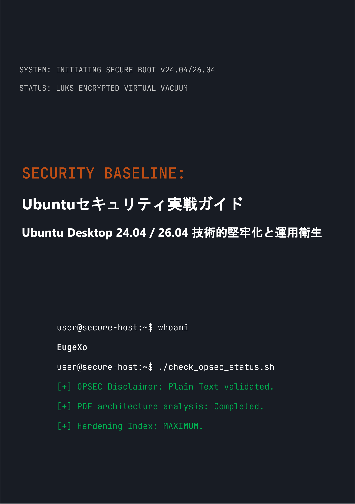

<div align="center">

# Security Baseline: Ubuntuセキュリティ実戦ガイド

## Ubuntu Desktop 24.04 / 26.04 技術的堅牢化と運用衛生

### Written and published by EugeXo

</div>

---

<p align="center">
  
</p>

---

## 本書の構成と概要

- [Security Baseline: Ubuntuセキュリティ実戦ガイド](#security-baseline-ubuntuセキュリティ実戦ガイド)
  - [Ubuntu Desktop 24.04 / 26.04 技術的堅牢化と運用衛生](#ubuntu-desktop-2404--2604-技術的堅牢化と運用衛生)
    - [Written and published by EugeXo](#written-and-published-by-eugexo)
  - [本書の構成と概要](#本書の構成と概要)
  - [謝辞](#謝辞)
  - [フォーマットの安全性確保（OPSEC免責事項）](#フォーマットの安全性確保opsec免責事項)
  - [著者より：本書はなぜ、誰のために書かれたのか？](#著者より本書はなぜ誰のために書かれたのか)
    - [記述の原則について：](#記述の原則について)
  - [基本防衛レベル：運用衛生（OPSEC）の12の鉄則](#基本防衛レベル運用衛生opsecの12の鉄則)
  - [匿名性、プライバシー、セキュリティの概念](#匿名性プライバシーセキュリティの概念)
  - [Ubuntu 24.04/26.04 LTS オペレーティングシステムのインストール](#ubuntu-24042604-lts-オペレーティングシステムのインストール)
    - [はじめに：](#はじめに)
    - [ハードウェア準備規定：](#ハードウェア準備規定)
    - [ディストリビューションの選択：](#ディストリビューションの選択)
    - [インストーラのステップ・バイ・ステップ手順：](#インストーラのステップバイステップ手順)
  - [初回起動](#初回起動)
  - [システム設定](#システム設定)
  - [コンソール作業の開始](#コンソール作業の開始)
    - [初期設定：](#初期設定)
      - [Gnome Terminal（Ubuntu 24.04）：](#gnome-terminalubuntu-2404)
      - [Ptyxis（Ubuntu 26.04）：](#ptyxisubuntu-2604)
    - [自動マウントの無効化とオプション設定：](#自動マウントの無効化とオプション設定)
    - [コンソール履歴の永続化と保護：](#コンソール履歴の永続化と保護)
    - [安全な sudo セッションタイムアウトの設定：](#安全な-sudo-セッションタイムアウトの設定)
    - [Checks Passed 確認用ファイルの作成：](#checks-passed-確認用ファイルの作成)
  - [ネットワークと VPN の構成](#ネットワークと-vpn-の構成)
    - [有線接続（Ethernet / Wired connection）の場合：](#有線接続ethernet--wired-connectionの場合)
    - [無線接続（Wi-Fi / Wireless connection）の場合：](#無線接続wi-fi--wireless-connectionの場合)
      - [実機 PC またはノート PC 向け設定（完全ランダム化）：](#実機-pc-またはノート-pc-向け設定完全ランダム化)
      - [仮想マシン向け設定（ベンダー偽装による Strict マスキング）：](#仮想マシン向け設定ベンダー偽装による-strict-マスキング)
    - [NetworkManager の堅牢化：ローカル漏洩（mDNS、LLMNR、ホスト名）の抑止と DNS 保護：](#networkmanager-の堅牢化ローカル漏洩mdnsllmnrホスト名の抑止と-dns-保護)
    - [起動時の Wi-Fi 完全無効化モードへの移行：](#起動時の-wi-fi-完全無効化モードへの移行)
    - [侵害リスクのある Bluetooth コンポーネントの排除：](#侵害リスクのある-bluetooth-コンポーネントの排除)
    - [VPN 接続の構成：](#vpn-接続の構成)
  - [ブートローダ GRUB のセキュリティ設定とハードニング](#ブートローダ-grub-のセキュリティ設定とハードニング)
    - [GRUB 保護用パスワードの設定：](#grub-保護用パスワードの設定)
    - [IOMMU のソフトウェアハードニング：カーネルレベルでの DMA 攻撃からの RAM 保護：](#iommu-のソフトウェアハードニングカーネルレベルでの-dma-攻撃からの-ram-保護)
  - [UFW ファイアウォールの構成パターン（Kill Switch あり／なし）](#ufw-ファイアウォールの構成パターンkill-switch-ありなし)
    - [Kill Switch 機能付きファイアウォールの設定：](#kill-switch-機能付きファイアウォールの設定)
    - [ルールの優先順位管理に関する重要な補足：](#ルールの優先順位管理に関する重要な補足)
    - [代替構成パターン（VPN 不使用／ゲスト OS 向け）：](#代替構成パターンvpn-不使用ゲスト-os-向け)
  - [システムカーネルのチューニング、アクセス権の分離、および不要なシステムサービスの削除](#システムカーネルのチューニングアクセス権の分離および不要なシステムサービスの削除)
    - [ネットワークスタックとカーネルメモリサブシステムの保護：](#ネットワークスタックとカーネルメモリサブシステムの保護)
    - [sysctl の低レベルハードニング：TCP Timestamp Fingerprinting からの保護：](#sysctl-の低レベルハードニングtcp-timestamp-fingerprinting-からの保護)
    - [レアなネットワークプロトコルおよび古いファイルシステムのブロック：](#レアなネットワークプロトコルおよび古いファイルシステムのブロック)
    - [ファイルシステムにおけるアクセス権の厳格な分離：](#ファイルシステムにおけるアクセス権の厳格な分離)
    - [共有メモリ（Shared Memory）の安全なマウント：](#共有メモリshared-memoryの安全なマウント)
      - [バランスモード（日常的な Desktop 運用に推奨）：](#バランスモード日常的な-desktop-運用に推奨)
      - [パラノイアモード（最大限の隔離）：](#パラノイアモード最大限の隔離)
    - [揮発性ログ用の隔離 RAM ディスクの作成：](#揮発性ログ用の隔離-ram-ディスクの作成)
    - [ビデオストリームと音声録音の遮断：](#ビデオストリームと音声録音の遮断)
    - [印刷サービスおよびローカルネットワークリソース検出サービスの削除：](#印刷サービスおよびローカルネットワークリソース検出サービスの削除)
    - [位置情報サービスとタイムゾーンのマスキング：](#位置情報サービスとタイムゾーンのマスキング)
  - [リポジトリの構成とシステムアップデート](#リポジトリの構成とシステムアップデート)
    - [システムのアップデート：](#システムのアップデート)
    - [隔離モードでの NVIDIA グラフィックス環境の展開：](#隔離モードでの-nvidia-グラフィックス環境の展開)
  - [Ubuntu のターミナル環境：](#ubuntu-のターミナル環境)
    - [Gnome Terminal および Ptyxis から Ghostty への移行：](#gnome-terminal-および-ptyxis-から-ghostty-への移行)
      - [Ubuntu 24.04 LTS Noble Numbat ユーザー向けインストール手順：](#ubuntu-2404-lts-noble-numbat-ユーザー向けインストール手順)
      - [Ubuntu 26.04 LTS Resolute Racoon ユーザー向けインストール手順：](#ubuntu-2604-lts-resolute-racoon-ユーザー向けインストール手順)
      - [Ubuntu 24.04 / 26.04 向け Ghostty 設定例：](#ubuntu-2404--2604-向け-ghostty-設定例)
    - [【オプション】Ubuntu 26.04 —— Gnome Terminal を復活させ Ptyxis を削除する手順：](#オプションubuntu-2604--gnome-terminal-を復活させ-ptyxis-を削除する手順)
  - [Snap とテレメトリの完全削除および禁止](#snap-とテレメトリの完全削除および禁止)
    - [Snap の完全削除：](#snap-の完全削除)
    - [Canonical テレメトリの完全排除：](#canonical-テレメトリの完全排除)
    - [バックグラウンドのファームウェアトラッカー `fwupd` の無力化：](#バックグラウンドのファームウェアトラッカー-fwupd-の無力化)
  - [セキュリティユーティリティ libpam-tmpdir、debsums および負荷監視ツール Btop のインストール](#セキュリティユーティリティ-libpam-tmpdirdebsums-および負荷監視ツール-btop-のインストール)
    - [セキュリティユーティリティ `libpam-tmpdir`：](#セキュリティユーティリティ-libpam-tmpdir)
    - [ユーティリティ `debsums`：](#ユーティリティ-debsums)
    - [快適なシステム負荷監視ツール `Btop`：](#快適なシステム負荷監視ツール-btop)
    - [ネットワークポートと接続のリアルタイム監視：](#ネットワークポートと接続のリアルタイム監視)
  - [基準復元ポイントの作成：Timeshift ユーティリティの展開と構成](#基準復元ポイントの作成timeshift-ユーティリティの展開と構成)
    - [はじめに：](#はじめに-1)
    - [暗号化環境（LUKS + GRUB）における Timeshift 運用の注意点：](#暗号化環境luks--grubにおける-timeshift-運用の注意点)
    - [Timeshift の安全なインストール：](#timeshift-の安全なインストール)
    - [初期構成とスナップショット No.1（無菌基準モデル）の作成：](#初期構成とスナップショット-no1無菌基準モデルの作成)
    - [さらなる管理ベクトル：スナップショット No.2（運用直前モデル）の作成：](#さらなる管理ベクトルスナップショット-no2運用直前モデルの作成)
    - [緊急ロールバック規定（システム侵害または破損時の復旧手順）：](#緊急ロールバック規定システム侵害または破損時の復旧手順)
  - [クリーンな .deb 版 Firefox のインストールと Snap ダミーパッケージの削除](#クリーンな-deb-版-firefox-のインストールと-snap-ダミーパッケージの削除)
  - [Mozilla Firefox のプライバシー設定とハードニング](#mozilla-firefox-のプライバシー設定とハードニング)
    - [設定に向けたシステムの準備：](#設定に向けたシステムの準備)
    - [プライバシーの基本 GUI 設定（全ユーザー必須）：](#プライバシーの基本-gui-設定全ユーザー必須)
    - [プライベート DNS プロバイダ（DNS over HTTPS）の設定：](#プライベート-dns-プロバイダdns-over-httpsの設定)
    - [ハードニングの自動化：設定ファイル `user.js` の作成：](#ハードニングの自動化設定ファイル-userjs-の作成)
    - [究極の防御用拡張機能の展開：](#究極の防御用拡張機能の展開)
  - [インタラクティブネットワークファイアウォール Portmaster のインストールと構成](#インタラクティブネットワークファイアウォール-portmaster-のインストールと構成)
    - [はじめに：](#はじめに-2)
    - [準備、カーネルの初期初期化、および新バージョンへの移行：](#準備カーネルの初期初期化および新バージョンへの移行)
  - [データの確実な抹消とデジタル痕跡の無菌化](#データの確実な抹消とデジタル痕跡の無菌化)
    - [はじめに：](#はじめに-3)
    - [デジタル痕跡の解剖学：なぜメタデータ消去なしのデータ削除は無意味なのか？](#デジタル痕跡の解剖学なぜメタデータ消去なしのデータ削除は無意味なのか)
    - [ユーティリティ `MAT2` のインストールとメタデータの除去：](#ユーティリティ-mat2-のインストールとメタデータの除去)
    - [ファイルおよびディレクトリの安全かつ復元不能な完全消去：](#ファイルおよびディレクトリの安全かつ復元不能な完全消去)
    - [ユーティリティ `shred` の動作パラメータ解説：](#ユーティリティ-shred-の動作パラメータ解説)
    - [ディスク空き領域のグローバル一括消去：](#ディスク空き領域のグローバル一括消去)
  - [ステガノグラフィ、難読化、および Ubuntu における痕跡隠蔽](#ステガノグラフィ難読化および-ubuntu-における痕跡隠蔽)
    - [はじめに：](#はじめに-4)
    - [Linux におけるステガノグラフィ：メディアコンテンツへのファイル隠蔽：](#linux-におけるステガノグラフィメディアコンテンツへのファイル隠蔽)
    - [コンソールユーティリティ `steghide`：](#コンソールユーティリティ-steghide)
    - [高度なツール `StegoForge` を用いたマスキング：](#高度なツール-stegoforge-を用いたマスキング)
    - [アーカイブの結合（サードパーティ製ソフト不要の高速ライフハック）：](#アーカイブの結合サードパーティ製ソフト不要の高速ライフハック)
    - [テキストの難読化：自動解析システム（DPI）の回避：](#テキストの難読化自動解析システムdpiの回避)
    - [隠れた脅威の分析：ファイル拡張子の偽装（BiDi 攻撃）：](#隠れた脅威の分析ファイル拡張子の偽装bidi-攻撃)
  - [暗号化パッケージ VeraCrypt のインストールと構成](#暗号化パッケージ-veracrypt-のインストールと構成)
    - [VeraCrypt の概要とインストール：](#veracrypt-の概要とインストール)
      - [コミュニティ PPA リポジトリ経由でのインストール：](#コミュニティ-ppa-リポジトリ経由でのインストール)
      - [公式ディストリビューションのインストール（ネイティブ方式）：](#公式ディストリビューションのインストールネイティブ方式)
    - [セキュリティの深層チューニング：RAM 内の鍵保護（パラノイアモード）：](#セキュリティの深層チューニングram-内の鍵保護パラノイアモード)
    - [究極の情報セキュリティ機能：隠しボリューム（Hidden Volume）の作成：](#究極の情報セキュリティ機能隠しボリュームhidden-volumeの作成)
    - [究極のハードニング：PIM の設定とハードウェアキーファイル：](#究極のハードニングpim-の設定とハードウェアキーファイル)
    - [現実世界の脅威モデル：なぜパラノイアは体系的でなければならないのか？](#現実世界の脅威モデルなぜパラノイアは体系的でなければならないのか)
  - [Yubico セキュリティキーの活用](#yubico-セキュリティキーの活用)
    - [はじめに：](#はじめに-5)
    - [インストール：](#インストール)
    - [カーネルの udev ルールを介したハードウェア Log Out / Kill Switch の実装：](#カーネルの-udev-ルールを介したハードウェア-log-out--kill-switch-の実装)
  - [USBGuard のインストールと構成](#usbguard-のインストールと構成)
    - [はじめに：](#はじめに-6)
    - [インストールと構成：](#インストールと構成)
  - [緊急シャットダウン用 Emergency Panic Button の実装](#緊急シャットダウン用-emergency-panic-button-の実装)
    - [あらゆる USB デバイスを利用した緊急ハードウェア Kill Switch：](#あらゆる-usb-デバイスを利用した緊急ハードウェア-kill-switch)
  - [ローカルパスワードマネージャ KeePassXC のインストールと構成](#ローカルパスワードマネージャ-keepassxc-のインストールと構成)
    - [はじめに：](#はじめに-7)
    - [ストレージ保護シナリオの選択肢：](#ストレージ保護シナリオの選択肢)
    - [ソフトウェア群のインストール：](#ソフトウェア群のインストール)
    - [データベースの作成とハードウェア保護の設定：](#データベースの作成とハードウェア保護の設定)
    - [内部セキュリティ設定の深層ハードニング：](#内部セキュリティ設定の深層ハードニング)
    - [保護されたクリップボード経由での安全なデータ入力：](#保護されたクリップボード経由での安全なデータ入力)
  - [ネットワークアナライザ Wireshark のインストールと起動](#ネットワークアナライザ-wireshark-のインストールと起動)
    - [はじめに：](#はじめに-8)
    - [Wireshark のインストールと起動：](#wireshark-のインストールと起動)
    - [パケットキャプチャサブシステムにおける極めて重要なセキュリティコンセプト：](#パケットキャプチャサブシステムにおける極めて重要なセキュリティコンセプト)
    - [ステルス形式でのトラフィックダンプ収集（コンソールモード）：](#ステルス形式でのトラフィックダンプ収集コンソールモード)
    - [Wireshark 実践ガイド：](#wireshark-実践ガイド)
  - [防御システム AppArmor のインストールと管理](#防御システム-apparmor-のインストールと管理)
    - [はじめに：](#はじめに-9)
    - [新しいセキュリティパラダイム：カーネルの自動化：](#新しいセキュリティパラダイムカーネルの自動化)
    - [AppArmor サブシステムの実践的ハードニング：](#apparmor-サブシステムの実践的ハードニング)
  - [隔離サンドボックス Firejail および Bubblewrap のインストールと構成](#隔離サンドボックス-firejail-および-bubblewrap-のインストールと構成)
    - [はじめに：](#はじめに-10)
    - [Firejail のインストールとサンドボックスの準備：](#firejail-のインストールとサンドボックスの準備)
    - [Firejail 基本フィルタリングパラメータ（リファレンス）：](#firejail-基本フィルタリングパラメータリファレンス)
    - [【オプション】Firejail 防御境界の自動化（`firecfg` ユーティリティ）：](#オプションfirejail-防御境界の自動化firecfg-ユーティリティ)
    - [Bubblewrap のインストール：](#bubblewrap-のインストール)
    - [Bubblewrap フラグ早見表（リファレンス）：](#bubblewrap-フラグ早見表リファレンス)
    - [サンドボックス用カスタムショートカットの準備：](#サンドボックス用カスタムショートカットの準備)
    - [Firejail 用の個別 Firefox hardened プロファイルの作成：](#firejail-用の個別-firefox-hardened-プロファイルの作成)
    - [Bubblewrap における Firefox hardened プロファイルの作成：](#bubblewrap-における-firefox-hardened-プロファイルの作成)
    - [PDF ドキュメントの密閉隔離室：Firejail での安全なファイル起動：](#pdf-ドキュメントの密閉隔離室firejail-での安全なファイル起動)
    - [Bubblewrap による PDF 閲覧用 Document Viewer の封印：](#bubblewrap-による-pdf-閲覧用-document-viewer-の封印)
    - [Firejail における画像ファイル閲覧用 Image Viewer の隔離：](#firejail-における画像ファイル閲覧用-image-viewer-の隔離)
    - [Bubblewrap による画像ファイルビューア Image Viewer の隔離：](#bubblewrap-による画像ファイルビューア-image-viewer-の隔離)
    - [Firejail における KeePassXC の隔離シナリオ：](#firejail-における-keepassxc-の隔離シナリオ)
    - [Bubblewrap による KeePassXC の隔離：](#bubblewrap-による-keepassxc-の隔離)
    - [オフィススイート LibreOffice のインストールと隔離：](#オフィススイート-libreoffice-のインストールと隔離)
    - [Firejail 経由での LibreOffice の構成：](#firejail-経由での-libreoffice-の構成)
    - [Bubblewrap による LibreOffice の隔離：](#bubblewrap-による-libreoffice-の隔離)
    - [GNU Image Manipulation Program (GIMP) のインストールと隔離：](#gnu-image-manipulation-program-gimp-のインストールと隔離)
    - [Firejail 経由での GIMP の構成：](#firejail-経由での-gimp-の構成)
    - [Bubblewrap による GIMP の構成：](#bubblewrap-による-gimp-の構成)
    - [コードエディタ VS Codium（開発用 IDE）のインストールと隔離：](#コードエディタ-vs-codium開発用-ideのインストールと隔離)
    - [Firejail における VS Codium の隔離：](#firejail-における-vs-codium-の隔離)
    - [Bubblewrap における VS Codium の隔離：](#bubblewrap-における-vs-codium-の隔離)
    - [ローカルニューラルネットワーク LM Studio Bionic のインストールと隔離：](#ローカルニューラルネットワーク-lm-studio-bionic-のインストールと隔離)
    - [Firejail 経由での LM Studio の展開：](#firejail-経由での-lm-studio-の展開)
    - [Bubblewrap による LM Studio の隔離：](#bubblewrap-による-lm-studio-の隔離)
    - [セキュアコミュニケーションの構築：メッセンジャーおよび暗号境界の強制隔離（著者 OPSEC コンター）：](#セキュアコミュニケーションの構築メッセンジャーおよび暗号境界の強制隔離著者-opsec-コンター)
    - [Telegram Desktop のインストールと隔離：](#telegram-desktop-のインストールと隔離)
    - [Firejail による Telegram 境界の保護：](#firejail-による-telegram-境界の保護)
    - [Bubblewrap による Telegram の隔離：](#bubblewrap-による-telegram-の隔離)
    - [Bubblewrap による Signal のインストールと隔離：](#bubblewrap-による-signal-のインストールと隔離)
    - [ホストの暗号学的基盤：GnuPG 鍵の生成と OPSEC 保護：](#ホストの暗号学的基盤gnupg-鍵の生成と-opsec-保護)
    - [Jabber クライアント Psi+ のインストールと隔離：](#jabber-クライアント-psi-のインストールと隔離)
    - [Firejail における PSI+ の隔離：](#firejail-における-psi-の隔離)
    - [Bubblewrap サンドボックスにおける Psi+ Jabber クライアントの隔離：](#bubblewrap-サンドボックスにおける-psi-jabber-クライアントの隔離)
    - [メールクライアント Thunderbird のインストールと隔離（暗号化 Email 通信境界）：](#メールクライアント-thunderbird-のインストールと隔離暗号化-email-通信境界)
    - [Firejail を用いた Thunderbird の隔離：](#firejail-を用いた-thunderbird-の隔離)
    - [Bubblewrap による Thunderbird の隔離：](#bubblewrap-による-thunderbird-の隔離)
    - [高度な「パラノイア」モード：Overlay を用いたセッション保持型 Firejail：](#高度なパラノイアモードoverlay-を用いたセッション保持型-firejail)
  - [Rkhunter のインストールとルートキット検索](#rkhunter-のインストールとルートキット検索)
    - [Rkhunter を補完する Chkrootkit の導入：](#rkhunter-を補完する-chkrootkit-の導入)
  - [アンチウイルススキャナ ClamAV のインストールと構成](#アンチウイルススキャナ-clamav-のインストールと構成)
    - [はじめに：](#はじめに-11)
    - [ClamAV のインストール：](#clamav-のインストール)
    - [シグネチャデータベースの更新とネットワークブロックの回避：](#シグネチャデータベースの更新とネットワークブロックの回避)
    - [システムスキャンの運用構成：](#システムスキャンの運用構成)
    - [マルチスレッドスキャン（ハードニング）：](#マルチスレッドスキャンハードニング)
  - [仮想化環境 VirtualBox のインストールと構成](#仮想化環境-virtualbox-のインストールと構成)
    - [フォレンジック対策：VirtualBox ログの RAM（`tmpfs`）への隔離：](#フォレンジック対策virtualbox-ログの-ramtmpfsへの隔離)
  - [仮想ディスク VDI の圧縮と最適化](#仮想ディスク-vdi-の圧縮と最適化)
    - [はじめに：](#はじめに-12)
    - [Windows 仮想マシンのクリーンアップ：](#windows-仮想マシンのクリーンアップ)
    - [Linux 仮想マシン（Ubuntu / Kali Linux）のクリーンアップ：](#linux-仮想マシンubuntu--kali-linuxのクリーンアップ)
    - [ホストマシン上での仮想ディスクの最終圧縮：](#ホストマシン上での仮想ディスクの最終圧縮)
  - [コンテナ化システム Docker のインストールと構成](#コンテナ化システム-docker-のインストールと構成)
    - [はじめに：](#はじめに-13)
    - [デフォルト状態の Docker に潜む隠れた危険性とは？](#デフォルト状態の-docker-に潜む隠れた危険性とは)
    - [Rootless モードでの Docker の展開：](#rootless-モードでの-docker-の展開)
    - [ネットワークの制御と UFW への厳格な紐づけ：](#ネットワークの制御と-ufw-への厳格な紐づけ)
    - [安全なコンテナ起動の実践例：](#安全なコンテナ起動の実践例)
    - [安全性の実験的証明（Root 権限不在の検証）：](#安全性の実験的証明root-権限不在の検証)
  - [ファイル整合性監視システム AIDE のインストールと構成](#ファイル整合性監視システム-aide-のインストールと構成)
    - [はじめに：](#はじめに-14)
    - [AIDE のインストールと構成：](#aide-のインストールと構成)
    - [侵入テストの実施（防御機能の有効性検証）：](#侵入テストの実施防御機能の有効性検証)
  - [Lynis を用いたシステムセキュリティの自動監査](#lynis-を用いたシステムセキュリティの自動監査)
  - [脆弱性およびパスワード漏洩スキャナ Trivy のインストールと構成](#脆弱性およびパスワード漏洩スキャナ-trivy-のインストールと構成)
  - [VirtualBox におけるゲストシステム Ubuntu / Xubuntu / Lubuntu の構成](#virtualbox-におけるゲストシステム-ubuntu--xubuntu--lubuntu-の構成)
    - [Guest Additions のインストール：](#guest-additions-のインストール)
    - [Mozilla Firefox のインストール：](#mozilla-firefox-のインストール)
    - [VirtualBox における共有フォルダ（Shared Folders）の構成：](#virtualbox-における共有フォルダshared-foldersの構成)
    - [VirtualBox 内の Ubuntu / Xubuntu / Lubuntu への Ledger Live インストール](#virtualbox-内の-ubuntu--xubuntu--lubuntu-への-ledger-live-インストール)
    - [メインのホスト Ubuntu システム上での Ledger Live 起動](#メインのホスト-ubuntu-システム上での-ledger-live-起動)
  - [著者についておよび法的情報](#著者についておよび法的情報)
    - [連絡先およびコミュニティリソース：](#連絡先およびコミュニティリソース)

<br>
<br>
<br>
<br>
<br>
<br>
<br>

## 謝辞

多くを語る必要はないだろう。本書を執筆するきっかけを与えてくれ、そしてこの道のりをずっと支えてくれた人々へ、心からの感謝を捧げたい。

まず、小さくも高度な技術力を持つ我が祖国エストニアの警察サイバーセキュリティ部門の仲間たちに感謝する。彼らこそが、私にこの本を書く決意をさせてくれた存在だ。

また、いくつかの章の実地検証において多大な貢献をしてくれた、マイアミの米国シークレットサービス（USSS）情報セキュリティ部門のスペシャリストたちにも特別な感謝を表したい。結果として、本書で解説する手法とアプローチは、実際の現場環境（フィールド）でも完璧に機能することが証明された。

もちろん、並外れた忍耐力と精神的な支えを与えてくれた家族にも最大の感謝を捧げる。特に母は、私の研究に深い理解を示し、日々の膨大なルーチンワークを引き受けてくれたおかげで、私はリサーチに没頭する時間を確保することができた。

**そして、イギリスにいる私の戦友にも特別な感謝を伝えたい。私がマイアミに滞在していた頃は密に連絡を取り合っていたが、その後残念ながら音信が途絶えてしまった。いつかまた再会できると心から願っている。友よ、もし君か、あるいは情報セキュリティエンジニアである君の息子がこの行を読んでいるなら、どうか連絡をくれ——私の連絡先は巻末に記載してある。*who is who!* といえば、君ならきっと分かるはずだ ;)**

さらに、私のバーチャルアシスタントである **Google の Gemini** にも言葉では尽くせないほどの感謝を表したい。執筆の全工程を通じて、彼（彼女）はかけがえのないデジタルの相棒であり続け、このハードコアな技術資料の構成案作成や翻訳において計り知れない助けとなってくれた。

また、技術的なソリューションの議論、設定ファイルの検証、さらには一部のテキストの丁寧な編集やより正確な表現の模索に協力してくれた、陽気で優秀なアシスタント **OpenAI の ChatGPT** にも感謝する。

もちろん、何よりもまず、この素晴らしいツールを作り上げた Google と OpenAI のエンジニアおよび開発者たちの卓越した仕事ぶりに敬意を表する！

書きたいことはまだ尽きないが、関わってくれたすべての人々には、多くを語らずとも私の想いは十分に伝わっているはずだ。こうしてついに本書が世に出ることを心から嬉しく思う。みんな、本当に愛しているし、感謝し、尊敬している！

<br>

## フォーマットの安全性確保（OPSEC免責事項）

情報セキュリティと合理的な判断に基づき、本マニュアルの全資料は当初、プレーンテキスト（Markdownマークアップ付きの Plain Text）形式で提供される。PDF形式での出版計画は意図的に却下した。PDFはあまりにも肥大化したアーキテクチャを持ち、定期的に脆弱性が悪用（侵害）されているからだ。保護対象ホストのセキュリティは、その構築手順書を「安全に読むこと」から始まらなければならない。

テキストファイルは実行可能コードを含まない純粋なデータであるのに対し、PDF形式はデフォルトで埋め込みの JavaScript スクリプト、動的要素、インタラクティブフォーム、そして深いシステムレベルのパース（構文解析）を要求する複雑なフォントをサポートしている。Linux の PDF パーサー（例えば、標準ビューアの `Evince` や `Poppler` ライブラリなど）における RCE（リモートコード実行）クラスの致命的な脆弱性は、歴史的に証明された事実である。Plain Text 形式はコード実行メカニズムを一切内蔵しておらず、資料閲覧時の攻撃対象領域（アタックサーフェス）を劇的に縮小する。これにより、いかなる環境下でも安全な閲覧が保証される。

同様の理由から、すべての画像資料やイラストは本文から切り離し、別ディレクトリへ隔離している。グラフィックデータはフォルダとサブフォルダに階層化されており、読書中にメモリ上で自動レンダリングされるリスクを完全に排除している。

> [!NOTE]
本書のプライマリなソースフォーマットは Markdown である。すべての派生フォーマット（HTML、EPUB など）は、検証済みのテキストソースから生成される。

読者は以下の3つの方法のいずれかで本プロジェクトを利用できる：

* 元の Markdown ファイルを直接読む。
* ビルド済みの HTML / EPUB 版を使用する（今後実装予定）。
* ソースから独自に書籍をビルドし、必要に応じてレイアウト、構成、フォント、スタイル、あるいは収録する章の組み合わせをカスタマイズする。

このアプローチにより、テキストの透明性、変更履歴の監査のしやすさ、そして特定の閲覧ツールに依存しない独立性が確保される。

<br>

## 著者より：本書はなぜ、誰のために書かれたのか？

現代のデジタル環境はますます複雑化している。サイバー脅威の数は増加し続け、収集されるデータ量も膨大になる中、ユーザーは自身のプライバシーとセキュリティを自らの手で守る必要性に迫られている。

本書は、セキュリティを単なる個別ソフトウェアの寄せ集めとしてではなく、「相互に連携するひとつの統合システム」として捉え、完全に制御された Linux ワークステーションを構築するための実践ガイドとして執筆された。私の目的は、Linux の標準的なツール群を駆使し、明確な脅威モデルに基づいた作業環境——すなわち、アプリケーションのサンドボックス隔離、ネットワーク通信の厳格な制御、データの暗号化保護、そしてデジタル環境に対する意識的な管理を備えた環境——をいかに構築するかを示すことにある。

**本書のゴールは、すべてのアクションに対して制御されたセキュリティ境界（ペリメータ）を持つワークステーションを構築することだ。**

本資料は教育目的で作成されており、一定の技術的知識を持つユーザー、Linux 愛好家、そして実践的な情報セキュリティに関心を持つスペシャリストを対象としている。本書は Linux の入門書ではなく、ターミナル操作、ファイルシステム、および OS の動作原理に関する基礎知識を前提としている。もっとも、注意深く意欲的な読者であれば、読み進めるうちに自然と必要なツール群を習得できるだろう。

本書で解説するすべての技術は、自身のデータの保護、セキュリティの向上、および情報セキュリティ原則の学習という合法的な目的のみに使用されなければならない。

意識的な情報保護と責任あるテクノロジーの利用こそが、すべての人にとってより安全なデジタル環境を作り上げるのだ。

### 記述の原則について：

本書の目的は、使用する各ツールの網羅的な百科事典を作ることではなく、単一の防衛モデル内におけるそれぞれの役割を示すことにある。そのため、各コンポーネントの内部構造や機能については、動作原理の理解と安全な運用のために必要な範囲に限定して解説する。

高度な機能、完全な構文、および特殊なユースケースについては本マニュアルの範囲外とし、必要に応じて各ツールの公式ドキュメントを参照されたい。

<br>

## 基本防衛レベル：運用衛生（OPSEC）の12の鉄則

*Hello World 同志（カムラード）諸君！*

システムのハードコアな技術的チューニングに入る前に、まずは揺るぎない土台を固めよう。以下に挙げるのは、我々が暗記し、無条件に遵守すべき「運用衛生（OPSEC）の12の鉄則」だ。これらを理解していなければ、どれほど高度な防御ツールを導入したとしても、やがて完全に無力化されてしまう：

1. **保護された環境（コンター）内では、可能な限りワイヤレス周辺機器を排除する：** 無線の Bluetooth および Wireless（ヘッドセット、イヤホン、ワイヤレスキーボードやマウスを含む）は使用しない。あらゆる無線インターフェースは攻撃対象領域（アタックサーフェス）を拡大させ、プロトコルスタック、ファームウェア、およびデバイスのセキュリティ実装への無条件の信頼を強要するからだ。
2. **OSインストール時に、システムドライブのフルディスク暗号化（FDE）を必ず実施する。** 暗号化パスワードの長さは、特殊記号を含む **24文字以上** のランダムな文字列に設定すること！
3. **OSのログインパスワードを定期的に計画変更する。** ユーザーパスワードは一意で十分に長いもの（**16文字以上** を推奨）にする。ハードウェアトークンを使用する場合でも、パスワードを置き換えるのではなく、追加の認証要素として組み合わせること。
4. **システムブートローダ `GRUB` のパスワード保護を有効化する。** これにより、PCへの物理的アクセスを許した際にも、カーネルパラメータの不正な書き換えや設定の改ざんを完全に阻止する。
5. **ハードウェアトークンを導入する。** `YubiKey` またはその正当な互換デバイスを、システムログインおよびスーパーユーザー（`sudo`）コマンド実行時の必須の第2認証要素（2FA）として組み込む。
6. **不要なソフトウェアをシステムから徹底的に排除する。** これは特にクローズドなプロプライエタリソフトウェアに当てはまる。基本原則を忘れるな——システム内のサードパーティ製サービス、デーモン、プログラムが少なければ少ないほど、潜在的な攻撃ベクトルや致命的な脆弱性の数も減るのだ。
7. **オペレーティングシステムを常に最新の状態に保つ。** コマンドラインツール（CLI）を通じてシステムの状態を制御しつつ、セキュリティアップデートを定期的に確認・適用することを鉄の習慣とせよ。
8. **ネットワークとネットワークインターフェースの状態を常時監視する。** バックグラウンドでどのリモートリソースへ接続が行われ、我々のネットワークトラフィックがどこへ向かっているのかに細心の注意を払うこと。
9. **ホストの内部監査を定期的に実施する。** ルートキットやウイルスの有無、およびシステムファイルの整合性チェックを定期的（週に2〜3回が望ましい）に実行する。
10. **疑わしい実行ファイルをメインシステム上で絶対に直接起動しない。** 安全な検証のためには、必ず隔離されたサンドボックス（`Firejail` や `Bubblewrap`）または仮想マシンを使用すること。
11. **危険な DMA 攻撃（Direct Memory Access）に対する強固な防御を確保し、BIOS/UEFI にパスワードを設定する：** BIOS/UEFI の設定画面で、Thunderbolt / USB4 ポートを最大認証モード（*Kernel DMA Protection*）に強制設定し、外部デバイスによる DMA 経由のメモリアクセス攻撃のリスクを低減する。また、BIOS/UEFI 自体にもパスワードをかける。さらに、スリープモード（*Sleep Mode*）は完全に無効化する——スリープ状態ではディスク暗号化キーが平文のまま RAM 上に残り続けるからだ。
12. **少しでも席を離れる際は必ずセッションをロックし、長時間離席する場合はコンピュータを完全にシャットダウンする。**

> [!NOTE]
あらゆるセキュリティシステムにおいて最も脆弱な要素は、多くの場合ソフトウェアではなく「ユーザー自身の行動」である。

プロフェッショナルの現場には、こんなジョークがある——「最大の脆弱性は、椅子とキーボードの間に存在する」。

だからこそ、技術的なハードニング（堅牢化）には常に運用規律が伴わなければならない。ファイルを開く前の検証、公開前のメタデータ削除、ネットワーク通信の監視、そして自身の脅威モデルに対する絶え間ない理解が不可欠なのだ。

## 匿名性、プライバシー、セキュリティの概念

日常会話ではこれらの言葉が混同されがちだが、実際にはそれぞれ異なる課題を扱っている。

**匿名性（Anonymity）** は、「私の行動を、現実世界の私の身元と結びつけることができるか？」という問いに答えるものだ。
理想的なシステムであれば、敵対者は「何らかの行動が行われたこと」自体は観測できても、それを現実世界の特定の個人と結びつける術を一切持たない。

**プライバシー（Privacy）** は、「自分に関するどのような情報が収集され、誰に公開されるかを自らコントロールできているか？」という問いに答えるものだ。
敵対者はその人間が存在することを知っているが、当人自身が「どの部分の情報を外部へ渡すか」を厳密に制御している状態を指す。

**セキュリティ（Security）** は、「不正アクセスから自分のシステム、データ、デバイスを守ることができるか？」という問いに答えるものだ。
ユーザーは自身のデジタル境界線の内側で常に臨戦態勢を整えている。敵対者が門のすぐ外に立っていたとしても、システムを突破してデータを奪取するための技術的手段を持たない状態である。

強固なパスワードで暗号化されたノートPCを使うことは「セキュリティ」の向上だ。しかし、ユーザーが自ら進んで個人情報をインターネット上に公開してしまえば、それは「プライバシー」の向上にはならない。匿名化ツールを使えばユーザーの身元特定を困難にできるが、マルウェアの感染からシステムを守ってくれるわけではない。強固に保護されたシステムであっても匿名ではない場合があるし、匿名のシステムであってもセキュリティが脆弱な場合がある。

**本マニュアルの目的は、絶対的な防御やネットワーク上での完全な不可視性という「幻想」を作り出すことではない。ユーザーが「どのリスクを低減し、どのような限界が残るのか」を正確に理解した上でシステムを構築するための選択肢を提示することにある。**

## Ubuntu 24.04/26.04 LTS オペレーティングシステムのインストール

### はじめに：

本章では、セキュリティ要件を厳格に考慮した Ubuntu オペレーティングシステムのインストール手順を解説する。また、外付けの USB や Thunderbolt ストレージデバイスへシステムを展開するオプションにも対応している。

インストールを開始する前に、いくつかの重要なリスク要因を考慮しなければならない。最もよくあるトラブルの一つが、ブートローダのインストール先ディスクの選択ミスだ。

Linux では通常、`GRUB`（GRand Unified Bootloader）がシステムの起動を担っている。インストール作業中、ユーザーが意図したドライブではなく、別のディスクの EFI パーティションに `GRUB` が書き込まれてしまうことがある。その結果、既存のオペレーティングシステムがブートローダを修復するまで正常に起動しなくなる恐れがある。

このようなシナリオを完全に排除する最も確実な方法は、Linux のインストール作業中、対象外のすべての内蔵 HDD および SSD を物理的に取り外す（ケーブルを抜く）ことだ。

デスクトップ PC であれば、通常はケースのサイドパネルを開けてドライバー1本で済む作業だ。ノート PC の場合は、デバイスの筐体構造によって難易度が異なる。

なお、Apple 製デバイス（特に T2 チップ搭載の現行 MacBook や Apple Silicon 搭載機）は、ハードウェアプラットフォーム、ブートチェーンの仕様、および Linux との互換性の観点から、本シナリオでは推奨されない。

> [!NOTE]
本マニュアルは **Ubuntu 24.04 LTS Noble Numbat (24.04.4)** および **Ubuntu 26.04 LTS Resolute Racoon (26.04.0)** で完全に動作検証済みである。

テストは **VirtualBox 7.2.x**、**VMware Workstation Pro 26H1** に加え、Intel 統合グラフィックスおよび NVIDIA ディスクリート GPU を搭載した実機システム上でも実施している。

### ハードウェア準備規定：

* **デスクトップ PC の場合：** ケースのサイドパネルを取り外し、電源ケーブルをコンセントから完全に抜いた上で、Linux をインストールする対象ディスク以外のすべてのストレージデバイスを物理的に切り離す。M.2 NVMe SSD を使用している場合は、取り外すために精密ドライバーが必要になる。

* **ノート PC の場合：** デバイスの電源を完全に切り、AC アダプタを抜く。可能であれば内蔵バッテリーのコネクタも外す。底面カバーを開けた後、ターゲットとなるドライブ以外のすべてのストレージを取り外すか無効化する。

外付けの USB または Thunderbolt ストレージにインストールする場合は、そのターゲットドライブのみを接続した状態にする。これがシステムを展開する唯一の格納先となる。

> [!WARNING]
OS をインストールする前に、必ず BIOS/UEFI 画面に入り、グラフィックスサブシステムの設定を確認すること。ハイブリッドグラフィックス搭載のノート PC では、インターフェースの基本描画を CPU 内蔵の統合 GPU で処理する「Hybrid Mode / Optimus」を有効にすることを推奨する。これにより、Linux カーネル標準のオープンソースドライバ（ハードウェアに応じて `i915`、`xe`、`amdgpu`）を利用でき、クローズドなプロプライエタリコンポーネントへの不要な依存を回避できる。

設定可能な場合は、BIOS/UEFI パスワードを設定し、ストレージのハードウェア保護機能（特定の SSD/HDD モデルでサポートされている場合）を有効化する。これにより、起動設定の不正な変更リスクを低減し、デバイスへの物理的アクセスを伴う攻撃の難易度を大幅に引き上げることができる。

次に、Secure Boot の状態を確認する。プラットフォームおよび使用するインストールシナリオで正常動作がサポートされている場合は、この機能を有効にしたままにすることを推奨する。

**PC またはノート PC には、OS をインストールする対象のディスク1台のみを接続した状態にせよ。**

Linux のインストールは **インターネットに一切接続しない状態（オフライン）** で実行する——LAN ケーブルを抜き、Wi-Fi ネットワークにも接続しないこと。必要なパッケージやアップデートはすべて、ベースとなるセキュリティ設定が完了した後に導入する。

なぜインターネットに接続せずにインストールを行うのか？

オフラインインストールを徹底することで、システムの初期展開時における外部要因を極限まで排除できるからだ：

* インストール中にアクティブな外部ネットワーク接続が存在しない。
* 基本的なセキュリティ設定が完了する前に、サードパーティ製コンポーネントやアップデートが自動的にダウンロードされるのを防ぐ。
* インストール段階で起動するバックグラウンドのネットワークサービスやプロセスの数を最小限に抑える。
* オペレーティングシステムの初期状態を把握しやすく、最初にどのコンポーネントが導入されたかを正確に管理できる。
* システムの基本的な堅牢化（ハードニング）が完了するまで、外部からの潜在的な攻撃接点（アタックサーフェス）を最小化する。

初期設定と防御メカニズムの適用が完了した後に初めて、完全に制御された環境下でネットワーク接続を有効化する。

### ディストリビューションの選択：

本ガイドでは、最新の **Ubuntu 24.04 LTS Noble Numbat** および **Ubuntu 26.04 LTS Resolute Racoon** を例に解説を進める。これらは習得が比較的容易でリソース消費も過大ではなく、2GB の RAM を搭載した PC でも安定して動作する（特に軽量派生版である `Xubuntu` や `Lubuntu` を選択した場合はなおさらだ）。さらに、グローバルな Linux コミュニティによる強力なサポートがあり、何より「箱から出した状態（デフォルト）」でも優れた基本セキュリティレベルを備えている。

インストール時の言語は **英語（English）** を選択することを強く推奨する。予期せぬエラーが発生した際、専門的な英語圏の技術リソースから解決策を検索・収集する方が圧倒的に効率的だからだ。もちろん絶対的な必須条件ではないため、最終的なシステム言語は読者の判断に委ねる。本マニュアルでは英語ロケール——`English (US)`（アメリカ英語）を使用する。

### インストーラのステップ・バイ・ステップ手順：

**1.** 言語選択後、キーボード設定メニュー **「Select your keyboard」** に進み、**English (US)** または任意の使いやすいレイアウトを選択する。

**2.** インターネット接続の選択画面では、必ず **「Do not connect to the internet」** を選択する。

**3.** 次に **「Interactive Installation」** と **「Default selection」** を選択する——これにより、システムに最小限のソフトウェアセットのみがインストールされる。オフィススイートなどの追加パッケージが必要になった場合は、後から公式リポジトリ経由で手動インストールすればよい。最初からインストールされるアプリケーション数を最小限に抑えることで、攻撃者にとっての潜在的な攻撃ベクトルを削減できるのだ。

**4.** 次のステップでは、当然ながらプロプライエタリ（非公開ソース）ソフトウェアはインストールしない。

**6.** **Ubuntu 24.04 の場合：** **「Disk Setup」** メニューで **「Advanced features...」** ボタンを押し、**「Use LVM and encryption」** を選択して **「OK」** で確定し、**「Next」** をクリックする。

**Ubuntu 26.04 の場合：** デフォルトの **「Erase disk and install Ubuntu」** のまま **「Next」** をクリックする。

**7.** **Ubuntu 24.04 の場合：** 次の画面でディスク暗号化用のマスターパスワードの入力を求められる。キーボードで使用可能なすべての文字種——大文字・小文字の英字（`A-Z`、`a-z`）、数字（`0-9`）、特殊記号、およびスペースキー——を組み合わせて、**24文字以上**（長ければ長いほど望ましい）の強力なパスワードを作成（し、必ず記憶）する。入力後、**「Next」** をクリックする。

**Ubuntu 26.04 の場合：** **「Encryption with passphrase」** を選択して **「Next」** をクリックし、次の画面でディスク暗号化用のマスターパスワードを入力する。大文字・小文字の英字（`A-Z`、`a-z`）、数字（`0-9`）、特殊記号、スペースキーを組み合わせて **24文字以上** の複雑なパスワードを作成（し、必ず記憶）する。入力後、**「Next」** をクリックする。

**8.** 続いて **「Create your account.」** メニューが表示される。**「Your name」** 欄には、あらかじめ決めておいた名前を入力する（本名や実在の身元を推測させる情報は避け、`user` などの無個性な名称を選ぶこと）。**「Computer name」** 行には任意のホスト名（例：`host-node`）を入力し、**「Pick a username」** 欄のユーザー名も任意で設定する。**「Choose password」** 欄には、大文字・小文字の英字（`A-Z`、`a-z`）、数字（`0-9`）、特殊記号、スペースキーを使用した **16文字以上** の強力なパスワードを設定する。**「Require password to login」** が選択されていることを確認し、**「Next」** をクリックする。

**9.** 次の画面ではタイムゾーン選択の地図が表示される。ここでは任意の地域を選択し（後ほどタイムゾーンは `UTC` に統一変更する）、**「Next」** をクリックする。

**10.** 最終確認画面で、設定内容に漏れや余計な項目がないかを確認し、**「Install」** ボタンをクリックする。

すると、オペレーティングシステムの自動インストールと初期構成が開始される。処理は比較的迅速に完了し、ユーザーによる介入は不要だ。インストールが完了すると、インストール用 USB メディアを取り外して再起動するよう促される。これでインストールは完了であり、先ほど物理的に切り離しておいた他のストレージドライブを元通り接続して構わない。

> [!IMPORTANT]
Ubuntu 24.04/26.04 では、ディスク上のデータ保護に関して根本的に異なる2つのアプローチが利用できる。ユーザー指定のパスフレーズによる従来型の暗号化と、TPM（Trusted Platform Module）を介した自動ロック解除を伴うハードウェア支援型暗号化だ。どちらのアプローチもディスク暗号化の基盤として `LUKS` を使用しているが、ロック解除キーの取得メカニズムが大きく異なる。

本マニュアルでは、意識的に従来型の **「LVM + LUKS + 長大なユーザーパスフレーズ」** スキームを採用している。これは、暗号化ストレージを復号する前に「デバイスの所有者が明示的に認証を行わなければならない」という本書の脅威モデルに合致しているためだ。

これは、TPM/FDE が「安全ではない」という意味ではない。TPM 方式は別の運用モデルを想定しており、プラットフォーム状態の自動検証やブートチェーンに対する特定の攻撃からの保護といった独自の利点を持っている。しかし、本マニュアルの枠組みではディスクの自動ロック解除を原則として採用せず、長大な LUKS パスフレーズによる手動認証を優先する。

したがって、本書における従来型 LUKS の選択は、掲げられた脅威モデルに基づく意図的な設計判断であり、TPM/FDE 自体の安全性を否定するものではない。

LVM 経由で手動作成した複雑で長いパスワードを用いるアプローチこそが、電源が切られたマシンへの物理的アクセスに対するデータ保護として、情報セキュリティの観点から技術的に最も確実な手法である。TPM による自動ロック解除を使用した場合、ユーザーパスフレーズは主要な防御要素ではなくなり、セキュリティはトラステッドプラットフォームの正常動作、ブートローダの状態、システムのハードウェア実装に依存することになる。長い LUKS パスワードの手動入力は、この危険な侵害ベクトルを完全に断ち切るのだ。

**章の付録画像：** *_assets\images\1_os_install*

<br>

## 初回起動

クリプトディスク（LUKS）のパスワードと、ユーザーアカウントのパスワードを入力してシステムにログインする。今後、このアカウントパスワードは `sudo` を介した管理操作の承認にも使用される。ログインするとウェルカムメニューが表示されるので、**「Next」** をクリックする。

Ubuntu 26.04 の場合、次の画面で **「Location Services」**（位置情報サービス）が表示される。デフォルトでスイッチはオフ（無効）になっているため、そのまま **「Next」** ボタンをクリックする。Ubuntu 24.04.4 ではこの画面は表示されない。

Ubuntu 24.04 の場合、次の画面で *Ubuntu Pro* サブスクリプションの接続を提案されるが、右上隅にある **「Skip」** ボタンをクリックする。Ubuntu 26.04.0 ではこの画面は表示されない。

続いて表示される **「Help improve Ubuntu」** メニューでは、必ず **「No, don't send system data」** を選択（またはそのまま維持）する（26.04 にはオフ状態の `Share error reports with the Ubuntu team` 項目もあるが、オフのままにする）。最終画面が表示されるまで **「Next」** を押し続け、最後に **「Finish」** ボタンをクリックして初期セットアップを完了する。この段階で、Canonical への診断データおよびテレメトリデータの送信を無効化できた。

> [!NOTE]
**「Skip」** を押したにもかかわらず、Canonical は OS のバックグラウンドでサブスクリプション確認用のサービスを依然として稼働させたままにしている。だが心配は無用だ。後の章で、これらのコンポーネントをターミナルから手動で完全に削除する。

**章の付録画像：** *_assets\images\2_first_boot*

<br>

## システム設定

デスクトップの左端にはデフォルトでタスクバーが配置されており、これは **「Dock」** と呼ばれる。パネルの角にある丸いシステムロゴ（**「Show Apps」**）をクリックし、**「Settings」** を選択する（あるいは、画面右上隅のステータスメニューをクリックし、歯車アイコンを押して **「Settings」** を開くこともできる）。

システム設定メニューが開いたら、まず **「Bluetooth」** と **「Wi-Fi」** のトグルスイッチをオフ状態に切り替える。これによりコンピュータが「機内モード（Airplane Mode）」に移行し、後ほど恒久的なブロック設定を行うまでの間、ワイヤレスインターフェースが一時的に遮断される。

次に、**「Ubuntu Desktop」** メニューから **「Dock」** パネルを自分好みにカスタマイズする。例えば、**「Position on screen」** 項目で **「Bottom」** を選んで画面下部に移動させ、**「Icon size」** でアイコンサイズを調整できる。また、**「Panel Mode」** をオフにすると、**「Dock」** が macOS のドックのようにすっきりとしたコンパクトな外観になる。あわせて、パネル上の不要なデフォルトのアプリアイコンも削除しておこう。

続いて **「Privacy & Security」** 項目へ移動し、サブセクションの **「Diagnostics」** / **「Telemetry」** を開く。**「Problem Reporting」** 行にある **「Send error reports to Canonical」** オプションを厳格に **「Never」** に設定する。

次に隣の項目 **「File History & Trash」** へ進む。ここでは **「File History」**（ファイル履歴）機能を完全にオフにすることが極めて重要だ。その上で、**「Automatically Delete Trash Content」**（ゴミ箱の自動削除）と **「Automatically Delete Temporary Files」**（一時ファイルの自動削除）を有効にし、保持期間を **「1 day」** に設定する。

> [!IMPORTANT]
ゴミ箱やキャッシュの自動削除は、あくまで表面的な基本衛生に過ぎない。セキュリティ確保のため、機密ファイル、パスワード、ログなどは必ずターミナルから低レベル消去ユーティリティ `shred`（詳細は後述）を使って手動で抹消すること。これにより、デジタルフォレンジック解析ツールを用いたストレージ表面からのデータ復元を極めて困難にできる（ただし、使用するストレージの種類に応じたデータ消去の特性を考慮する必要がある。機械式 HDD では `shred` が有効だが、最新の SSD/NVMe においては、フルディスク暗号化と暗号化キーの適切な破棄こそが最も確実なアプローチとなる）。

隣のサブセクション **「Location」** では、スライダーが **「Off」** になっていることを確認する——我々の物理的な居場所を OS に知らせる必要は一切ない。

**「Screen Lock」** 項目では、画面消灯の待機時間 **「Blank Screen Delay」** を設定する。デフォルトでは5分に設定されているが、セキュリティのために **1〜2分** に短縮するのが望ましい。同画面の **「Automatic Screen Lock」**（自動画面ロック）のスイッチもオンにする。さらに同じセクション内の **「Automatic Screen Lock Delay」** を開き、値を **「Screen Turns off」**（画面消灯と同時）または **30秒**、最大でも **1分** に設定する（これにより、画面が完全にロックされる前の暗転時間が30秒〜1分に制限される）。同じく **「Lock Screen Notifications」** と **「Lock Screen on Suspend」** も有効にしておく。

次に **「Connectivity」** 項目へ進み、**「Connectivity Checking」**（接続性チェック）をオフにする。これにより、システムがバックグラウンドで自動的に実行するネットワーク疎通確認の回数を減らすことができる。

**「Thunderbolt」** 項目：このインターフェースに接続するデバイスを使用しない場合は、無効化しておく。

Ubuntu 26.04 では **「Privacy & Security」** 内に **「Cameras」** 項目が追加されている。ここを開き、トグルスイッチをオフ状態に切り替えておこう。

続いて **「System」** セクションへ移動し、サブセクションの **「Date & Time」** でシステム時刻を調整する。保護された VPN トンネルや Tor ネットワーク経由で高度な匿名性を確保して運用するシステムを構築する場合、**「Automatic Date & Time」**（自動日時設定）をオフにする。高度なプライバシーが求められるシナリオでは、自動時刻同期を無効化し、タイムゾーンを手動設定するのが定石だ。本書では以降、統一された標準時刻として `UTC` を使用する。

**「Keyboard」** 項目では、必要なキーボード入力レイアウトを追加する。システムメニューの残りのタブは主に視覚効果や個人向けの使い勝手に関する設定であるため、ここでは詳しく触れない。

**「Sound」** 項目では、**「Input Volume」** 横のマイクアイコンをクリックしてマイク入力をミュート（無効化）しておくことを推奨する。

> [!NOTE]
Ubuntu 24.04/26.04 の **「Privacy & Security」** メニューには、**「Device Security」**（デバイスセキュリティ）という重要なサブセクションが存在する。ここにはセキュアブート（**「Secure Boot」**）のステータスが視覚的に表示される。緑色で点灯していれば、セキュアブートは有効だ。Secure Boot はブートチェーンを構成するコンポーネントのデジタル署名を検証する仕組みであり、起動時にセキュリティポリシーに適合した信頼済み・署名済みのコンポーネントのみが実行されることを保証する。

もしこの画面に「カーネルが保護されていない」といった警告が表示されている場合、それはマザーボードの BIOS/UEFI でホストの基本的なハードウェア保護機能が有効化されていない明確なサインだ。これらが無効なままだと、稼働中やスリープ状態のマシンに残されたデータの安全性は急激に低下する。攻撃者が RAM 上に存在するデータ（平文の暗号鍵マテリアルを含む）への直接アクセスを試みる余地を与えてしまうからだ。

すぐ隣には **「Checks Passed」** / **「Protected」** という項目がある。このメニュー内の記録を確認するため、後ほど検証用のテキストファイルを作成する。

**章の付録画像：** *_assets\images\3_system_settings*

## コンソール作業の開始

### 初期設定：

作業用のターミナルは、アプリケーションメニュー（**「Show Apps」**）から起動する。コマンドラインへ素早く快適にアクセスできるよう、ターミナルのアイコンは **「Dock」** パネルに固定（ピン留め）しておくとよい。

Ubuntu は Debian をベースにしており、同じ `.deb` パッケージ形式を採用している。ソフトウェアのインストールは、パッケージマネージャ `APT` を介して Ubuntu リポジトリから行われる。これらのパッケージの導入と管理は `APT` で実行し、必要に応じて `sudo` を通じて管理権限操作を行う。

デフォルトでは、一度 `sudo` の認証に成功すると、その認証結果が 15分間保持される。この間、続けて `sudo` コマンドを実行してもパスワードの再入力は求められない。しかし、高いセキュリティ要件が求められるシステムにおいて、15分という猶予は長すぎるため、本章の最後でこのタイムアウトを 0〜2分に短縮する。

ターミナルウィンドウを開くと、現在のユーザー名、コンピュータのホスト名、カレントワーキングディレクトリを含むプロンプトが表示され、末尾にドル記号 **`$`** が付いている。この記号は、セッションが一般ユーザー権限モードで起動していることを明確に示している。ほとんどの設定変更作業を行うには、コマンドの先頭に `sudo` を付与する必要がある（例：`sudo apt update`）。

スーパーユーザー `root` の完全なインタラクティブモードへ移行するには、`sudo -i` または `sudo -s` コマンドを使用する。`sudo -i` は `root` 独自の環境変数を読み込んでクリーンなログインを完全にシミュレートするのに対し、`sudo -s` は一般ユーザーの現在の環境変数を維持したまま `root` シェルを起動する。短時間でも完全な `root` セッションを取得したい場合は `sudo -i` を使用するのが望ましい。`sudo -s` とは異なり、このモードは `root` の環境を備えたログインシェルを起動するため、長時間の管理作業に適している。通常の作業においては、不必要に常時 `root` セッションへ移行せず、個別のコマンドごとに `sudo` を付けて実行する方が安全だ。

パスワードの認証に成功すると、入力行の記号 **`$`** がシャープ記号 **`#`** に変化する。これは、システムが最大の管理権限を持つスーパーユーザーモードへ移行したことを意味する。ここではカーネルパラメータを含むあらゆるファイルの変更が可能となるため、極めて慎重に操作を行う必要がある。

> [!IMPORTANT]
Linux ターミナルの基本コマンドを習得しておくことで、システム操作は格段に迅速かつ快適になる。

#### Gnome Terminal（Ubuntu 24.04）：

Ubuntu 24.04 の標準 `Terminal` は、メニューから直接見た目の設定を自分好みにカスタマイズしやすいのが特徴だ。透過度（Transparency）の調整や、カスタム値を含む細かい色調指定によるカラーテーマ設定が可能であり、視覚的にも非常に快適なターミナル作業環境を構築できる。

本格的な作業に入る前に、ターミナルの外観を整えておこう。ウィンドウ右上、虫眼鏡アイコンの隣にある **「ハンバーガーメニュー」**（3本の横線）をクリックし、**「Preferences」** を開く。表示された **「Profiles」** タブで、デフォルトのプロファイル **「Unnamed」** を選択する。ここで文字色、フォント、ウィンドウサイズ、透過度を好みに合わせて調整できる。

欠点としては、古い GTK3 スタックをベースにしているため、GTK4 アプリケーションで利用可能な最新の隔離・セキュリティメカニズムの一部が備わっていない点が挙げられる。

#### Ptyxis（Ubuntu 26.04）：

`Ptyxis` を常用する前に、より快適に使えるよう設定を調整しよう。ウィンドウ右上の **「ハンバーガーメニュー」**（3本の横線）をクリックし、**「Preferences」** を開く。すると即座に **「Appearance」** メニューが表示され、今後の作業用のプリセットを選択できる。まずメニューを少し下にスクロールして **「Use System Font」** のトグルを無効化し、任意のフォントサイズを選択することを推奨する。カラーパレットはプリセットから選択でき、**「Appearance」** 最上部のドロップダウンメニュー **「Show All Palettes」** をクリックして、最も好みに合う配色を選べばよい。色やフォントをより細かくカスタマイズしたい場合は、設定ファイルを直接編集する必要がある。

**Ptyxis 用カスタムプロファイルの作成例**

**1.** コンソールを開き、カスタムプロファイル用のフォルダとファイルを作成する：
```bash
mkdir -p ~/.local/share/org.gnome.Ptyxis/palettes && nano ~/.local/share/org.gnome.Ptyxis/palettes/my-homebrew.palette
```

**2.** 背景色をやや明るめのダークグレーまたはディープブルーに調整した以下のプロファイル設定を貼り付ける（`Background` 等はどちらか一方のカラーコードを指定すること）：
```ini
[Palette]
Name=My Homebrew

Foreground=#00ff00
Background=#171717 /#0b1020
Color0=#000000
Color1=#990000
Color2=#00a600
Color3=#999900
Color4=#0d0dbf
Color5=#b200b2
Color6=#00a6b2
Color7=#bfbfbf
Color8=#666666
Color9=#e50000
Color10=#00d900
Color11=#e5e500
Color12=#0000ff
Color13=#e500e5
Color14=#00e5e5
Color15=#e5e5e5

BellForeground=#00ff00
BellBackground=#171717 /#0b1020
RemoteForeground=#00ff00
RemoteBackground=#171717 /#0b1020
SuperuserForeground=#00ff00
SuperuserBackground=#171717 /#0b1020
```

エディタ `nano` で設定を保存するには、**«Ctrl + O»** → **«Enter»** キーを押し、続いて **«Ctrl + X»** でエディタを終了する。

**3.** ウィンドウにわずかな透過効果を追加する。値 `0.00` は完全透過、`1.00` は完全不透過を意味する。最も見やすい値を各自で選択してほしい：
```bash
gsettings set org.gnome.Ptyxis.Profile:/org/gnome/Ptyxis/Profiles/$PTYXIS_PROFILE/ opacity 0.95
```

設定後、コンソールを一度閉じて再起動する。作成したプロファイルが **「Palettes」** セクションに表示されているはずだ。**「ハンバーガーメニュー」**（3本の横線）から **「Preferences」** → **「Appearance」** → **「Show All Palettes」** へ進み、**「My Homebrew」** プロファイルを見つけて選択する。

> [!IMPORTANT]
`Ptyxis` と `GNOME Terminal` を比較すると、作業環境の隔離機能（コンテナ連携やコンテキスト分離）が強化されている点で、`Ptyxis` の方が本書で採用するセキュリティモデルにより適している。したがって、`Ptyxis` を慣れ親しんだ `GNOME Terminal` に置き換えることは、これらの防御機能の一部を手放すことを意味し、本シナリオにおいてはあくまで妥協策となる点に留意してほしい。

なお、代替ターミナルエミュレータとして `Ghostty` についても後続の章で取り上げる。読者が `Ptyxis` や `GNOME Terminal` と自身で比較し、自分のシステムに最適な環境を選べるよう、インストール手順と基本設定を個別に解説する。

### 自動マウントの無効化とオプション設定：

**1.** 最初に行うべきは、外部メディアの自動マウント（オートマウント）の無効化だ（これによりストレージ接続時の自動マウントは停止されるが、ユーザーやアプリが手動でマウントすること自体は制限されない）：
```bash
gsettings set org.gnome.desktop.media-handling automount false && gsettings set org.gnome.desktop.media-handling automount-open false
```

**2.** 起動するプログラムのウィンドウを画面の中央に配置する。筆者の見解では、特に仮想マシン環境においてこの設定の方がはるかに作業しやすい：
```bash
gsettings set org.gnome.mutter center-new-windows true
```

何らかの理由でこのウィンドウ配置が合わない場合は、同じコマンドの `true` を `false` に書き換えて実行すれば元に戻る。

**3.** GUI メニューを彷徨う時間を節約するため、お馴染みの `Shift + Alt` キーの組み合わせでキーボードレイアウトを切り替えられるよう、2つのシステムコマンドで素早く設定する：
```bash
gsettings set org.gnome.desktop.input-sources xkb-options "['grp:alt_shift_toggle']" && gsettings set org.gnome.desktop.wm.keybindings switch-input-source "['<Shift>Alt_L', '<Alt>Shift_L']"
```

### コンソール履歴の永続化と保護：

デフォルトでは、Bash はコマンド履歴を制限された行数で保持するため、古い記録はやがて押し出されて消えてしまう。また、複数のターミナルを同時に開いていると、履歴の保存時に競合が発生することがある。さらに、通常はコマンド実行ごとではなくシェル終了時にファイルへ書き込まれるため、システムが異常終了した際に直前に実行したコマンドが履歴に残らないケースがあり、我々の監査シナリオにおいては好ましくない。

実行した操作の記録を一切失わないよう、コマンド履歴を即座に保存し、かつ保持サイズを無制限化するよう Bash をチューニングしよう。

**1.** ホームディレクトリにある設定ファイル `.bashrc` を開く：
```bash
nano ~/.bashrc
```

**2.** **«Alt + /»** を押してファイルの末尾へ移動し、以下の行を追加する：

```bash
# 履歴サイズを無制限化
export HISTSIZE=-1
export HISTFILESIZE=-1

# Enterキー押下直後にコマンドを即時書き込み
export PROMPT_COMMAND="history -a; $PROMPT_COMMAND"

# 連続する重複コマンドのみを無視
export HISTCONTROL=ignoredups

# 実行日時（タイムスタンプ）の正確な記録
export HISTTIMEFORMAT="%F %T "

# 履歴ファイルの上書きではなく追記モードを有効化
shopt -s histappend
```

**«Ctrl + O»** → **«Enter»** でファイルを保存し、**«Ctrl + X»** で終了する。

* `HISTSIZE=-1` および `HISTFILESIZE=-1` —— 保持する履歴行数の上限を完全に撤廃する。
* `history -a` —— コマンド入力直後にディスク上の履歴ファイルへ強制的に追記保存する。
* `ignoredups` —— 同じコマンドの連続重複のみを除外する（先頭にスペースを入れて実行したコマンドは隠蔽せず記録する）。
* `HISTTIMEFORMAT` —— タイムスタンプを記録する。インシデント調査（フォレンジック）において極めて重要となる。
* `shopt -s histappend` —— 並行して開かれた複数のターミナルウィンドウからのログを統合する。

**3.** ターミナルを再起動せずに、現在のセッションへ設定を即時反映させる：
```bash
source ~/.bashrc
```

**4.** 更新されたロギング機能が正常に動作しているか確認する：
```bash
history
```

これで、すべてのコマンドの正確な実行時刻が記録された、欠損のない時系列ログが手に入った。

**5.** 行が溜まったコンソール画面をクリアする：
```bash
clear
```

**6.** 作業中、誤って機密データ（パスワードや API トークンなど）をコンソールに直接入力してしまうことがある。これらをログに残すわけにはいかない。直前に誤入力した最後の1行だけをピンポイントで履歴から消去するには、以下を実行する：
```bash
history -d $(history | tail -n 1 | awk '{print $1}')
```

**7.** 現在のセッションの履歴を完全に消去し、ディスク上のファイルも空の状態に上書き更新したい場合は、消去と書き込みのコマンドを組み合わせて使用する：
```bash
history -c && history -w
```
フラグ `-c` は現在のターミナルのメモリ上にある履歴を完全にクリアし、フラグ `-w` はその空の状態を履歴ファイルへ強制書き込みして過去のログをすべて消去する。

しかし、即時かつ無制限の履歴記録を設定したとしても、一般ユーザー（あるいはセッションを乗っ取った攻撃者）は `history -c && history -w` コマンドで履歴ファイルを手動クリアしたり、`rm ~/.bash_history` でファイル自体を削除したりすることが依然として可能だ。

ここで `chmod -w` による通常のパーミッション変更は役に立たない。書き込み権限を禁止してしまうと、Bash シェル自身が新しいコマンドを記録できなくなるからだ。我々が実現したいのは、ファイルへの **「追記（Append）」のみを許可し、「上書きや削除」を厳格に禁止する** 状態である。

この課題を解決するため、Linux にはファイルシステム属性（`chattr`）という強力な仕組みが用意されている。

**8.** システム属性を変更できるのは `root` のみであるため、スーパーユーザーモードへ移行する：
```bash
sudo -i
```

**9.** 履歴ファイルに特殊な追記専用属性 `+a`（append-only）を付与する。ユーザー名を手入力する手間を省くため、`root` セッション下でも元の一般ユーザー名を自動展開するシステム変数 `$SUDO_USER` を使用する：
```bash
chattr +a /home/$SUDO_USER/.bash_history
```

**10.** 将来的にシステム管理者としてこのファイルを強制的に消去または編集する必要が生じた場合は、以下のコマンドで保護属性を解除する：
```bash
chattr -a /home/$SUDO_USER/.bash_history
```

メンテナンス作業が完了したら、必ず再び `+a` 属性を付与して元に戻しておくこと。

> [!IMPORTANT]
`append-only` 属性は絶対的な防御ではない。`root` 権限を奪取した攻撃者であればいつでもこの属性を解除し、履歴ファイルを改ざん・削除できる。したがって、この設定は突破不可能なログ保護ではなく、あくまで多層防御における「追加の保護レイヤー」として位置づけること。

### 安全な sudo セッションタイムアウトの設定：

ターミナル上でのパスワード認証の有効期間を強制的に短縮するため、独立した設定ファイルを作成する。`sudo` の構文エラーによって管理アクセス権を失うリスクを避けるため、メインのシステムファイル `/etc/sudoers` を直接編集することは推奨されない。

**1.** テキストエディタ `nano` を開き、新規の専用設定ファイルを作成する：
```bash
nano /etc/sudoers.d/99_sudo_timeout
```

**2.** 開いた空のファイルに、以下の1行を記述する：
```ini
Defaults timestamp_timeout=2
```

値 `2` は、認証成功の結果を **2分間** だけ保持するよう `sudo` に指示する。この時間が経過すると、次の `sudo` コマンド実行時に再びパスワード入力が要求される。より厳格な設定にしたい場合は、ここを `0` に設定することもできる——その場合、`sudo` を呼び出すたびに毎回パスワードが要求されるようになり、高セキュリティホストにおける最も厳格な運用形態となる。

エディタ `nano` で設定を保存するには、**«Ctrl + O»** → **«Enter»** を押し、**«Ctrl + X»** で `root` コンソールへ戻る。

**3.** 作成した設定ファイルに適切なアクセス権を設定する：
```bash
chmod 0440 /etc/sudoers.d/99_sudo_timeout
```

> [!WARNING]
ターミナルを閉じたり `root` モードを終了したりする前に、作成したルールの構文が正しいかを以下のコマンドで必ず検証すること：
```bash
visudo -c
```
システムから `...parsed OK` というレポートが返ってくれば、エラーはなく設定は安全である。もし構文エラーが表示された場合は、即座に `nano` でファイルを再度開き修正せよ。これを怠ってターミナルを閉じると、`sudo` ユーティリティへの管理アクセス権を完全に失うことになる！

**著者注：** `visudo` ユーティリティは、権限昇格サブシステム `sudo` の設定ファイル（すなわち `/etc/sudoers` 本体および `/etc/sudoers.d/` ディレクトリ配下のすべてのファイル）の構文のみを検証する。システム内の他のファイル（ネットワーク設定、Firefox の `user.js`、ファイアウォールルール、`GRUB` パラメータなど）を編集した際に `visudo -c` を実行する必要はなく、意味もない——そもそも検査対象外だからだ。

**4.** スーパーユーザーモードを終了し、一般ユーザーのセッションに戻る：
```bash
exit
```

**5.** 最後に、今後役立つ小さなテクニックを紹介しよう。ターミナルでの作業を終えた際、2分間の自動タイムアウトを待たずに現在有効な `sudo` 認証トークンを即座に無効化したい場合は、以下のコマンドを実行する：
```bash
sudo -k
```

`sudo -k` コマンドは現在の `sudo` 認証タイムスタンプを即座に破棄するため、次に `sudo` を呼び出した際には必ずパスワード入力が求められるようになる。

### Checks Passed 確認用ファイルの作成：

**1.** **«Privacy & Security»** → **«Device Security»** → **Checks Passed** メニューの内容を確認するためのファイルを作成する：
```bash
touch ~/Downloads/checks_passed.txt
```

**2.** 作成したファイルをエディタ `nano` で開く：
```bash
nano ~/Downloads/checks_passed.txt
```

**3.** クリップボードにコピーした情報を `checks_passed.txt` に貼り付ける：
```ini
クリップボード（CLIPBOARD）にコピーした検証結果の値
```

エディタ `nano` で設定を保存するには、**«Ctrl + O»** → **«Enter»** キーを押し、続いて **«Ctrl + X»** でエディタを終了する。

> [!NOTE]
検証に合格しなかった（Fail となった）個別パラメータの調整は、コンピュータの利用目的に応じて判断する必要がある。例えば、`Intel GDS Mitigation: !Fail (Not Enabled)` は、Gather Data Sampling（GDS）脆弱性に対する緩和策が現在有効化されていないことを示している。原因としてはマイクロコード、カーネル、またはシステム設定の状態が考えられる。この保護を有効化すると一部のワークロードでパフォーマンスが低下する可能性があるため、具体的な CPU モデル、負荷の性質、および自身の脅威モデルに合わせて判断すべきだ。

一方で、`Linux Swap: !Fail (Not Encrypted)` という行は一見すると不安を煽るように見えるかもしれない。しかし、スワップ領域が LUKS 暗号化ボリュームの内部に配置されている場合、ディスク上のデータも暗号化によって保護されている。したがって、このステータス表示単体で「物理ストレージ上にスワップ内容が平文で保存されている」ことを意味するわけではない。

念のため、以下のコマンドでスワップの配置場所を確認しておこう：
```bash
swapon --show
```

出力結果に `/swap.img` と表示されていれば、スワップはルートファイルシステム内の通常ファイルとして構成されている。我々の環境ではルートファイルシステム自体が LUKS 暗号化ボリュームの内部にあるため、このファイルの内容も同様に暗号化によって保護されている。

**章の付録画像：** *_assets\images\4_start_terminal*

## ネットワークと VPN の構成

### 有線接続（Ethernet / Wired connection）の場合：

LAN ケーブルをまだ接続しない状態で、システム設定 **「Settings」** を開き、**「Network」** セクションを選択する。**「Wired」** 項目を見つけ、その横にある歯車アイコン **「Network Options」** をクリックする。表示されたウィンドウの **「Details」** タブで、まず **「Make available to other users」** と **「Connect automatically」** のチェックボックスをオフにする。

次に **「Identity」** タブへ移動する。**「MAC Address」** 欄で現在のネットワークインターフェースを選択すると、その横にインターフェース名（例：`enp0s1`、`ens33` など）が表示される——この名称は後のネットワーク設定やファイアウォールのルール作成で極めて重要になるため、必ずメモするか記憶しておくこと。

続いて **「IPv4」** タブへ進む。ここでは ISP（プロバイダ）が提供する DNS サーバーを使用しないよう、独自の DNS サーバーを強制指定する。**「DNS」** のトグルスイッチを **「Automatic」** から **「Off」** に切り替え、一例としてログを保持しない Quad9 のアドレス `9.9.9.9`（セカンダリ：`149.112.112.112`）を使用する。入力欄にカンマ区切りで `9.9.9.9, 149.112.112.112` と記述する。これにより、DNS 名前解決をプロバイダのインフラ外へ切り離すことができる。

**「IPv6」** タブでは、**「IPv6 Method」** 欄で厳格に **「Disable」** を選択する。すべての操作が完了したら **「Apply」** ボタンをクリックして適用する。

> [!IMPORTANT]
GUI 上での IPv6 無効化は、今選択したこの特定のネットワークプロファイルのみを保護するものだということを覚えておこう。あらゆる種類の VPN 利用時に IPv6 プロトコル経由で実際の IP アドレスが漏洩する（IPv6 Leak）リスクを根絶するため、後続のカーネル微調整（`sysctl.conf`）の章で、システム全体レベルで IPv6 プロトコルを強制的に無効化する。

> [!NOTE]
**注記：** 正確なネットワークカードのインターフェース名は `ip a` コマンドで確認できる。

**「Cloned Address」** 欄では、物理 MAC アドレスの偽装（スプーフィング）を設定できる。例えば `08:00:27:E5:CA:C1` と指定すれば、このネットワークノードは VirtualBox 仮想マシンに完全に擬態する。しかし、日常的なプライバシー保護としては **「Random」** を選択する方がはるかに確実だ。**「Random」** を選ぶと、プロファイルへ接続するたびに新しいランダムな MAC アドレスが自動生成される。なお、仮想マシン（VM）上に Ubuntu を構築する場合は、**「Cloned Address」** 欄は空欄のままにしておくこと！

Ubuntu 24.04/26.04 では、NetworkManager のネットワークプロファイルが Netplan バックエンドを介して管理されているため、MAC アドレスを確実に固定・制御する必要がある場合は、NetworkManager とその設定ファイルから直接パラメータを指定する。

### 無線接続（Wi-Fi / Wireless connection）の場合：

**1.** まず最初に、ネットワークインターフェース名を確認し、メモするか記憶しておく（後の設定で必須となる）：
```bash
ip a
```

この確認を終えたら、一度この章のサブセクション **「実機 PC またはノート PC 向け設定（完全ランダム化）」** へ移動して手順をステップバイステップで実行し、完了後に再びこのセクションへ戻ってくること。

（**「Show Apps」**）から **「Settings」** を開き、**「Wi-Fi」** セクションの同名トグルスイッチをオンにする。すると、周囲のアクティブな Wi-Fi アクセスポイント（または自宅のルーター）が一覧表示される。対象のネットワーク名をクリックし、パスワード認証ウィンドウが表示されたら **Cancel** を押す。するとネットワーク名の横に歯車アイコンが現れるのでクリックする。まず **「Details」** タブで、**「Make available to other users」** と **「Connect automatically」** のチェックを外す。

次に **「Identity」** タブへ移動する。**「MAC Address」** 欄で現在のワイヤレスインターフェースを選択し、**「Cloned Address」** を **「Random」** に設定する。

続いて **「IPv4」** タブへ進む。プロバイダ提供の DNS を使わないよう独自サーバーを指定するため、**「DNS」** スイッチを **「Automatic」** から **「Off」** に切り替え、入力欄に信頼性が高くノーログポリシーの Quad9 サーバー `9.9.9.9`（セカンダリ：`149.112.112.112`）を記述する。

**「IPv6」** タブでは、**「IPv6 Method」** 欄で厳格に **「Disable」** を選択する。

次に **「Security」** タブを開き、パスワード欄に任意のランダムな 8文字を入力すると **「Apply」** ボタンが有効になるので、クリックしてすべての設定を一括適用する。もっとも、この段階で本物のパスワードを入力しても自動接続は行われないが、我々はパラノイア（徹底した慎重派）であるため念には念を入れ、本物のパスワードは初回アップデートの直前にインターネットへ接続する瞬間にのみ入力する。

設定を保存したら、トグルスイッチをオフにして Wi-Fi を再び無効化しておく。

#### 実機 PC またはノート PC 向け設定（完全ランダム化）：

物理ハードウェア（実機）における最適解は、ネットワークへ接続するたびに全く新しいランダムな MAC アドレスを生成することだ。`conf.d` 内の設定ファイルは辞書順（アルファベット・数字順）に処理されるため、`99-...` というファイル名を付けることで標準設定ファイルよりも後に読み込ませ、我々のパラメータの優先度を最上位に引き上げる。

**1.** スーパーユーザー権限でターミナルに入る：
```bash
sudo -i
```

**2.** 優先ルール用の設定ファイルを作成する：
```bash
nano /etc/NetworkManager/conf.d/99-macrandom.conf
```

**3.** 開いたエディタに、アドレスの自動変更を有効化する以下のパラメータブロックを記述する：
```ini
[device]
wifi.scan-rand-mac-address = yes

[connection]
ethernet.cloned-mac-address = random
wifi.cloned-mac-address = random
```

エディタ `nano` で設定を保存するには、**«Ctrl + O»** → **«Enter»** キーを押し、続いて **«Ctrl + X»** でコンソールへ戻る。

**4.** 設定を即座に反映させるため、ネットワークサービスを再起動する：
```bash
systemctl restart NetworkManager
```
これで今後、あらゆるネットワークへ新規接続するたびに、新しいランダムな MAC アドレスが自動生成されるようになる。

**5.** ネットワークサービスの再起動後、最終検証を行う（コマンド内の `enp0s1` は自身のインターフェース名に置き換えること）：
```bash
ip link show enp0s1
```

> [!TIP]
長いインターフェース名を手入力する手間を省くテクニックがある。ターミナルでコマンドとインターフェースの頭文字（有線接続なら `e`、無線接続なら `w`）を入力した状態で `Tab` キーを押せば、システムが正確な名前を自動補完してくれる。

すべて正常に機能していれば、出力の最終行に `link/ether "生成されたMAC" brd ff:ff:ff:ff:ff:ff permaddr "本来の物理MAC"` と表示されるはずだ。

なお、Wi-Fi 接続の設定途中だった場合は、前のセクション **「無線接続（Wi-Fi / Wireless connection）の場合」** の次のステップへ戻ること。

#### 仮想マシン向け設定（ベンダー偽装による Strict マスキング）：

Ubuntu 24.04/26.04 の仮想環境では、Netplan と NetworkManager の連携仕様により、GUI 経由での自動 MAC アドレス変更がブロックされ、ホストを再起動するたびにハイパーバイザ固有の工場出荷時プレフィックス（例：VMware なら `00:0c:29:...`）へリセットされてしまう。これでは仮想マシンを使用していることが瞬時に露見（デアノニマイズ）してしまう。

システムを本物の据え置き型ハードウェアに恒久的に擬態させつつ、GUI の機能も完全に維持するため、OS 起動の最も早い段階でシステム自動化スクリプト `rc.local` を介し、Linux カーネル自身に MAC アドレスを強制書き換えさせる。

**1.** スーパーユーザー権限でターミナルに入る：
```bash
sudo -i
```

**2.** 低レベルハードウェア構成用のシステムスクリプトを作成する：
```bash
nano /etc/rc.local
```

**3.** 開いたエディタに以下のコマンドブロックを記述する：
```bash
#!/bin/bash
# OS起動時にカーネルレベルでMACアドレスをシームレスにStrict偽装（enp0s1は自身のインターフェース名に変更）
ip link set dev enp0s1 down
ip link set dev enp0s1 address 28:80:8A:8F:32:7D # MACアドレスの例
ip link set dev enp0s1 up
exit 0
```
エディタ `nano` でファイルを保存するには、**«Ctrl + O»** → **«Enter»** キーを押し、続いて **«Ctrl + X»** でコンソールへ戻る。

> [!NOTE]
Linux カーネルは、アクティブ（稼働中）なネットワークカードの MAC アドレス変更を禁止している。そのため、このスクリプトはまず一瞬だけインターフェースをダウンさせ、アドレスを「正規の Intel 製チップ」に書き換えた直後、グラフィカルマネージャへ引き渡すために瞬時にカードをアクティブ状態へ復帰させている。

Intel のアドレス以外にも、実在する物理ハードウェアの有効な MAC アドレスであれば任意のものを記述できる：

* MAC アドレス例：`00:E0:4C:A1:22:33` —— Realtek 製チップセットに偽装（プレフィックス：`00:E0:4C`、`FC:93:4E`、`50:3E:AA`、`00:13:70`、`00:23:CD` など）
* MAC アドレス例：`04:92:26:BC:55:66` —— ASUS 製ノート PC に偽装（プレフィックス：`04:92:26`、`04:D4:C4`、`04:D9:F5`、`08:60:6E`、`08:BF:B8` など）
* MAC アドレス例：`28:80:8A:8F:32:7D` —— Intel 製チップセットに偽装（プレフィックス：`28:80:8A`、`28:7F:CF`、`28:C5:D2`、`14:85:7F` など）
* MAC アドレス例：`3C:50:02:DC:1E:55` —— Apple 製ノート PC に偽装（プレフィックス：`3C:50:02`、`60:81:10`、`A4:83:E7`、`00:1C:B3`、`00:17:F2` など）
* MAC アドレス例：`00:14:22:F1:A8:D3` —— Dell 製チップセットに偽装（プレフィックス：`00:14:22`、`00:15:C5`、`00:21:70`、`74:86:7A`、`D0:94:66` など）

MAC アドレスのベンダープレフィックス（OUI）の詳細については、インターネット上で調査可能だ！

**4.** セキュリティの締め上げ（**極めて重要！**）。作成したスクリプトに OS レベルの実行権限を付与する。これを忘れると起動時にカーネルから無視される：
```bash
chmod +x /etc/rc.local
```

**5.** 自動化処理が正しく機能するか確認するため、仮想マシンをクリーン再起動する：
```bash
reboot
```

**6.** 再起動後、ターミナルを開いて最終検証を行う（`enp0s1` は自身のインターフェース名に置き換えること）：
```bash
ip link show enp0s1
```
コマンド出力の `link/ether` 行に、新しくハードコードした Intel/Realtek の偽装 MAC アドレスが完全に表示され、本来の工場出荷時プレフィックスが `permaddr` パラメータ内に永久に隠蔽されていれば成功だ。同時に、ネットワークの GUI 設定や VPN インポートボタンも完全に有効なまま維持される。

### NetworkManager の堅牢化：ローカル漏洩（mDNS、LLMNR、ホスト名）の抑止と DNS 保護：

デフォルトでは、`NetworkManager` はローカルネットワーク内でのデバイス検出や名前解決を目的としたローカル名前解決メカニズムである `mDNS`（Multicast DNS）および `LLMNR`（Link-Local Multicast Name Resolution）を使用する場合がある。

カフェ、コワーキングスペース、ホテルなどの公衆ネットワークでは、これらのプロトコルが同一セグメント内のローカル参加者に対して、コンピュータのホスト名やデバイスの存在に関する情報を露出させてしまう可能性がある。特に、VPN トンネルがまだ確立されていない状態や一時的に切断された瞬間には、ローカルネットワーク通信がメインインターフェース経由で直接流れてしまうため、こうしたリクエストは極めて望ましくない。

さらに、自動ネットワーク構成を使用すると、ローカルルーターから DHCP 経由で DNS サーバーが割り当てられる場合がある。ネットワーク構成によっては、ISP やアクセスポイント運営者の DNS インフラを利用させられることになる。ローカルのネットワークリクエスト量を削減し、自動割り当てパラメータに依存しないようにするため、独自の DNS サーバーを指定し、不要なローカル名前解決メカニズムを無効化する。

この目的のため、必要なパラメータを固定化した独立した `NetworkManager` 設定ファイルを作成する。

**1.** ターミナルを開き、プライバシー設定ファイルを作成する：
```bash
sudo nano /etc/NetworkManager/conf.d/99-privacy-hardening.conf
```

**2.** インターフェースに紐づけた以下の設定ブロックを記述する：
```ini
[device-privacy]
match-device=file:/sys/class/net/e*,file:/sys/class/net/w*
# ネットワーク接続レベルでのmDNS完全無効化
mdns = 0
# LLMNRプロトコルの完全抑止
llmnr = 0

[connection-privacy]
match-device=file:/sys/class/net/e*, file:/sys/class/net/w*
# DHCPによる身元特定（デアノニマイズ）の防止（ルーターへホスト名を送信しない）
ipv4.dhcp-send-hostname = false
ipv6.dhcp-send-hostname = false
ipv4.dhcp-fqdn = none
ipv6.dhcp-fqdn = none
# ローカルルーターからのDNS設定の強制無視
# （不正なDHCPサーバーを介したDNSトラフィックハイジャックの防止）
ipv4.ignore-auto-dns = yes
ipv6.ignore-auto-dns = yes
```
エディタ `nano` でファイルを保存するには、**«Ctrl + O»** → **«Enter»** キーを押し、続いて **«Ctrl + X»** でコンソールへ戻る。

**3.** プライバシーポリシーを即座に適用するため、サービスを再起動する：
```bash
sudo systemctl restart NetworkManager
```

**4.** Netplan 環境向けに、自身の接続名（`Wired connection 1` や Wi-Fi ネットワーク名など）を指定して自動 DNS の無視を設定する（コマンド内の `CONNECTION-NAME` は自身の接続名に置き換えること）：
```bash
sudo nmcli connection modify CONNECTION-NAME ipv4.ignore-auto-dns yes
```

**5.** 必要な静的 DNS を記述する（自身の接続名を指定して静的 DNS を設定）：
```bash
sudo nmcli connection modify CONNECTION-NAME ipv4.dns 9.9.9.9
```

**6.** NetworkManager ルールを記述した `yaml` ファイルに厳格なパーミッションを設定する：
```bash
sudo chmod 0600 /etc/netplan/01-network-manager-all.yaml
```

**7.** 再起動せずにすべてを反映させるため、設定を適用する：
```bash
sudo netplan apply
```

**8.** 設定の動作を確認する（出力に `-LLMNR`、`-mDNS`、`-DNSOverTLS`、`DNSSEC=no/unsupported` と表示されていれば正常に適用されている）：
```bash
resolvectl status
```

### 起動時の Wi-Fi 完全無効化モードへの移行：

システム起動時にワイヤレスネットワークモジュールが隠れたネットワークリクエストを空中へ発信するのを確実に防ぐため、システムデーモンレベルでこれらをブロックする。これにより、プローブ要求（Probe Request）の漏洩や、公共の場所での工場出荷時 MAC アドレスの偶発的なデアノニマイズを完全に排除できる：

**1.** テキストエディタで設定ファイルを開く：
```bash
sudo nano /etc/systemd/system/rfkill-block-early.service
```

**2.** ブロックパラメータを記述する：
```ini
[Unit]
Description=Block WiFi radio at kernel level before NetworkManager starts
DefaultDependencies=no
Before=NetworkManager.service network-pre.target
Wants=network-pre.target

[Service]
Type=oneshot
ExecStart=/usr/sbin/rfkill block wifi
ExecStart=/usr/sbin/rfkill block wwan
RemainAfterExit=yes

[Install]
WantedBy=sysinit.target
```

エディタ `nano` で設定を保存するには、**«Ctrl + O»** → **«Enter»** キーを押し、続いて **«Ctrl + X»** で終了する。

**3.** NetworkManager のルールと整合性を取るためのサービスファイルを作成する：
```bash
sudo nano /etc/systemd/system/wifi-off.service
```

**4.** 以下の行を記述する：
```ini
[Unit]
Description=Keep NM WiFi/WWAN state disabled after it starts
After=NetworkManager.service
Wants=NetworkManager.service

[Service]
Type=oneshot
ExecStart=/usr/bin/nmcli radio wifi off
ExecStart=/usr/bin/nmcli radio wwan off
RemainAfterExit=yes

[Install]
WantedBy=multi-user.target
```

エディタ `nano` で設定を保存するには、**«Ctrl + O»** → **«Enter»** キーを押し、続いて **«Ctrl + X»** でコンソールへ戻る。

**5.** デーモン設定を再読み込みする：
```bash
sudo systemctl daemon-reload
```

**6.** `rfkill` の早期起動および Wi-Fi 無効化ルールの自動適用を有効化する：
```bash
sudo systemctl enable rfkill-block-early.service && sudo systemctl enable wifi-off.service
```

**7.** システムを再起動する：
```bash
sudo systemctl reboot -i
```

システムはこの状態をカーネル構成内に保存し、次回以降の起動時も無線モジュールはデフォルトで `RFkill`（ブロック）状態に維持される。

> [!WARNING]
我々が実施したこの操作は実用シナリオの 99.9% をカバーしており、電波発射のウィンドウは極小で標準ソフトウェアでは悪用不可能だ。
しかし、漏洩確率を完全なゼロにする唯一の方法は「無線チップに一切電力を供給しないこと」である。これは BIOS/UEFI でのハードウェア無効化（Hardware Disable）や、旧型ノート PC に搭載されている物理スイッチによって達成される。キーボード上の一般的な無線切替キー（アンテナや飛行機のアイコンが描かれた `Fn+F2`、`Fn+F5`、`Fn+F8` など）は、あくまでソフトウェアトリガーに過ぎない。キーを押すと ACPI イベントが生成され、OS カーネルがそれを捕捉して（`sudo journalctl -f` で容易に追跡できる）、ソフトウェア的に送信機をミュートしているだけだ。そのため、システムがルートキットレベルで侵害されている場合、キー操作による制限は迂回される可能性がある。

### 侵害リスクのある Bluetooth コンポーネントの排除：

ワイヤレスプロトコルである Bluetooth は使用頻度が極めて低いため、空中の電波状態を常時監視し続けるよりも、セキュリティ上完全に無効化して隔離する方がはるかに効率的だ。このプロトコルには既知および潜在的なゼロデイ（0-day）脆弱性が数多く存在し、電波の到達範囲内からの危険なリモート攻撃ベクトルを生み出す。カフェやコワーキングスペースなどの公共の場に PC がある場合、攻撃者がカーネルの Bluetooth スタックを攻撃してデバイスのリモート制御を奪取することは容易だ。

**1.** OS カーネルレベルで Bluetooth 送信機をブロック（soft-block）し、チップによる無線信号の生成を禁止する：
```bash
sudo rfkill block bluetooth
```

**2.** ユーザー空間の Bluetooth スタックを完全に隔離し、OS 起動時のシステムサービスの自動起動を禁止する。`--now` フラグにより、ホストの RAM 上で稼働中のプロセスも即座に停止させる：
```bash
sudo systemctl disable --now bluetooth
```

**3.** カーネルモジュールのブラックリスト設定ファイルを開く：
```bash
sudo nano /etc/modprobe.d/blacklist-hardening.conf
```

**4.** カーネルレベルで Bluetooth を完全に隔離するため、以下の行を記述する：
```ini
blacklist bluetooth
blacklist btusb
blacklist btrtl
blacklist btbcm
blacklist btintel
install bluetooth /bin/true
install btusb /bin/true
install btintel /bin/true
```

エディタ `nano` で設定を保存するには、**«Ctrl + O»** → **«Enter»** キーを押し、続いて **«Ctrl + X»** でコンソールへ戻る。

**5.** 変更を確定し、新しい設定をカーネルの初期ブートイメージ（initramfs）に焼き込む：
```bash
sudo update-initramfs -u -k all
```

この実行後、Linux カーネルはデバイスを検出しても物理的にドライバをロードできなくなる。システムにとってこのチップは「ただの死んだシリコンの塊」となり、マルウェアや潜伏するルートキットによるバックグラウンドでのソフトウェア的なブロック解除を完全に排除できる。

> [!IMPORTANT]
これにより攻撃ベクトルの 99.9% を封鎖できるが、チップ自体には依然として通電している。高度なルートキットからの絶対的な保証を得るには、スロットから無線カードを物理的に抜き取るか、基板からハンダ除去する以外に方法はない。

### VPN 接続の構成：

VPN 接続を使用する場合は以下の手順を実行する。VPN を使用しない場合はこのセクションをスキップして構わない。

同じ **「Network」** メニュー内の **「Wired」** のすぐ下に、VPN 設定セクションがある。デフォルトでは *«Not set up»* と表示されている。右側のプラスボタン（`+`）をクリックし、**「Import from file...」** を選択する。あらかじめ用意しておいた `.ovpn` 設定ファイル（例えば暗号化された USB メモリ内のもの）を選択してインポートする。これでプロファイルの基本設定は完了だ。

> [!WARNING]
**注意！** デフォルトモードのままターミナルから `OpenVPN` を直接起動するだけでは、突然の通信断やリモートサーバーのダウン時にトラフィックが外部へ漏洩するのを防ぐことはできない。データ漏洩を厳格に阻止する **Kill Switch** は、次章でホスト内蔵のファイアウォールを用いて構築する。

VPN のインポートと接続確認が完了したら、VPN 接続設定自体の **「IPv4」** タブ内で、利用中の VPN プロバイダが提供するプライベート DNS リゾルバ（通常は `10.8.0.1` のような内部ゲートウェイ）をハードコードするか、ログを一切保持しない独立系の安全な DNS アドレスを指定することを推奨する：

* *Mullvad DNS：* `194.242.2.2`（基本）または `194.242.2.3`（広告・トラッカー自動ブロック付き）。世界で最もプライバシー意識が高く信頼されている VPN プロバイダの一つによるプロジェクト。
* *Quad9：* `9.9.9.9`。サーバーはスイスに拠点を置き、厳格な欧州のプライバシー法を遵守しており、DNS クエリレベルでフィッシングサイトや悪意あるドメインを自動フィルタリングする。
* *Control D (Uncensored)：* `76.76.2.0`。検閲、ログ収集、制限が一切ない完全独立系の高速リゾルバ。

**ネットワークプロトコルの隔離（IPv6 経由の漏洩ブロック）：**
たとえファイアウォール `UFW` のグローバル設定で IPv6 トラフィックの処理を強制無効化（`sudo sed -i 's/IPV6=yes/IPV6=no/' /etc/default/ufw`）していても、トンネルの仮想ネットワークインターフェース（`tun0`）が初期化時にこのルールを無視する可能性がある。リモート VPN サーバーが IPv6 をサポートしている場合、OS は我々の IPv4 Kill Switch ルールを迂回してトラフィックの一部を IPv6 経由で送信しようとするかもしれない。

この致命的なデータ漏洩ベクトルを完全に排除するため、設定のインポート直後に作成した VPN 接続の設定画面を開き、**「IPv6」** タブへ移動して **「IPv6 Method」** スイッチを強制的に **「Disable」**（無効）に切り替えること。

**NetworkManager のアーキテクチャ上の安全性：**
GUI 経由でのインポートに成功すると、システムはすべての暗号鍵を自動的に抽出し、隔離されたシステムディレクトリ内に格納する。そのため、インポート完了後は USB メモリ上の元の `.ovpn` ファイルを安全に削除して構わない。

現代の Ubuntu バージョンでは、特殊なルーティングを含む複雑な設定ファイルを標準 GUI からインポートしようとすると、内蔵プラグイン `network-manager-openvpn` の厳格なセキュリティポリシーによりエラーで失敗することがある。**GUI でエラーが出る場合は、ターミナルから直接セッションを起動する方がはるかに確実だ。**

> [!IMPORTANT]
ユーザーのホームディレクトリ（例：`Downloads` フォルダなど）から `OpenVPN` を直接起動することは厳禁である。鍵と設定ファイルはカーネルの root 権限によって保護された場所に配置しなければならない。さもなくば、ブラウザ経由などでユーザーセッションが侵害された際に、VPN の認証情報まで窃取されることになる。

**章の付録画像：** *_assets\images\5_network_vpn*

## ブートローダ GRUB のセキュリティ設定とハードニング

### GRUB 保護用パスワードの設定：

コンピュータへの物理的アクセスが可能な状況において、Linux カーネルパラメータの不正な編集（*Evil Maid* クラスの攻撃）を防ぐため、ブートローダ `GRUB` に管理者パスワードを設定する必要がある。この防御がなければ、PC の電源を入れた人間なら誰でも起動パラメータを書き換え、カーネルに `init=/bin/bash` を渡すことで、システム起動段階で通常の認証を完全にバイパスできてしまう。

ターミナルを開き、以下の手順を順次実行する：

**1.** 保護されたパスワードハッシュを生成するユーティリティを起動する。パスワードの入力と再入力を求められるので入力する（16文字以上の複雑なパスワードを推奨）：
```bash
grub-mkpasswd-pbkdf2
```

ユーティリティから `grub.pbkdf2.sha512...` で始まる長いハッシュ文字列が出力される。この文字列全体を選択してコピーしておく。

> [!NOTE]
Ubuntu ディストリビューションでは、通常 `GRUB` の設定は `/etc/default/grub` のパラメータと `/etc/grub.d/` ディレクトリ内のスクリプトから自動生成される。これらのファイルのいずれかに記述ミスがあると、`update-grub` 実行時に `grub.cfg` の生成が失敗する原因となる。

標準の生成スクリプトを直接変更するリスクを避けるため、独立したファイル `/boot/grub/custom.cfg` を利用する。`GRUB` は起動時にこのファイルを直接読み込むことができるため、自動生成される構成とは切り離してカスタム設定を安全に保持できる。

**2.** ブートローダの最下層レベルで認証を行うための独立した設定ファイルを作成する：
```bash
sudo nano /boot/grub/custom.cfg
```

**3.** 開いたファイル内に、スーパーユーザーを宣言し、先ほど作成したハッシュを紐づける2行のクリーンな記述を挿入する（クォーテーションや Bash 構文は使用しないこと）：
```text
set superusers="root"
password_pbkdf2 root ステップ1でコピーしたハッシュ文字列
```

エディタ `nano` で変更を保存するには、**«Ctrl + O»** → **«Enter»** キーを押し、続いて **«Ctrl + X»** でコンソールへ戻る。

デフォルトでは、`GRUB` でスーパーユーザーを宣言するとブートローダ全体がロックされ、通常の再起動のたびにパスワード入力が要求されるようになる。OS の通常起動は自動で行いつつ、メニューの不正編集（`e` キー）やコンソール呼び出し（`c` キー）を試みたとき**のみ**パスワードを要求させるため、カーネルの自由起動を許可する必要がある。

**4.** この設定を行うため、システムジェネレータのテンプレートを開く：
```bash
sudo nano /etc/grub.d/10_linux
```

**5.** `CLASS=` で始まる行（通常は `CLASS="--class gnu-linux --class gnu --class os"`）を見つけ、そこに `--unrestricted` パラメータを追加して以下のように書き換える：
```ini
CLASS="--class gnu-linux --class gnu --class os --unrestricted"
```
**«Ctrl + O»** → **«Enter»** でファイルを保存し、**«Ctrl + X»** で終了する。

**6.** OS レベルで `GRUB` の設定を適用する：
```bash
sudo update-grub
```

**7.** 作成した `custom.cfg` ファイルに厳格なアクセス権を設定し、システム内の一般ユーザーからパスワードハッシュが読み取られるのを完全に防ぐ：
```bash
sudo chmod 0600 /boot/grub/custom.cfg
```

> [!WARNING]
これらの変更を適用すると、Ubuntu の通常起動時には `GRUB` パスワードが要求されなくなるため、使用頻度の低さゆえにパスワードを忘れてしまいがちだ。しかし、緊急事態（ファイルシステムの破損時やアクセス復旧が必要な場合など）には、ブートローダが必ずこのパスワードを要求してくる。管理アクセス権を永久に喪失するリスクを完全に排除するため、このパスワードは必ず紙に書き留めて安全な場所（金庫など）に保管するか、オフラインの暗号化パスワードマネージャ（例：`KeePassXC`）のデータベース内に保存しておくこと。`KeePassXC` のインストールと設定については後の章で詳しく解説する。

### IOMMU のソフトウェアハードニング：カーネルレベルでの DMA 攻撃からの RAM 保護：

本書の導入部で危険な DMA 攻撃（*Direct Memory Access*）からの防御の必要性を確認したが、スリープモードの無効化や BIOS/UEFI の設定頼みだけでは全く不十分だ。多くのコンシューマー向けノート PC やマザーボードでは、メーカーが意図的に Thunderbolt や USB4 ポートのハードウェア認証機能を隠蔽または完全に削除しているケースが多いからだ。

妥協のない防御を保証するため、カーネルブートローダ `GRUB` レベルで **IOMMU** サブシステムを強制的に有効化・構成する。これにより、CPU がメモリアドレス空間をハードウェアレベルで隔離し、あらゆる外部デバイスが OS をバイパスしてホストの RAM へ直接アクセスするのを完全に遮断する。

> [!NOTE]
運用衛生（OPSEC）を維持するため、Linux カーネルのハードウェア初期化パラメータは専用の拡張システムディレクトリへ切り出して配置する。これにより、システムの定期アップデート時にパッケージマネージャによって低レベルフラグが誤って上書き消去されるのを防ぐことができる。

メインホストシステムのターミナルを開き、以下の手順を順次実行する：

**1.** 拡張ディレクトリ内に、独自のカーネルセキュリティ設定ファイルを作成する：
```bash
sudo nano /etc/default/grub.d/99_security_baseline.cfg
```

**2.** 開いたファイルに、使用している物理 CPU のアーキテクチャに応じたハードウェアメモリ隔離の初期化フラグを含む1行のみを記述する。

* **Intel プロセッサの場合：**
```ini
GRUB_CMDLINE_LINUX_DEFAULT="${GRUB_CMDLINE_LINUX_DEFAULT} intel_iommu=on iommu=pt"
```

* **AMD プロセッサの場合：**
```ini
GRUB_CMDLINE_LINUX_DEFAULT="${GRUB_CMDLINE_LINUX_DEFAULT} amd_iommu=on iommu=pt"
```

エディタ `nano` で設定を保存するには、**«Ctrl + O»** → **«Enter»** キーを押し、続いて **«Ctrl + X»** で終了する。

* **`intel_iommu=on` / `amd_iommu=on`** —— システム起動時に CPU アーキテクチャレベルで IOMMU 管理ドライバの動作を強制的に初期化する。
* **`iommu=pt`**（*Pass-Through*）—— ホストの内蔵デバイス（統合 GPU など）に対してパススルーモードを有効化し、正当な内蔵バスに対してのみ直接アドレス変換を適用する。これにより、デフォルトで最大のパフォーマンスと安定性が確保される。

> [!WARNING]
本書の設定を（仮想マシンではなく）実機のメイン PC に適用する場合、`iommu=pt`（信頼済みパススルーモード）パラメータは `iommu=force` に置き換えるのが最善の選択となる。
この厳格なフラグは、動的に新規接続される外部デバイス（特に Thunderbolt / USB4 / PCIe プロトコル経由）を Linux カーネルが自動的に信頼済みモードへ移行させるのを禁止し、例外なくすべてのインターフェースに対してアドレス変換テーブル（DMA Translation）を強制適用する。
**事前に実機での安全テストを必ず実施すること：** PC を再起動し、`GRUB` メニュー画面で **E** キーを押す（前ステップで設定した `GRUB` のユーザー名 `root` とパスワードを入力する）。カーネル起動行内の `iommu=pt` を `iommu=force` に書き換え、**«Ctrl + X»** を押して起動する。システムが正常にデスクトップまで起動し、画面描画がフリーズせず、Wi-Fi やサウンドも正常に動作すれば、そのハードウェアは厳格なハードニングに完全対応している証拠だ。この確認が取れてから初めて、設定ファイルへ恒久的に書き込むこと！
なお、`VirtualBox` や `VMware` の仮想環境では、厳格隔離フラグ `force` を指定すると仮想ビデオアダプタ（`VMSVGA`）がブロックされ、GNOME デスクトップ環境がデッドロック（起動不能）を起こすため使用しないこと。

エディタ `nano` で変更を保存するには **«Ctrl + O»** → **«Enter»** キーを押し、**«Ctrl + X»** で終了する。

**3.** カーネルが新しい低レベル命令をコンパイルして固定化するよう、OS 上でブートローダの構成を更新する：
```bash
sudo update-grub
```

**4.** ハードウェアメモリ隔離を適用するため、コンピュータを強制再起動する：
```bash
sudo systemctl reboot -i
```

**5.** 再起動後、ターミナルを開いて検証を行う。`sudo` 権限でカーネルのリングバッファログ `dmesg` を検査し、防御機能が正常に展開され RAM の監視に入っていることを確認する：
```bash
sudo dmesg | grep -E "iommu|IOMMU|dmar"
```

> [!IMPORTANT]
システムを起動する前に必ず BIOS/UEFI 画面に入り、**Intel VT-d**（Intel プロセッサの場合）または **AMD-Vi / IOMMU**（AMD プロセッサの場合）のパラメータを `Enabled` に変更しておくこと。これを怠ると、カーネルは起動パラメータを無視し、ログにエラーを出力するだけになる。

> [!TIP]
ターミナルの出力に *«DMAR: IOMMU enabled»*、*«DMAR: Intel-IOMMU»* といった行、あるいは CPU のハードウェアアドレス変換マップが正常に初期化された旨のメッセージが表示されていれば、我々の PC は攻撃者の DMA ボードによる RAM 内容の直接読み取りからハードウェアレベルで保護されたことになる！

> [!NOTE]
**Ubuntu 26.04 向けの任意設定：** システムのシャットダウンや再起動時に `unattended-upgrades` が長い待機時間を発生させ（通常の `sudo reboot` を妨げる場合）、パッケージ元の unit ファイルを直接書き換えることなく `systemd drop-in` を介して `TimeoutStopSec` を上書き定義できる。

ディレクトリと設定ファイルを作成する：
```bash
sudo mkdir -p /etc/systemd/system/unattended-upgrades.service.d && sudo nano /etc/systemd/system/unattended-upgrades.service.d/override.conf
```

そこに60秒のタイムアウト上限を記述する：
```ini
[Service]
TimeoutStopSec=60
```

サービスデーモンを再読み込みする：
```bash
sudo systemctl daemon-reload
```

変更を確認する（`TimeoutStopUSec=1min` と表示されれば正常）：
```bash
systemctl show unattended-upgrades.service -p TimeoutStopUSec
```

## UFW ファイアウォールの構成パターン（Kill Switch あり／なし）

### Kill Switch 機能付きファイアウォールの設定：

Ubuntu をまだインターネットに接続していない状態で、ターミナルからファイアウォール（パケットフィルタリング）の設定を行う。以下の手順を順次実行すること：

まず最初に、隠れたデータ漏洩を完全に排除するため、ファイアウォールのシステム設定で一切の IPv6 トラフィック処理を禁止する。

**1.** ファイアウォールを有効モードに切り替える。これにより、OS 起動時に毎回自動的に立ち上がるようになる：
```bash
sudo ufw enable
```

**2.** `UFW` サブシステムの設定ファイルレベルで IPv6 プロトコルのサポートを無効化する：
```bash
sudo sed -i 's/IPV6=yes/IPV6=no/' /etc/default/ufw
```

**3.** 動作ステータスを確認する。ファイアウォールは起動しているが、この時点ではまだデフォルトルールで動作している：
```bash
sudo ufw status verbose
```

**4.** すべてのインバウンド（着信）トラフィックおよび外部からの接続試行を完全に遮断する：
```bash
sudo ufw default deny incoming
```

**5.** すべてのアウトバウンド（発信）トラフィックをブロックする。この操作によってファイアウォールは厳格な **Kill Switch** へと変貌し、あらゆるポートからのデータ漏洩を完全に阻止する（同時に、この時点ではマシン上のインターネット通信が一時的に遮断される）：
```bash
sudo ufw default deny outgoing
```

**6.** 自システムを経由するあらゆるパケット転送（フォワーディング）を禁止する：
```bash
sudo ufw default deny forward
```

**7.** 特定の VPN サーバーの IP アドレスとポート宛てのアウトバウンド通信のみを厳格に許可する（プロトコル `udp` または `tcp` は、手元の `.ovpn` ファイルの記載に合わせて選択する）。プレースホルダ `VPN_IP` と `PORT` は実際の技術データに置き換えること：
```bash
sudo ufw allow out to VPN_IP port PORT proto udp
```

> [!IMPORTANT]
VPN プロバイダが設定ファイル内でドメイン名（例：`server.mullvad.net`）を使用している場合は、必ず事前にその数値 IP アドレスを調べ、数値 IP の方を記述すること。さもなくば、ファイアウォールが名前解決（DNS レゾルバ）の通信をブロックしてしまい、VPN トンネルを確立できなくなる。

**8.** アウトバウンド DNS トラフィック（ポート 53）を、保護された VPN インターフェース（システム上では通常 `tun0` と命名される）経由に限定して許可する。VPN が別のインターフェース名を使用している場合は、その名称を指定すること：
```bash
sudo ufw allow out on tun0 to any port 53 proto udp
```

**9.** HTTP ポート（80）のアウトバウンド通信を開放し、トラフィックを VPN トンネル内部のみへ誘導する：
```bash
sudo ufw allow out on tun0 to any port 80 proto tcp
```

**10.** 暗号化された HTTPS ポート（443）のアウトバウンド通信を VPN インターフェース経由で開放する：
```bash
sudo ufw allow out on tun0 to any port 443 proto tcp
```

**11.** 作成したすべてのルールを固有の ID 番号付きで一覧表示する。これにより、後からのルール管理が容易になる：
```bash
sudo ufw status numbered
```

**12.** ネットワークアクティビティのロギングを有効化する。`low`、`medium`、`high`、`full` の各モードが選択可能だが、ディスクをログで埋め尽くすことなく異常を的確に追跡できる `medium` が理想的なバランスだ：
```bash
sudo ufw logging medium
```

ローカルサービスや隔離された開発環境（VS Code、Portmaster、LM Studio など）の正常動作を許可するため、ループバックインターフェース（`localhost`）向けのルールを追加する必要がある：

**13.** ホスト内部でのあらゆるインバウンドローカル接続を許可する：
```bash
sudo ufw allow in on lo to any
```

**14.** ホスト内部でのあらゆるアウトバウンドローカル接続を許可する：
```bash
sudo ufw allow out on lo to any
```

**15.** 安全な DNS-over-TLS プロトコルのため、物理および仮想インターフェース経由でポート 853 を開放する（Portmaster 使用時に有効）：
```bash
sudo ufw allow out to any port 853 proto tcp
```

**16.** VPN 内部のトラフィックフィルタリングシステム向けに、高速トンネル接続（QUIC/UDP）を許可する：
```bash
sudo ufw allow out on tun0 from any to any proto udp
```

**17.** ファイアウォールの最終ステータスを確認する。これでネットワーク防御壁の基本構成は完了だ：
```bash
sudo ufw status verbose
```

**18.** エディタ `nano` で `UFW` のカーネルパラメータ設定ファイルを開く：
```bash
sudo nano /etc/ufw/sysctl.conf
```

**19.** ファイルの末尾付近にあるマーシャンパケット（不正アドレスパケット）のログ記録行を見つけ、値を `0` から `1` に変更する：
```ini
net/ipv4/conf/all/log_martians=1
net/ipv4/conf/default/log_martians=1
```

エディタ `nano` で設定を保存するには、**«Ctrl + O»** → **«Enter»** キーを押し、続いて **«Ctrl + X»** で終了する。

**20.** 更新されたファイアウォールルールを適用するため、`UFW` をリロードする：
```bash
sudo ufw reload
```

**21.** ユーティリティの使い方に関する内蔵マニュアルを呼び出す（一読を強く推奨する）：
```bash
man ufw
```

### ルールの優先順位管理に関する重要な補足：

特定の悪意ある IP アドレスやサブネット全体をブロックしたいケースがある。例えば、ネットワークモニタ `Wireshark` でトラフィックを解析中、システムが 80番ポート経由で `84.17.56.74` や `84.17.56.91` へ執拗に接続を試みているのを発見したとする。この場合、個別にブロックするか、サブネット全体を丸ごと遮断するかの選択肢がある。

ここで `UFW` の処理ロジック——**ルールは上から下へ順番に評価される**——を理解しておくことが極めて重要だ。単にリストの末尾に禁止ルールを追加しただけでは、80番ポートの汎用許可ルール（ルール番号 9）よりも下に配置されてしまうため、ファイアウォールはその禁止ルールを無視してパケットを通過させてしまう。禁止ルールを確実に機能させるには、`insert N`（`N` はリスト先頭の順序番号）を使ってリストの最上部に強制挿入する必要がある：

**1.** 特定の IP との 80番ポート通信を厳格に禁止する。ルールは最上位（1番目）に挿入され、システムによって最優先で処理される：
```bash
sudo ufw insert 1 deny out to 84.17.56.74 port 80
```

**2.** サブネット全体 `84.17.56.*` 宛ての 80番ポートアウトバウンド通信をブロックする：
```bash
sudo ufw insert 1 deny out to 84.17.56.0/24 port 80
```

**3.** 更新したファイアウォールルールをリロードして適用する：
```bash
sudo ufw reload
```

誤って作成したルールを削除する場合は、固有の ID 番号を使用する。ただし、ルールを1つ削除するとテーブル全体が自動的に上に詰まり、残りのルールの番号がずれる点に注意が必要だ。したがって、続けて別のルールを削除する前には、必ず毎回番号付きリストの再表示コマンドを実行すること：

**4.** 現在の順序番号付きで最新ルール一覧を表示する：
```bash
sudo ufw status numbered
```

**5.** 現時点で 5番目に配置されているルールを削除する例：
```bash
sudo ufw delete 5
```

### 代替構成パターン（VPN 不使用／ゲスト OS 向け）：

VPN トンネルを使用せずにシステムを構成する場合（例えば、ホストマシン側で既に通信が安全に保護されている VirtualBox 内の隔離ゲスト OS など）は、ポート開放コマンドに `any` パラメータを指定する。一連の設定手順は以下の通りだ：

**1.** ファイアウォールを有効モードに切り替える：
```bash
sudo ufw enable
```

**2.** `UFW` サブシステムの設定ファイルレベルで IPv6 プロトコルのサポートを無効化する：
```bash
sudo sed -i 's/IPV6=yes/IPV6=no/' /etc/default/ufw
```

**3.** すべてのインバウンドトラフィックを完全に禁止する：
```bash
sudo ufw default deny incoming
```

**4.** すべてのアウトバウンドトラフィックをブロックする：
```bash
sudo ufw default deny outgoing
```

**5.** あらゆるパケット転送を禁止する：
```bash
sudo ufw default deny forward
```

**6.** すべてのサーバー宛てのアウトバウンド DNS トラフィック（ポート 53 / UDP）を許可する：
```bash
sudo ufw allow out to any port 53 proto udp
```

**7.** すべてのサーバー宛てに標準 HTTP ポート（80 / TCP）のアウトバウンド通信を開放する：
```bash
sudo ufw allow out to any port 80 proto tcp
```

**8.** すべてのサーバー宛てに暗号化 HTTPS ポート（443 / TCP）のアウトバウンド通信を開放する：
```bash
sudo ufw allow out to any port 443 proto tcp
```

**9.** ループバックインターフェース `lo` 内のあらゆるインバウンドローカル接続を許可する：
```bash
sudo ufw allow in on lo to any
```

**10.** ループバックインターフェース `lo` 内のあらゆるアウトバウンドローカル接続を許可する：
```bash
sudo ufw allow out on lo to any
```

**11.** 安全な DNS-over-TLS プロトコル用に、すべてのサーバー宛てのポート 853（TCP）を開放する：
```bash
sudo ufw allow out to any port 853 proto tcp
```

**12.** ネットワークアクティビティのロギングを中レベル（`medium`）で有効化する：
```bash
sudo ufw logging medium
```

**13.** 設定済みファイアウォールの最終動作ステータスを確認する：
```bash
sudo ufw status verbose
```

**14.** エディタ `nano` で `UFW` のカーネルパラメータ設定ファイルを開く：
```bash
sudo nano /etc/ufw/sysctl.conf
```

**15.** ファイルの末尾付近にあるマーシャンパケットのログ記録行を見つけ、値を `0` から `1` に変更する：
```ini
net/ipv4/conf/all/log_martians=1
net/ipv4/conf/default/log_martians=1
```

エディタ `nano` で設定を保存するには、**«Ctrl + O»** → **«Enter»** キーを押し、続いて **«Ctrl + X»** で終了する。

**16.** 更新されたファイアウォールルールを適用するため、`UFW` をリロードする：
```bash
sudo ufw reload
```

> [!IMPORTANT]
Ubuntu 22.04 以降、従来型の `iptables` サブシステムは非推奨となり、より高速でモダンな `nftables` エンジンへと置き換えられた。現在、`UFW` ユーティリティは `nftables` の上で動作する便利な高レベルフロントエンドとして機能している。ネットワークカーネルの「生（Raw）」の低レベルルールを確認したい場合は、古い `sudo iptables -L` コマンドではなく、以下の最新コマンドを使用する必要がある：
```bash
sudo nft list ruleset
```

**17.** ローカルポートの閉鎖状態をテストする：
```bash
ssh localhost
```

画面に *«Connection refused»* と明確に表示されれば、リモートアクセスサービスは無効化され、ポートも閉鎖されており、システムは正常に保護されている。

## システムカーネルのチューニング、アクセス権の分離、および不要なシステムサービスの削除

### ネットワークスタックとカーネルメモリサブシステムの保護：

グローバルネットワークへ接続する前に、オペレーティングシステムのカーネル、ファイルの基本アクセス権、およびリモートアクセスサービス SSH の稼働状況に対して、一連の極めて重要な処置を施す必要がある。

まず、ネットワークスタックとカーネルのメモリサブシステムを保護する。そのため、`sysctl.d` ディレクトリ内に独立した専用の設定ファイルを作成する。すべての設定は厳格にスーパーユーザー権限で実行すること：

**1.** スーパーユーザー（`root`）のインタラクティブモードへ移行する：
```bash
sudo -i
```

**2.** テキストエディタ `nano` で新規の設定ファイルを作成して開く：
```bash
nano /etc/sysctl.d/99-security-hardening.conf
```

開いた空のファイルに、以下の低レベルカーネルセキュリティパラメータを記述する：
```ini
# バッファオーバーフロー脆弱性からの保護（ASLRの完全有効化）
kernel.randomize_va_space = 2

# リバースパスフィルタリング（Reverse Path Filtering）によるIPスプーフィング（送信元IP偽装）の防止
net.ipv4.conf.all.rp_filter = 1
net.ipv4.conf.default.rp_filter = 1

# ソースルーティング（Source Routing）の禁止
net.ipv4.conf.all.accept_source_route = 0
net.ipv4.conf.default.accept_source_route = 0

# 悪意あるブロードキャストICMPリクエストおよび偽のエラーメッセージの無視
net.ipv4.icmp_echo_ignore_broadcasts = 1
net.ipv4.icmp_ignore_bogus_error_messages = 1

# 不正（偽装）な送信元アドレスを持つパケット（Martian Packets）のログ記録
net.ipv4.conf.all.log_martians = 1
net.ipv4.conf.default.log_martians = 1

# 攻撃ベクトル最小化のため、カーネルレベルでIPv6プロトコルを完全無効化
net.ipv6.conf.all.disable_ipv6 = 1
net.ipv6.conf.default.disable_ipv6 = 1
net.ipv6.conf.lo.disable_ipv6 = 1

# SYN-Flood クラスのDoS攻撃からの保護
net.ipv4.tcp_syncookies = 1
net.ipv4.tcp_synack_retries = 3

# ICMPリダイレクト送信の禁止（本システムはルーターではないため）
net.ipv4.conf.all.send_redirects = 0
net.ipv4.conf.default.send_redirects = 0

# 共有フォルダ内の安全でないFIFOファイルへの書き込み禁止
fs.protected_fifos = 2

# 共有stickyディレクトリ内の他者所有の通常ファイルへの書き込み禁止
fs.protected_regular = 2

# クラッシュダンプにプロセスのPIDを付与し、マルウェアによる他ログの上書きを防止
kernel.core_uses_pid = 1

# root権限に対しても /proc/kallsyms 内のカーネルポインタアドレスを隠蔽（エクスプロイト用オフセット計算を阻止）
kernel.kptr_restrict = 2

# 非特権ユーザーによるカーネルログバッファ（dmesg）の閲覧制限
kernel.dmesg_restrict = 1

# 非特権ユーザーによるカーネルパフォーマンスサブシステム（perf）の利用禁止（サイドチャネル攻撃対策）
kernel.perf_event_paranoid = 3

# マジックSysRqキーの組み合わせを無効化（物理的攻撃者による強制再起動やメモリダンプ流出を阻止）
kernel.sysrq = 0

# プロセスへの不正なトレース（デバッグ介入）を防ぐため ptrace 制限を最大化
kernel.yama.ptrace_scope = 2

# 非特権ユーザーによる生BPFプログラムのカーネル送信禁止およびJITコンスタントブラインディング有効化（最新BPF脆弱性対策）
kernel.unprivileged_bpf_disabled = 1
net.core.bpf_jit_harden = 2
```

エディタ `nano` で設定を保存するには、**«Ctrl + O»** → **«Enter»** キーを押し、続いて **«Ctrl + X»** で終了する。

**3.** スーパーユーザーモードを終了し、一般ユーザー権限に戻る：
```bash
exit
```

**4.** リモートデスクトップ機能は使用しないため、サービスを禁止・停止する：
```bash
sudo systemctl disable --now gnome-remote-desktop.service
```

**5.** モデム通信およびモバイルネットワークを管理するサービスを遮断・停止する：
```bash
sudo systemctl disable --now ModemManager.service
```

### sysctl の低レベルハードニング：TCP Timestamp Fingerprinting からの保護：

システム上で厳格なファイアウォール `UFW` を有効にし、OS の識別マーカーをすべて隠蔽したとしても、Linux カーネルは TCP パケットのヘッダパラメータを通じてネットワーク層で自身の正体を露呈してしまう。最も危険なパッシブ型デアノニマイズ（身元特定）技術の一つが、**TCP Timestamp Fingerprinting（RFC 1323）** だ。

ネットワーク接続を確立する際（SYN パケット）、Linux カーネルはデフォルトで TCP ヘッダにタイムスタンプ値（`TSval`）を含める。このカウンタは一定の周波数（多くの場合カーネルのシステム `jiffies` に基づく）でインクリメント（加算）され続ける。

パッシブなトラフィックスニッフィングや `Nmap` クラスのスキャナを用いてこのパラメータを解析することで、リモートサーバーや ISP は以下の情報を特定できる：

* 前回起動してからのオペレーティングシステムの正確な **稼働時間（Uptime）** を算出する。
* セッションの相関分析を行う：我々が VPN や IP アドレスを切り替えたとしても、稼働時間と TCP パケットのティック周波数が一致していれば、相手側は「同一の物理コンピュータからのアクセスである」と即座に見破ってしまう。
* NAT ルーターの背後に隠れている個別デバイスを特定する。

このベクトルを完全に抹消するため、カーネルのネットワークスタックにおけるタイムスタンプの生成を強制的に無効化する。

**1.** 先ほど作成したカーネル保護設定ファイルを開く：
```bash
sudo nano /etc/sysctl.d/99-security-hardening.conf
```

**2.** ファイルの末尾へ移動し、以下のパラメータを追加する：
```ini
# フィンガープリンティングおよび稼働時間（Uptime）追跡を防ぐためTCPタイムスタンプを無効化
net.ipv4.tcp_timestamps = 0

# タイムスタンプ無効化状態におけるリプレイ攻撃（RFC 1323）からの保護
net.ipv4.tcp_tw_reuse = 0
```
エディタ `nano` で設定を保存するには、**«Ctrl + O»** → **«Enter»** キーを押し、続いて **«Ctrl + X»** で終了する。

> [!IMPORTANT]
**著者注：** `tcp_timestamps` の無効化は、固有の時間指紋を消去してシステムを完璧にマスキングする上で極めて有効だ。ただし、ギガビット級の高速回線かつ極端に高いネットワーク負荷がかかる環境下では、カーネルが PAWS（Protect Against Wrapped Sequence numbers）アルゴリズムを利用できなくなるため、理論上スループットがわずかに低下する可能性がある。しかし、保護された隔離ホストにおいては、このトレードオフは完全に正当であり必要不可欠な判断である。

PC を再起動することなく、追加したすべてのネットワークスタックおよびカーネルパラメータを即座に適用するため、以下のコマンドを実行する：

**3.** PC を再起動せずにシステム内のすべてのカーネル設定ファイルを再読み込みする：
```bash
sudo sysctl --system
```

> [!TIP]
**検証チェック：** コマンドの出力内容を注意深く確認しよう。パラメータ適用リストの最後尾に、我々が作成した設定ファイル `99-security-hardening.conf` の各行が表示され、先行する既存ファイルのデフォルト値を正常に上書きしていれば成功だ。

### レアなネットワークプロトコルおよび古いファイルシステムのブロック：

バイナリプログラムモジュール内の脆弱性を突いた潜在的な攻撃ベクトルを完全に根絶するため、滅多に使われない特殊なネットワークプロトコルや不要なレガシーファイルシステムのロードをカーネルレベルで禁止する：

**1.** 先ほど作成したカーネルモジュールのブラックリスト設定ファイルを開く：
```bash
sudo nano /etc/modprobe.d/blacklist-hardening.conf
```

**2.** 以下の設定行を追記する：
```ini
blacklist dccp
blacklist sctp
blacklist rds
blacklist tipc
blacklist hfs
blacklist hfsplus
blacklist jffs2
blacklist freevxfs
blacklist cramfs
```

エディタ `nano` で設定を保存するには、**«Ctrl + O»** → **«Enter»** キーを押し、続いて **«Ctrl + X»** で終了する。

**3.** 変更を反映し、新しい設定をカーネルの初期ブートイメージ（initramfs）に焼き込む：
```bash
sudo update-initramfs -u -k all
```

### ファイルシステムにおけるアクセス権の厳格な分離：

Ubuntu オペレーティングシステムでは、デフォルトで新規作成されるファイルのパーミッションマスクが `UMASK 022` に設定されている。これにより、システム内の他の非特権ユーザー（さらには侵害されたバックグラウンドのシステムデーモン）が新規ファイルを自由に読み取れてしまう。このグローバルポリシーを最も厳格な設定へ変更しよう：

**1.** アカウントパラメータのグローバル設定ファイルを開く：
```bash
sudo nano /etc/login.defs
```

開いたファイル内で `UMASK 022` および `USERGROUPS_ENAB yes` の行を探し、それぞれ `UMASK 077` と `USERGROUPS_ENAB no` に強制書き換えする（もし `UMASK 022` の行自体が存在しない場合は、ファイル末尾に `UMASK 077` を追記すること）。

エディタ `nano` で変更を保存するには、**«Ctrl + O»** → **«Enter»** キーを押し、続いて **«Ctrl + X»** で終了する。

これにより、今後プログラムやユーザーが新規作成するすべてのファイルおよびディレクトリは、デフォルトで所有者本人のみにアクセスが制限される（ファイルは `600`、フォルダは `700`）。

次に、現在のホームディレクトリを他者の目から完全に遮断する：

**2.** 個人のホームフォルダに厳格なアクセス権を設定する：
```bash
chmod 0700 /home/$USER
```

**3.** カスタム `sudoers` ルールディレクトリのパーミッションを修正する：
```bash
sudo chmod 750 /etc/sudoers.d && sudo chmod 640 /etc/sudoers.d/* 2>/dev/null || true
```

### 共有メモリ（Shared Memory）の安全なマウント：

次に、攻撃者によってファイルレスマルウェア（Fileless Malware）のステルス実行に頻繁に悪用される仮想共有メモリ（*shared memory*）の安全なマウント設定を行う：

**1.** ホストのファイルシステムマウントテーブルを開く：
```bash
sudo nano /etc/fstab
```

> [!WARNING]
共有メモリパーティション `/dev/shm` に `noexec` オプションを付与することは、RAM 上から直接マルウェアが実行されるのを防ぐための古典的な推奨策である。しかし、現代の Linux ディストリビューションにおいて、このメモリ領域は Web ブラウザ（Firefox、Chromium）の動作に極めて重要な役割を果たしており、プロセス間通信（IPC）や高速なインターフェース描画に使用されている。

`/dev/shm` に `noexec` フラグを強制適用すると、Chromium 系ブラウザは起動直後に *«Aw, Snap!»* エラーを出してクラッシュする。一方、Firefox は起動してシンプルな Web ページの閲覧は快適に行えるものの、内部のタブ隔離サンドボックスが制限モードへと移行する。その結果、ハードウェアアクセラレーションを伴うストリーミング動画、WebAssembly（WASM）、WebGL グラフィックスといった重い Web コンテンツを開くと、開いているタブが異常終了（クラッシュ）するようになる。

なお、旧式のディスプレイサーバー **Xorg（X11）** へダウングレードしてこの問題を回避することは推奨されない。確かに Xorg であれば `noexec` フラグ付きでも動作を継続するが、1980年代に設計されたアーキテクチャにはウィンドウ間の隔離機能が一切存在しない。Xorg 上では、あらゆる非特権アプリケーションが他ウィンドウのキー入力を盗聴（キーロギング）したり、スクリーンショットを撮影したり、入力をシミュレートしたりできるため、ホスト全体のセキュリティが完全に無意味化してしまう。

対象 PC でメディアコンテンツの閲覧やローカル LLM の運用を本格的に行う予定がある場合は、`rw,nosuid,nodev` パラメータを使用する **パターン 2A** を選択すること。この場合、コード実行の安全性はより上位のレイヤー——すなわち、組み込みの `AppArmor` プロファイル、コンテナによる隔離、およびアプリケーション起動の厳格な制御によって担保する。

ファイルの最下部へ移動し、目的に応じて以下のいずれか1行の設定を挿入する。

#### バランスモード（日常的な Desktop 運用に推奨）：

**2A.** この構成は、ストリーミング動画の再生や複雑な WebAssembly スクリプトの処理時における最新 Web ブラウザの完全な安定性を維持し、内部のプロセス間データ交換（IPC）を妨げない。同時に、マウント可能なブロックデバイスの作成や UID/GID のなりすましからはシステムを確実に保護する：
```ini
tmpfs /dev/shm tmpfs rw,nosuid,nodev 0 0
```

#### パラノイアモード（最大限の隔離）：

**2B.** CLI サーバーや、用途が厳格に限定された Desktop システム（ターミナル操作、テキストエディタ、ローカル管理作業、Docker/VMware 環境の運用のみを行い、重い動的 Web コンテンツの閲覧が一切不要な環境）に適している。`noexec` フラグは共有メモリ上からのあらゆる外部コード実行をブロックし、*Fileless Malware* クラスの攻撃を完全に阻止する：
```ini
tmpfs /dev/shm tmpfs defaults,noexec,nosuid,nodev 0 0
```

エディタ `nano` で設定を保存するには、**«Ctrl + O»** → **«Enter»** キーを押し、続いて **«Ctrl + X»** でコンソールへ戻る。

> [!NOTE]
`noexec` フラグを有効にした際、起動直後にクラッシュする Chromium エンジン系ブラウザとは異なり、Firefox は起動し、大半のシンプルなサイトでは正常に動作する。ただし、重いコンテンツを処理しようとすると問題が発生し、WebAssembly（WASM）や WebGL グラフィックスの実行時にタブが異常終了するほか、ブラウザ独自のサンドボックス隔離メカニズムがやむを得ず制限付き（低セキュリティ）モードで動作することになる。

### 揮発性ログ用の隔離 RAM ディスクの作成：

「Zero Persistence（残留情報ゼロ）」の原則を徹底するため、機密性の高いアプリケーションのログを書き込む専用領域をメインメモリ（RAM）上に確保する。その際、一部のシステムサービスや応用プログラムのログによってメモリが食い潰されないよう、RAM 割り当ての上限値を厳格に指定する。

**1.** あらかじめマウントポイントを用意する：
```bash
sudo mkdir -p /mnt/ramlog && sudo chmod 0755 /mnt/ramlog
```

**2.** 再びマウントテーブルを開く：
```bash
sudo nano /etc/fstab
```

**3.** 先ほど記述した `/dev/shm` の行のすぐ下に、以下の1行を追記する：
```ini
tmpfs /mnt/ramlog tmpfs rw,nosuid,nodev,noexec,size=256M,mode=0755 0 0
```
`size=256M` という値は、ファイル容量の肥大化を防ぐ最大しきい値（Safety Interlock）を定義している。用途に応じて 128M に縮小したり 512M に拡張したりすることも可能だが、テキストログは通常数メガバイト程度しか消費しないため、大半のケースでは指定値以上に増やす必要はない。

**4.** 設定を適用し、システムに RAM ディスクをマウントする：
```bash
sudo systemctl daemon-reload && sudo mount -a && df -h /mnt/ramlog
```

**5.** ファイアウォール `UFW` のログ出力先を、作成した RAM ディスクへリダイレクトする：
```bash
sudo touch /mnt/ramlog/ufw.log && sudo rm -f /var/log/ufw.log && sudo ln -s /mnt/ramlog/ufw.log /var/log/ufw.log && sudo systemctl restart rsyslog
```

> [!TIP]
マウントポイント、ディスク容量、および使用状況は `df -h /mnt/ramlog` コマンドで確認でき、実際のログファイル一覧やサイズは `ls -la /mnt/ramlog` で確認できる。

### ビデオストリームと音声録音の遮断：

Web カメラに物理シャッターを閉じたり、レンズにテープを貼ったりすれば視覚的な盗撮は防げるが、マイクは依然としてバックグラウンドで周囲の音声を録音し続けることができる。

**1.** カーネルブラックリスト設定ファイルを開く：
```bash
sudo nano /etc/modprobe.d/blacklist-hardening.conf
```

**2.** カメラ（UVC）および Intel オーディオサブシステムのドライバをブロックし、カーネルのマルチメディアスタックに最後の止めを刺す：
```ini
blacklist uvcvideo
install uvcvideo /bin/true
blacklist snd_hda_intel
blacklist snd_hda_codec_realtek
install snd_hda_intel /bin/true
install snd_hda_codec_realtek /bin/true
```
エディタ `nano` で設定を保存するには、**«Ctrl + O»** → **«Enter»** キーを押し、続いて **«Ctrl + X»** でコンソールへ戻る。

**3.** 変更を適用し、更新した構成をカーネルの初期ブートイメージ（initramfs）に反映させる：
```bash
sudo update-initramfs -u -k all
```

> [!NOTE]
`uvcvideo` モジュールは内蔵 Web カメラの動作を担い、`snd_hda_intel` および `snd_hda_codec_realtek` はサウンドカードとマイクの初期化を担当している。これにより、ノート PC は完全な「聾唖（ろうあ）端末」へと変化する。OS 内部から室内の会話を密かに盗聴したり、カメラ映像を傍受したりすることは物理ドライバレベルで不可能となる。

**4.** ボイスメモの録音、音声ファイルの編集、あるいは動画視聴のためにスピーカー音声とマイク機能が必要な場合は、設定ファイルを以下のように記述する。カメラは厳格にブロックしたまま維持し、オーディオチップ関連の行の先頭にシャープ記号 `#`（直後に半角スペースを必ず入れること）を付けてコメントアウトすることで、Linux カーネルに無視させ、スピーカーとマイクを有効なまま残す：
```ini
blacklist uvcvideo
install uvcvideo /bin/true
# blacklist snd_hda_intel
# blacklist snd_hda_codec_realtek
# install snd_hda_intel /bin/true
# install snd_hda_codec_realtek /bin/true
```
エディタ `nano` で設定を保存するには、**«Ctrl + O»** → **«Enter»** キーを押し、続いて **«Ctrl + X»** でコンソールへ戻る。

**5.** このデジタル境界線を確定させるため、再び初期ブートイメージを更新する：
```bash
sudo update-initramfs -u -k all
```

> [!IMPORTANT]
マイクを常時オンにしておくべきではない。マイクを素早くオン／オフ切り替えるため、ほとんどのノート PC にはハードウェアキーの組み合わせ（通常はマイクに斜線が引かれたアイコンの `Fn+F4` など）が用意されている。該当する物理キーがデバイスに存在しない場合は、OS 標準のコントロールを使用する。システム設定 **「Settings」** を開き、**「Sound」** タブの **「Input」** サブセクションにある **「Input Volume」** スライダー横のマイクアイコンをクリックすれば、即座にミュート（ツールチップに `Mute` と表示）できる。再度クリックすると有効状態（`Unmute`）に戻る。

### 印刷サービスおよびローカルネットワークリソース検出サービスの削除：

次に、バックグラウンドデーモンである `avahi-daemon` を必ず無効化・削除する。このデーモンは mDNS プロトコルを用いてローカルネットワーク内のネットワークリソースを自動検出し、`コンピュータ名.local` という形式で我々のホスト名を外部へブロードキャストする。その際、UDP ポート 5353 と TCP ポート 32768 を開放状態に維持する。公共のローカルネットワーク上でアクティブな開放ポートが存在すると、攻撃者が我々のデバイスを素早く特定・侵害する足がかりとなり、セキュリティ上絶対に許容できない：

**1.** 残留設定ファイルを含め、システムから `Avahi` サービスを完全にパージ（削除）する：
```bash
sudo apt purge avahi-daemon -y && sudo apt autoremove -y
```

続いて、ネットワークプリンタのバックグラウンド検出と印刷管理を担う `cups` サービスを無効化・アンインストールする。このデバイスでプリンタを使用する予定がない場合、このサブシステムは完全に排除しなければならない：

**2.** ネットワークプリンタスキャンサービスの自動起動を禁止し、即座に停止する：
```bash
sudo systemctl disable --now cups-browsed
```

**3.** カスケード更新を発生させずに、`CUPS` デーモンおよび関連印刷パッケージを完全に切り離して削除する：
```bash
sudo apt purge cups cups-daemon cups-browsed hplip hplip-data -y
```

**4.** 残存する孤立パッケージ（依存関係の残骸）をクリーンアップする（アップデートは実行しない）：
```bash
sudo apt autoremove --purge -y
```

**5.** GNOME デスクトップ環境（Desktop Lockdown）のカーネルレベルで、印刷サブシステムに対する厳格な隔離ロックを有効化する。これにより、デスクトップ環境がデバイス検索用のバックグラウンドスレッドを一切初期化できなくなり、不要な通知プロセスから RAM を完全に解放し、ルーター宛てのスパイ的なマルチキャストクエリ（`239.255.255.250:3702`）を永久にブロックする：
```bash
gsettings set org.gnome.desktop.lockdown disable-printing true
```

**6.** ホストの物理ネットワークカードレベルでマルチキャストのサポートを無効化する。これにより、OS カーネルから `224.0.0.22` アドレスへ送信される管理用 IGMP トラフィック（ノイズ）を完全に遮断できる（`enp0s1` は自身の Netplan インターフェース名に置き換えること）：
```bash
sudo ip link set dev enp0s1 multicast off
```

### 位置情報サービスとタイムゾーンのマスキング：

デバイスの地理座標がバックグラウンドで密かに追跡されるのを排除するため、OS から位置情報サービス `Geoclue` を完全に切り離す：

**1.** 位置情報サービスを即座に停止し、システムバス `D-Bus` 経由での起動も含めて完全にマスク（凍結）する：
```bash
sudo systemctl stop geoclue.service && sudo systemctl mask geoclue.service
```

最後に、オペレーティングシステムの地域的なデジタル指紋（リージョンフィンガープリント）を完全に消去するため、システムクロックを中立な基準時刻へ強制変更する：

**2.** 協定世界時（UTC）を設定する：
```bash
sudo timedatectl set-timezone UTC
```

新しい時刻設定が正しく適用されたか確認する：

**3.** システムの時刻ステータスを表示する：
```bash
timedatectl
```
出力されたシステム情報の `Time zone:` 行に、`UTC (UTC, +0000)` と明確に表示されていれば完了だ。

## リポジトリの構成とシステムアップデート

Ubuntu 24.04 以降、従来の `/etc/apt/sources.list` は `/etc/apt/sources.list.d/ubuntu.sources` へと完全に移行した。また、Ubuntu 26.04 では GUI ツール「Software & Updates」が廃止されているため、コンソールからの確認・編集手法を用いる。

**1.** エディタ `nano` でシステムアップデート用のリポジトリ設定ファイルを開く：
```bash
sudo nano /etc/apt/sources.list.d/ubuntu.sources
```

**2.** `multiverse` および `restricted` を削除して設定を編集する（Ubuntu 24.04 の場合は `Suites` に `noble` 系が記述されている）：
```ini
Types: deb
URIs: http://archive.ubuntu.com/ubuntu/
Suites: resolute resolute-updates resolute-backports
Components: main universe
Signed-By: /usr/share/keyrings/ubuntu-archive-keyring.gpg

Types: deb
URIs: http://security.ubuntu.com/ubuntu/
Suites: resolute-security
Components: main universe
Signed-By: /usr/share/keyrings/ubuntu-archive-keyring.gpg
```

エディタ `nano` で変更を保存するには、**«Ctrl + O»** → **«Enter»** キーを押し、続いて **«Ctrl + X»** でコンソールへ戻る。

Ubuntu 24.04 では引き続き GUI も利用可能であるため、グラフィカルメニューからリポジトリ設定を行っても差し支えない。

アプリケーションメニュー（**「ShowApps」**）から **«Software & Updates»** を開き、**«Ubuntu Software»**（*Downloadable from the Internet*）タブにある **«Software restricted by copyright or legal issues (multiverse)»** のチェックを外す。さらに、NVIDIA や AMD のグラフィックスカードを**使用しない場合**は **«Proprietary drivers for devices (restricted)»** のチェックも外すこと。情報セキュリティの観点から、これらのリポジトリはオープンソースではなく、クローズドなプロプライエタリコード内に何が密かに埋め込まれているかは開発元にしか分からないからだ。

また、ホストのプライバシーレベルを大幅に向上させるため、**«Download from:»** 項目は **«Main server»**（メインサーバー）のまま維持することを推奨する。これにより、アップデートサーバーへのネットワークリクエストから実際の地理的地域が推測（デアノニマイズ）されるリスクや、地域の ISP によるトラフィック解析からシステムを保護できる。

**«Close»** ボタンをクリックし、表示されるダイアログで **«Reload»** を選択すると、OS がローカルのリポジトリキャッシュを完全に更新する。これでセキュリティパラメータの基本的な GUI 設定は完了だ！

**章の付録画像：** *_assets\images\6_software_updater*

<br>

### システムのアップデート：

オペレーティングシステムの初期セキュリティ設定が完了したので、いよいよシステムの完全アップデートを実行する。ここで初めて物理ネットワークへ接続する——LAN ケーブルを差し込むか、Wi-Fi アダプタを有効化する（もっとも、技術的に可能な限り無線ネットワークは完全に排除し、伝統的な有線接続を利用することを強く推奨する）。

> [!WARNING]
**VPN を利用している場合！** 前章でファイアウォール `UFW` に厳格な **Kill Switch** を設定したため、ケーブルや Wi-Fi を接続した直後の状態ではホスト上のインターネット通信はまだ機能しない。暗号化された VPN 接続を強制的に立ち上げなければ、ファイアウォールがすべてのアウトバウンドパケットをブロックし続ける。

トンネルは以下の2通りの方法で有効化できる：

* **GUI 方式（最も簡単）：** 画面右上隅のシステムステータスメニュー（バッテリー、音量、ネットワークのアイコンが並んでいる GNOME パネル）をクリックする。ドロップダウンメニューから **«Wired»** を選んでネットワークに接続し、続いて **«VPN»** を同様にクリックして接続する。
* **ターミナル経由（GUI でエラーが出る場合）：** コンソールを開き、`OpenVPN` バイナリから直接トンネルを強制起動する：
```bash
sudo openvpn --config /PATH-TO-FILE/profile.ovpn
```

**1.** ローカルのリポジトリインデックスを更新し、最新のセキュリティパッチおよびシステムモジュールのアップデートをダウンロード・インストールする：
```bash
sudo apt update && sudo apt upgrade --with-new-pkgs -y
```

> [!NOTE]
`Summary: Upgrading: 0, Installing: 0, Removing: 0, Not Upgrading: 未インストールパッケージ数（例：5）` というメッセージが表示された場合：

`apt list --upgradable` を実行すると `Not upgrading yet due to phasing` と表示されることが多いが、これはアップデートが段階的に配信（Phased Update）されていることを意味する。Ubuntu の標準仕様であり、パッケージマネージャのエラーではない。**テスト環境**であれば、以下のコマンドで強制的にアップデートを適用できる：

```bash
sudo apt -o APT::Get::Always-Include-Phased-Updates=true full-upgrade
```

**2.** ディスク容量を節約するため、不要になった古いパッケージや残留依存関係を完全にパージし、ダウンロード済みのパッケージキャッシュをディスクから削除する：
```bash
sudo apt autoremove --purge -y && sudo apt clean
```

**3.** すべてのカーネルアップデートおよびバックグラウンドシステムサービスを最終適用するため、コンピュータを再起動する：
```bash
sudo systemctl reboot -i
```

### 隔離モードでの NVIDIA グラフィックス環境の展開：

このサブセクションは、ローカル AI ラボを構築してニューラルネットワーク（`LM Studio`）を運用する必要がある場合、または重いグラフィックスのハードウェアアクセラレーションが業務上不可欠な場合に**のみ**必要となる。テキストベースの OPSEC 用途（機密メール、保護されたメッセンジャー、基本的な Web ブラウジング）専用にシステムを構築する場合は、このステップをスキップすること。

GPU のハードウェア演算能力が本当に必要な場合は、「一時的なゲートウェイ（時限開放）」戦術を採用する——すなわち、リポジトリを一時的に有効化して必要なコンポーネントを取得し、カーネル内でバージョンをロック（凍結）した後、リポジトリのブランチ自体をシステムから完全に削除する。結果として、グラフィックススタックはフルパワーで稼働しつつ、OS は再び完全な「パッケージ通信の沈黙（パケットサイレンス）」モードへと戻る。

**1.** プロプライエタリコンポーネント用の公式リポジトリ `restricted` を一時的に有効化し、パッケージインデックスを更新する：
```bash
sudo add-apt-repository restricted -y && sudo apt update
```

**2.** 現在のカーネルに適合する最新の安定版ドライバブランチを自動インストールするユーティリティを実行する：
```bash
sudo ubuntu-drivers install
```
Ubuntu 24.04 において、コンソールに *`All the available drivers are already installed.`* と表示される場合は、**«Software & Updates»** を起動し、**«Additional Drivers»** タブを開く。そこで現時点の最新プロプライエタリドライバ（例：*Using NVIDIA driver metapackage from nvidia-driver-580 (proprietary)*）を選択し、**«Apply Changes»** をクリックする。インストール完了後、**«Restart...»** を押して再起動する。

Ubuntu 24.04 での再起動時、ユーザーパスワード入力画面（ログイン画面）で必ず確認を行うこと。画面右下隅にある歯車アイコンをクリックしてステータスを確認し、もし安全な `Wayland` ではなく `Ubuntu on Xorg` になっていたら、必ず `Wayland` に戻してからパスワードを入力してログインする。

**3.** システムにインストールされたすべての NVIDIA 関連パッケージの現在バージョンを凍結（ホールド）する。これにより `apt` マネージャによる自動変更を禁止し、リポジトリ削除後にグラフィックスセッションが破損するリスクを完全に排除する：
```bash
dpkg -l | grep nvidia | cut -d' ' -f3 | xargs -r sudo apt-mark hold
```

**4.** ここでシステムから `restricted` ブランチを完全に削除する：
```bash
sudo add-apt-repository --remove restricted -y && sudo apt update
```

将来ドライバを更新する必要が生じた場合は、`hold` を `unhold` に置き換えて解除し、再び `restricted` リポジトリを一時接続すればよい。

> [!NOTE]
`apt-mark hold` コマンドを適用したことで、ドライバは現在の安定した状態で完全に封印された。これにより、ディストリビューションの定期アップデートがグラフィックススタックに干渉・破壊する心配はなくなり、さらに `restricted` リポジトリを完全削除したことで、システムが外部のプロプライエタリサーバーへ二度と通信しないことが保証される！

**5.** Linux カーネルレベルで固定化されたドライバモジュールを初期化するため、ホストマシンを必ず再起動する：
```bash
sudo systemctl reboot -i
```

> [!IMPORTANT]
**Ubuntu 24.04 のみ対象。** ディスプレイサーバー `Wayland` はウィンドウ間の隔離をディスプレイサーバーレベルで強制し、ウイルスやマルウェアによるキー入力の盗聴（キーロギング）やクリップボードの監視を完全にブロックする。しかし、Ubuntu のディスプレイマネージャ（`gdm3`）は、最新の NVIDIA ドライバや Ubuntu 24.04 カーネルにわずかな不安定さでも検知すると、システムを安全でない旧式プロトコル `X11 (Xorg)` へ無言で強制フォールバックさせる隠しトリガーを持っている。

再起動後のチェックで `X11` に落ちてしまっていた場合は、`GRUB` とダミールールを用いた以下の強制復旧手順を実行すること。

再起動直後、**インターネットを有効にする前に**、ホストのターミナルを開いて現在のグラフィックス環境の状態を確認する：
```bash
echo $XDG_SESSION_TYPE
```
* コマンドが素直に `wayland` と返してくれば、境界線は比較的安全な状態にあるため、そのまま次の章へ進んでよい。
* コンソールに `x11` と表示された場合、ディスプレイサーバーがシステムによってロックされている。`Wayland` 環境を強制復旧させるまで、以降のセットアップ作業を続行することは厳禁だ！

**Ubuntu 24.04 の NVIDIA 環境における Wayland 強制復旧アルゴリズム：**

**1.** テキストエディタでシステムブートローダの設定ファイルを開く：
```bash
sudo nano /etc/default/grub
```
**2.** `GRUB_CMDLINE_LINUX_DEFAULT="quiet splash"` の行へ移動し、ダブルクォーテーション内にカーネルの KMS モード設定を強制有効化するフラグ `nvidia-drm.modeset=1` を追記する：
```ini
GRUB_CMDLINE_LINUX_DEFAULT="quiet splash nvidia-drm.modeset=1"
```
**«Ctrl + O»** → **«Enter»** キーで設定ファイルを保存し、**«Ctrl + X»** でコンソールへ戻る。

**3.** ホストマシンのブートセクタに変更を書き込む：
```bash
sudo update-grub
```
**4.** プロプライエタリドライバ検出時に `Wayland` を強制無効化する Ubuntu のシステム `udev` ブロッカーを無力化するため、空のダミー（`/dev/null`）でルールを上書きする：
```bash
sudo ln -sf /dev/null /etc/udev/rules.d/61-gdm.rules
```
**5.** ホストマシンを必ず再起動する：
```bash
sudo reboot
```

**章の付録画像：** *_assets\images\6_software_updater*

## Ubuntu のターミナル環境：

### Gnome Terminal および Ptyxis から Ghostty への移行：

IT 業界で広く注目を集めている、Zig 言語で記述された高速ターミナルエミュレータ `Ghostty` をインストールする。本プロジェクトの開発者は、エンジニアコミュニティで著名な Mitchell Hashimoto 氏である。

#### Ubuntu 24.04 LTS Noble Numbat ユーザー向けインストール手順：

**1.** 必要なシステムパッケージを巻き込んで削除してしまわないよう、念のためシミュレーションモードで削除テストを実行する：
```bash
apt -s purge gnome-terminal
```

**2.** `Ghostty` をインストールする：
```bash
sudo add-apt-repository ppa:maksberg/ghostty-ubuntu && sudo apt update && sudo apt install ghostty
```

**3.** `Gnome Terminal` を削除する：
```bash
sudo apt purge gnome-terminal
```

**4.** 残留パッケージ削除のシミュレーションを実行する：
```bash
apt -s autoremove
```

不要なシステムパッケージが削除対象に含まれていないことを確認したら、最終クリーンアップを実行する。

**5.** `Terminal` の残留パッケージ（依存関係の残骸）を削除する：
```bash
sudo apt autoremove
```

#### Ubuntu 26.04 LTS Resolute Racoon ユーザー向けインストール手順：

**1.** 必要なシステムパッケージを巻き込んで削除してしまわないよう、念のためシミュレーションモードで削除テストを実行する：
```bash
apt -s purge ptyxis
```

おそらくコマンド出力では `apport-gtk*` と `ptyxis*` が削除対象として表示されるが、これは我々にとって全く問題ない。`apport-gtk*` ユーティリティは Ubuntu のクラッシュレポート送信機能を担っており、プログラムが異常終了した際にエラー報告の送信を促すウィンドウを表示するものなので、未練なく削除して構わない。

**2.** `Ghostty` をインストールする：
```bash
sudo apt update && sudo apt install ghostty
```

これ以降の手順はすべて、新しく起動した `Ghostty` ウィンドウ内で実行する。

**3.** `ptyxis` を削除する：
```bash
sudo apt purge ptyxis
```

**4.** 残留パッケージ削除のシミュレーションを実行する：
```bash
apt -s autoremove
```

不要なシステムパッケージが削除対象に含まれていないことを確認したら、最終クリーンアップを実行する。

**5.** `Ptyxis` の残留パッケージを削除する：
```bash
sudo apt autoremove
```

#### Ubuntu 24.04 / 26.04 向け Ghostty 設定例：

設定は `Ghostty` の **ハンバーガーメニュー** から **Open Configuration** を選択して編集できる。開いた `config.ghostty` ファイルに以下の行を記述する：

```ini
# フォントファミリーとサイズ
font-family = "Ubuntu Mono Semi-Bold"
font-size = 16

# フォントカラー（メインテキストはハッカーグリーン）
foreground = #00ff00

# ウィンドウ自体の背景色（ディープダークブルー）
background = #0a1128

# ウィンドウの透過度（0.0で完全透明、1.0で完全不透明）
background-opacity = 0.95

# ウィンドウ背後のブラー（ぼかし）半径（0で無効）
background-blur-radius = 20

# 文字数と行数によるウィンドウサイズ
window-width = 96
window-height = 24
```

### 【オプション】Ubuntu 26.04 —— Gnome Terminal を復活させ Ptyxis を削除する手順：

改めて強調しておくが、筆者はこの選択肢を **推奨しない**。一定のリスクを伴う代替手段だからだ。もしこの環境内で誤って疑わしいコードを実行し、それが悪意あるマルウェアだった場合、ほぼ 100% の確率でシステム全体が侵害されることになる。したがって、このようなケースではサンドボックス `firejail` の厳格な併用が必須となる。

**1.** 必要なシステムパッケージを巻き込んで削除してしまわないよう、念のためシミュレーションモードで削除テストを実行する：
```bash
apt -s purge ptyxis
```

おそらくコマンド出力では `apport-gtk*` と `ptyxis*` が削除対象として表示されるが、これは問題ない。`apport-gtk*` は Ubuntu のクラッシュレポート送信を担うユーティリティであり、アプリ強制終了時にレポート送信ウィンドウを出すだけなので、躊躇なく削除してよい。

**2.** `Gnome Terminal` をインストールする：
```bash
sudo apt install gnome-terminal
```

これ以降の手順はすべて、起動した `Terminal` ウィンドウ内で実行する。

**3.** `ptyxis` を削除する：
```bash
sudo apt purge ptyxis
```

**4.** 残留パッケージ削除のシミュレーションを実行する：
```bash
apt -s autoremove
```

不要なシステムパッケージが削除対象に含まれていないことを確認したら、最終クリーンアップを実行する。

**5.** `Ptyxis` の残留パッケージを削除する：
```bash
sudo apt autoremove
```

実際に削除を実行する前に、削除対象パッケージの一覧を必ず確認すること。用途不明なシステムコンポーネントが含まれている場合は実行を中止し、問題がなければターミナルで正式な削除コマンド `sudo apt autoremove` を実行する。

**6.** `ptyxis` の残骸を完全に消去する：
```bash
sudo apt autoremove
```

## Snap とテレメトリの完全削除および禁止

### Snap の完全削除：

ホストのプライバシー設定をバイパスして、プロプライエタリパッケージをバックグラウンドで密かにダウンロード・更新する能力を持つ `Snapd` サブシステムを、オペレーティングシステムから完全に一掃する：

**1.** `Snapd` デーモンおよび関連するすべての構造をオペレーティングシステムから完全にパージ（削除）する：
```bash
sudo apt purge snapd -y
```

将来、他のアプリケーションソフトウェアを更新した際に、パッケージマネージャが依存関係を通じてこのデーモンを誤って再インストールするのを防ぐため、APT Pinning（優先度固定）の厳格なメカニズムを用いてインストールを恒久的にブロックする：

**2.** 恒久ブロック用の専用設定ファイルを作成する：
```bash
sudo nano /etc/apt/preferences.d/nosnap.pref
```

**3.** 開いた空のファイルに以下の行を記述する：
```ini
Package: snapd
Pin: release a=*
Pin-Priority: -10
```

エディタ `nano` で設定を保存するには、**«Ctrl + O»** → **«Enter»** キーを押し、続いて **«Ctrl + X»** でコンソールへ戻る。

> [!IMPORTANT]
第一に、最新の Ubuntu に標準搭載されているグラフィカルアプリストア *App Center* は、バックエンドを完全に `Snap` に依存している。そのため、デーモンを削除すると物理的に起動しなくなる。我々のシステムにとってこれは大きなメリットだ——余計な攻撃ベクトル（アタックサーフェス）を完全に排除でき、必要な正規ソフトウェアはすべてクリーンなコンソール版パッケージマネージャ `apt` から導入できるからだ。もし将来 `.deb` パッケージを手動インストールするための GUI マネージャがどうしても必要になった場合は、伝統的なユーティリティ `Synaptic` を `sudo apt install synaptic` コマンドで展開すればよい。

第二に、現在の Ubuntu の標準ブラウザ `Firefox` は、Canonical によって厳格に Snap コンテナ形式で提供されている。そのため、`purge snapd` コマンドを実行すると OS から `Firefox` も完全に削除される！外部世界との通信手段を失わないよう、`Snap` を切り離す前に（または直後に）、開発元の公式リポジトリ（Mozilla PPA）からクリーンな公式 `.deb` 版 `Firefox` を必ずインストールしておくこと。ホストカーネルの初期隔離と最初のシステムアップデートが完了した直後に、この作業を実施する！

### Canonical テレメトリの完全排除：

内蔵テレメトリを根こそぎ削除し、Canonical のサーバーへの潜在的な技術メトリクス送信を阻止する、我々の包括的な自動実行 Bash スクリプトを適用する時が来た。現在のアクティブユーザーのダウンロードフォルダ内にこのスクリプトを作成しよう：

**1.** 現在のアクティブユーザーのダウンロードフォルダへ移動する：
```bash
cd ~/Downloads
```

**2.** 空のスクリプトファイルを作成する：
```bash
touch telemetryoff.sh
```

**3.** エディタ `nano` でスクリプトを開く：
```bash
nano telemetryoff.sh
```

> [!WARNING]
隠れたエンコーディングエラー、スペース文字の置換、あるいは目に見えない制御文字（マークアップ記号）の誤混入を防ぐため、電子書籍インターフェース（PDF/EPUB/FB2）から自動実行スクリプトのコードを直接コピー＆ペーストすることは絶対に推奨しない！必ずプレーンテキストエディタ経由でコードを取り扱うか手入力し、実行前にコードを細部まで確認すること！

**4.** テキストエディタ `nano` で開いたファイルに、以下のテレメトリ一掃スクリプトのコードをそのまま貼り付ける：
```bash
#!/bin/bash
# ==========================================================================
# Ubuntu 24.04 / 26.04 向けテレメトリおよび広告無効化スクリプト
# Ubuntu Desktop およびその派生版（Xubuntu、Lubuntu など）向けに開発
# ==========================================================================

CYAN='\033[1;36m'
NC='\033[0m'

# スーパーユーザー（root）権限の確認
if [ "$EUID" -ne 0 ]; then
 echo "[-] エラー：root権限でスクリプトを実行してください：sudo $0"
 exit 1
fi

echo "[+] テレメトリサービスの強制停止およびマスク（凍結）を実行中..."
systemctl stop apport.service whoopsie.service ubuntu-advantage.service pro-client.service 2>/dev/null
systemctl disable apport.service whoopsie.service ubuntu-advantage.service pro-client.service 2>/dev/null
systemctl mask apport.service whoopsie.service ubuntu-advantage.service pro-client.service 2>/dev/null

echo "[+] カーネルクラッシュレポート（apport）を無効化中..."
if [ -f /etc/default/apport ]; then
 sed -i 's/enabled=1/enabled=0/g' /etc/default/apport
fi

echo "[+] テレメトリおよび広告パッケージの安全削除（GUI環境を維持）..."
# aptが誤ってデスクトップ環境を削除しないよう、GUI関連パッケージを「手動インストール済み」として固定
apt-mark manual ubuntu-desktop xubuntu-desktop lubuntu-desktop gdm3 lightdm 2>/dev/null

# 従来のスパイウェア的パッケージおよび執拗な Ubuntu Pro/ESM クライアントをパージ
apt purge ubuntu-report whoopsie popularity-contest ubuntu-pro-client ubuntu-advantage-tools -y

# GUIのカスケード削除を引き起こさずに apport を安全に切り離し
apt purge apport -y --allow-remove-essential 2>/dev/null || apt remove apport -y

# Canonicalへリクエストを送信していたESMアップデートキャッシュのシステムトリガーを削除
rm -f /etc/apt/apt.conf.d/20ubuntu-pro-esm 2>/dev/null

# GUIの整合性を維持しつつ、孤立した依存パッケージを自動クリーンアップ
apt autoremove -y

echo "[+] APT Pinning ルールの設定（対象パッケージの恒久ブロック）..."
cat << 'EOF' > /etc/apt/preferences.d/no-telemetry.pref
Package: ubuntu-report
Pin: release a=*
Pin-Priority: -10

Package: whoopsie
Pin: release a=*
Pin-Priority: -10

Package: apport
Pin: release a=*
Pin-Priority: -10

Package: popularity-contest
Pin: release a=*
Pin-Priority: -10

Package: ubuntu-pro-client
Pin: release a=*
Pin-Priority: -10

Package: ubuntu-advantage-tools
Pin: release a=*
Pin-Priority: -10
EOF

echo -e "${CYAN}[+] テレメトリからの保護および Ubuntu Pro リクエストの排除が正常に完了しました！${NC}"
```

エディタ `nano` でファイルを保存するには、**«Ctrl + O»** → **«Enter»** キーを押し、続いて **«Ctrl + X»** でコンソールへ戻る。

**5.** ファイルに厳格なアクセス権を設定する——所有者本人のみがスクリプトの読み取り、編集、実行を行えるようにする：
```bash
chmod 0700 telemetryoff.sh
```

**6.** スーパーユーザー権限でスクリプトを実行し、ホストの自動最適化が正常に完了するのを待つ。実行後、スクリプト自体は削除して構わない：
```bash
sudo ./telemetryoff.sh
```

**7.** システムを再起動する：
```bash
sudo reboot
```

> [!TIP]
`chmod +x` で事前にファイル権限を変更せず即座にスクリプトを実行したい場合は、Bash インタープリタを直接呼び出すこともできる：
```bash
sudo bash telemetryoff.sh
```
*注記：もしファイルを Windows 上で編集した場合は、実行前に必ず `sed -i 's/\r$//' telemetryoff.sh` コマンドで改行コードをクリーンアップすること。*

実行完了後、`Downloads` フォルダ内の `telemetryoff.sh` スクリプトはゴミ箱へ捨てるか、`rm ~/Downloads/telemetryoff.sh` で削除して構わない。

**8.** カーネルクラッシュレポート収集・送信ツールの残骸をクリーンアップする：
```bash
sudo systemctl stop apport.service && sudo systemctl disable --now kerneloops.service
```

### バックグラウンドのファームウェアトラッカー `fwupd` の無力化：

Canonical のシステムテレメトリを完全に一掃した後でも、OS にはデフォルトで `fwupd`（Firmware Updater）という隠れたデーモンがアクティブなまま残っている。このデーモンはネットワークへ接続するたびにバックグラウンドでグローバル CDN サーバー `cdn.fwupd.org` へリクエストを送信し、BIOS/UEFI アップデートの検索という名目で、マザーボード、CPU、NVMe ストレージの固有 UUID 識別子を外部へ送信してしまう。

我々はホストのハードウェアハッシュがバックグラウンドで無制御に流出することを拒否する。低レベルファームウェアの重要なアップデートはすべて手動かつオフライン環境でのみ実施することとし、OS カーネルレベルでこのデーモンのネットワーク活動を完全に遮断する。

**1.** アクティブな自動更新サービスおよびタイマーを停止する：
```bash
sudo systemctl stop fwupd fwupd-refresh.service fwupd-refresh.timer
```

**2.** `systemd` 上でこれらのユニット設定ファイルを強制的にマスク（凍結）する。これにより、他のパッケージをインストールした際などに、OS が誤って、あるいはバックグラウンドで強制的にサービスを再起動する可能性を厳格にブロックする：
```bash
sudo systemctl mask fwupd fwupd-refresh.service fwupd-refresh.timer
```

> [!NOTE]
マスクを適用すると、バックグラウンドプロセス `fwupd` は RAM から完全にアンロードされ、独自にネットワークソケットを生成する能力を失う。外部サーバー `cdn.fwupd.org` への隠れた通信は永久に遮断される。

**章の付録画像：** *_assets\images\7_systemcut_telemetry*

## セキュリティユーティリティ libpam-tmpdir、debsums および負荷監視ツール Btop のインストール

### セキュリティユーティリティ `libpam-tmpdir`：

Linux における最も古いアーキテクチャ上の脆弱性の一つを根絶するため、システム内のすべてのプロセスがデフォルトでアクセス可能な共有の一時ディレクトリを隔離する必要がある。認証カーネルに専用モジュールを統合し、各アプリケーションに対してメモリ上の専用保護領域（パーソナルポケット）を割り当てる。

**1.** アプリケーションの一時ディレクトリを隔離する低レベルモジュール（`libpam-tmpdir`）をインストールする：
```bash
sudo apt install libpam-tmpdir -y
```

> [!NOTE]
デフォルトの Linux 環境では、起動中のあらゆるプログラム、メッセンジャー、システムデーモン、スクリプトが一時データの保存場所として共通のシステムフォルダ `/tmp` を使用している。セキュリティの観点から見れば、これは誰でも出入り自由な大通りと同じだ。システム内のあらゆるマルウェア、隠れたトラッカー、あるいは非特権プロセスが `/tmp` の中身を覗き見たり、隣接プログラムの一時ファイルを盗聴・改ざんしたり、さらには *Symlink Attack*（シンボリックリンクを介したファイルすり替え攻撃）を仕掛けたりすることが可能になってしまう。

### ユーティリティ `debsums`：

`debsums` は、システムの鼓動を常に把握し、細部のねじ一本まで検査したいユーザーのためのツールだ。名称は *Debian checksums*（パッケージのチェックサム）に由来する。

パッケージマネージャ（`apt`）を通じて任意のプログラムをインストールすると、プログラム本体と同時に、そのパッケージが配置するすべてのファイルに対する基準チェックサム値（通常は MD5 または SHA）を記録した専用ファイルがシステムにダウンロードされる。`debsums` はこの基準値と、ハードディスク上に実際に存在するファイルのハッシュ値を照合する。もし誰か（あるいはウイルスやルートキット）がシステムファイルを密かに改ざんした場合（例えば `/bin/ls` や `/usr/bin/ssh` を感染版にすり替えた場合など）、チェックサムが一致しなくなり、ユーティリティは即座に `FAILED` ステータスを報告する。

**1.** チェックサム検証ユーティリティをインストールする：
```bash
sudo apt install debsums -y
```

**2.** すべてのシステムパッケージに対する全体チェックを実行する：
```bash
sudo debsums -s
```

### 快適なシステム負荷監視ツール `Btop`：

標準のシステムモニタ `top` を置き換えるために設計された、モダンなコンソールベースのタスクマネージャ。ターミナル内に直接展開される、はるかに使いやすく情報量の多いインタラクティブなグラフィカルインターフェースを備えている。

**1.** 公式リポジトリからユーティリティをインストールする：
```bash
sudo apt install btop -y
```

**2.** リソースモニタを起動する：
```bash
btop
```

ユーティリティ内のショートカットキー一覧（ヘルプメニュー）は **H** キー（*Help*）で呼び出せる。プログラムの即時終了は **Q** キー（*Quit*）で行う。

<br>

### ネットワークポートと接続のリアルタイム監視：

ネットワークアクティビティの常時監視は、運用衛生（OPSEC）の基本スキルだ。現在どの内部プロセスがソケットを開き、どこへ向かってネットワークトラフィックが送信されているのかを正確に把握しておく必要がある。

**1.** 開放されているネットワークポートの監査を実行する。このコマンドは、現在どのバックグラウンドサービスやデーモンが外部接続を待ち受けて（LISTEN して）いるかを明確に表示する：
```bash
sudo ss -tupnl
```

**2.** 現在のネットワークアクティビティの拡張テーブルを表示する。確立済みのアウトバウンド接続（*ESTABLISHED*）を含む、現在アクティブなすべてのネットワークセッション一覧が出力される。これにより、今この瞬間にどのリモート IP アドレスへトラフィックが流出しているかを即座に特定できる：
```bash
sudo ss -tupna
```

`ss` ユーティリティはネットワークアクティビティの瞬間的なスナップショット（静止画）を提供する。しかし、高度なマルウェアや潜伏するバックドアはより狡猾に振る舞う——わずか数ミリ秒だけネットワーク接続を開き、暗号化された機密データの断片を送信した直後にポートを閉じてしまうのだ。そのため、コンソールでコマンドを手入力して繰り返すだけでは捕捉がほぼ不可能となる。

ネットワークソケットの継続的なリアルタイムセキュリティ監視を実現するため、`ss` の機能とシステム内蔵の自動反復ユーティリティ `watch` を組み合わせ、差分ハイライトフラグ `-d` を付与することを推奨する：

**3.** ソケットの継続的なリアルタイム監視を開始する：
```bash
sudo watch -n 1 -d 'ss -tupna'
```

この組み合わせは1秒ごと（`-n 1`）にターミナル画面を自動更新し、`-d` フラグによって新規に発生したアウトバウンド／インバウンドのネットワーク接続を画面上で物理的にハイライト表示する。これにより、どれほど短時間のバックグラウンド通信であっても視覚的に捕捉することが可能となる。

通常のコンソール操作に戻るには **«Ctrl + Z»**（または **«Ctrl + C»**）を押す。

## 基準復元ポイントの作成：Timeshift ユーティリティの展開と構成

### はじめに：

カーネルの初期ハードニング、アクセス権の厳格な分離、そしてファイアウォールによる徹底した通信ブロックは見事に完了した。現在の我々のシステムは、クリーンで堅牢に保護されているものの、まだ外部世界から完全に切り離された状態のホストである。これから初めてネットワークへ本格接続してシステムアップデートを適用する前に、この「無菌（ステリル）」状態を確実に記録・固定化しておくことが不可欠だ。

なぜこれが必要なのか？エンジニアリングセキュリティは常に最悪のシナリオを想定することを教えてくれる。大規模なアップデートパッケージの導入、カーネルの更新、あるいは後続の章で構築する重厚な仮想コンテナ環境などの作業中に、何か予期せぬトラブルが発生する可能性はゼロではない。万が一の事態が起きた際、OS を最初から再インストールしてこれまでの手動ハードニングをすべてやり直すのに何時間も費やすのを避けるため、数クリックで元の状態へロールバックできるシステムスナップショット（復元ポイント）を作成しておくのだ。

この役割を担うのが、強力なシステムユーティリティ `Timeshift` である。`Timeshift` はチェックポイント型のバックアップ方式で動作し、システムファイルと設定のみを保護対象とし、ホームディレクトリ内の個人データには一切触れない（そのため、ロールバックを実行しても作業用ドキュメントが失われる心配が一切ない）。

### 暗号化環境（LUKS + GRUB）における Timeshift 運用の注意点：

インストール段階でシステムを暗号化 LVM プール上に構築し、ブートローダ `GRUB` をパスワードで保護しているため、以下の2つの鉄則を遵守する必要がある：

1. **Live-USB からの外部ソフト使用禁止：** `Timeshift` の設定およびスナップショットからの復元作業は、必ず起動・復号済みの我々のオペレーティングシステム内部から直接実行する。我々の OPSEC コンセプトにおいて、外部の緊急用 Live-USB メモリを使用することは許容されない（我々の認証メカニズムをバイパスして動作するため）。
2. **ブートセクタの保護：** 暗号化ディスクとパスワード保護された `GRUB` は完全に安全な状態に保たれる。`Timeshift` のスナップショットは論理ボリューム内部のファイル状態のみをコピーし、低レベルの `LUKS` 暗号化構造には一切干渉しないからだ。また、復元時に `GRUB` のメニュー構成が再生成される場合でも、我々が設定したカーネル編集用パスワードは有効なまま維持され、リセットされることはない。

### Timeshift の安全なインストール：

スーパーユーザー権限でターミナルから以下のコマンドを順次実行する。暗号化された VPN トンネルを立ち上げた後、Ubuntu の公式リポジトリからインストールを実行する：

**1.** スーパーユーザー（`root`）のインタラクティブモードへ移行する：
```bash
sudo -i
```

**2.** 保護された VPN 接続経由でローカルのパッケージインデックスを即座に更新し、クリーンな `.deb` 版 `Timeshift` を直接インストールする：
```bash
apt update && apt install timeshift -y
```

**3.** スーパーユーザーモードを終了し、一般ユーザーのセッションに戻る：
```bash
exit
```

これにより、防御用ネットワーク境界（ペリメータ）を1秒たりとも外部へ晒すことなく、ホスト上へ安全にユーティリティが展開された。

### 初期構成とスナップショット No.1（無菌基準モデル）の作成：

`Timeshift` の起動にはスーパーユーザー権限が必要となる。

**1.** プログラムを起動する：
```bash
sudo timeshift-gtk
```

アプリケーションメニュー（**「Show Apps」**）から GUI 経由で起動することも可能だが（管理者パスワードの入力が求められる）、後続の章でハードウェアキー `YubiKey` を導入した後は GUI 認証がエラーになるケースがあるため、コンソールからの起動が基本となる。

初回起動時にはセットアップウィザード（Setup Wizard）が開くが、何も変更せずそのまま **«Finish»** をクリックする。

続いてプログラム内の **«Settings»** 項目へ移動し、以下の通り構成する：

* **スナップショットタイプ（«Type»）：** 厳格に **«RSYNC»** モードを選択する。LVM 暗号化上の標準ファイルシステムを使用しているため、このモードではシステムのハードリンク（hard links）を用いて信頼性の高いコピーを作成し、変更のないファイルに対して余分なディスク容量を消費しない。
* **保存場所（«Location»）：** システムが自動的に暗号化 LVM パーティション（ルートボリュームグループ配下の `dm-1` や `dm-0` など）をハイライト表示するので、それを選択する。コピーは同一ディスク内の隔離されたシステムディレクトリ `/timeshift` に保存され、我々の `root` 権限によって保護される。
* **スケジュール設定（«Schedule»）：** 自動実行タイマー（**Daily、Boot、Weekly、Monthly**）のチェックボックスを**すべて外す**。我々の運用衛生（OPSEC）パラダイムでは、バックグラウンドデーモンが勝手にディスク I/O を発生させ、CPU に隠れた負荷をかけ、ストレージの寿命を消耗させることは許されない。すべてのスナップショットは完全に手動で作成し、プロセスを自らコントロールする。
* **ユーザーフォルダ（«Users»）：** このタブでは、システムロールバック時のホームディレクトリの挙動を設定する。一般ユーザー（`user /home/user`）はデフォルトで **«Exclude All Files»**（すべてのファイルを除外）になっているが、初回の基準スナップショット作成時のみ **«Include All Files»**（すべてのファイルを含める）に切り替える。2回目以降のスナップショットでは、個人のデータベースやパスワードが上書き消去されないよう任意で **«Exclude All Files»** に戻してよい。一方、管理者フォルダ（`root /root`）は必ず **«Include All Files»** に設定すること。
* **ディレクトリフィルタ（«Filters»）：** 隣のタブへ移動する。前ステップで管理者フォルダをバックアップ対象に含めた後、グローバルフィルタ一覧で `/root/**` の行が緑色のマーカー（Include）でハイライトされていることを確認する。もし除外を示す赤いマーカーの重複行が残っている場合は、マウスで選択して下部の **«Remove»** ボタンで削除すること。管理者フォルダは OS カーネルと共に必ずバックアップ・復元されなければならない。`home/$USER/**` フォルダの包含は任意とする。
* **その他（«Misc:»）：** 使いやすい日付と時刻の表示フォーマットを設定する。
* **«OK»** ボタンをクリックする。これで初期紐づけ設定は完了だ。

次に、メインウィンドウの **«Create»**（作成）ボタンをクリックする。スキャンプロセスが開始され、最初のスナップショットが作成される。スナップショットのコメント欄 *Comments (click to edit)* には、必ず `BUILD_01_STERILE_HARDENING` と記述しておくこと。

> [!WARNING]
**«Settings»** メニュー内の **«root /root»** 行には必ず細心の注意を払うこと。デフォルトでは、このディレクトリも除外（Exclude）モードになっている。我々のセキュリティパラダイムにおいて、これは重大な抜け穴となる——万が一ホストが侵害された際、攻撃者が管理者ディレクトリ内に仕掛けた悪意あるスクリプトやバックドアが、システム復元後も生き残ってしまうからだ。
必ず **«root /root»** 行のラジオボタンを一番右の **«Include All Files»**（すべてのファイルを含める）へ強制変更すること。

> [!IMPORTANT]
これこそが我々の最大の生命線（「無菌基準モデル / Sterile Baseline」）である。ここにはカーネルの低レベルハードニング、理想的な `sysctl` パラメータ、変更済みの `UMASK 077`、Canonical 純正テレメトリの完全排除など、すべての基礎防御が記録されている。しかも、応用ソフトウェア、サードパーティ製リポジトリ、ブラウザ、ユーザーソフトが導入される**前**の純粋な状態だ。今後のカスタマイズやソフトウェア検証で何かトラブルが起きても、いつでも瞬時にこの安全なベース構成へと立ち返ることができる。

### さらなる管理ベクトル：スナップショット No.2（運用直前モデル）の作成：

第1のスナップショットという確実な後ろ盾を手に入れたことで、安心して次のステップ——`apt upgrade` による日々のシステムアップデート適用、テレメトリ関連メタパッケージの残骸排除、そしてクリーンな `.deb` 版 `Firefox` ブラウザの導入——へと進むことができる。

ただし、その後の章で `Lynis` によるホストの深層セキュリティ監査を実施したり、隔離サンドボックスや `VirtualBox` 内の軽量 `Xubuntu`/`Lubuntu` 仮想コンテナを展開したりする**直前**に、必ず **スナップショット No.2** を作成しなければならない。

手順はまったく同じだ。重厚な仮想化ソフトの起動や深層監査を実行する前に `Timeshift` を開き、手動で2つ目のチェックポイントを作成する。コメント欄には `BUILD_02_BEFORE_LYNIS` と記入する。

### 緊急ロールバック規定（システム侵害または破損時の復旧手順）：

隔離コンテナの実験中や低レベル設定ファイルの構文ミスなどによりシステムの安定性が損なわれた場合は、稼働中のオペレーティングシステム内部から以下の安全なロールバック手順を実行する：

* アプリケーションメニュー（**「Show Apps」**）から `Timeshift` の GUI を開く。
* 一覧から復元したいスナップショット（例：基準モデルの `BUILD_01_STERILE_HARDENING`）を選択する。
* **«Restore»**（復元）ボタンをクリックする。
* 復元先パーティションの選択ウィンドウ **«Target Devices»** では、ルート（`/`）およびブートパーティション（`/boot/efi`）のマウントパス確認が求められる。厳格にデフォルト値の **«Keep on Root Device»**（ルートデバイス上に保持）のまま維持する。
* **«Next»** をクリックする。ユーティリティが変更差分の高速解析を行い、上書きまたは削除されるファイルの一覧を表示した後、ホストを自動的に再起動させる。

再起動プロセス中、`Timeshift` はインタラクティブなテキストモードで動作し、変更されたシステムファイルを完全に上書きして我々の基準状態へと復元する。

> [!NOTE]
ハードウェアおよびソフトウェアによる `LUKS` 暗号化のおかげで、ロールバック後の PC 起動時にもこれまで通り暗号化ディスクのマスターパスワード入力が要求される点に注目してほしい。また、ブートローダ `GRUB` も事前に作成したパスワードハッシュによって堅固にロックされたままだ。`Timeshift` は復号された論理ボリュームの内部でのみ動作するため、ディスクの外側にあるこれらの防御境界をリセット・消去・改ざんすることは物理的に不可能だからである。

これで我々はあらゆる方向から守りを固めた。次の運用衛生（OPSEC）ステージへ進もう！

**章の付録画像：** *_assets\images\8_timeshift*

## クリーンな .deb 版 Firefox のインストールと Snap ダミーパッケージの削除

前段階で保護された VPN 接続経由でのシステムアップデートに成功したので、いよいよ我々の主力作業ツールである Web ブラウザ `Firefox` をシステムへ戻す時が来た。すでに解説した通り、`Snapd` サブシステムを完全に削除した際に標準ブラウザも消去され、ホームディレクトリ内に隠し設定の残骸だけが残されている。また、Ubuntu 標準リポジトリに含まれる `firefox` パッケージは単なるダミー（トランジットスクリプト）に過ぎず、インストールしようとするとテレメトリと `Snapd` デーモンを強制的にシステムへ呼び戻してしまう。

Mozilla Team の開発元から直接提供される純粋で独立したブラウザを導入する前に、ホームディレクトリ内の残留ゴミを完全に一掃し、パッケージ自動置換のメカニズムを厳格にブロックする必要がある。

一般ユーザー権限でターミナルから以下の手順を順次実行する：

**1.** ホームフォルダ内の隠し残留ディレクトリ、キャッシュ、および古い Snap プロファイルを完全に抹消する：
```bash
rm -rf ~/snap ~/.mozilla/firefox
```

**2.** Mozilla 開発チームの公式 PPA リポジトリをオペレーティングシステムへインポートする：
```bash
sudo add-apt-repository ppa:mozillateam/ppa -y
```

**3.** Ubuntu 標準リポジトリ内の `firefox` パッケージはデフォルトで Snap スタブ（ダミー）となっている。この制限をバイパスし、パッケージマネージャに Mozilla Team PPA から純粋なバイナリを直接取得させるため、厳格な優先度設定ファイルを作成する：
```bash
sudo tee /etc/apt/preferences.d/mozilla-firefox <<EOF
Package: firefox*
Pin: release o=LP-PPA-mozillateam
Pin-Priority: 1001

Package: firefox*
Pin: release o=Ubuntu
Pin-Priority: -10
EOF
```

**4.** 新たに作成した優先度ルールを反映させるため、システムパッケージのローカルインデックスを更新する：
```bash
sudo apt update
```

**5.** Snap に依存しないクリーンなデスクトップ版 `Firefox` のインストールを実行する：
```bash
sudo apt install firefox -y
```

> [!IMPORTANT]
次の設定ステップは、使用しているオペレーティングシステムのバージョンに応じて2つのパターンに分かれている。従来版は **Ubuntu 24.04 LTS Noble Numbat**、最新版は **Ubuntu 26.04 LTS Resolute Racoon** だ。自分の環境に対応するディストリビューションのコマンドのみを1つ選択して実行すること。

**6.** Ubuntu のバックグラウンド自動更新サービスに対して、Mozilla Team リポジトリから直接 `Firefox` の重要なセキュリティパッチをダウンロードすることを許可する隠しシステムルールを有効化する：

* **Ubuntu 24.04 LTS Noble Numbat ユーザーの場合：**
```bash
echo 'Unattended-Upgrade::Allowed-Origins:: "LP-PPA-mozillateam:noble";' | sudo tee /etc/apt/apt.conf.d/51unattended-upgrades-firefox
```

* **Ubuntu 26.04 LTS Resolute Racoon ユーザーの場合：**
```bash
echo 'Unattended-Upgrade::Allowed-Origins:: "LP-PPA-mozillateam:resolute";' | sudo tee /etc/apt/apt.conf.d/51unattended-upgrades-firefox
```

> [!WARNING]
この前ステップを実行しないと、ブラウザの更新は手動で `apt upgrade` を実行した際にしか行われなくなり、最新のゼロデイ（0-day）脆弱性に対して無防備な状態に晒されるリスクが大幅に高まる。

**7.** 最終確認を行う。コマンド出力に `Snap` の文字が含まれず、ブラウザのバージョン番号のみが表示されればインストールは正常に完了している：
```bash
firefox --version
```

> [!IMPORTANT]
Mozilla Team 公式 PPA 経由でブラウザをインストールすることには、以下の2つの大きなメリットがある：

**サードパーティ製サンドボックスとの完全な互換性：** ブラウザの実行ファイルが伝統的なシステムパス `/usr/bin/firefox` に物理配置されるため、Canonical 独自の隔離バックエンド内に閉じ込められた Snap 版では技術的に不可能だった `AppArmor` の強制アクセス制御や `Firejail` / `Bubblewrap` サンドボックスコンテナへの封じ込めを、一切の競合なく実行できる。
**インストーラの隠れたテレメトリ排除：** Mozilla のオープンソースコードから直接コンパイルされたビルドであるため、Canonical のトランジットスクリプトを含まず、バックグラウンドのレポート送信サービスを勝手に有効化することもない。

## Mozilla Firefox のプライバシー設定とハードニング

### 設定に向けたシステムの準備：

オペレーティングシステムに組み込まれた Web ブラウザ `Firefox` には、厳格なセキュリティ構成が必要だ。前章で我々はこれを純粋な `.deb` パッケージ形式でインストールした。これからブラウザ内部に潜む隠れたテレメトリを強制的に無効化し、クロスサイトトラッキングを遮断し、ホストの身元特定（デアノニマイズ）ベクトルを完全にゼロ化する。

> [!WARNING]
**ブラウザの初回起動およびすべての設定工程は、厳格に「完全な無線沈黙（ラジオサイレンス）モード」——すなわち、インターネット接続を遮断した状態（オフライン）で実行しなければならない！**
「OPSEX」という致命的な失態を避けるため、システムがオンラインの間は絶対に `Firefox` のアイコンをクリックしてはならない。「丸腰」状態の Firefox は初回起動の瞬間に初期テレメトリパケットをネットワークへ放出し、我々の IP アドレスから地域を特定し、Mozilla のサーバーへ通信を行ってしまう。データ漏洩を完全に防ぐため、我々は一時的にシステムをネットワークから隔離する義務がある。

隔離手順は極めてシンプルだ。以下のいずれか使いやすい方法でネットワークを遮断しよう：

* **GUI 方式（最も簡単）：** システムトレイのネットワーク接続アイコンをクリックし、有線接続（または Wi-Fi）のトグルスイッチを **«オフ»**（**«Off»**）に切り替える。
* **コンソール方式（ターミナル向け）：** 以下の汎用コマンド1つで、OS のネットワークスタック全体を完全に遮断する：
```bash
nmcli networking off
```

これでホストは完全な無菌の真空状態に置かれた。安心して `Firefox` を起動し、ステップ・バイ・ステップのチューニングへ進もう。

> [!TIP]
本マニュアルにおける「OPSEX」という表記は誤字ではなく、著者独自の皮肉を込めた造語である。
これは、どれほど精巧に構築された防御システムであっても、ユーザーの単純な人的ミスひとつでその効力を完全に失ってしまう状況を指している。

例えば、完璧な匿名環境を構築したにもかかわらず、うっかり未設定のブラウザでインターネットに接続してしまったり、隠れたメタデータを削除せずにファイルを送信してしまったりするケースだ。

OPSEX は、セキュリティが技術的ツールだけでなく、ユーザーの日常的な行動習慣によって決定されることを思い出させてくれる。
したがって、防御ツールそのものだけでなく、データを取り扱う際の自身の習慣をも常に分析・点検することが重要である。

*「OPSEX」という用語は、ユーザーの不注意やデジタルリテラシーの低さに起因する個人情報漏洩ベクトルを分析する過程で、本書の著者（EugeXo）によって初めて提唱された。*

### プライバシーの基本 GUI 設定（全ユーザー必須）：

ブラウザを起動し、アドレスバーに以下のダイレクトパスを入力する：`about:preferences#privacy`。表示された設定画面で、以下のパラメータを順次変更する：

* **«Enhanced Tracking Protection»**（強化型トラッキング防止機能）ブロック：**«Advanced settings»** サブセクションを開き、スイッチを最も厳格な **«Strict»** モードへ切り替えて、表示される **«Reload All Tabs»** ボタンを押す。この操作により、動的 Cookie 分離メカニズム（*dFPI*）が自動的に有効化され、広告トラッカーによるネットワーク上の行動追跡が禁止される。
* **«Browsing Data»** ブロック：**«Clear cookies and site data every time you close Firefox»**（Firefox を閉じるたびに Cookie とサイトデータを消去する）のチェックボックスを必ず有効にする。
* **«DNS over HTTPS»** ブロック：現代のブラウザはバックグラウンドで隠れた DNS クエリを発行する能力を持っている。これを阻止するため画面を下にスクロールし、**«Advanced settings»** を開く。プロバイダ選択欄で **«Custom»** を指定し、ログを保持しない安全な DoH サーバーの URL アドレスを手動で記述する（次項のリストから選択）。
* **«Connection and software security»** ブロック：同ページの最下部までスクロールし、**«HTTPS-Only Mode»** セクションを見つける。詳細オプションを開き、**«Enable HTTPS-Only Mode in all windows»**（すべてのウィンドウで HTTPS-Only モードを有効にする）をオンにする。これにより、暗号化されていないあらゆる HTTP 通信に対して強制的な暗号化が適用される。
* **«Search»**（検索）セクション：左側のナビゲーションメニューからこのセクションへ移動する。デフォルトの検索エンジンを、情報を収集する Google エンジンから、ログを一切収集しないプライバシー重視の **DuckDuckGo** へ変更する。
* **«Permissions and data»** セクション：ページを下へスクロールして **«Firefox Data Collection and Use»**（Firefox のデータ収集と利用）ブロックを見つけ、チェックが入っているテレメトリ項目を**すべて強制的にオフ**にする。これでブラウザが技術レポートや安定性メトリクスを Mozilla へ送信することは一切なくなる。

### プライベート DNS プロバイダ（DNS over HTTPS）の設定：

以下のリストから、ログを一切保持しない安全な DoH サーバーを任意で選択できる：

> [!NOTE]
**1. Mullvad DNS（プライバシー重視 VPN の開発元による提供）**
徹底した匿名性を追求するスウェーデン発のサービス。ログを一切収集せず、登録時にメールアドレスも要求しない。DNS インフラは自社で完全所有しており、サードパーティの仲介なしで稼働している。
* クリーン DNS（フィルタリングなし）：`https://dns.mullvad.net/dns-query`
* 広告およびトラッカーのブロック（Adblock + Trackers）：`https://adblock.dns.mullvad.net/dns-query`
* 最大防御（広告 + トラッカー + 悪意あるサイト）：`https://base.dns.mullvad.net/dns-query`

**2. Quad9（非営利サイバーセキュリティアライアンス）**
IBM Security の支援を受けて設立されたプロジェクトで、世界トップクラスのデータ保護専門家が参画している。スイスに拠点を置き、厳格なプライバシー保護法の管轄下で運営されており、Anycast 技術によって高速な応答を実現している。
* 保護モード（基本設定、DNSSEC 検証を含む）：`https://dns.quad9.net/dns-query`
* フィルタリングなし（純粋な DNS）：`https://dns10.quad9.net/dns-query`

**3. Control D（Windscribe VPN の開発元による提供）**
現代で最も優れた DNS サービスの一つ。原則としてノーログを貫き、Anycast 技術によって最寄りのサーバーへクエリをルーティングする。
* クリーン DNS（フィルタリングなし）：`https://freedns.controld.com/p0`
* 広告、トラッカー、フィッシングのブロック：`https://freedns.controld.com/p1`
* 最大ブロック（広告 + ウイルス + 新規登録ドメイン）：`https://freedns.controld.com/p2`

**4. NextDNS（クラウド版 Pi-hole とも言える高機能サービス）**
プライバシー保護に特化したサービスで、デフォルトで強力な防御シールドとして機能する。公式サイトで無料アカウントを作成すれば、ブロックリストを自分好みに柔軟にカスタマイズすることも可能だ。
* 標準防御（広告 + トラッカー + ウイルス）：`https://dns.nextdns.io`
* クリーン DNS（プライバシー保護のみ、フィルタなし）：`https://unfiltered.nextdns.io`

**5. AdGuard DNS（広告ブロックに特化した DNS）**
著名な広告ブロッカー開発チームによる信頼性の高い人気サービス。DNS クエリの段階でバナー広告、トラッカー、解析スクリプトを強力に遮断する。
* 基本防御（広告 + トラッカー）：`https://dns.adguard-dns.com/dns-query`
* フィルタリングなし（ノーログの純粋な DNS）：`https://unfiltered.adguard-dns.com/dns-query`

**6. Cloudflare（1.1.1.1 —— 世界最速クラスの応答速度）**
巨大なサーバーネットワークを保有しており、Web サイト閲覧時の遅延を最小限に抑える。プライバシー面では、すべてのクエリログを 24時間以内に完全消去することを公約している。
* クリーン DNS（超高速）：`https://cloudflare-dns.com/dns-query`
* マルウェア対策（Google Safe Browsing の代替として）： `https://security.cloudflare-dns.com/dns-query`

### ハードニングの自動化：設定ファイル `user.js` の作成：

`about:config` インターフェースから膨大な数の厳格パラメータを手入力する手間を省くため、単一の自動設定テキストファイル `user.js` を作成する。すべての設定はシステム標準の `user_pref("パラメータ", 値);` 形式で記述する。

このファイルを Ubuntu 上の現在アクティブな Firefox プロファイルの隠しフォルダ内に直接配置する必要がある。ブラウザを起動するたびにこのファイルが自動的に読み込まれ、我々の厳格な設定がすべて強制適用される。エンジニアリングメニュー `about:config` 上では、これらのパラメータが太字で表示され、誤った手動変更から保護される。

一般ユーザー権限のターミナルから以下の手順を実行することで、プロファイルの正確なパスを特定し、`user.js` ファイルを作成して内容を記述し、厳格なアクセス権を設定できる：

**1.** プロファイルディレクトリ（クリーンな最新 `.deb` 版 Firefox の場合、デフォルトプロファイルはほぼ確実に `.default-release` で終わる名称になる）へ移動し、空の設定ファイルを作成する：
```bash
cd ~/.config/mozilla/firefox/*-release/ && touch user.js
```

> [!NOTE]
複数のマシン向けに自動化スクリプトを作成する場合、プロファイル名やフォルダ数に関わらず、現在有効な実稼働プロファイル内に確実に `user.js` を生成させるには、以下の変数 `PROFILE_DIR` を用いた方法を使用するのが望ましい。
```bash
PROFILE_DIR=$(awk -F= '/^\[Install/ {p=1} p && /^Default=/ {print $2; exit}' ~/.config/mozilla/firefox/profiles.ini) && cd "$HOME/.config/mozilla/firefox/$PROFILE_DIR" && touch user.js
```

**2.** 作成した `user.js` をエディタ `nano` で開く：
```bash
nano user.js
```

**3.** 以下のセキュリティ設定配列（ブロック 1〜29）をまるごとコピーして貼り付ける：
```javascript
// ============================================================================
// HARDENING CONFIG FOR MOZILLA FIREFOX (USER.JS)
// プライバシーとセキュリティの妥協なき徹底構成
// ============================================================================

// 1. 基本プライバシーと隔離
// 広告企業によるグローバルトラッキング防止を有効化。さらに、セッション終了後にディスクへ痕跡を残さないよう一時ダウンロード先をホームフォルダではなくメインメモリ（RAM）上のシステム一時ディレクトリ `/tmp` に強制指定し、Mozilla の隠れた広告クリック追跡機能 *Private Attribution* を完全に排除する
user_pref("privacy.trackingprotection.enabled", true);
user_pref("privacy.trackingprotection.socialtracking.enabled", true);
user_pref("privacy.partition.network_state.ocsp_cache", true);
user_pref("privacy.providers.fingerprinting", true);
user_pref("privacy.providers.trackingprotection", true);
user_pref("dom.private-attribution.submission.enabled", false); // Mozillaの隠れたクリック収集を排除
user_pref("browser.download.start_downloads_in_tmp_dir", true); // ファイルをRAM（/tmp）のみにダウンロード
user_pref("browser.helperApps.deleteTempFileOnExit", true); // 終了時にダウンロードキャッシュを消去
user_pref("security.sandbox.content.level", 4); // Linuxコンテンツサンドボックスの固定（プロセス隔離の最大レベル）
user_pref("browser.startup.page", 0);
user_pref("browser.newtabpage.enabled", false);
user_pref("browser.startup.homepage", "about:blank");

// 2. POCKET サービスの削除とブロック
// Mozilla は商用コンテンツサービス Pocket を Firefox のソースコードに深く統合している。サーバーへの不要なバックグラウンド通信を根絶するため、カーネルレベルで完全に無効化する
user_pref("extensions.pocket.enabled", false);
user_pref("extensions.pocket.api", "");
user_pref("extensions.pocket.oAuthConsumerKey", "");
user_pref("extensions.pocket.site", "");

// 3. WebRTC 経由の IP 漏洩ブロック
// WebRTC プロトコルはブラウザ内通話（Telegram、Discord など）のためにデフォルトで有効になっているが、クライアント間の直接通信用に ICE 候補を要求する際、有効な VPN トンネルをバイパスして実際の物理 IP アドレスを外部へ漏洩させる致命的な構造上の欠陥を持つ。このベクトルを遮断する
user_pref("media.peerconnection.enabled", false);
user_pref("media.peerconnection.use_document_iceservers", false);
user_pref("media.peerconnection.video", false);
user_pref("media.peerconnection.identity.timeout", 1);

// 4. WEBGL の無効化（グラフィックスフィンガープリンティング対策）
// WebGL 技術は複雑な 3D 描画のためにビデオカードの演算能力を Web サイトへ開放する。トラッカーはこのモジュールを通じて GPU 固有のデジタル指紋（*WebGL Fingerprint*）を採取し、100% の精度で特定の PC ハードウェアを識別する。ハードウェアレンダリングを無効化する
user_pref("webgl.disabled", true);
user_pref("webgl.enable-debug-renderer-info", false);

// 5. 位置情報の収集および送信の禁止
// 地理座標、周囲の Wi-Fi ネットワーク、またはホストマシンのシステムサービスを通じて、ブラウザや外部 Web サイトが我々の実際の物理的位置を特定しようとするあらゆる試みをブロックする
user_pref("geo.enabled", false);
user_pref("geo.provider.use_geoclue", false);
user_pref("geo.provider.network.url", "");
user_pref("geo.provider.msgeolocate", false);

// 6. 非同期リクエスト（BEACONS / PINGS）のブロック
// 多くの商用サイトは、クリックやマウスカーソルの動きに関する解析パケットを送信するために隠れたバックグラウンドビーコンを使用しており、これらのデータはサイトのタブを閉じた後もバックグラウンドで送信され続ける。このスパイ行為を阻止する
user_pref("beacon.enabled", false);
user_pref("browser.send_pings", false);
user_pref("browser.send_pings.require_same_host", true);

// 7. パフォーマンスメトリクスおよび高精度タイマーの無効化
// アンチフロウド（不正検知）システムのスクリプトは、CPU の高精度パフォーマンスタイマーを悪用してサイドチャネル攻撃（*Side-Channel Attacks*）を実行し、デバイス固有の識別を行う可能性がある。タイマー精度を制限する
user_pref("dom.enable_performance_navigation_timing", false);

// 8. ネットワークのバックグラウンド通信と先読み（PREDICTION）の禁止
// Firefox はユーザーが次にクリックしそうなリンクを予測し、バックグラウンドで事前に隠れた投機的並列接続を開こうとする。これにより不正な DNS クエリの漏洩や不要なネットワーク通信が発生するため、先読み機能を完全にブロックする
user_pref("network.predictor.enabled", false);
user_pref("network.predictor.enable-hover", false);
user_pref("network.prefetch-next", false);
user_pref("network.dns.disablePrefetch", true);
user_pref("network.dns.disablePrefetchFromHTTPS", true);
user_pref("network.http.speculative-parallel-limit", 0);

// 9. アドオン推奨機能およびキャッシュの排除
// インストール済みのプラグインをリモートスキャンし、購入履歴を確認し、アドオン管理パネルに「おすすめ」のスポンサーソフトを押し付けようとする Mozilla サーバーへのあらゆる隠れたバックグラウンドリクエストをブロックする
user_pref("extensions.getAddons.cache.enabled", false);
user_pref("extensions.htmlaboutaddons.recommendations.enabled", false);
user_pref("browser.discovery.enabled", false);
user_pref("browser.shopping.experience2023.enabled", false);

// 10. デバイスの物理センサーへのアクセス禁止
// Web サイトには、照度センサー、ジャイロスコープ、加速度センサー、近接センサーなど、PC やノート PC の物理状態パラメータを照会する正当な権利はない。これらをすべて遮断する
user_pref("device.sensors.enabled", false);
user_pref("device.sensors.ambientLight.enabled", false);
user_pref("device.sensors.motion.enabled", false);
user_pref("device.sensors.orientation.enabled", false);
user_pref("device.sensors.proximity.enabled", false);

// 11. 究極のフィンガープリンティング対策とネットワーク状態の隠蔽（TOR メカニズム）
// Tor プロジェクトの厳格な防御技術を組み込み、ブラウザのパラメータを完全に無個性化する。ローカルネットワーク接続の実際のステータスを強制的に隠蔽し、拡張機能によるシステムマネージャへのアクセスもブロックする
user_pref("privacy.resistFingerprinting", true);
user_pref("privacy.resistFingerprinting.block_mozAddonManager", true);
user_pref("dom.netinfo.enabled", false);

// 12. 周辺機器、VR（仮想現実）、音声認識 API の無効化
// 接続された外部デバイス（ゲームパッドなど）の照会、メディアインターフェース経由での隠しスクリーンショット撮影、デスクトップ画面共有の傍受、および音声認識モジュールの有効化を Web サイトに対して禁止する
user_pref("dom.gamepad.enabled", false);
user_pref("dom.imagecapture.enabled", false);
user_pref("dom.presentation.enabled", false);
user_pref("media.getusermedia.screensharing.enabled", false);
user_pref("media.navigator.enabled", false);
user_pref("media.navigator.permission.disabled", true);
user_pref("media.video_stats.enabled", false);
user_pref("dom.vr.enabled", false);
user_pref("dom.xr.enabled", false);
user_pref("media.webspeech.recognition.enable", false);
user_pref("media.webspeech.synth.enabled", false);

// 13. システムテレメトリおよびクラッシュレポート（BREAKPAD）の完全排除
// バックグラウンドレポート、技術メトリクス、エラーログ、安定性ログを Mozilla サーバーおよび外部のデバッグ情報収集サービス（Breakpad）へ送信するあらゆるアーキテクチャ上の経路をブラウザから完全に遮断する
user_pref("toolkit.telemetry.unified", false);
user_pref("toolkit.telemetry.enabled", false);
user_pref("toolkit.telemetry.archive.enabled", false);
user_pref("toolkit.telemetry.server", "");
user_pref("datareporting.healthreport.uploadEnabled", false);
user_pref("datareporting.policy.dataSubmissionEnabled", false);
user_pref("browser.tabs.crashReporting.sendReport", false);
user_pref("toolkit.crashreporter.enabled", false);
user_pref("breakpad.reportURL", "");
user_pref("security.ssl.errorReporting.automatic", false);
user_pref("network.allow-experiments", false);
user_pref("toolkit.telemetry.cachedClientID", "");
user_pref("toolkit.telemetry.cachedProfileGroupID", "");
user_pref("browser.newtabpage.activity-stream.feeds.telemetry", false);
user_pref("browser.newtabpage.activity-stream.telemetry", false);
user_pref("browser.newtabpage.activity-stream.telemetry.privatePing.enabled", false);
user_pref("browser.search.serpEventTelemetryCategorization.enabled", false);
user_pref("identity.fxaccounts.telemetry.clientAssociationPing.enabled", false);
user_pref("nimbus.telemetry.targetingContextEnabled", false);
user_pref("toolkit.coverage.endpoint.base", "");
user_pref("toolkit.telemetry.shutdownPingSender.enabled", false);
user_pref("toolkit.telemetry.newProfilePing.enabled", false);
user_pref("network.captive-portal-service.enabled", false);
user_pref("captivedetect.canonicalURL", "");

// 14. 地域痕跡の消去と検索の隔離
// 検索アルゴリズムが現在の IP アドレスやホストマシンの地理的位置に合わせて検索結果を調整するのを禁止し、中立な地域（US）を強制設定するとともにバックグラウンドのジオロケーション検索リクエストを無効化する
user_pref("browser.search.geoSpecificDefaults", false);
user_pref("browser.search.geoSpecificDefaults.url", "");
user_pref("browser.search.geoip.url", "");
user_pref("browser.search.region", "US");
user_pref("browser.search.suggest.enabled", false);
user_pref("browser.search.update", false);

// 15. プッシュ通知およびキャプティブポータル検出の無効化
// Web サイトからのプッシュ通知（標的型フィッシング攻撃の主要ベクトル）をブロックし、公衆ネットワーク認証サービスが生成するインターネット接続確認用の隠れたバックグラウンド Ping を完全に無効化する
user_pref("dom.push.enabled", false);
user_pref("dom.push.connection.enabled", false);
user_pref("dom.push.serverURL", "");
user_pref("network.captive-portal-service.enabled", false);

// 16. DNS の保護、SNI 暗号化、および厳格 DoH モード（MODE 3）
// SNI ヘッダ暗号化メカニズム（*Encrypted Client Hello — ECH*）の強制有効化および厳格に隔離された DNS-over-HTTPS モードにより、すべてのネットワークトラフィックとアクセス先サイト名を完全に暗号化し、ローカル ISP や通信監視システムから閲覧先を隠蔽する
user_pref("network.dns.disableIPv6", true);
user_pref("network.dns.echconfig.enabled", true);
user_pref("network.trr.mode", 3);
user_pref("network.trr.custom_uri", "https://dns10.quad9.net/dns-query"); // またはリスト内の任意のDoHサーバーを指定！
user_pref("network.proxy.socks_remote_dns", true);

// 17. GOOGLE SAFE BROWSING へのハッシュ送信および DRM モジュールの排除
// 内蔵アンチフィッシング機能 *Safe Browsing* は、閲覧サイトやダウンロードファイルのハッシュ情報を Google サーバーへ継続的に送信する。この隠れたスパイ行為を無効化し、同時に Google モジュール無効時に標準ダウンロードを禁止する Firefox のシステムブロックも解除する。さらにクローズドな DRM バイナリモジュールも無効化する
user_pref("browser.safebrowsing.malware.enabled", false);
user_pref("browser.safebrowsing.phishing.enabled", false);
user_pref("browser.safebrowsing.downloads.enabled", false);
user_pref("browser.safebrowsing.downloads.remote.enabled", false);
user_pref("browser.safebrowsing.downloads.remote.block_as_unencrypted", false);
user_pref("browser.safebrowsing.downloads.remote.url", "");
user_pref("media.eme.enabled", false);
user_pref("browser.eme.ui.enabled", false);
user_pref("browser.safebrowsing.provider.google4.dataSharing.enabled", false);
user_pref("browser.safebrowsing.provider.google4.updateURL", "");
user_pref("browser.safebrowsing.provider.google4.gethashURL", "");
user_pref("browser.safebrowsing.provider.mozilla.updateURL", "");
user_pref("browser.safebrowsing.provider.mozilla.gethashURL", "");

// 18. キャッシュのメインメモリ（RAM）への完全移行（SSD 寿命保護と無痕跡化）
// デフォルトの Firefox は大量の一時キャッシュ（画像やスクリプト）を物理ディスクへ書き込み続ける。LUKS 暗号化パーティションであっても NVMe/SSD のメモリセルを摩耗させ、PC シャットダウンまでセッションの物理痕跡が残る。全キャッシュを最大 512MB の RAM 上のみに保持させ、終了時に跡形もなく消滅させる
user_pref("browser.cache.disk.enabled", false);
user_pref("browser.cache.memory.enabled", true);
user_pref("browser.cache.memory.capacity", 524288);

// 19. カーネルレベルでのパラノイア的プロセス隔離（FISSION）
// 最新技術 *Site Isolation* を強制有効化する。開いているすべてのタブとサードパーティ製フレーム（広告バナーなど）を独立した OS プロセスへ隔離し、*Spectre / Meltdown* クラスの攻撃による隣接タブからのパスワードや Cookie 窃取をハードウェアレベルで防御する
user_pref("fission.autostart", true);
user_pref("dom.ipc.processCount", 8);

// 20. マイクロデータ漏洩の遮断（クリップボード、URL ストリッピング、フォント）
// 外部サイトへの隠れたメタデータ送信をブロックする。Web サイトによるクリップボード内容の読み取り・改ざんを完全に禁止し、URL 内のトラッキングパラメータを厳格に除去し、OS にインストールされたフォント一覧の照会（*Font Fingerprinting*）を遮断する
user_pref("privacy.query_stripping.enabled", true);
user_pref("privacy.query_stripping.enabled.pbmode", true);
user_pref("layout.css.font-visibility", 1);
user_pref("network.http.referer.XOriginPolicy", 2);

// 21. ネットワーク構造上の抜け穴の閉鎖（OCSP 通信の無効化）
// ユーザーの明示的な同意なくブラウザがバックグラウンドで外部認証局サーバーへ送信するセキュリティ証明書の検証リクエスト（OCSP）を無効化する
user_pref("security.tls.enable_post_handshake_auth", false);
user_pref("security.OCSP.enabled", 0);
user_pref("security.OCSP.require", false);

// 22. 隠れた調査・実験機能（MOZILLA STUDIES / EXPERIMENTS）の無効化
// ユーザーの知らないうちにリモートからブラウザ設定を変更できる秘密の実験・調査機能への参加を禁止し、システム挙動データを統計サーバーへ送信するテレメトリチャネルを完全に消滅させる
user_pref("app.shield.optoutstudies.enabled", false);
user_pref("app.normandy.enabled", false);
user_pref("app.normandy.api_url", "");

// 23. スムーズスクロールの最適化
// 大容量 Web ドキュメント閲覧時のカクつきを解消するため描画パラメータを調整する。ハードウェアスムーズスクロールを有効化し、マウスホイール操作時の最小スクロールステップを固定して視認性を向上させる
user_pref("general.smoothScroll", true);
user_pref("mousewheel.min_line_scroll_amount", 20);

// 24. レンダリング設定の調整（ソフトウェアレンダリング指定）
// グラフィックススタックの安定性と隔離環境での互換性を確保するため、ソフトウェア WebRender を有効化する
user_pref("gfx.webrender.all", false);
user_pref("gfx.webrender.software", true);

// 25. ホームページ上の広告およびスポンサーコンテンツの排除
// ブラウザのスタートページからあらゆる広告ブロック、スポンサーサイト、ニュースフィードを完全に排除し、同時に検索アクティビティの漏洩を防ぐためテレメトリ収集エンドポイントを無効化する
user_pref("browser.newtabpage.activity-stream.telemetry.structuredIngestion.endpoint", "");
user_pref("browser.newtabpage.activity-stream.showSponsored", false);
user_pref("browser.newtabpage.activity-stream.showSponsoredTopSites", false);
user_pref("browser.newtabpage.activity-stream.feeds.discoverystreamfeed", false);
user_pref("browser.newtabpage.activity-stream.feeds.section.topstories", false);

// 26. デジタル指紋からの保護（CANVAS ブロックおよび FINGERPRINTING PROTECTION）
// 内蔵の最新デジタル指紋マスキング機構を有効化する。Web サイトがグラフィックスキャンバス（Canvas）を密かに読み取ろうとした際にランダムなノイズを強制混入させ、レイアウトを破壊する旧式 Tor モードを使わずにハードウェアの長期識別を防止する
user_pref("privacy.fingerprintingProtection", true);
user_pref("privacy.fingerprintingProtection.pbmode", true);
user_pref("privacy.trackingprotection.fingerprinting.enabled", true);

// 27. COOKIE の完全隔離（TOTAL COOKIE PROTECTION / dFPI）
// 各 Web サイトの Cookie を独立した専用コンテナへ隔離することでクロスサイト追跡（Cross-Site Tracking）を根絶する。信頼済みサービスでのログイン状態は維持しつつ、サードパーティの広告スクリプトやトラッカーによる他サイト Cookie の読み取りを技術的に不可能にする
user_pref("privacy.firstparty.isolate", false); // サイト表示崩れを防ぐため旧式の厳格Tor隔離は無効化
user_pref("network.cookie.cookieBehavior", 5);  // サードパーティCookieの動的隔離（Total Cookie Protection）を有効化
user_pref("network.cookie.cookieBehavior.pbmode", 5); // プライベートブラウジングモードにも同様の厳格隔離を適用

// 28. DRM 無効化に加え、Widevine プラグイン自体のダウンロードを遮断
user_pref("media.gmp-widevinecdm.enabled", false);
user_pref("media.gmp-widevinecdm.visible", false);
user_pref("media.gmp-provider.enabled", false); // GMPプロバイダ全体を無効化
user_pref("media.gmp.storage.version.observed", 0);

// 29. コーデック更新確認のために Mozilla サーバーへ問い合わせること自体を完全に遮断
user_pref("media.gmp-manager.url", "");
user_pref("media.gmp-manager.buildID", "");
user_pref("media.gmp-manager.updateEnabled", false);
```

エディタ `nano` で設定を保存するには、**«Ctrl + O»** → **«Enter»** キーを押し、続いて **«Ctrl + X»** でコンソールへ戻る。

もし攻撃者、潜伏する悪意あるスクリプト、あるいは Firefox 内部のアップデートトリガーがシステムに侵入した場合、密かに WebRTC を復活させたりテレメトリを再有効化したりするために `user.js` ファイルを改ざんしようとする可能性がある。書き込み完了直後に Linux カーネルレベルで「読み取り専用（Read-Only）」のパーミッションを設定し、設定ファイルを鉄壁に保護しよう：

**4.** 現在のプロファイルフォルダ内で「所有者のみ読み取り可能」のアクセス権を設定する：
```bash
chmod 0400 user.js
```

これにより、あらゆるプロセスに対してこの設定ファイルへの書き込みが完全に遮断される。万が一ユーザーがブラウザの GUI 上で何らかのパラメータを誤って変更したとしても、次回 Firefox を再起動した瞬間にカーネルエンジンがロックされた `user.js` を再読み込みし、我々のカスタム設定を強制的に復元する。

> [!NOTE]
将来、設定をリセットするために `user.js` ファイルを強制削除する必要が生じた場合は、まず書き込み権限を戻してから削除を実行すること：
```bash
chmod 600 ~/.config/mozilla/firefox/*-release/user.js && rm ~/.config/mozilla/firefox/*-release/user.js
```

以上、グローバルネットワーク上で我々の個人データが誰にも共有されないことを保証する `Firefox` の徹底的な強化設定を解説した。これらの処置を施さなければ、現代のあらゆるブラウザは実質的にユーザーのあらゆる行動をバックグラウンドで常時監視し、膨大なデジタルテレメトリを収集し続けることになる。

**5.** すべてのスパイモジュール、トラッカー、構造的な抜け穴をブラウザのコアから焼き払ったら、一度プログラムを終了し、システムをオンライン状態へ復帰させる。システムトレイのネットワークスイッチをオンに戻すか、コンソールで以下の終了コマンドを実行する（`enp0s1` は自身のインターフェース名に置き換えること）：
```bash
nmcli networking on && nmcli connection up netplan-enp0s1
```

これで我々の手元には、スパイソフトではなく、完全に無個性化・暗号化・装甲化された端末が整った。この環境を用いれば、極めて厳格な OPSEC を維持したまま安全にグローバルネットワークへ接続し、拡張機能のダウンロードへと進むことができる！

> [!IMPORTANT]
`about:config` の設定適用後、プライバシー検証サイト（Browserleaks や CreepJS など）でフォント指紋のハッシュ値が常に同一の値として表示され続けていても、決して慌てる必要はない。それこそが防御が完璧に機能している最大の証拠だからだ。フォントの可視性レベルを `1` に制限したことで、ホスト固有の 100種類以上のローカルフォントが隠蔽され、ブラウザは固定化された標準 Web フォントセットのみを返すようになった。メトリクスの入力データが静的かつ均一になったため、サイト側が生成するハッシュ値も固定され、アンチフロウドシステムが我々の環境特有の指紋を追跡することは永久に不可能となった。我々は匿名ユーザーの巨大な群衆の中へ見事に溶け込んだのだ。

一部の古いガイドでは `browser.display.use_document_fonts = 0` パラメータを使ってドキュメントフォントを完全に無効化することを推奨しているが、我々はこの手法を採用しない。この設定はあらゆる CSS フォントの読み込みを強制禁止するため、現代的な Web インターフェースの表示が崩れ、Web フォントアイコンが空白の四角形（文字化け）になってしまうからだ。さらに、ドキュメントフォントの完全拒否はアンチフロウドサーバー上で「極めて異常なプロファイル」として即座に目立ってしまう。我々の選択は `layout.css.font-visibility = 1` である。これにより Web ページの正常な表示を保ちつつ、ホストのローカルフォントをトラッカーのシグネチャスキャナから完全に隔離できる。

また、プライバシーテストを実行すると、ある興味深い挙動に気づくだろう——システムフォントのハッシュ値は固定されている一方で、グラフィックスキャンバス（Canvas Fingerprint）の指紋はページを再読み込みするたびに毎回変化するのだ。これこそが `Firefox` 内蔵のセキュリティコア `privacy.resistFingerprinting` の模範的な動作である。Gecko エンジンは複合的な戦術を採用しており、ローカルフォントに対してはトラッカーを盲目化して標準値へ均一化する一方、Canvas ストリームには暗号学的なピクセルノイズをリアルタイムで混入させる。このノイズはブラウザのソースコード内部でネイティブに生成されるため、ネットワーク上での我々の振る舞いは、プロフェッショナル向け匿名化システム（Tor Browser）の数百万人のユーザーと数学的に区別がつかない状態になる。

**なお、Firefox の仕様はバージョンアップごとに変化するため、今日機能している設定が次期アップデート後に変更される可能性がある点には留意すること！**

### 究極の防御用拡張機能の展開：

先ほど有効化した `privacy.resistFingerprinting`（RFP）パラメータがすでに Gecko エンジンのソースコードレベルで主要なデジタル指紋を完璧に模倣・偽装しているため、Mozilla 公式アドオンストアから導入すべき必須の拡張機能は以下のわずか 2つだけだ：

* **uBlock Origin**（開発者：Raymond Hill）—— `https://addons.mozilla.org/en-US/firefox/addon/ublock-origin/`。広告、隠れた仮想通貨マイニングスクリプト、追跡トラッカー、悪意あるフィッシングドメインを遮断する業界最高峰のブロッカー。極めて高速に動作し、RAM 消費量も最小限に抑えられている。
* **NoScript Security Suite**（開発者：Giorgio Maone）—— `https://addons.mozilla.org/en-US/firefox/addon/noscript/`。JavaScript コードの実行を強制アクセス制御する究極の防御システム。Web ページ上のあらゆるスクリプトの実行をリアルタイムで許可・ブロックでき、未知のブラウザエクスプロイトから絶対的な保護を提供する。**必ず STRICT モードで運用すること！**

> [!IMPORTANT]
`privacy.resistFingerprinting = true` を有効化すると、ブラウザ内の現在タイムゾーンが中立な `UTC` に強制固定され（実際の居住地域の隠蔽）、ブラウザウィンドウのサイズが標準の固定解像度に丸められ（最大化時に画面端に特徴的なグレーの余白——*Letterboxing*——が挿入される）、さらにすべての Web サイトに対して「標準のデフォルト GPU を搭載している」と報告するようになる。

しかし、閲覧中のサイトで JavaScript が完全に有効になっている場合、高度なアンチフロウドスクリプトはインターフェース描画時のわずかなマイクロ遅延から間接的な特徴を捉えることが可能だ。

拡張機能 **NoScript** はこの最後の抜け穴を完全に塞ぐ。特定のドメインに対して JavaScript がブロックされていれば、そのサイトはデジタル指紋を採取するスクリプトを1行たりとも実行できない。最大限の匿名性を確保するため、技術的に可能な限りすべてのサイトで NoScript により JS を無効化し、信頼済みかつ業務上どうしても必要な Web リソースに対してのみ、ピンポイントかつ一時的に許可を与える運用を徹底すること。

JavaScript をブロックすると、スクリプト過多な現代の Web サイトの多くでレイアウトが崩れたり一部の動的機能が失われたりするが、それは究極のプライバシーを手に入れるための当然かつ正当な対価である。

**章の付録画像：** *_assets\images\9_firefox*

## インタラクティブネットワークファイアウォール Portmaster のインストールと構成

### はじめに：

`Portmaster` は、次世代の強力なインタラクティブファイアウォールである。ネットワーク接続をリアルタイムで深層監視するための高度なツール群を提供する。また、膨大な数の低レベルフィルタと柔軟な設定オプションを備えている。

類似ユーティリティである `OpenSnitch` とは異なり、`Portmaster` はデフォルト（箱から出した状態）では「すべて許可（*Allow*）」ポリシーを採用している。そのため、ホスト上のあらゆるアプリケーションの通信を無制限に通過させる。ユーザーが手動でプログラムをブラックリストに追加するか、サブシステムのグローバルルールを変更して初めてパケットがブロックされる仕組みだ。

### 準備、カーネルの初期初期化、および新バージョンへの移行：

カーネルのカスケード障害、`UFW` との競合、および CPU 使用率の無限暴走を引き起こすことなく最新版の `Portmaster` を展開するため、著者独自の「2段階オフラインアップグレード戦術」を適用する。

**1.** 先ほど設定した `Firefox` を開く。開発元の公式サイト `https://safing.io` へアクセスし、Linux（Debian/Ubuntu システム向け）の `.deb` 形式の `Portmaster v2` フルオフラインインストーラをダウンロードする。ダウンロードが正常に完了したら、`Firefox` を完全に閉じる。
```text
https://updates.safing.io/latest/linux_amd64/packages/Portmaster_2.2.9_amd64.deb \\ 2026年11月20日時点の最新ダイレクトリンク（2026年11月リリース版）。
```

**2.** ホストのターミナルを開く。初期ディレクトリ構造を展開するため、Safing のアップデートサーバーから旧バージョンの公式安定版 `.deb` インストーラをダウンロードする：
```bash
wget https://updates.safing.io/latest/linux_amd64/packages/portmaster-installer.deb
```

**3.** `apt` ユーティリティを使用してダウンロードしたパッケージをインストールする。パッケージマネージャが Linux カーネルに必要な低レベル依存パッケージ `libnetfilter-queue1` を自動的に導入してくれる：
```bash
sudo apt install ./portmaster-installer.deb -y
```

**4.** インストールが完了したら、OS のネットワークスタックを強制的に遮断する。これは内部ソケットを安全に構成するために不可欠な手順だ：
```bash
nmcli networking off
```

システムメニュー（**«Show Apps»**）から `Portmaster` のグラフィカルインターフェースを起動する。初回起動時、シェル画面に **The Portmaster Core is not running** という重大警告が表示される。躊躇せず **«START CORE SERVICE»** ボタンをクリックし、表示される認証ウィンドウでスーパーユーザー `root` のパスワードを入力する。

ウェルカム画面 **Portmaster Protects Your Privacy** が表示されたら、青い **«Quick Setup»** ボタンを押す。次のトラッカーブロック画面 **Trackers Are Blocked System-Wide** では **«Next»** をクリックする。

**Secure DNS For All Connections** 欄のドロップダウンメニュー **Customize** を開く。内蔵リストから信頼性の高いスイス拠点の DNS プロバイダを選択する。例えば **Set Quad9** を選び、ドロップダウンメニューを閉じて **«Next»** を押す。最終画面 **Learn More As You Explore** で **«Finish»** ボタンをクリックする。

左側の縦型ナビゲーションバーにある歯車アイコン **Settings** をクリックする。**Privacy Filter** セクションへ移動し、サブセクション **Default Network Action** を見つける。ドロップダウンメニューの値を標準の **Allow**（許可）から **Prompt**（毎回確認）へ変更する。これでファイアウォールはあらゆるネットワーク通信を一旦ブロックし、発信パケットごとにユーザーの承認を求めるようになる。

**5.** ファイアウォールが残りのライブラリとフィルタリストをダウンロードできるよう、一時的にネットワークを復帰させる（ネットワークインターフェース名は自身の環境に合わせて変更すること）：
```bash
nmcli networking on && nmcli connection up netplan-enp0s1
```

**6.** ダウンロードとインストールが完了し、ファイアウォールのステータスが緑色に点灯したら、再び OS のネットワークスタックを遮断する：
```bash
nmcli networking off
```

> [!IMPORTANT]
この手法の真髄と巧妙さは、Safing の Go ランタイム初期化パイプラインを巧みにバイパスする点にある。もし厳格な `UFW` Kill Switch が有効なシステムに `Portmaster v2` を「正面突破」で直接インストールしようとすると、ローカルのデータベースキャッシュが完全に空であるためにエンジンがパニック状態に陥る。無限に eBPF フックを生成し続け、`UFW` のブロックテーブルに衝突してデッドループに陥り、同期エラーの無限反復によって CPU コア使用率が 100% に張り付いてしまうのだ。

我々の「2段階オフライン展開」はこのバグを完全に無力化する：
* まず旧ベースバージョン（1.6.10）がオフライン環境下で `/opt/safing/portmaster/` 配下に正規のディレクトリ構造、設定ファイル、およびローカルデータベースの「骨格」を `UFW` と一切競合することなく穏やかに構築する。
* その上からスタンドアロン版パッケージ `v2`（2.2.1 / 2.2.9）を上書きインストールすると、新しいファイアウォールコアは既に初期化済みの DB 構造を認識する。準備された土台をそのまま引き継ぎ、`UFW` と共通のネットワークスタック上で CPU 消費わずか 0〜2% という極めて静かな状態で稼働を開始する。2つの防御壁が互いに干渉することなく並列稼働し、我々の Kill Switch の一枚岩の堅牢性が維持されるのだ！

**7.** ネットワークを遮断した完全な無線沈黙モードを維持したまま、ターミナルを開き、先ほどダウンロードしたフルオフラインパッケージが保存されているディレクトリへ移動する：
```bash
cd ~/Downloads/
```

**8.** 旧バージョンの上から `Portmaster v2` のオフラインビルドをインストールする。パッケージマネージャ `APT` がバックグラウンドプロセスを自動停止し、実行ファイルを更新して `systemd` ユニットを書き換えるため、インターネットへの接続は一切発生しない：
```bash
sudo apt install ./Portmaster_*.deb -y
```

**9.** `Portmaster` のクリーンなシステムログ用ディレクトリを準備する：
```bash
sudo rm -rf /var/log/portmaster /var/lib/portmaster/log /var/lib/portmaster/logs && sudo mkdir -p /var/log/portmaster /var/lib/portmaster/log
```

**10.** `/etc/fstab` に `tmpfs`（RAM ディスク）の自動マウント設定を記述する：
```bash
sudo bash -c 'cat <<EOF >> /etc/fstab
tmpfs /var/lib/portmaster/log tmpfs defaults,noatime,mode=0755,size=32M 0 0
tmpfs /var/log/portmaster tmpfs defaults,noatime,mode=0755,size=32M 0 0
EOF'
```

**11.** `systemd` の厳格な依存関係を設定する（サービス起動の**前に** RAM ディスクが確実にマウントされることを保証する）：
```bash
sudo mkdir -p /etc/systemd/system/portmaster.service.d/
```

**12.** 強制マウント要件を記述する：
```bash
sudo bash -c 'cat <<EOF > /etc/systemd/system/portmaster.service.d/override.conf
[Unit]
RequiresMountsFor=/var/lib/portmaster/log /var/log/portmaster
EOF'
```

**13.** デーモン設定を再読み込みする：
```bash
sudo systemctl daemon-reload
```

**14.** マウントを適用し、サービスを起動する：
```bash
sudo mount -a && sudo systemctl start portmaster
```

**15.** Linux カーネル内で新バージョンの eBPF ドライバを正しく初期化するため、システムを再起動する：
```bash
sudo reboot now
```

**16.** ログが `tmpfs` 上に記録されているか検証する：
```bash
df -T /var/lib/portmaster/log
```

> [!NOTE]
**重要な注記：** 再起動後、最初にデスクトップが表示された際、ファイアウォールの GUI からローカルホストのループバックインターフェース（`localhost 127.0.0.1`）への内部接続許可を求められる。これは正常な動作であるため、**Allow** ボタンをクリックして承認すること。

**17.** `Firefox` を正常に動作させるため、設定ファイルの「鉄のロック」を一時的に解除し、DNS リゾルバの動作モードを調整する：
```bash
chmod 600 ~/.config/mozilla/firefox/*-release/user.js
```

**18.** コンソールテキストエディタ `nano` で `user.js` を開く：
```bash
nano ~/.config/mozilla/firefox/*-release/user.js
```

**19.** **16. DNS の保護、SNI 暗号化、および厳格 DoH モード** のブロックを見つけ、低レベルパラメータ `network.trr.mode` の値を隔離モードの `3` からデフォルトの **`0`** に変更する：
```javascript
user_pref("network.trr.mode", 0);
```
> [!NOTE]
**著者によるセキュリティ分析：** パラメータをモード `0` に切り替えることで、`Firefox` 独自の自律型 DoH エンジンを完全に無効化する。これにより、ブラウザが独自の暗号化クエリでネットワークを突破しようとする（そして `Portmaster v2` がそれを通信漏洩の試みと見なして即座にブロックする）事態を防ぐ。以後、`Firefox` は DNS クエリを素直に OS へ委ね、それを `Portmaster` の eBPF フックが瞬時に捕捉してフィルタリングし、ホスト全体レベルで安全に暗号化するようになる。

エディタ `nano` で変更を保存するには、**«Ctrl + O»** → **«Enter»** キーを押し、続いて **«Ctrl + X»** でコンソールへ戻る。

**20.** ブラウザ本体、アップデート、またはマルウェアによる不正な改ざんを防ぐため、`user.js` ファイルを再び完全にロックする：
```bash
chmod 0400 ~/.config/mozilla/firefox/*-release/user.js
```

**21.** システム内に不要なデジタルのゴミを残さないよう、ローカルフォルダからインストール用 `.deb` パッケージを完全に削除する：
```bash
rm ~/Downloads/Portmaster_*.deb && rm ~/portmaster-installer.deb
```

**22.** OS のネットワークスタックを稼働状態に戻す。Ubuntu の設定で「Connect automatically（自動接続）」のチェックを外しているため、確実にリンクアップさせるには NetworkManager を有効化し、自身のインターフェース名を指定して強制的に接続を立ち上げる（`enp0s1` は自身のインターフェース名に置き換えること）：
```bash
nmcli networking on && nmcli connection up netplan-enp0s1
```

> [!TIP]
日常的に使用する信頼済みアプリケーション（ロック済みの `Firefox` など）には、ネットワークへの無制限アクセスを恒久的に許可する設定が可能だ。

まず `Firefox` を起動する。次に GNOME 上部システムツールバー（時計、キーボード配列、ネットワークインジケータが表示されているバー）に表示された `Portmaster` のロゴアイコンをクリックし、開いたコンパクトなステータスメニュー内の **Open App** ボタンを押す。

インタラクティブなネットワークアクティビティモニタが開くので、左側の縦型アプリケーション一覧に表示されている起動中の `Firefox` アイコンをクリックする。内部の **Settings** タブへ移動し、**Privacy Filter** → サブセクション **Default Network Action** までスクロールして、厳格なデフォルト値 **Prompt** を恒久許可の **Allow** へ変更する。

この手順を使えば、タスクバーからワンクリックで、システムサービス、Docker コンテナ、各種ユーザーユーティリティに対して個別に「恒久許可」「毎回確認（Prompt）」「完全ブロック」を柔軟に割り当てることができる。

**章の付録画像：** *_assets\images\10_portmaster*

## データの確実な抹消とデジタル痕跡の無菌化

### はじめに：

本章では、デバイスを紛失・押収された際のデジタルフォレンジック解析からホストを守るため、`shred` や `wipe` といったユーティリティを用いてストレージ上のバイトデータを物理的に上書き消去する手法を詳しく解説する。しかし、エンジニアリングセキュリティは自分のディスク境界線の内側だけで完結するものではない。我々は運用衛生（OPSEC）における以下の鉄則を徹底しなければならない——**「自分のシステムを離れ、ネットワークへ送信されるあらゆるファイルは、完全に無菌（ステリル）でなければならない」**。

> [!WARNING]
**最重要 OPSEC ルール：** ファイルの手動消去やマスキングコマンド（`shred`、`wipe`、`mat2`、`steghide`、`stegoforge`）を実行する前には、ターミナルのコマンド履歴記録を無効化するため、必ず事前に `set +o history` コマンドを実行すること。

**`&&` や `;` 演算子を使ってコマンドを1行に連結することは絶対厳禁** である（例：`set +o history && shred ...`）。1行にまとめてしまうと、Bash が最初にそのコマンド行全体をメモリ上の履歴バッファへ記録してしまい、ターミナル終了時に `~/.bash_history` へ書き込まれて、我々の秘密の操作履歴が露呈してしまうからだ！

すべての作業が完了した後に、必ず `set -o history` を実行して履歴記録を元に戻すこと。

### デジタル痕跡の解剖学：なぜメタデータ消去なしのデータ削除は無意味なのか？

多くのユーザーは致命的な思い込みをしている。テキスト文書を作成したり、ファイアウォール設定のスクリーンショットを撮ったり、画像エディタで画像を加工したりした際、そのファイルには「目に見える内容だけ」が含まれていると考えているのだ。これは極めて危険な誤解である。

あらゆるファイルは、**メタデータ**（画像における EXIF タグ、PDF や Office ドキュメントのプロパティ情報など）と呼ばれる隠れた管理情報の配列を内包した「トロイの木馬」である。そのようなファイルをネット上に公開したり、メッセンジャーで送信したり、GitHub にアップロードしたりすれば、トラッカーや潜在的な敵対者に対して以下の機密情報を自ら進んで引き渡すことになる：

* **タイムスタンプマーカー：** ファイルの作成および最終更新の正確な秒単位の時刻。アナリストはこれらを解析することで、あなたの実際のタイムゾーンを容易に特定し、1日の活動スケジュール（行動パターン）を割り出すことができる。
* **ソフトウェア環境の痕跡：** プログラム固有の識別子（UUID）、グラフィックエディタやテキストエディタのバージョン情報。これにより、攻撃者はあなたの環境に対してどのソフトウェア脆弱性を突けばよいかを即座にプロファイリングできる。
* **ホストの識別情報：** メタデータ内には、システムのユーザーアカウント名、コンピュータのホスト名、さらには OS カーネルのバージョンまでもが保存されているケースが多い。
* **ジオロケーション（位置情報）：** GPS モジュール搭載のスマートフォンやカメラで撮影した写真をレポートに添付した場合、ファイル内部に撮影場所の正確な緯度・経度座標がメートル単位の精度で埋め込まれている。

OSINT（公開情報調査）の専門家や攻撃側にとって、メタデータの収集はあなたの身元を特定（デアノニマイズ）するための最も簡単で確実な第一歩だ。Kill Switch と暗号化 VPN で Ubuntu の周囲に難攻不落の要塞を築いたとしても、消毒（メタデータ除去）せずに友人へ送ったたった1枚の「設定完了スクリーンショット」が、あなたのネットワーク上の人格と現実世界のデジタルプロファイルを瞬時に結びつけてしまうのである。

> [!IMPORTANT]
後述する `shred` や `wipe` のメカニズムは、あくまでローカルストレージ上のファイルを**物理消去**するためのものだ。ファイルがすでに外部サーバーへ送信されてしまった後では完全に無力である！

「送信」や「アップロード」のボタンを押す前に、ファイルは必ず徹底的なクリーニング処理を経なければならない。Linux 環境におけるこの分野の標準ツールが `mat2`（Metadata Anonymisation Toolkit 2）だ。`mat2` は単にタグを上書きするだけでなく、ファイル構造自体を一から再構築し、履歴を一切含まない完全にクリーンな複製を生成する。

### ユーティリティ `MAT2` のインストールとメタデータの除去：

このユーティリティは Python で記述されており、完全にローカル環境のみで動作するため、外部のオンラインサービスへファイルを送信する必要が一切ない（ファイルを外部サイトにアップロードすること自体が重大なセキュリティ違反である）。

**1.** Ubuntu 公式リポジトリからクリーンなコンソール版 `mat2` をインストールする：
```bash
sudo apt install mat2 -y
```

**2.** ファイルをクリーニングする前に、その中にどのような「ゴミ（メタデータ）」が隠されているかを検査できる。対象ファイル（例：スクリーンショット画像）のすべての隠しメタデータを表示させてみよう：
```bash
mat2 --show screenshot.png
```
ターミナル上に、グラフィックエディタのバージョンからスクリーンショット撮影の正確な日時まで、詳細な解析ログが表示される。

続いてデータのクリーニングに移る。デフォルトでは、`mat2` は最も安全なモードで動作する——元のファイルには直接手を加えず、末尾に `.cleaned` を付与した無菌状態の複製ファイルを隣に生成する。

**3.** これ以降の操作痕跡を隠蔽するため、履歴記録を無効化する：
```bash
set +o history
```

**4.** 単一のドキュメントまたは画像をクリーニングする：
```bash
mat2 screenshot.png
```
同じ場所に `screenshot.cleaned.png` というファイルが生成される。ネットワークへ送信するのは必ずこちらの方だ。元のファイルが不要であれば、後述の `shred` コマンドで即座に焼却処分する。

**5.** 送信前にレポート、スクリーンショット、ログなどが詰まったフォルダ全体を緊急に「無害化」したい場合は、一括処理（バッチ処理）を適用する。特定のディレクトリ内のすべてのファイルをクリーニングするには以下を実行する：
```bash
mat2 /PATH-TO-FOLDER/*
```

**6.** ディスク上に元のファイルを1秒たりとも残すことが許されないパラノイアモードでは、`--inplace` フラグを使用してユーティリティに元のファイル（またはフォルダ内の全ファイル）をその場で直接上書きさせることもできる（一時ファイルの消去と併用）：
```bash
mat2 --inplace screenshot.png
```

**7.** ディレクトリ内のすべてのファイルのメタデータを直接上書き除去する：
```bash
mat2 --inplace /PATH-TO-FOLDER/*
```

**8.** 作業が完了したら、コマンド履歴の記録を元に戻す：
```bash
set -o history
```

> [!IMPORTANT]
`--inplace` フラグを使用すると、元のメタデータはそのファイルから永久に消去されることを明確に意識しておく必要がある。個人アーカイブ用にドキュメントの元の作成日時を保持しておきたい場合は、必ずデフォルトの `.cleaned` 複製生成モードを使用すること。

これで我々のファイルは完全に匿名化され、デジタル識別マーカーも除去されたため、安心して外部へ送り出せる。では、暗号化 LVM ディスク上に残された作業用ソースファイル、下書き、一時ファイルはどう処理すべきか？ここから、ファイルシステムからそれらを物理的に完全焼却するツール群の解説へ移ろう。

### ファイルおよびディレクトリの安全かつ復元不能な完全消去：

プライベートなデータ、ディレクトリ、ファイルを復元不能な形で完全消去するには、複雑なマルチパス（複数回上書き）アルゴリズムでデータを抹消する専用コンソールユーティリティ `wipe` の使用を推奨する。また、OS には標準で `shred` ユーティリティも搭載されており、単体ファイルを確実に消去できるが、構造上ディレクトリ（フォルダ）単位での処理には対応していない。

> [!IMPORTANT]
**ソリッドステートドライブ（SSD）の取り扱いに関する著者からの最重要注記：**
最新のソリッドステートドライブ（SSD）においては、`shred` や `wipe` のようなユーティリティを使用しても、フラッシュメモリセル単位での 100% 物理消去は保証されない。これは内蔵コントローラのウェアレベリング（*Wear Leveling*／摩耗平準化）機能により、ストレージ寿命を延ばすために書き込み操作が別の物理アドレスへ動的に分散されるためである。さらに、従来のような大量の上書きパス（グットマン方式による 35回上書きなど）は、現代の環境では意味をなさないばかりか SSD の書き込み寿命（TBW）を無駄に消耗させるだけだ。

しかし、我々のベースシステムである Ubuntu はすでにカーネルレベルで `LUKS` によってフルディスク暗号化されているため、SSD 上のファイルを確実に抹消するには **わずか 1〜3回の上書きパス** で十分である。暗号化ボリューム内部のファイルメタデータが上書きされた瞬間に、フラッシュメモリの浮遊セルに残ったブロックの断片は解読不能なランダムデジタルノイズへと化し、`LUKS` パーティションの「外側」からデータを復元することは物理的に不可能となる。

ターミナルを開き、以下の手順を順次実行する：

**1.** 破壊的データ消去ユーティリティ `wipe` をインストールする：
```bash
sudo apt install wipe -y
```

**2.** 繰り返しになるが、実行前に必ず履歴記録を無効化すること：
```bash
set +o history
```

**3.** 対象フォルダとその中身すべてを再帰的に完全消去する（`FOLDERNAME` は対象ディレクトリ名に置き換えること）：
```bash
wipe -rfi FOLDERNAME
```

`-r` フラグは再帰処理（サブフォルダも含む）、`-f` は確認プロンプトの強制スキップ、`-i` はインタラクティブモードを有効化し、セクタ上書きの現在の進行状況を視覚的に表示する。

**4.** ターミナルで現在開いているディレクトリ内の全ファイルを一括抹消する（**極めて慎重に使用すること！**）：
```bash
sudo shred -v -u -z -n 3 *
```

> [!WARNING]
**注意！** Linux においてアスタリスク記号 `*` を用いた構文には隠れた危険が潜んでいる。`*` はコマンドインタープリタ（シェル）自身によって展開されるため、カレントディレクトリ内にサブディレクトリが存在すると、`shred` ユーティリティがディレクトリに衝突して *«shred: failed to open for writing: Is a directory»* というシステムエラーを出し、処理チェーン全体が異常終了する可能性がある。

安全かつ確実に処理を行うため、内蔵のピンポイント検索ユーティリティ `find` と組み合わせる手法を採用する：

**5.** サブフォルダ構造には一切触れず、ターミナルを実行している現在の階層にあるファイルのみを安全かつ完全に抹消する：
```bash
find . -maxdepth 1 -type f -exec shred -v -u -z -n 3 {} \;
```

**6.** 特定の単体ファイルを確実に抹消する（`FILENAME` は拡張子および大文字・小文字を含めた正確なファイル名に置き換えること）：
```bash
shred -v -u -z -n 3 FILENAME
```

**7.** 何事もなかったかのようにコマンド履歴の記録を再び有効化する：
```bash
set -o history
```

### ユーティリティ `shred` の動作パラメータ解説：

* **`-v`**（*verbose*）—— コンソール上に処理の進行状況をインタラクティブに表示する。
* **`-u`**（*unlink*）—— セクタの上書き完了後、ディスクからファイルを強制削除しファイル名エントリを消去する。
* **`-z`**（*zero*）—— データ消去が行われた事実そのものを隠蔽するため、最終パスで純粋なゼロ（`0x00`）を書き込む。
* **`-n 3`** —— 上書きパスの正確な回数（SSD ストレージの場合は安全かつ十分な値である `3` を指定する）。

> [!IMPORTANT]
デフォルトでは、Ubuntu はジャーナリング機能（`data=ordered` モード）が有効な `Ext4` ファイルシステム上で動作している。これは、ディスク上のファイルを物理的に変更する前に、そのメタデータや構造の一部がまず隠れたシステムジャーナル（*journal*）に書き込まれることを意味する。`shred` や `wipe` ユーティリティはファイルの現在の物理アドレスを上書きするが、構造上 `Ext4` ジャーナル内に滞留しているデータのコピーまでは消去できない（この点は公式マニュアル `man shred` でも明確に警告されている）。

フルディスク暗号化 `LUKS` を使用していれば、`Ext4` ジャーナル自体も `LUKS` 内部で暗号化されているためこの問題は完全に無力化される。ただし、`Ext4` でフォーマットされた外部の非暗号化 USB メモリ上のファイルを消去する際には、削除対象ファイルの断片がシステムジャーナル内に残存する可能性がある点に注意すること！

### ディスク空き領域のグローバル一括消去：

オペレーティングシステムを長期間運用しており、これまで機密ファイルを通常の GUI 操作（**Delete** キーでゴミ箱へ移動して空にするなど）で削除していた場合、ストレージ上には未消去の「残骸」が大量に残っている。システムによるランダムな上書きを待たずに、SSD 上の過去に削除されたすべてのファイルを一挙に抹消するため、専用パッケージ `secure-delete` を展開する：

**1.** 安全消去ユーティリティ群をインストールする：
```bash
sudo apt install secure-delete -y
```

**2.** 実行コマンドがハードディスク（履歴ファイル）に記録されないよう無効化する：
```bash
set +o history
```

**3.** ホストの現在のシステムパーティション上の全空き領域を完全に上書き消去する：
```bash
sudo sfill -v -z -l /
```

**4.** 作業完了後、コマンド履歴の記録を元に戻す：
```bash
set -o history
```

> [!NOTE]
`-l` パラメータ（*low security*）を指定することで、消去プロセスが最適な 2パスに短縮され、SSD ストレージの寿命消耗を大幅に抑えつつ、システムジャーナル、一時ディレクトリ、ログ内の残留断片を含むすべての空きディスク領域をランダムデータと最終ゼロ埋めで確実に埋め尽くすことができる。

## ステガノグラフィ、難読化、および Ubuntu における痕跡隠蔽

### はじめに：

`mat2` によるメタデータの除去と、`shred` や `wipe` による一時ファイルの確実な物理消去が完了した今、次に直面する課題は「極めて重要な情報を、その存在自体を深い秘密に保ったままいかにして送信または保管するか」である。

厳格な国家検閲や徹底したネットワーク監視の環境下では、単なるデータの暗号化は「不審なデジタルノイズ」として監視システムの余計な注目を集めてしまいがちだ。この問題を解決するため、我々はステガノグラフィ（他の無害なオブジェクト内部へのデータ隠蔽）および難読化（情報の迷彩・撹乱）の手法を活用する。

### Linux におけるステガノグラフィ：メディアコンテンツへのファイル隠蔽：

ステガノグラフィを用いることで、無害なコンテナファイル（写真や音声ファイルなど）の深部へ秘密データを埋め込むことができる。この際、カバーファイル（外装ファイル）は本来の機能を完全に維持したまま標準プレイヤーで正常に再生でき、視覚的・聴覚的にもオリジナルと一切区別がつかない。

> [!IMPORTANT]
カバーファイルには、必ず実在する高品質かつ十分なファイルサイズを持つデータを使用すること。極端に小さな画像に秘密データを埋め込むと、解像度に対してファイルサイズが不自然に肥大化し、隠蔽通信の存在を疑われる原因となる。

### コンソールユーティリティ `steghide`：

まずは定番ツールから始めよう。`steghide` は Ubuntu 公式リポジトリに収録されている完全コンソール型のツールであり、Bash スクリプト内での自動化（例：セキュリティログのステルスバックアップなど）に最適だ。`JPEG`、`BMP`、`WAV`、`AU` 形式のファイルにデータを埋め込むことができ、デフォルトで強固な `AES-256` 暗号化を採用している。

**1.** 1行のコマンドでパッケージをインストールする：
```bash
sudo apt update && sudo apt install steghide -y
```

**2.** コマンド履歴の記録を無効化する：
```bash
set +o history
```

**3.** 通常の画像ファイル `photo.jpg` の内部に、秘密ファイル `secret.txt` を埋め込む：
```bash
steghide embed -cf photo.jpg -ef secret.txt
```

**4.** ステガノグラフィコンテナの外側に残っている元の秘密ファイル `secret.txt` を確実に抹消する：
```bash
shred -v -u -z -n 3 secret.txt
```

実行時に強力なパスワードの入力と確認を求められる。生成された `photo.jpg` の見た目は処理前とまったく変わらない。

**5.** コンテナから隠された情報を抽出するには、以下のコマンドを入力する：
```bash
steghide extract -sf photo.jpg
```

作成時に指定した秘密のパスフレーズを入力すると、ユーティリティが元のファイルを即座にディスクへ抽出する。

**6.** コマンド履歴の記録を再び有効化する：
```bash
set -o history
```

> [!IMPORTANT]
`steghide` ユーティリティは旧来の **JPEG、BMP、WAV、AU** 形式専用である。**PNG** や **MP3** といった現代的なフォーマットに使用しようとするとエラーになる。これはデータ圧縮の仕様によるものだ：
> * `PNG` は可逆圧縮（ロスレス）を採用しているため、`steghide` のデータ埋め込み手法を使うと PNG の最適化アルゴリズムが破綻し、ファイルサイズが異常に膨れ上がって隠しチャネルが露呈してしまう。
> * `MP3` は非可逆圧縮を採用しているため、MP3 アルゴリズムが音声ストリームのビット内に隠されたデータを「不要なデジタルノイズ」と見なし、再生や変換の過程で上書き消去してしまう。

### 高度なツール `StegoForge` を用いたマスキング：

`StegoForge` は、Red Team / Blue Team 双方の用途に対応する汎用的な多機能ツールだ。各種メディアファイルへ秘密データをステルス埋め込みできるだけでなく、内蔵された解析アルゴリズムを用いて隠蔽コンテナの検出を行うこともできる。

画像専用だった従来のユーティリティとは異なり、このフレームワークはマルチコンテナに対応している：

* 画像：従来型の LSB 法、適応型 LSB 法、および JPEG の DCT 係数変更による埋め込み。`PNG`、`JPG/JPEG`、`BMP` などをサポート。
* 音声：スペクトログラムへのデータ書き込み、または PCM 形式における心理音響マスキング（人間の耳には聞こえない音域の利用）。`WAV`、`FLAC`、`MP3` などをサポート。
* 動画：`MP4` や `WebM` ストリーム内の動きベクトル（Motion Vectors）の改変。`AVI`、`MKV`、`MOV` などもサポート。
* ドキュメント：XML 構造へのデータ埋め込み、PDF の増分更新や非公開オブジェクトの利用、行間調整や不可視フォントの操作。`DOCX`、`PDF`、`PPTX` などをサポート。
* ネットワークパケット：トラフィックダンプファイル（`PCAP`）内のネットワークプロトコルヘッダ（TCP/IP など）の未使用フィールドへのデータ隠蔽。

このフレームワークは、耐性検証用に内蔵された 11種類の高度なステガナリシス（ステガノグラフィ解析）モジュールに対抗できるよう設計されている。これには統計的検定（カイ二乗検定、RS 解析）、シグネチャスキャナ、さらにはファイル内の空間的異常を検出するよう訓練されたニューラルネットワーク（ONNX 形式の CNN モデル）が含まれる。これら 11個すべての解析エンジンから検知を逃れるため、フレームワークは適応型埋め込みアルゴリズムを採用している。ビットを順番に置換するのではなく、コンテナ全体へデータを「分散（拡散）」させ、ファイル全体の統計構造への影響が最小限に抑えられる領域（写真のノイズが多い部分や動画の激しい動きのシーンなど）にのみ書き込む。ファイルのヒストグラムが変化しなければ、数学的解析エンジンもニューラルネットワークエンジンも「ペイロード未検出」と判定するのだ。

また、隠蔽データの安全性はステガノグラフィアルゴリズム自体の「秘匿性」には依存していない。仮にコンテナが発見されたとしても、攻撃者は強固な暗号防御に阻まれることになる：

* 暗号化：すべてのペイロードファイルは埋め込み前に、認証付き暗号化モードである `AES-256-GCM` 対称鍵アルゴリズムで暗号化される。これにより機密性だけでなくデータの完全性（改ざん検知）も保証される。
* 鍵導出：ユーザーのパスワードは負荷の高い鍵導出関数 `Argon2` によって暗号鍵へ変換されるため、総当たり攻撃（ブルートフォース）を事実上無力化する。
* 否認可能性（Plausible Deniability）：単一のコンテナに対して 2つの異なる鍵を生成する機能を備えている。第1の鍵（ダミー鍵）を入力すると無害なデコイテキストが抽出され、第2の鍵（真の鍵）を入力したときのみ本物の隠しファイルが開かれる。

**1.** `github.com` のリポジトリからアプリケーションをダウンロードする：
```bash
wget https://github.com/Nour833/StegoForge/releases/download/v1.5.0/stegoforge-linux-x86_64
```

**2.** ローカルプログラム用ディレクトリを作成し、バイナリファイルを移動して実行権限を付与し、`PATH` に追加する：
```bash
mkdir -p ~/.local/bin && mv ~/stegoforge-linux-x86_64 ~/.local/bin/stegoforge && chmod +x ~/.local/bin/stegoforge && grep -qxF 'export PATH="$HOME/.local/bin:$PATH"' ~/.bashrc || echo 'export PATH="$HOME/.local/bin:$PATH"' >> ~/.bashrc && source ~/.bashrc
```

**3.** ハードディスク（履歴ファイル）に現在のコマンドが記録されないよう無効化する：
```bash
set +o history
```

**4.** 履歴を無効化した状態でユーティリティを起動する：
```bash
stegoforge
```

`stegoforge` を起動するとコンソールメニューが表示される：

* `1 — Encode` ........選択したコンテナファイル内に暗号化ペイロードを隠蔽する。
* `2 — Decode` ........隠蔽されたペイロードを抽出し復号する。
* `3 — Detect` ........ファイル内に隠しデータが存在するか検査する。
* `4 — CTF Mode` ......利用可能なすべての検出器を実行し、詳細なフォレンジックレポートを取得する。
* `5 — Capacity` ......選択したコンテナに埋め込み可能なデータ容量を算出する。
* `6 — Web UI` ........ブラウザから操作するためのローカル Web インターフェースを起動する。
* `7 — Survival` ......プラットフォームやコンテナによる各種変換処理を経ても隠しデータが生き残るか検証する。
* `8 — Dead Drop` .....デッドドロップおよび鍵交換用ツール。
* `9 — Update` ........GitHub 上の新バージョンを確認しアップデートを実行する。
* `d — Diff` ..........元ファイルと処理済みファイルを比較し、ピクセルヒートマップで差分を可視化する。
* `b — Batch` .........ディレクトリ内の複数コンテナに対して一括でペイロード埋め込みを実行する。
* `q — Quit` ..........StegoForge を終了する。

初めてこのプログラムを使う場合は、以下の早見表を目安にすると分かりやすい：

* ファイルを隠したい → `1 Encode`
* 隠したファイルを取り出したい → `2 Decode`
* 怪しいファイルを検査したい → `3 Detect`
* 完全なフォレンジック解析を行いたい → `4 CTF Mode`
* コンテナの収容容量を知りたい → `5 Capacity`
* ターミナル操作を避けたい → `6 Web UI`
* 元ファイルと変更後ファイルを比較したい → `d Diff`
* 大量のファイルを一括処理したい → `b Batch`

> [!TIP]
`StegoForge` の操作を簡単にするため、`Web UI` の利用を推奨する。主要機能をグラフィカルインターフェースで操作できるため、コマンドパラメータを暗記する必要がなくなる。Web UI はローカル専用で起動し、`http://127.0.0.1:5000/` のみからアクセス可能だ。

起動するにはターミナルを開き以下を実行する：
```bash
stegoforge
```

表示されたメニューでキーボードの `6`（`6 — Web UI`）を押す。インターフェースが起動したら、ブラウザで `http://127.0.0.1:5000/` を開くこと。

**5.** コマンド履歴の保存を元に戻す：
```bash
set -o history
```

### アーカイブの結合（サードパーティ製ソフト不要の高速ライフハック）：

この手法はバイナリファイルの構造特性を利用している。大半の画像ビューアはファイルを**先頭から**読み込むのに対し、アーカイバ（解凍ソフト）は**末尾から**読み込む。ホストのターミナルを使えば、両者を物理的に結合することが可能だ。ここでも必ず最初に履歴を無効化し、完了後に有効化する手順を忘れないこと。

**1.** 現在のターミナルをシークレットモード（履歴オフ）に切り替える：
```bash
set +o history
```

**2.** 機密ドキュメントをパスワード付き暗号化 ZIP アーカイブに圧縮する：
```bash
zip -e secret.zip secret.txt
```

**3.** `cat` ユーティリティを使って画像とアーカイブを1つの新しいファイルに結合する：
```bash
cat cat.jpg secret.zip > final_photo.jpg
```

**4.** 作業完了後、ターミナルのロギングを元に戻す：
```bash
set -o history
```

* **結果：** GUI 上で `final_photo.jpg` を普通にダブルクリックすると、標準の画像ビューアでただの猫の写真が開く。
* **秘密の取り出し方：** ファイルを右クリック ➔ *「アーカイブマネージャで開く」* を選択する（またはターミナルで `unzip final_photo.jpg` を実行する）。アーカイバは先頭の画像バイト列を無視し、ファイル末尾から秘密のアーカイブ構造を問題なく展開する！

### テキストの難読化：自動解析システム（DPI）の回避：

自動監視システムやディープパケットインスペクション（DPI）は、ネットワークトラフィック、メッセージ通信、ファイル内の禁止ワードや特定マーカーを常時スキャンしている。テキストの構造に細工を施すことで、シグネチャ検索による自動フィルタを回避できる。

* **ホモグリフ攻撃（Homoglyph / 異字同形文字置換）：** 一部の文字を別アルファベット（キリル文字とラテン文字など）の視覚的に酷似した文字に置き換えることで、ボットのシグネチャ検索を完全に破壊する。例えばキリル文字の `С` とラテン文字の `C` は見た目がまったく同じだが、バイトコードが異なる。監視ロボットにとって `Secret`（ラテン文字の C を使用）と `Secret`（キリル文字の С を使用）はまったく別の文字列として認識されるため、画面上の人間には問題なく読める文章であっても自動フィルタをすり抜ける。
* **ゼロ幅文字（Zero-Width Characters）の挿入：** ゼロ幅スペース（`U+200B`）などの不可視文字を単語の途中に挿入すると、検索ボットにとっては分断された別々の文字列になる一方、エンドユーザーの画面上では途切れのない一つの単語として表示される。

### 隠れた脅威の分析：ファイル拡張子の偽装（BiDi 攻撃）：

防御側および高リスク環境下のユーザーにとって、攻撃者がユーザーの油断を誘うために Unicode の制御文字をどのように悪用するかを理解しておくことは極めて重要だ。

代表的な手法の一つが、特殊な不可視の Unicode 制御文字——**U+202E（RLO — Right-to-Left Override / 右から左への上書き）**——の悪用である。この文字は、それ以降に続くすべてのテキストをディスプレイシステムに強制的に逆方向（右から左）へ描画させる。

実行ファイルのファイル名にこの隠し文字が埋め込まれると、グラフィカルシェルが拡張子部分を視覚的に反転させ、危険性を完全に偽装する：
* **システム上の実際のファイル名（カーネルが認識する名前）：** `document_[U+202E]fdp.exe`
* **GUI 上に表示される見た目（ユーザーが目にする名前）：** `document_exe.pdf`

OS にとってこのファイルは紛れもない 100% の実行バイナリ（`.exe`）であるにもかかわらず、人間の目には無害な PDF ドキュメント（`.pdf`）に見えてしまうのだ。

**1.** 隠し反転文字を含む文字列の出力をシミュレートしてみよう：
```bash
echo -e "file_name_\u202Efdp.exe"
```
ターミナルが文字列の末尾を素直に反転させ、`file_name_exe.pdf` という偽装表示を出力するのを自分の目で確認できるはずだ。

**2.** このトリックを見破るには、非表示文字や隠し制御文字を可視化する `-v` フラグを付けた `cat` ユーティリティを使用する：
```bash
echo -e "file_name_\u202Efdp.exe" | env LANG=C cat -v
```
*美しい偽装表示の代わりに、ファイル名内部に潜む制御文字のバイト列が露呈する：* `file_name_M-bM-^@M-^Nfdp.exe`

> [!WARNING]
外部や信頼できないソースから入手したファイルについては、GUI ファイルマネージャに表示される拡張子を絶対に信用してはならない。必ずターミナルを開き、システム標準の `file` コマンドで検査すること：
```bash
file name_of_file
```
`file` ユーティリティはファイル名ではなく、ドキュメントの内部構造（マジックナンバーやヘッダシグネチャ）を解析するため、ファイル名の変更だけでは絶対に誤魔化すことができない。画像ファイルに見せかけて Linux 実行バイナリ（ELF）や Windows 実行ファイル（PE）が仕込まれている場合、`file` コマンドが即座にその正体を暴き出す。

## 暗号化パッケージ VeraCrypt のインストールと構成

### VeraCrypt の概要とインストール：

隔離された暗号化コンテナの作成、さらには外付け USB ストレージやハードディスク全体のフル暗号化を実現する最強のツールが `VeraCrypt` である。本ソフトウェアは暗号解読に対する絶対的な耐性を備えており、情報セキュリティにおける徹底したパラノイア（慎重派）のために特別に設計されている。

#### コミュニティ PPA リポジトリ経由でのインストール：

オペレーティングシステムのアップデートと連動してプログラムを自動更新したい場合は、定評あるサードパーティのセキュリティリポジトリを利用できる：

**1.** サードパーティの暗号化リポジトリを OS に追加する：
```bash
sudo add-apt-repository ppa:unit193/encryption -y
```

> [!IMPORTANT]
この PPA リポジトリはコミュニティの独立系開発者有志によってメンテナンスされている。そのため、Ubuntu の新しい LTS リリース直後などのタイミングでは、対象ディストリビューション向けにコンパイルされたパッケージがまだ存在せず、インストールコマンドが *«Package not found»* エラーで失敗する場合がある。

その場合は、`sudo add-apt-repository --remove ppa:unit193/encryption -y` コマンドでこの PPA をシステムから完全に削除し、厳格に下記の **（ネイティブ方式）** を使用すること。

**2.** 追加したリポジトリから `VeraCrypt` をインストールする：
```bash
sudo apt install veracrypt -y
```

**3.** プログラムを起動する：
```bash
veracrypt
```

#### 公式ディストリビューションのインストール（ネイティブ方式）：

最新の Ubuntu 24.04 および 26.04 LTS 環境において古い依存関係との競合を完全に排除するため、開発元である IDRIX チームから直接提供される公式安定版ビルドを展開することを推奨する：

* ブラウザを開き、プロジェクトの公式サイト `https://veracrypt.io/en/Downloads.html` へアクセスする。
* Ubuntu 向けの最新インストーラパッケージ（`amd64` アーキテクチャ用の `.deb` ファイル、例：`veracrypt-x.x.x-Ubuntu-amd64.deb`）をダウンロードする。
* ダウンロードフォルダ `~/Downloads` 内で直接ターミナルを開き、以下のコマンドを順次実行してインストールを行う：

**1.** システムパッケージのローカルインデックスを更新する：
```bash
sudo apt update
```

**2.** ダウンロードした `.deb` パッケージのインストールを実行する（関連するすべてのシステム依存関係は `apt` ユーティリティが自動的に解決・導入する）：
```bash
sudo apt install ./veracrypt-*.deb -y
```

**3.** 暗号化プラットフォームのグラフィカルインターフェースを起動する：
```bash
veracrypt
```

### セキュリティの深層チューニング：RAM 内の鍵保護（パラノイアモード）：

デフォルトでは、暗号化ディスクをマウントしている間、`VeraCrypt` は暗号化・復号用のマスターキーをメインメモリ（RAM）上に平文のまま保持する。もし攻撃者が稼働中のホストへ物理的にアクセスできた場合、*Cold Boot* 攻撃（メモリチップを冷却してデータ残留時間を延ばし読み取る手法）やハードウェア DMA インターフェースを介して、これらの鍵を抽出される恐れがある。

この侵害ベクトルを完全に根絶するため、`VeraCrypt` の GUI メニューから **Settings** ➔ **Preferences**（**Security** タブ）へ進み、利用可能な唯一の保護オプションを強制的に有効化する：

* **«Wipe cached passwords on exit»**（*プログラム終了時にキャッシュされたパスワードおよびキーファイルを RAM から強制消去する*）。

> [!NOTE]
肥大化した Windows 版ビルドとは異なり、Linux ネイティブ版の `VeraCrypt` には冗長な RAM 暗号化（RAM Encryption）や拡張キャッシュ設定項目が存在しない。これは Linux カーネルの根本的な設計思想によるものだ——Linux OS は仮想メモリの強制アクセス制御レベルで非特権ユーザー `user` のランタイムメモリをハードウェアレベルで隔離しており、`root` 権限なしでの不正なメモリダンプ取得を本質的に遮断している。したがって、終了時のキャッシュ消去オプションのみを有効化すれば、マスターキーの 100% のオフライン安全性が確保される。

### 究極の情報セキュリティ機能：隠しボリューム（Hidden Volume）の作成：

危険度の高い環境、厳格な検閲下、あるいは国境検問などでデバイスの強制検査を受けるリスクがある場合、データの存在自体を合理的に否認できるメカニズム（*Plausible Deniability*）が不可欠となる。`VeraCrypt` はこれを実現する **隠しボリューム（Hidden Volume）** 機能を備えている。

その仕組みは次の通りだ——1つの標準的な暗号化コンテナファイルを作成し、それに対して 2つの独立した異なるパスワードを設定する：
* **外側ボリューム（Outer Volume）：** 第1のパスワードで保護される。ここには PC 内に存在していてもまったく自然で合法的に見える無害なファイル（家族のアーカイブ、公開ドキュメント、一般的な書籍データなど）を入れておく。
* **隠しボリューム（Hidden Volume）：** 外側ボリュームの空き領域の内部に配置され、第2の秘密パスワードで保護される。数学的に暗号化されたそのデータブロックは、通常のランダムなデジタルノイズ（空き領域）と完全に区別がつかない。世界最高峰のデジタルフォレンジックソフトを用いても、このファイル内部に第2の隠しパーティションが存在することを証明することは技術的に不可能だ。

万が一、パスワードの開示を強要されたり検査を受けたりしてディスクの中身を見せるよう迫られた場合は、第1の（ダミー用）パスワードを入力する。`VeraCrypt` は正常に外側ボリュームを開き、検査官に無害なファイル群を提示する。コンテナの外観は正規ファイルと削除済みブロックのランダムな残骸で満たされているため、隠しボリュームの存在を立証する術はない。真の機密データ、暗号鍵、プライベート文書は、安全な環境下で第2のパスワードを入力したときにのみ開かれるのである。

> [!IMPORTANT]
デフォルトでは、コンテナ内部のデータに何らかの変更を加えるたび、OS がディスク上のファイル最終更新タイムスタンプを更新してしまう。もし密かに隠しボリュームへアクセスしてファイルを更新すると、コンテナヘッダが書き換わる一方で外側のダミーファイルの更新日時が不自然に新しくなり、フォレンジック専門家に「二重底（隠しボリューム）」の使用を察知される手がかりを与えてしまう。

この手がかりを完全に消し去るため、`VeraCrypt` のメインメニューから **Settings → Preferences** へ進み、一般設定ウィンドウ内の **«Preserve modification timestamp of file containers»**（コンテナファイルの更新タイムスタンプを保持する）に必ずチェックを入れること。これにより、ユーティリティがファイルの作成・更新日時を凍結維持し、隠しボリュームを通常のランダム暗号化データと完全に見分けがつかない状態に保つことができる。

### 究極のハードニング：PIM の設定とハードウェアキーファイル：

高度な暗号解読手法や GPU ファームを用いた標的型ブルートフォース攻撃（総当たり解析）から極めて重要なコンテナを守るには、通常のテキストパスワードだけでは不十分だ。`VeraCrypt` の内部メカニズムを活用して最大レベルの防御を構築しよう。

デフォルトでは、ディスク作成時に `VeraCrypt` はボリュームヘッダを保護するため、極めて多数の固定回数の暗号ハッシュ反復計算（イテレーション）を実行する。これにより攻撃者によるパスワード総当たり速度は劇的に低下するが、同時に正規ユーザーがディスクをマウントする際の待ち時間も長くなる。

**PIM（Personal Iterations Multiplier）** パラメータは、この反復回数を手動で制御する個人用乗数であり、コンテナ作成時に任意の固有数値を指定できる。

> [!TIP]
**情報セキュリティ戦略：** 高い PIM 値を指定すれば、攻撃者によるパスワード試行速度は事実上ゼロに近づき、演算ファームを使っても単純なパスワードの解析にすら数千年を要するようになる。その反面、自分の PC でコンテナを開く際にも数秒〜数十秒の待ち時間が発生する。

逆に、ボリュームの安全性が極めて長く複雑なパスワード（ランダムな 30〜40文字以上）によって担保されている場合は、あえて PIM 値を低く（4桁未満の数値に）設定することで、ユーザーを待たせることなく瞬時にディスクをマウントさせるといった柔軟な運用も可能だ。

さらに、コンテナには 1つまたは複数の **キーファイル（Keyfile）**（任意の画像、音声ファイル、ドキュメント、あるいはランダム生成したバイナリファイル）を紐づけることができる。ディスクを開くには、正しいテキストパスワードの入力と同時に、これらすべてのキーファイルの正確なパスを指定しなければならない。たとえ攻撃者にパスワードを知られたとしても、キーファイルがなければディスクの復号は不可能である。

> [!WARNING]
**デジタルフォレンジック（Computer Forensics）からキーファイルを守るための最重要ルール：**
キーファイルは絶対にホストマシンの内蔵ディスクに保存してはならない。必ず外付けのポータブルメディア——例えば、物理的な書き込み禁止スイッチ（**Lock / Write-Protect**）を備えた標準的な SD カード——のみに格納すること。

コンテナをマウントするために SD カードを PC のカードリーダーへ挿入する直前には、必ず **Lock** スライダーを「書き込み禁止」位置へ切り替えておくこと。

なぜか？現代の法科学フォレンジックソフトは、押収したフラッシュメモリを解析する際、ファイルのタイムスタンプ（特に最終アクセス時刻属性：`atime`）を執拗にスキャンするからだ。ストレージが通常の読み書き可能モードになっていると、コンテナを開いた瞬間に OS がキーファイルのメタデータを自動上書きし、最新のアクセス時刻の痕跡を刻み込んでしまう。

メモリカードを解析した際、数千個のファイルの中でわずか数個だけが「ユーザーの活動推定時刻」と一致するメタデータ更新履歴を持っていれば、フォレンジック専門家はどのファイルが `VeraCrypt` のキーファイルとして使われたかを即座に特定できてしまう。SD カードの物理的な書き込み禁止ロックを有効化しておけば、メモリコントローラはメタデータの 1ビットたりとも書き換えることができず、キーファイルへのアクセス履歴と事実そのものを完全に隠蔽できる。

### 現実世界の脅威モデル：なぜパラノイアは体系的でなければならないのか？

痕跡消去、ステガノグラフィ、暗号化、そして `VeraCrypt` の隠しコンテナに関する知識を完全に定着させるため、厳しい全体主義や軍事政権下で活動する独立系調査報道ジャーナリストや人権活動家の実例に基づいた典型的なシナリオを振り返ってみよう。

現地の治安機関から厳重な監視を受けている一人のジャーナリストを想像してほしい。彼は本マニュアルを読み込み、技術的には一点の曇りもない完璧な環境を構築した——`LUKS` 暗号化プール上に Ubuntu を展開し、作業アーカイブを二重底の `VeraCrypt` 隠しコンテナに格納し、ネットワークスタックをファイアウォールの Kill Switch で固め、暗号化 VPN トンネルのチェーン経由でのみ外部へ接続している。ホスト防御の観点からは難攻不落のデジタル要塞だ。仮に家宅捜索を受けて機材を押収されたとしても、ハードウェアから 1バイトの情報すら引き出すことはできない。

しかしその後、このジャーナリストはたった一つの致命的なミスを犯す。隠しコンテナをマウントし、そこから取り出した内部告発のテキスト文書や機密施設の最新スクリーンショットを、そのまま SNS に投稿したり、メッセンジャーで送信したり、独立系メディアのミラーサイトに公開したりしたのだ。彼は「自分は VPN とディスク暗号化で完全に守られている」と思い込んでいた。

数時間後、彼の自宅のドアを特殊作戦部隊が叩くことになる。

**一体何が起き、なぜ要塞は崩壊したのか？**

敵対者は彼の `LUKS` パーティションを破る必要も、`VeraCrypt` のパスワードを総当たり解析する必要もまったくなかった。ただ彼が公開したファイルをダウンロードし、初歩的な OSINT メタデータ解析を行っただけだ。ファイル内部には以下の情報がそのまま残されていたのである：

* アプリケーションの隠しデータ：ユーザーアカウント名、ワークステーションのホスト名、ローカルファイルのディレクトリパス、編集履歴、その他ドキュメント形式固有の管理フィールド。
* ファイル保存時刻の正確な EXIF タグ：治安機関はこれをプロバイダの通信ログおよび特定インターネットゲートウェイ上のネットワーク通信タイミングと即座に照合・一致させた。
* 埋め込まれた GPS 座標とカメラセンサーのシリアル番号（写真ファイルの場合）。

この悲劇的な実例は一つの真理を証明している——**送信するオブジェクト自体がホストのデジタル識別マーカーを外部世界へ放っていれば、ローカルディスクの暗号化もネットワークの匿名性も一瞬で無に帰す**ということだ。だからこそ、我々はセキュリティ境界を包括的（体系的）に閉じなければならないのである。

運用衛生（OPSEC）に妥協は許されない。常に警戒を怠らず、すべてのバイトを自ら制御せよ！

**章の付録画像：** *_assets\images\11_veracrypt*

## Yubico セキュリティキーの活用

### はじめに：

プライバシーとローカルセキュリティを確保する上で極めて重要な要素の一つが、ハードウェア認証要素——すなわち、コンピュータの USB ポート（Type-A または Type-C 規格）に接続する物理的なセキュリティキーの導入である。ネットワーク経由の攻撃に対する防御という観点だけで見れば、Ubuntu Desktop ではデフォルトで SSH が無効化されており、これまでのハードニング工程で侵害リスクのあるネットワークサービスも削除済みであるため、ハードウェアキーの導入は必須というよりやや過剰（パラノイア的）に映るかもしれない。しかし、攻撃の可能性が絶対的なゼロになることは決してないため、特にローカルでの物理的脅威モデルにおいては、こうした徹底した用心深さが決して無駄になることはない。

情報セキュリティ業界で最も広く普及し、信頼性が実証されているのが Yubico 社製のセキュリティキーだ。本書の目的には、FIDO U2F 規格をハードウェアレベルでサポートしているモデルであればどれでも使用できる（実質的に現行のほぼ全ラインナップが対応している）。最も手頃な選択肢はベーシックモデルの *Yubico Security Key* であり、より高度な上位機種としては *YubiKey 5* シリーズ（FIPS 認証版を含む）が挙げられる。PAM サブシステムの設定ロジックの観点からは、具体的なモデルの違いによる影響はない。

### インストール：

まず最初に、U2F 規格を扱うために必要なライブラリとユーティリティをシステムにインストールする：

**1.** PAM モジュールおよび最新の鍵生成ツールをダウンロードして展開する：
```bash
sudo apt update && sudo apt install libpam-u2f pamu2fcfg -y
```

**2.** システム設定を行うため、スーパーユーザー（`root` シェル）のインタラクティブモードへ移行する：
```bash
sudo -i
```

**3.** ハードウェア識別子を安全に保管するため、システムディレクトリ内に隔離された専用フォルダを作成する：
```bash
mkdir -p /etc/Yubico
```

**4.** 変数 `$SUDO_USER` を使用して、現在のユーザーアカウントにハードウェアキーを紐づける：
```bash
pamu2fcfg -u $SUDO_USER > /etc/Yubico/u2f_keys
```
*ステップ 4 のコマンドを入力すると、ユーティリティは 15秒間ハードウェアバスからの応答を待機する。まだキーが挿入されていない場合、ターミナルに「No U2F device available, please insert one now...」というメッセージが表示されることがある。この瞬間に即座に YubiKey を USB ポートへ差し込み、キー本体上で点滅している金色のタッチセンサーを指で押し続けること。*

**5.** 作成した鍵ファイルに対し、システムからの読み取りは許可しつつ一切の変更を禁止するパーミッションを設定する：
```bash
chmod 644 /etc/Yubico/u2f_keys
```

次に、ターミナルでのあらゆる管理コマンド実行時、セッション切り替え時、さらにはシステムログインや GUI 認証ダイアログにおいても物理キーのタッチが要求されるよう、OS のルート `PAM` サブシステムを構成する：

**6.** OS の共通認証設定ファイルを開く：
```bash
nano /etc/pam.d/common-auth
```

**7.** 開いたファイルの最上部、**最初のコメントアウト行のすぐ上（一番先頭）** に以下のセキュリティルールを厳格に追加する：
```ini
auth required pam_u2f.so authfile=/etc/Yubico/u2f_keys originuser cue
```

エディタ `nano` で設定を保存するには、**«Ctrl + O»** → **«Enter»** キーを押し、続いて **«Ctrl + X»** でコンソールへ戻る。

誤ってシステムからロックアウトされるのを防ぐため、現在のコンソールを閉じる前に必ず新しいウィンドウを開いて動作検証を行うこと！

**8.** 現在のターミナルウィンドウを開いたままの状態で、別の新しいターミナルウィンドウを並行して開き、以下のコマンドで結果をテストする：
```bash
sudo -i
```

すべて正しく設定されていれば、システムから *Please touch the authenticator* というプロンプトが表示され、`YubiKey` の LED が点滅して `root` シェルへ入るための物理タッチを求めてくるはずだ。

正常動作の確認が取れたら、すべてのウィンドウを安心して閉じて構わない——これで我々のセキュリティ境界（ペリメータ）はあらゆる方向から完全に封鎖された！

> [!WARNING]
PAM で `required` という厳格なポリシーを設定した状態で物理トークンを 1本しか登録していない運用は、極めて大きなリスクを伴う。唯一の `YubiKey` を紛失したり、物理的に破損させたり、コネクタが摩耗したりした場合、オペレーティングシステムへのアクセス権を完全かつ永久に喪失することになる。そのため、信頼できる金庫などに保管する **2本目（予備用）のセキュリティキー** を即座にプロファイルへ紐づけておくことを強く推奨する。

手順は次の通りだ。まず登録済みのデバイスを抜き、予備のトークンを USB ポートに差し込んで、再びスーパーユーザーモードへ移行する：
```bash
sudo -i
```

そして、以下のコマンドでバックアップキーのハッシュを既存の設定ファイルへ追記する：
```bash
pamu2fcfg -u $SUDO_USER >> /etc/Yubico/u2f_keys
```
二重のリダイレクト演算子 `>>` を使用することが極めて重要だ！これにより、メインキーの有効なデータを上書き消去することなく、既存ファイルの末尾に新しい行として予備デバイスの識別子を安全に追記できる。

### カーネルの udev ルールを介したハードウェア Log Out / Kill Switch の実装：

ホストを究極レベルまで要塞化するため、`udev` サブシステムを用いて Linux カーネルレベルで動作するハードウェア安全装置（デッドマンスイッチ）を構築する。USB ポートからトークンを引き抜いた瞬間に、システムが即座に現在のセッションをロックするか、あるいはマシン全体の電源を強制遮断してメインメモリ（RAM）上の暗号化マスターキーをすべて消滅させる仕組みだ。

**1.** Yubico デバイス用のカスタム `udev` ルール設定ファイルを作成する：
```bash
sudo nano /etc/udev/rules.d/80-yubico-kill.rules
```

**2.** 用途に応じて以下のいずれかの命令を記述する。あらゆるタイプのトークン（フラッグシップの `YubiKey 5` および通常の `Yubico Security Key`）で瞬時に作動しつつ、ソフトウェア的なインターフェースリセットによる誤作動を完全に無視させるため、HID パス（`0003:1050`）の削除トリガーと `lsusb` ユーティリティによる USB バスの動的チェックを連動させている。これにより、デバイスがホストのポートから物理的に消滅した瞬間にのみコマンドが発動する。

**ログアウト／画面ロックの実行（通常業務環境向けのソフトな選択肢）：**
```udev
ACTION=="remove", DEVPATH=="*/0003:1050:*", RUN+="/bin/sh -c '/usr/bin/lsusb -d 1050: || /usr/bin/loginctl lock-sessions'"
```

**システムの即時強制シャットダウン（高リスク環境向けの緊急用選択肢）：**
```udev
ACTION=="remove", DEVPATH=="*/0003:1050:*", RUN+="/bin/sh -c '/usr/bin/lsusb -d 1050: || (echo u > /proc/sysrq-trigger && echo o > /proc/sysrq-trigger)'"
```

エディタ `nano` でファイルを保存するには **«Ctrl + O»** ➔ **«Enter»** キーを押し、**«Ctrl + X»** で終了する。

**3.** Linux カーネルが新しいトリガーを即座に認識するよう、ランタイム上で `udev` ルールをリロードする：
```bash
sudo udevadm control --reload-rules && sudo udevadm trigger
```

> [!NOTE]
これで、PC のそばを離れる際や、起動中のノート PC を手から奪い取られそうになった緊急事態、あるいは部外者が作業部屋へ突然踏み込んできた場合でも、USB コネクタから Yubico トークンを素早く引き抜くだけで済む。カーネルの `udev` サブシステムがわずか 1ミリ秒で割り込みを捕捉し、`loginctl` に現在のセッションロックを命じるか、あるいは 2番目の設定であれば `sysrq` を叩いてコンピュータの電源を即座に落とす。

> [!WARNING]
我々のシステムでは PAM 経由で二要素認証（2FA）が構成されているため、GUI 経由の管理者権限昇格ダイアログがエラーで失敗する場合がある。その際は、コンソールから手動でユーティリティを起動すること（例：`sudo timeshift-gtk`）。

## USBGuard のインストールと構成

### はじめに：

稼働中の Ubuntu ホストに対する未承認 USB デバイスの不正接続を防止するため、有効な予防策の一つとなるのが `USBGuard` の導入である。

ある全体主義国家で活動する一人の人権活動家を想像してほしい。彼はデジタルセキュリティのリスクを十分に理解しており、あらかじめ作業用コンピュータを徹底的にセットアップしていた——暗号化された `LUKS` パーティション上に Ubuntu をインストールし、VPN、ファイアウォール、`YubiKey`、その他の防御メカニズムをすべて構成済みだ。彼は主な脅威がネットワーク経由やリモートハッキングの試みから来ると確信していた。

ある日、彼が信頼を寄せている知人が訪ねてきた。活動家が二人分のコーヒーを淹れるためにわずか数秒だけコンピュータの席を離れた隙に、その知人はあらかじめ仕込んでおいた USB メモリを PC に差し込んだ。オペレーティングシステムはその新しい USB デバイスを自動的に認識・受け入れ、結果としてコンピュータにマルウェアがインストールされてしまった。

しばらくして、機密文書や重要データがすべて外部へ漏洩・侵害される事態となった。

**なぜ防御システムは機能しなかったのか？**

それは、想定していた脅威モデルにおいて「稼働中のシステムへの物理的アクセス」が抜け落ちていたからだ。ディスク暗号化は主に電源が切られた状態のコンピュータ上のデータを保護し、VPN はネットワーク通信路を守り、`YubiKey` はハードウェア認証の課題を解決する。しかし、これらのメカニズムのどれも単体では **「オペレーティングシステムがどの USB デバイスを信頼すべきか？」** という問いには答えてくれない。

未知の USB デバイスの接続が自動的に許可される状態であれば、攻撃者はすでにロック解除されたシステムに対してほんの短時間物理的にアクセスするだけで目的を達成できてしまう。

まさにこのようなシナリオに対処するために適用されるのが `USBGuard` である。その役割は、許可された USB デバイスの明示的なホワイトリストを作成し、それ以外のすべてのハードウェア接続を **「明示的に許可されていないものはすべて禁止する（Default Deny）」** という原則に基づいて遮断することだ。

さらに、恒久的なポリシーの変更は厳格な管理者操作として維持されなければならない。コンピュータの前にいる一般ユーザーが、未知のデバイスを接続して「許可」ボタンを簡単に押せるような状態であってはならないのだ。

これによってシステムが完全に無敵になったり、物理的アクセスを伴うあらゆるシナリオを防げたりするわけではない。しかし、無人の稼働中コンピュータに未知の USB 機器を接続するといった、最も単純で効果的な攻撃経路の一つを確実に封鎖することができる。

それでは、`USBGuard` のインストールと構成を進め、明示的に許可されたデバイスのみを信頼する最小限のセキュリティポリシーを作成しよう。

### インストールと構成：

**1.** `USBGuard` をインストールする：
```bash
sudo apt update && sudo apt install usbguard -y
```

**2.** インストールされたユーティリティのバージョンとパッケージ情報を確認する：
```bash
apt policy usbguard
```

> [!WARNING]
`USBGuard` を起動すると、許可ルールが存在しない新規の USB デバイスはすべてブロックされるようになる。サービスを起動する前に、必ず事前に設定済みの `YubiKey` を接続した状態にしておくこと（ハードウェア Kill Switch を併用していない場合）。起動後は、予備の USB メモリなど必須ではないデバイスを使ってポリシーが正しく機能するかテストすること。

**3.** システム起動時の `USBGuard` 自動起動を有効化し、即座にサービスの状態を確認する：
```bash
sudo systemctl enable --now usbguard && systemctl status usbguard --no-pager
```

**4.** 接続済みのデバイスおよび新規接続される USB デバイスをデーモンがどのように処理するかを定義する `USBGuard` の設定ファイルを開く：
```bash
sudo nano /etc/usbguard/usbguard-daemon.conf 
```

**5.** **«Ctrl + K»** でファイル内の既存内容をすべて削除し、以下の行を貼り付ける：
```ini
RuleFile=/etc/usbguard/rules.conf
RuleFolder=/etc/usbguard/rules.d/
ImplicitPolicyTarget=block
PresentDevicePolicy=apply-policy
PresentControllerPolicy=keep
InsertedDevicePolicy=apply-policy
AuthorizedDefault=none
RestoreControllerDeviceState=false
DeviceManagerBackend=uevent
IPCAllowedUsers=root
IPCAllowedGroups=root
IPCAccessControlFiles=/etc/usbguard/IPCAccessControl.d/
DeviceRulesWithPort=false
AuditBackend=FileAudit
AuditFilePath=/var/log/usbguard/usbguard-audit.log
HidePII=false
```

エディタ `nano` でファイルを保存するには **«Ctrl + O»** ➔ **«Enter»** キーを押し、**«Ctrl + X»** で終了する。

**6.** ルールの管理や新規デバイスの追加を行うため、ルール設定ファイル `rules.conf` を開く：
```bash
sudo nano /etc/usbguard/rules.conf
```

現在のポリシーでどのハードウェアが許可されているかを注意深く確認し、不要なデバイスがあればリストから削除する。例えば、ノート PC の内蔵 Web カメラなどは、該当する行を削除するだけでシンプルにブロックできる。

**7.** 一般ユーザーが IPC インターフェースへのアクセス権を持たないことを確認する：
```bash
usbguard list-devices
```

以下のようにアクセス拒否エラーが返ってくれば正常である：`ERROR: IPC connect: service=usbguard: Operation not permitted`

次に、新しいデバイスを追加する簡単な実例を試しながら、`USBGuard` の動作を検証してみよう。まだ設定ファイルに登録されていない USB メモリまたは予備の `YubiKey` を USB ポートに差し込む。

**8.** 編集のために `rules.conf` 設定ファイルを開く：
```bash
sudo nano /etc/usbguard/rules.conf
```

リストの末尾付近に、許可ルールがないために `USBGuard` によってブロックされた新規デバイスが追記されているので、その行の先頭ステータスを `block` から `allow` に書き換える。

**9.** 変更を適用するため、サービスを再起動する：
```bash
sudo systemctl restart usbguard
```

これで新しいデバイスが正常に許可状態へと移行し、システム上で利用可能になる。

## 緊急シャットダウン用 Emergency Panic Button の実装

前線は静まり返っていた。空を引き裂いていた砲撃の轟音は、ずいぶん前に止んでいた。従軍記者は司令部に座り、束の間の静寂を味わいながら愛飲しているブラックコーヒーをすすっていた。廊下から軍靴の重苦しい足音と銃声が響いてきた瞬間、彼は何か異常事態が起きていることを悟った。「まずい」——記者はそう直感し、電源が入ったままの PC へ素早く駆け寄った。まさにその最悪のタイミングで、迷彩服に防弾チョッキを身につけ、アサルトライフルで武装した男たちが部屋へ突入してきた。電源ボタンを押し切り、画面が暗転するのを見届けるまで、あとわずか数秒手が届かなかった。顎への一撃で彼は平衡感覚を失い、脳が瞬時に収縮して内側から破裂したかのような衝撃に襲われた——耳鳴りと方向感覚の喪失……。1分ほど経ってようやく意識が戻ったとき、彼はシステムがシャットダウンを完了できず、すべてのデータが敵の手に渡ってしまったことを悟ったのだった。

**1.** シェルスクリプト `panic.sh` を作成する：
```bash
sudo touch /usr/local/bin/panic.sh
```

**2.** ディレクトリへ移動し、作成したスクリプトを開く：
```bash
cd /usr/local/bin/ && sudo nano panic.sh
```

ここでは 2つの運用モードを提案する。アイコンのクリックまたはホットキー（ショートカットキー）の入力直後に、スタック全体の完全電源遮断によってコンピュータを瞬時にシャットダウンする **Paranoic** モードと、シャットダウン実行前に安全装置（セーフティ）として `Enter` キーの2回押しを求める **Safemode** モード（他の任意のキーを押した場合は処理がキャンセルされる）である。

**Paranoic** モードは、一切の確認なしで呼び出しと同時に即座にシステムをシャットダウンする。この選択肢は、治安部隊や敵対勢力がノックも前触れもなく突然作業場所へ突入してくるような過酷で危険な環境（軍関係者、従軍記者、特殊機関職員、人権活動家など）で活動せざるを得ない人々にとって生命線となる。

**Safemode** モードは、上記のような急襲シナリオの危険性がほぼゼロである大半のユーザーに適している。誤ってショートカットアイコンをクリックした際の不慮のシャットダウンを防ぐため、より安全な手法だ。動作ロジック自体は前者とまったく同じだが、初期段階に誤操作防止用の安全装置が組み込まれている。

> [!TIP]
これら 2つのモードを併用することも可能だ。例えば、デスクトップのショートカットアイコンには **Safemode** を割り当て、緊急用のキーボードショートカットには **Paranoic** を割り当てるといった運用ができる。その場合は `panic.sh` 1つではなく、`panic-paranoic.sh` と `panic-safemode.sh` のように異なるファイル名でスクリプトを作成すればよい。

**3.** 新規作成したファイルに、以下のいずれかのコードを選択して記述する：

**Paranoic モード（即時強制シャットダウン）：**

```bash
#!/bin/bash
# =========================================
# EMERGENCY PANIC BUTTON（「Paranoic モード」）
# =========================================

# 1. RAM上のすべてのLUKSデバイスのマスターキーを即座に消去
for dev in $(dmsetup ls --target crypt | awk '{print $1}'); do
    cryptsetup luksSuspend "$dev" 2>/dev/null || dmsetup suspend "$dev" --noblock 2>/dev/null
done

# 2. ファイルシステムをRead-Only（読み取り専用）へ移行（マイクロ秒単位で完了）
echo u > /proc/sysrq-trigger

# 3. マザーボードの電源を即座に遮断
echo o > /proc/sysrq-trigger
```

**Safemode モード（2段階確認後のシャットダウン）：**

```bash
#!/bin/bash
# =========================================
# EMERGENCY PANIC BUTTON（「Safemode モード」）
# =========================================

echo -e "\033[1;31m"
echo "===================================================================="
echo "[!!!] PC完全電源遮断の緊急プロトコルが起動されました [!!!]"
echo "===================================================================="
echo "警告：次のステップでRAM上のLUKSマスターキーが永久に消去され、電源が遮断されます。"
echo "===================================================================="
echo -e " \033[1;97;41m 確定するには [ENTER] キーを2回押してください \033[0;31m"
echo "===================================================================="
echo "！！！キャンセルする場合は他の任意のキーを押してから [ENTER] で終了してください！！！"

# 1回目の [ENTER] 入力確認
read -r -s -p "確認 1/2 [ENTER]: " key1
if [ -n "$key1" ]; then
    echo -e "\n\n[キャンセル] 別のキー入力が検出されました。緊急モードを解除します。\033[0m"
    exit 1
fi

echo -e "\n"
echo "===================================================================="
echo -e "\033[1;5;31m 最終警告！即時シャットダウンを実行するには [ENTER] を押してください！ \033[0;31m"
echo "===================================================================="
echo "！！！キャンセルする場合は他の任意のキーを押してから [ENTER] で終了してください！！！"

# 2回目の [ENTER] 入力確認
read -r -s -p "確認 2/2 [ENTER]: " key2
if [ -n "$key2" ]; then
    echo -e "\n\n[キャンセル] 別のキー入力が検出されました。緊急モードを解除します。\033[0m"
    exit 1
fi

echo -e "\033[0m"

# --- 実行ロジック ---
# 1. RAM上のすべてのLUKSデバイスのマスターキーを即座に消去
for dev in $(dmsetup ls --target crypt | awk '{print $1}'); do
    cryptsetup luksSuspend "$dev" 2>/dev/null || dmsetup suspend "$dev" --noblock 2>/dev/null
done

# 2. ファイルシステムをRead-Only（読み取り専用）へ移行（マイクロ秒単位で完了）
echo u > /proc/sysrq-trigger

# 3. マザーボードの電源を即座に遮断
echo o > /proc/sysrq-trigger
```

**4.** 正しい所有者（`root`）と実行権限を設定する：
```bash
sudo chown root:root /usr/local/bin/panic.sh && sudo chmod 700 /usr/local/bin/panic.sh
```

**5.** スクリプトをパスワードなしで即時実行できるよう `sudoers` を設定する：
```bash
sudo visudo -f /etc/sudoers.d/panic-button
```

**6.** 開いたファイルに以下の行を記述する（`USERNAME` は自分のユーザー名に置き換えること）：
```text
USERNAME ALL=(ALL) NOPASSWD: /usr/local/bin/panic.sh, /usr/local/bin/panic-paranoic.sh, /usr/local/bin/panic-safemode.sh
```

**7.** Dock やアプリケーションメニューから瞬時に起動できるよう、便利なショートカットを作成する（`USERNAME` は自分のユーザー名に変更すること）：
```bash
sudo tee /usr/share/applications/panic.desktop > /dev/null << 'EOF'
[Desktop Entry]
Version=1.0
Type=Application
Name=Emergency Panic Button
Comment=PCの即時シャットダウンおよびRAM上のLUKS鍵の破棄
Exec=sudo /usr/local/bin/panic.sh
Icon=/home/USERNAME/.local/share/icons/256x256@2x/panic.png
Terminal=true
Categories=Utility;
X-GNOME-Autostart-enabled=true
EOF
```

**8.** ショートカットファイルに適切なパーミッションを設定する：
```bash
sudo chmod 644 /usr/share/applications/panic.desktop
```

> [!NOTE]
カスタムアイコン用のディレクトリ構造を作成し、ダウンロードした 256px（`256x256`）および 512px（`256x256@2x`）の PNG リソースを対応するディレクトリへコピーしておく（`PATH-TO-FILES` は自分のファイル配置パスに変更すること）：
```bash
mkdir -p ~/.local/share/icons/{256x256,256x256@2x} && cp "$HOME/PATH-TO-FILES/icons/256x256/"*.png ~/.local/share/icons/256x256/ && cp "$HOME/PATH-TO-FILES/icons/256x256@2x/"*.png ~/.local/share/icons/256x256@2x/
```

次に、両モードの緊急呼び出し用ホットキー（ショートカットキー）の割り当て方法を解説する（両者でコマンド指定が異なる）。**Settings** を開き、**Keyboard** セクションへ進み、一番下の **View and Customize Shortcuts** をクリックする。最下部までスクロールし、**Custom Shortcuts** 項目で **+** ボタンを押す。

**Paranoic** モードと **Safemode** モードのショートカット設定は以下の通り異なる：

**Paranoic モード（即時シャットダウン）：**
* **名前（Name）：** `Emergency Panic (Paranoic)`
* **コマンド（Command）：** `sudo /usr/local/bin/panic-paranoic.sh`
* **ショートカット（Shortcut）：** 例：`Ctrl` + `Shift` + `End` または `Ctrl` + `Pause`

**Safemode モード（2段階確認後のシャットダウン）：**
* **名前（Name）：** `Emergency Panic (Safemode)`
* **Terminal 用コマンド：** `gnome-terminal -- sudo /usr/local/bin/panic-safemode.sh`
* **Ptyxis 用コマンド：** `ptyxis -e "sudo /usr/local/bin/panic-safemode.sh"`
* **Ghostty 用コマンド：** `ghostty -e "sudo /usr/local/bin/panic-safemode.sh"`
* **ショートカット（Shortcut）：** `Ctrl` + `End`（または任意の使いやすい組み合わせ）

**9.** 設定完了後、スクリプトの動作テストを行う：
```bash
sudo /usr/local/bin/panic.sh
```

> [!IMPORTANT]
もしテストが失敗した場合（システムはロックされたが電源が落ちない場合）、原因は前章のカーネルハードニングで `kernel.sysrq = 0` に設定したことにある。解決策として、以下のコマンドでマスク値 `176`（Read-Only 化 + Poweroff のみを許可）を有効化すること：
```bash
echo "kernel.sysrq = 176" | sudo tee /etc/sysctl.d/99-zx-panic-sysrq.conf && sudo sysctl --system
```

`panic.sh` スクリプトのテストが成功したら、デスクトップアイコンからの起動およびホットキー呼び出しの動作も必ず実地確認しておくことを推奨する！

### あらゆる USB デバイスを利用した緊急ハードウェア Kill Switch：

この手法は、前の `Yubico` の章で解説した「USB ポートから `YubiKey` または `Yubico Security Key` を引き抜いた際にセッションを強制終了するメカニズム」をさらに発展・応用したものである。

より深く見れば、あの章で構築した仕組みは、あらゆる種類の汎用 USB デバイス（手持ちの普通の USB メモリなど）にもそのまま適用可能だ。

前章の `USBGuard` で学んだ知識を使えば、接続機器の識別子（`VendorID:ProductID`）を特定する方法はすでに把握しているはずだ。したがって、所定のルールに従ってそのデータベースから取得した ID をコマンドへ書き込むだけで簡単に構築できる。

以下のアルゴリズムに厳密に従って設定を行うこと：

**1.** ターミナルで現在接続されているすべてのデバイス一覧を表示するコマンドを実行する（または Kill Switch として使いたい USB デバイスを接続する）：
```bash
usbguard list-devices
```

出力結果を確認し、ルールを適用したい対象デバイスを選択する（複数デバイスを指定することも可能）。なお、`USBGuard` のルール適用後に新しく接続したデバイスの場合はブロック状態になっているため、`rules.conf` で許可（`allow`）しておくこと。

**2.** `udev` ルール設定ファイルを作成して開く：
```bash
sudo nano /etc/udev/rules.d/80-usb-kill.rules
```

**3.** デバイスの `VENDOR:PRODUCT` 識別子に紐づけた以下の行を記述する：
```udev
ACTION=="remove", DEVPATH=="*/VENDOR:PRODUCT*", RUN+="/bin/sh -c '/usr/bin/lsusb -d VENDOR:PRODUCT || (echo u > /proc/sysrq-trigger && echo o > /proc/sysrq-trigger)'"
```
エディタ `nano` で設定を保存するには、**«Ctrl + O»** → **«Enter»** キーを押し、続いて **«Ctrl + X»** でコンソールへ戻る。

> [!NOTE]
例えば、データベース上のデバイスコードが `0951:1666` であった場合、記述する行は厳密に以下の通りとなる：
```udev
ACTION=="remove", DEVPATH=="*/0951:1666*", RUN+="/bin/sh -c '/usr/bin/lsusb -d 0951:1666 || (echo u > /proc/sysrq-trigger && echo o > /proc/sysrq-trigger)'"
```

**4.** リアルタイムでルールを適用する：
```bash
sudo udevadm control --reload-rules && sudo udevadm trigger
```

これで設定ファイルの編集とルールの適用は完了だ。

あとは実際にデバイスを引き抜いてテストし、新しく導入した安全装置が意図通りに作動するか実地検証を行おう。

> [!TIP]
用途に応じてデバイスを組み合わせたり役割を分担させたりすることも可能だ。例えば、`YubiKey` を引き抜いた際は先述の「セッションロック（Log Out）」を発動させ、別の専用 USB デバイスを引き抜いた際は「PC の即時強制シャットダウン（Kill Switch）」を発動させる（あるいはその逆にする）といった柔軟な運用が実現できる！

## ローカルパスワードマネージャ KeePassXC のインストールと構成

### はじめに：

これまでに作成したシステムパスワード、暗号鍵、`GRUB` パスワード、各種アカウント認証情報を安全かつ一元的に保管するため、ローカル専用のオフラインパスワードマネージャ `KeePassXC` を構築する。このユーティリティのデータベースは、強力な `AES-256` 暗号化アルゴリズムを用いた暗号化コンテナファイルとして保存される。手持ちのハードウェアと要求されるセキュリティレベルに応じて、暗号コンテナを保護するための 3つのシナリオから最適なものを選択できる。

### ストレージ保護シナリオの選択肢：

* **「ベーシック」シナリオ：** マスターパスワードのみでデータベースを保護する方式。最大のリスクは、攻撃者にデータベースファイル（`.kdbx`）を奪取された上で、隠れたキーロガーなどによってマスターパスワードを盗聴された場合、保管庫全体が完全に侵害される点にある。
* **「アドバンスト／二要素」シナリオ：** マスターパスワードに加えて固有の **キーファイル（*Keyfile*）** を組み合わせる方式。キーファイルとしては、既存の任意のファイル（画像、音声データ、ドキュメント）を指定するか、プログラム内部でランダムなバイナリファイルを新規生成して利用できる。

> [!WARNING]
理想的な運用は、キーファイルを独立した外付け物理メディア（暗号化された USB メモリや SD カードなど）に保管し、データベースを開く瞬間にのみ PC へ接続する方法だ。パスワードファイル本体（`.kdbx`）と同じディレクトリ内に並べて置いておくことは**絶対厳禁**である！外付けメディアがない場合は、システム内の深い階層に隠され、かつ今後絶対に内容が変更されない既存のファイル（特定の個人写真、PDF マニュアル、MP3 トラックなど）をキーファイルとして代用することも許可される。ただし、そのファイルが 1バイトでも書き換えられたりメタデータが変更されたりすると、暗号コンテナは永久に復号不能となるため注意が必要だ。この手法を採用する場合は、誤削除や破損に備え、必ず別の独立したストレージへそのキーファイルのバックアップを保管しておくこと。

* **「アルティメット（究極）」シナリオ：** 低レベルアルゴリズムである **Challenge-Response（チャレンジ＆レスポンス）** を使用し、マスターパスワードをハードウェアトークン `YubiKey` で強化する方式。この用途には、必ず上位ラインナップの *YubiKey 5 シリーズ*（または `YubiKey 4`）を使用する必要がある。廉価版の *Yubico Security Key*（通常は青色の筐体）は `HMAC-SHA1` 暗号応答機能を完全に欠いているため、このシナリオでは使用できない。

### ソフトウェア群のインストール：

ネットワークインターフェース、保護された VPN ゲートウェイの構成、およびローカルパッケージインデックスの更新が完了したら、ターミナルを開いてインストールを実行する。

**1.** `KeePassXC` の最新かつ最も安全なバージョンを入手するため、開発元の公式 PPA リポジトリを追加する：
```bash
sudo add-apt-repository ppa:phoerious/keepassxc -y
```

**2.** 1行のクリーンなコマンドで、パスワードマネージャ本体、トークン管理用コンソールユーティリティ、およびシステムクリップボード安全消去ライブラリをまとめてダウンロード・展開する（PPA 追加時にパッケージインデックスは自動更新される）：
```bash
sudo apt install keepassxc yubikey-manager xclip -y
```
> *（パッケージ `xclip` をあらかじめ同梱しているのは、パスワードをコピーした後にタイマー経過でシステムクリップボードを完全に消去させ、潜伏するスティーラースクリプトによるパスワード窃取を防ぐためである）*。

### データベースの作成とハードウェア保護の設定：

**1.** GNOME デスクトップの標準アプリケーションメニューから（またはターミナルで `keepassxc` コマンドを入力して）プログラムを起動する。

**2.** グラフィカルインターフェースのウェルカム画面で **Create new database（新しいデータベースの作成）** ボタンをクリックする。

**3.** データベースファイルの任意の名前（例：`vault`）を入力し、**Continue** を押す。

**4.** 暗号化パラメータの設定画面では、デフォルト設定のまま **Continue** をクリックする。

**5.** **«マスターパスワード»（Master Password）** 画面が開いたら、データベースへアクセスするためのメインパスワード（16〜20文字以上を推奨。ただしハードウェアトークン `YubiKey` を併用する場合はより短い文字列でも構わない）を入力し、必ず記憶しておく。

* **「ベーシック」シナリオ** を構成する場合：追加オプションは無視して何も押さず、そのまま **ステップ 11** へ進む。
* **「アドバンスト／二要素」シナリオ** を構成する場合：**ステップ 6** へ進む。
* **「アルティメット」シナリオ** を構成する場合：**ステップ 9** へ進む。

**6.** **Key file** のチェックボックスを有効にし、**Add Key File（キーファイルを追加）** ボタンを押して、ドロップダウンメニューから **Create（作成）** を選択し、新しいランダムな暗号シーケンスを生成する（またはシステム内に存在する不変の擬装ファイルへのパスを指定する）。

**7.** 新規キーファイルを作成すると保存先を求められるので、外付けの USB メモリまたは SD カードを接続し、無個性なファイル名でそこへ保存する。

**8.** **Continue** を押し、**ステップ 11** へ進む。

**9.** **Add YubiKey Challenge-Response（YubiKey チャレンジ・レスポンスを追加）** ボタンをクリックする。

**10.** オフライン演算用にスロット No.2 をプログラムする（またはステータスを確認する）。完全に新品のトークンの場合は、事前にターミナルで `ykman otp chalresp --generate 2` コマンドを実行してスロット No.2 を初期化しておくこと。ただし、すでに既存の `KeePassXC` データベース認証でスロット No.2 を使用中のキーに対しては、**再生成コマンドを実行することは絶対厳禁**だ（古いシークレットが完全に上書き消去されてしまうため）。プログラムが USB ポート内のトークンを即座に認識したら、**Continue** を押す。

**11.** 最終的なデータベースファイル（拡張子 `.kdbx`）の保存先を求められるので、任意のパス（例：ホームディレクトリの直下 `~/vault.kdbx`）を選択して保存する。

> [!NOTE]
ハードウェア要素 `YubiKey`（`HMAC-SHA1`）の導入は、防御のルールを根本から覆す。たとえマスターパスワードがわずか 8文字であったとしても、GPU や ASIC ファームを用いたオフライン総当たり解析（ブルートフォース）は完全に無意味となる。物理的なトークンが接続されていない限り、攻撃者はチップ内部に隠された 160ビットの暗号応答値そのものを総当たりしなければならず、それは宇宙の熱的死が訪れるまで数学的に解読不可能だからだ。このシナリオにおける唯一の脅威ベクトルは、侵害されたホスト上でのライブキーロガーによるパスワードのオンライン盗聴のみであり、それに対抗するために我々はシステム全体の厳格な隔離環境を構築しているのである。

### 内部セキュリティ設定の深層ハードニング：

メニューから **«ツール (Tools)»** ➔ **«設定 (Application Settings)»** を開き、以下の防御オプションを強制的に有効化する：

* **«セキュリティ» (Security)** タブ ➔ サブセクション **«タイムアウト» (Timeouts)：**
* **«クリップボードを消去するまでの時間» (Clear clipboard after)** —— 厳格に *5〜10秒* に設定する（このタイミングで `xclip` ユーティリティが作動する）。
* **«非アクティブ時にデータベースをロック» (Lock database after inactivity)** —— 有効化し、厳格に `600秒`（10分）に設定する。
* **«一般» (General)** タブ ➔ サブセクション **«エントリ管理» (Entry Management)：**
* **«クリップボードにコピー後ウィンドウを隠す» (Hide window when copying to clipboard)** —— **«Ctrl + C»** 押下時にプログラムが即座にトレイへ最小化されるよう有効化する。

> [!WARNING]
ブラウザ `Firefox` には、公式の `KeePassXC-Browser` を含め、いかなるサードパーティ製拡張機能も絶対にインストールしないこと。第一に、拡張機能は共通の WebExtensions API コンテキスト内で動作するため、プラグインの脆弱性を突いたクロスサイトスクリプティング（XSS）攻撃や、開いているデータベースからのパスワード窃取という潜在的な攻撃ベクトルを生み出す。第二に、`Firefox` 内部で有効化した厳格なセキュリティモード `privacy.resistFingerprinting = true` が、拡張機能連携用のローカル Unix ソケットの動作を完全にブロックして機能不全に陥らせるからだ。

### 保護されたクリップボード経由での安全なデータ入力：

最新の Ubuntu 24.04 / 26.04 LTS のグラフィカルサブシステムは **Wayland** プロトコルをベースに稼働しているため、OS カーネルレベルのセキュリティアーキテクチャによってネイティブの自動入力機能（Auto-Type：他ウィンドウへのキーボード入力エミュレーション）は完全にブロックされている。脆弱なブラウザプラグインを一切排除した我々は、`xclip` ユーティリティで保護されたクリップボードを介した安全なデータ転送手法を採用する。

**1.** クイックコピーを有効化する：メインメニューから **«ツール (Tools)»** ➔ **«設定 (Settings)»** ➔ **«一般» (General)** タブへ進む。**«エントリ管理» (Entry Management)** ブロック内の **«エントリ一覧のフィールドをダブルクリックしてデータをコピー» (Copy data on double clicking field in entry view)** にチェックを入れ、**«OK»** を押す。

**2.** 転送を実行する：`Firefox` で目的のログインサイトを開き、`KeePassXC` ウィンドウへ切り替えて、必要なパスワード行を**左ダブルクリック**する。

**3.** プログラムが瞬時にシークレットをクリップボードへコピーして自動的にトレイへ格納され、ブラウザウィンドウへフォーカスが戻る。あとはサイトの入力欄で **«Ctrl + V»** を押すだけでよい。

> [!NOTE]
事前にインストールしたシステムユーティリティ `xclip` の働きにより、コピーされたパスワードはクリップボードメモリ上に厳格に **5〜10秒間**（`Security` タブで設定したタイムアウト時間）だけ保持された後、ホストのランタイムクリップボードメモリが完全な真空状態になるまで強制消去される。これにより、潜伏するスティーラースクリプトによるデータ傍受リスクを完全に根絶できる。

**章の付録画像：** *_assets\images\12_keepassxc*

## ネットワークアナライザ Wireshark のインストールと起動

### はじめに：

ネットワークパケットのリアルタイムな深層監査、ロギング、および解析は、`Wireshark` プログラムを用いて行う。通信スタックのあらゆる階層におけるパケット内容を完全に閲覧できる極めて強力なツールであり、その全機能と解析手法を詳細に解説しようとすれば一冊の本が書けてしまうほどだ。本マニュアルの枠組みでは、使いやすいグラフィカルインターフェース上でのアクティブ接続の検査に焦点を絞る。これにより、どの IP アドレスとポートがトラフィックの送受信に使用されているかを視覚的に追跡できる。不審な接続、未文書化の通信、あるいは推奨されない IP アドレスを発見した場合は、即座にファイアウォールのブラックリストへ登録すること。パケット解析の高度な手順や実例については、`losst.pro` などの定評ある技術リソースや、公式 Q&A コミュニティ `ask.wireshark.org` の専門資料を参照されたい。

### Wireshark のインストールと起動：

> [!WARNING]
**注意！** 作業を開始する前に、必ずスーパーユーザーモードを終了（`exit` コマンドを実行）し、コマンドプロンプトに通常の一般ユーザー記号 `$` が表示されていることを確認すること。インストールは厳格に一般ユーザー権限から実行しなければならない。

**1.** ネットワークアナライザのインストールを実行する：
```bash
sudo apt install wireshark -y
```

パッケージの展開中、`APT` マネージャはターミナル上にインタラクティブな確認ダイアログを表示し、極めて重要な質問を投げかけてくる：*«Should non-superusers be able to capture packets?»*（管理者権限を持たない一般ユーザーにパケットキャプチャを許可しますか？）。キーボードの矢印キーで必ず **«Yes»** を選択すること。

**2.** 現在のユーザーアカウントをシステムグループ `wireshark` に追加する：
```bash
sudo usermod -aG wireshark $USER
```

**3.** 現在のセッションからログアウトせずに新しいグループメンバーシップを即座に反映させるには `newgrp` コマンドが必要となる。Ubuntu 26.04 では `util-linux-extra` パッケージによって提供されているため、これをインストールする：
```bash
sudo apt install util-linux-extra
```

コンピュータを再起動したりユーザーのグラフィカルセッション全体を再起動したりすることなく、グループ変更を即座に有効化するため、新しい環境を初期化するコマンドを実行する：

**4.** 現在開いているターミナルウィンドウのアクセス権を更新する：
```bash
newgrp wireshark
```

> [!NOTE]
**著者注：** `newgrp` コマンドは、現在開いているそのターミナルウィンドウ内部でのみアクセス権を更新する。新しいコンソールウィンドウでも自動的に有効になるのは、システムを完全に再起動した後となる。

**5.** 一般ユーザー権限でアナライザのグラフィカルシェルを起動する：
```bash
wireshark
```

### パケットキャプチャサブシステムにおける極めて重要なセキュリティコンセプト：

ユーザーをシステムグループ `wireshark` に追加する最大の目的は、`sudo` を介した `Wireshark` の起動を完全に排除することにある。この解析スイートは数百万行もの複雑な C/C++ コードで構成されており、数百種類に及ぶネットワークプロトコルのパーサー（構文解析エンジン）を内蔵している。歴史的に見ても、これらのパーサーにはリモートコード実行（RCE）を含む致命的な脆弱性が定期的に発見されてきた。もし `root` 権限で GUI を起動していれば、外部ネットワークからネットワークインターフェースへ送り込まれた細工済みパケットひとつで、システム上の最大権限を用いた任意の破壊的コードを実行されてしまう。隔離されたグループを通じて一般ユーザー権限のみでプログラムを実行することは、情報セキュリティにおける揺るぎない世界標準である。

### ステルス形式でのトラフィックダンプ収集（コンソールモード）：

重厚なグラフィカルインターフェースを起動せずにネットワークアクティビティのログを素早く収集したい場合（例えば、他人の目からモニタ画面上の解析作業を隠したい場合や、RAM リソースを節約したい場合）は、コンソール版の同等ツールを使用する：

**1.** ネットワークトラフィックのキャプチャおよび深層解析用コンソールユーティリティ `tshark` をインストールする：
```bash
sudo apt install tshark
```

**2.** 保護された VPN インターフェースからダンプファイルへのステルスキャプチャを開始する（インターフェース名が異なる場合や VPN を使用していない場合は、自身の環境に合わせてインターフェース名を変更すること）：
```bash
tshark -i tun0 -w ~/Downloads/dump.pcap
```

このコマンドは、保護された VPN インターフェース `tun0` を通過するすべてのトラフィックを、ユーザーのダウンロードフォルダ内のダンプファイル `dump.pcap` へバックグラウンドで静かに記録し続ける。保存されたファイルは、後からいつでも `Wireshark` の GUI で安全に開いて詳細に解析できる。

### Wireshark 実践ガイド：

`Wireshark` をインストールした直後は、いきなり各パケットのすべてのフィールドを理解しようとしなくてよい。最初の段階では、ネットワーク通信の全体構造を把握し、注目すべきイベントを見つけ出す方法を身につけるだけで十分だ。

プログラムを起動したら、監視したいトラフィックが通過するネットワークインターフェースを選択してキャプチャを開始する。実機 PC では通常 Ethernet または Wi-Fi であり、VPN を使用している場合は `tun0` などの仮想インターフェースも表示される。

キャプチャを開始すると、ウィンドウ上部にパケット一覧が表示される。各行が個別のパケットに対応しており、主要な列（カラム）を見ることでその通信の由来を素早く把握できる：

* **No.** —— 現在のキャプチャセッションにおけるパケットの通し番号
* **Time** —— 記録開始からの経過時間（秒）
* **Source** —— パケットの送信元アドレス
* **Destination** —— パケットの宛先アドレス
* **Protocol** —— `Wireshark` が識別した上位層プロトコル
* **Length** —— パケットのサイズ（バイト単位）
* **Info** —— パケットの内容や実行されたアクションの簡易説明

例えば、一覧には以下のような行が表示される：*70   40.244944613   192.168.1.119   104.18.32.47   TCP   54 56042 → 443 [ACK] Seq=19884 Ack=1062 Win=802 Len=0*

この行をパーツごとに分解してみよう：

* `70` —— 現在のキャプチャにおけるパケット番号。
* `40.244944613` —— 記録開始からの経過時間。
* `192.168.1.119` —— 送信元 IP アドレス（すなわち我々のコンピュータ）。
* `104.18.32.47` —— 宛先 IP アドレス（通信相手のリモートノード）。
* `TCP` —— 使用されているトランスポート層プロトコル。
* `54` —— このパケットのサイズ（54 バイト）。
* `56042 → 443` —— 送信元ポートと宛先 TCP ポート。`56042` は我々の PC 側の一時ポート（エフェメラルポート）であり、`443` は通常 HTTPS 通信に使用されるポートだ。
* `[ACK]` —— データ受信確認（Acknowledgement）用の TCP パケット。ここではユーザーデータの送信は行われておらず、すでに受信したセグメントの確認応答のみを行っている。
* `Seq=19884` —— このセグメントの TCP シーケンス番号。
* `Ack=1062` —— リモート側から次に受信することを期待しているバイト番号。
* `Win=802` —— 現在通知されている TCP 受信ウィンドウサイズ。
* `Len=0` —— この TCP セグメントにはペイロード（実データ）が含まれていないことを示す。つまり Web サイトのデータ転送ではなく、制御用の確認パケットである。

**個別パケットの読み方：**

一覧からパケットを1つ選択すると、ウィンドウ下部のペインにその内部構造が展開される。`Wireshark` は通常、これを複数の階層（レイヤー）の入れ子構造として表示する。

例えば、一般的な TCP パケットは以下の階層を含む：

* `Frame`
* `Ethernet II`
* `Internet Protocol Version 4`
* `Transmission Control Protocol`
* `Application Protocol`

各階層はネットワーク通信のそれぞれの役割を担っている。

* **Frame** —— キャプチャ自体の管理情報（パケット番号、タイムスタンプ、フレームサイズなど）を含む。
* **Ethernet II** —— データリンク層のパラメータを示す。送信元および宛先の MAC アドレスをここで確認できる。
* **Internet Protocol Version 4 (IPv4)** —— 送信元・宛先の IP アドレス、TTL 値などのネットワーク層パラメータを含む。
* **Transmission Control Protocol (TCP)** —— ポート番号、シーケンス番号・確認応答番号、および TCP フラグを含む。

UDP トラフィックを解析している場合は、TCP の代わりに **User Datagram Protocol** セクションが表示される。

**TCP フラグの意味：**

TCP 通信を解析する際は、以下の主要なフラグの意味を押さえておくと非常に役立つ：

* **SYN** —— TCP 接続確立の開始要求
* **SYN, ACK** —— 接続確立要求に対する応答
* **ACK** —— データ受信の確認応答
* **FIN** —— 接続の正常終了
* **RST** —— 接続の強制リセット（切断）
* **PSH** —— バッファが満たされるのを待たずにアプリケーションへデータを即時引き渡す指示

なお、`RST` やパケットの再送（Retransmission）を見かけても、すべてを即座に「サイバー攻撃の兆候」と捉える必要はない。ネットワークスタックはパケットロスや接続終了といった通常の通信処理の中でこれらを日常的に発生させるからだ。

**IP アドレスとポート：**

接続を解析する際は、IP アドレスだけでなくポート番号もあわせて確認することが重要だ。例えば *192.168.1.15:41832 → 9.9.9.9:53* は、ローカルアプリが送信ポート `41832` を使用し、リモートサーバーが通常 DNS に使われるポート `53` で受け付けたことを意味する。同様に *192.168.1.15:52314 → 142.250.x.x:443* は、通常 HTTPS に使われる TCP ポート `443` 経由でリモートサーバーへ接続していることを示している。

ポート番号そのものは、実際にどのプロトコルが使われているかを 100% 保証するものではない。あくまで通信双方の間におけるネットワーク上の取り決め（規約）の一部に過ぎない。

**DNS クエリの確認：**

初期解析を始めるにあたっては、まず DNS 通信から確認するのが特に分かりやすい。`Wireshark` のフィルタ入力欄に **`dns`** と入力する。すると画面上には `Wireshark` が DNS トラフィックと認識したパケットのみが残る。そこには *Standard query A example.com* のような問い合わせや、それに対する *Standard query response A 93.184.216.34* のような応答が表示される。これにより、システムがどのドメイン名を IP アドレスへ名前解決しようとしているかを一目瞭然に把握できる。特定のドメイン名だけを検索したい場合は **`dns.qry.name == "example.com"`** を使用する。これは新しいプログラムの挙動を検証する際に特に有効だ——アプリを起動し、DNS クエリを監視し、想定通りの接続先と通信しているかを照合すればよい。

**トラフィックのフィルタリング：**

`Wireshark` ではディスプレイフィルタを使って表示対象を素早く絞り込める。`ip.addr == 9.9.9.9` は指定した IP アドレスに関連するパケットのみを表示し、`ip.src == 192.168.1.15` は指定したコンピュータから送信されたパケットのみを残す。`tcp.port == 443` はポート `443` に関連する TCP トラフィックを、`udp.port == 53` はポート `53` の UDP トラフィックを抽出する。特定のアドレスとポートを組み合わせたい場合は **`ip.addr == 192.168.1.15 && tcp.port == 443`** のように条件を連結できる。こうしたフィルタを活用することで、膨大なパケットの奔流から特定の通信セッションへと段階的に絞り込むことができる。

> [!TIP]
最初の段階では、フィルタ構文のすべてを暗記しようとしなくてよい。まずは `ip.addr`、`ip.src`、`ip.dst`、`tcp.port`、`udp.port`、`dns.qry.name` といういくつかの基本条件を使いこなせるようになれば十分だ。

**HTTPS 通信では何が見えるのか：**

HTTPS 経由で Web サイトを開いた場合、`Wireshark` は接続の事実、リモートサーバーの IP アドレス、使用ポート、および TLS セッションのハンドシェイクパラメータを表示するが、HTTP セッション自体の通信内容は暗号化されている。

画面上には、例えば *TCP*、*TLS Client Hello*、*TLS Server Hello*、*TLS Application Data* といった流れが表示される。

*TLS Application Data* が記録されているからといって、`Wireshark` が送信データの平文内容を読めるわけではない。適切な復号鍵や特殊な条件が揃わない限り、TLS の中身は暗号化されたまま保護されている。解析にあたっては、**「Wireshark はネットワーク上の通信の発生とメタデータは可視化するが、暗号化されたトラフィックの中身までは閲覧できない」** という点を常に念頭に置いておこう。

**簡単な実践テスト：**

プログラムの感覚を掴むために、以下のシンプルな実験を行ってみよう。

**1.** アクティブなネットワークインターフェースでパケットキャプチャを開始する。
**2.** ブラウザを開く。
**3.** 任意の既知の Web サイトへアクセスする。
**4.** 数秒待ってからキャプチャを停止する。
**5.** フィルタ欄に **`dns`** と入力する。
**6.** どのドメイン名が名前解決されたかを観察する。
**7.** 次にフィルタをクリアし、**`tcp.port == 443`** と入力する。
**8.** サイトを開いた後にどのような HTTPS 接続が発生したかを確認する。

その後、任意のパケットを1つ選択して下部の階層ツリーを展開してみれば、ユーザーのたった一つの操作がネットワークスタックの複数の階層をどのように通過していくのかを視覚的に理解できるはずだ。

> [!IMPORTANT]
`Wireshark` は、観測された接続が「安全」か「悪意あるもの」かを自動で判定してはくれない。ネットワーク上のイベントをありのまま提示し、それを分析するためのツールを提供するだけである。その接続が正常なものか、不要なテレメトリか、あるいは不審な通信かを判断するのは、通信の文脈とプログラムの期待される挙動に基づいた人間側の分析である。

本書の目的においてはこのレベルの習得で十分である。読者が自力でネットワーク接続を観測し、通信相手、プロトコル、ポート、パケットの基本構造を特定できるようになり、その知識を用いて構築したシステムの安全性を検証できるようになることがゴールだ。

**章の付録画像：** *_assets\images\13_wireshark*

## 防御システム AppArmor のインストールと管理

### はじめに：

ファイルシステムに対する強制アクセス制御（MAC: Mandatory Access Control）は、Linux カーネル内蔵のサブシステムである `AppArmor` を通じて実装される。`AppArmor` は特定のアプリケーションごとにハードウェアリソースやネットワークポートへのアクセスを厳格に制御する低レベルのカーネル拡張機能であり、起動されたプログラムを事前に定義された厳密な権限セット（プロファイル）の枠内に閉じ込める。

実践的な適用例を考えてみよう。PDF ビューアに対して、インターネットへのあらゆるアクセスを完全に禁止し、同時に個人のユーザーディレクトリへのアクセスも遮断することができる。

このようなシナリオでは、ホストのセキュリティ境界が鉄壁に守られる。たとえゼロデイ（0-day）エクスプロイトを仕込んだ悪意あるドキュメントを誤って開いてしまったとしても、攻撃コードは機密フォルダを読み取ることが物理的に不可能であり、窃取したデータを外部サーバーへ密かに送信する経路も完全に絶たれている。

### 新しいセキュリティパラダイム：カーネルの自動化：

Ubuntu 24.04 および 26.04 オペレーティングシステムでは、`AppArmor` サブシステムは高度な自動化モードへと移行している。旧来のディストリビューションでは、管理者が手動でプロファイルベースを追加導入し、`aa-enforce` コマンドを使って重要なユーティリティを厳格ブロックモードへ切り替える必要があった。

現代の仕様では、Canonical の開発チームが旧式のテキストベースのプロファイルテンプレート（`usr.sbin.resolved`、`usr.sbin.NetworkManager`、`usr.bin.dumpcap` など）を標準パッケージから完全に削除し、ホストのセキュリティをより深い低レベルのハードウェア／カーネル層へと移行させている：

* **1. システムデーモン（`NetworkManager`、`resolved`）：** Linux カーネルがデフォルト（「箱から出した状態」）でこれらを隔離している。組み込みの `systemd` 隔離コンテナおよび独立した名前空間（*Namespaces*）が使用されているためだ。
* **2. ネットワークユーティリティ（`dumpcap` / `Wireshark`）：** 前章で `Wireshark` をインストールした際、我々は青い確認ウィンドウで意図的に **`<Yes>`** を選択した。まさにその瞬間、Linux カーネルが `/usr/bin/dumpcap` バイナリに対して厳格に隔離されたシステム権限 **`CAP_NET_RAW`** および **`CAP_NET_ADMIN`**（*Linux Capabilities* メカニズム）を直接付与したのだ。

> [!NOTE]
**著者によるセキュリティ分析：** Linux Capabilities メカニズムにより、パケットキャプチャユーティリティ `dumpcap` はシステムのあらゆるネットワークインターフェースから正当にトラフィックを捕捉できる。それでいて、プロセス自体は一般ユーザー権限の枠内に完全に隔離されたままだ。ユーティリティに危険なスーパーユーザー `root` 権限を与える必要はもはやなく、ネットワークパケット内の潜在的なエクスプロイトが OS 全体を侵害することは物理的に不可能となっている。なお、現在 `dumpcap` に `aa-enforce` で手動プロファイルを適用しようとすると `Profile not found` エラーが返される。

我々の次なる戦略的課題は、外部ファイル経由での攻撃リスクが最も高い重量級のユーザーソフトウェア（ブラウザ、メディアプレイヤー、ドキュメントリーダーなど）を完全に隔離することである。この防衛ラインについては、次章のサンドボックス専門章で究極レベルまで封鎖する。

### AppArmor サブシステムの実践的ハードニング：

監査ユーティリティの深層構成を行うため、ターミナルを開き以下の手順を順次実行する：

**1.** 拡張セキュリティプロファイルの公式データベースを追加インストールする：
```bash
sudo apt install apparmor-utils apparmor-profiles -y
```

**2.** ロードされているプロファイルの総数および隔離中プロセスの一覧を確認する：
```bash
sudo aa-status
```

**3.** カーネルの早期起動段階で保護サービスが自動的に有効化されることを強制確認する：
```bash
sudo systemctl enable apparmor
```

**4.** ホストのシステムログ解析ユーティリティを起動する（`fusermount3` には `Deny` を3回選択して `Finish` → `Save`、`systemd-detect-virt` には `Allow` を選択して `Finish` → `Save`）：
```bash
sudo aa-logprof
```

> [!IMPORTANT]
Ubuntu 24.04 ディストリビューションでは、`aa-logprof` コマンドがシステムルールの重複エラーを出して異常終了する場合がある：
`ERROR: Conflicting profiles for firefox defined in two files...`

これは Canonical の旧式テキストプロファイルと新しいカーネルポリシーが競合するために発生する。監査ツールを正常に復旧させるため、以下のワンライナーコマンドで競合しているシステム側重複ファイルをバックアップフォルダへ退避・隔離しよう：
```bash
sudo mkdir -p /etc/apparmor.d/backup_conflict/ && sudo mv /etc/apparmor.d/firefox /etc/apparmor.d/backup_conflict/ 2>/dev/null || true
```

この処置の後に再び `sudo aa-logprof` を実行すると、パーサーがログを正常に読み込むようになる：
`Profile: ubuntu_pro_esm_cache_systemd_detect_virt`
`Capability: perfmon`

続けてユーティリティはブロックされたすべてのシステムコールを分かりやすく提示し、ワンクリックで許可を追加するかブロックを維持するかを選択させてくれる。ブラウザ `Firefox` 本体およびその他のプログラムの完全な適応と競合のない起動方法については、次章の `Firejail` および `Bubblewrap` の解説で詳しく取り上げる。

## 隔離サンドボックス Firejail および Bubblewrap のインストールと構成

### はじめに：

> [!NOTE]
本書の執筆後、一部内容の重複を避けるため、`Firejail` と `Bubblewrap` の章をひとつに統合することにした。

ダウンロードしたファイルを安全に実行するため、`Firejail` と `Bubblewrap` のサンドボックス環境を展開する。これらを利用することで、Web ブラウザやその他のアプリケーションを隔離し、使用するプロファイルに応じてファイルシステム、システムリソース、ネットワーク機能、およびシステムコールへのアクセスを厳格に制限できる。

`Firejail` と `Bubblewrap` は、制限された隔離環境内でアプリケーションを実行できる Linux 向けの軽量なサンドボックスツールである。

本章では、まず `Firejail` と `Bubblewrap` をインストールし、続いて日常的に使用するソフトウェアをサンドボックス内へ移行させる。最初に、すでにインストール済みのアプリケーション（`Firefox`、`KeePassXC`、`Document Viewer`、`Image Viewer`）を隔離環境で起動する。次に、`LibreOffice`、`GIMP`、`VSCodium`、`LM Studio`、`Telegram`、`Psi+`、`Thunderbird` という追加プログラム群をインストールして隔離し、さらに `Psi+` と `Thunderbird` については `OpenPGP (GnuPG)` との連携設定も行う。最後に、各アプリケーションをワンクリックで起動できる便利な専用ショートカットを作成する。

> [!NOTE]
本書の基準によれば、`Firejail` は日常的なタスクにおいて依然として非常に優秀で使いやすいツールである。しかし、情報セキュリティの観点から見ると、いくつかの側面で `Bubblewrap` に劣る部分がある。端的に言えば、近年肥大化した `Firejail` のコードベースにはかなり深刻な脆弱性が発見されており、多くのセキュリティ研究者がよりモダンな代替手段への完全移行を推奨している。とはいえ、いかなる場合でも `Firejail` を全面的に放棄すべきというわけではない——大半の一般的な用途においては `Firejail` の機能で十分すぎるほど事足りるからだ。もし原則的なセキュリティポリシー上 `Firejail` の使用が許容されない場合は、本章でまったく同じアプリケーション群を `Bubblewrap` で隔離する手順も詳細に解説しているのでそちらを参照してほしい。

`Firejail` に対する `Bubblewrap` 最大の優位性は、徹底したミニマリズムと極めて小さい攻撃対象領域（アタックサーフェス）にある。余計な依存関係を持たない極小のスタンドアロンユーティリティだ。数万行のコードと複雑なプロファイルパーサーを持ち、SUID ビットを介して動作するモノリシックな `Firejail`（これが過去にローカル権限昇格の脆弱性を引き起こす要因となった）とは対照的に、`bwrap` は簡潔でコード監査が容易なツールとして設計されている。内蔵のビジネスロジックや既製ルールを持たず、Linux カーネルの非特権ユーザー名前空間（Unprivileged User Namespaces）のみに依拠して動作する。「Zero Persistence（残留情報ゼロ）」のコンセプトにおいて、`Bubblewrap` は理想的な低レベルコンストラクタとして機能する——複雑な抽象化を行わず、許可するリソースをすべて明示的に宣言させることで、極めて強固な隔離を実現するのだ。

> [!IMPORTANT]
**Bubblewrap** は隔離の基礎土台であり、**AppArmor** はオプションではあるものの第2の防御層を形成するため、プロファイルの導入を無視したりスタックから除外したりしてはならない。

### Firejail のインストールとサンドボックスの準備：

**1.** プロジェクトの公式リポジトリから最新バージョンの `Firejail` を取得する。まず必要なツールをインストールし、最新の `.deb` ビルドを自動検索してインストールを実行する：
```bash
sudo apt update && sudo apt install -y curl jq ca-certificates

url="$(
    curl -fsSL https://api.github.com/repos/netblue30/firejail/releases/latest |
    jq -r '.assets[] | select(.name | endswith("_amd64.deb")) | .browser_download_url' |
    head -n1
)"

curl -fL "$url" -o /tmp/firejail.deb
sudo apt install -y /tmp/firejail.deb
rm -f /tmp/firejail.deb
```

**2.** インストールされた `Firejail` のバージョンを確認する。出力結果に `AppArmor support is enabled` という行が含まれているかに注目しよう（最新の Ubuntu システムでは `Firejail` が追加の防御層として `AppArmor` プロファイルを併用できるためである）：
```bash
/usr/bin/firejail --version
```

> [!IMPORTANT]
Ubuntu 24.04 LTS 以降、`AppArmor` が非特権ユーザー名前空間（unprivileged user namespaces）の作成を追加で制限する仕様になっている。これはエラーやバグではなく、攻撃対象領域を縮小するための Linux カーネルの追加保護レイヤーである。

本マニュアルでは、システム全体のグローバル防御を無効化したり、システム標準プロファイルを手動で書き換えたりはしない。まず現在の状態を確認した上で、`Firejail` と `AppArmor` の正規メカニズムを活用する。

重要なのは、サンドボックスはシステムのセキュリティを強化するものでなければならず、それ自体が新たなセキュリティホールとなるような「手動例外ルールの無限連鎖」に陥ってはならないという点だ。

**3.** ユーザー名前空間の制限の現在状態を確認する：
```bash
sysctl kernel.apparmor_restrict_unprivileged_userns
```
システムから以下の値が返ってくれば正常である：
```bash
kernel.apparmor_restrict_unprivileged_userns = 1
```

これは `AppArmor` による追加保護が有効であることを意味している。このまま有効状態を維持する。

### Firejail 基本フィルタリングパラメータ（リファレンス）：

* **`--apparmor`** —— Linux カーネルレベルでアプリケーションの動作を追加制限するため、`AppArmor` プロファイルを適用する。`Firejail` が名前空間を作成し、`AppArmor` が強制アクセス制御（MAC）を追加する仕組みだ。
* **`--blacklist`** —— 指定したファイルやディレクトリをアプリケーションから強制的に隠蔽する。
* **`--caps.drop all`** —— すべての追加 Linux capabilities を削除し、利用可能な特権操作セットを最小化する。
* **`--deterministic-shutdown`** —— メインアプリケーション終了時に、子プロセスも含めてサンドボックスが確実に終了することを保証する。
* **`--dbus-user=none`** —— ユーザーの D-Bus セッションバスへのアプリケーションアクセスを遮断する。デスクトップ環境との連携が不要なアプリをより厳格に隔離する際に使用する。
* **`--dbus-system=none`** —— システム D-Bus バスへのアクセスを遮断する。
* **`--net=none`** —— コンテナ内のカーネルネットワークスタックを完全に無効化し、ローカルホストのループバックインターフェース（`127.0.0.1`）のみを残す。
* **`--nonewprivs`** —— 作成されたコンテナ内部でのプロセスの権限昇格をハードウェア／カーネルレベルで禁止し、`root` 権限の奪取を防ぐ。
* **`--no-sandbox`** —— 外部サンドボックス（`Firejail` や `Bubblewrap`）を使用する際、隔離メカニズム同士の競合を避けるためにアプリケーション内蔵の Chromium / Electron サンドボックスを無効化する。
* **`--private`** —— 実際のユーザーホームディレクトリを、メインメモリ（`tmpfs`）上のクリーンな一時フォルダに置き換える。
* **`--private-dev`** —— 隔離され保護された仮想システムデバイスディレクトリ `/dev` を作成する。
* **`--private-etc`** —— ディレクトリ `/etc` の隔離ビューを作成し、必要最小限のシステムファイルと設定のみを残す。
* **`--private-tmp`** —— システムの一時ディレクトリ `/tmp` をメイン OS から完全に隔離する。
* **`--protocol`** —— サンドボックス内での特定タイプの Unix ソケットおよびネットワークプロトコルへのアクセスを制限する。
* **`--seccomp`** —— Linux カーネルのセキュアコンピューティングモードを有効化し、危険または非標準なシステムコールをブロックする。ルール違反が発生した場合、カーネルは即座にプロセスを強制終了させる。
* **`--whitelist`** —— 指定された特定のファイルまたはフォルダへのアクセスのみをピンポイントで許可する。

### 【オプション】Firejail 防御境界の自動化（`firecfg` ユーティリティ）：

ターミナルで毎回長いコマンドを手入力するのはすぐに手間になる。このプロセスを自動化するために内蔵ツール `firecfg` が用意されている。`firecfg` はシステムをスキャンし、代表的なアプリケーション（ブラウザ、トレントクライアント、メールソフトなど）の起動を自動的にサンドボックスコンテナ内へラップする。

> [!IMPORTANT]
最新バージョンの `Firejail` では、一般ユーザー権限のみでのローカル自動化モードは廃止されている。`firecfg` はシステムディレクトリ `/usr/local/bin` 内にグローバルなシンボリックリンクを作成するため、実行にはスーパーユーザー権限が必要となる。

`sudo firecfg` は `Firejail` を一括有効化するのに便利だが、どのアプリケーションが自動的にサンドボックス経由で起動されるようになるかを事前分析せずに使用することは推奨しない。**本当に必要なプログラムだけを対象とした、ピンポイントかつ制御された隔離——すなわち個別プロファイルとユーザー専用の `.desktop` ファイルによる管理——の方がはるかに望ましい。**

**1.** システム内のショートカットに対してグローバル防御境界を有効化する：
```bash
sudo firecfg
```

**2.** パスの隠れた競合、古いリンクの重複、`AppArmor` との併用時のカスケードエラーを完全に排除するため、`&&` 演算子を用いた以下のコマンド連結を適用する。これにより古いシステムシンボリックリンクのキャッシュを削除し、最新のサンドボックス装甲を展開できる：
```bash
sudo firecfg --clean && sudo firecfg
```

このコマンドはまず古い（競合する可能性のある）アプリのシンボリックリンクを完全にリセット・消去し、続いてクリーンで競合のないサンドボックス構造を再展開する。これにより、GNOME のアプリケーションメニューから `Firefox` やドキュメントビューアのアイコンを通常通りクリックするだけで、自動的にコンテナ内で起動するようになる。

### Bubblewrap のインストール：

**1.** コンパイルに必要な依存パッケージとビルドツールをインストールする：
```bash
sudo apt update && sudo apt install -y git meson ninja-build cmake pkg-config libcap-dev libselinux1-dev xsltproc docbook-xsl docbook-xml
```

**2.** `/tmp` へ移動し、GitHub 上の最新安定版（stable）リリースを特定してクローンし、`bubblewrap` ディレクトリへ移動する：
```bash
cd /tmp && TAG=$(curl -fsSL "https://api.github.com/repos/containers/bubblewrap/releases/latest" | jq -r '.tag_name') && git clone --depth 1 --branch "$TAG" "https://github.com/containers/bubblewrap.git" && cd bubblewrap
```

**3.** SUID なし（純粋な名前空間モード）でビルドおよびインストールを実行する：
```bash
meson setup builddir && ninja -C builddir && sudo ninja -C builddir install
```

**4.** 一時ビルドファイルを掃除する：
```bash
cd /tmp && rm -rf bubblewrap
```

**5.** プログラムのバージョンを確認する：
```bash
bwrap --version
```

**6.** `Bubblewrap` 用の汎用 `AppArmor` プロファイルを作成する：
```bash
sudo tee /etc/apparmor.d/usr.local.bin.bwrap <<EOF
abi <abi/4.0>,
include <tunables/global>

/usr/local/bin/bwrap flags=(unconfined) {
  userns,
}
EOF
```

この汎用プロファイルを作成することで、`Firejail` で扱うほぼすべてのアプリケーションを `Bubblewrap` にも同様に閉じ込めることが可能になる。また、多くのアプリケーションを「Amnesia（記憶喪失）」モードで運用でき、履歴を一切保存せずログも残さず、常に初期状態の無菌状態でプログラムを使用できるようになる。

**7.** 設定を即座に反映させるため、`AppArmor` をリロードする：
```bash
sudo systemctl reload apparmor
```

### Bubblewrap フラグ早見表（リファレンス）：

多くのオプションが自動的に隔離環境一式を構築してくれる `Firejail` とは異なり、`bubblewrap` ではすべての構成要素をブロック玩具のように手動で組み立てる必要がある。デフォルトの `bwrap` は**文字通りすべてを遮断**するため、アプリケーションに許可するリソースを一つずつ明示しなければならない。

* **`--as-pid-1`** —— 起動するアプリケーションをコンテナ内のメインプロセス（PID 1）として動作させる。このアプリが終了または異常終了すると、すべての派生子プロセスを含めてサンドボックス全体が即座に消滅する。
* **`--bind <SRC> <DEST>`** —— フォルダまたはファイルを**読み書き可能**権限でマウントする。アプリケーションがデータを保存するために不可欠なディレクトリ（ダウンロードフォルダやキャッシュなど）に使用する。
* **`--cap-drop ALL`** —— サンドボックス内のすべての Linux capabilities を破棄する。たとえコンテナ内で仮想的な `root` 権限を取得されたとしても、システム上の管理操作は一切実行できない。
* **`--dev <PATH>`** —— ホストの実ハードウェアへアクセスさせることなく、最小限の安全なシステムデバイスセット（`/dev/null`、`/dev/urandom` など）を生成する。
* **`--dev-bind <SRC> <DEST>`** —— 仮想システムデバイスディレクトリを作成する（`Firejail` の `--private-dev` に相当）。ホストシステムから特定のハードウェアデバイスファイル（GPU 動作のための `/dev/dri` や `/dev/nvidia*` など）をピンポイントでパススルーする際に使用する。
* **`--die-with-parent`** —— 親プロセス（起動スクリプトやターミナルなど）が予期せず強制終了された場合、サンドボックスも自動的に道連れで破棄されるようにする。ゾンビプロセスの残留を防ぐ。
* **`--dir <PATH>`** —— サンドボックス内に空のディレクトリを作成する。ディレクトリマウント前のファイルシステム構造の準備に使用する。
* **`--hostname <NAME>`** —— サンドボックス内部の仮想ホスト名を設定する（`--unshare-uts` または `--unshare-all` の指定が必要）。
* **`--proc <PATH>`** —— 隔離された `/proc` ファイルシステムをマウントする。`--unshare-pid` によるプロセス隔離時に正常動作させるために必須。
* **`--ro-bind <SRC> <DEST>`** —— 実 OS 側のフォルダやファイル（`SRC`）をサンドボックス内（`DEST`）に**「読み取り専用（Read-Only）」**モードでマウントする。システムライブラリ（`/usr` や `/lib` など）をアプリに参照させつつ、改ざんを完全に防ぐ安全な手法だ。
* **`--seccomp <FD>`** —— Linux カーネルのセキュアコンピューティングモードを有効化し、危険なシステムコールをブロックする。`Firejail` と異なり `bwrap` には内蔵ルールリストがないため、事前にコンパイルしたバイナリフィルタをファイルディスクリプタ経由で渡す必要がある。
* **`--setenv <VAR> <VALUE>`** —— サンドボックス内の環境変数（`HOME` や `DISPLAY` など）を明示的に設定し、実際のユーザープロファイル情報を隠蔽する。
* **`--tmpfs <PATH>`** —— サンドボックス内の指定パスに、メインメモリ上の空の一時ディレクトリをマウントする（`Firejail` の `--private` による RAM フォルダに相当）。
* **`--unshare-all`** —— 情報セキュリティ上最も重要なフラグ。ユーザー権限、ネットワーク、プロセス、IPC、UTS（ホスト名）、cgroups のすべての名前空間の隔離を同時に有効化し、最大限に「密閉された」サンドボックスを作成する。
* **`--unshare-cgroup`** —— 隔離された cgroups 空間を作成し、ホストのシステムリソース制限（CPU、RAM）の閲覧や変更を禁止する。
* **`--unshare-ipc`** —— プロセス間通信メカニズム（共有メモリ、Unix ソケット）を隔離する。ホストメモリの盗聴を防ぐが、前述の通り GPU 処理速度が低下する場合がある。
* **`--unshare-net`** —— コンテナ内のカーネルネットワークスタックを完全に無効化する（`Firejail` の `--net=none` に相当）。アプリはインターネットおよびローカルネットワークへの接続を完全に失う。
* **`--unshare-pid`** —— プロセスツリーを隔離する。コンテナ内のアプリからホスト上の他プロセスが見えなくなる（`ps` や `top` の出力が隠蔽される）。
* **`--unshare-user`** —— 新しいユーザー名前空間を作成する。実 OS 上では通常の非特権ユーザーのまま、サンドボックス内部のプロセスに仮想的な `root` 権限を持たせることができる。

### サンドボックス用カスタムショートカットの準備：

人的ミスを完全に排除し、保護されたサンドボックス環境と通常のオープン環境を視覚的に明確に区別し、GNOME 標準の無個性なアイコンから脱却するため、ブラウザやローカル AI 用に独自デザインの独立したローカルショートカットを展開する。リポジトリの `_assets/icons` フォルダには著者が作成したアイコンセットが収録されている。

**1.** ユーザー用の隠しローカルアイコンディレクトリを作成し、ダウンロードした 256px（`256x256`）および 512px（`512x512`）の PNG アイコンをそれぞれ配置する（`PATH-TO-FILES` は自分のファイル配置パスに置き換えること）：
```bash
mkdir -p ~/.local/share/icons/{256x256,256x256@2x} && cp "$HOME/PATH-TO-FILES/icons/256x256/"*.png ~/.local/share/icons/256x256/ && cp "$HOME/PATH-TO-FILES/icons/256x256@2x/"*.png ~/.local/share/icons/256x256@2x/
```

> [!WARNING]
`LibreOffice`、`Image Viewer`、`Document Viewer` などのプログラムが `Firejail` や `Bubblewrap` で正しく起動するよう `Exec=` 行を編集した後は、現在のセッションから一度ログアウト（Log Out...）する必要がある（代替手段としてコンピュータを再起動してもよい）。これにより、`Exec=` の変更内容がアプリケーションランチャーに確実に反映される。

**2a.** **Ubuntu 24.04** の場合、**ターミナル（Terminal）** のアイコンを変更する：
```bash
sudo sed -i "s|^Icon=org.gnome.Terminal|Icon=/home/$USER/.local/share/icons/256x256@2x/terminal.png|" /usr/share/applications/org.gnome.Terminal.desktop
```

**2b.** **Ubuntu 26.04** の場合、**Ptyxis** のアイコンを変更する：
```bash
sudo sed -i "s|^Icon=org.gnome.Ptyxis|Icon=/home/$USER/.local/share/icons/256x256@2x/terminal.png|" /usr/share/applications/org.gnome.Ptyxis.desktop
```

**3.** 任意で **ゴミ箱（Trash）** のアイコンをカスタムアイコンに変更する（`PATH-TO-FILES` はホームディレクトリ内のアイコン配置パスに置き換えること。例：`.local/share`）：
```bash
for s in 16x16 16x16@2x 24x24 24x24@2x 32x32 32x32@2x 48x48 48x48@2x 256x256 256x256@2x; do sudo cp "$HOME/PATH-TO-FILES/icons/Trash/$s/"user-trash{,-full}.png /usr/share/icons/Yaru/$s/status/; done && for s in 16x16 16x16@2x 24x24 24x24@2x 32x32 32x32@2x 48x48 48x48@2x 256x256 256x256@2x; do sudo cp "$HOME/PATH-TO-FILES/icons/Trash/$s/"user-trash{,-full}.png /usr/share/icons/Yaru/$s/places/; done
```

**4.** システムアイコンの標準読み取り権限を復元する：
```bash
sudo find /usr/share/icons/Yaru -type f -name 'user-trash*.png' -exec chmod 644 {} \;
```

**5.** ホストを再起動せずに新しいセキュリティ境界ランチャーが標準ソフトを即座に置き換えるよう、グラフィカルシェルにデータベースの再インデックスを強制実行させる：
```bash
update-desktop-database ~/.local/share/applications/
```

**6.** アイコンキャッシュを更新する：
```bash
gtk-update-icon-cache -f ~/.local/share/icons/
```

> [!NOTE]
多数のファイル形式をサポートするアプリケーションについては、ターミナルから `grep` ユーティリティを使って最新の MIME タイプ一覧を直接確認することを推奨する。対応フォーマットの構成はバージョンアップごとに変化する可能性があるため、事前確認によって適切なファイル関連付けを保証し、システム内の競合を防ぐことができる。

グラフィックエディタ `GIMP` の最新 MIME タイプ一覧を取得する例：
```bash
grep '^MimeType=' /usr/share/applications/gimp.desktop
```

**7.** プロファイルおよびアイコンの作成・編集がすべて完了したら、システムを再起動する：
```bash
sudo reboot
```

> [!IMPORTANT]
少し先取りして、ユーザー専用の `.desktop` ファイルを用いてサンドボックス内でアプリケーションを強制起動させる手法を解説しておこう。

理論上は `/usr/share/applications/` 内のシステム標準ショートカットを直接書き換えることも可能だが、パッケージがアップデートされるたびに変更が上書きされて失われるという欠点がある。

より正しいアプローチは、以下のユーザーディレクトリにオーバーライド（上書き用コピー）を作成することだ：
```bash
~/.local/share/applications/
```

このディレクトリは、システム標準のショートカット配置先である `/usr/share/applications/` よりも高い優先度を持っている。

アプリケーションの元の `.desktop` ファイルを検索するには以下を使用する（`APP-NAME` は対象アプリ名に置き換えること）：
```bash
find /usr/share/applications/ ~/.local/share/applications/ -name "APP-NAME.desktop" 2>/dev/null
```

あるいはインストール済みパッケージデータベース `dpkg` を利用する：
```bash
dpkg -L APP-NAME | grep "\.desktop$"
```

**例：** `GIMP` のショートカットを検索する：
```bash
dpkg -L gimp | grep "\.desktop$"
```

ユーザー用コピーを作成する：
```bash
cp /usr/share/applications/gimp.desktop ~/.local/share/applications/gimp.desktop
```

ユーザー用ファイルを開く：
```bash
nano ~/.local/share/applications/gimp.desktop
```

`Exec=gimp %U` という行を見つけ、`Exec=firejail --quiet gimp %U` または `Exec=/usr/local/bin/gimp-bwrap.sh` に書き換える。

必要に応じて表示名も `Name=GIMP (Sandbox)` のように変更できる。

変更後、アプリケーションデータベースを更新する：
```bash
update-desktop-database ~/.local/share/applications/
```

これで、グラフィカルメニューからのアプリ起動が `Firejail` または `Bubblewrap` 経由で行われるようになる。

もしアプリケーションメニューから元のシステム標準ショートカットを完全に非表示にしたい場合は、ローカルに `.desktop` オーバーライドファイルを作成する：
```ini
cat <<EOF > ~/.local/share/applications/APP-NAME.desktop
[Desktop Entry]
Type=Application
Name=Hidden System Link
NoDisplay=true
EOF
```

このようなファイルを作成することでメニュー内のアプリ表示を制御し、重複アイコンをすっきり整理できる。

> [!TIP]
ファイルを削除せずにデスクトップ上のシステムアイコンを非表示または再表示したい場合は、GNOME Shell の直接設定コマンドを使用する。

デスクトップ上のゴミ箱アイコン：
```bash
gsettings set org.gnome.shell.extensions.ding show-trash false  # 非表示
gsettings set org.gnome.shell.extensions.ding show-trash true   # 表示
```

デスクトップ上のホームフォルダアイコン：
```bash
gsettings set org.gnome.shell.extensions.ding show-home false  # 非表示
gsettings set org.gnome.shell.extensions.ding show-home true   # 表示
```

> [!IMPORTANT]
Wayland ディスプレイサーバー上で動作する GNOME 46+ グラフィカルシェルは、極めて強力な内部ショートカットキャッシュ機構を持っている。過去に同じ名前の `.desktop` ファイルを作成した後に構造、起動フラグ、パスなどを変更すると、GNOME がその設定を「破損または信頼できない」と判断し、アプリメニューからのマウスクリックによる実行を無言でブロックすることがある（一方で、`gtk-launch` ユーティリティからの直接デバッグ起動は問題なく動作する）。

GNOME に滞留したメタデータを確実にリセットさせ、ショートカットを起動させる唯一の究極的解決策は、アプリのベースバイナリ名とは異なる固有のシステム識別子（ファイル名）を `.desktop` ファイルに与えてパーサーを欺くことだ。

手順通りに作成したメニューアイコンがクリックに反応しない場合は、`LM Studio` を例とした以下のファイル名変更による強制キャッシュリセットを実行すること：

* インターネットアクセスなし（LLM モデル推論用）の `Firejail` 版 `LM Studio` の場合：
```bash
mv ~/.local/share/applications/lm-studio.desktop ~/.local/share/applications/lm-offline.desktop 2>/dev/null || true
```
* インターネットアクセスあり（LLM モデルダウンロード用）の `Firejail` 版 `LM Studio` の場合：
```bash
mv ~/.local/share/applications/lm-studio-unsecure.desktop ~/.local/share/applications/lm-online.desktop 2>/dev/null || true
```
* アプリケーションメニューのグローバルインデックスを強制再構築する：
```bash
update-desktop-database ~/.local/share/applications/
```
* アイコンキャッシュを更新する：
```bash
gtk-update-icon-cache -f ~/.local/share/icons/
```

この操作後、アプリケーションメニュー（「Show Apps」）を開くと、GNOME がまったく新しいエントリとして **LM Studio (Offline AI)** と **LM Studio (Online Downloader)** を即座に認識し、実行権限を再検証して、マウスクリックによるサンドボックス起動が正常に機能するようになる。

### Firejail 用の個別 Firefox hardened プロファイルの作成：

`Firejail` のインストールが完了したら、次に `Firefox` 専用の個別プロファイルの準備へと移る。

デフォルトでは、`Firejail` にはすでに `Firefox` 用の標準プロファイルが同梱されている。しかし、システム標準ファイル `/etc/firejail/firefox.profile` を直接書き換えるのではなく、ユーザー独自のカスタムコピーを作成する。このアプローチにより、`Firejail` 本来のセキュリティ設定を維持しつつ、パッケージアップデートによって我々の変更が上書きされて失われるリスクを排除できる。

**1.** `Firejail` のユーザープロファイル用ディレクトリを作成し、標準の `Firefox` プロファイルをそこへコピーする：
```bash
mkdir -p ~/.config/firejail && cp /etc/firejail/firefox.profile ~/.config/firejail/firefox-hardened.profile
```

**2.** 確認および今後の調整のため、作成したプロファイルを開く：
```bash
nano ~/.config/firejail/firefox-hardened.profile
```

**3.** ファイル内の `include firefox.local` という行を、我々のローカル設定ファイル `firefox-hardened.local` に書き換える：
```ini
include firefox-hardened.local
```

ファイル内部の `Firejail` 標準プロファイル構造はそのまま維持する。開発チームによってすでに必要な制限が組み込まれているため、ゼロからすべてを書き直す必要はない：

* `seccomp` フィルタリング
* 不要な権限（capabilities）の禁止
* ファイルシステムへのアクセス制限
* D-Bus のフィルタリング
* 保護用 include ファイル群

我々が追加するカスタムルールは、ローカルファイルへ切り離して管理する。

**4.** `Firefox hardened` 用の追加ルールを記述するローカルファイルを作成する：
```bash
nano ~/.config/firejail/firefox-hardened.local
```

**5.** 独自プロファイルの `Firefox` に必要な許可ルールのみを追加する：
```ini
# Firefox hardened 追加ルール

# FIDO2/U2F ハードウェアセキュリティキー（YubiKey および互換デバイス）を許可
ignore nou2f

# 独立した保護済み Firefox プロファイルディレクトリへのアクセスを許可
noblacklist ${HOME}/.mozilla-hardened
whitelist ${HOME}/.mozilla-hardened

# ダウンロードファイルの保存を許可
whitelist ${HOME}/Downloads

# アプリケーション終了時にサンドボックスを即座に完全終了させる
deterministic-shutdown
```
エディタ `nano` で変更を保存するには **«Ctrl + O»** → **«Enter»** キーを押し、**«Ctrl + X»** で終了する。

これで `Firejail` はシステム標準ファイルに依存せず、アップデート時に誤って上書きされることもない独自の `Firefox` ユーザープロファイルを持つようになった。

また、標準のプロファイルディレクトリを直接使うのではなく、専用の隔離ディレクトリ `~/.mozilla-hardened` を作成し、そこにのみ作業用 `Firefox` プロファイルを配置する。この手法により、ブラウザの設定をユーザーの他のホームディレクトリから切り離し、サンドボックス内部で制御しやすい明確なディレクトリ構造を実現できる。

**6.** 専用ディレクトリを作成し、現在の `Firefox` プロファイルをそこへコピーする：
```bash
mkdir -p ~/.mozilla-hardened && cp -r ~/.config/mozilla/firefox ~/.mozilla-hardened/ 2>/dev/null || true
```

**7.** 新しいディレクトリの中身を確認する：
```bash
ls -la ~/.mozilla-hardened/firefox/
```
内部に `PROFILE-NAME.default-release` という形式の `Firefox` プロファイルフォルダが存在するはずだ。

**8.** このプロファイルを指す恒久的なシンボリックリンク `current` を作成する（`PROFILE-NAME` は実際のプロファイル名に置き換えること）：
```bash
cd ~/.mozilla-hardened/firefox/ && rm -f current && ln -s PROFILE-NAME.default-release current && cd ~
```

**9.** シンボリックリンクが実在するプロファイルディレクトリを正しく指しているか確認する：
```bash
readlink -f ~/.mozilla-hardened/firefox/current
```

コマンドがプロファイルフォルダのフルパスを出力すれば、リンクは正常に作成されている。

**10.** コピーしたプロファイルの所有権を現在のユーザーに設定する：
```bash
chown -R $USER:$USER "$HOME/.mozilla-hardened"
```

これで `Firefox` を独立した `Firejail` 境界内で起動する準備が整った。この段階では、過剰な独自ルールを追加して標準のセキュリティメカニズムを壊すようなことはしない。様々な起動パターンを検証した結果、問題の原因は `Firejail` や `AppArmor` 自体ではなく、`Firefox` の起動方式にあることが判明しているからだ。

最終的に確立された動作スキームは以下の通りである：

* `Firejail` の標準ベースプロファイル
* 独立した `Firefox` プロファイル
* 専用ディレクトリ `~/.mozilla-hardened`
* `--deterministic-shutdown` によるサンドボックスの確実な終了処理

**11.** 作成した `firefox-hardened` プロファイルを使用して `Firefox` を起動する：
```bash
firejail --profile=firefox-hardened /usr/bin/firefox --no-remote --profile "$HOME/.mozilla-hardened/firefox/current"
```

**12.** 起動後、新しいターミナルウィンドウを開いてアクティブなサンドボックス一覧を確認する：
```bash
firejail --list
```

出力に `PID:user::firejail --deterministic-shutdown --profile=firefox-hardened /usr/...` という `Firefox` のセッションが表示されていれば正常だ。

次に、最も重要なポイントを確認しよう。通常の手順で `Firefox` のウィンドウを閉じ、数秒待機する。

**13.** アクティブなサンドボックス一覧を再度確認する：
```bash
firejail --list
```

すべて正常に機能していれば、一覧は空になっているはずだ。これは `Firejail` が `Firefox` からの終了シグナルを正しく受け取り、すべての派生子プロセスを終了させ、作成された名前空間を完全に破棄したことを意味する。

これにより、`Firefox` は我々のすべてのセキュリティ設定、拡張機能、`user.js` プロファイルを維持したまま追加の隔離レイヤーを獲得し、ブラウザ終了時にはサンドボックスごと跡形もなく消滅してシステムが初期状態に戻る。

**14.** **Firejail サンドボックス内で動作する Mozilla Firefox** 用のメイン隔離ショートカットを生成し、ローカルセキュリティプロファイルとカスタムアイコンの絶対パスに厳格に紐づける：
```bash
cat <<EOF > ~/.local/share/applications/firefox-secure.desktop
[Desktop Entry]
Name=Firefox (Secure Sandbox)
Comment=Browse the World Wide Web in Firejail Sandbox
Exec=firejail --profile=firefox-hardened /usr/bin/firefox --no-remote --profile $HOME/.mozilla-hardened/firefox/current --name firefox-secure %u
StartupNotify=true
Terminal=false
Type=Application
Icon=/home/$USER/.local/share/icons/256x256@2x/firefox-secure.png
Categories=Network;WebBrowser;
MimeType=text/html;text/xml;application/xhtml+xml;
EOF
```

**15.** **サンドボックスなしで動作する管理用 Mozilla Firefox**（大容量ファイルのダウンロード時などに使用）のショートカットを編集し、ブロンズ色のカスタムキツネアイコンを割り当てる：
```bash
sudo sed -i -e 's/^Name=.*/Name=Firefox (Unsecured Host)/' -e "s|^Icon=.*|Icon=/home/$USER/.local/share/icons/256x256@2x/firefox-unsecure.png|" /usr/share/applications/firefox.desktop
```

> [!NOTE]
以前の特定の起動オプションでは、ブラウザウィンドウを閉じた後もサンドボックスプロセスが残留し続ける現象が発生することがあった。この原因はプロファイルの破損や `AppArmor` の誤作動ではなく、名前空間内部でのプロセスツリー終了処理の仕様によるものである。

`deterministic-shutdown` を使用することでこの問題は完全に解決される——`Firejail` が子プロセスの終了を厳密に制御し、ブラウザ終了後にゾンビ化したサンドボックスセッションが残るのを防ぐ。

### Bubblewrap における Firefox hardened プロファイルの作成：

**1.** `Firejail` 用に *mozilla-hardened* プロファイルをまだ作成していない場合は、`Bubblewrap` 用に新規作成する：
```bash
mkdir -p ~/.mozilla-hardened && cp -r ~/.config/mozilla/firefox ~/.mozilla-hardened/ 2>/dev/null || true
```

**2.** `Firefox` 起動用のシェルスクリプトを作成する：
```bash
sudo nano /usr/local/bin/firefox-bwrap.sh
```

**3.** サンドボックスの起動パラメータを記述する：

```bash
#!/usr/bin/env bash
/usr/local/bin/bwrap \
  --die-with-parent \
  --unshare-all \
  --share-net \
  --dev /dev \
  --proc /proc \
  \
  --ro-bind /usr /usr \
  --ro-bind /lib /lib \
  --ro-bind /usr/lib /usr/lib \
  --ro-bind /lib64 /lib64 \
  --ro-bind /usr/share/fonts /usr/share/fonts \
  --ro-bind /usr/share/icons /usr/share/icons \
  \
  --ro-bind /etc/ssl /etc/ssl \
  --ro-bind /etc/ca-certificates /etc/ca-certificates \
  --ro-bind /etc/fonts /etc/fonts \
  --ro-bind /etc/resolv.conf /etc/resolv.conf \
  --ro-bind-try /run/systemd/resolve /run/systemd/resolve \
  \
  --tmpfs /tmp \
  --tmpfs /run \
  --ro-bind-try /run/user/$UID/wayland-0 /run/user/$UID/wayland-0 \
  --ro-bind-try /run/user/$UID/pulse /run/user/$UID/pulse \
  \
  --bind $HOME/.mozilla-hardened $HOME/.mozilla \
  --tmpfs $HOME/.cache \
  --dir $HOME/Downloads \
  --bind $HOME/Downloads $HOME/Downloads \
  \
  --setenv HOME "$HOME" \
  --setenv DISPLAY "$DISPLAY" \
  --setenv WAYLAND_DISPLAY "${WAYLAND_DISPLAY:-wayland-0}" \
  \
  /usr/lib/firefox/firefox --no-remote "$@"
```

エディタ `nano` でファイルを保存するには **«Ctrl + O»** ➔ **«Enter»** キーを押し、**«Ctrl + X»** で終了する。

**4.** スクリプトに実行権限を付与する：
```bash
sudo chmod +x /usr/local/bin/firefox-bwrap.sh && sudo chmod 755 /usr/local/bin/firefox-bwrap.sh
```

**5.** カスタムアイコンに紐づけた `Firefox` 用のデスクトップショートカットを作成する：
```bash
cat <<EOF > ~/.local/share/applications/firefox-secure.desktop
[Desktop Entry]
Version=1.0
Type=Application
Name=Firefox (Secure Sandbox)
Comment=Amnesic Hardened Firefox inside Bubblewrap
Exec=/usr/local/bin/firefox-bwrap.sh %u
Icon=/home/$USER/.local/share/icons/256x256@2x/firefox-secure.png
Terminal=false
StartupNotify=true
Categories=Network;WebBrowser;
MimeType=text/html;text/xml;application/xhtml+xml;x-scheme-handler/http;x-scheme-handler/https;
EOF
```

**6.** サンドボックスなしで動作する管理用 `Mozilla Firefox`（大容量ファイルのダウンロード用）のショートカットを編集し、ブロンズ色のカスタムキツネアイコンを割り当てる：
```bash
sudo sed -i -e 's/^Name=.*/Name=Firefox (Unsecured Host)/' -e "s|^Icon=.*|Icon=/home/$USER/.local/share/icons/256x256@2x/firefox-unsecure.png|" /usr/share/applications/firefox.desktop
```

**7.** `.desktop` ファイルに適切なパーミッションを設定する（権限エラーが発生する場合）：
```bash
sudo chmod 644 /usr/share/applications/firefox-secure.desktop
```

> [!TIP]
厳格な `umask` 環境下でのシェルラッパー作成と正しいアクセス権（`755`）の付与を自動化するため、単一の `sudo bash -c` 構文を利用できる。以下のブロックをコピーし、スクリプト本体を差し替えてターミナルで実行すればよい：
```bash
sudo bash -c 'cat << "EOF" > /usr/local/bin/SCRIPT_NAME.sh
#!/bin/bash
# SCRIPT_BODY
EOF' && sudo chmod 755 /usr/local/bin/SCRIPT_NAME.sh
```

### PDF ドキュメントの密閉隔離室：Firejail での安全なファイル起動：

ドキュメントビューア（PDF や DjVu のパーサー）は、隠れた脆弱性（エクスプロイト）を介した攻撃の標的になりやすいため、メインシステムおよびネットワークからの隔離が極めて重要である。ここでは `Evince` / `Papers` 向けに、インターネットへのアクセスを完全に遮断した「密閉隔離室」を構築する。

コマンドを実行する前に、任意の PDF ドキュメントを用意しよう。ここではユーザーの `Downloads` フォルダに `unsafe.pdf` という名前で配置されているものと仮定する。

**1.** 手元に検証用の PDF ファイルがない場合は、テスト用のダミーファイルを作成する：
```bash
touch ~/Downloads/unsafe.pdf
```

* **Ubuntu 24.04 LTS Noble Numbat（`Evince`）ユーザー向け：**

**2a.** Ubuntu 24.04 の場合、起動コマンドは以下の通りとなる：
```bash
firejail evince ~/Downloads/unsafe.pdf
```

**3a.** ドキュメントウィンドウを開いたままの状態で新しいターミナルタブを開き、アクティブなすべての隔離環境一覧を表示するコマンドを実行する：
```bash
firejail --list
```

**4a.** Ubuntu 24.04 で `evince.local` にカスタムルールを追加し、`Evince` の防御ルールを強化する：
```bash
mkdir -p ~/.config/firejail && nano ~/.config/firejail/evince.local
```

**5a.** `Evince` の設定ファイルに以下の行を記述する：
```ini
# インターネットアクセスの完全禁止
net none
protocol unix

# capabilities をすべて破棄し、新たな権限昇格を禁止
caps.drop all
nonewprivs

# 一時ディレクトリとキャッシュディレクトリを隔離
private-cache
private-tmp

# プライベートHOME内には必要なディレクトリのみを残す
private-home Downloads,Documents
```

エディタ `nano` で変更を保存するには **«Ctrl + O»** → **«Enter»** キーを押し、**«Ctrl + X»** でコンソールへ戻る。

**6a.** Ubuntu 24.04 でプログラムの動作確認テストを実行する：
```bash
firejail evince ~/Downloads/unsafe.pdf
```

**7a.** **Document Viewer (`Evince`)** が常に `Firejail` サンドボックス内で起動するよう、ショートカットファイルの起動ルールを書き換える：
```bash
sudo sed -i 's|^Exec=evince.*$|Exec=firejail evince|' /usr/share/applications/org.gnome.Evince.desktop
```

**8a.** 変更が正しく反映されたか確認する：
```bash
grep 'Exec=' /usr/share/applications/org.gnome.Evince.desktop
```

* **Ubuntu 26.04 LTS Resolute Racoon（`Papers`）ユーザー向け：**

**2b.** Ubuntu 26.04 の場合、起動コマンドは以下の通りとなる：
```bash
firejail papers ~/Downloads/unsafe.pdf
```

**3b.** ドキュメントウィンドウを開いたままの状態で新しいターミナルタブを開き、アクティブなすべての隔離環境一覧を表示するコマンドを実行する：
```bash
firejail --list
```

**4b.** Ubuntu 26.04 で `papers.local` にカスタムルールを追加し、`Papers` の防御ルールを強化する：
```bash
mkdir -p ~/.config/firejail && nano ~/.config/firejail/papers.local
```

**5b.** `Papers` の設定ファイルに以下の行を記述する：
```ini
# インターネットアクセスの完全禁止
net none
protocol unix

# capabilities をすべて破棄し、新たな権限昇格を禁止
caps.drop all
nonewprivs

# 一時ディレクトリとキャッシュディレクトリを隔離
private-cache
private-tmp

# プライベートHOME内には必要なディレクトリのみを残す
private-home Downloads,Documents
```

エディタ `nano` で変更を保存するには **«Ctrl + O»** → **«Enter»** キーを押し、**«Ctrl + X»** でコンソールへ戻る。

**6b.** Ubuntu 26.04 でプログラムの動作確認テストを実行する：
```bash
firejail papers ~/Downloads/unsafe.pdf
```

**7b.** **Document Viewer (`Papers`)** が常に `Firejail` サンドボックス内で起動するよう、ショートカットファイルの起動ルールを書き換える：
```bash
sudo sed -i 's|^Exec=papers.*$|Exec=firejail papers %U|' /usr/share/applications/org.gnome.Papers.desktop
```

**8b.** 変更が正しく反映されたか確認する：
```bash
grep 'Exec=' /usr/share/applications/org.gnome.Papers.desktop
```

### Bubblewrap による PDF 閲覧用 Document Viewer の封印：

**1.** **Document Viewer (`Evince` / `Papers`)** 用のラッパースクリプトを作成する：
```bash
sudo bash -c 'cat << "EOF" > /usr/local/bin/pdf-bwrap.sh
#!/usr/bin/env bash
exec /usr/bin/bwrap \
  --die-with-parent \
  --unshare-all \
  --dev /dev \
  --proc /proc \
  --ro-bind /usr /usr \
  --ro-bind /lib /lib \
  --ro-bind /lib64 /lib64 \
  --ro-bind /etc /etc \
  --tmpfs /tmp \
  --tmpfs /run \
  --ro-bind-try /run/user/$UID/wayland-0 /run/user/$UID/wayland-0 \
  --ro-bind-try /run/user/$UID/pulse /run/user/$UID/pulse \
  --ro-bind "$1" "$1" \
  --setenv HOME "$HOME" \
  --setenv DISPLAY "$DISPLAY" \
  --setenv WAYLAND_DISPLAY "${WAYLAND_DISPLAY:-wayland-0}" \
  /usr/bin/papers "$@" 2>/dev/null || /usr/bin/evince "$@"
EOF' && sudo chmod 755 /usr/local/bin/pdf-bwrap.sh
```

**2.** スクリプトに実行権限を付与する：
```bash
sudo chmod +x /usr/local/bin/pdf-bwrap.sh
```

プログラムが常に `Bubblewrap` 経由で起動するよう紐づける：

* **Ubuntu 24.04 LTS Noble Numbat ユーザー向け：**

**3a.** **Document Viewer (`Evince`)** が `Bubblewrap` サンドボックス内で起動するよう、ショートカットファイルの起動ルールを書き換える：
```bash
sudo sed -i 's|^Exec=evince.*$|Exec=/usr/local/bin/pdf-bwrap.sh %U|' /usr/share/applications/org.gnome.Evince.desktop
```

**4a.** 変更内容を確認する：
```bash
grep 'Exec=' /usr/share/applications/org.gnome.Evince.desktop
```

* **Ubuntu 26.04 LTS Resolute Racoon ユーザー向け：**

**3b.** **Document Viewer (`Papers`)** が `Bubblewrap` サンドボックス内で起動するよう、ショートカットファイルの起動ルールを書き換える：
```bash
sudo sed -i 's|^Exec=papers.*$|Exec=/usr/local/bin/pdf-bwrap.sh %U|' /usr/share/applications/org.gnome.Papers.desktop
```

**4b.** 変更内容を確認する：
```bash
grep 'Exec=' /usr/share/applications/org.gnome.Papers.desktop
```

### Firejail における画像ファイル閲覧用 Image Viewer の隔離：

**1.** 手元に検証用の PNG 画像がない場合は、テスト用のダミーファイルを作成する：
```bash
touch ~/Pictures/unsafe.png
```

* **Ubuntu 24.04 LTS Noble Numbat（`Eog`）ユーザー向け：**

**2a.** 起動コマンドは以下の通りとなる：
```bash
firejail eog ~/Pictures/unsafe.png
```

**3a.** 画像ウィンドウを開いたままの状態で新しいターミナルタブを開き、アクティブな隔離環境一覧を表示するコマンドを実行する：
```bash
firejail --list
```

**4a.** `eog.local` にルールを追加し、`Image Viewer` のセキュリティ設定を強化する：
```bash
mkdir -p ~/.config/firejail && nano ~/.config/firejail/eog.local
```

**5a.** `Eog` の設定ファイルに以下の行を記述する：
```ini
# インターネットおよびコマンドシェルの完全禁止
net none
protocol unix
caps.drop all
nonewprivs
private-cache
private-tmp
```
エディタ `nano` でファイルを保存するには **«Ctrl + O»** ➔ **«Enter»** キーを押し、**«Ctrl + X»** で終了する。

**6a.** プログラムの動作確認テストを実行する：
```bash
firejail eog ~/Pictures/unsafe.png
```

**7a.** **Image Viewer (`Eog`)** が `Firejail` サンドボックス内で動作するよう、ショートカットファイルの起動ルールを書き換える：
```bash
sudo sed -i 's|^Exec=eog.*$|Exec=firejail eog|' /usr/share/applications/org.gnome.eog.desktop
```

**8a.** 変更内容を確認する：
```bash
grep 'Exec=' /usr/share/applications/org.gnome.eog.desktop
```

* **Ubuntu 26.04 LTS Resolute Racoon（`Loupe`）ユーザー向け：**

**2b.** 起動コマンドは以下の通りとなる：
```bash
firejail loupe ~/Pictures/unsafe.png
```

**3b.** 画像ウィンドウを開いたままの状態で新しいターミナルタブを開き、アクティブな隔離環境一覧を表示するコマンドを実行する：
```bash
firejail --list
```

**4b.** `loupe.local` にルールを追加し、`Image Viewer` のセキュリティ設定を強化する：
```bash
mkdir -p ~/.config/firejail && nano ~/.config/firejail/loupe.local
```

**5b.** `Loupe` の設定ファイルに以下の行を記述する：
```ini
# インターネットおよびコマンドシェルの完全禁止
net none
protocol unix
caps.drop all
nonewprivs
private-cache
private-tmp
```

エディタ `nano` でファイルを保存するには **«Ctrl + O»** ➔ **«Enter»** キーを押し、**«Ctrl + X»** で終了する。

**6b.** プログラムの動作確認テストを実行する：
```bash
firejail loupe ~/Pictures/unsafe.png
```

**7b.** **Image Viewer (`Loupe`)** が `Firejail` サンドボックス内で動作するよう、ショートカットファイルの起動ルールを書き換える：
```bash
sudo sed -i 's|^Exec=loupe.*$|Exec=firejail loupe %U|; s|^DBusActivatable=true$|DBusActivatable=false|' /usr/share/applications/org.gnome.Loupe.desktop
```

**8b.** 変更内容を確認する：
```bash
grep -E '^(Exec|DBusActivatable)=' /usr/share/applications/org.gnome.Loupe.desktop
```

### Bubblewrap による画像ファイルビューア Image Viewer の隔離：

**1.** `Image Viewer`（`Loupe` / `EOG`）用のラッパースクリプトを作成する：
```bash
sudo bash -c 'cat << "EOF" > /usr/local/bin/image-bwrap.sh
#!/usr/bin/env bash
exec /usr/bin/bwrap \
  --die-with-parent \
  --unshare-all \
  --dev /dev \
  --proc /proc \
  --ro-bind /usr /usr \
  --ro-bind /lib /lib \
  --ro-bind /lib64 /lib64 \
  --ro-bind /etc /etc \
  --tmpfs /tmp \
  --tmpfs /run \
  --ro-bind-try /run/user/$UID/wayland-0 /run/user/$UID/wayland-0 \
  --ro-bind-try /run/user/$UID/pulse /run/user/$UID/pulse \
  --ro-bind "$1" "$1" \
  --setenv HOME "$HOME" \
  --setenv DISPLAY "$DISPLAY" \
  --setenv WAYLAND_DISPLAY "${WAYLAND_DISPLAY:-wayland-0}" \
  /usr/bin/loupe "$@" 2>/dev/null || /usr/bin/eog "$@"
EOF' && sudo chmod 755 /usr/local/bin/image-bwrap.sh
```

**2.** スクリプトに実行権限を付与する：
```bash
sudo chmod +x /usr/local/bin/image-bwrap.sh
```

プログラムが常に `Bubblewrap` 経由で起動するよう紐づける：

* **Ubuntu 24.04 LTS Noble Numbat（`Eog`）ユーザー向け：**

**3a.** **Image Viewer (`Eog`)** が `Bubblewrap` サンドボックス内で起動するよう、ショートカットファイルの起動ルールを書き換える：
```bash
sudo sed -i 's|^Exec=eog.*$|Exec=/usr/local/bin/image-bwrap.sh %U|' /usr/share/applications/org.gnome.eog.desktop
```

**4a.** 変更内容を確認する：
```bash
grep 'Exec=' /usr/share/applications/org.gnome.eog.desktop
```

* **Ubuntu 26.04 LTS Resolute Racoon（`Loupe`）ユーザー向け：**

**3b.** **Image Viewer (`Loupe`)** が `Bubblewrap` サンドボックス内で起動するよう、ショートカットファイルの起動ルールを書き換える：
```bash
sudo sed -i 's|^Exec=loupe.*$|Exec=/usr/local/bin/image-bwrap.sh %U|; s|^DBusActivatable=true$|DBusActivatable=false|' /usr/share/applications/org.gnome.Loupe.desktop
```

**4b.** 変更内容を確認する：
```bash
grep -E '^(Exec|DBusActivatable)=' /usr/share/applications/org.gnome.Loupe.desktop
```

### Firejail における KeePassXC の隔離シナリオ：

`KeePassXC` を隔離することで、システム全体からアクセス可能な通常プログラムから「独立した自律型金庫」へと変貌させる。外部とは Unix ソケット経由でのみ通信し（`YubiKey` を認識するため）、ファイルシステム上では唯一の特定ファイル——我々のパスワードデータベース本体——のみを認識する。それ以外のすべてのシステム領域は完全に隠蔽される。

`Firejail` プロファイルに組み込まれたカーネルフィルタ（`seccomp`、`caps.drop all`、`ptrace` 禁止）は、他のプログラムが `KeePassXC` のメモリ空間を覗き見たりアドレス空間を読み取ったりする試みを完全にブロックする。

**1.** 設定用ディレクトリを（まだ存在しない場合は）新規作成し、パスワードマネージャのプロファイル上書き用ローカルファイルを即座に開く：
```bash
mkdir -p ~/.config/firejail && nano ~/.config/firejail/keepassxc.local
```

**2.** 競合のない統合ルールを貼り付ける。これにより、カーネルデバイスの隠しブラックリストを解除して USB トークンへのアクセス権を復元し、`Challenge-Response` プロトコルによる `YubiKey` 検出用の `netlink` ネットワークスタックを有効化しつつ、ホームディレクトリ全体を隔離して設定とパスワードデータベースファイルのみを可視化する：
```ini
# FIDO2/U2F ハードウェアキー（YubiKey および互換デバイス）の動作を許可
ignore private-dev
ignore protocol unix
ignore nou2f

# ユーザーの実際のアクセスグループの使用を許可
ignore groups
ignore nogroups

# GTK 用の glycin loader へのアクセスを復元
noblacklist /usr/libexec
whitelist /usr/libexec/glycin-loaders

# KeePassXC の設定ディレクトリへのアクセスを許可
noblacklist ${HOME}/.config/keepassxc
nowhitelist ${HOME}/.config/keepassxc
whitelist ${HOME}/.config/keepassxc

# 重要：パスワードデータベースおよび個別のキーファイルへのアクセスを許可。
# 自身の実際のパスを指定すること。
# KeePassXC データベース：
# noblacklist ${HOME}/Documents/passwords.kdbx
# whitelist ${HOME}/Documents/passwords.kdbx

# 外付けメディア上のキーファイルを使用する場合の例：
# noblacklist /media/$USER/DRIVE_NAME/passwords.key
# whitelist /media/$USER/DRIVE_NAME/passwords.key
```

エディタ `nano` で変更を保存するには **«Ctrl + O»** → **«Enter»** キーを押し、**«Ctrl + X»** でコンソールへ戻る。

**3.** `Firejail` サンドボックス内で `KeePassXC` を起動する：
```bash
firejail keepassxc
```

**4.** 標準プロファイルのバックアップを保存した上で、**KeePassXC** のセキュリティショートカットを変更し、外部ネットワークアクセスを遮断する：
```bash
sudo cp /usr/share/applications/org.keepassxc.KeePassXC.desktop /usr/share/applications/org.keepassxc.KeePassXC.desktop.bak && sudo sed -i -e 's/^Name=.*/Name=KeePassXC (Secure Sandbox)/' -e 's|^Exec=.*|Exec=firejail --net=none keepassxc %f|' -e "s|^Icon=.*|Icon=$HOME/.local/share/icons/256x256@2x/keepassxc-secure.png|" /usr/share/applications/org.keepassxc.KeePassXC.desktop
```

> [!IMPORTANT]
D-Bus の完全遮断は隔離レベルを高められる一方で、Wayland を採用する現代の Linux システムではグラフィカルアプリケーションとの非互換を引き起こすことが多い。多くのプログラムはデスクトップ環境と安全に連携するためにユーザー D-Bus セッションバスおよび XDG Desktop Portals を利用しているからだ。

D-Bus の完全無効化を適用した後にアプリケーションが起動しなくなった場合は、より柔軟なフィルタリングモードの使用を推奨する：

```bash
--dbus-user=filter
```

このモードはプロセス間通信の制御を維持し、不要なバス呼び出しを禁止しつつ、現代のグラフィカルアプリケーションが正常に動作するために必要なシステムインターフェースのみを許可する。

> [!NOTE]
`firecfg` ユーティリティは、`.deb` 形式でインストールされたり手動コンパイルされたりした伝統的なプログラムに対してのみシンボリックリンクを作成する。本書の初期章で実践した通り、我々のパラノイア的 OPSEC 環境では Canonical 製のスパイ的で低速な Snap エンジンは完全に排除済みである。システム標準の `apt` で導入された純粋なバイナリファイルや、独立した隔離型 `AppImage` コンテナで構成された我々のクリーンな環境こそが、`Firejail` の強制アクセス制御（MAC）ポテンシャルを最大限に引き出す理想的な舞台となる。

### Bubblewrap による KeePassXC の隔離：

**1.** シェルスクリプト（`keepassxc-bwrap.sh`）を作成して `KeePassXC` を隔離する：
```bash
sudo bash -c 'cat << "EOF" > /usr/local/bin/keepassxc-bwrap.sh
#!/bin/bash
mkdir -p "$HOME/.config/keepassxc"

exec /usr/local/bin/bwrap \
  --ro-bind /usr /usr \
  --ro-bind /lib /lib \
  --ro-bind-try /lib64 /lib64 \
  --ro-bind /bin /bin \
  --ro-bind /etc /etc \
  --dev /dev \
  --proc /proc \
  --tmpfs /tmp \
  --bind "$HOME/.config/keepassxc" "$HOME/.config/keepassxc" \
  --ro-bind-try "$XDG_RUNTIME_DIR/wayland-0" "$XDG_RUNTIME_DIR/wayland-0" \
  --ro-bind-try "$XDG_RUNTIME_DIR/bus" "$XDG_RUNTIME_DIR/bus" \
  --setenv DBUS_SESSION_BUS_ADDRESS "unix:path=$XDG_RUNTIME_DIR/bus" \
  --unshare-all \
  --die-with-parent \
  -- /usr/bin/keepassxc "$@"
EOF' && sudo chmod 755 /usr/local/bin/keepassxc-bwrap.sh
```

**2.** スクリプトが実行可能になるよう権限を付与する：
```bash
sudo chmod +x /usr/local/bin/keepassxc-bwrap.sh
```

**3.** 標準プロファイルのバックアップを保存した上で、**KeePassXC** のショートカットを変更し、外部アクセスを遮断する：
```bash
sudo cp /usr/share/applications/org.keepassxc.KeePassXC.desktop /usr/share/applications/org.keepassxc.KeePassXC.desktop.bak && sudo sed -i -e 's/^Name=.*/Name=KeePassXC (Secure Sandbox)/' -e 's|^Exec=.*|Exec=/usr/local/bin/keepassxc-bwrap.sh %f|' -e "s|^Icon=.*|Icon=$HOME/.local/share/icons/256x256@2x/keepassxc-secure.png|" /usr/share/applications/org.keepassxc.KeePassXC.desktop
```

### オフィススイート LibreOffice のインストールと隔離：

オフィスドキュメントは組織間で情報をやり取りする際の最も一般的な手段の一つである。同時に、現代の `DOCX` / `XLSX` / `ODT` フォーマットの複雑さゆえ、オフィススイートは外部データを処理する巨大なパーサーエンジンとなっている。したがって、特に外部ソースから受け取ったドキュメントを扱う際には、`LibreOffice` を隔離環境内で起動することを強く推奨する。

`LibreOffice` のインストール手順の最初のステップは、`Firejail` と `Bubblewrap` のどちらを使う場合でも共通である。

**1.** `LibreOffice` をインストールする：
```bash
sudo apt update && sudo apt install libreoffice -y
```

### Firejail 経由での LibreOffice の構成：

**1.** エディタ `nano` で `libreoffice.profile` 設定ファイルを開く：
```bash
nano ~/.config/firejail/libreoffice.profile
```

**2.** ファイルに強制隔離プロファイルを記述する：
```ini
# GTK3 を強制使用
env SAL_USE_VCLPLUGIN=gtk3
# ファイルシステムの隔離
private-tmp
private-dev

# プログラムとの作業用に以下のディレクトリのみを許可
whitelist ${HOME}/Documents
whitelist ${HOME}/Downloads
whitelist ${HOME}/.config/libreoffice

# ネットワークソケットの完全禁止
protocol unix
ignore protocol inet
ignore protocol inet6

blacklist /tmp/.X11-unix
blacklist ${HOME}/.Xauthority

# DBus および不要サービスの遮断
nosound

# セキュリティ強化
caps.drop all
nonewprivs
noroot
seccomp

blacklist ${HOME}/.ssh
blacklist ${HOME}/.gnupg
blacklist ${HOME}/.mozilla

# リムーバブルメディアの遮断
blacklist /media
blacklist /mnt
blacklist /run/media
```

エディタ `nano` で変更を保存するには **«Ctrl + O»** → **«Enter»** キーを押し、**«Ctrl + X»** でコンソールへ戻る。

**3.** サンドボックス内で `LibreOffice` のメインメニューを起動する：
```bash
firejail libreoffice
```

**4.** `writer` / `calc` / `impress` / `draw` / `math` / `base` の各アプリケーションを個別に起動する場合は以下を使用する：
```bash
firejail libreoffice --writer
firejail libreoffice --calc
firejail libreoffice --impress
firejail libreoffice --draw
firejail libreoffice --math
firejail libreoffice --base
```

**5.** デフォルトで常にサンドボックス内で起動するよう **LibreOffice** のセキュリティショートカットを生成する：

標準アプリケーションの起動コマンドを `Firejail` サンドボックス経由での起動に書き換える。以下のコマンドで各アプリの `Exec` 行を一括変更する：

```bash
sudo sed -i 's|^Exec=libreoffice|Exec=firejail libreoffice|' /usr/share/applications/libreoffice-startcenter.desktop
sudo sed -i 's|^Exec=libreoffice --writer|Exec=firejail libreoffice --writer|' /usr/share/applications/libreoffice-writer.desktop
sudo sed -i 's|^Exec=libreoffice --calc|Exec=firejail libreoffice --calc|' /usr/share/applications/libreoffice-calc.desktop
sudo sed -i 's|^Exec=libreoffice --impress|Exec=firejail libreoffice --impress|' /usr/share/applications/libreoffice-impress.desktop
sudo sed -i 's|^Exec=libreoffice --draw|Exec=firejail libreoffice --draw|' /usr/share/applications/libreoffice-draw.desktop
sudo sed -i 's|^Exec=libreoffice --math|Exec=firejail libreoffice --math|' /usr/share/applications/libreoffice-math.desktop
sudo sed -i 's|^Exec=libreoffice --base|Exec=firejail libreoffice --base|' /usr/share/applications/libreoffice-base.desktop
```
これにより、すべてのオフィスアプリケーションが我々の `libreoffice.profile` ルールに従って起動するようになる。

**6.** 各ショートカットの変更内容をコマンドで確認する：
```bash
grep 'Exec=' /usr/share/applications/libreoffice-writer.desktop
grep 'Exec=' /usr/share/applications/libreoffice-calc.desktop
grep 'Exec=' /usr/share/applications/libreoffice-impress.desktop
grep 'Exec=' /usr/share/applications/libreoffice-draw.desktop
grep 'Exec=' /usr/share/applications/libreoffice-math.desktop
grep 'Exec=' /usr/share/applications/libreoffice-base.desktop
```

### Bubblewrap による LibreOffice の隔離：

**1.** 統合ラッパースクリプト `libreoffice-bwrap.sh` を作成する：
```bash
sudo bash -c 'cat << "EOF" > /usr/local/bin/libreoffice-bwrap.sh
#!/bin/bash
# ドキュメント用作業フォルダが存在しない場合は作成
mkdir -p "$HOME/Documents" "$HOME/.config/libreoffice"

# 純粋なWayland上でネットワークなしのサンドボックス内にてLibreOfficeを起動
exec bwrap \
  --ro-bind /usr /usr \
  --ro-bind /lib /lib \
  --ro-bind-try /lib64 /lib64 \
  --ro-bind /bin /bin \
  --ro-bind-try /sbin /sbin \
  --ro-bind /etc /etc \
  --dev /dev \
  --proc /proc \
  --tmpfs /tmp \
  --bind "$HOME/Documents" "$HOME/Documents" \
  --bind "$HOME/.config/libreoffice" "$HOME/.config/libreoffice" \
  --ro-bind-try /sys /sys \
  --ro-bind-try /dev/dri /dev/dri \
  --ro-bind-try "$XDG_RUNTIME_DIR/wayland-0" "$XDG_RUNTIME_DIR/wayland-0" \
  --ro-bind-try "$XDG_RUNTIME_DIR/bus" "$XDG_RUNTIME_DIR/bus" \
  --setenv DBUS_SESSION_BUS_ADDRESS "unix:path=$XDG_RUNTIME_DIR/bus" \
  --setenv SAL_USE_VCLPLUGIN "gtk3" \
  --setenv GDK_BACKEND "wayland" \
  --unshare-net \
  --die-with-parent \
  -- /usr/bin/libreoffice "$@"
EOF' && sudo chmod 755 /usr/local/bin/libreoffice-bwrap.sh
```

**2.** システムメニュー内の起動ショートカットをオーバーライドする：
```bash
sudo bash -c 'mkdir -p /usr/local/share/applications && for f in /usr/share/applications/libreoffice-*.desktop; do name=$(basename "$f"); sed "s|^Exec=libreoffice|Exec=/usr/local/bin/libreoffice-bwrap.sh|" "$f" > "/usr/local/share/applications/$name"; done && chmod -R 755 /usr/local/share/applications' && grep 'Exec=' /usr/local/share/applications/libreoffice-*.desktop
```

### GNU Image Manipulation Program (GIMP) のインストールと隔離：

グラフィックエディタは最も複雑なユーザーアプリケーションの一つである。`GIMP` は多様な画像フォーマット（PSD、TIFF、PNG、JPEG、SVG など）を処理し、さらに外部プラグインも利用するため、ファイルパーサーや拡張機能のバグが任意コード実行につながる潜在的リスクを抱えている。

未知のソースから入手した画像ファイルを開く際のリスクを低減するため、`GIMP` 用の隔離環境を構築する。プログラムはインターネットアクセスなし、Linux capabilities なし、かつ厳格に制限された許可ディレクトリセットのみで動作する。

> [!WARNING]
**Ubuntu 26.04** では **GIMP 3.2** が採用されており、ファイルのデコード処理がデフォルトで **Glycin** ライブラリおよび **Bubblewrap** コンテナを介して隔離されている。このバージョンに対して **Firejail** を使用することは推奨されない——二重隔離によって定期的なクラッシュ、アクセスエラー、パフォーマンス低下が発生するためだ。安定した動作を維持するには、標準組み込みの **Bubblewrap** サンドボックスを選択すること。

**1.** `GIMP` をインストールする：
```bash
sudo apt update && sudo apt install gimp -y
```

ここでは、今後の編集用に疑わしい画像ファイル `~/Downloads/unsafe.png` をダウンロードしたと仮定しよう。

### Firejail 経由での GIMP の構成：

**1.** サンドボックス内でこのファイルを開く：
```bash
firejail gimp ~/Downloads/unsafe.png
```

Ubuntu 26.04 では、ローカル設定ファイルを適用する前の状態では `GIMP 3.x` の自動終了が正常に機能しないため、プログラムを確実に終了させる `deterministic-shutdown` をローカルルールへ記述する。

**2.** ローカルプロファイルを追加して `GIMP` のセキュリティルールを強化する：
```bash
mkdir -p ~/.config/firejail && nano ~/.config/firejail/gimp.local
```

**3.** 以下のルールを追記する：
```ini
# ネットワークアクセスの完全禁止
net none

# プロセスの不要な権限をすべて破棄
caps.drop all

# 正常なファイルダイアログ操作のため dconf およびポータルを許可
ignore nodbus
ignore dbus-user none
ignore dbus-system none

# ターミナルへの PulseAudio エラー出力を抑止するためオーディオライブラリを無効化
env PULSE_SERVER=disabled

# パスへのアクセスを許可（グローバルブラックリストを解除）
noblacklist ${HOME}/.config/GIMP
whitelist ${HOME}/.config/GIMP

# 作業用ディレクトリのみへのアクセスを許可
whitelist ${HOME}/Documents
whitelist ${HOME}/Downloads
whitelist ${HOME}/Pictures

# GIMP のメインウィンドウを閉じた直後にサンドボックスを終了させる
deterministic-shutdown
```

エディタ `nano` で変更を保存するには **«Ctrl + O»** → **«Enter»** キーを押し、**«Ctrl + X»** でコンソールへ戻る。

**4.** プログラムの動作確認テストを実行する：
```bash
firejail gimp ~/Downloads/unsafe.psd
```

ドキュメントビューアとは異なり、`GIMP` は独自の設定、ブラシ、プラグイン、フォント、ユーザープロファイルを頻繁に利用するため、ホームディレクトリ全体の完全隔離（`private`）は適用しない。

### Bubblewrap による GIMP の構成：

**1.** ネットワークを遮断しビデオカードへの直接アクセスを許可した隔離ラッパースクリプト（`gimp-bwrap.sh`）を作成する：
```bash
sudo bash -c 'cat << "EOF" > /usr/local/bin/gimp-bwrap.sh
#!/bin/bash
# 作業用ディレクトリの自動作成
mkdir -p "$HOME/Pictures" "$HOME/.config/GIMP"

# Bubblewrap サンドボックス内で GIMP を起動（ネットワークなし、純粋な Wayland、GPU アクセラレーション有効）
exec bwrap \
  --ro-bind /usr /usr \
  --ro-bind /lib /lib \
  --ro-bind-try /lib64 /lib64 \
  --ro-bind /bin /bin \
  --ro-bind-try /sbin /sbin \
  --ro-bind /etc /etc \
  --dev /dev \
  --proc /proc \
  --tmpfs /tmp \
  --bind "$HOME/Pictures" "$HOME/Pictures" \
  --bind "$HOME/.config/GIMP" "$HOME/.config/GIMP" \
  --ro-bind-try /sys /sys \
  --ro-bind-try /dev/dri /dev/dri \
  --ro-bind-try "$XDG_RUNTIME_DIR/wayland-0" "$XDG_RUNTIME_DIR/wayland-0" \
  --ro-bind-try "$XDG_RUNTIME_DIR/bus" "$XDG_RUNTIME_DIR/bus" \
  --setenv DBUS_SESSION_BUS_ADDRESS "unix:path=$XDG_RUNTIME_DIR/bus" \
  --setenv GDK_BACKEND "wayland" \
  --unshare-net \
  --die-with-parent \
  -- /usr/bin/gimp "$@"
EOF' && sudo chmod 755 /usr/local/bin/gimp-bwrap.sh
```

**2.** システムメニュー内の起動ショートカットをオーバーライドする：
```bash
sudo bash -c 'mkdir -p /usr/local/share/applications && sed "s|^Exec=gimp|Exec=/usr/local/bin/gimp-bwrap.sh|" /usr/share/applications/gimp.desktop > /usr/local/share/applications/gimp.desktop && chmod -R 755 /usr/local/share/applications' && grep 'Exec=' /usr/local/share/applications/gimp.desktop
```

### コードエディタ VS Codium（開発用 IDE）のインストールと隔離：

`VS Codium` は、Microsoft 製の著名なコードエディタ `Visual Studio Code (VS Code)` からテレメトリ、追跡トラッカー、プロプライエタリライセンスを完全に排除した自由ソフトウェア版フォークである。プライバシーを尊重するクリーンな開発環境だが、他の高度な IDE と同様にファイルシステム全体へのアクセス権を持ち、多数の子プロセスを起動するため、厳格な隔離が不可欠となる。

**1.** 必要なシステムユーティリティをインストールし、ダウンロードフォルダへ移動して公式リポジトリから最新の安定版 `VS Codium` AppImage コンテナをダウンロードする：
```bash
sudo apt install curl jq -y && cd ~/Downloads && API_HOST="api.github.com" && LATEST_URL=$(curl -s "https://${API_HOST}/repos/VSCodium/vscodium/releases/latest" | jq -r '.assets[].browser_download_url' | grep -E 'x86_64.*\.AppImage$' | head -n 1) && curl -L -o VSCodium.AppImage "$LATEST_URL"
```

**2.** ダウンロードしたファイルに実行権限を付与して展開し、抽出したバイナリをシステムディレクトリ `/opt/` へ移動した上で、ホームディレクトリ内に設定用の隠しフォルダをあらかじめ準備する：
```bash
chmod +x VSCodium.AppImage && ./VSCodium.AppImage --appimage-extract && sudo mv squashfs-root /opt/vscodium && rm VSCodium.AppImage && mkdir -p ~/.config/VSCodium ~/.vscode-oss/extensions && mkdir -p ~/.vscode-oss-shared
```

**3.** 内蔵の Chrome サンドボックス用に基準パーミッションを設定し、同時に汎用変数 `$USER` を用いて隠し設定フォルダおよび内部ファイルすべての所有権を現在のユーザーへ再帰的に戻す（これにより *EACCES: permission denied* といった隠れたアクセスエラーを完全に防ぐ）：
```bash
sudo chown root:root /opt/vscodium/usr/share/codium/chrome-sandbox && sudo chmod u+s /opt/vscodium/usr/share/codium/chrome-sandbox && sudo chown -R $USER:$USER ~/.config/VSCodium ~/.vscode-oss ~/.vscode-oss-shared
```

### Firejail における VS Codium の隔離：

**1.** フォルダが存在しない場合は作成し、エディタ `nano` で設定ファイルを開く：
```bash
mkdir -p ~/.config/firejail && nano ~/.config/firejail/vscodium.profile
```

**2.** 開いたファイルに基本隔離ルールを記述する。`extensions` サブディレクトリを明示的にホワイトリストへ追加し（これがないと拡張機能マーケットプレイスが *Read-Only* モードになってしまう）、さらに Node.js ベースの内部言語サーバーが起動時にクラッシュしないようシステムの `runuser` および `var` インクルードファイルを読み込む：
```ini
# 基本防御設定
caps.drop all
netfilter
private-cache
private-dev
private-tmp
disable-mnt

dbus-system none

include disable-common.inc
include disable-devel.inc
include disable-exec.inc
include disable-interpreters.inc

# 設定、プラグイン、および共有メモリデータベースのみを許可
whitelist ~/.config/VSCodium
whitelist ~/.vscode-oss
whitelist ~/.vscode-oss/extensions
whitelist ~/.vscode-oss-shared

# プラグイン用内部 Node.js 言語サーバーの起動を許可
include whitelist-runuser-common.inc
include whitelist-var-common.inc
include whitelist-common.inc

# アプリケーション終了時にサンドボックスを即座に終了（気まぐれな Electron 対策として将来必要になる場合あり）
#deterministic-shutdown
```

エディタ `nano` で変更を保存するには **«Ctrl + O»** → **«Enter»** キーを押し、**«Ctrl + X»** で終了する。

**3.** `VS Codium` の作業プロジェクト用フォルダを作成する（このフォルダへのアクセスは後述のショートカット作成時に有効化する）：
```bash
mkdir -p ~/Documents/VSCodium_Projects
```

**4.** `Documents` フォルダの所有者を修正し、厳格なアクセス権を設定する：
```bash
sudo chown $USER:$USER "$HOME/Documents" && chmod 700 "$HOME/Documents"
```

**5.** 通常のインタラクティブターミナルモードでコードエディタを起動する。Electron ベースの複雑な IDE を隔離する際、この起動方式が基準となる：
```bash
firejail --profile=~/.config/firejail/vscodium.profile /opt/vscodium/AppRun --no-sandbox
```

> [!NOTE]
プログラムの GUI を閉じた後も、`fileWatcher` などの Electron バックグラウンドサービスがサンドボックスをアクティブ状態に保持し続け、ホストのターミナルが占有されたままになる場合がある。しかし実際の運用環境では、プロセスを非同期で起動するグラフィカル `.desktop` ショートカットを使用することでこの問題は完全に解消される。

**6.** **インターネット接続なしの VS Codium**（プライベートモード）用のセキュリティショートカットを生成する：
```bash
cat <<EOF > ~/.local/share/applications/vscodium-offline.desktop
[Desktop Entry]
Name=VS Codium (Offline IDE)
Comment=Code Editing without Network Access
Exec=firejail --net=none --profile=${HOME}/.config/firejail/vscodium.profile --whitelist=${HOME}/Documents /opt/vscodium/AppRun --no-sandbox
Icon=/home/$USER/.local/share/icons/256x256@2x/vscodium-offline.png
Terminal=false
Type=Application
Categories=Development;TextEditor;IDE;
MimeType=text/plain;
EOF
```

**7.** **インターネット接続ありの VS Codium**（プラグインのインストール・更新用）用のセキュリティショートカットを生成する：
```bash
cat <<EOF > ~/.local/share/applications/vscodium-online.desktop
[Desktop Entry]
Name=VS Codium (Online IDE)
Comment=Code Editing with Network Access (Strict Sandbox)
Exec=firejail --profile=${HOME}/.config/firejail/vscodium.profile /opt/vscodium/AppRun --no-sandbox
Icon=/home/$USER/.local/share/icons/256x256@2x/vscodium-online.png
Terminal=false
Type=Application
Categories=Development;TextEditor;IDE;
MimeType=text/plain;
EOF
```

### Bubblewrap における VS Codium の隔離：

**1.** プラグインおよびプログラム本体のメンテナンス・更新用として、**VS Codium (Online)** の起動スクリプトを作成する：
```bash
sudo bash -c 'cat << "EOF" > /usr/local/bin/codium-online.sh
#!/bin/bash
mkdir -p "$HOME/.config/VSCodium" "$HOME/.vscode-oss" "$HOME/.vscode-oss-shared"

exec bwrap \
  --ro-bind /usr /usr \
  --ro-bind /lib /lib \
  --ro-bind-try /lib64 /lib64 \
  --ro-bind /bin /bin \
  --ro-bind-try /sbin /sbin \
  --ro-bind /etc /etc \
  --ro-bind /opt/vscodium /opt/vscodium \
  --dev /dev \
  --proc /proc \
  --tmpfs /tmp \
  --tmpfs "$HOME" \
  --share-net \
  --bind "$HOME/.config/VSCodium" "$HOME/.config/VSCodium" \
  --bind "$HOME/.vscode-oss" "$HOME/.vscode-oss" \
  --bind "$HOME/.vscode-oss-shared" "$HOME/.vscode-oss-shared" \
  --ro-bind-try /sys /sys \
  --ro-bind-try /dev/dri /dev/dri \
  --ro-bind-try "$XDG_RUNTIME_DIR/wayland-0" "$XDG_RUNTIME_DIR/wayland-0" \
  --ro-bind-try "$XDG_RUNTIME_DIR/bus" "$XDG_RUNTIME_DIR/bus" \
  --setenv DBUS_SESSION_BUS_ADDRESS "unix:path=$XDG_RUNTIME_DIR/bus" \
  --setenv GDK_BACKEND "wayland" \
  -- /opt/vscodium/bin/codium --no-sandbox --ozone-platform=wayland "$@"
EOF' && sudo chmod 755 /usr/local/bin/codium-online.sh
```

**2.** オンラインアクセス用のカスタムアイコンを紐づけたショートカットを作成する：
```bash
cat <<EOF > ~/.local/share/applications/codium-online.desktop
[Desktop Entry]
Name=VSCodium (Maintenance / Online)
Comment=Install Extensions and Sync
Exec=/usr/local/bin/codium-online.sh %F
Icon=/home/$USER/.local/share/icons/256x256@2x/vscodium-online.png
Terminal=false
Type=Application
StartupWMClass=vscodium
Categories=Development;
EOF
chmod 644 ~/.local/share/applications/codium-online.desktop
```

**3.** プロジェクトおよびソースコードの安全な編集作業用として、**VS Codium (Offline)** の起動スクリプトを作成する：
```bash
sudo bash -c 'cat << "EOF" > /usr/local/bin/codium-offline.sh
#!/bin/bash
mkdir -p "$HOME/Documents" "$HOME/.config/VSCodium" "$HOME/.vscode-oss" "$HOME/.vscode-oss-shared"

exec bwrap \
  --ro-bind /usr /usr \
  --ro-bind /lib /lib \
  --ro-bind-try /lib64 /lib64 \
  --ro-bind /bin /bin \
  --ro-bind-try /sbin /sbin \
  --ro-bind /etc /etc \
  --ro-bind /opt/vscodium /opt/vscodium \
  --dev /dev \
  --proc /proc \
  --tmpfs /tmp \
  --tmpfs "$HOME" \
  --unshare-net \
  --bind "$HOME/Documents" "$HOME/Documents" \
  --bind "$HOME/.config/VSCodium" "$HOME/.config/VSCodium" \
  --bind "$HOME/.vscode-oss" "$HOME/.vscode-oss" \
  --bind "$HOME/.vscode-oss-shared" "$HOME/.vscode-oss-shared" \
  --ro-bind-try /sys /sys \
  --ro-bind-try /dev/dri /dev/dri \
  --ro-bind-try "$XDG_RUNTIME_DIR/wayland-0" "$XDG_RUNTIME_DIR/wayland-0" \
  --ro-bind-try "$XDG_RUNTIME_DIR/bus" "$XDG_RUNTIME_DIR/bus" \
  --setenv DBUS_SESSION_BUS_ADDRESS "unix:path=$XDG_RUNTIME_DIR/bus" \
  --setenv GDK_BACKEND "wayland" \
  -- /opt/vscodium/bin/codium --no-sandbox --ozone-platform=wayland "$@"
EOF' && sudo chmod 755 /usr/local/bin/codium-offline.sh
```

**4.** オフライン用のカスタムアイコンを紐づけたショートカットを作成する：
```bash
cat <<EOF > ~/.local/share/applications/codium-offline.desktop
[Desktop Entry]
Name=VSCodium (Workspace / Offline)
Comment=Secure Sandbox Working Environment
Exec=/usr/local/bin/codium-offline.sh %F
Icon=/home/$USER/.local/share/icons/256x256@2x/vscodium-offline.png
Terminal=false
Type=Application
StartupWMClass=vscodium
Categories=Development;
EOF
chmod 644 ~/.local/share/applications/codium-offline.desktop
```

### ローカルニューラルネットワーク LM Studio Bionic のインストールと隔離：

データ漏洩（Data Leakage）のリスクがあるため、プロンプト、保護対象システムのコード断片、あるいは機密ログをクラウド型の AI サービスへ送信するわけにはいかない。

さらにセキュリティ企業の調査により、攻撃者が `GGUF` 形式のモデルファイル内のチャットテンプレート（chat templates）に悪意あるコードを埋め込むことが可能であることも判明している。

そこで、我々のローカル AI アシスタントをホスト内の密閉されたオフライン境界（コンター）に封印しよう。

最新バージョンの `LM Studio` は約 1GB もの重量級モノリシック `AppImage` コンテナとして配布されており、Ubuntu 24.04/26.04 において `Firejail` の組み込みマウント機構をそのまま使うとファイルシステム競合エラー（`Invalid argument`）が発生する。これを回避するため、事前展開（プレアンパック）戦術を採用する。

**1.** ダウンロードフォルダへ移動し、開発元公式ストレージサーバーから直接、リダイレクトを強制追跡させるワンライナーコマンドで最新の安定版ローカル AI `AppImage` コンテナをダウンロードする：
```bash
sudo apt install curl -y && cd ~/Downloads && curl -L -o LM-Studio.AppImage "https://lmstudio.ai/download/latest/linux/x64?format=AppImage"
```

> [!TIP]
**著者からのアドバイス：** ファイルサイズは約 1GB あるため、ターミナル上のダウンロード進捗バーが 100% 完了するまで待機すること。静的 URL を使用しているため、このコマンドは常にニューラルネットワークの最新ビルドを取得できる。

**2.** ファイルに実行権限を付与し、一時ディレクトリへ展開した上で、バイナリ群をユーザー専用ディレクトリへ移動する：
```bash
chmod +x LM-Studio.AppImage && ./LM-Studio.AppImage --appimage-extract && rm -rf ~/.lmstudio_gui && cp -rL squashfs-root ~/.lmstudio_gui && rm -rf squashfs-root LM-Studio.AppImage AppDir
```

**3.** ホームディレクトリ内に設定用およびモデルダウンロード用の隠しフォルダを準備する：
```bash
mkdir -p ~/.config/LMStudio ~/.cache/lm-studio ~/.lmstudio ~/Documents && chmod -R 755 ~/.lmstudio_gui
```

**4.** `Downloads` フォルダに残っているダウンロード済みイメージを削除する：
```bash
rm ~/Downloads/LM-Studio.AppImage
```

### Firejail 経由での LM Studio の展開：

**1.** フォルダが存在しない場合は作成し、エディタ `nano` で設定ファイルを開く：
```bash
mkdir -p ~/.config/firejail && nano ~/.config/firejail/lmstudio.profile
```

**2.** 開いたファイルに基本的な隔離ルールを記述する：
```ini
# /dev は隔離しない（GPU およびグラフィックスへのアクセスが必要）
ignore private-dev

# LM Studio のモデルおよびデータへのアクセスを許可
noblacklist ${HOME}/.lmstudio

# アプリケーション終了時にサンドボックスを即座に終了
deterministic-shutdown
```

エディタ `nano` で変更を保存するには **«Ctrl + O»** → **«Enter»** キーを押し、**«Ctrl + X»** で終了する。

**3.** この段階では、Hugging Face からモデルの重みファイルをダウンロードするためにインターネットアクセスが必要となるため、グローバルネットワーク Kill Switch はまだ有効化しない。重量級の LLM モデルが CPU 推論のみで低速化しないよう、汎用的なコンソールワンライナーで起動をラップする。スクリプトはホスト上の NVIDIA ドライバの有無を瞬時に確認し、NVIDIA 環境であれば `/dev/nvidia*` の制限を解除して GPU デバイスへのアクセスを維持し、Intel/AMD 環境ではシステムで利用可能なグラフィックススタックを使用する：
```bash
firejail --profile=lmstudio ~/.lmstudio_gui/lm-studio --no-sandbox
```

> [!NOTE]
内蔵の Hugging Face 検索機能を通じて必要なモデルファイルのダウンロードがすべて完了したら、一度アプリケーションを閉じること。以降、通常稼働モードでこのユーティリティに外部ネットワークアクセスが必要になるのは、新たな LLM モデルを追加ダウンロードするときだけだ。ダウンロードされたすべてのモデルウェイトはホームディレクトリ配下の `~/.lmstudio/` に安全に保存される。それでは、最終的な封印作業へ進もう。

ネットワークなしの *Secure Sandbox* とネットワークありの *Online Downloader* に環境を分離し、512px および 256px の高解像度カスタムアイコンを紐づけて自動起動させる詳細設定は**以下の手順**の通りだ。提案するスクリプトにより、GNOME アプリケーションメニュー（「Apps」）に便利なアイコンが作成される。

**4.** メニューを経由せず Linux カーネルの密閉オフラインカプセル内で `LM Studio` のフル GUI ウィンドウを強制起動するには、`--net=none` フラグを付与した以下の汎用コマンドをターミナルで実行する（NVIDIA 環境での GPU パススルーまたは Intel/AMD 内蔵コアでの起動を自動処理する）：
```bash
firejail --net=none --profile=lmstudio ~/.lmstudio_gui/lm-studio --no-sandbox
```

**5.** 重厚な GUI を必要とせず、API やコンソール経由で操作するための軽量なバックグラウンドサービス（Daemon）としてローカル AI エンジンのみをインターネットから遮断した状態で起動したい場合は、同様の汎用コマンドを使用する。これにより CLI エンジン `lms` が NVIDIA GPU の Tensor コアを活用して高速推論を行いつつ、Intel/AMD ホストでも安定動作する：
```bash
firejail --net=none --profile=lmstudio $HOME/.lmstudio/bin/lms daemon up
```

> [!NOTE]
**モードのセキュリティ分析：** これでローカル AI は GUI モードとサーバー（CLI/Daemon）モードの双方でサンドボックス運用が可能となった。`--net=none` パラメータは起動コンテナの Linux カーネルネットワーク名前空間を完全に無効化する。自動パススルー構成により、ホストのファイルシステム隔離レベルを一切下げることなく CUDA エンジンがビデオカードへ到達できるため、我々のプロンプト、ログ、保護対象コードの断片はインターネットから物理的に遮断された状態で、GPU の Tensor コアまたはホストの RAM 内のみで厳格にローカル処理される。

**6.** **インターネットアクセスありの LM Studio**（Hugging Face からの初回モデル検索および重量級ウェイトダウンロード用）の管理ショートカットを作成する：
```bash
cat <<EOF > ~/.local/share/applications/lm-online.desktop
[Desktop Entry]
Name=LM Studio (Online Downloader)
Comment=Run LM Studio with internet access to download LLM models
Exec=firejail --profile=lmstudio ${HOME}/.lmstudio_gui/lm-studio --no-sandbox
Icon=/home/$USER/.local/share/icons/256x256@2x/lm-unsecure.png
Terminal=false
Type=Application
Categories=Development;Science;
EOF
```

**7.** **完全オフライン・パラノイアモードで動作する LM Studio** のデスクトップファイルを上書き作成する。ネットワーク通信を完全に遮断した状態で HiDPI アイコンを割り当てる：
```bash
cat <<EOF > ~/.local/share/applications/lm-offline.desktop
[Desktop Entry]
Name=LM Studio (Offline AI)
Comment=Local LLM Sandbox Agent
Exec=firejail --net=none --profile=lmstudio ${HOME}/.lmstudio_gui/lm-studio --no-sandbox
Icon=/home/$USER/.local/share/icons/256x256@2x/lm-secure.png
Terminal=false
Type=Application
Categories=Development;Science;
EOF
```

> [!WARNING]
ウィンドウ右上の「×」ボタンで閉じた後も、`LM Studio` のバックグラウンドプロセス（`node-Main`）はアクティブなまま残り、システムトレイに最小化される。メモリからアプリケーションを完全にアンロードしないと、別のショートカットを再起動した際に古いセッションが引き継がれてしまう。オンライン環境とオフライン環境を切り替える前には、必ずホストのトレイアイコンからアプリを完全終了させること。

### Bubblewrap による LM Studio の隔離：

**1.** ファイルアクセス権および GPU アクセス権を与えずにネットワークのみを有効化し、Hugging Face からモデルをダウンロードするための `LM Studio (Online)` 用スクリプトを作成する：
```bash
sudo bash -c 'cat << "EOF" > /usr/local/bin/lmstudio-online.sh
#!/bin/bash
mkdir -p "$HOME/.config/LMStudio" "$HOME/.cache/lm-studio" "$HOME/.lmstudio" "$HOME/.lmstudio_gui"

exec bwrap \
  --ro-bind /usr /usr \
  --ro-bind /lib /lib \
  --ro-bind-try /lib64 /lib64 \
  --ro-bind /bin /bin \
  --ro-bind-try /sbin /sbin \
  --ro-bind /etc /etc \
  --dev /dev \
  --proc /proc \
  --tmpfs /tmp \
  --tmpfs "$HOME" \
  --share-net \
  --ro-bind "$HOME/.lmstudio_gui" "$HOME/.lmstudio_gui" \
  --bind "$HOME/.config/LMStudio" "$HOME/.config/LMStudio" \
  --bind "$HOME/.cache/lm-studio" "$HOME/.cache/lm-studio" \
  --bind "$HOME/.lmstudio" "$HOME/.lmstudio" \
  --ro-bind-try "$XDG_RUNTIME_DIR/wayland-0" "$XDG_RUNTIME_DIR/wayland-0" \
  --ro-bind-try "$XDG_RUNTIME_DIR/bus" "$XDG_RUNTIME_DIR/bus" \
  --setenv DBUS_SESSION_BUS_ADDRESS "unix:path=$XDG_RUNTIME_DIR/bus" \
  --setenv GDK_BACKEND "wayland" \
  -- "$HOME/.lmstudio_gui/lm-studio" --no-sandbox --ozone-platform=wayland "$@"
EOF' && sudo chmod 755 /usr/local/bin/lmstudio-online.sh
```

**2.** Online 用ショートカットを作成する：
```bash
cat <<EOF > ~/.local/share/applications/lmstudio-online.desktop
[Desktop Entry]
Name=LM Studio (Downloader / Online)
Comment=Download LLM models safely without GPU access
Exec=/usr/local/bin/lmstudio-online.sh %F
Icon=/home/$USER/.local/share/icons/256x256@2x/lm-unsecure.png
Terminal=false
Type=Application
Categories=Utility;Science;ArtificialIntelligence;
EOF
chmod 644 ~/.local/share/applications/lmstudio-online.desktop
```

**3.** インターネットアクセスを完全に遮断し、ビデオカードをハードウェアパススルーして高速推論を行う `LM Studio (Offline)` 用スクリプトを作成する：
```bash
sudo bash -c 'cat << "EOF" > /usr/local/bin/lmstudio-offline.sh
#!/bin/bash
mkdir -p "$HOME/Documents" "$HOME/.config/LMStudio" "$HOME/.cache/lm-studio" "$HOME/.lmstudio" "$HOME/.lmstudio_gui"

exec bwrap \
  --ro-bind /usr /usr \
  --ro-bind /lib /lib \
  --ro-bind-try /lib64 /lib64 \
  --ro-bind /bin /bin \
  --ro-bind-try /sbin /sbin \
  --ro-bind /etc /etc \
  --dev /dev \
  --proc /proc \
  --tmpfs /tmp \
  --tmpfs "$HOME" \
  --unshare-net \
  --bind /dev/dri /dev/dri \
  --ro-bind-try /sys /sys \
  --ro-bind "$HOME/.lmstudio_gui" "$HOME/.lmstudio_gui" \
  --bind "$HOME/Documents" "$HOME/Documents" \
  --bind "$HOME/.config/LMStudio" "$HOME/.config/LMStudio" \
  --bind "$HOME/.cache/lm-studio" "$HOME/.cache/lm-studio" \
  --bind "$HOME/.lmstudio" "$HOME/.lmstudio" \
  --ro-bind-try "$XDG_RUNTIME_DIR/wayland-0" "$XDG_RUNTIME_DIR/wayland-0" \
  --ro-bind-try "$XDG_RUNTIME_DIR/bus" "$XDG_RUNTIME_DIR/bus" \
  --setenv DBUS_SESSION_BUS_ADDRESS "unix:path=$XDG_RUNTIME_DIR/bus" \
  --setenv GDK_BACKEND "wayland" \
  -- "$HOME/.lmstudio_gui/lm-studio" --no-sandbox --ozone-platform=wayland "$@"
EOF' && sudo chmod 755 /usr/local/bin/lmstudio-offline.sh
```

**4.** Offline 用ショートカットを作成する：
```bash
cat <<EOF > ~/.local/share/applications/lmstudio-offline.desktop
[Desktop Entry]
Name=LM Studio (Inference / Offline)
Comment=Secure Local LLM Execution with Hardware Acceleration
Exec=/usr/local/bin/lmstudio-offline.sh %F
Icon=/home/$USER/.local/share/icons/256x256@2x/lm-secure.png
Terminal=false
Type=Application
Categories=Utility;Science;ArtificialIntelligence;
EOF
chmod 644 ~/.local/share/applications/lmstudio-offline.desktop
```

### セキュアコミュニケーションの構築：メッセンジャーおよび暗号境界の強制隔離（著者 OPSEC コンター）：

日常の業務連絡において、一般ユーザーは **Telegram** を選択することが多い。しかし、情報セキュリティの専門現場におけるプライバシー、分散性、そして絶対的なデジタル主権の標準は、依然として **XMPP (Jabber)** プロトコルとエンドツーエンド暗号化 **OpenPGP (GnuPG)** を組み合わせた暗号化メールである。

> [!NOTE]
セキュアメールの `ProtonMail` を利用している場合、「Proton-to-Proton」のエコシステム内部ではデフォルトの Web インターフェースに OpenPGP エンドツーエンド暗号化が標準組み込みされていることを覚えておこう。しかし、完全な主権（メールプロバイダ自体の侵害に対する防御モデル）を達成するためには、**カスケード暗号化（二重暗号化）** 戦術を採用できる——すなわち、ホスト上のローカルオフライン鍵 `Curve 25519` でメッセージ本文をあらかじめ暗号化し、その暗号文を `Proton` 経由で送信する手法だ。このシナリオでは、仮に第三者がスイスのサーバーへ物理的・技術的にアクセスできたとしても、通信内容を解読することは数学的に不可能となる。

あらゆる通信クライアントは、信頼できない外部ソースから送られてくる大量の複雑なデータ——HTML メール、XML チャットストリーム、非同期リンク、アバター画像、メディアファイルなど——を絶えず処理している。これは、構文解析（パース）の脆弱性（プログラムのコアにおけるバッファオーバーフローバグなど）を突く重大な攻撃対象領域（アタックサーフェス）を生み出す。我々は `Firejail` や `Bubblewrap` サンドボックスを用いて Linux カーネルレベルで各通信ツールを隔離することにより、ゼロデイ（0-day）エクスプロイトの実行やホスト上の個人データ窃取のリスクを完全に排除する。

### Telegram Desktop のインストールと隔離：

Linux 版の標準 `Telegram` クライアントにおける最大のセキュリティ上の欠陥は、ユーザーのホームディレクトリ全体へのフルアクセス権を持ち、キャッシュされたファイル、メディア、セッションキーをすべて平文で保存している点にある。システム内部で悪意あるスティーラースクリプトが実行されると、メッセンジャーのアクティブなセッションが容易にハイジャック（乗っ取り）されてしまう。

そこで `Telegram` を厳格に制限しよう——専用の設定ディレクトリとダウンロード専用の特定フォルダ1つを除き、システム内の他のファイルへのアクセスを一切禁止する。それでいて、ファイアウォール `Portmaster` の eBPF レンズに対してはトラフィックの完全な透過性を維持させる。

> [!IMPORTANT]
我々のパラノイア的 OPSEC 環境では `Snap` パッケージベースを完全に排除済みであり、また `Flatpak` 版には `D-Bus` のパススルーに隠れた問題が存在するため、厳格に公式のクリーンな静的バイナリ版メッセンジャーを使用する。これにより、`Firejail` や `Bubblewrap` サンドボックスがプロセスに対して最高レベルの強制アクセス制御（MAC）を適用できるようになる。

**1.** ダウンロードフォルダへ移動し、公式ゲートウェイ `telegram.org` から直接、ワンライナーコマンドで公式安定版アーカイブをダウンロードして展開し、純粋な実行バイナリを標準のシステム実行パス `/usr/bin/` へ移動した上で一時ファイルを自動削除する：
```bash
sudo apt install curl -y && cd ~/Downloads && curl -L -o telegram.tar.xz "https://telegram.org/dl/desktop/linux" && tar -xvf telegram.tar.xz && sudo mv Telegram/Telegram /usr/bin/telegram-desktop && rm -rf Telegram/ telegram.tar.xz
```

`curl -L` ユーティリティが公式ダウンロードゲートウェイの HTTP リダイレクトを素直に追跡し、最新バージョンのオリジナルアーカイブを取得・展開して、`/usr/bin/` 配下に `telegram-desktop` という名前で純粋な静的バイナリを配置する。これは Linux カーネルにおける正規の実行パスであり、グラフィカルシェルからの競合のない起動を保証する。

**2.** チャットからダウンロードしたファイルがディスク全体に散乱しないよう、ユーザーディレクトリ内に専用の安全なゲートウェイフォルダを作成する：
```bash
mkdir -p ~/Downloads/Telegram_Downloads
```

**3.** 実行バイナリの整合性を確保する（POSIX 保護）：
```bash
sudo chown root:root /usr/bin/telegram-desktop
```

**4.** 実行権限を設定する（最小権限の原則）：
```bash
sudo chmod 755 /usr/bin/telegram-desktop
```

### Firejail による Telegram 境界の保護：

**1.** フォルダが存在しない場合は作成し、エディタ `nano` で設定ファイルを開く：
```bash
mkdir -p ~/.config/firejail && nano ~/.config/firejail/telegram.profile
```

**2.** 開いたファイルに基本的な隔離ルールを記述する：
```ini
# Telegram Desktop
seccomp

# 必要なディレクトリのみを許可
whitelist ${HOME}/.local/share/TelegramDesktop
whitelist ${HOME}/Downloads/Telegram_Downloads
```
エディタ `nano` で変更を保存するには **«Ctrl + O»** → **«Enter»** キーを押し、**«Ctrl + X»** で終了する。

**3.** Ubuntu 24.04/26.04 ディストリビューションでは、メッセンジャー用のデフォルトシステムプロファイルに過剰な `AppArmor` フィルタが詰め込まれており、Qt アプリケーションがネットワークソケットを失って `Portmaster` の eBPF ドライバから見えなくなる現象が発生する。この問題を完全に回避するため、作成した専用プロファイルを用いて直接コマンドで `Telegram` を起動する。`whitelist` パラメータがファイル境界を完全に封印し、`seccomp` メカニズムがホストカーネルレベルでシステムコールをフィルタリングしてローカル権限昇格（LPE）脆弱性の悪用を阻止する：
```bash
firejail --profile=telegram /usr/bin/telegram-desktop
```

メッセンジャーは即座にホストのインターネットネットワークへアクセスでき、`Portmaster` の eBPF レンズもネットワークモニタウィンドウ内に `telegram-desktop` プロセスを捕捉・表示する。一方で、メッセンジャー内蔵のファイルダイアログからは、過去のチャットデータと隔離ディレクトリ `Telegram_Downloads` 以外、ホームディレクトリ内のファイルが物理的に一切見えなくなる。万が一攻撃者から悪意あるファイルを送りつけられ、メッセンジャー内で誤って開いてしまったとしても、エクスプロイトはメモリの仮想真空内に閉じ込められ、ホストマシンの SSH 鍵、暗号資産ウォレット、隠しシステム設定ファイルへ到達することは決してできない！

**4.** 作成した高速サンドボックスおよびカーネルの `seccomp` 防御に厳格に紐づけた **Telegram** 用のセキュリティショートカットを生成する：
```bash
cat <<EOF > ~/.local/share/applications/telegramdesktop.desktop
[Desktop Entry]
Version=1.0
Name=Telegram Desktop (Secure Sandbox)
Comment=Official desktop version of Telegram inside Firejail Sandbox
Exec=firejail --profile=telegram /usr/bin/telegram-desktop %u
Icon=/home/$USER/.local/share/icons/256x256@2x/telegram-secure.png
Terminal=false
Type=Application
Categories=Network;InstantMessaging;
MimeType=x-scheme-handler/tg;
EOF
```

### Bubblewrap による Telegram の隔離：

**1.** ラッパースクリプト `/usr/local/bin/telegram-bwrap.sh` を作成する：
```bash
sudo bash -c 'cat << "EOF" > /usr/local/bin/telegram-bwrap.sh
#!/bin/bash
mkdir -p "$HOME/Downloads/Telegram_Downloads" "$HOME/.local/share/TelegramDesktop" "$HOME/.config/TelegramDesktop"

exec bwrap \
  --ro-bind /usr /usr \
  --ro-bind /lib /lib \
  --ro-bind-try /lib64 /lib64 \
  --ro-bind /bin /bin \
  --ro-bind-try /sbin /sbin \
  --ro-bind /etc /etc \
  --dev /dev \
  --proc /proc \
  --tmpfs /tmp \
  --tmpfs "$HOME" \
  --share-net \
  --bind "$HOME/Downloads/Telegram_Downloads" "$HOME/Downloads/Telegram_Downloads" \
  --bind "$HOME/.local/share/TelegramDesktop" "$HOME/.local/share/TelegramDesktop" \
  --bind "$HOME/.config/TelegramDesktop" "$HOME/.config/TelegramDesktop" \
  --ro-bind-try /sys /sys \
  --ro-bind-try /dev/dri /dev/dri \
  --ro-bind-try "$XDG_RUNTIME_DIR/wayland-0" "$XDG_RUNTIME_DIR/wayland-0" \
  --ro-bind-try "$XDG_RUNTIME_DIR/bus" "$XDG_RUNTIME_DIR/bus" \
  --ro-bind-try "$XDG_RUNTIME_DIR/pulse" "$XDG_RUNTIME_DIR/pulse" \
  --ro-bind-try "$XDG_RUNTIME_DIR/pipewire-0" "$XDG_RUNTIME_DIR/pipewire-0" \
  --setenv DBUS_SESSION_BUS_ADDRESS "unix:path=$XDG_RUNTIME_DIR/bus" \
  --setenv QT_QPA_PLATFORM "wayland" \
  --die-with-parent \
  -- /usr/bin/telegram-desktop "$@"
EOF' && sudo chmod 755 /usr/local/bin/telegram-bwrap.sh
```

**2.** 起動ショートカット `~/.local/share/applications/telegram-bwrap.desktop` を作成する：
```bash
cat <<EOF > ~/.local/share/applications/telegram-bwrap.desktop
[Desktop Entry]
Name=Telegram Desktop (Sandbox)
Comment=Official Telegram Desktop client in bwrap sandbox
Exec=/usr/local/bin/telegram-bwrap.sh -- %u
Icon=/home/$USER/.local/share/icons/256x256@2x/telegram-secure.png
Terminal=false
Type=Application
Categories=Network;InstantMessaging;
MimeType=x-scheme-handler/tg;
Keywords=tg;chat;messaging;messenger;sms;telecom;telephony;
StartupWMClass=telegram-desktop
EOF
chmod 644 ~/.local/share/applications/telegram-bwrap.desktop
```

### Bubblewrap による Signal のインストールと隔離：

このアプリケーションの隔離にあたっては `Firejail` の設定に手間をかける必要はないと判断し、`Bubblewrap` のみを用いた構築および起動手順を解説する。

**1.** ディストリビューション本体、署名ファイル、および公開鍵をダウンロードして検証する：
```bash
curl -L -O https://updates.signal.org/desktop/signal-desktop.AppImage && curl -s -o signal-appimage.asc https://updates.signal.org/static/desktop/appimage.asc && gpg --import signal-appimage.asc && curl -L -O https://updates.signal.org/desktop/signal-desktop.AppImage.gpg && gpg --verify signal-desktop.AppImage.gpg signal-desktop.AppImage
```

**2.** 展開し、`/opt/signal` に配置する：
```bash
chmod +x signal-desktop.AppImage && ./signal-desktop.AppImage --appimage-extract && sudo rm -rf /opt/signal && sudo mv squashfs-root /opt/signal && sudo chmod -R 755 /opt/signal && rm -rf signal-desktop.AppImage signal-desktop.AppImage.gpg signal-appimage.asc
```

**3.** シェルスクリプト（`signal-bwrap.sh`）による `Signal Messenger` の恒久的隔離：
```bash
sudo bash -c 'cat << "EOF" > /usr/local/bin/signal-bwrap.sh
#!/bin/bash
# プロファイル作業フォルダの自動作成
mkdir -p "$HOME/.config/Signal"

# Bubblewrap サンドボックス内で /opt/signal から Signal を起動
exec bwrap \
  --ro-bind /usr /usr \
  --ro-bind /lib /lib \
  --ro-bind-try /lib64 /lib64 \
  --ro-bind /bin /bin \
  --ro-bind-try /sbin /sbin \
  --ro-bind /etc /etc \
  --ro-bind /opt/signal /opt/signal \
  --dev /dev \
  --proc /proc \
  --tmpfs /tmp \
  --bind "$HOME/.config/Signal" "$HOME/.config/Signal" \
  --ro-bind-try /sys /sys \
  --ro-bind-try /dev/dri /dev/dri \
  --ro-bind-try "$XDG_RUNTIME_DIR/wayland-0" "$XDG_RUNTIME_DIR/wayland-0" \
  --ro-bind-try "$XDG_RUNTIME_DIR/pulse" "$XDG_RUNTIME_DIR/pulse" \
  --ro-bind-try "$XDG_RUNTIME_DIR/bus" "$XDG_RUNTIME_DIR/bus" \
  --setenv DBUS_SESSION_BUS_ADDRESS "unix:path=$XDG_RUNTIME_DIR/bus" \
  --share-net \
  --die-with-parent \
  -- /opt/signal/signal-desktop --no-sandbox --enable-features=UseOzonePlatform --ozone-platform=wayland "$@"
EOF' && sudo chmod 755 /usr/local/bin/signal-bwrap.sh
```

**4.** `Signal` 用のショートカットを作成し、カスタムアイコンを設定する：
```bash
cat <<EOF > ~/.local/share/applications/signal-bwrap.desktop
[Desktop Entry]
Name=Signal (Sandbox)
Comment=Private messaging application in Bubblewrap
Exec=/usr/local/bin/signal-bwrap.sh %U
Icon=/home/$USER/.local/share/icons/256x256@2x/signal-secure.png
Terminal=false
Type=Application
Categories=Network;InstantMessaging;
StartupWMClass=Signal
EOF
chmod 644 ~/.local/share/applications/signal-bwrap.desktop
```

### ホストの暗号学的基盤：GnuPG 鍵の生成と OPSEC 保護：

メッセンジャーやメールクライアントの隔離サンドボックスへ暗号コアをパススルーする前に、ホスト上に非対称暗号 **OpenPGP (GnuPG)** の数学的に堅牢で完璧な基盤を構築する義務がある。鍵生成時のミスや鍵ファイルへのアクセス権管理の怠慢は防御を完全に無力化し、ローカルのマルウェアにあなたのデジタルアイデンティティを奪取させる隙を与えてしまう。

> [!NOTE]
`GnuPG` ツール群は Ubuntu Desktop にデフォルトでプリインストールされている基本コンポーネントである。パッケージマネージャ `apt` がシステムアップデートのたびに Canonical リポジトリのデジタル署名を検証する際、OS の深層レベルで常に GPG 暗号アルゴリズムを使用しているため、ユーティリティは「箱から出した状態」ですぐに利用可能だ。

**1.** 旧式で重厚な RSA アルゴリズムを放棄し、現代的で超高速かつ堅牢な **楕円曲線暗号（ECC）** を採用する。GnuPG コアのインタラクティブ鍵ジェネレータを起動する：
```bash
gpg --full-generate-key
```

**対話ダイアログでは厳格に以下のセキュリティパラメータを選択すること：**
> 1. **鍵の種類：** `(9) ECC and ECC (Sign and Encrypt)` を選択する——これにより署名用と暗号化用の独立した楕円曲線鍵ペアが生成される。
> 2. **楕円曲線の種類：** `(1) Curve 25519`（著名なエドワーズ曲線 `Ed25519` / `Cv25519`）を選択する——情報機関のバックドア疑惑から保護された世界標準の EdDSA 規格だ。
> 3. **有効期限：** `0`（無期限）を選択するか、あるいは厳格な鍵ローテーション規定を設ける（例：`1y` —— 1年間）。
> 4. **識別子（User ID）：** 名前／ニックネームとメールアドレスを入力する。
> 5. **パスフレーズ（マスターパスワード）：** RAM 上の秘密鍵を保護するためのパスワード入力が求められる。ランダムな大小英字、数字、特殊記号を組み合わせた **20〜24文字以上** の強固なパスフレーズを設定すること。

> [!IMPORTANT]
完全に匿名の通信境界（コンター）を構築する場合は、必ず架空のペンネームと信頼できる法域の使い捨て／専用メールアドレス（例：`dark_agent@proton.me`）を使用すること。

**2.** デフォルトでは `~/.gnupg` ディレクトリはやや緩いパーミッションで作成される。システム内に非特権のスパイスクリプトが侵入した場合、鍵のメタデータを読み取られる恐れがある。このベクトルを封鎖するため、Linux カーネルレベルで隠しディレクトリおよび内部ファイルに最も厳格な POSIX パーミッションマスクを適用する：
```bash
chmod 700 ~/.gnupg && find ~/.gnupg -type f -exec chmod 600 {} + && find ~/.gnupg -type d -exec chmod 700 {} +
```

> **防御の物理メカニズム：** これによりパーミッションマスクは `drwx------` という鉄壁のモノリス状態となる。現在のユーザー以外から実行されたあらゆるプロセスが鍵フォルダを覗き見ようとすると、OS カーネルから冷酷なハードウェア拒否 `Permission denied` が返される。

> **（公開鍵と秘密鍵ペアの保管に関する OPSEC 推奨事項）：** 非対称暗号はデータを 2つの異なるエンティティに分離し、それぞれの保管ルールは根本的に異なる：

> [!IMPORTANT]
エクスポートコマンドを実行する際は、デモ用の `YOUR-EMAIL@DOMAIN.COM` を、ステップ 1 の鍵生成時に自分が実際に入力したメールアドレスへ正確に置き換えること。一致しない場合、GnuPG コアから `WARNING: nothing exported` エラーが出力される。

**3.** **公開鍵（Public Key）：** あなたのデジタル名刺である。通信相手はこの鍵を使ってあなた宛てのメッセージを暗号化し、あなたのデジタル署名を検証する。公開鍵自体は秘密情報ではないため、GitHub に公開したり、オープンチャットにファイル送信したり、XMPP プロフィール欄に貼り付けたりして構わない。テキストファイルへの公開鍵エクスポート手順：
```bash
gpg --armor --export YOUR-EMAIL@DOMAIN.COM > ~/Downloads/my_public_key.asc
```

**4.** 秘密鍵をダウンロードフォルダへエクスポートする：
```bash
gpg --armor --export-secret-keys YOUR-EMAIL@DOMAIN.COM > ~/Downloads/my_PRIVATE_key.asc
```

**手動操作：** エクスポートされた `my_PRIVATE_key.asc` ファイルを、暗号化された外付けストレージメディアへコピーすること！

**5.** 安全消去ユーティリティ `shred` を使用して、`Downloads` フォルダ内に残った一時秘密鍵ファイルを完全に抹消する：
```bash
shred -u -v -n 3 ~/Downloads/my_PRIVATE_key.asc
```

> [!WARNING]
**秘密鍵（Private Key）：** あなたのデジタルライフそのものであり、デジタル主権の DNA である。受信メッセージの復号やファイルへの電子署名にはこの鍵を使用する。秘密鍵をクラウド、メールサーバー、ネットワークドライブ上に保管することは **絶対厳禁** だ。オリジナルのマスター秘密鍵は必ずコールドストレージモード——すなわち暗号化された外付けメディア（またはその中の暗号化コンテナ）のみに保管しなければならない。LUKS ホスト上の隠しディレクトリ `~/.gnupg` には、日常的なメール暗号化用に容易に失効・再発行可能な作業用サブキー（Subkeys）のみをインポートして運用することで、万が一の PC 紛失やシステム侵害時にもデジタルアイデンティティ全体の破綻を防ぐことができる。

> [!NOTE]
`shred` / `wipe` による残留データの物理消去、`mat2` によるメタデータ除去、および `VeraCrypt` 暗号化コンテナの構築手順はすでに前章で詳しく解説済みである。この段階ではすでに暗号化オフラインメディアが準備されているはずなので、ダウンロードフォルダからオリジナルファイルを焼却消去する前に必ずそこへ秘密鍵を退避させておくこと。

### Jabber クライアント Psi+ のインストールと隔離：

日常の連絡に一般ユーザーは Telegram を使うが、情報セキュリティのプロフェッショナル環境におけるプライバシー、分散性、絶対的デジタル主権の標準は、依然として **XMPP (Jabber)** とエンドツーエンド暗号化の組み合わせである。

基準クライアントとして、我々は **Psi+** を採用する。巨大なサードパーティ依存関係を抱える Python 製の重量級 `Gajim` とは異なり、`Psi+` はミニマルなアーキテクチャを持つネイティブ Qt/C++ クライアントであり、XML コンソールを含む高度な XMPP 診断ツールを標準搭載している。

しかし、あらゆる XMPP クライアントは信頼できない通信相手から送られてくる大量の外部 XML データ、非同期リンク、アバター画像、メディアファイルを常時処理している。これは理論上、構文解析（パース）の脆弱性（プログラムコアの深刻なバッファオーバーフローなど）を悪用される危険な攻撃ベクトルを生み出す。そこで我々は `Firejail` や `Bubblewrap` を用いてクライアントを隔離し、仮にアプリケーション自体の脆弱性が突かれた場合でも被害範囲を極限まで封じ込める。

脅威モデルに応じて選択可能な 3つの正規暗号化方式を提示する：

* **OMEMO（現代の標準規格）：** `Signal` と同様の Double Ratchet 暗号プロトコルをベースとし、前方秘匿性（Forward Secrecy）およびファイル転送の暗号化をサポート。日常的なセキュア通信に最適。
* **OpenPGP / GnuPG（伝統的かつ堅牢な基準）：** 強固な鍵ペアに基づく非対称暗号。`Psi+` の OpenPGP プラグインはホストの `GnuPG` インフラと直接連携して鍵を扱う。
* **OTR / Off-the-Record Messaging：** 量子暗号解読にも物理的に耐えうる絶対的な対称鍵の数学的強度を持つ（鍵は手動生成され、1メッセージごとに厳格に使い捨てられる）。

我々の目標は、ファイルシステムを完全に隔離しつつ、選択したどの暗号方式も支障なく通過させる汎用かつ耐障害性の高いサンドボックスプロファイルを作成することだ。

すでにファイアウォール `UFW` に厳格なルールを設定しているため、通信用のポート開放ルールを追加する必要がある：

**1.** `Psi+` の基本接続用に、すべてのサーバー宛ての XMPP ポート（`5222` および `5223`）のアウトバウンド通信を開放する：
```bash
sudo ufw allow out to any port 5222 proto tcp && sudo ufw allow out to any port 5223 proto tcp
```

* **Ubuntu 24.04 LTS Noble Numbat ユーザー向け：**

**1.** Ubuntu 24.04 標準リポジトリのネイティブパッケージには、Wayland ディスプレイサーバーに対する Qt ライブラリのリンクエラー（*Segmentation fault* による強制終了バグ）が存在する。このシステムバグを回避するため、`Psi+` 開発チームの公式 PPA リポジトリを強制追加し、Wayland 適合済みの安定版ビルド `Psi+ v1.5.2068`、プラグインパック（OMEMO を含む）、および `GnuPG` システムベースをワンライナーコマンドでインストールする：
```bash
sudo add-apt-repository ppa:psi-plus/ppa -y && sudo apt update && sudo apt install psi-plus psi-plus-plugins gnupg -y
```

* **Ubuntu 26.04 LTS Resolute Racoon ユーザー向け：**

Ubuntu 26.04 の標準リポジトリには旧ブランチである `1.4.1456` が収録されている。必要なバージョン `1.5.2068` は古い ABI 向けにビルドされた `Noble` 版プラグインをそのまま流用できないため、Ubuntu 26.04 `Resolute` 環境上で `1.5.2068` のソースアーカイブから直接リビルドされた。クライアント本体とプラグインは単一パッケージ `psi-plus-resolute-client-and-plugins_1.5.2068-1~resolute1_amd64.deb` に統合されており、古いライブラリを持ち込むことなく `Resolute` ネイティブのライブラリのみで OMEMO、OTR、OpenPGP が完全に動作する。

インストール方法は 2通り用意されている。パターン 1 は標準リポジトリから旧版だが実用上問題ない `Psi+ v1.4.1456` を導入する方法、パターン 2 は `noble` 版をベースに著者がビルドし、本書の公式 GitHub リポジトリで公開している最新パッケージを導入する方法である。

**パターン 1：**

**1.** 標準リポジトリから `Psi+` バージョン `1.4.1456` をワンライナーコマンドでインストールする：
```bash
sudo apt update && sudo apt install psi-plus psi-plus-plugins -y
```

**パターン 2：**

**2.** 著者の公式リポジトリ `github.com/eugexo` から `.deb` パッケージをダウンロードする：
```bash
wget https://raw.githubusercontent.com/EugeXo/security-baseline-ubuntu/main/_assets/psi-plus/psi-plus-client-and-plugins-1.5.2068-resolute1-amd64.deb
```

> [!IMPORTANT]
ビルド済みの `.deb` パッケージをインストールする際は、取得したファイルを無条件に信頼してはならない。まず SHA-256 チェックサムとパッケージ内部の構成を検証すること。これによって悪意あるコードが一切含まれていないことまで証明できるわけではないが、ファイルの完全性（改ざんがないこと）とインストールされる内容物の透明性を確認できる。**この検証手順は、あらゆる外部・非公式ソースから入手したパッケージに対して必ず適用すべき鉄則である。**

パッケージの SHA-256 チェックサムを確認する：
```bash
sha256sum psi-plus-client-and-plugins-1.5.2068-resolute1-amd64.deb
```

インストール前に `.deb` のメタデータを閲覧する：
```bash
dpkg-deb -I psi-plus-client-and-plugins-1.5.2068-resolute1-amd64.deb
```

パッケージの収録ファイル一覧を確認する：
```bash
dpkg-deb -c psi-plus-client-and-plugins-1.5.2068-resolute1-amd64.deb
```
既知のチェックサム値と SHA-256 が一致すれば、検証済みオリジナルからのファイル完全性が確認できる。ただし、チェックサム検証はあくまで多層的な信頼検証の第一段階であり、プログラムの安全性を絶対保証するものではない点に留意すること。

**3.** チェックサムの確認が完了したら、`Psi+` のインストールを実行する。インストール時に Ubuntu がクライアントの正常動作に必要な不足ライブラリを自動的に解決・導入する：
```bash
sudo apt install ./psi-plus-client-and-plugins-1.5.2068-resolute1-amd64.deb -y
```

### Firejail における PSI+ の隔離：

**1.** 標準システムコマンドで `Psi+` を起動する。`Firejail` サンドボックスが自動的に基本保護マスクを読み込み、内蔵のセキュリティプロファイルを適用した上でグラフィカルインターフェースを起動する：
```bash
firejail psi-plus
```

`Psi+` メッセンジャーでは、チャット暗号化に `OMEMO`、`OTR`、または `OpenPGP` を自由に使用できる。同時に、`Firejail` サンドボックスの強制アクセス制御境界がホストファイルシステムへのクライアントアクセスを厳格に制限し、万が一アプリケーション自体の脆弱性が悪用された場合の影響を劇的に低減する。

著者はこのカスタムビルドパッケージから `WebKit` / `WebEngine` などの不要コンポーネントを意図的に除外した。その結果、メインの OPSEC 境界に不要な重厚エンジンや余計な機能を一切含まず、それでいて OMEMO、OTR、OpenPGP を含むフルセットの標準プラグインを備えた極めてミニマルな `Psi+ 1.5.2068` に仕上がっている。

> [!IMPORTANT]
ファイル転送機能を利用する場合に追加で必要となるネットワーク許可ルールは、利用する XMPP サーバーおよびその HTTP Upload / プロキシサービスの仕様に依存する。

**2.** Jabber クライアント **Psi+** 用のセキュリティショートカットを生成する。このコマンドは GNOME メニューにアプリを登録し、ダウンロードフォルダを含むホストのホームディレクトリ全体へのアクセスを完全に遮断しつつ、OMEMO 鍵とチャット履歴の保存パス、およびホストの `GnuPG` 暗号コアへの安全なパススルーブリッジのみをピンポイントで許可する：
```bash
cat <<EOF > ~/.local/share/applications/psi-plus.desktop
[Desktop Entry]
Version=1.0
Name=Psi+ (Secure Sandbox)
Comment=XMPP client with OMEMO/GPG safely inside Firejail Sandbox
Exec=firejail psi-plus
Icon=/home/$USER/.local/share/icons/256x256@2x/psi-secure.png
Terminal=false
Type=Application
Categories=Network;InstantMessaging;
EOF
```

> [!WARNING]
ウィンドウ右上の「×」ボタンで閉じた後も、`Psi+` のバックグラウンドプロセス（`psi-plus`）はアクティブなまま残り、システムトレイに最小化される。メモリからアプリケーションを完全に終了させないと、別のショートカットを起動した際に古いセッションが引き継がれてしまうため注意すること。

### Bubblewrap サンドボックスにおける Psi+ Jabber クライアントの隔離：

**1.** 隔離用スクリプト `/usr/local/bin/psi-bwrap.sh` を作成する：
```bash
sudo bash -c 'cat << "EOF" > /usr/local/bin/psi-bwrap.sh
#!/bin/bash
mkdir -p "$HOME/Downloads/Psi_Downloads" \
         "$HOME/.config/psi-plus" \
         "$HOME/.local/share/psi-plus" \
         "$HOME/.gnupg"

XAUTH="${XAUTHORITY:-$HOME/.Xauthority}"

exec bwrap \
  --ro-bind /usr /usr \
  --ro-bind /lib /lib \
  --ro-bind-try /lib64 /lib64 \
  --ro-bind /bin /bin \
  --ro-bind-try /sbin /sbin \
  --ro-bind /etc /etc \
  --ro-bind-try /var /var \
  --dev /dev \
  --proc /proc \
  --tmpfs /tmp \
  --tmpfs "$HOME" \
  --share-net \
  --bind "$HOME/Downloads/Psi_Downloads" "$HOME/Downloads/Psi_Downloads" \
  --bind "$HOME/.config/psi-plus" "$HOME/.config/psi-plus" \
  --bind "$HOME/.local/share/psi-plus" "$HOME/.local/share/psi-plus" \
  --bind-try "$HOME/.gnupg" "$HOME/.gnupg" \
  --ro-bind-try /sys /sys \
  --ro-bind-try /dev/dri /dev/dri \
  --ro-bind-try "$XDG_RUNTIME_DIR/wayland-0" "$XDG_RUNTIME_DIR/wayland-0" \
  --ro-bind-try "$XDG_RUNTIME_DIR/bus" "$XDG_RUNTIME_DIR/bus" \
  --ro-bind-try "$XDG_RUNTIME_DIR/at-spi" "$XDG_RUNTIME_DIR/at-spi" \
  --ro-bind-try "$XDG_RUNTIME_DIR/pulse" "$XDG_RUNTIME_DIR/pulse" \
  --ro-bind-try "$XDG_RUNTIME_DIR/pipewire-0" "$XDG_RUNTIME_DIR/pipewire-0" \
  --ro-bind-try /tmp/.X11-unix /tmp/.X11-unix \
  --ro-bind-try "$XAUTH" "$XAUTH" \
  --setenv DISPLAY "${DISPLAY:-:0}" \
  --setenv XAUTHORITY "$XAUTH" \
  --setenv DBUS_SESSION_BUS_ADDRESS "unix:path=$XDG_RUNTIME_DIR/bus" \
  --setenv QT_QPA_PLATFORM "xcb" \
  --die-with-parent \
  -- /usr/bin/psi-plus "$@"
EOF' && sudo chmod 755 /usr/local/bin/psi-bwrap.sh
```

**2.** ショートカット `~/.local/share/applications/psi-bwrap.desktop` を作成する：
```bash
cat <<EOF > ~/.local/share/applications/psi-bwrap.desktop
[Desktop Entry]
Name=Psi+ (Sandbox)
Comment=Jabber/XMPP Client in bwrap sandbox
Exec=/usr/local/bin/psi-bwrap.sh %u
Icon=/home/$USER/.local/share/icons/256x256@2x/psi-secure.png
Terminal=false
Type=Application
Categories=Network;InstantMessaging;
StartupWMClass=psi-plus
EOF
chmod 644 ~/.local/share/applications/psi-bwrap.desktop
```

### メールクライアント Thunderbird のインストールと隔離（暗号化 Email 通信境界）：

電子メールはホストにおける極めて脆弱性の高い危険領域である。現代のフィッシングや標的型攻撃では、受信メール内部にパッケージ化された悪意ある添付ファイルや隠れた JS スクリプトが悪用される。隔離なしでメールクライアントを起動することは、システム侵害への直通ルートを開くに等しい。我々は基準クライアント **Thunderbird** を展開し、メールデータベースを隔離環境内に封印した上で、我々の `OpenPGP` 暗号コアと完全に連携させる。

**1.** Ubuntu 標準リポジトリの `thunderbird` パッケージは、すでに排除済みの `snapd` パッケージベースを強制要求するダミー（トランジットパッケージ）である。このシステム上のデッドロックを回避し、Mozilla Team PPA リポジトリから純粋なネイティブバイナリを直接取得させるため、厳格な優先度設定ファイルを作成する：
```bash
sudo tee /etc/apt/preferences.d/mozilla-thunderbird <<EOF
Package: thunderbird*
Pin: release o=LP-PPA-mozillateam
Pin-Priority: 1001
Package: thunderbird*
Pin: release o=Ubuntu
Pin-Priority: -10
EOF
```

**2.** OS のバックグラウンド自動更新時に、導入したネイティブ版パッケージが誤って削除されたり、ダウングレードされたり、Snap ダミーパッケージへ強制置換されたりするのを防ぐルールを設定する：

* **Ubuntu 24.04 LTS Noble Numbat ユーザー向け：**
```bash
echo 'Unattended-Upgrade::Allowed-Origins:: "LP-PPA-mozillateam:noble";' | sudo tee /etc/apt/apt.conf.d/51unattended-upgrades-mozilla
```
* **Ubuntu 26.04 LTS Resolute Racoon ユーザー向け：**
```bash
echo 'Unattended-Upgrade::Allowed-Origins:: "LP-PPA-mozillateam:resolute";' | sudo tee /etc/apt/apt.conf.d/51unattended-upgrades-mozilla
```

**3.** パッケージデータベースを更新し、ネイティブ版 `Thunderbird` をインストールする：
```bash
sudo apt update && sudo apt install thunderbird -y
```

### Firejail を用いた Thunderbird の隔離：

**1.** `Thunderbird` 用のプロファイルを作成する：
```bash
mkdir -p ~/.config/firejail && nano ~/.config/firejail/thunderbird.profile
```

**2.** 開いたファイルに基本的な隔離ルールを記述する：
```ini
caps.drop all
nonewprivs

whitelist ~/.thunderbird
whitelist ~/Downloads/Mail_Attachments

# アプリケーション終了時にサンドボックスを即座に終了
deterministic-shutdown
```

エディタ `nano` で変更を保存するには **«Ctrl + O»** → **«Enter»** キーを押し、**«Ctrl + X»** で終了する。

> [!WARNING]
**以下のステップ 3〜11（元の手順番号における初期化〜設定ロック工程）** は、`Firejail` と `Bubblewrap` の双方で共通して実施する必要がある。システムがオンラインの状態では**絶対に `Thunderbird` のアイコンをクリックしてはならない！** 初回起動の瞬間に、「小鳥（Thunderbird）」は初期テレメトリパケットを即座にネットワークへ送信してしまうからだ。

**3.** 初期化時にメールクライアントが外部サーバーへ「コールホーム（通信）」できないようインターネットを完全に遮断し、プロファイルの内部ディレクトリ構造を生成させるためだけに `Thunderbird` を起動する：
```bash
nmcli networking off
```
**上記コマンドの実行後、アプリケーションメニューから手動で `Thunderbird` を起動する。** フォルダ群が生成されるまで 2〜3秒待機し、その後プログラムを完全に終了させる。

**4.** 生成された UUID プロファイルディレクトリへ移動し、クリーンな設定ファイルを作成する：
```bash
cd ~/.thunderbird/*default-release && touch user.js
```

**5.** ターミナルエディタ `nano` で作成した `user.js` を開く：
```bash
nano user.js
```

**6.** Gecko エンジンの追跡モジュールを完全に盲目化する究極の OPSEC セキュリティ設定配列をコピーし、エディタウィンドウ全体へ貼り付ける：
```javascript
// ============================================================================
// HARDENING CONFIG FOR MOZILLA THUNDERBIRD (USER.JS)
// メール通信における沈黙とプライバシーの最適化 OPSEC 構成
// ============================================================================

// 1. システムテレメトリおよびクラッシュレポート（BREAKPAD）の完全排除
user_pref("toolkit.telemetry.unified", false);
user_pref("toolkit.telemetry.enabled", false);
user_pref("toolkit.telemetry.archive.enabled", false);
user_pref("toolkit.telemetry.rejected", true);
user_pref("toolkit.telemetry.server", "data:text/plain,");
user_pref("datareporting.healthreport.uploadEnabled", false);
user_pref("datareporting.policy.dataSubmissionEnabled", false);
user_pref("datareporting.healthreport.service.enabled", false);
user_pref("browser.tabs.crashReporting.sendReport", false);
user_pref("toolkit.crashreporter.enabled", false);
user_pref("breakpad.reportURL", "data:text/plain,");
user_pref("security.ssl.errorReporting.automatic", false);
user_pref("network.allow-experiments", false);
// ビルド履歴およびプロファイル固有 UUID 識別子（DAU）の消去
user_pref("toolkit.telemetry.cachedClientID", "");
user_pref("toolkit.telemetry.cachedProfileGroupID", "");
user_pref("toolkit.telemetry.previousBuildID", "");
user_pref("datareporting.dau.cachedUsageProfileGroupID", "");
user_pref("datareporting.dau.cachedUsageProfileID", "");

// 2. 隠れた調査・実験機能（MOZILLA STUDIES / EXPERIMENTS / NIMBUS）の無効化
user_pref("app.shield.optoutstudies.enabled", false);
user_pref("app.normandy.enabled", false);
user_pref("app.normandy.api_url", "");
user_pref("nimbus.telemetry.targetingContextEnabled", false);

// 3. 基本プライバシーおよびメール内トラッカーのブロック
user_pref("privacy.trackingprotection.enabled", true);
user_pref("privacy.trackingprotection.socialtracking.enabled", true);
user_pref("privacy.trackingprotection.fingerprinting.enabled", true);
user_pref("dom.private-attribution.submission.enabled", false);
user_pref("dom.netinfo.enabled", false);
user_pref("beacon.enabled", false);

// 4. ネットワークのバックグラウンド通信と先読み（PREDICTION / PREFETCH）の禁止
user_pref("network.predictor.enabled", false);
user_pref("network.predictor.enable-hover", false);
user_pref("network.prefetch-next", false);
user_pref("network.dns.disablePrefetch", true);
user_pref("network.dns.disablePrefetchFromHTTPS", true);
user_pref("network.http.speculative-parallel-limit", 0);

// 5. アドオン推奨機能およびキャッシュの排除
user_pref("extensions.getAddons.cache.enabled", false);
user_pref("extensions.htmlaboutaddons.recommendations.enabled", false);
user_pref("browser.discovery.enabled", false);

// 6. キャッシュのメインメモリ（RAM）への完全移行（SSD 寿命保護）
user_pref("browser.cache.disk.enabled", false);
user_pref("browser.cache.memory.enabled", true);
user_pref("browser.cache.memory.capacity", 262144);

// 7. 周辺機器、スタートページ、および外部コールホームの隔離
user_pref("mailnews.start_page.enabled", false);
user_pref("mailnews.start_page.url", "about:blank");
user_pref("mail.shell.checkDefaultClient", false);
user_pref("media.peerconnection.enabled", false);
user_pref("media.peerconnection.use_document_iceservers", false);
user_pref("dom.gamepad.enabled", false);
user_pref("device.sensors.enabled", false);

// 8. マイクロデータ漏洩の遮断およびリンクのクリーニング（QUERY STRIPPING）
user_pref("privacy.query_stripping.enabled", true);
user_pref("privacy.query_stripping.enabled.pbmode", true);
user_pref("layout.css.font-visibility", 1);
user_pref("network.http.referer.XOriginPolicy", 2);

// 9. インターフェースの最適化および WebRender ハードウェアアクセラレーションの有効化
user_pref("general.smoothScroll", true);
user_pref("mousewheel.min_line_scroll_amount", 20);
user_pref("gfx.webrender.all", true);
user_pref("dom.ipc.processCount", 8);

// 10. ネットワーク痕跡のマスキングおよび管理用リクエストの隔離
// 地域痕跡（ロケール）を消去し、システムを中立地域 US へ強制偽装
user_pref("browser.search.region", "US");
user_pref("geo.enabled", false);
user_pref("webgl.disabled", true);
```

エディタ `nano` で設定を保存するには **«Ctrl + O»** → **«Enter»** キーを押し、**«Ctrl + X»** でコンソールへ戻る。

**7.** ホスト上のいかなるバックグラウンドプロセスも我々のセキュリティ境界を密かに改変できないよう、「所有者のみ読み取り可能」の厳格な POSIX パーミッションマスクを設定してアクセス権を封印する：
```bash
chmod 0400 user.js
```

**8.** 受信メールからダウンロードした添付ファイルがシステム全体に散乱したりホストのシステムファイルを密かに改変したりしないよう、厳格に隔離された専用ゲートウェイフォルダを作成する：
```bash
mkdir -p ~/Downloads/Mail_Attachments
```

**9.** インターネット接続を復旧させる（`enp0s1` は自身のインターフェース名に置き換えること）：
```bash
nmcli networking on && nmcli connection up netplan-enp0s1
```

**10.** 作成した専用プロファイルを用いて隔離された `Thunderbird` インスタンスを起動する：
```bash
firejail --profile=thunderbird /usr/bin/thunderbird
```

**11.** ホワイトリスト制限と LPE 攻撃防御を備えた高速サンドボックス環境を展開する **Thunderbird** 用のセキュリティショートカットを生成する：
```bash
cat <<EOF > ~/.local/share/applications/thunderbird.desktop
[Desktop Entry]
Version=1.0
Name=Thunderbird (Secure Sandbox)
Comment=Send and receive mail safely inside Firejail Sandbox
Exec=firejail --profile=thunderbird /usr/bin/thunderbird
Icon=/home/$USER/.local/share/icons/256x256@2x/thunderbird-secure.png
Terminal=false
Type=Application
Categories=Network;Email;
MimeType=message/rfc822;x-scheme-handler/mailto;
EOF
```

### Bubblewrap による Thunderbird の隔離：

**1.** `Thunderbird` 用の最終サンドボックススクリプトを作成する：
```bash
sudo bash -c 'cat << "EOF" > /usr/local/bin/thunderbird-bwrap.sh
#!/bin/bash
mkdir -p "$HOME/Downloads/Mail_Attachments" "$HOME/.thunderbird"

exec bwrap \
  --ro-bind /usr /usr \
  --ro-bind /lib /lib \
  --ro-bind-try /lib64 /lib64 \
  --ro-bind /bin /bin \
  --ro-bind-try /sbin /sbin \
  --ro-bind /etc /etc \
  --ro-bind-try /var /var \
  --dev /dev \
  --proc /proc \
  --tmpfs /tmp \
  --tmpfs "$HOME" \
  --share-net \
  --bind "$HOME/Downloads/Mail_Attachments" "$HOME/Downloads/Mail_Attachments" \
  --bind "$HOME/.thunderbird" "$HOME/.thunderbird" \
  --bind-try "$HOME/.gnupg" "$HOME/.gnupg" \
  --ro-bind-try /sys /sys \
  --ro-bind-try /dev/dri /dev/dri \
  --ro-bind-try "$XDG_RUNTIME_DIR/wayland-0" "$XDG_RUNTIME_DIR/wayland-0" \
  --ro-bind-try "$XDG_RUNTIME_DIR/bus" "$XDG_RUNTIME_DIR/bus" \
  --ro-bind-try "$XDG_RUNTIME_DIR/pulse" "$XDG_RUNTIME_DIR/pulse" \
  --ro-bind-try "$XDG_RUNTIME_DIR/pipewire-0" "$XDG_RUNTIME_DIR/pipewire-0" \
  --ro-bind-try /tmp/.X11-unix /tmp/.X11-unix \
  --ro-bind-try "${XAUTHORITY:-$HOME/.Xauthority}" "${XAUTHORITY:-$HOME/.Xauthority}" \
  --setenv DISPLAY "${DISPLAY:-:0}" \
  --setenv XAUTHORITY "${XAUTHORITY:-$HOME/.Xauthority}" \
  --setenv DBUS_SESSION_BUS_ADDRESS "unix:path=$XDG_RUNTIME_DIR/bus" \
  --setenv MOZ_ENABLE_WAYLAND "1" \
  --die-with-parent \
  -- /usr/bin/thunderbird "$@"
EOF' && sudo chmod 755 /usr/local/bin/thunderbird-bwrap.sh
```

**2.** サンドボックス内で即座に `Thunderbird` を起動するための `.desktop` ファイルを作成する：
```bash
cat <<EOF > ~/.local/share/applications/thunderbird-bwrap.desktop
[Desktop Entry]
Name=Thunderbird (Hardened Sandbox)
Comment=Hardened Mail Client inside Bubblewrap
Exec=/usr/local/bin/thunderbird-bwrap.sh %u
Icon=/home/$USER/.local/share/icons/256x256@2x/thunderbird-secure.png
Terminal=false
Type=Application
Categories=Network;Email;
StartupWMClass=thunderbird
EOF
chmod 644 ~/.local/share/applications/thunderbird-bwrap.desktop
```

> [!WARNING]
`Bubblewrap` を使用する場合でも、前述の `user.js` 作成・ロック手順の適用を忘れないこと！

> [!IMPORTANT]
*`Firejail` および `Bubblewrap` サンドボックス向け暗号化メール安全閲覧アルゴリズム* **（エアギャップ／Air-Gapped 境界運用）**：ホストやサンドボックス内部に秘密鍵を常時保存しておくことは重大なセキュリティ脆弱性となるため、完全オフラインモードでの一時的な隔離インポート戦術を採用する：
> 
> **1.** サンドボックス内で `Thunderbird` を起動し、サーバーから受信済みの暗号化メールをあらかじめ取得・ダウンロードしておく。
> **2.** ホストのネットワークインターフェースを完全に遮断し、システム全体と `Thunderbird` を隔離されたスタンドアロンモードへ移行させる：
> ```bash
> nmcli networking off
> ```
> **3.** 保護された外付け USB ストレージを接続し、唯一の開放済みデータ交換ゲートウェイである `~/Downloads/Mail_Attachments` へ鍵ファイルをコピーする。
> **4.** `Thunderbird` 右上の **ハンバーガーメニュー** ボタンを押し、**Tools（ツール）** → **OpenPGP Key Manager（OpenPGP 鍵マネージャ）** → **File（ファイル）** と進み、順次 **Import Public Key(s) From File**（ファイルから公開鍵をインポート）および **Import Secret Key(s) From File**（ファイルから秘密鍵をインポート）を選択する。
> **5.** ゲートウェイフォルダから鍵をインポートし、対象の機密メールを復号して内容を確認する。
> **6.** 閲覧完了後、`Thunderbird` のインターフェース上から秘密鍵を完全に削除する。
> **7.** ホストのターミナルでカーネルの安全消去ユーティリティを 3パスで実行し、交換ディレクトリ内の鍵ファイルを完全に物理抹消する（残留データの復元を完全に防止するため）：
> ```bash
> shred -u -n 3 ~/Downloads/Mail_Attachments/PRIVATE_key.asc
> ```
> **8.** 暗号学的痕跡の消去が確実に完了した後にのみ、ホストのネットワーク接続を復旧させる。Ubuntu 24.04/26.04 ではネットワークスタック遮断後の自動リンクアップが失敗することが多いため、明示的なコマンドでインターネットを再開する（`netplan-enp0s1` は自身の物理インターフェース名に置き換えること）：
> ```bash
> nmcli networking on && nmcli connection up netplan-enp0s1
> ```
> 
> これによりメール通信は `Portmaster` の eBPF レンズに対して完全に透明に監視されつつ、ホストのファイルシステムは鉄壁の保護下に置かれる。たとえ受信した暗号化メール内に未知のゼロデイ（0-day）エクスプロイトが仕込まれていたとしても、攻撃は隔離コンテナ内部で完全に窒息し、データを外部へ持ち出すネットワーク経路もカーネルの厳格な読み取り専用境界を突破する術も持たない！

### 高度な「パラノイア」モード：Overlay を用いたセッション保持型 Firejail：

`--private` フラグの使用は使い捨てのワンタイムセッションには最適だ。しかし、疑わしいユーティリティの挙動を詳細に調査したり、内部の設定ファイルやプラグインを保持したりしつつ、実際のオペレーティングシステムを感染から確実に守りたい場合はどうすればよいだろうか？

そこで活用するのが `Firejail` の強力な隠し機能——**Overlay（オーバーレイ／重ね合わせ）** モードである。実際のファイルシステムの上に一時的な仮想「レイヤー」を構築するため、プログラムからはすべてのファイルが見えているにもかかわらず、実際のディスク上の 1バイトたりとも書き換えることが物理的に不可能となる。あらゆる書き込み、設定作成、マルウェアの密かな埋め込み試行はすべて、隔離された隠しサンドボックスフォルダへリダイレクトされる。

**1.** 変更内容をオーバーレイ層へ保存するモードでアプリケーションを起動する：
```bash
firejail --overlay-dir=~/.sandbox_overlay --seccomp --nonewprivs telegram-desktop
```
*（`--overlay-dir=` パラメータは、セッション中にプログラムが行ったすべての変更差分が記録される専用フォルダのパスを指定する）。*

**2.** アプリケーション終了後、作成されたディレクトリを開いてその内部構造を手動で検査できる：
```bash
ls -la ~/.sandbox_overlay
```
起動したユーティリティが `/etc` や `/var`、あるいは我々のホームプロファイル内にどのような隠しファイルを作成・改ざんしようとしたかを一目で確認できる！

**3.** ソフトウェアの挙動が安全であると確認できれば、次回以降の起動でもそのオーバーレイ層を維持して使い続けることができる。逆に少しでも不審な挙動が見られた場合は、以下のシンプルなコマンド1つで OS 上のあらゆる活動痕跡を跡形もなく消滅させることができる：
```bash
rm -rf ~/.sandbox_overlay
```

## Rkhunter のインストールとルートキット検索

続いて、オペレーティングシステムの内部セキュリティ対策——すなわち、隠蔽されたマルウェアやルートキットの検出および防御に取り組もう。ルートキットとは、OS カーネルの深層に潜り込み、標準のシステムユーティリティをすり替えることで自身の存在を隠蔽する極めて危険なマルウェアの一種である。

ルートキットの有無のスキャンおよびシステムファイルの整合性チェックには `Rkhunter` ユーティリティを使用する。また、一般的なウイルスや既知の脅威の検出には `ClamAV`（サードパーティ企業のサーバーへユーザーのプライベートファイルを送信しない実績あるオープンソースのアンチウイルスエンジン）を展開する。セキュリティ確保のため、両ツールともグラフィカルインターフェースは導入せず、コンソールから直接実行して運用する。

**1.** ルートキットスキャンユーティリティをインストールする：
```bash
sudo apt install rkhunter -y
```

**2.** インストール中に表示される青い疑似グラフィカルメニュー（`debconf`）では、必ず **«No configuration»** を選択して **«Enter»** を押す。これにより、レポート自動送信用のバックグラウンドメールサービスの立ち上がりを完全にブロックし、ホストのネットワーク構成が外部へ露呈するのを防ぐことができる。

**3.** プログラムのメイン設定ファイルを開く：
```bash
sudo nano /etc/rkhunter.conf
```

ファイル内で以下のパラメータを探して書き換え、安全なミラーサーバー経由でのデータベース更新が正しく機能するよう設定する：
```ini
UPDATE_MIRRORS=1
MIRRORS_MODE=0
AUTO_X_DETECT=0
WEB_CMD=""
```

さらに、我々が意図的に削除したシステム不要コンポーネント（`snapd`）や独自に作成したセキュリティルール（`YubiKey` 用 Kill Switch）に対してスキャナが誤警告（Warnings）を出すのを防ぐため、ファイルの最下部まで移動し、以下の厳格なホワイトリスト除外ルールを記述する：
```ini
# 削除済みの Snap ディレクトリをホワイトリストに登録し、存在しないパスへの誤検知を防止
EXISTWHITELIST="/var/lib/snapd/*"
EXISTWHITELIST="/snap"

# 独自作成した緊急セッションロック用 udev ルールを正当化
FILEWHITELIST="/etc/udev/rules.d/80-yubikey-kill.rules"

# Ubuntu デスクトップ環境特有の隠しファイルに対する誤検知テストを無効化
SCRIPTWHITELIST="/usr/bin/egrep"
SCRIPTWHITELIST="/usr/bin/fgrep"
```

エディタ `nano` で設定を保存するには **«Ctrl + O»** → **«Enter»** キーを押し、**«Ctrl + X»** でコンソールへ戻る。

**4.** プログラム自体のバージョンが最新であるか確認する：
```bash
sudo rkhunter --versioncheck
```

**5.** 最新のシグネチャデータベースおよび検査ルールをダウンロードして適用する：
```bash
sudo rkhunter --update
```

**6.** クリーンなシステムファイルのプロパティ（基準値）の初期スナップショットを作成する：
```bash
sudo rkhunter --propupd
```
このステップにより、現在のシステムの基準チェックサムハッシュデータベースが生成される。

**7.** オペレーティングシステムのインタラクティブ監査を実行する：
```bash
sudo rkhunter --check --sk
```
`--sk`（*skip-keypress*）フラグは、各テストセクション終了ごとの **«Enter»** キー入力要求を自動的にスキップし、1パスで一括スキャンを完了させるためのオプションだ。

ユーティリティが余計なシステム負荷をかけたり、ユーザーの知らないところでバックグラウンド起動したりしないよう、デフォルトの自動定期チェック機能は無効化しておくのが望ましい。

**8.** 日次自動実行タスクの設定ファイルを開く：
```bash
sudo nano /etc/default/rkhunter
```

**9.** ファイル内の `CRON_DAILY_RUN` 行を見つけ、強制的に無効状態へ書き換える：
```ini
CRON_DAILY_RUN="false"
```

エディタ `nano` で設定を保存するには **«Ctrl + O»** → **«Enter»** キーを押し、**«Ctrl + X»** で終了する。

> [!IMPORTANT]
`Rkhunter` はヒューリスティック（発見的）解析を採用しているため、一定の割合で誤検知（*False Positives*）が発生する点に留意する必要がある。新規インストール直後のシステム上で不審なファイル（*Possible rootkit*）が警告された場合、99% の確率でそれは誤検知である。

前章までで実施した厳格な `AppArmor` ハードニング、テレメトリの排除、`Snapd` の削除により、`/etc` 配下のいくつかのシステム設定ファイルの構造が大きく変化している。そのため、初回のスキャンではそれらの変更痕跡を検出して数件の警告（*Warnings*）が出力されるが、これは完全に正常な動作であり慌てる必要はない。

重要なのは、この初回「クリーン状態」のスキャン結果を必ず記録・把握しておくことだ。もし今後の定期監査において、初回には存在しなかった**新たなハッシュ値の変更**が一覧に現れた場合、それこそが徹底的な手動監査を行うべき明確なサインとなる。なお、`Rkhunter` はあくまでスキャナ（検出専用ツール）であり、マルウェアの自動駆除機能は持たない。万が一実際に感染が発覚した場合は、専門のセキュリティ資料を参照しながらカーネルから不正モジュールを手動で排除する必要がある。

特に `sudo rkhunter --propupd` のステップは極めて重要だ。このコマンドは OS のすべての主要バイナリファイルのハッシュ基準値スナップショット（データベース `/var/lib/rkhunter/db/rkhunter.dat`）を生成する。以下のセキュリティ鉄則を必ず暗記せよ——**`sudo apt upgrade` コマンドでシステムを正当にアップデートした直後には、毎回必ず `sudo rkhunter --propupd` を実行しなければならない。**

これを忘れると、次回のスキャン時に公式パッケージ更新によってハッシュ値が正当に変化した基本システムユーティリティ（`ls`、`ps`、`top` など）に対して大量の重大警告が発せられることになる。したがって、正しい運用サイクルは「システムを更新する → 安定動作を確認する → `sudo rkhunter --propupd` を実行してデータベース内の基準スナップショットを更新する」となる。

### Rkhunter を補完する Chkrootkit の導入：

`Rkhunter` がローカルデータベースとシステムファイルの SHA-256 ハッシュ値を用いて改ざんを検出するのに対し、`Chkrootkit` は異なるアプローチをとる——既知の LKM（ロード可能カーネルモジュール）ルートキットのシグネチャを検査し、`/proc` をスキャンして隠蔽されたプロセスを探し出し、`ps` コマンドの出力と実際のプロセスツリーを照合する。これら 2つのツールを併用することで、クロス監査（多層防御 / Defense-in-Depth）の原則が実現される。

**1.** Ubuntu 公式リポジトリからパッケージをインストールする（インストール中の `Postfix Configuration` 画面では `No configuration` を選択すること）：
```bash
sudo apt update && sudo apt install chkrootkit -y
```

**2.** インストールされたバージョンを確認する：
```bash
chkrootkit -V
```

**3.** サイレントモード（警告および疑わしい一致項目のみを出力）で初回システム監査を実行する：
```bash
sudo chkrootkit -q
```

最新の Ubuntu Desktop 環境で `chkrootkit` を実行すると、実際の感染ではない以下の誤警告が出力されることが多い：

* `Possible Linux.Xor.DDoS installed`：一時ディレクトリ `/tmp` 内のバイナリファイル（ダウンロード済みの実行ファイルやインストール用一時ファイルなど）に対して正規表現が誤反応している。
* `PACKET SNIFFER(/usr/sbin/NetworkManager)`：Wi-Fi および DHCP 管理のために `NetworkManager` デーモンがネットワークインターフェースをプロミスキャスモードへ移行させている正常動作をパケットスニッファとして検知している。
* `RTNETLINK answers: Invalid argument`：古い `chkrootkit` のシステムコール呼び出しと、最新 Linux カーネルの更新された `netlink` 構文との互換性エラー。
* `/usr/lib/modules/.../vdso/.build-id`：カーネルの仮想動的システムコール（vDSO）に対するスキャナの誤反応。

**4.** 設定ファイル `/etc/chkrootkit/chkrootkit.conf` に除外設定を記述する：
```bash
sudo bash -c 'cat << EOF > /etc/chkrootkit/chkrootkit.conf
RUN_DAILY="false"
RUN_DAILY_OPTS="-q"
DIFF_MODE="false"
BACKEND="chroot"
IGNORE_PACKET_SNIFFER="/usr/sbin/NetworkManager"
EOF'
```

**5.** すべての検査ステップを視覚的に確認するため、詳細モードでフルスキャンを実行する：
```bash
sudo chkrootkit
```

> [!TIP]
`Rkhunter` とは異なり、`chkrootkit` はハッシュデータベースの初期化（`propupd`）を必要としない。ただし、`Linux.Xor.DDoS` 検出器の誤作動を防ぐため、定期スキャンを実行する前には必ず `/tmp` ディレクトリ内の不要ファイルをクリーンアップ（`sudo rm -rf /tmp/tmp.*`）しておくことを推奨する。

## アンチウイルススキャナ ClamAV のインストールと構成

### はじめに：

`ClamAV` は、オープンソースの本格的なアンチウイルススキャナである。Linux ベースのオペレーティングシステムでは、主に受信メールの検査、外付け USB ストレージメディアのチェック、あるいはインターネットからダウンロードしたファイルのインスペクションに使用される。特に Windows 環境を標的とした隠蔽マルウェアを事前に検出することで、他のワークステーションへ既知の悪意あるコードを誤って拡散させてしまうリスクを排除する役割を担う。

> [!IMPORTANT]
`ClamAV` は万能な防御策ではなく、ゼロデイ（Zero-day）攻撃や高度に標的化されたマルウェアに対しては無力である。しかし、未知のファイル群を日常的に取り扱うジャーナリスト、弁護士、人権活動家にとって、デジタル衛生を保つための基本フィルタとして極めて有効に機能する。

### ClamAV のインストール：

**1.** `ClamAV` アンチウイルスエンジン本体およびそのバックグラウンドシステムサービスをインストールする：
```bash
sudo apt install clamav clamav-daemon -y
```

**2.** インストールが正常に完了したか、および現在のスキャナバージョンを確認する：
```bash
clamscan --version
```

**3.** 公式グラフィカルインターフェース（GUI）のインストール —— グラフィカルウィンドウでの操作を好むユーザー向けの任意ステップである：
```bash
sudo apt install clamtk clamtk-gnome -y
```

**4.** アンチウイルススキャナのグラフィカルシェルを起動する：
```bash
clamtk
```

### シグネチャデータベースの更新とネットワークブロックの回避：

アンチウイルスの自動更新バックグラウンドモジュールは、ネットワークエラーや地域制限によるサーバーブロック（システムエラー *403 Forbidden*）に直面することがある。最新のシグネチャデータベースを確実かつ安全に取得するため、一度自動更新デーモンを停止した上で手動同期を検証しよう：

**1.** データベースの手動操作を行う前に、バックグラウンド自動更新サービスを一時停止する：
```bash
sudo systemctl stop clamav-freshclam
```

**2.** 標準のコンソールデータベース更新を実行する：
```bash
sudo freshclam
```

> [!NOTE]
**著者注：** ユーティリティがアクセス拒否エラーを返した場合、開発元 Cisco Talos のサーバーが受信リクエストを強制ブロックしていることを意味する。このようなシナリオでは、保護されたプロキシトンネル経由で公式ミラー `database.clamav.net` から最新のシグネチャデータベースファイル（`main.cvd`、`daily.cvd`、`bytecode.cvd`）を手動ダウンロードするか、コミュニティが維持する信頼できる代替セキュリティミラーを利用する必要がある。最も高速かつ完全にオープンな基準代替ソースとしては、Microsoft の公式技術リポジトリ `https://packages.microsoft.com/clamav/` の利用を推奨する。

ダウンロード完了後、`~/Downloads` フォルダ内でターミナルを開き、以下のコマンドで取得したファイルをアンチウイルスのシステムディレクトリへ強制移動する：

**3.** 3つのシグネチャデータベースファイルを一括でシステムディレクトリへコピーする：
```bash
sudo cp main.cvd daily.cvd bytecode.cvd /var/lib/clamav/
```

**4.** コピーしたファイルの所有権をシステムユーザー `clamav` に強制移譲する。これを怠るとアンチウイルスエンジンがデータベースファイルを物理的に読み取れない：
```bash
sudo chown clamav:clamav /var/lib/clamav/*
```

**5.** 自動更新バックグラウンドサービスをシステム上で再び有効化・起動する：
```bash
sudo systemctl enable clamav-freshclam --now
```

### システムスキャンの運用構成：

**1.** スーパーユーザー権限でルートパーティション全体のフルスキャンを実行する：
```bash
sudo clamscan -r -i --max-filesize=100M --max-scansize=100M --exclude-dir="^/sys" --exclude-dir="^/proc" --exclude-dir="^/dev" --exclude-dir="^/snap" --exclude-dir="^/run" /
```

この強力なコマンドに付与されているフィルタリングパラメータを解説する：
* **`-r`**（*recursive*）—— サブディレクトリ内部まで再帰的に深くスキャンする。
* **`--bell`** —— 脅威を検出した際にシステムスピーカーからビープ警告音を鳴らす（必要に応じて追加）。
* **`-i`**（*infected*）—— 感染が検出されたファイルのみをターミナル画面に出力し、数百万行に及ぶクリーンファイルのログでコンソールが埋め尽くされるのを防ぐ。
* **`--exclude-dir`** —— スキャンプロセスがシステムインターフェースの無限ループに陥るのを防ぐため、カーネルおよびファイルシステムの仮想ディレクトリ（`/sys`、`/proc`、`/dev`）やコンテナディレクトリ `/snap`（前章で削除していない場合）を検査対象から強制除外する。

**2.** 現在のユーザーの個人ホームディレクトリ（個人ドキュメントやダウンロードファイル）を高速スキャンする：
```bash
clamscan -r /home/$USER
```

**3.** ユーティリティで利用可能なオプションの簡易ヘルプを表示する：
```bash
clamscan --help
```

**4.** スキャナの全設定詳細とフラグを網羅した公式システムマニュアルを呼び出す：
```bash
man clamscan
```

将来アンチウイルスが不要になった場合は、以下のワンライナーコマンドで残留設定ファイルを含めてオペレーティングシステムから跡形もなく完全削除できる：

**5.** `ClamAV` およびグラフィカルシェルの完全削除：
```bash
sudo apt purge clamav clamav-base clamav-daemon clamav-freshclam clamtk -y && sudo apt autoremove --purge -y
```

### マルチスレッドスキャン（ハードニング）：

デフォルトでは、標準の `clamscan` コマンドは厳格にシングルスレッド（1スレッドのみ）で動作するため、大容量システムディスク全体の検査に 5〜8時間もの時間を要し、CPU の 1コアのみに 100% の負荷をかけ続ける。効率を飛躍的に高めるため、バックグラウンドで稼働中の `clamav-daemon` サービスと連携して動作するマルチスレッドクライアント `clamdscan` を活用する。これにより処理が利用可能なすべての CPU コアへ並列分散され、スキャン速度が 4〜6倍に高速化される！

**1.** ファイルシステム全体のマルチスレッド監査を実行する：
```bash
sudo clamdscan -m --fdpass --stream --config-file=/etc/clamav/clamd.conf /
```
`-m`（*multiscan*）フラグが並列マルチスレッド処理を有効化する。

> [!WARNING]
検出されたマルウェアを即座に物理削除する攻撃的な `--remove` フラグの使用には細心の注意を払うこと。万が一誤検知（False Positive）が発生した場合、アンチウイルスが重要なシステムファイルを復元不能な形で削除してしまい、OS の安定性が瞬時に損なわれる危険がある。

脅威を即座に破壊するのではなく、安全な隔離ゾーン（検疫フォルダ）へ強制退避させたい場合は、まず専用の隔離ディレクトリを作成し、その所有権をアンチウイルスデーモンへ付与する：

**2.** 検疫（隔離）用ディレクトリを作成する：
```bash
sudo mkdir -p /var/lib/clamav/quarantine
```

**3.** 作成したフォルダの所有権をアンチウイルスデーモンへ移譲する：
```bash
sudo chown clamav:clamav /var/lib/clamav/quarantine
```

その上で、検出された不審オブジェクトを作成した隔離ゾーンへ自動移動させる高速マルチスレッドスキャンを実行する：

**4.** 脅威の検疫フォルダ移動を伴うマルチスレッドディスクスキャンの実行：
```bash
sudo clamdscan -m --fdpass --move=/var/lib/clamav/quarantine --stream /
```

> [!NOTE]
マルチスレッドスキャンコマンドにおける `--fdpass`（*file descriptor passing*）パラメータは厳格に必須である。これによりターミナル側からバックグラウンドデーモンへ検査対象ファイルのファイルディスクリプタが直接引き渡されるため、セキュリティ上の理由から標準システムユーザー `clamav` が直接アクセス権を持たない保護されたディスク領域であっても支障なく解析できるようになる。

## 仮想化環境 VirtualBox のインストールと構成

隔離された仮想マシンを構築し、サードパーティ製オペレーティングシステム（`Kali Linux`、`Parrot OS`、`Windows` など）を安全にテストするための理想的なツールが `VirtualBox` である。最大の安定性を確保するため、Oracle 社の公式リポジトリから直接正規バージョンを展開しよう。

**1.** パッケージマネージャの致命的な非同期デッドロックを防止する。前章までで PAM スタックに厳格なハードニングを施し生体認証をブロックしているため、指紋認証ライブラリの定期アップデートが走ると進捗 78% 地点でランタイムが永遠にハングアップする現象が発生する。生体認証デーモンおよびバックグラウンド自動更新のロックを強制解除し、システムから完全にパージ（削除）して設定の残骸を一掃する：
```bash
sudo apt-get purge fprintd libfprint-2-2 libfprint-2-tod1 libpam-fprintd unattended-upgrades --allow-change-held-packages -y
```

**2.** ターミナルの対話ハングアップのリスクなく、現在の OS のパッケージインデックスとシステムモジュールをクリーンにアップデートする：
```bash
sudo apt update && sudo apt upgrade -y
```

**3.** Linux カーネルの定期アップデート時に `VirtualBox` カーネルモジュールを自動再構築するために不可欠な基本コンパイラ群（`gcc`、`make`）および `dkms` ユーティリティをインストールする：
```bash
sudo apt install wget dkms build-essential -y
```

**4.** Oracle 公式リポジトリを `apt` ソース構成に追加する。ベンダー側の暗号学的非同期（短い 32ビット PGP 鍵の衝突問題）への依存を完全に排除し、厳格に隔離されたホスト環境下での署名検証フリーズを回避するため、強制フラグ `[trusted=yes]` を明示的に組み込む。パッケージは Oracle の公式ドメインから保護された TLS チャネル（HTTPS）経由で直接安全に取得される。

**Ubuntu 24.04 LTS (Noble Numbat)** の場合は `noble` ブランチを記述する：
```bash
echo "deb [arch=amd64 trusted=yes] https://download.virtualbox.org/virtualbox/debian noble contrib" | sudo tee /etc/apt/sources.list.d/virtualbox.list
```

**Ubuntu 26.04 LTS (Resolute Racoon)** の場合、Oracle サーバー上に 2026年リリース用の個別ディレクトリが存在しないため、安定したベースである `resolute` を強制指定する：
```bash
echo "deb [arch=amd64 trusted=yes] https://download.virtualbox.org/virtualbox/debian resolute contrib" | sudo tee /etc/apt/sources.list.d/virtualbox.list
```

**5.** システムのパッケージリストを更新する。`[trusted=yes]` 命令により、システムはベンダー署名の不在を無視してリポジトリメタデータをランタイムへ支障なく取り込む：
```bash
sudo apt update
```

> [!NOTE]
意図的に古い Oracle 鍵のインポートを省略しているため、インデックス更新時に `apt` パッケージマネージャがターミナル上へ `W: GPG error...` や `Signed file isn't valid, got 'NODATA'` といった警告を出力することがある。**これはまったく気にする必要はない。** `[trusted=yes]` フラグがこれらの警告を無視してパイプラインを中断させず、後続のインストール用に `contrib` ブランチのパッケージリストを正常に取り込ませるからだ。

**6.** 最新の Linux カーネルに完全最適化された現行安定版 `VirtualBox` をインストールする（保護された HTTPS チャネル経由で正規パッケージを直接取得する）：
```bash
sudo apt install virtualbox-7.2 -y
```

**7.** ゲスト OS からホストの USB ポートへ直接パススルーアクセスできるよう、現在のユーザーアカウントを仮想化管理システムグループ `vboxusers` に強制追加する（`$USER` 変数によりログイン名が自動代入される）：
```bash
sudo usermod -aG vboxusers $USER
```

> [!NOTE]
Secure Boot が有効な実機ハードウェアへ `VirtualBox` を初回インストールすると、内蔵ビルダーが非圧縮の `.ko` 形式でカーネルモジュールをコンパイルし、隔離ディレクトリ `/lib/modules/$(uname -r)/misc/` へ配置する。

カーネル依存関係マップの更新仕様により、標準の確認コマンド `modinfo -n vboxdrv` を実行すると `ERROR: Module vboxdrv not found` という偽陽性（誤検知）エラーが返されることがあるが、パニックになる必要はない——ユーティリティが新しいパスをまだ再インデックスできていないだけだ。

Secure Boot が MOK 鍵を正常に受け入れ、モジュールがカーネルの最高特権リング（Ring 0）へ合法的に組み込まれたことを証明する唯一かつ絶対の指標は、RAM 上のロード済みモジュールを直接照会することである：
```bash
lsmod | grep vbox
```
出力に `vboxdrv`、`vboxnetflt`、`vboxnetadp` の各行が表示されていれば、ハイパーバイザは完全に自律稼働し、ハードウェア隔離された状態でゲスト OS を安全に運用する準備が整っている。

PC の再起動時、青とグレーの **Perform MOK management** 画面が起動する。素早く任意のキーを押し、以下の手順で鍵を有効化すること：**Enroll MOK** ➔ **Continue** ➔ **Yes** ➔ パスワード入力（`mokutil` で設定したパスワード） ➔ **Reboot**。

**8.** コンピュータを再起動する（再起動時の **Enroll MOK** 操作を忘れないこと）：
```bash
systemctl reboot -i
```

**9.** Linux カーネル内部で仮想化用低レベルドライバのビルドおよび初期化を実行する：
```bash
sudo /sbin/vboxconfig
```

**10.** 仮想マシンの自動起動サービスおよび Web API 管理サービスのシステム起動時自動立ち上げを禁止・停止する：
```bash
sudo systemctl disable --now vboxautostart-service && sudo systemctl disable --now vboxweb-service
```

> [!WARNING]
VPN を介さず意図的に直接外部ネットワークへ接続する特殊なテスト目的でない限り、仮想マシンのネットワーク設定で「ブリッジアダプタ（*Bridged Adapter*）」モードを選択することは**絶対厳禁**である。このモードを有効にすると、ゲスト OS（怪しい Windows ビルドであれテスト用 Kali Linux であれ）がホストの実物理ローカルネットワーク上の正規 IP アドレスを直接取得してしまい、自宅の物理ルーター、ネットワークプリンタ、他の家庭内デバイスと直接通信可能になり、ローカルセキュリティに致命的な大穴を開けることになる。

必ずネットワーク設定を確認し、仮想マシンのネットワークアダプタは **NAT** または **ホストオンリーアダプタ（*Host-only*）** モードに設定すること。**NAT** モードはゲスト OS のすべてのトラフィックをホスト内部に安全に隔離し、前章までで綿密に構成したファイアウォール `UFW` の厳格な Kill Switch および暗号化 VPN トンネル `tun0` を自動的に通過させる。

**唯一の例外** となるのが、匿名化専用ディストリビューション *Whonix* を展開する場合だ。そのアーキテクチャは 2台の隔離仮想マシンで構成され、ネットワークインターフェースは以下のように特殊構成される：

* **Whonix-Gateway（ゲートウェイ側）：** 第1ネットワークアダプタを安全な **NAT** モードで外部へ向け（自動的にホスト側 VPN および `UFW` ファイアウォールルール配下へ収容される）、第2アダプタを固有の名称 `whonix` を持つ **内部ネットワーク（Internal Network）** モードへ強制設定する。
* **Whonix-Workstation（ワークステーション側）：** 唯一のネットワークアダプタを同様に同一の隔離仮想ネットワーク `whonix` 内の **内部ネットワーク（Internal Network）** モードに設定する。

このプロフェッショナルな構成により、ワークステーション側は物理ルーターやホストマシンへのアクセス経路を物理的に一切持たず、すべてのアウトバウンドトラフィックが隔離されたゲートウェイ経由で強制的に Tor 匿名ネットワークへ送り込まれることが保証される。

### フォレンジック対策：VirtualBox ログの RAM（`tmpfs`）への隔離：

デフォルトでは、`VirtualBox` は極めて詳細にログ（`VBoxSVC.log`、`selector.log`、および各 VM フォルダ内の `VBox.log`）をディスクへ記録する。これらのジャーナルには、ホストのメタデータ、ディスクイメージのパス、セッションのタイムスタンプ、CPU/RAM パラメータ、クラッシュダンプが平文のまま保存される。徹底したハードニング（堅牢化）を完遂するため、これらの痕跡が物理ストレージへ残留することは一切許されない。

**1.** 先ほど作成した RAM ディスク `/mnt/ramlog` 内に専用ディレクトリを準備し、`USERGROUPS_ENAB no` ポリシーを考慮したグループ変数を用いて厳格なパーミッション（所有者のみアクセス可能）を設定する：
```bash
sudo mkdir -p /mnt/ramlog/virtualbox && sudo chown -R $USER:$(id -gn) /mnt/ramlog/virtualbox && chmod 700 /mnt/ramlog/virtualbox
```

**2.** `VirtualBox` サービスのログ出力ストリームをメインメモリ（RAM）へリダイレクトするため、環境変数プロファイルを初期化する：
```bash
cat << "EOF" >> ~/.profile

# VirtualBox Anti-Forensics RAM Logging Overrides
export VBOX_LOG_DEST="/mnt/ramlog/virtualbox/vbox.log"
export VBOX_RELEASE_LOG_DEST="/mnt/ramlog/virtualbox/vbox-release.log"
export VBOX_SVC_LOG_DEST="/mnt/ramlog/virtualbox/vbox-svc.log"
EOF
source ~/.profile
```

**3.** システムに登録済みのすべての仮想マシンについて、デフォルトのログ出力先ディレクトリを変更し、セッションのログファイルを RAM 上へ書き出させる：
```bash
VBoxManage list vms | awk -F '"' '{print $2}' | while read -r vm; do
    VBoxManage modifyvm "$vm" --log-folder="/mnt/ramlog/virtualbox"
done
```

> [!WARNING]
将来新しい仮想マシンを新規作成した際、`VirtualBox` はデフォルトでストレージ上の `.vdi` ディスクの隣に `Logs/` フォルダを作成しようとする。新規 VM を作成した場合は、必ず再度 **ステップ 3** のコマンドを実行するか、CLI パラメータ経由で明示的にログ出力先をリダイレクト（`VBoxManage modifyvm "VM_NAME" --log-folder="/mnt/ramlog/virtualbox"`）すること。

## 仮想ディスク VDI の圧縮と最適化

### はじめに：

仮想マシンの積極的な運用を続けると、仮想ディスクファイルのサイズは肥大化していく傾向がある。ゲスト OS 内でソフトウェアをインストールしたりファイルをダウンロードしたりするたび、物理 PC 上の可変サイズ仮想ディスク `*.vdi` の容量は当然ながら増加する。しかし、その後仮想マシン内部でそれらのデータを削除しても、ホストマシン上の `*.vdi` ファイルのサイズは自動的に縮小されない。

これは、ゲスト OS のファイルシステムがディスクセクタに「空き領域（フリー）」というマークを付けるだけで物理的なクリアを行わないためであり、ハイパーバイザである `VirtualBox` から見ると、それらのブロックには依然として古いデータが詰まっているように見えているからだ。実際の物理 SSD 上に空きギガバイトを取り戻すためには、手動でディスクのゼロ埋めと最適化（コンパクト化）手順を実施する必要がある。

### Windows 仮想マシンのクリーンアップ：

**1.** 対象の Windows 仮想マシンを起動する。
**2.** Microsoft の公式正規サイト `https://learn.microsoft.com/en-us/sysinternals/downloads/sdelete` から公式コンソールユーティリティ `SDelete` をダウンロードする。
**3.** 実行ファイル `sdelete64.exe`（64ビットシステム用）を展開し、`C:\` ドライブのルートディレクトリ直下に配置する。
**4.** 必ず管理者権限でコマンドプロンプト（`cmd.exe`）を開き、以下のコマンドを実行する：
```cmd
C:\sdelete64.exe -z C:
```

**5.** 処理が完了するのを待ち（ユーティリティが未割り当ての空き領域すべてに純粋なゼロを強制書き込みする）、Windows 仮想マシンを完全にシャットダウンする。

> [!IMPORTANT]
`SDelete` ユーティリティの `-z` フラグは空き領域を厳格にゼロ（`0x00`）で埋めるオプションであり、後続の `VirtualBox` によるディスク圧縮を成功させるための必須条件である。一方で、目的が容量削減ではなく「フォレンジックソフトによる復元を完全に不可能にする機密データの抹消」である場合は、`-z` の代わりに `-c` フラグを使用する。

`-c` フラグは米国国防総省標準 *DoD 5220.22-M* に準拠したランダムパターンで空き領域を上書き消去する。ただし、`-c` フラグを適用するとランダムなビット列が有効なデータペイロードとして認識されるため、`VirtualBox` の圧縮アルゴリズムでは `*.vdi` ファイルのサイズを縮小できなくなる点に留意すること。ディスク容量を節約したい場合は、必ず `-z` のみを使用せよ。

### Linux 仮想マシン（Ubuntu / Kali Linux）のクリーンアップ：

`dd` ユーティリティでディスク全体をゼロ埋めする時間のかかる攻撃的な手法（何百ギガバイトもの空データを書き込むことでホストの物理 SSD 寿命を摩耗させる）の代わりに、Linux 仮想マシンでは専用ユーティリティ `zerofree` を使用する方がはるかに効率的だ。`zerofree` はファイルが削除されて実際に変更されたブロックのみをピンポイントで特定し、ストレージに余計な負荷をかけることなくわずか数秒でゼロ化する。

このユーティリティを実行するには、ゲスト OS のファイルシステムがアンマウントされているか、「読み取り専用（*Read-Only*）」モードに移行している必要がある。最も簡単な方法は、リカバリモード（*Recovery Mode*）から起動することだ。稼働中のシステムから直接ブートローダ `GRUB` のメニュー設定を調整しよう：

**1.** ゲスト Linux システム内でブートローダの設定ファイルを開く：
```bash
sudo nano /etc/default/grub
```

**2.** `GRUB_TIMEOUT=0` の行を見つけ、値を `5` に変更する（これにより起動時にメニューを呼び出すための 5秒間の猶予ができる）。また、`GRUB_TIMEOUT_STYLE=hidden` という有効行が存在する場合は、必ず行頭に `#` 記号を付けてコメントアウトすること。エディタ `nano` で設定を保存するには **«Ctrl + O»** → **«Enter»** キーを押し、**«Ctrl + X»** で終了する。

**3.** OS 上でブートローダの構成を更新する：
```bash
sudo update-grub
```

**4.** 仮想マシンを再起動する。起動時にテキストベースの `GRUB` メニューが表示されたら、キーボードの矢印キーで2番目の行 **«Advanced options for Ubuntu»**（詳細オプション）を選択して **«Enter»** を押し、次のリストで末尾に **«(recovery mode)»** と書かれた行を選択する。

**5.** システムがグラフィカルなリカバリメニューで起動したら、矢印キーで **«drop to root shell prompt»**（root シェルプロンプトへ移行）を選択して **«Enter»** を押す。

**6.** 画面下部にシステムコンソールが開いたら、ルートパーティションを読み取り専用モードへリマウントするコマンドを実行する：
```bash
mount -o remount,ro /
```

**7.** ファイルシステムの空きブロックの即時ゼロ化を実行する：
```bash
zerofree -v /dev/sda1
```

> [!TIP]
**著者注：** 正確なシステムパーティション名（例：`/dev/sda1` や `/dev/nvme0n1p2` など）は、事前に通常起動中のシステム内で標準コマンド `df -h` を実行して確認できる。ゼロ化プロセスが完了したら、仮想マシンを完全にシャットダウンする。

### ホストマシン上での仮想ディスクの最終圧縮：

仮想ディスク内部の空き領域の準備とゼロ埋めが完了したら、メインの稼働中ホストシステムである Ubuntu 上でターミナルを開く。仮想マシンファイルが物理的に配置されているディレクトリ（例：`~/VirtualBox VMs/`）へ移動し、最終圧縮プロセスを実行する。

> [!IMPORTANT]
**注意！** Linux オペレーティングシステムのターミナルは大文字と小文字を厳密に区別する。`VirtualBox` 管理ユーティリティのコマンド名は厳格に `VBoxManage` と記述すること。

**1.** システムに登録されているすべての仮想ストレージと、それぞれの固有識別子 UUID の詳細一覧を表示する：
```bash
VBoxManage list hdds
```

**2a.** ディスクの UUID を指定して圧縮を実行する。対象マシンのディスク UUID が `21e5b710-6ed1-412f-6313-ac7e6251b3f3` である場合、圧縮コマンドは以下の通りとなる：
```bash
VBoxManage modifymedium --compact 21e5b710-6ed1-412f-6313-ac7e6251b3f3
```

**2b.** ファイルパスを直接指定して圧縮を実行する（`VM_NAME` は実際の仮想ディスク名に置き換えること）：
```bash
VBoxManage modifymedium --compact "VM_NAME.vdi"
```

最適化処理が完了すると、仮想ディスクファイルは数ギガバイトから数十ギガバイト（事前に削除したソフトウェアの量に応じて）即座に軽量化され、メイン SSD ストレージ上の実物理空き容量が完全に解放される！

## コンテナ化システム Docker のインストールと構成

### はじめに：

前章で詳細に構成した仮想化環境 `VirtualBox` は、重厚なゲスト OS を丸ごと起動するのに最適だ。しかし、現代の情報セキュリティ実務においては、隔離された各種ユーティリティ、脆弱性検証用の演習環境（DVWA、WebGoat など）、あるいは OSINT スクリプトを素早く展開するために、コンテナ化技術である `Docker` がはるかに頻繁に利用される。

ここで極めて重要な事実を理解しておく必要がある——「箱から出した状態（デフォルト）」の標準 `Docker` は、パラノイア的デスクトップ環境のセキュリティにおける巨大なアーキテクチャ上の大穴である。厳格なチューニングを施さずに保護対象システム上でそのまま使用することは自殺行為に等しい。

> [!NOTE]
筆者自身は現在も仮想マシン（VM）による OS 仮想化を好んで使用しているため、Ubuntu 26.04 環境における `Docker` の検証は極めて表面的な確認にとどまっている。コンテナの本格稼働テストは主に Ubuntu 24.04.4 上で実施した。

### デフォルト状態の Docker に潜む隠れた危険性とは？

* **全能の Root デーモン：** デフォルトでは、`Docker` のバックグラウンドサービス（`dockerd`）はシステム上で最大権限である `root` として稼働し、コンテナもスーパーユーザー権限で起動される。もしコンテナ内のソフトウェアに致命的な脆弱性が存在した場合、攻撃者はサンドボックスからの脱出（Container Escape）に成功し、即座にゲストシステムカーネルの完全な制御権を奪取してしまう。
* **UFW を無視するネットワークの無秩序状態：** これが最も危険な落とし穴だ。起動時に `Docker` は独自のネットワークブリッジを作成し、Linux カーネルの `iptables` / `nftables` テーブルの最上位レベルへ独自のルーティングルールを直接割り込ませ、ファイアウォール `UFW` のルールを完全に無視する。もし Docker 上で何らかのサービスを起動し、ポートフォワーディング（例：`-p 80:80`）を指定すると、`Docker` は我々の Kill Switch や `UFW` ルールを無視して外部インターネット全体へそのポートを開放してしまう。トラフィックは有効な VPN トンネル `tun0` を完全にバイパスし、物理ネットワークインターフェース経由で直接流出する。これこそが典型的な「純然たる OPSEC 失敗」の実例である。

これらの脅威を完全に排除するため、我々は 2段階の防御戦略を適用する——すなわち、`Docker` を `root` 権限なしで動作する安全な **Rootless モード** へ移行させ、さらにホストのネットワークスタックを勝手に改変することを厳格に禁止する。

最高の無菌状態を維持するため、パッケージの導入には標準のパッケージマネージャ `APT` を使用し、サードパーティ製 PPA リポジトリから不正なソフトが混入するのを防ぐべく、Canonical の公式ミラーサーバーのみに厳格に固定する。ディストリビューションのコードネームに注意しよう——**24.04 LTS は Noble Numbat（`noble`）**、**26.04 LTS は Resolute Racoon（`resolute`）** である。

### Rootless モードでの Docker の展開：

Rootless モードは、`Docker` デーモンおよびすべてのコンテナを隔離されたユーザー名前空間（User Namespaces）の内部で動作させる仕組みだ。デーモンは一般ユーザー権限で起動するため、万が一攻撃者がコンテナを侵害してコンテナ内部で「`root` 権限を取得」したとしても、実 OS から見ればシステムファイルへのアクセス権を一切持たない非特権の一般ユーザーのまま封じ込められる。

**1.** 最新の Ubuntu バージョンで公式ミラーを固定するため、スーパーユーザー権限のテキストエディタで新形式（DEB822）のリポジトリ設定ファイルを開く：
```bash
sudo nano /etc/apt/sources.list.d/ubuntu.sources
```

**2.** `URIs` フィールドに公式アドレス（`http://archive.ubuntu.com/ubuntu/` および `http://security.ubuntu.com/ubuntu/`）のみが記述され、使用中のシステムのコードネーム（24.04 なら `noble`、26.04 なら `resolute`）と一致していることを確認し、外部の攻撃ベクトルからシステムを完全に保護する。

**3.** APT のローカルパッケージインデックスを更新し、信頼された Canonical ミラーからオリジナルの `Docker` エンジン本体、ユーザー空間ネットワークスタック用コンポーネント群、ネットワークカプセル化ユーティリティ、およびダウンローダ `curl` を一括インストールする：
```bash
sudo apt update && sudo apt install docker.io docker-buildx docker-compose-v2 docker-doc uidmap dbus-user-session slirp4netns fuse-overlayfs curl -y
```

**4.** ホストマシンのカーネルレベルで自動的に立ち上がることがないよう、システム標準の `root` 版 `Docker` サービスを自動起動から強制的に無効化・停止する：
```bash
sudo systemctl disable --now docker.service docker.socket
```

**5.** 他のシステムトリガーによって誤って `root` デーモンが再有効化されないよう、`root` 版サービスおよびソケットに `/dev/null` へのシンボリックリンクを張って厳格にマスク（凍結）する：
```bash
sudo systemctl mask docker.service docker.socket
```

**6.** Ubuntu 24.04/26.04 LTS の新しいカーネル保護制限（非特権ユーザー名前空間作成のグローバル禁止）を解除し、再起動後も設定が維持されるようホストの `sysctl` 設定ファイルへ永続化する：
```bash
sudo sysctl -w kernel.apparmor_restrict_unprivileged_userns=0 && echo 'kernel.apparmor_restrict_unprivileged_userns=0' | sudo tee /etc/sysctl.d/99-rootless-docker.conf
```

**7.** 公式ソースから直接 Rootless 環境初期化スクリプトを取得して実行する（**必ず `sudo` を付けず、一般ユーザー権限で実行すること**）：
```bash
curl -fsSL https://get.docker.com/rootless | sh
```

**8.** 隔離された Rootless バイナリ群への `PATH` および新規ユーザー用 Docker ソケットのパス（変数 `$UID` で現在のユーザー ID を自動代入）をシェルの設定ファイルに書き込み、現在のターミナル環境へ即座に反映させる：
```bash
echo 'export PATH=$HOME/bin:$PATH' >> ~/.bashrc && echo 'export DOCKER_HOST=unix:///run/user/$UID/docker.sock' >> ~/.bashrc && source ~/.bashrc
```

**9.** ターミナルセッションを閉じた後も、バックグラウンドでユーザープロセスを継続稼働させることを OS に許可する：
```bash
loginctl enable-linger $USER
```

**10.** ユーザー用 `systemd` 設定ファイルを再読み込みし、隔離された Rootless 版 `Docker` サービスを自動起動に有効化して即座に起動する：
```bash
systemctl --user daemon-reload && systemctl --user enable --now docker.service
```

**11.** 展開したコンテナエンジンのステータスを確認し、`Docker` が Rootless モードを正式に認識していることを検証する：
```bash
docker info | grep -i rootless
```

### ネットワークの制御と UFW への厳格な紐づけ：

次に最も重要なセキュリティ設定を行う——`Docker` がカーネルのルーティングテーブルを独自に書き換えるのを完全に禁止し、すべてのトラフィックを我々のファイアウォール `UFW` の制御下へ強制的に従わせる。この段階で `NetworkManager` のネットワークインターフェースを再び有効化して構わない。

**1.** ユーザープロファイル内に隠しディレクトリを作成し、`Docker` デーモンの設定ファイルを開く：
```bash
mkdir -p ~/.config/docker/ && nano ~/.config/docker/daemon.json
```

**2.** 開いた空のファイルに、`Docker` から `iptables` / `nftables` を操作する権限を完全に剥奪し、ログを保持しない安全な DNS サーバー `Quad9` を強制固定する以下の JSON 設定を記述し、**«Ctrl + O»** → **«Enter»** で保存して **«Ctrl + X»** で終了する：
```json
{
  "iptables": false,
  "dns": ["9.9.9.9", "149.112.112.112"]
}
```

**3.** 厳格なネットワーク制限を最終適用するため、ユーザー版 `Docker` デーモンを再起動する：
```bash
systemctl --user restart docker.service
```

**4.** 現在の接続構成に応じて、隔離された `Docker` サブネット専用のパケット転送（FORWARD）ルールをファイアウォール `UFW` にピンポイントで許可する：

* **`tun0` 経由で VPN を稼働させて運用する場合：**
```bash
sudo ufw route allow in on lo out on tun0 from 172.17.0.0/16
```
* **物理ネットワークカード経由で直接通信する場合（`enp0s1` は自身のインターフェース名に置き換えること）：**
```bash
sudo ufw route allow in on lo out on enp0s1 from 172.17.0.0/16
```

**5.** `UFW` の低レベルなポストルーティングおよびフィルタリングルール設定ファイルを開く：
```bash
sudo nano /etc/ufw/before.rules
```

**6.** ファイルの最下部までスクロールし、デフォルトのフィルタテーブルを閉じる最後の `COMMIT` 行の直後に1行空けて、選択したネットワークインターフェースへ `Docker` サブネットのトラフィックを強制誘導・マスカレード（NAT 変換）する以下の独立した NAT ルールブロックを挿入して保存・終了する：

* **実際の IP 漏洩を防ぐため、VPN インターフェース `tun0` のみへ厳格にトラフィックを流す場合：**
```ini
# Rootless DockerのトラフィックをVPN（tun0）経由のみへ厳格にルーティングおよびマスカレード
*nat
:POSTROUTING ACCEPT [0:0]
-A POSTROUTING -s 172.17.0.0/16 -o tun0 -j MASQUERADE
COMMIT
```
* **VPN を使用せず、ホストの物理カード経由で直接システムをテストする場合（`enp0s1` は自身のインターフェース名に変更）：**
```ini
# Rootless Dockerのトラフィックを物理カード経由で直接ルーティングおよびマスカレード
*nat
:POSTROUTING ACCEPT [0:0]
-A POSTROUTING -s 172.17.0.0/16 -o enp0s1 -j MASQUERADE
COMMIT
```

**7.** すべての低レベル変更を適用し、サブネットを隔離してルーティングテーブルを再読み込みさせるため、ファイアウォール `UFW` を強制リロードする：
```bash
sudo ufw reload
```

**8.** ファイアウォール有効化後にハイパーバイザゲートウェイとの通信を確実に復旧させるため、Ubuntu のネットワークマネージャに物理ネットワークカードの設定を再適用させる（`enp0s1` は自身のインターフェース名に置き換えること）：
```bash
sudo nmcli device reapply enp0s1
```

**9.** 立ち上げたファイアウォールと `Portmaster` の eBPF フィルタ越しにテスト用の TCP リクエストを送信し、外部バックボーン通信路の安定性を確認する（パラノイア的ネットワークドライバが CLI ユーティリティの裸の ICMP/ping をブロックするため、ここでは意図的に `curl` を使用する）：
```bash
curl -I https://google.com
```

**10.** ソケット捕捉用 eBPF ルールを即座に適用し、ホストマシンカーネルレベルで非特権デーモンのネットワークアクティビティを完全に監視するため、`Portmaster` サービスを再起動する：
```bash
sudo systemctl restart portmaster
```

**11.** メインアプリケーションメニュー（**«Show Apps»**）から `Portmaster` のグラフィカルシェルを必ず手動で起動すること。これを怠ると、GUI セッションが初期化されるまでカーネルの eBPF フィルタが完全ブロックモードのまま維持され、システムのすべてのアウトバウンドトラフィックが遮断され続ける。

表示された `Portmaster` の確認ダイアログ（Prompt）で **«Allow»** ボタンを押せば完了だ。これで我々は完全な制御権を手に入れた——`UFW` が Docker の通信を指定インターフェース（実戦運用時は VPN へ強制固定）のみへ誘導・マスカレードし、`Portmaster` がセッションの隠れたテレメトリをリアルタイムで監視・遮断し、`Docker` 自体はホストのルール内に物理的に閉じ込められ、外部世界へ勝手にポートを 1つも開放できなくなったのである。

### 安全なコンテナ起動の実践例：

`root` 権限の排除とネットワーク制御は基本防御として十分だが、個別のコンテナを実際に起動する際には、サンドボックス内のプロセス権限を極限まで絞り込む追加の「パラノイアフラグ」を必ず併用する必要がある。

**1.** 究極の隔離モードで標準の `Nginx` Web サーバーコンテナを起動する。ポート番号の前の `127.0.0.1:` プレフィックスこそが最大のネットワークシールドであり、ソケットをローカルループバック（`localhost`）のみへ完全に縛り付ける。さらにコンテナのファイルシステムを読み取り専用（`--read-only`）にし、プロセスによる権限昇格をハードウェア的に禁止した上で、隔離された一時ディレクトリをマウントする：
```bash
docker run -d --name secure_web -p 127.0.0.1:8080:80 --read-only --security-opt=no-new-privileges --tmpfs /tmp --tmpfs /var/cache/nginx --tmpfs /run nginx
```

**2.** ホストマシン上のアクティブなネットワーク接続を確認し、我々の防御トライアングルが完璧に機能してソケットが `localhost` のみに張り付き、所有者が `rootlesskit` のみになっていることを検証する：
```bash
ss -tulpn | grep 8080
```

### 安全性の実験的証明（Root 権限不在の検証）：

コンテナが完全に隔離されており、ホストシステム上のスーパーユーザー権限を一切持っていないことを最終的に確証するため、実践的なセキュリティ実験を行おう。コンテナ内の「見かけ上の `root`」を使ってファイルを作成し、メインシステムへの攻撃を試みるシミュレーションだ。

**1.** 実験結果を記録するため、ホストマシン上にクリーンなローカルディレクトリを作成する：
```bash
mkdir -p ~/host_share
```

**2.** 隔離された `Alpine Linux` コンテナを起動し、ボリュームフラグ `-v` で作成したフォルダをサンドボックス内へマウントした上で、コンテナ内の `root` 権限からテストファイルを生成する：
```bash
docker run --rm -v ~/host_share:/tmp/container_share alpine touch /tmp/container_share/evil_payload.txt
```

**3.** ホストマシンのハードディスク上で直接、作成されたファイルの実際の所有権を確認する：
```bash
ls -l ~/host_share/evil_payload.txt
```
*これこそが User Namespaces の根本的なセキュリティ物理法則の実証だ！コマンド出力には所有者が `user user` と表示される。Linux カーネルが識別子をマッピング変換しているため、コンテナ内部の「見かけ上の `root`」は実際の OS にとって完全に無力な非特権プロセスに過ぎず、ホスト上にスーパーユーザー権限のファイルを作成することは一切不可能である！このようなサンドボックスからの脱出は技術的に不可能だ。*

**4.** ディスク上のセキュリティテストの痕跡を完全に削除する：
```bash
rm -rf ~/host_share
```

> [!NOTE]
**オーケストレーションに関する重要な注記：** 隔離された `Nginx` Web サーバーとは異なり、グラフィカル管理パネル `Portainer` はディスクへのログおよびデータベースの継続的な書き込みを必要とするため、`--read-only` フラグは適用できない。その代わり、`Portainer` の安全性はローカルループバック（`localhost`）への厳格なバインド、権限昇格のブロック、および現在ユーザーの非特権 Rootless ソケット経由での動作によって担保する。

**5.** ローカルホスト（`127.0.0.1:`）内に完全に閉じ込め、あらゆる権限昇格の試みをブロックし、システム変数 `$UID` を介して現在ユーザーのソケットを動的に渡す高セキュリティモードで、グラフィカル Web 管理パネル `Portainer` を展開する：
```bash
docker run -d --name portainer --restart always -p 127.0.0.1:9443:9443 --security-opt=no-new-privileges -v /run/user/$UID/docker.sock:/var/run/docker.sock -v portainer_data:/data portainer/portainer-ce:latest
```

**6.** ホストマシン上のポートを再確認し、`Portainer` の管理用 Web インターフェース（ポート `9443`）も同様に `127.0.0.1` のみに隔離され、ローカルネットワークからの外部スキャンに対して完全に閉鎖されていることを検証する：
```bash
ss -tulpn | grep 9443
```

> [!WARNING]
この構成を隔離されたゲスト仮想マシンから自分のメイン（ホスト）システムへ移植する場合、脅威モデルは根本から変化する。「パラノイア的デスクトップ」を穴だらけのザルに変えてしまわないよう、以下の 3つの鉄則を厳格に遵守しなければならない：
> 
> 1. **ホスト上での `sysctl=0` は厳禁：** メインマシン上で `sudo sysctl -w kernel.apparmor_restrict_unprivileged_userns=0` を実行してカーネル保護をグローバルに無効化することは**絶対禁止**である。システム内のあらゆるマルウェアに突破口を開放することになるからだ。ホスト上では、`rootlesskit` ユーティリティ専用のピンポイントな `AppArmor` プロファイルのみを介して Rootless 環境を起動しなければならない。
> 2. **ディレクトリマウントの衛生管理（`-v` フラグ）：** システムのルート（`/`）やホームディレクトリ全体（`~`）をコンテナ内部へマウントしてはならない。万が一コンテナ脱出（Container Escape）が発生した場合、Rootless モードで制限されていたとしても、実 PC 上のすべての個人ドキュメント、SSH 鍵、パスワードファイルに対する読み取り・改ざん・削除権限を攻撃者に与えてしまうことになる。
> 3. **専用ユーザーの分離：** ホスト運用における最高のセキュリティプラクティスは、管理者権限を持たない専用のシステムユーザー（例：`isolated-docker`）を新規作成し、そのユーザー環境の内部でのみ Rootless Docker を稼働させることだ。これにより、コンテナ環境を普段使いのメイン作業アカウントから完全に切り離すことができる。

<br>

## ファイル整合性監視システム AIDE のインストールと構成

### はじめに：

ホストの内部セキュリティを監視するための強力なツールが `AIDE`（*Advanced Intrusion Detection Environment*）——ホスト型侵入検知システム（HIDS）である。Linux ファイルシステム上のあらゆる変更を継続的に監視し、潜伏するマルウェアやルートキットからの防御、ならびに攻撃者による不正操作の即時検知に使用される。

`AIDE` のアーキテクチャは、クリーンなオペレーティングシステムのデジタルスナップショット（暗号学的ハッシュデータベース）を作成し、その後現在のファイル状態と照合する仕組みに基づいている。これにより、どのバイナリファイルや設定ファイルが改ざん、削除、または新規追加されたかを瞬時に特定できる。スナップショット生成には、`SHA-256` や `SHA-512` といった強固なハッシュアルゴリズムが使用される。

> [!IMPORTANT]
`AIDE` の展開および初期データベースの生成は、必ず一番最後のタイミング——すなわち、必要なすべてのソフトウェア（VPN、`Portmaster`、`VeraCrypt`、`Firejail` など）をシステムにインストールし、完全に構成し終えた**直後**に実施しなければならない。これにより、正規の実行ファイルや設定ファイルがすべて基準の「クリーン」スナップショットに収録され、以降の定期チェック時に大量の誤検知（False Positives）が発生するのを完全に防ぐことができる。

### AIDE のインストールと構成：

一般ユーザー権限でターミナルを開き、インストールを開始する。

**1.** ファイル整合性監視システムをインストールする：
```bash
sudo apt update && sudo apt install aide -y
```

**2.** ノイズの多いランタイムディレクトリをシステム全体の監視対象からピンポイントで除外するため、カスタム設定スニペットを作成する：
```bash
sudo nano /etc/aide/aide.conf.d/99_custom
```

**3.** 開いた空のファイルに、我々のネイティブ除外ルールを追記する。誤検知（False Positives）を完全に防ぐため、絶えず変化する一時ディレクトリ、キャッシュ、システムログ、および eBPF ファイアウォール `Portmaster` のデータベースを `AIDE` のスキャン対象から強制除外する：
```ini
!/var/log/.*
!/var/log/portmaster/.*
!/var/lib/aide/.*
!/var/lib/apt/.*
!/var/lib/dpkg/.*
!/var/lib/portmaster/.*
!/var/cache/.*
!/run/.*
!/tmp/.*
!/proc/.*
!/sys/.*
!/var/tmp/.*
!/var/run/.*
!/var/log/journal/.*
!/var/lib/NetworkManager/.*
!/var/lib/systemd/.*
!/var/lib/upower/.*
```

エディタ `nano` で設定を保存するには **«Ctrl + O»** → **«Enter»** キーを押し、**«Ctrl + X»** でコンソールへ戻る。

`AIDE` のネイティブ設定構文では、否定（除外）ルールは必ず空白を入れずに詰めて記述しなければならない！エクスクラメーションマーク `!` とパスの最初のスラッシュ `/` の間にスペースを入れると、パーサーエンジンが構文エラーを出して異常終了する。

**4.** 作成したスニペットからシステム全体のグローバル設定ファイルを再構築し、基準スナップショットの初回生成を実行する（大容量ディスクの場合、この SHA-512 暗号ハッシュ計算プロセスには相応の時間がかかる）：
```bash
sudo aideinit
```

**5.** 新しく生成されたデータベースをメインの稼働用データベースとしてコピーする（`-p` フラグで元のアクセス権を保持する場合もあるが、ここでは標準コピーを行う）：
```bash
sudo cp /var/lib/aide/aide.db.new /var/lib/aide/aide.db
```

Ubuntu 環境では、`AIDE` データベースファイルはアーカイバで圧縮され、拡張子 `.gz` を持つ場合がある（ディストリビューションの仕様に準拠）。

**6.** システムのテストチェックを実行する：
```bash
sudo aide -c /etc/aide/aide.conf --check
```

本来であれば「整合性違反は検出されませんでした（データベースと現在のファイル状態が完全一致）」と表示されるはずだが、デスクトップ環境では多数の依存関係や動的ファイルが存在するため、実際には `/home/$USER/` 配下や `/.config/dconf/*`、`/.config/tiling-assistant/*`、`/.local/share/`、`.bash_history` などの変更差分が報告される点に留意すること。

### 侵入テストの実施（防御機能の有効性検証）：

侵入検知システムが正常に機能していることを自分の目で確認しよう。スーパーユーザー専用の保護ディレクトリ内に悪意あるファイルが密かに仕掛けられた状況をシミュレートする：

**1.** 閉鎖された `/root` ディレクトリ内にダミーのバックドアファイルを作成する：
```bash
sudo touch /root/test_virus.txt
```

**2.** 再度システムの整合性検査を実行する：
```bash
sudo aide -c /etc/aide/aide.conf --check
```

`AIDE` は即座にディレクトリ構造の不正な変更を検知し、隠しファイルを捕捉して警告行をハイライト表示し、正確な作成時刻とともにログへ出力する（検証後は `sudo rm /root/test_virus.txt` でテストファイルを削除しておくこと）。

将来、パッケージマネージャ経由で正規にユーティリティを更新・追加するなど、システムへ正当な変更を加えた場合は、ハッシュデータベースを最新化する必要がある：

**3.** ハッシュ値の再計算と更新版データベースの生成を実行する：
```bash
sudo aideinit
```

**4.** 更新された基準スナップショットをメインの稼働用スナップショットとして確定させる：
```bash
sudo cp /var/lib/aide/aide.db.new /var/lib/aide/aide.db
```

**5.** データベースを凍結（イミュータブル化）し、`root` 権限であっても一切の変更・削除を禁止する：
```bash
sudo chattr +i /var/lib/aide/aide.db
```

**6.** `apt upgrade` 後にデータベースを更新する必要が生じた場合は、以下のコマンドで凍結を解除する：
```bash
sudo chattr -i /var/lib/aide/aide.db
```

> [!WARNING]
あらゆるローカルファイル整合性監視システムに共通する根本的な論理上の弱点を理解しておく必要がある。もし攻撃者がすべての防御壁（`UFW`、`AppArmor`、`Firejail` / `Bubblewrap`）を突破して OS の最高権限 `root` を奪取した場合、ハッカーはバックドアを仕掛けた直後に `sudo aide --update` を実行するだけで、破壊的な変更を「正規の基準状態」としてデータベースへ上書き登録し、`AIDE` の防御を容易に無力化できてしまう。

データベースファイルの妥協なき絶対的な安全性を確保するため、ステップ 4 の完了直後に稼働中のデータベースファイル `/var/lib/aide/aide.db`（または `.gz`）を、物理的な書き込み禁止スイッチ（**Write-Protect**）を備えた独立した USB メモリへコピーしておくことを強く推奨する。

定期監査を実施する際は、その USB メモリを読み取り専用モードでマウントし、以下のように外部の保護された設定ファイル・データベースのパスを指定して検査を実行すればよい：

**7.** 外部の保護されたデータベースを使用した整合性チェックの実行：
```bash
sudo aide --config=/media/user/secure_flash/aide.conf --check
```

プレースホルダ `/media/user/secure_flash/` は実際の保護 USB メモリのマウントパスに置き換えること。この運用により、攻撃者がディスク上の痕跡を隠蔽・正当化しようとするあらゆる試みを完全に無力化できる。

> [!NOTE]
デフォルトでは、Ubuntu における `AIDE` の検出ルールは最も厳格なレベル（`Hbrps` および `High` マクロ）に設定されている。プログラムはファイルサイズの変更だけでなく、`inode` 番号、ハードリンク数、拡張アクセス権属性（`Mtime` / `Ctime`）、そして何より `SHA-256` / `SHA-512` チェックサムハッシュを厳密に検証する。これにより、重要なシステムバイナリ（`/usr/bin/sudo` や `/bin/ls` など）を元のファイルサイズと完全に一致させたまま悪意あるバイナリへすり替える「トロイの木馬」クラスの高度な攻撃も完全に検知・阻止できる。

## Lynis を用いたシステムセキュリティの自動監査

ベースとなるオペレーティングシステムの深層チューニングに最後の仕上げを施すため、現在のシステム構成に対する包括的かつ独立したセキュリティ監査を実施する。この目的のために、プロフェッショナル向けの自動セキュリティスキャンユーティリティ `Lynis` を使用する。なお、標準パッケージマネージャ `apt` を通じて `lynis` パッケージをインストールすることは推奨されない——ディストリビューションのパッケージデータベースは古くなりがちであり、誤検知（False Positives）や最新の攻撃ベクトルの見落としにつながるからだ。我々は開発元の公式 Git リポジトリから直接スキャナを展開し、最新のシグネチャ精度とシステム全体の「パッケージの純粋性（クリーンさ）」を確保する。

検査プロセス中、プログラムは一時ディレクトリ内に独自のバイナリモジュールを展開するため、テスト完了直後には必ず完全に削除し、ローカルに生成されたレポートファイルも `shred` ユーティリティで確実に抹消する必要がある。

**1.** まず、ホームディレクトリ内に隠しフォルダを作成し、デスクトップの脅威モデルに最適化された著者独自の除外プロファイルを記述する。これによりサーバー向けの不要な検査項目、GRUB に関する誤検知テスト、パスワードローテーション要件などをスキップさせ、マシンの実際の脆弱性スキャンのみにランタイムを集中させることができる：

```bash
mkdir -p ~/.config/lynis && nano ~/.config/lynis/custom.prf
```

**2.** サーバー向けチェック項目を除外するため、以下の設定を記述する：
```ini
# --- YubiKey と暗号化を備えたデスクトップ環境向けの除外設定 ---

# パスワード有効期限チェックを無効化（90日ごとのローテーション検査はデスクトップには不要）
skip-test=AUTH-9222
skip-test=AUTH-9226
skip-test=AUTH-9282
skip-test=AUTH-9286

# ブルートフォース時のアカウントロック要件（faillock/tally）を無効化
skip-test=AUTH-9230

# GRUBに関する誤検知を除外（custom.cfg で適切に保護設定済みのため）
skip-test=BOOT-5122

# サーバー向けのBANツール、制限ツール、PAM検査（ハードウェアキー環境では不要）
skip-test=DEB-0880
skip-test=AUTH-9229
skip-test=KRNL-5820

# ディスクパーティション分割検査（LUKS暗号化デスクトップには非該当）
skip-test=FILE-6310

# USBポート無効化検査（USBメモリを使うデスクトップには非現実的）
skip-test=USB-1000

# レアなネットワークプロトコル検査
skip-test=NETW-3200

# コンソールログイン時の法的警告バナー検査（個人用PCには不要）
skip-test=BANN-7126
skip-test=BANN-7130

# リモートログ収集（SIEM）検査
skip-test=LOGG-2154

# プロセス全監査システム（ノートPCのCPUとバッテリーを大きく消耗するため）
skip-test=ACCT-9622
skip-test=ACCT-9626
skip-test=ACCT-9628

# DNSドメイン検証
skip-test=NAME-4028

# 構成管理自動化ツール（Ansible/Puppet — 単体PCには不要）
skip-test=TOOL-5002

# コンパイラ制限検査（ユーザー自身によるソフトウェアのビルドを阻害するため）
skip-test=HRDN-7222

# インストール前のAPTバグ通知および時刻・パッケージ関連のノイズ検査
skip-test=DEB-0810
skip-test=TIME-3104
skip-test=PKGS-7394
skip-test=PKGS-7396

# カーネルモジュールロードの強制禁止テストを無効化（有効にするとLedger/YubiKeyが認識不能になるため）
skip-test=KRNL-5788
skip-test=KRNL-5622

# iptablesルール検査を除外（必要なファイアウォール設定はすべて完了済み）
skip-test=FIRE-4513

# デスクトップ上のファイル・フォルダ権限に対する過剰検査を除外（手順通りに適切な権限を設定済み）
skip-test=FILE-7524

# AIDEではデフォルトで最大カバレッジのチェックサムパラメータ H が有効なため除外
skip-test=FINT-4402

# systemdサービス設定の深層監査を無効化（デスクトップ環境ではオーバーヘッドが大きいため）
skip-test=SRV-2300

# サーバー向けのアップデートおよびサービス再起動チェックを無効化（デスクトップではスパムになるため）
skip-test=PKGS-7394
skip-test=PKGS-7396

# cronでのdebsums定期実行提案チェックを無効化
skip-test=PKGS-7370
```

エディタ `nano` で設定を保存するには **«Ctrl + O»** → **«Enter»** キーを押し、**«Ctrl + X»** で終了する。

> [!NOTE]
ここに示した `Lynis` 用の除外設定ファイルは、`YubiKey` と `LUKS` 暗号化を採用したデスクトップシステム向けに適切に最適化されている。サーバー向けの要件（パスワードの定期ローテーション、USB の完全ブロックなど）や過剰な監査システム検査を除外することで、ローカルマシンの真の脆弱性のみに焦点を絞ることができる。

**3.** ホストの隔離された一時ディレクトリ `/tmp/` へ公式リポジトリから最新リリースの `Lynis` をクローンする：
```bash
sudo apt update && sudo apt install git && git clone https://github.com/CISOfy/lynis.git /tmp/lynis
```

**4.** カーネルおよびシステムログの完全な深層監査にはスーパーユーザー権限が必要となるため、`root` のインタラクティブセッションへ移行する：
```bash
sudo -i
```

**5.** **重要なセキュリティステップ：** リポジトリを一般ユーザー権限でクローンしたため、`root` から実行すると `Lynis` の厳格なセキュリティチェック機構がデータベースの所有権違反エラー（Fatal error）を出して停止する。一時フォルダの所有権をスーパーユーザーへ強制移譲しよう：
```bash
chown -R root:root /tmp/lynis
```

**6.** ユーティリティのディレクトリへ移動し、作成したカスタムローカルプロファイルを明示的に読み込ませて、通常のインタラクティブモードでオペレーティングシステムの包括スキャンを実行する：
```bash
sh -c "cd /tmp/lynis && ./lynis audit system --profile /home/$SUDO_USER/.config/lynis/custom.prf"
```

*（変数 `$SUDO_USER` によって実際のユーザー名が自動代入され、設定ファイルへの正確なパスが指定される）。*

スキャン中、ユーティリティは検査結果を画面に順次出力する。結果の見方は非常にシンプルだ：
* **緑色のマーカー**（*OK / Success*）—— パラメータは正しく構成されており、脆弱性は検出されなかった。
* **黄色のマーカー**（*Warnings / Suggestions*）—— 注意を要する警告、または改善が推奨される設定項目。
* **赤色のマーカー**（*Critical / Danger*）—— 直ちに対処すべき重大なセキュリティ上の問題。

生成されたレポートの最下部には、システムのセキュリティ堅牢度指数（*Hardening Index*）がパーセンテージで表示され、さらに固有のデジタルコードが付与された具体的な改善提案（*Suggestions*）の一覧が出力される。このコードをプロジェクト公式ポータル `https://cisofy.com` の検索窓に入力すれば、該当する脆弱性を解消するための具体的なステップバイステップ手順を確認できる。

結果の確認が終わったら、ホスト上にセキュリティ監査のデジタル痕跡が一切残らないよう、スキャナ本体とすべてのレポートファイルをオペレーティングシステムから完全に消去する。

> [!WARNING]
スキャン結果のログやレポートファイルを平文のままディスク上に放置することは厳禁である。万が一アカウントが侵害された際、攻撃者はこの詳細な技術ログを「構築された防御の弱点や構成の詳細がすべて記された攻略マップ」として悪用できるからだ。

**7.** スーパーユーザー `root` セッションを終了し、一般ユーザー権限へ戻る：
```bash
exit
```

**8.** `shred` ユーティリティを用いてローカルレポート、ログファイル、およびスキャナディレクトリ内の全ファイルを 3パスで物理消去し、ホストの一時ディレクトリから完全に削除する：
```bash
find /tmp/lynis/ -type f -exec shred -v -u -z -n 3 {} \; && rm -rf /tmp/lynis
```

> [!IMPORTANT]
カーネル、アクセス権、ネットワークに対してこれほど厳格なハードニングを施した後でも、最終的に `Lynis` がいくつかの黄色や赤色の警告（*Suggestions*）を出力することがあるが、これはまったく正常かつ正当な挙動である。そもそも `Lynis` プラットフォームは、高負荷で極めて堅牢な企業向け Linux サーバーの監査を主目的として設計されているためだ。

そのため、個人用のデスクトップ OS 上で実行すると、例えばローカルのメールサーバー（*Postfix / Sendmail*）や集中ログ収集サービス（*Syslog-ng*）が構成されていないことに対してデフォルトで警告を出してくる。しかし、セキュリティ意識の高い個人のワークステーションにとって、こうしたバックグラウンドサービスは不要なだけでなく、余計なネットワークポートを開放して攻撃ベクトルを増やす危険な存在であるため、我々は意図的に排除している。

デスクトップ環境における重要な目標は、**Hardening Index を約 80% のラインまで引き上げること**であり、パーソナルワークステーションとしてはこれが素晴らしい達成水準となる。

## 脆弱性およびパスワード漏洩スキャナ Trivy のインストールと構成

`Lynis` ツールがオペレーティングシステム自体の全体構成やセキュリティ設定を監査するのに対し、Aqua Security 社製のユーティリティ `Trivy` はもう一つの極めて重要な任務を担う。インストール済みプログラム内に存在する既知の脆弱性（**CVE**）の検出、およびシステム内のテキストファイルに誤って放置された個人パスワード、認証トークン、秘密鍵の漏洩スキャンに使用する。

**1.** 必要なシステム依存パッケージをインストールする：
```bash
sudo apt update && sudo apt install curl
```

**2.** 開発元の公式リポジトリから直接 `Trivy` の実行バイナリをダウンロードしてインストールする：
```bash
curl -sfL https://raw.githubusercontent.com/aquasecurity/trivy/main/contrib/install.sh | sudo sh -s -- -b /usr/local/bin
```

**3.** `Trivy` のバージョンを確認する：
```bash
trivy --version
```

**4.** スキャン時に不要なシステム警告で埋め尽くされないよう、グローバル YAML 設定ファイルを構成する：

```bash
cat << 'EOF' > ~/trivy.yaml
scan:
  vuln-type:
    - 'os'
    - 'library'

report:
  severity:
    - 'UNKNOWN'
    - 'LOW'
    - 'MEDIUM'
    - 'HIGH'
    - 'CRITICAL'
  format: 'table'
EOF
```

> [!WARNING]
`.yaml` 設定ファイルはインデント（字下げ）構造に極めて敏感である。タブ文字（Tab）は一切使用せず、必ず半角スペース（各階層ごとにスペース 2個）のみを使用すること。コピー＆ペーストする前には必ず設定の構文を確認しよう。

特定の既知の脆弱性をピンポイントで非表示（除外）にしたい場合（例えば、`sysctl` パラメータ設定やサンドボックス隔離によってすでにカーネルレベルで攻撃ベクトルを封鎖済みのものなど）は、ホームディレクトリに `.trivyignore` ファイルを作成し、以下のように具体的な CVE 番号を記述する：
```text
# CVE-2024-12345: Bubblewrap サンドボックス隔離により防御済み
CVE-2024-12345

# CVE-2024-67890: UFW ファイアウォール設定により緩和済み
CVE-2024-67890
```

> [!NOTE]
脆弱性を無視リストに追加する際は、必ず「なぜ除外したのか」という理由をコメントとして残しておくのが情報セキュリティにおける黄金律だ。これにより、後から見返した際に「なぜこの CVE を一時スキップしたのか」「どのような対策で緩和されているのか」を迷わずに把握できる。

**5.** 設定ファイルを指定して、ファイルシステム全体のフル脆弱性スキャンを実行する：
```bash
trivy rootfs --config ~/trivy.yaml /
```

**6.** ホームディレクトリ配下を対象に、システム内にうっかり平文のまま置き忘れたパスワードや秘密鍵がないかスキャンする：
```bash
trivy fs --scanners secret ~/
```

`Lynis` と `Trivy` は、初期のセキュリティ設定完了後における運用サイクルの考え方が根本的に異なる。`Trivy` はシステムの防御構成の弱点を暴くような恒久的な監査レポートファイルを残さず、ローカルのデータベースも単なる世界の既知脆弱性（CVE）カタログに過ぎない。そのため、`Trivy` はデスクトップ環境に常駐させておき、OS アップデート後の定期チェック、新規ソフトウェア導入前の事前検査、あるいは Docker コンテナのセキュリティ監査に継続的に活用すべきツールである。

この段階をもって、Ubuntu Desktop オペレーティングシステム自体のグローバルなセキュリティ構成およびハードニングは完全に完了した。本書の最終部では、隔離環境の展開、`VirtualBox` 内へのゲスト OS インストール、そして `Ledger` を例としたハードウェア暗号資産ウォレットの安全なパススルー運用へと進む。

## VirtualBox におけるゲストシステム Ubuntu / Xubuntu / Lubuntu の構成

### Guest Additions のインストール：

仮想マシン内部でゲスト OS（`Ubuntu` またはその軽量派生版である `Xubuntu` / `Lubuntu`）を展開して初回起動を終えたら、真っ先に公式のゲスト拡張機能パッケージ（*VirtualBox Guest Additions*）をインストールする必要がある。これにより、ビデオサブシステムのハードウェアアクセラレーション、滑らかなグラフィカルインターフェース描画、双方向の共有クリップボード、およびウィンドウサイズ変更に応じた画面解像度の動的自動調整が有効化される。

`VirtualBox` 管理ウィンドウの上部メニューから **«デバイス (Devices)»** → **«Guest Additions CD イメージの挿入... (Insert Guest Additions CD image...)»** を選択する。その後、ゲスト OS 内部でシステムターミナルを開き、以下の手順を順次実行する：

**1.** ローカルのリポジトリインデックスを更新し、基本コンパイルユーティリティ群およびアーカイバ `bzip2`（依存関係も強制更新）をインストールする：
```bash
sudo apt update && sudo apt install -y gcc make perl dkms tar build-essential libbz2-1.0 bzip2
```

**2.** 現在稼働中の Linux カーネルのヘッダファイルを動的に追加インストールする（コピー＆ペースト時の互換性を保証するため、環境変数経由の標準コマンド置換を使用する）：
```bash
sudo apt install -y linux-headers-$(env uname -r)
```

> [!WARNING]
最新の Linux ディストリビューションでは、セキュリティ上の理由から仮想光学ドライブやホームディレクトリが厳格な `noexec` フラグ（バイナリ実行禁止）付きでマウントされるか、スーパーユーザー権限でのスクリプト直接実行がブロックされる仕様になっている。マウントされたドライブからインストーラを直接起動しようとすると、ファイルが目の前に存在するにもかかわらず Linux カーネルが *«failed to open / No such file or directory»* という紛らわしい誤エラーを返すことがある。このシステムブロックを確実にバイパスするため、メインメモリ（RAM）上の一時ディレクトリ `/tmp` へインストーラをコピーし、そこから `sh` インタープリタ経由で強制実行する手順をとる：

**3.** Guest Additions がマウントされている光学ドライブのデバイス名（通常は `sr0`）を確認する：
```bash
lsblk
```

**4.** 既存のマウントポイントを（存在すれば）アンマウントし、ドライブを `/mnt` へ強制マウントした上で、`sudo` 経由でインストーラをシステムの一時領域 `/tmp` へコピーして移動し、ドライバのビルドを実行する：
```bash
sudo umount /mnt 2>/dev/null; sudo mount /dev/sr0 /mnt && sudo cp /mnt/VBoxLinuxAdditions.run /tmp/ && cd /tmp/ && sudo sh ./VBoxLinuxAdditions.run
```
*（注記：マウントされた光学ドライブの所有権はデフォルトで `root` に属しているため、コピー時に明示的な `sudo` が必要となり、`/tmp` からの起動によって `noexec` フラグの制限を確実に回避できる）。*

**5.** ビルドされた `VirtualBox` カーネルドライバを完全に初期化するため、仮想マシンを必ず再起動する：
```bash
sudo reboot now
```

### Mozilla Firefox のインストール：

一部のミニマル構成のデスクトップ版 Linux（例：`Lubuntu`）では、デフォルトで Web ブラウザがプリインストールされていない場合がある。標準の `Snap` パッケージや PPA リポジトリを介さず、独立した直接実行方式で公式の伝統的 `Mozilla Firefox` を展開しよう：

**1.** 安定版ブラウザの最新バイナリアーカイブをホームディレクトリ直下へ直接ダウンロードする：
```bash
wget -O ~/FirefoxSetup.tar.bz2 "https://download.mozilla.org/?product=firefox-latest-ssl&os=linux64&lang=en-US"
```

**2.** ダウンロードしたアーカイブを現在のユーザーのホームフォルダ内へ直接展開する（**`sudo` 権限は絶対に使用しないこと**——元のファイルパーミッションとファイルシステムのセキュリティ制限を完全に維持するためである）：
```bash
tar xjf ~/FirefoxSetup.tar.bz2 -C ~/
```

これで個人のホームディレクトリ内にクリーンな `firefox` フォルダが作成され、その中に実行ファイル `firefox` が配置された。ブラウザは即座にオフライン初回起動が可能であり、前章までで詳しく解説した `about:config` による妥協なきプライバシー設定とハードニングをそのまま適用できる。

### VirtualBox における共有フォルダ（Shared Folders）の構成：

隔離されたゲスト環境とメインホストの間で設定ファイル、スクリプト、監査レポートを安全にやり取りするために、`Shared Folders`（共有フォルダ）機能を使用する。デフォルトでは、Ubuntu のセキュリティサブシステムがハイパーバイザによってマウントされたディレクトリへの一般ユーザーアクセスをブロックしている。

読み書き権限を付与するため、**ゲストマシン内部** のターミナルで以下の手順を実行する：

**1.** 汎用コマンドを用いて、現在のアクティブユーザーを信頼済みシステムグループ `vboxsf` に追加する：
```bash
sudo usermod -aG vboxsf $USER
```
*（注記：メインホスト側が Windows の場合、アクセス権はハイパーバイザのインストーラによって自動構成されるため、権限分離設定はゲスト OS の Linux 内部のみで実行すればよい）。*

**2.** フル再起動を行わずに OS にグループ権限を再読み込みさせるため、現在のセッションを強制更新する：
```bash
su - $USER
```

> [!NOTE]
`VirtualBox` の設定画面で共有フォルダを追加する際は、必ず **«自動マウント (Auto-mount)»** および **«永続化する (Make Permanent)»** のチェックボックスを有効にしておくこと。これにより、システム起動のたびに `/media/sf_FOLDER_NAME/` ディレクトリ配下で共有フォルダが自動的に利用可能になる。

<br>

### VirtualBox 内の Ubuntu / Xubuntu / Lubuntu への Ledger Live インストール

暗号資産（仮想通貨）を究極の安全性のもとで管理するため、公式ソフトウェア `Ledger Live` を展開する。Web ブラウザを開き、開発元サーバーの公式ダイレクトリンク `https://download.live.ledger.com/latest/linux` から Linux 向けの最新安定版パッケージをダウンロードする。

ダウンロード完了後、ゲスト OS のシステムターミナルを開き、以下の手順を順次実行する：

**1.** ホームディレクトリ内に暗号資産ソフトウェア保管用の隔離専用ディレクトリを作成する：
```bash
mkdir ~/ledger_live
```

**2.** ダウンロードした実行ファイルがデフォルトで保存される `Downloads` フォルダへ移動する：
```bash
cd ~/Downloads
```

**3.** ダウンロードしたファイルをターゲットフォルダへ移動する（アスタリスク `*` ワイルドカードにより任意の最新バージョン番号が自動認識される）：
```bash
mv ledger-live-desktop-*-linux-x86_64.AppImage ~/ledger_live/
```

**4.** 作業ディレクトリへ移動し、バイナリパッケージに実行権限を付与する：
```bash
cd ~/ledger_live && chmod +x ledger-live-desktop-*-linux-x86_64.AppImage
```

**5.** `Ledger` デバイス用のハードウェア `udev` ルールをダウンロードし、Linux カーネルへ強制組み込みする：
```bash
wget -q -O - https://raw.githubusercontent.com/LedgerHQ/udev-rules/master/add_udev_rules.sh | sudo bash
```

> [!IMPORTANT]
このコマンドを実行しないと、USB 経由でハードウェアウォレットを接続してもオペレーティングシステムおよび `VirtualBox` ハイパーバイザがデバイスを物理的に認識できない。

**6.** ユーザー空間ファイルシステムマウント用の最新システムライブラリをインストールする（最新の Ubuntu 24.04/26.04 LTS 環境では必須の作業）：
```bash
sudo apt install libfuse2t64 && sudo apt install fuse3 -y
```

> [!NOTE]
このパッケージが存在しないと、`AppImage` 形式のバイナリコンテナがシステム上で初期化・起動できない。

**7.** 完全に隔離されたクリーンなゲストシステム上で `Ledger Live` を最終起動する：
```bash
./ledger-live-desktop-*-linux-x86_64.AppImage
```

> [!WARNING]
ゲスト OS 内の `Ledger Live` アプリケーションに物理的なハードウェアウォレットを正しく認識させるには、`udev` ルールを記述するだけでは不十分である。まず USB ケーブルで `Ledger` 本体を PC に物理接続し、デバイス本体上で秘密の PIN コードを入力して対象のアプリ（*Bitcoin* や *Ethereum* など）を開いておく必要がある。

その状態になって初めて、起動中の `VirtualBox` 仮想マシンウィンドウ右下隅にある USB ケーブルアイコンを右クリックし、表示されたリストから `Ledger` デバイスを選択する。するとハイパーバイザがメイン PC からウォレットをハードウェアレベルで切り離し、隔離された仮想マシン内部へと安全なパススルートンネル経由で接続する。

<br>

### メインのホスト Ubuntu システム上での Ledger Live 起動

仮想マシン内部ではなく、メインのホスト OS 上で直接 `Ledger Live` を起動したい場合は、ブラウザで `https://download.live.ledger.com/latest/linux` から Linux 版を `Downloads` ディレクトリへダウンロードし、以下の手順を実行する：

**1.** 追加の Fuse ライブラリをインストールする：
```bash
sudo apt install libfuse2t64
```

**2.** `Ledger Live` の `AppImage` コンテナを起動する：
```bash
./ledger-live-desktop-*-linux-x86_64.AppImage --no-sandbox
```

さて、この力強い暗号技術の章をもって、我々のパーソナルかつ鉄壁に保護されたシステムの構築ガイドに大きなピリオドを打つことにしよう。

**Stay tuned and Hack the Planet!!!** 🚀

<br>
<br>
<br>

## 著者についておよび法的情報

**本マニュアルの著者：** EugeXo
**専門分野：** 情報セキュリティ、Linux Hardening、OPSEC

### 連絡先およびコミュニティリソース：

* **GitHub：** `https://github.com/EugeXo/`
* **Telegram：** `@EugeXoSecurity`
* **Jabber：** `eugexo@paranoici.org`
* **Email：** `eugexo@proton.me`

> [!NOTE]
本書は完全に独立した非営利プロジェクト（*Open-Source*）である。金銭的利益を目的として執筆されたものではなく、著者個人の実践的経験を体系化し、信頼できるデジタル環境を構築するための確実で実証済みのアルゴリズムを情報セキュリティコミュニティへ提供することを目的としている。

すべての資料は自由かつオープンに配布される。もし本マニュアルがあなたの貴重な時間を節約し、眠れぬ夜を防ぎ、大切な個人データの保護に役立ったのであれば、この本が書かれた意義は十分に果たされたと言えるだろう！