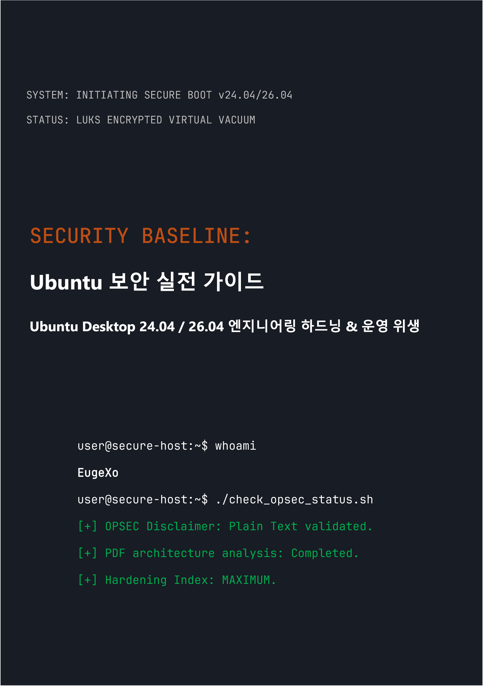

<div align="center">

# Security Baseline: Ubuntu 보안 실전 가이드

## Ubuntu Desktop 24.04/26.04 엔지니어링 하드닝 및 운영 위생

### Written and published by EugeXo

</div>

---

<p align="center">
  
</p>

---

## 책의 구성 및 간략한 개요

- [Security Baseline: Ubuntu 보안 실전 가이드](#security-baseline-ubuntu-보안-실전-가이드)
  - [Ubuntu Desktop 24.04/26.04 엔지니어링 하드닝 및 운영 위생](#ubuntu-desktop-24042604-엔지니어링-하드닝-및-운영-위생)
    - [Written and published by EugeXo](#written-and-published-by-eugexo)
  - [책의 구성 및 간략한 개요](#책의-구성-및-간략한-개요)
  - [감사의 글](#감사의-글)
  - [포맷 보안 확보 (OPSEC 면책 조항)](#포맷-보안-확보-opsec-면책-조항)
  - [저자의 말: 이 책은 왜, 누구를 위해 쓰였는가?](#저자의-말-이-책은-왜-누구를-위해-쓰였는가)
    - [서술 원칙에 대하여:](#서술-원칙에-대하여)
  - [기본 보호 수준: 운영 위생의 12가지 규칙](#기본-보호-수준-운영-위생의-12가지-규칙)
  - [익명성, 프라이버시 및 보안의 개념](#익명성-프라이버시-및-보안의-개념)
  - [Ubuntu 24.04/26.04 LTS 운영체제 설치](#ubuntu-24042604-lts-운영체제-설치)
    - [소개:](#소개)
    - [하드웨어 준비 규정:](#하드웨어-준비-규정)
    - [배포판 선택:](#배포판-선택)
    - [설치 프로그램 단계별 진행:](#설치-프로그램-단계별-진행)
  - [첫 부팅](#첫-부팅)
  - [시스템 설정](#시스템-설정)
  - [콘솔 작업 시작하기](#콘솔-작업-시작하기)
    - [초기 설정:](#초기-설정)
      - [Gnome Terminal Ubuntu 24.04:](#gnome-terminal-ubuntu-2404)
      - [Ptyxis Ubuntu 26.04:](#ptyxis-ubuntu-2604)
    - [자동 마운트 비활성화 및 선택적 설정:](#자동-마운트-비활성화-및-선택적-설정)
    - [콘솔 명령어 기록(History) 보관:](#콘솔-명령어-기록history-보관)
    - [안전한 sudo 세션 타임아웃 설정:](#안전한-sudo-세션-타임아웃-설정)
    - [Checks Passed 확인용 파일 생성:](#checks-passed-확인용-파일-생성)
  - [네트워크 및 VPN 설정](#네트워크-및-vpn-설정)
    - [유선 연결 Ethernet (Wired connection) 설정:](#유선-연결-ethernet-wired-connection-설정)
    - [무선 연결 Wi-Fi (Wireless connection) 설정:](#무선-연결-wi-fi-wireless-connection-설정)
      - [실제 PC 또는 노트북 설정 (완전 무작위화):](#실제-pc-또는-노트북-설정-완전-무작위화)
      - [가상 머신 설정 (벤더 사칭 Strict 마스킹):](#가상-머신-설정-벤더-사칭-strict-마스킹)
    - [NetworkManager 하드닝: 로컬 유출(mDNS, LLMNR, Hostname) 억제 및 DNS 보호:](#networkmanager-하드닝-로컬-유출mdns-llmnr-hostname-억제-및-dns-보호)
    - [부팅 시 Wi-Fi 완전 비활성화 모드로 전환:](#부팅-시-wi-fi-완전-비활성화-모드로-전환)
    - [보안을 위협하는 Bluetooth 구성 요소 제거:](#보안을-위협하는-bluetooth-구성-요소-제거)
    - [VPN 연결 설정:](#vpn-연결-설정)
  - [GRUB 부트로더 보안 설정 및 하드닝](#grub-부트로더-보안-설정-및-하드닝)
    - [GRUB 보호를 위한 비밀번호 설정:](#grub-보호를-위한-비밀번호-설정)
    - [소프트웨어 IOMMU 하드닝: 커널 수준의 DMA 공격으로부터 RAM 보호:](#소프트웨어-iommu-하드닝-커널-수준의-dma-공격으로부터-ram-보호)
  - [Kill Switch 포함 및 미포함 UFW 방화벽 설정 옵션](#kill-switch-포함-및-미포함-ufw-방화벽-설정-옵션)
    - [Kill Switch가 적용된 방화벽 설정:](#kill-switch가-적용된-방화벽-설정)
    - [규칙 우선순위 관리에 대한 중요 보충 설명:](#규칙-우선순위-관리에-대한-중요-보충-설명)
    - [대체 설정 옵션 (VPN 미사용 / 게스트 OS용):](#대체-설정-옵션-vpn-미사용--게스트-os용)
  - [시스템 커널 설정, 접근 권한 분리 및 시스템 서비스 제거](#시스템-커널-설정-접근-권한-분리-및-시스템-서비스-제거)
    - [네트워크 스택 및 커널 메모리 하위 시스템 보호:](#네트워크-스택-및-커널-메모리-하위-시스템-보호)
    - [저수준 sysctl 하드닝: TCP Timestamp Fingerprinting 방어:](#저수준-sysctl-하드닝-tcp-timestamp-fingerprinting-방어)
    - [희귀 네트워크 프로토콜 및 구형 파일 시스템 차단:](#희귀-네트워크-프로토콜-및-구형-파일-시스템-차단)
    - [파일 시스템 접근 권한 분리:](#파일-시스템-접근-권한-분리)
    - [shared memory 안전 마운트:](#shared-memory-안전-마운트)
      - [균형 모드 (일상적인 Desktop 환경 권장):](#균형-모드-일상적인-desktop-환경-권장)
      - [편집증 모드 (최대 격리):](#편집증-모드-최대-격리)
    - [휘발성 로그를 위한 격리된 RAM 디스크 생성:](#휘발성-로그를-위한-격리된-ram-디스크-생성)
    - [비디오 스트림 및 오디오 녹음 차단:](#비디오-스트림-및-오디오-녹음-차단)
    - [인쇄 및 로컬 네트워크 리소스 검색 시스템 서비스 제거:](#인쇄-및-로컬-네트워크-리소스-검색-시스템-서비스-제거)
    - [위치 정보(Geolocation) 및 시간대 마스킹:](#위치-정보geolocation-및-시간대-마스킹)
  - [저장소(Repository) 설정 및 시스템 업데이트](#저장소repository-설정-및-시스템-업데이트)
    - [시스템 업데이트:](#시스템-업데이트)
    - [격리 모드에서 NVIDIA 그래픽 환경 배포:](#격리-모드에서-nvidia-그래픽-환경-배포)
  - [Ubuntu의 터미널 환경:](#ubuntu의-터미널-환경)
    - [Gnome Terminal과 Ptyxis를 Ghostty로 교체:](#gnome-terminal과-ptyxis를-ghostty로-교체)
      - [Ubuntu 24.04 LTS Noble Numbat 사용자용 설치:](#ubuntu-2404-lts-noble-numbat-사용자용-설치)
      - [Ubuntu 26.04 LTS Resolute Racoon 사용자용 설치:](#ubuntu-2604-lts-resolute-racoon-사용자용-설치)
      - [Ubuntu 24.04/26.04용 Ghostty 설정 예시:](#ubuntu-24042604용-ghostty-설정-예시)
    - [선택 사항! Ubuntu 26.04 — Gnome Terminal 복원 및 Ptyxis 제거:](#선택-사항-ubuntu-2604--gnome-terminal-복원-및-ptyxis-제거)
  - [Snap 및 텔레메트리(원격 측정) 제거 및 차단](#snap-및-텔레메트리원격-측정-제거-및-차단)
    - [Snap 제거:](#snap-제거)
    - [Canonical 텔레메트리 제거:](#canonical-텔레메트리-제거)
    - [백그라운드 펌웨어 추적기 fwupd 비활성화:](#백그라운드-펌웨어-추적기-fwupd-비활성화)
  - [보안 유틸리티 libpam-tmpdir, debsums 및 리소스 모니터 Btop 설치](#보안-유틸리티-libpam-tmpdir-debsums-및-리소스-모니터-btop-설치)
    - [보안 유틸리티 libpam-tmpdir:](#보안-유틸리티-libpam-tmpdir)
    - [유틸리티 debsums:](#유틸리티-debsums)
    - [편리한 부하 모니터링 유틸리티 Btop:](#편리한-부하-모니터링-유틸리티-btop)
    - [네트워크 포트 및 연결 모니터링:](#네트워크-포트-및-연결-모니터링)
  - [기준 복원 지점 생성: Timeshift 유틸리티 배포 및 설정](#기준-복원-지점-생성-timeshift-유틸리티-배포-및-설정)
    - [소개:](#소개-1)
    - [암호화된 환경(LUKS + GRUB)에서의 Timeshift 작동 특성:](#암호화된-환경luks--grub에서의-timeshift-작동-특성)
    - [Timeshift 안전 설치:](#timeshift-안전-설치)
    - [초기 설정 및 스냅샷 #1 (무균 표준) 생성:](#초기-설정-및-스냅샷-1-무균-표준-생성)
    - [추가 통제 벡터: 스냅샷 #2 (운용 직전) 생성:](#추가-통제-벡터-스냅샷-2-운용-직전-생성)
    - [긴급 롤백 규정 (시스템이 침해되거나 손상된 경우):](#긴급-롤백-규정-시스템이-침해되거나-손상된-경우)
  - [순수 .deb 버전 Firefox 설치 및 Snap 더미 패키지 제거](#순수-deb-버전-firefox-설치-및-snap-더미-패키지-제거)
  - [Mozilla Firefox의 프라이버시 매개변수 설치 및 설정](#mozilla-firefox의-프라이버시-매개변수-설치-및-설정)
    - [설정을 위한 시스템 준비:](#설정을-위한-시스템-준비)
    - [1차 그래픽 프라이버시 설정 (모든 사용자 필수):](#1차-그래픽-프라이버시-설정-모든-사용자-필수)
    - [프라이빗 DNS 제공업체 설정 (DNS over HTTPS):](#프라이빗-dns-제공업체-설정-dns-over-https)
    - [하드닝 자동화: 설정 파일 user.js 생성:](#하드닝-자동화-설정-파일-userjs-생성)
    - [궁극의 보호 확장 프로그램 배포:](#궁극의-보호-확장-프로그램-배포)
  - [대화형 네트워크 방화벽 Portmaster 설치 및 설정](#대화형-네트워크-방화벽-portmaster-설치-및-설정)
    - [소개:](#소개-2)
    - [준비, 커널 1차 초기화 및 새 버전으로 전환:](#준비-커널-1차-초기화-및-새-버전으로-전환)
  - [데이터의 완전한 파기 및 디지털 흔적 살균](#데이터의-완전한-파기-및-디지털-흔적-살균)
    - [소개:](#소개-3)
    - [디지털 흔적의 해부: 메타데이터 제거 없이 데이터 삭제가 무의미한 이유?](#디지털-흔적의-해부-메타데이터-제거-없이-데이터-삭제가-무의미한-이유)
    - [MAT2 유틸리티 설치 및 메타데이터 제거:](#mat2-유틸리티-설치-및-메타데이터-제거)
    - [파일 및 디렉터리의 안전하고 영구적인 삭제:](#파일-및-디렉터리의-안전하고-영구적인-삭제)
    - [shred 유틸리티 작동 매개변수:](#shred-유틸리티-작동-매개변수)
    - [디스크 여유 공간의 전역 정화:](#디스크-여유-공간의-전역-정화)
  - [Ubuntu에서의 스테가노그래피, 난독화 및 흔적 은폐](#ubuntu에서의-스테가노그래피-난독화-및-흔적-은폐)
    - [소개:](#소개-4)
    - [Linux 환경의 스테가노그래피. 미디어 콘텐츠에 파일 숨기기:](#linux-환경의-스테가노그래피-미디어-콘텐츠에-파일-숨기기)
    - [콘솔 유틸리티 steghide:](#콘솔-유틸리티-steghide)
    - [고급 도구 StegoForge를 통한 위장:](#고급-도구-stegoforge를-통한-위장)
    - [아카이브 병합 (서드파티 소프트웨어 없이 사용하는 빠른 라이프핵):](#아카이브-병합-서드파티-소프트웨어-없이-사용하는-빠른-라이프핵)
    - [텍스트 난독화: 자동 분석 시스템(DPI) 우회:](#텍스트-난독화-자동-분석-시스템dpi-우회)
    - [숨겨진 위협 분석. 파일 확장자 위장 (BiDi 공격):](#숨겨진-위협-분석-파일-확장자-위장-bidi-공격)
  - [암호화 패키지 VeraCrypt 설치 및 설정](#암호화-패키지-veracrypt-설치-및-설정)
    - [VeraCrypt 소개 및 설치:](#veracrypt-소개-및-설치)
      - [커뮤니티 PPA 저장소를 통한 설치:](#커뮤니티-ppa-저장소를-통한-설치)
      - [공식 배포판 설치 (네이티브 방식):](#공식-배포판-설치-네이티브-방식)
    - [심층 보안 튜닝: RAM 내 키 보호 (편집증 모드):](#심층-보안-튜닝-ram-내-키-보호-편집증-모드)
    - [핵심 정보보안 도구: 숨겨진 볼륨(Hidden Volume) 생성:](#핵심-정보보안-도구-숨겨진-볼륨hidden-volume-생성)
    - [궁극의 하드닝: PIM 설정 및 하드웨어 키 파일:](#궁극의-하드닝-pim-설정-및-하드웨어-키-파일)
    - [현실 세계의 위협 모델: 편집증이 체계적이어야 하는 이유:](#현실-세계의-위협-모델-편집증이-체계적이어야-하는-이유)
  - [Yubico 보안 키 사용](#yubico-보안-키-사용)
    - [소개:](#소개-5)
    - [설치:](#설치)
    - [커널 udev 규칙을 통한 하드웨어 Log Out/Kill Switch 구현:](#커널-udev-규칙을-통한-하드웨어-log-outkill-switch-구현)
  - [USBGuard 설치 및 설정](#usbguard-설치-및-설정)
    - [소개:](#소개-6)
    - [설치 및 설정:](#설치-및-설정)
  - [긴급 종료를 위한 Emergency Panic Button 구현](#긴급-종료를-위한-emergency-panic-button-구현)
    - [임의의 USB 장치를 통한 긴급 하드웨어 Kill Switch:](#임의의-usb-장치를-통한-긴급-하드웨어-kill-switch)
  - [로컬 비밀번호 관리자 KeePassXC 설치](#로컬-비밀번호-관리자-keepassxc-설치)
    - [소개:](#소개-7)
    - [저장소 보호 시나리오 옵션:](#저장소-보호-시나리오-옵션)
    - [소프트웨어 패키지 설치:](#소프트웨어-패키지-설치)
    - [데이터베이스 생성 및 하드웨어 보호:](#데이터베이스-생성-및-하드웨어-보호)
    - [내부 보안 설정 심층 하드닝:](#내부-보안-설정-심층-하드닝)
    - [보안 클립보드를 통한 안전한 데이터 입력:](#보안-클립보드를-통한-안전한-데이터-입력)
  - [네트워크 분석기 Wireshark 설치 및 실행](#네트워크-분석기-wireshark-설치-및-실행)
    - [소개:](#소개-8)
    - [Wireshark 설치 및 실행:](#wireshark-설치-및-실행)
    - [패킷 캡처 하위 시스템의 매우 중요한 보안 개념:](#패킷-캡처-하위-시스템의-매우-중요한-보안-개념)
    - [은밀한 트래픽 덤프 수집 (콘솔 모드):](#은밀한-트래픽-덤프-수집-콘솔-모드)
    - [Wireshark 실전 가이드:](#wireshark-실전-가이드)
  - [보안 시스템 AppArmor 설치 및 관리](#보안-시스템-apparmor-설치-및-관리)
    - [소개:](#소개-9)
    - [새로운 보안 패러다임: 커널의 자동화:](#새로운-보안-패러다임-커널의-자동화)
    - [AppArmor 하위 시스템 실전 하드닝:](#apparmor-하위-시스템-실전-하드닝)
  - [격리된 샌드박스 Firejail 및 Bubblewrap 설치 및 설정](#격리된-샌드박스-firejail-및-bubblewrap-설치-및-설정)
    - [소개:](#소개-10)
    - [Firejail 설치 및 샌드박스 준비:](#firejail-설치-및-샌드박스-준비)
    - [Firejail 기본 필터링 매개변수 (참조 가이드):](#firejail-기본-필터링-매개변수-참조-가이드)
    - [선택 사항! Firejail 보호 경계 자동화 (Firecfg 유틸리티):](#선택-사항-firejail-보호-경계-자동화-firecfg-유틸리티)
    - [Bubblewrap 설치:](#bubblewrap-설치)
    - [Bubblewrap 플래그 치트시트 (참조 가이드):](#bubblewrap-플래그-치트시트-참조-가이드)
    - [샌드박스용 사용자 지정 바로가기 준비:](#샌드박스용-사용자-지정-바로가기-준비)
    - [Firejail용 별도 Firefox hardened 프로필 생성:](#firejail용-별도-firefox-hardened-프로필-생성)
    - [Bubblewrap에서 Firefox hardened 프로필 생성:](#bubblewrap에서-firefox-hardened-프로필-생성)
    - [PDF 문서의 밀폐 챔버: Firejail에서 안전하게 파일 실행하기:](#pdf-문서의-밀폐-챔버-firejail에서-안전하게-파일-실행하기)
    - [Bubblewrap에서 PDF 열람을 위한 Document Viewer 봉인:](#bubblewrap에서-pdf-열람을-위한-document-viewer-봉인)
    - [Firejail에서 그래픽 파일 열람을 위한 Image Viewer:](#firejail에서-그래픽-파일-열람을-위한-image-viewer)
    - [그래픽 파일 뷰어 Image Viewer를 Bubblewrap으로 감싸기:](#그래픽-파일-뷰어-image-viewer를-bubblewrap으로-감싸기)
    - [Firejail용 KeePassXC 격리 시나리오:](#firejail용-keepassxc-격리-시나리오)
    - [Bubblewrap을 통한 KeePassXC 격리:](#bubblewrap을-통한-keepassxc-격리)
    - [오피스 제품군 LibreOffice 설치 및 격리:](#오피스-제품군-libreoffice-설치-및-격리)
    - [Firejail을 통한 LibreOffice 작동 설정:](#firejail을-통한-libreoffice-작동-설정)
    - [LibreOffice를 Bubblewrap으로 감싸기:](#libreoffice를-bubblewrap으로-감싸기)
    - [GNU Image Manipulation Program (GIMP) 설치 및 격리:](#gnu-image-manipulation-program-gimp-설치-및-격리)
    - [Firejail을 통한 GIMP 작동 설정:](#firejail을-통한-gimp-작동-설정)
    - [Bubblewrap을 통한 GIMP 설정:](#bubblewrap을-통한-gimp-설정)
    - [코드 편집기 VS Codium (프로그램 작성용 IDE) 설치 및 격리:](#코드-편집기-vs-codium-프로그램-작성용-ide-설치-및-격리)
    - [Firejail에서 VS Codium 격리:](#firejail에서-vs-codium-격리)
    - [Bubblewrap에서 VS Codium 격리:](#bubblewrap에서-vs-codium-격리)
    - [로컬 신경망 LM Studio Bionic 설치 및 격리:](#로컬-신경망-lm-studio-bionic-설치-및-격리)
    - [Firejail을 통한 LM Studio 작동 구축:](#firejail을-통한-lm-studio-작동-구축)
    - [LM Studio를 Bubblewrap으로 감싸기:](#lm-studio를-bubblewrap으로-감싸기)
    - [안전한 통신 설정: 메신저 및 암호화 환경의 강제 격리 (저자의 OPSEC 환경):](#안전한-통신-설정-메신저-및-암호화-환경의-강제-격리-저자의-opsec-환경)
    - [Telegram Desktop 설치 및 격리:](#telegram-desktop-설치-및-격리)
    - [Firejail을 통한 Telegram 환경 보호:](#firejail을-통한-telegram-환경-보호)
    - [Bubblewrap을 통한 Telegram 격리:](#bubblewrap을-통한-telegram-격리)
    - [Bubblewrap을 통한 Signal 설치 및 격리:](#bubblewrap을-통한-signal-설치-및-격리)
    - [호스트의 암호화 기반: GnuPG 키 생성 및 OPSEC 보호:](#호스트의-암호화-기반-gnupg-키-생성-및-opsec-보호)
    - [Jabber 클라이언트 Psi+ 설치 및 격리:](#jabber-클라이언트-psi-설치-및-격리)
    - [Firejail에서 PSI+ 격리:](#firejail에서-psi-격리)
    - [Bubblewrap 샌드박스에서 Psi+ Jabber 클라이언트 격리:](#bubblewrap-샌드박스에서-psi-jabber-클라이언트-격리)
    - [이메일 클라이언트 Thunderbird 설치 및 격리 (암호화된 이메일 통신 환경):](#이메일-클라이언트-thunderbird-설치-및-격리-암호화된-이메일-통신-환경)
    - [Firejail을 통한 Thunderbird 격리:](#firejail을-통한-thunderbird-격리)
    - [Bubblewrap을 통한 Thunderbird 격리:](#bubblewrap을-통한-thunderbird-격리)
    - [고급 «편집증» 모드: Overlay를 통한 세션 저장과 함께 사용하는 Firejail:](#고급-편집증-모드-overlay를-통한-세션-저장과-함께-사용하는-firejail)
  - [Rkhunter 설치 및 루트킷 탐지](#rkhunter-설치-및-루트킷-탐지)
    - [Rkhunter에 추가로 Chkrootkit 설치하기:](#rkhunter에-추가로-chkrootkit-설치하기)
  - [백신 스캐너 ClamAV 설치 및 설정](#백신-스캐너-clamav-설치-및-설정)
    - [소개:](#소개-11)
    - [ClamAV 설치:](#clamav-설치)
    - [시그니처 데이터베이스 업데이트 및 네트워크 차단 우회:](#시그니처-데이터베이스-업데이트-및-네트워크-차단-우회)
    - [시스템 스캔 구성:](#시스템-스캔-구성)
    - [멀티스레드 스캔 (Hardening):](#멀티스레드-스캔-hardening)
  - [가상화 환경 VirtualBox 설치 및 설정](#가상화-환경-virtualbox-설치-및-설정)
    - [포렌식 방어: RAM(`tmpfs`)에 VirtualBox 로그 격리:](#포렌식-방어-ramtmpfs에-virtualbox-로그-격리)
  - [가상 디스크 VDI 압축 및 최적화](#가상-디스크-vdi-압축-및-최적화)
    - [소개:](#소개-12)
    - [Windows 기반 가상 머신 정리:](#windows-기반-가상-머신-정리)
    - [Linux 기반 가상 머신 정리 (Ubuntu/Kali Linux):](#linux-기반-가상-머신-정리-ubuntukali-linux)
    - [호스트 머신에서 가상 디스크 최종 압축:](#호스트-머신에서-가상-디스크-최종-압축)
  - [컨테이너화 시스템 Docker 설치 및 설정](#컨테이너화-시스템-docker-설치-및-설정)
    - [소개:](#소개-13)
    - [기본 Docker의 숨겨진 위험성은 무엇인가?](#기본-docker의-숨겨진-위험성은-무엇인가)
    - [Rootless 모드로 Docker 배포:](#rootless-모드로-docker-배포)
    - [네트워크 길들이기 및 UFW 바인딩:](#네트워크-길들이기-및-ufw-바인딩)
    - [안전한 컨테이너 실행 실전 예시:](#안전한-컨테이너-실행-실전-예시)
    - [보안의 실험적 증명 (Root 부재 검증):](#보안의-실험적-증명-root-부재-검증)
  - [무결성 제어 시스템 AIDE 설치 및 설정](#무결성-제어-시스템-aide-설치-및-설정)
    - [소개:](#소개-14)
    - [AIDE 설치 및 설정:](#aide-설치-및-설정)
    - [침투 테스트 수행 (보호 기능 검증):](#침투-테스트-수행-보호-기능-검증)
  - [Lynis를 활용한 자동화된 시스템 보안 감사](#lynis를-활용한-자동화된-시스템-보안-감사)
  - [취약점 및 비밀번호 유출 스캐너 Trivy 설치 및 설정](#취약점-및-비밀번호-유출-스캐너-trivy-설치-및-설정)
  - [VirtualBox에서 게스트 시스템 Ubuntu/Xubuntu/Lubuntu 설정](#virtualbox에서-게스트-시스템-ubuntuxubuntulubuntu-설정)
    - [Guest Additions 설치:](#guest-additions-설치)
    - [Mozilla Firefox 설치:](#mozilla-firefox-설치)
    - [VirtualBox에서 공유 폴더(Shared Folders) 설정:](#virtualbox에서-공유-폴더shared-folders-설정)
    - [Ubuntu/Xubuntu/Lubuntu가 설치된 VirtualBox에 Ledger Live 설치](#ubuntuxubuntulubuntu가-설치된-virtualbox에-ledger-live-설치)
    - [메인 호스트 시스템 Ubuntu에서 Ledger Live 실행](#메인-호스트-시스템-ubuntu에서-ledger-live-실행)
  - [저자 소개 및 법적 정보](#저자-소개-및-법적-정보)
    - [연락처 및 커뮤니티 리소스:](#연락처-및-커뮤니티-리소스)


<br>
<br>
<br>
<br>
<br>
<br>
<br>

## 감사의 글

군더더기 없이 담백하고 진심을 담아, 이 책을 집필하도록 영감을 주고 전 과정에 걸쳐 아낌없이 지지해 준 분들께 깊은 감사의 인사를 전합니다.

이 책을 쓰도록 동기를 부여해 준, 작지만 기술력이 뛰어난 우리 에스토니아 경찰청 사이버보안부서의 소박한 동료들에게 감사를 표합니다.

또한 일부 장(Chapter)의 검증에 실질적으로 크게 기여해 준 미국 비밀경호국(US Secret Service) 마이애미 지부의 정보보안 전문가분들께도 특별한 감사를 전합니다. 결과적으로 이곳에 기술된 방법론과 접근 방식은 실제 현장 환경에서도 완벽하게 작동함이 입증되었습니다.

물론, 놀라운 인내심과 정신적 지지를 보내준 가족들에게도 무한한 감사를 드립니다. 특히 제 작업을 깊이 이해해 주고 일상적인 집안일의 상당 부분을 도맡아 주시며 제가 연구에 집중할 수 있도록 시간을 만들어 주신 어머니께 진심으로 감사드립니다.

**특별히 영국에서 온 친구의 지지에 감사를 표하고 싶습니다. 제가 마이애미에 머물던 시절 우리는 매우 가깝게 지냈지만, 안타깝게도 이후 연락이 끊어졌습니다. 우리가 다시 만날 수 있기를 진심으로 바랍니다. 친구여, 만약 자네나 정보보안 전문가인 자네 아들이 이 글을 읽고 있다면 부디 연락을 주게 — 책의 맨 마지막에 내 연락처가 적혀 있다네. 자네라면 *who is who!*인지 단번에 알아챌 거라 믿네 ;)**

형언할 수 없는 감사를 저의 가상 어시스턴트인 **Google의 Gemini**에게 전합니다. 집필 전 과정 동안 변함없는 디지털 파트너로 함께하며, 이 하드코어한 자료를 구조화하고 번역하는 데 값진 도움을 주었습니다.

또한 기술적 해결책을 함께 논의하고 설정을 검증하며, 일부 문장을 세심하게 다듬고 더 정확한 표현을 찾는 데 도움을 준 유쾌하고 뛰어난 어시스턴트 **OpenAI의 ChatGPT**에게도 감사를 표합니다.

물론 무엇보다도 이처럼 훌륭한 도구를 만들어낸 Google과 OpenAI의 엔지니어 및 개발자분들께 가장 먼저 감사를 드립니다!

더 길게 적을 수도 있겠지만, 이 과정에 함께한 모든 분들은 이미 제 마음을 충분히 이해하고 계실 것입니다. 이 책이 마침내 세상에 나오게 되어 정말 기쁩니다. 여러분 모두를 진심으로 사랑하고, 소중히 여기며, 존경합니다!

<br>

## 포맷 보안 확보 (OPSEC 면책 조항)

정보보안과 상식적인 판단에 따라, 본 가이드의 모든 자료는 기본적으로 순수 텍스트(Markdown 마크업이 적용된 Plain Text) 형태로 배포됩니다. 책을 PDF 형식으로 출간하려던 계획은 의도적으로 폐기했습니다. PDF는 구조가 지나치게 방대하며 주기적으로 보안 침해의 표적이 되기 때문입니다. 보호하려는 호스트의 보안은 그 설정 지침을 안전하게 읽는 것에서부터 시작해야 합니다.

텍스트 파일은 실행 코드가 없는 순수한 데이터인 반면, PDF 포맷은 기본적으로 내장 JavaScript 스크립트, 동적 요소, 대화형 양식 및 깊은 시스템 파싱을 요구하는 복잡한 글꼴을 지원합니다. Linux의 PDF 파서(예: 기본 뷰어 Evince 또는 Poppler 라이브러리)를 통한 치명적인 RCE(원격 코드 실행) 취약점은 이미 입증된 역사적 사실입니다. Plain Text 포맷은 코드 실행 메커니즘을 내장하고 있지 않아 자료를 열람할 때 공격 표면(Attack Surface)을 획기적으로 줄여줍니다. 이는 어떤 환경에서든 안전한 열람을 보장합니다.

이러한 이유로 모든 그래픽 자료와 일러스트는 본문 외부의 별도 디렉터리로 분리되어 있습니다. 이미지들은 폴더와 하위 폴더로 구조화되어 있어, 책을 읽는 과정에서 메모리에 자동으로 렌더링되는 것을 방지합니다.

> [!NOTE]
> 이 책의 기본 원본 포맷은 Markdown입니다. 모든 파생 포맷(HTML, EPUB 등)은 검증된 텍스트 원본으로부터 생성됩니다.
> 
> 독자는 다음 세 가지 방식 중 하나를 선택하여 프로젝트를 활용할 수 있습니다:
> 
> * Markdown 원본을 직접 열람하기.
> * 미리 빌드된 HTML/EPUB 배포본 사용하기(추후 제공 예정).
> * 원본 소스에서 직접 책을 빌드하고, 필요에 따라 디자인, 구조, 글꼴, 스타일 또는 포함할 장(Chapter)의 구성을 자유롭게 변경하기.
> 
> 이러한 접근 방식은 텍스트의 투명성, 변경 사항에 대한 감사 편의성, 그리고 특정 열람 도구에 종속되지 않는 독립성을 보장합니다.

<br>

## 저자의 말: 이 책은 왜, 누구를 위해 쓰였는가?

현대의 디지털 환경은 갈수록 복잡해지고 있습니다. 사이버 위협은 증가하고 수집되는 데이터의 양은 방대해졌으며, 사용자는 자신의 프라이버시와 보안을 스스로 지켜야 하는 상황에 점점 더 자주 직면하고 있습니다.

이 책은 보안을 단순히 개별 프로그램의 집합이 아니라 상호 연결된 해결책들의 단일 시스템으로 바라보는, 통제 가능한 Linux 워크스테이션 구축을 위한 실전 가이드로 집필되었습니다. 저의 목표는 Linux에서 사용 가능한 도구들을 활용하여 애플리케이션 격리, 네트워크 활동 제어, 데이터 보호 및 디지털 환경에 대한 의식적인 관리를 갖춘 명확한 위협 모델(Threat Model) 기반의 작업 환경을 구축하는 방법을 보여주는 것입니다.

**이 책의 목표는 모든 행동에 통제된 보안 경계(Perimeter)가 존재하는 워크스테이션을 구축하는 것입니다.**

본 자료는 교육 목적으로 작성되었으며, 기술적 배경지식을 갖춘 사용자, Linux 애호가 및 실전 정보보안에 관심이 있는 전문가를 대상으로 합니다. 이 가이드는 Linux 입문서가 아니므로 터미널, 파일 시스템 및 운영체제 작동 원리에 대한 기본적인 이해를 전제로 합니다. 하지만 주의를 기울이고 의지가 있는 독자라면 필요한 도구들을 차근차근 익혀나갈 수 있을 것입니다.

여기에 설명된 모든 기술은 오직 합법적인 목적—즉, 자신의 데이터를 보호하고 보안을 강화하며 정보보안 원리를 학습하는 용도로만 사용되어야 합니다.

정보에 대한 의식적인 보호와 기술의 책임감 있는 사용은 모두를 위해 더 안전한 디지털 환경을 만듭니다.

### 서술 원칙에 대하여:

이 책의 목적은 사용하는 모든 도구의 백과사전을 만드는 것이 아니라, 단일 보호 모델 내에서 각 도구가 수행하는 역할을 보여주는 것입니다. 따라서 구성 요소의 내부 구조와 기능은 작동 원리를 이해하고 안전하게 적용하는 데 필요한 범위 내에서만 다룹니다.

확장 기능, 전체 구문 및 특수한 사용 시나리오는 본 가이드의 범위를 벗어나며, 필요시 공식 문서를 통해 별도로 학습할 수 있습니다.

<br>

## 기본 보호 수준: 운영 위생의 12가지 규칙

*Hello World 동지여!*

시스템의 하드코어한 기술적 설정으로 넘어가기 전에 먼저 기초를 다져봅시다. 아래에는 우리가 반드시 외우고 타협 없이 준수해야 할 12가지 철칙이 나와 있습니다. 이 규칙들을 이해하지 못한다면 아무리 뛰어난 보안 도구라도 시간이 지나면 결국 무용지물이 되고 맙니다:

1. **보호된 보안 영역 내에서는 가능한 한 무선 주변기기를 배제합니다:** 무선 Bluetooth 및 Wireless(헤드셋, 이어폰, 무선 키보드 및 마우스 포함)를 사용하지 않습니다. 모든 무선 인터페이스는 공격 표면을 넓히며, 프로토콜 스택, 펌웨어 및 기기 보안 구현에 대한 신뢰를 강요합니다.
2. **OS 설치 단계에서 시스템 드라이브의 전체 디스크 암호화(Full-Disk Encryption)를 필수로 적용합니다.** 암호화 비밀번호의 길이는 특수문자를 포함해 최소 24자 이상의 무작위 문자로 설정합니다!
3. **운영체제 로그인 비밀번호를 주기적으로 계획에 따라 변경합니다.** 사용자 비밀번호는 고유하고 충분히 길게(최소 16자 이상 권장) 설정합니다. 하드웨어 토큰을 사용하는 경우 비밀번호가 대체되는 것이 아니라 추가적인 보호 요소로 결합됩니다.
4. **시스템 부트로더 GRUB에 비밀번호 보호를 활성화하여**, PC에 물리적으로 접근한 자가 커널 매개변수를 무단으로 수정하거나 설정을 편집하는 것을 원천 차단합니다.
5. **시스템 로그인 및 슈퍼유저(sudo) 명령 확인을 위한 필수 2단계 인증(2FA) 요소로 하드웨어 토큰**(YubiKey 또는 이에 준하는 정품 기기)을 도입합니다.
6. **불필요한 모든 소프트웨어를 시스템에서 제거합니다.** 특히 소스 코드가 닫혀 있는 독점(Proprietary) 소프트웨어에 더욱 주의를 기울입니다. 기본 원칙을 기억하십시오: 시스템에 서드파티 서비스, 데몬 및 프로그램이 적을수록 잠재적 공격 표면과 치명적 취약점의 수도 줄어듭니다.
7. **운영체제를 항상 최신 상태로 유지합니다.** 콘솔 도구를 통해 제어하면서 시스템 보안 업데이트를 정기적으로 확인하고 설치하는 것을 철칙으로 삼습니다.
8. **네트워크 및 네트워크 인터페이스의 상태를 지속적으로 모니터링합니다.** 어떤 원격 리소스로 백그라운드 연결이 이루어지고 있는지, 우리의 네트워크 트래픽이 어디로 향하는지 세심하게 주시합니다.
9. **호스트 내부 감사를 정기적으로 수행합니다.** 주기적으로(가급적 주 2~3회) 루트킷 및 바이러스 존재 여부를 검사하고 시스템 파일의 무결성을 검증합니다.
10. **의심스러운 실행 파일은 절대 메인 시스템에서 직접 실행하지 않습니다.** 안전한 테스트를 위해서는 항상 격리된 샌드박스 `Firejail`이나 가상 머신을 사용합니다.
11. **위험한 DMA(Direct Memory Access) 공격에 대한 강력한 방어를 구축하고 BIOS/UEFI에 비밀번호를 설정합니다:** BIOS/UEFI 설정에서 Thunderbolt/USB4 포트를 강제로 최대 인증 모드(*Kernel DMA Protection*)로 전환하여 외부 장치의 DMA 접근을 통한 공격 위험을 줄입니다. BIOS/UEFI에 비밀번호를 설정합니다. 추가로 절전 모드(*Sleep Mode*)를 완전히 비활성화합니다. 절전 상태에서는 디스크 암호화 키가 RAM에 평문으로 남아 있기 때문입니다.
12. **자리를 잠시라도 비울 때는 즉시 세션을 잠그고, 장시간 자리를 비울 때는 컴퓨터 전원을 완전히 끕니다.**

> [!NOTE]
> 모든 보안 시스템에서 가장 취약한 고리는 소프트웨어가 아니라 여전히 사용자의 행동입니다.
>
> 보안 업계에는 «가장 큰 취약점은 의자와 키보드 사이에 있다»라는 농담 섞인 격언이 있습니다.
>
> 바로 그렇기 때문에 기술적 하드닝에는 반드시 운영 규율이 뒤따라야 합니다: 파일을 열기 전 검증하기, 게시 전 메타데이터 삭제하기, 네트워크 활동 통제하기, 그리고 자신의 위협 모델을 항상 명확히 이해하기가 그것입니다.

## 익명성, 프라이버시 및 보안의 개념

일상 대화에서는 이 개념들이 자주 혼용되지만, 실제로는 각각 다른 과제를 설명합니다.

**익명성(Anonymity)**은 다음 질문에 답합니다: «나의 행동을 나의 실제 신원과 연결할 수 있는가?»
시스템이 완벽하다면, 공격자는 행동 자체는 볼 수 있지만 이를 현실 세계의 특정 인물과 결코 연결할 수 없습니다.

**프라이버시(Privacy)**는 다음 질문에 답합니다: «나에 대해 어떤 정보가 수집되고 누구에게 공개되는지 내가 통제할 수 있는가?»
공격자는 그 사람이 존재한다는 사실은 알지만, 그 사람이 어떤 정보를 외부로 전달할지 스스로 통제합니다.

**보안(Security)**은 다음 질문에 답합니다: «무단 접근으로부터 나의 시스템, 데이터 및 기기를 보호할 수 있는가?»
사용자는 자신의 디지털 경계 내부에서 상시 전투 태세를 유지합니다. 공격자가 문 앞까지 와 있을 수 있지만, 시스템을 뚫고 데이터를 탈취할 역량이 부족하도록 만듭니다.

훌륭한 비밀번호로 암호화된 노트북은 보안을 높여줍니다. 하지만 사용자가 인터넷에 모든 개인 정보를 자발적으로 게시한다면 프라이버시는 높아지지 않습니다. 익명화 도구를 사용하면 사용자의 신원을 파악하기 어렵게 만들 수는 있지만, 악성코드로부터 시스템을 보호해주지는 못합니다. 잘 보호된 시스템이 비익명적일 수 있고, 익명 시스템이 보안에 취약할 수도 있습니다.

**이 가이드의 목표는 절대적인 보호나 네트워크상에서의 완전한 투명 인간이라는 환상을 심어주는 것이 아닙니다. 사용자가 어떤 위험을 줄이고 있으며 어떤 한계가 남아 있는지를 명확히 이해한 상태에서 시스템을 구축하는 방법을 보여주는 것이 목적입니다.**

<br>

## Ubuntu 24.04/26.04 LTS 운영체제 설치

### 소개:

이 장에서는 보안 요구 사항을 반영하여 Ubuntu 운영체제를 설치하는 방법을 다룹니다. 또한 외장 USB 및 Thunderbolt 드라이브에 시스템을 배포하는 옵션도 함께 설명합니다.

설치를 시작하기 전에 몇 가지 중요한 요소를 고려해야 합니다. 가장 흔한 위험 중 하나는 부트로더를 설치할 디스크를 잘못 선택하는 것입니다.

Linux에서는 일반적으로 GRUB(GRand Unified Bootloader)가 시스템 부팅을 담당합니다. 설치 과정에서 GRUB이 사용자가 계획한 드라이브가 아닌 다른 디스크의 EFI 파티션 등에 설치될 수 있습니다. 그 결과 부트로더를 복구하기 전까지 기존 운영체제가 정상적으로 부팅되지 않을 수 있습니다.

이러한 시나리오를 원천적으로 배제하는 가장 확실한 방법은 Linux를 설치하는 동안 대상 시스템과 관련 없는 모든 내부 HDD 및 SSD를 물리적으로 분리하는 것입니다.

데스크톱 PC의 경우 일반적으로 본체 내부에 접근하여 일반 드라이버 하나만 사용하면 됩니다. 노트북의 경우 기기 구조에 따라 절차가 달라지며 다소 복잡할 수 있습니다.

Apple 기기(특히 T2 칩 및 Apple Silicon이 탑재된 최신 MacBook)는 하드웨어 플랫폼, 부팅 체인 및 Linux 호환성 특성으로 인해 이 시나리오에서는 권장되지 않습니다.

> [!NOTE]
> 본 가이드는 **Ubuntu 24.04 LTS Noble Numbat (24.04.4)** 및 **Ubuntu 26.04 LTS Resolute Racoon (26.04.0)**에서 완벽하게 검증되었습니다.
>
> 테스트는 **VirtualBox 7.2.x**, **VMware Workstation Pro 26H1**은 물론, Intel 내장 그래픽과 NVIDIA 외장 그래픽 어댑터가 장착된 실제 물리 시스템에서 수행되었습니다.

### 하드웨어 준비 규정:

* **데스크톱 PC의 경우:** 본체 측면 패널을 열고 컴퓨터의 전원 코드를 콘센트에서 완전히 뽑은 다음, Linux를 설치할 대상 디스크를 제외한 모든 저장장치를 분리합니다. M.2 NVMe 드라이브를 사용하는 경우 분리를 위해 드라이버가 필요합니다.

* **노트북의 경우:** 기기 전원을 완전히 끄고 전원 어댑터를 분리한 뒤, 가능하다면 배터리도 분리합니다. 하판을 연 후 대상 드라이브를 제외한 모든 저장장치를 분리하거나 제거합니다.

외장 USB 또는 Thunderbolt 드라이브에 설치하는 경우 해당 드라이브만 연결된 상태로 둡니다. 이 드라이브가 시스템 설치를 위한 대상 매체로 사용됩니다.

> [!WARNING]
> 운영체제를 설치하기 전에 BIOS/UEFI에 진입하여 그래픽 하위 시스템 설정을 확인해야 합니다. 하이브리드 그래픽이 탑재된 노트북에서는 인터페이스의 기본 작업이 프로세서 내장 그래픽 코어를 통해 처리되도록 Hybrid Mode/Optimus를 활성화하는 것이 좋습니다. 이를 통해 Linux 커널의 오픈 소스 드라이버(하드웨어에 따라 i915, xe, amdgpu)를 사용할 수 있으며, 닫힌 독점 구성 요소에 대한 불필요한 의존성을 피할 수 있습니다.
>
> 가능한 경우 BIOS/UEFI 비밀번호를 설정하고 저장장치의 하드웨어 보호 기능(특정 SSD/HDD 모델에서 지원하는 경우)을 활성화합니다. 이는 부팅 설정의 무단 변경 위험을 줄이고 기기에 대한 물리적 접근 공격을 어렵게 만듭니다.
>
> Secure Boot 상태를 확인합니다. 플랫폼과 사용하는 설치 시나리오가 정상 작동을 지원한다면 이 기능을 활성화된 상태로 유지하는 것을 권장합니다.
>
> **컴퓨터나 노트북에는 설치를 진행할 단 하나의 디스크만 연결된 상태로 둡니다.**
>
> Linux 설치는 **인터넷 연결 없이** 진행합니다 — 유선 LAN 케이블을 뽑고 Wi-Fi 무선 네트워크에도 연결하지 않습니다. 필요한 모든 패키지와 업데이트는 기본 시스템 설정이 완료된 후에 설치합니다.

왜 인터넷 연결 없이 설치를 진행할까요?

오프라인 설치는 초기 시스템 배포 시점에 외부 요인을 최소화할 수 있게 해줍니다:

* 설치 중에 활성화된 외부 네트워크 연결이 존재하지 않습니다;
* 기본 설정이 완료되기 전에 서드파티 구성 요소 및 업데이트가 자동으로 다운로드되는 것을 방지합니다;
* 설치 단계에서 실행될 수 있는 백그라운드 네트워크 서비스 및 프로세스의 수를 줄입니다;
* 운영체제의 초기 상태를 통제하기 쉽고, 처음에 어떤 구성 요소가 설치되었는지 명확히 파악할 수 있습니다;
* 시스템의 기본 보안 강화가 완료될 때까지 잠재적인 외부 공격 접점을 최소화합니다.

초기 설정과 보호 메커니즘 적용이 끝난 후, 통제된 환경에서 네트워크 연결을 다시 활성화합니다.

### 배포판 선택:

모든 과정은 최신 배포판인 **Ubuntu 24.04 LTS Noble Numbat** 및 **Ubuntu 26.04 LTS Resolute Racoon**을 기준으로 진행합니다. 이 배포판들은 익히기 쉽고 리소스 소모가 크지 않아 2GB RAM을 탑재한 PC에서도 안정적으로 작동합니다(특히 경량 파생판인 Xubuntu나 Lubuntu를 선택할 경우 더욱 그렇습니다). 또한 글로벌 Linux 커뮤니티의 강력한 지원을 받으며, 무엇보다 «설치 직후(Out-of-the-box)» 상태에서 준수한 기본 보안 수준을 제공합니다.

설치는 영어로 진행하는 것이 좋습니다. 예기치 않은 오류가 발생했을 때 전문 영문 기술 자료에서 해결책을 검색하고 찾아내기가 훨씬 수월하기 때문입니다. 하지만 이것이 절대적인 필수 사항은 아니며, 시스템 언어의 최종 선택은 여러분의 몫입니다. 본 가이드에서는 영어 로캘인 English(US, 미국식)를 사용합니다.

### 설치 프로그램 단계별 진행:

**1.** 언어를 선택한 후 키보드 설정 메뉴 **«Select your keyboard»**로 이동하여 **English (US)** 또는 편한 옵션을 선택합니다.

**2.** 인터넷 연결 창에서는 반드시 **«Do not connect to the internet»** 항목을 선택합니다.

**3.** 다음으로 **«Interactive Installation»** 및 **«Default selection»** 옵션을 선택합니다. 이렇게 하면 시스템에 최소한의 소프트웨어 세트만 설치됩니다. 오피스 애플리케이션 등 추가 패키지가 필요하다면 나중에 공식 저장소에서 직접 다운로드하면 됩니다. 전반적으로 초기 설치 애플리케이션 수를 최소화하면 악의적인 공격자의 잠재적 공격 벡터(Attack Vectors)를 줄일 수 있습니다.

**4.** 다음 단계에서는 당연히 독점 소프트웨어(Proprietary software)를 설치하지 않습니다.

**6.** **Ubuntu 24.04:** **«Disk Setup»** 메뉴에서 **«Advanced features...»** 버튼을 누른 뒤 **«Use LVM and encryption»** 항목을 선택하고 **«OK»** 버튼으로 확인한 다음 **«Next»**를 누릅니다.

**Ubuntu 26.04:** 기본 선택 사항인 **«Erase disk and install Ubuntu»**를 그대로 두고 **«Next»**를 누릅니다.

**7.** **Ubuntu 24.04:** 다음 메뉴에서는 디스크 암호화를 위한 마스터 비밀번호 입력을 요청합니다. 키보드의 모든 조합(영어 대문자 A-Z, 소문자 a-z, 숫자 0-9, 특수문자 및 스페이스바)을 활용하여 최소 24자 이상(가급적 더 길게)의 복잡한 비밀번호를 만들고(반드시 기억해 둡니다), **«Next»**를 누릅니다.

**Ubuntu 26.04:** **«Encryption with passphrase»**를 선택하고 **«Next»**를 누른 뒤, 다음 메뉴에서 디스크 암호화 마스터 비밀번호를 입력합니다. 키보드의 모든 조합(영어 대문자 A-Z, 소문자 a-z, 숫자 0-9, 특수문자 및 스페이스바)을 활용하여 최소 24자 이상(가급적 더 길게)의 복잡한 비밀번호를 만들고(반드시 기억해 둡니다), **«Next»**를 누릅니다.

**8.** 이어서 **«Create your account.»** 메뉴가 나타납니다. **«Your name»** 항목에는 미리 정해둔 이름을 입력합니다(실제 신원을 드러내지 않는 중립적인 이름 선택, 예: `user`). **«Computer name»** 줄에는 임의의 호스트 이름을 입력하고(예: `host-node`), **«Pick a username»** 필드의 사용자 이름은 원하는 대로 정합니다. Choose password 항목에는 영어 대문자(A-Z), 소문자(a-z), 숫자(0-9), 특수문자 및 스페이스바를 조합하여 최소 16자 이상의 복잡한 비밀번호를 설정합니다. **«Require password to login»** 옵션을 그대로 두고 Next를 누릅니다.

**9.** 다음 메뉴에서는 시간대를 선택하는 지도가 나타납니다. 아무 값이나 선택하고(추후 시간대는 UTC로 변경할 것입니다) **«Next»**를 누릅니다.

**10.** 최종 창에서 구성을 검토하여 빠뜨리거나 잘못 추가한 것이 없는지 확인한 후 **«Install»** 버튼을 누릅니다.

이후 운영체제의 자동 설치 및 구성이 시작됩니다. 이 과정은 비교적 빠르게 진행되며 사용자의 개입이 필요하지 않습니다. 설치가 완료되면 프로그램이 설치용 USB 드라이브를 제거하고 재부팅할 것을 안내합니다. 이로써 설치가 완료되었으며, 이전에 분리해 두었던 모든 저장장치를 다시 원래 자리에 연결해도 됩니다.

> [!IMPORTANT]
> Ubuntu 24.04/26.04에서는 디스크 데이터를 보호하기 위해 근본적으로 다른 두 가지 접근 방식을 사용할 수 있습니다: 사용자 지정 패스프레이즈(passphrase)를 사용하는 클래식 암호화와 TPM을 통해 자동 잠금 해제를 수행하는 하드웨어 매개 암호화가 그것입니다. 두 방식 모두 디스크 암호화의 기반으로 LUKS를 사용하지만, 주로 잠금 해제 키를 획득하는 메커니즘에서 차이가 납니다.
> 
> 본 가이드에서는 의도적으로 클래식한 LVM + LUKS + 긴 사용자 패스프레이즈 방식을 사용합니다. 이는 암호화된 스토리지를 잠금 해제하기 전에 장치 소유자가 명시적으로 인증을 거쳐야 하는 본 가이드의 위협 모델(Threat Model)에 부합하기 때문입니다.
> 
> 그렇다고 해서 TPM/FDE가 «안전하지 않은» 방식이라는 의미는 아닙니다. 이는 다른 사용 모델을 위해 설계되었으며 플랫폼 상태의 자동 검증 및 부팅 체인에 대한 특정 공격 방어 등 고유한 장점을 가지고 있습니다. 그러나 본 가이드의 범위 내에서는 디스크의 자동 잠금 해제를 원칙적으로 사용하지 않으며, 긴 LUKS 패스프레이즈를 통한 사용자 직접 인증 방식을 우선시합니다.
> 
> 따라서 이 책에서 클래식 LUKS를 선택한 것은 명시된 위협 모델 내에서의 의식적인 결정이지, TPM/FDE 자체가 전반적으로 안전하지 않다는 주장이 아닙니다.
>
> LVM을 통해 수동으로 복잡한 클래식 비밀번호를 생성하는 저의 접근 방식은, 전원이 꺼진 기기에 대한 물리적 접근 공격으로부터 데이터를 보호하는 정보보안 관점에서 기술적으로 유일하게 올바른 방법입니다. TPM을 통한 자동 잠금 해제를 사용하면 사용자 패스프레이즈는 더 이상 주요 보호 요소가 아니게 됩니다. 이 경우 보안은 신뢰할 수 있는 플랫폼의 정상 작동, 부트로더 상태 및 시스템의 하드웨어 구현에 의존하게 됩니다. 긴 LUKS 비밀번호를 수동으로 입력하는 방식은 이러한 위험한 침해 벡터를 완전히 제거합니다.

**장(Chapter) 부록:** *_assets\images\1_os_install*

<br>

## 첫 부팅

암호화된 디스크의 비밀번호와 사용자 계정 비밀번호를 입력하여 시스템에 로그인합니다. 앞으로 이 비밀번호는 `sudo`를 통한 관리자 작업을 승인할 때도 사용됩니다. 환영 메뉴가 나타나면 **«Next»**를 누릅니다.

Ubuntu 26.04에서는 다음 메뉴로 **«Location Services»**가 나타나며, 기본적으로 스위치가 꺼짐 상태이므로 **«Next»** 버튼을 클릭합니다. Ubuntu 24.04.4에는 이 메뉴가 없습니다.

Ubuntu 24.04에서는 다음 메뉴에서 시스템이 *Ubuntu Pro* 구독 연결을 제안합니다 — 오른쪽 상단의 **«Skip»** 버튼을 누릅니다. Ubuntu 26.04.0에는 이 메뉴가 없습니다.

이어지는 **Help improve Ubuntu** 메뉴에서는 반드시 **«No, don't send system data»** 항목을 선택(또는 유지)하고(26.04에는 꺼져 있는 Share error reports with the Ubuntu team 항목도 있으므로 꺼진 상태로 둡니다) 완료 창이 나타날 때까지 **«Next»**를 누른 뒤, **«Finish»** 버튼을 클릭하여 초기 설정을 마칩니다. 이 단계에서 Canonical로의 진단 및 텔레메트리 데이터 전송을 차단합니다.

> [!NOTE]
> **«Skip»**을 눌렀음에도 불구하고 Canonical은 운영체제의 백그라운드 모드에서 구독 확인 서비스를 계속 활성 상태로 남겨둡니다. 괜찮습니다. 나중에 터미널을 통해 이 구성 요소들을 수동으로 완전히 제거할 것입니다.

**장(Chapter) 부록:** *_assets\images\2_first_boot*

<br>

## 시스템 설정

데스크톱의 왼쪽에는 기본적으로 작업 표시줄이 배치되어 있으며, 이를 **«Dock»**이라고 부릅니다. 패널 모서리에 있는 원형 시스템 로고(**«Show Apps»**)를 누르고 **«Settings»** 항목을 선택합니다(상단 패널을 통해서도 설정에 들어갈 수 있습니다: 오른쪽 상단의 상태 메뉴를 클릭한 뒤 톱니바퀴 모양 아이콘을 눌러 **«Settings»**를 엽니다).

여기서 시스템 설정 메뉴의 **«Bluetooth»** 및 **«Wi-Fi»** 토글 스위치를 끔(Off) 상태로 전환합니다. 이렇게 하면 컴퓨터가 «비행기 모드(Airplane Mode)»로 전환되어, 우리가 최종적인 차단을 구성할 때까지 무선 인터페이스가 일시적으로 비활성화됩니다.

다음으로 **«Ubuntu Desktop»** 메뉴를 통해 **«Dock»** 패널을 취향에 맞게 설정합니다. 예를 들어 **«Position on screen»** 항목에서 **«Bottom»** 옵션을 선택해 화면 하단으로 이동시키고 **«Icon size»**로 패널 크기를 조정할 수 있습니다. ***«Panel Mode»***를 끄면 **«Dock»**이 macOS의 독(Dock)처럼 깔끔하고 콤팩트하게 변합니다. 추가로 불필요한 기본 애플리케이션 바로가기 아이콘들을 패널에서 제거합니다.

**«Privacy & Security»** 항목으로 이동한 다음, **«Diagnostics»**/**«Telemetry»** 하위 섹션으로 들어갑니다. **«Problem Reporting»** 줄의 **«Send error reports to Canonical»** 옵션에서 반드시 **«Never»** 값을 선택합니다.

인접한 **«File History & Trash»** 항목으로 이동합니다. 여기서 **«File History»** 기능을 완전히 끄는 것이 매우 중요합니다. **«Automatically Delete Trash Content»** 및 **«Automatically Delete Temporary Files»** 옵션은 활성 모드로 전환하고 주기를 **«1 day»**로 설정합니다.

> [!IMPORTANT]
> 휴지통 및 캐시의 자동 비우기는 기본적인 표면적 위생 관리에 불과합니다. 기밀 파일, 비밀번호 및 로그는 보안을 위해 항상 터미널에서 저수준 유틸리티인 `shred`(자세한 내용은 뒤에서 다룸)를 통해 수동으로 삭제해야 하며, 이는 포렌식 분석 프로그램으로 스토리지 표면에서 데이터를 복구하는 것을 매우 어렵게 만듭니다(단, 특정 스토리지 유형에 따른 데이터 삭제 특성을 고려해야 합니다. 기계식 HDD의 경우 `shred`를 사용할 수 있지만, 최신 SSD/NVMe의 경우 전체 디스크 암호화 및 암호화 키의 올바른 파기가 더 신뢰할 수 있는 접근 방식입니다).

옆에 있는 **«Location»** 하위 섹션에서는 슬라이더가 **«Off»** 위치에 있는지 확인합니다 — 운영체제가 우리의 물리적 위치를 알 필요는 없습니다.

**«Screen Lock»** 항목에서 화면 기능인 **«Blank Screen Delay»**를 설정합니다. 기본값은 5분 간격으로 설정되어 있지만, 보안을 위해 1~2분으로 설정하는 것이 좋습니다. 같은 곳에서 **«Automatic Screen Lock»** 슬라이더도 활성 위치로 전환합니다. 이 섹션에서 **«Automatic Screen Lock Delay»** 항목으로 들어가 **«Screen Turns off»** 또는 30초, 최대 1분으로 설정합니다(그러면 화면이 꺼지기 전에 정확히 30초 또는 1분 동안 화면이 어두워집니다). 같은 곳에서 **«Lock Screen Notifications»** 및 **«Lock Screen on Suspend»**도 활성 위치로 전환합니다.

다음으로 **«Connectivity»** 항목에서 **«Connectivity Checking»**을 끕니다. 이는 시스템이 백그라운드에서 수행하는 자동 네트워크 확인 횟수를 줄여줍니다.

**«Thunderbolt»** 항목: 이 인터페이스용 장치를 사용하지 않는다면 비활성화합니다.

Ubuntu 26.04의 **«Privacy & Security»**에는 **«Cameras»** 항목이 추가되었으므로, 들어가서 슬라이더를 끔 위치로 전환합니다.

**«System»** 섹션에서 **«Date & Time»** 하위 섹션으로 들어가 시스템 시간을 조정합니다. 보안 VPN 터널이나 Tor 네트워크를 통해 높은 익명성 환경에서 작동하도록 시스템을 준비하는 경우 **«Automatic Date & Time»**을 끕니다. 높은 프라이버시 시나리오에서 시스템을 사용하는 경우 자동 시간 동기화를 끄고 시간대를 수동으로 설정할 수 있습니다. 이후 이 책에서는 단일 표준 시간으로 UTC를 사용합니다.

**«Keyboard»** 항목에서 필요한 키보드 입력 레이아웃을 추가합니다. 시스템 메뉴의 나머지 탭들은 주로 시각적이거나 순수 사용자 편의 기능들이므로 자세히 다루지 않겠습니다.

**«Sound»** 항목에서는 **Input Volume** 항목의 아이콘을 클릭하여 마이크를 음소거하는 것이 좋습니다.

> [!NOTE]
> Ubuntu 24.04/26.04의 **«Privacy & Security»** 메뉴에는 중요한 하위 섹션인 **«Device Security»**(장치 보안)가 있습니다. 여기에는 보안 부팅인 **«Secure Boot»** 상태가 명확하게 표시됩니다. 녹색으로 표시되면 보안 부팅이 활성화된 것입니다. Secure Boot는 부팅 체인 구성 요소의 디지털 서명을 검증하기 위해 설계되었습니다. 이를 통해 시작 시 UEFI 보안 정책에 부합하는 신뢰할 수 있거나 서명된 구성 요소만 사용되도록 보장합니다.
>
> 만약 그곳에 보호되지 않은 커널에 대한 경고가 표시된다면, 메인보드의 BIOS/UEFI에서 호스트의 기본 하드웨어 보호 기능이 활성화되지 않았다는 직접적인 신호입니다. 이러한 보호 없이는 전원이 켜져 있거나 절전 모드에 들어간 기기의 데이터 가치가 급격히 떨어집니다. 공격자가 잠재적으로 접근 가능한 키 자료를 포함하여 RAM에 있는 데이터에 접근을 시도할 수 있기 때문입니다.
>
> 옆에는 **«Checks Passed»**/**«Protected»**가 있습니다. 잠시 후 이 메뉴의 기록을 확인하기 위해 텍스트 파일을 하나 만들어 보겠습니다.

**장(Chapter) 부록:** *_assets\images\3_system_settings*

<br>

## 콘솔 작업 시작하기

### 초기 설정:

작업을 위한 터미널 실행은 애플리케이션 메뉴(**«Show Apps»**)를 통해 수행합니다. 명령줄에 빠르고 편리하게 접근하려면 터미널 바로가기를 **«Dock»** 패널에 고정해 두는 것이 좋습니다.

Ubuntu는 Debian을 기반으로 하며 동일한 `.deb` 패키지 포맷을 사용합니다. 소프트웨어 설치는 Ubuntu 저장소에서 APT 패키지 관리자를 통해 이루어집니다. 이러한 패키지의 설치 및 관리는 APT로 수행하며, 필요한 경우 관리자 작업은 `sudo`를 통해 실행합니다.

기본적으로 `sudo` 인증에 성공하면 그 결과가 15분 동안 유지됩니다. 이 시간 동안 `sudo`를 통한 후속 명령어는 일반적으로 비밀번호 재입력을 요구하지 않습니다. 보안 요구 사항이 높은 시스템에서는 이러한 간격이 불필요하게 길다고 판단되므로, 이 장의 끝부분에서 이를 0~2분으로 단축할 것입니다.

터미널 창을 열면 현재 사용자 이름, 컴퓨터의 네트워크 이름, 현재 작업 디렉터리가 표시되며 끝부분에 달러 기호 **`$`**가 나타납니다. 이 기호는 세션이 일반 사용자 모드로 실행되고 있음을 직관적으로 보여줍니다. 대부분의 설정 작업을 수행하려면 명령어 앞에 `sudo` 접두사를 붙여야 합니다(예: `sudo apt update`).

슈퍼유저 `root`의 완전한 대화형 모드로 전환하려면 `sudo -i` 또는 `sudo -s` 명령어를 사용합니다. `sudo -i` 명령어는 root 자체의 환경 변수를 불러와 순수한 root 로그인을 완벽히 모방하며, `sudo -s`는 root 셸을 실행하되 현재 일반 사용자의 환경 변수를 그대로 유지합니다. 단기간에 완전한 root 세션을 얻으려면 `sudo -i`를 사용하는 것이 좋습니다. `sudo -s`와 달리 이 모드는 `root` 환경이 적용된 로그인 셸(login shell)을 실행하므로 장시간의 관리 작업에 편리합니다. 일상적인 작업에서는 불필요하게 상시 root 세션으로 전환하기보다 개별 명령어를 `sudo`로 실행하는 것이 바람직합니다.

비밀번호를 성공적으로 입력하면 입력 줄의 **`$`** 기호가 우물 정자 **`#`** 기호로 바뀝니다. 이는 시스템이 최고 관리자 권한을 가진 슈퍼유저 모드로 전환되었음을 의미합니다. 이 상태에서는 커널 매개변수를 포함한 모든 파일의 수정이 가능하므로 극도의 주의를 기울여 행동해야 합니다.

> [!IMPORTANT]
> 기본 Linux 터미널 명령어를 암기해 두면 시스템 작업이 훨씬 빠르고 쾌적해집니다.

#### Gnome Terminal Ubuntu 24.04:

Ubuntu 24.04의 Terminal은 메뉴에서 직접 시각적 설정을 «자신에게 맞게» 편집하기에 편리합니다. 투명도(Transparency) 기능과 Custom까지 색상 톤을 세밀하게 선택할 수 있는 컬러 팔레트 설정이 있어, 미적인 관점에서도 터미널 작업이 매우 쾌적합니다.

본격적인 작업을 시작하기 전에 터미널의 외형을 설정하겠습니다. 창 오른쪽 상단의 돋보기 아이콘 옆에 있는 **«햄버거 메뉴»** 버튼(가로줄 세 개)을 누르고 **«Preferences»** 섹션으로 들어갑니다. 열린 **«Profiles»** 탭에서 기본 프로필인 **«Unnamed»**를 선택합니다. 여기서 색상, 글꼴, 작업 영역 크기 및 창 투명도를 취향에 맞게 조정할 수 있습니다.

단점은 구형 GTK3 스택을 사용하며, GTK4 기반 애플리케이션에서 사용할 수 있는 일부 최신 격리 및 보안 메커니즘이 부재하다는 점입니다.

#### Ptyxis Ubuntu 26.04:

Ptyxis를 상시 사용하기 전에 더욱 쾌적하게 사용할 수 있도록 설정하겠습니다. 창 오른쪽 상단의 **«햄버거 메뉴»** 버튼(가로줄 세 개)을 누르고 **«Preferences»**로 들어갑니다. 그러면 곧바로 **«Appearance»** 메뉴로 이동하며, 향후 작업을 위한 기본 프리셋을 선택할 수 있습니다. 먼저 메뉴를 아래로 조금 스크롤하여 **«Use System Font»** 슬라이더를 비활성화한 뒤 원하는 글꼴 크기를 선택하는 것을 권장합니다. 색상 팔레트는 미리 지정되어 있으며, **«Appearance»** 최상단의 **«Show All Palettes»** 드롭다운 메뉴를 클릭하여 가장 «마음에 드는» 색감을 선택할 수 있습니다. 색상과 글꼴을 더욱 세밀하게 조정하려면 설정 파일을 직접 수정해야 합니다.

**Ptyxis용 커스텀 프로필 예시**

**1.** 콘솔을 열고 커스텀 프로필 파일이 들어갈 폴더를 생성합니다:
```bash
mkdir -p ~/.local/share/org.gnome.Ptyxis/palettes && nano ~/.local/share/org.gnome.Ptyxis/palettes/my-homebrew.palette
```

**2.** 프로필용으로 수정된 더 밝은 다크 그레이/딥 블루 배경 설정을 붙여넣습니다:
```ini
[Palette]
Name=My Homebrew

Foreground=#00ff00
Background=#171717 или #0b1020
Color0=#000000
Color1=#990000
Color2=#00a600
Color3=#999900
Color4=#0d0dbf
Color5=#b200b2
Color6=#00a6b2
Color7=#bfbfbf
Color8=#666666
Color9=#e50000
Color10=#00d900
Color11=#e5e500
Color12=#0000ff
Color13=#e500e5
Color14=#00e5e5
Color15=#e5e5e5

BellForeground=#00ff00
BellBackground=#171717 или #0b1020
RemoteForeground=#00ff00
RemoteBackground=#171717 или #0b1020
SuperuserForeground=#00ff00
SuperuserBackground=#171717 или #0b1020
```

`nano` 편집기에서 설정을 저장하려면 **«Ctrl + O»** → **«Enter»** 단축키를 누른 뒤, 종료하려면 **«Ctrl + X»**를 누릅니다.

**3.** 창에 은은한 투명도를 추가합니다. `0.00` 값은 완전 투명, `1.00`은 완전 불투명을 의미합니다. 가장 적합한 값을 직접 선택하십시오:
```bash
gsettings set org.gnome.Ptyxis.Profile:/org/gnome/Ptyxis/Profiles/$PTYXIS_PROFILE/ opacity 0.95
```

이제 콘솔을 닫았다가 다시 실행합니다. 생성된 프로필이 **«Palettes»** 섹션에 나타나야 합니다. **«햄버거 메뉴»**(가로줄 세 개)를 통해 **«Preferences»** → **«Appearance»** → **«Show All Palettes»**로 이동하여 **«My Homebrew»** 프로필을 찾아 선택합니다.

> [!IMPORTANT]
> Ptyxis와 GNOME Terminal을 비교할 때, 작업 환경 격리 기능이 추가로 강화된 Ptyxis가 이 책에서 선택한 보안 모델에 더 잘 부합한다는 점을 이해하는 것이 중요합니다. 따라서 Ptyxis를 익숙한 GNOME Terminal로 교체하는 것은 이러한 보호 기능의 일부를 포기하는 것을 의미하며, 우리의 시나리오에서는 일종의 타협책에 가깝습니다.
> 
> 또한 뒤이어 대체 터미널 에뮬레이터로 Ghostty도 살펴볼 것입니다. 독자가 Ptyxis, GNOME Terminal과 직접 비교해 보고 자신의 시스템에 가장 적합한 옵션을 선택할 수 있도록 설치 및 기본 설정 방법을 별도로 다루겠습니다.

### 자동 마운트 비활성화 및 선택적 설정:

**1.** 가장 먼저 수행할 작업은 이동식 저장 매체의 자동 마운트를 비활성화하는 것입니다(자동 마운트만 끄며, 사용자나 애플리케이션이 수동으로 매체를 마운트하는 것은 금지하지 않습니다):
```bash
gsettings set org.gnome.desktop.media-handling automount false && gsettings set org.gnome.desktop.media-handling automount-open false
```

**2.** 실행되는 프로그램 창을 화면 정중앙에 배치합니다. 제 경험상 특히 가상 머신에서 작업할 때 훨씬 편리합니다:
```bash
gsettings set org.gnome.mutter center-new-windows true
```

어떤 이유로든 이러한 창 배치가 맞지 않는다면, `true` 값을 `false`로 바꾸어 동일한 명령어를 실행하면 됩니다.

**3.** 그래픽 메뉴를 헤매며 시간을 낭비하지 않도록, 두 개의 빠른 시스템 명령어로 많은 이들에게 익숙한 `Shift + Alt` 단축키 기반 키보드 레이아웃 전환 기능을 복원합니다:
```bash
gsettings set org.gnome.desktop.input-sources xkb-options "['grp:alt_shift_toggle']" && gsettings set org.gnome.desktop.wm.keybindings switch-input-source "['<Shift>Alt_L', '<Alt>Shift_L']"
```

### 콘솔 명령어 기록(History) 보관:

기본적으로 Bash는 명령어 기록을 제한된 크기로 저장합니다: 시간이 지나면 오래된 기록이 밀려나고, 여러 터미널을 동시에 열어 작업할 경우 기록 저장 시 경합이 발생할 수 있습니다. 또한 기록은 보통 매 명령어 실행 직후가 아니라 셸이 종료될 때 파일에 기록됩니다. 시스템이 비정상 종료될 경우 마지막으로 실행한 명령어들이 기록에 남지 않을 수 있는데, 이는 우리의 감사 시나리오에서 바람직하지 않습니다.

수행한 작업에 대한 데이터를 잃지 않도록 Bash가 명령어 기록을 최대한 즉시 저장하도록 설정하고 크기를 무제한으로 늘리겠습니다.

**1.** 홈 디렉터리의 설정 파일 `.bashrc`를 엽니다:
```bash
nano ~/.bashrc
```

**2.** 파일의 맨 끝으로 이동(**«Alt + /»**)하여 다음 줄을 추가합니다:

```bash
# 무제한 크기 설정
export HISTSIZE=-1
export HISTFILESIZE=-1

# Enter를 누른 직후 명령어 즉시 기록
export PROMPT_COMMAND="history -a; $PROMPT_COMMAND"

# 연속된 중복 명령어만 무시
export HISTCONTROL=ignoredups

# 실행된 정확한 날짜 및 시간 로깅
export HISTTIMEFORMAT="%F %T "

# 덮어쓰기 대신 파일에 명령어 추가
shopt -s histappend
```

**«Ctrl + O»** → **«Enter»**, 그리고 **«Ctrl + X»**로 파일을 저장합니다.

* `HISTSIZE=-1` 및 `HISTFILESIZE=-1` — 줄 수 제한을 완전히 해제합니다.
* `history -a` — 명령어를 입력하자마자 디스크에 강제로 즉시 저장합니다.
* `ignoredups` — 동일한 명령어가 연속으로 반복되는 경우만 제외하며, 공백으로 시작하는 명령어는 숨기지 않습니다.
* `HISTTIMEFORMAT` — 인시던트 조사에 필수적인 타임스탬프를 기록합니다.
* `shopt -s histappend` — 병렬로 열린 여러 터미널 창의 로그를 하나로 통합합니다.

**3.** 터미널을 재시작하지 않고 현재 세션에 설정을 적용합니다:
```bash
source ~/.bashrc
```

**4.** 업데이트된 로깅 작동을 확인합니다:
```bash
history
```

이제 각 명령어의 정확한 실행 시간이 포함된, 손실로부터 보호되는 연속적인 연대기 기록을 얻게 되었습니다.

**5.** 쌓인 줄들로 어지러워진 콘솔 화면을 정리합니다:
```bash
clear
```

**6.** 작업 도중 실수로 민감한 데이터(예: 비밀번호 또는 토큰)를 콘솔에 입력하는 경우가 있습니다. 이를 로그에 남겨두어서는 안 됩니다. 잘못 입력한 마지막 명령어만 핀포인트로 삭제하려면 다음을 실행합니다:
```bash
history -d $(history | tail -n 1 | awk '{print $1}')
```

**7.** 현재 세션의 기록 전체를 비우고 디스크의 파일까지 업데이트해야 하는 경우, 초기화와 덮어쓰기 명령 조합을 사용합니다:
```bash
history -c && history -w
```
`-c` 플래그는 현재 터미널의 메모리에 있는 기록을 완전히 지우고, `-w` 플래그는 이 빈 상태를 기록 파일에 강제로 덮어써서 이전의 모든 로그를 삭제합니다.

즉시 저장 및 무제한 기록을 설정했더라도, 일반 사용자(또는 세션에 접근한 공격자)는 여전히 `history -c && history -w` 명령으로 기록 파일을 수동으로 지우거나 `rm ~/.bash_history`로 파일 자체를 삭제할 수 있습니다.

`chmod -w`를 통한 일반적인 권한 변경은 여기서 도움이 되지 않습니다: 파일 쓰기를 금지하면 Bash 셸 자체가 새로운 명령어를 기록할 수 없게 되기 때문입니다. 우리에게 필요한 것은 파일에 *추가(append)*만 가능하고, *덮어쓰기나 삭제*는 엄격히 금지하는 것입니다.

Linux에서는 이 문제를 해결하기 위해 특수 파일 시스템 속성(`chattr`)이 존재합니다.

**8.** 시스템 파일 속성을 변경할 수 있는 권한은 root에게만 있으므로 슈퍼유저 모드로 전환합니다:
```bash
sudo -i
```

**9.** 기록 파일에 특수 속성 `+a`(append-only)를 부여합니다. 사용자 이름을 수동으로 입력하지 않도록 시스템 변수 `$SUDO_USER`를 사용하면, root 세션에 있더라도 기본 사용자 이름이 자동으로 대입됩니다:
```bash
chattr +a /home/$SUDO_USER/.bash_history
```

**10.** 향후 시스템 관리자로서 이 파일을 강제로 비우거나 편집해야 할 필요가 생기면 다음 명령어로 보호 속성을 해제합니다:
```bash
chattr -a /home/$SUDO_USER/.bash_history
```

유지보수 작업을 마친 후에는 반드시 `+a` 속성을 다시 설정해야 합니다.

> [!IMPORTANT]
> `append-only` 속성은 완벽한 보호 수단이 아닙니다. root 권한을 가진 사용자는 언제든지 이 속성을 해제하고 기록 파일을 수정하거나 삭제할 수 있습니다. 따라서 이 설정은 난공불락의 로그 보호가 아닌 추가적인 방어 계층으로 간주해야 합니다.

### 안전한 sudo 세션 타임아웃 설정:

터미널에서 비밀번호 유효 시간을 강제로 변경하기 위해 격리된 별도의 설정 파일을 생성합니다. 기본 시스템 파일인 `/etc/sudoers`를 직접 편집하는 것은 실수로 sudo 설정 구문을 망가뜨려 관리자 권한을 잃을 위험이 있으므로 권장하지 않습니다.

**1.** 텍스트 편집기 `nano`를 열어 새로운 전용 설정 파일을 생성합니다:
```bash
nano /etc/sudoers.d/99_sudo_timeout
```

**2.** 열린 빈 파일에 다음 줄을 입력합니다:
```ini
Defaults timestamp_timeout=2
```

`2`라는 값은 성공한 인증 결과를 2분 동안 유지하도록 sudo에 지시합니다. 이 시간이 지나면 다음 sudo 명령 실행 시 비밀번호를 다시 요구합니다. 원한다면 여기에 `0`을 설정할 수 있으며, 이 경우 sudo를 호출할 때마다 매번 비밀번호를 요구하게 되어 보안이 강화된 호스트에 적합한 엄격한 설정이 됩니다.

`nano` 편집기에서 설정을 저장하려면 **«Ctrl + O»** → **«Enter»**를 누른 뒤, **«Ctrl + X»**를 눌러 root 콘솔로 돌아갑니다.

**3.** 설정 파일에 적절한 권한을 부여합니다:
```bash
chmod 0440 /etc/sudoers.d/99_sudo_timeout
```

> [!WARNING]
> 터미널을 닫거나 root 모드에서 나가기 전에, 생성한 규칙의 구문이 올바른지 다음 명령어로 반드시 검증하는 것이 매우 중요합니다:
> ```bash
> visudo -c
> ```
> 시스템이 `...parsed OK` 보고서를 반환하면 오류가 없으며 설정이 안전하다는 뜻입니다. 유틸리티가 구문 오류를 표시하면 즉시 `nano`로 파일을 다시 열어 수정하십시오. 그렇지 않으면 터미널을 닫은 후 `sudo` 유틸리티에 대한 관리자 접근 권한을 잃게 됩니다!

**저자 주:** `visudo` 유틸리티는 오직 `sudo` 권한 분리 하위 시스템의 설정 파일(즉, `/etc/sudoers` 파일 자체와 `/etc/sudoers.d/` 디렉터리 내의 모든 하위 규칙)의 구문만 검사합니다. 시스템의 다른 파일(네트워크 설정, Firefox의 `user.js` 설정, 방화벽 규칙 또는 GRUB 매개변수 등)을 편집할 때는 `visudo -c`를 호출할 필요가 없으며 의미도 없습니다 — 해당 파일들은 검사하지 않기 때문입니다.

**4.** 슈퍼유저 모드에서 나와 일반 사용자 세션으로 돌아갑니다:
```bash
exit
```

**5.** 앞으로 유용하게 쓸 수 있는 작은 팁입니다. 터미널 작업을 마치고 2분이 자동으로 지나기를 기다리지 않고 현재 활성화된 `sudo` 토큰을 즉시 무효화하려면 다음 명령어를 실행합니다:
```bash
sudo -k
```

`sudo -k` 명령어는 현재 `sudo` 인증 타임스탬프를 즉시 무효화하므로, 다음번 `sudo` 호출 시 비밀번호를 다시 입력해야 합니다.

### Checks Passed 확인용 파일 생성:

**1.** **«Privacy & Security»** → **«Device Security»** → **Checks Passed** 메뉴 확인용 파일을 생성합니다:
```bash
touch ~/Downloads/checks_passed.txt
```

**2.** `nano` 편집기로 생성한 파일을 엽니다:
```bash
nano ~/Downloads/checks_passed.txt
```

**3.** 클립보드(clipboard)에 복사한 정보를 `checks_passed.txt`에 붙여넣습니다:
```ini
클립보드(CLIPBOARD)에 복사한 우리의 값들
```

`nano` 편집기에서 설정을 저장하려면 **«Ctrl + O»** → **«Enter»**를 누른 뒤, **«Ctrl + X»**로 종료합니다.

> [!NOTE]
> 검증을 통과하지 못한 특정 매개변수의 조정 여부는 컴퓨터 사용 목적에 따라 달라집니다. 예를 들어 **Intel GDS Mitigation: !Fail (Not Enabled)**는 현재 Gather Data Sampling (GDS) 취약점 방어 메커니즘이 활성화되어 있지 않음을 의미합니다. 원인은 마이크로코드, 커널 또는 시스템 설정 상태일 수 있습니다. 일부 시나리오에서는 보호 기능 활성화가 성능을 저하시킬 수 있으므로, 구체적인 프로세서 모델, 부하 특성 및 자신의 위협 모델을 기준으로 판단해야 합니다.
> 
> 반면 Linux Swap: !Fail (Not Encrypted) 줄은 언뜻 보기에 불안해 보일 수 있습니다. 하지만 swap이 LUKS로 암호화된 볼륨 내부에 있다면 디스크상의 해당 데이터 역시 암호화로 보호됩니다. 따라서 이 상태 자체가 swap 내용이 물리적 드라이브에 평문으로 저장되어 있음을 의미하지는 않습니다.
> 
> 만약을 위해 다음 명령어로 swap 위치를 확인해 봅시다:
> ```bash
> swapon --show
> ```
> 
> 출력에 `/swap.img`가 표시된다면 swap이 루트 파일 시스템 내부의 일반 파일 형태로 존재한다는 뜻입니다. 우리의 경우 루트 파일 시스템이 LUKS로 암호화된 볼륨 내부에 있으므로, 이 파일의 내용 역시 암호화로 안전하게 보호됩니다.

**장(Chapter) 부록:** *_assets\images\4_start_terminal*

<br>

## 네트워크 및 VPN 설정

### 유선 연결 Ethernet (Wired connection) 설정:

케이블을 연결하지 않은 상태에서 시스템 설정 **«Settings»**로 이동하여 **«Network»** 섹션을 선택합니다. **«Wired»** 항목을 찾아 톱니바퀴 아이콘인 **«Network Options»**를 누릅니다. 나타난 창의 **«Details»** 탭에서 즉시 **«Make available to other users»** 및 **«Connect automatically»** 항목의 체크를 해제합니다.

다음으로 **«Identity»** 탭으로 이동합니다. **«MAC Address»** 항목에서 현재 네트워크 인터페이스를 선택합니다. 옆에 인터페이스 이름(예: `enp0s1`, `ens33` 등)이 표시되는데, 이는 이후 네트워크 및 방화벽(Firewall) 설정에 매우 중요하므로 반드시 기억하거나 적어 두어야 합니다.

**«IPv4»** 탭으로 이동합니다. 여기서는 인터넷 제공업체(ISP)가 제공하는 DNS 서버를 사용하지 않도록 자체 DNS 서버를 강제로 지정합니다. **«DNS»** 슬라이더를 **«Automatic»** 모드에서 **«Off»** 위치로 전환하고, 예시로 Quad9인 `9.9.9.9`(보조: `149.112.112.112`)를 사용합니다. 쉼표로 구분하여 `9.9.9.9, 149.112.112.112`를 입력합니다. 이를 통해 DNS 확인 작업을 ISP 인프라 외부로 분리할 수 있습니다.

**«IPv6»** 탭의 **«IPv6 Method»** 필드에서는 반드시 **«Disable»** 값을 선택합니다. 모든 작업을 마친 후 **«Apply»** 버튼을 누릅니다.

> [!IMPORTANT]
> 그래픽 인터페이스에서 IPv6를 비활성화하는 것은 현재 선택한 특정 네트워크 프로필만 보호한다는 점을 기억해야 합니다. 모든 유형의 VPN을 사용할 때 IPv6 프로토콜을 통한 실제 IP 주소 유출(IPv6 Leak) 위험을 줄이기 위해, 잠시 후 커널 미세 조정(`sysctl.conf`) 장에서 이 프로토콜을 시스템 수준에서 전역적으로 강제 비활성화할 것입니다.

> [!NOTE]
> **참고:** 네트워크 카드의 정확한 이름은 `ip a` 명령어를 통해 확인할 수 있습니다.

**«Cloned Address»** 항목에서는 물리적 주소 위장을 설정할 수 있습니다. 예를 들어 `08:00:27:E5:CA:C1`을 지정하면 이 네트워크 노드는 VirtualBox 가상 머신으로 완벽하게 위장합니다. 하지만 일상적인 프라이버시를 위해 훨씬 더 신뢰할 수 있는 방법은 **«Random»** 값을 선택하는 것입니다. **«Random»** 값은 프로필에 연결할 때마다 새로운 무작위 MAC 주소를 생성합니다. 만약 가상 머신(VM)에 Ubuntu를 배포하는 경우라면 **«Cloned Address»**를 비워 둡니다!

Ubuntu 24.04/26.04에서는 NetworkManager 네트워크 프로필이 Netplan 백엔드를 통해 저장되므로, MAC 주소를 확실하게 설정해야 할 때는 NetworkManager와 그 설정 파일을 통해 직접 매개변수를 지정하겠습니다.

### 무선 연결 Wi-Fi (Wireless connection) 설정:

**1.** 먼저 네트워크 인터페이스 이름을 확인하고 기억하거나 기록해 둡니다(향후 설정 과정에서 반드시 필요하기 때문입니다):
```bash
ip a
```

이 작업을 수행한 후 **실제 PC 또는 노트북 설정 (완전 무작위화)** 섹션으로 이동하여 지침을 단계별로 실행한 뒤 다시 이 섹션으로 돌아옵니다.

(**«Show Apps»**)에서 **«Settings»**로 이동한 다음 **«Wi-Fi»** 섹션의 동명 항목에서 슬라이더를 활성 위치로 전환합니다. 그러면 아래에 활성 Wi-Fi 액세스 포인트 목록이나 우리가 설정한 포인트가 표시됩니다. 마우스로 해당 항목을 클릭합니다. 인증 창이 나타나면 **Cancel**을 누르면 네트워크 이름 옆에 톱니바퀴 아이콘이 나타납니다. 먼저 **«Details»** 탭에서 **«Make available to other users»** 및 **«Connect automatically»** 항목의 체크를 해제합니다.

다음으로 **«Identity»** 탭으로 이동합니다. **«MAC Address»** 항목에서 현재 네트워크 인터페이스를 선택하고 **«Cloned Address»**를 **«Random»** 값으로 설정합니다.

**«IPv4»** 탭으로 이동합니다. 여기서는 ISP가 제공하는 DNS 서버를 사용하지 않도록 자체 DNS 서버를 강제로 지정합니다. **«DNS»** 슬라이더를 **«Automatic»** 모드에서 **«Off»** 위치로 전환하고 입력란에 로그를 남기지 않는 신뢰할 수 있는 Quad9 서버 `9.9.9.9`(보조: `149.112.112.112`)를 입력합니다.

**«IPv6»** 탭의 **«IPv6 Method»** 필드에서는 반드시 **«Disable»** 값을 선택합니다.

**«Security»** 탭으로 들어가 필드에 무작위 문자 8자를 입력하면 **«Apply»** 버튼이 활성화됩니다. 버튼을 눌러 모든 설정을 한 번에 적용합니다. 사실 실제 비밀번호를 입력해도 네트워크 연결은 이루어지지 않지만, 우리는 편집증적인 보안 수칙에 따라 만전을 기하기 위해 실제 비밀번호는 업데이트를 받으러 인터넷에 처음 연결하기 직전에 입력하겠습니다.

슬라이더를 비활성 위치로 전환하여 Wi-Fi를 끕니다.

#### 실제 PC 또는 노트북 설정 (완전 무작위화):

실제 «하드웨어» 환경에서는 네트워크에 연결할 때마다 완전히 새로운 무작위 MAC 주소를 생성하는 것이 최선의 선택입니다. `conf.d` 내의 설정 파일들은 사전순(lexicographical order)으로 처리되므로, `99-...`라는 이름은 우리의 매개변수를 표준 설정 파일들보다 뒤에 배치하여 우선순위를 높이는 역할을 합니다.

**1.** 슈퍼유저 권한으로 터미널에 진입합니다:
```bash
sudo -i
```

**2.** 우선순위 규칙 설정 파일을 생성합니다:
```bash
nano /etc/NetworkManager/conf.d/99-macrandom.conf
```

**3.** 열린 편집기에 자동 주소 변경을 활성화하는 다음 매개변수 블록을 입력합니다:
```ini
[device]
wifi.scan-rand-mac-address = yes

[connection]
ethernet.cloned-mac-address = random
wifi.cloned-mac-address = random
```

`nano` 편집기에서 설정을 저장하려면 **«Ctrl + O»** → **«Enter»**를 누른 뒤, **«Ctrl + X»**를 눌러 콘솔로 돌아갑니다.

**4.** 설정을 즉시 적용하기 위해 네트워크 서비스를 재시작합니다:
```bash
systemctl restart NetworkManager
```
이제 어떤 네트워크에 새로 연결할 때마다 시스템이 새로운 무작위 MAC 주소를 생성합니다.

**5.** 네트워크 서비스를 재시작한 후 최종 검증을 수행합니다(여기서 `enp0s1`은 자신의 인터페이스 이름으로 변경하십시오):
```bash
ip link show enp0s1
```

> [!TIP]
> 전체 인터페이스 이름을 수동으로 입력하지 않으려면 터미널에서 명령어와 인터페이스의 첫 글자(유선 연결은 `e`, 무선 연결은 `w`)만 입력한 뒤 Tab 키를 누르면 시스템이 나머지 이름을 자동으로 완성해 주는 트릭을 활용할 수 있습니다.

모든 것이 정상적으로 작동했다면 출력의 마지막 줄에 `link/ether "생성된 MAC" brd ff:ff:ff:ff:ff:ff permaddr "실제 MAC"` 형태가 표시됩니다.

Wi-Fi 연결을 설정 중인 경우 다시 **무선 연결 Wi-Fi (Wireless connection) 설정** 섹션의 다음 단계로 돌아가 진행하십시오.

#### 가상 머신 설정 (벤더 사칭 Strict 마스킹):

Ubuntu 24.04/26.04의 가상 환경에서는 Netplan과 NetworkManager의 연동 구조가 그래픽 인터페이스를 통한 자동 MAC 주소 변경을 차단하며, 호스트를 재부팅할 때마다 하이퍼바이저의 공장 출하 접두사(예: VMware의 경우 `00:0c:29:...`)로 초기화해 버립니다. 이는 가상 머신 사용 사실을 즉각 노출시켜 익명성을 깨뜨립니다.

시스템을 실제 데스크톱 하드웨어로 영구 위장하고 그래픽 셸의 모든 기능을 정상 유지하기 위해, 부팅 초기 단계에서 시스템 자동화 스크립트 `rc.local`을 통해 Linux 커널 자체가 MAC 주소를 강제로 덮어쓰도록 만들겠습니다.

**1.** 슈퍼유저 권한으로 터미널에 진입합니다:
```bash
sudo -i
```

**2.** 저수준 하드웨어 구성을 위한 시스템 스크립트를 생성합니다:
```bash
nano /etc/rc.local
```

**3.** 열린 편집기에 다음 명령어 블록을 입력합니다:
```bash
#!/bin/bash
# OS 시작 시 커널 수준에서 매끄러운 Strict MAC 주소 마스킹 수행 (enp0s1을 자신의 인터페이스 이름으로 변경)
ip link set dev enp0s1 down
ip link set dev enp0s1 address 28:80:8A:8F:32:7D # MAC 주소 예시
ip link set dev enp0s1 up
exit 0
```
`nano` 편집기에서 파일을 저장하려면 **«Ctrl + O»** → **«Enter»**를 누른 뒤, **«Ctrl + X»**를 눌러 콘솔로 돌아갑니다.

> [!NOTE]
> Linux 커널은 활성화된 네트워크 카드의 MAC 주소 변경을 금지합니다. 따라서 스크립트는 먼저 찰나의 순간 동안 인터페이스를 내린 뒤 주소를 «정직한» Intel 주소로 위조하고, 즉시 카드를 다시 활성화하여 그래픽 관리자에게 제어권을 넘깁니다.
>
> Intel 주소 대신 실제 물리적 하드웨어의 유효한 다른 MAC 주소를 입력할 수도 있습니다:
>
> * MAC 주소 예시: `00:E0:4C:A1:22:33` — Realtek 칩셋으로 위장 (접두사 00:E0:4C; FC:93:4E; 50:3E:AA; 00:13:70; 00:23:CD 등)
> * MAC 주소 예시: `04:92:26:BC:55:66` — ASUS 노트북으로 위장 (접두사 04:92:26; 04:D4:C4; 04:D9:F5; 08:60:6E; 08:BF:B8 등)
> * MAC 주소 예시: `28:80:8A:8F:32:7D` — Intel 칩셋으로 위장 (접두사 28:80:8A; 28:7F:CF; 28:C5:D2; 14:85:7F 등)
> * MAC 주소 예시: `3C:50:02:DC:1E:55` — Apple 노트북으로 위장 (접두사 3C:50:02; 60:81:10; A4:83:E7; 00:1C:B3; 00:17:F2 등)
> * MAC 주소 예시: `00:14:22:F1:A8:D3` — Dell 칩셋으로 위장 (접두사 00:14:22; 00:15:C5; 00:21:70; 74:86:7A; D0:94:66 등)
>
> MAC 주소 풀(Pool)에 대한 자세한 정보는 인터넷에서 확인할 수 있습니다!

**4.** 보안 나사를 단단히 조입니다 **(매우 중요!)**. 생성한 스크립트에 운영체제 수준의 실행 권한을 부여해야만 부팅 시 커널이 이를 무시하지 않고 실행합니다:
```bash
chmod +x /etc/rc.local
```

**5.** 자동화가 정상 작동하는지 확인하기 위해 가상 머신을 깔끔하게 재부팅합니다:
```bash
reboot
```

**6.** 부팅 후 터미널을 열고 최종 검증을 수행합니다(여기서 `enp0s1`은 자신의 인터페이스 이름으로 변경하십시오):
```bash
ip link show enp0s1
```
명령어 출력의 `link/ether` 줄에는 우리가 하드코딩한 새로운 위장 MAC 주소(Intel/Realtek)가 표시되어야 하며, 가상 머신의 실제 공장 출하 접두사는 `permaddr` 매개변수 안으로 영구히 숨겨집니다. 동시에 그래픽 네트워크 설정과 VPN 가져오기 버튼은 완전히 활성 상태로 유지됩니다.

### NetworkManager 하드닝: 로컬 유출(mDNS, LLMNR, Hostname) 억제 및 DNS 보호:

기본적으로 `NetworkManager`는 로컬 네트워크 내부에서 장치를 검색하고 이름을 확인하기 위해 설계된 mDNS(Multicast DNS) 및 LLMNR(Link-Local Multicast Name Resolution) 로컬 이름 확인 메커니즘을 사용할 수 있습니다.

카페, 코워킹 스페이스 또는 호텔과 같은 공용 네트워크에서는 이러한 프로토콜이 같은 세그먼트의 로컬 참여자들에게 컴퓨터의 네트워크 이름과 기기 존재 정보를 노출할 수 있습니다. 특히 VPN 터널이 아직 수립되지 않았거나 일시적으로 끊긴 상황에서 이러한 요청은 더욱 바람직하지 않습니다. 이 시점에는 로컬 네트워크 트래픽이 기본 인터페이스를 통해 직접 흐르기 때문입니다.

또한 자동 네트워크 설정 시 로컬 라우터로부터 DHCP를 통해 DNS 서버가 전달될 수 있습니다. 네트워크 구성에 따라 ISP나 액세스 포인트 운영자의 DNS 인프라를 사용하게 될 수도 있습니다. 불필요한 로컬 네트워크 요청을 줄이고 자동 매개변수에 의존하지 않기 위해 자체 DNS 서버를 지정하고 불필요한 로컬 이름 확인 메커니즘을 비활성화하겠습니다.

이를 위해 필요한 매개변수를 고정할 별도의 `NetworkManager` 설정 파일을 생성합니다.

**1.** 터미널을 열고 프라이버시 설정 파일을 생성합니다:
```bash
sudo nano /etc/NetworkManager/conf.d/99-privacy-hardening.conf
```

**2.** 네트워크 인터페이스에 바인딩된 다음 설정 블록을 입력합니다:
```ini
[device-privacy]
match-device=file:/sys/class/net/e*,file:/sys/class/net/w*
# 네트워크 연결 수준에서 mDNS 완전 비활성화
mdns = 0
# LLMNR 프로토콜 완전 억제
llmnr = 0

[connection-privacy]
match-device=file:/sys/class/net/e*, file:/sys/class/net/w*
# DHCP를 통한 익명성 침해 방지 (라우터로 호스트 이름 전송 안 함)
ipv4.dhcp-send-hostname = false
ipv6.dhcp-send-hostname = false
ipv4.dhcp-fqdn = none
ipv6.dhcp-fqdn = none
# 로컬 라우터의 DNS 설정 강제 무시
# (악성 DHCP 서버를 통한 DNS 트래픽 가로채기 방지)
ipv4.ignore-auto-dns = yes
ipv6.ignore-auto-dns = yes
```
`nano` 편집기에서 파일을 저장하려면 **«Ctrl + O»** → **«Enter»**를 누른 뒤, **«Ctrl + X»**를 눌러 콘솔로 돌아갑니다.

**3.** 프라이버시 정책을 즉시 적용하기 위해 서비스를 재시작합니다:
```bash
sudo systemctl restart NetworkManager
```

**4.** Netplan을 위해 자신의 연결 이름(Wired connection 1 또는 Wi-Fi 네트워크 이름)과 필요한 DNS를 지정하여 명령어를 입력합니다:
```bash
sudo nmcli connection modify 연결-이름 ipv4.ignore-auto-dns yes
```

**5.** 필요한 DNS를 설정합니다(자신의 연결 이름을 지정하고 정적 DNS를 입력):
```bash
sudo nmcli connection modify 연결-이름 ipv4.dns 9.9.9.9
```

**6.** NM 규칙이 담긴 `yaml` 파일에 권한을 설정합니다:
```bash
sudo chmod 0600 /etc/netplan/01-network-manager-all.yaml
```

**7.** 재부팅 없이 모든 설정이 적용되도록 구성합니다:
```bash
sudo netplan apply
```

**8.** 설정 작동을 확인합니다(`-LLMNR -mDNS -DNSOverTLS DNSSEC=no/unsupported`가 표시되면 정상적으로 적용된 것입니다):
```bash
resolvectl status
```

### 부팅 시 Wi-Fi 완전 비활성화 모드로 전환:

시스템 시작 시 무선 네트워크 모듈이 숨겨진 네트워크 요청을 외부로 송출하지 않도록 시스템 데몬 수준에서 차단합니다. 이는 공공장소에서 Probe 요청 유출 및 공장 출하 MAC 주소의 우발적 노출을 원천 차단합니다:

**1.** 텍스트 편집기에서 설정 파일을 엽니다:
```bash
sudo nano /etc/systemd/system/rfkill-block-early.service
```
**2.** 차단 매개변수를 입력합니다:
```ini
[Unit]
Description=Block WiFi radio at kernel level before NetworkManager starts
DefaultDependencies=no
Before=NetworkManager.service network-pre.target
Wants=network-pre.target

[Service]
Type=oneshot
ExecStart=/usr/sbin/rfkill block wifi
ExecStart=/usr/sbin/rfkill block wwan
RemainAfterExit=yes

[Install]
WantedBy=sysinit.target
```

`nano` 편집기에서 설정을 저장하려면 **«Ctrl + O»** → **«Enter»**를 누른 뒤, **«Ctrl + X»**로 종료합니다.

**3.** NetworkManager 규칙과의 연동을 위한 파일을 생성합니다:
```bash
sudo nano /etc/systemd/system/wifi-off.service
```

**4.** 다음 줄을 입력합니다:
```ini
[Unit]
Description=Keep NM WiFi/WWAN state disabled after it starts
After=NetworkManager.service
Wants=NetworkManager.service

[Service]
Type=oneshot
ExecStart=/usr/bin/nmcli radio wifi off
ExecStart=/usr/bin/nmcli radio wwan off
RemainAfterExit=yes

[Install]
WantedBy=multi-user.target
```

`nano` 편집기에서 설정을 저장하려면 **«Ctrl + O»** → **«Enter»**를 누른 뒤, **«Ctrl + X»**를 눌러 콘솔로 돌아갑니다.

**5.** 데몬을 다시 불러옵니다:
```bash
sudo systemctl daemon-reload
```

**6.** RfKill 조기 시작 및 Wi-Fi 비활성화 규칙 적용을 활성화합니다:
```bash
sudo systemctl enable rfkill-block-early.service && sudo systemctl enable wifi-off.service
```

**7.** 시스템을 재부팅합니다:
```bash
sudo systemctl reboot -i
```

시스템은 이 상태를 커널 구성에 저장하며, 이후 부팅 시 무선 모듈은 기본적으로 RFkill 차단 상태가 됩니다.

> [!WARNING]
> 우리가 수행한 작업은 실전 시나리오의 99.9%를 커버하며, 노출 시간 창이 극도로 짧아 기본 소프트웨어로는 악용되지 않습니다.
> 유출 가능성이 완전히 0%인 유일한 방법은 무선 모듈 자체에 전원이 공급되지 않게 하는 것입니다. 이는 BIOS/UEFI에서 차단(Hardware Disable)하거나 구형 노트북의 물리적 스위치를 통해 달성할 수 있습니다. 키보드의 인기 단축키인 Fn+F2, Fn+F5 또는 Fn+F8(안테나 또는 비행기 그림)은 소프트웨어 트리거일 뿐입니다. 키를 누르면 단순히 ACPI 이벤트가 생성되어 시스템 커널이 이를 가로채고(`sudo journalctl -f`로 쉽게 추적 가능), 이후 OS가 소프트웨어적으로 송신기를 끄는 방식입니다. 따라서 시스템이 루트킷 수준에서 침해된 경우 이 차단은 우회될 수 있습니다.

### 보안을 위협하는 Bluetooth 구성 요소 제거:

무선 프로토콜 Bluetooth는 매우 드물게 사용되므로, 보안을 위해 전파 상태를 계속 감시하는 것보다 아예 완전히 비활성화하고 격리하는 것이 훨씬 효과적입니다. 이 프로토콜에는 수많은 알려진 취약점 및 잠재적 제로데이(0-day) 취약점이 존재하여, 유효 반경 내에서 원격 공격을 수행할 수 있는 위험한 추가 공격 벡터를 만듭니다. 카페, 코워킹 스페이스 또는 기타 공공장소에 컴퓨터가 있을 때 공격자가 커널의 Bluetooth 스택을 공격하여 장치에 대한 원격 제어권을 탈취하는 것은 어렵지 않습니다.

**1.** 운영체제 커널 수준에서 Bluetooth 송신기를 차단(soft-block)하여 칩이 무선 신호를 생성하지 못하도록 금지합니다:
```bash
sudo rfkill block bluetooth
```

**2.** 사용자 공간에서 Bluetooth 스택을 완전히 격리하여 OS 시작 시 시스템 서비스가 자동 실행되지 않도록 금지하며, `--now` 플래그를 통해 호스트의 RAM에서 실행 중인 서비스를 즉시 중지합니다:
```bash
sudo systemctl disable --now bluetooth
```

**3.** 커널 모듈 블랙리스트 설정 파일을 엽니다:
```bash
sudo nano /etc/modprobe.d/blacklist-hardening.conf
```

**4.** 커널 수준에서 Bluetooth를 완전히 격리하기 위해 다음 줄을 입력합니다:
```ini
blacklist bluetooth
blacklist btusb
blacklist btrtl
blacklist btbcm
blacklist btintel
install bluetooth /bin/true
install btusb /bin/true
install btintel /bin/true
```

`nano` 편집기에서 설정을 저장하려면 **«Ctrl + O»** → **«Enter»**를 누른 뒤, **«Ctrl + X»**를 눌러 콘솔로 돌아갑니다.

**5.** 변경 사항을 확정하고 초기 부팅 커널 이미지(initramfs)에 새로운 설정을 반영합니다:
```bash
sudo update-initramfs -u -k all
```

실행 후 Linux 커널은 장치를 감지하더라도 드라이버를 물리적으로 로드할 수 없게 됩니다. 시스템에 있어 이 칩은 «죽은 실리콘 덩어리»가 되며, 이는 악성 소프트웨어 또는 숨겨진 루트킷이 백그라운드에서 소프트웨어적으로 차단을 우회하는 것을 원천 차단합니다.

> [!IMPORTANT]
> 이는 공격 벡터의 99.9%를 차단하지만, 칩 자체에는 여전히 전원이 공급되고 있습니다. 고도화된 루트킷으로부터 절대적인 안전을 보장받으려면 슬롯에서 카드를 물리적으로 제거하거나 납땜을 떼어내는 방법뿐입니다.

### VPN 연결 설정:

VPN 연결을 사용하는 경우 아래 단계를 수행하고, VPN이 없다면 이 부분은 건너뜁니다.

동일한 **«Network»** 메뉴의 **«Wired»** 항목 바로 아래에 VPN 설정 섹션이 있습니다. 기본적으로 *«Not set up»* 상태로 표시됩니다. 오른쪽의 더하기(+) 버튼을 누르고 **«Import from file...»** 항목을 선택합니다. 미리 준비해 둔 `.ovpn` 설정 파일(예: 암호화된 USB 드라이브에 보관된 파일)을 선택하여 가져옵니다. 이것으로 기본 프로필 설정이 완료됩니다.

> [!WARNING]
> **주의!** 터미널을 통해 기본 모드로 OpenVPN을 직접 실행하면 갑작스러운 연결 끊김이나 원격 서버 장애 시 트래픽이 외부로 유출되는 것을 막아주지 못합니다. 데이터 유출에 대한 강력한 차단(Kill Switch)은 다음 장에서 호스트 내장 방화벽을 통해 설정할 것입니다.
> 
> VPN을 성공적으로 가져오고 확인한 후, 생성된 VPN 연결 설정 내부의 **«IPv4»** 탭에서 특정 VPN 제공업체에 속한 프라이빗 DNS 리졸버(일반적으로 `10.8.0.1` 같은 내부 게이트웨이)를 고정 지정하거나, 로그를 남기지 않는 독립적이고 안전한 주소를 사용하는 것이 좋습니다:
> 
>* *Mullvad DNS:* `194.242.2.2`(기본) 또는 `194.242.2.3`(광고 및 트래커 자동 차단 포함). 세계에서 가장 프라이빗하고 권위 있는 VPN 제공업체 중 하나가 운영하는 프로젝트입니다.
>* *Quad9:* `9.9.9.9`. 스위스에 서버를 두고 있으며 엄격한 유럽 개인정보 보호법의 보호를 받고, DNS 요청 수준에서 피싱 및 악성 사이트를 자동으로 필터링합니다.
>* *Control D (Uncensored):* `76.76.2.0`. 어떠한 검열, 로그 및 제한도 없는 완전히 독립적이고 빠른 리졸버입니다.
> 
> **네트워크 프로토콜 격리 (IPv6를 통한 유출 차단):**
> UFW 방화벽의 전역 설정에서 IPv6 트래픽 처리를 강제로 비활성화(`sudo sed -i 's/IPV6=yes/IPV6=no/' /etc/default/ufw` 명령 사용)했더라도, 가상 터널 네트워크 인터페이스(`tun0`)가 초기화될 때 이 규칙을 무시할 수 있습니다. 원격 VPN 서버가 IPv6를 지원하는 경우 운영체제가 IPv4 Kill Switch 규칙을 우회하여 트래픽의 일부를 IPv6로 전송하려 시도할 수 있습니다.
> 
> 이러한 치명적인 데이터 유출 벡터를 완전히 차단하려면 구성을 가져온 직후 생성된 VPN 연결 설정으로 들어가 **«IPv6»** 탭으로 이동한 뒤, **«IPv6 Method»** 스위치를 강제로 **«Disable»**(비활성화) 모드로 전환하십시오.
> 
> **NetworkManager의 아키텍처 보안:**
> 그래픽 인터페이스를 통해 성공적으로 가져오기를 완료하면 시스템이 모든 암호화 키를 자동으로 추출하여 격리된 시스템 디렉터리에 숨깁니다. 이후 USB 드라이브에 있던 원본 `.ovpn` 파일은 안전하게 삭제해도 됩니다.

최신 버전의 Ubuntu에서는 특정 라우팅 경로가 포함된 복잡한 설정 파일을 표준 GUI로 가져올 때 내장 플러그인 `network-manager-openvpn`의 엄격한 보안 정책으로 인해 오류가 발생할 수 있습니다. **그래픽 인터페이스에서 오류가 발생하면 터미널을 통해 직접 세션을 실행하는 것이 훨씬 안정적입니다.**

> [!IMPORTANT]
> 사용자의 홈 디렉터리(예: `Downloads` 폴더)에서 직접 OpenVPN을 실행하는 것은 엄격히 금지됩니다. 키와 설정 파일은 커널의 root 권한으로 보호되는 위치에 있어야 하며, 그렇지 않으면 사용자 세션 침해(예: 브라우저를 통한 해킹) 시 VPN 접근 권한까지 탈취당할 수 있습니다.

**장(Chapter) 부록:** *_assets\images\5_network_vpn*

<br>

## GRUB 부트로더 보안 설정 및 하드닝

### GRUB 보호를 위한 비밀번호 설정:

컴퓨터에 물리적으로 접근할 수 있는 상황에서 Linux 커널 매개변수의 무단 편집(*Evil Maid* 계열 공격)을 원천 차단하려면 GRUB 부트로더에 관리자 비밀번호를 설정해야 합니다. 이 보호 장치가 없으면 PC 전원을 켠 누구나 부팅 문자열을 수정하여 커널에 `init=/bin/bash`를 전달함으로써, 시스템 부팅 단계에서부터 일반 인증 절차를 우회할 수 있습니다.

터미널을 열고 다음 단계를 순서대로 실행합니다:

**1.** 보안 해시 생성 유틸리티를 실행합니다. 시스템이 비밀번호 입력 및 재입력을 요청합니다(최소 16자 이상의 복잡한 비밀번호 사용 권장):
```bash
grub-mkpasswd-pbkdf2
```

유틸리티가 `grub.pbkdf2.sha512...`로 시작하는 긴 해시 문자열을 출력합니다. 이 문자열 전체를 선택하여 복사합니다.

> [!NOTE]
> Ubuntu 배포판에서 GRUB 설정은 일반적으로 `/etc/default/grub` 설정과 `/etc/grub.d/` 디렉터리의 스크립트로부터 자동 생성됩니다. 이 파일들 중 하나라도 오류가 발생하면 `update-grub` 실행 시 `grub.cfg` 생성에 실패할 수 있습니다.
> 
> 표준 생성 스크립트를 수정하지 않기 위해 별도의 파일인 `/boot/grub/custom.cfg`를 활용하겠습니다. GRUB은 부팅 시 이 파일을 직접 불러올 수 있으므로, 자동 생성되는 설정과 분리하여 사용자 지정 설정을 보관할 수 있습니다.

**2.** 부트로더의 최하위 수준에서 인증을 수행할 독립 설정 파일을 생성합니다:
```bash
sudo nano /boot/grub/custom.cfg
```

**3.** 열린 파일 내부에 슈퍼유저를 선언하고 생성한 해시를 바인딩하는 깔끔한 두 줄을 입력합니다(따옴표나 Bash 구문 사용 금지):
```text
set superusers="root"
password_pbkdf2 root 1단계에서_복사한_우리의_해시
```

`nano` 편집기에서 변경 사항을 저장하려면 **«Ctrl + O»** → **«Enter»**를 누른 뒤, **«Ctrl + X»**를 눌러 콘솔로 돌아갑니다.

기본적으로 GRUB에서 슈퍼유저를 선언하면 부트로더 전체가 잠기게 되어 일반 재부팅 시에도 매번 비밀번호를 요구합니다. 운영체제는 자동으로 부팅되면서 무단 메뉴 편집(`e` 키)이나 콘솔 호출(`c` 키)을 시도할 때*만* 비밀번호를 요구하도록 하려면, 커널의 자유로운 실행을 허용해야 합니다.

**4.** 이를 위해 시스템 생성기 템플릿을 엽니다:
```bash
sudo nano /etc/grub.d/10_linux
```
**5.** `CLASS=`로 시작하는 줄(일반적으로 `CLASS="--class gnu-linux --class gnu --class os"`)을 찾아 `--unrestricted` 매개변수를 추가하여 다음과 같이 만듭니다:
```ini
CLASS="--class gnu-linux --class gnu --class os --unrestricted"
```
**«Ctrl + O»** → **«Enter»**, 그리고 **«Ctrl + X»**로 파일을 저장합니다.

**6.** OS 수준에서 GRUB 설정을 적용합니다:
```bash
sudo update-grub
```

**7.** 생성된 `custom.cfg` 파일에 엄격한 접근 권한을 설정하여, 시스템의 일반 사용자가 비밀번호 해시를 읽지 못하도록 완전히 숨기는 것을 잊지 마십시오:
```bash
sudo chmod 0600 /boot/grub/custom.cfg
```

> [!WARNING]
> 이 변경 사항을 적용한 후에는 Ubuntu의 정상 부팅 시 GRUB 비밀번호를 요구하지 않으므로, 사용 빈도가 극히 낮아 비밀번호를 잊어버리기 매우 쉽습니다. 하지만 비상 상황(예: 파일 시스템 오류 또는 접근 복구 필요 시)에서는 부트로더가 비밀번호 입력을 요구합니다. 관리자 접근 권한을 영구 상실하는 위험을 원천 차단하려면 반드시 이 비밀번호를 종이에 적어 안전한 곳(예: 금고)에 보관하거나, 오프라인 비밀번호 관리자(예: KeePassXC)의 보안 데이터베이스에 저장해 두십시오. 이후 장에서 이 소프트웨어의 설치 및 설정 방법을 자세히 다룰 것입니다.

### 소프트웨어 IOMMU 하드닝: 커널 수준의 DMA 공격으로부터 RAM 보호:

책의 도입부에서 위험한 DMA(*Direct Memory Access*) 공격으로부터 방어할 필요성을 강조했듯이, 단순히 절전 모드를 끄고 BIOS/UEFI 설정에만 의존하는 것으로는 절대 충분하지 않습니다. 많은 소비자용 노트북과 메인보드에서 제조사들이 Thunderbolt 및 USB4 포트의 하드웨어 인증 기능을 의도적으로 숨기거나 완전히 제거해 버리기 때문입니다.

타협 없는 보안을 보장하기 위해 GRUB 커널 부트로더 수준에서 **IOMMU** 하위 시스템을 강제로 활성화하고 구성해야 합니다. 이를 통해 중앙 처리 장치(CPU)가 RAM의 주소 공간을 하드웨어적으로 격리하여, 어떠한 외부 장치도 운영체제를 우회해 호스트의 RAM에 직접 접근하는 것을 원천 차단합니다.

> [!NOTE]
> 운영 위생을 유지하기 위해 Linux 커널의 하드웨어 초기화 매개변수는 별도의 확장 시스템 디렉터리로 분리하겠습니다. 이렇게 하면 정기 시스템 업데이트 시 패키지 관리자가 저수준 플래그를 실수로 덮어쓰는 것을 방지할 수 있습니다.

메인 호스트 시스템의 터미널을 열고 다음 단계를 순서대로 실행합니다:

**1.** 확장 디렉터리에 커널 보안 전용 독립 설정 파일을 생성합니다:
```bash
sudo nano /etc/default/grub.d/99_security_baseline.cfg
```

**2.** 열린 파일에 실제 물리 프로세서 아키텍처에 따른 메모리 하드웨어 격리 초기화 플래그가 포함된 작업 줄 딱 한 줄을 삽입합니다.

* **Intel 프로세서의 경우:**
```ini
GRUB_CMDLINE_LINUX_DEFAULT="${GRUB_CMDLINE_LINUX_DEFAULT} intel_iommu=on iommu=pt"
```

* **AMD 프로세서의 경우:**
```ini
GRUB_CMDLINE_LINUX_DEFAULT="${GRUB_CMDLINE_LINUX_DEFAULT} amd_iommu=on iommu=pt"
```

`nano` 편집기에서 설정을 저장하려면 **«Ctrl + O»** → **«Enter»**를 누른 뒤, **«Ctrl + X»**로 종료합니다.

* **`intel_iommu=on/amd_iommu=on`** — 시스템 시작 시 프로세서 아키텍처 수준에서 IOMMU 관리 드라이버 작동을 강제로 초기화합니다.
* **`iommu=pt`** (*Pass-Through*) — 호스트의 내부 장치(예: 내장 그래픽 카드)에 대해 패스스루 모드를 활성화하여, 합법적인 내장 버스에 대해서만 직접 주소 변환을 적용합니다. 이는 기본적으로 최대 성능과 안정성을 보장합니다.

> [!WARNING]
> 이 가이드의 설정을 가상 머신이 아닌 실제 작업용 컴퓨터에 적용하는 경우, 매개변수 `iommu=pt`(신뢰할 수 있는 패스스루 모드)는 `iommu=force`로 교체하는 것이 가장 좋습니다.
> 이 엄격한 플래그는 Linux 커널이 동적으로 새로 연결되는 외부 장치(특히 Thunderbolt/USB4/PCIe 프로토콜 장치)를 자동으로 신뢰 모드로 전환하는 것을 금지합니다. 커널은 예외 없이 모든 인터페이스에 주소 변환 테이블(DMA Translation)을 강제 적용합니다.
> **사전에 PC에서 안전한 테스트를 수행해야 합니다:** 재부팅 후 GRUB 메뉴에 진입하면 **E** 키를 누릅니다(GRUB에서 `root` 로그인 및 이전 단계에서 설정한 비밀번호 입력). 커널 줄에서 `iommu=pt`를 `iommu=force`로 변경합니다. 부팅하려면 **«Ctrl + X»**를 누릅니다. 시스템이 바탕화면까지 정상적으로 부팅되고 그래픽이 멈추지 않으며 Wi-Fi와 사운드가 정상 작동한다면, 해당 하드웨어는 엄격한 하드닝과 완벽히 호환되는 것입니다. 이 확인을 거친 후에만 매개변수를 영구 적용하십시오!
> VirtualBox 및 VMware 가상 환경에서는 엄격한 격리 플래그인 `force`가 가상 비디오 어댑터(VMSVGA)를 차단하여 GNOME 그래픽 셸의 데드락(교착 상태)을 유발할 수 있습니다.

`nano` 편집기에서 변경 사항을 저장하려면 **«Ctrl + O»** → **«Enter»**, 그리고 **«Ctrl + X»**를 누릅니다.

**3.** 운영체제에서 부트로더 설정을 업데이트하여 커널이 새로운 저수준 명령어를 컴파일하고 고정하도록 합니다:
```bash
sudo update-grub
```

**4.** 메모리 하드웨어 격리를 적용하기 위해 컴퓨터를 강제 재부팅합니다:
```bash
sudo systemctl reboot -i
```

**5.** 재부팅 후 터미널을 열고 검증을 수행합니다. `sudo` 권한으로 커널 링 버퍼 로그 `dmesg`를 검사하여 보호 기능이 성공적으로 배포되어 RAM을 수호하고 있는지 확인합니다:
```bash
sudo dmesg | grep -E "iommu|IOMMU|dmar"
```

> [!IMPORTANT]
> 시스템을 부팅하기 전에 BIOS/UEFI에 진입하여 Intel VT-d(Intel 프로세서용) 또는 AMD-Vi/IOMMU(AMD 프로세서용) 매개변수를 Enabled 모드로 전환하십시오. 이 작업을 하지 않으면 커널이 부팅 매개변수를 무시하고 로그에 오류를 출력합니다.

> [!TIP]
> 터미널 출력에 *«DMAR: IOMMU enabled»*, *«DMAR: Intel-IOMMU»*와 같은 줄이나 프로세서의 하드웨어 주소 변환 맵이 성공적으로 초기화되었다는 메시지가 나타난다면 — 이제 여러분의 PC는 해커들의 DMA 보드를 통한 RAM 내용 직접 탈취 공격으로부터 하드웨어적으로 보호됩니다!

> [!NOTE]
> **Ubuntu 26.04용 선택적 설정:** 시스템 종료 또는 재부팅 시 `unattended-upgrades`가 긴 지연을 유발하여 일반적인 `sudo reboot` 실행을 방해하는 경우, 패키지의 원본 unit 파일을 수정하지 않고 systemd drop-in을 통해 `TimeoutStopSec`을 재정의할 수 있습니다.
> 
> 디렉터리와 설정 파일을 생성합니다:
> ```bash
> sudo mkdir -p /etc/systemd/system/unattended-upgrades.service.d && sudo nano /etc/systemd/system/unattended-upgrades.service.d/override.conf
> ```
> 
> 1분(60초) 지연을 입력합니다:
> ```ini
> [Service]
> TimeoutStopSec=60
> ```
> 
> 서비스 데몬을 다시 불러옵니다:
> ```bash
> sudo systemctl daemon-reload
> ```
> 
> 변경 사항을 확인합니다(`TimeoutStopUSec=1min`이 표시되어야 함):
> ```bash
> systemctl show unattended-upgrades.service -p TimeoutStopUSec
> ```

<br>

## Kill Switch 포함 및 미포함 UFW 방화벽 설정 옵션

### Kill Switch가 적용된 방화벽 설정:

Ubuntu에서 아직 인터넷에 연결하지 않은 상태로 터미널을 통해 방화벽(Firewall) 설정을 진행해야 합니다. 이를 위해 다음 단계를 순서대로 수행합니다:

먼저 숨겨진 데이터 유출을 완전히 방지하기 위해 방화벽 시스템 설정에서 모든 IPv6 트래픽 처리를 차단합니다.

**1.** 방화벽을 활성 모드로 전환합니다. 이제 운영체제가 부팅될 때마다 자동으로 실행됩니다:
```bash
sudo ufw enable
```

**2.** UFW 하위 시스템의 설정 파일 수준에서 IPv6 프로토콜 지원을 비활성화합니다:
```bash
sudo sed -i 's/IPV6=yes/IPV6=no/' /etc/default/ufw
```

**3.** 작동 상태를 확인합니다. 방화벽이 실행되었지만 현재는 기본 규칙으로 작동 중입니다:
```bash
sudo ufw status verbose
```

**4.** 모든 인바운드(들어오는) 트래픽과 우리 PC로의 모든 외부 연결 시도를 완전히 차단합니다:
```bash
sudo ufw default deny incoming
```

**5.** 모든 아웃바운드(나가는) 트래픽을 차단합니다. 이 작업은 방화벽을 강력한 Kill Switch로 전환합니다: 모든 포트를 통한 데이터 유출을 원천 차단하지만, 기기의 인터넷 연결은 일시적으로 중단됩니다:
```bash
sudo ufw default deny outgoing
```

**6.** 시스템을 통한 모든 패킷 포워딩(전달)을 금지합니다:
```bash
sudo ufw default deny forward
```

**7.** 특정 VPN 서버의 IP 주소 및 포트로 향하는 아웃바운드 트래픽만 엄격히 허용합니다(`udp` 또는 `tcp` 프로토콜은 `.ovpn` 파일의 데이터에 맞게 선택). `VPN_IP` 및 `PORT` 템플릿 대신 실제 기술 데이터를 대입합니다:
```bash
sudo ufw allow out to VPN_IP port PORT proto udp
```

> [!IMPORTANT]
> VPN 제공업체가 설정에 도메인 이름(예: `server.mullvad.net`)을 사용하는 경우, 반드시 해당 도메인의 숫자 IP 주소를 확인하여 직접 입력해야 합니다. 그렇지 않으면 방화벽이 도메인 이름 확인(resolving) 시도를 차단하여 VPN 터널이 연결되지 않습니다.

**8.** 일반적으로 시스템에서 `tun0`으로 명명되는 보안 VPN 인터페이스를 통해서만 아웃바운드 DNS 트래픽(포트 53)을 허용합니다. VPN이 다른 인터페이스 이름을 사용하는 경우 해당 이름을 지정합니다:
```bash
sudo ufw allow out on tun0 to any port 53 proto udp
```

**9.** HTTP 포트(80) 아웃바운드를 열어 트래픽이 오직 VPN 터널 내부로만 향하도록 지정합니다:
```bash
sudo ufw allow out on tun0 to any port 80 proto tcp
```

**10.** VPN 인터페이스를 통한 보안 HTTPS 포트(443) 아웃바운드를 엽니다:
```bash
sudo ufw allow out on tun0 to any port 443 proto tcp
```

**11.** 고유한 ID 번호가 부여된 모든 생성 규칙 목록을 출력합니다. 이를 통해 규칙을 쉽게 관리할 수 있습니다:
```bash
sudo ufw status numbered
```

**12.** 네트워크 활동 로깅을 활성화합니다. `low`, `medium`, `high`, `full` 모드를 사용할 수 있으며, `medium` 값은 로그로 디스크를 가득 채우지 않으면서 이상 징후를 추적하기에 이상적인 균형점입니다:
```bash
sudo ufw logging medium
```

로컬 서비스와 격리된 개발 환경(예: VS Code, Portmaster 또는 LM Studio)이 정상 작동하도록 허용하려면 루프백 인터페이스(`localhost`)에 대한 규칙을 추가해야 합니다:

**13.** 호스트 내부의 모든 인바운드 로컬 연결을 허용합니다:
```bash
sudo ufw allow in on lo to any
```

**14.** 호스트 내부의 모든 아웃바운드 로컬 연결을 허용합니다:
```bash
sudo ufw allow out on lo to any
```

**15.** 안전한 DNS-over-TLS 프로토콜을 위해 물리적 및 가상 인터페이스를 통한 포트 853 아웃바운드를 엽니다(Portmaster 사용 시 필수):
```bash
sudo ufw allow out to any port 853 proto tcp
```

**16.** VPN 내부의 트래픽 필터링 시스템을 위해 빠른 터널 연결(QUIC/UDP)을 허용합니다:
```bash
sudo ufw allow out on tun0 from any to any proto udp
```

**17.** 방화벽 상태에 대한 최종 검증을 수행합니다. 네트워크 방벽의 기본 설정이 성공적으로 완료되었습니다:
```bash
sudo ufw status verbose
```

**18.** `nano` 편집기를 통해 UFW 규칙 설정에 진입합니다:
```bash
sudo nano /etc/ufw/sysctl.conf
```

**19.** 파일 끝부분 근처에서 화성 패킷(Martian) 로그 줄을 찾아 값을 0에서 1로 변경합니다:
```ini
net/ipv4/conf/all/log_martians=1
net/ipv4/conf/default/log_martians=1
```

`nano` 편집기에서 설정을 저장하려면 **«Ctrl + O»** → **«Enter»**를 누른 뒤, **«Ctrl + X»**로 종료합니다.

**20.** 업데이트된 방화벽 규칙을 적용하기 위해 UFW를 재시작합니다:
```bash
sudo ufw reload
```
**21.** 유틸리티 작동법에 대한 내장 매뉴얼 호출(정독을 강력히 권장합니다):
```bash
man ufw
```

### 규칙 우선순위 관리에 대한 중요 보충 설명:

특정 악성 IP 주소나 전체 서브넷을 차단해야 하는 경우가 있습니다. 예를 들어 Wireshark 네트워크 모니터에서 트래픽을 분석하던 중, 시스템이 80번 포트를 통해 `84.17.56.74` 및 `84.17.56.91` 주소로 계속 연결을 시도하는 것을 발견했다고 가정해 봅시다. 이들을 하나씩 차단하거나 전체 서브넷을 한 번에 막을 수 있습니다.

UFW의 작동 논리를 이해하는 것이 매우 중요합니다: 규칙은 위에서 아래로 엄격하게 순차 처리됩니다. 목록 맨 끝에 차단 규칙을 단순히 추가하면 80번 포트에 대한 일반 허용 규칙(9번 규칙)보다 아래에 위치하게 되어 방화벽이 이를 무시하고 패킷을 통과시킵니다. 차단 규칙이 작동하게 하려면 `insert N` 명령어를 사용하여 목록 맨 앞부분에 강제로 삽입해야 하며, 여기서 `N`은 테이블 상단의 순서 번호입니다:

**1.** 80번 포트를 통한 특정 IP로의 연결을 엄격히 금지합니다. 규칙이 첫 번째 위치에 배치되어 시스템에서 최우선 순위로 처리됩니다:
```bash
sudo ufw insert 1 deny out to 84.17.56.74 port 80
```

**2.** 80번 포트를 통한 `84.17.56.*` 전체 서브넷으로의 아웃바운드 트래픽 차단:
```bash
sudo ufw insert 1 deny out to 84.17.56.0/24 port 80
```

**3.** 업데이트된 방화벽 규칙 재시작 및 적용:
```bash
sudo ufw reload
```

잘못된 규칙을 삭제해야 할 경우 고유한 ID 번호를 사용합니다. 규칙 하나를 삭제하면 전체 테이블이 자동으로 위로 한 칸씩 당겨지면서 나머지 규칙들의 번호가 바뀐다는 점을 유의해야 합니다. 따라서 다음 규칙을 삭제하기 전에는 반드시 번호가 매겨진 목록 출력 명령어를 다시 실행해야 합니다:

**4.** 현재 순서 번호가 포함된 최신 규칙 목록을 출력합니다:
```bash
sudo ufw status numbered
```

**5.** 현재 5번 위치에 있는 규칙을 삭제하는 예시:
```bash
sudo ufw delete 5
```

### 대체 설정 옵션 (VPN 미사용 / 게스트 OS용):

VPN 터널 없이 시스템을 구성하는 경우(예: 호스트 머신에서 이미 트래픽이 안전하게 보호되고 있는 VirtualBox 내부의 격리된 게스트 OS), 포트 개방 명령어에 `any` 매개변수를 사용합니다. 이러한 설정의 전체 주기는 다음과 같습니다:

**1.** 방화벽을 활성 모드로 전환합니다:
```bash
sudo ufw enable
```

**2.** UFW 하위 시스템의 설정 파일 수준에서 IPv6 프로토콜 지원을 비활성화합니다:
```bash
sudo sed -i 's/IPV6=yes/IPV6=no/' /etc/default/ufw
```

**3.** 모든 인바운드 트래픽을 완전히 차단합니다:
```bash
sudo ufw default deny incoming
```

**4.** 모든 아웃바운드 트래픽을 차단합니다:
```bash
sudo ufw default deny outgoing
```

**5.** 모든 패킷 포워딩을 금지합니다:
```bash
sudo ufw default deny forward
```

**6.** UDP 프로토콜을 통해 모든 서버로 향하는 아웃바운드 DNS 트래픽(포트 53)을 허용합니다:
```bash
sudo ufw allow out to any port 53 proto udp
```

**7.** 모든 서버로 향하는 표준 HTTP 포트(80) 아웃바운드를 엽니다:
```bash
sudo ufw allow out to any port 80 proto tcp
```

**8.** 모든 서버로 향하는 보안 HTTPS 포트(443) 아웃바운드를 엽니다:
```bash
sudo ufw allow out to any port 443 proto tcp
```

**9.** 루프백 인터페이스 `lo` 내부의 모든 인바운드 로컬 연결을 허용합니다:
```bash
sudo ufw allow in on lo to any
```

**10.** 루프백 인터페이스 `lo` 내부의 모든 아웃바운드 로컬 연결을 허용합니다:
```bash
sudo ufw allow out on lo to any
```

**11.** 안전한 DNS-over-TLS 프로토콜을 위해 모든 서버로 향하는 포트 853 아웃바운드를 엽니다:
```bash
sudo ufw allow out to any port 853 proto tcp
```

**12.** 중간 수준의 네트워크 활동 로깅을 활성화합니다:
```bash
sudo ufw logging medium
```

**13.** 구성된 방화벽의 최종 작동 상태를 확인합니다:
```bash
sudo ufw status verbose
```

**14.** `nano` 편집기를 통해 UFW 규칙 설정에 진입합니다:
```bash
sudo nano /etc/ufw/sysctl.conf
```

**15.** 파일 끝부분 근처에서 화성 패킷(Martian) 로그 줄을 찾아 값을 0에서 1로 변경합니다:
```ini
net/ipv4/conf/all/log_martians=1
net/ipv4/conf/default/log_martians=1
```

`nano` 편집기에서 설정을 저장하려면 **«Ctrl + O»** → **«Enter»**를 누른 뒤, **«Ctrl + X»**로 종료합니다.

**16.** 업데이트된 방화벽 규칙을 적용하기 위해 UFW를 재시작합니다:
```bash
sudo ufw reload
```

> [!IMPORTANT]
> Ubuntu 22.04부터 기존의 `iptables` 하위 시스템은 구식으로 분류되어 현대적이고 고성능인 `nftables` 엔진으로 대체되었습니다. 이제 UFW 유틸리티는 `nftables` 위에서 작동하는 편리한 고수준 인터페이스(프론트엔드) 역할만 수행합니다. 네트워크 커널의 «원시(raw)» 저수준 규칙을 확인하려면 기존의 `sudo iptables -L` 명령어 대신 최신 명령어를 사용해야 합니다:
> ```bash
> sudo nft list ruleset
> ```

**17.** 로컬 포트를 테스트합니다:
```bash
ssh localhost
```

화면에 *«Connection refused»*라는 명확한 메시지가 나타나야 합니다. 이는 원격 접속 서비스가 꺼져 있고 포트가 닫혀 있으며 시스템이 정상 작동 중임을 의미합니다.

<br>

## 시스템 커널 설정, 접근 권한 분리 및 시스템 서비스 제거

### 네트워크 스택 및 커널 메모리 하위 시스템 보호:

글로벌 네트워크에 연결하기 전에 운영체제 커널, 파일 기본 접근 권한 및 원격 접속 서비스 SSH의 활성 상태에 대해 몇 가지 매우 중요한 조치를 수행해야 합니다.

네트워크 스택과 커널 메모리 하위 시스템을 보호하겠습니다. 이를 위해 `sysctl.d` 디렉터리에 별도의 격리된 설정 파일을 생성합니다. 모든 설정은 반드시 슈퍼유저 권한으로 실행해야 합니다:

**1.** 슈퍼유저(root)의 대화형 모드로 진입합니다:
```bash
sudo -i
```

**2.** 텍스트 편집기 `nano`를 통해 새 설정 파일을 생성하고 엽니다:
```bash
nano /etc/sysctl.d/99-security-hardening.conf
```

열린 빈 파일에 다음 저수준 커널 보안 매개변수를 입력합니다:
```ini
# 버퍼 오버플로 취약점 방어 (ASLR 활성화)
kernel.randomize_va_space = 2

# 역방향 경로 필터링(Reverse Path Filtering)을 통한 IP 스푸핑 방어
net.ipv4.conf.all.rp_filter = 1
net.ipv4.conf.default.rp_filter = 1

# 소스 라우팅(Source Routing) 금지
net.ipv4.conf.all.accept_source_route = 0
net.ipv4.conf.default.accept_source_route = 0

# 악성 브로드캐스트 ICMP 요청 및 거짓 오류 메시지 무시
net.ipv4.icmp_echo_ignore_broadcasts = 1
net.ipv4.icmp_ignore_bogus_error_messages = 1

# 유효하지 않은(위조된) 발신자 주소를 가진 패킷(Martian Packets) 로깅
net.ipv4.conf.all.log_martians = 1
net.ipv4.conf.default.log_martians = 1

# 공격 벡터 최소화를 위해 커널 수준에서 IPv6 프로토콜 완전 비활성화
net.ipv6.conf.all.disable_ipv6 = 1
net.ipv6.conf.default.disable_ipv6 = 1
net.ipv6.conf.lo.disable_ipv6 = 1

# SYN-Flood 계열 DoS 공격 방어
net.ipv4.tcp_syncookies = 1
net.ipv4.tcp_synack_retries = 3

# ICMP 리다이렉트 전송 금지 (시스템은 라우터가 아님)
net.ipv4.conf.all.send_redirects = 0
net.ipv4.conf.default.send_redirects = 0

# 공용 폴더 내 안전하지 않은 FIFO 파일에 쓰기 금지
fs.protected_fifos = 2

# 공용 sticky 디렉터리 내 타인의 일반 파일에 쓰기 금지
fs.protected_regular = 2

# 악성코드가 타인의 로그를 덮어쓰지 못하도록 크래시 덤프에 프로세스 PID 추가
kernel.core_uses_pid = 1

# root에게조차 /proc/kallsyms의 커널 포인터 주소 숨기기 (해커의 익스플로잇 오프셋 계산 차단)
kernel.kptr_restrict = 2

# 비특권 사용자의 커널 로그 버퍼(dmesg) 읽기 제한
kernel.dmesg_restrict = 1

# 비특권 사용자가 부채널 공격을 위해 커널 성능 하위 시스템(perf)을 사용하는 것 금지
kernel.perf_event_paranoid = 3

# 물리적 공격자가 호스트를 재부팅하거나 메모리 코어를 덤프할 수 있는 매직 SysRq 키 조합 비활성화
kernel.sysrq = 0

# 무단 프로세스 추적을 막기 위해 ptrace 제한 강화
kernel.yama.ptrace_scope = 2

# 일반 사용자가 커널에 원시 BPF 프로그램을 전송하는 것을 금지하고 JIT 블라인딩(Blinding) 상시 활성화 (최신 BPF 취약점 방어)
kernel.unprivileged_bpf_disabled = 1
net.core.bpf_jit_harden = 2
```

`nano` 편집기에서 설정을 저장하려면 **«Ctrl + O»** → **«Enter»**를 누른 뒤, **«Ctrl + X»**로 종료합니다.

**3.** 슈퍼유저 모드에서 나와 일반 사용자 권한으로 돌아갑니다:
```bash
exit
```

**4.** 원격 데스크톱을 사용하지 않으므로 해당 서비스를 차단합니다:
```bash
sudo systemctl disable --now gnome-remote-desktop.service
```
**5.** 모뎀 통신 및 모바일 네트워크를 담당하는 서비스를 차단합니다:
```bash
sudo systemctl disable --now ModemManager.service
```

### 저수준 sysctl 하드닝: TCP Timestamp Fingerprinting 방어:

시스템에 강력한 UFW 방화벽이 켜져 있고 모든 OS 마커가 숨겨져 있더라도, Linux 커널은 TCP 패킷 매개변수를 통해 네트워크 수준에서 자신을 드러냅니다. 가장 위험한 수동적 익명성 침해 기술 중 하나가 **TCP Timestamp Fingerprinting (RFC 1323)**입니다.

네트워크 연결을 수립할 때(SYN 패킷) Linux 커널은 기본적으로 TCP 헤더에 타임스탬프(`TSval`)를 포함합니다. 이 카운터는 고정된 주파수(주로 커널의 시스템 jiffies 기반)로 증가합니다.

원격 서버나 ISP는 이 매개변수를 분석(예: 수동적 트래픽 스니핑 또는 Nmap 계열 스캐너)하여 다음을 수행할 수 있습니다:

* 마지막 부팅 이후 운영체제의 정확한 **가동 시간(uptime)** 계산.
* 세션 상관관계 분석: VPN이나 IP 주소를 변경했더라도 TCP 패킷의 가동 시간과 틱 주파수가 일치하면 원격 측에서 동일한 물리적 컴퓨터임을 즉시 파악합니다.
* NAT 라우터 뒤에 숨겨진 장치 식별.

이 벡터를 제거하려면 커널의 네트워크 스택에서 타임스탬프 생성을 강제로 비활성화해야 합니다.

**1.** 앞서 생성한 커널 보호 설정 파일을 엽니다:
```bash
sudo nano /etc/sysctl.d/99-security-hardening.conf
```
**2.** 파일 끝으로 이동하여 다음 매개변수를 추가합니다:
```ini
# Fingerprinting 및 업타임 추적 방어를 위해 TCP 타임스탬프 비활성화
net.ipv4.tcp_timestamps = 0

# 타임스탬프 비활성화 시 재생 공격(Replay Attacks, RFC 1323) 방어
net.ipv4.tcp_tw_reuse = 0
```
`nano` 편집기에서 설정을 저장하려면 **«Ctrl + O»** → **«Enter»**를 누른 뒤, **«Ctrl + X»**로 종료합니다.

> [!IMPORTANT] 
> **저자 주:** `tcp_timestamps`를 비활성화하면 고유한 시간 지문을 제거하여 시스템을 훌륭하게 위장할 수 있습니다. 다만 기가비트급 초고속 회선과 극도로 높은 네트워크 부하 환경에서는 커널이 PAWS(Protect Against Wrapped Sequence numbers) 알고리즘에 접근하지 못해 이론적으로 처리량이 미세하게 감소할 수 있습니다. 격리된 보안 호스트의 경우 이러한 타협은 완전히 정당하고 필수적입니다.

컴퓨터를 재부팅하지 않고 추가된 모든 네트워크 스택 및 커널 매개변수를 즉시 적용하려면 다음 명령어를 실행합니다:

**3.** PC를 재시작하지 않고 시스템의 모든 커널 설정 파일을 다시 불러옵니다:
```bash
sudo sysctl --system
```
> [!TIP]
> **검증 확인:** 명령어 출력을 주의 깊게 살펴보십시오. 매개변수 적용 목록의 맨 마지막 부분에서 우리가 생성한 `99-security-hardening.conf` 파일의 줄들이 이전 파일들의 기본값을 성공적으로 덮어쓴 것을 확인할 수 있어야 합니다.

### 희귀 네트워크 프로토콜 및 구형 파일 시스템 차단:

바이너리 소프트웨어 모듈의 취약점을 악용하는 잠재적 공격 벡터를 원천 차단하기 위해, 커널 수준에서 희귀 네트워크 프로토콜 및 사용하지 않는 구형 파일 시스템의 로드를 차단합니다:

**1.** 앞서 생성한 커널 모듈 블랙리스트 설정 파일을 엽니다:
```bash
sudo nano /etc/modprobe.d/blacklist-hardening.conf
```

**2.** 다음 설정 줄을 입력합니다:
```ini
blacklist dccp
blacklist sctp
blacklist rds
blacklist tipc
blacklist hfs
blacklist hfsplus
blacklist jffs2
blacklist freevxfs
blacklist cramfs
```

`nano` 편집기에서 설정을 저장하려면 **«Ctrl + O»** → **«Enter»**를 누른 뒤, **«Ctrl + X»**로 종료합니다.

**3.** 변경 사항을 업데이트하고 초기 부팅 커널 이미지에 새로운 설정을 반영합니다:
```bash
sudo update-initramfs -u -k all
```

### 파일 시스템 접근 권한 분리:

기본적으로 Ubuntu 운영체제에서 생성되는 파일은 `UMASK 022` 마스크를 가집니다. 이로 인해 시스템의 다른 비특권 사용자(및 잠재적으로 침해된 백그라운드 시스템 데몬)가 새 파일을 아무 제약 없이 읽을 수 있습니다. 이 전역 정책을 최대한 엄격하게 변경하겠습니다:

**1.** 사용자 계정 매개변수의 전역 설정 파일을 엽니다:
```bash
sudo nano /etc/login.defs
```

열린 파일 내부에서 `UMASK 022` 및 `USERGROUPS_ENAB yes` 줄을 찾아 강제로 `UMASK 077` 및 `USERGROUPS_ENAB no`로 값을 변경합니다. `UMASK 022` 줄이 없다면 맨 끝에 `UMASK 077`을 추가합니다.

`nano` 편집기에서 변경 사항을 저장하려면 **«Ctrl + O»** → **«Enter»**를 누른 뒤, **«Ctrl + X»**로 종료합니다.

이를 통해 향후 프로그램이나 사용자가 생성하는 모든 새 파일이나 디렉터리는 기본적으로 소유자에게만 접근이 허용됩니다(파일은 `600`, 폴더는 `700` 권한).

이제 현재 홈 디렉터리에 타인이 접근하지 못하도록 차단합니다:

**2.** 개인 홈 폴더에 엄격한 접근 권한을 설정합니다:
```bash
chmod 0700 /home/$USER
```

**3.** 사용자 지정 sudoers 규칙 디렉터리의 권한을 수정합니다:
```bash
sudo chmod 750 /etc/sudoers.d && sudo chmod 640 /etc/sudoers.d/* 2>/dev/null || true
```

### shared memory 안전 마운트:

이제 공격자가 파일리스(Fileless) 악성코드를 몰래 실행하는 데 자주 악용하는 가상 공유 메모리(*shared memory*)의 안전한 마운트를 설정합니다:

**1.** 호스트의 파일 시스템 마운트 테이블을 엽니다:
```bash
sudo nano /etc/fstab
```

> [!WARNING]
> 공유 메모리 파티션 `/dev/shm`에 대한 `noexec` 옵션은 RAM에서 직접 악성코드가 실행되는 것을 방어하는 고전적인 권장 사항입니다. 그러나 최신 배포판에서는 이 메모리 영역이 웹 브라우저(Firefox, Chromium)에 매우 중요합니다. 브라우저는 프로세스 간 IPC 통신 및 빠른 인터페이스 렌더링을 위해 이 영역을 사용합니다.
> 
> `/dev/shm`에 `noexec` 플래그를 설정하면 Chromium 기반 브라우저는 시작하자마자 *«Aw, Snap!»* 오류와 함께 강제 종료됩니다. Firefox 브라우저는 실행되며 대부분의 단순 웹페이지를 쾌적하게 탐색할 수 있지만, 내부 탭 격리 샌드박스가 제한 모드로 전환됩니다. 하드웨어 가속 스트리밍 비디오, WebAssembly(WASM) 또는 WebGL 그래픽과 같은 무거운 웹 콘텐츠는 열린 탭의 비정상 종료를 유발합니다.
> 
> 구형 그래픽 서버인 **Xorg (X11)**로 시스템을 다운그레이드하여 이 문제를 해결하는 것은 권장하지 않습니다. Xorg는 `noexec` 플래그에서도 계속 작동하지만, 1980년대 아키텍처이므로 창 격리 기능이 전혀 없습니다. Xorg의 모든 비특권 애플리케이션은 다른 창의 키 입력을 가로채고(Keylogging), 스크린샷을 찍으며, 입력을 시뮬레이션할 수 있어 호스트 전체의 보안을 완전히 무력화합니다.

대상 PC에서 미디어 콘텐츠나 LLM을 본격적으로 사용할 계획이라면 `rw,nosuid,nodev` 매개변수를 사용하는 **옵션 2A**를 선택하십시오. 이 경우 코드 실행 보안은 더 상위 계층인 내장 AppArmor 프로필, 컨테이너 격리 및 엄격한 애플리케이션 실행 제어를 통해 확보해야 합니다.

파일 맨 끝으로 이동하여 아래 두 가지 설정 줄 중 하나를 선택해 삽입합니다.

#### 균형 모드 (일상적인 Desktop 환경 권장):

**2A.** 이 옵션은 프로세스 간 데이터 교환(IPC) 내부 메커니즘을 차단하지 않으면서, 스트리밍 비디오 시청 및 복잡한 WebAssembly 스크립트 처리 시 최신 웹 브라우저의 완벽한 안정성을 유지합니다. 동시에 시스템은 마운트 가능한 블록 장치 생성 및 UID/GID 식별자 위조로부터 보호됩니다:
```ini
tmpfs /dev/shm tmpfs rw,nosuid,nodev 0 0
```

#### 편집증 모드 (최대 격리):

**2B.** CLI 서버는 물론, 엄격히 제한된 작업(터미널 전용 작업, 텍스트 편집기, 로컬 관리, Docker/VMware 환경)만 수행하고 무거운 동적 웹 콘텐츠를 볼 필요가 전혀 없는 Desktop 시스템에 적합합니다. `noexec` 플래그는 RAM에서 외부 코드가 실행되는 것을 차단하여 *Fileless Malware* 유형의 공격을 원천 봉쇄합니다:
```ini
tmpfs /dev/shm tmpfs defaults,noexec,nosuid,nodev 0 0
```

`nano` 편집기에서 설정을 저장하려면 **«Ctrl + O»** → **«Enter»**를 누른 뒤, **«Ctrl + X»**를 눌러 콘솔로 돌아갑니다.

> [!NOTE]
> `noexec` 플래그 적용 시 시작과 동시에 충돌하는 Chromium 기반 브라우저와 달리, Firefox는 실행되며 대부분의 단순 웹사이트에서 정상 작동합니다. 그러나 무거운 콘텐츠를 처리할 때 문제가 발생합니다: WebAssembly(WASM) 또는 WebGL 그래픽을 실행하려 하면 탭이 비정상 종료되며, 자체 샌드박스의 내부 격리 메커니즘도 불가피하게 보안 수준이 낮은 제한 모드로 작동하게 됩니다.

### 휘발성 로그를 위한 격리된 RAM 디스크 생성:

«Zero Persistence»(잔류 정보 제로) 원칙을 보장하기 위해 민감한 애플리케이션의 로그를 기록할 전용 공간을 RAM에 생성하고, 일부 시스템 서비스 및 응용 프로그램 로그에 할당될 최대 RAM 한도를 지정합니다.

**1.** 미리 마운트 지점을 준비합니다:
```bash
sudo mkdir -p /mnt/ramlog && sudo chmod 0755 /mnt/ramlog
```

**2.** 마운트 테이블을 다시 엽니다:
```bash
sudo nano /etc/fstab
```

**3.** 앞서 `/dev/shm`에 작성한 줄 바로 다음에 아래 줄을 추가합니다:
```ini
tmpfs /mnt/ramlog tmpfs rw,nosuid,nodev,noexec,size=256M,mode=0755 0 0
```
`size=256M` 값은 파일 용량 증가의 최대 한계치(Safety Interlock)를 설정합니다. 필요에 따라 줄이거나(예: 128M) 특수 목적에 맞게 늘릴 수(예: 512M) 있습니다. 하지만 텍스트 로그는 보통 수 메가바이트밖에 차지하지 않으므로 대부분의 경우 지정된 값 이상으로 한도를 설정할 필요는 없습니다.

**4.** 설정을 적용하고 시스템에 디스크를 마운트합니다:
```bash
sudo systemctl daemon-reload && sudo mount -a && df -h /mnt/ramlog
```

**5.** UFW 방화벽 로그를 생성된 RAM 디스크로 리다이렉트합니다:
```bash
sudo touch /mnt/ramlog/ufw.log && sudo rm -f /var/log/ufw.log && sudo ln -s /mnt/ramlog/ufw.log /var/log/ufw.log && sudo systemctl restart rsyslog
```

> [!TIP]
> `df -h /mnt/ramlog` 명령어로 마운트 지점, 디스크 크기 및 사용 중인 용량을 확인할 수 있으며, `ls -la /mnt/ramlog` 명령어로 실제 로그 파일과 크기를 조회할 수 있습니다.

### 비디오 스트림 및 오디오 녹음 차단:

카메라에 물리적 덮개를 씌우거나 렌즈에 테이프를 붙이는 것은 시각적 감시는 막아주지만, 마이크는 여전히 백그라운드에서 주변 소리를 녹음할 수 있습니다.

**1.** 설정 파일을 엽니다:
```bash
sudo nano /etc/modprobe.d/blacklist-hardening.conf
```

**2.** 카메라(UVC) 및 Intel 오디오 하위 시스템 드라이버를 차단하여 커널의 멀티미디어 스택에 마지막 못을 박습니다:
```ini
blacklist uvcvideo
install uvcvideo /bin/true
blacklist snd_hda_intel
blacklist snd_hda_codec_realtek
install snd_hda_intel /bin/true
install snd_hda_codec_realtek /bin/true
```
`nano` 편집기에서 설정을 저장하려면 **«Ctrl + O»** → **«Enter»**를 누른 뒤, **«Ctrl + X»**를 눌러 콘솔로 돌아갑니다.

**3.** 초기 부팅 설정에 업데이트된 구성을 반영하여 변경 사항을 적용합니다:
```bash
sudo update-initramfs -u -k all
```

> [!NOTE]
> `uvcvideo` 모듈은 내장 웹캠 작동을 담당하며, `snd_hda_intel` 및 `snd_hda_codec_realtek`은 사운드 카드 및 마이크 초기화를 담당합니다. 이제 노트북은 보고 들을 수 없는 터미널이 되었습니다. 운영체제 내부에서 방 안의 대화를 몰래 도청하거나 영상을 가로채는 것은 불가능합니다.

**4.** 음성 메모 녹음, 오디오 파일 작업 또는 동영상 시청을 위해 스피커 사운드와 마이크가 필요한 경우, 설정 파일은 다음과 같이 구성합니다. 카메라는 엄격히 차단된 상태로 유지하고 오디오 칩 줄만 우물 정자 `#` 기호(뒤에 반드시 공백 포함)로 주석 처리하여 Linux 커널이 이를 무시하고 스피커와 마이크를 활성 상태로 두도록 합니다:
```ini
blacklist uvcvideo
install uvcvideo /bin/true
# blacklist snd_hda_intel
# blacklist snd_hda_codec_realtek
# install snd_hda_intel /bin/true
# install snd_hda_codec_realtek /bin/true
```
`nano` 편집기에서 설정을 저장하려면 **«Ctrl + O»** → **«Enter»**를 누른 뒤, **«Ctrl + X»**를 눌러 콘솔로 돌아갑니다.

**5.** 이 디지털 경계를 닫기 위해 초기 부팅 이미지를 다시 업데이트합니다:
```bash
sudo update-initramfs -u -k all
```

> [!IMPORTANT]
> 마이크는 상시 켜져 있어서는 안 됩니다. 대부분의 노트북에는 마이크를 빠르게 켜고 끌 수 있는 하드웨어 단축키 조합(보통 빗금 친 마이크 아이콘이 그려진 Fn+F4)이 마련되어 있습니다. 기기에 해당 키가 없는 경우 운영체제의 기본 기능을 활용합니다. 시스템 설정 **«Settings»**를 열고 **«Sound»** 탭으로 이동한 뒤, **«Input»** 하위 섹션의 **«Input Volume»** 슬라이더 옆 마이크 아이콘을 클릭하여 즉시 음소거(도구 설명 Mute)합니다. 다시 누르면 작동 상태(도구 설명 Unmute)로 복귀합니다.

### 인쇄 및 로컬 네트워크 리소스 검색 시스템 서비스 제거:

다음으로 `avahi-daemon` 서비스를 반드시 비활성화합니다. 이 백그라운드 데몬은 mDNS 프로토콜을 통해 로컬 네트워크 내 네트워크 리소스를 자동 검색하며, 외부로 `컴퓨터_이름.local` 형식의 호스트 이름을 브로드캐스트합니다. 이 과정에서 유틸리티는 네트워크 포트 5353(UDP) 및 32768(TCP)을 열어둡니다. 공용 로컬 네트워크에서 활성화된 열린 포트는 공격자가 우리 장치를 빠르게 식별하고 침해할 수 있게 하므로 절대 허용되어서는 안 됩니다:

**1.** 시스템에서 Avahi 서비스를 완전히 제거하고 잔여 설정 파일을 청소합니다:
```bash
sudo apt purge avahi-daemon -y && sudo apt autoremove -y
```
다음 단계로 네트워크 프린터 백그라운드 검색 및 인쇄 관리를 담당하는 `cups` 서비스를 비활성화하고 제거합니다. 이 기기에서 프린터를 사용할 계획이 없다면 이 구조를 완전히 제거해야 합니다:

**2.** 네트워크 프린터 스캔 서비스를 즉시 중지하고 자동 시작을 금지합니다:
```bash
sudo systemctl disable --now cups-browsed
```

**3.** 연쇄 업데이트 없이 CUPS 데몬 및 인쇄 패키지를 완전히 제거합니다:
```bash
sudo apt purge cups cups-daemon cups-browsed hplip hplip-data -y
```
**4.** 남은 고아(orphan) 잔여 패키지를 정리합니다(역시 업데이트 없이 수행):
```bash
sudo apt autoremove --purge -y
```

**5.** GNOME 그래픽 셸 커널 수준(Desktop Lockdown)에서 인쇄 영역에 대한 엄격한 격리를 강제 활성화합니다. 이는 데스크톱이 장치 검색 백그라운드 스레드를 초기화하는 것을 금지하고, 유령 알림 프로세스로부터 RAM을 완전히 해방하며, 라우터로 향하는 스파이 멀티캐스트 요청(`239.255.255.250:3702`)을 영구 차단합니다:
```bash
gsettings set org.gnome.desktop.lockdown disable-printing true
```

**6.** 호스트 네트워크 카드 자체의 물리적 수준에서 멀티캐스트 지원을 비활성화합니다. 이는 운영체제 커널이 `224.0.0.22` 주소로 서비스용 IGMP 쓰레기 패킷을 전송하는 것을 완전히 차단합니다(`enp0s1`을 자신의 Netplan 인터페이스 이름으로 변경):
```bash
sudo ip link set dev enp0s1 multicast off
```

### 위치 정보(Geolocation) 및 시간대 마스킹:

장치의 지리적 좌표를 백그라운드에서 은밀히 추적하는 것을 원천 차단하기 위해 운영체제에서 위치 서비스 `Geoclue`를 완전히 제거합니다:

**1.** 위치 서비스를 즉시 중지하고 완전히 마스킹하여 시스템 버스 D-Bus를 통한 실행을 전면 차단합니다:
```bash
sudo systemctl stop geoclue.service && sudo systemctl mask geoclue.service
```

마지막으로 운영체제의 지역적 디지털 지문을 완전히 지우기 위해 시스템 시계를 중립 시간대로 강제 전환합니다:

**2.** 협정 세계시(UTC)로 설정합니다:
```bash
sudo timedatectl set-timezone UTC
```

새 시간 설정이 올바르게 적용되었는지 확인합니다:

**3.** 시스템 시간 상태를 출력합니다:
```bash
timedatectl
```
출력된 시스템 정보의 `Time zone:` 줄에 `UTC (UTC, +0000)`가 명확히 표시되어야 합니다.

<br>

## 저장소(Repository) 설정 및 시스템 업데이트

24.04 버전부터 `/etc/apt/sources.list`는 `/etc/apt/sources.list.d/ubuntu.sources`로 완전히 이전되었습니다. Ubuntu 26.04에는 그래픽 셸인 «Software & Updates»가 없으므로 콘솔 검증 방식을 적용하겠습니다.

**1.** `nano` 편집기에서 시스템 업데이트 저장소 설정 파일을 엽니다:
```bash
sudo nano /etc/apt/sources.list.d/ubuntu.sources
```

**2.** `multiverse`와 `restricted`를 제거하여 설정을 편집합니다:
```ini
Types: deb
URIs: http://archive.ubuntu.com/ubuntu/
Suites: resolute resolute-updates resolute-backports
Components: main universe
Signed-By: /usr/share/keyrings/ubuntu-archive-keyring.gpg

Types: deb
URIs: http://security.ubuntu.com/ubuntu/
Suites: resolute-security
Components: main universe
Signed-By: /usr/share/keyrings/ubuntu-archive-keyring.gpg
```

`nano`에서 변경 사항을 저장하려면 **«Ctrl + O»** → **«Enter»**를 누른 뒤, **«Ctrl + X»**를 눌러 콘솔로 돌아갑니다.

Ubuntu 24.04에서는 여전히 GUI를 사용할 수 있으므로 그래픽 메뉴를 통해 저장소를 설정해도 무방합니다.

애플리케이션 메뉴 **«ShowApps»**로 이동하여 **«Software & Updates»** 섹션을 열고, **«Ubuntu Software»**(*Downloadable from the Internet*) 탭에서 **«Software restricted by copyright or legal issues (multiverse)»** 항목의 체크를 해제합니다. 또한 Nvidia/AMD 그래픽 카드를 **사용하지 않는** 경우 **«Proprietary drivers for devices (restricted)»** 항목도 체크 해제합니다. 정보보안 관점에서 이 저장소들은 오픈 소스가 아니며, 개발자들이 닫힌 독점 코드 내부에 무엇을 몰래 심어놓았는지는 오직 그들만이 알고 있습니다.

또한 호스트의 프라이버시 수준을 크게 높이기 위해 **«Download from:»** 항목은 **«Main server»**(메인 서버) 값으로 유지하는 것이 좋습니다. 이는 업데이트 서버로의 네트워크 요청을 통해 우리의 실제 지리적 위치가 노출될 가능성을 원천 차단하고, 현지 인터넷 제공업체(ISP)의 트래픽 분석으로부터 보호해 줍니다.

**«Close»** 버튼을 누른 다음 나타나는 대화 상자에서 **«Reload»**를 선택하여 운영체제가 로컬 저장소 캐시를 완전히 업데이트하도록 합니다. 이 최적화로 보안 매개변수의 기본 그래픽 설정이 성공적으로 완료되었습니다!

**장(Chapter) 부록:** *_assets\images\6_software_updater*

<br>

### 시스템 업데이트:

이제 운영체제의 1차 보안 설정을 마쳤으므로 전체 업데이트를 수행할 차례입니다. 물리적 네트워크에 연결할 시간입니다: 네트워크 케이블을 꽂거나 Wi-Fi 어댑터를 켭니다(단, 기술적으로 가능한 모든 환경에서 무선 네트워크를 완전히 배제하고 클래식한 유선 연결을 사용하는 것을 강력히 권장합니다).

> [!WARNING]
> **VPN을 사용하는 경우!** 이전 장에서 UFW 방화벽에 강력한 Kill Switch를 설정했기 때문에, 케이블이나 Wi-Fi를 연결한 직후에는 호스트에서 인터넷이 작동하지 않습니다. 암호화된 VPN 연결을 강제로 활성화해야 하며, 그렇지 않으면 방화벽이 모든 아웃바운드 패킷을 차단합니다.
> 
> 터널은 두 가지 방법으로 활성화할 수 있습니다:
> 
> * **그래픽 방법(가장 간단함):** 화면 오른쪽 상단의 시스템 상태 메뉴(배터리, 사운드, 네트워크 아이콘이 위치한 GNOME 패널)를 클릭합니다. 드롭다운 메뉴에서 **«Wired»** 항목을 선택해 네트워크에 연결한 뒤, **«VPN»** 역시 클릭하여 연결합니다.
> * **터미널을 통한 방법(GUI에서 오류 발생 시):** 콘솔을 열고 다음 명령어로 OpenVPN 바이너리 파일을 통해 직접 터널을 강제 실행합니다:
> ```bash
> sudo openvpn --config /파일_경로/profile.ovpn
> ```

**1.** 저장소의 로컬 인덱스를 업데이트한 다음 최신 보안 패치와 시스템 모듈 업데이트를 다운로드하여 설치합니다:
```bash
sudo apt update && sudo apt upgrade --with-new-pkgs -y
```

> [!NOTE]
> `Summary: Upgrading: 0, Installing: 0, Removing: 0, Not Upgrading: 미설치 패키지 수(예: 5)` 메시지 출력 시
> 
> `apt list --upgradable` 실행 시 터미널에 `Not upgrading yet due to phasing`이 출력된다면, 이는 업데이트가 단계적으로 배포(phased update)되고 있음을 의미합니다. 이는 Ubuntu의 정상적인 메커니즘이지 패키지 관리자의 오류가 아닙니다. **테스트 시스템의 경우** 다음 명령어로 업데이트를 강제 설치할 수 있습니다:
> 
> ```bash
> sudo apt -o APT::Get::Always-Include-Phased-Updates=true full-upgrade
> ```

**2.** 더 이상 사용하지 않는 구형 패키지와 잔여 의존성으로부터 운영체제를 완전히 정리하고, 디스크 공간 절약을 위해 다운로드된 모든 프로그램 캐시를 삭제합니다:
```bash
sudo apt autoremove --purge -y && sudo apt clean
```

**3.** 모든 커널 업데이트 및 백그라운드 시스템 서비스를 최종 적용하기 위해 컴퓨터를 재부팅합니다:
```bash
sudo systemctl reboot -i
```

### 격리 모드에서 NVIDIA 그래픽 환경 배포:

이 하위 섹션은 오직 두 가지 경우에만 필요합니다: 신경망 작업을 위한 로컬 AI 연구소(LM Studio)를 구축해야 하거나, 작업상 무거운 그래픽의 하드웨어 가속이 필수적인 경우입니다. 텍스트 기반 OPSEC(기밀 이메일, 보안 메신저, 기본 웹 서핑) 전용으로 시스템을 구축한다면 이 단계는 건너뜁니다.

그래픽 카드의 하드웨어 성능이 실제로 필요한 경우 임시 게이트웨이 전술을 구현합니다: 저장소를 활성화하고 구성 요소를 가져온 뒤 커널에서 버전을 고정하고, 이후 시스템에서 해당 브랜치를 완전히 제거합니다. 결과적으로 그래픽 스택은 최대 성능으로 작동하면서 운영체제는 다시 완전한 «패키지 침묵» 모드로 복귀합니다.

**1.** 독점 구성 요소 공식 저장소 `restricted`를 일시적으로 활성화하고 패키지 인덱스를 업데이트합니다:
```bash
sudo add-apt-repository restricted -y && sudo apt update
```

**2.** 현재 커널에 맞는 최신 안정화 드라이버 브랜치를 자동 설치하는 유틸리티를 실행합니다:
```bash
sudo ubuntu-drivers install
```
Ubuntu 24.04에서 콘솔에 이미 모든 드라이버가 설치되었다는 메시지(`All the available drivers are already installed.`)가 출력된다면 **«Software & Updates»**를 실행하고 **«Additional Drivers»** 탭으로 이동하여 현재 기준 최신 드라이버(예: *Using NVIDIA driver metapackage from nvidia-driver-580 (proprietary)*)를 직접 선택합니다. 그 후 **«Apply Changes»**를 누르고 드라이버 설치가 완료되면 **«Restart...»**를 클릭합니다.

Ubuntu 24.04에서 재부팅 시 사용자 비밀번호 입력 화면에서 반드시 확인을 수행합니다: 오른쪽 하단의 톱니바퀴 아이콘을 눌러 상태를 확인하고, 만약 Wayland가 아닌 Ubuntu on Xorg로 되어 있다면 다시 안전한 Wayland로 변경합니다. 그 후 비밀번호를 입력하고 시스템에 로그인합니다.

**3.** 시스템에 설치된 모든 NVIDIA 패키지의 현재 버전을 동결합니다. 이는 `apt` 관리자가 해당 패키지를 수정하는 것을 금지하여, 저장소 제거 후 그래픽 세션이 깨질 위험을 원천 차단합니다:
```bash
dpkg -l | grep nvidia | cut -d' ' -f3 | xargs -r sudo apt-mark hold
```

**4.** 이제 시스템에서 `restricted` 브랜치를 완전히 제거합니다:
```bash
sudo add-apt-repository --remove restricted -y && sudo apt update
```

향후 드라이버를 업데이트해야 할 때는 `hold`를 `unhold`로 바꾸고 `restricted` 저장소를 다시 연결하면 됩니다.

> [!NOTE]
> `apt-mark hold` 명령어를 적용함으로써 드라이버를 현재의 안정적인 상태로 봉인했습니다. 이제 안심하셔도 됩니다: 정기 배포판 업데이트가 더 이상 그래픽 스택을 건드리거나 손상시킬 수 없으며, `restricted` 저장소의 완전한 제거를 통해 시스템이 외부 독점 서버와 다시는 통신하지 않음을 보장합니다!

**5.** Linux 커널 수준에서 고정된 드라이버 모듈을 초기화하기 위해 호스트 머신을 필수 재부팅합니다:
```bash
sudo systemctl reboot -i
```

> [!IMPORTANT]
> **Ubuntu 24.04 전용.** Wayland 그래픽 서버는 디스플레이 서버 수준에서 창 격리를 제공하여 바이러스와 악성코드의 키 입력 가로채기(Keylogging) 및 클립보드 스파이 행위를 원천 차단합니다. 그러나 Ubuntu 디스플레이 관리자(`gdm3`)는 최신 NVIDIA 드라이버나 Ubuntu 24.04 커널에서 불안정성이 조금이라도 감지되면 시스템을 안전하지 않은 X11(Xorg) 프로토콜로 강제 및 은밀하게 초기화하는 숨겨진 트리거를 가지고 있습니다.
> 
> 재부팅 후 아래 검증 과정에서 X11로 풀려버렸다면 GRUB 및 더미 규칙을 통한 대체 복구 방법을 사용합니다.
> 
> **인터넷을 켜지 않은 상태에서**, 재부팅 직후 호스트 터미널을 열고 그래픽 환경의 현재 상태를 확인합니다:
> ```bash
> echo $XDG_SESSION_TYPE
> ```
> * 명령어가 순순히 `wayland` 값을 반환했다면 — 보안 경계가 비교적 안전하므로 다음 장으로 넘어가도 좋습니다.
> * 콘솔에 `x11` 문구가 떴다면 — 디스플레이 서버가 시스템에 의해 차단된 것입니다. Wayland 환경이 강제 복구될 때까지 설정을 계속 진행하는 것은 엄격히 금지됩니다!
>
> **Ubuntu 24.04 NVIDIA 그래픽카드용 Wayland 강제 복구 알고리즘:**
> 
> **1.** 텍스트 편집기에서 시스템 부트로더 설정 파일을 엽니다:
> ```bash
> sudo nano /etc/default/grub
> ```
> **2.** `GRUB_CMDLINE_LINUX_DEFAULT="quiet splash"` 줄로 이동하여 따옴표 내부에 커널 KMS 모델링 강제 활성화 플래그인 `nvidia-drm.modeset=1`을 추가합니다:
> ```ini
> GRUB_CMDLINE_LINUX_DEFAULT="quiet splash nvidia-drm.modeset=1"
> ```
> `nano` 편집기에서 **«Ctrl + O»** → **«Enter»** 단축키로 설정 파일을 저장한 뒤 **«Ctrl + X»**로 콘솔로 돌아갑니다.
> 
> **3.** 호스트 머신의 부트 섹터에 변경 사항을 기록합니다:
> ```bash
> sudo update-grub
> ```
> **4.** 독점 드라이버 감지 시 Wayland를 강제 비활성화하는 Ubuntu의 시스템 udev 차단기를 무력화합니다. 이를 위해 해당 규칙을 빈 더미 링크로 덮어씁니다:
> ```bash
> sudo ln -sf /dev/null /etc/udev/rules.d/61-gdm.rules
> ```
> **5.** 호스트 머신을 필수 재부팅합니다:
> ```bash
> sudo reboot
> ```

**장(Chapter) 부록:** *_assets\images\6_software_updater*

<br>

## Ubuntu의 터미널 환경:

### Gnome Terminal과 Ptyxis를 Ghostty로 교체:

Zig 언어로 작성되어 뜨거운 주목을 받고 있는 터미널 Ghostty를 설치합니다. 이 프로젝트의 개발자는 IT 업계에서 널리 알려진 Mitchell Hashimoto입니다.

#### Ubuntu 24.04 LTS Noble Numbat 사용자용 설치:

**1.** 필수 패키지가 함께 삭제되지 않도록 시뮬레이션 모드에서 삭제 항목을 먼저 확인합니다:
```bash
apt -s purge gnome-terminal
```

**2.** Ghostty를 설치합니다:
```bash
sudo add-apt-repository ppa:maksberg/ghostty-ubuntu && sudo apt update && sudo apt install ghostty
```

**3.** Gnome Terminal을 제거합니다:
```bash
sudo apt purge gnome-terminal
```

**4.** 잔여 패키지 제거 시뮬레이션을 실행합니다:
```bash
apt -s autoremove
```

불필요한 시스템 패키지가 발견되지 않으면 최종 정리를 수행합니다.

**5.** Terminal의 잔여 흔적을 제거합니다:
```bash
sudo apt autoremove
```

#### Ubuntu 26.04 LTS Resolute Racoon 사용자용 설치:

**1.** 필수 패키지가 함께 삭제되지 않도록 시뮬레이션 모드에서 삭제 항목을 먼저 확인합니다:
```bash
apt -s purge ptyxis
```

아마도 명령어 출력에 `apport-gtk*`와 `ptyxis*`가 삭제 대상으로 표시될 텐데, 이는 충분히 만족스러운 결과입니다. `apport-gtk*` 유틸리티는 Ubuntu에서 충돌 보고서를 전송하는 역할을 합니다. 프로그램이 강제 종료되면 비정상 종료 창과 함께 보고서 전송을 제안하므로 미련 없이 삭제합니다.

**2.** Ghostty를 설치합니다:
```bash
sudo apt update && sudo apt install ghostty
```

이후의 모든 작업은 Ghostty 창에서 진행합니다.

**3.** ptyxis를 제거합니다:
```bash
sudo apt purge ptyxis
```

**4.** 잔여 패키지 제거 시뮬레이션을 실행합니다:
```bash
apt -s autoremove
```

불필요한 시스템 패키지가 발견되지 않으면 최종 정리를 수행합니다.

**5.** Ptyxis의 잔여 흔적을 제거합니다:
```bash
sudo apt autoremove
```

#### Ubuntu 24.04/26.04용 Ghostty 설정 예시:

Ghostty 설정에서 **햄버거 메뉴**를 통해 **Open Configuration**을 선택한 뒤, 열린 `config.ghostty` 파일에 다음 줄을 입력하여 구성을 편집할 수 있습니다:

```ini
# 글꼴 및 크기
font-family = "Ubuntu Mono Semi-Bold"
font-size = 16

# 글꼴 색상 (기본 텍스트 해커 그린)
foreground = #00ff00

# 창 배경 색상 (딥 다크 블루)
background = #0a1128

# 창 투명도 (0.0 완전 투명, 1.0 불투명)
background-opacity = 0.95

# 창 뒤 배경 흐림 효과 (0은 비활성화)
background-blur-radius = 20

# 문자 및 줄 단위 창 크기
window-width = 96
window-height = 24
```

### 선택 사항! Ubuntu 26.04 — Gnome Terminal 복원 및 Ptyxis 제거:

다시 한 번 강조하지만 이 옵션은 일정한 위험을 수반하는 대안적 선택이므로 **권장하지 않습니다**. 만약 그 안에서 악성으로 판명될 의심스러운 코드를 실수로 실행할 경우, 거의 100% 확률로 시스템 전체가 피해를 입게 됩니다. 따라서 이러한 경우에는 `firejail` 샌드박스를 엄격히 사용하는 것이 좋습니다.

**1.** 필수 패키지가 함께 삭제되지 않도록 시뮬레이션 모드에서 삭제 항목을 먼저 확인합니다:
```bash
apt -s purge ptyxis
```

아마도 명령어 출력에 `apport-gtk*`와 `ptyxis*`가 삭제 대상으로 표시될 텐데, 이는 충분히 만족스러운 결과입니다. `apport-gtk*` 유틸리티는 Ubuntu에서 충돌 보고서를 전송하는 역할을 합니다. 프로그램이 강제 종료되면 비정상 종료 창과 함께 보고서 전송을 제안하므로 미련 없이 삭제합니다.

**2.** Gnome Terminal을 설치합니다:
```bash
sudo apt install gnome-terminal
```

이후의 모든 작업은 Terminal 창에서 진행합니다.

**3.** ptyxis를 제거합니다:
```bash
sudo apt purge ptyxis
```

**4.** 잔여 패키지 제거 시뮬레이션을 실행합니다:
```bash
apt -s autoremove
```

불필요한 시스템 패키지가 발견되지 않으면 최종 정리를 수행합니다.

**5.** Ptyxis의 잔여 흔적을 제거합니다:
```bash
sudo apt autoremove
```

실제 삭제를 진행하기 전에 패키지 목록을 확인합니다. 그중에 용도를 알 수 없는 시스템 구성 요소가 포함되어 있다면 실행을 취소하고, 그렇지 않다면 터미널에서 정식 삭제 명령어인 `sudo apt autoremove`를 실행합니다.

**6.** ptyxis의 잔여 흔적을 제거합니다:
```bash
sudo apt autoremove
```

<br>

## Snap 및 텔레메트리(원격 측정) 제거 및 차단

### Snap 제거:

이제 호스트에 설정된 프라이버시 옵션을 우회하여 독점 패키지를 몰래 다운로드하고 업데이트할 수 있는 Snapd 하위 시스템으로부터 운영체제를 완전히 정리하겠습니다:

**1.** 운영체제에서 `Snapd` 데몬 및 관련 구조를 완전히 제거합니다:
```bash
sudo apt purge snapd -y
```

향후 패키지 관리자가 다른 응용 소프트웨어를 업데이트할 때 의존성 문제로 이 데몬을 실수로 다시 설치하지 않도록, 엄격한 APT Pinning 우선순위 메커니즘을 통해 설치를 차단하겠습니다:

**2.** 영구 차단을 위한 전용 설정 파일을 생성합니다:
```bash
sudo nano /etc/apt/preferences.d/nosnap.pref
```

**3.** 열린 빈 파일에 다음 줄을 입력합니다:
```ini
Package: snapd
Pin: release a=*
Pin-Priority: -10
```

`nano` 편집기에서 설정을 저장하려면 **«Ctrl + O»** → **«Enter»**를 누른 뒤, **«Ctrl + X»**를 눌러 콘솔로 돌아갑니다.

> [!IMPORTANT]
> 첫째, 최신 버전의 Ubuntu에서 기본 그래픽 앱 스토어인 *App Center*는 Snap 백엔드에 완전히 종속되어 있습니다. 데몬을 제거한 후에는 물리적으로 실행되지 않습니다. 불필요한 공격 벡터를 완전히 제거할 수 있으므로 우리 시스템에는 매우 큰 이점이며, 필요한 모든 합법적 소프트웨어는 깔끔한 콘솔 패키지 관리자 `apt`를 통해 설치할 것입니다. 만약 수동으로 `.deb` 패키지를 설치하기 위한 그래픽 관리자가 꼭 필요하다면 `sudo apt install synaptic` 명령어로 클래식 유틸리티인 Synaptic을 배포하면 됩니다.
> 
> 둘째, 최신 Ubuntu의 기본 브라우저인 Firefox는 이제 Canonical에 의해 엄격히 Snap 컨테이너 형태로만 제공됩니다. `purge snapd` 명령어는 운영체제에서 Firefox를 완전히 삭제합니다! 외부 세계와 단절되지 않도록 Snap을 제거하기 전에 반드시 개발자 저장소(Mozilla PPA)에서 순수 공식 `.deb` 버전의 Firefox를 설치해야 합니다. 호스트 커널의 1차 격리를 마치고 첫 시스템 업데이트를 적용한 직후 이 작업을 진행할 것입니다!

### Canonical 텔레메트리 제거:

이제 내장된 텔레메트리(원격 측정)를 완전히 제거하고 Canonical 서버로 기술 지표가 은밀히 전송되는 것을 차단하는 종합 자동화 Bash 스크립트를 적용할 차례입니다. 현재 활성 사용자의 다운로드 폴더에 이 스크립트를 생성하겠습니다:

**1.** 현재 활성 사용자의 다운로드 폴더로 이동합니다:
```bash
cd ~/Downloads
```

**2.** 빈 스크립트 파일을 초기화합니다:
```bash
touch telemetryoff.sh
```

**3.** `nano` 편집기로 스크립트를 엽니다:
```bash
nano telemetryoff.sh
```

> [!WARNING]
> 전자책 인터페이스(PDF/EPUB/FB2)에서 자동화 스크립트 코드를 직접 복사하는 것은 숨겨진 인코딩 오류, 공백 치환 및 보이지 않는 제어 문자가 삽입될 위험이 있으므로 절대 권장하지 않습니다! 줄을 직접 입력하거나 순수 텍스트 편집기를 통해 옮기십시오. 항상 코드를 주의 깊게 검토하십시오!

**4.** `nano` 텍스트 편집기로 생성한 파일을 열고 다음의 통합된 텔레메트리 제거 스크립트 코드를 붙여넣습니다:
```bash
#!/bin/bash
# ==========================================================================
# Ubuntu 24.04 / 26.04용 텔레메트리 및 광고 비활성화 스크립트
# Ubuntu Desktop 및 파생 배포판(Xubuntu, Lubuntu 등)용으로 설계됨
# ==========================================================================

CYAN='\033[1;36m'
NC='\033[0m'

# 슈퍼유저(root) 권한 확인
if [ "$EUID" -ne 0 ]; then
 echo "[-] 오류: root 권한으로 스크립트를 실행하십시오: sudo $0"
 exit 1
fi

echo "[+] 텔레메트리 서비스 강제 중지 및 마스킹 중..."
systemctl stop apport.service whoopsie.service ubuntu-advantage.service pro-client.service 2>/dev/null
systemctl disable apport.service whoopsie.service ubuntu-advantage.service pro-client.service 2>/dev/null
systemctl mask apport.service whoopsie.service ubuntu-advantage.service pro-client.service 2>/dev/null

echo "[+] 커널 충돌 보고서(apport) 비활성화 중..."
if [ -f /etc/default/apport ]; then
 sed -i 's/enabled=1/enabled=0/g' /etc/default/apport
fi

echo "[+] 텔레메트리 및 광고 패키지 안전 제거 중 (GUI 유지)..."
# apt가 실수로 데스크톱 환경을 삭제하지 않도록 GUI 환경을 '수동 설치됨' 상태로 고정
apt-mark manual ubuntu-desktop xubuntu-desktop lubuntu-desktop gdm3 lightdm 2>/dev/null

# 고전적인 스파이 소프트웨어 및 성가신 Ubuntu Pro/ESM 클라이언트 제거
apt purge ubuntu-report whoopsie popularity-contest ubuntu-pro-client ubuntu-advantage-tools -y

# GUI 연쇄 삭제 없이 apport 안전 제거
apt purge apport -y --allow-remove-essential 2>/dev/null || apt remove apport -y

# Canonical로 요청을 보내던 ESM 업데이트 캐시 시스템 트리거 정리
rm -f /etc/apt/apt.conf.d/20ubuntu-pro-esm 2>/dev/null

# GUI 무결성을 유지하면서 고아 의존성 패키지 자동 정리
apt autoremove -y

echo "[+] APT Pinning 규칙 설정 중 (패키지 영구 차단)..."
cat << 'EOF' > /etc/apt/preferences.d/no-telemetry.pref
Package: ubuntu-report
Pin: release a=*
Pin-Priority: -10

Package: whoopsie
Pin: release a=*
Pin-Priority: -10

Package: apport
Pin: release a=*
Pin-Priority: -10

Package: popularity-contest
Pin: release a=*
Pin-Priority: -10

Package: ubuntu-pro-client
Pin: release a=*
Pin-Priority: -10

Package: ubuntu-advantage-tools
Pin: release a=*
Pin-Priority: -10
EOF

echo -e "${CYAN}[+] 텔레메트리 차단 및 Ubuntu Pro 요청 제거가 성공적으로 완료되었습니다!${NC}"
```

`nano` 편집기에서 파일을 저장하려면 **«Ctrl + O»** → **«Enter»**를 누른 뒤, **«Ctrl + X»**를 눌러 콘솔로 돌아갑니다.

**5.** 파일에 엄격한 접근 권한을 설정합니다: 오직 직접적인 소유자만이 스크립트를 읽고, 편집하며, 실행할 수 있게 됩니다:
```bash
chmod 0700 telemetryoff.sh
```

**6.** 슈퍼유저 권한으로 스크립트를 실행하고 호스트 자동 최적화가 성공적으로 완료될 때까지 기다립니다. 실행 후 스크립트는 삭제해도 됩니다:
```bash
sudo ./telemetryoff.sh
```

**7.** 시스템을 재부팅합니다:
```bash
sudo reboot
```

> [!TIP]
> `chmod +x`로 파일 권한을 미리 변경하지 않고 즉시 스크립트를 실행하려면 Bash 인터프리터를 직접 호출할 수 있습니다:
> ```bash
> sudo bash telemetryoff.sh
> ```
> *참고: Windows에서 파일을 편집한 경우, 실행 전에 반드시 `sed -i 's/\r$//' telemetryoff.sh` 명령어로 줄바꿈 문자를 정리해야 합니다.*

실행 후 `Downloads` 폴더의 `telemetryoff.sh` 스크립트는 휴지통을 통해 삭제하거나 `rm ~/Downloads/telemetryoff.sh` 명령어로 제거할 수 있습니다.

**8.** 커널 충돌 보고서 수집 및 전송 도구의 잔여 흔적을 정리합니다:
```bash
sudo systemctl stop apport.service && sudo systemctl disable --now kerneloops.service
```

### 백그라운드 펌웨어 추적기 fwupd 비활성화:

Canonical의 시스템 텔레메트리를 완전히 제거한 후에도, 운영체제에는 기본적으로 숨겨진 데몬 `fwupd`(Firmware Updater)가 활성 상태로 남아 있습니다. 이 데몬은 네트워크에 연결될 때마다 백그라운드에서 글로벌 CDN 서버인 `cdn.fwupd.org`로 요청을 보내며, BIOS/UEFI 업데이트 검색을 명목으로 메인보드, 프로세서 및 NVMe 드라이브의 고유 UUID 식별자를 전송합니다.

우리는 호스트 하드웨어 해시가 백그라운드에서 통제 없이 유출되는 것을 거부합니다. 모든 중요한 저수준 하드웨어 펌웨어 업데이트는 오직 수동 및 오프라인으로만 수행할 것이며, 데몬의 네트워크 활동은 운영체제 커널에서 완전히 차단하겠습니다.

**1.** 활성 서비스 및 자동 업데이트 타이머를 중지합니다:
```bash
sudo systemctl stop fwupd fwupd-refresh.service fwupd-refresh.timer
```

**2.** `systemd` 시스템에서 해당 유닛 설정 파일을 강제로 마스킹(동결)합니다. 이는 다른 패키지를 설치할 때 운영체제가 이들을 실수로, 백그라운드에서 또는 강제로 재시작하는 것을 엄격히 차단합니다:
```bash
sudo systemctl mask fwupd fwupd-refresh.service fwupd-refresh.timer
```

> [!NOTE]
> 마스킹을 적용한 후 백그라운드 프로세스 `fwupd`는 RAM에서 완전히 언로드되며 스스로 네트워크 소켓을 생성할 능력을 상실합니다. 외부 서버 `cdn.fwupd.org`로의 숨겨진 연결은 영구히 중단됩니다.

**장(Chapter) 부록:** *_assets\images\7_systemcut_telemetry*

<br>

## 보안 유틸리티 libpam-tmpdir, debsums 및 리소스 모니터 Btop 설치

### 보안 유틸리티 libpam-tmpdir:

Linux의 가장 오래된 아키텍처 취약점 중 하나를 제거하기 위해, 시스템의 모든 프로세스가 기본적으로 접근할 수 있는 공용 임시 디렉터리를 격리해야 합니다. 인증 커널에 특수 모듈을 통합하여 각 애플리케이션이 메모리 내에 개인용 보호 공간을 갖도록 구성하겠습니다.

**1.** 애플리케이션 임시 디렉터리 격리용 저수준 모듈(`libpam-tmpdir`)을 설치합니다:
```bash
sudo apt install libpam-tmpdir -y
```

> [!NOTE]
> 기본적으로 Linux에서 실행되는 모든 프로그램, 메신저, 시스템 데몬 및 스크립트는 임시 데이터를 저장하기 위해 공용 시스템 폴더 `/tmp`를 사용합니다. 보안 관점에서 이곳은 거대한 공용 통로와 같습니다. 시스템 내부의 어떤 악성코드, 숨겨진 추적기 또는 비특권 프로세스라도 `/tmp` 내용을 들여다보고 인접 프로그램의 임시 파일을 염탐하거나 변조를 시도할 수 있으며, 심지어 *Symlink Attack*(심볼릭 링크를 통한 파일 치환) 유형의 공격을 감행할 수도 있습니다.

### 유틸리티 debsums:

`debsums` 유틸리티는 시스템의 맥박을 짚고 나사 하나까지 꼼꼼히 점검하기를 좋아하는 이들을 위한 도구입니다. 이름은 Debian checksums(패키지 체크섬)의 약자입니다.

패키지 관리자(`apt`)를 통해 프로그램을 설치하면, 프로그램 자체와 함께 해당 패키지가 생성하는 모든 파일에 대한 표준 체크섬(일반적으로 MD5 또는 SHA)이 담긴 특수 파일도 시스템에 다운로드됩니다. 이후 `debsums`는 이 표준 기준값들을 가져와 하드 디스크에 실제로 저장된 파일들과 대조하기 시작합니다. 만약 누군가(또는 바이러스/루트킷)가 시스템 파일을 몰래 변조했다면(예: `/bin/ls`나 `/usr/bin/ssh` 같은 시스템 유틸리티를 감염된 버전으로 교체한 경우), 체크섬이 일치하지 않게 되며 유틸리티는 즉시 FAILED 상태를 출력합니다.

**1.** 체크섬 검증 유틸리티를 설치합니다:
```bash
sudo apt install debsums -y
```

**2.** 모든 시스템 패키지에 대한 전체 검사를 실행합니다:
```bash
sudo debsums -s
```

### 편리한 부하 모니터링 유틸리티 Btop:

기본 시스템 모니터인 `top`을 대체하기 위해 설계된 현대적인 콘솔 작업 관리자입니다. 터미널 내부에 직접 펼쳐지는 훨씬 편리하고 유익하며 대화형인 그래픽 인터페이스를 갖추고 있습니다.

**1.** 공식 저장소에서 유틸리티를 설치합니다:
```bash
sudo apt install btop -y
```

**2.** 리소스 모니터를 실행합니다:
```bash
btop
```

유틸리티 내부에서 단축키 도움말 메뉴는 **H**(*Help*) 키를 눌러 호출할 수 있습니다. 프로그램의 빠른 종료는 **Q**(*Quit*) 키를 누르면 됩니다.

<br>

### 네트워크 포트 및 연결 모니터링:

네트워크 활동에 대한 지속적인 통제는 운영 위생의 기본 역량입니다. 어떤 내부 프로세스가 소켓을 열고 있으며 현재 네트워크 트래픽이 어디로 전송되고 있는지 명확히 파악해야 합니다.

**1.** 열린 네트워크 포트 감사를 실행합니다. 이 명령어는 현재 어떤 백그라운드 서비스와 데몬이 외부 연결을 기다리며 머신의 포트를 «리스닝(listening)»하고 있는지 직관적으로 보여줍니다:
```bash
sudo ss -tupnl
```

**2.** 현재 네트워크 활동의 확장 테이블을 출력합니다. 이 명령어는 수립된 아웃바운드 연결(*ESTABLISHED*)을 포함하여 활성화된 모든 네트워크 세션을 표시합니다. 이를 통해 지금 당장 어떤 원격 IP 주소로 트래픽이 나가고 있는지 즉시 확인할 수 있습니다:
```bash
sudo ss -tupna
```

`ss` 유틸리티는 네트워크 활동의 순간적인 정적 스냅샷을 제공합니다. 하지만 고도화된 악성코드나 숨겨진 백도어는 훨씬 교묘하게 작동할 수 있습니다: 찰나의 순간 동안 네트워크 연결을 열어 암호화된 기밀 데이터를 유출한 뒤 즉시 포트를 닫아버립니다. 이 때문에 콘솔에서 수동으로 명령어를 반복 입력해서는 이를 포착하기가 사실상 불가능합니다.

실시간 네트워크 소켓의 지속적인 정보보안 모니터링을 위해 `ss`의 기능과 내장 시스템 자동화 유틸리티 `watch`를 결합하고, 변경 사항 강조 플래그 `-d`를 추가하는 것이 좋습니다:

**3.** 실시간 소켓 연속 모니터링을 실행합니다:
```bash
sudo watch -n 1 -d 'ss -tupna'
```

이 조합은 1초마다(`-n 1`) 터미널 화면을 자동으로 새로고침하며, `-d` 플래그가 갑자기 새로 열리는 모든 아웃바운드 또는 인바운드 네트워크 연결을 화면에 물리적으로 강조 표시하여 가장 짧은 백그라운드 네트워크 활동까지도 시각적으로 포착할 수 있게 해줍니다.

콘솔로 다시 돌아가려면 **«Ctrl + Z»**를 누릅니다.

<br>

## 기준 복원 지점 생성: Timeshift 유틸리티 배포 및 설정

### 소개:

커널의 1차 하드닝, 권한 격리 및 방화벽의 엄격한 차단을 훌륭하게 마쳤습니다. 현재 우리의 시스템은 외부 세계와 완전히 격리된, 깨끗하고 안전하게 보호되는 호스트 상태입니다. 이제 대규모 네트워크 연결을 수행하고 시스템 업데이트를 적용하기 전에, 이 «무균(sterile)» 상태를 반드시 기록해 두어야 합니다.

왜 이것이 필요할까요? 엔지니어링 보안은 최악의 시나리오를 대비하도록 가르칩니다: 대규모 업데이트 패키지 설치, 커널 업데이트, 또는 향후 무거운 가상 컨테이너를 빌드하는 과정에서 문제가 발생할 수 있습니다. 비상 상황 발생 시 OS를 처음부터 재설치하고 모든 수동 하드닝 작업을 다시 설정하느라 수 시간을 낭비하지 않도록, 몇 번의 클릭만으로 되돌릴 수 있는 즉각적인 시스템 스냅샷(복원 지점)을 생성할 것입니다.

이를 도와줄 도구가 강력한 시스템 유틸리티 `Timeshift`입니다. 이 도구는 복원 지점 백업 원리로 작동하며, 오직 시스템 파일과 설정만 보호하고 홈 디렉터리의 개인 데이터는 건드리지 않습니다(따라서 롤백 시 작업 문서가 손실될 위험이 전혀 없습니다).

### 암호화된 환경(LUKS + GRUB)에서의 Timeshift 작동 특성:

설치 단계에서 암호화된 LVM 풀 위에 시스템을 배포하고 `GRUB` 부트로더를 비밀번호로 보호했으므로, 두 가지 철칙을 반드시 고려해야 합니다:

1. **Live-USB를 통한 서드파티 소프트웨어 사용 금지:** 우리는 현재 실행 중이고 복호화된 운영체제 내부에서만 `Timeshift`를 설정하고 복원을 수행할 것입니다. 우리의 OPSEC 개념에서는 인증 메커니즘을 우회하여 작동하는 외부 응급 복구 USB 사용을 허용하지 않습니다.
2. **부트 섹터 통제:** `Timeshift` 스냅샷은 LUKS 암호화의 저수준 구조를 건드리지 않고 논리 볼륨 내부의 파일 상태만 복사하므로, 암호화된 디스크와 비밀번호가 걸린 `GRUB`은 완벽하게 안전합니다. 다만 복원 과정에서 시스템이 `GRUB` 메뉴 구성을 덮어쓸 수 있지만, 커널 편집 비밀번호는 여전히 활성 상태로 유지되며 초기화되지 않습니다.

### Timeshift 안전 설치:

슈퍼유저 권한으로 터미널에서 명령어를 순서대로 실행합니다. 암호화된 터널을 활성화한 뒤, Ubuntu 공식 저장소에서 설치를 초기화합니다:

**1.** 슈퍼유저(root) 대화형 모드로 진입합니다:
```bash
sudo -i
```

**2.** 로컬 패키지 인덱스를 즉시 업데이트하고 보안 연결을 통해 순수 `.deb` 버전의 Timeshift를 직접 설치합니다:
```bash
apt update && apt install timeshift -y
```

**3.** 슈퍼유저 모드에서 나와 일반 사용자 세션으로 돌아갑니다:
```bash
exit
```

보안 네트워크 경계가 단 1초도 외부 세계에 노출되지 않은 상태에서 호스트에 유틸리티가 성공적으로 배포되었습니다.

### 초기 설정 및 스냅샷 #1 (무균 표준) 생성:

`Timeshift` 실행에는 슈퍼유저 권한이 필요합니다.

**1.** 프로그램을 실행합니다:
```bash
sudo timeshift-gtk
```

애플리케이션 메뉴(**«Show Apps»**)를 통해 프로그램의 그래픽 인터페이스를 실행할 수도 있지만(시스템이 관리자 비밀번호 입력을 요청함), 향후 YubiKey를 사용하게 되면 이 방식 대신 콘솔 실행 방식을 사용해야 합니다.

처음 시작하면 설정 마법사(Setup Wizard)가 열립니다. 아무것도 건드리지 말고 즉시 **«Finish»**를 누릅니다.

프로그램의 **«Settings»** 항목으로 이동하여 다음을 선택합니다:

* **스냅샷 유형 («Type»):** 반드시 **«RSYNC»** 모드를 선택합니다. LVM 암호화 위에 표준 파일 시스템을 사용하고 있으므로, 이 모드는 시스템 하드 링크(hard links)를 통해 신뢰할 수 있는 복사본을 생성하며 변경되지 않은 파일에 대해 불필요한 디스크 공간을 소모하지 않습니다.
* **저장 위치 («Location»):** 시스템이 우리의 암호화된 시스템 LVM 파티션(예: 루트 그룹 이름 아래의 `dm-1` 또는 `dm-0`)을 자동으로 강조 표시합니다. 이를 선택합니다. 복사본은 동일한 디스크 내의 root 권한으로 보호되는 격리된 시스템 디렉터리 `/timeshift`에 저장됩니다.
* **예약 수준 («Schedule»):** 자동 타이머 **(Daily, Boot, Weekly, Monthly)**의 모든 체크를 해제합니다. 우리의 운영 위생 패러다임에서는 백그라운드 데몬이 임의로 디스크 작업을 수행하거나 숨겨진 CPU 부하를 유발하고 드라이브 수명을 소모해서는 안 됩니다. 모든 스냅샷은 우리가 전적으로 통제하면서 오직 수동으로만 생성할 것입니다.
* **사용자 폴더 («Users»):** 이 탭에서는 시스템 롤백 시 홈 디렉터리의 동작 방식을 설정합니다. 기본적으로 일반 사용자(`user /home/user`)는 **«Exclude All Files»**(모든 파일 제외) 매개변수로 설정되어 있으나, 첫 번째 스냅샷에서는 이 매개변수를 **«Include All Files»** 값으로 변경합니다. 이후 스냅샷에서는 유틸리티가 개인 데이터베이스와 비밀번호를 덮어쓰지 않도록 필요에 따라 **«Exclude All Files»**로 되돌립니다. 폴더(`root /root`)는 반드시 **«Include All Files»** 매개변수로 전환합니다.
* **디렉터리 필터 («Filters»):** 인접한 탭으로 이동합니다. 이전 단계에서 관리자 폴더를 백업에 포함했으므로, 전역 필터 목록에서 `/root/**` 줄이 녹색 마커(Include)로 강조 표시되어 있는지 확인합니다. 만약 제외 기호(빨간색 마커)가 붙은 중복 줄이 여전히 남아 있다면 마우스로 선택한 뒤 하단의 **«Remove»** 버튼을 누릅니다. 관리자 폴더는 반드시 OS 커널과 함께 백업 및 복원되어야 합니다. `home/$USER/**` 폴더는 선택에 따라 복사합니다.
* **«Misc:»** 여기서는 편리한 날짜 및 시간 형식을 설정합니다.
* **«OK»** 버튼을 누릅니다. 초기 바인딩이 성공적으로 완료되었습니다.

이제 프로그램 메인 창에서 **«Create»**(생성) 버튼을 누릅니다. 프로그램이 스캔 프로세스를 시작하고 첫 번째 스냅샷을 생성합니다. 스냅샷 설명란 *Comments (click to edit)*에는 반드시 `BUILD_01_STERILE_HARDENING`이라고 입력합니다.

> [!WARNING]
> **«Settings»** 항목에서 **«root /root»** 줄을 반드시 주의 깊게 확인하십시오. 기본적으로 이 항목 역시 제외 모드가 활성화되어 있습니다. 우리의 보안 패러다임에서 이는 취약점입니다: 호스트가 침해되었을 때 공격자가 관리자 디렉터리에 심어둔 악성 스크립트나 백도어가 롤백 후에도 시스템에 살아남을 수 있기 때문입니다.
> **«root /root»** 줄의 라디오 버튼을 맨 오른쪽 위치인 **«Include All Files»**(모든 파일 포함)로 강제 전환하십시오.

> [!IMPORTANT]
> 이곳이 우리의 핵심 구원 지점(«무균 표준»)입니다. 여기에는 커널의 모든 저수준 하드닝, 이상적인 `sysctl` 매개변수, 변경된 `UMASK 077` 마스크, Canonical 기본 텔레메트리의 철저한 제거 상태가 기록되어 있습니다. 그리고 이 모든 것은 시스템에 응용 프로그램, 서드파티 저장소, 브라우저 및 사용자 소프트웨어가 설치되기 전의 깨끗한 상태입니다. 향후 커스터마이징이나 소프트웨어 실험 도중 문제가 발생하면 언제든 이 기본 보안 구성으로 즉시 되돌아갈 수 있습니다.

### 추가 통제 벡터: 스냅샷 #2 (운용 직전) 생성:

이제 첫 번째 스냅샷이라는 든든한 후방을 확보했으므로 다음 단계로 나아갈 수 있습니다: `apt upgrade`를 통해 매일 시스템 업데이트를 적용하고, 잔여 텔레메트리 메타 패키지를 제거하며, 순수 `.deb` 버전의 Firefox 브라우저를 시스템에 복원하는 것입니다.

그러나 `Lynis` 유틸리티를 사용한 심층 호스트 감사 장으로 넘어가고, 격리된 샌드박스나 VirtualBox 내부에 경량 Xubuntu/Lubuntu 가상 컨테이너를 배포하기 직전에 반드시 **스냅샷 #2**를 생성해야 합니다.

절차는 동일합니다: 무거운 가상화 소프트웨어나 심층 검사를 실행하기 전에 `Timeshift`를 열고 수동으로 두 번째 복원 지점을 생성합니다. 설명란에는 `BUILD_02_BEFORE_LYNIS`라고 입력합니다.

### 긴급 롤백 규정 (시스템이 침해되거나 손상된 경우):

격리된 컨테이너 실험 도중이나 저수준 설정 파일의 실수로 인한 구문 오류로 시스템 안정성을 잃었다면, 작동 중인 운영체제 내부에서 안전하게 롤백을 수행합니다:

* 메뉴(**«Show Apps»**)를 통해 Timeshift 그래픽 인터페이스를 엽니다.
* 목록에서 원하는 스냅샷(예: 표준인 `BUILD_01_STERILE_HARDENING`)을 선택합니다.
* **«Restore»**(복원) 버튼을 누릅니다.
* 대상 파티션 선택 창 **«Target Devices»**에서 프로그램이 루트(`/`) 및 부트 파티션(`/boot/efi`)의 마운트 경로 확인을 요청합니다. 반드시 기본값인 **«Keep on Root Device»**(루트 장치에 유지)를 그대로 둡니다.
* **«Next»**를 누릅니다. 유틸리티가 변경 사항에 대한 빠른 분석을 수행하고 덮어쓰거나 삭제될 파일 목록을 보여준 뒤, 호스트를 자동 재부팅합니다.

재부팅 과정에서 Timeshift는 대화형 텍스트 모드로 변경된 시스템 파일들을 완전히 덮어써서 우리의 표준 상태로 복원합니다.

> [!NOTE]
> 하드웨어 및 소프트웨어 LUKS 암호화 덕분에 롤백 후 PC 시작 시 시스템은 이전과 마찬가지로 암호화된 디스크의 마스터 비밀번호를 요구합니다. Timeshift는 복호화된 논리 볼륨 내부에서만 작동하며 디스크의 외부 방어선을 초기화하거나 덮어쓰거나 수정할 수 없으므로, GRUB 부트로더 역시 앞서 생성한 해시로 안전하게 잠긴 상태를 유지합니다.

우리는 모든 방향에서 보호받고 있습니다. 다음 단계의 운영 위생으로 넘어갑시다!

**장(Chapter) 부록:** *_assets\images\8_timeshift*

<br>

## 순수 .deb 버전 Firefox 설치 및 Snap 더미 패키지 제거

이전 단계에서 보안 VPN 연결을 통해 시스템을 성공적으로 업데이트했으므로, 이제 우리의 주요 작업 도구인 웹 브라우저 Firefox를 시스템에 복원할 차례입니다. 이미 알고 있듯이 Snapd 하위 시스템을 완전히 제거하는 과정에서 기본 브라우저도 함께 삭제되었으며, 숨겨진 설정 잔여물만 남았습니다. 기본 Ubuntu 저장소의 `firefox` 패키지는 텔레메트리와 Snapd 데몬을 강제로 다시 불러오는 단순 더미(중계 스크립트)에 불과합니다.

Mozilla Team 개발자들로부터 직접 순수하고 독립적인 브라우저 버전을 설치하기 전에, 먼저 홈 디렉터리의 잔여 쓰레기를 완전히 정리한 다음 자동 패키지 교체 메커니즘을 강력히 차단해야 합니다.

일반 사용자 권한으로 터미널에서 다음 단계를 순서대로 수행합니다:

**1.** 홈 폴더에 남아 있는 숨겨진 잔여 디렉터리, 캐시 및 기존 Snap 프로필을 완전히 삭제합니다:
```bash
rm -rf ~/snap ~/.mozilla/firefox
```

**2.** Mozilla 개발팀의 공식 PPA 저장소를 운영체제에 추가합니다:
```bash
sudo add-apt-repository ppa:mozillateam/ppa -y
```

**3.** Ubuntu 저장소의 `firefox` 패키지는 기본적으로 Snap 더미입니다. 이 제한을 우회하고 패키지 관리자가 Mozilla Team PPA에서 직접 순수 바이너리를 다운로드하도록 강제하기 위해 엄격한 우선순위 설정 파일을 생성합니다:
```bash
sudo tee /etc/apt/preferences.d/mozilla-firefox <<EOF
Package: firefox*
Pin: release o=LP-PPA-mozillateam
Pin-Priority: 1001

Package: firefox*
Pin: release o=Ubuntu
Pin-Priority: -10
EOF
```

**4.** 새로 생성한 우선순위 규칙을 반영하여 로컬 시스템 패키지 인덱스를 업데이트합니다:
```bash
sudo apt update
```

**5.** Snap에 의존하지 않는 순수 데스크톱 버전의 Firefox 설치를 시작합니다:
```bash
sudo apt install firefox -y
```

> [!IMPORTANT]
> 다음 설정 단계는 운영체제 버전에 따라 두 가지 옵션으로 나뉩니다. **Ubuntu 24.04 LTS Noble Numbat**과 최신 **Ubuntu 26.04 LTS Resolute Raccoon** 중 사용하는 배포판에 정확히 일치하는 명령어 하나만 선택하여 실행하십시오.

**6.** Ubuntu의 자동 업데이트 백그라운드 서비스가 Mozilla Team 저장소에서 직접 Firefox의 중요한 보안 패치를 다운로드할 수 있도록 허용하는 숨겨진 시스템 규칙을 활성화합니다:

* **Ubuntu 24.04 LTS Noble Numbat 사용자용:**
```bash
echo 'Unattended-Upgrade::Allowed-Origins:: "LP-PPA-mozillateam:noble";' | sudo tee /etc/apt/apt.conf.d/51unattended-upgrades-firefox
```

* **Ubuntu 26.04 LTS Resolute Racoon 사용자용:**
```bash
echo 'Unattended-Upgrade::Allowed-Origins:: "LP-PPA-mozillateam:resolute";' | sudo tee /etc/apt/apt.conf.d/51unattended-upgrades-firefox
```

> [!WARNING]
> 이전 단계를 수행하지 않으면 `apt upgrade`를 수동으로 실행할 때만 브라우저가 업데이트되므로, 최신 제로데이(0-day) 취약점에 무방비 상태로 노출될 위험이 크게 증가합니다.

**7.** 최종 확인을 수행합니다. 명령어가 Snap에 대한 언급 없이 브라우저 버전을 출력하면 설치가 성공적으로 완료된 것입니다:
```bash
firefox --version
```
> [!IMPORTANT]
> Mozilla Team의 공식 PPA를 통해 브라우저를 설치하면 두 가지 큰 이점이 있습니다:
>
> **서드파티 샌드박스와의 완벽한 호환성:** 이제 브라우저 실행 파일이 고전적인 시스템 경로 `/usr/bin/firefox`에 물리적으로 위치하게 됩니다. 이를 통해 충돌 없이 강제 접근 제어인 `AppArmor`의 엄격한 틀 안에 패키징하고 `Firejail` 컨테이너 내부에 격리할 수 있습니다. Canonical의 자체 격리 백엔드 내부에 갇힌 Snap 버전으로는 기술적으로 불가능했던 작업입니다.
> **설치 프로그램의 숨겨진 텔레메트리 부재:** 이 빌드는 Mozilla의 오픈 소스 코드에서 직접 컴파일되며 Canonical의 중계 스크립트를 포함하지 않고 백그라운드 보고서 전송 네트워크 서비스를 활성화하려 시도하지 않습니다.

<br>

## Mozilla Firefox의 프라이버시 매개변수 설치 및 설정

### 설정을 위한 시스템 준비:

운영체제에 내장된 웹 브라우저 Firefox는 강력한 보안 구성이 필요합니다. 우리는 이를 오직 순수 `.deb` 패키지 형태로만 설치했습니다. Mozilla의 숨겨진 내부 텔레메트리를 강제로 비활성화하고, 크로스 사이트 추적을 차단하며, 호스트의 익명성 침해 벡터를 완전히 제로화하겠습니다.

> [!WARNING]
> **브라우저의 첫 실행과 모든 설정 단계는 반드시 완전한 무선 침묵(Radio Silence) 모드, 즉 인터넷 연결이 없는 상태에서 진행해야 합니다!**
> 치명적인 OPSEX 상황을 방지하기 위해, 시스템이 온라인 상태인 동안에는 절대 Firefox 아이콘을 클릭하지 마십시오. «순정» 상태의 여우(Firefox)는 처음 시작하자마자 네트워크로 초기 텔레메트리 패킷을 즉시 방출합니다. 브라우저는 우리의 IP 지역을 확인하고 Mozilla 서버와 통신을 시도합니다. 데이터 유출을 원천 차단하기 위해 우리는 시스템을 일시적으로 격리해야 합니다.

이 작업은 매우 간단하게 수행할 수 있습니다. 편한 방법으로 네트워크를 차단하십시오:

* **그래픽 방법(가장 간단함):** 시스템 트레이의 네트워크 연결 아이콘을 클릭합니다. 유선 연결(또는 Wi-Fi) 슬라이더를 **«끔»**(**«Off»**) 모드로 전환합니다.
* **콘솔 방법(터미널용):** 범용 명령어 하나로 운영체제의 네트워크 스택 전원을 완전히 차단합니다:
```bash
nmcli networking off
```

이제 호스트는 완벽한 무균 진공 상태에 놓였습니다. 안심하고 Firefox를 실행한 뒤 단계별 튜닝으로 넘어갑니다.

> [!TIP]
> 본 가이드에서 «OPSEX»는 오타가 아니라 저자의 유머가 담긴 독자적인 용어입니다.
> 이는 정교하게 구축된 보안 시스템이 단순한 사용자의 실수로 인해 효력을 잃는 상황을 묘사합니다.
>
> 예를 들어, 익명 환경을 아무리 철저히 설정했더라도 준비되지 않은 브라우저로 실수로 인터넷에 접속하거나, 숨겨진 메타데이터를 삭제하지 않은 채 파일을 전송하는 경우가 이에 해당합니다.
>
> OPSEX는 보안이 단순히 기술적 도구만으로 결정되는 것이 아니라, 사용자의 일상적인 행동 습관에 의해 좌우된다는 사실을 일깨워 줍니다.
> 따라서 보호 도구뿐만 아니라 데이터를 다루는 우리 자신의 습관도 함께 점검하는 것이 중요합니다.
>
> *OPSEX라는 용어는 본 가이드의 저자(EugeXo)가 사용자의 부주의와 낮은 디지털 리터러시로 인해 발생하는 개인정보 유출 벡터를 분석하는 과정에서 처음으로 정립했습니다.*

### 1차 그래픽 프라이버시 설정 (모든 사용자 필수):

브라우저를 엽니다. 주소창에 다음 직접 경로를 입력합니다: `about:preferences#privacy`. 매개변수를 순서대로 변경합니다:

* **«Enhanced Tracking Protection»** 블록: **«Advanced settings»** 하위 섹션으로 들어갑니다. 스위치를 엄격한 **«Strict»** 모드로 전환하고 나타나는 **«Reload All Tabs»** 버튼을 누릅니다. 이 작업은 동적 쿠키 격리 메커니즘(*dFPI*)을 자동으로 활성화하여 광고 트래커가 웹상의 이동 경로를 염탐하는 것을 금지합니다.
* **«Browsing Data»** 블록: **«Clear cookies and site data every time you close Firefox»** 체크박스를 반드시 활성화합니다.
* **«DNS over HTTPS»** 블록: 최신 브라우저는 숨겨진 백그라운드 DNS 요청을 수행할 수 있습니다. 이를 차단하기 위해 아래로 내려가 **«Advanced settings»**에 들어갑니다. 제공업체 선택 항목에서 **«Custom»**을 지정하고, 로그를 남기지 않는 안전한 DoH 서버의 URL 주소를 수동으로 입력합니다.
* **«Connection and software security»** 블록: 같은 페이지에서 맨 아래로 스크롤하여 **«HTTPS-Only Mode»** 섹션을 찾습니다. 추가 옵션으로 들어가 **«Enable HTTPS-Only Mode in all windows»** 토글을 활성 위치로 전환합니다. 이를 통해 암호화되지 않은 모든 HTTP 트래픽을 강제로 암호화합니다.
* **«Search»** 섹션: 왼쪽 탐색 메뉴에서 이 섹션으로 이동합니다. 기본 검색 엔진을 변경하여, 스파이 엔진인 Google 대신 로그를 수집하지 않는 프라이버시 검색 엔진 **DuckDuckGo**로 교체합니다.
* **«Permissions and data»** 섹션: **«Firefox Data Collection and Use»** 블록까지 페이지를 아래로 스크롤합니다. 설정된 모든 텔레메트리 체크박스를 강제로 해제합니다. 이제 브라우저는 Mozilla로 기술 보고서나 안정성 지표를 더 이상 전송하지 않습니다.

### 프라이빗 DNS 제공업체 설정 (DNS over HTTPS):

아래 목록에서 로그를 남기지 않는 안전한 DoH 서버 중 하나를 자유롭게 선택할 수 있습니다:

> [!NOTE]
> **1. Mullvad DNS (프라이빗 VPN 개발사 제공)**
> 급진적인 익명성을 지향하는 스웨덴 서비스입니다. 로그를 전혀 수집하지 않으며, 가입 시 이메일도 요구하지 않습니다. 자체 DNS 인프라를 완전히 직접 소유하고 있으며 서드파티 중개자 없이 운영됩니다.
> * 순수 DNS (차단 없음): `https://dns.mullvad.net/dns-query`
> * 광고 및 트래커 차단 (Adblock + Trackers): `https://adblock.dns.mullvad.net/dns-query`
> * 최대 보호 (광고 + 트래커 + 악성 사이트): `https://base.dns.mullvad.net/dns-query`
>
> **2. Quad9 (비영리 사이버보안 연합)**
> IBM Security의 지원으로 설립된 프로젝트로, 세계 최고의 데이터 보호 전문가들이 참여하고 있습니다. 스위스에 본사를 두고 있으며 엄격한 개인정보 보호법의 보호를 받습니다. 즉각적인 응답을 위해 Anycast 기술을 사용합니다.
> * 보안 모드 (기본, DNSSEC 검증 포함): `https://dns.quad9.net/dns-query`
> * 비필터링 모드 (순수 DNS): `https://dns10.quad9.net/dns-query`
>
> **3. Control D (Windscribe VPN 개발사 제공)**
> 최고의 현대적 서비스 중 하나입니다. 원칙적으로 로그를 남기지 않으며 Anycast 기술을 사용하여 가장 가까운 서버로 요청을 보냅니다.
> * 순수 DNS (차단 없음): `https://freedns.controld.com/p0`
> * 광고, 트래커 및 피싱 차단: `https://freedns.controld.com/p1`
> * 최대 차단 (광고 + 바이러스 + 신규 도메인): `https://freedns.controld.com/p2`
>
> **4. NextDNS (클라우드 기반 Pi-hole 대안)**
> 프라이버시에 최대한 초점을 맞춘 서비스입니다. 기본적으로 강력한 보호 방패 역할을 하며, 웹사이트에서 무료 계정을 생성하면 차단 목록을 자신에게 맞게 유연하게 커스터마이징할 수 있습니다.
> * 표준 보호 (광고 + 트래커 + 바이러스): `https://dns.nextdns.io`
> * 순수 DNS (필터 없이 프라이버시만 적용): `https://unfiltered.nextdns.io`
>
> **5. AdGuard DNS (광고 차단 특화)**
> 유명한 광고 차단기 개발사들이 제공하는 인기 있고 신뢰할 수 있는 서비스입니다. DNS 요청 단계에서부터 배너, 트래커 및 분석 스크립트를 깔끔하게 제거합니다.
> * 기본 보호 (광고 + 트래커): `https://dns.adguard-dns.com/dns-query`
> * 비필터링 모드 (로깅 없는 순수 DNS): `https://unfiltered.adguard-dns.com/dns-query`
>
> **6. Cloudflare (1.1.1.1 — 세계에서 가장 빠른 DNS)**
> 거대한 서버 네트워크를 보유하여 웹사이트 접속 시 최소한의 지연 시간을 보장합니다. 프라이버시 측면에서 회사는 모든 요청 로그를 24시간 이내에 완전히 삭제할 것을 약속합니다.
> * 순수 DNS (초고속): `https://cloudflare-dns.com/dns-query`
> * 악성코드 보호 (Safe Browsing 대체): `https://security.cloudflare-dns.com/dns-query`

### 하드닝 자동화: 설정 파일 user.js 생성:

`about:config` 인터페이스를 통해 수많은 급진적 매개변수를 일일이 수동으로 입력하지 않기 위해, `user.js`라는 이름의 통합 자동화 텍스트 파일을 생성할 수 있습니다. 모든 설정은 `user_pref("매개변수", 값);`의 시스템 형식으로 입력합니다.

이 파일을 Ubuntu 내 현재 활성 Firefox 프로필의 숨겨진 폴더에 직접 배치해야 합니다. 브라우저가 시작될 때마다 이 파일을 자동으로 읽어 모든 엄격한 설정을 적용합니다. 엔지니어링 메뉴인 `about:config`에서는 이러한 매개변수가 굵은 글씨로 강조 표시되어 실수로 수동 변경되는 것을 방지합니다.

일반 사용자 권한으로 터미널에서 다음 단계를 실행하면 정확한 프로필 경로를 찾아 `user.js` 파일을 생성하고, 내용을 채운 뒤 접근 권한을 엄격하게 제한할 수 있습니다:

**1.** 프로필 디렉터리로 이동한 뒤(순수 최신 `.deb` 버전의 Firefox에서 기본 프로필은 거의 항상 `.default-release`로 끝납니다) 빈 설정 파일을 생성합니다:
```bash
cd ~/.config/mozilla/firefox/*-release/ && touch user.js
```

> [!NOTE]
> 여러 머신용 자동화 스크립트를 작성할 때(폴더 이름이나 개수와 무관하게) 실제 활성 프로필에 `user.js`가 확실히 생성되도록 하려면 `PROFILE_DIR` 변수를 사용하는 아래 옵션을 쓰는 것이 가장 좋습니다.
> ```bash
> PROFILE_DIR=$(awk -F= '/^\[Install/ {p=1} p && /^Default=/ {print $2; exit}' ~/.config/mozilla/firefox/profiles.ini) && cd "$HOME/.config/mozilla/firefox/$PROFILE_DIR" && touch user.js
> ```

**2.** `nano` 편집기에서 생성한 `user.js`를 엽니다:
```bash
nano user.js
```

**3.** 아래 보안 설정 배열을 복사하여 전체를 붙여넣습니다:
```javascript
// ============================================================================
// HARDENING CONFIG FOR MOZILLA FIREFOX (USER.JS)
// 타협 없는 프라이버시 및 보안 설정
// ============================================================================

// 1. 기본 기밀성 및 격리
// 광고 기업의 추적으로부터 전역 보호를 활성화합니다. 추가로 브라우저가 임시 파일을 홈 폴더가 아닌 RAM 내의 임시 시스템 디렉터리 `/tmp`에 다운로드하도록 강제하여(세션 종료 후 디스크에 흔적이 남지 않도록 함), Mozilla의 숨겨진 상업적 광고 클릭 추적 메커니즘인 *Private Attribution*을 완전히 제거합니다
user_pref("privacy.trackingprotection.enabled", true);
user_pref("privacy.trackingprotection.socialtracking.enabled", true);
user_pref("privacy.partition.network_state.ocsp_cache", true);
user_pref("privacy.providers.fingerprinting", true);
user_pref("privacy.providers.trackingprotection", true);
user_pref("dom.private-attribution.submission.enabled", false); // Mozilla의 숨겨진 클릭 수집 제거
user_pref("browser.download.start_downloads_in_tmp_dir", true); // RAM(/tmp)에만 파일 다운로드
user_pref("browser.helperApps.deleteTempFileOnExit", true); // 종료 시 다운로드 캐시 삭제
user_pref("security.sandbox.content.level", 4); // Linux 콘텐츠 샌드박스 고정 (프로세스 최대 격리 수준)
user_pref("browser.startup.page", 0);
user_pref("browser.newtabpage.enabled", false);
user_pref("browser.startup.homepage", "about:blank");

// 2. POCKET 서비스 제거 및 차단
// Mozilla는 상업용 콘텐츠 서비스인 Pocket을 Firefox 소스 코드에 강제로 통합했습니다. 서버로의 불필요한 숨겨진 백그라운드 요청을 제거하기 위해 커널 수준에서 완전히 비활성화합니다
user_pref("extensions.pocket.enabled", false);
user_pref("extensions.pocket.api", "");
user_pref("extensions.pocket.oAuthConsumerKey", "");
user_pref("extensions.pocket.site", "");

// 3. WebRTC를 통한 IP 유출 차단
// WebRTC 프로토콜은 브라우저 내 통화(Telegram, Discord)를 위해 기본적으로 활성화되어 있습니다. 하지만 클라이언트 간 직접 연결을 위한 ICE 후보를 요청하는 과정에서 활성 VPN 터널을 우회하여 우리의 실제 물리적 IP 주소를 외부로 노출할 수 있는 치명적인 아키텍처 취약점을 가지고 있습니다. 이 벡터를 차단합니다
user_pref("media.peerconnection.enabled", false);
user_pref("media.peerconnection.use_document_iceservers", false);
user_pref("media.peerconnection.video", false);
user_pref("media.peerconnection.identity.timeout", 1);

// 4. WEBGL 비활성화 (그래픽 핑거프린팅 방어)
// WebGL 기술은 웹사이트가 복잡한 3D 그래픽을 렌더링하기 위해 그래픽 카드의 연산 능력을 사용하도록 허용합니다. 이 모듈을 통해 트래커는 그래픽 카드의 고유한 디지털 지문(*WebGL Fingerprint*)을 수집하여 컴퓨터의 특정 하드웨어를 100% 정확도로 식별합니다. 하드웨어 렌더링을 비활성화합니다
user_pref("webgl.disabled", true);
user_pref("webgl.enable-debug-renderer-info", false);

// 5. 위치 정보(GEOLOCATION) 수집 및 전송 금지
// 브라우저와 외부 웹사이트가 지리적 좌표, 주변 Wi-Fi 네트워크 또는 호스트 머신의 시스템 서비스를 통해 우리의 실제 물리적 위치를 파악하려는 모든 시도를 차단합니다
user_pref("geo.enabled", false);
user_pref("geo.provider.use_geoclue", false);
user_pref("geo.provider.network.url", "");
user_pref("geo.provider.msgeolocate", false);

// 6. 비동기 요청 차단 (BEACONS/PINGS)
// 많은 상업용 사이트가 우리의 클릭과 마우스 커서 움직임에 대한 분석 패킷을 전송하기 위해 숨겨진 백그라운드 비콘을 사용하며, 이 데이터는 웹사이트 탭을 닫은 후에도 백그라운드에서 계속 전송됩니다. 이러한 스파이 행위를 차단합니다
user_pref("beacon.enabled", false);
user_pref("browser.send_pings", false);
user_pref("browser.send_pings.require_same_host", true);

// 7. 성능 지표 및 타이머 비활성화
// 안티프로드(Anti-fraud) 시스템 스크립트는 중앙 처리 장치(CPU)의 고정밀 성능 타이머를 악용하여 장치를 은밀히 고유 식별하기 위한 부채널 공격(*Side-Channel Attacks*)을 수행할 수 있습니다. 타이머 정밀도를 제한합니다
user_pref("dom.enable_performance_navigation_timing", false);

// 8. 백그라운드 네트워크 활동 및 프리페치 금지 (PREDICTION)
// Firefox는 페이지에서 사용자가 클릭할 가능성이 있는 링크를 예측하여 백그라운드에서 미리 숨겨진 병렬 추측성 연결을 엽니다. 이는 무단 DNS 요청 유출과 불필요한 네트워크 활동을 유발합니다. 프리로드를 완전히 차단합니다
user_pref("network.predictor.enabled", false);
user_pref("network.predictor.enable-hover", false);
user_pref("network.prefetch-next", false);
user_pref("network.dns.disablePrefetch", true);
user_pref("network.dns.disablePrefetchFromHTTPS", true);
user_pref("network.http.speculative-parallel-limit", 0);

// 9. 부가 기능 추천 및 캐시 정리
// 설치된 플러그인을 원격으로 스캔하고 구매 내역을 확인하며 부가 기능 관리 패널에서 «추천» 스폰서 소프트웨어를 강요하려는 Mozilla 서버로의 모든 숨겨진 백그라운드 요청을 차단합니다
user_pref("extensions.getAddons.cache.enabled", false);
user_pref("extensions.htmlaboutaddons.recommendations.enabled", false);
user_pref("browser.discovery.enabled", false);
user_pref("browser.shopping.experience2023.enabled", false);

// 10. 장치의 물리적 센서 접근 비활성화
// 웹사이트는 조도 센서, 자이로스코프, 가속도계 또는 근접 센서와 같은 PC나 노트북의 물리적 상태 매개변수를 요청할 합법적 권리가 없습니다
user_pref("device.sensors.enabled", false);
user_pref("device.sensors.ambientLight.enabled", false);
user_pref("device.sensors.motion.enabled", false);
user_pref("device.sensors.orientation.enabled", false);
user_pref("device.sensors.proximity.enabled", false);

// 11. 궁극의 핑거프린팅 방어 및 네트워크 상태 은폐 (TOR 메커니즘)
// Tor 프로젝트의 강력한 보호 기술을 적용하여 브라우저 매개변수를 완전히 익명화합니다. 브라우저는 로컬 네트워크 연결의 실제 상태를 강제로 숨기고 확장 프로그램이 시스템 관리자에 접근하는 것을 차단합니다
user_pref("privacy.resistFingerprinting", true);
user_pref("privacy.resistFingerprinting.block_mozAddonManager", true);
user_pref("dom.netinfo.enabled", false);

// 12. 주변기기, 가상 현실 및 음성 API 비활성화
// 사이트가 연결된 외부 장치(예: 게임패드)를 조회하거나 미디어 인터페이스를 통해 숨겨진 화면 캡처를 수행하고, 바탕화면 방송을 가로채거나 음성 인식 모듈을 활성화하는 것을 금지합니다
user_pref("dom.gamepad.enabled", false);
user_pref("dom.imagecapture.enabled", false);
user_pref("dom.presentation.enabled", false);
user_pref("media.getusermedia.screensharing.enabled", false);
user_pref("media.navigator.enabled", false);
user_pref("media.navigator.permission.disabled", true);
user_pref("media.video_stats.enabled", false);
user_pref("dom.vr.enabled", false);
user_pref("dom.xr.enabled", false);
user_pref("media.webspeech.recognition.enable", false);
user_pref("media.webspeech.synth.enabled", false);

// 13. 시스템 텔레메트리 및 충돌 보고서(BREAKPAD) 완전 제거
// 브라우저가 Mozilla 서버 및 서드파티 디버깅 정보 수집 서비스(Breakpad)로 숨겨진 백그라운드 보고서, 기술 지표, 오류 로그 및 안정성 로그를 전송할 수 있는 모든 아키텍처적 가능성을 완전히 차단합니다
user_pref("toolkit.telemetry.unified", false);
user_pref("toolkit.telemetry.enabled", false);
user_pref("toolkit.telemetry.archive.enabled", false);
user_pref("toolkit.telemetry.server", "");
user_pref("datareporting.healthreport.uploadEnabled", false);
user_pref("datareporting.policy.dataSubmissionEnabled", false);
user_pref("browser.tabs.crashReporting.sendReport", false);
user_pref("toolkit.crashreporter.enabled", false);
user_pref("breakpad.reportURL", "");
user_pref("security.ssl.errorReporting.automatic", false);
user_pref("network.allow-experiments", false);
user_pref("toolkit.telemetry.cachedClientID", "");
user_pref("toolkit.telemetry.cachedProfileGroupID", "");
user_pref("browser.newtabpage.activity-stream.feeds.telemetry", false);
user_pref("browser.newtabpage.activity-stream.telemetry", false);
user_pref("browser.newtabpage.activity-stream.telemetry.privatePing.enabled", false);
user_pref("browser.search.serpEventTelemetryCategorization.enabled", false);
user_pref("identity.fxaccounts.telemetry.clientAssociationPing.enabled", false);
user_pref("nimbus.telemetry.targetingContextEnabled", false);
user_pref("toolkit.coverage.endpoint.base", "");
user_pref("toolkit.telemetry.shutdownPingSender.enabled", false);
user_pref("toolkit.telemetry.newProfilePing.enabled", false);
user_pref("network.captive-portal-service.enabled", false);
user_pref("captivedetect.canonicalURL", "");

// 14. 지역 흔적 삭제 및 검색 격리
// 검색 알고리즘이 현재 IP 주소나 호스트 머신의 지리적 위치에 맞춰 검색 결과를 조정하는 것을 금지하고, 중립 지역을 강제 설정하며 백그라운드 지리 위치 확인 네트워크 요청을 비활성화합니다
user_pref("browser.search.geoSpecificDefaults", false);
user_pref("browser.search.geoSpecificDefaults.url", "");
user_pref("browser.search.geoip.url", "");
user_pref("browser.search.region", "US");
user_pref("browser.search.suggest.enabled", false);
user_pref("browser.search.update", false);

// 15. 푸시 알림 및 캡티브 포털 비활성화
// 웹 리소스의 푸시 메시지(타겟 피싱 공격에 악용되는 주요 벡터)를 차단하고, 공용 네트워크 인증 서비스가 생성하는 숨겨진 백그라운드 인터넷 연결 확인 핑을 완전히 비활성화합니다
user_pref("dom.push.enabled", false);
user_pref("dom.push.connection.enabled", false);
user_pref("dom.push.serverURL", "");
user_pref("network.captive-portal-service.enabled", false);

// 16. DNS 보호, 이름 암호화 및 핵심 DoH 모드 (MODE 3)
// 모든 네트워크 트래픽과 요청된 사이트 이름을 완전히 암호화합니다. SNI 헤더 암호화 메커니즘(*Encrypted Client Hello — ECH*)과 엄격한 격리 모드인 DNS-over-HTTPS를 강제 활성화하여, 현지 ISP나 통신 감시 시스템이 우리가 어떤 웹 리소스에 접속하는지 볼 수 없도록 차단합니다
user_pref("network.dns.disableIPv6", true);
user_pref("network.dns.echconfig.enabled", true);
user_pref("network.trr.mode", 3);
user_pref("network.trr.custom_uri", "https://dns10.quad9.net/dns-query"); // 또는 목록의 다른 DoH 서버!
user_pref("network.proxy.socks_remote_dns", true);

// 17. GOOGLE SAFE BROWSING 해시 유출 및 DRM 모듈 제거
// 내장된 피싱 방지 서비스인 *Safe Browsing*은 방문한 사이트 및 다운로드한 파일 정보를 Google 데이터베이스로 지속적으로 전송합니다. 이 숨겨진 스파이 기능을 끄는 동시에, Google 모듈이 꺼져 있을 때 표준 다운로드를 차단하는 Firefox의 시스템 더미를 비활성화합니다. 추가로 디지털 콘텐츠 DRM 보호용 비공개 바이너리 모듈도 비활성화합니다
user_pref("browser.safebrowsing.malware.enabled", false);
user_pref("browser.safebrowsing.phishing.enabled", false);
user_pref("browser.safebrowsing.downloads.enabled", false);
user_pref("browser.safebrowsing.downloads.remote.enabled", false);
user_pref("browser.safebrowsing.downloads.remote.block_as_unencrypted", false);
user_pref("browser.safebrowsing.downloads.remote.url", "");
user_pref("media.eme.enabled", false);
user_pref("browser.eme.ui.enabled", false);
user_pref("browser.safebrowsing.provider.google4.dataSharing.enabled", false);
user_pref("browser.safebrowsing.provider.google4.updateURL", "");
user_pref("browser.safebrowsing.provider.google4.gethashURL", "");
user_pref("browser.safebrowsing.provider.mozilla.updateURL", "");
user_pref("browser.safebrowsing.provider.mozilla.gethashURL", "");

// 18. 캐시를 RAM으로 완전 이전 (SSD 수명 보호)
// 기본적으로 Firefox는 기가바이트 단위의 임시 캐시(이미지, 사이트 스크립트)를 물리 디스크에 계속 기록합니다. 암호화된 LUKS 파티션이라도 이는 NVMe/SSD의 메모리 셀을 마모시키고 PC를 끄기 전까지 현재 세션의 물리적 흔적을 남깁니다. 브라우저가 최대 512MB 용량의 전체 캐시를 오직 RAM에만 유지하도록 강제하여, 프로그램을 닫을 때 흔적 없이 증발하게 만듭니다
user_pref("browser.cache.disk.enabled", false);
user_pref("browser.cache.memory.enabled", true);
user_pref("browser.cache.memory.capacity", 524288);

// 19. 커널 수준의 편집증적 프로세스 격리 (FISSION)
// 최신 *Site Isolation* 기술을 강제 활성화합니다. 열린 모든 탭과 모든 서드파티 프레임(예: 광고 배너)을 운영체제의 독립된 격리 프로세스로 분리합니다. 이는 *Spectre/Meltdown* 유형의 위험한 해킹 공격으로부터 하드웨어적으로 방어하여, 침해된 사이트가 인접 탭의 비밀번호나 쿠키 파일을 훔치는 것을 차단합니다
user_pref("fission.autostart", true);
user_pref("dom.ipc.processCount", 8);

// 20. 데이터 미세 유출 차단 (클립보드, URL 스트리핑, 글꼴)
// 서드파티 사이트로의 숨겨진 메타데이터 전송을 차단합니다. 웹 리소스가 클립보드 내용을 가로채거나 수정하는 것을 전면 금지하고, 웹 링크의 추적 꼬리표(tracking tails)를 강력히 제거하며, 사이트가 운영체제에 설치된 글꼴 목록을 조회하는 것(*Font Fingerprinting*)을 금지합니다
user_pref("privacy.query_stripping.enabled", true);
user_pref("privacy.query_stripping.enabled.pbmode", true);
user_pref("layout.css.font-visibility", 1);
user_pref("network.http.referer.XOriginPolicy", 2);

// 21. 네트워크 구조적 허점 차단 (OCSP 스파이 행위 비활성화)
// 브라우저가 사용자의 직접적인 인지나 동의 없이 백그라운드에서 외부 서버로 전송하는 보안 인증서 검증 및 확인용 숨겨진 백그라운드 네트워크 요청을 비활성화합니다
user_pref("security.tls.enable_post_handshake_auth", false);
user_pref("security.OCSP.enabled", 0);
user_pref("security.OCSP.require", false);

// 22. 숨겨진 연구 기능 비활성화 (MOZILLA STUDIES/EXPERIMENTS)
// 사용자 모르게 원격으로 구성을 변경할 수 있는 비밀 실험 및 백그라운드 연구에 브라우저가 참여하는 것을 금지합니다. 통계 수집 서버로 시스템 동작 데이터를 전송하는 텔레메트리 채널을 완전히 제거합니다
user_pref("app.shield.optoutstudies.enabled", false);
user_pref("app.normandy.enabled", false);
user_pref("app.normandy.api_url", "");

// 23. 더욱 부드러운 페이지 스크롤
// 대용량 웹 문서를 읽을 때 끊김 현상을 없애기 위해 기본 렌더링 매개변수를 조정합니다. 하드웨어 기반 부드러운 페이지 스크롤을 활성화하고, 역동적인 화면에서도 텍스트 가독성을 높이기 위해 마우스 휠의 최소 스크롤 단위를 고정합니다
user_pref("general.smoothScroll", true);
user_pref("mousewheel.min_line_scroll_amount", 20);

// 24. WEBRENDER 하드웨어 가속 설정 (GPU 부하 분산)
// 웹페이지 렌더링 프로세스를 표준 중앙 처리 장치(CPU)에서 그래픽 가속기(비디오 카드) 리소스로 전환합니다. 이는 복잡한 스크립트와 무거운 그래픽을 처리할 때 시스템 부하를 획기적으로 줄여 프리징 위험을 낮춥니다
user_pref("gfx.webrender.all", false);
user_pref("gfx.webrender.software", true);

// 25. 홈 페이지의 광고 및 스폰서 콘텐츠 비활성화
// 브라우저 시작 페이지에서 모든 광고 배너, 스폰서 사이트 및 뉴스 피드를 완전히 제거합니다. 동시에 검색 활동 유출을 막기 위해 텔레메트리 수집 종단점(endpoint) 주소를 무효화합니다
user_pref("browser.newtabpage.activity-stream.telemetry.structuredIngestion.endpoint", "");
user_pref("browser.newtabpage.activity-stream.showSponsored", false);
user_pref("browser.newtabpage.activity-stream.showSponsoredTopSites", false);
user_pref("browser.newtabpage.activity-stream.feeds.discoverystreamfeed", false);
user_pref("browser.newtabpage.activity-stream.feeds.section.topstories", false);

// 26. 디지털 지문 방어 (CANVAS 차단 및 FINGERPRINTING PROTECTION)
// 최신 내장 디지털 흔적 마스킹 메커니즘을 활성화합니다. 사이트가 그래픽 캔버스(Canvas)를 몰래 읽으려 할 때 브라우저가 강제로 무작위 노이즈를 섞어 넣고 시스템 마커를 위조하여, 레이아웃을 망가뜨리는 Tor 모드를 쓰지 않고도 장기적인 하드웨어 식별을 방지합니다
user_pref("privacy.fingerprintingProtection", true);
user_pref("privacy.fingerprintingProtection.pbmode", true);
user_pref("privacy.trackingprotection.fingerprinting.enabled", true);

// 27. 쿠키 파일 완전 격리 (TOTAL COOKIE PROTECTION/dFPI)
// 각 웹 리소스의 쿠키 파일을 별도의 격리된 컨테이너에 가둠으로써 크로스 사이트 추적(Cross-Site Tracking)을 원천 차단합니다. 서드파티 광고 스크립트와 트래커는 타인의 쿠키 식별자를 읽을 기술적 수단을 상실하면서도, 신뢰할 수 있는 서비스의 정상적인 로그인 상태 유지는 그대로 보존됩니다
user_pref("privacy.firstparty.isolate", false); // 사이트 레이아웃 깨짐을 막기 위해 구형 Tor 강제 모드는 끔
user_pref("network.cookie.cookieBehavior", 5);  // 서드파티 쿠키 동적 격리 활성화 (Total Cookie Protection)
user_pref("network.cookie.cookieBehavior.pbmode", 5); // 시크릿 모드용 강력한 쿠키 격리 중복 적용

// 28. DRM 비활성화에 더해 Widevine 플러그인 다운로드 자체를 차단
user_pref("media.gmp-widevinecdm.enabled", false);
user_pref("media.gmp-widevinecdm.visible", false);
user_pref("media.gmp-provider.enabled", false); // GMP 제공자 전체 비활성화
user_pref("media.gmp.storage.version.observed", 0);

// 29. 코덱 업데이트 확인을 위해 Firefox가 Mozilla 서버에 문의조차 하지 못하도록 차단
user_pref("media.gmp-manager.url", "");
user_pref("media.gmp-manager.buildID", "");
user_pref("media.gmp-manager.updateEnabled", false);
```

`nano` 편집기에서 설정을 저장하려면 **«Ctrl + O»** → **«Enter»**를 누른 뒤, **«Ctrl + X»**를 눌러 콘솔로 돌아갑니다.

만약 공격자, 숨겨진 악성 스크립트 또는 Firefox의 내부 업데이트 트리거가 시스템에 침투하면, 비밀리에 WebRTC를 다시 켜거나 텔레메트리를 활성화하기 위해 `user.js` 파일을 수정하려 시도할 수 있습니다. 내용을 채운 직후 Linux 커널 수준에서 «읽기 전용» 권한을 설정하여 설정 파일을 보호하겠습니다:

**4.** 현재 프로필 폴더 내부에서 «소유자만 읽기 전용» 권한을 부여합니다:
```bash
chmod 0400 user.js
```

모든 프로세스에 대해 이 설정 파일의 쓰기 권한을 완전히 닫았습니다. 이제 사용자가 브라우저 그래픽 인터페이스에서 실수로 매개변수를 변경하더라도, 다음번 Firefox 재시작 시 커널 엔진이 잠긴 `user.js`를 다시 읽어 우리의 커스텀 설정을 강제로 복원합니다.

> [!NOTE]
> 향후 설정 초기화를 위해 `user.js` 파일을 강제로 삭제해야 할 경우, 먼저 쓰기 권한을 복원한 뒤 삭제합니다:
> ```bash
> chmod 600 ~/.config/mozilla/firefox/*-release/user.js && rm ~/.config/mozilla/firefox/*-release/user.js
> ```

이로써 글로벌 네트워크에서 누구와도 개인정보를 공유하지 않도록 보장하는 Firefox 브라우저의 강화된 설정을 자세히 살펴보았습니다. 이러한 조치가 없다면 모든 최신 브라우저는 사실상 사용자의 모든 발걸음을 지속적으로 은밀히 감시하며 방대한 디지털 텔레메트리를 수집합니다.

**5.** 브라우저 커널에서 모든 스파이 모듈, 트래커 및 구조적 허점을 태워 없앤 후 프로그램을 닫고 시스템을 다시 온라인 상태로 되돌립니다. 시스템 트레이에서 네트워크 슬라이더를 다시 켜거나 콘솔에 마무리 명령어를 입력합니다(여기서 `enp0s1`은 자신의 인터페이스 이름으로 변경):
```bash
nmcli networking on && nmcli connection up netplan-enp0s1
```

이제 우리의 손에는 스파이 소프트웨어가 아닌, 완전히 익명화되고 암호화된 장갑 터미널이 쥐어져 있습니다. 이를 통해 철저한 OPSEC을 준수하면서 안전하게 글로벌 네트워크로 나가 확장 프로그램을 다운로드할 수 있습니다!

> [!IMPORTANT]
> `about:config` 설정을 적용한 후 테스트 사이트(Browserleaks/CreepJS)에서 글꼴 지문 해시가 변하지 않고 고정되어 있더라도 당황하지 마십시오. 이는 보호 기능이 완벽하게 작동했다는 핵심 신호입니다. 글꼴 가시성을 레벨 `1`로 제한함으로써 호스트의 고유한 1xx개 로컬 글꼴을 숨기고 브라우저가 고정된 기본 웹 패키지만 전달하도록 강제했습니다. 메트릭 입력 데이터가 정적이고 동일해졌기 때문에 사이트가 생성하는 해시가 제자리에 고정되어, 안티프로드 시스템이 우리 시스템의 고유한 특징을 추적할 가능성을 영구히 차단했습니다. 우리는 수많은 익명 사용자 무리 속으로 성공적으로 녹아들었습니다.
> 
> 일부 구식 가이드에서는 `browser.display.use_document_fonts = 0` 매개변수를 통해 문서 글꼴을 완전히 비활성화하라고 권장합니다. 우리는 이 단계를 거부합니다. 이 지시문은 모든 CSS 글꼴 로드를 강제로 금지하여 최신 인터페이스의 레이아웃을 망가뜨리고 웹사이트의 글꼴 웹 아이콘을 빈 깨진 네모 상자로 만들어 버립니다. 더욱이 문서 글꼴을 전면 거부하면 안티프로드 시스템 서버에서 우리 프로필이 치명적인 이상 징후로 즉시 눈에 띄게 됩니다. 우리의 선택은 웹페이지의 정상 작동을 유지하면서도 트래커의 시그니처 스캐너로부터 호스트의 로컬 글꼴을 완전히 격리하는 `layout.css.font-visibility = 1` 매개변수입니다.
> 
> 프라이버시 테스트를 진행해 보면 아키텍처상의 특이한 현상을 발견할 수 있습니다: 시스템 글꼴 해시는 고정된 반면, 그래픽 캔버스 지문(Canvas Fingerprint)은 페이지를 새로고침할 때마다 계속 바뀝니다. 이는 Firefox 내장 보안 커널 `privacy.resistFingerprinting`의 표준 동작입니다. Gecko 엔진은 복합 전술을 사용합니다: 트래커가 호스트의 로컬 글꼴을 보지 못하도록 눈을 멀게 하여 평범한 표준값으로 통일시키는 동시에, Canvas 스트림에는 실시간으로 암호화 픽셀 노이즈를 섞어 넣습니다. 이 노이즈는 브라우저 소스 코드 내부에서 네이티브로 생성되므로, 네트워크상에서 우리의 행동은 수백만 명의 전문 익명성 시스템(Tor Browser) 사용자와 수학적으로 구별할 수 없게 됩니다.
> 
> **버전에 따라 Firefox 설정이 변경될 수 있으며, 오늘 작동하는 설정이 다음 업데이트 출시 후에는 작동하지 않을 수 있다는 점을 유의해야 합니다!**

### 궁극의 보호 확장 프로그램 배포:

앞서 활성화한 `privacy.resistFingerprinting`(RFP) 매개변수가 이미 Gecko 엔진 소스 코드 수준에서 모든 핵심 지문을 완벽하게 모방하고 위조하고 있으므로, Mozilla 공식 부가 기능 스토어에서 단 두 가지 핵심 확장 프로그램만 통합하면 됩니다:

* **uBlock Origin** (개발자 Raymond Hill) — `https://addons.mozilla.org/en-US/firefox/addon/ublock-origin/`. 광고, 숨겨진 암호화폐 채굴 스크립트, 추적 트래커 및 악성 피싱 도메인을 차단하는 업계 최고의 차단기입니다. 매우 빠른 속도를 자랑하며 RAM을 거의 소모하지 않습니다.
* **NoScript Security Suite** (개발자 Giorgio Maone) — `https://addons.mozilla.org/en-US/firefox/addon/noscript/`. JavaScript 코드 실행에 대한 궁극의 강제 접근 제어 시스템입니다. 사용자가 웹페이지의 모든 스크립트 실행을 실시간으로 허용하거나 차단할 수 있게 하여, 숨겨진 브라우저 익스플로잇으로부터 절대적인 보호를 제공합니다. **반드시 STRICT 모드로 실행하십시오!**

> [!IMPORTANT]
> `privacy.resistFingerprinting = true` 매개변수를 활성화하면 브라우저 내부의 현재 시간대가 중립적인 UTC 값으로 강제 고정되고(실제 지역 위치를 숨기기 위해), 브라우저 창 크기가 표준 고정 크기로 반올림되며(전체 화면 시 가장자리에 특유의 회색 빈 여백인 *Letterboxing*이 추가됨), 모든 웹 리소스에 기본 그래픽 카드가 장착되어 있다고 보고합니다.
> 
> 그러나 열려 있는 사이트에서 JavaScript가 완전히 활성화되어 있다면, 고도화된 안티프로드 시스템 스크립트는 인터페이스 렌더링 시 발생하는 간접적인 미세 지연을 포착할 수 있습니다.
> 
> **NoScript** 확장 프로그램은 이 허점을 완전히 제거합니다: 특정 도메인에 대해 JavaScript가 차단되면 사이트는 디지털 지문 수집 스크립트를 단 하나도 실행할 물리적 수단을 잃게 됩니다. 최대 수준의 익명성을 보장하려면 기술적으로 가능한 모든 곳에서 NoScript 인터페이스를 통해 JS를 비활성화하고, 검증되고 신뢰할 수 있으며 필수적인 웹 리소스에서만 일시적으로 핀포인트 활성화하십시오.
> 
> JavaScript를 차단하면 많은 최신 과부하 웹사이트가 제대로 표시되지 않거나 일부 대화형 기능이 작동하지 않을 수 있습니다 — 이는 궁극의 프라이버시를 확보하기 위해 치르는 자연스럽고 정당한 대가입니다.

**장(Chapter) 부록:** *_assets\images\9_firefox*

<br>

## 대화형 네트워크 방화벽 Portmaster 설치 및 설정

### 소개:

Portmaster는 차세대 강력한 대화형 방화벽입니다. 실시간으로 네트워크 연결을 심층 모니터링할 수 있는 도구를 제공하며, 방대한 양의 저수준 필터와 유연한 설정 옵션을 갖추고 있습니다.

유사한 유틸리티인 OpenSnitch와 달리, Portmaster는 기본 출고 상태에서 «모두 허용»(*Allow*) 정책을 사용합니다. 즉, 호스트의 모든 애플리케이션이 네트워크로 나가는 것을 제약 없이 통과시킵니다. 패킷은 사용자가 수동으로 프로그램을 블랙리스트에 추가하거나 하위 시스템의 전역 규칙을 변경한 후에만 차단됩니다.

### 준비, 커널 1차 초기화 및 새 버전으로 전환:

커널의 연쇄 충돌, UFW와의 충돌, 그리고 CPU 점유율 100% 폭주 현상 없이 최신 버전의 Portmaster를 배포하기 위해, 저만의 독자적인 2단계 오프라인 업그레이드 전술을 적용하겠습니다.

**1.** 설정이 완료된 Firefox를 엽니다. 개발사 공식 웹사이트 `https://safing.io`로 이동하여 Debian/Ubuntu 시스템용 `.deb` 형식의 Portmaster v2 전체 오프라인 설치 파일을 다운로드합니다. 다운로드가 성공적으로 완료되면 Firefox를 완전히 닫습니다.
```text
https://updates.safing.io/latest/linux_amd64/packages/Portmaster_2.2.9_amd64.deb \\ 2026년 11월 17일 기준 유효한 직접 링크 (2026년 11월 릴리스).
```

**2.** 호스트 터미널을 엽니다. 초기 구조를 배포하기 위해 Safing 업데이트 서버에서 구버전의 공식 안정화 `.deb` 설치 파일을 다운로드합니다:
```bash
wget https://updates.safing.io/latest/linux_amd64/packages/portmaster-installer.deb
```

**3.** `apt` 유틸리티를 통해 다운로드한 패키지를 설치합니다. 패키지 관리자가 Linux 커널에 필수 저수준 의존성 패키지인 `libnetfilter-queue1`을 자동으로 설치해 줍니다:
```bash
sudo apt install ./portmaster-installer.deb -y
```

**4.** 설치가 완료되자마자 내부 소켓의 안전한 설정을 위해 운영체제의 네트워크 스택 전원을 강제로 차단합니다:
```bash
nmcli networking off
```

시스템 메뉴 *(**«Show Apps»**)* (애플리케이션 표시)를 통해 Portmaster 그래픽 인터페이스를 실행합니다. 첫 실행 시 셸에 **The Portmaster Core is not running**이라는 중요 알림이 나타납니다. 망설이지 말고 **«START CORE SERVICE»** 버튼을 누른 뒤 팝업 인증 창에 슈퍼유저 `root` 비밀번호를 입력합니다.

환영 화면인 **Portmaster Protects Your Privacy**에서 파란색 **«Quick Setup»** 버튼을 누릅니다. 다음 트래커 차단 창인 **Trackers Are Blocked System-Wide**에서는 **«Next»**를 누릅니다.

**Secure DNS For All Connections** 항목에서 **Customize** 드롭다운 메뉴를 찾습니다. 내장 목록에서 신뢰할 수 있는 스위스 DNS 제공업체를 선택합니다. 예를 들어 **Set Quad9**를 선택합니다. 드롭다운 메뉴를 닫고 **«Next»**를 누릅니다. 마지막 화면인 **Learn More As You Explore**에서 **«Finish»** 버튼을 누릅니다.

왼쪽 세로 탐색 바에서 톱니바퀴 아이콘 **Settings**를 클릭합니다. **Privacy Filter** 섹션으로 이동하여 **Default Network Action** 하위 섹션을 찾습니다. 드롭다운 메뉴의 값을 기본값인 **Allow**(허용)에서 **Prompt**(묻기)로 변경합니다. 이제 방화벽은 모든 네트워크 활동을 차단하고 나가는 패킷마다 사용자의 승인을 요청합니다.

**5.** 방화벽이 나머지 라이브러리와 필터를 다운로드할 수 있도록 네트워크를 잠시 다시 활성화합니다(네트워크 인터페이스 이름을 자신의 것으로 변경하는 것을 잊지 마십시오):
```bash
nmcli networking on && nmcli connection up netplan-enp0s1
```

**6.** 설치가 완료되고 방화벽에 녹색 불이 들어오면 다시 운영체제의 네트워크 스택 전원을 차단합니다:
```bash
nmcli networking off
```

> [!IMPORTANT]
> 이 방식의 모든 마법과 정교함은 Safing Go 런타임 초기화 파이프라인을 속이는 데 있습니다. UFW에 강력한 Kill Switch가 걸린 시스템에 Portmaster v2를 곧바로 «정면 돌파»로 설치하려 하면, 로컬 데이터베이스 캐시가 완전히 비어 있는 상태 때문에 엔진이 패닉에 빠집니다. 엔진은 무한히 eBPF 훅을 생성하고 UFW 차단 테이블에 부딪히며 무한 루프에 빠져, 영구적인 동기화 오류로 인해 프로세서 코어를 100%까지 달구게 됩니다.
>
> 우리의 2단계 오프라인 압축 해제는 이 버그를 완벽하게 무력화합니다:
> * 구형 기본 버전(1.6.10)은 오프라인 상태에서 UFW와 전혀 충돌하지 않고 `/opt/safing/portmaster/` 디렉터리에 정상적인 디렉터리 구조, 설정 파일 및 로컬 데이터베이스의 «뼈대»를 평화롭고 무난하게 구축합니다.
> * 그 위에 독립형 v2 패키지(2.2.1)를 덮어씌우면, 새로운 방화벽 커널이 이미 준비되고 초기화된 DB 구조를 인식합니다. 준비된 토대를 그대로 이어받아 UFW와 함께 공통 네트워크 스택에서 조용히 동작하며 CPU 리소스를 단 0~2%만 소모합니다. 두 방어 장벽이 서로 방해하지 않고 병렬로 작동하면서 우리의 Kill Switch 단일성을 완벽히 유지합니다!

**7.** 네트워크가 꺼진 완전한 무선 침묵 상태를 유지하면서 터미널을 열고, 앞서 다운로드한 전체 오프라인 패키지가 있는 디렉터리로 이동합니다:
```bash
cd ~/Downloads/
```

**8.** 구버전 위에 Portmaster v2 오프라인 빌드를 덮어씌워 설치합니다. APT 패키지 관리자는 인터넷에 연결하려 시도하지 않고 자동으로 백그라운드 프로세스를 중지하고 실행 파일을 업데이트하며 `systemd` 유닛을 다시 작성합니다:
```bash
sudo apt install ./Portmaster_*.deb -y
```

**9.** Portmaster 로그용 깨끗한 시스템 디렉터리를 준비합니다:
```bash
sudo rm -rf /var/log/portmaster /var/lib/portmaster/log /var/lib/portmaster/logs && sudo mkdir -p /var/log/portmaster /var/lib/portmaster/log
```

**10.** `/etc/fstab`에 `tmpfs` 자동 마운트를 등록합니다:
```bash
sudo bash -c 'cat <<EOF >> /etc/fstab
tmpfs /var/lib/portmaster/log tmpfs defaults,noatime,mode=0755,size=32M 0 0
tmpfs /var/log/portmaster tmpfs defaults,noatime,mode=0755,size=32M 0 0
EOF'
```

**11.** 엄격한 systemd 의존성을 설정합니다(서비스 시작 전에 RAM 디스크 마운트를 보장함):
```bash
sudo mkdir -p /etc/systemd/system/portmaster.service.d/
```

**12.** 강제 값을 기록합니다:
```bash
sudo bash -c 'cat <<EOF > /etc/systemd/system/portmaster.service.d/override.conf
[Unit]
RequiresMountsFor=/var/lib/portmaster/log /var/log/portmaster
EOF'
```

**13.** 데몬을 다시 불러옵니다:
```bash
sudo systemctl daemon-reload
```

**14.** 마운트를 적용하고 서비스를 시작합니다:
```bash
sudo mount -a && sudo systemctl start portmaster
```

**15.** Linux 커널에서 새 버전의 eBPF 드라이버를 올바르게 초기화하기 위해 재부팅을 수행합니다:
```bash
sudo reboot now
```

**16.** `tmpfs`에 로그가 기록되는지 확인합니다:
```bash
df -T /var/lib/portmaster/log
```

> [!NOTE]
> **중요 참고 사항:** 바탕화면이 처음 나타날 때 방화벽 그래픽 셸이 로컬 호스트 루프백 인터페이스(`localhost 127.0.0.1`)로의 내부 연결 허가를 요청합니다. 당연히 **Allow** 버튼을 눌러 승인합니다.

**17.** Firefox가 정상 작동하도록 DNS 리졸버 작동 모드를 수정하기 위해 설정 파일의 «철제 자물쇠»를 일시적으로 해제합니다:
```bash
chmod 600 ~/.config/mozilla/firefox/*-release/user.js
```

**18.** 콘솔 텍스트 편집기 `nano`를 통해 `user.js`를 엽니다:
```bash
nano ~/.config/mozilla/firefox/*-release/user.js
```

**19.** **16. DNS 보호, 이름 암호화 및 핵심 DoH 모드** 블록을 찾습니다. 저수준 매개변수 `network.trr.mode`의 값을 격리된 «3»에서 기본값 **`0`**으로 변경합니다:
```javascript
user_pref("network.trr.mode", 0);
```
> [!NOTE]
> **저자의 정보보안 분석:** 매개변수를 모드 `0`으로 전환하면 Firefox의 자체 DoH 엔진이 완전히 비활성화됩니다. 이제 브라우저는 Portmaster v2가 트래픽 유출 시도로 간주해 원천 차단하는 독자적인 암호화 요청으로 네트워크를 뚫으려 시도하지 않습니다. 대신 Firefox는 DNS 요청을 운영체제에 정직하게 전달하며, Portmaster의 eBPF 훅이 이를 즉시 가로채 필터를 통과시킨 뒤 전체 호스트 수준에서 안전하게 암호화합니다.

`nano` 편집기에서 변경 사항을 저장하려면 **«Ctrl + O»** → **«Enter»**를 누른 뒤, **«Ctrl + X»**를 눌러 콘솔로 돌아갑니다.

**20.** 브라우저, 업데이트 또는 악성코드에 의한 무단 변경을 막기 위해 `user.js` 파일을 다시 완전히 잠급니다:
```bash
chmod 0400 ~/.config/mozilla/firefox/*-release/user.js
```

**21.** 시스템에 불필요한 디지털 쓰레기가 남지 않도록 로컬 폴더에서 설치용 `.deb` 패키지를 완전히 삭제합니다:
```bash
rm ~/Downloads/Portmaster_*.deb && rm ~/portmaster-installer.deb
```

**22.** 운영체제의 네트워크 스택을 다시 작동 모드로 되돌립니다. 링크가 확실히 올라오도록(Ubuntu 설정에서 «Connect automatically» 체크를 해제했으므로) NetworkManager를 실행하고 지정한 이름의 인터페이스를 강제 활성화합니다(`enp0s1`을 자신의 인터페이스 이름으로 변경):
```bash
nmcli networking on && nmcli connection up netplan-enp0s1
```

> [!TIP]
> 일상적이고 신뢰할 수 있는 애플리케이션(잠금 설정을 마친 Firefox 등)에는 제약 없는 네트워크 접속을 위한 영구 허용 권한을 부여할 수 있습니다.
> 
> 이를 위해 Firefox를 실행합니다. GNOME 상단 시스템 툴바(시계, 키보드 레이아웃, 네트워크 표시기가 있는 곳)를 보고 그곳에 나타난 Portmaster 로고를 클릭합니다. 열린 콤팩트 상태 메뉴에서 **Open App** 버튼을 누릅니다.
> 
> 대화형 네트워크 활동 모니터가 열리면 왼쪽 세로 애플리케이션 목록에 실행 중인 Firefox 브라우저 아이콘이 표시됩니다. 아이콘을 클릭하고 내부의 **Settings** 탭으로 이동하여 **Privacy Filter** 블록 → **Default Network Action** 하위 섹션까지 스크롤한 뒤, 엄격한 기본값 **Prompt**를 영구 허용인 **Allow**로 변경합니다.
> 
> 이 알고리즘을 활용하면 작업 표시줄에서 클릭 한 번으로 OS 내의 모든 시스템 서비스, Docker 컨테이너 및 사용자 유틸리티에 영구 허용 권한을 부여하거나, «요청 시 선택» 모드로 전환하거나, 완전히 차단할 수 있습니다.

**장(Chapter) 부록:** *_assets\images\10_portmaster*

<br>

## 데이터의 완전한 파기 및 디지털 흔적 살균

### 소개:

기기가 분실되거나 압수되었을 때 포렌식 분석으로부터 호스트를 보호하기 위해, `shred` 및 `wipe` 유틸리티가 저장장치의 바이트를 물리적으로 덮어쓰는 방식을 자세히 살펴보겠습니다. 하지만 엔지니어링 보안은 디스크의 경계에서 끝나지 않습니다. 우리는 반드시 다음과 같은 운영 위생의 철칙을 도입해야 합니다: **시스템을 떠나 네트워크로 전송되는 모든 파일은 반드시 완전히 살균된 상태여야 합니다.**

> [!WARNING]
> **치명적인 OPSEC 규칙:** 파일 수동 정리 및 위장 명령어(`shred`, `wipe`, `mat2`, `steghide`, `stegoforge`)를 실행하기 전에는 반드시 `set +o history` 명령어를 입력하여 터미널 로깅을 비활성화해야 합니다.
> 
> `&&` 또는 `;` 연산자를 통해 명령어를 한 줄로 결합하는 것은 **절대 금지됩니다**(예: `set +o history && shred ...`). 그렇지 않으면 Bash가 먼저 전체 문자열을 기록 버퍼에 저장하여, 터미널을 닫은 후 디스크의 `~/.bash_history`에 기록됨으로써 기록에 우리의 행동이 노출됩니다!
> 
> 모든 작업을 마친 후에는 로깅을 다시 활성화합니다: `set -o history`.

### 디지털 흔적의 해부: 메타데이터 제거 없이 데이터 삭제가 무의미한 이유?

대부분의 사용자는 치명적인 실수를 저지릅니다. 텍스트 문서를 작성하거나, 방화벽 설정 스크린샷을 찍거나, 그래픽 편집기에서 이미지를 수정하면 그 파일에 눈으로 보이는 내용만 담겨 있다고 생각합니다. 이는 매우 위험한 착각입니다.

모든 파일은 **메타데이터**(이미지의 EXIF 태그, PDF 및 Office 문서의 속성)라고 불리는 숨겨진 서비스 정보 배열을 품고 있는 «트로이 목마»입니다. 이러한 파일을 네트워크에 게시하거나, 메신저로 보내거나, GitHub에 업로드하면 트래커와 잠재적 적에게 다음 데이터를 자발적으로 넘겨주게 됩니다:

* **시간 마커:** 파일 생성 및 마지막 수정의 정확한 초 단위 시간. 분석가들은 이를 통해 사용자의 실제 시간대를 쉽게 계산하고 일일 활동 시간표를 작성할 수 있습니다.
* **소프트웨어 환경 흔적:** 프로그램의 고유 식별자(UUID), 그래픽 또는 텍스트 편집기의 버전. 공격자는 이를 통해 어떤 소프트웨어 취약점으로 사용자를 프로파일링할지 즉시 파악할 수 있습니다.
* **호스트 식별:** 메타데이터에는 종종 시스템의 사용자 계정 이름, 컴퓨터 이름 및 OS 커널 버전까지 저장됩니다.
* **위치 정보:** 스마트폰이나 GPS 모듈이 탑재된 카메라로 촬영한 사진을 보고서에 첨부하면, 파일 내부에 촬영 장소의 정확한 지리적 좌표가 미터 단위의 정밀도로 기록됩니다.

OSINT 전문가나 공격자 입장에서 메타데이터 수집은 사용자의 익명성을 깨뜨리는 가장 쉽고 첫 번째 단계입니다. Kill Switch와 암호화된 VPN으로 Ubuntu 주변에 난공불락의 요새를 구축했더라도, 사전 소독 없이 친구에게 보낸 «설정 완료» 스크린샷 단 한 장이 네트워크상의 인격과 실제 디지털 프로필을 즉시 연결해 버립니다.

> [!IMPORTANT]
> 뒤에서 다룰 `shred`와 `wipe` 메커니즘은 로컬 저장장치에서 파일을 **파기**하는 문제를 해결합니다. 하지만 파일이 이미 타인의 서버로 날아간 뒤에는 완전히 무력합니다!
> 
> «전송» 또는 «업로드» 버튼을 누르기 전에, 파일은 반드시 전면적인 정화 절차를 거쳐야 합니다. Linux 환경에서 이 작업의 표준 도구는 `mat2`(Metadata Anonymisation Toolkit 2) 유틸리티입니다. 이 도구는 단순히 태그를 지우는 것이 아니라 파일 구조를 처음부터 완전히 재조립하여 기록이 없는 완벽한 복제본을 생성합니다.

### MAT2 유틸리티 설치 및 메타데이터 제거:

이 유틸리티는 Python으로 작성되었으며 완전히 로컬에서 작동하므로, 서드파티 온라인 서비스로 파일을 전송할 필요가 없습니다(외부 전송 자체만으로도 심각한 보안 위반이 됩니다).

**1.** Ubuntu 공식 저장소에서 순수 콘솔 버전의 `mat2`를 설치합니다:
```bash
sudo apt install mat2 -y
```

**2.** 파일을 정리하기 전에 먼저 검사를 수행하여 내부에 어떤 «쓰레기»가 숨겨져 있는지 확인할 수 있습니다. 파일(예: 스크린샷)의 모든 숨겨진 메타데이터를 유틸리티가 보여주도록 실행합니다:
```bash
mat2 --show screenshot.png
```
터미널에 그래픽 편집기 버전부터 스크린샷 생성 날짜 및 정확한 시간까지 상세한 로그가 표시됩니다.

이제 데이터 정화 단계로 넘어갑니다. 기본적으로 `mat2`는 가장 안전한 모드로 작동합니다 — 원본 파일을 변경하지 않고 바로 옆에 `.cleaned` 접미사가 붙은 살균된 복제본을 생성합니다.

**3.** 이후 작업을 숨기기 위해 명령어 기록을 비활성화합니다:
```bash
set +o history
```

**4.** 단일 문서 또는 이미지를 정화합니다:
```bash
mat2 screenshot.png
```
바로 옆에 `screenshot.cleaned.png` 파일이 생성됩니다. 바로 이 파일을 네트워크로 전송합니다. 원본 파일은 더 이상 필요하지 않다면 즉시 `shred`로 불태워 없앱니다(명령어는 아래에 나옵니다).

**5.** 전송 전에 보고서, 스크린샷 또는 로그가 담긴 폴더 전체를 긴급히 «초기화»해야 하는 경우 일괄 처리를 적용합니다. 특정 디렉터리 내부의 모든 파일을 정화합니다:
```bash
mat2 /폴더-경로/*
```

**6.** 디스크에 원본 파일을 단 1초도 남겨둘 수 없는 편집증 모드에서는 `-inplace` 플래그(임시 파일 정리와 병행)를 적용하여 유틸리티가 원본 파일이나 폴더 내 파일들을 그 자리에서 덮어쓰도록 강제할 수 있습니다:
```bash
mat2 --inplace screenshot.png
```

**7.** 디렉터리 내 파일들의 메타데이터 일괄 제거:
```bash
mat2 --inplace /폴더-경로/*
```

**8.** 작업을 마친 후 명령어 기록을 다시 활성화합니다:
```bash
set -o history
```

> [!IMPORTANT]
> `--inplace` 플래그를 사용하면 해당 파일의 원본 메타데이터가 영구적으로 삭제된다는 점을 명확히 인지해야 합니다. 개인 아카이브 보관을 위해 문서의 원래 생성 날짜를 유지하는 것이 매우 중요하다면, 항상 `.cleaned` 복제본을 생성하는 기본 모드로 작업하십시오.

이제 파일들이 완전히 익명화되고 디지털 마커가 제거되었으므로 안심할 수 있습니다. 하지만 암호화된 LVM 디스크에 남아 있는 작업용 원본 파일, 초안 및 임시 파일은 어떻게 처리해야 할까요? 이제 파일 시스템에서 이들을 물리적으로 완전히 태워 없애는 도구로 넘어가겠습니다.

### 파일 및 디렉터리의 안전하고 영구적인 삭제:

프라이빗 데이터, 디렉터리 및 파일을 복구 불가능하게 삭제하려면 복잡한 다중 패스 알고리즘으로 정보를 덮어쓰는 전용 콘솔 유틸리티 `wipe`를 사용하는 것이 좋습니다. 또한 운영체제에는 기본적으로 파일을 안정적으로 지우지만 구조상 디렉터리(폴더) 작업은 지원하지 않는 기본 유틸리티 `shred`가 내장되어 있습니다.

> [!IMPORTANT]
> **솔리드 스테이트 드라이브(SSD) 작업에 대한 저자의 핵심 참고 사항:**
> 최신 솔리드 스테이트 드라이브(SSD)에서는 `shred` 및 `wipe` 같은 유틸리티가 셀 수준에서 100% 물리적 데이터 삭제를 보장하지 못합니다. 이는 드라이브 수명을 연장하기 위해 쓰기 작업을 플래시 메모리의 서로 다른 물리적 주소로 동적 분산시키는 내장 웨어 레벨링(*Wear Leveling*) 컨트롤러의 작동 방식 때문입니다. 또한 고전적인 대규모 덮어쓰기 패스(예: 거트만 방식의 35회 패스)는 현대 환경에서 무의미하게 SSD의 쓰기 수명(TBW)만 소모합니다.
> 
> 기본 Ubuntu 시스템은 이미 커널 수준에서 LUKS로 전체 암호화되어 있으므로, SSD에서 파일을 확실히 파기하려면 단 1~3회의 덮어쓰기 패스만으로 충분합니다. 암호화된 볼륨 내부의 파일 메타데이터가 덮어써지는 순간, SSD의 부동 셀에 남은 잔여 블록 복사본은 완전히 읽을 수 없는 무작위 디지털 노이즈로 변하므로 LUKS 파티션 «외부»에서 이를 복구하는 것은 물리적으로 불가능해집니다.

터미널을 열고 다음 단계를 순서대로 실행합니다:

**1.** 파괴적 데이터 삭제 유틸리티 `wipe`를 설치합니다:
```bash
sudo apt install wipe -y
```

**2.** 명령어 기록 비활성화를 다시 한 번 기억합니다:
```bash
set +o history
```

**3.** 대상 폴더와 그 내부의 모든 내용을 재귀적으로 삭제합니다(`FOLDERNAME` 템플릿 대신 원하는 디렉터리 이름을 입력하되, 실행 전후로 기록 비활성화 및 재활성화를 잊지 마십시오):
```bash
wipe -rfi FOLDERNAME
```

`-r` 플래그는 재귀 삭제를 담당하며, `-f`는 확인 요청을 강제 생략하고, `-i` 플래그는 대화형 모드를 활성화하여 섹터 덮어쓰기 진행 상태를 직관적으로 보여줍니다.

**4.** 터미널이 열려 있는 현재 디렉터리의 모든 파일 파기 실행(**주의해서 사용하십시오!**):
```bash
sudo shred -v -u -z -n 3 *
```

> [!WARNING]
> **주의!** Linux에서 별표 `*` 기호 구문을 사용하는 데는 숨겨진 위험이 있습니다. `*` 기호는 명령 인터프리터(셸) 자체에 의해 확장됩니다. 현재 폴더 안에 하위 디렉터리가 있는 경우 `shred` 유틸리티가 이에 걸려 *«shred: failed to open for writing: Is a directory»* 시스템 오류를 내뱉고 전체 체인 실행을 비정상 중단할 수 있습니다.
> 
> 안전을 보장하기 위해 내장 정밀 검색 유틸리티 `find`와 결합하여 사용합니다:

**5.** 하위 폴더 구조는 건드리지 않고 터미널이 실행된 현재 디렉터리 수준의 모든 파일만 완전히 안전하게 파기:
```bash
find . -maxdepth 1 -type f -exec shred -v -u -z -n 3 {} \;
```

**6.** 특정 개별 파일의 확실한 파기(`FILENAME` 템플릿 대신 확장자와 대소문자를 구분하여 정확한 파일 이름을 입력하십시오):
```bash
shred -v -u -z -n 3 FILENAME
```

**7.** 아무 일도 없었던 것처럼 명령어 기록을 다시 활성화합니다:
```bash
set -o history
```

### shred 유틸리티 작동 매개변수:

* **`-v`** (*verbose*) — 콘솔에 작업 진행 상황을 대화형으로 표시합니다.
* **`-u`** (*unlink*) — 섹터 덮어쓰기가 성공적으로 완료된 후 디스크에서 파일을 강제 삭제하고 파일 이름을 지웁니다.
* **`-z`** (*zero*) — 데이터 파기 사실 자체를 완전히 위장하기 위해 순수한 0(zero)으로 마지막 패스를 수행합니다.
* **`-n 3`** — 정확한 덮어쓰기 패스 횟수(SSD 드라이브의 경우 안전하고 충분한 값인 3으로 설정합니다).

> [!IMPORTANT]
> 기본적으로 Ubuntu는 패킷 저널링 모드(`data=ordered`)가 활성화된 Ext4 파일 시스템에서 작동합니다. 이는 디스크에서 파일을 물리적으로 변경하기 전에 해당 메타데이터와 구조의 일부가 숨겨진 시스템 저널(*journal*)에 먼저 기록됨을 의미합니다. `shred`와 `wipe` 유틸리티는 디스크상의 현재 물리적 주소에서 파일을 덮어쓰지만, 구조상 Ext4 저널에 남아 있는 데이터 복사본까지는 닿을 수 없으며, 공식 시스템 매뉴얼 `man shred`도 이를 직접 경고하고 있습니다.
> 
> 전체 디스크 암호화 LUKS는 이 문제를 완전히 상쇄합니다(Ext4 저널 자체도 LUKS 내부에 함께 암호화되기 때문입니다). 하지만 암호화되지 않은 외장 Ext4 USB 드라이브에서 파일을 지울 때는 삭제된 파일의 조각이 시스템 저널에 남아 있을 수 있음을 명심하십시오!

### 디스크 여유 공간의 전역 정화:

운영체제를 오랫동안 사용하면서 기밀 파일을 일반적인 그래픽 방식(**Delete** 키로 휴지통 이동)으로 삭제해 왔다면, 드라이브에는 덮어써지지 않은 수많은 «잔여물»이 남아 있습니다. 시스템에 의해 우연히 덮어써지기를 기다리지 않고 SSD에서 이전에 삭제된 모든 파일을 한 번에 파기하려면 전용 패키지 `secure-delete`를 배포합니다:

**1.** 안전 삭제 유틸리티 패키지 설치:
```bash
sudo apt install secure-delete -y
```

**2.** 하드 디스크(기록 파일)에 현재 명령어 기록을 비활성화합니다:
```bash
set +o history
```

**3.** 현재 호스트 시스템 파티션의 여유 공간 전면 정화:
```bash
sudo sfill -v -z -l /
```

**4.** 작업을 마친 후 명령어 기록을 다시 활성화합니다:
```bash
set -o history
```

> [!NOTE]
> `-l` (*low security*) 매개변수는 덮어쓰기 절차를 최적의 2회 패스로 단축하여 SSD 드라이브의 수명을 크게 보호하면서도, 숨겨진 시스템 저널, 임시 디렉터리 및 로그에 남은 잔여 조각을 포함한 모든 여유 디스크 공간을 무작위 데이터와 최종 0(zero)으로 확실히 채워 넣습니다.

<br>

## Ubuntu에서의 스테가노그래피, 난독화 및 흔적 은폐

### 소개:

`mat2`로 메타데이터를 제거하고 `shred` 또는 `wipe`로 임시 파일을 완전히 파기한 후, 다음 과제가 주어집니다: **정보의 존재 자체를 극비로 유지하면서 중요한 데이터를 어떻게 전송하거나 저장할 것인가?**

강력한 국가 검열과 전방위적인 네트워크 감시 환경에서는 단순한 데이터 암호화만으로도 모니터링 시스템의 불필요한 주의를 끌기 쉽습니다. 암호화된 파일은 의심스러운 «디지털 노이즈»처럼 보이기 때문입니다. 이 문제를 해결하기 위해 **우리는** 스테가노그래피(다른 객체 내부에 데이터를 숨기는 기술)와 난독화(정보를 혼란스럽게 만드는 기술) 기법을 사용할 것입니다.

### Linux 환경의 스테가노그래피. 미디어 콘텐츠에 파일 숨기기:

스테가노그래피를 사용하면 무해한 컨테이너 파일(예: 사진이나 오디오 녹음) 내부 깊숙이 데이터를 심을 수 있습니다. 이때 커버 파일은 모든 기능을 그대로 유지하며 표준 플레이어에서 정상적으로 열리고 시각적으로 원본과 전혀 구별되지 않습니다.

> [!IMPORTANT]
> 커버 파일은 실제적이고 고품질이며 너무 작지 않아야 합니다. 그렇지 않으면 이미지의 시각적 해상도에 비해 물리적 용량이 비정상적으로 커져 의심을 사게 됩니다.

### 콘솔 유틸리티 steghide:

고전적인 도구부터 시작해 봅시다. `steghide`는 Ubuntu 공식 저장소에 포함된 순수 콘솔 도구입니다. Bash 스크립트 내부에서 자동화(예: 보안 로그의 은밀한 백업)하기에 완벽하며, 기본적으로 강력한 AES-256 암호화를 사용하여 JPEG, BMP, WAV 및 AU 형식의 파일에 데이터를 삽입할 수 있습니다.

**1.** 한 줄의 명령어로 패키지를 설치합니다:
```bash
sudo apt update && sudo apt install steghide -y
```

**2.** 명령어 기록을 비활성화합니다:
```bash
set +o history
```

**3.** 일반 이미지 `photo.jpg` 내부에 비밀 파일 `secret.txt`를 숨깁니다:
```bash
steghide embed -cf photo.jpg -ef secret.txt
```

**4.** 스테가노그래피 컨테이너 외부에 남아 있는 원본 비밀 파일 `secret.txt`를 파기합니다:
```bash
shred -v -u -z -n 3 secret.txt
```

시스템이 안전한 비밀번호 입력 및 확인을 요청합니다. 생성된 `photo.jpg` 파일은 외관상 작업 전과 완전히 동일하게 보입니다.

**5.** 컨테이너에서 숨겨진 정보를 추출하려면 다음 명령어를 입력합니다:
```bash
steghide extract -sf photo.jpg
```

생성 시 지정했던 비밀 비밀번호를 입력하면 유틸리티가 즉시 디스크로 원본 파일을 추출합니다.

**6.** 명령어 기록을 다시 활성화합니다:
```bash
set -o history
```

> [!IMPORTANT]
> `steghide` 유틸리티는 오직 구형 포맷인 **JPEG, BMP, WAV 및 AU**에서만 작동합니다. **PNG**나 **MP3** 같은 최신 포맷을 사용하려 하면 오류가 발생합니다. 이는 데이터 압축 방식의 특성 때문입니다:
> * PNG는 무손실 압축을 사용합니다. `steghide`의 데이터 삽입 방식은 PNG 최적화 알고리즘을 깨뜨려 파일 용량이 비정상적으로 커지게 만들고 숨겨진 채널을 노출시킵니다.
> * MP3는 손실 압축을 사용합니다. MP3 알고리즘은 오디오 스트림 비트에 숨겨진 데이터를 «불필요한 디지털 노이즈»로 간주하여 재생이나 변환 시 그냥 지워버립니다.

### 고급 도구 StegoForge를 통한 위장:

StegoForge는 이중 목적(Red/Blue Team)의 범용 도구입니다. 다양한 미디어 파일에 데이터를 은밀하게 삽입할 수 있을 뿐만 아니라, 내장된 분석 알고리즘을 통해 숨겨진 컨테이너를 탐지할 수도 있습니다.

이미지만 지원하는 기존 유틸리티와 달리, 이 프레임워크는 다중 컨테이너를 지원합니다:

* 이미지: 고전적 LSB, 적응형 LSB 및 JPEG의 DCT 계수 변경을 통한 삽입. PNG, JPG/JPEG, BMP 등을 지원합니다.
* 오디오: 스펙트로그램에 데이터를 기록하거나 PCM 형식의 심리음향 마스킹(인간의 귀로는 구별할 수 없는 소리)을 활용. WAV, FLAC, MP3 등을 지원합니다.
* 비디오: MP4 및 WebM 스트림의 모션 벡터(motion vectors) 수정. AVI, MKV, MOV 등도 지원합니다.
* 문서: XML 구조에 데이터 삽입, PDF의 증분 업데이트 및 비문서화 객체 활용, 줄 간격 및 보이지 않는 글꼴 조작. DOCX, PDF, PPTX 등을 지원합니다.
* 네트워크 패킷: 트래픽 덤프 파일(PCAP) 내부의 네트워크 프로토콜(예: TCP/IP) 헤더 내 미사용 필드에 데이터 은폐.

이 프레임워크는 무결성 검증을 위해 내장된 11개의 고급 스테그분석(steganalysis) 모듈에 대항하도록 설계되었습니다. 여기에는 통계 테스트(카이제곱 검정, RS 분석), 시그니처 스캐너, 그리고 파일 내 공간적 이상 징후를 찾도록 학습된 신경망(ONNX 형식의 CNN 모델)이 포함됩니다. 11개 엔진 모두에 탐지되지 않도록 프레임워크는 적응형 삽입 알고리즘을 사용합니다. 비트를 순차적으로 교체하는 대신 컨테이너 전체에 데이터를 «분산»시켜, 변경 시 파일의 전체 통계 구조에 미치는 영향이 최소화된 영역(예: 사진의 노이즈 영역이나 비디오의 역동적인 장면)에만 기록합니다. 파일의 히스토그램이 변하지 않으면 수학적 및 신경망 엔진은 «페이로드 감지되지 않음» 상태를 반환합니다.

숨겨진 데이터의 보안은 스테가노그래피 알고리즘 자체의 «비밀성»에 의존하지 않습니다. 컨테이너가 결국 발견되더라도 공격자는 강력한 암호화 방어벽에 부딪히게 됩니다:

* 암호화: 모든 페이로드 파일은 삽입 전에 GCM 모드의 대칭키 알고리즘 AES-256으로 암호화됩니다. 이 모드는 기밀성뿐만 아니라 데이터 인증까지 보장합니다.
* 키 파생: 사용자 비밀번호는 무거운 Argon2 함수를 통해 암호화 키로 변환되어 무차별 대입(brute-force) 공격을 무력화합니다.
* 그럴듯한 부인(Plausible Deniability): 하나의 컨테이너에 대해 두 개의 서로 다른 키 생성을 지원합니다. 첫 번째(거짓) 키는 무해한 미끼 텍스트를 추출하고, 두 번째(진짜) 키는 실제 숨겨진 파일을 엽니다.

**1.** `github.com` 저장소에서 애플리케이션을 다운로드합니다:
```bash
wget https://github.com/Nour833/StegoForge/releases/download/v1.5.0/stegoforge-linux-x86_64
```

**2.** 로컬 프로그램용 디렉터리를 생성하고 바이너리 파일을 이동한 뒤, 실행 권한을 부여하고 PATH에 추가합니다:
```bash
mkdir -p ~/.local/bin && mv ~/stegoforge-linux-x86_64 ~/.local/bin/stegoforge && chmod +x ~/.local/bin/stegoforge && grep -qxF 'export PATH="$HOME/.local/bin:$PATH"' ~/.bashrc || echo 'export PATH="$HOME/.local/bin:$PATH"' >> ~/.bashrc && source ~/.bashrc
```

**3.** 하드 디스크(기록 파일)에 현재 명령어 기록을 비활성화합니다:
```bash
set +o history
```

**4.** 기록을 비활성화한 상태에서 유틸리티를 실행합니다:
```bash
stegoforge
```

`stegoforge`를 실행하면 콘솔 메뉴가 나타납니다:

* 1 — Encode	........선택한 컨테이너 파일 내부에 암호화된 페이로드 숨기기.
* 2 — Decode........숨겨진 페이로드 추출 및 복호화.
* 3 — Detect	........파일 내 숨겨진 데이터 존재 여부 검사.
* 4 — CTF Mode......사용 가능한 모든 탐지기를 실행하여 상세한 포렌식 보고서 생성.
* 5 — Capacity......선택한 컨테이너에 삽입 가능한 데이터 용량 확인.
* 6 — Web UI........브라우저를 통해 작업할 수 있는 로컬 웹 인터페이스 실행.
* 7 — Survival......플랫폼/컨테이너의 다양한 변환 과정에서도 숨겨진 데이터가 살아남는지 테스트.
* 8 — Dead Drop.....데드 드롭 및 키 교환용 도구.
* 9 — Update........GitHub에서 새 버전 확인 및 업데이트 수행.
* d — Diff..........원본 파일과 처리된 파일 비교 (픽셀 히트맵 시각화 포함).
* b — Batch.........디렉터리 내 여러 컨테이너에 일괄 페이로드 삽입.
* q — Quit..........StegoForge 종료.

이 프로그램을 처음 사용하는 경우 다음 안내도가 명확한 길잡이가 될 것입니다:

* 파일을 숨겨야 할 때 → 1 Encode
* 숨겨진 파일을 꺼내야 할 때 → 2 Decode
* 의심스러운 파일을 검사해야 할 때 → 3 Detect
* 전체 정밀 분석을 수행해야 할 때 → 4 CTF Mode
* 컨테이너 허용 용량을 알고 싶을 때 → 5 Capacity
* 터미널에서 작업하기 싫을 때 → 6 Web UI
* 원본과 수정된 파일을 비교해야 할 때 → d Diff
* 여러 파일을 한꺼번에 처리해야 할 때 → b Batch

> [!TIP]
> StegoForge 작업을 간소화하려면 Web UI 사용을 권장합니다. 프로그램의 주요 기능에 대한 그래픽 인터페이스를 제공하며 명령어 매개변수를 외울 필요가 없습니다. Web UI는 로컬에서 실행되며 오직 로컬 주소인 `http://127.0.0.1:5000/`을 통해서만 접근할 수 있습니다.
> 
> 실행하려면 터미널을 열고 다음을 입력합니다:
> ```bash
> stegoforge
> ```
> 
> 나타난 메뉴에서 키보드 숫자 6(6 — Web UI)을 누릅니다. 인터페이스가 실행되면 브라우저에서 `http://127.0.0.1:5000/`을 엽니다.

**5.** 명령어 기록 저장을 다시 활성화합니다:
```bash
set -o history
```

### 아카이브 병합 (서드파티 소프트웨어 없이 사용하는 빠른 라이프핵):

이 기법은 바이너리 파일 구조의 특성을 활용합니다. 대부분의 이미지 뷰어는 파일을 처음부터 읽는 반면, 압축 프로그램은 정확히 파일의 끝부분부터 읽습니다. 호스트 터미널을 이용해 두 파일을 물리적으로 하나로 합칠 수 있습니다. 마찬가지로 먼저 명령어 기록을 끄고, 작업 후 다시 켜는 것을 잊지 마십시오.

**1.** 현재 터미널을 시크릿 모드로 전환합니다:
```bash
set +o history
```

**2.** 비밀 문서를 암호화된 ZIP 아카이브로 압축합니다:
```bash
zip -e secret.zip secret.txt
```

**3.** `cat` 유틸리티를 사용하여 이미지와 아카이브를 하나의 새 파일로 합칩니다:
```bash
cat cat.jpg secret.zip > final_photo.jpg
```

**4.** 완료 후 터미널 로깅을 다시 활성화합니다:
```bash
set -o history
```

* **하드닝 결과:** 그래픽 인터페이스에서 `final_photo.jpg`를 일반 클릭하면 평범한 고양이 사진이 실행됩니다.
* **숨겨진 비밀을 다시 꺼내는 방법:** 파일을 마우스 오른쪽 버튼으로 클릭 ➔ *«아카이브 관리자(Archive Manager)»로 열기*를 선택합니다(또는 터미널에서 `unzip final_photo.jpg` 명령어를 실행합니다). 압축 프로그램은 이미지 바이트를 무시하고 파일 끝부분에서 비밀 구조를 깔끔하게 압축 해제합니다!

### 텍스트 난독화: 자동 분석 시스템(DPI) 우회:

자동화된 모니터링 시스템 및 심층 패킷 분석(DPI) 장비는 네트워크 트래픽, 메시지 및 파일을 지속적으로 스캔하여 금칙어나 차단 마커를 찾습니다. 텍스트 구조를 변형하면 이러한 자동 시그니처 검색 필터를 우회할 수 있습니다.

* **동형이의어 문자 치환 (Homoglyph 공격):** 일부 글자를 다른 알파벳의 시각적으로 동일한 문자로 교체하면 로봇의 시그니처 검색이 완전히 무력화됩니다. 예를 들어 키릴 문자 `С`와 라틴 문자 `C`는 겉보기에 똑같지만 바이트 코드가 다릅니다. 검색 로봇에게 `Секрет`(라틴 문자 C 사용)과 `Секрет`(키릴 문자 С 사용)은 완전히 다른 개체이므로 필터를 통과하지만, 화면을 보는 사람은 아무 문제 없이 읽을 수 있습니다.
* **보이지 않는 문자 사용 (Zero-Width Characters):** 폭이 없는 공백 문자(`U+200B`)를 삽입하면 검색 로봇에게는 단어가 조각나 보이지만, 최종 사용자 화면에서는 끊김 없이 하나로 이어져 보입니다.

### 숨겨진 위협 분석. 파일 확장자 위장 (BiDi 공격):

방어자 입장이나 고위험 환경에서 활동하는 사용자는 공격자가 경계심을 무력화하기 위해 Unicode 조작을 어떻게 악용하는지 반드시 이해해야 합니다.

이러한 기법 중 하나는 보이지 않는 특수 Unicode 제어 문자인 *U+202E (RLO — Right-to-Left Override)*를 악용하는 것입니다. 이 문자는 디스플레이 시스템이 그 뒤에 오는 모든 텍스트를 거꾸로(오른쪽에서 왼쪽으로) 강제 표시하도록 만듭니다.

실행 파일 이름에 이 숨겨진 문자를 삽입하면 그래픽 셸이 확장자 끝부분을 시각적으로 뒤집어 위험을 완벽하게 위장합니다:
* **시스템의 실제 파일 이름 (커널이 인식하는 이름):** `document_[U+202E]fdp.exe`
* **그래픽 인터페이스에 표시되는 이름 (사용자가 보는 이름):** `document_exe.pdf`

운영체제 입장에서 이 파일은 100% 실행 가능한 바이너리(`.exe`)이지만, 사용자는 안전한 문서(`.pdf`)라고 확신하게 됩니다.

**1.** 숨겨진 반전 문자가 포함된 문자열 출력을 시뮬레이션합니다:
```bash
echo -e "파일_이름_\u202Efdp.exe"
```
터미널이 문자열 꼬리 부분을 순순히 뒤집어 `파일_이름_exe.pdf`라는 속임수를 표시하는 것을 직접 눈으로 확인할 수 있습니다.

**2.** 속임수를 간파하기 위해 `-v` 플래그(출력 불가능한 숨겨진 제어 문자 표시)와 함께 `cat` 유틸리티를 사용합니다:
```bash
echo -e "파일_이름_\u202Efdp.exe" | env LANG=C cat -v
```
*출력에는 깔끔한 위장 대신 파일 이름 내부에 박힌 텍스트 쓰레기가 그대로 드러납니다:* `파일_이름_M-bM-^@M-^Nfdp.exe`

> [!WARNING]
> 외부나 신뢰할 수 없는 출처에서 받은 파일은 창 관리자에 표시되는 확장자를 절대 믿어서는 안 됩니다. 터미널을 열고 시스템 명령어 `file`로 검사하십시오:
> ```bash
> file name_of_file
> ```
> `file` 유틸리티는 단순한 이름 변경으로는 위조할 수 없는 문서 내부 구조(헤더 및 시그니처)를 분석합니다. 이미지 파일 행세를 하는 Linux(ELF) 또는 Windows(PE) 실행 파일이 숨어 있다면 유틸리티가 이를 즉시 알려줍니다.

<br>

## 암호화 패키지 VeraCrypt 설치 및 설정

### VeraCrypt 소개 및 설치:

격리된 암호화 컨테이너를 생성하고 외장 USB 드라이브 및 하드 디스크를 전체 암호화하기 위한 가장 강력한 도구는 VeraCrypt입니다. 이 프로그램은 암호 분석에 대한 절대적인 내성을 제공하며 정보보안 분야의 철저한 보안주의자들을 위해 특별히 설계되었습니다.

#### 커뮤니티 PPA 저장소를 통한 설치:

운영체제와 함께 프로그램이 자동 업데이트되는 것을 선호한다면 인기 있는 서드파티 보안 저장소를 활용할 수 있습니다:

**1.** 운영체제에 서드파티 암호화 저장소를 추가합니다:
```bash
sudo add-apt-repository ppa:unit193/encryption -y
```

> [!IMPORTANT]
> 이 PPA 저장소는 독립적인 커뮤니티 개발자들의 힘으로 업데이트됩니다. 최신 버전의 Ubuntu 출시 직후에는 현재 배포판의 특정 버전에 맞게 컴파일된 패키지가 저장소에 물리적으로 존재하지 않아 설치 명령어가 *«Package not found»* 오류로 종료될 수 있습니다.
> 
> 이 경우 `sudo add-apt-repository --remove ppa:unit193/encryption -y` 명령어로 해당 PPA를 시스템에서 완전히 제거한 뒤 반드시 **(네이티브 방식)**을 사용하십시오.

**2.** 연결된 저장소에서 `VeraCrypt`를 설치합니다:
```bash
sudo apt install veracrypt -y
```

**3.** 프로그램을 실행합니다:
```bash
veracrypt
```

#### 공식 배포판 설치 (네이티브 방식):

최신 배포판인 Ubuntu 24.04 및 26.04 LTS에서 구형 의존성 충돌을 원천 차단하려면 IDRIX 팀의 개발자들로부터 직접 공식 안정화 빌드를 설치하는 것이 좋습니다:

* 브라우저를 열고 프로젝트 공식 웹사이트로 이동합니다: `https://veracrypt.io/en/Downloads.html`.
* Ubuntu용 최신 설치 패키지(amd64 아키텍처용 `.deb` 확장자 파일, 예: `veracrypt-x.x.x-Ubuntu-amd64.deb`)를 다운로드합니다.
* 다운로드 폴더 `~/Downloads`에서 직접 터미널을 열고 다음 명령어를 순서대로 실행하여 설치를 시작합니다:

**1.** 로컬 시스템 패키지 인덱스를 업데이트합니다:
```bash
sudo apt update
```

**2.** 다운로드한 `.deb` 패키지 설치를 시작합니다(관련된 모든 시스템 의존성은 `apt` 유틸리티가 자동으로 함께 설치합니다):
```bash
sudo apt install ./veracrypt-*.deb -y
```

**3.** 암호화 플랫폼의 그래픽 인터페이스를 실행합니다:
```bash
veracrypt
```

### 심층 보안 튜닝: RAM 내 키 보호 (편집증 모드):

기본적으로 암호화된 디스크를 마운트할 때 VeraCrypt는 암호화 및 복호화 마스터 키를 RAM에 평문 상태로 유지합니다. 공격자가 전원이 켜진 호스트에 물리적으로 접근할 경우, 저수준 *Cold Boot*(메모리 칩 냉각 후 데이터 추출) 유형의 공격이나 하드웨어 DMA 인터페이스를 통해 이러한 키를 탈취하려 시도할 수 있습니다.

이러한 침해 벡터를 완전히 제거하려면 VeraCrypt 그래픽 인터페이스 내부에서 **Settings** ➔ **Preferences**(**Security** 탭) 경로로 이동하여 유일하게 제공되는 보호 옵션을 강제로 활성화하십시오:

* **«Wipe cached passwords on exit»** *(프로그램 종료 시 RAM에서 비밀번호 및 키 파일 캐시 강제 삭제)*.

> [!NOTE]
> 과도하게 기능이 많은 Windows 빌드와 달리, Linux용 네이티브 VeraCrypt에는 불필요한 RAM 암호화(RAM Encryption) 및 고급 캐싱 항목이 없습니다. 이는 Linux 커널의 근본적인 물리적 특성 때문입니다: 운영체제가 가상 메모리의 강제 접근 제어 수준에서 비특권 사용자 `user`의 런타임 메모리를 하드웨어적으로 격리하므로, root 권한 없이는 무단 덤프 추출이 원천 불가능합니다. 종료 시 캐시 삭제 옵션 하나만 활성화해도 오프라인 상태에서 마스터 키를 100% 안전하게 보호하기에 충분합니다.

### 핵심 정보보안 도구: 숨겨진 볼륨(Hidden Volume) 생성:

위험도가 높은 환경, 엄격한 검열 또는 국경에서의 강제 기기 검문 위험 속에서 활동할 때는 데이터의 존재 자체를 그럴듯하게 부인할 수 있는 메커니즘(*Plausible Deniability*)이 필수적입니다. VeraCrypt는 이른바 숨겨진 볼륨(*Hidden Volume*) 생성을 지원합니다.

작동 개념은 다음과 같습니다: 하나의 표준 암호화 파일 컨테이너를 생성하되, 서로 다른 두 개의 독립적인 비밀번호를 설정합니다:
* **외부 볼륨 (Outer Volume):** 첫 번째 비밀번호로 보호됩니다. 이곳에는 컴퓨터에 존재해도 완전히 합법적이고 자연스러워 보이는 중립적인 파일(가족 아카이브, 공개 문서, 무해한 서적 등)을 넣어둡니다.
* **숨겨진 볼륨 (Hidden Volume):** 외부 볼륨의 여유 공간 내부에 배치되며 두 번째 비밀 비밀번호로 보호됩니다. 이 볼륨의 블록은 일반 무작위 디지털 노이즈(빈 공간)와 구별할 수 없도록 수학적으로 암호화됩니다. 전 세계 어떤 포렌식 소프트웨어도 이 파일 내부에 두 번째 숨겨진 파티션이 존재한다는 사실을 입증할 수 없습니다.

강제적인 비밀번호 공개 협박이나 검문으로 디스크 내용을 보여주어야 할 상황에서는 첫 번째(가짜) 비밀번호를 입력합니다. VeraCrypt는 외부 볼륨을 정상적으로 열어 검사관에게 중립적인 파일들을 보여줍니다. 컨테이너 외관상 합법적인 파일들과 삭제된 블록의 무작위 잔여물로 가득 찬 것처럼 보이므로 숨겨진 볼륨의 존재를 입증하는 것은 기술적으로 불가능합니다. 진정한 기밀 데이터, 키 및 프라이빗 문서는 안전한 환경에서 두 번째 비밀번호를 입력할 때만 열립니다.

> [!IMPORTANT]
> 기본적으로 컨테이너 내부 데이터를 조금이라도 변경하면 운영체제가 디스크상 파일의 마지막 수정 타임스탬프를 업데이트합니다. 만약 숨겨진 볼륨에 몰래 접속해 파일을 수정하면 컨테이너 헤더가 바뀌면서 외부 가짜 파일의 날짜만 옛날 날짜로 남게 되어, 전문가들에게 «이중 바닥» 사용 사실을 즉시 들키게 됩니다.
> 
> 이러한 단서를 완전히 없애려면 VeraCrypt 메인 메뉴에서 **Settings → Preferences** 경로로 이동하여 일반 설정 창에서 **«Preserve modification timestamp of file containers»**(파일 컨테이너의 수정 타임스탬프 유지) 체크박스를 강제로 활성화하십시오. 이렇게 하면 유틸리티가 파일 생성 날짜를 동결시켜 숨겨진 볼륨을 평범한 무작위 암호화 쓰레기 데이터와 구별할 수 없게 만듭니다.

### 궁극의 하드닝: PIM 설정 및 하드웨어 키 파일:

고도화된 암호 분석 및 표적 무차별 대입 공격(그래픽카드 팜을 이용한 비밀번호 대입)으로부터 핵심 컨테이너를 보호하려면 일반 텍스트 비밀번호만으로는 부족합니다. VeraCrypt 내부 메커니즘을 활용하여 최고 수준의 보호 체계를 구축합시다.

기본적으로 디스크 생성 시 VeraCrypt는 볼륨 헤더를 보호하기 위해 고정된 엄청난 횟수의 암호화 해싱 반복을 사용합니다. 이는 해커의 비밀번호 대입 속도를 극도로 늦추지만, 사용자 본인이 디스크를 마운트하는 시간도 함께 늘립니다.

**PIM** 매개변수는 개인 반복 승수(Personal Iterations Multiplier)입니다. 컨테이너 생성 시 고유한 숫자를 수동으로 지정할 수 있습니다.

> [!TIP]
> **정보보안 전략:** 높은 PIM을 지정하면 공격자의 비밀번호 대입 속도가 사실상 0으로 떨어져, 연산 팜을 동원해도 단순한 비밀번호조차 확인하는 데 수천 년이 걸리게 됩니다. 반대로 본인 PC에서도 컨테이너를 여는 데 몇 초가 더 걸립니다.
> 
> 반면 볼륨의 보안이 극도로 길고 복잡한 비밀번호(무작위 문자 30~40자 이상)에 기반하고 있다면, 사용자가 기다리지 않고 디스크가 즉시 마운트되도록 PIM 값을 의도적으로 낮게(4자리 미만 숫자) 설정할 수 있습니다.

컨테이너에는 하나 이상의 키 파일(임의의 사진, 오디오 녹음, 문서 또는 무작위로 생성된 바이너리 파일)을 바인딩할 수 있습니다. 디스크를 열려면 올바른 텍스트 비밀번호를 입력하는 동시에 해당 파일들의 정확한 경로를 지정해야 합니다. 키 파일이 없으면 공격자가 비밀번호를 알아내더라도 디스크를 복호화할 수 없습니다.

> [!WARNING]
> **컴퓨터 포렌식(Computer Forensics)으로부터 키 파일을 보호하는 핵심 철칙:**
> 키 파일은 절대 호스트 머신의 내부 디스크에 보관하지 마십시오. 반드시 외부 휴대용 매체—예를 들어 기계식 쓰기 방지 스위치(**Lock/Write-Protect**)가 장착된 표준 SD 카드에만 보관해야 합니다.

컨테이너를 마운트하기 위해 SD 카드를 컴퓨터 카드 리더기에 삽입하기 전에, 반드시 **Lock** 슬라이더를 쓰기 금지 위치로 전환하십시오.

왜 이것이 필요할까요? 최신 디지털 포렌식 소프트웨어는 압수된 USB나 메모리를 분석할 때 파일의 타임스탬프(마지막 접근 시간 속성 — `atime`)를 집요하게 스캔합니다. 저장장치가 일반 읽기-쓰기 모드로 작동하면 컨테이너를 열 때 운영체제가 키 파일의 메타데이터를 자동으로 덮어써서 새로운 숨겨진 타임스탬프를 남기게 됩니다.

메모리 카드를 분석하던 포렌식 전문가가 수천 개의 파일 중 유독 몇 개만 사용자의 추정 활동 시점과 메타데이터 변경 시간이 정확히 일치하는 것을 발견한다면, 어떤 파일들이 VeraCrypt 키로 사용되었는지 즉시 찾아낼 것입니다. SD 카드의 물리적 쓰기 잠금은 메모리 컨트롤러가 메타데이터의 단 1비트도 수정하지 못하도록 보장하여, 키 파일에 접근한 사실과 이력을 완벽하게 숨겨줍니다.

### 현실 세계의 위협 모델: 편집증이 체계적이어야 하는 이유:

흔적 제거, 스테가노그래피, 암호화 및 `VeraCrypt` 숨겨진 컨테이너에 관한 내용을 확실히 다지기 위해, 엄격한 전체주의 및 군사 정권하에서 활동하는 독립 탐사보도 기자와 활동가들의 실제 사례에서 나온 고전적 시나리오를 분석해 봅시다.

현지 정보기관의 삼엄한 감시를 받고 있는 가상의 기자를 떠올려 보십시오. 그는 본 가이드를 읽고 모든 기술적 조치를 완벽하게 수행했습니다: 암호화된 LUKS 풀 위에 Ubuntu를 배포했고, 작업 아카이브를 이중 바닥으로 보호되는 `VeraCrypt` 숨겨진 컨테이너 안에 숨겼으며, 방화벽 Kill Switch로 네트워크 스택을 잠그고 암호화된 VPN 터널 체인을 통해서만 인터넷에 접속합니다. 호스트 보호 관점에서 그의 컴퓨터는 난공불락의 디지털 요새입니다. 가택 수색으로 하드웨어를 압수당하더라도 단 1바이트의 정보도 유출되지 않을 것입니다.

그런데 이 기자가 단 한 번의 치명적인 실수를 저지릅니다. 숨겨진 컨테이너를 마운트한 뒤 그 안에서 폭로성 텍스트 문서나 비밀 시설의 최신 스크린샷을 꺼내 공개 채널에 올리거나 메신저로 전송, 또는 독립 언론 미러 사이트에 게시한 것입니다. 그는 자신의 VPN과 암호화로 완벽히 보호받고 있다고 생각했습니다.

불과 몇 시간 후, 그의 집 문을 두드리는 기동타격대 소리가 들립니다.

**어떻게 이런 일이 벌어졌으며 왜 요새가 무너졌을까요?**

적들은 그의 LUKS 파티션을 해킹하거나 VeraCrypt 비밀번호를 풀려고 시도할 필요조차 없었습니다. 그저 그가 게시한 파일을 다운로드하여 기본적인 OSINT 메타데이터 분석을 수행했을 뿐입니다. 파일 내부에는 다음 정보가 고스란히 남아 있었습니다:

* 애플리케이션의 숨겨진 데이터: 사용자 이름, 워크스테이션 이름, 로컬 파일 경로, 수정 이력 및 기타 문서 포맷의 서비스 필드.
* 파일 저장 시점의 정확한 숨겨진 EXIF 시간 태그: 정보기관은 이를 ISP 로그 및 특정 인터넷 게이트웨이의 네트워크 활동 타이밍과 즉시 대조했습니다.
* 내장된 GPS 좌표 및 카메라 센서 일련번호(사진인 경우).

이 비극적인 사례는 로컬 디스크 보호와 네트워크 익명성이 있더라도 전송 대상 파일 자체가 외부 세계로 호스트의 디지털 마커를 «방출»하면 모든 보안이 완전히 무효화됨을 증명합니다. 바로 그렇기 때문에 우리는 보안 경계를 입체적이고 종합적으로 닫아야 합니다.

운영 위생에는 타협이 없습니다. 항상 경계하고 모든 바이트를 통제하십시오!

**장(Chapter) 부록:** *_assets\images\11_veracrypt*

<br>

## Yubico 보안 키 사용

### 소개:

프라이버시 및 로컬 보안 확보의 중요한 측면 중 하나는 컴퓨터의 USB 포트(Type-A 및 Type-C 형식 모두)에 연결하는 물리적 보안 키, 즉 하드웨어 인증 요소의 통합입니다. Ubuntu Desktop에서는 기본적으로 SSH가 꺼져 있고 하드닝 과정에서 보안을 위협하는 일부 네트워크 서비스를 제거했기 때문에, 네트워크 공격 방어 수단으로서 하드웨어 키를 보안 경계에 포함시키는 것은 필수라기보다 다소 과잉일 수 있습니다. 그러나 공격 가능성은 결코 0%로 수렴하지 않으므로, 특히 로컬 위협 모델에서는 이러한 편집증이 결코 불필요하지 않습니다.

정보보안 업계에서 가장 널리 보급되고 검증된 제품은 Yubico사의 키입니다. 현재 과제를 위해서는 FIDO U2F 표준을 하드웨어적으로 지원하는 모든 모델(사실상 전체 제품군)을 사용할 수 있습니다. 가장 접근성이 좋은 옵션은 기본형인 *Yubico Security Key*이며, 더 발전된 모델은 *YubiKey 5* 라인업(FIPS 버전 포함)입니다. PAM 하위 시스템 설정 논리 관점에서는 구체적인 모델이 중요하지 않습니다.

### 설치:

먼저 시스템에 U2F 표준 작동을 위한 필수 라이브러리와 유틸리티를 설치합니다:

**1.** PAM 모듈 및 최신 키 생성 도구를 다운로드하여 배포합니다:
```bash
sudo apt update && sudo apt install libpam-u2f pamu2fcfg -y
```

**2.** 시스템 설정을 수행하기 위해 슈퍼유저 대화형 모드(root 셸)로 진입합니다:
```bash
sudo -i
```

**3.** 하드웨어 식별자를 안전하게 보관하기 위해 시스템 디렉터리에 격리된 폴더를 생성합니다:
```bash
mkdir -p /etc/Yubico
```

**4.** `$SUDO_USER` 변수를 사용하여 현재 사용자 계정에 하드웨어 키를 바인딩합니다:
```bash
pamu2fcfg -u $SUDO_USER > /etc/Yubico/u2f_keys
```
*4번 명령어를 입력한 후 유틸리티는 15초 동안 하드웨어 버스의 응답을 기다립니다. 키가 아직 삽입되지 않았다면 터미널에 «No U2F device available, please insert one now...» 메시지가 나타날 수 있습니다. 이 순간 즉시 YubiKey를 USB 포트에 꽂고 키 본체에서 깜빡이는 금색 표시등을 손가락으로 터치하십시오.*

**5.** 생성된 키 파일에 시스템의 읽기는 허용하되 모든 수정은 금지하는 접근 권한을 부여합니다:
```bash
chmod 644 /etc/Yubico/u2f_keys
```
이제 터미널의 모든 관리자 명령어 실행, 세션 전환, 그리고 시스템 로그인 및 그래픽 권한 요청 시 물리적 키를 요구하도록 루트 PAM 하위 시스템을 설정합니다:

**6.** 운영체제의 공통 인증 설정 파일을 엽니다:
```bash
nano /etc/pam.d/common-auth
```

**7.** 열린 파일의 맨 위, **주석 처리된 첫 번째 텍스트 줄보다 반드시 위쪽**에 다음 보안 규칙을 추가합니다:
```ini
auth required pam_u2f.so authfile=/etc/Yubico/u2f_keys originuser cue
```

`nano` 편집기에서 설정을 저장하려면 **«Ctrl + O»** → **«Enter»**를 누른 뒤, **«Ctrl + X»**를 눌러 콘솔로 돌아갑니다.

현재 콘솔을 닫기 전에 실수로 시스템이 잠기는 것을 방지하기 위해 반드시 새 창에서 전체 작동 여부를 검증하십시오!

**8.** 현재 터미널 창을 닫지 않은 상태에서 새 병렬 창을 열고 다음 명령어로 결과를 확인합니다:
```bash
sudo -i
```

모든 설정을 올바르게 마쳤다면 시스템이 정중하게 *Please touch the authenticator*라는 문자열을 출력하고, YubiKey가 깜빡이며 root 셸 진입을 위한 물리적 터치를 요구합니다.

검증에 성공했다면 안심하고 모든 창을 닫아도 됩니다 — 이제 우리의 보안 경계가 사방에서 공식적으로 완전히 닫혔습니다!

> [!WARNING]
> PAM에서 엄격한 `required` 정책과 함께 단 하나의 물리적 토큰만 사용하는 것은 매우 큰 위험입니다. 유일한 YubiKey를 분실하거나 물리적으로 파손되거나 커넥터가 마모되면 운영체제에 대한 접근 권한을 영구적으로 상실하게 됩니다. 안전한 금고에 보관할 두 번째(백업) 보안 키를 프로필에 즉시 추가로 바인딩할 것을 강력히 권장합니다.
> 
> 이를 위해 등록된 장치를 뽑고 백업 토큰을 USB 포트에 삽입한 뒤 다시 슈퍼유저 모드로 진입합니다:
> ```bash
> sudo -i
> ```
> 
> 그리고 백업 키의 해시를 설정 파일에 추가 기록합니다:
> ```bash
> pamu2fcfg -u $SUDO_USER >> /etc/Yubico/u2f_keys
> ```
> 이중 출력 리다이렉션 연산자 `>>`의 사용이 매우 중요합니다! 이 연산자는 기존 파일의 유효한 기본 키 데이터를 덮어쓰지 않고, 파일 맨 끝에 새 줄로 백업 장치의 설정 식별자를 깔끔하게 추가합니다.

### 커널 udev 규칙을 통한 하드웨어 Log Out/Kill Switch 구현:

호스트의 궁극적인 요새화를 위해 `udev` 하위 시스템을 사용하여 Linux 커널 수준에 하드웨어 안전장치를 구축합니다. USB 포트에서 토큰을 뽑는 즉시 시스템이 현재 세션을 잠그거나, 혹은 머신의 전원을 완전히 차단하여 RAM에 있는 모든 암호화 마스터 키를 소거합니다.

**1.** Yubico 장치용 사용자 지정 규칙 설정 파일을 생성합니다:
```bash
sudo nano /etc/udev/rules.d/80-yubico-kill.rules
```

**2.** 필요에 따라 아래 지침 중 하나를 선택해 입력합니다. 하드웨어 Kill Switch가 모든 유형의 토큰(플래그십 YubiKey 5 및 일반 Yubico Security Key)에서 즉각 작동하면서도 소프트웨어적인 인터페이스 초기화 오작동은 완전히 무시하도록, 저수준 HID 경로 제거 트리거(`0003:1050`)를 `lsusb` 유틸리티를 통한 USB 버스 동적 검사와 결합합니다. 선택한 명령어는 장치가 호스트 포트에서 물리적으로 사라졌을 때만 실행됩니다.

**Log Out 사용 (일반적인 작업 환경을 위한 부드러운 옵션):**
```udev
ACTION=="remove", DEVPATH=="*/0003:1050:*", RUN+="/bin/sh -c '/usr/bin/lsusb -d 1050: || /usr/bin/loginctl lock-sessions'"
```

**시스템 즉시 종료 (고위험 환경을 위한 긴급 옵션):**
```udev
ACTION=="remove", DEVPATH=="*/0003:1050:*", RUN+="/bin/sh -c '/usr/bin/lsusb -d 1050: || (echo u > /proc/sysrq-trigger && echo o > /proc/sysrq-trigger)'"
```

`nano`에서 **«Ctrl + O»** ➔ **«Enter»**로 파일을 저장한 뒤, **«Ctrl + X»**로 종료합니다.

**3.** Linux 커널이 새 트리거를 즉시 적용하도록 런타임에서 udev 규칙을 다시 불러옵니다:
```bash
sudo udevadm control --reload-rules && sudo udevadm trigger
```

> [!NOTE]
> 이제 PC에서 자리를 비우거나, 켜진 노트북을 누군가 낚아채려 하거나, 외부인이 PC가 있는 방에 갑자기 침입하는 등의 상황에서 USB 포트에서 Yubico 토큰을 재빠르게 뽑기만 하면 됩니다. 커널 하위 시스템 `udev`가 1밀리초 만에 인터럽트를 가로채 `loginctl` 유틸리티에 현재 세션을 잠그도록 명령하거나, 두 번째 옵션의 경우 `sysrq`를 통해 컴퓨터 전원을 즉시 차단합니다.

> [!WARNING]
> 시스템에 PAM을 통한 2단계 인증이 설정되어 있으므로 그래픽 권한 요청 창이 오류로 종료될 수 있습니다. 이 경우 콘솔에서 수동으로 유틸리티를 실행하십시오(예: `sudo timeshift-gtk`).

<br>

## USBGuard 설치 및 설정

### 소개:

작동 중인 Ubuntu 호스트에 승인되지 않은 USB 장치가 무단으로 연결되는 것을 방지하기 위한 예방 조치 중 하나가 USBGuard의 사용입니다.

전체주의 국가에서 활동하는 가상의 인권 활동가를 떠올려 봅시다. 그는 디지털 보안 위험을 잘 이해하고 작업용 컴퓨터를 철저히 준비했습니다: 암호화된 LUKS 파티션에 Ubuntu를 설치하고, VPN, 방화벽, YubiKey 및 기타 보호 메커니즘을 구성했습니다. 그는 주요 위협이 네트워크와 원격 해킹 시도에서 온다고 확신했습니다.

어느 날, 그가 신뢰하는 지인이 찾아옵니다. 활동가가 커피를 따르러 컴퓨터에서 불과 몇 초간 자리를 비운 사이, 지인은 그 틈을 노려 미리 준비해 온 USB 플래시 드라이브를 컴퓨터에 꽂습니다. 운영체제는 새 USB 장치를 자동으로 인식하여 받아들이고, 곧이어 컴퓨터에 악성 소프트웨어가 설치됩니다.

얼마 지나지 않아 기밀 문서와 데이터가 모두 유출되고 맙니다.

**왜 보호 장치가 작동하지 않았을까요?**

고려 중인 위협 모델에서 작동 중인 시스템에 대한 물리적 접근 위험을 놓쳤기 때문입니다. 디스크 암호화는 주로 컴퓨터가 꺼져 있을 때 데이터를 보호하며, VPN은 네트워크 채널을, YubiKey는 하드웨어 인증 과제를 해결합니다. 이 메커니즘 중 어느 것도 **«운영체제가 어떤 USB 장치를 신뢰할 수 있는 것으로 간주해야 하는가?»**라는 질문에는 스스로 답하지 못합니다.

알 수 없는 USB 장치의 연결이 자동으로 허용된다면, 공격자는 이미 잠금이 해제된 시스템에 단시간 물리적으로 접근하는 것만으로도 충분합니다.

바로 이러한 시나리오에 USBGuard가 적용됩니다. USBGuard의 임무는 허용된 USB 장치의 명시적 목록을 생성하고, **«명시적으로 허용되지 않은 모든 것은 금지된다»**는 원칙에 따라 나머지 모든 장비의 연결을 차단하는 것입니다.

동시에 영구 정책의 변경은 반드시 관리자 작업으로 남아야 합니다. 컴퓨터 앞에 앉은 일반 사용자가 알 수 없는 장치를 꽂은 뒤 가상의 «허용» 버튼을 스스로 누를 수 있어서는 안 됩니다.

이것이 시스템을 무적으로 만들거나 물리적 접근의 모든 시나리오로부터 보호해 주지는 못합니다. 하지만 방치된 작동 중인 컴퓨터에 알 수 없는 USB 장비를 연결하는 가장 단순하고 흔한 공격 경로 하나를 확실하게 닫아줍니다.

다음으로 USBGuard의 설치 및 설정을 살펴보고, 명시적으로 허용된 장치만 신뢰하는 최소 권한 정책을 구축하겠습니다.

### 설치 및 설정:

**1.** USBGuard를 설치합니다:
```bash
sudo apt update && sudo apt install usbguard -y
```

**2.** 설치된 유틸리티의 버전과 패키지 정보를 확인합니다:
```bash
apt policy usbguard
```

> [!WARNING]
> USBGuard를 실행한 후에는 허용 규칙이 없는 새 USB 장치가 모두 차단됩니다. 실행 전에 반드시 앞서 설정한 YubiKey를 연결된 상태로 유지하십시오(하드웨어 Kill Switch를 사용하지 않는 경우). 실행 후에는 여분의 USB 메모리나 다른 비필수 장치를 이용해 정책 작동을 테스트합니다.

**3.** 시스템 부팅 시 USBGuard가 자동 실행되도록 활성화하고 즉시 서비스 상태를 확인합니다:
```bash
sudo systemctl enable --now usbguard && systemctl status usbguard --no-pager
```

**4.** 이미 연결된 USB 장치와 새로 연결되는 USB 장치를 데몬이 처리하는 방식을 정의하는 USBGuard 설정 파일을 엽니다:
```bash
sudo nano /etc/usbguard/usbguard-daemon.conf
```

**5.** **«Ctrl + K»**로 파일 내용을 지우고 다음 줄을 붙여넣습니다:
```ini
RuleFile=/etc/usbguard/rules.conf
RuleFolder=/etc/usbguard/rules.d/
ImplicitPolicyTarget=block
PresentDevicePolicy=apply-policy
PresentControllerPolicy=keep
InsertedDevicePolicy=apply-policy
AuthorizedDefault=none
RestoreControllerDeviceState=false
DeviceManagerBackend=uevent
IPCAllowedUsers=root
IPCAllowedGroups=root
IPCAccessControlFiles=/etc/usbguard/IPCAccessControl.d/
DeviceRulesWithPort=false
AuditBackend=FileAudit
AuditFilePath=/var/log/usbguard/usbguard-audit.log
HidePII=false
```

`nano`에서 **«Ctrl + O»** ➔ **«Enter»**로 파일을 저장한 뒤, **«Ctrl + X»**로 종료합니다.

**6.** 규칙을 관리하고 새 장치를 추가하려면 `rules.conf` 설정 파일을 열어야 합니다:
```bash
sudo nano /etc/usbguard/rules.conf
```

현재 정책에서 어떤 장비가 허용되어 있는지 주의 깊게 살펴봅니다. 필요시 접근 권한이 불필요한 장치는 목록에서 삭제합니다. 예를 들어 노트북의 내장 웹캠은 해당 줄을 단순히 삭제하는 것만으로 차단할 수 있습니다.

**7.** 일반 사용자가 IPC 인터페이스에 접근 권한이 없는지 확인합니다:
```bash
usbguard list-devices
```

다음과 같이 접근 거부 오류가 표시되어야 합니다: `ERROR: IPC connect: service=usbguard: Operation not permitted`

다음으로 장치를 추가하는 간단한 예시를 살펴보면서 USBGuard의 정상 작동 여부도 함께 검증해 보겠습니다. 이를 위해 아직 설정에 등록되지 않은 USB 메모리나 추가 YubiKey를 USB 포트에 삽입합니다.

**8.** 편집을 위해 `rules.conf` 설정 파일을 엽니다:
```bash
sudo nano /etc/usbguard/rules.conf
```

목록에서 허용 규칙이 없어 USBGuard가 차단한 새 장치를 찾아, 해당 장치의 상태를 `block`에서 `allow`로 변경합니다.

**9.** 변경 사항을 적용하기 위해 서비스를 재시작합니다:
```bash
sudo systemctl restart usbguard
```

이후 새 장치는 성공적으로 허용 상태로 전환되어 시스템에서 사용할 수 있게 됩니다.

## 긴급 종료를 위한 Emergency Panic Button 구현

전선은 고요했다. 하늘을 찢던 포격의 굉음도 멎은 지 오래였다. 종군기자는 본부에 앉아 평화로운 정적의 순간을 즐기며 평소 좋아하던 블랙커피를 마시고 있었다. 복도에서 울리는 둔탁한 군화 발소리와 총성을 들은 순간, 그는 무언가 심상치 않은 일이 벌어졌음을 직감했다. «젠장할», 기자는 속으로 중얼거리며 켜져 있는 PC를 향해 재빨리 몸을 날렸다. 바로 그 절체절명의 순간, 위장복에 방탄조끼를 입고 돌격소총으로 무장한 자들이 들이닥쳤다. 전원 버튼을 끝까지 눌러 꺼진 화면을 보기에는 손끝의 시간이 불과 몇 초 모자랐다. 턱에 가해진 일격에 그는 중심을 잃고 쓰러졌고, 뇌가 순식간에 오그라들며 안에서 폭발하는 듯한 충격이 덮쳤다. 귓속의 이명과 방향 감각 상실... 1분이 지나서야 그는 시스템이 종료를 마치지 못했고 데이터가 적의 손에 넘어갔다는 사실을 깨닫기 시작했다.

**1.** 셸 스크립트 `panic.sh`를 생성합니다:
```bash
sudo touch /usr/local/bin/panic.sh
```

**2.** 디렉터리로 이동하여 생성한 스크립트를 엽니다:
```bash
cd /usr/local/bin/ && sudo nano panic.sh
```

다음으로 두 가지 옵션을 제안합니다: 아이콘 클릭이나 단축키(hotkeys) 입력 시 스택의 전원을 완전히 차단하여 컴퓨터를 즉시 끄는 **Paranoic** 모드와, 종료 전에 Enter 키를 두 번 누르는 안전장치가 작동하는(다른 키를 누르면 작업 취소) **Safemode**입니다.

**Paranoic** 모드는 첫 호출 즉시 묻지도 따지지도 않고 시스템을 종료합니다. 이 옵션은 예고나 준비 없이 갑자기 보안군이나 적이 들이닥칠 수 있는 험악하고 위험한 환경에서 활동하는 사람들(예: 군인, 종군기자, 특수기관 요원, 인권 활동가)에게 생명과도 같이 필수적입니다.

**Safemode**는 위 시나리오가 발생할 확률이 사실상 0에 가까운 대부분의 일반 사용자에게 적합합니다. 바로가기를 실수로 클릭했을 때 시스템이 꺼지는 것을 방지하므로 더 안전한 방법입니다. 작동 방식은 이전과 동일하지만, 초기 단계에 의도치 않은 실행을 막는 안전장치만 추가되어 있습니다.

> [!TIP]
> 이 두 가지 옵션을 함께 사용하는 것도 가능합니다. 예를 들어 바탕화면 바로가기에는 **Safemode**를 연결하고, 단축키에는 **Paranoic**을 할당하는 방식입니다. 이를 위해서는 하나의 `panic.sh` 대신 `panic-paranoic.sh`와 `panic-safemode.sh`처럼 서로 다른 이름으로 스크립트 파일을 생성하기만 하면 됩니다.

**3.** 새로 생성한 파일에 대해 다음 두 가지 옵션 중 하나를 선택합니다:

**Paranoic 모드 (즉시 종료).**

```bash
#!/bin/bash
# =========================================
# EMERGENCY PANIC BUTTON («Paranoic 모드»)
# =========================================

# 1. RAM에 있는 모든 LUKS 장치의 마스터 키 즉시 소거
for dev in $(dmsetup ls --target crypt | awk '{print $1}'); do
    cryptsetup luksSuspend "$dev" 2>/dev/null || dmsetup suspend "$dev" --noblock 2>/dev/null
done

# 2. 파일 시스템을 Read-Only로 전환 (마이크로초 단위 소요)
echo u > /proc/sysrq-trigger

# 3. 메인보드 전원 즉시 차단
echo o > /proc/sysrq-trigger
```

**Safemode (이중 확인 후 종료).**

```bash
#!/bin/bash
# =========================================
# EMERGENCY PANIC BUTTON («Safemode»)
# =========================================

echo -e "\033[1;31m"
echo "===================================================================="
echo "[!!!] PC 완전 전원 차단 긴급 프로토콜 활성화됨 [!!!]"
echo "===================================================================="
echo "주의: 다음 단계는 RAM에서 LUKS 마스터 키를 영구 소거하고 전원을 차단합니다."
echo "===================================================================="
echo -e " \033[1;97;41m 확인하려면 [ENTER]를 두 번 누르십시오 \033[0;31m"
echo "===================================================================="
echo "!!!취소하려면 다른 아무 키나 누른 뒤 [ENTER]를 눌러 종료하십시오!!!"

# 첫 번째 [ENTER] 입력 확인
read -r -s -p "확인 1/2 [ENTER]: " key1
if [ -n "$key1" ]; then
    echo -e "\n\n[취소됨] 외부 입력이 감지되었습니다. 긴급 모드가 해제되었습니다.\033[0m"
    exit 1
fi

echo -e "\n"
echo "===================================================================="
echo -e "\033[1;5;31m 마지막 경고! 즉시 종료하려면 [ENTER]를 누르십시오! \033[0;31m"
echo "===================================================================="
echo "!!!취소하려면 다른 아무 키나 누른 뒤 [ENTER]를 눌러 종료하십시오!!!"

# 두 번째 [ENTER] 입력 확인
read -r -s -p "확인 2/2 [ENTER]: " key2
if [ -n "$key2" ]; then
    echo -e "\n\n[취소됨] 외부 입력이 감지되었습니다. 긴급 모드가 해제되었습니다.\033[0m"
    exit 1
fi

echo -e "\033[0m"

# --- 실전 실행 로직 ---
# 1. RAM에 있는 모든 LUKS 장치의 마스터 키 즉시 소거
for dev in $(dmsetup ls --target crypt | awk '{print $1}'); do
    cryptsetup luksSuspend "$dev" 2>/dev/null || dmsetup suspend "$dev" --noblock 2>/dev/null
done

# 2. 파일 시스템을 Read-Only로 전환 (마이크로초 단위 소요)
echo u > /proc/sysrq-trigger

# 3. 메인보드 전원 즉시 차단
echo o > /proc/sysrq-trigger
```

**4.** 올바른 소유자와 실행 권한을 부여합니다:
```bash
sudo chown root:root /usr/local/bin/panic.sh && sudo chmod 700 /usr/local/bin/panic.sh
```

**5.** 스크립트를 비밀번호 입력 없이 실행할 수 있도록 설정합니다:
```bash
sudo visudo -f /etc/sudoers.d/panic-button
```

**6.** 열린 파일에 다음 줄을 입력합니다(여기서 `USERNAME`은 본인의 사용자 이름입니다):
```text
USERNAME ALL=(ALL) NOPASSWD: /usr/local/bin/panic.sh, /usr/local/bin/panic-paranoic.sh, /usr/local/bin/panic-safemode.sh
```

**7.** Dock이나 프로그램 메뉴에서 즉시 실행할 수 있는 편리한 바로가기를 생성합니다(`사용자-이름` 값을 본인의 이름으로 변경하십시오):
```bash
sudo tee /usr/share/applications/panic.desktop > /dev/null << 'EOF'
[Desktop Entry]
Version=1.0
Type=Application
Name=Emergency Panic Button
Comment=PC 즉시 종료 및 RAM 내 LUKS 키 파기
Exec=sudo /usr/local/bin/panic.sh
Icon=/home/사용자-이름/.local/share/icons/256x256@2x/panic.png
Terminal=true
Categories=Utility;
X-GNOME-Autostart-enabled=true
EOF
```

**8.** 바로가기 파일에 읽기 권한을 부여합니다:
```bash
sudo chmod 644 /usr/share/applications/panic.desktop
```

> [!NOTE]
> 사용자 지정 아이콘용 디렉터리 구조를 생성하고 다운로드한 256px(256x256) 및 512px(256x256@2x) 크기의 PNG 리소스를 해당 디렉터리에 복사합니다(`파일-경로`를 본인의 경로로 변경하십시오):
> ```bash
> mkdir -p ~/.local/share/icons/{256x256,256x256@2x} && cp "$HOME/파일-경로/icons/256x256/"*.png ~/.local/share/icons/256x256/ && cp "$HOME/파일-경로/icons/256x256@2x/"*.png ~/.local/share/icons/256x256@2x/
> ```

다음으로 두 옵션의 긴급 호출 단축키 지정 방법을 살펴보겠습니다(설정 방식에 차이가 있습니다). 이를 위해 **Settings**로 들어가 **Keyboard** 섹션으로 이동한 뒤, 맨 아래의 **View and Customize Shortcuts**를 누르고 끝까지 스크롤하여 **Custom Shortcuts** 항목에서 **+**를 클릭합니다.

**Paranoic** 모드와 **Safemode**의 단축키 설정은 다음과 같이 다릅니다.

**Paranoic 모드 (즉시 종료):**
* **이름:** `Emergency Panic (Paranoic)`
* **명령어:** `sudo /usr/local/bin/panic-paranoic.sh`
* **단축키:** 예: `Ctrl` + `Shift` + `End` 또는 `Ctrl` + `Pause`.

**Safemode (이중 확인 후 종료):**
* **이름:** `Emergency Panic (Safemode)`
* **Terminal용 명령어:** `gnome-terminal -- sudo /usr/local/bin/panic-safemode.sh`
* **Ptyxis용 명령어:** `ptyxis -e "sudo /usr/local/bin/panic-safemode.sh"`
* **Ghostty용 명령어:** `ghostty -e "sudo /usr/local/bin/panic-safemode.sh"`
* **단축키:** `Ctrl` + `End` (또는 편한 키 조합).

**9.** 설정 후 스크립트 작동을 테스트합니다:
```bash
sudo /usr/local/bin/panic.sh
```

> [!IMPORTANT]
> 테스트가 실패한 경우(시스템이 잠기기만 하고 전원이 차단되지 않은 경우), 원인은 앞서 수행한 커널 하드닝에서 `kernel.sysrq = 0` 값을 설정했기 때문일 수 있습니다. 해결 방법은 다음 명령어로 마스크 `176`(Read-Only + Poweroff)을 활성화하는 것입니다:
> ```bash
> echo "kernel.sysrq = 176" | sudo tee /etc/sysctl.d/99-zx-panic-sysrq.conf && sudo sysctl --system
> ```

`panic.sh` 스크립트 테스트에 성공했다면 바로가기 아이콘과 단축키 호출 작동 여부도 반드시 확인해 보시기 바랍니다!

### 임의의 USB 장치를 통한 긴급 하드웨어 Kill Switch:

이 옵션은 앞서 Yubico 장에서 다루었던 세션 종료 방식의 파생 버전으로, 당시에는 USB 포트에서 Yubico YubiKey 또는 Yubico Security Key를 뽑을 때 이 방식을 구현했습니다.

더 깊이 들여다보면, 해당 장에서 제시한 구문은 모든 유형의 USB 장치에 동일하게 적용할 수 있습니다.

이전 USBGuard 장에서 다룬 기초 지식을 통해 우리는 이미 장비의 식별자(`VendorID:ProductID`)를 찾는 방법을 알고 있습니다. 따라서 정해진 규칙에 따라 해당 DB에서 가져온 데이터를 명령어에 기록하는 것은 어렵지 않습니다.

이를 위해 아래 알고리즘을 정확히 따르십시오:

**1.** 터미널에 연결된 모든 장치를 출력하는 명령어를 입력하거나, KillSwitch로 사용할 장치를 연결합니다:
```bash
usbguard list-devices
```

출력을 확인하고 규칙을 적용할 장치를 선택합니다(장치가 여러 개일 수도 있습니다). 만약 USBGuard 규칙을 생성하고 적용한 후에 이 장치를 연결했다면 차단된 상태일 것이므로 허용해 줍니다.

**2.** udev 규칙 설정 파일을 생성하고 엽니다:
```bash
sudo nano /etc/udev/rules.d/80-usb-kill.rules
```

**3.** 장치의 `VENDOR:PRODUCT` 식별자에 바인딩하여 다음 줄을 입력합니다:
```udev
ACTION=="remove", DEVPATH=="*/VENDOR:PRODUCT*", RUN+="/bin/sh -c '/usr/bin/lsusb -d VENDOR:PRODUCT || (echo u > /proc/sysrq-trigger && echo o > /proc/sysrq-trigger)'"
```
`nano` 편집기에서 설정을 저장하려면 **«Ctrl + O»** → **«Enter»**를 누른 뒤, **«Ctrl + X»**를 눌러 콘솔로 돌아갑니다.

> [!NOTE]
> DB의 코드가 `0951:1666`이라면 해당 줄은 정확히 다음과 같아야 합니다:
> ```udev
> ACTION=="remove", DEVPATH=="*/0951:1666*", RUN+="/bin/sh -c '/usr/bin/lsusb -d 0951:1666 || (echo u > /proc/sysrq-trigger && echo o > /proc/sysrq-trigger)'"
> ```

**4.** 실시간으로 규칙을 적용합니다:
```bash
sudo udevadm control --reload-rules && sudo udevadm trigger
```

이로써 설정 파일 편집 및 규칙 적용이 완료되었습니다.

다음으로 새로 도입한 기능이 실제로 정상 작동하는지 직접 테스트하여 확인해 보십시오.

> [!TIP]
> 또한 긴급 종료용 장비를 통합하거나 용도를 분리하여 활용할 수도 있습니다. 예를 들어 YubiKey에는 앞서 살펴본 세션 잠금(Log Out) 옵션을 적용하고, 다른 USB 장치에는 PC 긴급 종료(Kill Switch)를 적용하거나 그 반대로 구성할 수 있습니다!

<br>

## 로컬 비밀번호 관리자 KeePassXC 설치

### 소개:

생성되는 모든 시스템 비밀번호, 암호화 키, GRUB 비밀번호 및 사용자 계정을 안전하고 중앙 집중적으로 보관하기 위해 로컬 오프라인 관리자 KeePassXC를 설정하겠습니다. 이 유틸리티의 데이터베이스는 강력한 AES-256 암호화 알고리즘을 사용하는 암호화된 파일 컨테이너 형태입니다. 보유한 하드웨어와 보안 요구 사항에 따라 암호화 컨테이너를 보호하는 세 가지 옵션 중 하나를 선택할 수 있습니다.

### 저장소 보호 시나리오 옵션:

* **«기본(Basic)» 시나리오:** 마스터 비밀번호만으로 데이터베이스를 보호합니다. 주요 위험은 공격자가 `.kdbx` 데이터베이스 파일에 접근하고 숨겨진 키로거 등을 통해 마스터 비밀번호를 몰래 가로채면 저장소가 완전히 침해된다는 점입니다.
* **«고급/2단계 인증(Advanced/Two-Factor)» 시나리오:** 고유한 키 파일(*Keyfile*)로 마스터 비밀번호를 강화합니다. 키 파일로는 기존에 존재하는 거의 모든 파일(사진, 오디오 녹음, 문서)을 사용하거나 프로그램 내부에서 무작위로 생성할 수 있습니다.

> [!WARNING]
> 가장 이상적인 방법은 키 파일을 별도의 외부 물리적 저장장치(예: 암호화된 USB 플래시 드라이브 또는 SD 카드)에 보관하고, 데이터베이스를 열 때만 PC에 연결하는 것입니다. 비밀번호 파일 `.kdbx`가 있는 동일한 디렉터리에 눈에 띄게 함께 보관하는 것은 절대 금지됩니다! 외부 저장장치가 없다면, 시스템 깊숙이 숨겨져 있고 절대 수정되지 않는 기존 파일(예: 특정 개인 사진, PDF 매뉴얼 또는 MP3 트랙)을 키 파일로 사용할 수 있습니다. 이 파일의 단 1바이트나 메타데이터라도 변경되면 암호화 컨테이너가 영구적으로 잠깁니다. 이 방식을 사용할 때는 실수로 삭제되거나 손상되는 경우에 대비해 반드시 독립된 저장소에 해당 파일의 백업 복사본을 만들어 두어야 합니다.

* **«궁극(Ultimate)» 시나리오:** 저수준 Challenge-Response(질의-응답) 알고리즘을 사용하여 YubiKey 하드웨어 토큰으로 마스터 비밀번호를 강화합니다. 이 작업을 위해서는 반드시 정식 *YubiKey 5 시리즈*(또는 YubiKey 4) 하드웨어 키 라인업만 사용해야 합니다. 보급형 하위 모델인 *Yubico Security Key* 시리즈(보통 파란색 장치)는 HMAC-SHA1 암호화 응답 기능이 완전히 빠져 있으므로 절대 사용할 수 없습니다.

### 소프트웨어 패키지 설치:

네트워크 인터페이스, 보안 VPN 게이트웨이 설정 및 로컬 패키지 인덱스 업데이트를 성공적으로 마친 후 터미널을 열고 설치를 진행합니다.

**1.** 가장 최신의 안전한 KeePassXC 버전을 받기 위해 개발자의 공식 PPA 저장소를 추가합니다:
```bash
sudo add-apt-repository ppa:phoerious/keepassxc -y
```

**2.** 깔끔한 단일 명령어로 비밀번호 관리자, 토큰 콘솔 유틸리티 및 시스템 클립보드 안전 삭제 라이브러리를 다운로드하여 배포합니다(PPA 추가 시 패키지 인덱스가 자동으로 업데이트됩니다):
```bash
sudo apt install keepassxc yubikey-manager xclip -y
```
> *(비밀번호 복사 후 타이머에 따라 KeePassXC가 시스템 클립보드를 완전히 비워 숨겨진 스틸러 스크립트의 탈취를 원천 차단하도록 `xclip` 패키지를 선제적으로 함께 설치합니다).*

### 데이터베이스 생성 및 하드웨어 보호:

**1.** GNOME 그래픽 셸의 기본 애플리케이션 메뉴를 통해(또는 터미널에 `keepassxc` 명령어를 입력하여) 프로그램을 실행합니다.

**2.** 그래픽 인터페이스의 환영 창에서 **Create new database (새 데이터베이스 생성)** 버튼을 누릅니다.

**3.** 데이터베이스 파일의 임의 이름(예: `vault`)을 입력하고 **Continue**를 누릅니다.

**4.** 암호화 매개변수 설정 단계에서는 기본 설정을 그대로 둡니다. **Continue**를 누릅니다.

**5.** 열린 **«마스터 비밀번호» (Master Password)** 창에서 데이터베이스 접근용 주 비밀번호를 최소 16~20자 이상(YubiKey 하드웨어 토큰 사용 시 문자열 길이를 훨씬 짧게 설정해도 무방)으로 입력하고 반드시 기억해 둡니다.

* **«기본(Basic)» 시나리오**를 설정하는 경우: 추가 옵션을 무시하고 아무것도 누르지 않은 채 즉시 11번 항목으로 이동합니다.
* **«고급/2단계 인증» 시나리오**를 설정하는 경우: 6번 항목으로 이동합니다.
* **«궁극(Ultimate)» 시나리오**를 설정하는 경우: 9번 항목으로 이동합니다.

**6.** **Key file** 체크박스를 활성화하고 **Add Key File (키 파일 추가)** 버튼을 누른 뒤, 드롭다운 메뉴에서 **Create (생성)**를 선택하여 새로운 무작위 암호화 시퀀스를 생성합니다(또는 시스템에 이미 존재하는 불변 위장 파일의 경로를 지정합니다).

**7.** 새 키를 생성할 때 프로그램이 저장 위치를 묻습니다. 외장 USB 드라이브나 SD 카드를 연결하고 중립적인 이름으로 그곳에 파일을 저장합니다.

**8.** **Continue**를 누르고 11번 항목으로 이동합니다.

**9.** **Add YubiKey Challenge-Response (YubiKey 질의-응답 추가)** 버튼을 클릭합니다.

**10.** 오프라인 연산을 위해 슬롯 #2를 프로그래밍합니다(또는 상태를 확인합니다). 토큰이 완전히 새 제품이라면 터미널에서 `ykman otp chalresp --generate 2` 명령어로 먼저 슬롯 #2를 초기화하십시오. 만약 해당 키가 이미 슬롯 #2를 통해 기존 KeePassXC 데이터베이스 인증에 사용 중이라면 **절대로** 다시 생성을 실행하지 마십시오 — 기존 비밀 키를 완전히 덮어쓰게 됩니다! 프로그램이 USB 포트에 꽂힌 토큰을 즉시 인식합니다. **Continue**를 누릅니다.

**11.** 프로그램이 `.kdbx` 확장자를 가진 최종 데이터베이스 파일 자체를 저장할 위치를 묻습니다. 저장 경로(예: 홈 디렉터리 루트 `~/vault.kdbx`)를 선택합니다.

> [!NOTE]
> 하드웨어 요소인 YubiKey(HMAC-SHA1)는 게임의 규칙을 완전히 바꿉니다. 마스터 비밀번호가 단 8자로 구성되어 있더라도, 그래픽카드나 ASIC 팜을 동원한 오프라인 무차별 대입 공격은 완전히 무의미해집니다. 토큰이 물리적으로 연결되어 있지 않으면 공격자는 칩의 숨겨진 160비트 암호화 응답을 무차별 대입해야 하는 장벽에 부딪히며, 이는 우주의 열적 죽음(Heat Death)이 올 때까지도 수학적으로 불가능합니다. 이러한 시나리오에서 유일한 위협 벡터는 침해된 호스트에서 실시간 키로거가 비밀번호를 온라인으로 가로채는 것뿐이며, 바로 이를 막기 위해 우리가 호스트 전체의 격리 체계를 구축하는 것입니다.

### 내부 보안 설정 심층 하드닝:

**«도구 (Tools)»** ➔ **«설정 (Application Settings)»** 메뉴를 열고 다음 보호 옵션을 강제로 활성화합니다:

* **«보안» (Security)** 탭 ➔ **«시간 제한» (Timeouts)** 하위 섹션:
* **«클립보드 지우기» (Clear clipboard after)** — 반드시 *5~10초*로 설정합니다(이 시점에 `xclip` 유틸리티가 작동합니다).
* **«비활성 시 데이터베이스 잠금» (Lock database after inactivity)** — 활성화하고 엄격한 600초(10분)로 설정합니다.
* **«일반» (General)** 탭 ➔ **«항목 관리» (Entry Management)** 하위 섹션:
* **«클립보드에 복사 후 창 숨기기» (Hide window when copying to clipboard)** — **«Ctrl + C»**를 누를 때 프로그램이 트레이로 즉시 최소화되도록 활성화합니다.

> [!WARNING]
> Firefox 브라우저에 어떠한 서드파티 확장 프로그램(공식 KeePassXC-Browser 포함)도 설치하지 마십시오. 첫째, 확장 프로그램은 공통 WebExtensions API 컨텍스트에서 실행되므로 플러그인 취약점을 통해 크로스 사이트 스크립팅(XSS) 공격 및 열린 데이터베이스에서 비밀번호가 탈취될 잠재적 벡터가 생깁니다. 둘째, Firefox 내부의 엄격한 정보보안 모드인 `privacy.resistFingerprinting = true`는 확장 프로그램 연동을 위한 로컬 Unix 소켓 작동을 완전히 차단하고 무력화합니다. 주권적 보안 호스트를 위한 우리의 선택은 네이티브 기능의 활용입니다.

### 보안 클립보드를 통한 안전한 데이터 입력:

최신 그래픽 하위 시스템인 Ubuntu 24.04/26.04 LTS는 **Wayland** 프로토콜 기반으로 작동하므로, 네이티브 자동 입력(Auto-Type) 기능은 운영체제 보안 아키텍처에 의해 커널 수준에서 완전히 차단되어 있습니다(애플리케이션이 다른 창에 키보드 입력을 시뮬레이션하는 것이 금지됨). 허점투성이인 브라우저 플러그인을 완전히 배제하고, 우리는 `xclip` 유틸리티로 보호되는 클립보드를 통한 네이티브 안전 데이터 전송 방식을 활용합니다.

**1.** 빠른 복사 설정: 메인 메뉴에서 **«도구» (Tools)** ➔ **«설정» (Settings)** ➔ **«일반» (General)** 탭으로 이동합니다. **«항목 관리» (Entry Management)** 블록에서 **«항목 보기에서 필드를 더블 클릭하여 데이터 복사» (Copy data on double clicking field in entry view)** 체크박스를 활성화하고 **«OK»**를 누릅니다.

**2.** 데이터 전송 실행: Firefox에서 원하는 사이트를 열고 KeePassXC 창으로 전환한 뒤, 필요한 비밀번호 줄을 **마우스 왼쪽 버튼으로 더블 클릭**합니다.

**3.** 프로그램이 즉시 비밀 키를 클립보드에 복사하고 자동으로 트레이로 최소화되면서 브라우저 창으로 포커스를 되돌립니다. 이제 사이트 입력란에 **«Ctrl + V»**만 누르면 됩니다.

> [!NOTE]
> 앞서 설치한 시스템 유틸리티 `xclip` 덕분에 복사된 비밀번호는 호스트의 클립보드 메모리에 엄격히 **5~10초**(Security 탭에서 설정한 타임아웃 기준) 동안만 유지되며, 이후 런타임 클립보드 메모리가 완전한 진공 상태로 강제 소거되어 숨겨진 스틸러 스크립트의 데이터 가로채기 위험을 원천 차단합니다.

**장(Chapter) 부록:** *_assets\images\12_keepassxc*

<br>

## 네트워크 분석기 Wireshark 설치 및 실행

### 소개:

실시간 네트워크 패킷의 심층 감사, 로깅 및 분석은 Wireshark 프로그램을 통해 수행합니다. 이를 통해 통신 스택의 모든 계층에서 네트워크 패킷 내용을 완전히 들여다볼 수 있습니다. 매우 강력한 도구이므로 기능과 분석 방법을 모두 자세히 설명하려면 책 한 권이 통째로 필요할 것입니다. 이 가이드에서는 편리한 그래픽 셸에서 활성 연결을 검사하는 수준으로 범위를 제한하겠습니다. 이를 통해 어떤 IP 주소와 포트가 트래픽 송수신에 사용되는지 직관적으로 추적할 수 있습니다. 의심스럽거나 문서화되지 않았거나 권장되지 않는 모든 IP 주소는 즉시 방화벽 블랙리스트에 등록해야 합니다. 고급 매뉴얼과 패킷 분석 예시는 `losst.pro`와 같은 검증된 IT 리소스나 공식 헬프 커뮤니티인 `ask.wireshark.org`에서 찾아볼 수 있습니다.

### Wireshark 설치 및 실행:

> [!WARNING]
> **주의!** 작업을 시작하기 전에 영구 슈퍼유저 모드에서 빠져나왔는지(`exit` 명령어 실행) 확인하고 명령줄에 일반 사용자 기호 `$`가 표시되는지 확인하십시오. 설치는 반드시 일반 사용자 권한으로 진행해야 합니다.

**1.** 네트워크 분석기 설치를 시작합니다:
```bash
sudo apt install wireshark -y
```

패키지 배포 과정에서 APT 관리자는 터미널에 매우 중요한 질문이 담긴 대화형 창을 띄웁니다: *«Should non-superusers be able to capture packets?»* (관리자 권한이 없는 사용자에게 패킷 캡처를 허용하시겠습니까?). 키보드 화살표 키로 반드시 **«Yes»** 옵션을 선택합니다.

**2.** 현재 사용자 계정을 `wireshark` 시스템 그룹에 추가합니다:
```bash
sudo usermod -aG wireshark $USER
```

**3.** 현재 세션을 종료하지 않고 새 그룹 구성원 자격을 즉시 적용하려면 `newgrp` 명령어가 필요합니다. Ubuntu 26.04에서는 이 명령어가 `util-linux-extra` 패키지에 포함되어 있으므로 함께 설치합니다:
```bash
sudo apt install util-linux-extra
```

컴퓨터를 재부팅하거나 전체 그래픽 사용자 세션을 재시작하지 않고도 그룹 변경 사항을 즉시 적용하려면 새 환경 초기화 명령어를 실행합니다:

**4.** 현재 터미널 창의 접근 권한을 업데이트합니다:
```bash
newgrp wireshark
```

> [!NOTE]
> **저자 주:** `newgrp` 명령어는 현재 열려 있는 터미널 창 내부에서만 접근 권한을 업데이트합니다. 새 콘솔 창에서는 시스템을 완전히 재부팅한 후에만 변경 사항이 자동으로 적용됩니다.

**5.** 일반 사용자 권한으로 분석기의 그래픽 셸을 실행합니다:
```bash
wireshark
```

### 패킷 캡처 하위 시스템의 매우 중요한 보안 개념:

사용자를 `wireshark` 시스템 그룹에 추가하는 이유는 `sudo` 유틸리티를 통한 Wireshark 실행을 완전히 배제하기 위함입니다. 이 분석 도구는 수백 가지의 서로 다른 네트워크 프로토콜 파서를 포함하는 수백만 줄의 복잡한 C/C++ 코드로 구성되어 있습니다. 역사적으로 이러한 파서에서는 원격 임의 코드 실행(RCE)을 포함한 치명적인 취약점이 정기적으로 발견되어 왔습니다. root 권한으로 그래픽 셸을 실행하면, 외부 네트워크에서 네트워크 인터페이스로 날아온 특수 조작 패킷 하나만으로 시스템 최고 권한을 가진 임의의 파괴적 코드가 즉시 실행될 수 있습니다. 격리된 그룹을 통해 일반 사용자 권한으로만 프로그램을 실행하는 것은 흔들리지 않는 세계 표준 보안 수칙입니다.

### 은밀한 트래픽 덤프 수집 (콘솔 모드):

무거운 그래픽 인터페이스를 실행하지 않고 네트워크 활동 로그를 빠르게 수집해야 하는 경우(예: 타인의 시선 앞에서 모니터 화면으로 작업 사실을 노출하지 않거나 RAM 리소스를 절약하기 위해) 콘솔 버전을 사용합니다:

**1.** 네트워크 트래픽 캡처 및 심층 분석용 콘솔 유틸리티 `tshark`를 설치합니다:
```bash
sudo apt install tshark
```

**2.** 보안 VPN 인터페이스에서 덤프 파일로 트래픽을 은밀히 캡처합니다(인터페이스 이름이 다르거나 VPN을 사용하지 않는 경우 자신의 인터페이스 이름으로 변경):
```bash
tshark -i tun0 -w ~/Downloads/dump.pcap
```

이 명령어는 보안 VPN 인터페이스 `tun0`을 통과하는 모든 트래픽을 사용자 다운로드 폴더에 위치한 `dump.pcap` 덤프 파일에 눈에 띄지 않게 기록합니다. 수집된 파일은 언제든지 Wireshark 그래픽 셸에서 안전하게 열어 상세히 분석할 수 있습니다.

### Wireshark 실전 가이드:

Wireshark를 설치한 직후부터 모든 패킷의 모든 필드를 한꺼번에 이해하려 애쓸 필요는 없습니다. 첫 단계에서는 네트워크 교환의 전체적인 구조를 파악하고 관심 있는 이벤트를 찾는 법만 익히면 충분합니다.

프로그램을 실행한 후 필요한 트래픽이 통과하는 네트워크 인터페이스를 선택하고 캡처를 시작합니다. 실제 컴퓨터에서는 보통 Ethernet 또는 Wi-Fi이며, VPN을 사용하는 경우 `tun0` 같은 가상 인터페이스가 추가로 나타납니다.

캡처가 시작되면 창 상단에 패킷 목록이 나타납니다. 각 줄은 개별 패킷에 해당하며, 주요 열을 통해 패킷의 출처를 빠르게 파악할 수 있습니다:

* **No.** — 현재 캡처에서 패킷의 일련번호;
* **Time** — 기록 시작 시점 대비 패킷이 나타난 시간;
* **Source** — 패킷의 출발지;
* **Destination** — 패킷의 목적지;
* **Protocol** — Wireshark가 식별한 상위 계층 프로토콜;
* **Length** — 바이트 단위의 패킷 크기;
* **Info** — 패킷 내용 또는 발생한 동작에 대한 간략한 설명.

예를 들어 한 줄은 다음과 같이 표시될 수 있습니다: *70   40.244944613   192.168.1.119   104.18.32.47   TCP   54 56042 → 443 [ACK] Seq=19884 Ack=1062 Win=802 Len=0*

이 줄을 부분별로 분석해 봅시다:

* 70 — 현재 캡처에서의 패킷 일련번호.
* 40.244944613 — 기록 시작 기준 패킷 발생 시간.
* 192.168.1.119 — 출발지 IP 주소, 즉 우리 컴퓨터의 주소.
* 104.18.32.47 — 목적지 IP 주소, 통신이 이루어지는 원격 노드.
* TCP — 사용된 전송 계층 프로토콜.
* 54 — 해당 패킷의 크기(바이트).
* 56042 → 443 — 출발지 및 목적지 TCP 포트. 56042번 포트는 우리 컴퓨터의 임시 포트이며, 443번은 일반적으로 HTTPS에 사용됩니다.
* [ACK] — 데이터 수신 확인을 위한 TCP 패킷. 사용자 데이터 전송은 일어나지 않으며, 이미 수신한 세그먼트를 확인하는 용도로 사용됩니다.
* Seq=19884 — 이 세그먼트의 TCP 시퀀스 번호.
* Ack=1062 — 원격 측으로부터 다음에 수신할 것으로 예상되는 바이트 번호.
* Win=802 — 현재 광고된 TCP 수신 윈도우 크기.
* Len=0 — 이 TCP 세그먼트에 페이로드(실제 데이터)가 없음. 웹사이트 내용을 전송하는 것이 아니라 서비스 교환 패킷입니다.

**개별 패킷 읽는 법:**

패킷을 선택하면 창 하단에 내부 구조가 펼쳐집니다. Wireshark는 보통 이를 여러 중첩된 계층 형태로 보여줍니다.

예를 들어 일반 TCP 패킷에는 다음이 포함될 수 있습니다:

* Frame
* Ethernet II
* Internet Protocol Version 4
* Transmission Control Protocol
* Application Protocol

각 계층은 네트워크 교환의 고유한 부분을 담당합니다.

* **Frame**에는 캡처 자체의 서비스 정보(패킷 번호, 시간, 크기 및 기타 매개변수)가 담겨 있습니다.
* **Ethernet II**는 데이터 링크 계층 매개변수를 보여줍니다. 여기서 출발지와 목적지의 MAC 주소를 확인할 수 있습니다.
* **Internet Protocol Version 4 (IPv4)**에는 송신자와 수신자의 IP 주소, TTL 값 및 기타 네트워크 계층 매개변수가 포함됩니다.
* **Transmission Control Protocol (TCP)**에는 포트 번호, 시퀀스 및 확인 번호, 그리고 TCP 플래그가 담겨 있습니다.

UDP 트래픽을 분석하는 경우 TCP 대신 해당 섹션인 **User Datagram Protocol**이 표시됩니다.

**TCP 플래그의 의미**

TCP를 분석할 때는 몇 가지 기본 플래그를 이해해 두는 것이 특히 유용합니다:

* **SYN** — TCP 연결 수립 시작;
* **SYN, ACK** — 연결 수립 요청에 대한 응답;
* **ACK** — 데이터 수신 확인;
* **FIN** — 연결의 정상 종료;
* **RST** — 연결 강제 초기화(리셋);
* **PSH** — 버퍼가 가득 차기를 기다리지 않고 애플리케이션으로 데이터 즉시 전달.

이때 모든 `RST`나 패킷 재전송을 공격의 징후로 받아들일 필요는 없습니다. 네트워크 스택은 패킷 손실, 연결 종료 및 기타 정상적인 상황과 일상적으로 마주합니다.

**IP 주소와 포트**

연결을 분석할 때는 IP 주소뿐만 아니라 포트도 함께 살펴보는 것이 좋습니다: *192.168.1.15:41832 → 9.9.9.9:53*은 로컬 애플리케이션이 아웃바운드 포트 `41832`를 사용했고 원격 측이 일반적으로 DNS에 사용되는 `53`번 포트에서 연결을 수락했음을 의미합니다. 마찬가지로 *192.168.1.15:52314 → 142.250.x.x:443*은 일반적으로 HTTPS에 사용되는 TCP 포트 `443`을 통해 원격 서버에 연결되었음을 보여줍니다.

포트 번호 자체만으로 어떤 프로토콜이 사용되는지 100% 보장되지는 않습니다. 이는 단지 연결 당사자 간의 네트워크 약속일 뿐입니다.

**DNS 요청**

초기 분석은 DNS부터 시작하는 것이 특히 편리합니다. Wireshark 필터 입력창에 **dns**를 입력합니다. 그러면 화면에는 Wireshark가 DNS 트래픽으로 인식한 패킷만 남습니다. *Standard query A example.com* 같은 요청과 그에 대한 응답인 *Standard query response A 93.184.216.34*를 볼 수 있습니다. 이를 통해 시스템이 어떤 도메인 이름을 IP 주소로 변환하려 하는지 파악할 수 있습니다. 특정 이름을 검색하려면 **dns.qry.name == "example.com"**을 사용합니다. 이는 새 프로그램의 동작을 점검할 때 특히 유용합니다: 애플리케이션을 실행하고 DNS 요청을 살펴본 뒤 우리가 예상했던 연결과 비교해 보는 것입니다.

**트래픽 필터링**

Wireshark는 디스플레이 필터(display filters)를 통해 검색 범위를 빠르게 좁힐 수 있습니다: *ip.addr == 9.9.9.9*는 지정된 IP 주소와 관련된 패킷을 보여줍니다. *ip.src == 192.168.1.15*는 지정된 컴퓨터에서 보낸 패킷만 남깁니다. *tcp.port == 443*은 `443`번 포트와 관련된 TCP 트래픽을, *udp.port == 53*은 `53`번 포트의 UDP 트래픽을 표시합니다. 특정 인터페이스나 주소를 찾으려면 조건을 조합할 수 있습니다: **ip.addr == 192.168.1.15 && tcp.port == 443**. 이러한 필터를 사용하면 전체 패킷 흐름에서 특정 연결로 점진적으로 좁혀 들어갈 수 있습니다.

> [!TIP]
> 첫 단계에서는 모든 필터 구문을 외우려 하지 마십시오. `ip.addr`, `ip.src`, `ip.dst`, `tcp.port`, `udp.port`, `dns.qry.name` 등 몇 가지 기본 조건만 다룰 줄 알아도 충분합니다.

**HTTPS에서는 어떤 일이 일어나는가**

HTTPS를 통해 웹사이트를 열면 Wireshark는 일반적으로 연결 사실, 원격 서버의 IP 주소, 사용된 포트 및 TLS 세션 매개변수를 보여주지만, HTTP 세션의 실제 내용은 암호화되어 있습니다.

예를 들어 *TCP*, *TLS Client Hello*, *TLS Server Hello*, *TLS Application Data* 등을 볼 수 있습니다.

*TLS Application Data*가 존재한다고 해서 Wireshark가 전송되는 데이터 내용을 읽을 수 있다는 뜻은 아닙니다. 적절한 복호화 키와 특수한 조건이 없으면 TLS 내용은 암호화된 상태로 유지됩니다. 분석 시 이 점을 기억해 두는 것이 좋습니다: **Wireshark는 네트워크 교환 과정을 보여주지만, 암호화된 트래픽의 내용까지 반드시 볼 수 있는 것은 아닙니다.**

**간단한 실습 실험**

프로그램에 대한 첫 감각을 익히기 위해 간단한 실험을 해볼 수 있습니다.

**1.** 활성화된 네트워크 인터페이스에서 캡처를 시작합니다.
**2.** 브라우저를 엽니다.
**3.** 잘 알려진 아무 웹사이트나 접속합니다.
**4.** 몇 초간 기다린 후 캡처를 중지합니다.
**5.** 필터에 **dns**를 입력합니다.
**6.** 어떤 도메인 이름들이 조회되었는지 살펴봅니다.
**7.** 그런 다음 필터를 지우고 **tcp.port == 443**을 입력합니다.
**8.** 사이트를 연 후 어떤 HTTPS 연결들이 생성되었는지 확인합니다.

그다음 패킷 하나를 선택해 하위 계층들을 펼쳐 볼 수 있습니다. 이렇게 하면 사용자의 단일 행동이 네트워크 스택의 여러 계층을 어떻게 통과하는지 한눈에 확인할 수 있습니다.

> [!IMPORTANT]
> Wireshark는 포착된 연결이 안전한지 악성인지 자동으로 판별해 주지 않습니다. 네트워크 이벤트를 보여주고 이를 분석할 도구를 제공할 뿐입니다. 해당 연결이 정상인지, 원치 않는 연결인지, 혹은 의심스러운 연결인지에 대한 결론은 맥락과 프로그램의 예상 동작을 바탕으로 사용자가 직접 내려야 합니다.

이 책의 목적을 위해서는 이 정도 수준이면 충분합니다: 독자는 스스로 네트워크 연결을 확인하고, 참여자, 프로토콜, 포트 및 패킷의 기본 내용을 파악한 뒤, 이 지식을 활용하여 설정된 시스템을 검증할 수 있어야 합니다.

**장(Chapter) 부록:** *_assets\images\13_wireshark*

<br>

## 보안 시스템 AppArmor 설치 및 관리

### 소개:

파일 시스템에 대한 강제 접근 제어(MAC)는 내장된 AppArmor 하위 시스템을 통해 구현됩니다. AppArmor는 특정 애플리케이션의 하드웨어 리소스와 네트워크 포트를 제어하며, 실행 중인 프로그램을 엄격하게 정의된 권한 집합(프로필)으로 제한하는 Linux 커널의 저수준 확장 기능입니다.

실제 적용 사례를 살펴봅시다. PDF 뷰어 프로그램의 모든 네트워크 접근을 완전히 차단하고, 동시에 개인 사용자 디렉터리에 대한 접근도 막을 수 있습니다.

이러한 시나리오에서는 호스트의 보안 경계가 안전하게 보호됩니다. 0-day 익스플로잇이 심어진 악성 문서를 실수로 열더라도, 공격 코드는 기밀 폴더를 물리적으로 읽을 수 없으며 탈취한 데이터를 외부 서버로 몰래 전송할 수도 없습니다.

### 새로운 보안 패러다임: 커널의 자동화:

Ubuntu 24.04 및 26.04 운영체제에서는 AppArmor 하위 시스템이 심층 자동화 모드로 전환되었습니다. 구형 배포판에서는 관리자가 프로필 데이터베이스를 수동으로 추가 설치하고, `aa-enforce` 명령어를 통해 주요 유틸리티를 강제 차단 모드로 직접 전환해야 했습니다.

하지만 현대 환경에서는 Canonical 개발자들이 기본 배포판에서 구식 텍스트 프로필 템플릿(`usr.sbin.resolved`, `usr.sbin.NetworkManager`, `usr.bin.dumpcap` 등)을 완전히 제거하고, 호스트 보안을 더 깊은 저수준 하드웨어 계층으로 이전했습니다:

* 1. **시스템 데몬(`NetworkManager`, `resolved`):** Linux 커널이 기본적으로 출고 시부터 이들을 격리합니다. 내장된 격리 컨테이너 `systemd`와 독립된 네임스페이스(*Namespaces*)가 사용됩니다.
* 2. **네트워크 유틸리티(`dumpcap`/Wireshark):** Wireshark 설치 단계에서 나타난 파란색 팝업 창에서 우리는 의식적으로 **`<Yes>`** 옵션을 선택했습니다. 그 순간 Linux 커널은 `/usr/bin/dumpcap` 바이너리에 엄격하게 격리된 시스템 권한인 **`CAP_NET_RAW`**와 **`CAP_NET_ADMIN`**(*Linux Capabilities* 메커니즘)을 직접 부여했습니다.

> [!NOTE]
> **저자의 정보보안 분석:** Linux Capabilities 메커니즘을 통해 패킷 캡처 유틸리티 `dumpcap`은 시스템의 모든 네트워크 인터페이스에서 합법적으로 트래픽을 가로챌 수 있습니다. 그러나 프로세스 자체는 일반 사용자 권한 내부에 완전히 격리된 상태로 유지됩니다. 유틸리티에 더 이상 위험한 `root` 슈퍼유저 권한이 필요하지 않으므로, 네트워크 패킷에 포함된 잠재적 익스플로잇이 운영체제를 물리적으로 침해할 수 없습니다. `aa-enforce`를 통해 `dumpcap`에 수동 프로필을 적용하려 하면 `Profile not found` 오류가 반환됩니다.

다음 전략적 과제는 외부 파일로 인한 공격 위험이 가장 큰 모든 무거운 사용자 소프트웨어(브라우저, 플레이어, 리더기)를 완전히 격리하는 것입니다. 이 방어선은 다음 장인 샌드박스 전용 챕터에서 궁극적으로 구축할 것입니다.

### AppArmor 하위 시스템 실전 하드닝:

감사 유틸리티의 심층 설정을 위해 터미널을 열고 다음 단계를 순서대로 수행합니다:

**1.** 확장된 보안 프로필 공식 데이터베이스를 추가로 설치합니다:
```bash
sudo apt install apparmor-utils apparmor-profiles -y
```

**2.** 로드된 프로필의 총 개수와 격리된 프로세스 목록을 확인합니다:
```bash
sudo aa-status
```

**3.** 초기 커널 부팅 단계에서 보안 서비스가 자동으로 활성화되도록 강제 확인합니다:
```bash
sudo systemctl enable apparmor
```

**4.** 호스트 시스템 로그 분석 유틸리티를 실행합니다(`fusermount3` - 3xDeny, Finish, Save, `systemd-detect-virt` - Allow, Finish, Save):
```bash
sudo aa-logprof
```

> [!IMPORTANT]
> Ubuntu 24.04 배포판에서는 시스템 규칙 중복 오류로 인해 `aa-logprof` 명령어가 비정상 종료될 수 있습니다:
> `ERROR: Conflicting profiles for firefox defined in two files...`
> 
> 이는 Canonical의 구식 텍스트 프로필과 새로운 커널 정책 간의 충돌로 인해 발생합니다. 감사 도구를 정상화하려면 다음 명령어 한 줄로 충돌하는 시스템 중복 파일을 예비 백업 폴더로 격리합니다:
> ```bash
> sudo mkdir -p /etc/apparmor.d/backup_conflict/ && sudo mv /etc/apparmor.d/firefox /etc/apparmor.d/backup_conflict/ 2>/dev/null || true
> ```
> 
> 이후 `sudo aa-logprof`를 다시 실행하면 파서가 로그를 정상적으로 읽어 들입니다:
> `Profile: ubuntu_pro_esm_cache_systemd_detect_virt`
> `Capability: perfmon`
> 
> 이어서 유틸리티가 차단된 다른 모든 호출을 직관적으로 보여주며, 클릭 한 번으로 허용을 추가하거나 차단을 유지할 수 있게 해줍니다. Firefox 브라우저 및 기타 프로그램의 완벽한 적응과 무충돌 실행 방법은 다음 장인 Firejail 및 Bubblewrap 편에서 자세히 다룰 것입니다.

<br>

## 격리된 샌드박스 Firejail 및 Bubblewrap 설치 및 설정

### 소개:

> [!NOTE]
> 책을 집필한 후 일부 내용의 중복을 피하기 위해 Firejail과 Bubblewrap 장을 하나로 통합하기로 결정했습니다.

다운로드한 파일을 안전하게 실행하기 위해 Firejail과 Bubblewrap 샌드박스를 배포합니다. 이들은 사용하는 프로필에 따라 파일 시스템, 시스템 리소스, 네트워크 기능 및 시스템 호출(syscall)에 대한 접근을 제한하여 웹 브라우저 및 기타 애플리케이션을 격리합니다.

Firejail과 Bubblewrap은 제한된 격리 환경에서 애플리케이션을 실행할 수 있게 해주는 Linux용 경량 샌드박싱 도구입니다.

이 장에서는 Firejail과 Bubblewrap을 설치한 다음, 일상적으로 사용하는 소프트웨어를 샌드박스로 이전할 것입니다. 먼저 이미 설치된 애플리케이션인 Firefox, KeePassXC, Document Viewer 및 Image Viewer를 격리된 환경에서 실행합니다. 그런 다음 추가 소프트웨어 세트인 LibreOffice, GIMP, VSCodium, LM Studio, Telegram, Psi+ 및 Thunderbird를 설치하고 격리하며, Psi+와 Thunderbird에는 추가로 OpenPGP(GnuPG) 연동을 설정합니다. 마지막으로 각 애플리케이션을 클릭 한 번으로 실행할 수 있는 편리한 바로가기 아이콘을 생성할 것입니다.

> [!NOTE]
> 본 가이드의 원칙에 따르면 **Firejail**은 일상적인 작업을 위한 훌륭하고 편리한 도구입니다. 그러나 정보보안 관점에서는 몇 가지 측면에서 **Bubblewrap**에 비해 부족한 점이 있습니다. 단호하게 말하자면, 최근 몇 년간 비대해진 **Firejail** 코드베이스에서 상당히 심각한 취약점들이 발견되었기 때문에 많은 보안 연구자들이 더 현대적인 대안으로 완전히 전환할 것을 권장하고 있습니다. 그럼에도 불구하고 이를 무조건 배제하는 것이 항상 정당화되는 것은 아닙니다: 대부분의 일반적인 작업에는 **Firejail**의 기능만으로도 차고 넘칩니다. 다만 원칙적인 보안 이유로 Firejail 사용이 꺼려진다면, 이 장에서 **Bubblewrap**을 통해 동일한 애플리케이션들을 격리하는 방법도 상세히 다루므로 이를 활용하시기 바랍니다.

Firejail 대비 Bubblewrap의 가장 큰 장점은 극단적인 미니멀리즘과 좁은 공격 표면(Attack Surface)입니다. 불필요한 의존성이 전혀 없는 초소형 독립 유틸리티입니다. 수만 줄의 코드와 SUID 비트를 통해 작동하는 복잡한 프로필 파서를 가진 모놀리식 Firejail(과거 이로 인해 로컬 권한 상승 취약점이 발생한 바 있음)과 달리, `bwrap`은 간결하고 감사하기 쉬운 도구로 설계되었습니다. 내장된 비즈니스 로직이나 미리 만들어진 규칙이 없으며, 오직 Linux 커널의 비특권 사용자 네임스페이스(Unprivileged User Namespaces)에만 의존합니다. Zero Persistence 개념에서 Bubblewrap은 이상적인 저수준 조립 키트 역할을 합니다: 복잡한 추상화를 만들지 않고 허용된 모든 리소스를 명시적으로 선언하도록 강제하여 강력한 격리를 보장합니다.

> [!IMPORTANT]
> **Bubblewrap**은 격리의 기본 토대이며, **AppArmor**는 선택 사항이지만 두 번째 방어 계층을 형성하므로 프로필 설치를 무시하거나 스택에서 제외하지 마십시오.

### Firejail 설치 및 샌드박스 준비:

**1.** 프로젝트 공식 저장소에서 최신 버전의 Firejail을 가져옵니다. 먼저 필수 도구를 설치한 뒤 최신 `.deb` 빌드를 자동으로 찾아 설치합니다:
```bash
sudo apt update && sudo apt install -y curl jq ca-certificates

url="$(
    curl -fsSL https://api.github.com/repos/netblue30/firejail/releases/latest |
    jq -r '.assets[] | select(.name | endswith("_amd64.deb")) | .browser_download_url' |
    head -n1
)"

curl -fL "$url" -o /tmp/firejail.deb
sudo apt install -y /tmp/firejail.deb
rm -f /tmp/firejail.deb
```

**2.** 설치된 Firejail 버전을 확인합니다. 최신 Ubuntu 시스템에서 Firejail이 AppArmor 프로필을 추가로 활용할 수 있으므로, 출력에 `AppArmor support is enabled` 줄이 포함되어 있는지 확인합니다:
```bash
/usr/bin/firejail --version
```

> [!IMPORTANT]
> Ubuntu 24.04 LTS부터 AppArmor는 비특권 사용자 네임스페이스(unprivileged user namespaces) 생성을 추가로 제한할 수 있습니다. 이는 오류나 버그가 아니라 공격 표면을 줄이기 위한 Linux 커널의 추가 보호 계층입니다.
> 
> 우리의 경우 전역 시스템 보호를 끄거나 시스템 프로필을 수동으로 덮어쓰지 않습니다. 먼저 현재 상태를 확인한 다음 Firejail과 AppArmor의 표준 메커니즘을 사용합니다.
> 
> 중요한 점은 샌드박스가 시스템 보안을 강화해야지, 그 자체가 잠재적 보안 문제가 되는 끝없는 수동 예외 규칙의 연쇄로 변질되어서는 안 된다는 것입니다.

**3.** 사용자 네임스페이스 제한의 현재 상태를 확인합니다:
```bash
sysctl kernel.apparmor_restrict_unprivileged_userns
```
시스템이 다음을 반환하면:
```bash
kernel.apparmor_restrict_unprivileged_userns = 1
```

이는 추가 AppArmor 보호 기능이 활성화되어 있음을 의미합니다. 활성 상태로 유지합니다.

### Firejail 기본 필터링 매개변수 (참조 가이드):

* **`--apparmor`** — Linux 커널 수준에서 애플리케이션 동작을 추가로 제한하기 위해 AppArmor 프로필을 연결합니다. Firejail이 네임스페이스를 생성하고 AppArmor가 강제 접근 제어를 추가합니다.
* **`--blacklist`** — 지정된 파일이나 디렉터리를 애플리케이션으로부터 강제로 숨깁니다.
* **`--caps.drop all`** — 모든 추가 Linux capabilities를 제거하여 사용 가능한 특권 작업 범위를 줄입니다.
* **`--deterministic-shutdown`** — 기본 애플리케이션이 종료된 후 하위 프로세스와 함께 샌드박스가 올바르게 종료되도록 보장합니다.
* **`--dbus-user=none`** — 사용자 세션 D-Bus에 대한 애플리케이션의 접근을 차단합니다. 그래픽 환경과의 상호작용이 필요 없는 애플리케이션을 더욱 강력하게 격리할 때 사용합니다.
* **`--dbus-system=none`** — 시스템 D-Bus 버스에 대한 애플리케이션의 접근을 차단합니다.
* **`--net=none`** — 컨테이너의 커널 네트워크 스택을 완전히 비활성화합니다. 로컬 호스트 내부 루프(`127.0.0.1`)만 남깁니다.
* **`--nonewprivs`** — 생성된 컨테이너 내부에서 프로세스가 권한을 상승시키는 것을 하드웨어적으로 금지합니다. `root` 권한 탈취를 방어합니다.
* **`--no-sandbox`** — 외부 샌드박스(예: Firejail)를 사용할 때 격리 메커니즘 간의 충돌을 피하기 위해 애플리케이션의 내장 Chromium/Electron 샌드박스를 비활성화합니다.
* **`--private`** — 실제 사용자 홈 디렉터리를 RAM(`tmpfs`) 내의 깨끗한 임시 폴더로 대체합니다.
* **`--private-dev`** — 격리되고 보호되는 가상 시스템 장치 디렉터리 `/dev`를 생성합니다.
* **`--private-etc`** — `/etc` 디렉터리의 격리된 뷰를 생성하여 필요한 시스템 파일과 설정만 남길 수 있게 합니다.
* **`--private-tmp`** — 임시 시스템 디렉터리 `/tmp`를 기본 OS로부터 완전히 격리합니다.
* **`--protocol`** — 샌드박스 내부에서 특정 유형의 Unix 소켓 및 네트워크 프로토콜에 대한 애플리케이션의 접근을 제한합니다.
* **`--seccomp`** — Linux 커널의 보안 컴퓨팅 모드를 활성화합니다. 위험하고 비정상적인 시스템 호출을 차단하며, 규칙 위반 시 커널이 즉시 프로세스를 종료합니다.
* **`--whitelist`** — 지정된 특정 파일이나 폴더에 대해서만 접근을 허용합니다.

### 선택 사항! Firejail 보호 경계 자동화 (Firecfg 유틸리티):

터미널에서 긴 명령어를 매번 수동으로 입력하는 것은 금방 피로해집니다. 이 과정을 자동화하기 위해 내장 도구인 `firecfg`가 사용됩니다. 이 유틸리티는 시스템을 스캔하여 기본 애플리케이션(브라우저, 토렌트 클라이언트, 메일 프로그램 등)의 실행을 격리된 샌드박스 컨테이너로 자동 감싸줍니다.

> [!IMPORTANT]
> 최신 버전의 Firejail에서는 로컬 무비밀번호 자동화 모드가 제외되었습니다. `firecfg`가 시스템 디렉터리인 `/usr/local/bin`에 전역 심볼릭 링크를 생성하므로 실행을 위해 슈퍼유저 권한이 필요합니다.
>
> `sudo firecfg`가 Firejail을 일괄 활성화하는 데 편리하긴 하지만, 어떤 애플리케이션이 샌드박스를 통해 자동 실행될지 사전에 분석하지 않고 사용하는 것은 권장하지 않습니다. **정말 필요한 프로그램에 대해서만 별도의 프로필과 사용자 지정 `.desktop` 파일을 만드는 정밀하고 통제된 격리 방식이 훨씬 바람직합니다.**

**1.** 시스템에서 전역 바로가기 보호 경계를 활성화합니다:
```bash
sudo firecfg
```

**2.** 경로 충돌, 기존 링크의 중첩 및 AppArmor와 함께 작동할 때 발생하는 연쇄 오류를 완전히 배제하기 위해, `&&` 연산자를 통한 강력한 명령어 조합을 적용합니다. 기존 시스템 심볼릭 링크 캐시를 삭제하고 최신 샌드박스 방어막을 적용합니다:
```bash
sudo firecfg --clean && sudo firecfg
```

이 명령어는 먼저 충돌 가능성이 있는 기존 애플리케이션 심볼릭 링크를 완전히 초기화 및 제거한 뒤, 깔끔하고 충돌 없는 샌드박스 구조를 새로 구축합니다. 이제 GNOME 그래픽 메뉴에서 Firefox나 Evince 뷰어 아이콘을 평소처럼 클릭하기만 해도 컨테이너 내부에서 실행됩니다.

### Bubblewrap 설치:

**1.** 컴파일에 필요한 의존성 및 패키지를 설치합니다:
```bash
sudo apt update && sudo apt install -y git meson ninja-build cmake pkg-config libcap-dev libselinux1-dev xsltproc docbook-xsl docbook-xml
```

**2.** `/tmp`로 이동하여 GitHub에서 최신 stable 릴리스를 확인하고 클론한 뒤 `bubblewrap` 폴더로 들어갑니다:
```bash
cd /tmp && TAG=$(curl -fsSL "https://api.github.com/repos/containers/bubblewrap/releases/latest" | jq -r '.tag_name') && git clone --depth 1 --branch "$TAG" "https://github.com/containers/bubblewrap.git" && cd bubblewrap
```

**3.** SUID 없이 빌드합니다(순수 namespaces 모드):
```bash
meson setup builddir && ninja -C builddir && sudo ninja -C builddir install
```

**4.** 임시 잔여 파일을 정리합니다:
```bash
cd /tmp && rm -rf bubblewrap
```

**5.** 프로그램 버전을 확인합니다:
```bash
bwrap --version
```

**6.** Bubblewrap용 범용 AppArmor 프로필을 생성합니다:
```bash
sudo tee /etc/apparmor.d/usr.local.bin.bwrap <<EOF
abi <abi/4.0>,
include <tunables/global>

/usr/local/bin/bwrap flags=(unconfined) {
  userns,
}
EOF
```

이 범용 프로필을 생성한 후에는 **Firejail**에서 다루었던 모든 프로그램을 포함해 거의 모든 애플리케이션을 **Bubblewrap**으로 감쌀 수 있습니다. 많은 애플리케이션을 «Amnesia(기억상실)» 모드로도 활용할 수 있어, 기록을 저장하지 않고 로그를 남기지 않으며 프로그램을 항상 처음 설치한 깨끗한 상태로 유지할 수 있습니다.

**7.** 설정을 즉시 적용하기 위해 AppArmor를 다시 불러옵니다:
```bash
sudo systemctl reload apparmor
```

### Bubblewrap 플래그 치트시트 (참조 가이드):

많은 옵션이 전체 격리 환경을 자동으로 생성해 주는 Firejail과 달리, `bubblewrap`에서는 조립 키트처럼 모든 단계를 수동으로 직접 구성해야 합니다. 기본적으로 `bwrap`은 **모든 것을 차단**하므로, 애플리케이션에 허용할 리소스를 일일이 명시해야 합니다.

* **`--as-pid-1`** — 실행되는 애플리케이션이 컨테이너의 메인 프로세스(PID 1)로 작동하도록 강제합니다. 이 애플리케이션이 닫히거나 비정상 종료되면 모든 하위 프로세스와 함께 전체 샌드박스가 즉시 파기됩니다.
* **`--bind <SRC> <DEST>`** — **읽기 및 쓰기** 권한으로 폴더나 파일을 마운트합니다. 다운로드 폴더나 캐시처럼 애플리케이션이 데이터를 반드시 저장해야 하는 폴더에 사용됩니다.
* **`--cap-drop ALL`** — 샌드박스 내부의 모든 Linux capabilities를 초기화합니다. 컨테이너 내부 프로세스가 가상 `root` 권한을 얻더라도 시스템에서 어떠한 관리자 작업도 수행할 수 없습니다.
* **`--dev <PATH>`** — 호스트의 실제 하드웨어에 대한 접근 없이 최소한의 안전한 시스템 장치 세트(`/dev/null`, `/dev/urandom` 등)를 생성합니다.
* **`--dev-bind <SRC> <DEST>`** — 가상 시스템 장치 디렉터리를 생성합니다(Firejail의 `--private-dev`와 유사). 호스트 시스템에서 특정 하드웨어 장치 파일(예: 그래픽 카드 작동을 위한 `/dev/dri` 또는 `/dev/nvidia*`)을 핀포인트로 직접 패스스루할 수 있게 해줍니다.
* **`--die-with-parent`** — 부모 프로세스(예: 실행 스크립트 또는 터미널)가 예기치 않게 종료될 경우 샌드박스가 자동으로 파기되도록 보장하여 좀비 프로세스 생성을 방지합니다.
* **`--dir <PATH>`** — 샌드박스 내부에 빈 디렉터리를 생성합니다. 디렉터리 마운트 전에 파일 시스템 구조를 준비하는 데 사용됩니다.
* **`--hostname <NAME>`** — 샌드박스 내부의 가상 호스트 이름을 설정합니다(`--unshare-uts` 또는 `--unshare-all` 필요).
* **`--proc <PATH>`** — 격리된 `/proc` 파일 시스템을 마운트합니다. `--unshare-pid`로 프로세스를 격리할 때 정상 작동을 위해 필수적입니다.
* **`--ro-bind <SRC> <DEST>`** — 실제 OS의 폴더나 파일(`SRC`)을 샌드박스 내부(`DEST`)에 **«읽기 전용»** 모드로 마운트합니다. 애플리케이션이 시스템 라이브러리(예: `/usr` 또는 `/lib`)를 수정하지 못하도록 보장하면서 안전하게 보여주는 방식입니다.
* **`--seccomp <FD>`** — Linux 커널의 보안 컴퓨팅 모드를 활성화하여 위험한 시스템 호출을 차단합니다. Firejail과 달리 `bwrap`에는 내장 규칙 목록이 없으므로, 미리 컴파일된 바이너리 필터를 파일 디스크립터를 통해 전달해야 합니다.
* **`--setenv <VAR> <VALUE>`** — 샌드박스 내부의 환경 변수(예: `HOME` 또는 `DISPLAY`)를 명시적으로 지정하여 실제 사용자 프로필 데이터를 숨깁니다.
* **`--tmpfs <PATH>`** — 샌드박스 내부의 지정된 경로에 RAM 상의 깨끗하고 비어 있는 임시 폴더를 마운트합니다(Firejail의 `--private`에 포함된 RAM 폴더와 유사).
* **`--unshare-all`** — 정보보안에서 가장 중요한 플래그입니다. 사용자 권한, 네트워크, 프로세스, IPC, UTS(호스트 이름) 및 cgroups 등 가능한 모든 네임스페이스 격리를 동시에 활성화하여 가장 «폐쇄적인» 샌드박스를 만듭니다.
* **`--unshare-cgroup`** — 격리된 cgroups 공간을 생성하여 애플리케이션이 호스트의 시스템 리소스(CPU, RAM) 제한을 보거나 변경하는 것을 금지합니다.
* **`--unshare-ipc`** — 프로세스 간 통신 메커니즘(Shared Memory, Unix 소켓)을 격리합니다. 호스트 메모리를 스파이 행위로부터 보호하지만 앞서 언급했듯이 GPU 작동 속도가 저하될 수 있습니다.
* **`--unshare-net`** — 컨테이너의 커널 네트워크 스택을 완전히 비활성화합니다(Firejail의 `--net=none`과 유사). 애플리케이션은 인터넷 및 로컬 네트워크 접근 권한을 상실합니다.
* **`--unshare-pid`** — 프로세스 트리를 격리합니다. 컨테이너 내부의 애플리케이션은 시스템에서 실행 중인 다른 프로그램을 볼 수 없습니다(`ps` / `top` 출력 숨김).
* **`--unshare-user`** — 새로운 사용자 네임스페이스를 생성합니다. 실제 OS에 대해서는 일반 비특권 사용자로 남으면서도, 샌드박스 내부 프로세스에는 가상 `root` 권한을 부여할 수 있습니다.

### 샌드박스용 사용자 지정 바로가기 준비:

인적 오류(Human Factor)를 완전히 배제하고, 보호된 샌드박스를 일반 개방형 시스템과 시각적으로 구분하며, GNOME의 기본 무미건조한 아이콘에서 벗어나기 위해 브라우저 및 로컬 AI용 고유 디자인의 독립 로컬 바로가기를 배포하겠습니다. 저장소의 `_assets/icons` 폴더에는 제가 직접 제작한 다양한 아이콘이 준비되어 있습니다.

**1.** 사용자의 숨겨진 로컬 아이콘 디렉터리를 생성하고 다운로드한 256px(256x256) 및 512px(512x512) PNG 파일을 각각의 디렉터리로 강제 이동시킵니다:
```bash
mkdir -p ~/.local/share/icons/{256x256,256x256@2x} && cp "$HOME/파일-경로/icons/256x256/"*.png ~/.local/share/icons/256x256/ && cp "$HOME/파일-경로/icons/256x256@2x/"*.png ~/.local/share/icons/256x256@2x/
```

> [!WARNING]
> LibreOffice, Image Viewer, Document Viewer 및 기타 프로그램이 Firejail 및 Bubblewrap과 정상 작동하도록 `Exec=`를 편집한 후에는 현재 세션을 종료(Log Out...)해야 합니다. 대안으로 단순히 컴퓨터를 재부팅해도 됩니다. 이는 `Exec=` 변경 사항이 애플리케이션에 적용되도록 하기 위함입니다.

**2a.** **Ubuntu 24.04**의 경우 **터미널(Terminal)** 아이콘을 변경합니다:
```bash
sudo sed -i "s|^Icon=org.gnome.Terminal|Icon=/home/$USER/.local/share/icons/256x256@2x/terminal.png|" /usr/share/applications/org.gnome.Terminal.desktop
```

**2b.** **Ubuntu 26.04**의 경우 **Ptyxis(Ptyxis)** 아이콘을 변경합니다:
```bash
sudo sed -i "s|^Icon=org.gnome.Ptyxis|Icon=/home/$USER/.local/share/icons/256x256@2x/terminal.png|" /usr/share/applications/org.gnome.Ptyxis.desktop
```

**3.** 원한다면 **휴지통(Trash)** 아이콘을 사용자 지정 아이콘으로 변경합니다(여기서 `파일-경로`는 홈 디렉터리 내 아이콘 폴더 경로를 의미함, 예: `/.local/share/`):
```bash
for s in 16x16 16x16@2x 24x24 24x24@2x 32x32 32x32@2x 48x48 48x48@2x 256x256 256x256@2x; do sudo cp "$HOME/파일-경로/icons/Trash/$s/"user-trash{,-full}.png /usr/share/icons/Yaru/$s/status/; done && for s in 16x16 16x16@2x 24x24 24x24@2x 32x32 32x32@2x 48x48 48x48@2x 256x256 256x256@2x; do sudo cp "$HOME/파일-경로/icons/Trash/$s/"user-trash{,-full}.png /usr/share/icons/Yaru/$s/places/; done
```

**4.** 시스템 아이콘의 표준 읽기 권한을 복원합니다:
```bash
sudo find /usr/share/icons/Yaru -type f -name 'user-trash*.png' -exec chmod 644 {} \;
```

**5.** 호스트를 재부팅하지 않고도 새로운 보안 경계가 시스템의 기본 소프트웨어를 즉시 대체할 수 있도록 그래픽 셸이 생성된 데이터베이스를 강제로 재인덱싱하게 만듭니다:
```bash
update-desktop-database ~/.local/share/applications/
```

**6.** 아이콘 캐시를 업데이트합니다:
```bash
gtk-update-icon-cache -f ~/.local/share/icons/
```

> [!NOTE]
> 다양한 파일 형식을 지원하는 애플리케이션의 경우 `grep` 유틸리티를 사용하여 터미널에서 직접 최신 MIME 타입 목록을 확인하는 것이 좋습니다. 버전에 따라 지원되는 형식 구성이 달라질 수 있기 때문입니다. 이 확인 작업은 올바른 파일 연결을 보장하고 시스템 내 충돌을 방지합니다.
>
> 그래픽 편집기 GIMP의 최신 MIME 타입 목록을 조회하는 예시:
> ```bash
> grep '^MimeType=' /usr/share/applications/gimp.desktop
> ```

**7.** 프로필 및 아이콘의 생성과 편집을 모두 마친 후 시스템을 재부팅합니다:
```bash
sudo reboot
```

> [!IMPORTANT]
> 조금 앞서 나아가 사용자 지정 `.desktop` 파일을 통해 샌드박스에서 애플리케이션을 강제로 추가하고 실행하는 방법을 살펴보겠습니다.
>
> 이론적으로는 `/usr/share/applications/`에 있는 시스템 바로가기를 직접 수정할 수도 있지만, 이 방식에는 패키지 업데이트 후 변경 사항이 손실된다는 단점이 있습니다.
>
> 더 올바른 방법은 다음 위치에 사용자 지정 오버라이드(override)를 생성하는 것입니다:
> ```bash
> ~/.local/share/applications/
> ```
>
> 이 디렉터리는 다음 위치의 시스템 바로가기보다 높은 우선순위를 가집니다:
> ```bash
> /usr/share/applications/
> ```
>
> 애플리케이션의 원본 `.desktop` 파일을 찾으려면 다음 명령어를 사용합니다:
> ```bash
> find /usr/share/applications/ ~/.local/share/applications/ -name "프로그램-이름.desktop" 2>/dev/null
> ```
>
> 또는 설치된 패키지 데이터베이스 `dpkg`를 활용합니다:
> ```bash
> dpkg -L 프로그램-이름 | grep "\.desktop$"
> ```
>
> **예시:** GIMP 바로가기 찾기:
> ```bash
> dpkg -L gimp | grep "\.desktop$"
> ```
>
> 사용자 복사본을 생성합니다:
> ```bash
> cp /usr/share/applications/gimp.desktop ~/.local/share/applications/gimp.desktop
> ```
>
> 사용자 파일을 엽니다:
> ```bash
> nano ~/.local/share/applications/gimp.desktop
> ```
> 
> `Exec=gimp %U` 줄을 찾아 `Exec=firejail --quiet gimp %U` 또는 `Exec=/usr/local/bin/gimp-bwrap.sh`로 교체합니다.
> 
> 필요에 따라 표시 이름도 변경할 수 있습니다: `Name=GIMP (Sandbox)`
> 
> 변경 후 애플리케이션 데이터베이스를 업데이트합니다:
> ```bash
> update-desktop-database ~/.local/share/applications/
> ```
>
> 이제 그래픽 메뉴를 통해 애플리케이션을 실행하면 Firejail 또는 Bubblewrap을 통해 실행됩니다.
>
> 메뉴에서 원본 시스템 바로가기를 완전히 숨겨야 하는 경우 로컬 `.desktop` 오버라이더 파일을 생성할 수 있습니다:
> ```ini
> cat <<EOF > ~/.local/share/applications/프로그램-이름.desktop
> [Desktop Entry]
> Type=Application
> Name=Hidden System Link
> NoDisplay=true
> EOF
> ```
>
> 이러한 파일은 메뉴에서 애플리케이션 표시 여부를 제어하는 데 사용되며 불필요한 중복 바로가기를 제거할 수 있게 해줍니다.

> [!TIP]
> 파일을 삭제하지 않고 바탕화면의 시스템 아이콘을 완전히 숨기거나 다시 표시하려면 GNOME Shell 직접 설정 명령어를 사용합니다.
> 
> 바탕화면의 휴지통:
> ```bash
> gsettings set org.gnome.shell.extensions.ding show-trash false  # 숨기기
> gsettings set org.gnome.shell.extensions.ding show-trash true   # 표시하기
> ```
> 
> 바탕화면의 홈 폴더:
> ```bash
> gsettings set org.gnome.shell.extensions.ding show-home false  # 숨기기
> gsettings set org.gnome.shell.extensions.ding show-home true   # 표시하기
> ```

> [!IMPORTANT]
> Wayland 디스플레이 서버 기반의 GNOME 46+ 그래픽 셸은 매우 공격적인 내부 바로가기 캐시를 가지고 있습니다. 이전에 동일한 이름의 데스크톱 파일을 생성한 적이 있고 이후 그 구조나 실행 플래그, 경로를 수정했다면, GNOME이 구성을 손상되었거나 신뢰할 수 없는 것으로 간주하여 애플리케이션 메뉴에서 마우스 클릭 실행을 조용히 차단할 수 있습니다. 반면 `gtk-launch` 유틸리티를 통한 직접 디버깅은 완벽하게 작동합니다.
> 
> GNOME이 멈춰버린 메타데이터를 확실하게 초기화하고 바로가기를 실행하도록 강제하는 유일한 궁극의 방법은, 애플리케이션 바이너리의 기본 이름과 다른 고유한 시스템 식별자를 데스크톱 파일에 적용하여 파서를 속이는 것입니다.
> 
> 지침을 따른 후 메뉴에 생성된 아이콘이 클릭에 반응하지 않으면 파일 이름 변경을 통해 강제 캐시 초기화를 수행하십시오:
> 
> LM Studio를 예로 들어 바로가기 ID 이름 변경으로 GNOME Shell의 강력한 내부 캐시 초기화하기:
> 
> * 인터넷 접속 없이 Firejail에서 작동하는 LM Studio의 경우 (LLM 모델 작업용):
> ```bash
> mv ~/.local/share/applications/lm-studio.desktop ~/.local/share/applications/lm-offline.desktop 2>/dev/null || true
> ```
> * 인터넷 접속이 허용된 상태로 Firejail에서 작동하는 LM Studio의 경우 (LLM 모델 다운로드용):
> ```bash
> mv ~/.local/share/applications/lm-studio-unsecure.desktop ~/.local/share/applications/lm-online.desktop 2>/dev/null || true
> ```
> * 애플리케이션 메뉴의 전역 인덱스를 강제로 재구성합니다:
> ```bash
> update-desktop-database ~/.local/share/applications/
> ```
> * 아이콘 캐시를 업데이트합니다:
> ```bash
> gtk-update-icon-cache -f ~/.local/share/icons/
> ```
> 
> 이후 애플리케이션 메뉴(«애플리케이션 표시»)를 엽니다. GNOME이 완전히 새로운 개체인 **LM Studio (Offline AI)** 및 **LM Studio (Online Downloader)**를 즉시 감지하고 실행 권한을 다시 검증하여, 마우스 클릭으로 샌드박스 보안 경계가 정상 실행됩니다.

### Firejail용 별도 Firefox hardened 프로필 생성:

Firejail을 설치한 후 별도의 Firefox 프로필을 준비하는 단계로 넘어갑니다.

기본적으로 Firejail에는 이미 준비된 Firefox 프로필이 함께 제공됩니다. 시스템 파일인 `/etc/firejail/firefox.profile`을 직접 수정하는 대신, 우리만의 사용자 지정 복사본을 생성하겠습니다. 이러한 접근 방식은 Firejail의 기본 보안 설정을 그대로 유지하면서도, 패키지 업데이트 후 변경 사항이 유실될 위험 없이 우리만의 수정 사항을 적용할 수 있게 해줍니다.

**1.** Firejail 사용자 프로필 디렉터리를 생성하고 기본 Firefox 프로필을 그곳으로 복사합니다:
```bash
mkdir -p ~/.config/firejail && cp /etc/firejail/firefox.profile ~/.config/firejail/firefox-hardened.profile
```

**2.** 검토 및 추가 설정을 위해 생성한 프로필을 엽니다:
```bash
nano ~/.config/firejail/firefox-hardened.profile
```

**3.** `include firefox.local` 줄을 우리의 로컬 설정인 `firefox-hardened.local`로 교체합니다:
```ini
include firefox-hardened.local
```

내부적으로는 Firejail 프로필의 기본 구조를 그대로 유지합니다. 개발자들이 이미 다음과 같은 필수 제한 사항들을 모두 추가해 두었으므로 처음부터 다시 작성할 필요가 없습니다:

* seccomp 필터링;
* 불필요한 권한(capabilities) 금지;
* 파일 시스템 접근 제한;
* D-Bus 필터링;
* 보안 include 파일들.

우리의 추가 설정은 로컬 파일에 별도로 보관됩니다.

**4.** Firefox hardened용 추가 규칙 로컬 파일을 생성합니다:
```bash
nano ~/.config/firejail/firefox-hardened.local
```

**5.** 전용 Firefox 프로필에 꼭 필요한 권한만 추가합니다:
```ini
# Firefox hardened 추가 규칙

# 하드웨어 키 FIDO2/U2F (YubiKey 및 유사 장치) 작동 허용
ignore nou2f

# 별도의 보호된 Firefox 프로필 작업 허용
noblacklist ${HOME}/.mozilla-hardened
whitelist ${HOME}/.mozilla-hardened

# 다운로드된 파일 저장 허용
whitelist ${HOME}/Downloads

# 애플리케이션 종료 시 샌드박스 빠른 종료
deterministic-shutdown
```
`nano`에서 변경 사항을 저장하려면 **«Ctrl + O»** → **«Enter»**를 누른 뒤, **«Ctrl + X»**로 종료합니다.

이제 Firejail은 시스템 파일에 의존하지 않으며 업데이트 시 실수로 덮어써지지 않는 독자적인 사용자 지정 Firefox 프로필을 갖게 되었습니다.

우리는 기본 프로필 디렉터리를 직접 사용하지 않고, 대신 우리의 작업용 Firefox 프로필만 보관할 별도의 디렉터리 `~/.mozilla-hardened`를 생성하겠습니다. 이 방식은 브라우저 설정을 사용자의 나머지 홈 디렉터리로부터 분리하고, 샌드박스 내부에서 통제하기 쉬운 명확한 구조를 만들어 줍니다.

**6.** 별도 디렉터리를 생성하고 현재 Firefox 프로필을 그곳으로 복사합니다:
```bash
mkdir -p ~/.mozilla-hardened && cp -r ~/.config/mozilla/firefox ~/.mozilla-hardened/ 2>/dev/null || true
```

**7.** 새 디렉터리의 내용을 확인합니다:
```bash
ls -la ~/.mozilla-hardened/firefox/
```
내부에 Firefox 프로필 디렉터리(`프로필-이름.default-release`)가 보여야 합니다.

**8.** 프로필을 가리키는 영구 심볼릭 링크 `current`를 생성합니다:
```bash
cd ~/.mozilla-hardened/firefox/ && rm -f current && ln -s 프로필-이름.default-release current && cd ~
```

**9.** 링크가 존재하는 프로필을 올바르게 가리키는지 확인합니다:
```bash
readlink -f ~/.mozilla-hardened/firefox/current
```

명령어가 프로필 디렉터리의 전체 경로를 출력하면 링크가 올바르게 생성된 것입니다.

**10.** 복사된 프로필의 소유자를 현재 사용자로 맞춥니다:
```bash
chown -R $USER:$USER "$HOME/.mozilla-hardened"
```

이제 Firefox가 별도의 Firejail 경계 내부에서 실행될 준비가 끝났습니다. 이 단계에서는 과도한 추가 규칙을 넣거나 기본 보안 메커니즘을 수동으로 망가뜨리지 않겠습니다. 여러 실행 옵션을 검증한 결과, 문제는 Firejail 자체나 AppArmor가 아니라 Firefox를 실행하는 방식에 있음이 명확해졌습니다.

정상 작동하는 구조는 다음과 같습니다:

* Firejail 기본 프로필;
* 별도의 Firefox 프로필;
* 별도의 디렉터리 `~/.mozilla-hardened`;
* `--deterministic-shutdown`을 통한 샌드박스의 정상 종료.

**11.** Firejail hardened 프로필을 통해 Firefox를 실행합니다:
```bash
firejail --profile=firefox-hardened /usr/bin/firefox --no-remote --profile "$HOME/.mozilla-hardened/firefox/current"
```

**12.** 실행 후 새 터미널 창을 열고 활성화된 샌드박스를 확인합니다:
```bash
firejail --list
```

출력에 Firefox 세션 `PID:user::firejail --deterministic-shutdown --profile=firefox-hardened /usr/...`가 표시되어야 합니다.

이제 가장 중요한 부분을 확인해 봅시다. 일반 방식으로 Firefox 창을 닫고 몇 초간 기다립니다.

**13.** 활성화된 샌드박스 목록을 다시 확인합니다:
```bash
firejail --list
```

모든 것이 올바르게 작동한다면 목록이 비어 있어야 합니다. 이는 Firejail이 Firefox로부터 종료 신호를 받아 하위 프로세스들을 정상 종료하고 생성된 네임스페이스를 완전히 파기했음을 의미합니다.

Firefox는 모든 설정, 확장 프로그램 및 `user.js` 프로필을 유지한 채 실행되면서도 추가적인 격리 계층을 얻게 됩니다. 브라우저를 닫으면 샌드박스가 완전히 소멸하고 시스템 자체는 초기 상태로 돌아갑니다.

**14.** 로컬 보안 프로필 및 사용자 지정 아이콘의 절대 경로에 엄격히 바인딩된 **Firejail 샌드박스용 Mozilla Firefox** 기본 격리 바로가기를 생성합니다:
```bash
cat <<EOF > ~/.local/share/applications/firefox-secure.desktop
[Desktop Entry]
Name=Firefox (Secure Sandbox)
Comment=Browse the World Wide Web in Firejail Sandbox
Exec=firejail --profile=firefox-hardened /usr/bin/firefox --no-remote --profile $HOME/.mozilla-hardened/firefox/current --name firefox-secure %u
StartupNotify=true
Terminal=false
Type=Application
Icon=/home/$USER/.local/share/icons/256x256@2x/firefox-secure.png
Categories=Network;WebBrowser;
MimeType=text/html;text/xml;application/xhtml+xml;
EOF
```

**15.** **샌드박스 없이 작동하는 Mozilla Firefox** 관리자 바로가기(대용량 파일 다운로드용)를 편집하고, 우리의 청동색 사용자 지정 여우 아이콘을 부여합니다:
```bash
sudo sed -i -e 's/^Name=.*/Name=Firefox (Unsecured Host)/' -e "s|^Icon=.*|Icon=/home/$USER/.local/share/icons/256x256@2x/firefox-unsecure.png|" /usr/share/applications/firefox.desktop
```

> [!NOTE]
> 이전에는 일부 실행 방식에서 브라우저 창을 닫은 후에도 샌드박스 프로세스가 종료되지 않고 남아 있는 현상이 발생하곤 했습니다. 원인은 프로필 손상이나 AppArmor 오작동이 아니라 네임스페이스 내부 프로세스 트리의 종료 특성 때문이었습니다.
> 
> `deterministic-shutdown`을 사용하면 이 문제가 해결됩니다: Firejail이 하위 프로세스의 종료를 통제하여 브라우저를 닫은 후 좀비 sandbox 세션이 남지 않도록 합니다.

### Bubblewrap에서 Firefox hardened 프로필 생성:

**1.** Firejail용으로 생성해 둔 *mozilla-hardened* 프로필이 없다면, 이제 Bubblewrap용으로 생성합니다:
```bash
mkdir -p ~/.mozilla-hardened && cp -r ~/.config/mozilla/firefox ~/.mozilla-hardened/ 2>/dev/null || true
```

**2.** Firefox 실행용 셸 스크립트를 생성합니다:
```bash
sudo nano /usr/local/bin/firefox-bwrap.sh
```

**3.** 샌드박스 실행 매개변수를 입력합니다:

```bash
#!/usr/bin/env bash
/usr/local/bin/bwrap \
  --die-with-parent \
  --unshare-all \
  --share-net \
  --dev /dev \
  --proc /proc \
  \
  --ro-bind /usr /usr \
  --ro-bind /lib /lib \
  --ro-bind /usr/lib /usr/lib \
  --ro-bind /lib64 /lib64 \
  --ro-bind /usr/share/fonts /usr/share/fonts \
  --ro-bind /usr/share/icons /usr/share/icons \
  \
  --ro-bind /etc/ssl /etc/ssl \
  --ro-bind /etc/ca-certificates /etc/ca-certificates \
  --ro-bind /etc/fonts /etc/fonts \
  --ro-bind /etc/resolv.conf /etc/resolv.conf \
  --ro-bind-try /run/systemd/resolve /run/systemd/resolve \
  \
  --tmpfs /tmp \
  --tmpfs /run \
  --ro-bind-try /run/user/$UID/wayland-0 /run/user/$UID/wayland-0 \
  --ro-bind-try /run/user/$UID/pulse /run/user/$UID/pulse \
  \
  --bind $HOME/.mozilla-hardened $HOME/.mozilla \
  --tmpfs $HOME/.cache \
  --dir $HOME/Downloads \
  --bind $HOME/Downloads $HOME/Downloads \
  \
  --setenv HOME "$HOME" \
  --setenv DISPLAY "$DISPLAY" \
  --setenv WAYLAND_DISPLAY "${WAYLAND_DISPLAY:-wayland-0}" \
  \
  /usr/lib/firefox/firefox --no-remote "$@"
```

`nano`에서 **«Ctrl + O»** ➔ **«Enter»**로 파일을 저장한 뒤, **«Ctrl + X»**로 종료합니다.

**4.** 스크립트를 실행 가능하게 만듭니다:
```bash
sudo chmod +x /usr/local/bin/firefox-bwrap.sh && sudo chmod 755 /usr/local/bin/firefox-bwrap.sh
```

**5.** 사용자 지정 아이콘에 바인딩된 Firefox 바로가기를 생성합니다:
```bash
cat <<EOF > ~/.local/share/applications/firefox-secure.desktop
[Desktop Entry]
Version=1.0
Type=Application
Name=Firefox (Secure Sandbox)
Comment=Amnesic Hardened Firefox inside Bubblewrap
Exec=/usr/local/bin/firefox-bwrap.sh %u
Icon=/home/$USER/.local/share/icons/256x256@2x/firefox-secure.png
Terminal=false
StartupNotify=true
Categories=Network;WebBrowser;
MimeType=text/html;text/xml;application/xhtml+xml;x-scheme-handler/http;x-scheme-handler/https;
EOF
```

**6.** 샌드박스 없이 작동하는 Mozilla Firefox 관리자 바로가기(대용량 파일 다운로드용)를 편집하고, 우리의 청동색 사용자 지정 여우 아이콘을 부여합니다:
```bash
sudo sed -i -e 's/^Name=.*/Name=Firefox (Unsecured Host)/' -e "s|^Icon=.*|Icon=/home/$USER/.local/share/icons/256x256@2x/firefox-unsecure.png|" /usr/share/applications/firefox.desktop
```

**7.** desktop 파일에 권한을 설정합니다(권한 문제 발생 시):
```bash
sudo chmod 644 /usr/share/applications/firefox-secure.desktop
```
> [!TIP]
> 셸 래퍼(shell wrappers) 생성을 자동화하고 엄격한 umask 환경에서 올바른 접근 권한(755)을 설정하려면 단일 구문 `sudo bash -c`를 사용할 수 있습니다. 아래 블록을 복사하여 자신의 스크립트를 넣은 뒤 터미널에서 실행하십시오:
> ```bash
> sudo bash -c 'cat << "EOF" > /usr/local/bin/스크립트_이름.sh
> #!/bin/bash
> # 스크립트_본문
> EOF' && sudo chmod 755 /usr/local/bin/스크립트_이름.sh
> ```

### PDF 문서의 밀폐 챔버: Firejail에서 안전하게 파일 실행하기:

문서 뷰어(PDF, DjVu 파서)는 숨겨진 취약점(익스플로잇)을 통한 공격에 정기적으로 노출되므로, 기본 시스템 및 네트워크로부터 격리하는 것이 매우 중요합니다. Evince/Papers를 위한 «밀폐 챔버(hermetic chamber)» — 즉 인터넷 접근이 완전히 차단된 격리 환경을 구축하겠습니다.

명령어를 실행하기 전에 임의의 PDF 문서를 생성하거나 준비합니다. 사용자 폴더 `Downloads`에 `unsafe.pdf`라는 이름으로 저장되어 있다고 가정합니다.

**1.** 당장 PDF 파일이 없다면 검증 실행을 위해 더미 파일을 생성합니다:
```bash
touch ~/Downloads/unsafe.pdf
```

* **Ubuntu 24.04 LTS Noble Numbat (Evince) 사용자용:**

**2a.** Ubuntu 24.04의 경우 실행 명령어는 다음과 같습니다:
```bash
firejail evince ~/Downloads/unsafe.pdf
```

**3a.** 열린 문서 창을 닫지 않은 상태에서 새 터미널 탭을 열고 활성화된 모든 격리 환경 목록을 확인하는 명령어를 실행합니다:
```bash
firejail --list
```

**4a.** Ubuntu 24.04에서 `evince.local`에 규칙을 추가하여 Evince 보안을 강화합니다:
```bash
mkdir -p ~/.config/firejail && nano ~/.config/firejail/evince.local
```

**5a.** Evince 설정 파일에 다음 줄을 붙여넣습니다:
```ini
# 인터넷 완전 차단
net none
protocol unix

# capabilities 초기화 및 새 권한 획득 금지
caps.drop all
nonewprivs

# 임시 및 캐시 디렉터리 격리
private-cache
private-tmp

# 프라이빗 HOME에는 필요한 디렉터리만 남김
private-home Downloads,Documents
```

`nano`에서 변경 사항을 저장하려면 **«Ctrl + O»** → **«Enter»**를 누른 뒤, **«Ctrl + X»**로 종료합니다.

**6a.** Ubuntu 24.04에서 프로그램 제어 테스트 실행을 수행합니다:
```bash
firejail evince ~/Downloads/unsafe.pdf
```

**7a.** `firejail` 샌드박스에서 프로그램이 실행되도록 **Document Viewer Evince** 바로가기에 실행 규칙을 기록합니다:
```bash
sudo sed -i 's|^Exec=evince.*$|Exec=firejail evince|' /usr/share/applications/org.gnome.Evince.desktop
```

**8a.** 변경 사항을 확인합니다:
```bash
grep 'Exec=' /usr/share/applications/org.gnome.Evince.desktop
```

* **Ubuntu 26.04 LTS Resolute Racoon (Papers) 사용자용:**

**2b.** Ubuntu 26.04의 경우 실행 명령어는 다음과 같습니다:
```bash
firejail papers ~/Downloads/unsafe.pdf
```

**3b.** 열린 문서 창을 닫지 않은 상태에서 새 터미널 탭을 열고 활성화된 모든 격리 환경 목록을 확인하는 명령어를 실행합니다:
```bash
firejail --list
```

**4b.** Ubuntu 26.04에서 `papers.local`에 규칙을 추가하여 Papers 보안을 강화합니다:
```bash
mkdir -p ~/.config/firejail && nano ~/.config/firejail/papers.local
```

**5b.** Papers 설정 파일에 다음 줄을 붙여넣습니다:
```ini
# 인터넷 완전 차단
net none
protocol unix

# capabilities 초기화 및 새 권한 획득 금지
caps.drop all
nonewprivs

# 임시 및 캐시 디렉터리 격리
private-cache
private-tmp

# 프라이빗 HOME에는 필요한 디렉터리만 남김
private-home Downloads,Documents
```

`nano`에서 변경 사항을 저장하려면 **«Ctrl + O»** → **«Enter»**를 누른 뒤, **«Ctrl + X»**로 종료합니다.

**6b.** Ubuntu 26.04에서 프로그램 제어 테스트 실행을 수행합니다:
```bash
firejail papers ~/Downloads/unsafe.pdf
```

**7b.** `firejail` 샌드박스에서 프로그램이 실행되도록 **Document Viewer Papers** 바로가기에 실행 규칙을 기록합니다:
```bash
sudo sed -i 's|^Exec=papers.*$|Exec=firejail papers %U|' /usr/share/applications/org.gnome.Papers.desktop
```

**8b.** 변경 사항을 확인합니다:
```bash
grep 'Exec=' /usr/share/applications/org.gnome.Papers.desktop
```

### Bubblewrap에서 PDF 열람을 위한 Document Viewer 봉인:

**1.** **Document Viewer (Evince/Papers)**용 래퍼 스크립트를 생성합니다:
```bash
sudo bash -c 'cat << "EOF" > /usr/local/bin/pdf-bwrap.sh
#!/usr/bin/env bash
exec /usr/bin/bwrap \
  --die-with-parent \
  --unshare-all \
  --dev /dev \
  --proc /proc \
  --ro-bind /usr /usr \
  --ro-bind /lib /lib \
  --ro-bind /lib64 /lib64 \
  --ro-bind /etc /etc \
  --tmpfs /tmp \
  --tmpfs /run \
  --ro-bind-try /run/user/$UID/wayland-0 /run/user/$UID/wayland-0 \
  --ro-bind-try /run/user/$UID/pulse /run/user/$UID/pulse \
  --ro-bind "$1" "$1" \
  --setenv HOME "$HOME" \
  --setenv DISPLAY "$DISPLAY" \
  --setenv WAYLAND_DISPLAY "${WAYLAND_DISPLAY:-wayland-0}" \
  /usr/bin/papers "$@" 2>/dev/null || /usr/bin/evince "$@"
EOF' && sudo chmod 755 /usr/local/bin/pdf-bwrap.sh
```

**2.** 스크립트를 실행 가능하게 만듭니다:
```bash
sudo chmod +x /usr/local/bin/pdf-bwrap.sh
```

`Bubblewrap`을 통해 프로그램이 상시 실행되도록 바인딩합니다:

* **Ubuntu 24.04 LTS Noble Numbat 사용자용:**

**3a.** `bubblewrap` 샌드박스에서 프로그램이 실행되도록 **Document Viewer Evince** 바로가기에 실행 규칙을 기록합니다:
```bash
sudo sed -i 's|^Exec=evince.*$|Exec=/usr/local/bin/pdf-bwrap.sh %U|' /usr/share/applications/org.gnome.Evince.desktop
```

**4a.** 변경 사항을 확인합니다:
```bash
grep 'Exec=' /usr/share/applications/org.gnome.Evince.desktop
```

* **Ubuntu 26.04 LTS Resolute Racoon 사용자용:**

**3b.** `bubblewrap` 샌드박스에서 프로그램이 실행되도록 **Document Viewer Papers** 바로가기에 실행 규칙을 기록합니다:
```bash
sudo sed -i 's|^Exec=papers.*$|Exec=/usr/local/bin/pdf-bwrap.sh %U|' /usr/share/applications/org.gnome.Papers.desktop
```

**4b.** 변경 사항을 확인합니다:
```bash
grep 'Exec=' /usr/share/applications/org.gnome.Papers.desktop
```

### Firejail에서 그래픽 파일 열람을 위한 Image Viewer:

**1.** 당장 PNG 파일이 없다면 검증 실행을 위해 더미 파일을 생성합니다:
```bash
touch ~/Pictures/unsafe.png
```

* **Ubuntu 24.04 LTS Noble Numbat (Eog) 사용자용:**

**2a.** 실행 명령어는 다음과 같습니다:
```bash
firejail eog ~/Pictures/unsafe.png
```

**3a.** 열린 창을 닫지 않은 상태에서 새 터미널 탭을 열고 활성화된 모든 격리 환경 목록을 확인하는 명령어를 실행합니다:
```bash
firejail --list
```

**4a.** `eog.local`에 규칙을 추가하여 Image Viewer 보안을 강화합니다:
```bash
mkdir -p ~/.config/firejail && nano ~/.config/firejail/eog.local
```

**5a.** Eog 설정 파일에 다음 줄을 붙여넣습니다:
```ini
# 인터넷 및 명령 셸 완전 차단
net none
protocol unix
caps.drop all
nonewprivs
private-cache
private-tmp
```
`nano`에서 **«Ctrl + O»** ➔ **«Enter»**로 파일을 저장한 뒤, **«Ctrl + X»**로 종료합니다.

**6a.** 프로그램 제어 테스트 실행을 수행합니다:
```bash
firejail eog ~/Pictures/unsafe.png
```

**7a.** `firejail` 샌드박스에서 프로그램이 실행되도록 **Image Viewer Eog** 바로가기에 실행 규칙을 기록합니다:
```bash
sudo sed -i 's|^Exec=eog.*$|Exec=firejail eog|' /usr/share/applications/org.gnome.eog.desktop
```

**8a.** 변경 사항을 확인합니다:
```bash
grep 'Exec=' /usr/share/applications/org.gnome.eog.desktop
```

* **Ubuntu 26.04 LTS Resolute Racoon (Loupe) 사용자용:**

**2b.** 실행 명령어는 다음과 같습니다:
```bash
firejail loupe ~/Pictures/unsafe.png
```

**3b.** 열린 창을 닫지 않은 상태에서 새 터미널 탭을 열고 활성화된 모든 격리 환경 목록을 확인하는 명령어를 실행합니다:
```bash
firejail --list
```

**4b.** `loupe.local`에 규칙을 추가하여 Image Viewer 보안을 강화합니다:
```bash
mkdir -p ~/.config/firejail && nano ~/.config/firejail/loupe.local
```

**5b.** Loupe 설정 파일에 다음 줄을 붙여넣습니다:
```ini
# 인터넷 및 명령 셸 완전 차단
net none
protocol unix
caps.drop all
nonewprivs
private-cache
private-tmp
```

`nano`에서 **«Ctrl + O»** ➔ **«Enter»**로 파일을 저장한 뒤, **«Ctrl + X»**로 종료합니다.

**6b.** 프로그램 제어 테스트 실행을 수행합니다:
```bash
firejail loupe ~/Pictures/unsafe.png
```

**7b.** `firejail` 샌드박스에서 프로그램이 실행되도록 **Image Viewer Loupe** 바로가기에 실행 규칙을 기록합니다:
```bash
sudo sed -i 's|^Exec=loupe.*$|Exec=firejail loupe %U|; s|^DBusActivatable=true$|DBusActivatable=false|' /usr/share/applications/org.gnome.Loupe.desktop
```

**8b.** 변경 사항을 확인합니다:
```bash
grep -E '^(Exec|DBusActivatable)=' /usr/share/applications/org.gnome.Loupe.desktop
```

### 그래픽 파일 뷰어 Image Viewer를 Bubblewrap으로 감싸기:

**1.** Image Viewer (Loupe/EOG)용 래퍼 스크립트를 생성합니다:
```bash
sudo bash -c 'cat << "EOF" > /usr/local/bin/image-bwrap.sh
#!/usr/bin/env bash
exec /usr/bin/bwrap \
  --die-with-parent \
  --unshare-all \
  --dev /dev \
  --proc /proc \
  --ro-bind /usr /usr \
  --ro-bind /lib /lib \
  --ro-bind /lib64 /lib64 \
  --ro-bind /etc /etc \
  --tmpfs /tmp \
  --tmpfs /run \
  --ro-bind-try /run/user/$UID/wayland-0 /run/user/$UID/wayland-0 \
  --ro-bind-try /run/user/$UID/pulse /run/user/$UID/pulse \
  --ro-bind "$1" "$1" \
  --setenv HOME "$HOME" \
  --setenv DISPLAY "$DISPLAY" \
  --setenv WAYLAND_DISPLAY "${WAYLAND_DISPLAY:-wayland-0}" \
  /usr/bin/loupe "$@" 2>/dev/null || /usr/bin/eog "$@"
EOF' && sudo chmod 755 /usr/local/bin/image-bwrap.sh
```

**2.** 스크립트를 실행 가능하게 만듭니다:
```bash
sudo chmod +x /usr/local/bin/image-bwrap.sh
```

`Bubblewrap`을 통해 프로그램이 상시 실행되도록 바인딩합니다:

* **Ubuntu 24.04 LTS Noble Numbat (Eog) 사용자용:**

**3a.** `bubblewrap` 샌드박스에서 프로그램이 실행되도록 **Image Viewer Eog** 바로가기에 실행 규칙을 기록합니다:
```bash
sudo sed -i 's|^Exec=eog.*$|Exec=/usr/local/bin/image-bwrap.sh %U|' /usr/share/applications/org.gnome.eog.desktop
```

**4a.** 변경 사항을 확인합니다:
```bash
grep 'Exec=' /usr/share/applications/org.gnome.eog.desktop
```

* **Ubuntu 26.04 LTS Resolute Racoon (Loupe) 사용자용:**

**3b.** `bubblewrap` 샌드박스에서 프로그램이 실행되도록 **Image Viewer Loupe** 바로가기에 실행 규칙을 기록합니다:
```bash
sudo sed -i 's|^Exec=loupe.*$|Exec=/usr/local/bin/image-bwrap.sh %U|; s|^DBusActivatable=true$|DBusActivatable=false|' /usr/share/applications/org.gnome.Loupe.desktop
```

**4b.** 변경 사항을 확인합니다:
```bash
grep -E '^(Exec|DBusActivatable)=' /usr/share/applications/org.gnome.Loupe.desktop
```

### Firejail용 KeePassXC 격리 시나리오:

KeePassXC를 격리함으로써, 일반 시스템에서 실행되는 프로그램을 자율적인 금고(autonomous vault)로 탈바꿈시킬 수 있습니다. 이 프로그램은 오직 Unix 소켓(YubiKey를 인식하기 위함)을 통해서만 외부와 통신하며, 단 하나의 특정 파일인 우리의 비밀번호 데이터베이스만 볼 수 있습니다. 그 외의 모든 것은 지워진 것과 같습니다.

Firejail 프로필에 내장된 커널 필터(`seccomp`, `caps.drop all`, `ptrace` 차단)는 서드파티 프로그램이 KeePassXC의 메모리를 들여다보거나 주소 공간을 읽는 것을 완전히 차단합니다.

**1.** 설정용 깨끗한 디렉터리를 생성하고(아직 없는 경우) 즉시 비밀번호 관리자 프로필의 로컬 재정의 파일을 엽니다:
```bash
mkdir -p ~/.config/firejail && nano ~/.config/firejail/keepassxc.local
```

**2.** 충돌 없는 통합 코드를 붙여넣습니다. 이 코드는 커널 장치의 숨겨진 블랙리스트를 해제하고, USB 토큰 접근 권한을 복원하며, Challenge-Response 프로토콜로 YubiKey를 감지하기 위한 netlink 네트워크 스택을 활성화하고, 전체 홈 폴더를 격리하여 오직 설정 및 비밀번호 데이터베이스 파일만 보이도록 남깁니다:
```ini
# 하드웨어 키 FIDO2/U2F (YubiKey 및 유사 장치) 작동 허용
ignore private-dev
ignore protocol unix
ignore nou2f

# 사용자의 실제 접근 그룹 사용 허용
ignore groups
ignore nogroups

# GTK용 glycin loader 접근 복원
noblacklist /usr/libexec
whitelist /usr/libexec/glycin-loaders

# KeePassXC 설정 접근 허용
noblacklist ${HOME}/.config/keepassxc
nowhitelist ${HOME}/.config/keepassxc
whitelist ${HOME}/.config/keepassxc

# 중요: 비밀번호 데이터베이스 및 별도 키 파일 접근 허용.
# 본인의 실제 경로를 지정하십시오.
# KeePassXC 데이터베이스:
# noblacklist ${HOME}/Documents/passwords.kdbx
# whitelist ${HOME}/Documents/passwords.kdbx

# 외장 드라이브 등에서 Key-file을 사용하는 경우 예시:
# noblacklist /media/$USER/드라이브-이름/passwords.key
# whitelist /media/$USER/드라이브-이름/passwords.key
```

`nano`에서 변경 사항을 저장하려면 **«Ctrl + O»** → **«Enter»**를 누른 뒤, **«Ctrl + X»**로 종료합니다.

**3.** `firejail` 샌드박스에서 KeePassXC를 실행합니다:
```bash
firejail keepassxc
```

**4.** **KeePassXC**의 보안 바로가기를 수정하여 데이터베이스와 연결하고 외부 접근을 차단하며 기본 프로필의 백업을 보존합니다:
```bash
sudo cp /usr/share/applications/org.keepassxc.KeePassXC.desktop /usr/share/applications/org.keepassxc.KeePassXC.desktop.bak && sudo sed -i -e 's/^Name=.*/Name=KeePassXC (Secure Sandbox)/' -e 's|^Exec=.*|Exec=firejail --net=none keepassxc %f|' -e "s|^Icon=.*|Icon=$HOME/.local/share/icons/256x256@2x/keepassxc-secure.png|" /usr/share/applications/org.keepassxc.KeePassXC.desktop
```

> [!IMPORTANT]
> D-Bus를 완전히 차단하면 격리 수준을 높일 수 있지만, Wayland를 사용하는 최신 Linux 시스템에서는 그래픽 애플리케이션과의 호환성 문제를 일으키는 경우가 많습니다. 많은 프로그램이 데스크톱 환경과의 안전한 상호작용을 위해 사용자 D-Bus 버스와 XDG Desktop Portals를 사용합니다.
>
> D-Bus를 완전히 차단한 후 애플리케이션이 실행되지 않는다면, 더 유연한 필터링 모드를 사용하는 것이 좋습니다:
>
> ```bash
> --dbus-user=filter
> ```
>
> 이 모드는 프로세스 간 통신에 대한 통제를 유지하면서 버스への 불필요한 접근은 금지하고, 최신 그래픽 애플리케이션의 정상 작동에 필요한 시스템 인터페이스는 남겨둡니다.

> [!NOTE]
> `firecfg` 유틸리티는 `.deb` 형식으로 설치되었거나 수동으로 컴파일된 클래식 프로그램에 대해서만 심볼릭 링크를 생성합니다. 책의 앞선 장에서 이미 구현했듯이, 우리의 편집증적 OPSEC 환경에서는 Canonical의 스파이성 있고 느린 Snap 엔진이 시스템에서 완전히 제거되었습니다. Firejail은 바로 우리의 이러한 깨끗한 구성—시스템 `apt`를 통해 설치된 클래식 바이너리 파일 및 독립형 격리 AppImage 컨테이너—에서 강제 접근 제어 보안의 잠재력을 완벽하게 발휘합니다.

### Bubblewrap을 통한 KeePassXC 격리:

**1.** 셸 스크립트(`keepassxc-bwrap.sh`)를 통해 KeePassXC를 격리합니다:
```bash
sudo bash -c 'cat << "EOF" > /usr/local/bin/keepassxc-bwrap.sh
#!/bin/bash
mkdir -p "$HOME/.config/keepassxc"

exec /usr/local/bin/bwrap \
  --ro-bind /usr /usr \
  --ro-bind /lib /lib \
  --ro-bind-try /lib64 /lib64 \
  --ro-bind /bin /bin \
  --ro-bind /etc /etc \
  --dev /dev \
  --proc /proc \
  --tmpfs /tmp \
  --bind "$HOME/.config/keepassxc" "$HOME/.config/keepassxc" \
  --ro-bind-try "$XDG_RUNTIME_DIR/wayland-0" "$XDG_RUNTIME_DIR/wayland-0" \
  --ro-bind-try "$XDG_RUNTIME_DIR/bus" "$XDG_RUNTIME_DIR/bus" \
  --setenv DBUS_SESSION_BUS_ADDRESS "unix:path=$XDG_RUNTIME_DIR/bus" \
  --unshare-all \
  --die-with-parent \
  -- /usr/bin/keepassxc "$@"
EOF' && sudo chmod 755 /usr/local/bin/keepassxc-bwrap.sh
```

**2.** 스크립트가 실행 가능하도록 권한을 부여합니다:
```bash
sudo chmod +x /usr/local/bin/keepassxc-bwrap.sh
```

**3.** **KeePassXC**의 바로가기를 수정하여 데이터베이스와 연결하고 외부 접근을 차단하며 기본 프로필의 백업을 보존합니다:
```bash
sudo cp /usr/share/applications/org.keepassxc.KeePassXC.desktop /usr/share/applications/org.keepassxc.KeePassXC.desktop.bak && sudo sed -i -e 's/^Name=.*/Name=KeePassXC (Secure Sandbox)/' -e 's|^Exec=.*|Exec=/usr/local/bin/keepassxc-bwrap.sh %f|' -e "s|^Icon=.*|Icon=$HOME/.local/share/icons/256x256@2x/keepassxc-secure.png|" /usr/share/applications/org.keepassxc.KeePassXC.desktop
```

### 오피스 제품군 LibreOffice 설치 및 격리:

오피스 문서는 조직 간에 정보를 교환하는 가장 일반적인 수단 중 하나입니다. 동시에 최신 DOCX/XLSX/ODT 포맷의 복잡성으로 인해 오피스 제품군은 외부 데이터의 완전한 처리기 역할을 하게 됩니다. 따라서 특히 외부 출처에서 받은 문서를 다룰 때는 LibreOffice를 격리된 환경인 Firejail 내부에서 실행하는 것이 권장됩니다.

LibreOffice 설치의 첫 번째 단계는 Firejail과 Bubblewrap 모두 동일합니다.

**1.** LibreOffice를 설치합니다:
```bash
sudo apt update && sudo apt install libreoffice -y
```

### Firejail을 통한 LibreOffice 작동 설정:

**1.** `nano` 편집기에서 `libreoffice.profile` 설정 파일을 엽니다:
```bash
nano ~/.config/firejail/libreoffice.profile
```

**2.** 파일에 강제 프로필을 입력합니다:
```ini
# 강제 GTK3 지정
env SAL_USE_VCLPLUGIN=gtk3
# 파일 시스템 격리
private-tmp
private-dev

# 프로그램 작업을 위해 이 디렉터리들만 허용
whitelist ${HOME}/Documents
whitelist ${HOME}/Downloads
whitelist ${HOME}/.config/libreoffice

# 네트워크 소켓 전면 차단
protocol unix
ignore protocol inet
ignore protocol inet6

blacklist /tmp/.X11-unix
blacklist ${HOME}/.Xauthority

# DBus 및 불필요한 서비스 제외
nosound

# 보안 강화 (Hardening)
caps.drop all
nonewprivs
noroot
seccomp

blacklist ${HOME}/.ssh
blacklist ${HOME}/.gnupg
blacklist ${HOME}/.mozilla

# 이동식 저장 매체 차단
blacklist /media
blacklist /mnt
blacklist /run/media
```

`nano`에서 변경 사항을 저장하려면 **«Ctrl + O»** → **«Enter»**를 누른 뒤, **«Ctrl + X»**를 눌러 콘솔로 돌아갑니다.

**3.** 샌드박스에서 LibreOffice 메인 메뉴를 실행합니다:
```bash
firejail libreoffice
```

**4.** `writer`/`calc`/`impress`/`draw`/`math`/`base` 애플리케이션을 실행하려면 다음을 사용합니다:
```bash
firejail libreoffice --writer
firejail libreoffice --calc
firejail libreoffice --impress
firejail libreoffice --draw
firejail libreoffice --math
firejail libreoffice --base
```

**5.** 프로그램이 기본으로 샌드박스에서 작동하도록 **LibreOffice**의 보안 바로가기를 생성합니다:

핵심은 기본 애플리케이션 실행 명령을 `firejail` 샌드박스 내 실행으로 교체하는 것입니다. 이를 위해 애플리케이션 목록의 시작과 끝에 있는 두 개의 `Exec` 값을 변경해야 합니다.

```bash
sudo sed -i 's|^Exec=libreoffice|Exec=firejail libreoffice|' /usr/share/applications/libreoffice-startcenter.desktop
sudo sed -i 's|^Exec=libreoffice --writer|Exec=firejail libreoffice --writer|' /usr/share/applications/libreoffice-writer.desktop
sudo sed -i 's|^Exec=libreoffice --calc|Exec=firejail libreoffice --calc|' /usr/share/applications/libreoffice-calc.desktop
sudo sed -i 's|^Exec=libreoffice --impress|Exec=firejail libreoffice --impress|' /usr/share/applications/libreoffice-impress.desktop
sudo sed -i 's|^Exec=libreoffice --draw|Exec=firejail libreoffice --draw|' /usr/share/applications/libreoffice-draw.desktop
sudo sed -i 's|^Exec=libreoffice --math|Exec=firejail libreoffice --math|' /usr/share/applications/libreoffice-math.desktop
sudo sed -i 's|^Exec=libreoffice --base|Exec=firejail libreoffice --base|' /usr/share/applications/libreoffice-base.desktop
```
이후 모든 오피스 애플리케이션은 `libreoffice.profile` 규칙에 따라 순순히 실행됩니다.

**6.** 다음 명령어로 각 바로가기를 확인합니다:
```bash
grep 'Exec=' /usr/share/applications/libreoffice-writer.desktop
grep 'Exec=' /usr/share/applications/libreoffice-calc.desktop
grep 'Exec=' /usr/share/applications/libreoffice-impress.desktop
grep 'Exec=' /usr/share/applications/libreoffice-draw.desktop
grep 'Exec=' /usr/share/applications/libreoffice-math.desktop
grep 'Exec=' /usr/share/applications/libreoffice-base.desktop
```

### LibreOffice를 Bubblewrap으로 감싸기:

**1.** 통합 래퍼 `libreoffice-bwrap.sh` 생성:
```bash
sudo bash -c 'cat << "EOF" > /usr/local/bin/libreoffice-bwrap.sh
#!/bin/bash
# 문서용 작업 폴더가 없으면 생성
mkdir -p "$HOME/Documents" "$HOME/.config/libreoffice"

# 네트워크 없이 순수 Wayland 환경에서 LibreOffice를 샌드박스로 실행
exec bwrap \
  --ro-bind /usr /usr \
  --ro-bind /lib /lib \
  --ro-bind-try /lib64 /lib64 \
  --ro-bind /bin /bin \
  --ro-bind-try /sbin /sbin \
  --ro-bind /etc /etc \
  --dev /dev \
  --proc /proc \
  --tmpfs /tmp \
  --bind "$HOME/Documents" "$HOME/Documents" \
  --bind "$HOME/.config/libreoffice" "$HOME/.config/libreoffice" \
  --ro-bind-try /sys /sys \
  --ro-bind-try /dev/dri /dev/dri \
  --ro-bind-try "$XDG_RUNTIME_DIR/wayland-0" "$XDG_RUNTIME_DIR/wayland-0" \
  --ro-bind-try "$XDG_RUNTIME_DIR/bus" "$XDG_RUNTIME_DIR/bus" \
  --setenv DBUS_SESSION_BUS_ADDRESS "unix:path=$XDG_RUNTIME_DIR/bus" \
  --setenv SAL_USE_VCLPLUGIN "gtk3" \
  --setenv GDK_BACKEND "wayland" \
  --unshare-net \
  --die-with-parent \
  -- /usr/bin/libreoffice "$@"
EOF' && sudo chmod 755 /usr/local/bin/libreoffice-bwrap.sh
```

**2.** 시스템 메뉴에서 실행 바로가기 재정의:
```bash
sudo bash -c 'mkdir -p /usr/local/share/applications && for f in /usr/share/applications/libreoffice-*.desktop; do name=$(basename "$f"); sed "s|^Exec=libreoffice|Exec=/usr/local/bin/libreoffice-bwrap.sh|" "$f" > "/usr/local/share/applications/$name"; done && chmod -R 755 /usr/local/share/applications' && grep 'Exec=' /usr/local/share/applications/libreoffice-*.desktop
```

### GNU Image Manipulation Program (GIMP) 설치 및 격리:

그래픽 편집기는 가장 복잡한 사용자 애플리케이션 중 하나입니다. GIMP는 수많은 이미지 형식(PSD, TIFF, PNG, JPEG, SVG 등)을 처리하고 외부 플러그인도 사용하므로, 파일 파서나 확장 기능의 오류가 잠재적으로 악성 코드 실행으로 이어질 수 있습니다.

알 수 없는 출처의 이미지를 열 때 위험을 줄이기 위해 GIMP용 격리 환경을 구축하겠습니다. 프로그램은 인터넷 접근 없이, Linux capabilities 없이, 그리고 제한된 허용 디렉터리 집합만으로 작동하게 됩니다.

> [!WARNING]
> **Ubuntu 26.04**에서는 **GIMP 3.2**가 사용되며, 파일 디코딩이 기본적으로 **Glycin** 라이브러리와 **Bubblewrap** 컨테이너를 통해 격리됩니다. 이 버전에서는 **Firejail** 사용을 권장하지 않습니다: 이중 격리는 간헐적인 충돌, 접근 오류 및 성능 저하를 유발합니다. 안정적인 작동을 위해 내장 샌드박스인 **Bubblewrap**을 선택하는 것이 좋습니다.

**1.** GIMP를 설치합니다:
```bash
sudo apt update && sudo apt install gimp -y
```

추가 편집을 위해 의심스러운 그래픽 파일 `~/Downloads/unsafe.png`를 다운로드했다고 가정해 봅시다.

### Firejail을 통한 GIMP 작동 설정:

**1.** 샌드박스에서 이 파일을 실행합니다:
```bash
firejail gimp ~/Downloads/unsafe.png
```

Ubuntu 26.04에서는 로컬 설정을 적용하기 전까지 Gimp 3.x의 자동 종료가 현재 작동하지 않으므로, 프로그램 강제 종료를 위해 로컬 규칙에 `deterministic-shutdown`을 기록하겠습니다.

**2.** 다음으로 로컬 프로필을 통해 GIMP의 보안 규칙을 강화합니다:
```bash
mkdir -p ~/.config/firejail && nano ~/.config/firejail/gimp.local
```

**3.** 다음 규칙을 추가합니다:
```ini
# 네트워크 접근 전면 차단
net none

# 프로세스의 불필요한 권한(capabilities) 제거
caps.drop all

# 정상적인 파일 열기를 위해 dconf 및 포털 허용
ignore nodbus
ignore dbus-user none
ignore dbus-system none

# 터미널에서 PulseAudio 오류를 없애기 위해 오디오 라이브러리 음소거
env PULSE_SERVER=disabled

# 경로 접근 허용 (전역 블랙리스트 해제)
noblacklist ${HOME}/.config/GIMP
whitelist ${HOME}/.config/GIMP

# 작업 디렉터리에만 접근 허용
whitelist ${HOME}/Documents
whitelist ${HOME}/Downloads
whitelist ${HOME}/Pictures

# GIMP 메인 창이 닫히자마자 샌드박스 즉시 종료
deterministic-shutdown
```

`nano`에서 변경 사항을 저장하려면 **«Ctrl + O»** → **«Enter»**를 누른 뒤, **«Ctrl + X»**로 콘솔로 돌아갑니다.

**4.** 프로그램 제어 테스트 실행을 수행합니다:
```bash
firejail gimp ~/Downloads/unsafe.psd
```

문서 뷰어와 달리 GIMP는 자체 설정, 브러시, 플러그인, 글꼴 및 사용자 프로필을 활발하게 사용하므로 홈 디렉터리의 완전 격리(`private`)를 사용하지 않습니다.

### Bubblewrap을 통한 GIMP 설정:

**1.** 그래픽 카드 직접 접근을 허용하면서 네트워크를 차단하는 격리 셸 스크립트(`gimp-bwrap.sh`) 생성:
```bash
sudo bash -c 'cat << "EOF" > /usr/local/bin/gimp-bwrap.sh
#!/bin/bash
# 작업 디렉터리 자동 생성
mkdir -p "$HOME/Pictures" "$HOME/.config/GIMP"

# Bubblewrap 샌드박스에서 GIMP 실행 (네트워크 없음, 순수 Wayland, GPU 가속)
exec bwrap \
  --ro-bind /usr /usr \
  --ro-bind /lib /lib \
  --ro-bind-try /lib64 /lib64 \
  --ro-bind /bin /bin \
  --ro-bind-try /sbin /sbin \
  --ro-bind /etc /etc \
  --dev /dev \
  --proc /proc \
  --tmpfs /tmp \
  --bind "$HOME/Pictures" "$HOME/Pictures" \
  --bind "$HOME/.config/GIMP" "$HOME/.config/GIMP" \
  --ro-bind-try /sys /sys \
  --ro-bind-try /dev/dri /dev/dri \
  --ro-bind-try "$XDG_RUNTIME_DIR/wayland-0" "$XDG_RUNTIME_DIR/wayland-0" \
  --ro-bind-try "$XDG_RUNTIME_DIR/bus" "$XDG_RUNTIME_DIR/bus" \
  --setenv GDK_BACKEND "wayland" \
  --unshare-net \
  --die-with-parent \
  -- /usr/bin/gimp "$@"
EOF' && sudo chmod 755 /usr/local/bin/gimp-bwrap.sh
```

**2.** 시스템 메뉴에서 실행 바로가기 재정의:
```bash
sudo bash -c 'mkdir -p /usr/local/share/applications && sed "s|^Exec=gimp|Exec=/usr/local/bin/gimp-bwrap.sh|" /usr/share/applications/gimp.desktop > /usr/local/share/applications/gimp.desktop && chmod -R 755 /usr/local/share/applications' && grep 'Exec=' /usr/local/share/applications/gimp.desktop
```

### 코드 편집기 VS Codium (프로그램 작성용 IDE) 설치 및 격리:

VS Codium은 Microsoft의 유명 코드 편집기 Visual Studio Code(VS Code)의 자유 오픈 소스 포크(fork)로, 텔레메트리, 추적 트래커 및 독점 라이선스가 완전히 제거된 버전입니다. 사용자의 프라이버시를 존중하는 깨끗한 개발 환경이지만, 여느 복잡한 IDE와 마찬가지로 파일 시스템에 접근할 수 있고 수많은 하위 프로세스를 실행하므로 엄격한 격리가 필요합니다.

**1.** 필수 시스템 유틸리티를 설치하고 다운로드 디렉터리로 이동한 뒤 공식 저장소에서 최신 안정화 VS Codium AppImage 컨테이너를 다운로드합니다:
```bash
sudo apt install curl jq -y && cd ~/Downloads && API_HOST="api.github.com" && LATEST_URL=$(curl -s "https://${API_HOST}/repos/VSCodium/vscodium/releases/latest" | jq -r '.assets[].browser_download_url' | grep -E 'x86_64.*\.AppImage$' | head -n 1) && curl -L -o VSCodium.AppImage "$LATEST_URL"
```

**2.** 다운로드한 파일에 실행 권한을 부여하고 AppImage 컨테이너의 압축을 푼 뒤, 추출된 바이너리를 시스템 디렉터리 `/opt/`로 이동하고 즉시 홈 디렉터리에 숨겨진 설정 폴더를 준비합니다:
```bash
chmod +x VSCodium.AppImage && ./VSCodium.AppImage --appimage-extract && sudo mv squashfs-root /opt/vscodium && rm VSCodium.AppImage && mkdir -p ~/.config/VSCodium ~/.vscode-oss/extensions && mkdir -p ~/.vscode-oss-shared
```

**3.** 내장 Chrome 샌드박스에 표준 권한을 설정하기 위해 호스트에서 명령어를 실행하고, 범용 변수 `$USER`를 사용해 모든 숨겨진 내부 설정 파일과 디렉터리의 소유권을 현재 사용자에게 재귀적으로 복원합니다(이를 통해 *EACCES: permission denied* 같은 모든 숨겨진 접근 오류를 원천 차단합니다):
```bash
sudo chown root:root /opt/vscodium/usr/share/codium/chrome-sandbox && sudo chmod u+s /opt/vscodium/usr/share/codium/chrome-sandbox && sudo chown -R $USER:$USER ~/.config/VSCodium ~/.vscode-oss ~/.vscode-oss-shared
```

### Firejail에서 VS Codium 격리:

**1.** 폴더가 없으면 생성하고 `nano` 편집기에서 설정 파일을 엽니다:
```bash
mkdir -p ~/.config/firejail && nano ~/.config/firejail/vscodium.profile
```

**2.** 열린 파일에 기본 격리 규칙을 작성합니다. `extensions` 하위 디렉터리를 화이트리스트에 명시적으로 추가하고(이 설정이 없으면 확장 프로그램 마켓플레이스가 *Read-Only* 모드로 전환됨), 내부 Node.js 언어 서버가 실행 시 충돌하지 않도록 시스템 인클루드 `runuser`와 `var`도 함께 포함합니다:
```ini
# 기본 보호 설정
caps.drop all
netfilter
private-cache
private-dev
private-tmp
disable-mnt

dbus-system none

include disable-common.inc
include disable-devel.inc
include disable-exec.inc
include disable-interpreters.inc

# 설정, 플러그인 및 공유 메모리 공용 데이터베이스만 허용
whitelist ~/.config/VSCodium
whitelist ~/.vscode-oss
whitelist ~/.vscode-oss/extensions
whitelist ~/.vscode-oss-shared

# 플러그인용 내부 Node.js 언어 서버 실행 허용
include whitelist-runuser-common.inc
include whitelist-var-common.inc
include whitelist-common.inc

# 애플리케이션 종료 시 샌드박스 빠른 종료 (변덕스러운 Electron 때문에 언젠가 필요할 수 있음)
#deterministic-shutdown
```

`nano`에서 변경 사항을 저장하려면 **«Ctrl + O»** → **«Enter»**를 누른 뒤, **«Ctrl + X»**로 종료합니다.

**3.** VS Codium 작업 프로젝트용 폴더를 생성합니다(폴더 작업은 바로가기 생성을 통해 활성화할 것입니다):
```bash
mkdir -p ~/Documents/VSCodium_Projects
```

**4.** `Documents` 폴더의 소유자를 수정하고 접근 권한을 설정합니다:
```bash
sudo chown $USER:$USER "$HOME/Documents" && chmod 700 "$HOME/Documents"
```

**5.** 터미널의 일반 대화형 모드로 코드 편집기를 실행합니다. Electron 기반의 복잡한 IDE를 격리할 때는 이 방식이 표준입니다:
```bash
firejail --profile=~/.config/firejail/vscodium.profile /opt/vscodium/AppRun --no-sandbox
```

> [!NOTE]
> 프로그램의 그래픽 인터페이스를 닫은 후에도 `fileWatcher` 같은 Electron 백그라운드 서비스가 샌드박스를 활성 상태로 유지하여 호스트 터미널이 잠긴 상태로 남을 수 있습니다. 실제 사용 환경에서는 프로세스를 비동기적으로 실행하는 그래픽 `.desktop` 바로가기를 사용함으로써 이 문제가 완전히 해소됩니다.

**6.** **인터넷 접속이 차단된 VS Codium**용 보안 바로가기를 생성합니다(프라이빗 모드):
```bash
cat <<EOF > ~/.local/share/applications/vscodium-offline.desktop
[Desktop Entry]
Name=VS Codium (Offline IDE)
Comment=Code Editing without Network Access
Exec=firejail --net=none --profile=${HOME}/.config/firejail/vscodium.profile --whitelist=${HOME}/Documents /opt/vscodium/AppRun --no-sandbox
Icon=/home/$USER/.local/share/icons/256x256@2x/vscodium-offline.png
Terminal=false
Type=Application
Categories=Development;TextEditor;IDE;
MimeType=text/plain;
EOF
```

**7.** **인터넷 접속이 허용된 VS Codium**용 보안 바로가기를 생성합니다(플러그인 설치용):
```bash
cat <<EOF > ~/.local/share/applications/vscodium-online.desktop
[Desktop Entry]
Name=VS Codium (Online IDE)
Comment=Code Editing with Network Access (Strict Sandbox)
Exec=firejail --profile=${HOME}/.config/firejail/vscodium.profile /opt/vscodium/AppRun --no-sandbox
Icon=/home/$USER/.local/share/icons/256x256@2x/vscodium-online.png
Terminal=false
Type=Application
Categories=Development;TextEditor;IDE;
MimeType=text/plain;
EOF
```

### Bubblewrap에서 VS Codium 격리:

**1.** 플러그인 및 프로그램 유지보수와 업데이트를 위한 **VS Codium (Online)** 스크립트를 생성합니다:
```bash
sudo bash -c 'cat << "EOF" > /usr/local/bin/codium-online.sh
#!/bin/bash
mkdir -p "$HOME/.config/VSCodium" "$HOME/.vscode-oss" "$HOME/.vscode-oss-shared"

exec bwrap \
  --ro-bind /usr /usr \
  --ro-bind /lib /lib \
  --ro-bind-try /lib64 /lib64 \
  --ro-bind /bin /bin \
  --ro-bind-try /sbin /sbin \
  --ro-bind /etc /etc \
  --ro-bind /opt/vscodium /opt/vscodium \
  --dev /dev \
  --proc /proc \
  --tmpfs /tmp \
  --tmpfs "$HOME" \
  --share-net \
  --bind "$HOME/.config/VSCodium" "$HOME/.config/VSCodium" \
  --bind "$HOME/.vscode-oss" "$HOME/.vscode-oss" \
  --bind "$HOME/.vscode-oss-shared" "$HOME/.vscode-oss-shared" \
  --ro-bind-try /sys /sys \
  --ro-bind-try /dev/dri /dev/dri \
  --ro-bind-try "$XDG_RUNTIME_DIR/wayland-0" "$XDG_RUNTIME_DIR/wayland-0" \
  --ro-bind-try "$XDG_RUNTIME_DIR/bus" "$XDG_RUNTIME_DIR/bus" \
  --setenv DBUS_SESSION_BUS_ADDRESS "unix:path=$XDG_RUNTIME_DIR/bus" \
  --setenv GDK_BACKEND "wayland" \
  -- /opt/vscodium/bin/codium --no-sandbox --ozone-platform=wayland "$@"
EOF' && sudo chmod 755 /usr/local/bin/codium-online.sh
```

**2.** 온라인 접속이 허용된 사용자 지정 아이콘 바로가기를 등록합니다:
```bash
cat <<EOF > ~/.local/share/applications/codium-online.desktop
[Desktop Entry]
Name=VSCodium (Maintenance / Online)
Comment=Install Extensions and Sync
Exec=/usr/local/bin/codium-online.sh %F
Icon=/home/$USER/.local/share/icons/256x256@2x/vscodium-online.png
Terminal=false
Type=Application
StartupWMClass=vscodium
Categories=Development;
EOF
chmod 644 ~/.local/share/applications/codium-online.desktop
```

**3.** 프로젝트 및 소스 코드의 안전한 작업을 위한 **VS Codium (Offline)** 스크립트를 생성합니다:
```bash
sudo bash -c 'cat << "EOF" > /usr/local/bin/codium-offline.sh
#!/bin/bash
mkdir -p "$HOME/Documents" "$HOME/.config/VSCodium" "$HOME/.vscode-oss" "$HOME/.vscode-oss-shared"

exec bwrap \
  --ro-bind /usr /usr \
  --ro-bind /lib /lib \
  --ro-bind-try /lib64 /lib64 \
  --ro-bind /bin /bin \
  --ro-bind-try /sbin /sbin \
  --ro-bind /etc /etc \
  --ro-bind /opt/vscodium /opt/vscodium \
  --dev /dev \
  --proc /proc \
  --tmpfs /tmp \
  --tmpfs "$HOME" \
  --unshare-net \
  --bind "$HOME/Documents" "$HOME/Documents" \
  --bind "$HOME/.config/VSCodium" "$HOME/.config/VSCodium" \
  --bind "$HOME/.vscode-oss" "$HOME/.vscode-oss" \
  --bind "$HOME/.vscode-oss-shared" "$HOME/.vscode-oss-shared" \
  --ro-bind-try /sys /sys \
  --ro-bind-try /dev/dri /dev/dri \
  --ro-bind-try "$XDG_RUNTIME_DIR/wayland-0" "$XDG_RUNTIME_DIR/wayland-0" \
  --ro-bind-try "$XDG_RUNTIME_DIR/bus" "$XDG_RUNTIME_DIR/bus" \
  --setenv DBUS_SESSION_BUS_ADDRESS "unix:path=$XDG_RUNTIME_DIR/bus" \
  --setenv GDK_BACKEND "wayland" \
  -- /opt/vscodium/bin/codium --no-sandbox --ozone-platform=wayland "$@"
EOF' && sudo chmod 755 /usr/local/bin/codium-offline.sh
```

**4.** 사용자 지정 오프라인 아이콘 바로가기를 등록합니다:
```bash
cat <<EOF > ~/.local/share/applications/codium-offline.desktop
[Desktop Entry]
Name=VSCodium (Workspace / Offline)
Comment=Secure Sandbox Working Environment
Exec=/usr/local/bin/codium-offline.sh %F
Icon=/home/$USER/.local/share/icons/256x256@2x/vscodium-offline.png
Terminal=false
Type=Application
StartupWMClass=vscodium
Categories=Development;
EOF
chmod 644 ~/.local/share/applications/codium-offline.desktop
```

### 로컬 신경망 LM Studio Bionic 설치 및 격리:

데이터 유출(Data Leakage) 위험으로 인해 우리의 프롬프트, 보호 대상 시스템의 코드 조각 또는 기밀 로그를 클라우드 AI 서비스로 전송하는 위험은 감수할 수 없습니다.

정보보안 기업들의 연구에 따르면, 공격자가 GGUF 형식 파일 내부의 채팅 템플릿(chat templates)에 악성 코드를 삽입할 수 있음이 밝혀졌습니다.

우리의 로컬 AI 어시스턴트를 호스트의 밀폐된 오프라인 환경(hermetic offline circuit)에 봉인합시다.

최신 버전의 LM Studio는 약 1GB 용량의 무거운 모놀리식 AppImage 컨테이너 형태로 제공되며, Ubuntu 24.04/26.04에서 Firejail의 내장 마운트 메커니즘이 파일 시스템 충돌(`Invalid argument`)을 유발하므로 사전 압축 해제(pre-unpacking) 전략을 사용하겠습니다.

**1.** 다운로드 디렉터리로 이동하여 유틸리티가 리다이렉트 체인을 따라가도록 강제하면서, 개발자의 공식 스토리지 서버에서 한 줄의 명령어로 로컬 AI의 최신 안정화 AppImage 컨테이너를 직접 다운로드합니다:
```bash
sudo apt install curl -y && cd ~/Downloads && curl -L -o LM-Studio.AppImage "https://lmstudio.ai/download/latest/linux/x64?format=AppImage"
```

> [!TIP]
> **저자의 팁:** 파일 크기가 약 1GB이므로 터미널에서 다운로드 진행률이 100% 완료될 때까지 기다리십시오. 정적 URL 주소 덕분에 이 명령어는 항상 가장 최신 버전의 신경망 빌드를 다운로드합니다.

**2.** 파일에 실행 권한을 부여하고 임시 디렉터리에 압축을 푼 뒤, 바이너리를 사용자 디렉터리로 이동합니다:
```bash
chmod +x LM-Studio.AppImage && ./LM-Studio.AppImage --appimage-extract && rm -rf ~/.lmstudio_gui && cp -rL squashfs-root ~/.lmstudio_gui && rm -rf squashfs-root LM-Studio.AppImage AppDir
```

**3.** 홈 디렉터리에 설정 및 모델 다운로드용 숨겨진 폴더를 준비합니다:
```bash
mkdir -p ~/.config/LMStudio ~/.cache/lm-studio ~/.lmstudio ~/Documents && chmod -R 755 ~/.lmstudio_gui
```

**4.** `Downloads` 폴더에서 다운로드한 이미지를 삭제합니다:
```bash
rm ~/Downloads/LM-Studio.AppImage
```

### Firejail을 통한 LM Studio 작동 구축:

**1.** 폴더가 없으면 생성하고 `nano` 편집기에서 설정 파일을 엽니다:
```bash
mkdir -p ~/.config/firejail && nano ~/.config/firejail/lmstudio.profile
```

**2.** 열린 파일에 기본 격리 규칙을 작성합니다:
```ini
# /dev는 격리하지 않음 — GPU 및 그래픽 접근 필요
ignore private-dev

# LM Studio 모델 및 데이터 접근 허용
noblacklist ${HOME}/.lmstudio

# 애플리케이션 종료 시 샌드박스 빠른 종료
deterministic-shutdown
```

`nano`에서 변경 사항을 저장하려면 **«Ctrl + O»** → **«Enter»**를 누른 뒤, **«Ctrl + X»**로 종료합니다.

**3.** 이 단계에서는 애플리케이션이 모델 가중치(weights)를 다운로드하기 위해 인터넷 접근이 필요하므로 전역 네트워크 Kill-Switch를 아직 켜지 않습니다. 무거운 LLM 모델이 CPU에서 느리게 기어가는 덩어리로 변하지 않도록, 실행을 범용 콘솔 한 줄 명령어로 감쌉니다. 스크립트는 호스트의 NVIDIA 드라이버 존재 여부를 즉시 확인합니다: 시스템이 NVIDIA를 사용하면 `/dev/nvidia*` 제한을 해제하여 GPU 장치 접근을 유지하고, Intel/AMD 환경에서는 시스템에서 사용 가능한 그래픽 스택을 활용합니다:
```bash
firejail --profile=lmstudio ~/.lmstudio_gui/lm-studio --no-sandbox
```

> [!NOTE]
> 내장된 Hugging Face 검색 엔진을 통해 필요한 모델 파일이 디스크에 완전히 다운로드되면 애플리케이션을 닫습니다. 작동 모드에서 이 유틸리티에 외부 네트워크 접근이 다시 필요한 경우는 다음 LLM을 다운로드할 때뿐입니다. 다운로드된 모든 모델 가중치는 홈 디렉터리의 `~/.lmstudio/` 경로에 안전하게 보관됩니다. 이제 최종 봉인 단계로 넘어갑니다.

512px 및 256px 고해상도 사용자 지정 디자이너 아이콘 연결과 함께 LM Studio의 분리된 환경(네트워크 없는 *Secure Sandbox* 및 네트워크 있는 *Online Downloader*) 자동 실행에 대한 상세 설정은 **본문 뒤이어** 설명되어 있습니다. 제안된 자동화 스크립트는 GNOME 애플리케이션 메뉴(«Apps»)에 편리한 아이콘을 생성해 줍니다.

**4.** (애플리케이션 메뉴를 거치지 않고) Linux 커널의 밀폐된 오프라인 캡슐 내부에서 LM Studio의 전체 그래픽 인터페이스 창을 강제 실행하려면, NVIDIA의 GPU 패스스루나 Intel/AMD 내장 코어 실행을 자동으로 처리해 주는 `--net=none` 플래그가 포함된 다음 범용 명령어를 터미널에서 실행하십시오:
```bash
firejail --net=none --profile=lmstudio ~/.lmstudio_gui/lm-studio --no-sandbox
```

**5.** 무거운 그래픽 인터페이스가 필요하지 않고, 인터넷에서 차단된 상태로 API나 콘솔을 통해 작업하기 위해 백그라운드 서비스(Daemon) 형태로 가벼운 로컬 AI 엔진만 실행하려면 유사한 범용 조합을 적용합니다. 이는 CLI 엔진 `lms`가 초고속 추론(inference)을 위해 NVIDIA 그래픽 카드의 텐서 코어를 활용하면서도 Intel/AMD 호스트에서 안정적으로 작동하도록 보장합니다:
```bash
firejail --net=none --profile=lmstudio $HOME/.lmstudio/bin/lms daemon up
```

> [!NOTE]
> **모드에 대한 정보보안 분석:** 이제 로컬 AI는 그래픽(GUI) 및 서버(CLI/Daemon) 모드 모두에서 샌드박스 내부에서 작동할 준비가 완전히 끝났습니다. `--net=none` 매개변수는 실행된 컨테이너에 대해 Linux 커널의 네트워크 네임스페이스를 완전히 비활성화합니다. 우리의 자동 패스스루는 호스트 파일 시스템의 전반적인 격리 수준을 낮추지 않으면서도 CUDA 엔진이 그래픽 카드에 접근할 수 있도록 보장합니다. 우리의 프롬프트, 로그 및 보호 대상 코드 조각은 인터넷으로부터 물리적으로 단절된 채 엄격히 로컬 환경의 GPU 텐서 코어나 호스트 RAM에서만 처리됩니다.

**6.** **인터넷 접근이 허용된 LM Studio**용 관리자 바로가기를 생성합니다(Hugging Face에서 무거운 모델 가중치를 초기 검색하고 다운로드하는 용도). 이 바로가기 역시 실시간으로 NVIDIA GPU 또는 클래식 CPU 모드에 맞춰 작동합니다:
```bash
cat <<EOF > ~/.local/share/applications/lm-online.desktop
[Desktop Entry]
Name=LM Studio (Online Downloader)
Comment=Run LM Studio with internet access to download LLM models
Exec=firejail --profile=lmstudio ${HOME}/.lmstudio_gui/lm-studio --no-sandbox
Icon=/home/$USER/.local/share/icons/256x256@2x/lm-unsecure.png
Terminal=false
Type=Application
Categories=Development;Science;
EOF
```

**7.** **완전한 오프라인 편집증 모드로 작동하기 위해** 로컬 신경망 **LM Studio**의 데스크톱 파일을 덮어씁니다. 내장 실행 스크립트가 자동으로 NVIDIA 그래픽 카드 유무를 확인하고 CUDA 추론을 올바르게 패스스루하며, 그래픽을 Linux 커널의 네트워크 Kill Switch 아래에 강제로 감싸고 HiDPI 아이콘을 적용합니다:
```bash
cat <<EOF > ~/.local/share/applications/lm-offline.desktop
[Desktop Entry]
Name=LM Studio (Offline AI)
Comment=Local LLM Sandbox Agent
Exec=firejail --net=none --profile=lmstudio ${HOME}/.lmstudio_gui/lm-studio --no-sandbox
Icon=/home/$USER/.local/share/icons/256x256@2x/lm-secure.png
Terminal=false
Type=Application
Categories=Development;Science;
EOF
```

> [!WARNING]
> 창을 X 버튼으로 닫은 후에도 LM Studio의 백그라운드 프로세스(`node-Main`)는 활성 상태로 남아 시스템 트레이로 최소화됩니다. 애플리케이션을 메모리에서 완전히 언로드하지 않으면 대체 바로가기를 다시 실행할 때 기존 세션을 가로채게 됩니다. 온라인과 오프라인 환경 간에 전환하기 전에는 반드시 호스트 트레이의 아이콘을 강제 종료하십시오.

### LM Studio를 Bubblewrap으로 감싸기:

**1.** 파일 및 GPU 접근 없이 네트워크만 허용하여 Hugging Face에서 모델을 다운로드하기 위한 LM Studio (Online) 스크립트를 생성합니다:
```bash
sudo bash -c 'cat << "EOF" > /usr/local/bin/lmstudio-online.sh
#!/bin/bash
mkdir -p "$HOME/.config/LMStudio" "$HOME/.cache/lm-studio" "$HOME/.lmstudio" "$HOME/.lmstudio_gui"

exec bwrap \
  --ro-bind /usr /usr \
  --ro-bind /lib /lib \
  --ro-bind-try /lib64 /lib64 \
  --ro-bind /bin /bin \
  --ro-bind-try /sbin /sbin \
  --ro-bind /etc /etc \
  --dev /dev \
  --proc /proc \
  --tmpfs /tmp \
  --tmpfs "$HOME" \
  --share-net \
  --ro-bind "$HOME/.lmstudio_gui" "$HOME/.lmstudio_gui" \
  --bind "$HOME/.config/LMStudio" "$HOME/.config/LMStudio" \
  --bind "$HOME/.cache/lm-studio" "$HOME/.cache/lm-studio" \
  --bind "$HOME/.lmstudio" "$HOME/.lmstudio" \
  --ro-bind-try "$XDG_RUNTIME_DIR/wayland-0" "$XDG_RUNTIME_DIR/wayland-0" \
  --ro-bind-try "$XDG_RUNTIME_DIR/bus" "$XDG_RUNTIME_DIR/bus" \
  --setenv DBUS_SESSION_BUS_ADDRESS "unix:path=$XDG_RUNTIME_DIR/bus" \
  --setenv GDK_BACKEND "wayland" \
  -- "$HOME/.lmstudio_gui/lm-studio" --no-sandbox --ozone-platform=wayland "$@"
EOF' && sudo chmod 755 /usr/local/bin/lmstudio-online.sh
```

**2.** 이에 대한 Online 바로가기를 작성합니다:
```bash
cat <<EOF > ~/.local/share/applications/lmstudio-online.desktop
[Desktop Entry]
Name=LM Studio (Downloader / Online)
Comment=Download LLM models safely without GPU access
Exec=/usr/local/bin/lmstudio-online.sh %F
Icon=/home/$USER/.local/share/icons/256x256@2x/lm-unsecure.png
Terminal=false
Type=Application
Categories=Utility;Science;ArtificialIntelligence;
EOF
chmod 644 ~/.local/share/applications/lmstudio-online.desktop
```

**3.** 인터넷 접근 없이 하드웨어적으로 패스스루된 그래픽 카드를 사용하는 LM Studio (Offline) 스크립트를 생성합니다:
```bash
sudo bash -c 'cat << "EOF" > /usr/local/bin/lmstudio-offline.sh
#!/bin/bash
mkdir -p "$HOME/Documents" "$HOME/.config/LMStudio" "$HOME/.cache/lm-studio" "$HOME/.lmstudio" "$HOME/.lmstudio_gui"

exec bwrap \
  --ro-bind /usr /usr \
  --ro-bind /lib /lib \
  --ro-bind-try /lib64 /lib64 \
  --ro-bind /bin /bin \
  --ro-bind-try /sbin /sbin \
  --ro-bind /etc /etc \
  --dev /dev \
  --proc /proc \
  --tmpfs /tmp \
  --tmpfs "$HOME" \
  --unshare-net \
  --bind /dev/dri /dev/dri \
  --ro-bind-try /sys /sys \
  --ro-bind "$HOME/.lmstudio_gui" "$HOME/.lmstudio_gui" \
  --bind "$HOME/Documents" "$HOME/Documents" \
  --bind "$HOME/.config/LMStudio" "$HOME/.config/LMStudio" \
  --bind "$HOME/.cache/lm-studio" "$HOME/.cache/lm-studio" \
  --bind "$HOME/.lmstudio" "$HOME/.lmstudio" \
  --ro-bind-try "$XDG_RUNTIME_DIR/wayland-0" "$XDG_RUNTIME_DIR/wayland-0" \
  --ro-bind-try "$XDG_RUNTIME_DIR/bus" "$XDG_RUNTIME_DIR/bus" \
  --setenv DBUS_SESSION_BUS_ADDRESS "unix:path=$XDG_RUNTIME_DIR/bus" \
  --setenv GDK_BACKEND "wayland" \
  -- "$HOME/.lmstudio_gui/lm-studio" --no-sandbox --ozone-platform=wayland "$@"
EOF' && sudo chmod 755 /usr/local/bin/lmstudio-offline.sh
```

**4.** 이에 대한 offline 바로가기를 작성합니다:
```bash
cat <<EOF > ~/.local/share/applications/lmstudio-offline.desktop
[Desktop Entry]
Name=LM Studio (Inference / Offline)
Comment=Secure Local LLM Execution with Hardware Acceleration
Exec=/usr/local/bin/lmstudio-offline.sh %F
Icon=/home/$USER/.local/share/icons/256x256@2x/lm-secure.png
Terminal=false
Type=Application
Categories=Utility;Science;ArtificialIntelligence;
EOF
chmod 644 ~/.local/share/applications/lmstudio-offline.desktop
```

### 안전한 통신 설정: 메신저 및 암호화 환경의 강제 격리 (저자의 OPSEC 환경):

일상적인 업무 목적을 위해 일반 사용자들은 **Telegram**을 선택합니다. 하지만 정보보안 전문가 환경에서 프라이버시, 탈중앙화 및 완전한 디지털 주권의 표준은 여전히 **XMPP (Jabber)** 프로토콜과 종단간 암호화 **OpenPGP (GnuPG)**가 결합된 암호화 이메일입니다.

> [!NOTE]
> 보안 이메일인 ProtonMail을 사용하는 경우, «Proton-to-Proton» 생태계 내부에서는 종단간 OpenPGP 암호화가 웹 인터페이스에 기본적으로 내장되어 있음을 기억하십시오. 그러나 완전한 주권(이메일 제공업체 자체가 침해되는 상황으로부터의 방어 모델)을 달성하기 위해 우리는 **계단식 암호화(cascading encryption)** 전략을 사용할 수 있습니다: 호스트에서 직접 로컬 오프라인 키 Curve 25519로 메시지 텍스트를 먼저 암호화한 다음, 생성된 암호문(ciphertext)을 Proton을 통해 전송하는 방식입니다. 이러한 시나리오에서는 제3자가 스위스 서버에 접근하더라도 통신 내용을 가로채는 것이 수학적으로 불가능합니다.

모든 통신 클라이언트는 신뢰할 수 없는 출처로부터 오는 방대한 양의 복잡한 외부 데이터(이메일의 HTML 코드, 채팅의 XML 스트림, 비동기 링크, 아바타 및 미디어 파일)를 지속적으로 처리합니다. 이는 파싱 취약점(프로그램 커널의 버퍼 오버플로 오류 포함)을 악용할 수 있는 치명적인 공격 표면을 엽니다. 우리는 `Firejail` 샌드박스를 사용하여 Linux 커널 수준에서 각 통신 도구를 격리함으로써 0-day 익스플로잇 실행 및 호스트 개인 데이터 유출 위험을 완전히 제거할 것입니다.

### Telegram Desktop 설치 및 격리:

Linux에서 기본 Telegram 클라이언트의 주요 문제점은 우리의 홈 디렉터리에 대한 전체 접근 권한을 가지며 모든 캐시된 파일, 미디어 및 세션 키를 평문 상태로 저장한다는 것입니다. 시스템 내부에서 악성 스틸러 스크립트(stealer script)가 실행되면 메신저의 활성 세션을 손쉽게 «탈취»할 수 있습니다.

Telegram을 엄격하게 제한합시다: 자체 설정 디렉터리와 다운로드용 특정 폴더 하나를 제외한 시스템 내 어떠한 파일도 볼 수 없도록 금지합니다. 동시에 메신저는 Portmaster 방화벽의 eBPF 렌즈를 위해 트래픽의 완전한 투명성을 유지해야 합니다.

> [!IMPORTANT]
> 우리의 편집증적 OPSEC 환경에서는 Snap 패키지 기반이 완전히 제거되었고 Flatpak 버전은 D-Bus 패스스루에 숨겨진 문제가 있으므로, 오직 메신저의 공식 순수 정적 바이너리만 사용할 것입니다. 이를 통해 `Firejail` 샌드박스가 프로세스에 대해 최고 수준의 강제 통제권을 확보할 수 있습니다.

**1.** 다운로드 디렉터리로 이동하여 공식 게이트웨이 `telegram.org`를 통해 한 줄의 명령어로 메신저의 공식 안정화 아카이브를 직접 다운로드하고, 압축을 푼 뒤 순수 실행 파일을 표준 시스템 경로 디렉터리 `/usr/bin/`으로 이동시키고 모든 임시 쓰레기 파일을 자동으로 삭제합니다:
```bash
sudo apt install curl -y && cd ~/Downloads && curl -L -o telegram.tar.xz "https://telegram.org/dl/desktop/linux" && tar -xvf telegram.tar.xz && sudo mv Telegram/Telegram /usr/bin/telegram-desktop && rm -rf Telegram/ telegram.tar.xz
```

`curl -L` 유틸리티를 통해 이 명령어는 공식 다운로드 게이트웨이의 HTTP 리다이렉트를 순순히 따라가 최신 버전의 원본 대용량 Tarball을 다운로드하고, 압축을 푼 뒤 순수 정적 바이너리를 `telegram-desktop`이라는 이름으로 `/usr/bin/` 디렉터리로 이동시킵니다. 이는 Linux 커널에서 유효한 실행 경로이므로 그래픽 셸이 충돌 없이 실행 파일을 구동할 수 있도록 보장합니다.

**2.** 채팅에서 다운로드한 파일이 디스크 전체에 흩어지지 않도록 사용자 디렉터리에 전용 보안 게이트웨이를 생성합니다:
```bash
mkdir -p ~/Downloads/Telegram_Downloads
```

**3.** 실행 파일의 무결성 확보 (POSIX 보안):
```bash
sudo chown root:root /usr/bin/telegram-desktop
```

**4.** 실행 권한 설정 (최소 권한의 원칙 / Principle of Least Privilege):
```bash
sudo chmod 755 /usr/bin/telegram-desktop
```

### Firejail을 통한 Telegram 환경 보호:

**1.** 폴더가 없으면 생성하고 `nano` 편집기에서 설정 파일을 엽니다:
```bash
mkdir -p ~/.config/firejail && nano ~/.config/firejail/telegram.profile
```

**2.** 열린 파일에 기본 격리 규칙을 작성합니다:
```ini
# Telegram Desktop
seccomp

# 필요한 디렉터리만 허용
whitelist ${HOME}/.local/share/TelegramDesktop
whitelist ${HOME}/Downloads/Telegram_Downloads
```
`nano`에서 변경 사항을 저장하려면 **«Ctrl + O»** → **«Enter»**를 누른 뒤, **«Ctrl + X»**로 종료합니다.

**3.** Ubuntu 24.04/26.04 배포판에서는 메신저의 기본 시스템 프로필이 과도한 AppArmor 필터로 채워져 있어 Qt 애플리케이션이 네트워크 소켓을 잃어버리고 Portmaster의 eBPF 드라이버 앞에서 눈이 멀게 됩니다. 이 병목을 완전히 우회하기 위해 직접 명령어로 Telegram을 실행합니다: `--seccomp` 메커니즘은 호스트 커널 수준에서 시스템 호출 필터링을 활성화하여 로컬 권한 상승(LPE) 취약점 악용 시도를 차단합니다:
```bash
firejail --profile=telegram /usr/bin/telegram-desktop
```

메신저는 즉시 호스트의 인터넷 네트워크에 접근할 수 있게 되며, Portmaster의 eBPF 렌즈는 즉시 네트워크 모니터 창에서 `telegram-desktop` 프로세스를 포착하여 표시합니다. 동시에 메신저의 내장 파일 탐색기는 홈 디렉터리에서 이전 채팅 기록과 격리된 디렉터리 `Telegram_Downloads` 외에는 물리적으로 아무것도 볼 수 없습니다. 공격자가 악성 파일을 보내고 우리가 실수로 메신저 내부에서 실행하더라도, 익스플로잇은 메모리의 가상 진공 상태에 갇혀 우리의 SSH 키, 암호화폐 지갑 또는 호스트 머신의 숨겨진 시스템 설정에 접근할 수 없습니다!

**4.** **Telegram**용 보안 바로가기를 생성하고, 이를 빠른 샌드박스 및 `seccomp` 커널 보호 기능과 엄격히 연결합니다:
```bash
cat <<EOF > ~/.local/share/applications/telegramdesktop.desktop
[Desktop Entry]
Version=1.0
Name=Telegram Desktop (Secure Sandbox)
Comment=Official desktop version of Telegram inside Firejail Sandbox
Exec=firejail --profile=telegram /usr/bin/telegram-desktop %u
Icon=/home/$USER/.local/share/icons/256x256@2x/telegram-secure.png
Terminal=false
Type=Application
Categories=Network;InstantMessaging;
MimeType=x-scheme-handler/tg;
EOF
```

### Bubblewrap을 통한 Telegram 격리:

**1.** 래퍼 스크립트 `/usr/local/bin/telegram-bwrap.sh`를 생성합니다:
```bash
sudo bash -c 'cat << "EOF" > /usr/local/bin/telegram-bwrap.sh
#!/bin/bash
mkdir -p "$HOME/Downloads/Telegram_Downloads" "$HOME/.local/share/TelegramDesktop" "$HOME/.config/TelegramDesktop"

exec bwrap \
  --ro-bind /usr /usr \
  --ro-bind /lib /lib \
  --ro-bind-try /lib64 /lib64 \
  --ro-bind /bin /bin \
  --ro-bind-try /sbin /sbin \
  --ro-bind /etc /etc \
  --dev /dev \
  --proc /proc \
  --tmpfs /tmp \
  --tmpfs "$HOME" \
  --share-net \
  --bind "$HOME/Downloads/Telegram_Downloads" "$HOME/Downloads/Telegram_Downloads" \
  --bind "$HOME/.local/share/TelegramDesktop" "$HOME/.local/share/TelegramDesktop" \
  --bind "$HOME/.config/TelegramDesktop" "$HOME/.config/TelegramDesktop" \
  --ro-bind-try /sys /sys \
  --ro-bind-try /dev/dri /dev/dri \
  --ro-bind-try "$XDG_RUNTIME_DIR/wayland-0" "$XDG_RUNTIME_DIR/wayland-0" \
  --ro-bind-try "$XDG_RUNTIME_DIR/bus" "$XDG_RUNTIME_DIR/bus" \
  --ro-bind-try "$XDG_RUNTIME_DIR/pulse" "$XDG_RUNTIME_DIR/pulse" \
  --ro-bind-try "$XDG_RUNTIME_DIR/pipewire-0" "$XDG_RUNTIME_DIR/pipewire-0" \
  --setenv DBUS_SESSION_BUS_ADDRESS "unix:path=$XDG_RUNTIME_DIR/bus" \
  --setenv QT_QPA_PLATFORM "wayland" \
  --die-with-parent \
  -- /usr/bin/telegram-desktop "$@"
EOF' && sudo chmod 755 /usr/local/bin/telegram-bwrap.sh
```

**2.** 실행 바로가기 `/usr/local/share/applications/telegram-bwrap.desktop`:
```bash
cat <<EOF > ~/.local/share/applications/telegram-bwrap.desktop
[Desktop Entry]
Name=Telegram Desktop (Sandbox)
Comment=Official Telegram Desktop client in bwrap sandbox
Exec=/usr/local/bin/telegram-bwrap.sh -- %u
Icon=/home/$USER/.local/share/icons/256x256@2x/telegram-secure.png
Terminal=false
Type=Application
Categories=Network;InstantMessaging;
MimeType=x-scheme-handler/tg;
Keywords=tg;chat;messaging;messenger;sms;telecom;telephony;
StartupWMClass=telegram-desktop
EOF
chmod 644 ~/.local/share/applications/telegram-bwrap.desktop
```

### Bubblewrap을 통한 Signal 설치 및 격리:

이 애플리케이션의 격리를 위해 Firejail 설정으로 씨름하지 않기로 결정했으므로, Signal의 설정 및 실행은 오직 Bubblewrap을 통한 방식만 제시합니다.

**1.** 배포판, 서명 및 공개 키 다운로드:
```bash
curl -L -O https://updates.signal.org/desktop/signal-desktop.AppImage && curl -s -o signal-appimage.asc https://updates.signal.org/static/desktop/appimage.asc && gpg --import signal-appimage.asc && curl -L -O https://updates.signal.org/desktop/signal-desktop.AppImage.gpg && gpg --verify signal-desktop.AppImage.gpg signal-desktop.AppImage
```

**2.** 압축 해제 및 `/opt/signal`로 이동:
```bash
chmod +x signal-desktop.AppImage && ./signal-desktop.AppImage --appimage-extract && sudo rm -rf /opt/signal && sudo mv squashfs-root /opt/signal && sudo chmod -R 755 /opt/signal && rm -rf signal-desktop.AppImage signal-desktop.AppImage.gpg signal-appimage.asc
```

**3.** 셸(`signal-bwrap.sh`)을 통한 Signal Messenger 영구 격리:
```bash
sudo bash -c 'cat << "EOF" > /usr/local/bin/signal-bwrap.sh
#!/bin/bash
# 프로필 작업 폴더 자동 생성
mkdir -p "$HOME/.config/Signal"

# Bubblewrap 샌드박스에서 /opt/signal의 Signal 실행
exec bwrap \
  --ro-bind /usr /usr \
  --ro-bind /lib /lib \
  --ro-bind-try /lib64 /lib64 \
  --ro-bind /bin /bin \
  --ro-bind-try /sbin /sbin \
  --ro-bind /etc /etc \
  --ro-bind /opt/signal /opt/signal \
  --dev /dev \
  --proc /proc \
  --tmpfs /tmp \
  --bind "$HOME/.config/Signal" "$HOME/.config/Signal" \
  --ro-bind-try /sys /sys \
  --ro-bind-try /dev/dri /dev/dri \
  --ro-bind-try "$XDG_RUNTIME_DIR/wayland-0" "$XDG_RUNTIME_DIR/wayland-0" \
  --ro-bind-try "$XDG_RUNTIME_DIR/pulse" "$XDG_RUNTIME_DIR/pulse" \
  --ro-bind-try "$XDG_RUNTIME_DIR/bus" "$XDG_RUNTIME_DIR/bus" \
  --setenv DBUS_SESSION_BUS_ADDRESS "unix:path=$XDG_RUNTIME_DIR/bus" \
  --share-net \
  --die-with-parent \
  -- /opt/signal/signal-desktop --no-sandbox --enable-features=UseOzonePlatform --ozone-platform=wayland "$@"
EOF' && sudo chmod 755 /usr/local/bin/signal-bwrap.sh
```

**4.** Signal 바로가기를 생성하고 사용자 지정 아이콘을 적용합니다:
```bash
cat <<EOF > ~/.local/share/applications/signal-bwrap.desktop
[Desktop Entry]
Name=Signal (Sandbox)
Comment=Private messaging application in Bubblewrap
Exec=/usr/local/bin/signal-bwrap.sh %U
Icon=/home/$USER/.local/share/icons/256x256@2x/signal-secure.png
Terminal=false
Type=Application
Categories=Network;InstantMessaging;
StartupWMClass=Signal
EOF
chmod 644 ~/.local/share/applications/signal-bwrap.desktop
```

### 호스트의 암호화 기반: GnuPG 키 생성 및 OPSEC 보호:

메신저 및 이메일 클라이언트의 격리된 샌드박스 내부로 암호화 커널을 패스스루하기 전에, 호스트에 결함 없는 수학적으로 견고한 비대칭 암호화 **OpenPGP (GnuPG)** 기반을 먼저 구축해야 합니다. 생성 과정에서의 실수나 키 파일 접근 권한에 대한 부주의는 보안을 완전히 무력화하여 로컬 악성코드가 여러분의 디지털 신원을 탈취할 수 있게 만듭니다.

> [!NOTE]
> GnuPG 도구 모음은 기본적으로 우리의 Ubuntu Desktop에 사전 설치된 기본 구성 요소입니다. `apt` 패키지 관리자는 시스템 업데이트 시마다 Canonical 저장소의 디지털 서명을 검증하기 위해 깊은 시스템 수준에서 지속적으로 GPG 암호화 알고리즘을 사용하므로, 유틸리티는 «설치 직후(out of the box)» 즉시 작동할 준비가 되어 있습니다.

**1.** 구식이고 무거운 RSA 알고리즘을 버리고 현대적이며 초고속인 강력한 **타원 곡선 암호(ECC)**로 전환합니다. GnuPG 커널의 대화형 생성기를 실행합니다:
```bash
gpg --full-generate-key
```
**대화 상자에서 반드시 다음 보안 매개변수를 선택하십시오:**
> 1. **키 유형:** `(9) ECC and ECC (Sign and Encrypt)` 항목을 선택합니다 — 서명용과 암호화용으로 분리된 타원 곡선 키를 제공합니다.
> 2. **타원 곡선 유형:** `(1) Curve 25519`(유명한 에드워즈 곡선 `Ed25519`/`Cv25519`)를 선택합니다 — 정보기관의 숨겨진 백도어로부터 보호되는 세계적으로 공인된 EdDSA 표준입니다.
> 3. **유효 기간:** `0`(만료 기한 없음)을 선택하거나 엄격한 교체 주기(예: `1y` — 1년)를 설정합니다.
> 4. **식별자 (User ID):** 이름/닉네임과 이메일 주소를 입력합니다.
> 5. **Passphrase (마스터 비밀번호):** 시스템이 RAM에서 비밀 키를 보호하기 위한 비밀번호 입력을 요구합니다. 최소 **20~24자 이상**의 생성된 패스프레이즈(대소문자 무작위 알파벳, 숫자, 특수문자 조합)를 사용하십시오.

> [!IMPORTANT]
> 완전히 익명화된 통신 환경을 구축하는 경우, 반드시 가상의 가명(pseudonym)과 신뢰할 수 있는 관할권의 존재하지 않는 이메일 주소(예: `dark_agent@proton.me`)를 사용하십시오.

**2.** 기본적으로 `~/.gnupg` 디렉터리는 너무 느슨한 권한으로 생성됩니다. 시스템에 비특권 스파이 스크립트가 침투하면 키의 메타데이터를 읽을 수 있습니다. Linux 커널 수준에서 숨겨진 디렉터리와 파일에 가장 엄격한 POSIX 권한 마스크를 적용하여 이 벡터를 차단하겠습니다:
```bash
chmod 700 ~/.gnupg && find ~/.gnupg -type f -exec chmod 600 {} + && find ~/.gnupg -type d -exec chmod 700 {} +
```

> **보호의 물리적 원리:** 이제 권한 마스크(Permissions Mask)는 완벽한 정보보안 단일체 `drwx------` 형태가 됩니다. 현재 사용자 외의 다른 계정으로 실행된 모든 프로세스가 키 폴더를 들여다보려 시도하면 OS 커널로부터 즉각적인 하드웨어 거부 응답인 `Permission denied`를 받게 됩니다.

> **(Public 및 Private 키 쌍 보관에 대한 OPSEC 권장 사항):** 비대칭 암호화는 데이터를 두 가지 개체로 분리하며, 각각의 보관 규칙은 근본적으로 다릅니다:

> [!IMPORTANT]
> 내보내기(export) 명령어를 실행할 때 예시 이메일 주소 `YOUR-EMAIL@DOMAIN.COM`을 반드시 1단계에서 키 생성 시 직접 입력했던 실제 이메일 주소로 교체하십시오. 그렇지 않으면 GnuPG 커널이 `WARNING: nothing exported` 오류를 출력합니다.

**3.** Public Key (공개 키): 우리의 디지털 명함입니다. 상대방이 우리에게 보낼 메시지를 암호화할 때 사용하며, 우리의 디지털 서명을 검증할 때도 사용합니다. 공개 키의 노출은 기밀이 아니므로 GitHub에 게시하거나 오픈 채팅에 파일로 전송하거나 XMPP 프로필 설명에 고정해 둘 수 있습니다. 텍스트 파일로 공개 명함 내보내기:
```bash
gpg --armor --export YOUR-EMAIL@DOMAIN.COM > ~/Downloads/my_public_key.asc
```

**4.** 다운로드 폴더로 비밀(개인) 키 내보내기:
```bash
gpg --armor --export-secret-keys YOUR-EMAIL@DOMAIN.COM > ~/Downloads/my_PRIVATE_key.asc
```

**수동 작업:** `my_PRIVATE_key.asc` 파일을 외부 암호화 저장장치로 복사하십시오!

**5.** 안전 삭제 유틸리티 `shred`를 통해 `Downloads`의 임시 키 파일을 파기합니다:
```bash
shred -u -v -n 3 ~/Downloads/my_PRIVATE_key.asc
```

> [!WARNING]
> **Private Key (비밀/개인 키):** 우리의 디지털 생명이며 주권의 DNA입니다. 수신된 메시지를 복호화하고 파일에 서명할 때 사용합니다. 클라우드, 이메일 또는 네트워크 드라이브에 보관하는 것은 **절대 금지**됩니다. 원본 개인 마스터 키는 반드시 콜드 스토리지(Cold Storage) 모드—즉 암호화된 외부 저장장치(또는 그 암호화 컨테이너 내부)—에만 보관해야 합니다. 실제 LUKS 호스트의 숨겨진 디렉터리 `~/.gnupg`에는 일상적인 이메일 암호화를 위해 쉽게 교체 가능한 작업용 비밀 서브키(Subkeys)만 가져와서 사용함으로써, 시스템의 물리적 분실이나 해킹 시에도 전체 디지털 신원이 침해되는 것을 방지합니다.

> [!NOTE]
> `shred`/`wipe` 유틸리티를 통한 잔여 데이터 완전 파기의 원리, `mat2`를 이용한 메타데이터 처리, 그리고 **VeraCrypt** 암호화 컨테이너 배포는 앞선 장에서 이미 상세히 다루었습니다. 이 단계에서는 다운로드 폴더에서 원본을 물리적으로 소각하기 전에 개인 키를 복사해 둘 암호화된 오프라인 저장장치가 이미 준비되어 있어야 합니다.

### Jabber 클라이언트 Psi+ 설치 및 격리:

일상적인 업무 목적을 위해 일반 사용자들은 Telegram을 선택합니다. 하지만 정보보안 전문가 환경에서 프라이버시, 탈중앙화 및 완전한 디지털 주권의 표준은 여전히 **XMPP (Jabber)**와 종단간 암호화의 결합입니다.

표준 클라이언트로는 **Psi+**를 사용하겠습니다. (Python으로 작성되어 수많은 서드파티 의존성을 가진 무거운 Gajim과 달리) Psi+는 미니멀한 아키텍처와 XML 콘솔을 포함한 내장 XMPP 진단 도구를 갖춘 네이티브 Qt/C++ 클라이언트입니다.

그러나 모든 XMPP 클라이언트는 신뢰할 수 없는 대화 상대방으로부터 오는 방대한 외부 XML 데이터, 비동기 링크, 아바타 및 미디어 파일을 지속적으로 처리합니다. 이는 이론적으로 파싱 취약점(프로그램 커널의 치명적인 버퍼 오버플로 오류 포함)을 악용할 수 있는 위험한 벡터를 엽니다. 우리는 `Firejail`로 클라이언트를 격리함으로써 애플리케이션 자체의 취약점이 악용될 경우 발생할 수 있는 피해를 크게 제한할 것입니다.

우리의 위협 모델에 따라 대화를 암호화하는 세 가지 유효한 벡터를 제안합니다:

* **OMEMO (현대적 표준):** Signal과 동일한 Double Ratchet 암호화 프로토콜 기반으로, Forward Secrecy 및 전송 파일 암호화를 지원합니다. 일상적인 정보보안 소통에 이상적입니다.
* **OpenPGP/GnuPG (고전적 표준):** 강력한 키 쌍에 기반한 비대칭 암호화입니다. Psi+의 OpenPGP 플러그인은 OpenPGP 키 작업을 위해 GnuPG 인프라를 활용합니다.
* **OTR/Off-the-Record Messaging:** 양자 암호 해독으로도 뚫을 수 없는 절대적인 대칭키 수학적 강도를 제공합니다(각 키는 수동으로 생성되며 단 하나의 메시지에 딱 한 번만 사용됨).

우리의 목표는 파일 시스템을 격리하면서도 선택한 모든 암호화 환경을 막힘없이 통과시키는 범용 내결함성 샌드박스 프로필을 만드는 것입니다.

UFW에 엄격한 설정이 적용되어 있으므로 규칙을 추가해야 합니다:

**1.** Psi+ 기본 연결을 위해 모든 서버로 향하는 XMPP 포트(5222 및 5223) 아웃바운드를 엽니다:
```bash
sudo ufw allow out to any port 5222 proto tcp && sudo ufw allow out to any port 5223 proto tcp
```

* **Ubuntu 24.04 LTS Noble Numbat 사용자용:**

**1.** Ubuntu 24.04 저장소의 기본 네이티브 패키지는 Qt 라이브러리를 Wayland 디스플레이 서버에 연결하는 과정에서 치명적인 오류(*Segmentation fault* 강제 종료)를 겪고 있습니다. 이 시스템 버그를 우회하기 위해 Psi+ 개발자들의 공식 PPA 저장소를 강제로 추가하고, 안정화된 메신저 빌드 버전 `Psi+ v1.5.2068`, 플러그인 팩(OMEMO 포함) 및 GnuPG 시스템 기반을 한 줄의 명령어로 다운로드합니다:
```bash
sudo add-apt-repository ppa:psi-plus/ppa -y && sudo apt update && sudo apt install psi-plus psi-plus-plugins gnupg -y
```

* **Ubuntu 26.04 LTS Resolute Racoon 사용자용:**

Ubuntu 26.04에서는 기본 Psi+가 `1.4.1456` 브랜치로 제공됩니다. 필요한 `1.5.2068` 버전을 Noble에서 단순히 가져올 수는 없었는데, 미리 빌드된 Noble 플러그인들이 구식 ABI 기준으로 컴파일되었기 때문입니다. 따라서 `Psi+ 1.5.2068`은 `1.5.2068` 버전의 원본 소스 아카이브로부터 Ubuntu 26.04 Resolute 환경에서 직접 다시 컴파일되었습니다. 이후 클라이언트와 플러그인은 단일 패키지 `psi-plus-resolute-client-and-plugins_1.5.2068-1~resolute1_amd64.deb`로 통합되었습니다. 결과적으로 OMEMO, OTR 및 OpenPGP는 구식 Noble 라이브러리를 이식하지 않고도 Resolute에서 직접 제공되는 라이브러리를 사용합니다.

설치에는 두 가지 경로가 있습니다. 첫 번째 옵션은 기본 저장소에서 구버전이지만 전반적으로 작동하는 `Psi+ v1.4.1456` 클라이언트를 설치하는 것이며, 두 번째 옵션은 제가 `noble` 버전을 기반으로 직접 빌드해 책의 저자 GitHub 저장소에 올려둔 버전을 설치하는 것입니다.

**옵션 1.**

**1.** `Psi+` 버전 `1.4.1456`은 기본 저장소에서 한 줄의 명령어로 문제없이 설치됩니다:
```bash
sudo apt update && sudo apt install psi-plus psi-plus-plugins -y
```

**옵션 2.**

**2.** 저자 저장소 `github.com/eugexo`에서 `.deb` 패키지를 다운로드합니다:
```bash
wget https://raw.githubusercontent.com/EugeXo/security-baseline-ubuntu/main/_assets/psi-plus/psi-plus-client-and-plugins-1.5.2068-resolute1-amd64.deb
```

> [!IMPORTANT]
> 준비된 `.deb`를 설치하기 전에 받은 파일을 맹목적으로 신뢰하지 않겠습니다. 먼저 체크섬과 내용을 확인합니다. 이것이 악성 코드가 없음을 100% 증명하지는 않지만, 파일의 무결성을 확인하고 실제로 무엇을 설치하려는지 파악할 수 있게 해줍니다. **이 절차는 신뢰할 수 없는 모든 출처(특히 비공식 출처)에 반드시 적용해야 합니다.**
> 
> 패키지의 SHA-256 체크섬을 확인합니다:
> ```bash
> sha256sum psi-plus-client-and-plugins-1.5.2068-resolute1-amd64.deb
> ```
> 
> 설치 전 `.deb` 메타데이터를 조회합니다:
> ```bash
> dpkg-deb -I psi-plus-client-and-plugins-1.5.2068-resolute1-amd64.deb
> ```
> 
> 패키지 내용을 확인합니다:
> ```bash
> dpkg-deb -c psi-plus-client-and-plugins-1.5.2068-resolute1-amd64.deb
> ```
> 알려진 체크섬과 SHA-256이 일치하면 검증된 표준 대비 수신된 파일의 무결성이 확인되지만, 그 자체로 프로그램의 안전성을 보장하지는 않습니다. 따라서 체크섬 검증은 여러 검증 계층 중 하나일 뿐 패키지에 대한 절대적인 신뢰 보장은 아닙니다.

**3.** 체크섬 확인 후 `Psi+` 설치를 시작합니다. 설치 시 Ubuntu가 클라이언트의 정상 작동을 위해 누락된 라이브러리를 자동으로 함께 설치해 줍니다:
```bash
sudo apt install ./psi-plus-client-and-plugins-1.5.2068-resolute1-amd64.deb -y
```

### Firejail에서 PSI+ 격리:

**1.** 표준 시스템 명령어로 `Psi+`를 실행합니다. `Firejail` 샌드박스가 기본 시스템 보호 마스크를 자동으로 읽어 내장 보안 프로필을 적용하고 화면에 그래픽 인터페이스를 표시합니다:
```bash
firejail psi-plus
```

`Psi+` 메신저는 대화 암호화를 위해 OMEMO, OTR 또는 OpenPGP를 사용할 수 있게 해줍니다. 동시에 `Firejail` 샌드박스의 강제 접근 제어 경계가 호스트 파일 시스템에 대한 클라이언트의 접근을 제한하여 애플리케이션 자체의 취약점 악용 시 피해를 크게 줄여줍니다.

저는 저자 패키지에 WebKit/WebEngine 및 기타 선택적 구성 요소를 의도적으로 포함하지 않았습니다. 그 결과 OMEMO, OTR 및 OpenPGP를 포함한 전체 표준 플러그인 세트를 갖추면서도 주요 OPSEC 환경에 불필요한 엔진이나 부가 기능이 없는 매우 미니멀한 `Psi+ 1.5.2068`이 완성되었습니다.

> [!IMPORTANT]
> 파일 전송에 필요한 추가 네트워크 방향은 사용하는 XMPP 서버 및 해당 서버의 HTTP Upload/프록시 서비스에 따라 달라집니다.

**2.** Jabber 클라이언트 **Psi+**용 보안 바로가기를 생성합니다. 이 명령어는 애플리케이션을 GNOME 메뉴에 강제 등록하고, 호스트의 전체 홈 디렉터리(다운로드 폴더 포함)에 대한 접근을 완전히 차단하되 OMEMO 키 및 채팅 기록 저장 경로만 핀포인트로 화이트리스트에 허용하며, 호스트의 GnuPG 암호화 커널로 안전하게 연결되는 패스스루 브리지를 제공합니다:
```bash
cat <<EOF > ~/.local/share/applications/psi-plus.desktop
[Desktop Entry]
Version=1.0
Name=Psi+ (Secure Sandbox)
Comment=XMPP client with OMEMO/GPG safely inside Firejail Sandbox
Exec=firejail psi-plus
Icon=/home/$USER/.local/share/icons/256x256@2x/psi-secure.png
Terminal=false
Type=Application
Categories=Network;InstantMessaging;
EOF
```

> [!WARNING]
> 창을 X 버튼으로 닫은 후에도 `Psi+`(`psi-plus`)의 백그라운드 프로세스는 활성 상태로 남아 시스템 트레이로 최소화됩니다. 애플리케이션을 메모리에서 완전히 언로드하지 않으면 대체 바로가기를 다시 실행할 때 기존 세션을 가로채게 됩니다.

### Bubblewrap 샌드박스에서 Psi+ Jabber 클라이언트 격리:

**1.** 격리 스크립트 `/usr/local/bin/psi-bwrap.sh`를 생성합니다:
```bash
sudo bash -c 'cat << "EOF" > /usr/local/bin/psi-bwrap.sh
#!/bin/bash
mkdir -p "$HOME/Downloads/Psi_Downloads" \
         "$HOME/.config/psi-plus" \
         "$HOME/.local/share/psi-plus" \
         "$HOME/.gnupg"

XAUTH="${XAUTHORITY:-$HOME/.Xauthority}"

exec bwrap \
  --ro-bind /usr /usr \
  --ro-bind /lib /lib \
  --ro-bind-try /lib64 /lib64 \
  --ro-bind /bin /bin \
  --ro-bind-try /sbin /sbin \
  --ro-bind /etc /etc \
  --ro-bind-try /var /var \
  --dev /dev \
  --proc /proc \
  --tmpfs /tmp \
  --tmpfs "$HOME" \
  --share-net \
  --bind "$HOME/Downloads/Psi_Downloads" "$HOME/Downloads/Psi_Downloads" \
  --bind "$HOME/.config/psi-plus" "$HOME/.config/psi-plus" \
  --bind "$HOME/.local/share/psi-plus" "$HOME/.local/share/psi-plus" \
  --bind-try "$HOME/.gnupg" "$HOME/.gnupg" \
  --ro-bind-try /sys /sys \
  --ro-bind-try /dev/dri /dev/dri \
  --ro-bind-try "$XDG_RUNTIME_DIR/wayland-0" "$XDG_RUNTIME_DIR/wayland-0" \
  --ro-bind-try "$XDG_RUNTIME_DIR/bus" "$XDG_RUNTIME_DIR/bus" \
  --ro-bind-try "$XDG_RUNTIME_DIR/at-spi" "$XDG_RUNTIME_DIR/at-spi" \
  --ro-bind-try "$XDG_RUNTIME_DIR/pulse" "$XDG_RUNTIME_DIR/pulse" \
  --ro-bind-try "$XDG_RUNTIME_DIR/pipewire-0" "$XDG_RUNTIME_DIR/pipewire-0" \
  --ro-bind-try /tmp/.X11-unix /tmp/.X11-unix \
  --ro-bind-try "$XAUTH" "$XAUTH" \
  --setenv DISPLAY "${DISPLAY:-:0}" \
  --setenv XAUTHORITY "$XAUTH" \
  --setenv DBUS_SESSION_BUS_ADDRESS "unix:path=$XDG_RUNTIME_DIR/bus" \
  --setenv QT_QPA_PLATFORM "xcb" \
  --die-with-parent \
  -- /usr/bin/psi-plus "$@"
EOF' && sudo chmod 755 /usr/local/bin/psi-bwrap.sh
```

**2.** 바로가기 `~/.local/share/applications/psi-bwrap.desktop`를 생성합니다:
```bash
cat <<EOF > ~/.local/share/applications/psi-bwrap.desktop
[Desktop Entry]
Name=Psi+ (Sandbox)
Comment=Jabber/XMPP Client in bwrap sandbox
Exec=/usr/local/bin/psi-bwrap.sh %u
Icon=/home/$USER/.local/share/icons/256x256@2x/psi-secure.png
Terminal=false
Type=Application
Categories=Network;InstantMessaging;
StartupWMClass=psi-plus
EOF
chmod 644 ~/.local/share/applications/psi-bwrap.desktop
```

### 이메일 클라이언트 Thunderbird 설치 및 격리 (암호화된 이메일 통신 환경):

이메일은 호스트의 매우 취약한 영역입니다. 현대의 피싱 및 표적 공격은 수신 이메일 내부에 포장된 악성 첨부 파일과 숨겨진 JS 스크립트를 활용합니다. 격리 없이 이메일 클라이언트를 실행하는 것은 시스템 침해의 직접적인 위협입니다. 우리는 표준 클라이언트 **Thunderbird**를 배포하고, 이메일 데이터베이스를 격리된 환경에 봉인하되 OpenPGP 암호화 커널과 완벽하게 연결하겠습니다.

**1.** Ubuntu 저장소의 기본 `thunderbird` 패키지는 우리가 제거한 `snapd` 패키지 기반을 강제로 요구하는 중계 더미입니다. 이 시스템 교착 상태를 우회하고 패키지 관리자가 Mozilla Team PPA 저장소에서 직접 순수 바이너리를 다운로드하도록 강제하기 위해 엄격한 우선순위 설정 파일을 생성합니다:
```bash
sudo tee /etc/apt/preferences.d/mozilla-thunderbird <<EOF
Package: thunderbird*
Pin: release o=LP-PPA-mozillateam
Pin-Priority: 1001
Package: thunderbird*
Pin: release o=Ubuntu
Pin-Priority: -10
EOF
```

**2.** 운영체제의 백그라운드 업데이트 시 우리의 향후 네이티브 패키지가 실수로 삭제되거나 롤백되거나 Snap 더미로 강제 교체되는 것을 방지합니다:

* **Ubuntu 24.04 LTS Noble Numbat 사용자용:**
```bash
echo 'Unattended-Upgrade::Allowed-Origins:: "LP-PPA-mozillateam:noble";' | sudo tee /etc/apt/apt.conf.d/51unattended-upgrades-mozilla
```
* **Ubuntu 26.04 LTS Resolute Racoon 사용자용:**
```bash
echo 'Unattended-Upgrade::Allowed-Origins:: "LP-PPA-mozillateam:resolute";' | sudo tee /etc/apt/apt.conf.d/51unattended-upgrades-mozilla
```

**3.** 패키지 데이터베이스를 업데이트하고 네이티브 Thunderbird를 설치합니다:
```bash
sudo apt update && sudo apt install thunderbird -y
```

### Firejail을 통한 Thunderbird 격리:

**1.** Thunderbird용 프로필을 생성합니다:
```bash
mkdir -p ~/.config/firejail && nano ~/.config/firejail/thunderbird.profile
```

**2.** 열린 파일에 기본 격리 규칙을 작성합니다:
```ini
caps.drop all
nonewprivs

whitelist ~/.thunderbird
whitelist ~/Downloads/Mail_Attachments

# 애플리케이션 종료 시 샌드박스 빠른 종료
deterministic-shutdown
```

`nano`에서 변경 사항을 저장하려면 **«Ctrl + O»** → **«Enter»**를 누른 뒤, **«Ctrl + X»**로 종료합니다.

> [!WARNING]
> **아래의 6~12번 항목**은 **Firejail**과 **Bubblewrap** 모두에 동일하게 반복 적용됩니다. 시스템이 온라인 상태인 동안에는 절대 Thunderbird 아이콘을 클릭하지 마십시오! 첫 시작과 동시에 이메일 클라이언트가 네트워크로 초기 텔레메트리 패킷을 즉시 방출합니다.

**3.** 초기화 시 이메일 클라이언트가 «본사에 전화(телеметрия 전송)»하지 못하도록 인터넷을 완전히 끄고, 프로필의 내부 구조를 처음 생성하기 위해 Thunderbird를 실행합니다:
```bash
nmcli networking off
```
**명령어를 실행한 후 애플리케이션 메뉴에서 수동으로 Thunderbird를 실행합니다.** 폴더가 생성될 때까지 2~3초간 기다린 후 프로그램을 완전히 종료합니다.

**4.** 생성된 UUID 프로필 디렉터리로 이동하여 깨끗한 설정 파일을 초기화합니다:
```bash
cd ~/.thunderbird/*default-release && touch user.js
```

**5.** 터미널 텍스트 편집기 `nano`에서 생성한 `user.js`를 엽니다:
```bash
nano user.js
```

**6.** Gecko 커널의 추적 모듈을 완전히 무력화하는 우리의 궁극의 OPSEC 보안 설정 배열을 복사하여 편집기 창에 전체 붙여넣습니다:
```javascript
// ============================================================================
// HARDENING CONFIG FOR MOZILLA THUNDERBIRD (USER.JS)
// 이메일 침묵과 프라이버시를 위한 최적화된 OPSEC 환경
// ============================================================================

// 1. 시스템 텔레메트리 및 충돌 보고서(BREAKPAD) 완전 제거
user_pref("toolkit.telemetry.unified", false);
user_pref("toolkit.telemetry.enabled", false);
user_pref("toolkit.telemetry.archive.enabled", false);
user_pref("toolkit.telemetry.rejected", true);
user_pref("toolkit.telemetry.server", "data:text/plain,");
user_pref("datareporting.healthreport.uploadEnabled", false);
user_pref("datareporting.policy.dataSubmissionEnabled", false);
user_pref("datareporting.healthreport.service.enabled", false);
user_pref("browser.tabs.crashReporting.sendReport", false);
user_pref("toolkit.crashreporter.enabled", false);
user_pref("breakpad.reportURL", "data:text/plain,");
user_pref("security.ssl.errorReporting.automatic", false);
user_pref("network.allow-experiments", false);
// 빌드 이력 및 프로필의 고유 UUID 식별자(DAU) 정리
user_pref("toolkit.telemetry.cachedClientID", "");
user_pref("toolkit.telemetry.cachedProfileGroupID", "");
user_pref("toolkit.telemetry.previousBuildID", "");
user_pref("datareporting.dau.cachedUsageProfileGroupID", "");
user_pref("datareporting.dau.cachedUsageProfileID", "");

// 2. 숨겨진 연구 기능 비활성화 (MOZILLA STUDIES/EXPERIMENTS/NIMBUS)
user_pref("app.shield.optoutstudies.enabled", false);
user_pref("app.normandy.enabled", false);
user_pref("app.normandy.api_url", "");
user_pref("nimbus.telemetry.targetingContextEnabled", false);

// 3. 기본 프라이버시 및 이메일 내 트래커 차단
user_pref("privacy.trackingprotection.enabled", true);
user_pref("privacy.trackingprotection.socialtracking.enabled", true);
user_pref("privacy.trackingprotection.fingerprinting.enabled", true);
user_pref("dom.private-attribution.submission.enabled", false);
user_pref("dom.netinfo.enabled", false);
user_pref("beacon.enabled", false);

// 4. 백그라운드 네트워크 활동 및 프리페치 금지 (PREDICTION/PREFETCH)
user_pref("network.predictor.enabled", false);
user_pref("network.predictor.enable-hover", false);
user_pref("network.prefetch-next", false);
user_pref("network.dns.disablePrefetch", true);
user_pref("network.dns.disablePrefetchFromHTTPS", true);
user_pref("network.http.speculative-parallel-limit", 0);

// 5. 부가 기능 추천 및 캐시 정리
user_pref("extensions.getAddons.cache.enabled", false);
user_pref("extensions.htmlaboutaddons.recommendations.enabled", false);
user_pref("browser.discovery.enabled", false);

// 6. 캐시를 RAM으로 완전 이전 (SSD 수명 보호)
user_pref("browser.cache.disk.enabled", false);
user_pref("browser.cache.memory.enabled", true);
user_pref("browser.cache.memory.capacity", 262144);

// 7. 주변기기, 시작 페이지 및 본사 호출 차단
user_pref("mailnews.start_page.enabled", false);
user_pref("mailnews.start_page.url", "about:blank");
user_pref("mail.shell.checkDefaultClient", false);
user_pref("media.peerconnection.enabled", false);
user_pref("media.peerconnection.use_document_iceservers", false);
user_pref("dom.gamepad.enabled", false);
user_pref("device.sensors.enabled", false);

// 8. 데이터 미세 유출 차단 및 링크 정화 (QUERY STRIPPING)
user_pref("privacy.query_stripping.enabled", true);
user_pref("privacy.query_stripping.enabled.pbmode", true);
user_pref("layout.css.font-visibility", 1);
user_pref("network.http.referer.XOriginPolicy", 2);

// 9. 인터페이스 최적화 및 WEBRENDER 하드웨어 가속 (GPU 부하 분산)
user_pref("general.smoothScroll", true);
user_pref("mousewheel.min_line_scroll_amount", 20);
user_pref("gfx.webrender.all", true);
user_pref("dom.ipc.processCount", 8);

// 10. 네트워크 흔적 마스킹 및 서비스 요청 격리
// Gecko의 내부 숨겨진 네트워크 연결 확인 메커니즘을 상업용 Cloudflare 서버에서 보안 Quad9 환경으로 이전합니다. 추가로 지역 흔적(로캘)을 지우고 시스템을 중립 지역 US로 강제 위장합니다
user_pref("browser.search.region", "US");
user_pref("geo.enabled", false);
user_pref("webgl.disabled", true);
```

`nano` 편집기에서 설정을 저장하려면 **«Ctrl + O»** → **«Enter»**를 누른 뒤, **«Ctrl + X»**를 눌러 콘솔로 돌아갑니다.

**7.** «소유자만 읽기 전용»이라는 엄격한 POSIX 마스크를 적용하여 접근 권한을 봉인함으로써, 호스트의 어떠한 백그라운드 프로세스도 우리의 보안 구성을 몰래 수정하지 못하도록 차단합니다:
```bash
chmod 0400 user.js
```

**8.** 수신 이메일에서 다운로드한 파일이 시스템 전체로 퍼지거나 호스트의 시스템 파일을 몰래 수정하지 못하도록, 전용 게이트웨이를 초기화합니다:
```bash
mkdir -p ~/Downloads/Mail_Attachments
```
**9.** 인터넷 연결을 복원합니다(여기서 `enp0s1`은 자신의 인터페이스 이름으로 변경):
```bash
nmcli networking on && nmcli connection up netplan-enp0s1
```

**10.** 버그가 많은 기본 프로필을 사용하지 않고 격리된 Thunderbird 인스턴스를 실행합니다:
```bash
firejail --profile=thunderbird /usr/bin/thunderbird
```

**11.** 화이트리스트와 LPE 공격 방어 기능이 적용된 초고속 보안 환경을 배포하는 **Thunderbird**용 보안 바로가기를 생성합니다:
```bash
cat <<EOF > ~/.local/share/applications/thunderbird.desktop
[Desktop Entry]
Version=1.0
Name=Thunderbird (Secure Sandbox)
Comment=Send and receive mail safely inside Firejail Sandbox
Exec=firejail --profile=thunderbird /usr/bin/thunderbird
Icon=/home/$USER/.local/share/icons/256x256@2x/thunderbird-secure.png
Terminal=false
Type=Application
Categories=Network;Email;
MimeType=message/rfc822;x-scheme-handler/mailto;
EOF
```

### Bubblewrap을 통한 Thunderbird 격리:

**1.** Thunderbird용 최종 샌드박스 스크립트를 조립합니다:
```bash
sudo bash -c 'cat << "EOF" > /usr/local/bin/thunderbird-bwrap.sh
#!/bin/bash
mkdir -p "$HOME/Downloads/Mail_Attachments" "$HOME/.thunderbird"

exec bwrap \
  --ro-bind /usr /usr \
  --ro-bind /lib /lib \
  --ro-bind-try /lib64 /lib64 \
  --ro-bind /bin /bin \
  --ro-bind-try /sbin /sbin \
  --ro-bind /etc /etc \
  --ro-bind-try /var /var \
  --dev /dev \
  --proc /proc \
  --tmpfs /tmp \
  --tmpfs "$HOME" \
  --share-net \
  --bind "$HOME/Downloads/Mail_Attachments" "$HOME/Downloads/Mail_Attachments" \
  --bind "$HOME/.thunderbird" "$HOME/.thunderbird" \
  --bind-try "$HOME/.gnupg" "$HOME/.gnupg" \
  --ro-bind-try /sys /sys \
  --ro-bind-try /dev/dri /dev/dri \
  --ro-bind-try "$XDG_RUNTIME_DIR/wayland-0" "$XDG_RUNTIME_DIR/wayland-0" \
  --ro-bind-try "$XDG_RUNTIME_DIR/bus" "$XDG_RUNTIME_DIR/bus" \
  --ro-bind-try "$XDG_RUNTIME_DIR/pulse" "$XDG_RUNTIME_DIR/pulse" \
  --ro-bind-try "$XDG_RUNTIME_DIR/pipewire-0" "$XDG_RUNTIME_DIR/pipewire-0" \
  --ro-bind-try /tmp/.X11-unix /tmp/.X11-unix \
  --ro-bind-try "${XAUTHORITY:-$HOME/.Xauthority}" "${XAUTHORITY:-$HOME/.Xauthority}" \
  --setenv DISPLAY "${DISPLAY:-:0}" \
  --setenv XAUTHORITY "${XAUTHORITY:-$HOME/.Xauthority}" \
  --setenv DBUS_SESSION_BUS_ADDRESS "unix:path=$XDG_RUNTIME_DIR/bus" \
  --setenv MOZ_ENABLE_WAYLAND "1" \
  --die-with-parent \
  -- /usr/bin/thunderbird "$@"
EOF' && sudo chmod 755 /usr/local/bin/thunderbird-bwrap.sh
```

**2.** Thunderbird를 즉시 샌드박스에서 실행하기 위한 `.desktop` 파일을 생성합니다:
```bash
cat <<EOF > ~/.local/share/applications/thunderbird-bwrap.desktop
[Desktop Entry]
Name=Thunderbird (Hardened Sandbox)
Comment=Hardened Mail Client inside Bubblewrap
Exec=/usr/local/bin/thunderbird-bwrap.sh %u
Icon=/home/$USER/.local/share/icons/256x256@2x/thunderbird-secure.png
Terminal=false
Type=Application
Categories=Network;Email;
StartupWMClass=thunderbird
EOF
chmod 644 ~/.local/share/applications/thunderbird-bwrap.desktop
```
> [!WARNING]
> Bubblewrap에 대해서도 6~12단계를 동일하게 적용하는 것을 잊지 마십시오!

> [!IMPORTANT]
> *Firejail 및 Bubblewrap 샌드박스를 위한 암호화 이메일 안전 열람 알고리즘* **(Air-Gapped 환경)**: 호스트나 샌드박스 내부에 개인 키를 영구 보관하는 것은 치명적인 정보보안 취약점이므로, 완전 오프라인 모드에서 임시 격리 가져오기 전략을 적용합니다:
> 
> **1.** 서버에서 수신된 암호화 이메일을 미리 수집하고 다운로드하기 위해 Firejail 샌드박스에서 Thunderbird를 실행합니다.
> **2.** 전체 시스템과 Thunderbird를 격리된 독립 모드로 전환하기 위해 호스트의 네트워크 인터페이스를 완전히 비활성화합니다:
> ```bash
> nmcli networking off
> ```
> **3.** 보호된 외장 USB 드라이브를 연결하고, 유일하게 열려 있는 교환 게이트웨이인 `~/Downloads/Mail_Attachments`에만 키 파일을 복사합니다.
> **4.** Thunderbird 오른쪽 상단의 **햄버거 메뉴** 버튼을 클릭하고 **Tools (도구)** → **OpenPGP Key Manager (OpenPGP 키 관리자)** → **File (파일)**로 이동하여, 차례대로 **Import Public Key(s) From File** (파일에서 공개 키 가져오기) 및 **Import Secret Key(s) From File** (파일에서 비밀 키 가져오기)을 선택합니다.
> **5.** 게이트웨이에서 키를 가져온 뒤 복호화하여 필요한 기밀 이메일을 확인합니다.
> **6.** 열람 후 Thunderbird 인터페이스 자체에서 개인 키를 완전히 삭제합니다.
> **7.** 호스트 터미널에서 3회 패스 커널 안전 삭제 유틸리티를 실행하여 교환 디렉터리의 키 파일을 완전히 파기합니다(잔여 데이터 복구 원천 차단):
> ```bash
> shred -u -n 3 ~/Downloads/Mail_Attachments/PRIVATE_key.asc
> ```
> **8.** 암호화 흔적이 확실히 소거된 후에만 호스트의 네트워크 연결을 복원합니다. Ubuntu 24.04/26.04 배포판에서는 네트워크 스택 비활성화 후 링크 자동 복구가 자주 작동하지 않으므로, 인터넷 복원을 위해 명시적 명령어를 사용합니다(여기서 `netplan-enp0s1`은 자신의 물리적 인터페이스 이름으로 변경):
> ```bash
> nmcli networking on && nmcli connection up netplan-enp0s1
> ```
> 
> 이메일 트래픽은 Portmaster의 eBPF 렌즈에 완전히 투명하게 노출되지만, 호스트 파일 시스템은 사실상 완벽한 보호 아래 놓입니다: 수신된 암호화 이메일에 숨겨진 제로데이 익스플로잇이 포함되어 있더라도, 데이터 유출용 네트워크 채널도 없고 커널의 Strict Read-Only 경계를 뚫을 수단도 없기 때문에 공격은 격리된 컨테이너 내부에서 완전히 질식하게 됩니다!

### 고급 «편집증» 모드: Overlay를 통한 세션 저장과 함께 사용하는 Firejail:

`--private` 플래그 사용은 일회성 세션에 이상적입니다. 그렇다면 의심스러운 유틸리티의 동작을 상세히 분석하고 내부에 설정 파일이나 플러그인을 저장해야 하면서도, 실제 운영체제는 감염으로부터 확실히 보호해야 할 때는 어떻게 해야 할까요?

이를 위해 Firejail의 숨겨진 킬러 기능인 **Overlay (오버레이)** 모드를 활용합니다. 이 모드는 실제 파일 시스템 위에 임시 가상 «레이어(layer)»를 생성합니다. 프로그램은 우리의 모든 파일을 볼 수 있지만 실제 디스크의 단 1바이트도 변경할 수 없습니다: 쓰기, 설정 생성 또는 악성코드의 은밀한 삽입 시도는 모두 격리된 숨겨진 샌드박스 폴더로 리다이렉트됩니다.

**1.** 오버레이 레이에 변경 사항을 저장하는 모드로 애플리케이션을 실행합니다:
```bash
firejail --overlay-dir=~/.sandbox_overlay --seccomp --nonewprivs telegram-desktop
```
*(매개변수 `--overlay-dir=`는 세션 동안 프로그램이 수행한 모든 변경 사항이 기록될 폴더 경로를 지정합니다).*

**2.** 애플리케이션을 닫은 후 생성된 디렉터리를 열어 그 구조를 수동으로 분석할 수 있습니다:
```bash
ls -la ~/.sandbox_overlay
```
실행된 유틸리티가 `/etc`, `/var` 또는 홈 프로필에 어떤 숨겨진 파일을 생성하거나 수정하려 시도했는지 한눈에 확인할 수 있습니다!

**3.** 소프트웨어가 안전하게 동작했음을 확신했다면 향후 실행을 위해 오버레이 레이어를 유지할 수 있습니다. 반면 유틸리티의 동작이 의심스러웠다면 간단한 명령어 한 줄로 운영체제 내 활동 흔적을 모두 완전히 제거할 수 있습니다:
```bash
rm -rf ~/.sandbox_overlay
```

<br>

## Rkhunter 설치 및 루트킷 탐지

다음으로 운영체제의 내부 보안, 즉 시스템을 보호하고 숨겨진 악성코드 및 루트킷(rootkits)의 존재 여부를 점검하는 작업을 진행하겠습니다. 루트킷은 운영체제 커널 깊숙이 침투하여 표준 시스템 유틸리티를 변조함으로써 자신의 존재를 숨기는 위험한 유형의 악성 소프트웨어입니다.

루트킷 스캔 및 파일 무결성 제어를 위해 `Rkhunter` 유틸리티를 사용하겠습니다. 바이러스 및 고전적인 위협을 탐지하기 위해서는 오픈 소스 코드로 검증된 백신 엔진인 `ClamAV`를 배포할 것입니다 — 이 도구는 사용자의 개인 파일을 서드파티 기업 서버로 전송하지 않습니다. 보안상의 이유로 두 유틸리티 모두 그래픽 셸 없이 콘솔에서 직접 실행하여 사용할 것입니다.

**1.** 루트킷 스캐닝 유틸리티를 설치합니다:
```bash
sudo apt install rkhunter -y
```

**2.** `debconf` 설치 프로그램의 파란색 의사 그래픽 팝업 메뉴에서 반드시 **«No configuration»** 옵션을 선택하고 **«Enter»**를 누릅니다. 이렇게 하면 보고서 자동 발송을 위한 백그라운드 메일 서비스의 구동을 완전히 차단하여 호스트 네트워크 매트릭스의 은밀한 노출을 방지할 수 있습니다.

**3.** 프로그램의 주 설정 파일을 엽니다:
```bash
sudo nano /etc/rkhunter.conf
```

안전한 미러를 통해 데이터베이스를 올바르게 업데이트할 수 있도록 파일 내부에서 다음 매개변수를 찾아 수정합니다:
```ini
UPDATE_MIRRORS=1
MIRRORS_MODE=0
AUTO_X_DETECT=0
WEB_CMD=""
```

우리가 강제로 제거한 시스템 쓰레기(`snapd`)와 직접 생성한 사용자 지정 보안 규칙(YubiKey용 Kill Switch)에 대해 스캐너가 오탐 경고(`Warnings`)를 발생시키지 않도록 파일의 맨 끝으로 내려가 엄격한 정보보안 예외 규칙을 작성합니다:
```ini
# 유틸리티가 빈 공간에서 찾지 않도록 제거된 Snap 디렉터리를 화이트리스트에 등록
EXISTWHITELIST="/var/lib/snapd/*"
EXISTWHITELIST="/snap"

# 긴급 세션 잠금을 위한 우리의 사용자 지정 udev 규칙을 정당한 항목으로 승인
FILEWHITELIST="/etc/udev/rules.d/80-yubikey-kill.rules"

# Ubuntu 그래픽 셸의 고유한 숨김 파일에 대한 오탐 테스트 비활성화
SCRIPTWHITELIST="/usr/bin/egrep"
SCRIPTWHITELIST="/usr/bin/fgrep"
```

`nano` 편집기에서 설정을 저장하려면 **«Ctrl + O»** → **«Enter»**를 누른 뒤, **«Ctrl + X»**를 눌러 콘솔로 돌아갑니다.

**4.** 프로그램 자체 버전의 최신 여부를 확인합니다:
```bash
sudo rkhunter --versioncheck
```

**5.** 최신 시그니처 데이터베이스와 최신 검사 규칙을 다운로드하여 설치합니다:
```bash
sudo rkhunter --update
```

**6.** 깨끗한 시스템 파일 속성의 초기 스냅샷을 생성합니다:
```bash
sudo rkhunter --propupd
```
이 단계는 현재 시스템의 기준 체크섬(해시값) 데이터베이스를 생성합니다.

**7.** 운영체제의 대화형 감사를 시작합니다:
```bash
sudo rkhunter --check --sk
```
`--sk`(*skip-keypress*) 플래그는 각 테스트 섹션이 끝날 때마다 **«Enter»** 키를 눌러야 하는 요구를 자동으로 건너뛰어 한 번의 실행으로 전체 점검을 완료할 수 있게 해줍니다.

유틸리티가 불필요한 부하를 유발하거나 사용자 몰래 백그라운드에서 은밀히 실행되지 않도록 시스템의 기본 자동 백그라운드 점검 기능은 완전히 꺼두는 것이 좋습니다.

**8.** 일일 작업 설정 파일을 엽니다:
```bash
sudo nano /etc/default/rkhunter
```

**9.** 내부에서 `CRON_DAILY_RUN` 줄을 찾아 강제로 비활성 상태로 전환합니다:
```ini
CRON_DAILY_RUN="false"
```

`nano` 편집기에서 설정을 저장하려면 **«Ctrl + O»** → **«Enter»**를 누른 뒤, **«Ctrl + X»**로 종료합니다.

> [!IMPORTANT]
> `Rkhunter`는 휴리스틱 분석(heuristic analysis)을 사용하므로 일정 비율의 오탐(*False Positives*)이 발생한다는 점을 유의해야 합니다. 유틸리티가 의심스러운 파일의 존재(*Possible rootkit*)를 알리더라도 갓 설치한 시스템에서는 99% 확률로 오탐 경고입니다.
> 
> 이전 장에서 수행한 엄격한 AppArmor 하드닝, 텔레메트리 제거 및 Snapd 삭제는 `/etc` 디렉터리 내 일부 시스템 설정 구조를 크게 변경했습니다. 첫 번째 스캔에서는 이러한 흔적을 포착하여 몇 가지 경고(*Warnings*)를 출력할 것인데, 이는 프로그램의 완전히 정상적인 동작이므로 당황할 필요가 없습니다.
> 
> 이 첫 번째 «깨끗한» 스캔 결과를 반드시 기록해 두십시오. 향후 정기 점검 시 테이블에 이전에는 없던 새로운 해시값 변경 사항이 나타난다면 철저한 수동 감사를 진행해야 할 신호입니다. `Rkhunter`는 오직 스캐너 역할만 수행하며 악성코드를 제거하지는 않는다는 점을 기억하십시오. 실제 감염 시에는 전문 정보보안 문서를 참고하여 커널에서 악성 모듈을 수동으로 제거해야 합니다.
> 
> `sudo rkhunter --propupd` 단계를 특히 강조하는 것이 매우 중요합니다. 이 명령어는 운영체제의 모든 핵심 바이너리 파일 해시값의 기준 스냅샷(데이터베이스 `/var/lib/rkhunter/db/rkhunter.dat`)을 생성합니다. 보안의 철칙을 기억하십시오: `sudo apt upgrade` 명령어를 통해 시스템을 합법적으로 업데이트한 직후에는 반드시 매번 `sudo rkhunter --propupd` 명령어를 실행해야 합니다.
> 
> 만약 이를 잊어버리면 다음 스캔 시 공식 패키지 업데이트 과정에서 해시값이 자연스럽게 변경된 기본 시스템 유틸리티(`ls`, `ps`, `top` 등)에 대해 `Rkhunter`가 엄청난 양의 치명적 경고를 쏟아낼 것입니다. 따라서 올바른 작업 주기는 다음과 같습니다: 시스템 업데이트 완료 → 모든 기능이 안정적으로 작동하는지 확인 → 데이터베이스의 기준 시스템 스냅샷을 갱신하기 위해 강제로 `sudo rkhunter --propupd` 실행.

### Rkhunter에 추가로 Chkrootkit 설치하기:

**Rkhunter**가 변경 사항을 탐지하기 위해 로컬 데이터베이스와 시스템 파일의 SHA-256 해시를 사용하는 반면, **Chkrootkit**은 다르게 작동합니다: 알려진 커널 LKM 모듈의 시그니처를 검사하고, 숨겨진 프로세스를 찾기 위해 `/proc`을 스캔하며, `ps` 명령어의 출력을 실제 프로세스 트리와 대조합니다. 이 두 도구를 함께 사용하면 교차 감사(Defense-in-Depth) 원칙을 확보할 수 있습니다.

**1.** Ubuntu 공식 저장소에서 패키지를 설치합니다(설치 중 `Postfix Configuration`에서는 `No configuration` 선택):
```bash
sudo apt update && sudo apt install chkrootkit -y
```

**2.** 설치된 버전을 확인합니다:
```bash
chkrootkit -V
```

**3.** silent 모드로 첫 번째 시스템 감사를 실행합니다(경고 및 의심스러운 일치 항목만 출력):
```bash
sudo chkrootkit -q
```

최신 버전의 Ubuntu Desktop에서 `chkrootkit`을 실행하면 감염의 징후가 아닌 다음과 같은 경고들을 자주 출력합니다:

* `Possible Linux.Xor.DDoS installed`: 유틸리티의 정규 표현식이 임시 디렉터리 `/tmp` 내의 바이너리 파일(예: 다운로드한 실행 파일이나 소프트웨어 설치 임시 파일)에 오작동하여 반응합니다.

* `PACKET SNIFFER(/usr/sbin/NetworkManager)`: Wi-Fi 및 DHCP 관리를 위해 NetworkManager 데몬이 네트워크 인터페이스를 기본적으로 `promiscuous mode`로 전환하기 때문에 네트워크 패킷 가로채기로 감지됩니다.

* `RTNETLINK answers: Invalid argument`: 최신 Linux 커널의 업데이트된 netlink 구문과 `chkrootkit`의 구식 호출 간 호환성 오류입니다.
`/usr/lib/modules/.../vdso/.build-id`: 커널의 가상 동적 시스템 호출(`vDSO`)에 대한 스캐너의 오탐 반응입니다.

**4.** `/etc/chkrootkit/chkrootkit.conf` 설정 파일에 예외 항목을 입력합니다:
```bash
sudo bash -c 'cat << EOF > /etc/chkrootkit/chkrootkit.conf
RUN_DAILY="false"
RUN_DAILY_OPTS="-q"
DIFF_MODE="false"
BACKEND="chroot"
IGNORE_PACKET_SNIFFER="/usr/sbin/NetworkManager"
EOF'
```

**5.** 모든 검증 단계를 시각적으로 확인하기 위해 전체 상세 스캔을 실행합니다:
```bash
sudo chkrootkit
```

> [!TIP]
> Rkhunter와 달리 `chkrootkit`은 해시 데이터베이스 초기화(`propupd`)가 필요하지 않습니다. 다만 정기 스캔을 실행하기 전마다 `Linux.Xor.DDoS` 탐지기의 오탐을 방지하기 위해 `/tmp` 디렉터리를 비우는 것(`sudo rm -rf /tmp/tmp.*`)이 권장됩니다.

<br>

## 백신 스캐너 ClamAV 설치 및 설정

### 소개:

ClamAV는 오픈 소스 코드로 제작된 본격적인 백신 스캐너입니다. Linux 기반 운영체제에서는 주로 수신 이메일 검사, 외장 USB 드라이브 또는 네트워크 다운로드 파일에서 (주로 Windows 운영체제를 표적으로 하는) 숨겨진 악성코드의 존재 여부를 점검하여 다른 워크스테이션으로 알려진 악성 코드가 우발적으로 확산되는 것을 차단하는 데 사용됩니다.

> [!IMPORTANT]
> ClamAV는 만능 보안 도구가 아니며 제로데이(Zero-day) 공격이나 표적형 악성 코드 앞에서는 무력합니다. 그러나 알 수 없는 파일의 흐름을 지속적으로 다루는 언론인, 변호사, 인권 활동가들에게는 디지털 위생의 기본 필터 역할을 수행합니다.

### ClamAV 설치:

**1.** ClamAV 백신 코어와 백그라운드 시스템 서비스를 설치합니다:
```bash
sudo apt install clamav clamav-daemon -y
```

**2.** 설치의 정상 여부와 현재 스캐너 버전의 최신 상태를 확인합니다:
```bash
clamscan --version
```

**3.** 공식 그래픽 인터페이스(GUI) 설치 — 그래픽 창에서 작업하는 것을 선호하는 사용자를 위한 선택적 단계입니다:
```bash
sudo apt install clamtk clamtk-gnome -y
```

**4.** 백신 스캐너의 그래픽 셸을 실행합니다:
```bash
clamtk
```

### 시그니처 데이터베이스 업데이트 및 네트워크 차단 우회:

백신의 자동 업데이트 백그라운드 모듈은 지역별 서버 차단이나 네트워크 오류(시스템 오류 *403 Forbidden*)에 직면할 수 있습니다. 최신 시그니처 데이터베이스를 확실하고 안전하게 확보하기 위해 자동 데몬을 차단하고 수동 동기화를 확인합니다:

**1.** 데이터베이스를 수동으로 조작하기 전에 자동 업데이트 백그라운드 서비스를 일시 중지합니다:
```bash
sudo systemctl stop clamav-freshclam
```

**2.** 기본 콘솔 데이터베이스 업데이트를 시작합니다:
```bash
sudo freshclam
```

> [!NOTE]
> **저자 주:** 유틸리티가 접근 오류를 반환한다면 개발사 Cisco Talos 서버가 들어오는 요청을 강제로 차단하고 있다는 의미입니다. 이러한 시나리오에서는 공식 미러인 `database.clamav.net`에서 보안 프록시 터널을 통해 최신 시그니처 데이터베이스 파일(`main.cvd`, `daily.cvd`, `bytecode.cvd`)을 수동으로 다운로드하거나 커뮤니티에서 신뢰받는 대체 정보보안 미러를 사용해야 합니다. 표준적이고 빠르며 완전히 개방된 대체 소스로는 Microsoft의 공식 기술 저장소를 사용하는 것이 권장됩니다: `https://packages.microsoft.com/clamav/`.

다운로드가 완료되면 `~/Downloads` 폴더에서 터미널을 열고 다음 명령어를 통해 백신의 시스템 디렉터리로 강제 이동시킵니다:

**3.** 한 줄의 명령어로 다운로드한 시그니처 데이터베이스 파일 세 개를 모두 복사합니다:
```bash
sudo cp main.cvd daily.cvd bytecode.cvd /var/lib/clamav/
```

**4.** 파일 소유권을 시스템 사용자 `clamav`에게 강제로 이전합니다. 그렇지 않으면 백신 엔진이 물리적으로 파일을 읽을 수 없습니다:
```bash
sudo chown clamav:clamav /var/lib/clamav/*
```

**5.** 시스템에서 자동 업데이트 백그라운드 서비스를 다시 활성화합니다:
```bash
sudo systemctl enable clamav-freshclam --now
```

### 시스템 스캔 구성:

**1.** 슈퍼유저 권한으로 전체 루트 파티션에 대한 전체 스캔 실행:
```bash
sudo clamscan -r -i --max-filesize=100M --max-scansize=100M --exclude-dir="^/sys" --exclude-dir="^/proc" --exclude-dir="^/dev" --exclude-dir="^/snap" --exclude-dir="^/run" /
```

이 무거운 명령어의 필터링 매개변수를 살펴봅시다:
* **`-r`** (*recursive*) — 폴더 내부의 하위 폴더까지 심층 스캔.
* **`--bell`** — 위협이 감지되면 시스템 스피커를 통해 경고음 출력.
* **`-i`** (*infected*) — 깨끗한 로그 수백만 줄로 콘솔이 도배되지 않도록 오직 감염된 파일에 대한 정보만 터미널 화면에 출력.
* **`--exclude-dir`** — 스캔 프로세스가 시스템 인터페이스의 무한 루프에 빠지지 않도록 커널 및 파일 시스템의 가상 폴더(`/sys`, `/proc`, `/dev`)와 `/snap` 컨테이너 디렉터리(이전 장에서 제거하지 않은 경우)를 검사에서 강제 제외합니다.

**2.** 현재 사용자의 개인 홈 디렉터리(개인 문서 및 파일) 빠른 검사:
```bash
clamscan -r /home/$USER
```

**3.** 유틸리티의 사용 가능한 옵션에 대한 간략한 대화형 도움말 출력:
```bash
clamscan --help
```

**4.** 스캐너의 모든 세부 설정 및 플래그에 대한 전체 공식 시스템 매뉴얼 호출:
```bash
man clamscan
```

백신이 더 이상 필요하지 않은 경우, 한 줄의 명령어로 모든 잔여 설정 파일과 함께 운영체제에서 완전히 흔적 없이 제거할 수 있습니다:

**5.** ClamAV 및 그래픽 셸 완전 제거:
```bash
sudo apt purge clamav clamav-base clamav-daemon clamav-freshclam clamtk -y && sudo apt autoremove --purge -y
```

### 멀티스레드 스캔 (Hardening):

기본적으로 표준 `clamscan` 명령어는 엄격히 단일 스레드로만 작동하므로, 대용량 전체 시스템 디스크를 검사하는 데 5~8시간이 걸리고 프로세서 코어 하나를 100% 점유합니다. 효율성을 몇 배로 높이려면 실행 중인 `clamav-daemon` 서비스를 기반으로 작동하는 멀티스레드 데몬 `clamdscan`을 활용하십시오. 작업을 사용 가능한 모든 프로세서 코어에 병렬로 분산하여 검사 속도를 4~6배 가속화합니다!

**1.** 전체 파일 시스템의 멀티스레드 감사 실행:
```bash
sudo clamdscan -m --fdpass --stream --config-file=/etc/clamav/clamd.conf /
```
`-m` (*multiscan*) 플래그가 병렬 연산을 담당합니다.

> [!WARNING]
> 감지된 악성코드를 즉시 물리적으로 파기하기 위해 공격적인 `--remove` 플래그를 사용하는 것은 극도로 주의해야 합니다. 오탐(False Positive) 발생 시 백신이 매우 중요한 시스템 파일을 복구 불가능하게 삭제하여 OS 안정성을 즉각 망가뜨릴 수 있습니다.

잠재적 위협을 파기하는 대신 안전한 격리 구역(quarantine)으로 강제 격리해야 한다면, 먼저 전용 디렉터리를 생성하고 백신 데몬에게 소유권을 부여합니다:

**2.** 격리 디렉터리 생성:
```bash
sudo mkdir -p /var/lib/clamav/quarantine
```

**3.** 생성한 폴더의 소유권을 백신 데몬에 부여:
```bash
sudo chown clamav:clamav /var/lib/clamav/quarantine
```

그 후에만 생성된 격리 구역으로 의심스러운 객체를 자동 이동시키면서 고속 멀티스레드 스캔을 시작합니다:

**4.** 위협 요소를 격리 구역으로 이동시키는 멀티스레드 디스크 스캔 실행:
```bash
sudo clamdscan -m --fdpass --move=/var/lib/clamav/quarantine --stream /
```

> [!NOTE]
> 멀티스레드 스캔 명령어에서 `--fdpass` (*file descriptor passing*) 매개변수는 반드시 필수입니다. 이 옵션은 터미널이 검사 대상 파일의 디스크립터를 백그라운드 데몬에 전달하도록 강제하여, 보안상 이유로 표준 시스템 사용자 `clamav`가 기본적으로 직접 접근할 수 없는 보호된 디스크 영역까지도 제약 없이 분석할 수 있게 해줍니다.

<br>

## 가상화 환경 VirtualBox 설치 및 설정

격리된 가상 머신을 생성하고 서드파티 운영체제(Kali Linux, Parrot OS, Windows 등)를 안전하게 테스트하기 위한 가장 이상적인 도구는 VirtualBox입니다. 최대의 안정성을 보장하기 위해 Oracle사의 공식 저장소에서 직접 플랫폼의 공식 버전을 배포하겠습니다.

**1.** 패키지 관리자의 치명적인 동기화 오류를 방지합니다. 이전 장에서 PAM 스택을 강력하게 하드닝하고 생체 인증을 차단했기 때문에, 지문 인식기 라이브러리의 정기 업데이트 시 78% 지점에서 런타임 무한 교착 상태(deadlock)가 발생합니다. 생체 인식 데몬과 백그라운드 자동 업데이트의 잔여 흔적을 시스템에서 강제 잠금 해제하고 완전히 제거 및 정리합니다:
```bash
sudo apt-get purge fprintd libfprint-2-2 libfprint-2-tod1 libpam-fprintd unattended-upgrades --allow-change-held-packages -y
```

**2.** 터미널이 대화형으로 멈추는 위험 없이 현재 OS의 패키지 인덱스와 시스템 모듈을 깔끔하게 업데이트합니다:
```bash
sudo apt update && sudo apt upgrade -y
```

**3.** Linux 커널의 정기 업데이트 시 VirtualBox 모듈을 자동으로 빌드하는 데 필요한 기본 컴파일러(`gcc`, `make`)와 `dkms` 유틸리티를 설치합니다:
```bash
sudo apt install wget dkms build-essential -y
```

**4.** `apt` 소스 설정에 공식 Oracle 저장소를 통합합니다. 벤더 측 암호화 동기화 불일치(짧은 32비트 PGP 키 충돌)에 대한 의존성을 완전히 배제하고 호스트의 엄격한 격리 환경에서 멈춰버리는 서명 검증을 우회하기 위해, 필수 플래그 `[trusted=yes]`를 강제 적용합니다. 패키지는 보안 TLS 채널인 HTTPS를 통해 공식 Oracle 도메인에서 직접 안전하게 가져옵니다.

**Ubuntu 24.04 LTS (Noble Numbat)**의 경우 `noble` 브랜치를 기록합니다:
```bash
echo "deb [arch=amd64 trusted=yes] https://download.virtualbox.org/virtualbox/debian noble contrib" | sudo tee /etc/apt/sources.list.d/virtualbox.list
```

**Ubuntu 26.04 LTS (Resolute Racoon)**의 경우 Oracle 서버에 2026년 릴리스 전용 디렉터리가 별도로 없으므로 안정적인 상위 LTS 베이스인 `resolute`로 강제 고정합니다:
```bash
echo "deb [arch=amd64 trusted=yes] https://download.virtualbox.org/virtualbox/debian resolute contrib" | sudo tee /etc/apt/sources.list.d/virtualbox.list
```

**5.** 시스템 패키지 목록을 업데이트합니다. `[trusted=yes]` 지시문은 시스템이 벤더 서명 부재를 무시하고 런타임에 저장소 메타데이터를 막힘없이 등록하도록 만듭니다:
```bash
sudo apt update
```

> [!NOTE]
> Oracle의 구형 키 가져오기를 의도적으로 거부했기 때문에, 인덱스 업데이트 시 `apt` 패키지 관리자는 터미널에 `W: GPG error...` 또는 `Signed file isn't valid, got 'NODATA'` 같은 경고를 반드시 출력합니다. **우리는 이에 전혀 신경 쓰지 않습니다.** 필수 플래그 `[trusted=yes]`가 시스템으로 하여금 이러한 경고를 무시하고 파이프라인을 중단하지 않으며, 후속 설치를 위해 `contrib` 브랜치의 패키지 목록을 막힘없이 받아들이도록 강제합니다.

**6.** 최신 Linux 커널에 완벽하게 최적화된 VirtualBox의 최신 안정화 버전을 설치합니다(시스템이 보안 TLS 채널 HTTPS를 통해 직접 정품 패키지를 가져옵니다):
```bash
sudo apt install virtualbox-7.2 -y
```

**7.** 게스트 OS가 호스트의 USB 포트에 직접 패스스루로 접근할 수 있도록 현재 사용자 계정을 가상화 관리 시스템 그룹에 강제로 추가합니다(`$USER` 변수가 로그인 이름을 자동으로 대입합니다):
```bash
sudo usermod -aG vboxusers $USER
```

> [!NOTE]
> Secure Boot가 활성화된 실제 하드웨어에 VirtualBox를 처음 설치할 때, 내장 빌더는 모듈을 비압축 `.ko` 형식으로 컴파일하여 격리된 디렉터리 `/lib/modules/$(uname -r)/misc/`에 배치합니다.
> 
> 커널 의존성 맵 업데이트의 특성으로 인해, 표준 검증 명령어 `modinfo -n vboxdrv`는 오탐 오류인 `ERROR: Module vboxdrv not found`를 출력할 수 있습니다. 당황할 필요는 없습니다 — 유틸리티가 새 경로를 아직 재인덱싱하지 못했을 뿐입니다.
> 
> Secure Boot가 MOK 키를 성공적으로 수락하고 모듈이 커널 보호 링(Ring 0)에 합법적으로 진입했음을 보여주는 유일하고 절대적인 지표는 RAM을 조회하는 것입니다:
> ```bash
> lsmod | grep vbox
> ```
> 출력에 `vboxdrv`, `vboxnetflt`, `vboxnetadp` 줄이 존재한다면 — 하이퍼바이저는 완전히 자율적이고 하드웨어적으로 격리되었으며 게스트 OS와 안전하게 작업할 준비가 완료된 것입니다.

컴퓨터를 재부팅할 때 파란색-회색 화면인 **Perform MOK management**가 나타납니다. 재빠르게 아무 키나 누르고 단계별로 키를 활성화하십시오: **Enroll MOK** ➔ **Continue** ➔ **Yes** ➔ 비밀번호 입력(`mokutil`에서 설정한 비밀번호) ➔ **Reboot**.

**8.** 컴퓨터를 재부팅하고 **Enroll MOK**를 수행하는 것을 잊지 마십시오:
```bash
systemctl reboot -i
```

**9.** Linux 커널 내부에서 저수준 가상화 드라이버의 빌드 및 초기화를 실행합니다:
```bash
sudo /sbin/vboxconfig
```

**10.** 가상 머신 자동 시작 서비스 및 웹 API 관리 서비스가 시스템 부팅 시 함께 시작되지 않도록 금지합니다:
```bash
sudo systemctl disable --now vboxautostart-service && sudo systemctl disable --now vboxweb-service
```

> [!WARNING]
> 가상 머신에서 VPN 없이 네트워크에 접속해야 하는 의도적인 경우가 아니라면, 가상 머신 네트워크 설정에서 «어댑터에 브리지»(*Bridged Adapter*) 모드를 설정하는 것은 절대 금지됩니다. 이 모드에서는 게스트 OS(의심스러운 Windows 빌드든 테스트용 Kali Linux 배포판이든)가 호스트의 실제 물리적 로컬 네트워크에 대한 정식 직접 IP 주소를 할당받습니다. 그러면 물리적 홈 라우터, 네트워크 프린터 및 기타 가정 내 장치를 직접 볼 수 있게 되어 로컬 보안에 거대하고 치명적인 허점이 생깁니다.
> 
> 항상 설정을 확인하여 가상 머신의 네트워크 어댑터가 **NAT** 또는 **격리된 네트워크**(*Host-only*) 모드로 지정되어 있는지 점검하십시오. **NAT** 모드는 게스트 OS의 모든 트래픽을 현재 호스트 내부에 안전하게 격리하며, 이전 장에서 상세히 설정한 UFW 방화벽의 강력한 Kill Switch와 보안 VPN 터널 `tun0`을 자동으로 통과시킵니다.
>
> 일반 규칙의 **유일한 예외**는 특수 익명 배포판인 *Whonix*를 배포하는 경우입니다. 이 아키텍처는 두 개의 격리된 가상 머신으로 구성되며 네트워크 인터페이스가 특별한 방식으로 설정됩니다:
> 
> * **Whonix-Gateway (게이트웨이):** 첫 번째 네트워크 어댑터는 안전한 **NAT** 모드를 통해 외부 세계를 향하고(호스트 VPN 및 UFW 방화벽 규칙 아래로 자동 래핑됨), 두 번째 어댑터는 `whonix`라는 고유한 이름으로 **Internal Network** (내부 네트워크) 모드로 강제 전환됩니다.
> * **Whonix-Workstation (워크스테이션):** 유일한 네트워크 어댑터 역시 동일한 격리 가상 네트워크 `whonix` 내부의 **Internal Network** 모드로 설정됩니다.
> 
> 이러한 전문적인 구성은 워크스테이션이 물리적으로 실제 라우터나 호스트 머신에 접근할 수 없도록 보장하며, 모든 아웃바운드 트래픽이 격리된 게이트웨이를 거쳐 익명 네트워크 Tor로 강제 우회되도록 만듭니다.

### 포렌식 방어: RAM(`tmpfs`)에 VirtualBox 로그 격리:

기본적으로 VirtualBox는 매우 공격적으로 로그(`VBoxSVC.log`, `selector.log` 및 특정 VM 폴더 내 `VBox.log`)를 기록합니다. 이 로그에는 호스트 메타데이터, 디스크 이미지 경로, 세션 타이밍, CPU/RAM 매개변수 및 충돌 덤프가 평문으로 기록됩니다. 완벽한 하드닝을 수행하려면 이러한 데이터가 저장장치에 남는 것을 허용해서는 안 됩니다.

**1.** (`USERGROUPS_ENAB no` 정책을 고려하여) 그룹 변수를 사용해 엄격한 접근 권한(소유자 전용)을 설정하면서, 앞서 생성한 RAM 디스크 `/mnt/ramlog`에 전용 디렉터리를 준비합니다:
```bash
sudo mkdir -p /mnt/ramlog/virtualbox && sudo chown -R $USER:$(id -gn) /mnt/ramlog/virtualbox && chmod 700 /mnt/ramlog/virtualbox
```

**2.** VirtualBox 서비스의 로깅 스트림을 RAM으로 리다이렉트하기 위해 시스템 환경 프로필을 초기화합니다:
```bash
cat << "EOF" >> ~/.profile

# VirtualBox Anti-Forensics RAM Logging Overrides
export VBOX_LOG_DEST="/mnt/ramlog/virtualbox/vbox.log"
export VBOX_RELEASE_LOG_DEST="/mnt/ramlog/virtualbox/vbox-release.log"
export VBOX_SVC_LOG_DEST="/mnt/ramlog/virtualbox/vbox-svc.log"
EOF
source ~/.profile
```

**3.** 시스템에 등록된 모든 가상 머신의 기본 로깅 디렉터리를 변경하여 세션 로그 파일을 RAM에 기록하도록 강제합니다:
```bash
VBoxManage list vms | awk -F '"' '{print $2}' | while read -r vm; do
    VBoxManage modifyvm "$vm" --log-folder="/mnt/ramlog/virtualbox"
done
```

> [!WARNING]
> 향후 새로운 가상 머신을 생성할 때마다 VirtualBox는 기본적으로 저장장치의 `.vdi` 디스크 옆에 `Logs/` 폴더를 생성하려 시도합니다. 새 VM에 대해서는 **3단계**의 명령어를 다시 실행하거나 CLI 매개변수(`VBoxManage modifyvm "VM_이름" --log-folder="/mnt/ramlog/virtualbox"`)를 통해 로그를 명시적으로 리다이렉트해야 합니다.

<br>

## 가상 디스크 VDI 압축 및 최적화

### 소개:

가상 머신을 활발하게 사용하는 과정에서 가상 머신 파일의 용량은 지속적으로 커지는 특성이 있습니다. 게스트 OS 내부에서 소프트웨어를 설치하거나 파일을 다운로드하면 실제 물리 PC에 있는 동적 가상 디스크 `*.vdi`의 크기가 자연스럽게 증가합니다. 그러나 이후 가상 머신 내부에서 이 데이터를 삭제하더라도 호스트 머신의 `*.vdi` 파일 크기는 자동으로 줄어들지 않습니다.

이는 게스트 OS의 파일 시스템이 디스크 섹터를 단순히 «사용 가능(free)»으로 표시할 뿐 물리적으로 지우지는 않기 때문이며, VirtualBox 하이퍼바이저 입장에서는 해당 블록들이 여전히 이전 데이터로 채워져 있는 것으로 인식됩니다. 실제 SSD 드라이브에서 여유 기가바이트를 되찾으려면 디스크 최적화 및 영점화(zeroing) 절차를 수동으로 진행해야 합니다.

### Windows 기반 가상 머신 정리:

**1.** 대상 Windows 가상 머신을 실행합니다.
**2.** Microsoft의 공식 리소스 `https://learn.microsoft.com/en-us/sysinternals/downloads/sdelete`에서 공식 콘솔 유틸리티 `SDelete`를 다운로드합니다.
**3.** 실행 파일 `sdelete64.exe`(64비트 시스템용)의 압축을 풀고 `C:\` 드라이브의 루트 디렉터리로 직접 이동시킵니다.
**4.** 반드시 관리자 권한으로 명령 프롬프트(`cmd.exe`)를 열고 다음 명령어를 실행합니다:
```cmd
C:\sdelete64.exe -z C:
```

**5.** 프로세스가 완료될 때까지 기다린 후(유틸리티가 디스크의 모든 미할당 공간을 순수한 0으로 강제 채움) Windows 가상 머신을 완전히 종료합니다.

> [!IMPORTANT]
> `SDelete` 유틸리티의 `-z` 플래그는 여유 공간을 엄격하게 0(zero)으로 채우며, 이는 이후 VirtualBox에서 디스크를 압축하기 위한 필수 조건입니다. 반면 목적이 용량 최적화가 아니라 포렌식 소프트웨어로 복구할 수 없도록 기밀 데이터를 확실히 파기하는 것이라면 `-z` 대신 `-c` 플래그를 사용합니다.
> 
> `-c` 플래그는 미국 국방부 표준 *DoD 5220.22-M*에 따라 무작위 패턴으로 여유 공간을 덮어씁니다. 주의하십시오: `-c` 플래그를 적용한 후에는 무작위 비트가 유효한 데이터로 인식되기 때문에 VirtualBox 압축 알고리즘이 `*.vdi` 파일 크기를 줄일 수 없게 됩니다. 공간 절약을 위해서는 오직 `-z`만 사용하십시오.

### Linux 기반 가상 머신 정리 (Ubuntu/Kali Linux):

`dd` 유틸리티를 통해 디스크를 0으로 채우는 오래 걸리고 공격적인 방법(호스트의 물리적 SSD 수명을 마모시키며 수백 기가바이트의 빈 데이터를 통과시키는 방식) 대신, Linux 가상 머신에서는 전용 유틸리티 `zerofree`를 사용하는 것이 훨씬 효율적입니다. 이 도구는 파일이 삭제되어 실제로 변경된 블록만 정확히 찾아내 드라이브에 불필요한 부하를 주지 않고 단 몇 초 만에 0으로 초기화합니다.

유틸리티를 실행하려면 게스트 OS의 파일 시스템이 마운트 해제되어 있거나 «읽기 전용»(*Read-Only*) 모드로 전환되어 있어야 합니다. 이는 복구 모드(*Recovery Mode*)를 통해 가장 쉽게 수행할 수 있습니다. 작동 중인 시스템에서 바로 GRUB 부트로더 메뉴를 설정하겠습니다:

**1.** 게스트 Linux 시스템 내부에서 부트로더 설정 파일을 엽니다:
```bash
sudo nano /etc/default/grub
```

**2.** `GRUB_TIMEOUT=0` 줄을 찾아 값을 `5`로 변경합니다(PC 시작 시 메뉴를 호출할 수 있도록 5초의 시간을 부여함). 또한 `GRUB_TIMEOUT_STYLE=hidden` 줄이 활성화되어 있다면 줄 맨 앞에 `#` 기호를 붙여 반드시 주석 처리하십시오. `nano` 편집기에서 **«Ctrl + O»** → **«Enter»** 단축키로 설정을 저장하고 **«Ctrl + X»**로 종료합니다.

**3.** 운영체제에서 부트로더 설정을 업데이트합니다:
```bash
sudo update-grub
```

**4.** 가상 머신을 재부팅합니다. 부팅 시 화면에 GRUB 텍스트 메뉴가 나타납니다. 키보드 화살표 키로 두 번째 줄인 **«Advanced options for Ubuntu»**(고급 옵션)를 선택하고 **«Enter»**를 누른 뒤, 다음 목록에서 끝에 **«(recovery mode)»**가 붙은 줄을 선택합니다.

**5.** 시스템이 그래픽 복구 메뉴로 부팅됩니다. 화살표 키로 **«drop to root shell prompt»**(root 콘솔로 진입) 항목을 선택하고 **«Enter»**를 누릅니다.

**6.** 화면 하단에 시스템 콘솔이 열립니다. 루트 파티션을 «읽기 전용» 모드로 전환하는 명령어를 실행합니다:
```bash
mount -o remount,ro /
```

**7.** 파일 시스템의 여유 블록에 대한 즉각적인 영점화를 시작합니다:
```bash
zerofree -v /dev/sda1
```

> [!TIP]
> **저자 주:** 시스템 파티션의 정확한 이름(예: `/dev/sda1` 또는 `/dev/nvme0n1p2`)은 작동 중인 시스템에서 표준 명령어 `df -h`를 통해 미리 확인할 수 있습니다. 프로세스가 완료되면 가상 머신을 완전히 종료합니다.

### 호스트 머신에서 가상 디스크 최종 압축:

이제 가상 디스크 내부의 여유 공간이 성공적으로 준비되고 영점화되었으므로, 작동 중인 메인 호스트 시스템 Ubuntu 내부에서 터미널을 엽니다. 가상 머신 파일들이 물리적으로 위치한 디렉터리(예: `~/VirtualBox VMs/`)로 이동하여 최종 압축 프로세스를 시작합니다.

> [!IMPORTANT]
> **주의!** Linux 운영체제에서 터미널은 대소문자를 구분합니다. VirtualBox 관리 유틸리티의 이름은 반드시 `VBoxManage`로 표기해야 합니다.

**1.** 시스템에 등록된 모든 가상 드라이브와 고유 UUID 식별자의 상세 목록을 출력합니다:
```bash
VBoxManage list hdds
```

**2a.** 디스크 UUID를 사용한 압축. 우리 머신 디스크의 UUID가 `21e5b710-6ed1-412f-6313-ac7e6251b3f3`인 경우 압축 명령어는 다음과 같습니다:
```bash
VBoxManage modifymedium --compact 21e5b710-6ed1-412f-6313-ac7e6251b3f3
```

**2b.** 파일 경로를 통한 직접 압축:
```bash
VBoxManage modifymedium --compact "머신_이름.vdi"
```

최적화가 완료되면 가상 디스크 파일의 용량이 이전에 삭제한 소프트웨어 양에 따라 즉시 수 기가바이트에서 수십 기가바이트까지 줄어들어 메인 SSD 드라이브의 실제 물리적 공간을 완전히 확보할 수 있습니다!

<br>

## 컨테이너화 시스템 Docker 설치 및 설정

### 소개:

이전 장에서 상세히 설정한 가상화 환경 VirtualBox는 무거운 게스트 운영체제를 실행하는 데 이상적입니다. 그러나 현대 정보보안 실무에서는 격리된 유틸리티, 취약한 실습 환경(DVWA, WebGoat) 또는 OSINT 스크립트를 배포할 때 컨테이너화 기술인 Docker가 훨씬 더 자주 사용됩니다.

기본 상태의 Docker는 편집증적인 보안 사용자의 데스크톱 보안에 거대한 아키텍처적 허점이라는 점을 반드시 이해해야 합니다. 철저한 튜닝 없이 보안이 중요한 시스템에서 이를 사용하는 것은 자살 행위와 다름없습니다.

> [!NOTE]
> 저 역시 여전히 가상 머신을 통한 OS 가상화를 선호하기 때문에 Ubuntu 26.04에서의 Docker 테스트는 매우 피상적으로만 진행되었습니다! 컨테이너 실행은 오직 Ubuntu 24.04.4에서만 수행되었습니다.

### 기본 Docker의 숨겨진 위험성은 무엇인가?

* **전능한 Root 데몬:** 기본적으로 백그라운드 서비스 Docker(`dockerd`)는 시스템에서 최고 권한인 `root`로 작동하며, 컨테이너 역시 슈퍼유저 권한으로 실행됩니다. 컨테이너 내부 소프트웨어에서 치명적인 취약점이 발견되면 해커가 샌드박스 탈출(Container Escape)을 감행하여 즉시 게스트 시스템 커널에 대한 전체 제어권을 탈취할 수 있습니다.
* **UFW를 우회하는 네트워크 무법천지:** 이것이 가장 위험한 부분입니다. 시작 시 Docker는 자체 네트워크 브리지를 생성하고 라우팅 규칙을 Linux 커널의 `iptables/nftables` 테이블 최상단 계층에 직접 삽입하여 UFW 유틸리티를 완전히 무시합니다. Docker에서 어떤 서비스를 실행하고 포트를 «포워딩»(예: `-p 80:80`)하면, Docker는 우리의 Kill Switch와 UFW 규칙을 무시하고 전 세계 인터넷을 향해 이 포트를 열어버립니다. 트래픽은 활성화된 VPN 터널 `tun0`을 완전히 우회하여 물리적 인터페이스를 통해 컨테이너로 직접 유입됩니다. 이는 전형적이고 순수한 OPSEC 실패 사례입니다.

이러한 위협을 제거하기 위해 우리는 2단계 보안 전략을 적용합니다: Docker를 root 권한이 없는 안전한 모드(Rootless Mode)로 전환하고, 호스트의 네트워크 스택을 임의로 수정하는 것을 엄격히 금지할 것입니다.

최대한의 무결성을 유지하기 위해 기본 패키지 관리자 APT를 사용하되, 시스템이 서드파티 PPA 저장소에서 검증되지 않은 소프트웨어를 가져오지 않도록 Canonical의 공식 보안 업데이트 미러를 엄격히 고정합니다. 배포판 코드 네임에 유의하십시오: **24.04 LTS 버전은 Noble Numbat**(`noble`)이며, 차기 **26.04 LTS는 Resolute Raccoon**(`resolute`)입니다.

### Rootless 모드로 Docker 배포:

Rootless 모드는 Docker 데몬과 모든 컨테이너가 격리된 사용자 네임스페이스(User Namespaces) 내부에서 실행되도록 강제합니다. 데몬은 일반 사용자 권한으로 실행되므로, 공격자가 컨테이너를 침해하고 내부에서 «root 권한을 획득»하더라도 운영체제 입장에서는 시스템 파일 접근 권한이 없는 일반 비특권 사용자로 남게 됩니다.

**1.** 최신 버전의 Ubuntu에서 공식 미러를 고정하기 위해 슈퍼유저 권한으로 텍스트 편집기를 열어 새로운 DEB822 형식의 저장소 설정 파일을 엽니다:
```bash
sudo nano /etc/apt/sources.list.d/ubuntu.sources
```

**2.** `URIs` 필드에 우리의 시스템 코드 네임(`24.04`의 경우 `noble`, `26.04`의 경우 `resolute`)에 해당하는 공식 주소(`http://archive.ubuntu.com/ubuntu/` 및 `http://security.ubuntu.com/ubuntu/`)만 기록되어 있는지 확인하여 서드파티 공격 벡터로부터 시스템을 완전히 보호합니다.

**3.** APT 패키지의 로컬 인덱스를 업데이트하고, 사용자 네트워크 스택의 모든 필수 구성 요소, 네트워크 캡슐화 유틸리티 및 네트워크 다운로더 `curl`과 함께 신뢰할 수 있는 Canonical 미러에서 원본 Docker 엔진을 설치합니다:
```bash
sudo apt update && sudo apt install docker.io docker-buildx docker-compose-v2 docker-doc uidmap dbus-user-session slirp4netns fuse-overlayfs curl -y
```

**4.** 호스트 머신의 커널 수준에서 임의로 실행되는 일이 없도록 Docker의 시스템 root 서비스를 자동 시작에서 강제로 중지하고 비활성화합니다:
```bash
sudo systemctl disable --now docker.service docker.socket
```

**5.** 서드파티 시스템 트리거가 실수로 root 데몬을 활성화하지 못하도록 root 서비스와 소켓에 강력한 마스킹을 적용하여 디지털 블랙홀 심볼릭 링크로 묶어둡니다:
```bash
sudo systemctl mask docker.service docker.socket
```

**6.** 비특권 사용자 네임스페이스 생성에 대한 커널의 전역 제한을 해제하여 Ubuntu 24.04/26.04 LTS의 새로운 차단을 우회하고, 시스템 재부팅 후에도 설정이 유지되도록 호스트의 시스템 설정 `sysctl`에 이 규칙을 완전히 고정합니다:
```bash
sudo sysctl -w kernel.apparmor_restrict_unprivileged_userns=0 && echo 'kernel.apparmor_restrict_unprivileged_userns=0' | sudo tee /etc/sysctl.d/99-rootless-docker.conf
```

**7.** 공식 원본 소스에서 직접 rootless 환경 초기화 스크립트를 실행합니다(`sudo`를 사용하지 않고 반드시 일반 사용자 권한으로 명령어를 실행하십시오):
```bash
curl -fsSL https://get.docker.com/rootless | sh
```

**8.** `$UID` 변수를 통해 현재 사용자 ID를 동적으로 대입하면서 격리된 rootless 바이너리 경로와 새로운 사용자 Docker 소켓 경로를 셸 설정 파일에 기록한 뒤, 현재 터미널 환경을 업데이트합니다:
```bash
echo 'export PATH=$HOME/bin:$PATH' >> ~/.bashrc && echo 'export DOCKER_HOST=unix:///run/user/$UID/docker.sock' >> ~/.bashrc && source ~/.bashrc
```

**9.** 터미널 세션을 닫은 후에도 운영체제가 백그라운드에서 사용자 프로세스를 계속 실행할 수 있도록 허용합니다:
```bash
loginctl enable-linger $USER
```

**10.** 사용자 `systemd` 파일 구성을 다시 불러오고 격리된 rootless Docker 서비스를 자동 시작에 활성화합니다:
```bash
systemctl --user daemon-reload && systemctl --user enable --now docker.service
```

**11.** Docker가 공식적으로 rootless 상태를 인식했는지 확인하기 위해 배포된 컨테이너화 엔진 상태를 검증합니다:
```bash
docker info | grep -i rootless
```

### 네트워크 길들이기 및 UFW 바인딩:

이제 핵심 보안 설정을 수행합니다: Docker가 커널의 라우팅 테이블을 임의로 건드리는 것을 완전히 금지하고, 모든 트래픽이 우리의 UFW 방화벽 통제를 따르도록 강제합니다. 이 단계에서는 NetworkManager에서 네트워크 인터페이스를 다시 활성화할 수 있습니다.

**1.** 사용자 프로필에 숨겨진 디렉터리를 생성하고 Docker 데몬 설정 파일을 엽니다:
```bash
mkdir -p ~/.config/docker/ && nano ~/.config/docker/daemon.json
```

**2.** Docker의 `iptables/nftables` 접근 권한을 완전히 박탈하고 로그를 남기지 않는 안전한 Quad9 DNS 서버를 강제 고정하는 JSON 구성을 열린 빈 파일에 붙여넣은 뒤, **«Ctrl + O»** → **«Enter»**로 저장하고 **«Ctrl + X»**로 종료합니다:
```json
{
  "iptables": false,
  "dns": ["9.9.9.9", "149.112.112.112"]
}
```

**3.** 엄격한 네트워크 제한을 최종 적용하기 위해 사용자 Docker 데몬을 재시작합니다:
```bash
systemctl --user restart docker.service
```

**4.** 현재 연결 아키텍처에 따라 격리된 Docker 서브넷에 대해서만 UFW 방화벽의 패킷 포워딩(`FORWARD`)을 정밀하게 허용합니다:

* **`tun0`을 통해 활성화된 VPN과 함께 작동하는 경우:**
```bash
sudo ufw route allow in on lo out on tun0 from 172.17.0.0/16
```
* **물리적 네트워크 카드를 통해 직접 작동하는 경우 (`enp0s1`을 자신의 인터페이스 이름으로 변경):**
```bash
sudo ufw route allow in on lo out on enp0s1 from 172.17.0.0/16
```

**5.** UFW의 사후 라우팅(post-routing) 및 필터링 규칙 저수준 설정 파일을 엽니다:
```bash
sudo nano /etc/ufw/before.rules
```

**6.** 파일을 맨 아래까지 스크롤한 뒤, 필터 테이블을 닫는 가장 마지막 기본 `COMMIT` 단어 바로 뒤에 빈 줄 하나를 띄우고 Docker 서브넷을 마스킹하여 선택한 네트워크 인터페이스로 트래픽을 강제 우회시키는 격리된 NAT 규칙 블록을 삽입한 후 파일을 저장하고 닫습니다:

* **실제 IP 유출 방지를 위해 반드시 VPN 인터페이스 `tun0`을 통해서만 트래픽을 보내는 경우:**
```ini
# Rootless Docker 트래픽을 반드시 VPN(tun0)을 통해서만 라우팅 및 마스킹
*nat
:POSTROUTING ACCEPT [0:0]
-A POSTROUTING -s 172.17.0.0/16 -o tun0 -j MASQUERADE
COMMIT
```
* **VPN 없이 호스트의 물리적 카드를 통해 직접 시스템을 테스트하는 경우:**
```ini
# Rootless Docker 트래픽을 물리적 카드로 직접 라우팅 및 마스킹 (enp0s1을 자신의 인터페이스 이름으로 변경)
*nat
:POSTROUTING ACCEPT [0:0]
-A POSTROUTING -s 172.17.0.0/16 -o enp0s1 -j MASQUERADE
COMMIT
```

**7.** UFW 방화벽을 강제로 다시 불러와 모든 저수준 변경 사항을 적용하고 서브넷을 격리하며 라우팅 테이블을 재인식시킵니다:
```bash
sudo ufw reload
```

**8.** 방화벽 활성화 후 하이퍼바이저 게이트웨이와의 연결을 복원하기 위해 업데이트된 Ubuntu 네트워크 관리자가 실제 네트워크 카드 설정을 강제로 다시 읽어들이도록 합니다(`enp0s1`을 자신의 인터페이스 이름으로 변경):
```bash
sudo nmcli device reapply enp0s1
```

**9.** 활성화된 방화벽과 Portmaster의 eBPF 필터를 통과하는 테스트 애플리케이션 TCP 요청을 전송하여 외부 백본 채널의 안정성을 확인합니다(이 단계에서는 편집증적인 네트워크 드라이버가 CLI 유틸리티에 대해 차단하므로 순수 ICMP/ping 사용은 의도적으로 제외됨):
```bash
curl -I https://google.com
```

**10.** 소켓 가로채기 eBPF 규칙을 즉시 적용하고 호스트 머신의 커널 수준에서 비특권 데몬의 네트워크 활동을 완벽히 통제하기 위해 Portmaster 서비스를 재시작합니다:
```bash
sudo systemctl restart portmaster
```

**11.** 메인 애플리케이션 메뉴(**«Show Apps»**)에서 Portmaster 그래픽 셸을 수동으로 강제 실행합니다. 그렇지 않으면 커널의 eBPF 필터가 심층 차단 모드에 머물러 GUI 세션이 초기화될 때까지 시스템의 모든 아웃바운드 트래픽을 완전히 차단합니다.

이제 Portmaster의 팝업 요청 창(Prompt)에서 침착하게 **«Allow»** 버튼을 누릅니다. 이제 우리는 완벽한 통제권을 확보했습니다: UFW는 Docker 트래픽을 마스킹하여 지정된 인터페이스로만 전송하고(실전 모드에서는 VPN에 강제 고정), Portmaster는 네트워크 세션의 숨겨진 텔레메트리를 실시간으로 제어 및 차단하며, Docker는 호스트 규칙 내부에 물리적으로 갇혀 외부 세계로 임의의 포트를 단 하나도 열 수 없습니다.

### 안전한 컨테이너 실행 실전 예시:

root 권한을 제거하고 네트워크를 통제하는 것만으로도 기본 보안은 충분합니다. 하지만 특정 컨테이너를 직접 실행할 때는 샌드박스 내부 프로세스의 권한을 최대한 억제하는 추가적인 «편집증 플래그(paranoia flags)»를 반드시 적용해야 합니다.

**1.** 궁극의 격리 모드로 Nginx 웹 서버의 표준 컨테이너를 실행합니다. 포트 번호 앞의 접두사 `127.0.0.1:`은 소켓을 로컬 루프백(`localhost`)에 완전히 묶어두는 우리의 핵심 네트워크 방패입니다. 또한 컨테이너의 파일 시스템을 «읽기 전용»(`--read-only`) 모드로 전환하고, 프로세스의 권한 상승을 하드웨어적으로 금지하며, 격리된 임시 디렉터리를 마운트합니다:
```bash
docker run -d --name secure_web -p 127.0.0.1:8080:80 --read-only --security-opt=no-new-privileges --tmpfs /tmp --tmpfs /var/cache/nginx --tmpfs /run nginx
```

**2.** 호스트 머신에서 활성 네트워크 연결을 조회하여, 우리의 네트워크 삼각 편대가 완벽하게 작동했는지, 소켓이 `localhost`에 고정되었는지, 그리고 소유자가 오직 `rootlesskit`으로 표시되는지 확인합니다:
```bash
ss -tulpn | grep 8080
```

### 보안의 실험적 증명 (Root 부재 검증):

컨테이너가 격리되어 있으며 호스트 시스템에서 슈퍼유저 권한이 없음을 최종적으로 확인하기 위해 실전 정보보안 실험을 진행해 봅시다. "가상(imaginary)" root 권한으로 파일을 생성하여 메인 시스템을 공격하려는 공격자의 행동을 시뮬레이션하겠습니다.

**1.** 실험 결과를 기록하기 위해 호스트 머신에 깨끗한 로컬 디렉터리를 생성합니다:
```bash
mkdir -p ~/host_share
```

**2.** Alpine Linux 격리 컨테이너를 실행하고, 볼륨 플래그 `-v`를 통해 생성한 폴더를 샌드박스 내부에 마운트한 뒤 컨테이너의 "root" 권한으로 테스트 파일을 생성합니다:
```bash
docker run --rm -v ~/host_share:/tmp/container_share alpine touch /tmp/container_share/evil_payload.txt
```

**3.** 호스트 머신의 하드 디스크에서 직접 생성된 파일의 실제 권한을 확인합니다:
```bash
ls -l ~/host_share/evil_payload.txt
```
*이것이 바로 살아 움직이는 User Namespaces의 근본적인 정보보안 물리학입니다! 명령어 출력에는 소유자가 `user user`로 표시됩니다. Linux 커널이 식별자를 치환했기 때문에, 컨테이너 내부의 «가상 root»는 실제 운영체제 입장에서는 호스트에 슈퍼유저 권한으로 파일을 생성할 능력이 전혀 없는 완벽한 비특권 프로세스일 뿐입니다! 이러한 샌드박스에서의 탈출(Container Escape)은 기술적으로 불가능합니다.*

**4.** 디스크에서 정보보안 테스트의 흔적을 완전히 제거합니다:
```bash
rm -rf ~/host_share
```

> [!NOTE]
> **오케스트레이션에 대한 중요 참고 사항:** 격리된 웹 서버인 Nginx와 달리, 그래픽 관리 패널 Portainer는 디스크에 로그와 데이터베이스를 지속적으로 기록해야 하므로 `--read-only` 플래그를 적용할 수 없습니다. 대신 Portainer의 보안은 로컬 루프백(`localhost`)으로의 엄격한 바인딩, 권한 상승 차단 및 현재 사용자의 비특권 rootless 소켓을 통한 작동으로 구축됩니다.

**5.** 높은 보안 모드로 Portainer 그래픽 웹 관리 패널을 배포합니다. `localhost`(`127.0.0.1:`) 내부에 완전히 가두고, 모든 권한 상승 시도를 하드웨어적으로 차단하며, `$UID` 시스템 변수를 통해 현재 사용자의 소켓을 동적으로 전달합니다:
```bash
docker run -d --name portainer --restart always -p 127.0.0.1:9443:9443 --security-opt=no-new-privileges -v /run/user/$UID/docker.sock:/var/run/docker.sock -v portainer_data:/data portainer/portainer-ce:latest
```

**6.** 호스트 머신에서 포트를 다시 조회하여, Portainer의 관리 웹 인터페이스(포트 9443) 역시 `127.0.0.1` 내부에 동일하게 격리되어 로컬 네트워크의 외부 스캔으로부터 완전히 차단되었는지 확인합니다:
```bash
ss -tulpn | grep 9443
```

> [!WARNING]
> 이 구성을 격리된 게스트 가상 머신이 아닌 메인(호스트) 시스템으로 이전하기로 결정했다면 위협 모델이 근본적으로 달라집니다. «편집증 데스크톱»이 구멍 뚫린 체로 변하는 것을 막으려면 세 가지 규칙을 엄격히 준수해야 합니다:
> 
> 1. **호스트에서 `sysctl=0`은 잊으십시오:** 메인 머신에서 `sudo sysctl -w kernel.apparmor_restrict_unprivileged_userns=0` 명령어로 커널 보호를 전역적으로 끄는 것은 절대 금지됩니다. 이는 시스템 내 모든 악성코드에 문을 열어주는 행위입니다. 호스트에서 rootless 환경은 *오직* `rootlesskit` 유틸리티용 정밀 AppArmor 프로필을 통해서만 실행해야 합니다.
> 2. **디렉터리 마운트 위생 (`-v` 플래그):** 절대 시스템 루트(`/`)나 홈 폴더의 루트(`~`)를 컨테이너 내부에 마운트하지 마십시오. 샌드박스 탈출(Container Escape) 발생 시 공격자가 Rootless 모드의 권한으로 제한되어 있더라도 실제 PC에 있는 모든 개인 문서, SSH 키 및 비밀번호를 읽고, 수정하며, 삭제할 수 있는 즉각적인 접근 권한을 얻게 됩니다.
> 3. **사용자 격리:** 호스트를 위한 최고의 정보보안 모범 사례는 관리자 권한이 없는 별도의 시스템 사용자(예: `isolated-docker`)를 생성하고, Rootless Docker를 엄격히 해당 사용자 환경 내부에서만 실행하는 것입니다. 이렇게 하면 컨테이너를 우리의 메인 작업용 사용자 계정으로부터 완전히 단절시킬 수 있습니다.

<br>

## 무결성 제어 시스템 AIDE 설치 및 설정

### 소개:

호스트 내부 보안을 통제하는 가장 강력한 도구는 AIDE(*Advanced Intrusion Detection Environment*)입니다. 이는 호스트 기반 침입 탐지 시스템(HIDS)으로, Linux 파일 시스템에서 발생하는 모든 변경 사항을 지속적으로 모니터링하며 숨겨진 악성코드 및 루트킷으로부터 보호하고 공격자의 무단 활동을 즉시 탐지하는 데 사용됩니다.

AIDE의 아키텍처는 깨끗한 운영체제의 디지털 스냅샷(암호화 해시 데이터베이스)을 생성하고, 이후 파일들의 현재 상태와 이를 비교하는 방식에 기반합니다. 이를 통해 어떤 특정 바이너리 파일이나 설정이 변경, 삭제 또는 추가되었는지 즉시 포착할 수 있습니다. 스냅샷 생성을 위해 시스템은 SHA-256, SHA-512 등 강력한 해싱 알고리즘을 사용합니다.

> [!IMPORTANT]
> AIDE 데이터베이스 배포 및 초기 생성은 반드시 가장 마지막 순간—즉 시스템에 필요한 모든 소프트웨어(VPN, Portmaster, VeraCrypt, Firejail)가 설치되고 완전히 설정된 직후에 수행해야 합니다. 그래야 합법적인 실행 파일과 설정이 시스템의 표준 «깨끗한» 스냅샷에 포함되어, 이후 정기 점검 시 오탐 경고가 쏟아지는 현상을 완전히 방지할 수 있습니다.

### AIDE 설치 및 설정:

일반 사용자 권한으로 터미널을 열고 설치를 시작합니다.

**1.** 파일 무결성 제어 시스템을 설치합니다:
```bash
sudo apt update && sudo apt install aide -y
```

**2.** 일반 시스템 감시에서 노이즈가 많은 런타임 디렉터리를 정밀하게 제외하기 위해 개인 설정 스니펫을 생성합니다:
```bash
sudo nano /etc/aide/aide.conf.d/99_custom
```

**3.** 열린 빈 파일에 자체 정보보안 예외 규칙을 작성합니다. 오탐(False Positives)을 완전히 없애기 위해 수시로 변경되는 임시 디렉터리, 캐시, 시스템 로그 및 eBPF 방화벽 Portmaster의 데이터베이스를 AIDE가 스캔하지 못하도록 강제로 금지합니다:
```ini
!/var/log/.*
!/var/log/portmaster/.*
!/var/lib/aide/.*
!/var/lib/apt/.*
!/var/lib/dpkg/.*
!/var/lib/portmaster/.*
!/var/cache/.*
!/run/.*
!/tmp/.*
!/proc/.*
!/sys/.*
!/var/tmp/.*
!/var/run/.*
!/var/log/journal/.*
!/var/lib/NetworkManager/.*
!/var/lib/systemd/.*
!/var/lib/upower/.*
```

`nano` 편집기에서 설정을 저장하려면 **«Ctrl + O»** → **«Enter»**를 누른 뒤, **«Ctrl + X»**를 눌러 콘솔로 돌아갑니다.

AIDE의 기본 설정에서 부정(제외) 규칙은 반드시 공백 없이 붙여 써야 합니다! 느낌표 `!`와 경로의 첫 번째 슬래시 `/` 사이에 공백을 넣는 것은 금지되며, 이를 어길 경우 유틸리티 커널 파서가 구문 오류와 함께 비정상 종료됩니다.

**4.** 생성한 스니펫으로부터 시스템의 전역 설정 파일을 다시 조립하고 표준 스냅샷의 초기 생성을 시작합니다(대용량 디스크에서는 SHA512 암호화 해시를 계산하는 이 과정이 오래 걸릴 수 있습니다):
```bash
sudo aideinit
```

**5.** 새로 생성된 데이터베이스를 메인 작업용 데이터베이스 위치로 복사합니다(`-p` 플래그는 원본 접근 권한을 유지합니다):
```bash
sudo cp /var/lib/aide/aide.db.new /var/lib/aide/aide.db
```

Ubuntu에서 AIDE 데이터베이스 파일은 반드시 아카이버로 압축되어야 하며 `.gz` 확장자를 가져야 합니다.

**6.** 시스템 테스트 점검을 시작합니다:
```bash
sudo aide -c /etc/aide/aide.conf --check
```

화면에 무결성 위반이 발견되지 않았다는, 즉 생성된 데이터베이스가 파일의 현재 상태와 완전히 일치한다는 최종 메시지가 나타나야 하지만, 우리의 경우 여러 의존성 때문에 아쉽게도 그렇게 되지 않습니다. 변경 사항은 `/home/$USER/` 폴더와 그 내부의 하위 폴더 및 파일(`/.config/dconf/*`, `/.config/tiling-assistant/*`, `/.local/share/`, `.bash_history` 등)에 영향을 미칩니다.

### 침투 테스트 수행 (보호 기능 검증):

침입 탐지 시스템이 올바르게 작동하는지 확인합니다. 슈퍼유저의 보호된 시스템 디렉터리에 악성 파일이 은밀히 삽입되는 상황을 시뮬레이션해 봅시다:

**1.** 잠긴 디렉터리 `/root`에 가짜 백도어 파일을 생성합니다:
```bash
sudo touch /root/test_virus.txt
```

**2.** 시스템 검사를 다시 실행합니다:
```bash
sudo aide -c /etc/aide/aide.conf --check
```

AIDE는 디렉터리 구조의 무단 변경을 즉시 탐지하여 숨겨진 파일을 포착하고, 경고 줄을 색상으로 강조 표시하며, 로그에 파일 생성의 정확한 시간을 출력합니다.

향후 운영체제의 변경 사항이 합법적으로 이루어진 경우(예: 패키지 관리자를 통해 새 유틸리티를 의도적으로 업데이트하거나 설치한 경우) 해시 데이터베이스를 최신화해야 합니다:

**3.** 해시값 재계산 및 업데이트된 데이터베이스 생성을 시작합니다:
```bash
sudo aideinit
```

**4.** 업데이트된 시스템의 표준 스냅샷을 메인 작업용 스냅샷으로 고정합니다:
```bash
sudo cp /var/lib/aide/aide.db.new /var/lib/aide/aide.db
```

**5.** 데이터베이스를 동결합니다(`root`조차도 모든 변경 및 삭제 금지):
```bash
sudo chattr +i /var/lib/aide/aide.db
```

**6.** 동결 해제 (`apt upgrade` 이후 데이터베이스를 업데이트해야 할 때):
```bash
sudo chattr -i /var/lib/aide/aide.db
```

> [!WARNING]
> 모든 로컬 무결성 제어 시스템이 가진 근본적인 논리적 취약점을 기억해야 합니다. 공격자가 구축된 모든 방어 장벽(UFW, AppArmor, Firejail)을 뚫고 운영체제의 최고 권한인 `root`를 획득하는 데 성공한다면, AIDE 보호 기능 역시 손쉽게 무력화할 수 있습니다. 해커는 악성 백도어를 심은 직후 단순히 `sudo aide --update` 명령어를 실행하여 데이터베이스 내의 파괴적인 변경 사항을 합법적인 것으로 둔갑시킬 수 있기 때문입니다.
> 
> 데이터베이스 파일의 상대적이고 타협 없는 보안을 보장하려면, 4단계를 성공적으로 마친 직후 작업용 파일 `/var/lib/aide/aide.db.gz`를 하드웨어 쓰기 방지(**Write-Protect**) 스위치가 장착된 물리적으로 격리된 USB 플래시 드라이브에 복사하십시오.

정기 점검을 수행할 때는 이 USB 드라이브를 읽기 전용 모드로 마운트하고, 다음 명령어를 통해 보호된 외부 설정 파일 경로를 전달하여 검사를 실행할 수 있습니다:

**7.** 외부 보안 데이터베이스를 사용한 무결성 검사 실행:
```bash
sudo aide --config=/media/user/secure_flash/aide.conf --check
```

`/media/user/secure_flash/` 템플릿 대신 시스템에 마운트된 보안 USB 드라이브의 실제 경로를 입력하십시오. 이러한 접근 방식은 디스크상에서 흔적을 숨기거나 합법화하려는 공격자의 모든 시도를 완전히 무용지물로 만듭니다.

> [!NOTE]
> 기본적으로 Ubuntu에서 AIDE의 기본 탐지 규칙은 최고 강도(매크로 `Hbrps` 및 `High`)로 설정되어 있습니다. 프로그램은 파일 크기 변경 여부뿐만 아니라 `inode`, 하드 링크 수, 확장된 접근 권한 속성(`Mtime`/`Ctime`), 그리고 무엇보다 SHA-256/SHA-512 체크섬 해시값까지 검증합니다. 이는 원본 파일 크기를 교묘하게 유지하면서 중요한 시스템 바이너리 파일(예: `/usr/bin/sudo` 또는 `/bin/ls`)을 해커 버전으로 바꿔치기하는 치명적인 «트로이 목마» 유형의 공격을 완전히 차단합니다.

<br>

## Lynis를 활용한 자동화된 시스템 보안 감사

기본 운영체제의 심층 튜닝에 최종 마침표를 찍기 위해 현재 빌드에 대한 종합적이고 독립적인 보안 감사를 수행해야 합니다. 이를 위해 자동화 스캐닝 전문 유틸리티인 Lynis를 사용하겠습니다. 표준 패키지 관리자 `apt`를 통해 `lynis` 패키지를 설치하는 것은 권장하지 않습니다 — 배포판 데이터베이스가 절망적으로 구식이어서 오탐을 유발하고 최신 공격 벡터를 놓치기 때문입니다. 개발자의 공식 Git 저장소에서 스캐너를 직접 배포하여 시그니처의 최신성과 OS의 완벽한 «패키지 순수성»을 보장하겠습니다.

검사 과정에서 프로그램이 임시 디렉터리에 자체 바이너리 모듈을 배포하므로, 테스트가 끝난 직후 이를 완전히 제거해야 하며 로컬 보고서 파일은 `shred` 유틸리티를 통해 확실하게 파기해야 합니다.

**1.** 먼저 홈 디렉터리에 숨겨진 폴더를 생성하고, 한 번의 통합 명령어로 데스크톱 위협 모델에 엄격히 최적화된 저자 맞춤형 예외 프로필(exclusion profile)을 삽입합니다. 이는 유틸리티가 서버용 불필요 항목, GRUB 오탐 테스트 및 비밀번호 교체 주기 검사를 무시하도록 만들어, 런타임이 실제 머신의 취약점에 집중하도록 만듭니다:

```bash
mkdir -p ~/.config/lynis && nano ~/.config/lynis/custom.prf
```

**2.** 파일에 서버 점검 항목에 대한 예외 규칙을 기록합니다:
```ini
# --- YubiKey 및 암호화가 적용된 데스크톱용 예외 규칙 ---

# 비밀번호 만료 기간 검사 비활성화 (데스크톱에서는 90일마다 교체 주기 검사가 불필요함)
skip-test=AUTH-9222
skip-test=AUTH-9226
skip-test=AUTH-9282
skip-test=AUTH-9286

# 무차별 대입 공격 시 사용자 계정 잠금 요구 사항 비활성화 (faillock/tally)
skip-test=AUTH-9230

# GRUB 관련 오탐 경고 (custom.cfg에서 이미 설정됨)
skip-test=BOOT-5122

# 서버용 차단, 제한 및 PAM 유틸리티 (하드웨어 키 사용 시 불필요)
skip-test=DEB-0880
skip-test=AUTH-9229
skip-test=KRNL-5820

# 디스크 파티션 (LUKS 데스크톱에는 해당 사항 없음)
skip-test=FILE-6310

# USB 포트 비활성화 (USB 메모리 없는 데스크톱이 무슨 의미가 있을까요?)
skip-test=USB-1000

# 희귀 네트워크 프로토콜
skip-test=NETW-3200

# 콘솔 로그인 시 법적 경고 배너 (가정용 PC에 왜 필요할까요?)
skip-test=BANN-7126
skip-test=BANN-7130

# 원격 로그 수집 (SIEM)
skip-test=LOGG-2154

# 전체 프로세스 감사 시스템 (노트북의 CPU와 배터리에 과도한 부하를 줌)
skip-test=ACCT-9622
skip-test=ACCT-9626
skip-test=ACCT-9628

# DNS 도메인 검사
skip-test=NAME-4028

# 자동화 관리 시스템 (Ansible/Puppet — 단일 PC에는 불필요)
skip-test=TOOL-5002

# 컴파일러 제한 (사용자의 소프트웨어 직접 컴파일을 방해함)
skip-test=HRDN-7222

# 설치 전 APT 버그 알림 (자주 스팸성 경고를 발생시킴)
skip-test=DEB-0810
skip-test=TIME-3104
skip-test=PKGS-7394
skip-test=PKGS-7396

# 커널 모듈 로드 강제 금지 테스트 비활성화 (그렇지 않으면 Ledger/YubiKey가 인식되지 않음)
skip-test=KRNL-5788
skip-test=KRNL-5622

# iptables 규칙 검사 제외 (필요한 모든 설정이 이미 완료됨)
skip-test=FIRE-4513

# 데스크톱 파일 및 폴더 권한에 반응하는 규칙으로 실용성이 낮으며, 설정 과정에서 모든 항목에 적절한 권한이 부여됨
skip-test=FILE-7524

# 기본적으로 AIDE에 H 매개변수가 설정되어 이미 최대 범위의 체크섬을 제공함
skip-test=FINT-4402

# systemd 시스템 서비스 심층 감사 및 설정 검사 비활성화 (데스크톱에는 오버헤드임)
skip-test=SRV-2300

# 업데이트 및 서비스 재시작 관련 서버 점검 비활성화 (데스크톱에서는 스팸 수준임)
skip-test=PKGS-7394
skip-test=PKGS-7396

# cron에서 정기적으로 debsums를 실행하도록 권장하는 검사 비활성화
skip-test=PKGS-7370
```

> [!NOTE]
> 제시된 Lynis 예외 설정 파일은 YubiKey와 LUKS 암호화를 사용하는 데스크톱 시스템에 맞게 정교하게 최적화되어 있습니다. 서버용 요구 사항(비밀번호 주기적 교체, USB 차단) 및 감사 시스템 검사를 비활성화함으로써 로컬 머신의 실제 취약점에 집중할 수 있습니다.

**3.** 공식 저장소에서 호스트의 격리된 임시 디렉터리 `/tmp/`로 최신 Lynis 릴리스를 클론합니다:
```bash
sudo apt update && sudo apt install git && git clone https://github.com/CISOfy/lynis.git /tmp/lynis
```

**4.** 커널 및 시스템 로그에 대한 완전한 심층 감사를 위해서는 슈퍼유저 권한이 필요합니다. 대화형 `root` 세션으로 전환합니다:
```bash
sudo -i
```

**5.** **핵심 정보보안 단계:** 일반 사용자 계정으로 저장소를 다운로드했기 때문에 `root` 권한으로 실행 시 Lynis의 편집증적인 엄격 보안(Strict) 메커니즘이 데이터베이스 소유권 위반 오류(Fatal error)를 출력합니다. 임시 폴더의 소유권을 슈퍼유저에게 강제로 이전합니다:
```bash
chown -R root:root /tmp/lynis
```

**6.** 유틸리티 디렉터리로 이동한 뒤, 엔진에 사용자 지정 로컬 프로필을 명시적으로 전달하여 표준 대화형 모드로 운영체제 종합 스캔을 시작합니다:
```bash
sh -c "cd /tmp/lynis && ./lynis audit system --profile /home/$SUDO_USER/.config/lynis/custom.prf"
```

*(구문 `$(logname)`은 실제 사용자 이름을 자동으로 대입하여 설정 파일의 올바른 경로를 지정합니다).*

검사 과정에서 유틸리티는 화면에 결과를 실시간으로 출력합니다. 결과 파악은 매우 직관적입니다:
* **녹색 표시** (*OK/Success*) — 매개변수가 올바르게 설정되었으며 취약점이 발견되지 않음.
* **노란색 표시** (*Warnings/Suggestions*) — 주의가 필요한 경고 또는 검토가 필요한 설정.
* **빨간색 표시** (*Critical/Danger*) — 즉시 해결해야 하는 치명적인 보안 문제.

생성된 보고서의 맨 끝에서 Lynis는 시스템의 개별 보안 강화 지수(*Hardening Index*)를 백분율로 출력하며, 고유한 디지털 코드가 부여된 구체적인 권고 사항(*Suggestions*) 목록을 정렬하여 보여줍니다. 이 코드를 프로젝트 공식 포털 `https://cisofy.com`의 검색창에 입력하면 특정 취약점을 해결하기 위한 단계별 가이드를 바로 확인할 수 있습니다.

결과를 확인한 후에는 호스트에서 수행한 정보보안 감사의 디지털 흔적이 단 하나도 남지 않도록 운영체제에서 스캐너와 모든 보고서 파일을 완전히 제거합니다.

> [!WARNING]
> 스캔 보고서 및 로그 파일을 디스크에 평문 상태로 남겨두는 것은 엄격히 금지됩니다. 사용자 계정이 침해될 경우, 공격자가 이 상세한 기술 로그를 우리가 구축한 방어 체계의 모든 약점과 세부 사항이 담긴 완성된 지도로 악용할 수 있습니다.

**7.** 슈퍼유저 `root` 세션에서 나와 원래의 일반 사용자 계정으로 돌아갑니다:
```bash
exit
```

**8.** `shred` 유틸리티로 3회 덮어쓰기를 수행하여 로컬 보고서 파일, 로그 및 스캐너 디렉터리 자체를 파기한 뒤 호스트의 임시 디렉터리를 완전히 정리합니다:
```bash
find /tmp/lynis/ -type f -exec shred -v -u -z -n 3 {} \; && rm -rf /tmp/lynis
```

> [!IMPORTANT]
> 커널, 접근 권한 및 네트워크에 대한 모든 강력한 하드닝 조치를 완료한 후에도 Lynis가 최종적으로 몇 가지 노란색 또는 빨간색 경고(*Suggestions*)를 출력할 수 있다는 점을 기억해야 합니다. 이는 프로그램의 완전히 정상적이고 합법적인 동작입니다. Lynis 플랫폼은 원래 고강도 기업용 Linux 서버를 감사하기 위해 설계되었습니다.
> 
> 이러한 이유로 가정용 데스크톱 운영체제에서 스캐너는 기본적으로 로컬 메일 서버(*Postfix/Sendmail*)나 시스템 로그 중앙 수집 전용 서비스(*Syslog-ng*)가 설정되어 있지 않다고 불평할 것입니다. 정보보안 전문가의 개인 워크스테이션에서 이러한 백그라운드 서비스는 불필요할 뿐만 아니라 추가 네트워크 포트를 열어 불필요한 공격 벡터를 만들므로 오히려 위험합니다. 바로 그렇기 때문에 시스템에서 의도적으로 제외한 것입니다.
> 
> 핵심 목표는 데스크톱 *Hardening Index*를 ~80% 수준까지 끌어올리는 것이며, 개인 워크스테이션으로서 이는 매우 훌륭한 성과입니다.

<br>

## 취약점 및 비밀번호 유출 스캐너 Trivy 설치 및 설정

**Lynis** 도구가 운영체제 자체의 전반적인 구성 및 보안 설정을 점검하는 반면, Aqua Security의 **Trivy** 유틸리티는 또 다른 핵심 과제를 해결합니다. 우리는 설치된 프로그램에서 알려진 취약점(**CVE**)을 검색하고, 시스템의 텍스트 파일에 개인 비밀번호, 인증 토큰 및 비공개 액세스 키가 실수로 유출되지 않았는지 검사하기 위해 이 도구를 사용합니다.

**1.** 필수 시스템 의존성 패키지를 설치합니다:
```bash
sudo apt update && sudo apt install curl
```

**2.** 개발자의 공식 저장소에서 Trivy 공식 실행 파일을 직접 다운로드하여 설치합니다:
```bash
curl -sfL https://raw.githubusercontent.com/aquasecurity/trivy/main/contrib/install.sh | sudo sh -s -- -b /usr/local/bin
```

**3.** Trivy 버전을 확인합니다:
```bash
trivy --version
```

**4.** 검사 중 불필요한 시스템 경고로 방해받지 않도록 전역 `yaml` 설정 파일을 구성합니다:

```yaml
cat << 'EOF' > ~/trivy.yaml
scan:
  vuln-type:
    - 'os'
    - 'library'

report:
  severity:
    - 'UNKNOWN'
    - 'LOW'
    - 'MEDIUM'
    - 'HIGH'
    - 'CRITICAL'
  format: 'table'
EOF
```

> [!WARNING]
> `.yaml` 설정 파일은 들여쓰기(indentation) 구조에 매우 민감합니다. 탭(Tab) 문자는 절대 사용하지 말고 오직 공백(각 중첩 단계마다 스페이스 2칸)만 사용하십시오. 따라서 복사하기 전에 설정을 주의 깊게 확인하십시오.

특정 알려진 취약점(예: `sysctl` 매개변수 설정을 통해 커널 수준에서 이미 공격 벡터를 차단한 취약점)을 정밀하게 숨겨야 하는 경우, 홈 디렉터리에 `.trivyignore` 파일을 생성하고 해당 매개변수를 기록합니다:
```text
# CVE-2024-12345: Bubblewrap 격리를 통해 보호됨
CVE-2024-12345

# CVE-2024-67890: UFW 방화벽 설정으로 보완됨
CVE-2024-67890
```

> [!NOTE]
> 취약점을 무시하는 이유에 대한 주석을 남기는 것은 정보보안의 황금 표준입니다. 이러한 접근 방식은 향후 이 특정 CVE를 왜 일시적으로 건너뛰었으며 어떤 조치로 해결했는지 추측해야 하는 수고를 덜어줍니다.

**5.** 설정을 적용하기 위해 설정 파일 경로를 지정하여 전체 파일 시스템의 종합 스캔을 시작합니다:
```bash
trivy rootfs --config ~/trivy.yaml /
```

**6.** 시스템에 실수로 방치된 비밀번호 및 키를 찾기 위해 홈 디렉터리 스캔을 실행합니다:
```bash
trivy fs --scanners secret ~/
```

모든 보안 설정이 완료된 후 **Lynis**와 **Trivy** 유틸리티의 사용 논리는 근본적으로 다릅니다. Trivy는 보안 구성을 노출하는 영구 보고서를 생성하지 않으며, 로컬 데이터베이스는 단순히 전 세계 취약점(CVE)의 참고 사전 역할을 합니다. 동시에 Trivy는 데스크톱에서 지속적으로 필요합니다: 정기적인 OS 업데이트 점검, 설치 전 새 프로그램 테스트 또는 Docker 컨테이너 감사에 활용됩니다.

이 단계로 Ubuntu Desktop 운영체제 자체의 전역 보안 설정 및 하드닝이 완전히 완료되었습니다. 책의 다음 부분에서는 격리 환경 배포, VirtualBox 내 게스트 OS 설치 및 Ledger를 예시로 한 하드웨어 암호화폐 지갑의 안전한 패스스루로 넘어가겠습니다.

<br>

## VirtualBox에서 게스트 시스템 Ubuntu/Xubuntu/Lubuntu 설정

### Guest Additions 설치:

가상 머신 내부에 게스트 운영체제 Ubuntu 또는 경량 파생판(Xubuntu/Lubuntu)을 성공적으로 배포하고 첫 부팅을 마친 후, 가장 먼저 공식 게스트 확장 패키지(*VirtualBox Guest Additions*)를 설치해야 합니다. 이를 통해 비디오 하위 시스템의 하드웨어 가속, 그래픽 인터페이스의 부드러운 작동, 양방향 공유 클립보드 및 창 크기 조절 시 화면 해상도 동적 자동 변경을 활성화할 수 있습니다.

VirtualBox 제어 창 상단 메뉴에서 **«장치(Devices)»** → **«게스트 확장 CD 이미지 삽입(Insert Guest Additions CD image)»** 경로로 이동합니다. 그런 다음 게스트 OS 내부에서 시스템 터미널을 열고 다음 단계를 순서대로 수행합니다:

**1.** 저장소의 로컬 인덱스를 업데이트하고 기본 컴파일 유틸리티와 압축 프로그램 `bzip2`(의존성 패키지 강제 업데이트 포함)를 설치합니다:
```bash
sudo apt update && sudo apt install -y gcc make perl dkms tar build-essential libbz2-1.0 bzip2
```

**2.** 현재 활성 Linux 커널의 헤더(headers)를 동적으로 추가 설치합니다(복사 시 호환성을 보장하기 위해 환경 변수를 통한 표준 치환 사용):
```bash
sudo apt install -y linux-headers-$(env uname -r)
```

> [!WARNING]
> 최신 배포판은 정보보안상의 이유로 가상 드라이브와 홈 디렉터리를 엄격한 `noexec` 플래그(바이너리 파일 실행 금지)로 마운트하거나 슈퍼유저 권한의 스크립트 실행을 차단합니다. 설치 프로그램을 직접 실행하면 파일이 눈앞에 놓여 있더라도 Linux 커널이 거짓되고 매우 혼란스러운 오류인 *«failed to open/No such file or directory»*를 반환합니다. 이 시스템 차단을 확실히 우회하려면 설치 프로그램을 RAM 내 임시 디렉터리 `/tmp`로 복사한 뒤 인터프리터 `sh`를 통해 그곳에서 강제로 초기화해야 합니다:

**3.** 게스트 확장이 마운트된 드라이브 이름(일반적으로 `sr0`)을 확인합니다:
```bash
lsblk
```

**4.** 기존 마운트 지점(있는 경우)을 마운트 해제하고, `/mnt` 디렉터리에 드라이브를 강제 마운트한 뒤 `sudo`를 통해 확장 설치 프로그램을 시스템 샌드박스로 복사하고, 해당 경로로 이동하여 드라이버 빌드를 시작합니다:
```bash
sudo umount /mnt 2>/dev/null; sudo mount /dev/sr0 /mnt && sudo cp /mnt/VBoxLinuxAdditions.run /tmp/ && cd /tmp/ && sudo sh ./VBoxLinuxAdditions.run
```
*(참고: 복사 시 명시적인 `sudo` 사용은 기본적으로 `root` 소유인 마운트된 드라이브 내용에 접근하기 위해 필수적이며, `/tmp`에서 실행하면 `noexec` 플래그를 확실히 우회합니다).*

**5.** 빌드된 VirtualBox 커널 드라이버의 완전한 로컬 초기화를 위해 가상 머신을 필수 재부팅합니다:
```bash
sudo reboot now
```

### Mozilla Firefox 설치:

Linux의 일부 미니멀 데스크톱 에디션(예: Lubuntu)에서는 기본적으로 사전 설치된 웹 브라우저가 전혀 없을 수 있습니다. 기본 Snap 패키지 및 PPA 저장소를 우회하여 직접 격리 실행 방식으로 Mozilla Firefox 웹 브라우저의 공식 클래식 버전을 배포하겠습니다:

**1.** 홈 디렉터리 루트에 브라우저 안정화 빌드의 최신 바이너리 아카이브를 직접 다운로드합니다:
```bash
wget -O ~/FirefoxSetup.tar.bz2 "https://download.mozilla.org/?product=firefox-latest-ssl&os=linux64&lang=en-US"
```

**2.** 다운로드한 아카이브를 현재 사용자의 홈 폴더에 직접 압축 해제합니다(반드시 `sudo` 권한을 사용하지 않고 실행하여 파일 시스템의 원본 접근 권한 및 보안 제한을 완벽히 보존):
```bash
tar xjf ~/FirefoxSetup.tar.bz2 -C ~/
```

이제 개인 홈 디렉터리에 깨끗한 `firefox` 디렉터리가 생성되며, 그 내부에 바로 실행 가능한 `firefox` 파일이 위치합니다. 브라우저는 첫 자율 실행 및 앞서 책의 이전 장에서 상세히 다룬 엔지니어링 메뉴 `about:config`를 통한 프라이버시 매개변수 및 하드닝 심층 설정을 진행할 준비가 완료되었습니다.

### VirtualBox에서 공유 폴더(Shared Folders) 설정:

격리된 게스트 환경과 메인 호스트 간에 설정 파일, 스크립트 및 감사 보고서를 안전하게 교환하기 위해 Shared Folders 메커니즘이 사용됩니다. 기본적으로 Ubuntu의 보안 하위 시스템은 하이퍼바이저가 마운트한 디렉터리에 대한 접근을 차단합니다.

읽기 및 쓰기 권한을 부여하려면 **게스트 머신 내부** 터미널에서 다음 단계를 수행합니다:

**1.** 범용 명령어로 현재 활성 사용자를 VirtualBox의 신뢰할 수 있는 시스템 그룹에 추가합니다:
```bash
sudo usermod -aG vboxsf $USER
```
*(참고: 메인 Windows 호스트 측 권한은 하이퍼바이저 설치 프로그램에 의해 자동으로 구성되므로, 접근 권한 분리는 엄격히 게스트 OS Linux 내부에서 수행됩니다).*

**2.** 운영체제가 전체 재부팅 없이 그룹 권한을 다시 읽어들이도록 현재 세션을 강제 업데이트합니다:
```bash
su - $USER
```

> [!NOTE]
> VirtualBox 설정에서 폴더를 추가할 때 반드시 **«자동 마운트»** (Auto-mount) 및 **«항상 사용하기»** (Make Permanent) 플래그를 설정하십시오. 이 경우 시스템이 시작될 때마다 `/media/sf_폴더_이름/` 디렉터리에서 공유 폴더에 자동으로 접근할 수 있습니다.

<br>

### Ubuntu/Xubuntu/Lubuntu가 설치된 VirtualBox에 Ledger Live 설치

암호화폐 자산을 궁극적으로 안전하게 관리하기 위해 공식 소프트웨어 Ledger Live를 배포하겠습니다. 웹 브라우저를 열고 개발자 서버의 직접 공식 링크를 통해 Linux용 최신 안정화 패키지를 다운로드합니다: `https://download.live.ledger.com/latest/linux`.

다운로드가 완료되면 게스트 OS의 시스템 터미널을 열고 다음 단계를 순서대로 수행합니다:

**1.** 홈 디렉터리에 암호화 소프트웨어를 보관할 전용 격리 디렉터리를 생성합니다:
```bash
mkdir ~/ledger_live
```

**2.** 다운로드한 실행 파일이 기본적으로 저장된 시스템 다운로드 폴더로 이동합니다:
```bash
cd ~/Downloads
```

**3.** 다운로드한 파일을 생성한 대상 폴더로 이동합니다(별표 기호 `*` 마스크가 모든 최신 버전을 자동으로 인식합니다):
```bash
mv ledger-live-desktop-*-linux-x86_64.AppImage ~/ledger_live/
```

**4.** 작업 디렉터리로 이동하고 바이너리 패키지에 실행 권한을 강제로 부여합니다:
```bash
cd ~/ledger_live && chmod +x ledger-live-desktop-*-linux-x86_64.AppImage
```

**5.** Ledger 장치용 하드웨어 `udev` 규칙을 다운로드하여 Linux 커널에 강제로 등록합니다:
```bash
wget -q -O - https://raw.githubusercontent.com/LedgerHQ/udev-rules/master/add_udev_rules.sh | sudo bash
```

> [!IMPORTANT]
> 이 명령어를 실행하지 않으면 운영체제와 VirtualBox 하이퍼바이저가 USB로 연결된 하드웨어 지갑을 물리적으로 인식하지 못합니다.

**6.** 사용자 공간에서 파일 시스템을 하드웨어적으로 마운트하기 위한 최신 시스템 라이브러리를 설치합니다(최신 Ubuntu 24.04/26.04 LTS 필수 조치):
```bash
sudo apt install libfuse2t64 && sudo apt install fuse3 -y
```

> [!NOTE]
> 이 패키지가 없으면 `AppImage` 형식의 바이너리 컨테이너가 시스템에서 물리적으로 초기화 및 실행되지 못합니다.

**7.** 완전히 격리되고 깨끗한 게스트 시스템에서 Ledger Live 최종 실행:
```bash
./ledger-live-desktop-*-linux-x86_64.AppImage
```

> [!WARNING]
> 게스트 OS 내부의 Ledger Live 애플리케이션이 물리적 하드웨어 지갑을 성공적으로 인식하려면 단순히 `udev` 규칙을 작성하는 것만으로는 충분하지 않습니다. USB 케이블을 통해 Ledger를 컴퓨터에 물리적으로 연결하고, 기기 자체에서 비밀 PIN 코드를 입력한 뒤 필요한 애플리케이션(예: *Bitcoin* 또는 *Ethereum*)에 진입해야 합니다.
> 
> 그런 다음 실행 중인 VirtualBox 가상 머신 창 오른쪽 하단 모서리의 USB 케이블 아이콘을 마우스 오른쪽 버튼으로 클릭하고 나타나는 목록에서 Ledger 장치를 선택합니다. 하이퍼바이저가 하드웨어 수준에서 메인 PC와의 지갑 연결을 끊고 격리된 가상 머신 내부로 안전한 패스스루 터널을 연결해 줍니다.

<br>

### 메인 호스트 시스템 Ubuntu에서 Ledger Live 실행

가상 머신 내부가 아니라 호스트의 메인 운영체제에서 직접 Ledger Live를 실행해야 하는 경우입니다. 브라우저를 통해 Linux용 Ledger Live를 `https://download.live.ledger.com/latest/linux` 주소에서 홈 디렉터리 `Downloads`로 다운로드합니다.

**1.** 추가 Fuse 라이브러리를 설치합니다:
```bash
sudo apt install libfuse2t64
```

**2.** AppImage 컨테이너 Ledger Live 실행:
```bash
./ledger-live-desktop-*-linux-x86_64.AppImage --no-sandbox
```

아마도 이 강력한 암호학적 마침표와 함께 개인적이고 안전한 시스템 구축에 대한 대장정의 끝을 맺어야 할 때인 것 같습니다.

**Stay tuned and Hack the Planet!!!** 🚀

<br>
<br>
<br>

## 저자 소개 및 법적 정보

**가이드 저자:** EugeXo
**전문 분야:** 정보보안(Information Security), Linux Hardening, OPSEC.

### 연락처 및 커뮤니티 리소스:

* **GitHub:** `https://github.com/EugeXo/`
* **Telegram:** `@EugeXoSecurity`
* **Jabber:** `eugexo@paranoici.org`
* **Email:** `eugexo@proton.me`

> [!NOTE]
> 본 저작물은 완전히 독립적인 비상업적 프로젝트(*Open-Source*)입니다. 이 책은 금전적 이익을 목적으로 작성된 것이 아니라, 개인의 실전 경험을 체계화하고 정보보안 커뮤니티에 신뢰할 수 있고 검증된 디지털 환경을 구축하는 확실한 알고리즘을 제공하기 위해 집필되었습니다.
> 
> 모든 자료는 자유롭고 공개적으로 배포됩니다. 이 가이드가 여러분의 시간을 절약해 주고, 밤잠을 설치는 고민을 덜어주었으며, 소중한 개인 데이터를 지키는 데 도움이 되었다면, 이 책은 결코 헛되이 쓰이지 않은 것입니다!


