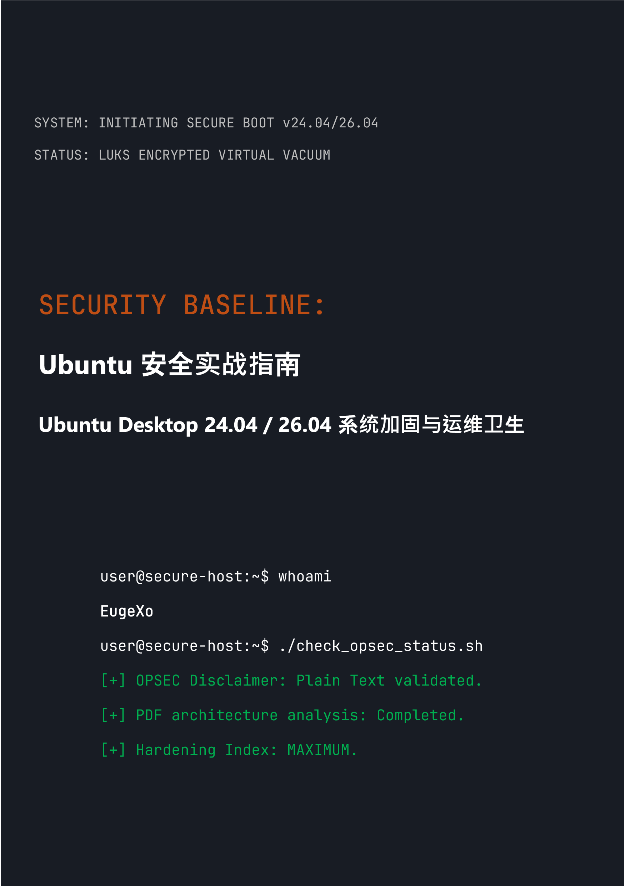

<div align="center">

# Security Baseline：Ubuntu 安全实战指南

## Ubuntu Desktop 24.04/26.04 LTS 系统加固与运维卫生

### Written and published by EugeXo

</div>

---

<p align="center">
  
</p>

---

## 全书结构与内容摘要

- [Security Baseline：Ubuntu 安全实战指南](#security-baselineubuntu-安全实战指南)
  - [Ubuntu Desktop 24.04/26.04 LTS 系统加固与运维卫生](#ubuntu-desktop-24042604-lts-系统加固与运维卫生)
    - [Written and published by EugeXo](#written-and-published-by-eugexo)
  - [全书结构与内容摘要](#全书结构与内容摘要)
  - [致谢](#致谢)
  - [格式安全保障（OPSEC 免责声明）](#格式安全保障opsec-免责声明)
  - [作者前言：本书为何而写、为谁而写？](#作者前言本书为何而写为谁而写)
    - [关于内容阐述原则：](#关于内容阐述原则)
  - [基础防护级别：操作卫生 12 条铁律](#基础防护级别操作卫生-12-条铁律)
  - [匿名性、隐私性与安全性的概念辨析](#匿名性隐私性与安全性的概念辨析)
  - [安装 Ubuntu 24.04/26.04 LTS 操作系统](#安装-ubuntu-24042604-lts-操作系统)
    - [引言：](#引言)
    - [硬件准备规范：](#硬件准备规范)
    - [发行版选择：](#发行版选择)
    - [安装向导分步操作：](#安装向导分步操作)
  - [首次启动](#首次启动)
  - [系统配置](#系统配置)
  - [开始使用终端控制台](#开始使用终端控制台)
    - [初始设置：](#初始设置)
      - [Gnome Terminal Ubuntu 24.04：](#gnome-terminal-ubuntu-2404)
      - [Ptyxis Ubuntu 26.04：](#ptyxis-ubuntu-2604)
    - [禁用自动挂载与可选优化设置：](#禁用自动挂载与可选优化设置)
    - [控制台命令历史记录持久化：](#控制台命令历史记录持久化)
    - [配置安全的 sudo 会话超时时间：](#配置安全的-sudo-会话超时时间)
    - [创建用于验证 Checks Passed 的测试文件：](#创建用于验证-checks-passed-的测试文件)
  - [网络与 VPN 配置](#网络与-vpn-配置)
    - [以太网有线连接（Wired connection）配置：](#以太网有线连接wired-connection配置)
    - [Wi-Fi 无线连接（Wireless connection）配置：](#wi-fi-无线连接wireless-connection配置)
      - [物理 PC 或笔记本电脑配置（完全随机化）：](#物理-pc-或笔记本电脑配置完全随机化)
      - [虚拟机配置（Strict 严格伪装为实体硬件厂商）：](#虚拟机配置strict-严格伪装为实体硬件厂商)
    - [NetworkManager 安全加固：抑制本地 mDNS、LLMNR、主机名泄露并保护 DNS：](#networkmanager-安全加固抑制本地-mdnsllmnr主机名泄露并保护-dns)
    - [将 Wi-Fi 设置为开机彻底禁用状态：](#将-wi-fi-设置为开机彻底禁用状态)
    - [移除具有安全隐患的蓝牙（Bluetooth）组件：](#移除具有安全隐患的蓝牙bluetooth组件)
    - [VPN 连接配置：](#vpn-连接配置)
  - [GRUB 引导加载程序安全配置与加固](#grub-引导加载程序安全配置与加固)
    - [设置密码以保护 GRUB：](#设置密码以保护-grub)
    - [软件层 IOMMU 加固：在内核级别保护 RAM 免受 DMA 攻击：](#软件层-iommu-加固在内核级别保护-ram-免受-dma-攻击)
  - [UFW 防火墙配置方案（含 Kill Switch 与无 Kill Switch 模式）](#ufw-防火墙配置方案含-kill-switch-与无-kill-switch-模式)
    - [配置带 Kill Switch 的防火墙：](#配置带-kill-switch-的防火墙)
    - [关于规则优先级顺序管理的重要补充：](#关于规则优先级顺序管理的重要补充)
    - [备选配置方案（不使用 VPN / 适用于虚拟机来宾系统）：](#备选配置方案不使用-vpn--适用于虚拟机来宾系统)
  - [系统内核调优、访问权限隔离与系统服务精简](#系统内核调优访问权限隔离与系统服务精简)
    - [保护网络协议栈与内核内存子系统：](#保护网络协议栈与内核内存子系统)
    - [底层 sysctl 加固：防御 TCP Timestamp Fingerprinting：](#底层-sysctl-加固防御-tcp-timestamp-fingerprinting)
    - [封锁冷门网络协议与老旧文件系统：](#封锁冷门网络协议与老旧文件系统)
    - [文件系统访问权限隔离：](#文件系统访问权限隔离)
    - [共享内存（shared memory）的安全挂载：](#共享内存shared-memory的安全挂载)
      - [平衡模式（推荐用于日常 Desktop）：](#平衡模式推荐用于日常-desktop)
      - [偏执模式（最高级别隔离）：](#偏执模式最高级别隔离)
    - [为易失性日志创建隔离的 RAM 虚拟盘：](#为易失性日志创建隔离的-ram-虚拟盘)
    - [切断视频流与音频录制：](#切断视频流与音频录制)
    - [移除打印与局域网资源发现系统服务：](#移除打印与局域网资源发现系统服务)
    - [伪装地理位置与系统时区：](#伪装地理位置与系统时区)
  - [软件源配置与系统更新](#软件源配置与系统更新)
    - [系统更新：](#系统更新)
    - [在隔离模式下部署 NVIDIA 图形环境：](#在隔离模式下部署-nvidia-图形环境)
  - [Ubuntu 终端环境配置](#ubuntu-终端环境配置)
    - [将 Gnome Terminal 与 Ptyxis 替换为 Ghostty：](#将-gnome-terminal-与-ptyxis-替换为-ghostty)
      - [Ubuntu 24.04 LTS Noble Numbat 用户安装步骤：](#ubuntu-2404-lts-noble-numbat-用户安装步骤)
      - [Ubuntu 26.04 LTS Resolute Racoon 用户安装步骤：](#ubuntu-2604-lts-resolute-racoon-用户安装步骤)
      - [Ubuntu 24.04/26.04 下的 Ghostty 配置示例：](#ubuntu-24042604-下的-ghostty-配置示例)
    - [可选操作！Ubuntu 26.04 —— 恢复 Gnome Terminal 并移除 Ptyxis：](#可选操作ubuntu-2604--恢复-gnome-terminal-并移除-ptyxis)
  - [移除并封禁 Snap 与遥测服务](#移除并封禁-snap-与遥测服务)
    - [移除 Snap：](#移除-snap)
    - [彻底清除 Canonical 遥测组件：](#彻底清除-canonical-遥测组件)
    - [彻底瘫痪后台固件追踪器 fwupd：](#彻底瘫痪后台固件追踪器-fwupd)
  - [安装安全工具 libpam-tmpdir、debsums 及系统负载监控工具 Btop](#安装安全工具-libpam-tmpdirdebsums-及系统负载监控工具-btop)
    - [安全工具 libpam-tmpdir：](#安全工具-libpam-tmpdir)
    - [校验工具 debsums：](#校验工具-debsums)
    - [直观高效的系统负载监控工具 Btop：](#直观高效的系统负载监控工具-btop)
    - [监控网络端口与连接状态：](#监控网络端口与连接状态)
  - [创建基准还原点：部署与配置 Timeshift 工具](#创建基准还原点部署与配置-timeshift-工具)
    - [引言：](#引言-1)
    - [Timeshift 在加密环境（LUKS + GRUB）下的工作特性：](#timeshift-在加密环境luks--grub下的工作特性)
    - [安全安装 Timeshift：](#安全安装-timeshift)
    - [初始配置与创建 1 号快照（无菌基准快照）：](#初始配置与创建-1-号快照无菌基准快照)
    - [后续控制节点：创建 2 号快照（正式投入使用前）：](#后续控制节点创建-2-号快照正式投入使用前)
    - [紧急回滚规程（当系统遭到入侵或损坏时）：](#紧急回滚规程当系统遭到入侵或损坏时)
  - [安装纯净的 .deb 版 Firefox 并移除 Snap 占位包](#安装纯净的-deb-版-firefox-并移除-snap-占位包)
  - [安装并配置 Mozilla Firefox 隐私与安全参数](#安装并配置-mozilla-firefox-隐私与安全参数)
    - [准备系统环境以进行配置：](#准备系统环境以进行配置)
    - [基础图形化隐私设置（所有人必做）：](#基础图形化隐私设置所有人必做)
    - [配置私人 DNS 提供商（DNS over HTTPS）：](#配置私人-dns-提供商dns-over-https)
    - [自动化安全加固：创建 user.js 配置文件：](#自动化安全加固创建-userjs-配置文件)
    - [部署终极防护扩展：](#部署终极防护扩展)
  - [安装与配置交互式网络防火墙 Portmaster](#安装与配置交互式网络防火墙-portmaster)
    - [引言：](#引言-2)
    - [准备工作、内核初次初始化与升级至新版本：](#准备工作内核初次初始化与升级至新版本)
  - [数据彻底销毁与数字足迹无痕清理](#数据彻底销毁与数字足迹无痕清理)
    - [引言：](#引言-3)
    - [数字足迹解剖：为什么不清除元数据的数据删除毫无意义？](#数字足迹解剖为什么不清除元数据的数据删除毫无意义)
    - [安装并使用 MAT2 工具清除元数据：](#安装并使用-mat2-工具清除元数据)
    - [安全且不可逆地删除文件与目录：](#安全且不可逆地删除文件与目录)
    - [shred 工具常用参数解析：](#shred-工具常用参数解析)
    - [全局清理磁盘空闲空间：](#全局清理磁盘空闲空间)
  - [Ubuntu 下的隐写术、文本混淆与痕迹隐藏](#ubuntu-下的隐写术文本混淆与痕迹隐藏)
    - [引言：](#引言-4)
    - [Linux 下的隐写术：将文件藏入多媒体载体：](#linux-下的隐写术将文件藏入多媒体载体)
    - [命令行工具 steghide：](#命令行工具-steghide)
    - [使用高级工具 StegoForge 进行深度隐写伪装：](#使用高级工具-stegoforge-进行深度隐写伪装)
    - [压缩包拼接术（无需第三方软件的快捷技巧）：](#压缩包拼接术无需第三方软件的快捷技巧)
    - [文本混淆：绕过自动化深度包检测系统（DPI）：](#文本混淆绕过自动化深度包检测系统dpi)
    - [潜伏威胁剖析：文件扩展名伪装（BiDi 双向文本攻击）：](#潜伏威胁剖析文件扩展名伪装bidi-双向文本攻击)
  - [加密套件 VeraCrypt 的安装与深度安全配置](#加密套件-veracrypt-的安装与深度安全配置)
    - [VeraCrypt 简介与安装：](#veracrypt-简介与安装)
      - [通过社区 PPA 仓库安装：](#通过社区-ppa-仓库安装)
      - [安装官方发行版（原生安装法 / Native）：](#安装官方发行版原生安装法--native)
    - [深度安全调优：内存（RAM）中的密钥保护（偏执模式）：](#深度安全调优内存ram中的密钥保护偏执模式)
    - [核心信息安全利器：创建隐藏卷（Hidden Volume）：](#核心信息安全利器创建隐藏卷hidden-volume)
    - [终极加固（Hardening）：配置 PIM 与硬件密钥文件：](#终极加固hardening配置-pim-与硬件密钥文件)
    - [真实世界威胁模型：为什么谨慎（偏执）必须是系统性的：](#真实世界威胁模型为什么谨慎偏执必须是系统性的)
  - [Yubico 硬件安全密钥的使用与配置](#yubico-硬件安全密钥的使用与配置)
    - [引言：](#引言-5)
    - [安装与配置：](#安装与配置)
    - [通过内核 udev 规则实现硬件级 Log Out / Kill Switch：](#通过内核-udev-规则实现硬件级-log-out--kill-switch)
  - [USBGuard 的安装与配置](#usbguard-的安装与配置)
    - [引言：](#引言-6)
    - [安装与配置：](#安装与配置-1)
  - [实现紧急关机按钮 Emergency Panic Button](#实现紧急关机按钮-emergency-panic-button)
    - [通过任意 USB 设备实现硬件紧急 Kill Switch：](#通过任意-usb-设备实现硬件紧急-kill-switch)
  - [本地密码管理器 KeePassXC 的安装与配置](#本地密码管理器-keepassxc-的安装与配置)
    - [引言：](#引言-7)
    - [密码库保护方案选型：](#密码库保护方案选型)
    - [安装软件包：](#安装软件包)
    - [创建数据库与硬件级防护配置：](#创建数据库与硬件级防护配置)
    - [深度加固内部安全设置：](#深度加固内部安全设置)
    - [通过受保护剪贴板安全输入凭证：](#通过受保护剪贴板安全输入凭证)
  - [网络抓包分析器 Wireshark 的安装与运行](#网络抓包分析器-wireshark-的安装与运行)
    - [引言：](#引言-8)
    - [安装并启动 Wireshark：](#安装并启动-wireshark)
    - [数据包捕获子系统极其重要的安全理念：](#数据包捕获子系统极其重要的安全理念)
    - [隐蔽采集流量转储包（命令行模式）：](#隐蔽采集流量转储包命令行模式)
    - [Wireshark 实战指南：](#wireshark-实战指南)
  - [AppArmor 访问控制保护系统的安装与管理](#apparmor-访问控制保护系统的安装与管理)
    - [引言：](#引言-9)
    - [新一代安全范式：内核级自动化隔离：](#新一代安全范式内核级自动化隔离)
    - [AppArmor 子系统实战加固：](#apparmor-子系统实战加固)
  - [隔离沙箱 Firejail 与 Bubblewrap 的安装与配置](#隔离沙箱-firejail-与-bubblewrap-的安装与配置)
    - [引言：](#引言-10)
    - [安装 Firejail 并准备 sandbox 环境：](#安装-firejail-并准备-sandbox-环境)
    - [Firejail 基础过滤参数速查手册：](#firejail-基础过滤参数速查手册)
    - [可选操作！Firejail 防护边界自动化（Firecfg 工具）：](#可选操作firejail-防护边界自动化firecfg-工具)
    - [安装 Bubblewrap：](#安装-bubblewrap)
    - [Bubblewrap 标志参数速查表（手册）：](#bubblewrap-标志参数速查表手册)
    - [为沙箱环境准备自定义桌面快捷方式：](#为沙箱环境准备自定义桌面快捷方式)
    - [为 Firejail 创建独立的 Firefox hardened 配置文件：](#为-firejail-创建独立的-firefox-hardened-配置文件)
    - [在 Bubblewrap 中创建 Firefox hardened 隔离环境：](#在-bubblewrap-中创建-firefox-hardened-隔离环境)
    - [PDF 文档密封隔离舱：在 Firejail 中安全打开文件：](#pdf-文档密封隔离舱在-firejail-中安全打开文件)
    - [使用 Bubblewrap 彻底密封 Document Viewer 以安全阅读 PDF：](#使用-bubblewrap-彻底密封-document-viewer-以安全阅读-pdf)
    - [在 Firejail 中安全查看图像文件的 Image Viewer：](#在-firejail-中安全查看图像文件的-image-viewer)
    - [使用 Bubblewrap 封装图像查看器 Image Viewer：](#使用-bubblewrap-封装图像查看器-image-viewer)
    - [Firejail 下的 KeePassXC 隔离方案：](#firejail-下的-keepassxc-隔离方案)
    - [通过 Bubblewrap 隔离 KeePassXC：](#通过-bubblewrap-隔离-keepassxc)
    - [安装与隔离办公套件 LibreOffice：](#安装与隔离办公套件-libreoffice)
    - [通过 Firejail 配置 LibreOffice 运行隔离：](#通过-firejail-配置-libreoffice-运行隔离)
    - [使用 Bubblewrap 封装 LibreOffice：](#使用-bubblewrap-封装-libreoffice)
    - [安装与隔离图像编辑软件 GNU Image Manipulation Program (GIMP)：](#安装与隔离图像编辑软件-gnu-image-manipulation-program-gimp)
    - [通过 Firejail 配置 GIMP 运行隔离：](#通过-firejail-配置-gimp-运行隔离)
    - [通过 Bubblewrap 配置 GIMP 运行隔离：](#通过-bubblewrap-配置-gimp-运行隔离)
    - [安装与隔离代码编辑器 VS Codium（软件开发 IDE 环境）：](#安装与隔离代码编辑器-vs-codium软件开发-ide-环境)
    - [在 Firejail 中隔离 VS Codium：](#在-firejail-中隔离-vs-codium)
    - [在 Bubblewrap 中隔离 VS Codium：](#在-bubblewrap-中隔离-vs-codium)
    - [本地神经网络 LM Studio Bionic 的安装与隔离：](#本地神经网络-lm-studio-bionic-的安装与隔离)
    - [通过 Firejail 部署运行 LM Studio：](#通过-firejail-部署运行-lm-studio)
    - [使用 Bubblewrap 封装 LM Studio：](#使用-bubblewrap-封装-lm-studio)
    - [安全通信配置：即时通讯软件与加密环境的强制隔离（作者 OPSEC 架构）：](#安全通信配置即时通讯软件与加密环境的强制隔离作者-opsec-架构)
    - [Telegram Desktop 的安装与隔离：](#telegram-desktop-的安装与隔离)
    - [通过 Firejail 保护 Telegram 运行环境：](#通过-firejail-保护-telegram-运行环境)
    - [通过 Bubblewrap 隔离 Telegram：](#通过-bubblewrap-隔离-telegram)
    - [通过 Bubblewrap 安装与隔离 Signal：](#通过-bubblewrap-安装与隔离-signal)
    - [宿主机密码学基石：GnuPG 密钥的生成与 OPSEC 防护：](#宿主机密码学基石gnupg-密钥的生成与-opsec-防护)
    - [Jabber 客户端 Psi+ 的安装与隔离：](#jabber-客户端-psi-的安装与隔离)
    - [在 Firejail 中隔离 PSI+：](#在-firejail-中隔离-psi)
    - [在 Bubblewrap 沙箱中隔离 Jabber 客户端 Psi+：](#在-bubblewrap-沙箱中隔离-jabber-客户端-psi)
    - [邮件客户端 Thunderbird 的安装与隔离（加密电子邮件通信环境）：](#邮件客户端-thunderbird-的安装与隔离加密电子邮件通信环境)
    - [使用 Firejail 隔离 Thunderbird：](#使用-firejail-隔离-thunderbird)
    - [通过 Bubblewrap 隔离 Thunderbird：](#通过-bubblewrap-隔离-thunderbird)
    - [进阶“偏执”模式：Firejail 结合 Overlay 会话保留机制：](#进阶偏执模式firejail-结合-overlay-会话保留机制)
  - [安装 Rkhunter 与 Rootkit 排查](#安装-rkhunter-与-rootkit-排查)
    - [安装 Chkrootkit 作为 Rkhunter 的补充防线：](#安装-chkrootkit-作为-rkhunter-的补充防线)
  - [防病毒扫描器 ClamAV 的安装与配置](#防病毒扫描器-clamav-的安装与配置)
    - [引言：](#引言-11)
    - [安装 ClamAV：](#安装-clamav)
    - [更新病毒特征库与绕过网络封锁：](#更新病毒特征库与绕过网络封锁)
    - [组织系统级病毒扫描：](#组织系统级病毒扫描)
    - [多线程高速扫描（Hardening）：](#多线程高速扫描hardening)
  - [VirtualBox 虚拟化环境的安装与配置](#virtualbox-虚拟化环境的安装与配置)
    - [反数字取证防护：将 VirtualBox 日志隔离至内存 RAM（`tmpfs`）：](#反数字取证防护将-virtualbox-日志隔离至内存-ramtmpfs)
  - [虚拟磁盘 VDI 的压缩与优化](#虚拟磁盘-vdi-的压缩与优化)
    - [引言：](#引言-12)
    - [清理 Windows 虚拟机磁盘空间：](#清理-windows-虚拟机磁盘空间)
    - [清理 Linux 虚拟机磁盘空间（Ubuntu / Kali Linux）：](#清理-linux-虚拟机磁盘空间ubuntu--kali-linux)
    - [在宿主机上执行虚拟磁盘最终压缩：](#在宿主机上执行虚拟磁盘最终压缩)
  - [Docker 容器化系统的安装与安全配置](#docker-容器化系统的安装与安全配置)
    - [引言：](#引言-13)
    - [默认 Docker 隐藏着哪些致命风险？](#默认-docker-隐藏着哪些致命风险)
    - [以 Rootless 无特权模式部署 Docker：](#以-rootless-无特权模式部署-docker)
    - [驯服网络并绑定至 UFW 防火墙：](#驯服网络并绑定至-ufw-防火墙)
    - [安全运行容器的实战示例：](#安全运行容器的实战示例)
    - [安全性实验验证（验证无 Root 权限）：](#安全性实验验证验证无-root-权限)
  - [文件完整性监控系统 AIDE 的安装与配置](#文件完整性监控系统-aide-的安装与配置)
    - [引言：](#引言-14)
    - [安装与配置 AIDE：](#安装与配置-aide)
    - [开展渗透模拟测试（防护有效性验证）：](#开展渗透模拟测试防护有效性验证)
  - [使用 Lynis 进行自动化系统安全审计](#使用-lynis-进行自动化系统安全审计)
  - [漏洞与密码泄露扫描器 Trivy 的安装与配置](#漏洞与密码泄露扫描器-trivy-的安装与配置)
  - [VirtualBox 中 Ubuntu/Xubuntu/Lubuntu 来宾系统的配置](#virtualbox-中-ubuntuxubuntulubuntu-来宾系统的配置)
    - [安装 Guest Additions（增强功能）：](#安装-guest-additions增强功能)
    - [安装 Mozilla Firefox：](#安装-mozilla-firefox)
    - [配置 VirtualBox 共享文件夹（Shared Folders）：](#配置-virtualbox-共享文件夹shared-folders)
    - [在运行 Ubuntu/Xubuntu/Lubuntu 的 VirtualBox 中安装 Ledger Live](#在运行-ubuntuxubuntulubuntu-的-virtualbox-中安装-ledger-live)
    - [在 Ubuntu 主宿主机上直接运行 Ledger Live](#在-ubuntu-主宿主机上直接运行-ledger-live)
  - [关于作者与法律声明](#关于作者与法律声明)
    - [联系方式与社区资源：](#联系方式与社区资源)


<br>
<br>
<br>
<br>
<br>
<br>
<br>

## 致谢

无需过多客套，我想向那些激励我动笔撰写本书、并在整个过程中一直陪伴和支持我的人们致以最诚挚的谢意。

感谢我们这个虽小但科技高度发达的国家——爱沙尼亚警察局网络安全部门的普通小伙子们，正是你们的鼓励与推动促使我开始写作这本书。

同时，特别感谢美国特勤局（US Secret Service）迈阿密分部的信息安全专家们，他们为本书部分章节的实战验证做出了宝贵贡献。事实证明，书中所描述的方法与技术在真实一线环境中表现极为出色。

当然，还要向我的家人致以无尽的感激，感谢他们惊人的耐心与精神支持；尤其是我的母亲，她完全理解我的工作，主动承担了大量日常琐事，为我腾出了宝贵的研究与实验时间。

**我想特别感谢我在英国（UK）的一位挚友对我的支持。当年我在迈阿密时我们曾密切往来，但遗憾的是后来失去了联系。我衷心希望我们能再次重逢。老朋友，如果你或你那位从事信息安全工作的儿子读到这些文字，请务必联系我——我的联系方式附在书末。我想你已经明白 *who is who!* ;)**

向我的虚拟助手——**Google 公司的 Gemini** 致以难以言表的谢意。在整个写作过程中，它始终是我形影不离的数字搭档，为这本硬核技术资料的结构梳理与翻译提供了无可估量的帮助。

同样感谢风趣而强大的助手——**OpenAI 公司的 ChatGPT**，感谢它在技术方案探讨、配置核查以及部分段落的精细润色和更精准措辞方面的协助。

当然，首要且最崇高的敬意属于 Google 和 OpenAI 的工程师与开发者们，感谢你们卓越的工作！

要说的话还有很多，但所有参与其中的人都已心照不宣。我由衷地为这本书终于面世而感到高兴。朋友们，我真诚地爱着你们、珍惜你们并尊重你们！

<br>

## 格式安全保障（OPSEC 免责声明）

出于信息安全与常识的考量，本指南的全部内容最初均以纯文本（带有 Markdown 标记的 Plain Text）格式提供。我们有意放弃了以 PDF 格式发布本书的计划。PDF 的架构过于臃肿，且时常成为攻击与植入恶意代码的载体。保护目标主机的安全，必须从安全地阅读其配置指南的那一刻开始。

纯文本文件是不含任何可执行代码的纯粹数据；而 PDF 格式默认支持内置 JavaScript 脚本、动态元素、交互式表单以及需要深度系统解析的复杂字体。在 Linux 的 PDF 解析器（例如系统默认的 `Evince` 阅读器或 `Poppler` 库）中存在 RCE（远程代码执行）级别的高危漏洞，这是已被历史反复证明的事实。Plain Text 格式不包含任何内置代码执行机制，极大地缩小了阅读材料时的攻击面（attack surface），从而确保在任何环境下都能安全阅读。

出于同样的原因，所有图表与插图均被移出正文，存放在独立的目录中。图像文件按文件夹和子文件夹分类存放，从而避免在阅读书籍过程中被自动加载渲染到内存中。

> [!NOTE]
> 本书的主要源格式为 Markdown。所有衍生格式（HTML、EPUB 等）均由经过严格核验的纯文本源文件生成。
> 
> 读者可通过以下三种方式之一使用本项目：
> 
> * 直接阅读原始 Markdown 文件。
> * 使用预构建的 HTML/EPUB 版本（后续将逐步提供）。
> * 自行从源码构建（Build）本书，并根据个人需求调整排版、结构、字体、样式或所包含的章节集合。
> 
> 这种方式确保了文本的透明性、变更的可审计性，以及对特定阅读工具的零依赖。

<br>

## 作者前言：本书为何而写、为谁而写？

当今的数字环境正变得日益复杂：网络威胁的数量不断攀升，被收集的数据规模持续扩大，用户越来越被迫独自承担起保护自身隐私与安全的责任。

本书旨在作为一本实战指南，指导读者构建一台完全受控的 Linux 工作站——在这里，安全不再被视为零散软件的堆砌，而是一套相互关联、环环相扣的完整防御体系。我的目标是展示如何利用 Linux 中触手可及的工具，搭建一个具备清晰威胁模型（Threat Model）的工作环境：涵盖应用沙箱隔离、网络活动监控、数据销毁与加密，以及对数字环境的自觉掌控。

**本书的目标——打造一台每一个操作都处于受控安全边界之内的工作站。**

本资料以教育和研究为目的编写，面向具备一定技术基础的用户、Linux 爱好者以及对实战信息安全感兴趣的专业人员。本指南并非 Linux 入门教程，它假设读者对终端、文件系统以及操作系统的基本工作原理已有初步了解。不过，细心且有求知欲的读者完全可以循序渐进地掌握所需工具。

书中描述的所有技术均应仅用于合法目的：保护个人数据、提升系统安全性以及学习信息安全的基本原理。

对信息的自觉保护与对技术的负责任使用，将让整个数字世界对每个人都更加安全。

### 关于内容阐述原则：

本书的目的并非为所使用的每一个工具编写百科全书，而是展示它们在统一防御模型中所扮演的角色。因此，各组件的内部机制与功能仅在理解其工作原理及安全应用所必需的范围内加以探讨。

高级功能、完整命令语法以及特定专业场景超出了本指南的范畴，读者可通过官方文档另行深入学习。

<br>

## 基础防护级别：操作卫生 12 条铁律

*Hello World 战友！*

在我们正式进入系统的硬核技术配置之前，先来筑牢根基。以下是我们必须熟记于心并无条件遵守的 12 条操作卫生（OPSEC）铁律。若不理解这些原则，任何安全工具——哪怕是最先进的工具——随着时间的推移都将变得形同虚设：

1. **在受保护环境中尽可能排除无线外设：** 包括无线蓝牙（Bluetooth）和 Wireless 设备（如无线耳机、耳麦、无线键盘和鼠标）。任何无线接口都会扩大攻击面，并迫使你不得不信任设备的协议栈、固件（firmware）及其安全实现。
2. **在安装操作系统阶段，务必为系统盘启用全盘加密（Full-Disk Encryption）。** 加密主密码长度至少设置为 24 个随机字符（包含特殊符号）！
3. **定期按计划更换操作系统的登录密码。** 用户密码应保持唯一且足够长（建议不少于 16 个字符）。在使用硬件安全令牌时，密码并非被替代，而是与硬件构成双重保护因子。
4. **为系统引导加载程序 GRUB 启用密码保护**，从而在攻击者获得计算机物理接触权时，彻底杜绝其篡改内核参数或编辑引导配置。
5. **部署硬件安全令牌**（YubiKey 或其合法同类产品），作为系统登录及确认超级用户（root）命令的强制双因素认证（2FA）。
6. **彻底清理系统中的一切冗余软件。** 这尤其适用于闭源专有软件（Proprietary Software）。牢记基本法则：系统中的第三方服务、守护进程和应用程序越少，潜在的攻击面和严重漏洞数量就越少。
7. **始终保持操作系统处于最新状态。** 养成铁一般的习惯，定期通过命令行工具（终端）检查并安装系统安全更新。
8. **持续监控网络与网络接口状态。** 密切关注后台连接究竟指向哪些远程资源，以及我们的网络流量流向何处。
9. **定期对主机执行内部安全审计。** 建议每周至少 2–3 次对系统进行 Rootkit、病毒排查以及系统文件完整性校验。
10. **绝不在主系统中直接运行来源可疑的可执行文件。** 如需安全测试，务必使用隔离沙箱 `Firejail` 或虚拟机。
11. **针对危险的 DMA 攻击（直接内存访问）实施严格防护，并为 BIOS/UEFI 设置密码：** 在 BIOS/UEFI 设置中，强制将 Thunderbolt/USB4 端口置于最高认证模式（*Kernel DMA Protection*），以降低外部设备通过 DMA 访问攻击内存的风险。为 BIOS/UEFI 设置管理员密码。此外，彻底禁用睡眠模式（*Sleep Mode*），因为在该状态下磁盘加密密钥会以明文形式驻留在 RAM 中。
12. **只要离开工作岗位哪怕片刻，也必须强制锁定当前会话；长时间离开时，务必彻底关闭计算机电源。**

> [!NOTE]
> 在任何安全体系中，最薄弱的环节往往不是软件，而是用户的行为。
>
> 业内流传着一句颇具讽刺意味的名言：“最大的漏洞就在椅子和键盘之间。”
>
> 正因如此，技术层面的安全加固（Hardening）必须与操作纪律相辅相成：打开文件前先检查、发布前清除元数据（Metadata）、监控网络活动，并时刻清晰地认知自身的威胁模型（Threat Model）。

## 匿名性、隐私性与安全性的概念辨析

在日常交流中，这三个概念经常被混为一谈，但实际上它们解决的是完全不同的问题。

**匿名性（Anonymity）** 回答的是：“我的行为能否与我的真实身份关联起来？”
在理想状态下，对手能看到行为本身，但完全无法将其追踪到现实世界中的某个具体个人。

**隐私性（Privacy）** 回答的是：“我能否控制关于我的哪些信息被收集，以及这些信息会落入谁手？”
对手知道这个人的存在，但此人能够自主控制将哪一部分信息对外披露。

**安全性（Security）** 回答的是：“我能否保护我的系统、数据和设备免遭未经授权的访问？”
用户在其数字边界内处于全天候戒备状态。对手可能就站在大门外，但没有足够的能力攻破系统并窃取数据。

一台设有高强度密码的加密笔记本电脑提升了安全性。但如果用户自愿将所有个人信息发布到互联网上，这并不能提升隐私性。使用匿名化工具可以增加追踪用户身份的难度，但无法保护系统免受恶意软件的侵害。一个高度安全的系统可能并不匿名，而一个匿名的系统也可能并不安全。

**本指南的目的并非制造绝对安全或网络完全隐身的幻觉；其真正目标是展示如何构建一套系统，让用户清楚地知道自己降低了哪些风险，以及哪些局限性依然存在。**

<br>

## 安装 Ubuntu 24.04/26.04 LTS 操作系统

### 引言：

在本章中，我们将结合安全要求讲解 Ubuntu 操作系统的安装过程。同时，本章也涵盖将系统部署到外部 USB 和 Thunderbolt 存储设备的可行方案。

在开始安装之前，必须考虑几个重要因素。最常见的风险之一，是在安装引导加载程序（Bootloader）时选错目标磁盘。

在 Linux 中，通常由 GRUB（GRand Unified Bootloader）负责系统引导。在安装过程中，GRUB 可能会被写入并非用户计划的存储设备——例如另一块硬盘的 EFI 分区中。结果可能导致现有操作系统在恢复引导加载程序之前无法正常启动。

为了彻底杜绝此类情况，最稳妥的做法是在安装 Linux 期间，从物理上断开所有与当前待安装系统无关的内置 HDD 和 SSD。

对于台式机（PC），这通常只需打开机箱侧板并使用普通螺丝刀即可完成。对于笔记本电脑，具体步骤取决于设备内部结构，可能会稍微复杂一些。

苹果设备（尤其是配备 T2 芯片和 Apple Silicon 的现代 MacBook）由于硬件平台特性、引导链机制以及 Linux 兼容性限制，不推荐用于本方案。

> [!NOTE]
> 本指南已在 **Ubuntu 24.04 LTS Noble Numbat (24.04.4)** 和 **Ubuntu 26.04 LTS Resolute Racoon (26.04.0)** 上完成全面测试与验证。
>
> 测试环境涵盖 **VirtualBox 7.2.x**、**VMware Workstation Pro 26H1**，以及配备 Intel 核芯显卡和 NVIDIA 独立显卡的物理主机。

### 硬件准备规范：

* **台式机（PC）：** 拆下机箱侧板，彻底断开计算机电源插头，拔除除目标 Linux 安装盘之外的所有存储设备。若使用 M.2 NVMe 固态硬盘，拆卸时需使用螺丝刀。

* **笔记本电脑：** 彻底关闭设备电源，拔掉电源适配器，如条件允许请断开或拆下内置电池。打开底盖后，断开或取出除目标磁盘之外的所有存储设备。

如果将系统安装到外部 USB 或 Thunderbolt 移动硬盘上，则仅保留该外接设备处于连接状态，将其作为安装系统的唯一目标介质。

> [!WARNING]
> 在安装操作系统之前，必须进入 BIOS/UEFI 检查图形子系统设置。在配备双显卡切换的笔记本电脑上，建议启用 Hybrid Mode/Optimus 模式，使界面的主要渲染工作通过处理器内置核显完成。这样可以原生使用 Linux 内核开源驱动（如 i915、xe 或 amdgpu，视硬件而定），避免对闭源专有组件的非必要依赖。
>
> 若硬件支持，请设置 BIOS/UEFI 管理员密码，并启用存储设备的硬件级加密保护（前提是具体型号的 SSD/HDD 支持该功能）。这能有效降低引导设置被未授权篡改的风险，增加针对设备物理接触攻击的难度。
>
> 检查 Secure Boot 状态。如果所用平台与安装方案支持其正常工作，建议保持开启此功能。
>
> **在台式机或笔记本电脑中，仅保留即将用于安装系统的那一块硬盘处于连接状态。**
>
> 全程**断网安装** Linux——拔掉 LAN 网线，且不连接任何 Wi-Fi 无线网络。所有必需的软件包与更新将在完成系统基础安全配置后再行安装。

为什么要断网执行系统安装？

离线安装可以在系统初次部署的关键时刻最大限度减少外部干扰因素：

* 安装期间不存在任何活跃的外部网络连接；
* 避免在完成基础加固前自动下载第三方组件或更新；
* 减少安装阶段可能启动的后台网络服务与进程数量；
* 更容易掌控操作系统的初始状态，明确最初安装了哪些组件；
* 在完成系统基础安全强化之前，将潜在的外部攻击接触点降至最低。

在完成初始配置并部署好防护机制后，我们将在完全受控的环境中重新恢复网络连接。

### 发行版选择：

我们将以当前主流的 **Ubuntu 24.04 LTS Noble Numbat** 和 **Ubuntu 26.04 LTS Resolute Racoon** 为例进行演示。它们上手简单、资源占用不高，即便在仅有 2 GB 内存的电脑上（尤其是选用轻量级衍生版 Xubuntu 或 Lubuntu 时）也能稳定运行。此外，它们拥有全球 Linux 社区的强大支持，最重要的是，“开箱即用”的基础安全水准相当出色。

建议选择英文界面进行操作系统安装。一旦遇到意外报错，使用英文在专业技术社区检索和排查问题会容易得多。当然，这并非强制要求，系统语言的最终选择权在你手中。本指南中我使用的是美式英语本地化——English (US)。

### 安装向导分步操作：

**1.** 选择语言后，进入键盘布局设置菜单 **«Select your keyboard»**，选择 **English (US)** 或其他顺手的键盘布局。

**2.** 在网络连接窗口中，严格选择 **«Do not connect to the internet»**（不连接互联网）。

**3.** 接下来选择 **«Interactive Installation»**（交互式安装）和 **«Default selection»**（默认精简选择）——这能确保系统仅安装最精简的基础软件集合。如果日后需要办公套件等额外软件包，我们再自行从官方软件源手动安装。总体而言，最小化初始软件数量能有效减少潜在攻击面。

**4.** 在下一步中，理所当然地不勾选安装专有软件（Proprietary software）。

**6.** **Ubuntu 24.04：** 在 **«Disk Setup»**（磁盘设置）菜单中点击 **«Advanced features...»**（高级功能），选择 **«Use LVM and encryption»**（使用 LVM 并加密），点击 **«OK»** 确认，然后点击 **«Next»**。

**Ubuntu 26.04：** 保持默认选项 **«Erase disk and install Ubuntu»**，点击 **«Next»**。

**7.** **Ubuntu 24.04：** 下一步菜单要求输入磁盘加密主密码（Master Password）。请设置（并务必牢记）一个长度不少于 24 个字符（越长越好）的复杂密码，充分利用键盘上的所有字符类型：大小写英文字母（A-Z, a-z）、数字（0-9）、特殊符号以及空格键。点击 **«Next»**。

**Ubuntu 26.04：** 选择 **«Encryption with passphrase»**，点击 **«Next»**，然后在下一界面输入磁盘加密主密码。同样设置（并务必牢记）长度不少于 24 个字符的复杂密码，混合大小写英文字母、数字、特殊符号和空格键。点击 **«Next»**。

**8.** 随后出现 **«Create your account.»**（创建账户）界面。在 **«Your name»** 栏填写预先构思好的名称（选择不暴露真实身份的中性名称，例如 `user`）。在 **«Computer name»** 栏输入任意主机名（例如 `host-node`），在 **«Pick a username»** 中自定用户名。在 Choose password 栏设置长度不少于 16 个字符的复杂密码，混合大小写字母、数字、特殊符号和空格。保持勾选 **«Require password to login»**，点击 Next。

**9.** 在接下来的时区选择地图界面中，任选一个时区（后续我们会将系统时区统一修改为 UTC），点击 **«Next»**。

**10.** 在最终确认窗口中核对配置无误后，点击 **«Install»** 按钮。

随后系统将开始自动安装与配置。整个过程速度很快，无需人工干预。安装完成后，程序会提示移除 USB 安装介质并重启系统。至此安装阶段结束，你可以将先前断开的所有内部硬盘重新接回原位。

> [!IMPORTANT]
> 在 Ubuntu 24.04/26.04 中，有两种截然不同的磁盘数据保护方案：基于用户口令（passphrase）的传统加密，以及基于硬件 TPM 自动解锁的加密。两者均以 LUKS 作为底层磁盘加密基础，核心差异在于解锁密钥的获取机制。
> 
> 本指南刻意采用经典的 LVM + LUKS + 超长用户口令方案。这契合本书设定的威胁模型——即设备所有者在解锁加密存储前必须进行显式的身份认证。
> 
> 这并不意味着 TPM/FDE 是“不安全”的方案。它面向不同的使用模型，并具有自身优势，包括自动校验平台状态以及防御特定引导链攻击。但在本指南的框架下，我们原则上不使用自动解锁磁盘，而是优先采用超长 LUKS 口令进行人工认证。
> 
> 因此，本书选择传统 LUKS 是在既定威胁模型下的审慎决策，而非断言 TPM/FDE 整体不安全。
>
> 我采用通过 LVM 手动创建高强度传统主密码的方案，从信息安全角度而言，是防御针对关机设备物理接触攻击的最可靠技术手段。若启用 TPM 自动解锁，用户口令将不再是核心保护屏障，此时安全性完全依赖于可信平台模块状态、引导加载程序以及硬件实现的完整性。手动输入超长 LUKS 密码彻底消除了这一潜在风险向量。

**本章附录：** *_assets\images\1_os_install*

<br>

## 首次启动

使用加密磁盘密码和用户账户密码登录系统。今后在终端通过 `sudo` 执行管理操作时也将使用此用户密码进行验证。首先会看到欢迎向导，点击 **«Next»**。

在 Ubuntu 26.04 中，下一个界面为 **«Location Services»**（定位服务），默认开关处于关闭状态，直接点击 **«Next»** 即可。Ubuntu 24.04.4 中无此界面。

在 Ubuntu 24.04 中，下一个界面会提示启用 *Ubuntu Pro* 订阅——点击右上角的 **«Skip»** 按钮跳过。Ubuntu 26.04.0 中无此界面。

在出现的 **Help improve Ubuntu** 界面中，务必选择或保持 **«No, don't send system data»**（在 26.04 中还有默认关闭的 Share error reports with the Ubuntu team 选项，保持其关闭状态），点击 **«Next»** 直至出现完成窗口，最后点击 **«Finish»** 结束向导。至此，我们已在界面层禁用了向 Canonical 发送诊断与遥测数据。

> [!NOTE]
> 尽管我们点击了 **«Skip»**，Canonical 仍会在操作系统后台保留订阅检查服务。无需担心，稍后我们将通过终端手动彻底清除这些组件。

**本章附录：** *_assets\images\2_first_boot*

<br>

## 系统配置

桌面默认左侧设有任务栏——称为 **«Dock»**。点击任务栏角落的圆形系统图标（**«Show Apps»**），选择 **«Settings»**（也可通过顶部状态栏进入：点击右上角状态菜单，点击齿轮图标打开 **«Settings»**）。

进入系统设置菜单后，首先将 **«Bluetooth»**（蓝牙）和 **«Wi-Fi»** 开关拨至关闭状态。这会使计算机进入“飞行模式”，在完成最终底层封锁前临时切断所有无线接口。

接着通过 **«Ubuntu Desktop»** 菜单按个人习惯调整 **«Dock»** 栏。例如，可在 **«Position on screen»** 中选择 **«Bottom»** 将其移至屏幕底部，并在 **«Icon size»** 中调整图标大小。若关闭 ***«Panel Mode»***，**«Dock»** 会变得如同 macOS 程序坞般精致紧凑。此外，将任务栏上不需要的默认应用快捷方式全部移除。

进入 **«Privacy & Security»**（隐私与安全），打开子项 **«Diagnostics»**/**«Telemetry»**。在 **«Problem Reporting»** 行中，将 **«Send error reports to Canonical»** 严格设为 **«Never»**。

前往相邻的 **«File History & Trash»** 选项。此处极其关键：务必彻底关闭 **«File History»**（文件历史记录）功能，并将 **«Automatically Delete Trash Content»**（自动清空回收站）和 **«Automatically Delete Temporary Files»**（自动清理临时文件）设为开启，周期选为 **«1 day»**。

> [!IMPORTANT]
> 自动清空回收站与缓存仅仅是基础的表面卫生。出于安全考量，机密文件、密码和日志必须始终通过终端使用底层工具 `shred`（后文将详细讲解）手动覆写销毁，从而极大增加数字取证软件从存储介质表面恢复数据的难度（需注意不同存储介质的数据擦除特性：机械硬盘 HDD 可直接使用 shred，而现代 SSD/NVMe 更可靠的防护方式是全盘加密并彻底销毁加密密钥）。

在相邻子项 **«Location»** 中确认开关处于 **«Off»** 状态——操作系统无需知道我们的物理地理位置。

在 **«Screen Lock»** 项中调整 **«Blank Screen Delay»**（息屏延迟）：默认为 5 分钟，出于安全考虑建议改为 1–2 分钟。同时开启 **«Automatic Screen Lock»**（自动锁屏）。在同一页面进入 **«Automatic Screen Lock Delay»**，设为 **«Screen Turns off»** 或 30 秒（最长 1 分钟，即屏幕关闭前会先变暗 30 秒或 1 分钟）。并同步开启 **«Lock Screen Notifications»** 和 **«Lock Screen on Suspend»**。

接着在 **«Connectivity»** 项中关闭 **«Connectivity Checking»**（连通性检测），以减少系统在后台自动发起的网络探测请求。

**«Thunderbolt»** 项：若不使用任何该接口外设，直接将其禁用。

在 Ubuntu 26.04 的 **«Privacy & Security»** 中新增了 **«Cameras»**（摄像头）选项，进入并将其开关拨至关闭状态。

进入 **«System»** 下的 **«Date & Time»** 子项校准系统时间。如果系统准备在强匿名环境下通过加密 VPN 隧道或 Tor 网络运行，请关闭 **«Automatic Date & Time»**，改为手动设置时区。本书后续所有章节将统一采用 UTC 作为标准时间。

在 **«Keyboard»** 项中添加所需的键盘输入法布局。系统菜单中的其余选项卡多为外观与个性化设置，此处不再赘述。

在 **«Sound»**（声音）项中，建议点击 **Input Volume** 旁边的麦克风图标将其静音关闭。

> [!NOTE]
> 在 Ubuntu 24.04/26.04 的 **«Privacy & Security»** 菜单中设有一个重要子项——**«Device Security»**（设备安全）。其中直观显示了 **«Secure Boot»**（安全启动）的状态。若显示为绿色，说明安全启动已激活。Secure Boot 用于校验引导链各组件的数字签名，确保启动过程中仅加载符合 UEFI 安全策略的可信或已签名组件。
>
> 如果此处出现内核未受保护的红色或黄色警告，则直接表明主板 BIOS/UEFI 中尚未启用基础硬件防护功能。若缺少这些硬件防护，开机状态或进入睡眠模式的机器内存中的数据价值将面临极大风险，攻击者可能借机读取驻留在 RAM 中的敏感数据（包括潜在的加密密钥材料）。
>
> 旁边还有 **«Checks Passed»**/**«Protected»** 检查项。稍后我们将创建一个测试文本文件，以查看该菜单中的检测记录。

**本章附录：** *_assets\images\3_system_settings*

<br>

## 开始使用终端控制台

### 初始设置：

通过应用程序菜单（**«Show Apps»**）启动终端开始操作。为了快速、方便地访问命令行，可以将终端快捷方式固定到 **«Dock»** 任务栏上。

Ubuntu 基于 Debian 构建，使用相同的 `.deb` 软件包格式。软件安装通过 APT 软件包管理器从 Ubuntu 官方软件源执行，必要时通过 `sudo` 运行管理操作。

默认情况下，成功通过身份验证后，`sudo` 会将认证结果缓存 15 分钟。在此期间，后续通过 `sudo` 执行的命令通常无需再次输入密码。对于安全性要求较高的系统，我们认为这样的时间窗口过长，因此在本章末尾会将其缩短至 0–2 分钟。

打开终端窗口时，会显示一行提示符，其中包含当前用户名、计算机网络名称以及当前工作目录路径，并以美元符号 **`$`** 结尾。该符号直观表明当前会话正以普通用户模式运行。执行大多数配置操作时，需要在命令前加上 `sudo` 前缀（例如 `sudo apt update`）。

要进入完整的交互式超级用户 `root` 模式，可使用 `sudo -i` 或 `sudo -s` 命令。`sudo -i` 会加载 `root` 专属的环境变量，完全模拟纯净的 root 登录；而 `sudo -s` 虽然启动 root shell，但会保留当前普通用户的环境变量。如需短时间获取完整的 root 会话，建议优先使用 `sudo -i`。与 `sudo -s` 不同，该模式会启动带有 `root` 环境的登录 shell（login shell），非常适合执行较长时间的管理操作。在日常操作中，更推荐通过 `sudo` 逐条执行命令，避免无故停留在常驻 root 会话中。

成功输入密码后，提示符中的 **`$`** 符号将变为井号 **`#`**。这表示系统已切换至拥有最高管理权限的超级用户模式。在此模式下可以修改任何文件（包括内核参数），因此操作时务必极其谨慎。

> [!IMPORTANT]
> 熟记 Linux 终端的基础命令，将使系统操作变得高效而顺畅。

#### Gnome Terminal Ubuntu 24.04：

Ubuntu 24.04 中的 Terminal 非常适合直接在菜单中按个人喜好调整外观设置。它支持窗口透明度（Transparency）以及自定义配色方案（甚至可精细调节至 Custom 色调），使后续终端操作在视觉上非常舒适。

在开始正式配置前，先调整终端外观。在窗口右上角放大镜图标旁点击 **«汉堡菜单»**（三条横线按钮），进入 **«Preferences»**（首选项）。在打开的 **«Profiles»** 选项卡中选择默认配置文件 **«Unnamed»**，即可按个人喜好调整颜色、字体、工作区尺寸及窗口透明度。

其不足之处在于仍采用较旧的 GTK3 技术栈，缺少 GTK4 应用程序所具备的部分现代隔离与安全机制。

#### Ptyxis Ubuntu 26.04：

在长期使用 Ptyxis 之前，我们先对其进行舒适度优化。点击窗口右上角的 **«汉堡菜单»**（三条横线按钮），进入 **«Preferences»**。此时会直接进入 **«Appearance»**（外观）菜单，系统会提供预设方案供选择。首先建议将菜单略微向下滚动，关闭 **«Use System Font»**（使用系统字体）开关，然后自选合适的字体大小。配色方案已内置多套预设，在 **«Appearance»** 最上方点击下拉菜单 **«Show All Palettes»**，选择最契合你审美的配色。如需更深度定制颜色与字体，则需要编辑配置文件。

**Ptyxis 自定义配置文件示例**

**1.** 打开控制台，创建配置文件夹并新建自定义配色文件：
```bash
mkdir -p ~/.local/share/org.gnome.Ptyxis/palettes && nano ~/.local/share/org.gnome.Ptyxis/palettes/my-homebrew.palette
```

**2.** 在文件中填入调整后的浅深灰色或深邃蓝色背景配置：
```ini
[Palette]
Name=My Homebrew

Foreground=#00ff00
Background=#171717 或 #0b1020
Color0=#000000
Color1=#990000
Color2=#00a600
Color3=#999900
Color4=#0d0dbf
Color5=#b200b2
Color6=#00a6b2
Color7=#bfbfbf
Color8=#666666
Color9=#e50000
Color10=#00d900
Color11=#e5e500
Color12=#0000ff
Color13=#e500e5
Color14=#00e5e5
Color15=#e5e5e5

BellForeground=#00ff00
BellBackground=#171717 或 #0b1020
RemoteForeground=#00ff00
RemoteBackground=#171717 或 #0b1020
SuperuserForeground=#00ff00
SuperuserBackground=#171717 或 #0b1020
```

在 `nano` 编辑器中保存配置：按下组合键 **«Ctrl + O»** → **«Enter»**，然后按 **«Ctrl + X»** 退出。

**3.** 为窗口添加轻微透明度。数值 `0.00` 表示完全透明，`1.00` 表示完全不透明，请根据需要自行设定：
```bash
gsettings set org.gnome.Ptyxis.Profile:/org/gnome/Ptyxis/Profiles/$PTYXIS_PROFILE/ opacity 0.95
```

随后关闭控制台并重新启动。新创建的配置文件应已出现在 **«Palettes»** 列表中。通过 **«汉堡菜单»**（三条横线按钮）依次进入 **«Preferences»** → **«Appearance»** → **«Show All Palettes»**，找到 **«My Homebrew»** 并选中即可。

> [!IMPORTANT]
> 需要明确的是，在对比 Ptyxis 与 GNOME Terminal 时，前者凭借更强的工作环境隔离能力，更契合本书所选定的安全模型。因此，将 Ptyxis 替换为更熟悉的 GNOME Terminal 意味着放弃部分安全隔离特性，在我们的场景中属于一种妥协。
> 
> 后文我们还将介绍另一款备选终端模拟器 Ghostty，并单独讲解其安装与基础配置，方便读者自行对比 Ptyxis 与 GNOME Terminal，为自己的系统挑选最合适的终端工具。

### 禁用自动挂载与可选优化设置：

**1.** 我们要做的第一件事是禁用存储介质自动挂载（禁止自动挂载，但不限制用户或应用程序手动挂载介质）：
```bash
gsettings set org.gnome.desktop.media-handling automount false && gsettings set org.gnome.desktop.media-handling automount-open false
```

**2.** 让所有启动的程序窗口严格居中显示。在我看来，这种方式在虚拟机中操作尤为顺手：
```bash
gsettings set org.gnome.mutter center-new-windows true
```

如果出于某种原因你不习惯窗口居中布局，只需将上述命令中的 `true` 替换为 `false` 重新执行即可。

**3.** 为了避免在图形菜单中来回翻找，通过两条快捷系统命令恢复经典的 `Shift + Alt` 键盘输入法布局切换快捷键：
```bash
gsettings set org.gnome.desktop.input-sources xkb-options "['grp:alt_shift_toggle']" && gsettings set org.gnome.desktop.wm.keybindings switch-input-source "['<Shift>Alt_L', '<Alt>Shift_L']"
```

### 控制台命令历史记录持久化：

默认情况下，Bash 仅保存有限条数的命令历史：旧记录会随时间被覆盖，且同时打开多个终端窗口可能导致历史保存发生冲突。此外，历史记录通常并非在每条命令执行后立即写入文件，而是在退出 shell 时才统一写入。若系统发生异常断电或崩溃，最近执行的命令可能无法写入历史文件，这对我们的安全审计场景极为不利。

下面我们将配置 Bash，使其以最快速度实时保存命令历史，并解除条数限制，确保已执行的操作记录永不丢失。

**1.** 打开主目录下的 `.bashrc` 配置文件：
```bash
nano ~/.bashrc
```

**2.** 跳转到文件最末尾（**«Alt + /»**），添加以下内容：

```bash
# 无限历史记录容量
export HISTSIZE=-1
export HISTFILESIZE=-1

# 按下 Enter 后立即将命令写入磁盘
export PROMPT_COMMAND="history -a; $PROMPT_COMMAND"

# 仅忽略连续重复的相同命令
export HISTCONTROL=ignoredups

# 记录精确的执行日期与时间戳
export HISTTIMEFORMAT="%F %T "

# 以追加模式写入文件而非覆盖
shopt -s histappend
```

按 **«Ctrl + O»** → **«Enter»** 保存文件，然后按 **«Ctrl + X»** 退出。

* `HISTSIZE=-1` 与 `HISTFILESIZE=-1` —— 彻底解除历史记录行数上限。
* `history -a` —— 输入命令后立即强制刷写到磁盘。
* `ignoredups` —— 过滤连续重复输入的同一命令，但不会隐藏以空格开头的命令。
* `HISTTIMEFORMAT` —— 记录精确时间戳，对安全事件溯源至关重要。
* `shopt -s histappend` —— 合并多个并行打开的终端窗口产生的日志。

**3.** 无需重启终端，立即将配置应用到当前会话：
```bash
source ~/.bashrc
```

**4.** 验证新版日志记录是否生效：
```bash
history
```

现在我们拥有了一套完整的、防丢失且带有精确执行时间的命令时间轴。

**5.** 清理当前控制台屏幕上的杂乱输出：
```bash
clear
```

**6.** 在操作过程中，有时难免会误将敏感数据（如密码或令牌）直接输入到控制台中。绝不能让它们留在历史日志里。如需精准删除最近一条误输入的命令，执行：
```bash
history -d $(history | tail -n 1 | awk '{print $1}')
```

**7.** 如果需要彻底清空当前会话的历史记录并同步更新磁盘文件，可使用清空与覆写组合命令：
```bash
history -c && history -w
```
参数 `-c` 会彻底清空当前终端内存中的历史缓存，而 `-w` 则将此空状态强制写入历史文件，抹除所有既往日志。

即便配置了实时无限历史记录，普通用户（或已获取当前会话控制权的攻击者）仍可通过 `history -c && history -w` 手动清空历史文件，或者直接执行 `rm ~/.bash_history` 将其删除。

单纯通过 `chmod -w` 修改权限在此处行不通：一旦禁止写入该文件，Bash shell 将完全无法记录新命令。我们需要实现的效果是：允许向文件*追加内容*，但严禁*覆盖或删除*文件。

在 Linux 中，可借助文件系统的特殊扩展属性（`chattr`）解决这一问题。

**8.** 切换至超级用户模式，因为只有 `root` 才有权修改文件的系统级属性：
```bash
sudo -i
```

**9.** 为历史记录文件赋予 `+a`（仅追加 / append-only）特殊属性。为避免手动输入用户名，直接使用系统变量 `$SUDO_USER`，即便在 `root` 会话下它也会自动替换为原始主用户名：
```bash
chattr +a /home/$SUDO_USER/.bash_history
```

**10.** 如果日后作为系统管理员确实需要强制清理或编辑该文件，可通过以下命令解除保护属性：
```bash
chattr -a /home/$SUDO_USER/.bash_history
```

维护操作完成后，务必重新加回 `+a` 属性。

> [!IMPORTANT]
> `append-only` 属性并非绝对防护。拥有 `root` 权限的用户随时可以移除该属性并修改或删除历史文件。因此，我们应将其视为额外的纵深防御层，而非不可攻破的日志保险箱。

### 配置安全的 sudo 会话超时时间：

为了强制缩短终端中密码认证的有效时长，我们将创建一个独立的配置文件。不建议直接编辑系统主文件 `/etc/sudoers`，以免不慎破坏 `sudo` 配置语法而导致丧失管理权限。

**1.** 使用 `nano` 文本编辑器创建并打开一个新的专用配置文件：
```bash
nano /etc/sudoers.d/99_sudo_timeout
```

**2.** 在打开的空白文件中写入以下一行内容：
```ini
Defaults timestamp_timeout=2
```

数值 `2` 指示 `sudo` 将成功认证的结果缓存 2 分钟。超时后，下一次执行 `sudo` 命令将重新要求输入密码。如有需要，此处也可设为 `0`——即每次调用 `sudo` 都强制要求验证密码，这是高安全等级主机的严格安全配置。

在 `nano` 编辑器中按 **«Ctrl + O»** → **«Enter»** 保存配置，然后按 **«Ctrl + X»** 退回到 `root` 控制台。

**3.** 为该配置文件设置严格的访问权限：
```bash
chmod 0440 /etc/sudoers.d/99_sudo_timeout
```

> [!WARNING]
> 在关闭终端或退出 `root` 模式之前，**必须**使用以下命令检查所创建规则的语法是否正确：
> ```bash
> visudo -c
> ```
> 如果系统返回 `...parsed OK`，说明语法无误且配置安全。如果工具报出语法错误——请立即重新用 `nano` 打开文件进行修正。否则一旦关闭当前终端，你将彻底失去 `sudo` 管理权限！

**作者注：** `visudo` 工具仅检查 `sudo` 权限管理子系统的配置文件语法（即 `/etc/sudoers` 主文件以及 `/etc/sudoers.d/` 目录下的所有规则文件）。在编辑系统中的其他任何文件（无论是网络配置、Firefox 的 `user.js`、防火墙规则还是 GRUB 参数）时，调用 `visudo -c` 既无必要也毫无意义——它根本不会检查这些文件。

**4.** 退出超级用户模式，返回普通用户会话：
```bash
exit
```

**5.** 附赠一个实用的小技巧：如果已完成终端管理操作，希望立即注销当前活跃的 `sudo` 认证令牌而无需等待 2 分钟自动过期，可执行：
```bash
sudo -k
```

`sudo -k` 命令会立即使当前的 `sudo` 认证时间戳失效，下一次调用 `sudo` 时将立即重新要求输入密码。

### 创建用于验证 Checks Passed 的测试文件：

**1.** 创建一个测试文件，用于检查 **«Privacy & Security»** → **«Device Security»** → **Checks Passed** 菜单状态：
```bash
touch ~/Downloads/checks_passed.txt
```

**2.** 使用 `nano` 编辑器打开刚创建的文件：
```bash
nano ~/Downloads/checks_passed.txt
```

**3.** 将复制到剪贴板（Clipboard）的内容粘贴到 `checks_passed.txt` 中：
```ini
我们复制到剪贴板（CLIPBOARD）中的检测信息
```

在 `nano` 编辑器中按 **«Ctrl + O»** → **«Enter»** 保存配置，然后按 **«Ctrl + X»** 退出。

> [!NOTE]
> 是否需要针对未通过检测的具体项目进行额外调整，取决于计算机的用途。例如，**Intel GDS Mitigation: !Fail (Not Enabled)** 表示针对 Gather Data Sampling（GDS）漏洞的缓解机制当前未启用，原因可能在于微码（Microcode）、内核版本或系统设置。在某些场景下开启此缓解措施会带来性能损耗，因此需结合具体处理器型号、负载特征与个人威胁模型权衡决定。
>
> 而 `Linux Swap: !Fail (Not Encrypted)` 这一行乍看之下可能令人担忧。实际上，只要 Swap 位于 LUKS 加密卷内部，其在磁盘上的数据同样受到加密保护。因此，该状态本身并不意味着 Swap 内容以明文形式存储在物理硬盘上。
>
> 为保险起见，可通过以下命令检查 Swap 的实际位置：
> ```bash
> swapon --show
> ```
>
> 如果输出显示 `/swap.img`，说明 Swap 以普通文件形式存放在根文件系统中。在我们的方案里，根文件系统位于 LUKS 加密卷内部，因此该文件内容同样受到完整的加密保护。

**本章附录：** *_assets\images\4_start_terminal*

<br>

## 网络与 VPN 配置

### 以太网有线连接（Wired connection）配置：

在未插上网线的情况下，进入系统设置 **«Settings»** 并选择 **«Network»**（网络）部分。找到 **«Wired»**（有线）项，然后点击齿轮图标 **«Network Options»**。在弹出的窗口中，切换到 **«Details»** 选项卡，立即取消勾选 **«Make available to other users»**（允许其他用户使用）和 **«Connect automatically»**（自动连接）。

接下来切换到 **«Identity»**（身份）选项卡。在 **«MAC Address»** 栏中选择当前网络接口。旁边会显示该网络接口的系统名称（例如 `enp0s1`、`ens33` 等）——务必记住或记录下来，因为它在后续网络和防火墙（Firewall）配置中至关重要。

切换到 **«IPv4»** 选项卡。在此处强制指定自定义 DNS 服务器，避免使用互联网服务提供商（ISP）分配的 DNS。将 **«DNS»** 开关从 **«Automatic»** 拨至 **«Off»**，以 Quad9 为例：`9.9.9.9`（备用：`149.112.112.112`），用英文逗号分隔填入 `9.9.9.9, 149.112.112.112`。这样可以将域名解析（DNS Resolution）移出 ISP 基础设施之外。

在 **«IPv6»** 选项卡的 **«IPv6 Method»** 字段中，严格选择 **«Disable»**（禁用）。完成全部设置后，点击 **«Apply»** 按钮。

> [!IMPORTANT]
> 牢记：在图形界面中禁用 IPv6 仅对当前选中的这一个网络配置文件生效。为了降低在使用各类 VPN 时通过 IPv6 协议泄露真实 IP 地址（IPv6 Leak）的风险，稍后在内核参数微调（`sysctl.conf`）章节中，我们将在系统全局层面强制彻底禁用 IPv6 协议。

> [!NOTE]
> **备注：** 可通过 `ip a` 命令查看网卡的精确名称。

在 **«Cloned Address»**（克隆地址）栏中可以配置物理地址伪装。例如，若填写 `08:00:27:E5:CA:C1`，该网络节点将完全伪装成 VirtualBox 虚拟机。但对于日常隐私保护而言，更可靠的选项是选择 **«Random»**（随机）。**«Random»** 会在每次连接该配置文件时生成全新的随机 MAC 地址。如果是在虚拟机中部署 Ubuntu，则将 **«Cloned Address»** 留空即可！

在 Ubuntu 24.04/26.04 中，NetworkManager 的网络配置文件通过 Netplan 后端存储；因此如需确保 MAC 地址生效，我们将直接通过 NetworkManager 及其配置文件进行设置。

### Wi-Fi 无线连接（Wireless connection）配置：

**1.** 首先查看网络接口名称并牢记或记录下来（后续配置将用到它）：
```bash
ip a
```

完成此操作后，先跳转至本节下方的 **物理 PC 或笔记本电脑配置（完全随机化）** 子节，按步骤完成配置后再返回此处继续。

在（**«Show Apps»**）中打开 **«Settings»**，进入 **«Wi-Fi»** 部分并将同名开关拨至开启状态。随后下方会列出周围的 Wi-Fi 热点或你已配置的唯一网络。用鼠标点击该网络，在弹出的认证窗口中点击 **Cancel**（取消），此时网络名称右侧会出现一个齿轮图标。首先进入 **«Details»** 选项卡，取消勾选 **«Make available to other users»** 和 **«Connect automatically»**。

接着切换到 **«Identity»** 选项卡。在 **«MAC Address»** 栏选择当前无线网络接口，并将 **«Cloned Address»** 设为 **«Random»**。

切换到 **«IPv4»** 选项卡。强制指定自定义 DNS 服务器，避免使用 ISP 提供的 DNS。将 **«DNS»** 开关从 **«Automatic»** 拨至 **«Off»**，在输入框中填入安全、无日志的 Quad9 服务器：`9.9.9.9`（备用：`149.112.112.112`）。

在 **«IPv6»** 选项卡的 **«IPv6 Method»** 字段中，严格选择 **«Disable»**。

进入 **«Security»** 选项卡，在密码框中随便输入 8 个随机字符，此时右上角的 **«Apply»** 按钮会变为可用状态，点击它一次性应用所有设置。虽然也可以直接输入真实密码（反正此时不会建立连接），但作为严谨的偏执狂，我们选择更加稳妥的做法——等到首次联网获取系统更新前的那一刻再填入真实 Wi-Fi 密码。

将开关拨至关闭状态，关闭 Wi-Fi。

#### 物理 PC 或笔记本电脑配置（完全随机化）：

对于物理实体硬件，最佳选择是在每次连接网络时都生成一个全新的随机 MAC 地址。`conf.d` 目录中的配置文件按字典序加载，因此以 `99-...` 命名可使我们的参数排在默认配置文件之后，从而获得最高覆盖优先级。

**1.** 以超级用户权限进入终端：
```bash
sudo -i
```

**2.** 创建高优先级规则配置文件：
```bash
nano /etc/NetworkManager/conf.d/99-macrandom.conf
```

**3.** 在打开的编辑器中输入以下激活自动 MAC 地址随机化的参数块：
```ini
[device]
wifi.scan-rand-mac-address = yes

[connection]
ethernet.cloned-mac-address = random
wifi.cloned-mac-address = random
```

在 `nano` 编辑器中按 **«Ctrl + O»** → **«Enter»** 保存配置，然后按 **«Ctrl + X»** 退回控制台。

**4.** 重启网络服务以立即应用设置：
```bash
systemctl restart NetworkManager
```
此后，每次重新连接任何网络时，系统都会生成全新的随机 MAC 地址。

**5.** 重启网络服务后进行最终验证，请将命令中的 `enp0s1` 替换为你自己的网络接口名称：
```bash
ip link show enp0s1
```

> [!TIP]
> 为了避免手动输入完整的接口名称，可以使用一个小技巧：在终端中输入命令和接口首字母（有线连接为 `e`，无线连接为 `w`）后，按下 Tab 键，系统会自动补全完整名称。

如果一切正常，在输出结果的最后一行将看到 `link/ether "生成的随机 MAC" brd ff:ff:ff:ff:ff:ff permaddr "真实出厂 MAC"`。

提醒：如果正在配置 Wi-Fi 连接，请返回上一节 **Wi-Fi 无线连接（Wireless connection）配置** 继续执行后续步骤。

#### 虚拟机配置（Strict 严格伪装为实体硬件厂商）：

在 Ubuntu 24.04/26.04 的虚拟化环境中，Netplan 与 NetworkManager 的组合会阻止通过图形界面自动更换 MAC 地址，每次重启宿主机都会将其重置为虚拟机管理程序的出厂前缀（例如 VMware 的 `00:0c:29:...`），这会瞬间暴露正在使用虚拟机的事实。

为了将系统永久伪装成真实的实体台式机硬件，同时保留图形界面的完整可用性，我们将强制 Linux 内核在操作系统启动的最早期阶段，通过系统自动化脚本 `rc.local` 强行覆写 MAC 地址。

**1.** 以超级用户权限进入终端：
```bash
sudo -i
```

**2.** 创建底层硬件配置系统脚本：
```bash
nano /etc/rc.local
```

**3.** 在打开的编辑器中输入以下命令块：
```bash
#!/bin/bash
# 在操作系统启动时于内核层无缝执行 Strict MAC 地址伪装（将 enp0s1 替换为你的实际接口名）
ip link set dev enp0s1 down
ip link set dev enp0s1 address 28:80:8A:8F:32:7D # 示例 MAC 地址
ip link set dev enp0s1 up
exit 0
```
在 `nano` 编辑器中按 **«Ctrl + O»** → **«Enter»** 保存文件，然后按 **«Ctrl + X»** 退回控制台。

> [!NOTE]
> Linux 内核禁止直接修改处于活动（UP）状态网卡的 MAC 地址。因此脚本先将接口关闭（down）零点几秒，将地址替换为“真实”的 Intel 网卡地址，随后立即重新激活（up）网卡交还给图形管理器。
>
> 除了 Intel 地址外，你也可以填入任何其他真实物理硬件的有效 MAC 地址：
>
> * MAC 地址示例：`00:E0:4C:A1:22:33` —— 伪装为 Realtek 网卡芯片（常见前缀 00:E0:4C; FC:93:4E; 50:3E:AA; 00:13:70; 00:23:CD 等）
> * MAC 地址示例：`04:92:26:BC:55:66` —— 伪装为 ASUS 笔记本（常见前缀 04:92:26; 04:D4:C4; 04:D9:F5; 08:60:6E; 08:BF:B8 等）
> * MAC 地址示例：`28:80:8A:8F:32:7D` —— 伪装为 Intel 网卡芯片（常见前缀 28:80:8A; 28:7F:CF; 28:C5:D2; 14:85:7F 等）
> * MAC 地址示例：`3C:50:02:DC:1E:55` —— 伪装为 Apple 笔记本（常见前缀 3C:50:02; 60:81:10; A4:83:E7; 00:1C:B3; 00:17:F2 等）
> * MAC 地址示例：`00:14:22:F1:A8:D3` —— 伪装为 Dell 网卡芯片（常见前缀 00:14:22; 00:15:C5; 00:21:70; 74:86:7A; D0:94:66 等）
>
> 更多厂商 MAC 地址池信息可在互联网上查阅！

**4.** 拧紧安全螺丝**（极其关键！）**。在操作系统层赋予新建脚本可执行权限，否则内核在启动时会直接忽略它：
```bash
chmod +x /etc/rc.local
```

**5.** 重启虚拟机以验证自动化脚本的实际效果：
```bash
reboot
```

**6.** 重启进入系统后打开终端进行最终验证（将 `enp0s1` 替换为你的实际接口名称）：
```bash
ip link show enp0s1
```
在命令输出的 `link/ether` 行中，应完整显示我们硬编码伪装的 Intel/Realtek 新 MAC 地址，而虚拟机真实的出厂前缀已被永久隐藏在 `permaddr` 参数中。与此同时，图形化网络设置以及 VPN 导入按钮依然保持完全可用。

### NetworkManager 安全加固：抑制本地 mDNS、LLMNR、主机名泄露并保护 DNS：

默认情况下，`NetworkManager` 可能会启用本地名称解析机制 mDNS（Multicast DNS）和 LLMNR（Link-Local Multicast Name Resolution），用于在局域网内发现设备并解析名称。

在公共网络中（例如咖啡馆、共享办公空间或酒店），这类协议会向同一网段内的其他用户暴露计算机的网络名称以及设备在线状态。当 VPN 隧道尚未建立或暂时中断时，此类广播请求尤为危险：此时本地网络流量会直接通过主物理接口明文发出。

此外，在自动配置网络时，本地路由器可能会通过 DHCP 下发 DNS 服务器。根据网络环境不同，这可能导致系统使用 ISP 或热点运营商的 DNS 基础设施。为了减少本地网络广播请求并摆脱自动下发参数，我们将固定使用自定义 DNS 服务器，并禁用不必要的本地名称解析机制。

为此，我们为 `NetworkManager` 创建一个独立配置文件并固化相关参数。

**1.** 打开终端并创建隐私加固配置文件：
```bash
sudo nano /etc/NetworkManager/conf.d/99-privacy-hardening.conf
```

**2.** 填入以下绑定至我们网络接口的配置块：
```ini
[device-privacy]
match-device=file:/sys/class/net/e*,file:/sys/class/net/w*
# 在网络连接层彻底禁用 mDNS
mdns = 0
# 彻底抑制 LLMNR 协议
llmnr = 0

[connection-privacy]
match-device=file:/sys/class/net/e*, file:/sys/class/net/w*
# 防止通过 DHCP 暴露身份（不向路由器发送主机名）
ipv4.dhcp-send-hostname = false
ipv6.dhcp-send-hostname = false
ipv4.dhcp-fqdn = none
ipv6.dhcp-fqdn = none
# 强制忽略本地路由器下发的 DNS 设置
# （防御恶意 DHCP 服务器劫持 DNS 流量）
ipv4.ignore-auto-dns = yes
ipv6.ignore-auto-dns = yes
```
在 `nano` 编辑器中按 **«Ctrl + O»** → **«Enter»** 保存文件，然后按 **«Ctrl + X»** 退回控制台。

**3.** 重启服务以立即应用隐私策略：
```bash
sudo systemctl restart NetworkManager
```

**4.** 针对 Netplan 执行命令，指定你的连接名称（例如 `Wired connection 1` 或 Wi-Fi 网络名称）并强制忽略自动 DNS：
```bash
sudo nmcli connection modify 连接名称 ipv4.ignore-auto-dns yes
```

**5.** 写入所需的静态 DNS 服务器（同样替换为你自己的连接名称）：
```bash
sudo nmcli connection modify 连接名称 ipv4.dns 9.9.9.9
```

**6.** 为包含 NM 规则的 `yaml` 文件设置严格的访问权限：
```bash
sudo chmod 0600 /etc/netplan/01-network-manager-all.yaml
```

**7.** 应用配置使其无需重启即刻生效：
```bash
sudo netplan apply
```

**8.** 检查配置运行状态（输出中看到 `-LLMNR -mDNS -DNSOverTLS DNSSEC=no/unsupported` 对我们而言即为正常且积极的信号）：
```bash
resolvectl status
```

### 将 Wi-Fi 设置为开机彻底禁用状态：

为了确保系统启动时无线网络模块不会向空中发送任何隐蔽探测请求，我们在系统守护进程级别对其进行硬封锁，彻底杜绝公共场所中 Probe 探针请求泄露或出厂 MAC 地址意外暴露：

**1.** 在文本编辑器中创建早期射频封锁服务文件：
```bash
sudo nano /etc/systemd/system/rfkill-block-early.service
```

**2.** 写入以下封锁参数：
```ini
[Unit]
Description=Block WiFi radio at kernel level before NetworkManager starts
DefaultDependencies=no
Before=NetworkManager.service network-pre.target
Wants=network-pre.target

[Service]
Type=oneshot
ExecStart=/usr/sbin/rfkill block wifi
ExecStart=/usr/sbin/rfkill block wwan
RemainAfterExit=yes

[Install]
WantedBy=sysinit.target
```

在 `nano` 编辑器中按 **«Ctrl + O»** → **«Enter»** 保存配置，然后按 **«Ctrl + X»** 退出。

**3.** 创建一个服务文件以与 NetworkManager 规则保持同步：
```bash
sudo nano /etc/systemd/system/wifi-off.service
```

**4.** 填入以下内容：
```ini
[Unit]
Description=Keep NM WiFi/WWAN state disabled after it starts
After=NetworkManager.service
Wants=NetworkManager.service

[Service]
Type=oneshot
ExecStart=/usr/bin/nmcli radio wifi off
ExecStart=/usr/bin/nmcli radio wwan off
RemainAfterExit=yes

[Install]
WantedBy=multi-user.target
```

在 `nano` 编辑器中按 **«Ctrl + O»** → **«Enter»** 保存配置，然后按 **«Ctrl + X»** 退回控制台。

**5.** 重新加载 systemd 守护进程：
```bash
sudo systemctl daemon-reload
```

**6.** 启用早期 RfKill 封锁与 Wi-Fi 禁用服务：
```bash
sudo systemctl enable rfkill-block-early.service && sudo systemctl enable wifi-off.service
```

**7.** 重启系统：
```bash
sudo systemctl reboot -i
```

系统会将此状态保存在内核配置中，此后每次开机时无线射频模块都将默认处于 RFkill 封锁状态。

> [!WARNING]
> 我们执行的上述操作已覆盖 99.9% 的实战场景，时间窗口极小且无法被常规软件利用。
> 唯一具有零泄露概率的方式是彻底切断无线模块的供电——即通过 BIOS/UEFI 中的硬件禁用（Hardware Disable）或老式笔记本上的物理硬件开关实现。键盘上常见的快捷键（如 Fn+F2、Fn+F5 或印有天线/飞机图标的 Fn+F8）仅仅是软件触发器（Software Trigger）：按下它们只会生成一个由系统内核捕获的 ACPI 事件（可通过 `sudo journalctl -f` 轻松追踪），随后操作系统再通过软件关闭发射器。一旦系统在 Rootkit 层面遭到入侵，这种软件禁令是可以被绕过的。

### 移除具有安全隐患的蓝牙（Bluetooth）组件：

无线蓝牙协议在安全工作站中极少使用，因此出于安全考虑，将其彻底停用并隔离远比持续监控其空中状态更加有效。蓝牙协议历史上存在大量已知及潜在的零日（0-day）漏洞，会在其有效覆盖范围内制造危险的远程攻击面。若计算机位于咖啡馆、共享办公空间或其他公共场所，攻击者很容易攻击内核蓝牙协议栈并夺取设备的远程控制权。

**1.** 在操作系统内核层软封锁（soft-block）蓝牙发射器，禁止芯片产生任何无线电信号：
```bash
sudo rfkill block bluetooth
```

**2.** 在用户空间彻底隔离蓝牙协议栈，禁止系统启动时自动运行该服务，同时 `--now` 参数会立即将其从主机内存中停止：
```bash
sudo systemctl disable --now bluetooth
```

**3.** 打开内核模块黑名单配置文件：
```bash
sudo nano /etc/modprobe.d/blacklist-hardening.conf
```

**4.** 填入以下内容，在内核层彻底隔离蓝牙驱动：
```ini
blacklist bluetooth
blacklist btusb
blacklist btrtl
blacklist btbcm
blacklist btintel
install bluetooth /bin/true
install btusb /bin/true
install btintel /bin/true
```

在 `nano` 编辑器中按 **«Ctrl + O»** → **«Enter»** 保存配置，然后按 **«Ctrl + X»** 退回控制台。

**5.** 使更改生效，并将新配置写入内核初始引导镜像（initramfs）：
```bash
sudo update-initramfs -u -k all
```

执行完毕后，即便 Linux 内核检测到蓝牙硬件，在物理上也无法加载其驱动程序。对系统而言，该芯片已变成“一块死硅片”——这彻底杜绝了恶意软件或隐蔽 Rootkit 在后台通过软件方式绕过封锁的可能。

> [!IMPORTANT]
> 这已封堵了 99.9% 的攻击向量，但芯片仍处于通电状态。若要针对高级固件级 Rootkit 实现绝对防护，唯一的办法是从插槽中拔除无线网卡模块或进行物理焊除。

### VPN 连接配置：

如果需要使用 VPN 连接，请按以下步骤配置；若不使用 VPN，则直接跳过本节。

在同一个 **«Network»**（网络）设置菜单中，紧挨着 **«Wired»** 下方即为 VPN 设置区域，默认显示状态为 *«Not set up»*。点击右侧的加号按钮，选择 **«Import from file...»**（从文件导入）。选中事先准备好的 `.ovpn` 配置文件（例如存放在加密 U 盘中的配置）并导入。至此，配置文件的基础导入即告完成。

> [!WARNING]
> **注意！** 在默认模式下直接通过终端运行 OpenVPN，无法在网络突然断开或远程服务器宕机时阻止流量向公网泄露。严格的防泄露禁令（Kill Switch）将在下一章借助主机内置防火墙进行配置。
>
> 成功导入并测试 VPN 后，建议进入该 VPN 连接自身的设置界面，在 **«IPv4»** 选项卡中硬编码填入所属 VPN 服务商的私有 DNS 解析器（通常是类似 `10.8.0.1` 的内部网关地址），或者使用确保不记录日志的独立安全公共 DNS：
>
> * *Mullvad DNS：* `194.242.2.2`（基础版）或 `194.242.2.3`（带自动广告与追踪器拦截）。由全球最注重隐私且极具公信力的 VPN 服务商之一提供。
> * *Quad9：* `9.9.9.9`。服务器位于瑞士，严格受瑞士隐私法律保护，并在 DNS 查询层自动过滤钓鱼与恶意网站。
> * *Control D (Uncensored)：* `76.76.2.0`。完全独立且高速的无审查、无日志、无限制解析器。
>
> **网络协议隔离（封堵 IPv6 泄露）：**
> 即使我们在 UFW 防火墙全局配置中强制禁用了 IPv6 流量处理（通过命令 `sudo sed -i 's/IPV6=yes/IPV6=no/' /etc/default/ufw`），虚拟隧道网络接口（`tun0`）在初始化时仍可能忽略此规则。若远程 VPN 服务器支持 IPv6，操作系统就会尝试将部分流量通过 IPv6 路由出去，从而绕过我们的 IPv4 Kill Switch 规则。
>
> 为了彻底封死这一高危数据泄露向量，请在导入配置后立即进入新建的 VPN 连接设置，切换到 **«IPv6»** 选项卡，并将 **«IPv6 Method»** 开关强制设为 **«Disable»**（禁用）。
>
> **NetworkManager 架构安全性：**
> 通过图形界面成功导入后，系统会自动提取所有加密密钥并将其存放在受隔离的系统受保护目录中。之后即可安全删除 U 盘上的原始 `.ovpn` 文件。

在现代版本的 Ubuntu 中，由于内置插件 `network-manager-openvpn` 的严格安全策略，通过标准图形界面导入包含特殊路由规则的复杂配置文件有时会报错失败。**如果图形界面报错，直接通过终端启动会话会可靠得多。**

> [!IMPORTANT]
> 严禁直接从用户主目录（例如 `Downloads` 文件夹）启动 OpenVPN。密钥与配置文件必须存放在受内核级 root 权限保护的目录中，否则一旦用户会话遭到入侵（例如通过浏览器漏洞），攻击者将直接窃取我们的 VPN 凭证。

**本章附录：** *_assets\images\5_network_vpn*

<br>

## GRUB 引导加载程序安全配置与加固

### 设置密码以保护 GRUB：

为了防止在攻击者获得计算机物理接触权时未经授权篡改 Linux 内核参数（即 *Evil Maid* “邪恶女仆”类攻击），必须为 GRUB 引导加载程序设置管理密码。若缺乏此项保护，任何开机接触电脑的人都能修改引导启动行，向内核传递 `init=/bin/bash` 参数，从而在系统启动阶段就直接绕过常规身份验证。

打开终端，按顺序执行以下步骤：

**1.** 运行安全哈希生成工具。系统会提示输入并再次确认密码（建议设置长度不少于 16 个字符的复杂密码）：
```bash
grub-mkpasswd-pbkdf2
```

该工具将生成一长串以 `grub.pbkdf2.sha512...` 开头的哈希字符串。完整选中并复制这整串字符。

> [!NOTE]
> 在 Ubuntu 发行版中，GRUB 配置通常由 `/etc/default/grub` 设置与 `/etc/grub.d/` 目录下的脚本自动生成。其中任一文件出错都可能导致执行 `update-grub` 生成 `grub.cfg` 时失败。
> 
> 为了不改动系统标准的配置生成脚本，我们将使用一个独立的自定义文件 `/boot/grub/custom.cfg`。GRUB 支持在启动时直接加载该文件，从而将用户的自定义安全设置与自动生成的配置清晰隔离开来。

**2.** 在引导加载程序最底层创建独立的身份认证配置文件：
```bash
sudo nano /boot/grub/custom.cfg
```

**3.** 在打开的文件中填入以下两行纯净配置，声明超级用户并将刚生成的哈希绑定至该用户（不要使用引号或 Bash 语法）：
```text
set superusers="root"
password_pbkdf2 root 步骤1中复制的哈希字符串
```

在 `nano` 编辑器中保存更改：按下组合键 **«Ctrl + O»** → **«Enter»**，然后按 **«Ctrl + X»** 退回控制台。

默认情况下，在 GRUB 中声明超级用户会锁定整个引导加载程序——即每次正常重启系统都会要求输入密码。为了让操作系统能够自动正常引导，而*仅在*有人试图未经授权编辑启动菜单（按下 `e` 键）或调出控制台（按下 `c` 键）时才要求输入密码，必须允许内核自由启动。

**4.** 为此，打开系统的启动项生成模板文件：
```bash
sudo nano /etc/grub.d/10_linux
```

**5.** 找到以 `CLASS=` 开头的行（通常为 `CLASS="--class gnu-linux --class gnu --class os"`），在其中加入 `--unrestricted` 参数，使其如下所示：
```ini
CLASS="--class gnu-linux --class gnu --class os --unrestricted"
```
按 **«Ctrl + O»** → **«Enter»** 保存文件，然后按 **«Ctrl + X»** 退出。

**6.** 在操作系统层应用 GRUB 设置：
```bash
sudo update-grub
```

**7.** 切记为新建的 `custom.cfg` 文件设置严格的访问权限，彻底防止系统中的普通用户读取密码哈希：
```bash
sudo chmod 0600 /boot/grub/custom.cfg
```

> [!WARNING]
> 应用上述更改后，日常正常启动 Ubuntu 时不会要求输入 GRUB 密码，因此由于极少使用，很容易将其遗忘。但在紧急情况下（例如文件系统故障或需要恢复访问权限时），引导加载程序会强制要求输入该密码。为了彻底杜绝丢失管理访问权的风险，请务必将该密码抄写在纸质介质上并妥善存放在安全位置（例如保险箱），或者将其保存在离线密码管理器的加密数据库中（例如 KeePassXC）。后续章节将详细介绍该软件的安装与配置。

### 软件层 IOMMU 加固：在内核级别保护 RAM 免受 DMA 攻击：

由于在全书开篇部分我们已明确指出必须防御危险的 DMA 攻击（*Direct Memory Access*，直接内存访问），仅靠禁用睡眠模式以及依赖 BIOS/UEFI 设置是远远不够的。在许多消费级笔记本电脑和主板上，厂商有意隐藏或彻底删减了 Thunderbolt 和 USB4 端口的硬件认证功能。

为了确保万无一失的防护，我们必须在 GRUB 内核引导加载程序级别强制启用并配置 **IOMMU** 子系统。这将迫使中央处理器从硬件层面隔离内存地址空间，彻底阻止任何外部设备绕过操作系统直接访问主机 RAM。

> [!NOTE]
> 为保持运维卫生，我们将 Linux 内核硬件初始化参数存放在独立的系统扩展目录中。这样可防止包管理器在例行系统更新时意外覆盖底层内核参数。

打开主宿主机终端，按顺序执行以下步骤：

**1.** 在扩展目录中创建独立的内核安全配置文件：
```bash
sudo nano /etc/default/grub.d/99_security_baseline.cfg
```

**2.** 在打开的文件中严格填入一行有效配置，根据物理处理器的架构包含相应的内存硬件隔离初始化标志：

* **Intel 处理器：**
```ini
GRUB_CMDLINE_LINUX_DEFAULT="${GRUB_CMDLINE_LINUX_DEFAULT} intel_iommu=on iommu=pt"
```

* **AMD 处理器：**
```ini
GRUB_CMDLINE_LINUX_DEFAULT="${GRUB_CMDLINE_LINUX_DEFAULT} amd_iommu=on iommu=pt"
```

在 `nano` 编辑器中按 **«Ctrl + O»** → **«Enter»** 保存配置，然后按 **«Ctrl + X»** 退出。

* **`intel_iommu=on/amd_iommu=on`** —— 在系统启动时于处理器架构层强制初始化 IOMMU 管理驱动。
* **`iommu=pt`**（*Pass-Through*）—— 为主机内部设备（如集成显卡）启用直通模式，仅对合法内置总线启用直接地址转换，从而在默认情况下兼顾最高性能与稳定性。

> [!WARNING]
> 如果将本书配置部署到你的真实物理工作机（而非虚拟机）上，最佳方案是将 `iommu=pt`（受信任直通模式）替换为 `iommu=force`。
> 该严格标志会禁止 Linux 内核自动将新动态接入的外部设备（尤其是通过 Thunderbolt/USB4/PCIe 协议接入的设备）置于受信任模式，强制内核无一例外地对所有接口启用地址转换表（DMA Translation）。
> **永久应用前务必在 PC 上进行安全测试：** 重启电脑，进入 GRUB 菜单时按下 **E** 键（在 GRUB 中输入上一步设置的 `root` 用户名与密码），在内核命令行中将 `iommu=pt` 改为 `iommu=force`，然后按 **«Ctrl + X»** 启动。如果系统顺利进入桌面、图形界面未卡死，且 Wi-Fi 与音频均正常工作——说明当前硬件完全兼容该严格加固。只有在验证通过后，才可将该参数永久写入配置文件！
> 在 VirtualBox 和 VMware 虚拟化环境中，严格隔离标志 `force` 可能会因拦截虚拟显卡（VMSVGA）而导致 GNOME 图形界面死锁。

在 `nano` 编辑器中按 **«Ctrl + O»** → **«Enter»** 保存更改，然后按 **«Ctrl + X»** 退出。

**3.** 更新操作系统中的引导加载程序配置，使内核编译并固化新的底层指令：
```bash
sudo update-grub
```

**4.** 强制重启计算机以使内存硬件隔离生效：
```bash
sudo systemctl reboot -i
```

**5.** 重启后打开终端进行验证。使用 `sudo` 权限检查内核环形日志缓冲区 `dmesg`，确认保护机制已成功部署并守护 RAM：
```bash
sudo dmesg | grep -E "iommu|IOMMU|dmar"
```

> [!IMPORTANT]
> 启动系统前，请进入 BIOS/UEFI 并将以下参数设为 Enabled：Intel VT-d（针对 Intel 处理器）或 AMD-Vi/IOMMU（针对 AMD 处理器）。若未开启，内核将直接忽略这些引导参数并在日志中报错。

> [!TIP]
> 如果终端输出中出现类似 *«DMAR: IOMMU enabled»*、*«DMAR: Intel-IOMMU»* 或处理器硬件地址转换表初始化成功的提示——说明我们的 PC 现已具备硬件级防护，可抵御恶意 DMA 硬件板卡直接读取内存数据！

> [!NOTE]
> **Ubuntu 26.04 可选优化：** 如果 `unattended-upgrades` 在关机或重启系统时造成长时间延迟（阻碍正常执行 `sudo reboot`），可通过 systemd drop-in 覆盖其 `TimeoutStopSec`，而无需修改软件包的原始 unit 文件。
> 
> 创建目录与配置文件：
> ```bash
> sudo mkdir -p /etc/systemd/system/unattended-upgrades.service.d && sudo nano /etc/systemd/system/unattended-upgrades.service.d/override.conf
> ```
> 
> 写入 1 分钟超时限制：
> ```ini
> [Service]
> TimeoutStopSec=60
> ```
> 
> 重新加载服务守护进程：
> ```bash
> sudo systemctl daemon-reload
> ```
> 
> 验证更改（应显示 `TimeoutStopUSec=1min`）：
> ```bash
> systemctl show unattended-upgrades.service -p TimeoutStopUSec
> ```

<br>

## UFW 防火墙配置方案（含 Kill Switch 与无 Kill Switch 模式）

### 配置带 Kill Switch 的防火墙：

在 Ubuntu 中，在仍未连接互联网的状态下，必须通过终端完成防火墙（Firewall）配置。请按顺序执行以下步骤：

首先在防火墙系统配置中禁止处理任何 IPv6 流量，以彻底杜绝隐蔽的数据泄露。

**1.** 将防火墙切换至激活状态。此后每次操作系统启动时，它都将自动运行：
```bash
sudo ufw enable
```

**2.** 在 UFW 子系统配置文件层级禁用 IPv6 协议支持：
```bash
sudo sed -i 's/IPV6=yes/IPV6=no/' /etc/default/ufw
```

**3.** 检查运行状态。防火墙已启动，但目前仍按默认规则运行：
```bash
sudo ufw status verbose
```

**4.** 彻底禁止所有入站流量以及任何向本机发起的外部连接尝试：
```bash
sudo ufw default deny incoming
```

**5.** 封锁所有出站流量。此操作将把防火墙转化为严格的 Kill Switch：彻底阻断任何端口的数据泄露，同时本机互联网连接会暂时中断：
```bash
sudo ufw default deny outgoing
```

**6.** 禁止通过本系统进行任何数据包转发（Forwarding）：
```bash
sudo ufw default deny forward
```

**7.** 仅允许向特定 VPN 服务器的 IP 地址与端口发送出站流量（根据 `.ovpn` 文件中的参数选择 `udp` 或 `tcp` 协议）。请将模板 `VPN_IP` 和 `PORT` 替换为真实技术参数：
```bash
sudo ufw allow out to VPN_IP port PORT proto udp
```

> [!IMPORTANT]
> 如果 VPN 服务商在配置文件中使用的是域名（例如 `server.mullvad.net`），务必先查出其数字 IP 地址并填入此处；否则防火墙会拦截域名解析请求，导致 VPN 隧道无法建立连接。

**8.** 严格允许通过加密 VPN 接口发送出站 DNS 流量（53 端口），该接口在系统中通常名为 `tun0`。若你的 VPN 使用其他接口名称，请填入对应名称：
```bash
sudo ufw allow out on tun0 to any port 53 proto udp
```

**9.** 放行出站 HTTP 端口（80），将流量严格限制在 VPN 隧道内部传输：
```bash
sudo ufw allow out on tun0 to any port 80 proto tcp
```

**10.** 放行通过 VPN 接口出站的安全 HTTPS 端口（443）：
```bash
sudo ufw allow out on tun0 to any port 443 proto tcp
```

**11.** 列出所有已创建规则及其唯一 ID 编号，便于后续精准管理：
```bash
sudo ufw status numbered
```

**12.** 开启网络活动日志记录（Logging）。可选模式有 `low`、`medium`、`high` 和 `full`。`medium` 是在追踪异常行为与避免日志塞满磁盘之间的最佳平衡点：
```bash
sudo ufw logging medium
```

为了确保本地服务与隔离开发环境（例如 VS Code、Portmaster 或 LM Studio）正常运行，需要为本地回环接口（localhost）添加放行规则：

**13.** 允许主机内部的所有本地入站连接：
```bash
sudo ufw allow in on lo to any
```

**14.** 允许主机内部的所有本地出站连接：
```bash
sudo ufw allow out on lo to any
```

**15.** 通过物理与虚拟接口放行 853 端口，用于安全的 DNS-over-TLS 协议（使用 Portmaster 时需要）：
```bash
sudo ufw allow out to any port 853 proto tcp
```

**16.** 允许 VPN 内部流量过滤系统使用高速隧道连接（QUIC/UDP）：
```bash
sudo ufw allow out on tun0 from any to any proto udp
```

**17.** 对防火墙状态进行最终检查。网络防火墙的基础配置至此顺利完成：
```bash
sudo ufw status verbose
```

**18.** 使用 `nano` 编辑器打开 UFW 的内核规则配置文件：
```bash
sudo nano /etc/ufw/sysctl.conf
```

**19.** 在靠近文件末尾处找到火星包日志（Martian logs）相关行，将其值从 0 修改为 1：
```ini
net/ipv4/conf/all/log_martians=1
net/ipv4/conf/default/log_martians=1
```

在 `nano` 编辑器中按 **«Ctrl + O»** → **«Enter»** 保存配置，然后按 **«Ctrl + X»** 退出。

**20.** 重新加载 UFW 以应用更新后的防火墙规则：
```bash
sudo ufw reload
```

**21.** 调出该工具的内置使用手册（强烈建议通读）：
```bash
man ufw
```

### 关于规则优先级顺序管理的重要补充：

有时我们需要封锁某个特定的恶意 IP 地址或整个子网。例如，在网络监控工具 Wireshark 中分析流量时，我们发现系统不断尝试通过 80 端口连接 `84.17.56.74` 和 `84.17.56.91`。此时有两种选择：逐个封锁它们，或者一次性封锁整个子网。

理解 UFW 的匹配逻辑至关重要：**规则严格按从上到下的顺序处理**。如果只是简单地将封锁规则追加到列表末尾，它将排在 80 端口通用放行规则（第 9 条规则）之后，防火墙会直接忽略该封锁规则并放行数据包。要使封锁规则生效，必须使用 `insert N` 命令将其强制插入列表最前端，其中 `N` 为表格顶部的序号：

**1.** 严格禁止通过 80 端口连接指定 IP。该规则将置于首位，系统会以最高优先级处理：
```bash
sudo ufw insert 1 deny out to 84.17.56.74 port 80
```

**2.** 封锁发往整个 `84.17.56.*` 子网 80 端口的出站流量：
```bash
sudo ufw insert 1 deny out to 84.17.56.0/24 port 80
```

**3.** 重启并应用更新后的防火墙规则：
```bash
sudo ufw reload
```

如果需要删除某条误配的规则，可使用其唯一的 ID 编号。需要注意的是，删除某条规则后，整张规则表会自动向上移动，剩余规则的序号也会随之改变。因此，每次执行下一次删除操作前，务必重新运行带编号列表查看命令：

**4.** 显示当前带有最新序号的规则列表：
```bash
sudo ufw status numbered
```

**5.** 删除当前位于第 5 行的规则示例：
```bash
sudo ufw delete 5
```

### 备选配置方案（不使用 VPN / 适用于虚拟机来宾系统）：

如果系统在无 VPN 隧道环境下配置（例如在 VirtualBox 的隔离虚拟机来宾系统中，其流量已在宿主机上受到严密保护），则端口放行命令将使用 `any` 参数。此类配置的完整流程如下：

**1.** 启用防火墙：
```bash
sudo ufw enable
```

**2.** 在 UFW 子系统配置文件层级禁用 IPv6 协议支持：
```bash
sudo sed -i 's/IPV6=yes/IPV6=no/' /etc/default/ufw
```

**3.** 彻底禁止所有入站流量：
```bash
sudo ufw default deny incoming
```

**4.** 封锁所有出站流量：
```bash
sudo ufw default deny outgoing
```

**5.** 禁止任何数据包转发：
```bash
sudo ufw default deny forward
```

**6.** 允许通过 UDP 协议向所有服务器发送出站 DNS 流量（53 端口）：
```bash
sudo ufw allow out to any port 53 proto udp
```

**7.** 放行向所有服务器出站的标准 HTTP 端口（80）：
```bash
sudo ufw allow out to any port 80 proto tcp
```

**8.** 放行向所有服务器出站的安全 HTTPS 端口（443）：
```bash
sudo ufw allow out to any port 443 proto tcp
```

**9.** 允许本地回环接口 `lo` 内部的所有入站连接：
```bash
sudo ufw allow in on lo to any
```

**10.** 允许本地回环接口 `lo` 内部的所有出站连接：
```bash
sudo ufw allow out on lo to any
```

**11.** 放行向所有服务器出站的 853 端口，用于安全的 DNS-over-TLS 协议：
```bash
sudo ufw allow out to any port 853 proto tcp
```

**12.** 开启中等（medium）级别的网络活动日志记录：
```bash
sudo ufw logging medium
```

**13.** 检查已配置防火墙的最终运行状态：
```bash
sudo ufw status verbose
```

**14.** 使用 `nano` 编辑器打开 UFW 的内核规则配置文件：
```bash
sudo nano /etc/ufw/sysctl.conf
```

**15.** 在靠近文件末尾处找到火星包日志相关行，将其值从 0 修改为 1：
```ini
net/ipv4/conf/all/log_martians=1
net/ipv4/conf/default/log_martians=1
```

在 `nano` 编辑器中按 **«Ctrl + O»** → **«Enter»** 保存配置，然后按 **«Ctrl + X»** 退出。

**16.** 重新加载 UFW 以应用更新后的防火墙规则：
```bash
sudo ufw reload
```

> [!IMPORTANT]
> 自 Ubuntu 22.04 起，传统的 `iptables` 子系统已被弃用，并由现代高性能引擎 `nftables` 取代。如今 UFW 工具仅作为 `nftables` 之上的高层前端界面运行。如果我们需要查看网络内核中底层的“原始”规则，不再使用旧的 `sudo iptables -L` 命令，而必须使用最新命令：
> ```bash
> sudo nft list ruleset
> ```

**17.** 测试本地端口：
```bash
ssh localhost
```

屏幕上应清晰显示 *«Connection refused»* 提示。这表明远程访问服务已关闭，端口处于封闭状态，系统运行正常。

<br>

## 系统内核调优、访问权限隔离与系统服务精简

### 保护网络协议栈与内核内存子系统：

在接入互联网之前，必须对操作系统内核、基础文件访问权限以及远程访问服务 SSH 的活动状态进行一系列关键加固操作。

下面我们来保护网络协议栈和内核内存子系统。为此，在 `sysctl.d` 目录中创建一个独立的隔离配置文件。所有操作均严格以超级用户权限执行：

**1.** 切换至超级用户（`root`）交互模式：
```bash
sudo -i
```

**2.** 使用文本编辑器 `nano` 创建并打开新的配置文件：
```bash
nano /etc/sysctl.d/99-security-hardening.conf
```

在打开的空白文件中填入以下底层内核安全参数：
```ini
# 防御缓冲区溢出漏洞（启用 ASLR 地址空间布局随机化）
kernel.randomize_va_space = 2

# 通过反向路径过滤机制（Reverse Path Filtering）防御 IP 地址欺骗（IP Spoofing）
net.ipv4.conf.all.rp_filter = 1
net.ipv4.conf.default.rp_filter = 1

# 禁止源路由（Source Routing）
net.ipv4.conf.all.accept_source_route = 0
net.ipv4.conf.default.accept_source_route = 0

# 忽略恶意 ICMP 广播请求及伪造的错误消息
net.ipv4.icmp_echo_ignore_broadcasts = 1
net.ipv4.icmp_ignore_bogus_error_messages = 1

# 记录带有非法（伪造）源地址的数据包日志（Martian Packets）
net.ipv4.conf.all.log_martians = 1
net.ipv4.conf.default.log_martians = 1

# 在内核层彻底禁用 IPv6 协议以最小化攻击面
net.ipv6.conf.all.disable_ipv6 = 1
net.ipv6.conf.default.disable_ipv6 = 1
net.ipv6.conf.lo.disable_ipv6 = 1

# 防御 SYN-Flood 类型的 DoS 攻击
net.ipv4.tcp_syncookies = 1
net.ipv4.tcp_synack_retries = 3

# 禁止发送 ICMP 重定向报文（本机不充当路由器）
net.ipv4.conf.all.send_redirects = 0
net.ipv4.conf.default.send_redirects = 0

# 禁止在共享目录中向不安全的 FIFO 命名管道写入数据
fs.protected_fifos = 2

# 禁止在公共 sticky 目录中写入他人拥有的普通文件
fs.protected_regular = 2

# 在崩溃转储（Crash Dumps）文件名中附加进程 PID，防止恶意软件覆写他人日志
kernel.core_uses_pid = 1

# 即使对 root 用户也隐藏 /proc/kallsyms 中的内核指针地址，防止黑客计算漏洞利用偏移量
kernel.kptr_restrict = 2

# 限制非特权用户读取内核日志缓冲区（kernel log buffer）
kernel.dmesg_restrict = 1

# 禁止普通用户利用内核性能子系统（perf）发起侧信道攻击
kernel.perf_event_paranoid = 3

# 禁用魔术 SysRq 组合键，防止物理接触攻击者借此重启主机或转储内存镜像
kernel.sysrq = 0

# 强化 ptrace 限制，保护进程免受未经授权的调试跟踪
kernel.yama.ptrace_scope = 2

# 禁止普通用户向内核发送原始 BPF 程序并启用永久 JIT 致盲（Blinding），防御新型 BPF 漏洞
kernel.unprivileged_bpf_disabled = 1
net.core.bpf_jit_harden = 2
```

在 `nano` 编辑器中按 **«Ctrl + O»** → **«Enter»** 保存配置，然后按 **«Ctrl + X»** 退出。

**3.** 退出超级用户模式，恢复为普通用户权限：
```bash
exit
```

**4.** 由于我们不使用远程桌面功能，将其服务禁用并停止：
```bash
sudo systemctl disable --now gnome-remote-desktop.service
```

**5.** 禁用负责调制解调器通信与移动网络的服务：
```bash
sudo systemctl disable --now ModemManager.service
```

### 底层 sysctl 加固：防御 TCP Timestamp Fingerprinting：

即使我们的系统中已开启严格的 UFW 防火墙并隐藏了所有操作系统特征标识，Linux 内核仍会在网络层通过 TCP 数据包参数暴露自身。其中最危险的被动去匿名化技术之一便是 **TCP Timestamp Fingerprinting（RFC 1323）**。

在建立网络连接（SYN 数据包）时，Linux 内核默认会在 TCP 头部加入时间戳（`TSval`）。该计数器会以固定频率递增（通常基于内核的 jiffies 系统滴答）。

通过分析这一参数（例如通过被动流量嗅探或 Nmap 等扫描器），远程服务器或 ISP 能够：

* 精确推算出操作系统自上次启动以来的**运行时长（Uptime）**。
* 进行会话关联（Session Correlation）：即便我们更换了 VPN 或 IP 地址，只要系统运行时长与 TCP 数据包的时钟频率相吻合，远端就能瞬间识别出这仍是同一台物理计算机。
* 识别隐藏在 NAT 路由器背后的多台设备。

为了消除这一识别向量，必须在内核网络协议栈中强制禁用时间戳生成。

**1.** 打开此前创建的内核安全加固配置文件：
```bash
sudo nano /etc/sysctl.d/99-security-hardening.conf
```

**2.** 移至文件末尾，添加以下参数：
```ini
# 禁用 TCP 时间戳以防御设备指纹识别（Fingerprinting）与运行时间追踪
net.ipv4.tcp_timestamps = 0

# 在禁用时间戳的情况下防御重放攻击（RFC 1323）
net.ipv4.tcp_tw_reuse = 0
```
在 `nano` 编辑器中按 **«Ctrl + O»** → **«Enter»** 保存配置，然后按 **«Ctrl + X»** 退出。

> [!IMPORTANT]
> **作者注：** 禁用 `tcp_timestamps` 能通过抹除独特的时间指纹实现极佳的隐蔽效果。不过在千兆级高速链路及极端高网络负载下，理论上可能会轻微降低网络吞吐量，因为内核将无法使用 PAWS（防回绕序列号保护）算法。对于高安全隔离主机而言，这一权衡完全合理且十分必要。

为了在不重启计算机的情况下立即使所有新增的网络协议栈与内核参数生效，执行以下命令：

**3.** 无需重启 PC，在系统中重新加载所有内核配置文件：
```bash
sudo sysctl --system
```
> [!TIP]
> **验证检查：** 仔细查看命令输出。在参数应用列表的最末尾，应能看到我们新建的 `99-security-hardening.conf` 配置文件中的条目，它们已成功覆盖此前默认文件的配置值。

### 封锁冷门网络协议与老旧文件系统：

在内核层禁止加载冷门网络协议及闲置的老旧文件系统，从而彻底消除其二进制内核模块漏洞所带来的潜在攻击面：

**1.** 打开此前创建的内核模块黑名单配置文件：
```bash
sudo nano /etc/modprobe.d/blacklist-hardening.conf
```

**2.** 填入以下配置行：
```ini
blacklist dccp
blacklist sctp
blacklist rds
blacklist tipc
blacklist hfs
blacklist hfsplus
blacklist jffs2
blacklist freevxfs
blacklist cramfs
```

在 `nano` 编辑器中按 **«Ctrl + O»** → **«Enter»** 保存配置，然后按 **«Ctrl + X»** 退出。

**3.** 应用更改并将新配置写入内核初始引导镜像：
```bash
sudo update-initramfs -u -k all
```

### 文件系统访问权限隔离：

默认情况下，Ubuntu 操作系统中新创建文件的权限掩码为 `UMASK 022`。这意味着系统中的其他非特权用户（以及潜在被攻破的后台系统守护进程）均可无障碍读取新建文件。我们将把这项全局策略调整为最严格模式：

**1.** 打开全局用户账户参数配置文件：
```bash
sudo nano /etc/login.defs
```

在打开的文件中找到 `UMASK 022` 和 `USERGROUPS_ENAB yes` 行，强制将其值修改为 `UMASK 077` 和 `USERGROUPS_ENAB no`。若文件中不存在 `UMASK 022` 行，则在文件末尾追加 `UMASK 077`。

在 `nano` 编辑器中按 **«Ctrl + O»** → **«Enter»** 保存更改，然后按 **«Ctrl + X»** 退出。

这将确保今后程序或用户创建的所有新文件及目录，默认仅对所有者本人开放（文件权限 `600`，目录权限 `700`）。

现在将当前用户主目录的访问权限对无关人员彻底封锁：

**2.** 为个人主目录设置严格的访问权限：
```bash
chmod 0700 /home/$USER
```

**3.** 修正自定义 sudoers 规则目录的权限：
```bash
sudo chmod 750 /etc/sudoers.d && sudo chmod 640 /etc/sudoers.d/* 2>/dev/null || true
```

### 共享内存（shared memory）的安全挂载：

下面我们来配置虚拟共享内存（*shared memory*）的安全挂载，攻击者常利用该区域隐蔽运行无文件恶意软件（Fileless Malware）：

**1.** 打开主机文件系统挂载表：
```bash
sudo nano /etc/fstab
```

> [!WARNING]
> 为共享内存分区 `/dev/shm` 设置 `noexec` 选项是防范直接从 RAM 执行恶意代码的经典建议。然而，在现代发行版中，这块内存区域对 Web 浏览器（Firefox、Chromium）至关重要，它们依赖此空间进行进程间通信（IPC）和高速界面渲染。
> 
> 对 `/dev/shm` 挂载 `noexec` 标志会导致基于 Chromium 内核的浏览器在启动时立即崩溃并报错 *«Aw, Snap!»*。Firefox 浏览器在此模式下虽能启动并正常浏览大多数简单网页，但其内部标签页隔离沙箱会退化为受限模式；一旦加载重型网页内容（如硬件加速流媒体视频、WebAssembly (WASM) 或 WebGL 图形），已打开的标签页便会异常崩溃。
> 
> 绝不建议通过将系统回退到老旧的 **Xorg (X11)** 图形服务器来解决此问题。尽管 Xorg 在 `noexec` 标志下仍能运行，但其源自 20 世纪 80 年代的架构完全缺乏窗口隔离机制——Xorg 下的任何非特权程序都能监听其他窗口的键盘输入（Keylogging）、截取屏幕画面并模拟用户输入，从而彻底瓦解主机的整体安全性。

如果目标 PC 计划完整处理多媒体内容或运行本地大语言模型（LLM），请选用带有 `rw,nosuid,nodev` 参数的 **方案 2A**。此时代码执行的安全性应由更高层级保障：内置 AppArmor 配置文件、容器沙箱隔离以及严格的应用启动控制。

移至文件最末尾，根据需求选择填入以下配置行之一：

#### 平衡模式（推荐用于日常 Desktop）：

**2A.** 此方案可在观看在线视频及处理复杂 WebAssembly 脚本时保持现代 Web 浏览器的完全稳定，不会阻断其内部进程间数据交换（IPC）机制；同时系统依然能够防范创建可挂载块设备及伪造 UID/GID 标识符：
```ini
tmpfs /dev/shm tmpfs rw,nosuid,nodev 0 0
```

#### 偏执模式（最高级别隔离）：

**2B.** 适用于 CLI 服务器，以及任务范围严格受限的 Desktop 系统（仅在终端、文本编辑器、本地管理或 Docker/VMware 环境中工作，完全无需浏览重型动态网页内容）。`noexec` 标志会彻底阻止从内存中执行任何外部代码，从而截断 *Fileless Malware* 无文件攻击：
```ini
tmpfs /dev/shm tmpfs defaults,noexec,nosuid,nodev 0 0
```

在 `nano` 编辑器中按 **«Ctrl + O»** → **«Enter»** 保存配置，然后按 **«Ctrl + X»** 退回控制台。

> [!NOTE]
> 与在 `noexec` 标志下启动即崩溃的 Chromium 内核浏览器不同，Firefox 仍可启动并访问大多数基础网站。但在处理重型内容时会出现问题：尝试运行 WebAssembly (WASM) 或 WebGL 图形时标签页会意外关闭，且浏览器自身内置沙箱的隔离机制将被迫降级为安全性较低的受限模式运行。

### 为易失性日志创建隔离的 RAM 虚拟盘：

为贯彻“零持久化”（Zero Persistence，即零残留信息）原则，我们在内存中开辟一块专用空间用于存放敏感应用程序的日志，为此我们将为部分系统服务和应用程序日志设定内存占用上限。

**1.** 提前创建挂载点目录：
```bash
sudo mkdir -p /mnt/ramlog && sudo chmod 0755 /mnt/ramlog
```

**2.** 再次打开文件系统挂载表：
```bash
sudo nano /etc/fstab
```

**3.** 紧跟在上一条 `/dev/shm` 记录之后写入以下一行：
```ini
tmpfs /mnt/ramlog tmpfs rw,nosuid,nodev,noexec,size=256M,mode=0755 0 0
```
`size=256M` 设定了日志文件增长的最大容量阈值（安全联锁机制）。你既可以将其调小（例如 128M），也可根据特殊需求调大至 512M；不过纯文本日志通常仅占用几兆字节，因此在绝大多数情况下无需设置高于此值的上限。

**4.** 应用配置并将 RAM 盘挂载到系统中：
```bash
sudo systemctl daemon-reload && sudo mount -a && df -h /mnt/ramlog
```

**5.** 将 UFW 防火墙日志重定向至新建的 RAM 盘：
```bash
sudo touch /mnt/ramlog/ufw.log && sudo rm -f /var/log/ufw.log && sudo ln -s /mnt/ramlog/ufw.log /var/log/ufw.log && sudo systemctl restart rsyslog
```

> [!TIP]
> 可通过 `df -h /mnt/ramlog` 命令检查挂载点、虚拟盘大小及已用空间，并通过 `ls -la /mnt/ramlog` 查看具体日志文件及大小。

### 切断视频流与音频录制：

物理摄像头滑盖或在镜头上贴胶带虽能从视觉上防范窥视，但麦克风依然可能在后台录制环境声音。

**1.** 打开我们的内核黑名单配置文件：
```bash
sudo nano /etc/modprobe.d/blacklist-hardening.conf
```

**2.** 为内核多媒体协议栈钉上最后几颗钉子，全面封锁摄像头驱动（UVC）及 Intel 音频子系统：
```ini
blacklist uvcvideo
install uvcvideo /bin/true
blacklist snd_hda_intel
blacklist snd_hda_codec_realtek
install snd_hda_intel /bin/true
install snd_hda_codec_realtek /bin/true
```
在 `nano` 编辑器中按 **«Ctrl + O»** → **«Enter»** 保存配置，然后按 **«Ctrl + X»** 退回控制台。

**3.** 更新内核初始引导镜像以使新配置生效：
```bash
sudo update-initramfs -u -k all
```

> [!NOTE]
> `uvcvideo` 模块负责内置网络摄像头的工作，而 `snd_hda_intel` 与 `snd_hda_codec_realtek` 负责声卡与麦克风的初始化。现在笔记本电脑已变成一台彻底“又聋又哑”的终端，任何程序都无法从操作系统内部暗中窃听室内对话或捕获画面。

**4.** 如果确实需要使用扬声器和麦克风来录制语音备忘录、处理音频文件或观看视频，配置文件应按如下方式修改——保持摄像头严格封锁，仅用井号 `#`（井号后必须保留一个空格）注释掉音频芯片相关行，使 Linux 内核忽略这些限制并保留扬声器与麦克风可用：
```ini
blacklist uvcvideo
install uvcvideo /bin/true
# blacklist snd_hda_intel
# blacklist snd_hda_codec_realtek
# install snd_hda_intel /bin/true
# install snd_hda_codec_realtek /bin/true
```
在 `nano` 编辑器中按 **«Ctrl + O»** → **«Enter»** 保存配置，然后按 **«Ctrl + X»** 退回控制台。

**5.** 再次更新初始引导镜像以封闭此数字边界：
```bash
sudo update-initramfs -u -k all
```

> [!IMPORTANT]
> 麦克风不应长期处于开启状态。大多数笔记本电脑都设有硬件组合键可快速开启或关闭麦克风（通常为带有斜杠麦克风图标的 `Fn+F4`）。若设备无此物理快捷键，可借助操作系统自带功能：打开系统设置 **«Settings»**，进入 **«Sound»** 选项卡，在 **«Input»** 子项中点击 **«Input Volume»** 滑块旁的麦克风图标即可立即静音（悬停提示 Mute），再次点击即可恢复工作状态（悬停提示 Unmute）。

### 移除打印与局域网资源发现系统服务：

接下来务必停用 `avahi-daemon` 服务。该后台守护进程负责通过 mDNS 协议在局域网内自动发现网络资源，并向外广播 `计算机名.local` 格式的主机名，同时在后台保持 5353（UDP）和 32768（TCP）端口开放。在公共局域网中存在活跃开放端口会让攻击者迅速识别并入侵我们的设备，这是绝对不可接受的：

**1.** 从系统中彻底卸载 Avahi 服务并清理残留配置文件：
```bash
sudo apt purge avahi-daemon -y && sudo apt autoremove -y
```
下一步停用并卸载负责后台扫描网络打印机及管理打印任务的 `cups` 服务。若不打算在此设备上使用打印机，应彻底清除该组件：

**2.** 立即停止并禁止网络打印机扫描服务开机自启：
```bash
sudo systemctl disable --now cups-browsed
```

**3.** 彻底清除 CUPS 守护进程及打印软件包（不触发级联更新）：
```bash
sudo apt purge cups cups-daemon cups-browsed hplip hplip-data -y
```

**4.** 清理残留的孤立依赖包（同样不执行更新）：
```bash
sudo apt autoremove --purge -y
```

**5.** 在 GNOME 图形界面内核层（Desktop Lockdown）强制启用打印隔离锁。这将禁止桌面初始化任何后台设备搜索线程，彻底释放通知幽灵进程占用的内存，并永久封锁发往路由器（`239.255.255.250:3702`）的窥探性组播（Multicast）请求：
```bash
gsettings set org.gnome.desktop.lockdown disable-printing true
```

**6.** 在物理网卡层关闭组播（Multicast）支持，彻底切断操作系统内核向 `224.0.0.22` 发送服务性 IGMP 垃圾报文（将 `enp0s1` 替换为你的实际 Netplan 接口名称）：
```bash
sudo ip link set dev enp0s1 multicast off
```

### 伪装地理位置与系统时区：

从操作系统中彻底剥离地理定位服务 `Geoclue`，杜绝后台隐蔽追踪设备地理坐标：

**1.** 立即停止并彻底屏蔽（mask）地理定位服务，完全封锁其通过 D-Bus 系统总线启动：
```bash
sudo systemctl stop geoclue.service && sudo systemctl mask geoclue.service
```

最后，强制将系统时钟切换至中性标准时间，彻底抹除操作系统的区域数字指纹：

**2.** 设置协调世界时（UTC）：
```bash
sudo timedatectl set-timezone UTC
```

检查新时区设置是否已正确生效：

**3.** 输出系统时间状态：
```bash
timedatectl
```
在输出的文本信息中，`Time zone:` 一行应明确显示为 `UTC (UTC, +0000)`。

<br>

## 软件源配置与系统更新

自 24.04 版本起，`/etc/apt/sources.list` 已完全迁移至 `/etc/apt/sources.list.d/ubuntu.sources`。在 Ubuntu 26.04 中，图形化界面“Software & Updates”已被移除，因此我们将采用命令行方式进行检查。

**1.** 使用 `nano` 编辑器打开系统更新软件源配置文件：
```bash
sudo nano /etc/apt/sources.list.d/ubuntu.sources
```

**2.** 编辑配置，移除 `multiverse` 和 `restricted` 组件：
```ini
Types: deb
URIs: http://archive.ubuntu.com/ubuntu/
Suites: resolute resolute-updates resolute-backports
Components: main universe
Signed-By: /usr/share/keyrings/ubuntu-archive-keyring.gpg

Types: deb
URIs: http://security.ubuntu.com/ubuntu/
Suites: resolute-security
Components: main universe
Signed-By: /usr/share/keyrings/ubuntu-archive-keyring.gpg
```

在 `nano` 中保存更改：按下组合键 **«Ctrl + O»** → **«Enter»**，然后按 **«Ctrl + X»** 退回控制台。

在 Ubuntu 24.04 中仍可使用图形界面（GUI），因此也可以直接通过图形菜单配置软件源。

打开应用程序菜单 **«ShowApps»**，进入 **«Software & Updates»**，在 **«Ubuntu Software»**（*Downloadable from the Internet*）选项卡中取消勾选 **«Software restricted by copyright or legal issues (multiverse)»**；如果**不使用** Nvidia/AMD 独立显卡，也一并取消勾选 **«Proprietary drivers for devices (restricted)»**。从信息安全角度来看，这些软件源并非开源，只有其开发者才清楚闭源专有代码中究竟隐藏了什么。

此外，为大幅提升主机的隐私级别，建议在 **«Download from:»** 一栏保留 **«Main server»**（主服务器）。这将彻底杜绝通过向区域镜像服务器发起更新请求而暴露真实地理位置的风险，并防范本地网络运营商的流量分析。

点击 **«Close»** 按钮，随后在弹出的对话框中选择 **«Reload»**，使操作系统彻底刷新本地软件源缓存。至此，基础图形化安全参数优化已顺利完成！

**本章附录：** *_assets\images\6_software_updater*

<br>

### 系统更新：

现在已完成操作系统的初始安全配置，是时候执行全面系统更新了。现在可以接入物理网络：插上网线或开启 Wi-Fi 适配器（不过强烈建议在技术条件允许的任何场合彻底放弃无线网络，优先使用传统有线连接）。

> [!WARNING]
> **如果你正在使用 VPN！** 由于上一章已在 UFW 防火墙中配置了严格的 Kill Switch，插上网线或开启 Wi-Fi 后主机将暂时无法访问互联网。必须先强制建立加密 VPN 连接，否则防火墙会拦截全部出站数据包。
> 
> 可通过以下两种方式激活隧道：
> 
> * **图形化方法（最简单）：** 点击屏幕右上角的系统状态菜单（GNOME 顶部栏，显示电池、音量与网络图标的位置）。在下拉菜单中选择 **«Wired»** 连接网络，然后再点击 **«VPN»** 建立隧道连接。
> * **通过终端（若 GUI 报错）：** 打开控制台，直接使用 OpenVPN 二进制文件强制启动隧道：
> ```bash
> sudo openvpn --config /文件路径/profile.ovpn
> ```

**1.** 刷新本地软件源索引，随后下载并安装最新的安全补丁及系统模块更新：
```bash
sudo apt update && sudo apt upgrade --with-new-pkgs -y
```

> [!NOTE]
> 提示信息 `Summary: Upgrading: 0, Installing: 0, Removing: 0, Not Upgrading: 未安装软件包数量（例如 5）`
> 
> 执行 `apt list --upgradable` 时，终端很可能会输出 `Not upgrading yet due to phasing`，这表示该更新正在分阶段推送（phased update）。这是 Ubuntu 的正常机制，并非包管理器错误。**对于测试环境**，可通过以下命令强制安装更新：
> 
> ```bash
> sudo apt -o APT::Get::Always-Include-Phased-Updates=true full-upgrade
> ```

**2.** 彻底清理操作系统中不再需要的旧软件包与残留依赖，并清除磁盘上所有已下载的软件安装包缓存以节省空间：
```bash
sudo apt autoremove --purge -y && sudo apt clean
```

**3.** 重启计算机，使所有内核更新与后台系统服务正式生效：
```bash
sudo systemctl reboot -i
```

### 在隔离模式下部署 NVIDIA 图形环境：

本小节仅在以下两种情况下需要执行：需要搭建本地 AI 实验室运行神经网络模型（LM Studio），或工作流对重型图形硬件加速有刚性需求。当系统仅用于文本级 OPSEC 场景（机密邮件、安全即时通讯、基础网页浏览）时，直接跳过本节即可。

如果确实需要发挥显卡的硬件算力，我们将采用“临时网关”战术：临时启用软件源、拉取所需组件、在内核层锁定其版本，随后彻底从系统中移除该软件源分支。最终图形协议栈将全速运转，而操作系统重新回归彻底的“软件源静默”状态。

**1.** 临时启用官方专有组件仓库 `restricted` 并更新软件包索引：
```bash
sudo add-apt-repository restricted -y && sudo apt update
```

**2.** 运行自动化驱动安装工具，匹配当前内核的最新稳定版驱动分支：
```bash
sudo ubuntu-drivers install
```
如果在 Ubuntu 24.04 中控制台提示所有驱动似乎均已安装（`All the available drivers are already installed.`），请打开 **«Software & Updates»** 并切换到 **«Additional Drivers»** 选项卡，手动选中当前最新的专有驱动版本（例如 *Using NVIDIA driver metapackage from nvidia-driver-580 (proprietary)*），随后点击 **«Apply Changes»**，驱动安装完成后点击 **«Restart...»**。

在 Ubuntu 24.04 重启进入用户密码登录界面时，务必执行一次检查：查看右下角的齿轮图标状态，如果默认选中的不是 Wayland 而是 Ubuntu on Xorg，请切换回安全的 Wayland，然后再输入密码进入系统。

**3.** 锁定系统中所有已安装 NVIDIA 软件包的当前版本。这将禁止 `apt` 包管理器对其修改，彻底消除移除软件源后破坏图形会话的风险：
```bash
dpkg -l | grep nvidia | cut -d' ' -f3 | xargs -r sudo apt-mark hold
```

**4.** 现在彻底从系统中移除 `restricted` 分支：
```bash
sudo add-apt-repository --remove restricted -y && sudo apt update
```

日后如需更新显卡驱动，只需将 `hold` 替换为 `unhold`，再重新挂载 `restricted` 仓库即可。

> [!NOTE]
> 通过执行 `apt-mark hold`，我们已将显卡驱动封印在当前稳定状态。现在可以完全放心：发行版的例行更新再也无法触动或破坏我们的图形栈，而彻底删除 `restricted` 仓库则保证了系统永远不会再主动联系第三方专有服务器！

**5.** 强制重启宿主机，使锁定的驱动模块在 Linux 内核层完成初始化：
```bash
sudo systemctl reboot -i
```

> [!IMPORTANT]
> **仅适用于 Ubuntu 24.04。** Wayland 图形服务器在显示服务器层级提供窗口隔离，彻底阻断病毒与恶意软件窃听键盘输入（Keylogging）和窥探剪贴板的能力。然而，Ubuntu 显示管理器（`gdm3`）只要对新版 NVIDIA 驱动或 Ubuntu 24.04 内核的稳定性产生丝毫怀疑，就会触发隐藏机制，静默将系统强制回退至不安全的 X11（Xorg）协议。
> 
> 如果重启后在下方检查中发现系统退回到了 X11，请使用通过 GRUB 与空规则文件强制恢复的方案。
> 
> **切勿开启网络连接**，重启后立即打开主机终端并检查当前图形环境状态：
> ```bash
> echo $XDG_SESSION_TYPE
> ```
> * 如果命令顺利返回 `wayland` —— 边界处于相对安全状态，可继续阅读后续章节。
> * 如果控制台显示 `x11` —— 显示服务器已被系统降级封锁。在强制恢复 Wayland 环境之前，严禁继续后续配置！
>
> **Ubuntu 24.04 下针对 NVIDIA 显卡强制唤醒 Wayland 的操作步骤：**
> 
> **1.** 使用文本编辑器打开系统引导加载程序配置文件：
> ```bash
> sudo nano /etc/default/grub
> ```
> **2.** 找到 `GRUB_CMDLINE_LINUX_DEFAULT="quiet splash"` 行，在双引号内追加内核 KMS 模式强制激活标志 `nvidia-drm.modeset=1`：
> ```ini
> GRUB_CMDLINE_LINUX_DEFAULT="quiet splash nvidia-drm.modeset=1"
> ```
> 按组合键 **«Ctrl + O»** → **«Enter»** 保存配置文件，然后按 **«Ctrl + X»** 退回控制台。
> 
> **3.** 将更改写入宿主机引导扇区：
> ```bash
> sudo update-grub
> ```
> **4.** 屏蔽 Ubuntu 的系统级 udev 拦截规则（该规则在检测到专有显卡驱动时会强制禁用 Wayland），用空设备链接覆盖它：
> ```bash
> sudo ln -sf /dev/null /etc/udev/rules.d/61-gdm.rules
> ```
> **5.** 强制重启宿主机：
> ```bash
> sudo reboot
> ```

**本章附录：** *_assets\images\6_software_updater*

<br>

## Ubuntu 终端环境配置

### 将 Gnome Terminal 与 Ptyxis 替换为 Ghostty：

安装采用 Zig 语言编写、备受技术社区关注的高性能终端模拟器 Ghostty，该项目的作者是 IT 界知名开发者 Mitchell Hashimoto。

#### Ubuntu 24.04 LTS Noble Numbat 用户安装步骤：

**1.** 为保险起见，先以模拟模式（Simulation）测试卸载，确保不会误删系统关键组件：
```bash
apt -s purge gnome-terminal
```

**2.** 安装 Ghostty 终端：
```bash
sudo add-apt-repository ppa:maksberg/ghostty-ubuntu && sudo apt update && sudo apt install ghostty
```

**3.** 卸载 Gnome Terminal：
```bash
sudo apt purge gnome-terminal
```

**4.** 模拟清理残留的无用依赖包：
```bash
apt -s autoremove
```

确认列表中没有多余的系统核心包后，执行最终清理。

**5.** 删除 Terminal 残留组件：
```bash
sudo apt autoremove
```

#### Ubuntu 26.04 LTS Resolute Racoon 用户安装步骤：

**1.** 为保险起见，先以模拟模式测试卸载，避免误删系统关键组件：
```bash
apt -s purge ptyxis
```

命令大概率会列出 `apport-gtk*` 和 `ptyxis*` 待卸载，这完全符合预期。`apport-gtk*` 负责在 Ubuntu 中发送崩溃报告（Crash Reports）：每当程序崩溃时就会弹出窗口提示发送报告，因此可以毫无顾虑地将其一并移除。

**2.** 安装 Ghostty 终端：
```bash
sudo apt update && sudo apt install ghostty
```

随后的所有操作均在 Ghostty 窗口中完成。

**3.** 卸载 ptyxis：
```bash
sudo apt purge ptyxis
```

**4.** 模拟清理残留的无用依赖包：
```bash
apt -s autoremove
```

确认列表中没有系统必需组件后，执行最终清理。

**5.** 删除 Ptyxis 残留组件：
```bash
sudo apt autoremove
```

#### Ubuntu 24.04/26.04 下的 Ghostty 配置示例：

可在 Ghostty 设置中通过点击 **汉堡菜单** 选择 **Open Configuration** 进行编辑，在打开的 `config.ghostty` 文件中填入以下配置：

```ini
# 字体与字号
font-family = "Ubuntu Mono Semi-Bold"
font-size = 16

# 字体颜色（主文本为黑客绿）
foreground = #00ff00

# 窗口背景色（深邃海军蓝）
background = #0a1128

# 窗口透明度（0.0 完全透明，1.0 完全不透明）
background-opacity = 0.95

# 窗口背景模糊半径（0 为关闭）
background-blur-radius = 20

# 窗口尺寸（按字符列数与行数计算）
window-width = 96
window-height = 24
```

### 可选操作！Ubuntu 26.04 —— 恢复 Gnome Terminal 并移除 Ptyxis：

再次重申，我**不推荐**采用此方案，因为它会带来一定安全风险，仅作为备选方案提供。一旦在其中不慎运行了可疑恶意代码，几乎 100% 会波及整个系统。因此在这类场景下，强烈建议严格配合 `firejail` 沙箱使用。

**1.** 为保险起见，先以模拟模式测试卸载，确保不会误删系统关键组件：
```bash
apt -s purge ptyxis
```

命令大概率会列出 `apport-gtk*` 和 `ptyxis*` 待卸载，这完全符合预期。`apport-gtk*` 负责在 Ubuntu 中发送崩溃报告，可放心移除。

**2.** 安装 Gnome Terminal：
```bash
sudo apt install gnome-terminal
```

随后的所有操作均在 Terminal 窗口中执行。

**3.** 卸载 ptyxis：
```bash
sudo apt purge ptyxis
```

**4.** 模拟清理残留的无用依赖包：
```bash
apt -s autoremove
```

确认列表中没有系统关键组件后，执行最终清理。

**5.** 删除 Ptyxis 残留组件：
```bash
sudo apt autoremove
```

在实际执行删除前务必核对软件包列表。若其中包含用途不明的系统核心组件，请放弃执行；否则在终端中运行完整清理命令 —— `sudo apt autoremove`。

**6.** 彻底清除 ptyxis 残留依赖：
```bash
sudo apt autoremove
```

<br>

## 移除并封禁 Snap 与遥测服务

### 移除 Snap：

现在开始彻底清除操作系统中的 Snapd 子系统——该组件能够绕过主机已设定的隐私配置，在后台静默下载并更新专有软件包：

**1.** 从操作系统中彻底卸载 `Snapd` 守护进程及其相关架构组件：
```bash
sudo apt purge snapd -y
```

为了防止包管理器日后在更新某些应用软件时因依赖关系（Dependencies）意外将此守护进程重新装回系统，我们将通过严格的 APT Pinning 优先级机制永久封锁其安装：

**2.** 创建专用的永久封锁配置文件：
```bash
sudo nano /etc/apt/preferences.d/nosnap.pref
```

**3.** 在打开的空白文件中填入以下内容：
```ini
Package: snapd
Pin: release a=*
Pin-Priority: -10
```

在 `nano` 编辑器中保存配置：按下组合键 **«Ctrl + O»** → **«Enter»**，然后按 **«Ctrl + X»** 退回控制台。

> [!IMPORTANT]
> 首先，在新版 Ubuntu 中，系统自带的图形化应用商店 *App Center* 完全依赖 Snap 后端。卸载该守护进程后，应用商店将无法再启动。这对我们的系统而言是一大优势——我们彻底消除了一个多余的攻击向量，日后所有必需的合法软件均通过纯净的命令行包管理器 `apt` 安装。如果将来确实急需图形化界面来手动安装 `.deb` 软件包，可通过命令 `sudo apt install synaptic` 部署经典的 Synaptic 软件包管理器。
> 
> 其次，现代 Ubuntu 中的默认浏览器 Firefox 现由 Canonical 严格以 Snap 容器形式提供。执行 `purge snapd` 命令会将系统中的 Firefox 一并彻底删除！为了避免与外界断联，在彻底清理完主机的初始内核隔离并应用首批系统更新后，我们将立即从官方开发者仓库（Mozilla PPA）安装纯净独立的 `.deb` 版 Firefox！

### 彻底清除 Canonical 遥测组件：

现在是时候运行我们的综合自动化 Bash 脚本，彻底清除内置遥测组件并阻断后台向 Canonical 服务器偷偷上传技术指标的行为。我们在用户下载目录中创建该脚本：

**1.** 进入当前活跃用户的下载目录：
```bash
cd ~/Downloads
```

**2.** 创建空白脚本文件：
```bash
touch telemetryoff.sh
```

**3.** 使用 `nano` 编辑器打开该脚本：
```bash
nano telemetryoff.sh
```

> [!WARNING]
> 强烈不建议直接从电子书阅读器界面（PDF/EPUB/FB2）复制自动化脚本代码，以免出现隐藏的字符编码错误、空格替换或意外混入不可见的排版控制符！请手动逐行输入，或通过纯文本编辑器中转，并始终仔细核对代码！

**4.** 使用文本编辑器 `nano` 打开刚创建的文件，将以下完整的遥测清理脚本代码粘贴进去：
```bash
#!/bin/bash
# ==========================================================================
# 适用于 Ubuntu 24.04 / 26.04 的遥测与广告彻底禁用脚本
# 专为 Ubuntu Desktop 及其衍生发行版（Xubuntu、Lubuntu 等）设计
# ==========================================================================

CYAN='\033[1;36m'
NC='\033[0m'

# 检查超级用户（root）权限
if [ "$EUID" -ne 0 ]; then
 echo "[-] 错误：请使用 root 权限运行此脚本：sudo $0"
 exit 1
fi

echo "[+] 强制停止并屏蔽（mask）遥测相关系统服务..."
systemctl stop apport.service whoopsie.service ubuntu-advantage.service pro-client.service 2>/dev/null
systemctl disable apport.service whoopsie.service ubuntu-advantage.service pro-client.service 2>/dev/null
systemctl mask apport.service whoopsie.service ubuntu-advantage.service pro-client.service 2>/dev/null

echo "[+] 禁用内核崩溃报告收集服务（apport）..."
if [ -f /etc/default/apport ]; then
 sed -i 's/enabled=1/enabled=0/g' /etc/default/apport
fi

echo "[+] 安全移除遥测与广告软件包（保留完整图形界面 GUI）..."
# 将桌面环境标记为“手动安装”，防止 apt 级联误删桌面环境
apt-mark manual ubuntu-desktop xubuntu-desktop lubuntu-desktop gdm3 lightdm 2>/dev/null

# 移除经典监控软件及烦人的 Ubuntu Pro/ESM 客户端
apt purge ubuntu-report whoopsie popularity-contest ubuntu-pro-client ubuntu-advantage-tools -y

# 安全卸载 apport，避免级联破坏 GUI
apt purge apport -y --allow-remove-essential 2>/dev/null || apt remove apport -y

# 清理向 Canonical 发送请求的 ESM 更新缓存系统触发器
rm -f /etc/apt/apt.conf.d/20ubuntu-pro-esm 2>/dev/null

# 自动清理孤立依赖包，同时确保 GUI 完整性不受影响
apt autoremove -y

echo "[+] 配置 APT Pinning 规则（永久封锁遥测软件包）..."
cat << 'EOF' > /etc/apt/preferences.d/no-telemetry.pref
Package: ubuntu-report
Pin: release a=*
Pin-Priority: -10

Package: whoopsie
Pin: release a=*
Pin-Priority: -10

Package: apport
Pin: release a=*
Pin-Priority: -10

Package: popularity-contest
Pin: release a=*
Pin-Priority: -10

Package: ubuntu-pro-client
Pin: release a=*
Pin-Priority: -10

Package: ubuntu-advantage-tools
Pin: release a=*
Pin-Priority: -10
EOF

echo -e "${CYAN}[+] 遥测防护部署及 Ubuntu Pro 请求清除已全部完成！${NC}"
```

在 `nano` 编辑器中按 **«Ctrl + O»** → **«Enter»** 保存文件，然后按 **«Ctrl + X»** 退回控制台。

**5.** 为脚本文件设置严格的访问权限：仅允许文件所有者本人读取、编辑和执行该脚本：
```bash
chmod 0700 telemetryoff.sh
```

**6.** 以超级用户权限运行该脚本，等待主机自动优化顺利完成。执行完毕后即可删除脚本：
```bash
sudo ./telemetryoff.sh
```

**7.** 重启操作系统：
```bash
sudo reboot
```

> [!TIP]
> 如果希望无需预先通过 `chmod +x` 修改文件权限而立即运行脚本，可直接调用 Bash 解释器执行：
> ```bash
> sudo bash telemetryoff.sh
> ```
> *备注：若该文件曾在 Windows 环境下编辑过，运行前务必先通过命令 `sed -i 's/\r$//' telemetryoff.sh` 清除回车换行符。*

执行完毕后，可将 `Downloads` 文件夹中的 `telemetryoff.sh` 移入回收站或直接运行 `rm ~/Downloads/telemetryoff.sh` 删除。

**8.** 清理内核崩溃报告收集与发送工具的残留服务：
```bash
sudo systemctl stop apport.service && sudo systemctl disable --now kerneloops.service
```

### 彻底瘫痪后台固件追踪器 fwupd：

即便彻底清除了 Canonical 的系统级遥测服务，操作系统中默认仍有一个名为 `fwupd`（Firmware Updater）的后台守护进程处于活跃状态。每次联网时，它都会在后台向全球 CDN 服务器 `cdn.fwupd.org` 发送请求，借检查 BIOS/UEFI 固件更新之名，将主板、处理器及 NVMe 固态硬盘的唯一 UUID 硬件标识符上传至外部服务器。

我们拒绝任何不受控的后台主机硬件哈希泄露。所有关键底层硬件固件的更新都将仅以纯手动离线方式进行，并在操作系统内核层彻底切断该守护进程的网络活动。

**1.** 停止正在运行的服务及自动刷新定时器：
```bash
sudo systemctl stop fwupd fwupd-refresh.service fwupd-refresh.timer
```

**2.** 在 `systemd` 系统中强制屏蔽（mask）相关服务单元配置文件。这将从根本上封锁操作系统在安装其他软件包时意外、后台或强制重启这些服务的可能：
```bash
sudo systemctl mask fwupd fwupd-refresh.service fwupd-refresh.timer
```

> [!NOTE]
> 应用屏蔽策略后，后台进程 `fwupd` 将彻底从内存中卸载，并丧失自主创建网络套接字的能力。向外部服务器 `cdn.fwupd.org` 发起的隐蔽连接将被永久终止。

**本章附录：** *_assets\images\7_systemcut_telemetry*

<br>

## 安装安全工具 libpam-tmpdir、debsums 及系统负载监控工具 Btop

### 安全工具 libpam-tmpdir：

为了消除 Linux 最古老的架构漏洞之一，我们需要对默认情况下所有系统进程均可访问的公共临时目录进行隔离。我们将在身份认证核心中集成一个专用模块，为每个应用程序在内存中开辟独立的受保护专属隔离区。

**1.** 安装应用程序临时目录底层隔离模块（`libpam-tmpdir`）：
```bash
sudo apt install libpam-tmpdir -y
```

> [!NOTE]
> 默认情况下，在 Linux 中几乎所有正在运行的程序、即时通讯工具、系统守护进程和脚本都会使用同一个公共系统文件夹 `/tmp` 来存放临时数据。从安全角度来看，这里就像一个毫无遮拦的公共大院——系统内的任何恶意软件、隐蔽追踪器或非特权进程都可以查看 `/tmp` 的内容、窥探相邻程序的临时文件、试图篡改它们，甚至发起 *Symlink Attack*（符号链接劫持攻击）。

### 校验工具 debsums：

`debsums` 是专为喜欢牢牢掌控系统脉搏、核查每一颗“螺丝钉”的用户准备的利器。它的全称是 Debian checksums（Debian 软件包校验和）。

每当我们通过包管理器（`apt`）安装任何程序时，系统都会随程序一并下载一个包含该软件包所有文件基准校验和（通常为 MD5 或 SHA）的专用文件。随后，`debsums` 会读取这些基准校验和，并与我们硬盘上实际存放的文件逐一比对。如果有人（或某种病毒/Rootkit）暗中篡改了系统文件（例如将系统工具 `/bin/ls` 或 `/usr/bin/ssh` 替换为被感染的版本），校验和就会不匹配，工具将立即报告 `FAILED` 状态。

**1.** 安装校验和（checksums）检查工具：
```bash
sudo apt install debsums -y
```

**2.** 启动对所有系统软件包的全局完整性检查：
```bash
sudo debsums -s
```

### 直观高效的系统负载监控工具 Btop：

这是一款现代化的命令行任务管理器，旨在替代传统的系统监控工具 `top`。它拥有更加直观、信息丰富且支持交互的图形化终端界面，直接在终端窗口内展开。

**1.** 从官方软件源安装该工具：
```bash
sudo apt install btop -y
```

**2.** 启动系统资源监控器：
```bash
btop
```

在程序内按下 **H** 键（*Help*）可调出快捷键帮助菜单，按下 **Q** 键（*Quit*）即可快速退出程序。

<br>

### 监控网络端口与连接状态：

持续监控网络活动是运维卫生的基本功。我们必须清晰地掌握究竟是哪些内部进程打开了套接字（Sockets），以及当前网络流量正被发往何处。

**1.** 启动开放网络端口审计。该命令可直观显示当前有哪些后台服务与守护进程正在本机“监听”（Listen）端口并等待外部连接：
```bash
sudo ss -tupnl
```

**2.** 输出当前网络活动的详细列表。该命令会显示全部活跃的网络会话，包括已建立的出站连接（*ESTABLISHED*）。借助它，可以瞬间查明流量此刻正流向哪些远程 IP 地址：
```bash
sudo ss -tupna
```

`ss` 工具提供的是网络活动的瞬时静态快照。然而，高级恶意软件或隐蔽后门往往更加狡猾：它们仅打开网络连接零点几秒，将加密后的机密数据片段发送出去后便立即关闭端口。因此，靠人工在控制台中反复输入命令几乎不可能捕捉到它们。

为了对网络套接字实施实时、不间断的安全监控，建议将 `ss` 的功能与系统内置自动化工具 `watch` 相结合，并加上变更高亮标志 `-d`：

**3.** 启动实时持续套接字监控：
```bash
sudo watch -n 1 -d 'ss -tupna'
```

该组合命令会每隔 1 秒（`-n 1`）自动刷新一次终端画面，而 `-d` 参数会在屏幕上物理高亮显示任何突然新打开的出站或入站网络连接，让你能够肉眼捕捉到哪怕极其短暂的后台网络活动。

如需退回控制台，按下组合键 **«Ctrl + Z»** 即可。

<br>

## 创建基准还原点：部署与配置 Timeshift 工具

### 引言：

我们已经出色地完成了内核初级安全加固、权限隔离以及防火墙严格封锁。现在，我们的系统已经是一台干净、受保护、但仍与外界完全隔离的主机。在进行首次大规模联网并应用系统更新之前，我们必须将这一“无菌”状态牢牢固化下来。

为什么必须这样做？工程安全思维教会我们为最坏的情况做准备：在安装大型更新包、升级内核或后续构建大型虚拟容器时，难免可能出现意外故障。为了避免在紧急情况下耗费数小时从零重装操作系统并重新配置所有手动加固步骤，我们将创建即时系统快照（Snapshots），实现点击几下即可快速回滚。

强大的系统级工具 `Timeshift` 将为我们提供这一保障。它基于检查点备份原理运行，仅保护系统文件和系统配置，不会触动用户主目录中的个人数据（从而彻底避免回滚时丢失工作文档）。

### Timeshift 在加密环境（LUKS + GRUB）下的工作特性：

由于在安装阶段我们将系统部署在 LVM 加密存储池之上，并为 `GRUB` 引导加载程序设置了密码保护，因此必须牢记两条铁律：

1. **绝不使用来自 Live-USB 的第三方恢复软件：** 我们将严格在当前已启动、已解密的操作系统内部配置 `Timeshift` 并执行快照回滚。在我们的 OPSEC 理念中，严禁使用外部应急启动 U 盘，因为它们会绕过我们的身份认证机制。
2. **保护引导扇区安全：** 我们的加密磁盘和设有密码的 `GRUB` 将始终保持绝对安全，因为 `Timeshift` 快照仅在逻辑卷内部复制文件状态，不会触及底层的 LUKS 加密结构。不过在恢复过程中，系统可能会重写 `GRUB` 菜单配置，但我们设定的内核编辑密码依然有效，不会被重置。

### 安全安装 Timeshift：

以超级用户权限在终端中依次执行以下命令。先建立加密隧道，随后从 Ubuntu 官方软件源启动安装：

**1.** 切换至超级用户（`root`）交互模式：
```bash
sudo -i
```

**2.** 立即更新本地软件包索引，并通过安全连接直接安装纯净的 `.deb` 版 Timeshift：
```bash
apt update && apt install timeshift -y
```

**3.** 退出超级用户模式，返回普通用户会话：
```bash
exit
```

至此，该工具已成功部署到主机上，且在此期间我们的网络防御边界没有一秒钟向外界敞开。

### 初始配置与创建 1 号快照（无菌基准快照）：

启动 `Timeshift` 需要超级用户权限。

**1.** 启动程序：
```bash
sudo timeshift-gtk
```

你也可以通过应用程序菜单（**«Show Apps»**）启动该程序的图形界面（系统会提示输入管理员密码），但如果日后启用 YubiKey 硬件认证，则必须放弃图形启动方式，改用命令行启动。

首次启动时会弹出设置向导（Setup Wizard），无需任何操作，直接点击 **«Finish»** 即可。

进入程序的 **«Settings»**（设置）界面，按以下要求配置各项参数：

* **快照类型（«Type»）：** 严格选择 **«RSYNC»** 模式。由于我们在 LVM 加密卷之上使用标准文件系统，该模式会通过系统硬链接（hard links）创建可靠的备份，不会为未修改的文件占用额外磁盘空间。
* **存储位置（«Location»）：** 系统会自动高亮显示我们的系统级加密 LVM 分区（例如根卷组下的 `dm-1` 或 `dm-0`）。选中它即可。备份将保存在同一块磁盘上受 `root` 权限保护的隔离系统目录 `/timeshift` 中。
* **计划任务级别（«Schedule»）：** 取消勾选所有自动定时器（**Daily, Boot, Weekly, Monthly**）。在我们的运维卫生准则中，后台守护进程不应擅自执行磁盘读写操作、产生隐蔽 CPU 负载或消耗存储介质寿命。所有快照都将纯手动创建，由我们全权掌控。
* **用户目录（«Users»）：** 此选项卡用于设置系统回滚时主目录的处理方式。默认情况下，普通用户（`user /home/user`）选中了 **«Exclude All Files»**（排除所有文件）——制作首个快照时，请将其切换为 **«Include All Files»**（包含所有文件）；制作后续快照时，可根据需要改回 **«Exclude All Files»**，以免回滚覆盖个人数据库和密码库。而管理员目录（`root /root`）必须始终设为 **«Include All Files»**。
* **目录过滤器（«Filters»）：** 切换到相邻选项卡。在上一步将管理员目录纳入备份后，确认全局过滤器列表中 `/root/**` 一行已显示为绿色标记（Include）。如果列表中仍残留一条带有排除符号（红色标记）的重复规则，只需用鼠标选中它并点击窗口底部的 **«Remove»** 删除即可。管理员目录必须随操作系统内核一同备份和恢复；`home/$USER/**` 目录则按需选择。
* **«Misc:»** 在此设置顺手的日期与时间格式。
* 点击 **«OK»** 按钮，初始关联配置至此完成。

现在回到程序主窗口，点击 **«Create»**（创建）按钮。程序将开始扫描并生成我们的第一个系统快照。在快照备注栏 *Comments (click to edit)* 中务必填写：`BUILD_01_STERILE_HARDENING`。

> [!WARNING]
> 在 **«Settings»** 中务必留意 **«root /root»** 这一行。默认情况下该选项同样处于排除（Exclude）状态。在我们的安全模型中，这是一个严重隐患：一旦主机遭到入侵，攻击者植入管理员目录中的恶意脚本或后门在系统回滚后仍会存活下来。
> 务必将 **«root /root»** 对应的单选按钮强制拨至最右侧——即 **«Include All Files»**（包含所有文件）。

> [!IMPORTANT]
> 这是我们最核心的救命稻草（“无菌基准快照”）。它完整定格了所有底层内核加固、理想的 `sysctl` 参数、修改后的 `UMASK 077` 权限掩码，以及彻底清除 Canonical 出厂遥测后的纯净状态——而且这一切都发生在安装任何第三方应用、外部软件源、浏览器和用户软件之前。日后若在个性化定制或软件测试中出现任何差错，我们都能瞬间回滚至此安全基准配置。

### 后续控制节点：创建 2 号快照（正式投入使用前）：

现在我们已拥有 1 号快照作为坚实的后盾，可以继续推进后续操作：日常通过 `apt upgrade` 安装系统更新、清除残留的遥测元数据包，并将纯净的 `.deb` 版 Firefox 浏览器装回系统。

不过，在进入使用 `Lynis` 工具对主机进行深度安全审计，以及在 VirtualBox 中部署隔离沙箱或轻量级 Xubuntu/Lubuntu 虚拟机容器之前，我们必须创建 **2 号快照**。

操作流程完全相同：在运行大型虚拟化软件或深度检测前，打开 `Timeshift` 手动创建第二个检查点，并在备注栏中填写：`BUILD_02_BEFORE_LYNIS`。

### 紧急回滚规程（当系统遭到入侵或损坏时）：

如果在隔离容器实验过程中，或因底层配置文件出现意外语法错误导致系统失去稳定性，请直接从当前正在运行的操作系统内部执行安全回滚：

* 通过应用程序菜单（**«Show Apps»**）打开 Timeshift 图形界面（或终端执行 `sudo timeshift-gtk`）。
* 在列表中选中目标快照（例如基准版 `BUILD_01_STERILE_HARDENING`）。
* 点击 **«Restore»**（恢复）按钮。
* 在目标分区选择窗口 **«Target Devices»** 中，程序会要求确认根分区（`/`）和引导分区（`/boot/efi`）的挂载路径。严格保持默认值：**«Keep on Root Device»**（保留在根设备上）。
* 点击 **«Next»**。工具将快速分析变更内容，列出即将被覆写或删除的文件清单，随后自动重启主机。

在重启过程中，Timeshift 会在交互式文本模式下彻底覆写被修改的系统文件，将其完整恢复至我们的基准状态。

> [!NOTE]
> 请注意：得益于 LUKS 软硬件加密机制，回滚后计算机重新启动时，系统仍会像之前一样要求输入加密磁盘的主密码。GRUB 引导加载程序也依然被我们先前生成的哈希密码牢牢锁定，因为 Timeshift 仅在解密后的逻辑卷内部运行，在物理上无法重置、擦除或篡改磁盘的外部安全边界。

至此，我们已实现全方位防护。迈向下一阶段的运维卫生加固吧！

**本章附录：** *_assets\images\8_timeshift*

<br>

## 安装纯净的 .deb 版 Firefox 并移除 Snap 占位包

由于在上一阶段我们已通过加密 VPN 连接顺利完成了系统更新，现在是时候将我们的核心主力工具——Web 浏览器 Firefox 装回系统了。正如前文所述，在彻底清除 Snapd 子系统时，系统自带浏览器也随之被卸载，仅在主目录中留下了隐藏的配置残留。Ubuntu 标准软件源中的 `firefox` 软件包实际上是一个空壳（过渡脚本），一旦安装便会强制将遥测组件与 Snapd 守护进程重新拉回系统。

在直接从 Mozilla Team 开发者官方渠道安装纯净独立的浏览器版本之前，我们需要彻底清除主目录中的残留垃圾，随后严格封锁软件包的自动替换机制。

以普通用户身份在终端中依次执行以下步骤：

**1.** 彻底销毁主文件夹中隐藏的残留目录、缓存以及旧版 Snap 配置文件：
```bash
rm -rf ~/snap ~/.mozilla/firefox
```

**2.** 将 Mozilla 开发团队的官方 PPA 软件源导入操作系统：
```bash
sudo add-apt-repository ppa:mozillateam/ppa -y
```

**3.** Ubuntu 默认仓库中的 `firefox` 软件包是一个 Snap 占位程序。为了绕过这一限制并强制包管理器直接从 Mozilla Team PPA 下载纯正的二进制安装包，我们创建一个严格的优先级配置文件：
```bash
sudo tee /etc/apt/preferences.d/mozilla-firefox <<EOF
Package: firefox*
Pin: release o=LP-PPA-mozillateam
Pin-Priority: 1001

Package: firefox*
Pin: release o=Ubuntu
Pin-Priority: -10
EOF
```

**4.** 结合新建的优先级规则刷新本地系统软件包索引：
```bash
sudo apt update
```

**5.** 启动纯净、完全脱离 Snap 的桌面版 Firefox 安装：
```bash
sudo apt install firefox -y
```

> [!IMPORTANT]
> 下一步配置根据操作系统版本分为两个选项：**Ubuntu 24.04 LTS Noble Numbat** 与较新的 **Ubuntu 26.04 LTS Resolute Raccoon**。请仅选择并执行与你当前所用发行版严格对应的那一条命令。

**6.** 激活隐藏的系统规则，允许 Ubuntu 后台自动更新服务直接从 Mozilla Team 软件源获取 Firefox 的关键安全补丁：

* **Ubuntu 24.04 LTS Noble Numbat 用户：**
```bash
echo 'Unattended-Upgrade::Allowed-Origins:: "LP-PPA-mozillateam:noble";' | sudo tee /etc/apt/apt.conf.d/51unattended-upgrades-firefox
```

* **Ubuntu 26.04 LTS Resolute Racoon 用户：**
```bash
echo 'Unattended-Upgrade::Allowed-Origins:: "LP-PPA-mozillateam:resolute";' | sudo tee /etc/apt/apt.conf.d/51unattended-upgrades-firefox
```

> [!WARNING]
> 若未执行上一步，浏览器将仅在你手动运行 `apt upgrade` 时才会更新，这会大幅增加暴露在最新零日漏洞（0-day）面前的风险。

**7.** 执行最终验证。如果命令输出的浏览器版本号中没有任何 Snap 字样——说明安装已圆满成功：
```bash
firefox --version
```
> [!IMPORTANT]
> 通过 Mozilla Team 官方 PPA 安装浏览器为我们带来两大核心优势：
>
> **与第三方沙箱的完全兼容性：** 如今浏览器的可执行文件物理位于经典系统路径 `/usr/bin/firefox`。这使得我们能够毫无冲突地将其纳入 `AppArmor` 强制访问控制框架，并隔离运行在 `Firejail` 容器内部——而这在被禁锢于 Canonical 专属隔离后端的 Snap 版本上是技术上无法实现的。
> **安装器零隐藏遥测：** 该构建版本直接由 Mozilla 开源代码编译而成，不包含 Canonical 的过渡脚本，也不会试图在后台激活任何遥测报告发送网络服务。

<br>

## 安装并配置 Mozilla Firefox 隐私与安全参数

### 准备系统环境以进行配置：

操作系统中安装的 Firefox 浏览器需要进行严格的安全配置。我们已严格采用纯净的 `.deb` 软件包格式完成安装。接下来我们将强制关闭 Mozilla 隐藏的内部遥测功能，阻断跨站追踪，并将主机的去匿名化指纹向量彻底归零。

> [!WARNING]
> **浏览器的首次启动以及全部配置阶段必须严格在完全无线电静默模式下进行——即完全断开互联网连接！**
> 为避免发生严重的 OPSEX 失误，在系统处于联网状态时严禁点击 Firefox 图标。首次启动时，“裸奔”的火狐浏览器会立即向网络发送初始遥测数据包、检测当前 IP 所在地区并连接 Mozilla 服务器。为了彻底杜绝数据泄露，我们必须先临时隔离系统网络。

操作非常简单，任选一种顺手的方式断开网络即可：

* **图形化方式（最简单）：** 点击系统托盘中的网络连接图标，将有线连接（或 Wi-Fi）开关拨至 **«关闭»**（**«Off»**）状态。
* **命令行方式（适用于终端）：** 使用一条通用命令彻底切断操作系统的网络协议栈：
```bash
nmcli networking off
```

此时主机已处于完全无菌的真空环境中。我们可以安心启动 Firefox，开始逐步进行安全调优。

> [!TIP]
> 在本指南中，“OPSEX”并非拼写错误，而是作者自创的一个带有讽刺意味的专有名词。
> 它用来形容这样一种窘境：一套精心构建的复杂防御体系，却因为一个低级的人为疏忽而彻底失效。
>
> 例如，你费尽心思配置好了高度匿名的运行环境，却不小心用未经过隐私加固的浏览器直接上网，或者在发送文件前忘记清除隐藏的元数据（Metadata）。
>
> OPSEX 时刻提醒我们：安全不仅取决于技术工具，更取决于用户的日常操作习惯。
> 因此，除了部署防护工具外，审视自身处理数据的行为习惯同样至关重要。
>
> *“OPSEX”一词由本指南作者（EugeXo）在分析因用户疏忽与数字安全意识薄弱导致的个人数据泄露向量时首次提出。*

### 基础图形化隐私设置（所有人必做）：

打开浏览器，在地址栏中输入以下直接跳转路径：`about:preferences#privacy`，按顺序修改各项参数：

* **«Enhanced Tracking Protection»（增强型跟踪保护）：** 进入 **«Advanced settings»**，将开关切换至最严格的 **«Strict»** 模式，并点击随后出现的 **«Reload All Tabs»** 按钮。此举会自动激活动态 Cookie 隔离机制（*dFPI*），阻止广告追踪器跨站监视我们的网络浏览轨迹。
* **«Browsing Data»（浏览数据）：** 务必勾选 **«Clear cookies and site data every time you close Firefox»**（每次关闭 Firefox 时清除 Cookie 和网站数据）。
* **«DNS over HTTPS»：** 现代浏览器能够在后台发起隐蔽的 DNS 查询。为彻底阻断此类泄露，向下滚动页面进入 **«Advanced settings»**，在提供商下拉框中选择 **«Custom»**（自定义），手动填入安全、无日志的 DoH 服务器 URL 地址。
* **«Connection and software security»：** 在同一页面继续滚动至最底部，找到 **«HTTPS-Only Mode»**（仅 HTTPS 模式），进入附加选项并启用 **«Enable HTTPS-Only Mode in all windows»**（在所有窗口中启用仅 HTTPS 模式），确保所有不安全的 HTTP 流量均被强制加密升级。
* **«Search»（搜索）：** 点击左侧导航栏进入搜索设置，更改默认搜索引擎，将带有追踪属性的 Google 替换为注重隐私、不记录日志的 **DuckDuckGo**。
* **«Permissions and data»：** 向下滚动至 **«Firefox Data Collection and Use»**（Firefox 数据收集与使用）区域，强制取消勾选所有遥测选项。此后浏览器将不再向 Mozilla 发送技术诊断报告与稳定性指标。

### 配置私人 DNS 提供商（DNS over HTTPS）：

你可以从下方列表中任选一个安全、无日志的 DoH 服务器：

> [!NOTE]
> **1. Mullvad DNS（由隐私 VPN 厂商 Mullvad 打造）**
> 一家专注于极致匿名性的瑞典服务商。他们不收集日志，注册时无需提供电子邮箱，其 DNS 基础设施完全自主运营，无任何第三方中介。
> * 纯净 DNS（无拦截）：`https://dns.mullvad.net/dns-query`
> * 拦截广告与追踪器（Adblock + Trackers）：`https://adblock.dns.mullvad.net/dns-query`
> * 最高级别防护（广告 + 追踪器 + 恶意网站）：`https://base.dns.mullvad.net/dns-query`
>
> **2. Quad9（非营利性网络安全联盟）**
> 由 IBM Security 支持建立，汇聚了全球顶尖数据保护专家。服务总部位于瑞士，受严苛的瑞士隐私法律保护，并采用 Anycast 任播技术实现极速响应。
> * 安全版（主力推荐，含 DNSSEC 校验）：`https://dns.quad9.net/dns-query`
> * 无过滤版（纯净 DNS）：`https://dns10.quad9.net/dns-query`
>
> **3. Control D（由 Windscribe VPN 团队打造）**
> 当今最优秀的现代 DNS 服务之一。原则上绝不记录任何日志，利用 Anycast 技术将查询路由至最近节点。
> * 纯净 DNS（无拦截）：`https://freedns.controld.com/p0`
> * 拦截广告、追踪器与钓鱼网站：`https://freedns.controld.com/p1`
> * 极限拦截（广告 + 病毒 + 新注册域名）：`https://freedns.controld.com/p2`
>
> **4. NextDNS（云端版 Pi-hole）**
> 高度专注隐私保护的服务，默认即如同一面强大的防护盾。在其官网创建免费账户后，还可按需灵活自定义拦截规则列表。
> * 标准防护（广告 + 追踪器 + 病毒）：`https://dns.nextdns.io`
> * 纯净 DNS（仅隐私保护，无过滤）：`https://unfiltered.nextdns.io`
>
> **5. AdGuard DNS（专注广告拦截）**
> 由知名广告拦截器开发商提供的流行可靠服务，可在 DNS 解析阶段直接过滤横幅广告、追踪器与分析脚本。
> * 基础防护（广告 + 追踪器）：`https://dns.adguard-dns.com/dns-query`
> * 无过滤版（无日志纯净 DNS）：`https://unfiltered.adguard-dns.com/dns-query`
>
> **6. Cloudflare（1.1.1.1 —— 全球速度最快）**
> 拥有庞大的全球服务器网络，确保打开网页时延迟最低。在隐私方面，该公司承诺在 24 小时内彻底清除所有查询日志。
> * 纯净 DNS（超高速）：`https://cloudflare-dns.com/dns-query`
> * 恶意软件防护（替代 Safe Browsing）：`https://security.cloudflare-dns.com/dns-query`

### 自动化安全加固：创建 user.js 配置文件：

为了避免通过 `about:config` 界面逐条手动输入繁多的激进隐私参数，我们可以创建一个统一的自动化文本文件 `user.js`。所有设置均以系统标准格式 `user_pref("参数", 值);` 写入其中。

我们需要将该文件直接放入 Ubuntu 当前活跃 Firefox 配置文件（Profile）的隐藏文件夹中。每次浏览器启动时都会自动读取该文件，并强制应用我们的全部严格配置。在 `about:config` 工程菜单中，这些参数将以粗体（Bold）高亮显示，防止因误操作而手动更改。

以普通用户身份在终端中按以下步骤查找配置文件精确路径、创建 `user.js`、填入配置内容并严格限制访问权限：

**1.** 进入配置文件目录（在纯净最新版 `.deb` Firefox 中，默认配置文件几乎总是以 `.default-release` 结尾）并创建空配置文件：
```bash
cd ~/.config/mozilla/firefox/*-release/ && touch user.js
```

> [!NOTE]
> 如果你打算为多台设备编写自动化部署脚本，并希望确保 `user.js` 准确创建在当前活跃的工作配置文件中（无论文件夹名称与数量如何），建议使用下方带有 `PROFILE_DIR` 变量的命令：
> ```bash
> PROFILE_DIR=$(awk -F= '/^\[Install/ {p=1} p && /^Default=/ {print $2; exit}' ~/.config/mozilla/firefox/profiles.ini) && cd "$HOME/.config/mozilla/firefox/$PROFILE_DIR" && touch user.js
> ```

**2.** 使用 `nano` 编辑器打开刚创建的 `user.js`：
```bash
nano user.js
```

**3.** 复制以下整套安全配置并完整粘贴进去：
```javascript
// ============================================================================
// HARDENING CONFIG FOR MOZILLA FIREFOX (USER.JS)
// 毫不妥协的隐私与安全加固配置
// ============================================================================

// 1. 基础机密性与隔离
// 启用针对广告商追踪的全局防护。此外，强制浏览器将临时文件下载至内存中的系统临时目录 `/tmp` 而非主目录（确保关闭会话后磁盘不留痕迹），并彻底移除 Mozilla 隐藏的商业广告点击追踪机制 *Private Attribution*
user_pref("privacy.trackingprotection.enabled", true);
user_pref("privacy.trackingprotection.socialtracking.enabled", true);
user_pref("privacy.partition.network_state.ocsp_cache", true);
user_pref("privacy.providers.fingerprinting", true);
user_pref("privacy.providers.trackingprotection", true);
user_pref("dom.private-attribution.submission.enabled", false); // 移除 Mozilla 隐藏的点击收集
user_pref("browser.download.start_downloads_in_tmp_dir", true); // 仅将文件下载至内存 (/tmp)
user_pref("browser.helperApps.deleteTempFileOnExit", true); // 退出时自动清除下载缓存
user_pref("security.sandbox.content.level", 4); // 固化 Linux 内容沙箱（最高进程隔离级别）
user_pref("browser.startup.page", 0);
user_pref("browser.newtabpage.enabled", false);
user_pref("browser.startup.homepage", "about:blank");

// 2. 移除并封锁 POCKET 服务
// Mozilla 将商业内容服务 Pocket 硬编码集成到了 Firefox 源码中。我们在内核层彻底禁用它，消除向其服务器发送的多余隐藏后台请求
user_pref("extensions.pocket.enabled", false);
user_pref("extensions.pocket.api", "");
user_pref("extensions.pocket.oAuthConsumerKey", "");
user_pref("extensions.pocket.site", "");

// 3. 封锁通过 WebRTC 泄露真实 IP
// WebRTC 协议默认开启以支持浏览器内通话（Telegram、Discord）。但它存在严重架构隐患：在请求用于客户端直连的 ICE 候选地址时，它可能绕过活跃的 VPN 隧道将我们的真实物理 IP 暴露出去。禁用此向量
user_pref("media.peerconnection.enabled", false);
user_pref("media.peerconnection.use_document_iceservers", false);
user_pref("media.peerconnection.video", false);
user_pref("media.peerconnection.identity.timeout", 1);

// 4. 禁用 WEBGL（防御图形指纹识别）
// WebGL 技术允许网站调用显卡算力渲染复杂 3D 图形。追踪器可借此模块提取显卡的唯一数字指纹（*WebGL Fingerprint*），以 100% 精度识别具体计算机硬件。禁用硬件渲染
user_pref("webgl.disabled", true);
user_pref("webgl.enable-debug-renderer-info", false);

// 5. 禁止收集与传输地理位置（Geolocation）
// 阻止浏览器和外部网站通过地理坐标、周围 Wi-Fi 网络或宿主机系统服务探测我们的真实物理位置
user_pref("geo.enabled", false);
user_pref("geo.provider.use_geoclue", false);
user_pref("geo.provider.network.url", "");
user_pref("geo.provider.msgeolocate", false);

// 6. 拦截异步追踪请求（BEACONS/PINGS）
// 许多商业网站利用隐藏的后台信标发送关于鼠标点击与移动轨迹的分析数据包，甚至在关闭网页标签后仍在后台持续传输。阻断此类窥探
user_pref("beacon.enabled", false);
user_pref("browser.send_pings", false);
user_pref("browser.send_pings.require_same_host", true);

// 7. 禁用性能指标与高精度计时器（Performance Timers）
// 反欺诈系统脚本可利用 CPU 高精度性能计时器发起遥测侧信道攻击（*Side-Channel Attacks*），实现隐蔽的设备唯一识别。限制计时器精度
user_pref("dom.enable_performance_navigation_timing", false);

// 8. 禁止后台网络活动与预加载（PREDICTION）
// Firefox 会试图预测用户可能点击页面上的哪个链接，并在后台提前建立隐藏的并行投机连接。这会导致未经授权的 DNS 请求泄露与多余网络活动。彻底禁用预加载
user_pref("network.predictor.enabled", false);
user_pref("network.predictor.enable-hover", false);
user_pref("network.prefetch-next", false);
user_pref("network.dns.disablePrefetch", true);
user_pref("network.dns.disablePrefetchFromHTTPS", true);
user_pref("network.http.speculative-parallel-limit", 0);

// 9. 清除扩展商店推荐与缓存检查
// 拦截向 Mozilla 服务器发送的任何隐藏后台请求，防止远程扫描已安装扩展、检查购买历史或在扩展管理面板强推“推荐”赞助软件
user_pref("extensions.getAddons.cache.enabled", false);
user_pref("extensions.htmlaboutaddons.recommendations.enabled", false);
user_pref("browser.discovery.enabled", false);
user_pref("browser.shopping.experience2023.enabled", false);

// 10. 禁用对设备物理传感器的访问
// 网站没有任何合法理由读取电脑或笔记本的物理状态参数，如环境光传感器、陀螺仪、加速度计或距离传感器
user_pref("device.sensors.enabled", false);
user_pref("device.sensors.ambientLight.enabled", false);
user_pref("device.sensors.motion.enabled", false);
user_pref("device.sensors.orientation.enabled", false);
user_pref("device.sensors.proximity.enabled", false);

// 11. 极致防指纹追踪与隐藏网络状态（TOR 机制）
// 借鉴 Tor 项目的严格防护机制，使浏览器参数完全匿名化。浏览器将强制隐藏真实本地网络连接状态，并阻止扩展程序访问系统管理器
user_pref("privacy.resistFingerprinting", true);
user_pref("privacy.resistFingerprinting.block_mozAddonManager", true);
user_pref("dom.netinfo.enabled", false);

// 12. 禁用外设、虚拟现实及语音 API
// 禁止网站轮询已连接的外部设备（如游戏手柄）、通过媒体接口暗中截屏、捕获桌面共享以及激活语音识别模块
user_pref("dom.gamepad.enabled", false);
user_pref("dom.imagecapture.enabled", false);
user_pref("dom.presentation.enabled", false);
user_pref("media.getusermedia.screensharing.enabled", false);
user_pref("media.navigator.enabled", false);
user_pref("media.navigator.permission.disabled", true);
user_pref("media.video_stats.enabled", false);
user_pref("dom.vr.enabled", false);
user_pref("dom.xr.enabled", false);
user_pref("media.webspeech.recognition.enable", false);
user_pref("media.webspeech.synth.enabled", false);

// 13. 彻底清除系统遥测与崩溃报告（BREAKPAD）
// 完全切断浏览器向 Mozilla 服务器及第三方调试信息收集服务（Breakpad）发送隐藏后台报告、技术指标、错误日志与稳定性日志的任何架构能力
user_pref("toolkit.telemetry.unified", false);
user_pref("toolkit.telemetry.enabled", false);
user_pref("toolkit.telemetry.archive.enabled", false);
user_pref("toolkit.telemetry.server", "");
user_pref("datareporting.healthreport.uploadEnabled", false);
user_pref("datareporting.policy.dataSubmissionEnabled", false);
user_pref("browser.tabs.crashReporting.sendReport", false);
user_pref("toolkit.crashreporter.enabled", false);
user_pref("breakpad.reportURL", "");
user_pref("security.ssl.errorReporting.automatic", false);
user_pref("network.allow-experiments", false);
user_pref("toolkit.telemetry.cachedClientID", "");
user_pref("toolkit.telemetry.cachedProfileGroupID", "");
user_pref("browser.newtabpage.activity-stream.feeds.telemetry", false);
user_pref("browser.newtabpage.activity-stream.telemetry", false);
user_pref("browser.newtabpage.activity-stream.telemetry.privatePing.enabled", false);
user_pref("browser.search.serpEventTelemetryCategorization.enabled", false);
user_pref("identity.fxaccounts.telemetry.clientAssociationPing.enabled", false);
user_pref("nimbus.telemetry.targetingContextEnabled", false);
user_pref("toolkit.coverage.endpoint.base", "");
user_pref("toolkit.telemetry.shutdownPingSender.enabled", false);
user_pref("toolkit.telemetry.newProfilePing.enabled", false);
user_pref("network.captive-portal-service.enabled", false);
user_pref("captivedetect.canonicalURL", "");

// 14. 抹除区域指纹并隔离搜索
// 禁止搜索算法根据当前 IP 地址或宿主机地理位置调整搜索结果，强制设定中性区域并禁用后台地理定位网络请求
user_pref("browser.search.geoSpecificDefaults", false);
user_pref("browser.search.geoSpecificDefaults.url", "");
user_pref("browser.search.geoip.url", "");
user_pref("browser.search.region", "US");
user_pref("browser.search.suggest.enabled", false);
user_pref("browser.search.update", false);

// 15. 禁用推送通知（Push）与强制门户检测（Captive Portals）
// 拦截来自网页的 Push 推送消息（定向钓鱼攻击的常见向量），并彻底禁用公共网络认证服务生成的后台联网连通性探测请求
user_pref("dom.push.enabled", false);
user_pref("dom.push.connection.enabled", false);
user_pref("dom.push.serverURL", "");
user_pref("network.captive-portal-service.enabled", false);

// 16. DNS 保护、域名加密与严格 DoH 模式（MODE 3）
// 全面加密所有网络流量与请求的网站域名。得益于强制启用 SNI 头部加密机制（*Encrypted Client Hello — ECH*）与严格隔离的 DNS-over-HTTPS 模式，本地运营商或通信审查系统将无法窥探我们访问的网站
user_pref("network.dns.disableIPv6", true);
user_pref("network.dns.echconfig.enabled", true);
user_pref("network.trr.mode", 3);
user_pref("network.trr.custom_uri", "https://dns10.quad9.net/dns-query"); // 或列表中的任何其他 DoH 地址！
user_pref("network.proxy.socks_remote_dns", true);

// 17. 切断向 GOOGLE SAFE BROWSING 发送哈希及禁用 DRM 模块
// 内置反钓鱼服务 *Safe Browsing* 会持续通过 Google 数据库上传访问过的网站与下载文件信息。禁用此隐藏监视功能，同时解除关闭 Google 模块后 Firefox 拦截常规下载的系统限制。此外，停用闭源二进制 DRM 数字版权保护模块
user_pref("browser.safebrowsing.malware.enabled", false);
user_pref("browser.safebrowsing.phishing.enabled", false);
user_pref("browser.safebrowsing.downloads.enabled", false);
user_pref("browser.safebrowsing.downloads.remote.enabled", false);
user_pref("browser.safebrowsing.downloads.remote.block_as_unencrypted", false);
user_pref("browser.safebrowsing.downloads.remote.url", "");
user_pref("media.eme.enabled", false);
user_pref("browser.eme.ui.enabled", false);
user_pref("browser.safebrowsing.provider.google4.dataSharing.enabled", false);
user_pref("browser.safebrowsing.provider.google4.updateURL", "");
user_pref("browser.safebrowsing.provider.google4.gethashURL", "");
user_pref("browser.safebrowsing.provider.mozilla.updateURL", "");
user_pref("browser.safebrowsing.provider.mozilla.gethashURL", "");

// 18. 将缓存完全移入内存（保护 SSD 寿命）
// 默认情况下 Firefox 会持续将数 GB 的临时缓存（网页图片、脚本）写入物理磁盘。即便在 LUKS 加密分区下，这仍会损耗 NVMe/SSD 闪存寿命并在关机前留下当前会话的物理痕迹。强制浏览器将全部缓存严格保留在内存（RAM）中（上限 512 MB），关闭程序即无痕消失
user_pref("browser.cache.disk.enabled", false);
user_pref("browser.cache.memory.enabled", true);
user_pref("browser.cache.memory.capacity", 524288);

// 19. 内核级偏执进程隔离（FISSION）
// 强制启用现代 *Site Isolation*（站点隔离）技术。它将每个打开的标签页及每个第三方框架（如广告横幅）隔离在操作系统独立的进程中，从硬件层防御 *Spectre/Meltdown* 侧信道攻击，防止受感染网站窃取相邻标签页的密码或 Cookie
user_pref("fission.autostart", true);
user_pref("dom.ipc.processCount", 8);

// 20. 封堵数据微泄露（剪贴板、URL 追踪参数剥离、字体指纹）
// 阻止向第三方网站隐蔽传输元数据。完全禁止网页劫持或篡改系统剪贴板内容，启用网页链接追踪尾巴强力清理，并禁止网站枚举操作系统已安装字体列表（*Font Fingerprinting*）
user_pref("privacy.query_stripping.enabled", true);
user_pref("privacy.query_stripping.enabled.pbmode", true);
user_pref("layout.css.font-visibility", 1);
user_pref("network.http.referer.XOriginPolicy", 2);

// 21. 封堵网络结构性漏洞（禁用 OCSP 窥探）
// 禁用浏览器在后台未经用户明确知情与同意便向第三方服务器发送的证书状态验证查询请求
user_pref("security.tls.enable_post_handshake_auth", false);
user_pref("security.OCSP.enabled", 0);
user_pref("security.OCSP.require", false);

// 22. 禁用隐蔽实验与研究（MOZILLA STUDIES/EXPERIMENTS）
// 禁止浏览器参与可在未经用户知情下远程修改配置的秘密实验与后台研究，彻底切断向统计服务器发送系统行为数据的遥测通道
user_pref("app.shield.optoutstudies.enabled", false);
user_pref("app.normandy.enabled", false);
user_pref("app.normandy.api_url", "");

// 23. 更平滑的页面滚动
// 调整基础渲染参数以消除阅读大型网页文档时的卡顿感。启用硬件平滑滚动并固定鼠标滚轮最小滚动步长，提升动态阅读时的文本清晰度
user_pref("general.smoothScroll", true);
user_pref("mousewheel.min_line_scroll_amount", 20);

// 24. 启用 WEBRENDER 硬件加速（由 GPU 承担负载）
// 将网页渲染过程从标准 CPU 转移至图形加速器（显卡）资源，在处理复杂脚本与重型图形时大幅减轻系统负担并降低卡死风险
user_pref("gfx.webrender.all", false);
user_pref("gfx.webrender.software", true);

// 25. 移除主页广告与赞助内容
// 彻底清除浏览器起始页上的所有广告区块、赞助网站与新闻信息流，同时清空遥测收集端点地址以防搜索活动泄露
user_pref("browser.newtabpage.activity-stream.telemetry.structuredIngestion.endpoint", "");
user_pref("browser.newtabpage.activity-stream.showSponsored", false);
user_pref("browser.newtabpage.activity-stream.showSponsoredTopSites", false);
user_pref("browser.newtabpage.activity-stream.feeds.discoverystreamfeed", false);
user_pref("browser.newtabpage.activity-stream.feeds.section.topstories", false);

// 26. 数字指纹防护（封锁 CANVAS 与 FINGERPRINTING PROTECTION）
// 启用内置现代数字足迹伪装机制。当网站试图暗中读取图形画布（Canvas）时，浏览器会强制混入随机噪声并替换系统标识，在不破坏网页排版的前提下防止长期硬件追踪
user_pref("privacy.fingerprintingProtection", true);
user_pref("privacy.fingerprintingProtection.pbmode", true);
user_pref("privacy.trackingprotection.fingerprinting.enabled", true);

// 27. 全面隔离 COOKIE 文件（TOTAL COOKIE PROTECTION/dFPI）
// 通过将每个网站的 Cookie 隔离在独立容器中彻底消除跨站追踪（Cross-Site Tracking）。第三方广告脚本与追踪器将失去读取其他站点 Cookie 标识符的技术能力，同时保留受信任服务的正常跨站登录功能
user_pref("privacy.firstparty.isolate", false); // 关闭老旧的 Tor 严格模式，避免破坏现代网站排版
user_pref("network.cookie.cookieBehavior", 5);  // 启用第三方 Cookie 动态隔离（Total Cookie Protection）
user_pref("network.cookie.cookieBehavior.pbmode", 5); // 在隐私浏览（无痕）模式下同步应用严格 Cookie 隔离

// 28. 除禁用 DRM 外，彻底阻断 Widevine 插件本身的自动下载
user_pref("media.gmp-widevinecdm.enabled", false);
user_pref("media.gmp-widevinecdm.visible", false);
user_pref("media.gmp-provider.enabled", false); // 全局禁用 GMP 提供程序
user_pref("media.gmp.storage.version.observed", 0);

// 29. 彻底杜绝火狐浏览器向 Mozilla 服务器查询编解码器更新
user_pref("media.gmp-manager.url", "");
user_pref("media.gmp-manager.buildID", "");
user_pref("media.gmp-manager.updateEnabled", false);
```

在 `nano` 编辑器中保存配置：按下组合键 **«Ctrl + O»** → **«Enter»**，然后按 **«Ctrl + X»** 退回控制台。

如果攻击者、隐藏恶意脚本或 Firefox 内置更新触发器渗入系统，它们可能会试图修改 `user.js` 文件，暗中重新开启 WebRTC 或激活遥测。填充完配置文件后，我们立即在 Linux 内核层将其设为“只读”权限以加以锁定：

**4.** 在当前配置文件目录内设置“仅所有者只读”权限：
```bash
chmod 0400 user.js
```

我们已彻底封锁任何进程对该配置文件的写入权限。此后，即便用户在浏览器图形界面中不小心更改了某项参数，下次重启 Firefox 时，内核引擎仍会重新读取被锁定的 `user.js` 并强制将我们的自定义配置恢复原位。

> [!NOTE]
> 如果日后需要强制删除 `user.js` 文件以重置配置，请先恢复写入权限，然后再删除它：
> ```bash
> chmod 600 ~/.config/mozilla/firefox/*-release/user.js && rm ~/.config/mozilla/firefox/*-release/user.js
> ```

至此，我们已详细完成了 Firefox 浏览器的强化配置，确保个人数据不会泄露给互联网上的任何一方。若不采取这些措施，任何现代浏览器实际上都会对用户的每一步操作进行持续的后台静默监控，并收集庞大的数字遥测信息。

**5.** 当所有窥探模块、追踪器与结构性漏洞都从浏览器内核中清除完毕后，关闭浏览器并将系统恢复联网状态。在系统托盘中重新打开网络开关，或在控制台输入以下收尾命令（请将 `enp0s1` 替换为你自己的接口名称）：
```bash
nmcli networking on && nmcli connection up netplan-enp0s1
```

现在，掌握在我们手中的不再是间谍软件，而是一台完全匿名、加密且装甲化的终端。借助它，我们可以在严格遵守 OPSEC 原则的前提下安全接入全球网络，继续下载防护扩展！

> [!IMPORTANT]
> 如果在应用 `about:config` 设置后，你发现测试网站（Browserleaks/CreepJS）依然显示固定不变的字体指纹哈希值——不必惊慌，这恰恰说明防护机制已完美生效。通过将字体可见性限制为级别 `1`，我们隐藏了宿主机独有的本地字体库，迫使浏览器仅向网页提供一套固定的基础 Web 字体包。由于输入指标已变为完全静态且统一的标准值，网站生成的哈希值便被“冻结”，从而永久剥夺了反欺诈系统追踪本机独特特征的能力——我们已成功融入海量匿名用户群体之中。
> 
> 某些过时指南会建议通过参数 `browser.display.use_document_fonts = 0` 彻底禁用文档字体。我们坚决不采纳此做法：该指令会强制禁止加载任何 CSS 字体，导致现代网页排版错乱，并使网站图标字体变成空白方框；此外，完全拒绝文档字体会立刻让我们的配置文件在反欺诈服务器上显得极为异常。我们的选择是 `layout.css.font-visibility = 1`，既保留网页正常渲染功能，又彻底隔离了宿主机本地字体与追踪器特征扫描。
> 
> 在进行隐私测试时，你会注意到一个架构特性：系统字体哈希保持固定，而图形画布指纹（Canvas Fingerprint）在每次刷新页面时都会变化。这是 Firefox 内置信息安全核心 `privacy.resistFingerprinting` 的标准行为。Gecko 引擎采用了混合战术：强制对追踪器屏蔽宿主机本地字体并将其归约为统一灰色标准，同时实时向 Canvas 数据流中混入加密级像素随机噪声。该噪声在浏览器源码内部原生生成，使我们的网络行为在数学层面与数百万专业匿名系统（Tor Browser）用户完全无法区分。
> 
> **请注意：随着 Firefox 版本不断迭代，部分配置参数可能会发生调整，今天生效的设置在下一次大版本更新后未必完全适用！**

### 部署终极防护扩展：

由于我们先前启用的 `privacy.resistFingerprinting`（RFP）参数已在 Gecko 引擎源码层面完美模拟并替换了所有关键指纹，因此只需从 Mozilla 官方附加组件商店集成两个核心扩展即可：

* **uBlock Origin**（开发者：Raymond Hill）—— `https://addons.mozilla.org/en-US/firefox/addon/ublock-origin/`。业内最顶尖的广告、隐藏挖矿脚本、追踪器及恶意钓鱼域名拦截器，运行速度极快且几乎不占用内存。
* **NoScript Security Suite**（开发者：Giorgio Maone）—— `https://addons.mozilla.org/en-US/firefox/addon/noscript/`。终极 JavaScript 代码强制执行控制系统。允许用户实时放行或拦截网页上的任何脚本执行，提供针对隐藏浏览器漏洞利用（Exploits）的绝对防护。**务必在 STRICT（严格）模式下运行！**

> [!IMPORTANT]
> 启用 `privacy.resistFingerprinting = true` 会强制将浏览器内部时区锁定为中性的 UTC（以隐藏真实地理位置），将浏览器窗口尺寸严格取整为标准固定分辨率（全屏时边缘会出现特有的灰色留白边框——*Letterboxing*），并向所有网站报告本机使用的是标准默认显卡。
> 
> 然而，若打开的网站完全允许运行 JavaScript，高级反欺诈脚本仍可能通过测量界面渲染时的微秒级间接延迟来提取特征。
> 
> **NoScript** 扩展彻底封死了这一后门：一旦针对特定域名拦截了 JavaScript，网站在物理上便无法运行任何指纹采集脚本。为实现最高匿名级别，请在技术条件允许的所有场景下通过 NoScript 界面禁用 JS，仅针对经过验证、可信且必不可少的 Web 资源按需临时放行。
> 
> 拦截 JavaScript 会导致许多重度依赖脚本的现代网站显示异常或丧失部分交互功能——这是换取终极隐私所必须付出的合理且自然的代价。

**本章附录：** *_assets\images\9_firefox*

<br>

## 安装与配置交互式网络防火墙 Portmaster

### 引言：

Portmaster 是一款功能强大的新一代交互式防火墙，能够提供实时深度网络连接监控工具。该工具拥有海量底层过滤器以及高度灵活的配置选项。

与同类工具 OpenSnitch 不同，Portmaster 默认采用“全部允许”（*Allow*）策略，允许主机的所有应用程序毫无阻碍地访问网络。只有当用户手动将某个程序列入黑名单，或修改子系统的全局默认规则后，数据包才会被拦截。

### 准备工作、内核初次初始化与升级至新版本：

为了部署最新版本的 Portmaster，同时避免出现内核级联故障、与 UFW 冲突以及 CPU 持续满载占用，我们将采用我独创的两阶段离线升级战术。

**1.** 打开已配置完成的 Firefox 浏览器，访问开发者官方网站 `https://safing.io`，下载适用于 Debian/Ubuntu 系统的完整离线版 Portmaster v2 安装包（`.deb` 格式）。下载完成后，彻底关闭 Firefox。
```text
https://updates.safing.io/latest/linux_amd64/packages/Portmaster_2.2.9_amd64.deb \\ 2026 年 11 月 20 日有效的直链（2026 年 11 月发布版本）。
```

**2.** 打开主机终端，从 Safing 更新服务器下载官方旧版稳定 `.deb` 安装器，用于搭建初始目录与数据库结构：
```bash
wget https://updates.safing.io/latest/linux_amd64/packages/portmaster-installer.deb
```

**3.** 使用 `apt` 工具安装下载的软件包。包管理器会自动向 Linux 内核安装关键的底层依赖 `libnetfilter-queue1`：
```bash
sudo apt install ./portmaster-installer.deb -y
```

**4.** 安装完成后，立即强制切断操作系统的网络协议栈，这是安全配置内部套接字（Sockets）的必要步骤：
```bash
nmcli networking off
```

通过系统菜单（**«Show Apps»**）启动 Portmaster 图形界面。首次运行时，界面会弹出严重警告：**The Portmaster Core is not running**。毫不犹豫地点击 **«START CORE SERVICE»** 按钮，并在弹出的身份认证窗口中输入超级用户 `root` 密码。

在欢迎界面 **Portmaster Protects Your Privacy** 中点击蓝色的 **«Quick Setup»** 按钮。在随后的追踪器拦截界面 **Trackers Are Blocked System-Wide** 中点击 **«Next»**。

在 **Secure DNS For All Connections** 栏中找到 **Customize** 下拉菜单，从内置列表中选择一个可靠的瑞士 DNS 提供商——例如选择 **Set Quad9**。收起下拉菜单并点击 **«Next»**。在最后的 **Learn More As You Explore** 界面点击 **«Finish»** 按钮。

在左侧垂直导航栏中点击齿轮图标 **Settings**，进入 **Privacy Filter**（隐私过滤器）部分，找到 **Default Network Action**（默认网络行为）子项。将下拉菜单中的值从默认的 **Allow**（允许）改为 **Prompt**（询问）。此后防火墙将拦截所有未经授权的网络活动，并对每一个出站连接请求弹窗征求批准。

**5.** 短暂恢复网络连接，让防火墙下载剩余的运行库与过滤规则（切记将接口名称替换为你自己的实际名称）：
```bash
nmcli networking on && nmcli connection up netplan-enp0s1
```

**6.** 安装完成且防火墙状态指示变为绿色后，立即再次切断操作系统的网络协议栈：
```bash
nmcli networking off
```

> [!IMPORTANT]
> 这一方案的全部精妙之处在于巧妙绕过了 Safing Go 运行时的初始化流水线缺陷。如果直接在已配置严格 UFW Kill Switch 的系统上“硬装” Portmaster v2，其引擎会因本地数据库缓存完全为空而陷入混乱：它会无休止地生成 eBPF 挂钩，撞上 UFW 拦截表，陷入死循环，并因持续同步报错而将 CPU 核心跑满至 100%。
>
> 我们的两阶段离线解压法彻底根除了这一 Bug：
> * 旧版基础包（1.6.10）在离线状态下能够平稳无误地在 `/opt/safing/portmaster/` 目录下生成合法的目录结构、配置文件和本地数据库“骨架”，完全不会与 UFW 发生冲突。
> * 当我们在其上覆盖安装独立的 v2 安装包（2.2.1）时，新内核会识别出已初始化就绪的数据库结构，直接沿用这套现成地基并平稳融入 UFW 所在的网络协议栈中，CPU 资源占用仅为 0–2%。两道安全屏障并行工作、互不干扰，同时保持 Kill Switch 坚如磐石！

**7.** 继续保持完全无线电静默与断网状态，打开终端并进入存放先前下载的完整离线安装包的目录：
```bash
cd ~/Downloads/
```

**8.** 在旧版本之上直接安装离线版 Portmaster v2。APT 包管理器会自动停止后台进程、更新可执行文件并重写 `systemd` 服务单元，全程不会尝试联网：
```bash
sudo apt install ./Portmaster_*.deb -y
```

**9.** 为 Portmaster 准备干净的系统级日志目录：
```bash
sudo rm -rf /var/log/portmaster /var/lib/portmaster/log /var/lib/portmaster/logs && sudo mkdir -p /var/log/portmaster /var/lib/portmaster/log
```

**10.** 在 `/etc/fstab` 中写入 `tmpfs` 内存盘自动挂载规则：
```bash
sudo bash -c 'cat <<EOF >> /etc/fstab
tmpfs /var/lib/portmaster/log tmpfs defaults,noatime,mode=0755,size=32M 0 0
tmpfs /var/log/portmaster tmpfs defaults,noatime,mode=0755,size=32M 0 0
EOF'
```

**11.** 配置严格的 systemd 服务依赖（确保在启动服务之前先行挂载 RAM 内存盘）：
```bash
sudo mkdir -p /etc/systemd/system/portmaster.service.d/
```

**12.** 写入强制挂载依赖配置：
```bash
sudo bash -c 'cat <<EOF > /etc/systemd/system/portmaster.service.d/override.conf
[Unit]
RequiresMountsFor=/var/lib/portmaster/log /var/log/portmaster
EOF'
```

**13.** 重新加载 systemd 守护进程：
```bash
sudo systemctl daemon-reload
```

**14.** 应用内存盘挂载并启动 Portmaster 服务：
```bash
sudo mount -a && sudo systemctl start portmaster
```

**15.** 为使 Linux 内核正确初始化新版 eBPF 驱动，重启操作系统：
```bash
sudo reboot now
```

**16.** 验证日志目录是否已成功挂载至 `tmpfs` 内存盘：
```bash
df -T /var/lib/portmaster/log
```

> [!NOTE]
> **重要提示：** 重启后首次进入桌面时，防火墙图形界面会弹窗请求允许内部连接至本地回环接口（`localhost 127.0.0.1`）。请务必点击 **Allow** 予以放行。

**17.** 为确保 Firefox 正常工作，我们需要暂时解除其配置文件的“铁锁”，以调整 DNS 解析器工作模式：
```bash
chmod 600 ~/.config/mozilla/firefox/*-release/user.js
```

**18.** 使用命令行文本编辑器 `nano` 打开 `user.js`：
```bash
nano ~/.config/mozilla/firefox/*-release/user.js
```

**19.** 找到 **第 16 项：DNS 保护、域名加密与严格 DoH 模式**，将底层参数 `network.trr.mode` 的值从独立隔离的 `3` 修改为默认的 **`0`**：
```javascript
user_pref("network.trr.mode", 0);
```
> [!NOTE]
> **作者信息安全解析：** 将该参数切换为 `0` 后，我们彻底关闭了 Firefox 内置的独立 DoH 引擎。浏览器不再试图用自带加密查询单独绕过系统网络——Portmaster v2 会把此类独立加密查询视为流量泄露企图并直接拦截。现在 Firefox 会老老实实地将 DNS 请求交给操作系统，由 Portmaster 的 eBPF 挂钩瞬间截获、过滤，并在整个主机层级进行统一安全加密。

在 `nano` 编辑器中保存更改：按下组合键 **«Ctrl + O»** → **«Enter»**，然后按 **«Ctrl + X»** 退回控制台。

**20.** 彻底锁定 `user.js` 文件，防止浏览器、更新程序或恶意软件进行任何未授权篡改：
```bash
chmod 0400 ~/.config/mozilla/firefox/*-release/user.js
```

**21.** 为了不在系统中留下多余的数字垃圾，从本地文件夹彻底删除 `.deb` 安装包：
```bash
rm ~/Downloads/Portmaster_*.deb && rm ~/portmaster-installer.deb
```

**22.** 将操作系统网络协议栈恢复为工作状态。为确保链路稳定拉起（由于在 Ubuntu 网络设置中已取消勾选“Connect automatically”），使用一条组合命令启动 NetworkManager 并强制激活指定名称的网卡接口（请将 `enp0s1` 替换为你自己的接口名称）：
```bash
nmcli networking on && nmcli connection up netplan-enp0s1
```

> [!TIP]
> 对于日常受信任的应用程序（例如已完成安全加固的 Firefox），可以为其设置永久放行出站网络的权限。
> 
> 操作方法：启动 Firefox，查看 GNOME 顶部系统状态栏（显示时间、键盘布局与网络图标的位置），点击新出现的 Portmaster 图标，在弹出的紧凑状态菜单中点击 **Open App**。
> 
> 随后将打开交互式网络活动监控界面，左侧垂直应用栏中会显示正在运行的 Firefox 图标。点击该图标，进入内部 **Settings** 选项卡，向下滚动至 **Privacy Filter** → **Default Network Action** 子项，将严格的默认值 **Prompt** 修改为永久允许 **Allow**。
> 
> 借助这一流程，我们可以直接从任务栏一键授予永久放行权限、切换为“按需询问”模式，或彻底封锁操作系统中的任何系统服务、Docker 容器及用户应用程序。

**本章附录：** *_assets\images\10_portmaster*

<br>

## 数据彻底销毁与数字足迹无痕清理

### 引言：

我们将详细解析 `shred` 与 `wipe` 工具如何在存储介质上物理覆写字节，从而在设备遗失时保护主机免受数字取证（Forensics）分析。然而，工程安全并不止步于你本地磁盘的边界。我们必须确立一条铁一般的运维卫生准则：**任何离开你系统并进入互联网的文件，都必须是完全“无菌”的。**

> [!WARNING]
> **核心 OPSEC 铁律：** 在手动执行文件清理与伪装命令（`shred`、`wipe`、`mat2`、`steghide`、`stegoforge`）之前，务必先输入 `set +o history` 命令，以关闭终端命令历史记录功能。
> 
> **严禁**使用 `&&` 或 `;` 运算符将命令合并在同一行中执行（例如：`set +o history && shred ...`）。否则，Bash 会先将整行命令写入历史缓冲区，并在关闭终端后将其落盘写入 `~/.bash_history`，从而在历史记录中暴露我们的操作行为！
> 
> 所有操作完成后，再重新开启历史记录：`set -o history`。

### 数字足迹解剖：为什么不清除元数据的数据删除毫无意义？

大多数用户都会犯一个致命错误：他们以为只要新建了一个文本文档、截取了一张防火墙配置截图，或者在图像编辑器里修改了一张照片，文件里就只包含肉眼可见的内容。这是一个极其危险的误区。

每一个文件都是一匹“特洛伊木马”，其内部隐藏着大量名为**元数据（Metadata）**的后台服务信息（图像的 EXIF 标签、PDF 与 Office 文档属性等）。如果你直接把这样的文件发布到网上、发进即时通讯软件或上传到 GitHub，就等于拱手向追踪者和潜在对手奉上了以下情报：

* **时间标记：** 文件创建与最后修改的精确秒数。分析人员据此可轻松推算出你的真实时区，并绘制出你的日常作息与活动规律图谱。
* **软件环境痕迹：** 应用程序的唯一标识符（UUID）以及图形或文本编辑器的精确版本号。攻击者借此能瞬间判断出可以利用哪些软件漏洞对你进行精准画像与渗透。
* **主机身份识别：** 元数据中往往保存着你的系统账户名、计算机主机名，甚至操作系统内核版本。
* **地理位置信息：** 如果你在报告中附带了用智能手机或内置 GPS 模块的相机拍摄的照片，拍摄地点的精确地理坐标（精度可达一米以内）就会直接嵌在文件内部。

对于 OSINT（开源情报）专家或攻击方而言，收集元数据是实现去匿名化定位的第一步，也是最轻松的一步。哪怕你围绕 Ubuntu 构筑了一座配有 Kill Switch 和多层加密 VPN 的铜墙铁壁，只要一张未经事先“消毒”的“配置成功”截图发给了朋友，就会瞬间把你的网络虚拟身份与真实数字档案死死绑定在一起。

> [!IMPORTANT]
> 接下来将介绍的 `shred` 与 `wipe` 机制解决的是在本地存储介质上**物理销毁**文件的问题；但一旦文件已经发往远程服务器，这些工具便彻底无能为力！
> 
> 在按下“发送”或“上传”按钮之前，文件必须先经过彻底的清理程序。在 Linux 环境下，这一任务的黄金标准是 `mat2`（Metadata Anonymisation Toolkit 2）工具。它不仅擦除标签，还会从零重建整个文件结构，生成一个毫无历史痕迹的纯净副本。

### 安装并使用 MAT2 工具清除元数据：

该工具采用 Python 编写，完全在本地离线运行，无需将文件上传到任何第三方在线网站（上传本身就是严重的安全违规）。

**1.** 从 Ubuntu 官方软件源安装纯净的命令行版 `mat2`：
```bash
sudo apt install mat2 -y
```

**2.** 在清理文件之前，我们可以先对其进行检测，查看内部究竟隐藏了哪些“垃圾信息”。让工具列出文件（例如我们的截图）中所有隐藏的元数据：
```bash
mat2 --show screenshot.png
```
终端将输出详尽报告：从图形编辑器版本到截图生成的精确日期与时间一目了然。

接下来开始清理数据。默认情况下，`mat2` 以最安全的方式运行——它不会改动原始文件，而是在同级目录下生成一个带有 `.cleaned` 后缀的无菌副本。

**3.** 关闭命令历史记录以隐藏后续操作：
```bash
set +o history
```

**4.** 清理单个文档或图片：
```bash
mat2 screenshot.png
```
同目录下会生成名为 `screenshot.cleaned.png` 的新文件，对外发送时只使用这个文件即可。若原始文件已不再需要，立即使用 `shred` 将其彻底焚毁（具体命令见下文）。

**5.** 如果在发送前需要紧急将整个包含报告、截图或日志的文件夹“归零”，可使用批量处理模式，一键清理指定目录内的所有文件：
```bash
mat2 /文件夹路径/*
```

**6.** 在偏执模式下，若严格禁止原始文件在磁盘上多停留哪怕一秒，可附加 `--inplace` 参数，强制工具在原地直接覆写原文件或整个文件夹（同时清理临时文件）：
```bash
mat2 --inplace screenshot.png
```

**7.** 原地批量清除目录内所有文件的元数据：
```bash
mat2 --inplace /文件夹路径/*
```

**8.** 操作完成后，重新恢复命令历史记录：
```bash
set -o history
```

> [!IMPORTANT]
> 使用 `--inplace` 参数时必须清楚：原始元数据将从该文件中永久抹除。如果出于个人归档需要必须保留文档的原始创建日期，请始终使用默认的生成 `.cleaned` 副本模式。

现在，对外发送的文件已经彻底匿名化并清除了数字指纹，我们可以高枕无忧了。那么，留在本地加密 LVM 磁盘上的工作源文件、草稿和临时文件又该如何处理？接下来我们将动用物理级擦除工具将它们从文件系统中彻底抹除。

### 安全且不可逆地删除文件与目录：

为了不可逆地销毁隐私数据、目录和文件，建议使用专用命令行工具 `wipe`，它采用复杂的多轮覆写算法彻底擦除信息。此外，操作系统默认内置了标准工具 `shred`，它能可靠擦除单个文件，但从架构上不支持直接处理目录（文件夹）。

> [!IMPORTANT]
> **作者关于固态硬盘（SSD）数据擦除的极其重要提示：**
> 在现代固态硬盘（SSD）上，`shred` 和 `wipe` 等工具无法在物理闪存单元层面保证 100% 物理抹除数据。这是由于主控芯片内置了磨损均衡（*Wear Leveling*）机制，为了延长闪存寿命，主控会将写入操作动态分散到不同的物理闪存地址上。此外，传统的高次数覆写（例如古特曼算法 35 轮覆写）在现代 SSD 上毫无意义，只会白白消耗 SSD 的写入寿命（TBW）。
> 
> 由于 Ubuntu 基础系统在安装时已通过 LUKS 在内核层实现了全盘加密，因此在 SSD 上只需执行 1–3 轮覆写便足以确保文件不可恢复。一旦加密卷内部的文件元数据被覆写，从 LUKS 分区“外部”恢复数据在物理上便成为不可能——残留块在 SSD 浮动单元中将彻底沦为完全不可读的随机数字噪声。

打开终端，按顺序执行以下步骤：

**1.** 安装破坏性数据擦除工具 `wipe`：
```bash
sudo apt install wipe -y
```

**2.** 再次牢记先关闭命令历史记录：
```bash
set +o history
```

**3.** 递归销毁目标文件夹及其全部内容（请将模板 `FOLDERNAME` 替换为目标目录名，切记执行前关闭历史记录、执行后重新开启）：
```bash
wipe -rfi FOLDERNAME
```

参数 `-r` 表示递归处理，`-f` 强制关闭确认提示，`-i` 启用交互模式，直观显示当前扇区覆写进度。

**4.** 销毁终端当前所在目录下的所有文件（**请谨慎使用！**）：
```bash
sudo shred -v -u -z -n 3 *
```

> [!WARNING]
> **注意！** 在 Linux 中使用通配符星号 `*` 暗藏隐患。`*` 会由命令解释器（Shell）自行展开，若当前目录下存在嵌套子文件夹，`shred` 遇到目录时会报错 *«shred: failed to open for writing: Is a directory»*，并可能导致整条执行链意外中断。
> 
> 为确保安全可靠，应与内置精准查找工具 `find` 配合使用：

**5.** 仅安全销毁终端当前所在层级的所有文件，不触及子文件夹结构：
```bash
find . -maxdepth 1 -type f -exec shred -v -u -z -n 3 {} \;
```

**6.** 彻底销毁指定的单个独立文件（请将模板 `FILENAME` 替换为包含扩展名且区分大小写的准确文件名）：
```bash
shred -v -u -z -n 3 FILENAME
```

**7.** 重新恢复命令历史记录，仿佛一切从未发生：
```bash
set -o history
```

### shred 工具常用参数解析：

* **`-v`**（*verbose*）—— 在控制台中实时显示操作的详细进度。
* **`-u`**（*unlink*）—— 扇区覆写完成后，强制从磁盘删除文件并清除文件名索引。
* **`-z`**（*zero*）—— 最后追加一轮纯零（`0x00`）填充，彻底掩盖数据曾被擦除的痕迹。
* **`-n 3`** —— 指定精确的覆写轮数（针对 SSD 固态硬盘，设为安全且充足的 `3` 轮即可）。

> [!IMPORTANT]
> 默认情况下，Ubuntu 运行在开启数据包日志模式（`data=ordered`）的 Ext4 文件系统上。这意味着在物理修改磁盘上的文件之前，其元数据与部分结构会先被写入隐藏的系统日志（*journal*）中。`shred` 和 `wipe` 会覆写文件当前物理地址上的数据，但从架构上无法触及残留在 Ext4 日志中的副本，官方系统手册（`man shred`）对此也有明确警示。
> 
> LUKS 全盘加密完全消除了这一隐患（因为 Ext4 日志本身同样被加密在 LUKS 卷内部）。但如果你是在未加密的 Ext4 格式外接 U 盘上擦除文件，请务必牢记：被删除文件的碎片仍可能残留在其系统日志中！

### 全局清理磁盘空闲空间：

如果操作系统已使用较长时间，且此前通过常规图形界面方式（按 **Delete** 键移入回收站并清空）删除过机密文件，存储介质上仍会遗留大量未被覆写的“数据残影”。为了无需等待系统随机覆盖便一次性销毁 SSD 上所有曾被删除的文件，我们部署专用工具包 `secure-delete`：

**1.** 安装安全擦除工具套件：
```bash
sudo apt install secure-delete -y
```

**2.** 关闭当前命令写入硬盘历史文件的记录功能：
```bash
set +o history
```

**3.** 彻底清理主机当前系统根分区的全部空闲空间：
```bash
sudo sfill -v -z -l /
```

**4.** 操作完成后，重新恢复历史记录功能：
```bash
set -o history
```

> [!NOTE]
> 参数 `-l`（*low security*）会将擦除流程精简为两轮优化覆写，在显著保护 SSD 闪存寿命的同时，依然能够确保用随机数据和最终纯零填满所有空闲磁盘空间——包括隐藏系统日志、临时目录和日志缓存中的残留数据碎片。

<br>

## Ubuntu 下的隐写术、文本混淆与痕迹隐藏

### 引言：

在通过 `mat2` 清除元数据、并借助 `shred` 或 `wipe` 彻底销毁临时文件后，我们面临下一个核心问题：如何传输或保存极其敏感的重要信息，使信息本身的存在也隐藏在重重迷雾之中。

在严苛的审查制度与无孔不入的网络监控环境下，单纯对数据进行加密往往会招致监控系统的额外关注，因为加密文件在外观上就像一段可疑的“数字噪声”。为解决这一问题，我们将采用隐写术（将秘密数据隐藏在其他正常载体对象内部）与混淆技术（打乱或伪装信息结构）。

### Linux 下的隐写术：将文件藏入多媒体载体：

隐写术（Steganography）能够将机密数据深度嵌入看似毫无危害的载体文件（例如一张普通照片或音频文件）内部。与此同时，伪装载体文件（Cover file）依然保持完整可用性，可在常规播放器或看图软件中正常打开，且在视觉或听觉上与原文件没有任何差异。

> [!IMPORTANT]
> 伪装载体文件必须是真实拍摄、画质较高且体积不能过小的文件；否则一旦嵌入秘密数据，文件物理体积与画面分辨率之间就会出现异常失衡，极易引起怀疑。

### 命令行工具 steghide：

先从经典工具入手。`steghide` 是一款纯粹的命令行隐写工具，直接收录于 Ubuntu 官方软件源中。它非常适合集成在我们的 Bash 自动化脚本中（例如用于隐蔽备份安全日志），支持将数据嵌入 JPEG、BMP、WAV 和 AU 格式文件，并默认采用高强度 AES-256 加密算法保护载荷。

**1.** 一条命令安装该软件包：
```bash
sudo apt update && sudo apt install steghide -y
```

**2.** 关闭命令历史记录：
```bash
set +o history
```

**3.** 将机密文件 `secret.txt` 隐藏进普通图片 `photo.jpg` 内部：
```bash
steghide embed -cf photo.jpg -ef secret.txt
```

**4.** 彻底销毁留在隐写容器外部的原始机密文件 `secret.txt`：
```bash
shred -v -u -z -n 3 secret.txt
```

系统会提示输入并确认一个高强度密码。生成的 `photo.jpg` 在外观上与处理前完全一模一样。

**5.** 如需从容器中提取隐藏信息，输入以下命令：
```bash
steghide extract -sf photo.jpg
```

输入创建时设定的密码口令，工具便会立即将原始秘密文件还原提取到磁盘上。

**6.** 重新开启命令历史记录：
```bash
set -o history
```

> [!IMPORTANT]
> `steghide` 工具仅支持老牌格式 **JPEG、BMP、WAV 和 AU**。尝试使用 **PNG** 或 **MP3** 等现代格式将会直接报错，原因在于其数据压缩机制：
> * PNG 采用无损压缩。`steghide` 的数据嵌入方式会破坏 PNG 的压缩优化算法，导致文件体积异常暴增并暴露隐藏通道。
> * MP3 采用有损压缩。MP3 编码算法会将隐藏在音频比特流中的秘密数据视为“多余的数字噪声”，在任何播放或转码过程中将其直接抹除。

### 使用高级工具 StegoForge 进行深度隐写伪装：

StegoForge 是一款具备红蓝对抗双重用途（Red/Blue Team）的多功能隐写框架，既能将秘密数据隐蔽嵌入各类多媒体文件，也能利用内置分析算法检测隐写容器。

与仅支持图片的传统工具不同，该框架支持多载体（Multi-container）隐写：

* 图像：支持经典 LSB 替换、自适应 LSB 以及修改 JPEG 的 DCT 系数，兼容 PNG、JPG/JPEG、BMP 等格式。
* 音频：支持将数据写入频谱图（Spectrograms）或在 PCM 格式中利用心理声学掩蔽效应（人耳无法察觉的频段），支持 WAV、FLAC、MP3 等格式。
* 视频：修改 MP4 和 WebM 视频流中的运动矢量（Motion Vectors），同时支持 AVI、MKV、MOV 等格式。
* 文档：将数据嵌入 XML 结构、利用 PDF 增量更新与未公开对象、微调行间距及不可见字体，支持 DOCX、PDF、PPTX 等格式。
* 网络数据包：将数据隐藏在流量抓包文件（PCAP）内网络协议头部（如 TCP/IP）的未使用字段中。

该框架在设计之初便针对内置的 11 个高级隐写分析（Steganalysis）检测模块进行了抗检测优化，包括统计学检验（卡方检验、RS 分析）、特征扫描器，以及专门训练用于识别文件空间异常的神经网络（ONNX 格式 CNN 模型）。为了躲避全部 11 种检测引擎，框架采用自适应嵌入算法：不再按顺序逐位替换，而是将数据“分散铺开”，仅写入文件中统计特征最不敏感的区域（例如照片的高噪点区域或视频的剧烈动态画面）。只要文件直方图不发生异常畸变，数学与神经网络检测引擎便会给出“未检测到有效载荷（Payload）”的判定。

隐藏数据的安全性并不依赖于隐写算法本身的“保密性”。即便载体容器被发现，攻击者依然会撞上坚固的密码学防线：

* 加密保护：所有 payload 文件在嵌入前均采用对称加密算法 AES-256（GCM 模式）加密，同时保障机密性与数据完整性校验。
* 密钥派生：用户密码通过高计算开销的 Argon2 函数派生为加密密钥，使暴力破解（Brute-force）彻底失效。
* 可否认加密（Plausible Deniability）：支持为同一个载体容器生成两把不同密钥——第一把（false 诱饵密钥）提取出无害的伪装文本，第二把（true 真实密钥）才解锁真正的机密文件。

**1.** 从 `github.com` 仓库下载应用程序：
```bash
wget https://github.com/Nour833/StegoForge/releases/download/v1.5.0/stegoforge-linux-x86_64
```

**2.** 创建本地用户程序目录，移入二进制文件、赋予可执行权限并将其加入 `PATH` 环境变量：
```bash
mkdir -p ~/.local/bin && mv ~/stegoforge-linux-x86_64 ~/.local/bin/stegoforge && chmod +x ~/.local/bin/stegoforge && grep -qxF 'export PATH="$HOME/.local/bin:$PATH"' ~/.bashrc || echo 'export PATH="$HOME/.local/bin:$PATH"' >> ~/.bashrc && source ~/.bashrc
```

**3.** 关闭当前命令写入硬盘历史文件的记录功能：
```bash
set +o history
```

**4.** 关闭历史记录后，运行以下命令启动工具：
```bash
stegoforge
```

启动 `stegoforge` 后将显示如下控制台交互菜单：

* `1 — Encode` ........ 将加密后的 payload 隐藏进选定的载体文件中。
* `2 — Decode` ........ 提取隐藏的 payload 并解密还原。
* `3 — Detect` ........ 检测目标文件是否包含隐写数据。
* `4 — CTF Mode` ...... 运行全部内置检测器并生成详细的数字取证报告。
* `5 — Capacity` ...... 测算选定载体文件可容纳的最大隐写数据容量。
* `6 — Web UI` ........ 启动本地 Web 图形界面以便通过浏览器操作。
* `7 — Survival` ...... 测试隐藏数据在不同平台/容器转换后的存活率。
* `8 — Dead Drop` ..... 死信箱（Dead Drop）与密钥交换辅助工具。
* `9 — Update` ........ 检查 GitHub 上的新版本并执行更新。
* `d — Diff` .......... 对比原始文件与处理后文件，支持像素热力图（Pixel Heatmap）可视化差异。
* `b — Batch` ......... 对整个目录中的多个载体文件批量执行 payload 嵌入。
* `q — Quit` .......... 退出 StegoForge。

如果是初次接触该程序，可参考以下清晰的操作指引：

* 需要隐藏文件 ← `1 Encode`
* 需要提取隐藏文件 ← `2 Decode`
* 需要检测可疑文件 ← `3 Detect`
* 需要执行全面取证分析 ← `4 CTF Mode`
* 需要测算载体容量 ← `5 Capacity`
* 不习惯使用终端命令行 ← `6 Web UI`
* 需要对比原文件与修改后文件 ← `d Diff`
* 需要批量处理大量文件 ← `b Batch`

> [!TIP]
> 为简化 StegoForge 的操作，推荐使用 Web UI 模式。它为程序核心功能提供了直观的图形界面，免去了记忆命令行参数的麻烦。Web UI 仅在本地运行，且仅限本机通过地址 `http://127.0.0.1:5000` 访问。
> 
> 启动方式：打开终端并运行：
> ```bash
> stegoforge
> ```
> 
> 在出现的菜单中按下键盘数字键 6（`6 — Web UI`），界面启动后在浏览器中访问 `http://127.0.0.1:5000` 即可。

**5.** 恢复命令历史记录功能：
```bash
set -o history
```

### 压缩包拼接术（无需第三方软件的快捷技巧）：

该方法巧妙利用了二进制文件的解析特性：大多数看图软件从文件头部开始读取图像数据，而压缩解压软件则严格从文件末尾逆向读取目录索引。我们可以直接在主机终端中将二者物理拼接在一起——同样切记操作前先关闭历史记录，完成后再重新开启。

**1.** 将当前终端切换至隐身模式（关闭历史记录）：
```bash
set +o history
```

**2.** 将机密文档打包为加密 ZIP 压缩包：
```bash
zip -e secret.zip secret.txt
```

**3.** 使用 `cat` 工具将图片与压缩包拼接为一个新文件：
```bash
cat cat.jpg secret.zip > final_photo.jpg
```

**4.** 操作完成后，恢复终端历史记录日志：
```bash
set -o history
```

* **加固效果：** 在图形界面中常规双击 `final_photo.jpg`，会正常打开一张普通的猫咪照片。
* **如何提取还原秘密：** 右键点击该文件 → 选择 *使用「归档管理器」（Archive Manager）打开*（或直接在终端中执行 `unzip final_photo.jpg`）。解压程序会自动跳过前面的图像字节，直接从文件末尾顺利解包出加密结构！

### 文本混淆：绕过自动化深度包检测系统（DPI）：

自动化监控与深度包检测系统（DPI）会持续扫描网络流量、通信内容和传输文件，检索敏感词或受封锁的特征标记。通过改变文本字符结构，我们可以有效绕过基于特征码的自动过滤机制：

* **同形字替换（Homoglyph 攻击）：** 用其他字母表中视觉外观完全相同的字符替换部分字母，可彻底破坏机器的特征码检索。例如，西里尔字母 `С` 与拉丁字母 `C` 在屏幕上看起来一模一样，但底层字节编码完全不同。对于自动化审查机器人而言，包含拉丁字母 `C` 的词与包含西里尔字母 `С` 的词是两个截然不同的实体，过滤器会直接放行，而人类读者在屏幕上阅读则毫无障碍。
* **插入不可见零宽字符（Zero-Width Characters）：** 在单词中间插入零宽空格字符（`U+200B`），会将关键词在机器检索眼中拆分成多个碎片，但在最终用户的屏幕上依然显示为完整连贯的正常词语。

### 潜伏威胁剖析：文件扩展名伪装（BiDi 双向文本攻击）：

对于防御方以及处于高风险环境下的用户而言，深入了解攻击者如何利用 Unicode 控制符麻痹用户警惕性至关重要。

其中一种典型手法利用了 Unicode 中的特殊不可见方向控制符 —— *U+202E（RLO — Right-to-Left Override，强制从右向左覆盖）*。该字符会强制显示系统将其后的所有文本按从右向左的逆序渲染。

如果将该隐藏控制符嵌入可执行文件名中，图形界面在视觉上就会把后缀名彻底翻转，完美掩盖真实危险：
* **系统内核看到的真实文件名：** `document_[U+202E]fdp.exe`
* **图形界面渲染显示给用户看的文件名：** `document_exe.pdf`

在操作系统眼中，该文件依然是百分之百的 Windows 可执行程序（`.exe`），但普通用户却误以为面前是一份安全的 PDF 文档（`.pdf`）。

**1.** 模拟输出包含隐藏反转控制符的字符串：
```bash
echo -e "文件名_\u202Efdp.exe"
```
你将亲眼看到终端乖乖地将字符串尾部翻转，显示出具有欺骗性的假文件名：`文件名_exe.pdf`。

**2.** 要识破这一伪装，可使用带 `-v` 参数（显示不可打印及隐藏控制字符）的 `cat` 命令：
```bash
echo -e "文件名_\u202Efdp.exe" | env LANG=C cat -v
```
*在输出结果中，原本极具迷惑性的假文件名会原形毕露，直接暴露出隐藏的控制符乱码：* `文件名_M-bM-^@M-^Nfdp.exe`

> [!WARNING]
> 凡是来自外部或不可信来源的文件，绝不可轻信图形文件管理器中显示的扩展名。请打开终端，使用系统命令 `file` 检验其真实身份：
> ```bash
> file name_of_file
> ```
> `file` 工具会直接解析文件内部的二进制结构（文件头与魔数特征签名），这是单纯修改文件名绝对无法伪造的。如果一张“图片”外壳下潜伏着 Linux（ELF）或 Windows（PE）可执行程序，该工具会立刻原原本本地将其揭露出来。

<br>

## 加密套件 VeraCrypt 的安装与深度安全配置

### VeraCrypt 简介与安装：

VeraCrypt 是用于创建隔离加密容器以及对外部 USB 移动存储设备和硬盘实施全盘加密的最强利器。该软件提供针对密码分析（Cryptanalysis）的绝对抗性，专为信息安全领域的极致谨慎者设计。

#### 通过社区 PPA 仓库安装：

如果你更希望程序能够随操作系统一同自动更新，可以使用广受欢迎的第三方安全软件源：

**1.** 将第三方加密软件源集成到操作系统中：
```bash
sudo add-apt-repository ppa:unit193/encryption -y
```

> [!IMPORTANT]
> 该 PPA 仓库由独立社区开发者维护更新。在最新版 Ubuntu 刚发布时，仓库中可能尚未编译对应当前发行版精确版本的软件包，导致安装命令报错 *«Package not found»*。
> 
> 如果遇到这种情况，请通过命令 `sudo add-apt-repository --remove ppa:unit193/encryption -y` 将该 PPA 从系统中彻底移除，并严格采用下方的 **（原生安装法 / Native）**。

**2.** 从已接入的仓库安装 `VeraCrypt`：
```bash
sudo apt install veracrypt -y
```

**3.** 启动程序：
```bash
veracrypt
```

#### 安装官方发行版（原生安装法 / Native）：

为了在现代 Ubuntu 24.04 和 26.04 LTS 发行版中彻底消除陈旧依赖冲突，建议直接从 IDRIX 开发团队官网安装官方稳定版安装包：

* 打开浏览器并访问项目官方网站：`https://veracrypt.io/en/Downloads.html`。
* 下载适用于 Ubuntu 的最新安装包（amd64 架构的 `.deb` 文件，例如：`veracrypt-x.x.x-Ubuntu-amd64.deb`）。
* 直接在下载文件夹（`~/Downloads`）中打开终端，按顺序执行以下命令开始安装：

**1.** 刷新本地系统软件包索引：
```bash
sudo apt update
```

**2.** 启动已下载 `.deb` 安装包的安装（`apt` 工具会自动拉取所有关联的系统依赖）：
```bash
sudo apt install ./veracrypt-*.deb -y
```

**3.** 启动加密平台的图形用户界面：
```bash
veracrypt
```

### 深度安全调优：内存（RAM）中的密钥保护（偏执模式）：

默认情况下，在挂载（Mount）加密磁盘时，VeraCrypt 会将加密和解密主密钥以明文形式驻留在操作系统的内存（RAM）中。一旦攻击者获得开机状态主机的物理接触权，便可能利用底层 *Cold Boot*（冷启动冻结读取内存芯片）攻击或通过硬件 DMA 接口提取这些密钥。

为彻底封堵这一泄露向量，在 VeraCrypt 图形界面中依次进入：**Settings** ➔ **Preferences**（切换至 **Security** 选项卡），强制勾选唯一可用的内存保护选项：

* **«Wipe cached passwords on exit»** *（退出程序时强制清除内存中的密码与密钥文件缓存）*。

> [!NOTE]
> 与功能繁杂臃肿的 Windows 版本不同，Linux 原生版 VeraCrypt 没有多余的内存加密（RAM Encryption）和高级缓存选项。这是由 Linux 内核的底层物理机制决定的：操作系统在虚拟内存强制访问控制层面对非特权用户（`user`）的运行时内存实施硬件级隔离，杜绝未经 `root` 授权的非法内存转储（Dump）。只需启用退出时清除缓存这一项，便足以确保主密钥在离线状态下的百分之百安全。

### 核心信息安全利器：创建隐藏卷（Hidden Volume）：

在面临高危环境、严苛审查或边境强制检查设备风险的场景下，具备数据存在性的“合理可否认性”（*Plausible Deniability*）机制至关重要。VeraCrypt 允许创建所谓的隐藏卷（*Hidden Volume*）。

其核心工作原理如下：创建一个标准的加密容器文件，但为其设置两个彼此独立的密码：
* **外层卷（Outer Volume）：** 由第一个密码保护。在此存放中性、无害的常规文件，使其在电脑上的存在显得完全合法且合情合理（家庭档案、公开文档、普通电子书等）。
* **隐藏卷（Hidden Volume）：** 嵌套在外层卷的空闲空间内部，由第二个机密密码保护。它在数学层面的加密方式使其数据块与普通随机数字噪声（空闲空间）完全无法区分。世界上没有任何数字取证软件能够证明该文件内部存在第二个隐藏分区。

如果在胁迫下被迫交出密码或接受检查，只需输入第一个（诱饵）密码。VeraCrypt 会正常打开外层卷，向检查人员展示无害的常规文件。从技术上讲，证明隐藏卷的存在是绝对不可能的——因为容器外观上完全被合法文件与已删除数据块的随机残余所填满。真正的机密数据、密钥和私人文本只有在安全环境下输入第二个密码才会解锁显现。

> [!IMPORTANT]
> 默认情况下，每当容器内部发生任何数据修改时，操作系统都会更新磁盘上该文件的最后修改时间戳。如果我们暗中进入隐藏卷并更新了其中的文件，容器的文件头属性就会发生变化，而外层诱饵文件的日期却停留在过去——这会瞬间向取证专家暴露“双层夹心”的秘密。
> 
> 为彻底抹除这一破绽，请进入 VeraCrypt 主菜单 **Settings → Preferences**，在常规设置窗口中强制勾选 **«Preserve modification timestamp of file containers»**（保留文件容器的修改时间戳）。这将迫使工具冻结文件的创建与修改时间，使隐藏卷与普通的随机加密垃圾数据彻底融为一体、无法分辨。

### 终极加固（Hardening）：配置 PIM 与硬件密钥文件：

为了保护核心机密容器抵御高级密码分析手段以及针对性暴力破解（在显卡算力农场上的穷举爆破），仅靠纯文本密码远远不够。我们将启用 VeraCrypt 的内置增强机制以构建最高等级防护。

默认创建加密卷时，VeraCrypt 会采用固定但数量极为庞大的加密哈希迭代次数（Cryptographic Hashing Iterations）来保护卷头。这能令黑客的密码猜解速度慢如蜗牛，但同时也会增加用户自己挂载（Mount）磁盘时的等待时间。

**PIM** 参数即“个人迭代乘数”（Personal Iterations Multiplier），允许用户在创建容器时手动指定一个专属数值。

> [!TIP]
> **信息安全策略：** 如果设置较高的 PIM 值，攻击者的密码爆破速度将趋近于零——算力农场需要耗费数千年才能验证哪怕一个简单密码；代价则是你自己的电脑每次打开容器时需要多等待几秒钟。
> 
> 反之，如果加密卷的安全性已经建立在超长、高复杂度主密码（超过 30–40 个随机字符）的基础之上，则可以刻意调低 PIM 值（设为小于 4 位数的数值），从而实现磁盘秒级瞬时挂载，无需让用户久等。

此外，还可以将一个或多个密钥文件（Keyfile——包括任意图片、音频、文档或随机生成的二进制文件）绑定至加密容器。打开磁盘时，必须同时输入正确的文本密码并指定这些密钥文件的准确路径。缺少密钥文件，即便攻击者获知了密码也绝无可能解密磁盘。

> [!WARNING]
> **防范计算机数字取证（Computer Forensics）的密钥文件保护铁律：**
> 绝不要将密钥文件存放在宿主机内部硬盘上！必须将其专门存放在外部便携式存储介质中——例如配备物理写保护机械开关（**Lock/Write-Protect**）的标准 SD 存储卡。

在将 SD 卡插入电脑读卡器以挂载容器之前，**务必先将侧面的 Lock 滑块拨至锁定写保护位置**。

为什么要这样做？现代司法取证软件在分析缴获的存储设备时，会严密扫描文件的时间戳（特别是最后访问时间属性 —— `atime`）。如果存储卡处于常规读写模式，打开容器时操作系统会自动覆写密钥文件的元数据，在上面留下全新的隐藏访问时间戳。

取证专家在分析存储卡时，一旦发现数千个文件中仅有极少数几个文件的元数据修改时间与嫌疑人的活动时间高度吻合，便能瞬间锁定究竟是哪些文件被用作 VeraCrypt 的密钥。从物理层面锁定 SD 卡写入开关，可确保存储控制器连一个比特的元数据都无法改写，彻底隐匿密钥文件的访问事实与历史记录。

### 真实世界威胁模型：为什么谨慎（偏执）必须是系统性的：

为了将前面所学的痕迹清理、隐写术、加密以及 `VeraCrypt` 隐藏容器知识彻底融会贯通，让我们剖析一个源自独立调查记者与高压军政体制下活动人士真实经历的经典场景。

设想一位处于当地安全部门严密监视下的记者。他仔细研读了本指南，并把所有技术环节都做得无懈可击：在 LUKS 加密存储池之上安装了 Ubuntu，将工作机密档案藏进带有“双层底”的 `VeraCrypt` 隐藏容器中，用防火墙 Kill Switch 锁死了网络协议栈，并且严格通过多层加密 VPN 隧道接入互联网。从主机防护角度来看，他的系统宛如一座攻不破的数字堡垒——即便遭人破门搜查，被缴获的硬件设备也吐不出哪怕一个字节的机密信息。

然而，这位记者随后犯下了一个致命错误。他挂载了隐藏容器，从中取出一份揭露内幕的文本文档或一张秘密设施的最新截图，直接发布到了公开网络、发进即时通讯群组或上传到了独立媒体镜像站——同时自以为有 VPN 和全盘加密护体便万事大吉。

数小时后，行动小组便敲响了他的房门。

**这一切是如何发生的？坚固的堡垒为何瞬间崩塌？**

对手根本无需破解他的 LUKS 分区，也无需尝试爆破 VeraCrypt 密码。他们仅仅下载了他公开发布的文件，对其元数据做了一次最基础的 OSINT 开源情报分析，便在文件内部发现了残存的线索：

* 应用程序的隐藏服务数据：系统用户名、工作站主机名、本地文件路径、修订历史以及其他文档格式内部字段。
* 精确到秒的隐藏 EXIF 保存时间戳，安全部门瞬间将其与电信运营商日志及特定互联网出口网关的网络活动时间轴交叉比对锁定。
* 照片中内置的 GPS 地理坐标与相机传感器序列号（若为图像文件）。

这个惨痛的案例充分证明：一旦对外发送的文件本身向外界“泄漏”出你主机的数字指纹标记，本地全盘加密与网络匿名性就会瞬间归零。正因如此，我们必须全维度、无死角地封闭整个安全边界。

运维卫生绝不容许任何妥协。保持警惕，掌控每一个字节！

**本章附录：** *_assets\images\11_veracrypt*

<br>

## Yubico 硬件安全密钥的使用与配置

### 引言：

保障隐私与本地安全的一个重要方面是集成硬件身份认证因子——即插入计算机 USB 端口（Type-A 或 Type-C 接口均可）的物理安全密钥。就防御网络攻击而言，将硬件密钥作为额外防线对我们来说更像是一种冗余保险而非绝对必需，因为 Ubuntu Desktop 默认已关闭 SSH，且我们在安全加固过程中也移除了部分高风险网络服务。然而，遭受攻击的可能性永远不会降至绝对的零，因此在某些场景下（尤其是针对本地物理接触威胁模型），这种高度谨慎绝非多余。

在信息安全行业中，最普及且经过实战检验的安全密钥当属 Yubico 公司的产品。对于当前任务，任何从硬件层面支持 FIDO U2F 标准的型号均可胜任（实际上涵盖该公司几乎全系产品）。性价比最高的入门选择是基础款 *Yubico Security Key*；更高阶的型号则是 *YubiKey 5* 系列（包括 FIPS 认证版本）。就 PAM 子系统的配置逻辑而言，具体硬件型号并无区别。

### 安装与配置：

首先在系统中安装支持 U2F 标准所需的运行库与命令行工具：

**1.** 下载并部署 PAM 认证模块及最新版密钥生成工具：
```bash
sudo apt update && sudo apt install libpam-u2f pamu2fcfg -y
```

**2.** 进入超级用户交互模式（root shell）以执行系统级配置：
```bash
sudo -i
```

**3.** 在系统目录下创建一个隔离文件夹，用于安全存放硬件设备标识符：
```bash
mkdir -p /etc/Yubico
```

**4.** 使用环境变量 `$SUDO_USER` 将硬件安全密钥绑定至当前用户账户：
```bash
pamu2fcfg -u $SUDO_USER > /etc/Yubico/u2f_keys
```
*输入第 4 步命令后，工具将在 15 秒内等待硬件总线响应。如果此时密钥尚未插入，终端可能会提示 «No U2F device available, please insert one now...»。请立即将 YubiKey 插入 USB 端口，并用手指轻触密钥上闪烁的金色金属触点。*

**5.** 为生成的密钥文件设置访问权限，允许系统读取，但禁止任何未授权修改：
```bash
chmod 644 /etc/Yubico/u2f_keys
```
接下来配置系统核心 PAM 子系统，使每次在终端执行管理命令、切换会话、登录系统以及触发图形界面提权请求时，都强制要求验证物理安全密钥：

**6.** 打开操作系统全局身份认证配置文件：
```bash
nano /etc/pam.d/common-auth
```

**7.** 在打开的文件最顶部——**严格位于第一行注释文本的上方**——添加以下安全规则：
```ini
auth required pam_u2f.so authfile=/etc/Yubico/u2f_keys originuser cue
```

在 `nano` 编辑器中按 **«Ctrl + O»** → **«Enter»** 保存配置，然后按 **«Ctrl + X»** 退回控制台。

在关闭当前控制台之前，**务必**在新打开的终端窗口中测试整套认证流程是否正常工作，以免意外将自己锁在系统之外！

**8.** 保持当前终端窗口不要关闭，另开一个并行终端窗口，运行以下命令测试验证：
```bash
sudo -i
```

如果所有步骤均配置正确，系统将提示 *Please touch the authenticator*，同时 YubiKey 开始闪烁，要求物理触摸触点后方可进入 root shell。

验证成功后，即可安心关闭所有终端窗口——至此我们的本地身份认证边界已实现全方位闭环防护！

> [!WARNING]
> 在 PAM 中采用严格的 `required` 策略且仅绑定单一物理令牌存在巨大风险。一旦这枚唯一的 YubiKey 遗失、物理损坏或接口磨损，你将彻底且不可逆转地丧失操作系统的管理访问权。强烈建议立即为账户绑定第二枚（备用）安全密钥，并将其妥善存放在安全保险箱中。
> 
> 具体操作：拔出已注册的主密钥，插入备用令牌至 USB 端口，再次进入超级用户模式：
> ```bash
> sudo -i
> ```
> 
> 然后将备用密钥的哈希追加写入配置文件：
> ```bash
> pamu2fcfg -u $SUDO_USER >> /etc/Yubico/u2f_keys
> ```
> 务必使用双大于号输出重定向运算符（`>>`）！它会将备用设备的配置标识符作为新行安全追加到现有文件末尾，而不会覆盖或擦除主密钥的有效数据。

### 通过内核 udev 规则实现硬件级 Log Out / Kill Switch：

为了对主机实施终极加固，我们借助 `udev` 子系统在 Linux 内核层创建一个硬件级熔断开关。一旦令牌从 USB 端口拔出，系统将立即锁定当前会话，或直接切断整机电源并清除内存中的全部主加密密钥。

**1.** 为 Yubico 设备创建自定义 udev 规则配置文件：
```bash
sudo nano /etc/udev/rules.d/80-yubico-kill.rules
```

**2.** 根据需求选择填入以下指令之一。为了使硬件 Kill Switch 能够对任意型号的 Yubico 令牌（包括旗舰级 YubiKey 5 与基础版 Yubico Security Key）瞬时生效，同时完全忽略接口的虚假软件重置事件，我们将底层 HID 路径移除触发器（`0003:1050`）与 `lsusb` 动态总线检测相绑定——仅当设备从主机端口物理消失时，所选命令才会触发执行。

**使用 Log Out（适用于常规工作环境的温和模式）：**
```udev
ACTION=="remove", DEVPATH=="*/0003:1050:*", RUN+="/bin/sh -c '/usr/bin/lsusb -d 1050: || /usr/bin/loginctl lock-sessions'"
```

**瞬间强制关机（适用于高危环境的紧急模式）：**
```udev
ACTION=="remove", DEVPATH=="*/0003:1050:*", RUN+="/bin/sh -c '/usr/bin/lsusb -d 1050: || (echo u > /proc/sysrq-trigger && echo o > /proc/sysrq-trigger)'"
```

在 `nano` 中按 **«Ctrl + O»** ➔ **«Enter»** 保存文件，然后按 **«Ctrl + X»** 退出。

**3.** 在运行时重新加载 udev 规则，使 Linux 内核立即启用新触发器：
```bash
sudo udevadm control --reload-rules && sudo udevadm trigger
```

> [!NOTE]
> 现在，当我们离开电脑或遭遇突发状况（例如有人企图抢夺开机状态的笔记本电脑，或无关人员突然闯入房间）时，只需迅速拔出 USB 端口中的 Yubico 令牌，内核 `udev` 子系统便会在 1 毫秒内捕获硬件中断，立即指令 `loginctl` 锁定当前会话，或在紧急模式下通过 `sysrq` 瞬间切断电脑电源。

> [!WARNING]
> 由于系统中已通过 PAM 配置了双因素身份认证，部分图形界面的提权弹窗可能会报错失败。遇到此类情况时，请直接通过终端命令行手动启动相关工具（例如：`sudo timeshift-gtk`）。

<br>

## USBGuard 的安装与配置

### 引言：

为了防止未经授权的 USB 设备接入运行中的 Ubuntu 主机，一项关键的预防措施是部署 USBGuard。

设想一位在高压极权环境中工作的维权人士。他深知数字安全风险并提前加固了自己的工作电脑：在 LUKS 加密分区上安装了 Ubuntu，配置了 VPN、防火墙、YubiKey 及其他防护机制。他确信主要威胁来自网络和远程黑客攻击。

某天，一位他信任的熟人前来拜访。就在这位维权人士起身去倒咖啡的短短几秒钟内，来访者趁机将一枚预先准备好的恶意 USB 闪存盘插入了电脑。操作系统自动识别并接纳了新的 USB 设备，随后恶意软件便被静默植入电脑。

不久之后，机密文件与敏感数据悉数泄露。

**为什么原有防护没有起作用？**

因为在上述威胁模型中，忽略了对**运行中系统的物理接触风险**。全盘加密主要在电脑关机状态下保护数据，VPN 保护网络传输通道，而 YubiKey 解决的是身份认证问题。这些机制本身均无法回答一个核心问题：**操作系统究竟应该信任哪些 USB 设备？**

如果系统默认自动允许接入未知 USB 设备，攻击者只需在主机处于解锁状态时获得短短几秒的物理接触机会即可得手。

USBGuard 正是为此类场景而生。它的核心职责是建立一份明确的白名单，严格按照 **“凡未明确允许者，一律禁止”** 的白名单原则拦截所有其他未授权 USB 外设。

与此同时，修改永久策略必须严格保留为管理员级操作。坐在电脑前的普通用户不应有权在插入未知设备后随手点击“允许”按钮。

虽然这并不能让系统变得绝对无懈可击，也无法覆盖所有物理接触场景，但它彻底封堵了最简单直接的攻击路径之一：利用无人看管且处于开机状态的计算机接入未知 USB 硬件。

下面我们将介绍 USBGuard 的安装与配置，构建一套仅信任明确授权设备的最小化安全策略。

### 安装与配置：

**1.** 安装 USBGuard：
```bash
sudo apt update && sudo apt install usbguard -y
```

**2.** 检查已安装工具的版本及软件包信息：
```bash
apt policy usbguard
```

> [!WARNING]
> 启动 USBGuard 后，凡是没有白名单放行规则的新 USB 设备都将被立即拦截。在启动服务前，务必确保先前配置好的 YubiKey 处于已插入连接状态（若未使用硬件拔出关机 Kill Switch）。服务启动后，可用一枚备用 U 盘或其他非关键外设测试策略拦截效果。

**3.** 启用 USBGuard 开机自启并立即检查服务运行状态：
```bash
sudo systemctl enable --now usbguard && systemctl status usbguard --no-pager
```

**4.** 打开 USBGuard 守护进程配置文件（决定系统如何处理已连接及新接入的 USB 设备）：
```bash
sudo nano /etc/usbguard/usbguard-daemon.conf
```

**5.** 使用 **«Ctrl + K»** 清空文件原有内容，并填入以下严格策略配置：
```ini
RuleFile=/etc/usbguard/rules.conf
RuleFolder=/etc/usbguard/rules.d/
ImplicitPolicyTarget=block
PresentDevicePolicy=apply-policy
PresentControllerPolicy=keep
InsertedDevicePolicy=apply-policy
AuthorizedDefault=none
RestoreControllerDeviceState=false
DeviceManagerBackend=uevent
IPCAllowedUsers=root
IPCAllowedGroups=root
IPCAccessControlFiles=/etc/usbguard/IPCAccessControl.d/
DeviceRulesWithPort=false
AuditBackend=FileAudit
AuditFilePath=/var/log/usbguard/usbguard-audit.log
HidePII=false
```

在 `nano` 中按 **«Ctrl + O»** ➔ **«Enter»** 保存文件，然后按 **«Ctrl + X»** 退出。

**6.** 如需管理规则或添加新设备，请打开 `rules.conf` 规则文件：
```bash
sudo nano /etc/usbguard/rules.conf
```

仔细核对当前策略放行了哪些硬件设备。如有需要，将不需要访问权限的设备从列表中删除——例如，只需删除对应行即可彻底禁用笔记本内置网络摄像头。

**7.** 验证普通用户无权访问 IPC 管理接口：
```bash
usbguard list-devices
```

终端应返回拒绝访问提示：`ERROR: IPC connect: service=usbguard: Operation not permitted`

下面通过一个简单示例演示如何手动放行新设备并测试 USBGuard 的实际工作效果：将一枚尚未写入配置文件的 U 盘或备用 YubiKey 插入 USB 端口。

**8.** 打开 `rules.conf` 规则文件进行编辑：
```bash
sudo nano /etc/usbguard/rules.conf
```

在列表末尾找到因缺少放行规则而被 USBGuard 拦截的新设备，将其行首状态由 `block` 修改为 `allow`。

**9.** 重启服务以使规则变更立即生效：
```bash
sudo systemctl restart usbguard
```

此后，新接入的设备便会顺利切换至允许状态并在系统中正常可用。

<br>

## 实现紧急关机按钮 Emergency Panic Button

前线一片寂静。曾经撕裂长空的炮火轰鸣早已平息。战地记者坐在指挥所里，享受着片刻的宁静，啜饮着他最爱的黑咖啡。突然，走廊里传来沉重的军靴脚步声与枪声，他立刻意识到大事不妙。“该死！”记者暗骂一声，飞快冲向开着机的电脑。就在这千钧一发之际，一群身穿防弹衣、身着迷彩服、手持突击步枪的武装人员破门而入。他的手指差了短短几秒，没能将电源键按到底并看到屏幕熄灭。下巴挨了一记重击后他失去平衡，大脑瞬间紧缩，仿佛在内部炸裂：耳鸣、丧失方向感……足足过了一分钟他才意识到，系统没能来得及完成关机，数据已经落入了敌人手中。

**1.** 创建 Shell 脚本 `panic.sh`：
```bash
sudo touch /usr/local/bin/panic.sh
```

**2.** 进入目标目录并打开刚创建的脚本文件：
```bash
cd /usr/local/bin/ && sudo nano panic.sh
```

下面我提供两种工作模式：**Paranoic（偏执模式）**——点击图标或按下快捷键后，立即切断系统供电栈使计算机瞬间断电关机；以及 **Safemode（安全保险模式）**——在执行关机前设有一道安全保险栓，需要连续按下两次 Enter 键确认（若按下任何其他按键则会立即取消操作）。

**Paranoic** 模式在首次触发时便毫不犹豫地直接关机。该方案对于必须在艰苦甚至高危环境下工作的人员（例如：军人、战地记者、特种部门人员、人权捍卫者）至关重要——在这些场景下，执法人员或敌方随时可能在毫无敲门和预警的情况下突然破门闯入工作场所。

**Safemode** 模式则适合绝大多数面临上述高危突袭概率几乎为零的普通用户。这种方式更为安全，可有效防止因误触快捷方式而导致电脑意外关机。其底层销毁逻辑与前者完全一致，只是在启动初期增加了一道防误触安全确认保险。

> [!TIP]
> 这两种模式完全可以同时部署使用。例如，将桌面快捷方式绑定为 **Safemode** 模式，而将全局快捷键绑定为 **Paranoic** 模式。只需创建不同名称的脚本文件即可实现：不要只建一个 `panic.sh`，而是分别创建 `panic-paranoic.sh` 和 `panic-safemode.sh`。

**3.** 为新建的脚本文件选择填入以下任一模式的代码：

**Paranoic 模式（瞬间断电关机）：**

```bash
#!/bin/bash
# =========================================
# EMERGENCY PANIC BUTTON（«Paranoic 模式»）
# =========================================

# 1. 瞬间擦除内存中所有 LUKS 加密设备的主密钥
for dev in $(dmsetup ls --target crypt | awk '{print $1}'); do
    cryptsetup luksSuspend "$dev" 2>/dev/null || dmsetup suspend "$dev" --noblock 2>/dev/null
done

# 2. 将文件系统切换为只读（Read-Only）模式（仅需数微秒）
echo u > /proc/sysrq-trigger

# 3. 瞬间切断主板电源
echo o > /proc/sysrq-trigger
```

**Safemode 模式（双重确认后断电关机）：**

```bash
#!/bin/bash
# =========================================
# EMERGENCY PANIC BUTTON（«Safemode 模式»）
# =========================================

echo -e "\033[1;31m"
echo "===================================================================="
echo "[!!!] 已激活计算机彻底断电紧急协议 [!!!]"
echo "===================================================================="
echo "警告：下一步将从内存中彻底抹除 LUKS 主密钥并切断整机电源。"
echo "===================================================================="
echo -e " \033[1;97;41m 请连续按两次 [ENTER] 键以确认执行 \033[0;31m"
echo "===================================================================="
echo "!!!按任意其他键取消操作，随后按 [ENTER] 退出!!!"

# 检查第一次 [ENTER] 按键
read -r -s -p "确认 1/2 [ENTER]：" key1
if [ -n "$key1" ]; then
    echo -e "\n\n[已取消] 检测到其他按键输入，紧急模式已中止。\033[0m"
    exit 1
fi

echo -e "\n"
echo "===================================================================="
echo -e "\033[1;5;31m 最后警告！按下 [ENTER] 键立即断电关机！ \033[0;31m"
echo "===================================================================="
echo "!!!按任意其他键取消操作，随后按 [ENTER] 退出!!!"

# 检查第二次 [ENTER] 按键
read -r -s -p "确认 2/2 [ENTER]：" key2
if [ -n "$key2" ]; then
    echo -e "\n\n[已取消] 检测到其他按键输入，紧急模式已中止。\033[0m"
    exit 1
fi

echo -e "\033[0m"

# --- 核心执行逻辑 ---
# 1. 瞬间擦除内存中所有 LUKS 加密设备的主密钥
for dev in $(dmsetup ls --target crypt | awk '{print $1}'); do
    cryptsetup luksSuspend "$dev" 2>/dev/null || dmsetup suspend "$dev" --noblock 2>/dev/null
done

# 2. 将文件系统切换为只读（Read-Only）模式（仅需数微秒）
echo u > /proc/sysrq-trigger

# 3. 瞬间切断主板电源
echo o > /proc/sysrq-trigger
```

**4.** 设置正确的所有者与可执行权限：
```bash
sudo chown root:root /usr/local/bin/panic.sh && sudo chmod 700 /usr/local/bin/panic.sh
```

**5.** 配置免密码执行该紧急脚本：
```bash
sudo visudo -f /etc/sudoers.d/panic-button
```

**6.** 在打开的文件中填入以下一行内容，其中 `USERNAME` 为你的实际用户名：
```text
USERNAME ALL=(ALL) NOPASSWD: /usr/local/bin/panic.sh, /usr/local/bin/panic-paranoic.sh, /usr/local/bin/panic-safemode.sh
```

**7.** 创建一个便捷的桌面快捷方式，以便从 Dock 栏或应用程序菜单一键触发（将 `用户名` 替换为你的实际用户名）：
```bash
sudo tee /usr/share/applications/panic.desktop > /dev/null << 'EOF'
[Desktop Entry]
Version=1.0
Type=Application
Name=Emergency Panic Button
Comment=立即关闭计算机并销毁内存中的 LUKS 主密钥
Exec=sudo /usr/local/bin/panic.sh
Icon=/home/用户名/.local/share/icons/256x256@2x/panic.png
Terminal=true
Categories=Utility;
X-GNOME-Autostart-enabled=true
EOF
```

**8.** 赋予快捷方式文件可执行权限：
```bash
sudo chmod 644 /usr/share/applications/panic.desktop
```

> [!NOTE]
> 创建自定义用户图标目录结构，并将下载的 256px（256x256）和 512px（256x256@2x）PNG 图标文件复制到对应目录中（将 `文件路径` 替换为你的实际路径）：
> ```bash
> mkdir -p ~/.local/share/icons/{256x256,256x256@2x} && cp "$HOME/文件路径/icons/256x256/"*.png ~/.local/share/icons/256x256/ && cp "$HOME/文件路径/icons/256x256@2x/"*.png ~/.local/share/icons/256x256@2x/
> ```

接下来讲解如何为两种模式分别绑定紧急调用全局快捷键（两者配置略有不同）。打开系统设置 **Settings**，进入 **Keyboard**（键盘）部分，滚动至最底部点击 **View and Customize Shortcuts**，拉到页面最下方在 **Custom Shortcuts** 中点击 **+** 号。

**Paranoic** 与 **Safemode** 模式的快捷键配置如下：

**Paranoic 模式（瞬间断电关机）：**
* **名称：** `Emergency Panic (Paranoic)`
* **命令：** `sudo /usr/local/bin/panic-paranoic.sh`
* **快捷键组合：** 例如 `Ctrl` + `Shift` + `End` 或 `Ctrl` + `Pause`。

**Safemode 模式（双重确认后断电关机）：**
* **名称：** `Emergency Panic (Safemode)`
* **Terminal 终端命令：** `gnome-terminal -- sudo /usr/local/bin/panic-safemode.sh`
* **Ptyxis 终端命令：** `ptyxis -e "sudo /usr/local/bin/panic-safemode.sh"`
* **Ghostty 终端命令：** `ghostty -e "sudo /usr/local/bin/panic-safemode.sh"`
* **快捷键组合：** `Ctrl` + `End`（或任何顺手的按键组合）。

**9.** 配置完成后，测试脚本是否正常工作：
```bash
sudo /usr/local/bin/panic.sh
```

> [!IMPORTANT]
> 如果测试失败（系统锁定但未切断电源），原因可能是此前在内核加固中将 `kernel.sysrq` 设为了 `0`。解决方法是通过以下命令启用权限掩码 `176`（只读挂载 + 立即断电）：
> ```bash
> echo "kernel.sysrq = 176" | sudo tee /etc/sysctl.d/99-zx-panic-sysrq.conf && sudo sysctl --system
> ```

在确认 `panic.sh` 脚本测试成功后，强烈建议同时测试桌面快捷方式与全局快捷键是否均能正常触发！

### 通过任意 USB 设备实现硬件紧急 Kill Switch：

该方案是前文 Yubico 章节中介绍的会话熔断机制的延伸——此前我们实现了在拔出 Yubico YubiKey 或 Yubico Security Key 时自动锁定会话。

更进一步来看，该章节中的底层架构实际上适用于**任何类型的 USB 设备**（例如普通 U 盘、USB 无线接收器等）。

借助上一章 USBGuard 的知识，我们已经知道如何查询硬件设备的标识符（`VendorID:ProductID`）。因此，按照既定规则将数据库中的设备 ID 填入命令中可谓轻而易举。

请严格按照以下步骤操作：

**1.** 在终端中输入命令列出所有已连接的 USB 设备，或插入准备用作 Kill Switch 触发器的 USB 设备：
```bash
usbguard list-devices
```

查看输出结果，选择要绑定规则的目标设备（可绑定一个或多个设备）。如果该设备是在启用 USBGuard 规则之后才插入的，它会被默认拦截，请先在规则中将其设为放行（Allow）。

**2.** 创建并打开 udev 规则配置文件：
```bash
sudo nano /etc/udev/rules.d/80-usb-kill.rules
```

**3.** 写入以下规则，将其绑定至目标设备的 `VENDOR:PRODUCT` 标识符：
```udev
ACTION=="remove", DEVPATH=="*/VENDOR:PRODUCT*", RUN+="/bin/sh -c '/usr/bin/lsusb -d VENDOR:PRODUCT || (echo u > /proc/sysrq-trigger && echo o > /proc/sysrq-trigger)'"
```
在 `nano` 编辑器中保存配置：按下组合键 **«Ctrl + O»** → **«Enter»**，然后按 **«Ctrl + X»** 退回控制台。

> [!NOTE]
> 假设在数据库中查到的设备编码为 `0951:1666`，则该行必须严格写成如下格式：
> ```udev
> ACTION=="remove", DEVPATH=="*/0951:1666*", RUN+="/bin/sh -c '/usr/bin/lsusb -d 0951:1666 || (echo u > /proc/sysrq-trigger && echo o > /proc/sysrq-trigger)'"
> ```

**4.** 实时重新加载并触发新规则：
```bash
sudo udevadm control --reload-rules && sudo udevadm trigger
```

至此，配置文件编辑与规则生效已全部完成。

接下来务必在实战中测试这一新功能，确保其在紧急拔出设备时能够可靠工作。

> [!TIP]
> 你既可以将多台硬件设备组合用于紧急关机，也可以对不同设备的用途进行精细分工——例如：将 YubiKey 设为前文所述的锁定会话（Log Out），而将另一枚或多枚普通 USB 设备设为整机紧急断电（Kill Switch），反之亦然！

<br>

## 本地密码管理器 KeePassXC 的安装与配置

### 引言：

为了安全、集中地存储所有生成的系统密码、加密密钥、GRUB 引导密码以及各类账号凭证，我们将部署本地离线密码管理器 KeePassXC。该工具的数据库是一个加密容器文件，采用高强度的 AES-256 加密算法。根据现有硬件设备及安全级别需求，可从以下三种方案中选择一种来保护加密容器。

### 密码库保护方案选型：

* **«基础»（Basic）方案：** 仅使用主密码（Master Password）保护数据库。主要风险在于：一旦攻击者获取了你的 `.kdbx` 数据库文件，并暗中截获了主密码（例如通过潜伏的键盘记录器），整个密码库将彻底沦陷。
* **«进阶 / 双因素»（Advanced / Two-Factor）方案：** 在主密码的基础上叠加一个唯一的密钥文件（*Keyfile*）。几乎任何现有文件（图片、音频、文档）均可充当密钥文件，也可直接在程序内部随机生成。

> [!WARNING]
> 最理想的做法是将密钥文件存放在独立的外部物理存储介质（例如加密 U 盘或 SD 存储卡）上，并且**严格仅在打开数据库的那一刻**才将其接入电脑。严禁将其明目张胆地存放在与 `.kdbx` 密码库文件相同的目录下！若没有外部存储介质，也可选用深藏在系统中的任意第三方文件（前提是确保该文件永远不会被修改，例如某张特定个人照片、PDF 说明书或 MP3 音频）作为密钥文件。该文件中哪怕改动一个字节或元数据，都会导致加密容器永久锁定无法打开。采用此方法时，务必在独立备份介质上保存一份该文件的副本，以防误删或损坏导致永久丧失访问权。

* **«终极»（Ultimate）方案：** 结合 YubiKey 硬件安全令牌与底层 Challenge-Response（质询-应答）算法强化主密码。此方案必须使用完整版的 *YubiKey 5 Series*（或 YubiKey 4）硬件密钥。价格较低的基础入门款 *Yubico Security Key*（通常为蓝色外壳设备）完全不适用，因为它从硬件上缺少 HMAC-SHA1 加密应答功能。

### 安装软件包：

在成功配置网络接口、加密 VPN 网关并刷新本地软件包索引后，打开终端执行以下安装步骤：

**1.** 添加开发者官方 PPA 软件源，以获取最新且最安全的 KeePassXC 版本：
```bash
sudo add-apt-repository ppa:phoerious/keepassxc -y
```

**2.** 使用一条干净的命令下载并安装密码管理器、令牌命令行管理工具以及系统剪贴板安全清理库（添加 PPA 时系统会自动更新软件包索引）：
```bash
sudo apt install keepassxc yubikey-manager xclip -y
```
> *(我们预先安装 `xclip` 软件包，是为了让 KeePassXC 在复制密码后能够按定时器彻底清空系统剪贴板，杜绝潜伏的窃密脚本（Stealers）从剪贴板中盗取密码)。*

### 创建数据库与硬件级防护配置：

**1.** 通过 GNOME 图形界面的标准应用程序菜单（或在终端中输入 `keepassxc` 命令）启动程序。

**2.** 在图形界面欢迎窗口中点击 **Create new database（新建数据库）** 按钮。

**3.** 为数据库文件输入任意名称（例如 `vault`），然后点击 **Continue**。

**4.** 在加密参数配置界面保持默认设置不变，直接点击 **Continue**。

**5.** 在弹出的 **«主密码»（Master Password）** 窗口中，输入长度不少于 16–20 个字符的数据库主密码（若配合 YubiKey 硬件令牌使用，密码长度可适当缩短），并务必牢记该密码。

* 如果配置 **«基础»（Basic）方案：** 忽略额外选项，无需点击其他任何按钮，直接跳至第 11 步。
* 如果配置 **«进阶 / 双因素»方案：** 继续执行第 6 步。
* 如果配置 **«终极»（Ultimate）方案：** 直接跳至第 9 步。

**6.** 勾选 **Key file** 复选框并点击 **Add Key File（添加密钥文件）** 按钮；在下拉菜单中选择 **Create（创建）** 以生成一段全新的随机加密序列（或者指定系统中已有的不可变伪装文件路径）。

**7.** 生成新密钥时，程序会提示保存文件。插入外部 U 盘或 SD 卡，以中性文件名将其保存至外部介质中。

**8.** 点击 **Continue**，然后跳至第 11 步。

**9.** 点击 **Add YubiKey Challenge-Response（添加 YubiKey 质询-应答）** 按钮。

**10.** 为离线计算编程配置 2 号插槽（Slot 2，或检查其当前状态）。如果令牌是全新未初始化的，请先在终端中运行 `ykman otp chalresp --generate 2` 初始化 2 号插槽。**注意：如果该密钥此前已通过 2 号插槽用于现有 KeePassXC 数据库的身份验证，严禁重新执行生成命令，否则将彻底覆盖并销毁原有的密钥种子！** 程序会瞬间识别出 USB 端口中的令牌。点击 **Continue**。

**11.** 程序会提示保存最终的 `.kdbx` 数据库文件。选择合适的保存路径（例如主目录根目录 `~/vault.kdbx`）。

> [!NOTE]
> YubiKey 硬件因子（HMAC-SHA1）彻底改变了安全博弈规则。即便你的主密码仅有 8 个字符，攻击者在显卡集群或 ASIC 矿机上进行离线暴力破解也变得毫无意义。没有你物理插入令牌，攻击者就必须硬解芯片内部隐藏的 160 位加密响应，这在数学上直到宇宙热寂也无法完成。在此方案下，你唯一的威胁向量是在受感染主机上被实时键盘记录器在线截获密码——而这正是我们构建整套 4×4 隔离宿主体系所要全力防御的目标。

### 深度加固内部安全设置：

打开顶部菜单 **«工具»（Tools）** ➔ **«应用程序设置»（Application Settings）**，强制启用以下安全防护选项：

* **«安全»（Security）** 选项卡 ➔ **«超时»（Timeouts）** 子项：
  * **«在此时间后清除剪贴板»（Clear clipboard after）** —— 严格设为 *5–10 秒*（此时 `xclip` 工具将介入工作）。
  * **«在非活动状态后锁定数据库»（Lock database after inactivity）** —— 勾选启用并严格设为 600 秒（10 分钟）。
* **«常规»（General）** 选项卡 ➔ **«条目管理»（Entry Management）** 子项：
  * **«复制到剪贴板后隐藏窗口»（Hide window when copying to clipboard）** —— 勾选启用，使按下 **«Ctrl + C»** 后程序立即最小化隐藏至系统托盘。

> [!WARNING]
> 切勿在 Firefox 浏览器中安装任何第三方扩展程序（包括官方的 KeePassXC-Browser 插件）。首先，浏览器扩展运行在共享的 WebExtensions API 上下文中，存在通过插件漏洞遭受跨站脚本（XSS）攻击并从已解锁数据库中窃取密码的潜在向量；其次，我们在 Firefox 中启用的严格隐私模式 `privacy.resistFingerprinting = true` 会彻底阻断并破坏扩展集成所需的本地 Unix 套接字通信。对于独立加固的 4×4 主机，我们的首选方案是利用原生**全局自动输入（Auto-Type）**或受保护剪贴板机制。

### 通过受保护剪贴板安全输入凭证：

由于现代 Ubuntu 24.04/26.04 LTS 的图形子系统基于 **Wayland** 协议运行，原生的自动输入（Auto-Type）功能在内核层被操作系统的安全架构完全禁止（严禁应用程序向其他窗口模拟发送键盘按键事件）。在彻底摒弃漏洞百出的浏览器插件后，我们采用由 `xclip` 工具保护的原生安全剪贴板传输方案：

**1.** 配置双击快速复制：在 KeePassXC 主菜单中依次进入 **«工具»（Tools）** ➔ **«设置»（Settings）** ➔ **«常规»（General）** 选项卡。在 **«条目管理»（Entry Management）** 区域勾选 **«在条目视图中双击字段时复制数据»（Copy data on double clicking field in entry view）**，然后点击 **«OK»** 保存。

**2.** 执行凭证传输：在 Firefox 中打开目标网站，切换至 KeePassXC 窗口，只需**鼠标左键双击**对应的密码行即可。

**3.** 程序会瞬间将密码复制到剪贴板并自动最小化隐藏至系统托盘，同时将窗口焦点交还给浏览器。你只需在网站密码输入框中按下 **«Ctrl + V»** 即可完成粘贴。

> [!NOTE]
> 得益于我们此前安装的系统工具 `xclip`，复制的密码仅在剪贴板内存中保留严格 **5–10 秒**（依据 Security 选项卡设定的超时时间），随后主机剪贴板运行时内存将被强制抹除至绝对真空状态，彻底杜绝潜伏的窃密脚本窃取数据。

**本章附录：** *_assets\images\12_keepassxc*

<br>

## 网络抓包分析器 Wireshark 的安装与运行

### 引言：

实时深度网络审计、流量记录与数据包分析可通过 Wireshark 程序完成。它能够完整查看通信协议栈各个层级的数据包内容。这是一款极为强大的工具，若要详细阐述其全部功能与分析方法，足以写满整整一本书。在本指南的范围内，我们仅聚焦于通过直观的图形界面检查活跃的网络连接。借助它，可以清晰追踪究竟是哪些 IP 地址和端口正在收发流量。任何可疑、未记录在案或不建议放行的 IP 地址，都必须立即加入防火墙黑名单。更深入的使用教程与数据包解析案例，可查阅经过验证的国内外权威 IT 技术资源，例如 `losst.pro` 或官方问答社区 `ask.wireshark.org`。

### 安装并启动 Wireshark：

> [!WARNING]
> **注意！** 在开始操作前，请确保已退出常驻超级用户模式（使用 `exit` 命令），且命令行提示符显示为标准的 `$` 符号。安装操作必须严格以普通用户身份执行。

**1.** 启动网络分析器安装：
```bash
sudo apt install wireshark -y
```

在安装软件包的过程中，APT 管理器会在终端弹出一个交互式对话框，询问一个极其关键的问题：*«Should non-superusers be able to capture packets?»*（是否允许非管理员权限用户捕获数据包？）。使用键盘方向键严格选择 **«Yes»**。

**2.** 将当前用户账户添加到系统 `wireshark` 用户组中：
```bash
sudo usermod -aG wireshark $USER
```

**3.** 为了在不退出当前会话的情况下立即生效新用户组成员身份，我们需要用到 `newgrp` 命令。在 Ubuntu 26.04 中，该命令由 `util-linux-extra` 软件包提供，因此先安装它：
```bash
sudo apt install util-linux-extra
```

为了使组权限变更立即生效，而无需重启计算机或注销整个用户图形会话，执行以下新环境初始化命令：

**4.** 刷新当前终端窗口的访问权限：
```bash
newgrp wireshark
```

> [!NOTE]
> **作者注：** `newgrp` 命令仅在当前打开的这一个终端窗口内刷新组访问权限。在新打开的控制台窗口中，权限变更需等到系统完整重启后才会自动全局生效。

**5.** 以普通用户身份启动分析器的图形用户界面：
```bash
wireshark
```

### 数据包捕获子系统极其重要的安全理念：

将用户加入 `wireshark` 系统组的根本目的，是为了彻底杜绝通过 `sudo` 工具运行 Wireshark。该分析套件由数百万行极其复杂的 C/C++ 代码构成，内置了数百种不同网络协议的解析器（Parsers）。从历史上看，这些解析器中经常被曝出严重安全漏洞，包括远程任意代码执行（RCE）。如果以 `root` 权限运行图形界面，任何由黑客精心构造并从外网发往网卡的恶意数据包，都可能瞬间以系统最高权限执行任意破坏性代码。严格通过隔离用户组以普通用户身份运行程序，是信息安全界铁一般的全球标准。

### 隐蔽采集流量转储包（命令行模式）：

如果需要快速收集网络活动日志，同时又不想启动沉重的图形界面（例如避免显示器画面在旁人面前暴露分析工作，或节省内存资源），可使用其命令行等效工具：

**1.** 安装用于捕获与深度分析网络流量的命令行工具 `tshark`：
```bash
sudo apt install tshark
```

**2.** 启动从加密 VPN 接口隐蔽捕获流量并保存为转储文件（若你的网络接口名称不同或未使用 VPN，请替换为实际接口名）：
```bash
tshark -i tun0 -w ~/Downloads/dump.pcap
```

该命令将悄无声息地把经过加密 VPN 接口 `tun0` 的全部流量记录到用户下载目录下的 `dump.pcap` 转储文件中。生成的抓包文件随后可随时在 Wireshark 图形界面中安全打开并进行深度剖析。

### Wireshark 实战指南：

安装完 Wireshark 后，不必急于立刻搞懂每一个数据包的所有字段。在初始阶段，只要理解网络数据交换的总体结构，并学会查找我们感兴趣的网络事件就完全足够了。

启动程序后，选择目标流量经过的网络接口并开始抓包（Capture）。在物理计算机上，这通常是 Ethernet（以太网）或 Wi-Fi 接口；而使用 VPN 时，还会额外出现虚拟隧道接口，例如 `tun0`。

开始抓包后，窗口上半部分会出现数据包列表。每一行对应一个独立的数据包，主要列字段有助于快速判断其来源与去向：

* **No.** —— 当前抓包会话中的数据包序号；
* **Time** —— 相对于开始抓包时刻的数据包出现时间；
* **Source** —— 数据包源地址；
* **Destination** —— 数据包目标地址；
* **Protocol** —— Wireshark 识别出的高层协议；
* **Length** —— 数据包大小（字节）；
* **Info** —— 数据包内容或所发生操作的简要说明。

例如，一行记录可能如下所示：*70   40.244944613   192.168.1.119   104.18.32.47   TCP   54 56042 → 443 [ACK] Seq=19884 Ack=1062 Win=802 Len=0*

我们来逐段解析这一行：

* `70` —— 当前抓包会话中的数据包序号。
* `40.244944613` —— 相对于开始抓包时刻的数据包出现时间。
* `192.168.1.119` —— 源 IP 地址，即我们自己的计算机。
* `104.18.32.47` —— 目标 IP 地址，正在与之进行数据交换的远程节点。
* `TCP` —— 所使用的传输层协议。
* `54` —— 该数据包的字节大小。
* `56042 → 443` —— 源 TCP 端口与目标 TCP 端口。56042 是本机的临时端口，而 443 通常用于 HTTPS。
* `[ACK]` —— 用于确认收到数据的 TCP 确认包。此处未传输用户数据，仅用于确认先前收到的报文段（Segment）。
* `Seq=19884` —— 该报文段的 TCP 序列号。
* `Ack=1062` —— 期望从对方接收的下一个字节序号。
* `Win=802` —— 当前通告的 TCP 接收窗口大小。
* `Len=0` —— 该 TCP 报文段中不包含有效载荷（Payload），属于控制管理交互包，而非网页内容传输。

**如何阅读单个数据包：**

选中某个数据包后，窗口下半部分会展开其内部结构。Wireshark 通常以多层嵌套视图展示协议栈。

例如，一个典型的 TCP 数据包可能包含以下层级：

* Frame（帧信息）
* Ethernet II（以太网帧头）
* Internet Protocol Version 4（IPv4 协议头）
* Transmission Control Protocol（TCP 协议头）
* Application Protocol（应用层协议）

每一层负责网络通信中的特定部分：

* **Frame** 包含抓包本身的元数据信息：包序号、时间戳、字节大小等参数。
* **Ethernet II** 展示数据链路层参数，此处可查看源 MAC 地址与目标 MAC 地址。
* **Internet Protocol Version 4 (IPv4)** 包含发送方与接收方的 IP 地址、TTL 值及网络层其他参数。
* **Transmission Control Protocol (TCP)** 包含端口号、序列号、确认号以及 TCP 标志位（Flags）。

如果分析的是 UDP 流量，TCP 位置则会显示为 **User Datagram Protocol**。

**TCP 标志位（TCP Flags）的含义：**

分析 TCP 流量时，掌握以下几个核心标志位尤为有用：

* **SYN** —— 发起建立 TCP 连接请求；
* **SYN, ACK** —— 响应建立连接请求；
* **ACK** —— 确认收到数据包；
* **FIN** —— 正常终止连接；
* **RST** —— 强制重置（Reset）中断连接；
* **PSH** —— 立即将数据推送给应用程序，无需等待缓冲区填满。

同时，切勿将每一个 `RST` 包或重传包都视为攻击征兆。网络协议栈在日常运行中经常会遇到丢包、连接关闭等正常网络状况。

**IP 地址与端口**

分析网络连接时，不仅要关注 IP 地址，还要留意端口号：*192.168.1.15:41832 → 9.9.9.9:53* 表示本地应用程序使用出站端口 `41832`，而远端在通常用于 DNS 的 `53` 端口接受了连接。同理，*192.168.1.15:52314 → 142.250.x.x:443* 表示通过通常用于 HTTPS 的 TCP `443` 端口连接到了远程服务器。

端口号本身并不能百分之百保证所使用的具体协议，它只是通信双方之间网络约定的一部分。

**DNS 查询**

进行初步分析时，从 DNS 入手最为直观便捷。在 Wireshark 顶部的过滤栏中输入 **dns** 并回车，屏幕上便只会保留 Wireshark 识别为 DNS 流量的数据包。你可以看到类似 *Standard query A example.com* 的查询，以及 *Standard query response A 93.184.216.34* 的响应。借此能清楚看出系统正试图将哪些域名解析为 IP 地址。如需检索特定域名，可使用过滤器：**dns.qry.name == "example.com"**。这在测试新安装软件的行为时格外有用：启动软件，观察其发出的 DNS 请求，并与预期连接进行比对。

**流量过滤**

Wireshark 支持通过显示过滤器（Display Filters）快速缩小排查范围：*ip.addr == 9.9.9.9* 仅显示与指定 IP 地址相关的数据包；*ip.src == 192.168.1.15* 仅保留由指定计算机发出的数据包；*tcp.port == 443* 显示与 `443` 端口相关的 TCP 流量；*udp.port == 53* 显示 `53` 端口上的 UDP 流量。如需定位特定主机或端口的连接，可组合多个条件：**ip.addr == 192.168.1.15 && tcp.port == 443**。这类过滤器能帮助你从海量数据包流中逐步锁定具体连接。

> [!TIP]
> 初学阶段不必试图死记硬背所有过滤语法，只需熟练掌握几个基础条件即可：`ip.addr`、`ip.src`、`ip.dst`、`tcp.port`、`udp.port` 和 `dns.qry.name`。

**HTTPS 流量会显示什么**

通过 HTTPS 打开网站时，Wireshark 通常会显示连接建立过程、远程服务器 IP 地址、所用端口以及 TLS 会话参数，但 HTTP 会话的实际内容本身仍处于加密状态。

例如，你可以看到 *TCP*、*TLS Client Hello*、*TLS Server Hello* 和 *TLS Application Data* 等记录。

看到 *TLS Application Data* 并不意味着 Wireshark 能够读取传输的数据明文。在没有相应会话密钥及特定解密条件的情况下，TLS 载荷始终保持加密。分析时请牢记这一点：**Wireshark 展示的是网络通信交互过程，但并不一定能读取加密流量的明文内容。**

**简短实战小实验**

为了对程序建立初步的直观认识，可以动手完成以下简单实验：

**1.** 在活跃的网络接口上启动抓包。
**2.** 打开浏览器。
**3.** 访问任意一个知名网站。
**4.** 等待几秒钟后停止抓包。
**5.** 在过滤栏输入 **dns**。
**6.** 查看系统刚刚解析了哪些域名。
**7.** 清空过滤栏，改为输入 **tcp.port == 443**。
**8.** 观察打开网站后建立了哪些 HTTPS 连接。

随后可以任选一个数据包并逐层展开查看协议结构，从而直观地看到用户的一个简单操作是如何逐层穿过网络协议栈的。

> [!IMPORTANT]
> Wireshark 不会自动判断所看到的连接是安全的还是恶意的——它只是如实呈现网络事件并提供分析工具。关于某个连接究竟属于正常、非预期还是可疑行为的结论，必须结合上下文（Context）与应用程序的预期行为来综合判断。

对于本书而言，掌握到这一程度已完全足够：读者需要学会亲自观察网络连接，识别通信双方、协议类型、端口号以及数据包基础结构，并运用这些知识来核查已加固系统的网络行为。

**本章附录：** *_assets\images\13_wireshark*

<br>

## AppArmor 访问控制保护系统的安装与管理

### 引言：

对文件系统的强制访问控制（MAC）通过内置的 AppArmor 子系统实现。它负责管控特定应用程序的硬件资源与网络端口访问权限，是 Linux 内核中的底层安全扩展模块，能够将正在运行的程序严格限制在明确指定的权限集合（配置文件 / Profile）之内。

举一个该子系统的实际应用示例：我们可以彻底禁止 PDF 阅读器访问任何网络，同时彻底切断其对用户个人目录的访问权限。

在此场景下，主机安全边界将得到有效保护：即便用户不小心打开了包含零日（0-day）漏洞利用代码的恶意文档，攻击代码在物理上也无法读取机密文件夹，更无法将窃取的数据秘密发送到远程服务器。

### 新一代安全范式：内核级自动化隔离：

在 Ubuntu 24.04 和 26.04 操作系统中，AppArmor 子系统已演进至深度自动化模式。在旧版发行版中，系统管理员必须手动补充配置文件库，并通过 `aa-enforce` 命令将关键系统工具切换至强制拦截模式。

而在现代架构中，Canonical 开发者已从基础安装包中彻底移除了过时的纯文本配置文件模板（例如 `usr.sbin.resolved`、`usr.sbin.NetworkManager` 和 `usr.bin.dumpcap`），并将主机安全防护下沉至更深层的底层硬件与内核机制：

* **1. 系统守护进程（`NetworkManager`、`resolved`）：** Linux 内核默认实现“开箱即用”的原生隔离，采用内置的 `systemd` 隔离容器与独立命名空间（*Namespaces*）技术。
* **2. 网络抓包工具（`dumpcap`/Wireshark）：** 在安装 Wireshark 阶段，我们在弹出的蓝色配置窗口中有意选择了 **`<Yes>`**。就在那一瞬间，Linux 内核直接向 `/usr/bin/dumpcap` 二进制文件授予了严格隔离的系统特权 **`CAP_NET_RAW`** 和 **`CAP_NET_ADMIN`**（即 *Linux Capabilities* 权能机制）。

> [!NOTE]
> **作者信息安全解析：** Linux Capabilities 机制允许数据包捕获工具 `dumpcap` 合法地从系统任意网络接口监听流量，但与此同时，进程本身仍完全隔离在普通用户权限边界之内。该工具不再需要危险的 `root` 超级用户权限，网络数据包中的潜在漏洞利用代码在物理上也无法攻破操作系统。此时若尝试通过 `aa-enforce` 为 `dumpcap` 手动加载配置文件，系统将返回 `Profile not found` 报错。

我们的下一项战略任务，是将所有重型用户应用程序（浏览器、播放器、文档阅读器）彻底隔离起来——因为通过外部文件发起攻击的风险在这些软件中最高。我们将在接下来的沙箱专题章节中彻底封死这一安全防线。

### AppArmor 子系统实战加固：

为了深度配置审计工具，打开终端并按顺序执行以下步骤：

**1.** 额外安装官方扩展安全配置文件库：
```bash
sudo apt install apparmor-utils apparmor-profiles -y
```

**2.** 查看已加载配置文件的总数以及受隔离进程列表：
```bash
sudo aa-status
```

**3.** 强制确认保护服务在内核早期启动阶段自动激活：
```bash
sudo systemctl enable apparmor
```

**4.** 启动主机系统日志分析工具（遇到 `fusermount3` 时连续选择 3 次 Deny，随后选择 Finish 并 Save；遇到 `systemd-detect-virt` 时选择 Allow，随后选择 Finish 并 Save）：
```bash
sudo aa-logprof
```

> [!IMPORTANT]
> 在 Ubuntu 24.04 发行版中，运行 `aa-logprof` 可能会因系统规则重复而异常中止并报错：
> `ERROR: Conflicting profiles for firefox defined in two files...`
> 
> 这是由于 Canonical 遗留的旧版纯文本配置文件与新版内核安全策略发生冲突所致。为了让审计工具恢复正常工作，使用一条命令将冲突的系统重复副本隔离至备份目录中：
> ```bash
> sudo mkdir -p /etc/apparmor.d/backup_conflict/ && sudo mv /etc/apparmor.d/firefox /etc/apparmor.d/backup_conflict/ 2>/dev/null || true
> ```
> 
> 随后重新运行 `sudo aa-logprof`。解析器将顺利读取日志：
> `Profile: ubuntu_pro_esm_cache_systemd_detect_virt`
> `Capability: perfmon`
> 
> 接下来工具会直观列出所有其余被拦截的系统调用，让你只需一键即可选择添加放行规则或保持拦截生效。关于 Firefox 浏览器及其他应用程序在沙箱中的完整适配与无冲突启动方案，将在后续关于 Firejail 与 Bubblewrap 的章节中详细讲解。

<br>

## 隔离沙箱 Firejail 与 Bubblewrap 的安装与配置

### 引言：

> [!NOTE]
> 在写完本书初稿后，我决定将 Firejail 和 Bubblewrap 的章节合并在一起，以避免某些操作步骤重复。

为了安全运行从网络下载的文件，我们将部署 Firejail 和 Bubblewrap 沙箱环境。它们能够隔离 Web 浏览器及其他应用程序，根据所用配置文件严格限制其对文件系统、系统资源、网络功能及系统调用（System Calls）的访问权限。

Firejail 和 Bubblewrap 都是 Linux 下的轻量级沙箱工具（sandboxing），允许应用程序在受限的隔离环境中运行。

在本章中，我们将安装 Firejail 和 Bubblewrap，随后将日常软件逐一迁入沙箱。首先，我们将把已安装的 Firefox、KeePassXC、Document Viewer 和 Image Viewer 放入隔离环境中运行；接着安装并隔离额外的软件套件——包括 LibreOffice、GIMP、VSCodium、LM Studio、Telegram、Psi+ 和 Thunderbird，并为 Psi+ 与 Thunderbird 额外配置 OpenPGP（GnuPG）加密支持；最后为每个应用程序创建便捷的一键启动桌面快捷方式。

> [!NOTE]
> 按照本书的理念，**Firejail** 依然是一款出色且顺手的日常沙箱工具；不过从信息安全角度来看，它在某些方面略逊于 **Bubblewrap**。若从严苛的安全视角出发，近年来代码库日益庞大的 **Firejail** 曾被曝出过较为严重的漏洞，因此许多安全研究人员建议全面转向更现代的替代方案。尽管如此，激进地彻底弃用它也并非在所有场景下都有必要：对于大多数常规任务，**Firejail** 的防护能力已绰绰有余。但若出于原则性考量不宜使用它，本章同样详细讲解了如何通过 **Bubblewrap** 对完全相同的应用程序进行沙箱隔离。

Bubblewrap 相比 Firejail 的核心优势在于极致的极简主义与极小的攻击面。它是一个小巧、独立的单文件工具，没有任何多余外部依赖。与庞大的 Firejail（拥有数万行代码、复杂的配置文件解析器，且依赖 SUID 位运行——历史上曾因此引发本地提权漏洞）形成鲜明对比，`bwrap` 被设计为一个简练、极易进行代码审计的工具。它不包含内置业务逻辑或预设规则，完全依托 Linux 内核的非特权用户命名空间（Unprivileged User Namespaces）运行。在 Zero Persistence（零持久化）理念下，`bubblewrap` 扮演着理想底层构建器的角色：它不制造复杂抽象，而是迫使用户显式声明每一个允许访问的资源，从而确保严密的隔离边界。

> [!IMPORTANT]
> **Bubblewrap** 是隔离架构的基础底座，而 **AppArmor** 虽属可选，却能构建第二道纵深防线；因此切勿忽略配置文件的安装，也不要将其移出防御技术栈。

### 安装 Firejail 并准备 sandbox 环境：

**1.** 从项目官方仓库获取最新版本的 Firejail。首先安装必要工具，随后自动查找并安装最新可用的 `.deb` 安装包：
```bash
sudo apt update && sudo apt install -y curl jq ca-certificates

url="$(
    curl -fsSL https://api.github.com/repos/netblue30/firejail/releases/latest |
    jq -r '.assets[] | select(.name | endswith("_amd64.deb")) | .browser_download_url' |
    head -n1
)"

curl -fL "$url" -o /tmp/firejail.deb
sudo apt install -y /tmp/firejail.deb
rm -f /tmp/firejail.deb
```

**2.** 检查已安装的 Firejail 版本。输出中出现 `AppArmor support is enabled` 对我们至关重要，因为在现代 Ubuntu 系统中，Firejail 可以额外联动 AppArmor 配置文件：
```bash
/usr/bin/firejail --version
```

> [!IMPORTANT]
> 自 Ubuntu 24.04 LTS 起，AppArmor 默认进一步限制创建非特权用户命名空间（unprivileged user namespaces）。这并非系统错误或 Bug，而是 Linux 内核新增的一层安全防护，旨在缩小内核攻击面。
> 
> 在我们的方案中，既不关闭全局系统防护，也不手动改写系统级配置文件。我们首先检查当前状态，随后直接使用 Firejail 与 AppArmor 的标准协同机制。
> 
> 务必理解：沙箱应当增强系统安全性，而不是演变成一长串无休止的手动例外白名单——否则这些例外本身就会成为新的安全隐患。

**3.** 检查当前 user namespaces 限制状态：
```bash
sysctl kernel.apparmor_restrict_unprivileged_userns
```
如果系统返回：
```bash
kernel.apparmor_restrict_unprivileged_userns = 1
```

这表明 AppArmor 的额外内核防护已处于开启状态，我们保持其开启即可。

### Firejail 基础过滤参数速查手册：

* **`--apparmor`** —— 挂载 AppArmor 配置文件，在 Linux 内核层对应用行为实施双重限制。Firejail 负责创建命名空间，AppArmor 则叠加强制访问控制。
* **`--blacklist`** —— 强制对应用程序隐藏指定的文件或目录。
* **`--caps.drop all`** —— 剥离所有额外的 Linux capabilities 权能，大幅缩减可用的特权操作集合。
* **`--deterministic-shutdown`** —— 确保主应用程序退出后，沙箱连同其所有子进程一并干净终止，不留残留进程。
* **`--dbus-user=none`** —— 切断应用程序对用户级 D-Bus 会话总线的访问，用于对无需与桌面图形环境交互的程序实施更严苛的隔离。
* **`--dbus-system=none`** —— 切断应用程序对系统级 D-Bus 总线的访问。
* **`--net=none`** —— 为容器彻底禁用内核网络协议栈，仅保留本地回环接口（`127.0.0.1`）。
* **`--nonewprivs`** —— 从硬件/内核层禁止容器内的进程提升自身权限，防止获取 `root` 特权。
* **`--no-sandbox`** —— 在使用外部沙箱（如 Firejail）时禁用 Chromium/Electron 应用自带的内置沙箱，避免双层沙箱机制冲突。
* **`--private`** —— 用内存（`tmpfs`）中的纯净临时文件夹替换用户的真实主目录。
* **`--private-dev`** —— 创建一个隔离且受保护的虚拟系统设备目录 `/dev`。
* **`--private-etc`** —— 构建 `/etc` 目录的隔离视图，仅保留程序运行必需的系统文件与配置。
* **`--private-tmp`** —— 将系统临时目录 `/tmp` 与宿主机操作系统彻底隔离。
* **`--protocol`** —— 限制沙箱内应用程序可使用的特定 Unix 套接字类型与网络协议。
* **`--seccomp`** —— 启用 Linux 内核安全计算模式（Seccomp），拦截危险及非典型的系统调用；一旦违规，内核将立即终止该进程。
* **`--whitelist`** —— 仅严格放行对指定具体文件或文件夹的访问权限。

### 可选操作！Firejail 防护边界自动化（Firecfg 工具）：

在终端中频繁手动输入长串命令很快就会令人厌烦。为此，可以使用内置工具 `firecfg` 实现自动化——它会扫描系统，并自动将经典应用程序（浏览器、BT 客户端、邮件客户端）的启动封装进隔离沙箱容器中。

> [!IMPORTANT]
> 在现代版本的 Firejail 中，本地免密码自动化模式已被移除。运行 `firecfg` 需要超级用户权限，因为该工具会在系统目录 `/usr/local/bin` 下创建全局符号链接。
>
> 虽然 `sudo firecfg` 可以一键全局启用 Firejail，但我不建议在未事先分析究竟哪些程序会被自动套入沙箱的情况下盲目使用它。**更推荐精准、可控的隔离方式——仅为真正需要隔离的程序编写独立配置文件及用户级 `.desktop` 快捷方式。**

**1.** 在系统中激活全局快捷方式防护边界：
```bash
sudo firecfg
```

**2.** 为了彻底排除潜在的路径冲突、旧符号链接堆积以及与 AppArmor 协同运行时的级联报错，我们使用 `&&` 运算符执行组合清理与重建命令，清除旧符号链接缓存并部署最新的沙箱防护层：
```bash
sudo firecfg --clean && sudo firecfg
```

该命令首先彻底重置并清除旧的、可能存在冲突的应用程序符号链接，随后部署一套干净、无冲突的沙箱结构。现在，从 GNOME 图形菜单中正常点击 Firefox 或文档阅读器 Evince 图标时，它们都将自动在沙箱容器内部启动。

### 安装 Bubblewrap：

**1.** 安装编译所需的依赖包与构建工具：
```bash
sudo apt update && sudo apt install -y git meson ninja-build cmake pkg-config libcap-dev libselinux1-dev xsltproc docbook-xsl docbook-xml
```

**2.** 进入 `/tmp` 目录，在 GitHub 上获取最新稳定版标签（Release），克隆仓库并进入 `bubblewrap` 文件夹：
```bash
cd /tmp && TAG=$(curl -fsSL "https://api.github.com/repos/containers/bubblewrap/releases/latest" | jq -r '.tag_name') && git clone --depth 1 --branch "$TAG" "https://github.com/containers/bubblewrap.git" && cd bubblewrap
```

**3.** 不带 SUID 位进行编译与安装（纯 namespaces 模式）：
```bash
meson setup builddir && ninja -C builddir && sudo ninja -C builddir install
```

**4.** 清理编译产生的临时垃圾文件：
```bash
cd /tmp && rm -rf bubblewrap
```

**5.** 检查已安装程序版本：
```bash
bwrap --version
```

**6.** 为 Bubblewrap 创建通用 AppArmor 配置文件：
```bash
sudo tee /etc/apparmor.d/usr.local.bin.bwrap <<EOF
abi <abi/4.0>,
include <tunables/global>

/usr/local/bin/bwrap flags=(unconfined) {
  userns,
}
EOF
```

创建此通用配置文件后，我们便可以将几乎任何应用程序——包括前文在 **Firejail** 中讨论的所有程序——封装进 **Bubblewrap** 中运行。许多程序还可以配合“Amnesia（失忆）”模式使用，使我们每次都能在纯净无痕的初始状态下运行软件，不保存历史记录、不产生日志，让程序始终保持一尘不染。

**7.** 重新加载 AppArmor 使新配置立即生效：
```bash
sudo systemctl reload apparmor
```

### Bubblewrap 标志参数速查表（手册）：

与 Firejail 自动构建完整隔离环境不同，在 `bubblewrap` 中，每一步隔离规则都需要像搭积木一样手动组合。默认情况下 `bwrap` 会封锁**一切资源**，我们必须显式声明允许应用程序访问哪些内容。

* **`--as-pid-1`** —— 强制被启动的应用程序作为容器主进程（PID 1）运行。一旦该主程序关闭或意外崩溃，整个沙箱连同所有子进程将立即彻底销毁。
* **`--bind <SRC> <DEST>`** —— 以**读写权限**挂载文件夹或文件。用于应用程序必须保存数据的目录（例如下载文件夹或配置缓存目录）。
* **`--cap-drop ALL`** —— 剥离沙箱内的所有 Linux capabilities 权能。即使容器内的进程获得了虚拟 `root` 权限，也无法在系统中执行任何管理级特权操作。
* **`--dev <PATH>`** —— 生成最小化的安全系统设备集合（`/dev/null`、`/dev/urandom` 等），不暴露宿主机真实硬件设备。
* **`--dev-bind <SRC> <DEST>`** —— 创建虚拟系统设备目录（相当于 Firejail 中的 `--private-dev`），允许将宿主机特定硬件设备文件精准直通进沙箱（例如直通 `/dev/dri` 或 `/dev/nvidia*` 以启用显卡加速）。
* **`--die-with-parent`** —— 确保当父进程（例如启动脚本或终端窗口）意外终止时自动销毁沙箱，杜绝产生僵尸进程。
* **`--dir <PATH>`** —— 在沙箱内部创建空目录，用于在挂载目录前搭建文件系统结构。
* **`--hostname <NAME>`** —— 在沙箱内部设置虚拟主机名（需配合 `--unshare-uts` 或 `--unshare-all` 使用）。
* **`--proc <PATH>`** —— 挂载隔离的 `/proc` 虚拟文件系统。在通过 `--unshare-pid` 隔离进程时为必需参数。
* **`--ro-bind <SRC> <DEST>`** —— 将真实操作系统中的文件夹或文件（`SRC`）以**“只读”**模式挂载到沙箱内（`DEST`）。这是向程序提供系统运行库（如 `/usr` 或 `/lib`）的安全方式，确保程序无法篡改它们。
* **`--seccomp <FD>`** —— 启用 Linux 内核安全计算模式，拦截危险系统调用。与 Firejail 不同，`bwrap` 不内置规则列表，需通过文件描述符（File Descriptor）传入预编译的二进制 BPF 过滤器。
* **`--setenv <VAR> <VALUE>`** —— 在沙箱内显式设置环境变量（如 `HOME` 或 `DISPLAY`），隐藏真实用户配置文件信息。
* **`--tmpfs <PATH>`** —— 在沙箱指定路径挂载一块纯净空白的内存临时文件系统（相当于 Firejail `--private` 中的内存目录）。
* **`--unshare-all`** —— 信息安全最核心的标志参数。同时激活所有可用命名空间的隔离：用户权限、网络、进程、IPC、UTS（主机名）和 cgroups，打造极致“封闭”的隔离沙箱。
* **`--unshare-cgroup`** —— 创建独立的 cgroups 命名空间，禁止程序查看或修改宿主机的系统资源限制（CPU、RAM）。
* **`--unshare-ipc`** —— 隔离进程间通信机制（Shared Memory 共享内存、Unix 套接字）。可防止窥探宿主机内存，但可能会降低 GPU 渲染速度（如前文所述）。
* **`--unshare-net`** —— 为容器彻底切断内核网络协议栈（相当于 Firejail 中的 `--net=none`），使应用程序完全无法访问互联网与局域网。
* **`--unshare-pid`** —— 隔离进程树。沙箱内的程序无法看到宿主机上运行的其他进程（隐藏 `ps` / `top` 输出）。
* **`--unshare-user`** —— 创建新的用户命名空间。允许沙箱内的进程拥有虚拟 `root` 权限，但在真实操作系统看来它依然只是一个普通的非特权用户。

### 为沙箱环境准备自定义桌面快捷方式：

为了彻底消除人为操作失误，从视觉上清晰区分受保护的隔离沙箱与开放的宿主机系统，并替换掉 GNOME 默认单调乏味的系统图标，我们将为浏览器和本地 AI 部署具有独特设计的独立本地快捷方式。在仓库的 `_assets/icons` 目录中，存放着我专门设计的图标方案。

**1.** 创建用户隐藏的本地图标目录，并将下载的 256px（256x256）和 512px（256x256@2x）PNG 图标文件强制复制到对应目录中：
```bash
mkdir -p ~/.local/share/icons/{256x256,256x256@2x} && cp "$HOME/文件路径/icons/256x256/"*.png ~/.local/share/icons/256x256/ && cp "$HOME/文件路径/icons/256x256@2x/"*.png ~/.local/share/icons/256x256@2x/
```

> [!WARNING]
> 在修改 `Exec=` 启动行以使 LibreOffice、Image Viewer、Document Viewer 等程序正确通过 Firejail 和 Bubblewrap 运行后，必须注销当前会话（Log Out...），或者直接重启计算机，这样 `Exec=` 的更改才能在应用程序菜单中正式生效。

**2a.** 针对 **Ubuntu 24.04** 更换 **终端（Terminal）** 图标：
```bash
sudo sed -i "s|^Icon=org.gnome.Terminal|Icon=/home/$USER/.local/share/icons/256x256@2x/terminal.png|" /usr/share/applications/org.gnome.Terminal.desktop
```

**2b.** 针对 **Ubuntu 26.04** 更换 **Ptyxis（Ptyxis）** 图标：
```bash
sudo sed -i "s|^Icon=org.gnome.Ptyxis|Icon=/home/$USER/.local/share/icons/256x256@2x/terminal.png|" /usr/share/applications/org.gnome.Ptyxis.desktop
```

**3.** 根据个人喜好，将 **回收站（Trash）** 图标更换为自定义版本（其中 `文件路径` 为主目录下图标文件夹的实际路径，例如 `/.local/share/`）：
```bash
for s in 16x16 16x16@2x 24x24 24x24@2x 32x32 32x32@2x 48x48 48x48@2x 256x256 256x256@2x; do sudo cp "$HOME/文件路径/icons/Trash/$s/"user-trash{,-full}.png /usr/share/icons/Yaru/$s/status/; done && for s in 16x16 16x16@2x 24x24 24x24@2x 32x32 32x32@2x 48x48 48x48@2x 256x256 256x256@2x; do sudo cp "$HOME/文件路径/icons/Trash/$s/"user-trash{,-full}.png /usr/share/icons/Yaru/$s/places/; done
```

**4.** 恢复系统图标的标准读取权限：
```bash
sudo find /usr/share/icons/Yaru -type f -name 'user-trash*.png' -exec chmod 644 {} \;
```

**5.** 强制图形界面重新索引已创建的桌面数据库，使新的信息安全隔离环境无需重启主机即可立即替换系统中的标准软件入口：
```bash
update-desktop-database ~/.local/share/applications/
```

**6.** 刷新图标缓存：
```bash
gtk-update-icon-cache -f ~/.local/share/icons/
```

> [!NOTE]
> 对于支持多种文件格式的应用程序，建议直接通过终端使用 `grep` 工具检查最新的 MIME 类型列表。这是因为不同版本的软件所支持的格式组合可能会发生变化，检查可确保文件关联正确并避免系统冲突。
>
> 获取图像编辑器 GIMP 最新 MIME 类型列表的示例：
> ```bash
> grep '^MimeType=' /usr/share/applications/gimp.desktop
> ```

**7.** 完成配置文件和图标的创建与编辑后，执行系统重启：
```bash
sudo reboot
```

> [!IMPORTANT]
> 我们稍微提前一步，探讨如何通过用户专属的 `.desktop` 文件强制将应用程序纳入沙箱启动。
>
> 从理论上讲，可以直接修改 `/usr/share/applications/` 下的系统快捷方式，但这种方法有一个缺点：软件包更新后所做的修改会被覆盖丢失。
>
> 更规范的做法是在以下目录中创建用户级覆盖（Override）文件：
> ```bash
> ~/.local/share/applications/
> ```
>
> 该目录的优先级高于以下目录中的系统级快捷方式：
> ```bash
> /usr/share/applications/
> ```
>
> 使用以下命令查找应用程序的原始 `.desktop` 文件：
> ```bash
> find /usr/share/applications/ ~/.local/share/applications/ -name "程序名称.desktop" 2>/dev/null
> ```
>
> 或者通过已安装软件包数据库 `dpkg` 查找：
> ```bash
> dpkg -L 程序名称 | grep "\.desktop$"
> ```
>
> **示例：** 查找 GIMP 的快捷方式：
> ```bash
> dpkg -L gimp | grep "\.desktop$"
> ```
>
> 创建用户级副本：
> ```bash
> cp /usr/share/applications/gimp.desktop ~/.local/share/applications/gimp.desktop
> ```
>
> 打开用户配置文件：
> ```bash
> nano ~/.local/share/applications/gimp.desktop
> ```
> 
> 找到 `Exec=gimp %U` 行，并将其替换为 `Exec=firejail --quiet gimp %U` 或 `Exec=/usr/local/bin/gimp-bwrap.sh`。
> 
> 如有需要，还可修改显示名称：`Name=GIMP (Sandbox)`
> 
> 修改完成后更新应用程序数据库：
> ```bash
> update-desktop-database ~/.local/share/applications/
> ```
>
> 此后从图形菜单启动该程序时，便会自动通过 Firejail 或 Bubblewrap 运行。
>
> 如果需要将原始系统快捷方式从应用程序菜单中完全隐藏，可创建一个本地 `.desktop` 屏蔽文件：
> ```ini
> cat <<EOF > ~/.local/share/applications/程序名称.desktop
> [Desktop Entry]
> Type=Application
> Name=Hidden System Link
> NoDisplay=true
> EOF
> ```
>
> 该文件用于控制应用程序在菜单中的显示状态，可有效去除多余的重复快捷方式图标。

> [!TIP]
> 如果需要隐藏或恢复桌面系统图标而不删除文件，可直接使用 GNOME Shell 配置命令：
> 
> 桌面回收站图标：
> ```bash
> gsettings set org.gnome.shell.extensions.ding show-trash false  # 隐藏
> gsettings set org.gnome.shell.extensions.ding show-trash true   # 显示
> ```
> 
> 桌面主文件夹图标：
> ```bash
> gsettings set org.gnome.shell.extensions.ding show-home false  # 隐藏
> gsettings set org.gnome.shell.extensions.ding show-home true   # 显示
> ```

> [!IMPORTANT]
> 基于 Wayland 显示服务器的 GNOME 46+ 图形桌面环境拥有极其激进的内部快捷方式缓存机制。如果此前曾创建过同名桌面文件，随后又修改了其内部结构、启动参数或路径，GNOME 在用户从菜单鼠标点击启动时可能会静默拦截执行（误判配置损坏或不可信），尽管通过 `gtk-launch` 命令行直接调试却能完美运行。
> 
> 强制 GNOME 清除卡死元数据并正常启动快捷方式的唯一终极方法，是欺骗其解析器——为桌面文件使用与应用程序二进制文件基础名称不同的**唯一系统标识符（ID）**。
> 
> 如果按步骤操作后菜单中的新图标点击无反应，请通过重命名文件强制刷新缓存：
> 
> 以 LM Studio 为例，通过重命名快捷方式 ID 清除 GNOME Shell 的顽固内部缓存：
> 
> * 针对在 firejail 中无互联网访问权限运行的 LM Studio（本地运行 LLM 模型）：
> ```bash
> mv ~/.local/share/applications/lm-studio.desktop ~/.local/share/applications/lm-offline.desktop 2>/dev/null || true
> ```
> * 针对在 firejail 中具有互联网访问权限运行的 LM Studio（下载 LLM 模型）：
> ```bash
> mv ~/.local/share/applications/lm-studio-unsecure.desktop ~/.local/share/applications/lm-online.desktop 2>/dev/null || true
> ```
> * 强制重建全局应用程序菜单索引：
> ```bash
> update-desktop-database ~/.local/share/applications/
> ```
> * 刷新图标缓存：
> ```bash
> gtk-update-icon-cache -f ~/.local/share/icons/
> ```
> 
> 随后打开应用程序菜单（“Show Apps”）。GNOME 将立即识别出全新的 **LM Studio (Offline AI)** 和 **LM Studio (Online Downloader)** 实体，重新校验执行权限，鼠标点击启动沙箱环境即可恢复正常工作。

### 为 Firejail 创建独立的 Firefox hardened 配置文件：

安装完 Firejail 后，我们着手为 Firefox 准备独立的隔离配置文件。

默认情况下，Firejail 已经自带了一个现成的 Firefox 配置文件。我们不直接修改系统文件 `/etc/firejail/firefox.profile`，而是创建一个用户专属副本。这种做法既保留了 Firejail 的默认安全策略，又能让我们自由添加自定义规则，且在软件包更新时不会丢失修改。

**1.** 创建 Firejail 用户配置目录，并将默认 Firefox 配置文件复制进去：
```bash
mkdir -p ~/.config/firejail && cp /etc/firejail/firefox.profile ~/.config/firejail/firefox-hardened.profile
```

**2.** 打开我们的配置文件进行检查与进一步设置：
```bash
nano ~/.config/firejail/firefox-hardened.profile
```

**3.** 将 `include firefox.local` 替换为我们的本地配置文件 `firefox-hardened.local`：
```ini
include firefox-hardened.local
```

在配置文件内部，我们保留 Firejail 的默认结构，无需从零重写，因为开发者已经预先加入了必要的安全限制：

* seccomp 系统调用过滤；
* 禁止多余特权；
* 文件系统访问限制；
* D-Bus 通信过滤；
* 安全防护 include 规则集。

我们的额外定制规则将单独存放在本地覆盖文件中。

**4.** 创建 Firefox hardened 附加本地规则文件：
```bash
nano ~/.config/firejail/firefox-hardened.local
```

**5.** 仅为专用 Firefox 配置文件添加必需的放行权限：
```ini
# Firefox hardened 附加规则

# 允许使用 FIDO2/U2F 硬件安全密钥（YubiKey 及同类设备）
ignore nou2f

# 允许访问独立的受保护 Firefox 配置目录
noblacklist ${HOME}/.mozilla-hardened
whitelist ${HOME}/.mozilla-hardened

# 允许保存下载的文件
whitelist ${HOME}/Downloads

# 应用程序退出时快速关闭沙箱
deterministic-shutdown
```
在 `nano` 中保存更改：按下组合键 **«Ctrl + O»** → **«Enter»**，然后按 **«Ctrl + X»** 退出。

现在 Firejail 已拥有独立的 Firefox 用户配置文件，不依赖系统级文件，也不会在系统更新时被意外覆盖。

我们不直接使用标准默认配置目录，而是创建一个独立目录 `~/.mozilla-hardened`，其中仅存放我们的强化版 Firefox 工作配置文件。这种方式将浏览器配置与用户主目录其余部分彻底隔离开来，形成清晰可控的沙箱目录结构。

**6.** 创建独立目录，并将当前的 Firefox 配置文件复制进去：
```bash
mkdir -p ~/.mozilla-hardened && cp -r ~/.config/mozilla/firefox ~/.mozilla-hardened/ 2>/dev/null || true
```

**7.** 查看新目录的内容：
```bash
ls -la ~/.mozilla-hardened/firefox/
```
在其中应能看到你的 Firefox 配置文件夹：`配置名称.default-release`。

**8.** 为该配置目录创建一个名为 `current` 的固定符号链接：
```bash
cd ~/.mozilla-hardened/firefox/ && rm -f current && ln -s 配置名称.default-release current && cd ~
```

**9.** 验证符号链接是否指向有效的配置目录：
```bash
readlink -f ~/.mozilla-hardened/firefox/current
```

如果命令输出配置目录的完整路径，说明符号链接创建正确。

**10.** 将复制过来的配置目录所有权归属当前用户：
```bash
chown -R $USER:$USER "$HOME/.mozilla-hardened"
```

现在 Firefox 已准备好在独立的 Firejail 隔离环境中运行。现阶段我们不添加大量额外规则，也不手动破坏标准安全机制。经过多种启动方案测试后发现，此前的问题既不出在 Firejail 本身，也不出在 AppArmor，而在于 Firefox 的启动方式。

最终验证可行的运行架构如下：

* Firejail 标准基础配置文件；
* 独立的 Firefox 配置文件；
* 独立的 `~/.mozilla-hardened` 目录；
* 通过 `--deterministic-shutdown` 干净终止沙箱会话。

**11.** 通过 Firejail 的 `firefox-hardened` 配置文件启动 Firefox：
```bash
firejail --profile=firefox-hardened /usr/bin/firefox --no-remote --profile "$HOME/.mozilla-hardened/firefox/current"
```

**12.** 启动后，打开一个新的终端窗口，查看当前活跃的沙箱列表：
```bash
firejail --list
```

输出中应显示我们的 Firefox 沙箱会话：`PID:user::firejail --deterministic-shutdown --profile=firefox-hardened /usr/...`。

现在测试最关键的环节：用常规方式关闭 Firefox 窗口，等待几秒钟。

**13.** 再次检查活跃沙箱列表：
```bash
firejail --list
```

如果一切正常，列表应为空。这表明 Firejail 已收到 Firefox 的退出信号，正确终止了所有子进程，并彻底销毁了创建的命名空间。

Firefox 在保留我们全部隐私设置、安全扩展与 `user.js` 配置的同时，又获得了一层额外的内核沙箱隔离。关闭浏览器后，沙箱环境彻底销毁，系统恢复至干净的初始状态。

**14.** 创建**在 Firejail 沙箱中运行的 Mozilla Firefox** 主隔离桌面快捷方式，将其严格绑定至本地安全配置文件与自定义图标的绝对路径：
```bash
cat <<EOF > ~/.local/share/applications/firefox-secure.desktop
[Desktop Entry]
Name=Firefox (Secure Sandbox)
Comment=Browse the World Wide Web in Firejail Sandbox
Exec=firejail --profile=firefox-hardened /usr/bin/firefox --no-remote --profile $HOME/.mozilla-hardened/firefox/current --name firefox-secure %u
StartupNotify=true
Terminal=false
Type=Application
Icon=/home/$USER/.local/share/icons/256x256@2x/firefox-secure.png
Categories=Network;WebBrowser;
MimeType=text/html;text/xml;application/xhtml+xml;
EOF
```

**15.** 修改**无沙箱运行的管理型 Mozilla Firefox** 快捷方式（用于下载超大体积文件），为其赋予青铜色自定义狐狸图标：
```bash
sudo sed -i -e 's/^Name=.*/Name=Firefox (Unsecured Host)/' -e "s|^Icon=.*|Icon=/home/$USER/.local/share/icons/256x256@2x/firefox-unsecure.png|" /usr/share/applications/firefox.desktop
```

> [!NOTE]
> 此前在某些启动方式下，关闭浏览器窗口后沙箱进程仍可能残留挂起。事实证明，原因并非配置文件损坏或 AppArmor 异常，而是命名空间内进程树终止机制的特性所致。
> 
> 使用 `deterministic-shutdown` 彻底解决了这一问题：Firejail 会主动管控子进程退出，关闭浏览器后不再留下任何挂起的 sandbox 会话。

### 在 Bubblewrap 中创建 Firefox hardened 隔离环境：

**1.** 如果此前未为 Firejail 创建过 *mozilla-hardened* 配置目录，现在为 Bubblewrap 创建它：
```bash
mkdir -p ~/.mozilla-hardened && cp -r ~/.config/mozilla/firefox ~/.mozilla-hardened/ 2>/dev/null || true
```

**2.** 创建用于启动 Firefox 的 Shell 封装脚本：
```bash
sudo nano /usr/local/bin/firefox-bwrap.sh
```

**3.** 在脚本中填入沙箱运行参数：
```bash
#!/usr/bin/env bash
/usr/local/bin/bwrap \
  --die-with-parent \
  --unshare-all \
  --share-net \
  --dev /dev \
  --proc /proc \
  \
  --ro-bind /usr /usr \
  --ro-bind /lib /lib \
  --ro-bind /usr/lib /usr/lib \
  --ro-bind /lib64 /lib64 \
  --ro-bind /usr/share/fonts /usr/share/fonts \
  --ro-bind /usr/share/icons /usr/share/icons \
  \
  --ro-bind /etc/ssl /etc/ssl \
  --ro-bind /etc/ca-certificates /etc/ca-certificates \
  --ro-bind /etc/fonts /etc/fonts \
  --ro-bind /etc/resolv.conf /etc/resolv.conf \
  --ro-bind-try /run/systemd/resolve /run/systemd/resolve \
  \
  --tmpfs /tmp \
  --tmpfs /run \
  --ro-bind-try /run/user/$UID/wayland-0 /run/user/$UID/wayland-0 \
  --ro-bind-try /run/user/$UID/pulse /run/user/$UID/pulse \
  \
  --bind $HOME/.mozilla-hardened $HOME/.mozilla \
  --tmpfs $HOME/.cache \
  --dir $HOME/Downloads \
  --bind $HOME/Downloads $HOME/Downloads \
  \
  --setenv HOME "$HOME" \
  --setenv DISPLAY "$DISPLAY" \
  --setenv WAYLAND_DISPLAY "${WAYLAND_DISPLAY:-wayland-0}" \
  \
  /usr/lib/firefox/firefox --no-remote "$@"
```

在 `nano` 中按 **«Ctrl + O»** ➔ **«Enter»** 保存文件，然后按 **«Ctrl + X»** 退出。

**4.** 赋予脚本可执行权限：
```bash
sudo chmod +x /usr/local/bin/firefox-bwrap.sh && sudo chmod 755 /usr/local/bin/firefox-bwrap.sh
```

**5.** 创建关联自定义图标的 Firefox 沙箱桌面快捷方式：
```bash
cat <<EOF > ~/.local/share/applications/firefox-secure.desktop
[Desktop Entry]
Version=1.0
Type=Application
Name=Firefox (Secure Sandbox)
Comment=Amnesic Hardened Firefox inside Bubblewrap
Exec=/usr/local/bin/firefox-bwrap.sh %u
Icon=/home/$USER/.local/share/icons/256x256@2x/firefox-secure.png
Terminal=false
StartupNotify=true
Categories=Network;WebBrowser;
MimeType=text/html;text/xml;application/xhtml+xml;x-scheme-handler/http;x-scheme-handler/https;
EOF
```

**6.** 修改管理型 Mozilla Firefox 快捷方式以便无沙箱运行（用于下载超大文件），并分配青铜色自定义狐狸图标：
```bash
sudo sed -i -e 's/^Name=.*/Name=Firefox (Unsecured Host)/' -e "s|^Icon=.*|Icon=/home/$USER/.local/share/icons/256x256@2x/firefox-unsecure.png|" /usr/share/applications/firefox.desktop
```

**7.** 设置 desktop 文件权限（若遇到权限问题时执行）：
```bash
sudo chmod 644 ~/.local/share/applications/firefox-secure.desktop
```

> [!TIP]
> 为了在启用严格 `umask` 掩码的情况下自动化创建封装脚本（Wrapper scripts）并设置正确的访问权限（`755`），可以使用一体化的 `sudo bash -c` 构造。只需复制下方代码块，将你的脚本内容填入其中并在终端运行即可：
> ```bash
> sudo bash -c 'cat << "EOF" > /usr/local/bin/脚本名称.sh
> #!/bin/bash
> # 脚本正文
> EOF' && sudo chmod 755 /usr/local/bin/脚本名称.sh
> ```

### PDF 文档密封隔离舱：在 Firejail 中安全打开文件：

由于文档阅读器（PDF、DjVu 解析器）经常成为隐藏漏洞利用（Exploits）的攻击目标，将其与主操作系统及网络彻底隔离至关重要。我们将为 Evince/Papers 打造一个“密封隔离舱”——一个完全断网、高度受限的运行环境。

在执行命令前，先创建或准备任意一份 PDF 文档，假设它存放在用户下载文件夹中，名为 `unsafe.pdf`。

**1.** 如果手头没有现成的 PDF 文件，创建一个空测试文件用于验证：
```bash
touch ~/Downloads/unsafe.pdf
```

* **Ubuntu 24.04 LTS Noble Numbat 用户（Evince）：**

**2a.** 在 Ubuntu 24.04 中，沙箱启动命令如下：
```bash
firejail evince ~/Downloads/unsafe.pdf
```

**3a.** 不要关闭打开的文档窗口，另开一个终端标签页，运行以下命令查看所有活跃的隔离环境列表：
```bash
firejail --list
```

**4a.** 在 Ubuntu 24.04 中通过向 `evince.local` 添加规则进一步强化 Evince 的安全限制：
```bash
mkdir -p ~/.config/firejail && nano ~/.config/firejail/evince.local
```

**5a.** 在 Evince 配置文件中填入以下规则：
```ini
# 彻底禁止互联网访问
net none
protocol unix

# 剥离 capabilities 权能并禁止获取新特权
caps.drop all
nonewprivs

# 隔离临时目录与缓存目录
private-cache
private-tmp

# 在私有 HOME 目录中仅保留必需的文件夹
private-home Downloads,Documents
```

在 `nano` 中保存更改：按下组合键 **«Ctrl + O»** → **«Enter»**，然后按 **«Ctrl + X»** 退回控制台。

**6a.** 在 Ubuntu 24.04 中执行验证性启动测试：
```bash
firejail evince ~/Downloads/unsafe.pdf
```

**7a.** 将沙箱启动规则写入 **Document Viewer Evince** 快捷方式，使其默认在 Firejail 沙箱中运行：
```bash
sudo sed -i 's|^Exec=evince.*$|Exec=firejail evince|' /usr/share/applications/org.gnome.Evince.desktop
```

**8a.** 验证修改是否生效：
```bash
grep 'Exec=' /usr/share/applications/org.gnome.Evince.desktop
```

* **Ubuntu 26.04 LTS Resolute Racoon 用户（Papers）：**

**2b.** 在 Ubuntu 26.04 中，沙箱启动命令如下：
```bash
firejail papers ~/Downloads/unsafe.pdf
```

**3b.** 不要关闭打开的文档窗口，另开一个终端标签页，运行以下命令查看所有活跃的隔离环境列表：
```bash
firejail --list
```

**4b.** 在 Ubuntu 26.04 中通过向 `papers.local` 添加规则进一步强化 Papers 的安全限制：
```bash
mkdir -p ~/.config/firejail && nano ~/.config/firejail/papers.local
```

**5b.** 在 Papers 配置文件中填入以下规则：
```ini
# 彻底禁止互联网访问
net none
protocol unix

# 剥离 capabilities 权能并禁止获取新特权
caps.drop all
nonewprivs

# 隔离临时目录与缓存目录
private-cache
private-tmp

# 在私有 HOME 目录中仅保留必需的文件夹
private-home Downloads,Documents
```

在 `nano` 中保存更改：按下组合键 **«Ctrl + O»** → **«Enter»**，然后按 **«Ctrl + X»** 退回控制台。

**6b.** 在 Ubuntu 26.04 中执行验证性启动测试：
```bash
firejail papers ~/Downloads/unsafe.pdf
```

**7b.** 将沙箱启动规则写入 **Document Viewer Papers** 快捷方式，使其默认在 Firejail 沙箱中运行：
```bash
sudo sed -i 's|^Exec=papers.*$|Exec=firejail papers %U|' /usr/share/applications/org.gnome.Papers.desktop
```

**8b.** 验证修改是否生效：
```bash
grep 'Exec=' /usr/share/applications/org.gnome.Papers.desktop
```

### 使用 Bubblewrap 彻底密封 Document Viewer 以安全阅读 PDF：

**1.** 为 **Document Viewer（Evince/Papers）** 创建封装脚本：
```bash
sudo bash -c 'cat << "EOF" > /usr/local/bin/pdf-bwrap.sh
#!/usr/bin/env bash
exec /usr/bin/bwrap \
  --die-with-parent \
  --unshare-all \
  --dev /dev \
  --proc /proc \
  --ro-bind /usr /usr \
  --ro-bind /lib /lib \
  --ro-bind /lib64 /lib64 \
  --ro-bind /etc /etc \
  --tmpfs /tmp \
  --tmpfs /run \
  --ro-bind-try /run/user/$UID/wayland-0 /run/user/$UID/wayland-0 \
  --ro-bind-try /run/user/$UID/pulse /run/user/$UID/pulse \
  --ro-bind "$1" "$1" \
  --setenv HOME "$HOME" \
  --setenv DISPLAY "$DISPLAY" \
  --setenv WAYLAND_DISPLAY "${WAYLAND_DISPLAY:-wayland-0}" \
  /usr/bin/papers "$@" 2>/dev/null || /usr/bin/evince "$@"
EOF' && sudo chmod 755 /usr/local/bin/pdf-bwrap.sh
```

**2.** 赋予脚本可执行权限：
```bash
sudo chmod +x /usr/local/bin/pdf-bwrap.sh
```

将程序绑定至 Bubblewrap 永久运行：

* **Ubuntu 24.04 LTS Noble Numbat 用户：**

**3a.** 将启动规则写入 **Document Viewer Evince** 快捷方式，使其通过 Bubblewrap 沙箱运行：
```bash
sudo sed -i 's|^Exec=evince.*$|Exec=/usr/local/bin/pdf-bwrap.sh %U|' /usr/share/applications/org.gnome.Evince.desktop
```

**4a.** 验证修改是否生效：
```bash
grep 'Exec=' /usr/share/applications/org.gnome.Evince.desktop
```

* **Ubuntu 26.04 LTS Resolute Racoon 用户：**

**3b.** 将启动规则写入 **Document Viewer Papers** 快捷方式，使其通过 Bubblewrap 沙箱运行：
```bash
sudo sed -i 's|^Exec=papers.*$|Exec=/usr/local/bin/pdf-bwrap.sh %U|' /usr/share/applications/org.gnome.Papers.desktop
```

**4b.** 验证修改是否生效：
```bash
grep 'Exec=' /usr/share/applications/org.gnome.Papers.desktop
```

### 在 Firejail 中安全查看图像文件的 Image Viewer：

**1.** 如果手头没有现成的 PNG 文件，创建一个空测试文件用于验证：
```bash
touch ~/Pictures/unsafe.png
```

* **Ubuntu 24.04 LTS Noble Numbat 用户（Eog）：**

**2a.** 沙箱启动命令如下：
```bash
firejail eog ~/Pictures/unsafe.png
```

**3a.** 不要关闭打开的图像窗口，另开一个终端标签页，运行以下命令查看所有活跃的隔离环境列表：
```bash
firejail --list
```

**4a.** 通过向 `eog.local` 添加规则进一步强化 Image Viewer 的安全限制：
```bash
mkdir -p ~/.config/firejail && nano ~/.config/firejail/eog.local
```

**5a.** 在 Eog 配置文件中填入以下规则：
```ini
# 彻底禁止互联网访问与命令行 Shell
net none
protocol unix
caps.drop all
nonewprivs
private-cache
private-tmp
```
在 `nano` 中按 **«Ctrl + O»** ➔ **«Enter»** 保存文件，然后按 **«Ctrl + X»** 退出。

**6a.** 执行验证性启动测试：
```bash
firejail eog ~/Pictures/unsafe.png
```

**7a.** 将沙箱启动规则写入 **Image Viewer Eog** 快捷方式，使其默认在 Firejail 沙箱中运行：
```bash
sudo sed -i 's|^Exec=eog.*$|Exec=firejail eog|' /usr/share/applications/org.gnome.eog.desktop
```

**8a.** 验证修改是否生效：
```bash
grep 'Exec=' /usr/share/applications/org.gnome.eog.desktop
```

* **Ubuntu 26.04 LTS Resolute Racoon 用户（Loupe）：**

**2b.** 沙箱启动命令如下：
```bash
firejail loupe ~/Pictures/unsafe.png
```

**3b.** 不要关闭打开的图像窗口，另开一个终端标签页，运行以下命令查看所有活跃的隔离环境列表：
```bash
firejail --list
```

**4b.** 通过向 `loupe.local` 添加规则进一步强化 Image Viewer 的安全限制：
```bash
mkdir -p ~/.config/firejail && nano ~/.config/firejail/loupe.local
```

**5b.** 在 Loupe 配置文件中填入以下规则：
```ini
# 彻底禁止互联网访问与命令行 Shell
net none
protocol unix
caps.drop all
nonewprivs
private-cache
private-tmp
```

在 `nano` 中按 **«Ctrl + O»** ➔ **«Enter»** 保存文件，然后按 **«Ctrl + X»** 退出。

**6b.** 执行验证性启动测试：
```bash
firejail loupe ~/Pictures/unsafe.png
```

**7b.** 将沙箱启动规则写入 **Image Viewer Loupe** 快捷方式，使其默认在 Firejail 沙箱中运行：
```bash
sudo sed -i 's|^Exec=loupe.*$|Exec=firejail loupe %U|; s|^DBusActivatable=true$|DBusActivatable=false|' /usr/share/applications/org.gnome.Loupe.desktop
```

**8b.** 验证修改是否生效：
```bash
grep -E '^(Exec|DBusActivatable)=' /usr/share/applications/org.gnome.Loupe.desktop
```

### 使用 Bubblewrap 封装图像查看器 Image Viewer：

**1.** 为 Image Viewer（Loupe/EOG）创建封装脚本：
```bash
sudo bash -c 'cat << "EOF" > /usr/local/bin/image-bwrap.sh
#!/usr/bin/env bash
exec /usr/bin/bwrap \
  --die-with-parent \
  --unshare-all \
  --dev /dev \
  --proc /proc \
  --ro-bind /usr /usr \
  --ro-bind /lib /lib \
  --ro-bind /lib64 /lib64 \
  --ro-bind /etc /etc \
  --tmpfs /tmp \
  --tmpfs /run \
  --ro-bind-try /run/user/$UID/wayland-0 /run/user/$UID/wayland-0 \
  --ro-bind-try /run/user/$UID/pulse /run/user/$UID/pulse \
  --ro-bind "$1" "$1" \
  --setenv HOME "$HOME" \
  --setenv DISPLAY "$DISPLAY" \
  --setenv WAYLAND_DISPLAY "${WAYLAND_DISPLAY:-wayland-0}" \
  /usr/bin/loupe "$@" 2>/dev/null || /usr/bin/eog "$@"
EOF' && sudo chmod 755 /usr/local/bin/image-bwrap.sh
```

**2.** 赋予脚本可执行权限：
```bash
sudo chmod +x /usr/local/bin/image-bwrap.sh
```

将程序绑定至 Bubblewrap 永久运行：

* **Ubuntu 24.04 LTS Noble Numbat 用户（Eog）：**

**3a.** 将启动规则写入 **Image Viewer Eog** 快捷方式，使其通过 Bubblewrap 沙箱运行：
```bash
sudo sed -i 's|^Exec=eog.*$|Exec=/usr/local/bin/image-bwrap.sh %U|' /usr/share/applications/org.gnome.eog.desktop
```

**4a.** 验证修改是否生效：
```bash
grep 'Exec=' /usr/share/applications/org.gnome.eog.desktop
```

* **Ubuntu 26.04 LTS Resolute Racoon 用户（Loupe）：**

**3b.** 将启动规则写入 **Image Viewer Loupe** 快捷方式，使其通过 Bubblewrap 沙箱运行：
```bash
sudo sed -i 's|^Exec=loupe.*$|Exec=/usr/local/bin/image-bwrap.sh %U|; s|^DBusActivatable=true$|DBusActivatable=false|' /usr/share/applications/org.gnome.Loupe.desktop
```

**4b.** 验证修改是否生效：
```bash
grep -E '^(Exec|DBusActivatable)=' /usr/share/applications/org.gnome.Loupe.desktop
```

### Firejail 下的 KeePassXC 隔离方案：

通过对 KeePassXC 进行沙箱隔离，我们将其从一个运行在公共系统环境中的普通程序，转变为一座独立封闭的保险库。它仅通过 Unix 套接字与外界通信（以便识别我们的 YubiKey 硬件密钥），并且只能看到唯一一个指定文件——即我们的密码数据库；系统中的其余一切对它而言均已抹除。

Firejail 配置文件内置的内核级过滤器（`seccomp`、`caps.drop all` 以及禁止 `ptrace`）彻底阻断了第三方程序窥探 KeePassXC 内存并读取其地址空间的可能性。

**1.** 创建干净的配置目录（若尚不存在）并立即打开密码管理器的本地配置文件覆盖项：
```bash
mkdir -p ~/.config/firejail && nano ~/.config/firejail/keepassxc.local
```

**2.** 填入以下无冲突的完整配置块。该配置解除内核设备的隐藏黑名单限制、恢复对 USB 令牌的访问权限、启用用于通过 Challenge-Response 协议识别 YubiKey 的 netlink 网络协议栈，并隔离整个主目录，仅保留配置文件与密码数据库文件可见：
```ini
# 允许使用 FIDO2/U2F 硬件安全密钥（YubiKey 及同类设备）
ignore private-dev
ignore protocol unix
ignore nou2f

# 允许使用用户的真实访问权限组
ignore groups
ignore nogroups

# 恢复 GTK 对 glycin loader 的访问权限
noblacklist /usr/libexec
whitelist /usr/libexec/glycin-loaders

# 允许访问 KeePassXC 配置目录
noblacklist ${HOME}/.config/keepassxc
nowhitelist ${HOME}/.config/keepassxc
whitelist ${HOME}/.config/keepassxc

# 重要：允许访问密码数据库及独立密钥文件。
# 请填入你的实际路径。
# KeePassXC 数据库：
# noblacklist ${HOME}/Documents/passwords.kdbx
# whitelist ${HOME}/Documents/passwords.kdbx

# 若使用 Key-file（例如存放在外部移动存储介质上）：
# noblacklist /media/$USER/磁盘名称/passwords.key
# whitelist /media/$USER/磁盘名称/passwords.key
```

在 `nano` 中保存更改：按下组合键 **«Ctrl + O»** → **«Enter»**，然后按 **«Ctrl + X»** 退回控制台。

**3.** 在 Firejail 沙箱中启动 KeePassXC：
```bash
firejail keepassxc
```

**4.** 修改 **KeePassXC** 的安全桌面快捷方式，将其绑定至数据库并切断外部网络访问，同时备份标准默认配置文件：
```bash
sudo cp /usr/share/applications/org.keepassxc.KeePassXC.desktop /usr/share/applications/org.keepassxc.KeePassXC.desktop.bak && sudo sed -i -e 's/^Name=.*/Name=KeePassXC (Secure Sandbox)/' -e 's|^Exec=.*|Exec=firejail --net=none keepassxc %f|' -e "s|^Icon=.*|Icon=$HOME/.local/share/icons/256x256@2x/keepassxc-secure.png|" /usr/share/applications/org.keepassxc.KeePassXC.desktop
```

> [!IMPORTANT]
> 完全禁用 D-Bus 固然可以提升隔离级别，但在运行 Wayland 的现代 Linux 系统中，这往往会导致图形应用程序出现兼容性异常。许多现代程序依赖用户级 D-Bus 总线和 XDG Desktop Portals 与桌面环境进行安全交互。
>
> 如果在完全禁用 D-Bus 后某个应用程序无法正常启动，建议改用更灵活的过滤模式：
>
> ```bash
> --dbus-user=filter
> ```
>
> 该模式在保留进程间通信管控的同时（禁止多余的总线调用），允许必要的系统接口正常通行，从而确保现代图形界面应用程序稳定运行。

> [!NOTE]
> `firecfg` 工具仅为以 `.deb` 格式安装或手动编译的经典程序创建符号链接。正如本书开篇几章所实施的那样，在我们的偏执级 OPSEC 防护体系中，Canonical 臃肿且带遥测的 Snap 引擎已被彻底清除。Firejail 正是在这样纯净的系统架构上——即通过系统 `apt` 安装的经典二进制文件与独立隔离的 AppImage 容器——发挥出最理想的强制访问控制效能。

### 通过 Bubblewrap 隔离 KeePassXC：

**1.** 通过封装 Shell 脚本（`keepassxc-bwrap.sh`）隔离 KeePassXC：
```bash
sudo bash -c 'cat << "EOF" > /usr/local/bin/keepassxc-bwrap.sh
#!/bin/bash
mkdir -p "$HOME/.config/keepassxc"

exec /usr/local/bin/bwrap \
  --ro-bind /usr /usr \
  --ro-bind /lib /lib \
  --ro-bind-try /lib64 /lib64 \
  --ro-bind /bin /bin \
  --ro-bind /etc /etc \
  --dev /dev \
  --proc /proc \
  --tmpfs /tmp \
  --bind "$HOME/.config/keepassxc" "$HOME/.config/keepassxc" \
  --ro-bind-try "$XDG_RUNTIME_DIR/wayland-0" "$XDG_RUNTIME_DIR/wayland-0" \
  --ro-bind-try "$XDG_RUNTIME_DIR/bus" "$XDG_RUNTIME_DIR/bus" \
  --setenv DBUS_SESSION_BUS_ADDRESS "unix:path=$XDG_RUNTIME_DIR/bus" \
  --unshare-all \
  --die-with-parent \
  -- /usr/bin/keepassxc "$@"
EOF' && sudo chmod 755 /usr/local/bin/keepassxc-bwrap.sh
```

**2.** 赋予脚本可执行权限：
```bash
sudo chmod +x /usr/local/bin/keepassxc-bwrap.sh
```

**3.** 修改 **KeePassXC** 桌面快捷方式，将其绑定至数据库并切断外部网络访问，同时备份标准默认配置文件：
```bash
sudo cp /usr/share/applications/org.keepassxc.KeePassXC.desktop /usr/share/applications/org.keepassxc.KeePassXC.desktop.bak && sudo sed -i -e 's/^Name=.*/Name=KeePassXC (Secure Sandbox)/' -e 's|^Exec=.*|Exec=/usr/local/bin/keepassxc-bwrap.sh %f|' -e "s|^Icon=.*|Icon=$HOME/.local/share/icons/256x256@2x/keepassxc-secure.png|" /usr/share/applications/org.keepassxc.KeePassXC.desktop
```

### 安装与隔离办公套件 LibreOffice：

办公文档是组织之间传递信息最常见的方式之一。与此同时，现代 DOCX/XLSX/ODT 格式的复杂性使办公套件变成了功能完备的外部数据处理器。因此，强烈建议在 Firejail 隔离环境中运行 LibreOffice，尤其是在处理来自外部渠道的文档时。

LibreOffice 的第一步安装操作在 Firejail 与 Bubblewrap 方案中完全一致。

**1.** 安装 LibreOffice 办公套件：
```bash
sudo apt update && sudo apt install libreoffice -y
```

### 通过 Firejail 配置 LibreOffice 运行隔离：

**1.** 使用 `nano` 编辑器打开 `libreoffice.profile` 配置文件：
```bash
nano ~/.config/firejail/libreoffice.profile
```

**2.** 在文件中写入以下强制安全配置文件：
```ini
# 强制使用 GTK3 后端
env SAL_USE_VCLPLUGIN=gtk3
# 隔离文件系统
private-tmp
private-dev

# 仅允许程序访问以下指定目录
whitelist ${HOME}/Documents
whitelist ${HOME}/Downloads
whitelist ${HOME}/.config/libreoffice

# 彻底禁止网络套接字
protocol unix
ignore protocol inet
ignore protocol inet6

blacklist /tmp/.X11-unix
blacklist ${HOME}/.Xauthority

# 禁用 DBus 与多余系统服务
nosound

# 强化安全限制
caps.drop all
nonewprivs
noroot
seccomp

blacklist ${HOME}/.ssh
blacklist ${HOME}/.gnupg
blacklist ${HOME}/.mozilla

# 屏蔽可移动存储介质
blacklist /media
blacklist /mnt
blacklist /run/media
```

在 `nano` 中保存更改：按下组合键 **«Ctrl + O»** → **«Enter»**，然后按 **«Ctrl + X»** 退回控制台。

**3.** 在沙箱中启动 LibreOffice 主菜单：
```bash
firejail libreoffice
```

**4.** 如需单独启动 writer/calc/impress/draw/math/base 各组件，请使用以下命令：
```bash
firejail libreoffice --writer
firejail libreoffice --calc
firejail libreoffice --impress
firejail libreoffice --draw
firejail libreoffice --math
firejail libreoffice --base
```

**5.** 为 **LibreOffice** 生成默认沙箱启动快捷方式：

核心思路是将默认应用程序启动命令修改为在 Firejail 沙箱中运行，为此需要修改各组件 `.desktop` 文件中的 `Exec` 字段：

```bash
sudo sed -i 's|^Exec=libreoffice|Exec=firejail libreoffice|' /usr/share/applications/libreoffice-startcenter.desktop
sudo sed -i 's|^Exec=libreoffice --writer|Exec=firejail libreoffice --writer|' /usr/share/applications/libreoffice-writer.desktop
sudo sed -i 's|^Exec=libreoffice --calc|Exec=firejail libreoffice --calc|' /usr/share/applications/libreoffice-calc.desktop
sudo sed -i 's|^Exec=libreoffice --impress|Exec=firejail libreoffice --impress|' /usr/share/applications/libreoffice-impress.desktop
sudo sed -i 's|^Exec=libreoffice --draw|Exec=firejail libreoffice --draw|' /usr/share/applications/libreoffice-draw.desktop
sudo sed -i 's|^Exec=libreoffice --math|Exec=firejail libreoffice --math|' /usr/share/applications/libreoffice-math.desktop
sudo sed -i 's|^Exec=libreoffice --base|Exec=firejail libreoffice --base|' /usr/share/applications/libreoffice-base.desktop
```
完成上述修改后，所有办公组件都将严格遵循 `libreoffice.profile` 中的隔离规则运行。

**6.** 使用以下命令逐一检查每个快捷方式的修改结果：
```bash
grep 'Exec=' /usr/share/applications/libreoffice-writer.desktop
grep 'Exec=' /usr/share/applications/libreoffice-calc.desktop
grep 'Exec=' /usr/share/applications/libreoffice-impress.desktop
grep 'Exec=' /usr/share/applications/libreoffice-draw.desktop
grep 'Exec=' /usr/share/applications/libreoffice-math.desktop
grep 'Exec=' /usr/share/applications/libreoffice-base.desktop
```

### 使用 Bubblewrap 封装 LibreOffice：

**1.** 创建统一封装脚本 `libreoffice-bwrap.sh`：
```bash
sudo bash -c 'cat << "EOF" > /usr/local/bin/libreoffice-bwrap.sh
#!/bin/bash
# 若工作目录不存在则自动创建
mkdir -p "$HOME/Documents" "$HOME/.config/libreoffice"

# 在无网络、纯 Wayland 环境下通过 Bubblewrap 沙箱启动 LibreOffice
exec bwrap \
  --ro-bind /usr /usr \
  --ro-bind /lib /lib \
  --ro-bind-try /lib64 /lib64 \
  --ro-bind /bin /bin \
  --ro-bind-try /sbin /sbin \
  --ro-bind /etc /etc \
  --dev /dev \
  --proc /proc \
  --tmpfs /tmp \
  --bind "$HOME/Documents" "$HOME/Documents" \
  --bind "$HOME/.config/libreoffice" "$HOME/.config/libreoffice" \
  --ro-bind-try /sys /sys \
  --ro-bind-try /dev/dri /dev/dri \
  --ro-bind-try "$XDG_RUNTIME_DIR/wayland-0" "$XDG_RUNTIME_DIR/wayland-0" \
  --ro-bind-try "$XDG_RUNTIME_DIR/bus" "$XDG_RUNTIME_DIR/bus" \
  --setenv DBUS_SESSION_BUS_ADDRESS "unix:path=$XDG_RUNTIME_DIR/bus" \
  --setenv SAL_USE_VCLPLUGIN "gtk3" \
  --setenv GDK_BACKEND "wayland" \
  --unshare-net \
  --die-with-parent \
  -- /usr/bin/libreoffice "$@"
EOF' && sudo chmod 755 /usr/local/bin/libreoffice-bwrap.sh
```

**2.** 在系统菜单中覆写启动快捷方式：
```bash
sudo bash -c 'mkdir -p /usr/local/share/applications && for f in /usr/share/applications/libreoffice-*.desktop; do name=$(basename "$f"); sed "s|^Exec=libreoffice|Exec=/usr/local/bin/libreoffice-bwrap.sh|" "$f" > "/usr/local/share/applications/$name"; done && chmod -R 755 /usr/local/share/applications' && grep 'Exec=' /usr/local/share/applications/libreoffice-*.desktop
```

### 安装与隔离图像编辑软件 GNU Image Manipulation Program (GIMP)：

图像编辑器属于最复杂的用户级应用程序之一。GIMP 需要解析大量图像格式（PSD、TIFF、PNG、JPEG、SVG 等）并加载外部插件，因此文件解析器或扩展插件中的漏洞极有可能被利用来执行恶意代码。

为降低打开未知来源图像文件时的风险，我们为 GIMP 构建独立隔离环境：程序将在无互联网访问、无内核特权（Linux capabilities）且目录访问严格受限的条件下运行。

> [!WARNING]
> **Ubuntu 26.04** 预装的是 **GIMP 3.2**，该版本默认已通过 **Glycin** 图像解码库与 **Bubblewrap** 容器实现文件解码隔离。因此不建议对该版本额外套用 **Firejail**：双重沙箱隔离会导致周期性崩溃、权限错误及性能大幅下降。为确保稳定运行，建议直接选用内置的 **Bubblewrap** 隔离方案。

**1.** 安装 GIMP：
```bash
sudo apt update && sudo apt install gimp -y
```

假设我们下载了一个来源可疑的图像文件 `~/Downloads/unsafe.png` 准备进行后续编辑。

### 通过 Firejail 配置 GIMP 运行隔离：

**1.** 在沙箱中启动打开该文件：
```bash
firejail gimp ~/Downloads/unsafe.png
```

在 Ubuntu 26.04 中，未加载本地配置文件前 Gimp 3.x 的自动退出机制暂无法正常工作，因此需要在本地规则中写入 `deterministic-shutdown` 以强制结束残留进程。

**2.** 接下来通过本地配置文件进一步强化 GIMP 的安全策略：
```bash
mkdir -p ~/.config/firejail && nano ~/.config/firejail/gimp.local
```

**3.** 添加以下隔离规则：
```ini
# 彻底禁止网络访问
net none

# 剥离进程多余权限
caps.drop all

# 允许 dconf 与桌面门户以正常打开文件对话框
ignore nodbus
ignore dbus-user none
ignore dbus-system none

# 屏蔽音频库，避免终端输出 PulseAudio 报错信息
env PULSE_SERVER=disabled

# 允许访问配置路径（解除全局黑名单限制）
noblacklist ${HOME}/.config/GIMP
whitelist ${HOME}/.config/GIMP

# 仅允许访问以下工作目录
whitelist ${HOME}/Documents
whitelist ${HOME}/Downloads
whitelist ${HOME}/Pictures

# 一旦 GIMP 主窗口关闭，立即终止并销毁沙箱
deterministic-shutdown
```

在 `nano` 中保存更改：按下组合键 **«Ctrl + O»** → **«Enter»**，然后按 **«Ctrl + X»** 退回控制台。

**4.** 执行验证性启动测试：
```bash
firejail gimp ~/Downloads/unsafe.psd
```

与文档阅读器不同，GIMP 不采用 `--private` 彻底隔离整个主目录，因为该软件需要频繁读取用户自定义的笔刷、插件、字体及个人配置文件。

### 通过 Bubblewrap 配置 GIMP 运行隔离：

**1.** 创建隔离封装脚本（`gimp-bwrap.sh`），彻底切断网络访问并直通显卡硬件加速：
```bash
sudo bash -c 'cat << "EOF" > /usr/local/bin/gimp-bwrap.sh
#!/bin/bash
# 自动创建所需工作目录
mkdir -p "$HOME/Pictures" "$HOME/.config/GIMP"

# 在 Bubblewrap 沙箱中启动 GIMP（断网、纯 Wayland、GPU 硬件加速）
exec bwrap \
  --ro-bind /usr /usr \
  --ro-bind /lib /lib \
  --ro-bind-try /lib64 /lib64 \
  --ro-bind /bin /bin \
  --ro-bind-try /sbin /sbin \
  --ro-bind /etc /etc \
  --dev /dev \
  --proc /proc \
  --tmpfs /tmp \
  --bind "$HOME/Pictures" "$HOME/Pictures" \
  --bind "$HOME/.config/GIMP" "$HOME/.config/GIMP" \
  --ro-bind-try /sys /sys \
  --ro-bind-try /dev/dri /dev/dri \
  --ro-bind-try "$XDG_RUNTIME_DIR/wayland-0" "$XDG_RUNTIME_DIR/wayland-0" \
  --ro-bind-try "$XDG_RUNTIME_DIR/bus" "$XDG_RUNTIME_DIR/bus" \
  --setenv DBUS_SESSION_BUS_ADDRESS "unix:path=$XDG_RUNTIME_DIR/bus" \
  --setenv GDK_BACKEND "wayland" \
  --unshare-net \
  --die-with-parent \
  -- /usr/bin/gimp "$@"
EOF' && sudo chmod 755 /usr/local/bin/gimp-bwrap.sh
```

**2.** 在系统菜单中覆写启动快捷方式：
```bash
sudo bash -c 'mkdir -p /usr/local/share/applications && sed "s|^Exec=gimp|Exec=/usr/local/bin/gimp-bwrap.sh|" /usr/share/applications/gimp.desktop > /usr/local/share/applications/gimp.desktop && chmod -R 755 /usr/local/share/applications' && grep 'Exec=' /usr/local/share/applications/gimp.desktop
```

### 安装与隔离代码编辑器 VS Codium（软件开发 IDE 环境）：

VS Codium 是微软知名代码编辑器 Visual Studio Code（VS Code）的自由开源分支（Fork），已彻底剔除所有遥测追踪器、后台监控组件及闭源专有许可。它是一款尊重用户隐私的纯净开发环境。然而，与任何复杂的集成开发环境（IDE）一样，它能够直接读写本地文件系统并派生大量子进程，因此对其进行严格的沙箱隔离至关重要。

**1.** 安装所需系统工具，进入下载目录，并从官方仓库下载最新的稳定版 VS Codium AppImage 容器：
```bash
sudo apt install curl jq -y && cd ~/Downloads && API_HOST="api.github.com" && LATEST_URL=$(curl -s "https://${API_HOST}/repos/VSCodium/vscodium/releases/latest" | jq -r '.assets[].browser_download_url' | grep -E 'x86_64.*\.AppImage$' | head -n 1) && curl -L -o VSCodium.AppImage "$LATEST_URL"
```

**2.** 赋予下载文件可执行权限，解压 AppImage 容器，将得到的二进制程序移至系统目录 `/opt/`，并立即在主目录下创建隐藏配置文件夹：
```bash
chmod +x VSCodium.AppImage && ./VSCodium.AppImage --appimage-extract && sudo mv squashfs-root /opt/vscodium && rm VSCodium.AppImage && mkdir -p ~/.config/VSCodium ~/.vscode-oss/extensions && mkdir -p ~/.vscode-oss-shared
```

**3.** 在宿主机上执行以下命令，为内置 Chromium 沙箱设置标准权限，并借助通用变量 `$USER` 递归将所有隐藏内部配置文件及目录的所有权归还当前用户（彻底杜绝任何隐藏的 *EACCES: permission denied* 权限错误）：
```bash
sudo chown root:root /opt/vscodium/usr/share/codium/chrome-sandbox && sudo chmod u+s /opt/vscodium/usr/share/codium/chrome-sandbox && sudo chown -R $USER:$USER ~/.config/VSCodium ~/.vscode-oss ~/.vscode-oss-shared
```

### 在 Firejail 中隔离 VS Codium：

**1.** 若配置目录尚未创建则先创建它，并使用 `nano` 编辑器打开配置文件：
```bash
mkdir -p ~/.config/firejail && nano ~/.config/firejail/vscodium.profile
```

**2.** 在打开的文件中写入基础隔离规则。我们显式将 `extensions` 子目录加入白名单（否则扩展商店将处于 *Read-Only* 只读状态），并引入系统级的 `runuser` 和 `var` 规则集，防止内置 Node.js 语言服务器在启动时崩溃：
```ini
# 基础安全防护
caps.drop all
netfilter
private-cache
private-dev
private-tmp
disable-mnt

dbus-system none

include disable-common.inc
include disable-devel.inc
include disable-exec.inc
include disable-interpreters.inc

# 仅允许访问配置文件、扩展插件以及共享内存数据库
whitelist ~/.config/VSCodium
whitelist ~/.vscode-oss
whitelist ~/.vscode-oss/extensions
whitelist ~/.vscode-oss-shared

# 允许运行扩展插件所需的内置 Node.js 语言服务器
include whitelist-runuser-common.inc
include whitelist-var-common.inc
include whitelist-common.inc

# 应用程序退出时快速关闭沙箱（由于 Electron 特性，日后必要时可取消注释启用）
#deterministic-shutdown
```

在 `nano` 中保存更改：按下组合键 **«Ctrl + O»** → **«Enter»**，然后按 **«Ctrl + X»** 退出。

**3.** 创建用于存放 VS Codium 工作项目的文件夹（稍后通过创建桌面快捷方式激活对该文件夹的访问）：
```bash
mkdir -p ~/Documents/VSCodium_Projects
```

**4.** 修正 `Documents` 文件夹的所有者并设置严格访问权限：
```bash
sudo chown $USER:$USER "$HOME/Documents" && chmod 700 "$HOME/Documents"
```

**5.** 在常规终端交互模式下启动代码编辑器。对于隔离基于 Electron 的复杂 IDE，这是标准参考启动方式：
```bash
firejail --profile=~/.config/firejail/vscodium.profile /opt/vscodium/AppRun --no-sandbox
```

> [!NOTE]
> 关闭程序图形界面后，Electron 的后台服务（如 `fileWatcher`）可能会保持沙箱处于活跃状态，导致宿主机终端暂时保持阻塞。在实际日常使用中，通过异步启动进程的 `.desktop` 图形快捷方式即可完全消除这一现象。

**6.** 创建**无互联网连接的 VS Codium**（隐私离线模式）安全快捷方式：
```bash
cat <<EOF > ~/.local/share/applications/vscodium-offline.desktop
[Desktop Entry]
Name=VS Codium (Offline IDE)
Comment=Code Editing without Network Access
Exec=firejail --net=none --profile=${HOME}/.config/firejail/vscodium.profile --whitelist=${HOME}/Documents /opt/vscodium/AppRun --no-sandbox
Icon=/home/$USER/.local/share/icons/256x256@2x/vscodium-offline.png
Terminal=false
Type=Application
Categories=Development;TextEditor;IDE;
MimeType=text/plain;
EOF
```

**7.** 创建**允许访问互联网的 VS Codium**（用于安装与更新插件）安全快捷方式：
```bash
cat <<EOF > ~/.local/share/applications/vscodium-online.desktop
[Desktop Entry]
Name=VS Codium (Online IDE)
Comment=Code Editing with Network Access (Strict Sandbox)
Exec=firejail --profile=${HOME}/.config/firejail/vscodium.profile /opt/vscodium/AppRun --no-sandbox
Icon=/home/$USER/.local/share/icons/256x256@2x/vscodium-online.png
Terminal=false
Type=Application
Categories=Development;TextEditor;IDE;
MimeType=text/plain;
EOF
```

### 在 Bubblewrap 中隔离 VS Codium：

**1.** 创建 **VS Codium (Online)** 封装脚本，用于维护及更新插件与主程序：
```bash
sudo bash -c 'cat << "EOF" > /usr/local/bin/codium-online.sh
#!/bin/bash
mkdir -p "$HOME/.config/VSCodium" "$HOME/.vscode-oss" "$HOME/.vscode-oss-shared"

exec bwrap \
  --ro-bind /usr /usr \
  --ro-bind /lib /lib \
  --ro-bind-try /lib64 /lib64 \
  --ro-bind /bin /bin \
  --ro-bind-try /sbin /sbin \
  --ro-bind /etc /etc \
  --ro-bind /opt/vscodium /opt/vscodium \
  --dev /dev \
  --proc /proc \
  --tmpfs /tmp \
  --tmpfs "$HOME" \
  --share-net \
  --bind "$HOME/.config/VSCodium" "$HOME/.config/VSCodium" \
  --bind "$HOME/.vscode-oss" "$HOME/.vscode-oss" \
  --bind "$HOME/.vscode-oss-shared" "$HOME/.vscode-oss-shared" \
  --ro-bind-try /sys /sys \
  --ro-bind-try /dev/dri /dev/dri \
  --ro-bind-try "$XDG_RUNTIME_DIR/wayland-0" "$XDG_RUNTIME_DIR/wayland-0" \
  --ro-bind-try "$XDG_RUNTIME_DIR/bus" "$XDG_RUNTIME_DIR/bus" \
  --setenv DBUS_SESSION_BUS_ADDRESS "unix:path=$XDG_RUNTIME_DIR/bus" \
  --setenv GDK_BACKEND "wayland" \
  -- /opt/vscodium/bin/codium --no-sandbox --ozone-platform=wayland "$@"
EOF' && sudo chmod 755 /usr/local/bin/codium-online.sh
```

**2.** 注册配套在线模式桌面快捷方式并绑定自定义图标：
```bash
cat <<EOF > ~/.local/share/applications/codium-online.desktop
[Desktop Entry]
Name=VSCodium (Maintenance / Online)
Comment=Install Extensions and Sync
Exec=/usr/local/bin/codium-online.sh %F
Icon=/home/$USER/.local/share/icons/256x256@2x/vscodium-online.png
Terminal=false
Type=Application
StartupWMClass=vscodium
Categories=Development;
EOF
chmod 644 ~/.local/share/applications/codium-online.desktop
```

**3.** 创建 **VS Codium (Offline)** 封装脚本，用于安全处理项目与源代码：
```bash
sudo bash -c 'cat << "EOF" > /usr/local/bin/codium-offline.sh
#!/bin/bash
mkdir -p "$HOME/Documents" "$HOME/.config/VSCodium" "$HOME/.vscode-oss" "$HOME/.vscode-oss-shared"

exec bwrap \
  --ro-bind /usr /usr \
  --ro-bind /lib /lib \
  --ro-bind-try /lib64 /lib64 \
  --ro-bind /bin /bin \
  --ro-bind-try /sbin /sbin \
  --ro-bind /etc /etc \
  --ro-bind /opt/vscodium /opt/vscodium \
  --dev /dev \
  --proc /proc \
  --tmpfs /tmp \
  --tmpfs "$HOME" \
  --unshare-net \
  --bind "$HOME/Documents" "$HOME/Documents" \
  --bind "$HOME/.config/VSCodium" "$HOME/.config/VSCodium" \
  --bind "$HOME/.vscode-oss" "$HOME/.vscode-oss" \
  --bind "$HOME/.vscode-oss-shared" "$HOME/.vscode-oss-shared" \
  --ro-bind-try /sys /sys \
  --ro-bind-try /dev/dri /dev/dri \
  --ro-bind-try "$XDG_RUNTIME_DIR/wayland-0" "$XDG_RUNTIME_DIR/wayland-0" \
  --ro-bind-try "$XDG_RUNTIME_DIR/bus" "$XDG_RUNTIME_DIR/bus" \
  --setenv DBUS_SESSION_BUS_ADDRESS "unix:path=$XDG_RUNTIME_DIR/bus" \
  --setenv GDK_BACKEND "wayland" \
  -- /opt/vscodium/bin/codium --no-sandbox --ozone-platform=wayland "$@"
EOF' && sudo chmod 755 /usr/local/bin/codium-offline.sh
```

**4.** 注册配套离线模式桌面快捷方式并绑定自定义离线图标：
```bash
cat <<EOF > ~/.local/share/applications/codium-offline.desktop
[Desktop Entry]
Name=VSCodium (Workspace / Offline)
Comment=Secure Sandbox Working Environment
Exec=/usr/local/bin/codium-offline.sh %F
Icon=/home/$USER/.local/share/icons/256x256@2x/vscodium-offline.png
Terminal=false
Type=Application
StartupWMClass=vscodium
Categories=Development;
EOF
chmod 644 ~/.local/share/applications/codium-offline.desktop
```

### 本地神经网络 LM Studio Bionic 的安装与隔离：

由于存在数据泄露（Data Leakage）风险，我们绝不能允许将自己的提示词（Prompts）、受保护系统的代码片段或机密日志发送至云端 AI 服务。

信息安全公司的研究表明，攻击者可以将恶意代码嵌入到 GGUF 格式文件内部的聊天模板（chat templates）中。

我们将本地 AI 助手密封进宿主机上一个完全断网的隔离环境中运行。

由于最新版 LM Studio 以体积约 1 GB 的大型单体 AppImage 容器形式分发，而 Firejail 在 Ubuntu 24.04/26.04 中的内置挂载机制会导致文件系统冲突（`Invalid argument`），因此我们将采用预先解包（Pre-extraction）策略。

**1.** 进入下载目录，使用一条命令直接从开发者官方存储服务器下载最新的稳定版本地 AI AppImage 容器，并强制工具跟随重定向链（Redirects）：
```bash
sudo apt install curl -y && cd ~/Downloads && curl -L -o LM-Studio.AppImage "https://lmstudio.ai/download/latest/linux/x64?format=AppImage"
```

> [!TIP]
> **作者提示：** 文件体积约为 1 GB，请耐心等待终端中的下载进度条达到 100%。得益于静态 URL 地址，该命令将始终拉取神经网络的最新版本。

**2.** 赋予文件可执行权限，将其解压至临时目录，并将二进制文件移至用户主目录中：
```bash
chmod +x LM-Studio.AppImage && ./LM-Studio.AppImage --appimage-extract && rm -rf ~/.lmstudio_gui && cp -rL squashfs-root ~/.lmstudio_gui && rm -rf squashfs-root LM-Studio.AppImage AppDir
```

**3.** 在主目录中创建隐藏的配置文件夹与模型存储文件夹：
```bash
mkdir -p ~/.config/LMStudio ~/.cache/lm-studio ~/.lmstudio ~/Documents && chmod -R 755 ~/.lmstudio_gui
```

**4.** 删除 `Downloads` 文件夹中已下载的原始镜像文件：
```bash
rm ~/Downloads/LM-Studio.AppImage
```

### 通过 Firejail 部署运行 LM Studio：

**1.** 若配置目录尚未创建则先创建它，并使用 `nano` 编辑器打开配置文件：
```bash
mkdir -p ~/.config/firejail && nano ~/.config/firejail/lmstudio.profile
```

**2.** 在打开的文件中写入基础隔离规则：
```ini
# 不隔离 /dev —— 需要访问 GPU 与图形加速
ignore private-dev

# 允许访问 LM Studio 的模型与数据目录
noblacklist ${HOME}/.lmstudio

# 应用程序退出时快速关闭沙箱
deterministic-shutdown
```

在 `nano` 中保存更改：按下组合键 **«Ctrl + O»** → **«Enter»**，然后按 **«Ctrl + X»** 退出。

**3.** 在此阶段暂不开启全局网络 Kill-Switch，因为程序需要联网下载模型权重文件。为了避免大型 LLM 模型在纯 CPU 上运行变成卡顿无用的“大南瓜”，我们将启动命令封装进一个通用命令行语句中：
```bash
firejail --profile=lmstudio ~/.lmstudio_gui/lm-studio --no-sandbox
```

> [!NOTE]
> 一旦通过内置的 Hugging Face 搜索器将所需模型文件完整下载到磁盘上，立即关闭程序。此后在日常工作模式下，仅当需要下载新的 LLM 模型时才需要再次联网。所有已下载的模型权重均安全保存在主目录下的 `~/.lmstudio/` 路径中。接下来我们将进行最终的断网密封。

关于为 LM Studio 自动配置隔离环境（断网的 *Secure Sandbox* 与联网的 *Online Downloader*）并关联 512px 和 256px 高清自定义图标的详细步骤见**下文**。提供的自动化脚本将在 GNOME 应用程序菜单（“Apps”）中生成便捷的启动图标。

**4.** 如需在 Linux 内核的完全离线密封胶囊中强制启动完整的 LM Studio 图形界面窗口（绕过应用程序菜单），请在终端中执行以下带有 `--net=none` 参数的命令：
```bash
firejail --net=none --profile=lmstudio ~/.lmstudio_gui/lm-studio --no-sandbox
```

**5.** 如果不需要沉重的图形界面，只想将轻量级本地 AI 引擎作为后台守护进程（Daemon）在断网状态下运行以供 API 或控制台调用，可使用类似的组合命令。这能确保命令行引擎 `lms` 利用 NVIDIA 显卡的 Tensor 核心实现极速推理，同时在 Intel/AMD 主机上同样稳定运行：
```bash
firejail --net=none --profile=lmstudio $HOME/.lmstudio/bin/lms daemon up
```

> [!NOTE]
> **安全模式分析：** 现在本地 AI 无论是在图形界面（GUI）还是服务器（CLI/Daemon）模式下均已完全准备好在沙箱中运行。`--net=none` 参数会彻底禁用所运行容器的 Linux 内核网络命名空间。我们的提示词、日志与受保护代码片段严格在本地 GPU Tensor 核心或主机内存中处理，与互联网物理隔绝。

**6.** 创建**具有互联网访问权限的 LM Studio** 管理型桌面快捷方式（用于初次从 Hugging Face 搜索并下载大型模型权重）：
```bash
cat <<EOF > ~/.local/share/applications/lm-online.desktop
[Desktop Entry]
Name=LM Studio (Online Downloader)
Comment=Run LM Studio with internet access to download LLM models
Exec=firejail --profile=lmstudio ${HOME}/.lmstudio_gui/lm-studio --no-sandbox
Icon=/home/$USER/.local/share/icons/256x256@2x/lm-unsecure.png
Terminal=false
Type=Application
Categories=Development;Science;
EOF
```

**7.** 重写本地神经网络 **LM Studio 的桌面启动文件，使其工作在彻底的离线偏执模式下**（强制将图形界面置于 Linux 内核网络 Kill Switch 之后并绑定 HiDPI 图标）：
```bash
cat <<EOF > ~/.local/share/applications/lm-offline.desktop
[Desktop Entry]
Name=LM Studio (Offline AI)
Comment=Local LLM Sandbox Agent
Exec=firejail --net=none --profile=lmstudio ${HOME}/.lmstudio_gui/lm-studio --no-sandbox
Icon=/home/$USER/.local/share/icons/256x256@2x/lm-secure.png
Terminal=false
Type=Application
Categories=Development;Science;
EOF
```

> [!WARNING]
> 点击窗口关闭按钮（×）后，LM Studio 的后台进程（`node-Main`）仍会保持运行并最小化到系统托盘中。如果未将其彻底从内存中退出，再次启动另一个快捷方式将会接管旧的会话。在切换在线（Online）与离线（Offline）环境前，务必先在宿主机系统托盘中强制关闭该图标。

### 使用 Bubblewrap 封装 LM Studio：

**1.** 创建 **LM Studio (Online)** 封装脚本，用于在联网状态下从 Hugging Face 下载模型，但禁止访问用户文件与 GPU：
```bash
sudo bash -c 'cat << "EOF" > /usr/local/bin/lmstudio-online.sh
#!/bin/bash
mkdir -p "$HOME/.config/LMStudio" "$HOME/.cache/lm-studio" "$HOME/.lmstudio" "$HOME/.lmstudio_gui"

exec bwrap \
  --ro-bind /usr /usr \
  --ro-bind /lib /lib \
  --ro-bind-try /lib64 /lib64 \
  --ro-bind /bin /bin \
  --ro-bind-try /sbin /sbin \
  --ro-bind /etc /etc \
  --dev /dev \
  --proc /proc \
  --tmpfs /tmp \
  --tmpfs "$HOME" \
  --share-net \
  --ro-bind "$HOME/.lmstudio_gui" "$HOME/.lmstudio_gui" \
  --bind "$HOME/.config/LMStudio" "$HOME/.config/LMStudio" \
  --bind "$HOME/.cache/lm-studio" "$HOME/.cache/lm-studio" \
  --bind "$HOME/.lmstudio" "$HOME/.lmstudio" \
  --ro-bind-try "$XDG_RUNTIME_DIR/wayland-0" "$XDG_RUNTIME_DIR/wayland-0" \
  --ro-bind-try "$XDG_RUNTIME_DIR/bus" "$XDG_RUNTIME_DIR/bus" \
  --setenv DBUS_SESSION_BUS_ADDRESS "unix:path=$XDG_RUNTIME_DIR/bus" \
  --setenv GDK_BACKEND "wayland" \
  -- "$HOME/.lmstudio_gui/lm-studio" --no-sandbox --ozone-platform=wayland "$@"
EOF' && sudo chmod 755 /usr/local/bin/lmstudio-online.sh
```

**2.** 为其注册 Online 桌面快捷方式：
```bash
cat <<EOF > ~/.local/share/applications/lmstudio-online.desktop
[Desktop Entry]
Name=LM Studio (Downloader / Online)
Comment=Download LLM models safely without GPU access
Exec=/usr/local/bin/lmstudio-online.sh %F
Icon=/home/$USER/.local/share/icons/256x256@2x/lm-unsecure.png
Terminal=false
Type=Application
Categories=Utility;Science;ArtificialIntelligence;
EOF
chmod 644 ~/.local/share/applications/lmstudio-online.desktop
```

**3.** 创建 **LM Studio (Offline)** 封装脚本，硬件直通显卡并彻底切断互联网访问：
```bash
sudo bash -c 'cat << "EOF" > /usr/local/bin/lmstudio-offline.sh
#!/bin/bash
mkdir -p "$HOME/Documents" "$HOME/.config/LMStudio" "$HOME/.cache/lm-studio" "$HOME/.lmstudio" "$HOME/.lmstudio_gui"

exec bwrap \
  --ro-bind /usr /usr \
  --ro-bind /lib /lib \
  --ro-bind-try /lib64 /lib64 \
  --ro-bind /bin /bin \
  --ro-bind-try /sbin /sbin \
  --ro-bind /etc /etc \
  --dev /dev \
  --proc /proc \
  --tmpfs /tmp \
  --tmpfs "$HOME" \
  --unshare-net \
  --bind /dev/dri /dev/dri \
  --ro-bind-try /sys /sys \
  --ro-bind "$HOME/.lmstudio_gui" "$HOME/.lmstudio_gui" \
  --bind "$HOME/Documents" "$HOME/Documents" \
  --bind "$HOME/.config/LMStudio" "$HOME/.config/LMStudio" \
  --bind "$HOME/.cache/lm-studio" "$HOME/.cache/lm-studio" \
  --bind "$HOME/.lmstudio" "$HOME/.lmstudio" \
  --ro-bind-try "$XDG_RUNTIME_DIR/wayland-0" "$XDG_RUNTIME_DIR/wayland-0" \
  --ro-bind-try "$XDG_RUNTIME_DIR/bus" "$XDG_RUNTIME_DIR/bus" \
  --setenv DBUS_SESSION_BUS_ADDRESS "unix:path=$XDG_RUNTIME_DIR/bus" \
  --setenv GDK_BACKEND "wayland" \
  -- "$HOME/.lmstudio_gui/lm-studio" --no-sandbox --ozone-platform=wayland "$@"
EOF' && sudo chmod 755 /usr/local/bin/lmstudio-offline.sh
```

**4.** 为其注册 Offline 桌面快捷方式：
```bash
cat <<EOF > ~/.local/share/applications/lmstudio-offline.desktop
[Desktop Entry]
Name=LM Studio (Inference / Offline)
Comment=Secure Local LLM Execution with Hardware Acceleration
Exec=/usr/local/bin/lmstudio-offline.sh %F
Icon=/home/$USER/.local/share/icons/256x256@2x/lm-secure.png
Terminal=false
Type=Application
Categories=Utility;Science;ArtificialIntelligence;
EOF
chmod 644 ~/.local/share/applications/lmstudio-offline.desktop
```

### 安全通信配置：即时通讯软件与加密环境的强制隔离（作者 OPSEC 架构）：

对于日常工作沟通，普通用户通常会选择 **Telegram**。但在信息安全专业领域，隐私保护、去中心化以及绝对数字主权的黄金标准依然是 **XMPP（Jabber）** 协议，以及结合 **OpenPGP（GnuPG）** 端到端加密的电子邮件。

> [!NOTE]
> 如果你使用的是安全邮箱 ProtonMail，请记住在“Proton-to-Proton”生态内部，网页端已默认内置了 OpenPGP 端到端加密。然而，为了实现绝对的数字主权（即防范邮件服务商自身遭到入侵的威胁模型），我们可以采用**级联加密（Cascade Encryption）**战术：先在本地主机上用离线的 Curve 25519 私钥直接加密邮件正文，然后再通过 Proton 发送生成的密文。在此方案下，即便第三方攻破了位于瑞士的服务器，也绝对无法窃听通信内容。

任何通信客户端都在持续处理海量复杂的外部数据：邮件 HTML 代码、聊天 XML 数据流、异步链接、用户头像以及来自不可信来源的多媒体文件。这为利用数据解析漏洞（包括程序内核中的缓冲区溢出错误）打开了高危攻击面。我们将通过使用 Firejail 沙箱在 Linux 内核层隔离每一个通信工具，彻底消除零日漏洞（0-day）执行及宿主机个人数据被窃取的风险。

### Telegram Desktop 的安装与隔离：

Linux 下默认 Telegram 客户端的核心安全隐患在于：它拥有访问整个用户主目录的完整权限，并且将所有缓存文件、媒体文件及会话密钥以明文形式存放在磁盘上。一旦系统内运行了恶意窃密脚本（Stealer），就能轻而易举地“劫持”活跃的即时通讯会话。

下面我们将严格限制 Telegram：禁止它查看系统中的任何文件，仅允许访问其自身的配置目录以及一个专门指定的下载文件夹；同时保持其网络流量对 Portmaster 防火墙 eBPF 探针的完全透明可见。

> [!IMPORTANT]
> 由于在我们的偏执级 OPSEC 防护体系中，Snap 软件包底座已被彻底清除，而 Flatpak 版本在 D-Bus 通道透传方面存在潜在安全隐患，因此我们将严格使用官方纯净的静态二进制可执行文件。这使得 Firejail 沙箱能够对进程实施最高级别的强制访问控制。

**1.** 进入下载目录，使用一条命令直接通过官方网关 `telegram.org` 下载最新稳定版压缩包、解压其目录结构、将纯净的可执行文件移入标准系统路径 `/usr/bin/`，并自动清理所有临时垃圾文件：
```bash
sudo apt install curl -y && cd ~/Downloads && curl -L -o telegram.tar.xz "https://telegram.org/dl/desktop/linux" && tar -xvf telegram.tar.xz && sudo mv Telegram/Telegram /usr/bin/telegram-desktop && rm -rf Telegram/ telegram.tar.xz
```

该命令通过 `curl -L` 跟随官方下载网关的 HTTP 重定向，拉取最新版原厂 Tarball 压缩包、解压并将其中的纯净静态二进制文件以 `telegram-desktop` 为名移入 `/usr/bin/` 目录。这是 Linux 内核认可的标准执行路径，可确保图形桌面环境毫无冲突地启动该程序。

**2.** 为防止聊天中下载的文件散落磁盘各处，在用户主目录下为其创建一个专用的安全隔离下载网关：
```bash
mkdir -p ~/Downloads/Telegram_Downloads
```

**3.** 确保可执行文件的完整性（POSIX 权限保护）：
```bash
sudo chown root:root /usr/bin/telegram-desktop
```

**4.** 设置执行权限（最小权限原则）：
```bash
sudo chmod 755 /usr/bin/telegram-desktop
```

### 通过 Firejail 保护 Telegram 运行环境：

**1.** 若配置目录尚未创建则先创建它，并使用 `nano` 编辑器打开配置文件：
```bash
mkdir -p ~/.config/firejail && nano ~/.config/firejail/telegram.profile
```

**2.** 在打开的文件中填入基础隔离规则：
```ini
# Telegram Desktop
seccomp

# 仅允许访问必需的目录
whitelist ${HOME}/.local/share/TelegramDesktop
whitelist ${HOME}/Downloads/Telegram_Downloads
```
在 `nano` 中保存更改：按下组合键 **«Ctrl + O»** → **«Enter»**，然后按 **«Ctrl + X»** 退出。

**3.** 在 Ubuntu 24.04/26.04 发行版中，即时通讯软件的默认系统配置文件往往堆砌了过多冗余的 AppArmor 过滤规则，导致基于 Qt 的应用程序丢失网络套接字并在 Portmaster 的 eBPF 驱动面前“失明”。为彻底绕过这一障碍，我们直接加载精简自定义配置文件启动 Telegram：`--seccomp` 机制会在宿主机内核层开启系统调用过滤，阻断本地提权（LPE）漏洞利用企图：
```bash
firejail --profile=telegram /usr/bin/telegram-desktop
```

客户端将立即接入宿主机互联网，Portmaster 的 eBPF 探针也会立刻捕获并在网络监控窗口中显示 `telegram-desktop` 进程。与此同时，客户端内置的文件选择器在物理上只能看到我们的历史聊天记录与隔离目录 `Telegram_Downloads`，完全看不到主目录中的其他任何文件。即便攻击者发来恶意文件且我们不慎在客户端内打开，漏洞利用代码也会被死死囚禁在虚拟内存真空中，无法触及 SSH 密钥、加密货币钱包或宿主机隐藏系统配置！

**4.** 创建 **Telegram** 安全桌面快捷方式，将其严格绑定至我们的快速沙箱与内核 `seccomp` 防护：
```bash
cat <<EOF > ~/.local/share/applications/telegramdesktop.desktop
[Desktop Entry]
Version=1.0
Name=Telegram Desktop (Secure Sandbox)
Comment=Official desktop version of Telegram inside Firejail Sandbox
Exec=firejail --profile=telegram /usr/bin/telegram-desktop %u
Icon=/home/$USER/.local/share/icons/256x256@2x/telegram-secure.png
Terminal=false
Type=Application
Categories=Network;InstantMessaging;
MimeType=x-scheme-handler/tg;
EOF
```

### 通过 Bubblewrap 隔离 Telegram：

**1.** 创建封装脚本 `/usr/local/bin/telegram-bwrap.sh`：
```bash
sudo bash -c 'cat << "EOF" > /usr/local/bin/telegram-bwrap.sh
#!/bin/bash
mkdir -p "$HOME/Downloads/Telegram_Downloads" "$HOME/.local/share/TelegramDesktop" "$HOME/.config/TelegramDesktop"

exec bwrap \
  --ro-bind /usr /usr \
  --ro-bind /lib /lib \
  --ro-bind-try /lib64 /lib64 \
  --ro-bind /bin /bin \
  --ro-bind-try /sbin /sbin \
  --ro-bind /etc /etc \
  --dev /dev \
  --proc /proc \
  --tmpfs /tmp \
  --tmpfs "$HOME" \
  --share-net \
  --bind "$HOME/Downloads/Telegram_Downloads" "$HOME/Downloads/Telegram_Downloads" \
  --bind "$HOME/.local/share/TelegramDesktop" "$HOME/.local/share/TelegramDesktop" \
  --bind "$HOME/.config/TelegramDesktop" "$HOME/.config/TelegramDesktop" \
  --ro-bind-try /sys /sys \
  --ro-bind-try /dev/dri /dev/dri \
  --ro-bind-try "$XDG_RUNTIME_DIR/wayland-0" "$XDG_RUNTIME_DIR/wayland-0" \
  --ro-bind-try "$XDG_RUNTIME_DIR/bus" "$XDG_RUNTIME_DIR/bus" \
  --ro-bind-try "$XDG_RUNTIME_DIR/pulse" "$XDG_RUNTIME_DIR/pulse" \
  --ro-bind-try "$XDG_RUNTIME_DIR/pipewire-0" "$XDG_RUNTIME_DIR/pipewire-0" \
  --setenv DBUS_SESSION_BUS_ADDRESS "unix:path=$XDG_RUNTIME_DIR/bus" \
  --setenv QT_QPA_PLATFORM "wayland" \
  --die-with-parent \
  -- /usr/bin/telegram-desktop "$@"
EOF' && sudo chmod 755 /usr/local/bin/telegram-bwrap.sh
```

**2.** 创建启动快捷方式 `~/.local/share/applications/telegram-bwrap.desktop`：
```bash
cat <<EOF > ~/.local/share/applications/telegram-bwrap.desktop
[Desktop Entry]
Name=Telegram Desktop (Sandbox)
Comment=Official Telegram Desktop client in bwrap sandbox
Exec=/usr/local/bin/telegram-bwrap.sh -- %u
Icon=/home/$USER/.local/share/icons/256x256@2x/telegram-secure.png
Terminal=false
Type=Application
Categories=Network;InstantMessaging;
MimeType=x-scheme-handler/tg;
Keywords=tg;chat;messaging;messenger;sms;telecom;telephony;
StartupWMClass=telegram-desktop
EOF
chmod 644 ~/.local/share/applications/telegram-bwrap.desktop
```


### 通过 Bubblewrap 安装与隔离 Signal：

我决定不再折腾 Firejail 配置文件来隔离此应用程序，因此仅提供通过 Bubblewrap 配置与运行 Signal 的方案。

**1.** 下载安装包、数字签名文件及开发者公钥：
```bash
curl -L -O https://updates.signal.org/desktop/signal-desktop.AppImage && curl -s -o signal-appimage.asc https://updates.signal.org/static/desktop/appimage.asc && gpg --import signal-appimage.asc && curl -L -O https://updates.signal.org/desktop/signal-desktop.AppImage.gpg && gpg --verify signal-desktop.AppImage.gpg signal-desktop.AppImage
```

**2.** 解压并将程序放置到 `/opt/signal` 目录：
```bash
chmod +x signal-desktop.AppImage && ./signal-desktop.AppImage --appimage-extract && sudo rm -rf /opt/signal && sudo mv squashfs-root /opt/signal && sudo chmod -R 755 /opt/signal && rm -rf signal-desktop.AppImage signal-desktop.AppImage.gpg signal-appimage.asc
```

**3.** 通过 Shell 封装脚本（`signal-bwrap.sh`）实现对 Signal Messenger 的永久隔离：
```bash
sudo bash -c 'cat << "EOF" > /usr/local/bin/signal-bwrap.sh
#!/bin/bash
# 自动创建工作配置文件夹
mkdir -p "$HOME/.config/Signal"

# 从 /opt/signal 在 Bubblewrap 沙箱中启动 Signal
exec bwrap \
  --ro-bind /usr /usr \
  --ro-bind /lib /lib \
  --ro-bind-try /lib64 /lib64 \
  --ro-bind /bin /bin \
  --ro-bind-try /sbin /sbin \
  --ro-bind /etc /etc \
  --ro-bind /opt/signal /opt/signal \
  --dev /dev \
  --proc /proc \
  --tmpfs /tmp \
  --bind "$HOME/.config/Signal" "$HOME/.config/Signal" \
  --ro-bind-try /sys /sys \
  --ro-bind-try /dev/dri /dev/dri \
  --ro-bind-try "$XDG_RUNTIME_DIR/wayland-0" "$XDG_RUNTIME_DIR/wayland-0" \
  --ro-bind-try "$XDG_RUNTIME_DIR/pulse" "$XDG_RUNTIME_DIR/pulse" \
  --ro-bind-try "$XDG_RUNTIME_DIR/bus" "$XDG_RUNTIME_DIR/bus" \
  --setenv DBUS_SESSION_BUS_ADDRESS "unix:path=$XDG_RUNTIME_DIR/bus" \
  --share-net \
  --die-with-parent \
  -- /opt/signal/signal-desktop --no-sandbox --enable-features=UseOzonePlatform --ozone-platform=wayland "$@"
EOF' && sudo chmod 755 /usr/local/bin/signal-bwrap.sh
```

**4.** 创建 Signal 桌面快捷方式并绑定自定义图标：
```bash
cat <<EOF > ~/.local/share/applications/signal-bwrap.desktop
[Desktop Entry]
Name=Signal (Sandbox)
Comment=Private messaging application in Bubblewrap
Exec=/usr/local/bin/signal-bwrap.sh %U
Icon=/home/$USER/.local/share/icons/256x256@2x/signal-secure.png
Terminal=false
Type=Application
Categories=Network;InstantMessaging;
StartupWMClass=Signal
EOF
chmod 644 ~/.local/share/applications/signal-bwrap.desktop
```

### 宿主机密码学基石：GnuPG 密钥的生成与 OPSEC 防护：

在将加密核心透传进即时通讯软件与邮件客户端的隔离沙箱之前，我们必须在宿主机上部署一套无懈可击、在数学层面不可攻破的 **OpenPGP（GnuPG）** 非对称加密底座。密钥生成过程中的失误或密钥文件访问权限配置疏忽，都会彻底瓦解防护，使本地恶意软件得以窃取你的数字身份。

> [!NOTE]
> GnuPG 工具集默认作为基础组件预装在我们的 Ubuntu Desktop 系统中。每次更新系统时，`apt` 软件包管理器都会在底层持续调用 GPG 加密算法校验 Canonical 官方软件源的数字签名，因此该工具完全“开箱即用”。

**1.** 我们摒弃老旧臃肿的 RSA 算法，转向现代、超高速且抗性极强的**椭圆曲线密码学（ECC）**。启动 GnuPG 内核交互式密钥生成器：
```bash
gpg --full-generate-key
```
**在交互对话框中严格选择以下安全参数：**
> 1. **密钥类型（Key type）：** 选择 `(9) ECC and ECC (Sign and Encrypt)` —— 这将为数字签名与数据加密分别生成独立的椭圆曲线密钥。
> 2. **椭圆曲线类型：** 选择 `(1) Curve 25519`（著名的爱德华兹曲线 `Ed25519`/`Cv25519`）—— 全球公认的 EdDSA 标准，可有效抵御情报机构植入隐藏后门的风险。
> 3. **有效期：** 选择 `0`（密钥永不过期），或者设定严格的轮换周期（例如 `1y` —— 一年）。
> 4. **用户标识（User ID）：** 输入你的名称/化名与电子邮箱地址。
> 5. **密码短语（Passphrase）：** 系统会要求输入用于保护内存中私钥的密码。请使用长度**不少于 20–24 个字符**的随机生成密码短语（混合大小写随机字母、数字与特殊符号）。

> [!IMPORTANT]
> 如果你正在构建完全匿名的通信环境，请务必使用虚构的化名以及位于可信司法管辖区的非真实关联邮箱（例如 `dark_agent@proton.me`）。

**2.** 默认情况下，`~/.gnupg` 目录的初始访问权限过于宽松。一旦系统内潜入非特权间谍脚本，就能读取你的密钥元数据。我们通过在 Linux 内核层为该隐藏目录及其内部文件设置最严格的 POSIX 权限掩码来封锁此向量：
```bash
chmod 700 ~/.gnupg && find ~/.gnupg -type f -exec chmod 600 {} + && find ~/.gnupg -type d -exec chmod 700 {} +
```

> **防护物理机制：** 如今权限掩码（Permissions Mask）已化作一道严密的 `drwx------` 安全铁壁。任何非当前用户启动的进程试图窥探密钥文件夹时，都会遭到操作系统内核硬件级的冷酷拒绝：`Permission denied`。

> **（公钥与私钥存储的 OPSEC 建议）：** 非对称密码学将数据划分为两个实体，二者的保存规则截然不同：

> [!IMPORTANT]
> 执行导出命令时，务必将示例邮箱 `YOUR-EMAIL@DOMAIN.COM` 严格替换为你本人在第 1 步生成密钥时填写的真实邮箱地址，否则 GnuPG 内核将报错 `WARNING: nothing exported`。

**3.** 公钥（Public Key）：这是你的数字名片。通信对象用它为你加密消息，并用同一把公钥验证你的数字签名。公钥无需保密，你可以将其发布到 GitHub、作为文件发送至公开聊天群，或固定在 XMPP 个人简介中。将公开数字名片导出为文本文件：
```bash
gpg --armor --export YOUR-EMAIL@DOMAIN.COM > ~/Downloads/my_public_key.asc
```

**4.** 将私钥（Private Key）导出至下载文件夹：
```bash
gpg --armor --export-secret-keys YOUR-EMAIL@DOMAIN.COM > ~/Downloads/my_PRIVATE_key.asc
```

**手动操作：** 立即将 `my_PRIVATE_key.asc` 文件复制到外部加密存储介质中！

**5.** 使用安全擦除工具 `shred` 彻底销毁 `Downloads` 文件夹中的临时私钥文件：
```bash
shred -u -v -n 3 ~/Downloads/my_PRIVATE_key.asc
```

> [!WARNING]
> **私钥（Private Key）：** 这是你的数字生命，是你数字主权的 DNA。你用它解密收到的机密消息并签署个人文件。**严禁**将其存放在云盘、电子邮箱或网络共享磁盘中！主私钥（Master Key）的原始副本必须严格处于冷存储（Cold Storage）状态——即专门存放在加密的外部物理介质（或其加密容器）中。在 LUKS 加密宿主机本地的 `~/.gnupg` 隐藏目录中，仅导入可随时吊销替换的日常工作加密子密钥（Subkeys）用于日常邮件加解密，从而确保即便设备遗失或系统遭入侵，整体数字身份也不会沦陷。

> [!NOTE]
> 关于使用 `shred`/`wipe` 工具安全销毁残留数据的底层原理、`mat2` 元数据清理以及 **VeraCrypt** 加密容器的部署，我们已在前文各章详细讲解。到此阶段，你应当已准备好一只加密离线存储介质，在从下载文件夹物理焚毁私钥原件之前，先将其安全备份进去。

### Jabber 客户端 Psi+ 的安装与隔离：

对于日常工作任务，普通用户通常会选择 Telegram。但在专业信息安全领域，兼顾隐私性、去中心化与绝对数字主权的黄金标准依然是 **XMPP（Jabber）** 协议与端到端加密的组合。

作为基准客户端，我们将使用 **Psi+**。与臃肿的 Gajim（基于 Python 编写，附带海量第三方依赖）不同，Psi+ 是一款原生 Qt/C++ 客户端，架构极简，并内置了包括 XML 控制台在内的完整 XMPP 诊断工具。

然而，任何 XMPP 客户端都会持续处理来自非受信联系人的海量外部 XML 数据、异步链接、头像及多媒体文件。这在理论上为解析器漏洞（包括程序核心中的高危缓冲区溢出漏洞）打开了危险的攻击向量。我们将通过 Firejail 隔离客户端，大幅限制 Psi+ 潜在漏洞被利用后的影响范围。

根据你的威胁模型，以下三种合规的通信加密方案可供选择：

* **OMEMO（现代标准）：** 基于 Double Ratchet 棘轮加密协议（与 Signal 相同），支持前向保密（Forward Secrecy）以及传输文件加密，非常适合日常信息安全通信。
* **OpenPGP/GnuPG（经典基准）：** 基于高强度密钥对的非对称加密。Psi+ 的 OpenPGP 插件直接调用宿主机的 GnuPG 基础设施来管理 OpenPGP 密钥。
* **OTR / Off-the-Record Messaging：** 具备绝对对称数学抗性，在物理层面不受量子密码分析威胁（每次会话密钥均手动生成，且严格仅用于单条消息一次一密）。

我们的任务是构建一个通用、高容错的沙箱配置文件，既能严密隔离文件系统，又能无障碍放行你所选择的任意加密环境。

由于此前已在 UFW 中配置了严格的防火墙规则，需要额外放行以下 XMPP 端口：

**1.** 放行出站至所有服务器的 XMPP 端口（5222 和 5223），用于 Psi+ 的基础连接：
```bash
sudo ufw allow out to any port 5222 proto tcp && sudo ufw allow out to any port 5223 proto tcp
```

* **Ubuntu 24.04 LTS Noble Numbat 用户：**

**1.** Ubuntu 24.04 官方软件源中的默认原生软件包存在严重的 Qt 库与 Wayland 显示服务器链接错误（会导致程序以 *Segmentation fault* 崩溃退出）。为绕过这一系统 Bug，我们强制接入 Psi+ 开发者官方 PPA 仓库，使用一条命令拉取适配后的稳定版客户端 `Psi+ v1.5.2068`、全套插件包（含 OMEMO）以及系统级 GnuPG 基础组件：
```bash
sudo add-apt-repository ppa:psi-plus/ppa -y && sudo apt update && sudo apt install psi-plus psi-plus-plugins gnupg -y
```

* **Ubuntu 26.04 LTS Resolute Racoon 用户：**

在 Ubuntu 26.04 中，官方仓库自带的 Psi+ 停留在 1.4.1456 分支。所需的 1.5.2068 版本无法直接从 Noble 移植，因为现成的 Noble 插件是针对旧版 ABI 编译的。因此，我在 Ubuntu 26.04 Resolute 上直接从 1.5.2068 源码包重新编译构建了 Psi+ 1.5.2068，并将客户端与插件打包合并为一个独立的 `.deb` 安装包 `psi-plus-resolute-client-and-plugins_1.5.2068-1~resolute1_amd64.deb`。这样 OMEMO、OTR 和 OpenPGP 均直接调用 Resolute 原生系统库，无需移植旧版 Noble 运行库。

你有两种安装途径可选：第一种是直接从官方软件源安装较旧但基本可用的 `Psi+ v1.4.1456`；第二种则是安装我基于 `noble` 版本为本书专属 GitHub 仓库编译打包的 `1.5.2068` 完整版。

**方案 1：**

**1.** 通过一条命令从标准软件源顺利安装 Psi+ 1.4.1456 版本：
```bash
sudo apt update && sudo apt install psi-plus psi-plus-plugins -y
```

**方案 2：**

**2.** 从作者专属仓库 `github.com/eugexo` 下载 `.deb` 安装包：
```bash
wget https://raw.githubusercontent.com/EugeXo/security-baseline-ubuntu/main/_assets/psi-plus/psi-plus-client-and-plugins-1.5.2068-resolute1-amd64.deb
```

> [!IMPORTANT]
> 在安装预编译的 `.deb` 文件之前，绝不能盲目无条件信任下载的文件。首先必须校验其校验和（Checksum）与内部文件结构。虽然这无法证明绝对没有恶意代码，但可以确认文件完整性并看清我们究竟准备安装什么内容。**此核验流程应严格应用于任何非受信来源（尤其是第三方非官方渠道）的软件包。**
> 
> 校验安装包的 SHA-256 哈希值：
> ```bash
> sha256sum psi-plus-client-and-plugins-1.5.2068-resolute1-amd64.deb
> ```
> 
> 安装前查看 `.deb` 包的元数据信息：
> ```bash
> dpkg-deb -I psi-plus-client-and-plugins-1.5.2068-resolute1-amd64.deb
> ```
> 
> 检查安装包内包含的文件清单：
> ```bash
> dpkg-deb -c psi-plus-client-and-plugins-1.5.2068-resolute1-amd64.deb
> ```
> SHA-256 哈希值与已知基准值一致，只能证明下载的文件相对于已验证基准未被篡改，但本身并不等同于程序绝对安全。因此校验和只是多层验证防线中的一环，而非盲目信任软件包的绝对保证。

**3.** 校验和核对无误后，启动 Psi+ 安装。安装过程中 Ubuntu 会自动拉取客户端正常运行所需的缺失依赖库：
```bash
sudo apt install ./psi-plus-client-and-plugins-1.5.2068-resolute1-amd64.deb -y
```

### 在 Firejail 中隔离 PSI+：

**1.** 使用标准系统命令启动 Psi+。Firejail 沙箱会自动读取基础系统防护掩码、加载内置安全配置文件并将图形界面呈现在屏幕上：
```bash
firejail psi-plus
```

Psi+ 即时通讯客户端支持使用 OMEMO、OTR 或 OpenPGP 加密聊天通信。与此同时，Firejail 沙箱的强制访问控制边界严格限制了客户端对宿主机文件系统的访问，大幅降低了程序自身潜在漏洞被利用后的危害程度。

我在制作专属打包时有意剔除了 WebKit/WebEngine 等非必要组件，最终构建出一个极其精简的 Psi+ 1.5.2068，完整保留了 OMEMO、OTR 和 OpenPGP 等全套标准插件，同时彻底剥离了核心 OPSEC 环境所不需要的多余渲染引擎与附加功能。

> [!IMPORTANT]
> 如需使用文件传输功能，额外需要放行的网络目标地址取决于所连接的 XMPP 服务器及其 HTTP Upload 或代理服务配置。

**2.** 为 Jabber 客户端 **Psi+** 生成安全桌面快捷方式。该命令会将其注册到 GNOME 应用程序菜单中，彻底封锁其对宿主机整个主目录（包括下载文件夹）的访问，但精准放行用于保存 OMEMO 密钥与聊天记录的路径，并打通通往宿主机 GnuPG 加密核心的安全透传桥梁：
```bash
cat <<EOF > ~/.local/share/applications/psi-plus.desktop
[Desktop Entry]
Version=1.0
Name=Psi+ (Secure Sandbox)
Comment=XMPP client with OMEMO/GPG safely inside Firejail Sandbox
Exec=firejail psi-plus
Icon=/home/$USER/.local/share/icons/256x256@2x/psi-secure.png
Terminal=false
Type=Application
Categories=Network;InstantMessaging;
EOF
```

> [!WARNING]
> 点击窗口关闭按钮（×）后，Psi+ 的后台进程（`psi-plus`）仍会保持运行并最小化到系统托盘中。如果未将其彻底从内存中退出，再次启动另一个快捷方式将会接管旧的会话。

### 在 Bubblewrap 沙箱中隔离 Jabber 客户端 Psi+：

**1.** 创建隔离封装脚本 `/usr/local/bin/psi-bwrap.sh`：
```bash
sudo bash -c 'cat << "EOF" > /usr/local/bin/psi-bwrap.sh
#!/bin/bash
mkdir -p "$HOME/Downloads/Psi_Downloads" \
         "$HOME/.config/psi-plus" \
         "$HOME/.local/share/psi-plus" \
         "$HOME/.gnupg"

XAUTH="${XAUTHORITY:-$HOME/.Xauthority}"

exec bwrap \
  --ro-bind /usr /usr \
  --ro-bind /lib /lib \
  --ro-bind-try /lib64 /lib64 \
  --ro-bind /bin /bin \
  --ro-bind-try /sbin /sbin \
  --ro-bind /etc /etc \
  --ro-bind-try /var /var \
  --dev /dev \
  --proc /proc \
  --tmpfs /tmp \
  --tmpfs "$HOME" \
  --share-net \
  --bind "$HOME/Downloads/Psi_Downloads" "$HOME/Downloads/Psi_Downloads" \
  --bind "$HOME/.config/psi-plus" "$HOME/.config/psi-plus" \
  --bind "$HOME/.local/share/psi-plus" "$HOME/.local/share/psi-plus" \
  --bind-try "$HOME/.gnupg" "$HOME/.gnupg" \
  --ro-bind-try /sys /sys \
  --ro-bind-try /dev/dri /dev/dri \
  --ro-bind-try "$XDG_RUNTIME_DIR/wayland-0" "$XDG_RUNTIME_DIR/wayland-0" \
  --ro-bind-try "$XDG_RUNTIME_DIR/bus" "$XDG_RUNTIME_DIR/bus" \
  --ro-bind-try "$XDG_RUNTIME_DIR/at-spi" "$XDG_RUNTIME_DIR/at-spi" \
  --ro-bind-try "$XDG_RUNTIME_DIR/pulse" "$XDG_RUNTIME_DIR/pulse" \
  --ro-bind-try "$XDG_RUNTIME_DIR/pipewire-0" "$XDG_RUNTIME_DIR/pipewire-0" \
  --ro-bind-try /tmp/.X11-unix /tmp/.X11-unix \
  --ro-bind-try "$XAUTH" "$XAUTH" \
  --setenv DISPLAY "${DISPLAY:-:0}" \
  --setenv XAUTHORITY "$XAUTH" \
  --setenv DBUS_SESSION_BUS_ADDRESS "unix:path=$XDG_RUNTIME_DIR/bus" \
  --setenv QT_QPA_PLATFORM "xcb" \
  --die-with-parent \
  -- /usr/bin/psi-plus "$@"
EOF' && sudo chmod 755 /usr/local/bin/psi-bwrap.sh
```

**2.** 创建桌面快捷方式 `~/.local/share/applications/psi-bwrap.desktop`：
```bash
cat <<EOF > ~/.local/share/applications/psi-bwrap.desktop
[Desktop Entry]
Name=Psi+ (Sandbox)
Comment=Jabber/XMPP Client in bwrap sandbox
Exec=/usr/local/bin/psi-bwrap.sh %u
Icon=/home/$USER/.local/share/icons/256x256@2x/psi-secure.png
Terminal=false
Type=Application
Categories=Network;InstantMessaging;
StartupWMClass=psi-plus
EOF
chmod 644 ~/.local/share/applications/psi-bwrap.desktop
```

### 邮件客户端 Thunderbird 的安装与隔离（加密电子邮件通信环境）：

电子邮件是主机中最容易受到攻击的高危区域之一。现代网络钓鱼与定向攻击经常利用隐藏在收件箱邮件中的恶意附件及隐蔽 JavaScript 脚本。不经隔离直接运行邮件客户端，将对系统安全构成直接威胁。我们将部署基准客户端 **Thunderbird**，将其邮件数据库密封在隔离沙箱环境中，同时将其与我们的 OpenPGP 加密核心完整打通。

**1.** Ubuntu 官方软件源中的默认 `thunderbird` 软件包是一个过渡空壳包，它会强制依赖我们此前已彻底移除的 `snapd` 子系统。为了绕过这一系统死锁并强制包管理器直接从 Mozilla Team PPA 下载纯净二进制程序，我们创建一个严格的优先级配置文件：
```bash
sudo tee /etc/apt/preferences.d/mozilla-thunderbird <<EOF
Package: thunderbird*
Pin: release o=LP-PPA-mozillateam
Pin-Priority: 1001
Package: thunderbird*
Pin: release o=Ubuntu
Pin-Priority: -10
EOF
```

**2.** 保护我们即将安装的原生软件包，防止在操作系统后台自动更新时被意外卸载、回退或被强制替换为 Snap 占位包：

* **Ubuntu 24.04 LTS Noble Numbat 用户：**
```bash
echo 'Unattended-Upgrade::Allowed-Origins:: "LP-PPA-mozillateam:noble";' | sudo tee /etc/apt/apt.conf.d/51unattended-upgrades-mozilla
```
* **Ubuntu 26.04 LTS Resolute Racoon 用户：**
```bash
echo 'Unattended-Upgrade::Allowed-Origins:: "LP-PPA-mozillateam:resolute";' | sudo tee /etc/apt/apt.conf.d/51unattended-upgrades-mozilla
```

**3.** 更新本地软件包索引并安装原生版 Thunderbird：
```bash
sudo apt update && sudo apt install thunderbird -y
```

### 使用 Firejail 隔离 Thunderbird：

**1.** 为 Thunderbird 创建专用配置文件：
```bash
mkdir -p ~/.config/firejail && nano ~/.config/firejail/thunderbird.profile
```

**2.** 在打开的文件中写入基础隔离规则：
```ini
caps.drop all
nonewprivs

whitelist ~/.thunderbird
whitelist ~/Downloads/Mail_Attachments

# 应用程序退出时快速关闭沙箱
deterministic-shutdown
```

在 `nano` 中保存更改：按下组合键 **«Ctrl + O»** → **«Enter»**，然后按 **«Ctrl + X»** 退出。

> [!WARNING]
> **以下第 6 至 12 步** 同样适用于 **Firejail** 和 **Bubblewrap** 两种隔离方案。在系统处于联网状态时，**严禁**点击 Thunderbird 图标！在首次启动的瞬间，这只“雷鸟”会立即向网络发送初始遥测数据包。

**3.** 彻底断开互联网连接，防止邮件客户端在初始化时趁机“打电话回家”（发送遥测），并启动 Thunderbird 以生成内部初始配置文件结构：
```bash
nmcli networking off
```
**执行上述命令后，从应用程序菜单手动启动 Thunderbird。** 等待 2–3 秒让其生成配置文件夹，随后彻底关闭程序。

**4.** 进入生成的 UUID 配置目录并创建一个干净的配置文件：
```bash
cd ~/.thunderbird/*default-release && touch user.js
```

**5.** 使用终端编辑器 `nano` 打开刚创建的 `user.js`：
```bash
nano user.js
```

**6.** 复制我们专为彻底屏蔽 Gecko 内核追踪模块而编写的终极 OPSEC 安全配置集，并完整粘贴进编辑器窗口：
```javascript
// ============================================================================
// HARDENING CONFIG FOR MOZILLA THUNDERBIRD (USER.JS)
// 专为邮件静默与隐私优化的 OPSEC 安全加固配置
// ============================================================================

// 1. 彻底清除系统遥测与崩溃报告（BREAKPAD）
user_pref("toolkit.telemetry.unified", false);
user_pref("toolkit.telemetry.enabled", false);
user_pref("toolkit.telemetry.archive.enabled", false);
user_pref("toolkit.telemetry.rejected", true);
user_pref("toolkit.telemetry.server", "data:text/plain,");
user_pref("datareporting.healthreport.uploadEnabled", false);
user_pref("datareporting.policy.dataSubmissionEnabled", false);
user_pref("datareporting.healthreport.service.enabled", false);
user_pref("browser.tabs.crashReporting.sendReport", false);
user_pref("toolkit.crashreporter.enabled", false);
user_pref("breakpad.reportURL", "data:text/plain,");
user_pref("security.ssl.errorReporting.automatic", false);
user_pref("network.allow-experiments", false);
// 清除构建历史记录与唯一配置文件 UUID 标识符（DAU）
user_pref("toolkit.telemetry.cachedClientID", "");
user_pref("toolkit.telemetry.cachedProfileGroupID", "");
user_pref("toolkit.telemetry.previousBuildID", "");
user_pref("datareporting.dau.cachedUsageProfileGroupID", "");
user_pref("datareporting.dau.cachedUsageProfileID", "");

// 2. 禁用隐蔽研究与实验（MOZILLA STUDIES/EXPERIMENTS/NIMBUS）
user_pref("app.shield.optoutstudies.enabled", false);
user_pref("app.normandy.enabled", false);
user_pref("app.normandy.api_url", "");
user_pref("nimbus.telemetry.targetingContextEnabled", false);

// 3. 基础隐私保护与拦截邮件内追踪器
user_pref("privacy.trackingprotection.enabled", true);
user_pref("privacy.trackingprotection.socialtracking.enabled", true);
user_pref("privacy.trackingprotection.fingerprinting.enabled", true);
user_pref("dom.private-attribution.submission.enabled", false);
user_pref("dom.netinfo.enabled", false);
user_pref("beacon.enabled", false);

// 4. 禁止后台网络活动与预加载（PREDICTION/PREFETCH）
user_pref("network.predictor.enabled", false);
user_pref("network.predictor.enable-hover", false);
user_pref("network.prefetch-next", false);
user_pref("network.dns.disablePrefetch", true);
user_pref("network.dns.disablePrefetchFromHTTPS", true);
user_pref("network.http.speculative-parallel-limit", 0);

// 5. 清除扩展推荐与插件缓存检查
user_pref("extensions.getAddons.cache.enabled", false);
user_pref("extensions.htmlaboutaddons.recommendations.enabled", false);
user_pref("browser.discovery.enabled", false);

// 6. 将缓存完全移入内存（保护 SSD 寿命）
user_pref("browser.cache.disk.enabled", false);
user_pref("browser.cache.memory.enabled", true);
user_pref("browser.cache.memory.capacity", 262144);

// 7. 隔离外设、起始页及回传连接
user_pref("mailnews.start_page.enabled", false);
user_pref("mailnews.start_page.url", "about:blank");
user_pref("mail.shell.checkDefaultClient", false);
user_pref("media.peerconnection.enabled", false);
user_pref("media.peerconnection.use_document_iceservers", false);
user_pref("dom.gamepad.enabled", false);
user_pref("device.sensors.enabled", false);

// 8. 封堵数据微泄露与链接追踪参数清理（QUERY STRIPPING）
user_pref("privacy.query_stripping.enabled", true);
user_pref("privacy.query_stripping.enabled.pbmode", true);
user_pref("layout.css.font-visibility", 1);
user_pref("network.http.referer.XOriginPolicy", 2);

// 9. 界面优化与 WEBRENDER 硬件加速（由 GPU 承担负载）
user_pref("general.smoothScroll", true);
user_pref("mousewheel.min_line_scroll_amount", 20);
user_pref("gfx.webrender.all", true);
user_pref("dom.ipc.processCount", 8);

// 10. 伪装网络指纹与隔离后台服务查询
// 将 Gecko 内置的隐蔽网络连通性检测机制从商业服务器 Cloudflare 切换至安全的 Quad9，同时抹除区域语言指纹，强制将系统伪装为中性的 US 区域
user_pref("browser.search.region", "US");
user_pref("geo.enabled", false);
user_pref("webgl.disabled", true);
```

在 `nano` 编辑器中保存配置：按下组合键 **«Ctrl + O»** → **«Enter»**，然后按 **«Ctrl + X»** 退回控制台。

**7.** 锁定文件访问权限，应用严格的 POSIX “仅所有者只读”掩码，防止任何宿主机后台进程暗中修改我们的信息安全配置：
```bash
chmod 0400 user.js
```

**8.** 为防止从收件箱下载的附件散落到系统各处或暗中修改宿主机系统文件，专门为其创建一个隔离的接收目录：
```bash
mkdir -p ~/Downloads/Mail_Attachments
```

**9.** 恢复互联网连接（请将 `enp0s1` 替换为你自己的网络接口名称）：
```bash
nmcli networking on && nmcli connection up netplan-enp0s1
```

**10.** 启动经过隔离加固的 Thunderbird 实例：
```bash
firejail --profile=thunderbird /usr/bin/thunderbird
```

**11.** 为 **Thunderbird** 生成安全桌面快捷方式，启动带有白名单与防 LPE 提权保护的极速隔离环境：
```bash
cat <<EOF > ~/.local/share/applications/thunderbird.desktop
[Desktop Entry]
Version=1.0
Name=Thunderbird (Secure Sandbox)
Comment=Send and receive mail safely inside Firejail Sandbox
Exec=firejail --profile=thunderbird /usr/bin/thunderbird
Icon=/home/$USER/.local/share/icons/256x256@2x/thunderbird-secure.png
Terminal=false
Type=Application
Categories=Network;Email;
MimeType=message/rfc822;x-scheme-handler/mailto;
EOF
```

### 通过 Bubblewrap 隔离 Thunderbird：

**1.** 编写 Thunderbird 的最终沙箱封装脚本：
```bash
sudo bash -c 'cat << "EOF" > /usr/local/bin/thunderbird-bwrap.sh
#!/bin/bash
mkdir -p "$HOME/Downloads/Mail_Attachments" "$HOME/.thunderbird"

exec bwrap \
  --ro-bind /usr /usr \
  --ro-bind /lib /lib \
  --ro-bind-try /lib64 /lib64 \
  --ro-bind /bin /bin \
  --ro-bind-try /sbin /sbin \
  --ro-bind /etc /etc \
  --ro-bind-try /var /var \
  --dev /dev \
  --proc /proc \
  --tmpfs /tmp \
  --tmpfs "$HOME" \
  --share-net \
  --bind "$HOME/Downloads/Mail_Attachments" "$HOME/Downloads/Mail_Attachments" \
  --bind "$HOME/.thunderbird" "$HOME/.thunderbird" \
  --bind-try "$HOME/.gnupg" "$HOME/.gnupg" \
  --ro-bind-try /sys /sys \
  --ro-bind-try /dev/dri /dev/dri \
  --ro-bind-try "$XDG_RUNTIME_DIR/wayland-0" "$XDG_RUNTIME_DIR/wayland-0" \
  --ro-bind-try "$XDG_RUNTIME_DIR/bus" "$XDG_RUNTIME_DIR/bus" \
  --ro-bind-try "$XDG_RUNTIME_DIR/pulse" "$XDG_RUNTIME_DIR/pulse" \
  --ro-bind-try "$XDG_RUNTIME_DIR/pipewire-0" "$XDG_RUNTIME_DIR/pipewire-0" \
  --ro-bind-try /tmp/.X11-unix /tmp/.X11-unix \
  --ro-bind-try "${XAUTHORITY:-$HOME/.Xauthority}" "${XAUTHORITY:-$HOME/.Xauthority}" \
  --setenv DISPLAY "${DISPLAY:-:0}" \
  --setenv XAUTHORITY "${XAUTHORITY:-$HOME/.Xauthority}" \
  --setenv DBUS_SESSION_BUS_ADDRESS "unix:path=$XDG_RUNTIME_DIR/bus" \
  --setenv MOZ_ENABLE_WAYLAND "1" \
  --die-with-parent \
  -- /usr/bin/thunderbird "$@"
EOF' && sudo chmod 755 /usr/local/bin/thunderbird-bwrap.sh
```

**2.** 创建 `.desktop` 快捷方式，使 Thunderbird 直接在沙箱中启动：
```bash
cat <<EOF > ~/.local/share/applications/thunderbird-bwrap.desktop
[Desktop Entry]
Name=Thunderbird (Hardened Sandbox)
Comment=Hardened Mail Client inside Bubblewrap
Exec=/usr/local/bin/thunderbird-bwrap.sh %u
Icon=/home/$USER/.local/share/icons/256x256@2x/thunderbird-secure.png
Terminal=false
Type=Application
Categories=Network;Email;
StartupWMClass=thunderbird
EOF
chmod 644 ~/.local/share/applications/thunderbird-bwrap.desktop
```
> [!WARNING]
> 切勿忘记同样为 Bubblewrap 方案执行上述第 6 至 12 步配置！

> [!IMPORTANT]
> *适用于 Firejail 与 Bubblewrap 沙箱的加密邮件安全阅读规程* **（Air-Gapped 物理气隙隔离流程）**：由于在宿主机或沙箱内部长期存放私钥属于严重的信息安全隐患，我们采用完全离线模式下的临时隔离导入战术：
> 
> **1.** 在 Firejail 沙箱中启动 Thunderbird，从邮件服务器预先拉取并下载收到的加密邮件。
> **2.** 彻底断开宿主机的网络接口，使整个系统与 Thunderbird 进入完全独立的离线隔离模式：
> ```bash
> nmcli networking off
> ```
> **3.** 插入受保护的外部 USB 存储介质，仅将密钥文件复制到我们唯一开放的交换目录中：`~/Downloads/Mail_Attachments`。
> **4.** 点击 Thunderbird 右上角的 **汉堡菜单** 按钮，依次进入 **Tools（工具）** → **OpenPGP Key Manager（OpenPGP 密钥管理器）** → **File（文件）**，先后选择 **Import Public Key(s) From File**（从文件导入公钥）和 **Import Secret Key(s) From File**（从文件导入私钥）。
> **5.** 从交换目录导入密钥，解密并阅读所需的机密邮件。
> **6.** 阅读完毕后，立即从 Thunderbird 界面中彻底删除该私钥。
> **7.** 在宿主机终端中运行内核安全擦除工具（3 轮覆写，彻底防范残留数据恢复），完全销毁交换目录中的密钥文件：
> ```bash
> shred -u -n 3 ~/Downloads/Mail_Attachments/PRIVATE_key.asc
> ```
> **8.** 只有在确认加密痕迹已被彻底擦除后，方可恢复宿主机的网络连接。在 Ubuntu 24.04/26.04 发行版中，断开网络栈后自动恢复链路经常出现异常。请使用以下显式命令恢复互联网连接（请将 `netplan-enp0s1` 替换为你自己的物理网络接口名称）：
> ```bash
> nmcli networking on && nmcli connection up netplan-enp0s1
> ```
> 
> 邮件网络流量对 Portmaster 的 eBPF 监测镜完全透明，同时宿主机文件系统处于近乎绝对的保护之下：即便收到的加密邮件中潜藏着零日漏洞利用代码（0-day Exploit），攻击也会被完全困死在隔离容器内部——既没有用于数据外泄的网络通道，也无法突破内核严格的只读（Strict Read-Only）安全边界！

### 进阶“偏执”模式：Firejail 结合 Overlay 会话保留机制：

使用 `--private` 参数非常适合一次性临时会话。但如果我们需要深入分析某个可疑工具的行为、在其中保存配置文件或插件，同时又要确保真实操作系统绝对不被感染，该如何处理？

此时可以启用 Firejail 隐藏的杀手级特性 —— **Overlay（叠加层）** 模式。它会在真实文件系统之上构建一个临时的虚拟“覆盖层”。程序能够看到你原有的全部文件，但在物理层面上却无法修改真实磁盘上的哪怕一个字节：任何写入操作、配置文件创建或恶意软件暗中植入行为，都会被重定向到一个隐藏的隔离沙箱文件夹中。

**1.** 以在 overlay 层保存变更的模式启动应用程序：
```bash
firejail --overlay-dir=~/.sandbox_overlay --seccomp --nonewprivs telegram-desktop
```
*(参数 `--overlay-dir=` 用于指定专门记录程序在本次会话期间所做全部修改的目录路径)。*

**2.** 关闭应用程序后，我们可以打开生成的目录并手动检查其内部结构：
```bash
ls -la ~/.sandbox_overlay
```
你将一目了然地看到该工具究竟试图在 `/etc`、`/var` 或个人主目录中创建或篡改了哪些隐藏文件！

**3.** 如果确认该软件行为安全无害，可保留此 overlay 层供后续启动继续使用；一旦发现任何可疑行为，只需一条简单命令即可彻底抹除其在操作系统中留下的全部活动痕迹：
```bash
rm -rf ~/.sandbox_overlay
```

<br>

## 安装 Rkhunter 与 Rootkit 排查

接下来我们着手加固操作系统的内部安全，对其进行防护并排查潜伏的恶意软件与 Rootkit。Rootkit 是一类极其危险的恶意程序，它会深度潜入操作系统内核，并通过替换标准系统工具来掩盖自身的存在痕迹。

为了扫描系统中是否存在 Rootkit 并监控文件完整性，我们将使用 `Rkhunter` 工具；而为了查杀病毒与传统恶意威胁，我们将部署 `ClamAV`——一款经过广泛验证的开源杀毒引擎，它绝不会将用户的私人文件上传至任何第三方企业服务器。出于安全考量，我们将不安装图形界面，而是直接从终端控制台调用这两款工具。

**1.** 安装 Rootkit 扫描工具：
```bash
sudo apt install rkhunter -y
```

**2.** 在弹出的蓝色伪图形化 `debconf` 安装配置菜单中，强制选择 **«No configuration»** 并按下 **«Enter»** 键。这将彻底阻止系统启动用于自动发送报告的后台邮件服务，防止主机网络拓扑在后台暴露。

**3.** 打开程序的主配置文件：
```bash
sudo nano /etc/rkhunter.conf
```

在文件中找到并修改以下参数，以通过安全镜像源正确更新特征库：
```ini
UPDATE_MIRRORS=1
MIRRORS_MODE=0
AUTO_X_DETECT=0
WEB_CMD=""
```

为了防止扫描器对我们此前强制清除的系统冗余组件（`snapd`）以及自定义安全规则（YubiKey 硬件拔出熔断开关）发出误报警告（Warnings），请滚动至文件最末尾并写入以下严格的信息安全白名单例外规则：
```ini
# 将已移除的 Snap 目录列入白名单，避免工具在空目录中报错
EXISTWHITELIST="/var/lib/snapd/*"
EXISTWHITELIST="/snap"

# 合法化我们自定义的紧急锁屏 udev 规则
FILEWHITELIST="/etc/udev/rules.d/80-yubikey-kill.rules"

# 禁用针对 Ubuntu 图形界面特定隐藏文件的误报检测
SCRIPTWHITELIST="/usr/bin/egrep"
SCRIPTWHITELIST="/usr/bin/fgrep"
```

在 `nano` 编辑器中保存配置：按下组合键 **«Ctrl + O»** → **«Enter»**，然后按 **«Ctrl + X»** 退回控制台。

**4.** 检查程序本身的版本是否为最新：
```bash
sudo rkhunter --versioncheck
```

**5.** 下载并安装最新的特征签名库与检测规则：
```bash
sudo rkhunter --update
```

**6.** 为当前纯净的系统文件属性创建初始基准快照：
```bash
sudo rkhunter --propupd
```
该步骤会为当前系统生成一份基准校验哈希值数据库。

**7.** 启动操作系统的交互式安全审计：
```bash
sudo rkhunter --check --sk
```
参数 `--sk`（*skip-keypress*）会自动跳过每个检测模块结束后的按 **«Enter»** 确认提示，使整个检查流程能够一气呵成完成。

为了避免该工具产生额外系统负载或在用户不知情的情况下在后台静默运行，最好彻底禁用系统默认的每日自动后台扫描任务。

**8.** 打开每日定时任务配置文件：
```bash
sudo nano /etc/default/rkhunter
```

**9.** 找到其中的 `CRON_DAILY_RUN` 行，并将其强制设为禁用状态：
```ini
CRON_DAILY_RUN="false"
```

在 `nano` 编辑器中按 **«Ctrl + O»** → **«Enter»** 保存配置，然后按 **«Ctrl + X»** 退出。

> [!IMPORTANT]
> 必须注意的是，`Rkhunter` 采用启发式分析（Heuristic Analysis），因此存在一定比例的误报率（*False Positives*）。如果工具提示存在可疑文件（*Possible rootkit*），在全新安装的系统上有 99% 的概率属于误报。
> 
> 前几章中执行的严格 AppArmor 加固、遥测清除以及 Snapd 卸载，已大幅改变了 `/etc` 目录下部分系统配置文件的结构。首次扫描会记录这些变更并输出若干警告（*Warnings*）——这完全属于程序的正常行为，无需惊慌。
> 
> 务必保存好首次“纯净”扫描的基准结果。如果日后在定期检查中发现哈希表出现新的未知变更，则应立即开展深入的人工安全审计。牢记 `Rkhunter` 仅仅是一款扫描检测工具——它本身并不负责清除恶意软件。一旦确认真实感染，必须参考专业信息安全文档，手动从内核中清除恶意模块。
> 
> 这里必须重点强调 `sudo rkhunter --propupd` 这一步骤：该命令会生成操作系统所有核心二进制文件哈希值的基准快照（数据库位于 `/var/lib/rkhunter/db/rkhunter.dat`）。请牢记一条铁一般的安全准则：**每次通过 `sudo apt upgrade` 合法更新系统后，都必须立即运行一次 `sudo rkhunter --propupd`。**
> 
> 如果忘记执行此操作，下次运行 `Rkhunter` 扫描时将会针对基础系统工具（如 `ls`、`ps`、`top` 等）爆出海量严重警告——因为这些二进制文件的哈希值在官方软件包更新过程中已经合法改变。因此，标准工作闭环应为：更新系统 → 确认一切运行稳定 → 强制执行 `sudo rkhunter --propupd` 刷新数据库中的系统基准快照。

### 安装 Chkrootkit 作为 Rkhunter 的补充防线：

**Rkhunter** 依赖本地数据库与系统文件的 SHA-256 哈希值来发现篡改，而 **Chkrootkit** 则采用截然不同的检测机制：它专门核查已知的内核可加载模块（LKM）特征签名、扫描 `/proc` 目录排查隐藏进程，并将 `ps` 命令的输出与真实进程树进行交叉比对。同时部署这两款工具能够实现纵深防御（Defense-in-Depth）中的交叉审计原则。

**1.** 从 Ubuntu 官方软件源安装软件包（安装过程中出现 `Postfix Configuration` 弹窗时选择 `No configuration`）：
```bash
sudo apt update && sudo apt install chkrootkit -y
```

**2.** 检查已安装版本：
```bash
chkrootkit -V
```

**3.** 以静默模式（仅输出警告与可疑匹配项）执行首次系统审计：
```bash
sudo chkrootkit -q
```

在现代 Ubuntu Desktop 版本上运行 `chkrootkit` 时，该工具经常会报出以下并非真实感染的误报警告：

* `Possible Linux.Xor.DDoS installed`：工具的正则表达式会误将 `/tmp` 临时目录下的普通二进制文件（例如刚下载的可执行程序或软件安装临时文件）识别为木马。
* `PACKET SNIFFER(/usr/sbin/NetworkManager)`：由于 `NetworkManager` 守护进程为管理 Wi-Fi 与 DHCP 会正常将网卡切换至混杂模式（`promiscuous mode`），扫描器会将其记录为数据包嗅探器。
* `RTNETLINK answers: Invalid argument`：老旧的 `chkrootkit` 系统调用与现代 Linux 内核新版 `netlink` 语法之间的兼容性报错。
* `/usr/lib/modules/.../vdso/.build-id`：扫描器对内核虚拟动态共享对象（vDSO）系统调用的误报反应。

**4.** 将例外规则写入 `/etc/chkrootkit/chkrootkit.conf` 配置文件：
```bash
sudo bash -c 'cat << EOF > /etc/chkrootkit/chkrootkit.conf
RUN_DAILY="false"
RUN_DAILY_OPTS="-q"
DIFF_MODE="false"
BACKEND="chroot"
IGNORE_PACKET_SNIFFER="/usr/sbin/NetworkManager"
EOF'
```

**5.** 运行一次完整详细扫描，以便直观核查所有检测阶段：
```bash
sudo chkrootkit
```

> [!TIP]
> 与 Rkhunter 不同，`chkrootkit` 无需初始化哈希数据库（`propupd`）。不过，在每次例行扫描前建议先清理 `/tmp` 目录（`sudo rm -rf /tmp/tmp.*`），以彻底排除 `Linux.Xor.DDoS` 检测器的误报。

<br>

## 防病毒扫描器 ClamAV 的安装与配置

### 引言：

ClamAV 是一款功能完备的开源防病毒扫描器。在基于 Linux 的操作系统中，它主要用于检查接收到的电子邮件、扫描外部 USB 移动存储介质或网络下载文件，排查针对 Windows 操作系统编写的潜伏恶意软件，从而防止已知恶意代码意外扩散到其他工作站。

> [!IMPORTANT]
> ClamAV 并非万能防护盾，面对零日漏洞（Zero-day）攻击或定向高级恶意代码时无能为力。但对于每天接触大量未知文件流的记者、律师和人权捍卫者而言，它是数字卫生不可或缺的基础过滤网。

### 安装 ClamAV：

**1.** 安装 ClamAV 杀毒核心引擎及其后台系统守护进程：
```bash
sudo apt install clamav clamav-daemon -y
```

**2.** 检查安装是否正确以及扫描器当前版本是否为最新：
```bash
clamscan --version
```

**3.** 安装官方图形用户界面（GUI）—— 供偏好图形窗口操作的用户选装：
```bash
sudo apt install clamtk clamtk-gnome -y
```

**4.** 启动防病毒扫描器的图形界面：
```bash
clamtk
```

### 更新病毒特征库与绕过网络封锁：

杀毒软件的后台自动更新模块可能会遇到网络错误或基于地域的服务器封锁（系统报错 *403 Forbidden*）。为了确保安全、稳定地获取最新特征库，我们先暂停自动更新守护进程并测试手动同步：

**1.** 在手动操作数据库文件前，暂时停止后台自动更新服务：
```bash
sudo systemctl stop clamav-freshclam
```

**2.** 运行标准的命令行特征库更新：
```bash
sudo freshclam
```

> [!NOTE]
> **作者注：** 如果工具返回访问被拒绝错误，说明 Cisco Talos 开发者服务器强制拦截了入站请求。在此情况下，必须通过安全代理隧道从官方镜像 `database.clamav.net` 手动下载最新的特征库文件（`main.cvd`、`daily.cvd`、`bytecode.cvd`），或使用安全社区信赖的替代镜像源。作为高速、完全开放的优质替代源，推荐使用微软官方技术仓库：`https://packages.microsoft.com/clamav/`。

下载完成后，在 `~/Downloads` 目录下打开终端，使用以下命令强制将其移入杀毒软件系统目录：

**3.** 使用一条命令复制全部三个已下载的特征库文件：
```bash
sudo cp main.cvd daily.cvd bytecode.cvd /var/lib/clamav/
```

**4.** 强制将文件所有权移交给系统用户 `clamav`，否则杀毒引擎在物理层面上将无法读取这些文件：
```bash
sudo chown clamav:clamav /var/lib/clamav/*
```

**5.** 重新启用并启动后台自动更新服务：
```bash
sudo systemctl enable clamav-freshclam --now
```

### 组织系统级病毒扫描：

**1.** 以超级用户权限启动对整个根分区的全面扫描：
```bash
sudo clamscan -r -i --max-filesize=100M --max-scansize=100M --exclude-dir="^/sys" --exclude-dir="^/proc" --exclude-dir="^/dev" --exclude-dir="^/snap" --exclude-dir="^/run" /
```

解析这条重型扫描命令的过滤参数：
* **`-r`**（*recursive*）—— 深度递归扫描所有嵌套子文件夹。
* **`--bell`** —— 检测到任何威胁时通过系统扬声器发出警报提示音。
* **`-i`**（*infected*）—— 仅在终端屏幕上输出已感染文件信息，避免数百万行干净文件日志刷屏。
* **`--exclude-dir`** —— 强制排除内核与文件系统虚拟目录（`/sys`、`/proc`、`/dev`）以及 `/snap` 容器目录（若前几章未完全移除），防止扫描进程陷入系统接口的无限死循环。

**2.** 快速扫描当前用户的个人主目录（个人文档与文件）：
```bash
clamscan -r /home/$USER
```

**3.** 查看该工具可用选项的简明交互式帮助：
```bash
clamscan --help
```

**4.** 调出关于扫描器全部配置细节与标志参数的完整官方系统手册：
```bash
man clamscan
```

如果不再需要该杀毒软件，可使用一条命令将其连同所有残留配置文件从操作系统中彻底无痕卸载：

**5.** 彻底卸载 ClamAV 及其图形界面：
```bash
sudo apt purge clamav clamav-base clamav-daemon clamav-freshclam clamtk -y && sudo apt autoremove --purge -y
```

### 多线程高速扫描（Hardening）：

默认情况下，标准 `clamscan` 命令严格以单线程模式运行，扫描大容量系统盘可能需要耗费 5 到 8 小时，且仅占用单个 CPU 核心 100% 负载。为成倍提升扫描效率，我们改用依托 `clamav-daemon` 后台服务运行的多线程守护客户端 `clamdscan`——它能将任务并行分配至所有可用 CPU 核心，使扫描速度提升 4 到 6 倍！

**1.** 启动全文件系统多线程审计扫描：
```bash
sudo clamdscan -m --fdpass --stream --config-file=/etc/clamav/clamd.conf /
```
参数 `-m`（*multiscan*）负责开启多线程并行计算。

> [!WARNING]
> 使用激进的 `--remove` 参数直接物理删除检测到的恶意软件时务必极其谨慎。一旦发生误报，杀毒软件可能会不可逆转地误删关键系统文件，瞬间破坏操作系统稳定性。

如果希望将潜在威胁强制隔离进安全的封闭隔离区（Quarantine）而非直接销毁，请先创建专用隔离目录并将所有权移交给杀毒守护进程：

**2.** 创建隔离区目录：
```bash
sudo mkdir -p /var/lib/clamav/quarantine
```

**3.** 将新建目录的所有权移交给杀毒守护进程：
```bash
sudo chown clamav:clamav /var/lib/clamav/quarantine
```

随后再运行高速多线程扫描，并自动将可疑对象转移至新建的隔离区：

**4.** 启动多线程磁盘扫描并将威胁移入隔离区：
```bash
sudo clamdscan -m --fdpass --move=/var/lib/clamav/quarantine --stream /
```

> [!NOTE]
> 在多线程扫描命令中，`--fdpass`（*file descriptor passing*，文件描述符传递）参数为严格必填项。它迫使终端将待检文件的文件描述符传递给后台守护进程，从而使标准系统用户 `clamav` 能够无障碍分析那些出于安全限制其本身无权直接读取的受保护磁盘区域。

<br>

## VirtualBox 虚拟化环境的安装与配置

VirtualBox 是创建隔离虚拟机以及安全测试第三方操作系统（如 Kali Linux、Parrot OS、Windows 等）的理想工具。为确保最高稳定性，我们将直接从 Oracle 公司官方软件源部署该平台的正式版本。

**1.** 防止包管理器发生严重同步冲突。由于在前几章中我们对 PAM 协议栈实施了严格加固并封锁了生物识别身份认证，指纹识别器运行库的计划更新会导致运行时永久卡死在 78% 进度处。我们将强制解锁、彻底卸载并清除生物识别守护进程与后台自动更新的残留配置：
```bash
sudo apt-get purge fprintd libfprint-2-2 libfprint-2-tod1 libpam-fprintd unattended-upgrades --allow-change-held-packages -y
```

**2.** 在无终端交互卡死风险的前提下，对当前操作系统的软件包索引与系统模块执行纯净更新：
```bash
sudo apt update && sudo apt upgrade -y
```

**3.** 安装基础编译器（`gcc`、`make`）以及在 Linux 内核例行更新时自动重新编译 VirtualBox 内核模块所需的 `dkms` 工具：
```bash
sudo apt install wget dkms build-essential -y
```

**4.** 将 Oracle 官方软件源集成到 `apt` 源配置中。为了彻底排除厂商端密码学不同步问题（短 32 位 PGP 密钥冲突），并在 4×4 严格隔离主机环境下绕过挂起的签名校验，我们强制启用 `[trusted=yes]` 标志——所有软件包均通过受加密保护的 TLS 通道（HTTPS 协议）直接从 Oracle 官方域名安全拉取。

针对 **Ubuntu 24.04 LTS (Noble Numbat)** 写入 `noble` 分支：
```bash
echo "deb [arch=amd64 trusted=yes] https://download.virtualbox.org/virtualbox/debian noble contrib" | sudo tee /etc/apt/sources.list.d/virtualbox.list
```

针对 **Ubuntu 26.04 LTS (Resolute Racoon)** 强制锁定稳定父级 LTS 基础分支 `resolute`（因 Oracle 服务器上尚未单独设立 2026 版目录）：
```bash
echo "deb [arch=amd64 trusted=yes] https://download.virtualbox.org/virtualbox/debian resolute contrib" | sudo tee /etc/apt/sources.list.d/virtualbox.list
```

**5.** 更新系统软件包列表。`[trusted=yes]` 指令将使系统忽略缺少厂商签名并顺利将仓库元数据写入运行时缓存：
```bash
sudo apt update
```

> [!NOTE]
> 由于我们有意放弃导入过时的 Oracle 密钥，`apt` 包管理器在刷新索引时必然会在终端输出类似 `W: GPG error...` 或 `Signed file isn't valid, got 'NODATA'` 的警告。**我们完全无需理会这些提示。** 强制标志 `[trusted=yes]` 会指示系统忽略此类警告、不中断安装流水线，并顺利接收 `contrib` 分支的软件包列表以供后续安装。

**6.** 安装针对现代 Linux 内核全面优化的最新稳定版 VirtualBox（系统将直接通过安全的 TLS/HTTPS 通道拉取合法安装包）：
```bash
sudo apt install virtualbox-7.2 -y
```

**7.** 强制将当前用户账户加入系统虚拟化管理用户组，以确保来宾操作系统能够直接透传访问宿主机 USB 端口（`$USER` 变量会自动替换为当前用户名）：
```bash
sudo usermod -aG vboxusers $USER
```

> [!NOTE]
> 在开启 Secure Boot 的真实物理硬件上首次安装 VirtualBox 时，内置构建器会以未压缩的 `.ko` 格式编译内核模块，并将其存放在隔离目录 `/lib/modules/$(uname -r)/misc/` 中。
> 
> 由于内核依赖映射表更新机制的特性，标准检查命令 `modinfo -n vboxdrv` 可能会报出假阳性错误 `ERROR: Module vboxdrv not found`。完全无需惊慌——工具只是尚未完成新路径的重新索引。
> 
> 判断 Secure Boot 是否已成功接纳 MOK 密钥、且模块已合法注入内核保护环（Ring 0）的唯一绝对指标，是直接查询内存模块状态：
> ```bash
> lsmod | grep vbox
> ```
> 只要输出中包含 `vboxdrv`、`vboxnetflt` 和 `vboxnetadp` 三行——即表明虚拟化监控程序已完全独立运行、实现硬件级隔离并准备好安全运行来宾操作系统。

重启计算机时，屏幕上会亮起蓝灰色的 **Perform MOK management** 界面。请迅速按下任意键，并按以下步骤激活密钥：**Enroll MOK** ➔ **Continue** ➔ **Yes** ➔ 输入密码（即此前在 `mokutil` 中设定的密码）➔ **Reboot**。

**8.** 重启计算机，切记完成 **Enroll MOK** 操作：
```bash
systemctl reboot -i
```

**9.** 在 Linux 内核内部启动底层虚拟化驱动程序的编译与初始化：
```bash
sudo /sbin/vboxconfig
```

**10.** 禁止虚拟机自动启动服务以及 Web API 管理服务随系统开机自启：
```bash
sudo systemctl disable --now vboxautostart-service && sudo systemctl disable --now vboxweb-service
```

> [!WARNING]
> **严禁**在虚拟机网络设置中选择“桥接网卡”（*Bridged Adapter*）模式——除非你刻意需要虚拟机在无 VPN 保护的情况下直接接入物理网络。在该模式下，来宾操作系统（无论是可疑的 Windows 镜像还是测试用 Kali Linux）都会直接获得宿主机真实物理局域网内的独立 IP 地址，并能直接看到物理家用路由器、网络打印机及其他家庭设备，从而在本地安全边界上撕开一道巨大的高危缺口。
> 
> 务必检查配置：虚拟机网络适配器必须设置为 **NAT（网络地址转换）** 或 **仅主机（Host-only）隔离网络**。**NAT** 模式会将来宾操作系统的全部流量安全隔离在当前宿主机内部，并自动将其导向前几章精心配置的 UFW 严格 Kill Switch 与 `tun0` 加密 VPN 隧道中。
> 
> **该通用规则的唯一例外**是部署专用匿名操作系统 *Whonix*。其架构由两台相互隔离的虚拟机组成，网络接口需按以下特殊方式配置：
> 
> * **在 Whonix-Gateway（网关机）上：** 第一块网卡通过安全的 **NAT** 模式连接外部网络（自动受宿主机 VPN 与 UFW 防火墙规则保护），第二块网卡则强制切换为 **Internal Network（内部网络）** 模式，并指定唯一网络名称 `whonix`。
> * **在 Whonix-Workstation（工作站）上：** 其唯一的网卡同样设为 **Internal Network** 模式，并接入同一个名为 `whonix` 的隔离虚拟内部网络。
> 
> 这一专业架构确保工作站在物理层面完全无法接触真实路由器或宿主机，其全部出站流量均被强制、毫无妥协地经由隔离网关导入 Tor 匿名网络。

### 反数字取证防护：将 VirtualBox 日志隔离至内存 RAM（`tmpfs`）：

默认情况下，VirtualBox 会非常激进地记录运行日志（包括各虚拟机文件夹内的 `VBoxSVC.log`、`selector.log` 和 `VBox.log`）。这些日志以明文记录了宿主机元数据、磁盘镜像路径、会话时间戳、CPU/RAM 配置参数以及崩溃转储信息。为实现彻底加固，绝不能允许这些敏感痕迹落盘留在存储介质上。

**1.** 在此前创建的 RAM 虚拟盘 `/mnt/ramlog` 上开辟专用目录，并使用用户组变量设置严格访问权限（仅限所有者访问，兼顾 `USERGROUPS_ENAB no` 策略）：
```bash
sudo mkdir -p /mnt/ramlog/virtualbox && sudo chown -R $USER:$(id -gn) /mnt/ramlog/virtualbox && chmod 700 /mnt/ramlog/virtualbox
```

**2.** 初始化系统环境配置文件，将 VirtualBox 各服务的日志输出流重定向至内存：
```bash
cat << "EOF" >> ~/.profile

# VirtualBox Anti-Forensics RAM Logging Overrides
export VBOX_LOG_DEST="/mnt/ramlog/virtualbox/vbox.log"
export VBOX_RELEASE_LOG_DEST="/mnt/ramlog/virtualbox/vbox-release.log"
export VBOX_SVC_LOG_DEST="/mnt/ramlog/virtualbox/vbox-svc.log"
EOF
source ~/.profile
```

**3.** 批量修改系统中所有已注册虚拟机的默认日志目录，强制其将会话日志文件写入内存 RAM：
```bash
VBoxManage list vms | awk -F '"' '{print $2}' | while read -r vm; do
    VBoxManage modifyvm "$vm" --log-folder="/mnt/ramlog/virtualbox"
done
```

> [!WARNING]
> 日后创建任何新虚拟机时，VirtualBox 默认仍会尝试在磁盘上的 `.vdi` 镜像旁新建 `Logs/` 文件夹。对于新建的虚拟机，务必重新执行一次**第 3 步**的命令，或通过命令行参数显式指定日志路径（`VBoxManage modifyvm "虚拟机名称" --log-folder="/mnt/ramlog/virtualbox"`）。

<br>

## 虚拟磁盘 VDI 的压缩与优化

### 引言：

在日常高频使用过程中，虚拟机镜像文件往往会不断膨胀。当在来宾操作系统内部安装软件或下载文件时，物理宿主机上的动态虚拟磁盘（`*.vdi`）体积会随之自然增大；然而，随后在虚拟机内部删除这些数据时，宿主机上的 `*.vdi` 文件体积却不会自动缩小。

这是因为来宾操作系统的文件系统仅仅将磁盘扇区标记为“空闲”，并未从物理层面上将其清零；因此对于 VirtualBox 虚拟化监控程序而言，这些数据块看起来依然填满了旧数据。为了将释放出的 GB 级空间真正归还给物理 SSD 固态硬盘，必须手动执行磁盘清零（Zeroing）与压缩优化操作。

### 清理 Windows 虚拟机磁盘空间：

**1.** 启动目标 Windows 虚拟机。
**2.** 从微软官方可信站点下载命令行工具 `SDelete`：`https://learn.microsoft.com/en-us/sysinternals/downloads/sdelete`。
**3.** 解压出可执行文件 `sdelete64.exe`（适用于 64 位系统），并将其直接移动到 `C:\` 盘根目录下。
**4.** 务必以管理员身份（Administrator）打开命令提示符（`cmd.exe`），执行以下命令：
```cmd
C:\sdelete64.exe -z C:
```

**5.** 等待进程执行完毕（该工具会将所有未分配的空闲磁盘空间强制填充纯零），随后彻底关闭 Windows 虚拟机。

> [!IMPORTANT]
> `SDelete` 工具的 `-z` 参数会严格用纯零填充空闲空间，这是后续在 VirtualBox 中执行磁盘压缩的必要前提。不过，如果你的目的不是缩减文件体积，而是彻底销毁机密数据以防数字取证软件恢复，则应使用 `-c` 参数替代 `-z`。
> 
> `-c` 参数会按照美国国防部标准（*DoD 5220.22-M*）使用随机数据模式覆写空闲空间。请注意：执行 `-c` 参数后，VirtualBox 压缩算法将无法缩小 `*.vdi` 文件体积，因为随机比特会被视为有效载荷（Payload）。若要节省磁盘空间，请严格使用 `-z` 参数。

### 清理 Linux 虚拟机磁盘空间（Ubuntu / Kali Linux）：

与其使用耗时漫长且具有破坏性的 `dd` 命令填零法（通过写入数百 GB 空数据会严重损耗宿主机物理 SSD 的擦写寿命），在 Linux 虚拟机中改用专用工具 `zerofree` 要高效得多——它能精准定位那些真正因删除文件而产生变更的数据块，并在短短几秒钟内将其清零，不会给存储设备带来额外负担。

运行该工具前，必须先卸载（Unmount）来宾操作系统的文件系统，或将其切换为“只读”（*Read-Only*）模式。最简便的方法是通过恢复模式（*Recovery Mode*）进行操作。先在正常运行的来宾系统中配置 GRUB 引导菜单：

**1.** 在来宾 Linux 系统中打开引导加载程序配置文件：
```bash
sudo nano /etc/default/grub
```

**2.** 找到 `GRUB_TIMEOUT=0` 行，将其值修改为 `5`（这样在开机时会有 5 秒时间调出引导菜单）。此外，若文件中存在未注释的 `GRUB_TIMEOUT_STYLE=hidden` 行，务必在行首加上 `#` 号将其注释掉。在 `nano` 编辑器中按 **«Ctrl + O»** → **«Enter»** 保存配置，按 **«Ctrl + X»** 退出。

**3.** 更新操作系统中的引导加载程序配置：
```bash
sudo update-grub
```

**4.** 重启虚拟机。启动时屏幕上会出现文本界面的 GRUB 菜单，使用键盘方向键选中第二行：**«Advanced options for Ubuntu»**（高级选项），按下 **«Enter»**，在接下来的列表中选择末尾带有 **«(recovery mode)»** 字样的条目。

**5.** 系统将进入图形化恢复菜单。使用方向键选中 **«drop to root shell prompt»**（进入 root 控制台）并按下 **«Enter»**。

**6.** 屏幕底部会打开系统命令行控制台。执行以下命令将根分区重新挂载为“只读”模式：
```bash
mount -o remount,ro /
```

**7.** 启动对文件系统空闲数据块的即时清零：
```bash
zerofree -v /dev/sda1
```

> [!TIP]
> **作者注：** 系统分区的准确设备名（例如 `/dev/sda1` 或 `/dev/nvme0n1p2`）可提前在正常运行的系统中通过标准命令 `df -h` 查看。清零过程完成后，彻底关闭虚拟机电源。

### 在宿主机上执行虚拟磁盘最终压缩：

现在虚拟机内部的空闲空间已成功准备并清零完毕，打开正在运行的主宿主机 Ubuntu 终端，进入存放虚拟机文件的物理目录（例如 `~/VirtualBox VMs/`），启动最终压缩流程。

> [!IMPORTANT]
> **注意！** 在 Linux 操作系统中，终端命令严格区分大小写。VirtualBox 管理工具的名称必须严格写作 `VBoxManage`。

**1.** 列出系统中已注册的全部虚拟存储介质及其唯一标识符 UUID：
```bash
VBoxManage list hdds
```

**2a.** 通过磁盘 UUID 执行压缩。假设目标虚拟机磁盘的 UUID 为 `21e5b710-6ed1-412f-6313-ac7e6251b3f3`，则压缩命令如下：
```bash
VBoxManage modifymedium --compact 21e5b710-6ed1-412f-6313-ac7e6251b3f3
```

**2b.** 直接通过文件路径执行压缩：
```bash
VBoxManage modifymedium --compact "虚拟机名称.vdi"
```

优化完成后，虚拟磁盘文件体积将立即缩减数 GB 甚至数十 GB（取决于此前删除的软件体积），从而将真实的物理空间彻底释放回主 SSD 固态硬盘！

<br>

## Docker 容器化系统的安装与安全配置

### 引言：

我们在上一章详细配置的 VirtualBox 虚拟化环境非常适合运行大型来宾操作系统。然而，在现代信息安全实战中，为了快速部署隔离工具、脆弱性演练靶场（如 DVWA、WebGoat）或 OSINT 开源情报脚本，Docker 容器化技术的应用要广泛得多。

必须极其清醒地认识到：**默认开箱即用的标准 Docker 是高安全桌面环境中的一个巨大架构漏洞**。未经严格安全调优便在受保护系统中直接使用 Docker，无异于自毁长城。

> [!NOTE]
> 我个人至今仍更倾向于通过虚拟机实现操作系统级虚拟化，因此针对 Ubuntu 26.04 上的 Docker 测试开展得非常有限！容器运行实测主要在 Ubuntu 24.04.4 环境下完成。

### 默认 Docker 隐藏着哪些致命风险？

* **全能的 Root 守护进程：** 默认情况下，Docker 后台服务（`dockerd`）以系统最高 `root` 权限运行，容器也以超级用户身份启动。一旦容器内部运行的软件被发现存在严重漏洞，黑客便可能实现容器逃逸（Container Escape），瞬间夺取宿主机内核的完全控制权。
* **绕过 UFW 防火墙的网络失控：** 这是最危险的一点。Docker 启动时会创建专属网桥，并将自己的路由转发规则直接注入 Linux 内核 `iptables/nftables` 表的最顶层优先级，彻底无视 UFW 防火墙规则。只要我们在 Docker 中启动任何服务并映射端口（例如 `-p 80:80`），Docker 就会无视我们的 Kill Switch 与 UFW 策略，直接将该端口暴露到整个公网。流量将直接经由物理网卡进出容器，完全绕过活跃的 `tun0` VPN 隧道——这是实战中最典型的 OPSEC 彻底失守案例。

为了消除这些威胁，我们将采取两阶段防御策略：将 Docker 切换至无 root 权限的安全模式（Rootless Mode），并强制禁止其擅自修改宿主机的网络协议栈。

为保持系统最大程度的纯净性，我们使用标准的 APT 软件包管理器，并严格锁定 Canonical 官方安全更新镜像源，确保系统绝不会从第三方 PPA 仓库拉取来源不明的软件。请注意各发行版的代号：**24.04 LTS 为 Noble Numbat（`noble`），而 26.04 LTS 为 Resolute Raccoon（`resolute`）**。

### 以 Rootless 无特权模式部署 Docker：

Rootless 模式迫使 Docker 守护进程及其所有容器完全运行在隔离的用户命名空间（User Namespaces）内部，守护进程由普通用户身份启动。即便攻击者攻破容器并在容器内部获得了所谓的 “root” 权限，在真实宿主机操作系统眼中，他依然只是一个毫无特权的普通用户，无法访问任何系统核心文件。

**1.** 为了在现代 Ubuntu 版本中锁定官方镜像源，使用超级用户权限打开新格式（DEB822）的软件源配置文件：
```bash
sudo nano /etc/apt/sources.list.d/ubuntu.sources
```

**2.** 确认 `URIs` 字段中仅填写了与当前系统代号（24.04 为 `noble`，26.04 为 `resolute`）严格匹配的官方地址（`http://archive.ubuntu.com/ubuntu/` 和 `http://security.ubuntu.com/ubuntu/`），从而彻底保护系统免受外部供应链攻击向量侵扰。

**3.** 更新本地 APT 软件包索引，并从可信的 Canonical 镜像源安装原版 Docker 引擎及用户态网络协议栈组件、网络封装工具与网络下载器 `curl`：
```bash
sudo apt update && sudo apt install docker.io docker-buildx docker-compose-v2 docker-doc uidmap dbus-user-session slirp4netns fuse-overlayfs curl -y
```

**4.** 强制停用并从开机自启中移除系统级 root 权限的 Docker 服务，确保其永远不会在宿主机内核层独立启动：
```bash
sudo systemctl disable --now docker.service docker.socket
```

**5.** 对 root 服务及其套接字实施严格屏蔽（mask），用指向数字黑洞 `/dev/null` 的符号链接将其彻底锁死，防止其他系统触发器意外激活 root 守护进程：
```bash
sudo systemctl mask docker.service docker.socket
```

**6.** 解除 Ubuntu 24.04/26.04 LTS 新增的系统级限制——关闭内核对创建非特权用户命名空间的全局禁令，并将该规则永久写入宿主机的 `sysctl` 系统配置中，确保重启后依然生效：
```bash
sudo sysctl -w kernel.apparmor_restrict_unprivileged_userns=0 && echo 'kernel.apparmor_restrict_unprivileged_userns=0' | sudo tee /etc/sysctl.d/99-rootless-docker.conf
```

**7.** 直接从官方源运行独立的 rootless 环境初始化脚本（务必严格以普通用户身份运行此命令，**切勿使用 `sudo`**）：
```bash
curl -fsSL https://get.docker.com/rootless | sh
```

**8.** 将隔离的 rootless 二进制文件路径以及新的用户态 Docker 套接字路径写入 Shell 配置文件（通过 `$UID` 变量动态填入当前用户 ID），随后刷新当前终端环境变量：
```bash
echo 'export PATH=$HOME/bin:$PATH' >> ~/.bashrc && echo 'export DOCKER_HOST=unix:///run/user/$UID/docker.sock' >> ~/.bashrc && source ~/.bashrc
```

**9.** 允许操作系统在用户关闭终端会话后，依然保持用户级后台进程持续运行：
```bash
loginctl enable-linger $USER
```

**10.** 重新加载用户级 systemd 单元配置，并启用且立即启动隔离的 rootless 版 Docker 服务：
```bash
systemctl --user daemon-reload && systemctl --user enable --now docker.service
```

**11.** 对已部署的容器引擎执行状态核验，确认 Docker 已正式识别我们的 rootless 无特权模式：
```bash
docker info | grep -i rootless
```

### 驯服网络并绑定至 UFW 防火墙：

现在执行最关键的信息安全配置：彻底禁止 Docker 擅自篡改内核路由表，并强制其全部流量无条件服从我们的 UFW 防火墙规则。在此阶段，我们可以重新在 NetworkManager 中启用网络接口。

**1.** 在用户配置目录下创建隐藏文件夹并打开 Docker 守护进程配置文件：
```bash
mkdir -p ~/.config/docker/ && nano ~/.config/docker/daemon.json
```

**2.** 在打开的空白文件中填入以下 JSON 配置——彻底剥夺 Docker 修改 `iptables/nftables` 的权限，并强制固定使用安全、无日志的 Quad9 DNS 服务器；随后按 **«Ctrl + O»** → **«Enter»** 保存文件，按 **«Ctrl + X»** 退出：
```json
{
  "iptables": false,
  "dns": ["9.9.9.9", "149.112.112.112"]
}
```

**3.** 重启用户级 Docker 守护进程，使严格的网络限制规则正式生效：
```bash
systemctl --user restart docker.service
```

**4.** 根据当前实际的网络连接架构，精准放行 UFW 防火墙仅针对 Docker 隔离网段的数据包转发（FORWARD）：

* **如果当前环境通过 `tun0` 运行在 VPN 隧道保护下：**
```bash
sudo ufw route allow in on lo out on tun0 from 172.17.0.0/16
```
* **如果当前环境直接通过物理网卡运行（请将 `enp0s1` 替换为你自己的网卡接口名）：**
```bash
sudo ufw route allow in on lo out on enp0s1 from 172.17.0.0/16
```

**5.** 打开 UFW 的底层路由后处理与包过滤规则配置文件：
```bash
sudo nano /etc/ufw/before.rules
```

**6.** 滚动至文件最末尾，紧跟在最后一个默认的 `COMMIT`（结束 filter 表的关键字）之后空出一行，粘贴以下隔离的 NAT 规则块——对 Docker 子网进行地址伪装（MASQUERADE）并强制将其流量导入选定的网络接口，随后保存并关闭文件：

* **如果严格通过 VPN 接口（`tun0`）转发流量以防范真实 IP 泄露：**
```ini
# 严格通过 VPN (tun0) 路由并伪装 Rootless Docker 流量
*nat
:POSTROUTING ACCEPT [0:0]
-A POSTROUTING -s 172.17.0.0/16 -o tun0 -j MASQUERADE
COMMIT
```
* **如果在无 VPN 环境下直接通过宿主机物理网卡测试系统：**
```ini
# 直接通过物理网卡路由并伪装 Rootless Docker 流量（将 enp0s1 替换为你的实际接口名）
*nat
:POSTROUTING ACCEPT [0:0]
-A POSTROUTING -s 172.17.0.0/16 -o enp0s1 -j MASQUERADE
COMMIT
```

**7.** 强制重新加载 UFW 防火墙，使所有底层修改生效、隔离子网并刷新路由表：
```bash
sudo ufw reload
```

**8.** 强制更新后的 Ubuntu 网络管理器重新读取真实物理网卡配置，以在激活防火墙后恢复与虚拟化网关的连通性（请将 `enp0s1` 替换为你自己的接口名）：
```bash
sudo nmcli device reapply enp0s1
```

**9.** 发送一条应用层 TCP 测试请求，穿过已启用的防火墙与 Portmaster 的 eBPF 过滤器，检验外部主干通道的连通稳定性（本阶段刻意不使用原始 ICMP/ping，因为严格的驱动策略会对其进行拦截）：
```bash
curl -I https://google.com
```

**10.** 重启 Portmaster 服务，使 eBPF 套接字拦截规则立即生效，并在宿主机内核层全面监控无特权守护进程的网络活动：
```bash
sudo systemctl restart portmaster
```

**11.** 从主应用程序菜单（**«Show Apps»**）手动启动 Portmaster 图形界面；否则内核 eBPF 过滤器将停留在全封锁模式，在图形会话初始化前阻断系统全部出站流量。

现在在弹出的 Portmaster 询问窗口（Prompt）中从容点击 **Allow** 即可。至此我们已掌握绝对控制权：UFW 会对 Docker 流量进行伪装并严格导入指定接口（实战模式下强制锁定在 VPN 隧道内），Portmaster 实时监控并拦截网络会话中的隐蔽遥测，而 Docker 则被牢牢锁死在宿主机规则之内，在物理上无法擅自向公网打开哪怕一个端口。

### 安全运行容器的实战示例：

剥离 root 权限与驯服网络足以满足基础安全要求。然而，在直接启动具体容器时，我们还必须叠加额外的“偏执级参数标志”，将隔离环境内部进程的权限压缩至极致。

**1.** 以终极隔离模式启动基准 Nginx Web 服务器容器。请注意：端口号前的 `127.0.0.1:` 前缀是我们的核心网络护盾，它将套接字死死绑定在本地回环地址（localhost）上；同时我们将容器文件系统设为只读（`--read-only`）、从硬件层面禁止进程提权，并挂载隔离的临时内存目录：
```bash
docker run -d --name secure_web -p 127.0.0.1:8080:80 --read-only --security-opt=no-new-privileges --tmpfs /tmp --tmpfs /var/cache/nginx --tmpfs /run nginx
```

**2.** 检查宿主机上的活跃网络连接，确认我们的网络防御三角完美生效——套接字仅绑定在 localhost 上，且进程所有者严格显示为 `rootlesskit`：
```bash
ss -tulpn | grep 8080
```

### 安全性实验验证（验证无 Root 权限）：

为了最终验证容器确实处于隔离状态且对宿主机毫无超级用户权限，我们来做一项实战信息安全实验，模拟攻击者试图在容器内以“伪 root”身份创建文件来攻击宿主机的行为。

**1.** 在宿主机上创建一个干净的本地测试目录，用于记录实验结果：
```bash
mkdir -p ~/host_share
```

**2.** 启动隔离的 Alpine Linux 容器，通过 `-v` 挂载参数将新建文件夹映射进沙箱，并在容器内部以 “root” 身份生成一个测试文件：
```bash
docker run --rm -v ~/host_share:/tmp/container_share alpine touch /tmp/container_share/evil_payload.txt
```

**3.** 直接在宿主机硬盘上检查新建文件的真实所有权权限：
```bash
ls -l ~/host_share/evil_payload.txt
```
*这正是 User Namespaces 底层安全物理机制的直观体现！命令输出显示文件所有者为 `user user`。Linux 内核已动态映射替换了用户标识符：容器内的“伪 root”在真实宿主机操作系统眼中只是一个毫无特权的普通用户进程，根本无法在宿主机上创建具有超级用户权限的文件！从此类沙箱逃逸在技术上绝无可能。*

**4.** 彻底清理磁盘上的安全测试残留痕迹：
```bash
rm -rf ~/host_share
```

> [!NOTE]
> **关于容器编排的重要提示：** 与无状态的隔离 Nginx Web 服务器不同，图形化管理面板 Portainer 需要持续向磁盘写入日志与数据库，因此 `--read-only` 参数不适用于它。取而代之的是，Portainer 的安全性通过严格绑定本地回环地址（localhost）、禁止权限提升以及经由当前用户的无特权 rootless 套接字运行来全面保障。

**5.** 以高安全模式部署 Portainer 图形化 Web 管理面板，将其完全限制在 localhost（`127.0.0.1:`）内部、从硬件层面封锁任何提权企图，并通过系统变量 `$UID` 动态传入当前用户的无特权套接字：
```bash
docker run -d --name portainer --restart always -p 127.0.0.1:9443:9443 --security-opt=no-new-privileges -v /run/user/$UID/docker.sock:/var/run/docker.sock -v portainer_data:/data portainer/portainer-ce:latest
```

**6.** 再次检查宿主机端口监听状态，确认 Portainer 管理 Web 界面（9443 端口）同样严格隔离在 `127.0.0.1` 内部，彻底杜绝来自局域网的外部扫描：
```bash
ss -tulpn | grep 9443
```

> [!WARNING]
> 如果决定将上述配置从隔离的虚拟机来宾环境迁移至你的主力物理宿主机上，威胁模型将发生根本性变化。为了避免把“偏执狂的高安全桌面”变成千疮百孔的筛子，必须无条件遵守以下三条铁律：
> 
> 1. **在物理宿主机上忘掉 `sysctl=0`：** 在主力物理机上，严禁使用 `sudo sysctl -w kernel.apparmor_restrict_unprivileged_userns=0` 全局关闭内核保护——这会为系统内的任何恶意软件敞开大门。在物理宿主机上，rootless 环境*必须且只能*通过针对 `rootlesskit` 工具的精准 AppArmor 配置文件来授权运行。
> 2. **目录挂载卫生（`-v` 参数）：** 绝不要将系统根目录（`/`）或个人主目录根路径（`~`）直接挂载进容器内部。一旦发生容器逃逸（Container Escape），攻击者即便受限于 Rootless 权限，也能瞬间读取、篡改并删除你真实电脑上的全部个人文档、SSH 密钥与密码库。
> 3. **独立用户隔离：** 物理宿主机上的最佳信息安全实践，是专门创建一个无管理员权限的独立系统用户（例如 `isolated-docker`），并严格在其账户环境下运行 Rootless Docker，从而将容器环境与你的主力工作账户彻底物理割裂。

<br>

## 文件完整性监控系统 AIDE 的安装与配置

### 引言：

监控主机内部安全的最强利器是 AIDE（*Advanced Intrusion Detection Environment*）——一套先进的主机级入侵检测系统（HIDS）。它对 Linux 文件系统中的任何变更实施持续监控，用于防御潜伏的恶意软件、Rootkit，并及时发现攻击者的未授权操作。

AIDE 的核心架构基于为纯净操作系统创建一份数字基准快照（加密哈希数据库），随后将文件的当前状态与该基准数据库进行比对。这使我们能够瞬间精准定位究竟哪些二进制文件或配置文件被修改、删除或新增。系统采用高强度哈希算法（如 SHA-256、SHA-512 等）生成基准指纹。

> [!IMPORTANT]
> AIDE 数据库的部署与初次初始化必须在所有配置工作的最后一步进行——即严格等到全部所需软件（VPN、Portmaster、VeraCrypt、Firejail）均已在系统中安装并彻底配置完成之后。这样才能确保所有合法的可执行文件与配置文件都被纳入“纯净”基准快照中，彻底避免日后例行检查时出现海量误报警告。

### 安装与配置 AIDE：

以普通用户身份打开终端，开始执行安装与配置。

**1.** 安装文件完整性监控系统：
```bash
sudo apt update && sudo apt install aide -y
```

**2.** 创建个人自定义配置片段（Snippet），将高频变动的运行时临时目录精准排除在全局系统监控之外：
```bash
sudo nano /etc/aide/aide.conf.d/99_custom
```

**3.** 在打开的空白文件中填入我们的原生信息安全排除规则。我们强制禁止 AIDE 扫描持续变动的临时目录、缓存、系统日志以及 Portmaster eBPF 防火墙的数据库目录，以彻底消除误报（False Positives）：
```ini
!/var/log/.*
!/var/log/portmaster/.*
!/var/lib/aide/.*
!/var/lib/apt/.*
!/var/lib/dpkg/.*
!/var/lib/portmaster/.*
!/var/cache/.*
!/run/.*
!/tmp/.*
!/proc/.*
!/sys/.*
!/var/tmp/.*
!/var/run/.*
!/var/log/journal/.*
!/var/lib/NetworkManager/.*
!/var/lib/systemd/.*
!/var/lib/upower/.*
```

在 `nano` 编辑器中保存配置：按下组合键 **«Ctrl + O»** → **«Enter»**，然后按 **«Ctrl + X»** 退回控制台。

在 AIDE 原生配置语法中，否定（排除）规则必须严格连写！感叹号 `!` 与路径的第一个斜杠 `/` 之间严禁留有空格，否则解析器核心会直接报语法错误并异常终止。

**4.** 根据新建的配置片段重新生成全局系统配置文件，并启动首次基准快照生成（在大容量磁盘上，计算 SHA512 加密哈希的过程可能需要较长时间）：
```bash
sudo aideinit
```

**5.** 将新生成的数据库复制为主工作数据库（`-p` 参数将保留原始访问权限）：
```bash
sudo cp /var/lib/aide/aide.db.new /var/lib/aide/aide.db
```

在 Ubuntu 中，AIDE 数据库文件通常还可使用归档器压缩并带有 `.gz` 扩展名。

**6.** 运行系统完整性测试检查：
```bash
sudo aide -c /etc/aide/aide.conf --check
```

理想情况下屏幕上应显示未发现完整性破坏（即新建数据库与当前文件状态完全一致）；但在实际桌面环境中由于存在大量动态依赖，往往会出现部分变更记录，涉及 `/home/$USER/` 目录及其内部子文件夹与文件（如 `/.config/dconf/*`、`/.config/tiling-assistant/*`、`/.local/share/`、`.bash_history` 等）。

### 开展渗透模拟测试（防护有效性验证）：

下面验证入侵检测系统是否能够正常捕获异常。我们在受保护的超级用户系统目录中模拟暗中植入恶意文件的行为：

**1.** 在封闭的 `/root` 目录下创建一个模拟后门测试文件：
```bash
sudo touch /root/test_virus.txt
```

**2.** 重新执行系统完整性检查：
```bash
sudo aide -c /etc/aide/aide.conf --check
```

AIDE 会瞬间侦测到目录结构的未授权变更、捕获该隐藏文件、用高亮颜色标出警告行，并在日志中输出其精确的创建时间。

如果日后对操作系统进行了合法变更（例如通过包管理器有意识地更新或安装了新工具），则必须同步更新哈希基准数据库：

**3.** 重新计算哈希值并生成更新后的数据库：
```bash
sudo aideinit
```

**4.** 将更新后的系统基准快照固化为主工作数据库：
```bash
sudo cp /var/lib/aide/aide.db.new /var/lib/aide/aide.db
```

**5.** 冻结数据库文件（禁止任何修改或删除，即便 `root` 也无法直接改动）：
```bash
sudo chattr +i /var/lib/aide/aide.db
```

**6.** 解除冻结（当执行 `apt upgrade` 后需要更新基准数据库时使用）：
```bash
sudo chattr -i /var/lib/aide/aide.db
```

> [!WARNING]
> 必须牢记任何本地完整性监控系统都存在一个根本性的逻辑弱点：一旦攻击者突破了我们构筑的所有防线（UFW、AppArmor、Firejail）并夺取了操作系统的最高 `root` 权限，他就能轻而易举地瓦解 AIDE 的防护——黑客只需在植入恶意后门后立即运行一次 `sudo aide --update`，即可将破坏性篡改在基准数据库中“合法化”。
> 
> 为了确保数据库文件具备绝对的抗篡改安全性，请在成功执行第 4 步后，立即将工作文件 `/var/lib/aide/aide.db.gz` 复制到一只物理隔离、且配备**硬件写保护物理开关（Write-Protect）**的 USB 闪存盘中。

执行定期安全核查时，可将这只写保护 U 盘以只读模式挂载，并通过以下命令传入外部受保护配置文件的路径来运行检查：

**7.** 使用外部受保护基准数据库执行完整性校验：
```bash
sudo aide --config=/media/user/secure_flash/aide.conf --check
```

请将模板路径 `/media/user/secure_flash/` 替换为受保护 U 盘在系统中的实际挂载路径。此举将使攻击者任何企图在本地磁盘上掩盖或合法化入侵痕迹的行为彻底失效。

> [!NOTE]
> 默认情况下，Ubuntu 中 AIDE 的检测规则已设为最严格级别（`Hbrps` 与 `High` 宏）。程序不仅校验文件大小的变更，还会严格核验文件的 `inode` 编号、硬链接数量、扩展访问权限属性（`Mtime`/`Ctime`），以及最核心的 SHA-256/SHA-512 校验哈希值。这彻底杜绝了“特洛伊木马”式的高危替换攻击——即攻击者用恶意版本替换关键系统二进制文件（如 `/usr/bin/sudo` 或 `/bin/ls`）并刻意保持与原文件完全一致的字节大小。

<br>

## 使用 Lynis 进行自动化系统安全审计

为了给基础操作系统的深度安全调优画上圆满句号，我们需要对当前系统配置开展一次全面、独立的自动化安全审计。为此，我们引入专业级安全审计扫描工具 Lynis。不建议通过标准 `apt` 包管理器安装 `lynis` 软件包——发行版仓库中的规则库往往严重滞后，容易产生误报并漏掉新型攻击向量。我们将直接从开发者官方 Git 仓库部署最新扫描器，确保特征签名最敏锐，同时保持操作系统的“绝对软件包纯净度”。

由于程序在检查过程中会在临时目录中展开其二进制模块，测试完成后必须立即将其彻底删除，并使用 `shred` 工具物理销毁本地生成的审计报告文件。

**1.** 首先在用户主目录下创建隐藏配置文件夹，并打开针对桌面端威胁模型深度优化的作者专属例外排除配置文件（custom.prf）。这能使工具忽略服务器冗余项、GRUB 误报测试以及密码定期轮换检查，将扫描重心完全聚焦于桌面主机的真实漏洞：

```bash
mkdir -p ~/.config/lynis && nano ~/.config/lynis/custom.prf
```

**2.** 在文件中填入以下针对服务器检查项的排除规则：
```ini
# --- 针对配备 YubiKey 与全盘加密的桌面系统排除项 ---

# 禁用密码有效期检查（桌面环境无需强制每 90 天轮换密码）
skip-test=AUTH-9222
skip-test=AUTH-9226
skip-test=AUTH-9282
skip-test=AUTH-9286

# 禁用暴力破解账户锁定要求（faillock/tally）
skip-test=AUTH-9230

# 针对 GRUB 的误报（已在 custom.cfg 中正确配置）
skip-test=BOOT-5122

# 服务器封禁、限制及 PAM 工具（配合硬件密钥使用时无需这些组件）
skip-test=DEB-0880
skip-test=AUTH-9229
skip-test=KRNL-5820

# 磁盘分区检查（对 LUKS 加密桌面不适用）
skip-test=FILE-6310

# 禁用 USB 端口检查（桌面电脑怎能不用 U 盘？）
skip-test=USB-1000

# 冷门网络协议检查
skip-test=NETW-3200

# 控制台登录法律警告横幅（个人家用电脑何需此物？）
skip-test=BANN-7126
skip-test=BANN-7130

# 远程日志集中收集（SIEM）
skip-test=LOGG-2154

# 进程全面审计子系统（会大幅消耗 CPU 资源与笔记本电池续航）
skip-test=ACCT-9622
skip-test=ACCT-9626
skip-test=ACCT-9628

# DNS 域名检查
skip-test=NAME-4028

# 自动化运维管理工具（Ansible/Puppet —— 单台个人电脑无需部署）
skip-test=TOOL-5002

# 限制编译器使用（会禁止用户自行编译软件）
skip-test=HRDN-7222

# 安装前 APT Bug 通知检查（经常产生无用刷屏提示）
skip-test=DEB-0810
skip-test=TIME-3104
skip-test=PKGS-7394
skip-test=PKGS-7396

# 禁用强制禁止加载内核模块测试（否则 Ledger/YubiKey 将失效）
skip-test=KRNL-5788
skip-test=KRNL-5622

# 排除 iptables 规则检查（所有必需防火墙规则均已配置完成）
skip-test=FIRE-4513

# 桌面环境文件与目录权限误报（我们在配置过程中已赋予全部正确权限）
skip-test=FILE-7524

# AIDE 默认已启用 H 参数，已提供最高级别的校验和覆盖
skip-test=FINT-4402

# 禁用对 systemd 系统服务的深度审计（桌面环境下的额外性能开销）
skip-test=SRV-2300

# 禁用服务器端软件包更新与服务重启检查（桌面端刷屏项）
skip-test=PKGS-7394
skip-test=PKGS-7396

# 禁用在 cron 中设置 debsums 定时任务的建议检查
skip-test=PKGS-7370
```

> [!NOTE]
> 上述 Lynis 例外排除配置文件已针对使用 YubiKey 硬件密钥和 LUKS 全盘加密的桌面系统进行了精细优化。禁用服务器端强制要求（如密码轮换、USB 端口封锁）与进程审计子系统检查，能够让我们将精力完全集中在本地主机的真实安全隐患上。

**3.** 将最新版 Lynis 从官方 GitHub 仓库克隆至宿主机的 `/tmp/` 临时隔离目录中：
```bash
sudo apt update && sudo apt install git && git clone https://github.com/CISOfy/lynis.git /tmp/lynis
```

**4.** 对内核与系统日志执行全面深度审计需要超级用户权限。切换至 `root` 交互式会话：
```bash
sudo -i
```

**5.** **关键信息安全步骤：** 由于仓库是以普通用户身份下载的，Lynis 严格的权限安全校验机制在以 `root` 身份运行时会报出数据库所有权违规错误（Fatal error）。强制将临时目录的所有权移交给超级用户：
```bash
chown -R root:root /tmp/lynis
```

**6.** 进入工具目录并启动标准交互式系统全面扫描，同时显式指定我们自定义的本地配置文件：
```bash
sh -c "cd /tmp/lynis && ./lynis audit system --profile /home/$SUDO_USER/.config/lynis/custom.prf"
```

*(变量 `$SUDO_USER` 会自动替换为真实用户名，从而准确指向配置文件路径)。*

在扫描检查过程中，工具会在屏幕上实时输出检测结果，状态标识非常直观：
* **绿色标识**（*OK/Success*）—— 参数配置正确，未发现安全漏洞。
* **黄色标识**（*Warnings/Suggestions*）—— 警告或存在争议的配置项，需要留意评估。
* **红色标识**（*Critical/Danger*）—— 严重安全问题，必须立即排查修复。

在生成报告的最末尾，Lynis 会给出系统专属的安全加固指数（*Hardening Index*，以百分比显示），并列出按序排列的具体优化建议（*Suggestions*），每条建议均附带唯一的数字编号代码。将该代码输入官方门户网站 `https://cisofy.com` 的搜索栏，即可获取修复对应漏洞的分步技术指南。

查阅完审计结果后，务必从操作系统中彻底清除扫描器及其全部报告文件，确保宿主机上不留下任何安全审计的数字痕迹。

> [!WARNING]
> **严禁**将审计日志文件与扫描报告以明文形式留在磁盘上。一旦账户遭到入侵，攻击者就能直接利用这份详尽的技术日志作为“现成地图”，掌握系统的所有薄弱环节以及我们部署的防御细节。

**7.** 退出 `root` 超级用户会话，返回普通用户身份：
```bash
exit
```

**8.** 使用 `shred` 工具以 3 轮覆写彻底销毁本地报告文件、日志及扫描器目录，随后清空宿主机临时目录：
```bash
find /tmp/lynis/ -type f -exec shred -v -u -z -n 3 {} \; && rm -rf /tmp/lynis
```

> [!IMPORTANT]
> 需要牢记的是：即便完成了所有针对内核、访问权限和网络的严格加固，Lynis 在报告末尾仍会输出几条黄色甚至红色建议（*Suggestions*）。这完全属于程序的正常行为。Lynis 平台最初是为审计高负载、高强度的企业级 Linux 服务器而设计的。
> 
> 因此，在家用桌面操作系统上，扫描器默认会提示诸如缺少本地邮件服务器（*Postfix/Sendmail*）或专用集中式系统日志收集服务（*Syslog-ng*）等问题。对于信息安全人员的个人工作站而言，这些后台服务不仅毫无用处，反而十分危险——它们会打开额外的网络监听端口，制造新的攻击面，正因如此我们才有意将它们从系统中剔除。
> 
> 我们的核心目标是将桌面系统的 *Hardening Index* 提升至 **~80%** 左右——对于一台个人桌面工作站来说，这已经是一个极其出色的安全水准。

## 漏洞与密码泄露扫描器 Trivy 的安装与配置

**Lynis** 负责检查操作系统本身的整体配置与安全设置，而来自 Aqua Security 的 **Trivy** 工具则承担另一项至关重要的任务：我们用它来扫描已安装程序中的已知安全漏洞（**CVE**），并检查系统文本文件中是否意外残留了个人明文密码、身份验证令牌或私钥凭证。

**1.** 安装必要的系统依赖：
```bash
sudo apt update && sudo apt install curl
```

**2.** 直接从开发者官方仓库下载并安装 Trivy 可执行文件：
```bash
curl -sfL https://raw.githubusercontent.com/aquasecurity/trivy/main/contrib/install.sh | sudo sh -s -- -b /usr/local/bin
```

**3.** 检查 Trivy 版本：
```bash
trivy --version
```

**4.** 为了避免扫描时被大量无关的系统提示刷屏，配置全局 `yaml` 配置文件：

```yaml
cat << 'EOF' > ~/trivy.yaml
scan:
  vuln-type:
    - 'os'
    - 'library'

report:
  severity:
    - 'UNKNOWN'
    - 'LOW'
    - 'MEDIUM'
    - 'HIGH'
    - 'CRITICAL'
  format: 'table'
EOF
```

> [!WARNING]
> `.yaml` 配置文件对缩进格式极其敏感。严禁使用制表符（Tab），必须严格使用空格（Space，每层嵌套使用两个空格）。因此复制粘贴前请务必仔细核对缩进结构。

如果需要精准忽略某个特定的已知漏洞（例如其攻击向量已在内核层通过 `sysctl` 参数封堵的漏洞），可在主目录下创建 `.trivyignore` 文件并写入对应条目：
```text
# CVE-2024-12345: 已通过 Bubblewrap 沙箱隔离防护
CVE-2024-12345

# CVE-2024-67890: 已通过 UFW 防火墙规则补偿防护
CVE-2024-67890
```

> [!NOTE]
> 为每条忽略的漏洞附上原因说明是信息安全领域的黄金准则，这能避免日后回头排查时不清楚为何暂时跳过该 CVE 以及究竟采取了哪些补偿措施。

**5.** 启动全文件系统漏洞扫描，并指定配置文件路径以应用设置：
```bash
trivy rootfs --config ~/trivy.yaml /
```

**6.** 扫描用户主目录，排查系统中意外遗留的明文密码与私钥：
```bash
trivy fs --scanners secret ~/
```

在完成全部安全加固配置后，**Lynis** 与 **Trivy** 具有截然不同的使用逻辑。Trivy 不会生成暴露你安全配置的持久性审计报告——它的本地数据库仅仅是一份全球已知漏洞（CVE）索引库。因此，Trivy 需要常驻桌面系统：用于定期核查系统更新、在安装新软件前进行安全测试，或对 Docker 容器镜像开展漏洞审计。

至此，Ubuntu Desktop 操作系统本体的全局安全加固配置已全部圆满完成。在接下来的章节中，我们将转入隔离虚拟环境的部署、在 VirtualBox 中安装来宾操作系统，以及以 Ledger 为例安全透传硬件加密货币钱包。

<br>

## VirtualBox 中 Ubuntu/Xubuntu/Lubuntu 来宾系统的配置

### 安装 Guest Additions（增强功能）：

在虚拟机内部成功部署并首次启动 Ubuntu 或其轻量级衍生版（Xubuntu/Lubuntu）来宾操作系统后，首要任务是安装官方来宾增强功能包（*VirtualBox Guest Additions*）。这将启用图形子系统硬件加速、流畅的界面渲染、双向共享剪贴板，以及随窗口拉伸动态自适应屏幕分辨率。

在 VirtualBox 管理窗口顶部菜单中依次点击：**«设备»（Devices）** → **«安装增强功能...»（Insert Guest Additions CD image...）**。随后在来宾操作系统内部打开系统终端，按顺序执行以下步骤：

**1.** 刷新本地软件源索引，安装基础编译工具以及 `bzip2` 归档器（强制更新其依赖项）：
```bash
sudo apt update && sudo apt install -y gcc make perl dkms tar build-essential libbz2-1.0 bzip2
```

**2.** 动态安装当前运行中 Linux 内核对应的头文件（通过环境变量标准替换，确保复制粘贴时的兼容性）：
```bash
sudo apt install -y linux-headers-$(env uname -r)
```

> [!WARNING]
> 出于信息安全考量，现代 Linux 发行版通常会为虚拟光驱与用户主目录挂载严格的 `noexec` 标志（禁止直接执行二进制文件），或阻止以超级用户身份直接运行光盘脚本。如果直接启动安装程序，Linux 内核会返回极具误导性的虚假报错 *«failed to open/No such file or directory»*，即便文件就摆在眼前。为彻底绕过这一系统拦截，我们必须将安装程序复制到内存临时目录 `/tmp` 中，再通过 `sh` 解释器从那里强制初始化运行：

**3.** 查看挂载了增强功能镜像的光驱设备名称（通常为 `sr0`）：
```bash
lsblk
```

**4.** 卸载旧挂载点（若存在），将光驱强制挂载至 `/mnt` 目录，使用 `sudo` 将安装程序复制到系统沙箱临时目录 `/tmp`，切换进去并启动内核驱动编译：
```bash
sudo umount /mnt 2>/dev/null; sudo mount /dev/sr0 /mnt && sudo cp /mnt/VBoxLinuxAdditions.run /tmp/ && cd /tmp/ && sudo sh ./VBoxLinuxAdditions.run
```
*(备注：复制时显式使用 `sudo` 是为了读取默认归属 `root` 的已挂载光驱内容，而从 `/tmp` 运行则确保绕过 `noexec` 限制)。*

**5.** 强制重启虚拟机，使新编译的 VirtualBox 内核驱动在来宾系统中完整加载初始化：
```bash
sudo reboot now
```

### 安装 Mozilla Firefox：

在某些极简桌面版 Linux 发行版（例如 Lubuntu）中，默认可能未预装任何 Web 浏览器。我们将绕过标准的 Snap 软件包与 PPA 仓库，采用直接独立解压运行的方式部署官方经典版 Mozilla Firefox 浏览器：

**1.** 直接将最新稳定版浏览器二进制压缩包下载至用户主目录根路径：
```bash
wget -O ~/FirefoxSetup.tar.bz2 "https://download.mozilla.org/?product=firefox-latest-ssl&os=linux64&lang=en-US"
```

**2.** 将下载的压缩包直接解压至当前用户主文件夹（**严格不使用 `sudo` 权限**），完整保留原始访问权限与文件系统安全限制：
```bash
tar xjf ~/FirefoxSetup.tar.bz2 -C ~/
```

此时个人主目录下会出现一个干净的 `firefox` 文件夹，内部包含可直接运行的 `firefox` 可执行文件。浏览器已完全准备好进行首次离线启动，随后即可按照本书前文详述的 `about:config` 工程菜单对隐私与安全参数进行毫不妥协的深度加固。

### 配置 VirtualBox 共享文件夹（Shared Folders）：

为了在隔离的来宾测试环境与主宿主机之间安全交换配置文件、脚本与审计报告，可使用 Shared Folders 机制。默认情况下，Ubuntu 安全子系统会限制普通用户访问虚拟化程序挂载的共享目录。

为赋予读写访问权限，请在**来宾虚拟机内部**打开终端执行以下步骤：

**1.** 使用通用命令将当前活跃用户加入受信任的 VirtualBox 系统用户组：
```bash
sudo usermod -aG vboxsf $USER
```
*(备注：若宿主机为 Windows，权限会由虚拟化安装程序自动配置；因此访问权限配置仅需在 Linux 来宾系统内部执行)。*

**2.** 为使操作系统无需完整重启即可重新加载用户组权限，强制刷新当前用户会话：
```bash
su - $USER
```

> [!NOTE]
> 在 VirtualBox 设置中添加共享文件夹时，务必勾选 **«自动挂载»（Auto-mount）** 与 **«固定分配»（Make Permanent）** 选项。这样每次启动系统时，共享文件夹都会自动挂载在 `/media/sf_文件夹名称/` 目录下供直接使用。

<br>

### 在运行 Ubuntu/Xubuntu/Lubuntu 的 VirtualBox 中安装 Ledger Live

为了以极致安全的方式管理加密数字资产，我们将部署官方 Ledger Live 钱包管理软件。打开浏览器，直接从开发者官方服务器下载最新 Linux 稳定版安装包：`https://download.live.ledger.com/latest/linux`。

下载完成后，打开来宾操作系统的终端，按顺序执行以下步骤：

**1.** 在主目录下创建一个独立的隔离文件夹，专门用于存放加密货币相关软件：
```bash
mkdir ~/ledger_live
```

**2.** 进入默认保存下载文件的系统下载目录：
```bash
cd ~/Downloads
```

**3.** 将下载的安装包移动至新建的目标文件夹（通配符 `*` 会自动匹配任意最新版本号）：
```bash
mv ledger-live-desktop-*-linux-x86_64.AppImage ~/ledger_live/
```

**4.** 进入工作目录并强制赋予该二进制包可执行权限：
```bash
cd ~/ledger_live && chmod +x ledger-live-desktop-*-linux-x86_64.AppImage
```

**5.** 下载并强制向 Linux 内核注入 Ledger 硬件设备专用的 `udev` 规则：
```bash
wget -q -O - https://raw.githubusercontent.com/LedgerHQ/udev-rules/master/add_udev_rules.sh | sudo bash
```

> [!IMPORTANT]
> 若未执行此命令，操作系统与 VirtualBox 虚拟化程序在物理层面将无法识别通过 USB 连接的硬件钱包。

**6.** 安装现代用户空间文件系统硬件挂载运行库（针对现代 Ubuntu 24.04/26.04 LTS 的必备步骤）：
```bash
sudo apt install libfuse2t64 && sudo apt install fuse3 -y
```

> [!NOTE]
> 缺少该软件包时，`AppImage` 格式的二进制容器在物理层面将无法初始化和启动运行。

**7.** 在完全隔离且纯净的来宾系统中最终启动 Ledger Live：
```bash
./ledger-live-desktop-*-linux-x86_64.AppImage
```

> [!WARNING]
> 要让来宾操作系统内的 Ledger Live 成功识别物理硬件钱包，仅注册 `udev` 规则还不够：必须先通过 USB 数据线将 Ledger 物理连接至电脑，在硬件设备本身上输入机密 PIN 码并进入目标币种应用（例如 *Bitcoin* 或 *Ethereum*）。
> 
> 完成上述操作后，点击运行中的 VirtualBox 虚拟机窗口右下角的 USB 数据线图标（右键点击），从弹出列表中勾选 Ledger 设备。虚拟化程序将从硬件层断开钱包与宿主机的连接，并将其 USB 通道安全透传进隔离虚拟机内部。

<br>

### 在 Ubuntu 主宿主机上直接运行 Ledger Live

如果需要在主宿主机操作系统中（而非虚拟机内部）直接运行 Ledger Live，请通过浏览器访问 `https://download.live.ledger.com/latest/linux` 下载 Linux 版 Ledger Live 至主目录 `Downloads` 文件夹中。

**1.** 安装额外的 Fuse 运行库：
```bash
sudo apt install libfuse2t64
```

**2.** 启动 Ledger Live 的 AppImage 容器：
```bash
./ledger-live-desktop-*-linux-x86_64.AppImage --no-sandbox
```

或许在这充满密码学力量的节点上，正适合为我们个人安全系统的构建画上一个坚实有力的句号。

**Stay tuned and Hack the Planet!!!** 🚀

<br>
<br>
<br>

## 关于作者与法律声明

**指南作者：** EugeXo
**专业方向：** 信息安全、Linux 系统安全加固（Linux Hardening）、操作安全（OPSEC）。

### 联系方式与社区资源：

* **GitHub：** `https://github.com/EugeXo/`
* **Telegram：** `@EugeXoSecurity`
* **Jabber：** `eugexo@paranoici.org`
* **Email：** `eugexo@proton.me`

> [!NOTE]
> 本作品是一项完全独立、非商业性质的开源项目（*Open-Source*）。撰写本书并非出于经济利益考量，而是旨在系统化梳理个人实战经验，为信息安全社区提供一套可靠、经过实战检验的可信数字环境构建指南。
> 
> 本书全部资料均免费、开放发布。如果本指南为你节省了宝贵时间、免去了无数不眠之夜并切实保护了你的个人数据安全，那么这本书就没有白写！


